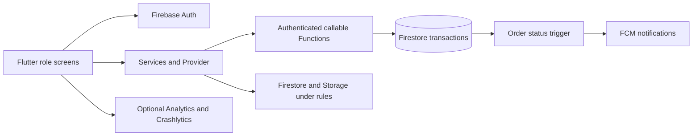

This file is a merged representation of a subset of the codebase, containing files not matching ignore patterns, combined into a single document by Repomix.

# File Summary

## Purpose
This file contains a packed representation of a subset of the repository's contents that is considered the most important context.
It is designed to be easily consumable by AI systems for analysis, code review,
or other automated processes.

## File Format
The content is organized as follows:
1. This summary section
2. Repository information
3. Directory structure
4. Repository files (if enabled)
5. Multiple file entries, each consisting of:
  a. A header with the file path (## File: path/to/file)
  b. The full contents of the file in a code block

## Usage Guidelines
- This file should be treated as read-only. Any changes should be made to the
  original repository files, not this packed version.
- When processing this file, use the file path to distinguish
  between different files in the repository.
- Be aware that this file may contain sensitive information. Handle it with
  the same level of security as you would the original repository.

## Notes
- Some files may have been excluded based on .gitignore rules and Repomix's configuration
- Binary files are not included in this packed representation. Please refer to the Repository Structure section for a complete list of file paths, including binary files
- Files matching these patterns are excluded: **/.env*, **/firebase_options.dart, **/google-services.json, **/GoogleService-Info.plist, **/key.properties, **/*.jks, **/*.keystore, **/*.pem, **/*.key, **/*service-account*.json, **/*credentials*.json, build/**, .dart_tool/**, PROJECT_CODE.md
- Files matching patterns in .gitignore are excluded
- Files matching default ignore patterns are excluded
- Files are sorted by Git change count (files with more changes are at the bottom)

# Directory Structure
`````
.agents/
  skills/
    extension-to-functions-codebase/
      references/
        configuration-migration.md
        destructuring-shim.md
        signature-mapping.md
      SKILL.md
    firebase-ai-logic-basics/
      references/
        flutter_setup.md
        ios_setup.md
        usage_patterns_android.md
        usage_patterns_web.md
      SKILL.md
    firebase-app-hosting-basics/
      references/
        cli_commands.md
        configuration.md
        emulation.md
      SKILL.md
    firebase-auth-basics/
      references/
        client_sdk_android.md
        client_sdk_web.md
        flutter_setup.md
        ios_setup.md
        security_rules.md
      SKILL.md
    firebase-basics/
      references/
        refresh/
          android_studio.md
          antigravity.md
          claude.md
          gemini-cli.md
          other-agents.md
        setup/
          android_studio.md
          antigravity.md
          claude_code.md
          cursor.md
          gemini_cli.md
          github_copilot.md
          other_agents.md
        android_setup.md
        firebase-cli-guide.md
        firebase-service-init.md
        flutter_setup.md
        ios_setup.md
        local-env-setup.md
        web_setup.md
      SKILL.md
    firebase-crashlytics/
      references/
        android_setup.md
        ios_setup.md
      SKILL.md
    firebase-data-connect/
      reference/
        cloud_functions.md
        config.md
        data_seeding.md
        native_sql.md
        operations.md
        realtime.md
        schema.md
        sdk_admin_node.md
        sdk_android.md
        sdk_flutter.md
        sdk_ios.md
        sdk_web.md
        search.md
        security.md
      examples.md
      SKILL.md
      templates.md
    firebase-firestore/
      references/
        enterprise/
          android_sdk_usage.md
          data_model.md
          flutter_setup.md
          indexes.md
          ios_setup.md
          provisioning.md
          python_sdk_usage.md
          security_rules.md
          web_sdk_usage.md
        standard/
          android_sdk_usage.md
          flutter_setup.md
          indexes.md
          ios_setup.md
          provisioning.md
          security_rules.md
          web_sdk_usage.md
      SKILL.md
    firebase-hosting-basics/
      references/
        configuration.md
        deploying.md
      SKILL.md
    firebase-remote-config-basics/
      references/
        android_setup.md
        ios_setup.md
      SKILL.md
    firebase-security-rules-auditor/
      SKILL.md
    xcode-project-setup/
      scripts/
        xcode_spm_setup/
          Sources/
            main.swift
          .gitignore
          Package.resolved
          Package.swift
      SKILL.md
.codex-remote-attachments/
  01a08ac6-0ea3-78a0-aadc-eb5b41bd6e90/
    e8bcd553-f7c1-4c92-b565-e8f027fa4de5/
      1-Photo-1.jpg
.github/
  agents/
    bloom-bunch-flutter.agent.md
  workflows/
    checks.yml
android/
  app/
    src/
      debug/
        AndroidManifest.xml
      main/
        kotlin/
          com/
            example/
              bloom_and_bunch_kl/
                MainActivity.kt
        res/
          drawable/
            launch_background.xml
          drawable-v21/
            launch_background.xml
          mipmap-hdpi/
            ic_launcher.png
          mipmap-mdpi/
            ic_launcher.png
          mipmap-xhdpi/
            ic_launcher.png
          mipmap-xxhdpi/
            ic_launcher.png
          mipmap-xxxhdpi/
            ic_launcher.png
          values/
            styles.xml
          values-night/
            styles.xml
        AndroidManifest.xml
      profile/
        AndroidManifest.xml
    build.gradle.kts
  build/
    reports/
      problems/
        problems-report.html
  gradle/
    wrapper/
      gradle-wrapper.properties
  .gitignore
  build.gradle.kts
  gradle.properties
  settings.gradle.kts
assets/
  branding/
    bloombunch_icon.png
  icons/
    flower_bouquet.png
audit/
  backend-regression-results.txt
  cart_regressions_test.dart
  cart-regression-results.txt
  customer-ui-address-results-2026-10-05.json
  delivery-checkout-results-2026-10-06.json
  navigation-results-2026-10-05.json
  persona-acceptance-results-2026-10-05.json
  persona-validation-evidence-2026-10-05.txt
  repair-analysis-results.txt
  repair-android-results.txt
  repair-backend-results.txt
  repair-flutter-results.txt
  repair-web-results.txt
  smoothness_regressions_test.dart
  smoothness-fix-results-2026-10-05.json
  smoothness-results-2026-10-05.json
docs/
  address-service-fix-2026-10-06.md
  ci-browser-fix-2026-10-05.md
  customer-ui-address-fixes-2026-10-05.md
  delivery-checkout-improvements-2026-10-06.md
  delivery-security-review-2026-10-05.json
  firebase-feature-security-audit-2026-09-18.json
  firebase-security-audit.json
  improvement-and-user-testing-plan-2026-09-21.md
  main2-feedback-integration-2026-10-05.md
  navigation-consistency-2026-10-05.md
  persona-acceptance-review-2026-10-05.md
  project-feature-audit-2026-09-18.md
  project-feature-repairs-2026-09-18.md
  project-review-2026-09-10.md
  release-checklist.md
  repair-backend-schema.md
  rider-acceptance-check-2026-10-15.md
  rider-calling.md
  smoothness-audit-and-fix-plan-2026-10-05.md
  smoothness-fixes-2026-10-05.md
  stability-plan.md
  toyyibpay-sandbox-activation-2026-10-16.md
  toyyibpay-sandbox-setup.md
  user-study-kit.md
functions/
  test/
    audit/
      feature-regressions.cjs
    customer_experience.test.js
    delivery_confirmation.test.js
    domain.test.js
    feature_regressions.test.js
    feature_writes.test.js
    integration.test.js
    payments.test.js
    require-emulators.cjs
    rider_contact.test.js
    rider_delivery_queue.test.js
    rules.test.js
    storage.test.js
    store_policy.test.js
    toyyibpay.test.js
  .env.example
  domain.js
  index.js
  package.json
  payments.js
  rider-contact.js
  store-policy.js
  store-policy.json
  toyyibpay.js
integration_test/
  driver.dart
  order_journey_test.dart
ios/
  Flutter/
    AppFrameworkInfo.plist
    Debug.xcconfig
    Release.xcconfig
  Runner/
    Assets.xcassets/
      AppIcon.appiconset/
        Contents.json
        Icon-App-1024x1024@1x.png
        Icon-App-20x20@1x.png
        Icon-App-20x20@2x.png
        Icon-App-20x20@3x.png
        Icon-App-29x29@1x.png
        Icon-App-29x29@2x.png
        Icon-App-29x29@3x.png
        Icon-App-40x40@1x.png
        Icon-App-40x40@2x.png
        Icon-App-40x40@3x.png
        Icon-App-60x60@2x.png
        Icon-App-60x60@3x.png
        Icon-App-76x76@1x.png
        Icon-App-76x76@2x.png
        Icon-App-83.5x83.5@2x.png
      LaunchImage.imageset/
        Contents.json
        LaunchImage.png
        LaunchImage@2x.png
        LaunchImage@3x.png
        README.md
    Base.lproj/
      LaunchScreen.storyboard
      Main.storyboard
    AppDelegate.swift
    Info.plist
    Runner-Bridging-Header.h
    SceneDelegate.swift
  Runner.xcodeproj/
    project.xcworkspace/
      xcshareddata/
        IDEWorkspaceChecks.plist
        WorkspaceSettings.xcsettings
      contents.xcworkspacedata
    xcshareddata/
      xcschemes/
        Runner.xcscheme
    project.pbxproj
  Runner.xcworkspace/
    xcshareddata/
      IDEWorkspaceChecks.plist
      WorkspaceSettings.xcsettings
    contents.xcworkspacedata
  RunnerTests/
    RunnerTests.swift
  .gitignore
lib/
  core/
    config/
      app_environment.dart
    constants/
      fulfillment_constants.dart
    providers/
      cart_provider.dart
    services/
      address_geocoder.dart
      address_service.dart
      admin_service.dart
      app_monitoring.dart
      auth_service.dart
      bouquet_query.dart
      checkout_service.dart
      delivery_service.dart
      favourites_service.dart
      firestore_service.dart
      geocoder_native.dart
      geocoder_web.dart
      location_service.dart
      notification_service.dart
      order_service.dart
      payment_links.dart
      payment_service.dart
      product_image.dart
      reorder_service.dart
      rider_application_service.dart
      rider_contact_service.dart
    theme/
      app_colors.dart
      app_theme.dart
      app_typography.dart
    utils/
      malaysia_time.dart
      malaysian_phone.dart
      money.dart
    widgets/
      action_confirmation.dart
      action_feedback.dart
      app_note.dart
      auth_cart_sync.dart
      delivery_progress.dart
      firestore_page.dart
      legal_documents.dart
      live_order_detail.dart
      logout_tile.dart
      notification_session.dart
      page_navigation.dart
      payment_link_session.dart
      pending_icon_button.dart
      phone_number_dialog.dart
      reauthentication_dialog.dart
      retry_stream_builder.dart
  features/
    admin/
      admin_dashboard_screen.dart
      admin_main_screen.dart
      rider_history_screen.dart
    auth/
      screens/
        auth_gate.dart
        auth_welcome_screen.dart
        forgot_password_screen.dart
        login_screen.dart
        signup_email_screen.dart
      widgets/
        auth_header_banner.dart
        auth_scaffold.dart
        pill_button.dart
    customer/
      screens/
        address_book_screen.dart
        become_rider_screen.dart
        bouquet_builder_screen.dart
        bouquet_catalogue_screen.dart
        bouquet_detail_screen.dart
        cart_screen.dart
        checkout_screen.dart
        customer_home_screen.dart
        delivery_pin_screen.dart
        favourites_screen.dart
        flower_catalogue_screen.dart
        flower_detail_screen.dart
        main_navigation_screen.dart
        order_history_screen.dart
        order_tracking_screen.dart
        payment_screen.dart
        profile_screen.dart
      widgets/
        order_thumbnail.dart
        product_components.dart
    florist/
      screens/
        florist_bouquets_tab.dart
        florist_dashboard_screen.dart
        florist_home_screen.dart
        florist_inventory_screen.dart
        florist_main_navigation_screen.dart
        florist_order_detail_screen.dart
        florist_orders_screen.dart
        florist_products_screen.dart
        florist_profile_screen.dart
        order_materials_panel.dart
    rider/
      screens/
        rider_available_job_screen.dart
        rider_home_screen.dart
        rider_order_detail_screen.dart
      widgets/
        available_deliveries_list.dart
    support/
      order_contact_actions.dart
      order_support.dart
      store_operations_screen.dart
  models/
    bouquet_model.dart
    cart_item_model.dart
    delivery_job_model.dart
    flower_model.dart
    order_model.dart
    saved_address_model.dart
    user_model.dart
  main.dart
linux/
  flutter/
    CMakeLists.txt
    generated_plugin_registrant.cc
    generated_plugin_registrant.h
    generated_plugins.cmake
  runner/
    CMakeLists.txt
    main.cc
    my_application.cc
    my_application.h
  .gitignore
  CMakeLists.txt
macos/
  Flutter/
    Flutter-Debug.xcconfig
    Flutter-Release.xcconfig
    GeneratedPluginRegistrant.swift
  Runner/
    Assets.xcassets/
      AppIcon.appiconset/
        app_icon_1024.png
        app_icon_128.png
        app_icon_16.png
        app_icon_256.png
        app_icon_32.png
        app_icon_512.png
        app_icon_64.png
        Contents.json
    Base.lproj/
      MainMenu.xib
    Configs/
      AppInfo.xcconfig
      Debug.xcconfig
      Release.xcconfig
      Warnings.xcconfig
    AppDelegate.swift
    DebugProfile.entitlements
    Info.plist
    MainFlutterWindow.swift
    Release.entitlements
  Runner.xcodeproj/
    project.xcworkspace/
      xcshareddata/
        IDEWorkspaceChecks.plist
    xcshareddata/
      xcschemes/
        Runner.xcscheme
    project.pbxproj
  Runner.xcworkspace/
    xcshareddata/
      IDEWorkspaceChecks.plist
    contents.xcworkspacedata
  RunnerTests/
    RunnerTests.swift
  .gitignore
output/
  documents/
    Bloom_and_Bunch_KL_Refined_FYP02_Report.docx
outputs/
  01a08ac6-0ea3-78a0-aadc-eb5b41bd6e90/
    Bloom_and_Bunch_FYP_Gantt_Chart_Deadline_Aligned.xlsx
    Bloom_and_Bunch_FYP_Gantt_Chart_Deadline_Aligned.xlsx.inspect.ndjson
    Bloom_and_Bunch_FYP_Gantt_Chart.xlsx
    Bloom_and_Bunch_FYP_Gantt_Chart.xlsx.inspect.ndjson
public/
  index.html
test/
  address_form_test.dart
  auth_navigation_test.dart
  auth_scope_test.dart
  available_deliveries_test.dart
  cart_limits_test.dart
  checkout_recovery_test.dart
  checkout_summary_test.dart
  customer_cart_layout_test.dart
  delivery_feedback_test.dart
  feature_flows_test.dart
  feature_repairs_test.dart
  order_contact_test.dart
  page_navigation_test.dart
  payment_links_test.dart
  payment_test.dart
  phone_number_dialog_test.dart
  product_components_test.dart
  smoothness_regressions_test.dart
  widget_test.dart
tool/
  build_ios.sh
  build_web.ps1
  configure_ios.cjs
  configure_web.cjs
  payment-return.test.cjs
  run_app_journey.cjs
  seed_demo.cjs
  validate_release.cjs
  validate_web_build.cjs
web/
  icons/
    Icon-192.png
    Icon-512.png
    Icon-maskable-192.png
    Icon-maskable-512.png
  favicon.png
  firebase-messaging-sw.js
  index.html
  manifest.json
  payment-return.html
  payment-return.js
windows/
  flutter/
    CMakeLists.txt
    generated_plugin_registrant.cc
    generated_plugin_registrant.h
    generated_plugins.cmake
  runner/
    resources/
      app_icon.ico
    CMakeLists.txt
    flutter_window.cpp
    flutter_window.h
    main.cpp
    resource.h
    runner.exe.manifest
    Runner.rc
    utils.cpp
    utils.h
    win32_window.cpp
    win32_window.h
  .gitignore
  CMakeLists.txt
.env.example
.firebaserc
.gitignore
.metadata
analysis_options.yaml
build_web.sh
devtools_options.yaml
firebase.integration.json
firebase.json
firestore.indexes.json
firestore.rules
pubspec.lock
pubspec.yaml
README.md
skills-lock.json
storage.rules
`````

# Files

## File: .agents/skills/extension-to-functions-codebase/references/configuration-migration.md
`````markdown
# Migrating Runtime Configurations (runWith)

In Cloud Functions for Firebase V1 (`firebase-functions/v1`), you configured
runtime settings like memory, timeout, and service accounts using `.runWith()`.
In V2 (`firebase-functions/v2`), `.runWith()` is removed and replaced by a more
flexible options system.

You can configure V2 functions in two ways: **Per-Function** (passing an options
object directly to the trigger) or **Globally** (`setGlobalOptions` at the top
of a file).

______________________________________________________________________

## 1. Per-Function Configuration

Pass the configuration options object as the **first argument** to the V2
trigger function. Per-function options always override any global defaults.

### V1 Legacy

```typescript
import * as functions from "firebase-functions";

export const processOrder = functions
  .runWith({ memory: "2GB" })
  .pubsub.topic("orders")
  .onPublish((message, context) => { ... });
```

### V2 Modern Equivalent

```typescript
import { onMessagePublished } from "firebase-functions/v2/pubsub";

export const processOrder = onMessagePublished(
  {
    topic: "orders",
    memory: "2GiB", // Options passed as the first argument!
  },
  ({ message, context }) => { ... } // Destructuring shim pattern
);
```

> [!TIP] **Memory Unit Caveat**: V1 accepted `"1GB"`. V2 types strongly prefer
> IEC units like `"1GiB"`, `"2GiB"`, etc.

______________________________________________________________________

## 2. Global Configuration (`setGlobalOptions`)

Use `setGlobalOptions` at the top of your file when all or most functions in
that file share the exact same runtime requirements (e.g. identical region,
memory allocation, timeout, or service account). Individual functions can still
override specific settings by declaring per-function options.

### V1 Legacy

```typescript
import * as functions from "firebase-functions";

export const myFn = functions
  .runWith({
    memory: "1GB",
    timeoutSeconds: 120,
    serviceAccount: "custom-sa@my-project.iam.gserviceaccount.com",
  })
  .https.onRequest((req, res) => { ... });
```

### V2 Modern Equivalent

```typescript
import { setGlobalOptions } from "firebase-functions/v2";
import { onRequest } from "firebase-functions/v2/https";

// Set global defaults for all functions defined after this call in this file
setGlobalOptions({
  memory: "1GiB", // Note: GiB instead of GB is preferred in V2 types
  timeoutSeconds: 120,
  serviceAccount: "custom-sa@my-project.iam.gserviceaccount.com",
});

export const myFn = onRequest((req, res) => { ... });
```

______________________________________________________________________

## Common Property Translations

| V1 Property                  | V2 Property                  | Notes                                                           |
| :--------------------------- | :--------------------------- | :-------------------------------------------------------------- |
| `memory`                     | `memory`                     | Use `"1GiB"` instead of `"1GB"`.                                |
| `timeoutSeconds`             | `timeoutSeconds`             | Same.                                                           |
| `ingressSettings`            | `ingressSettings`            | Same.                                                           |
| `vpcConnector`               | `vpcConnector`               | Same.                                                           |
| `vpcConnectorEgressSettings` | `vpcConnectorEgressSettings` | Same.                                                           |
| `serviceAccount`             | `serviceAccount`             | Same.                                                           |
| `secrets`                    | `secrets`                    | Same.                                                           |
| `failurePolicy`              | `retry`                      | Renamed to boolean `retry: true/false` in V2 Eventarc triggers. |

______________________________________________________________________

## 3. Migrating Environment Configurations (`functions.config()`)

In V1, you used `functions.config()` to access environment configuration. In V2,
this is replaced by **Parameterized Configuration**.

### Deterministic Rules for Migration

Follow these rules to ensure a deterministic and safe migration:

#### Typing & Exports

- **Numbers**: If the value is used as a number, use `defineInt` or
  `defineNumber`.
- **Secrets**: If the key contains "KEY", "SECRET", "TOKEN", or "PASSWORD", use
  `defineSecret()` or `defineJsonSecret()`.
  - *Note*: Secrets MUST be explicitly bound to the function that uses them in
    the options object (e.g., `{ secrets: [myKey, myJsonSecret] }`). Both
    `SecretParam` and `JsonSecretParam` are supported in the `secrets` array.
- **Lists**: Use `defineList` for comma-separated lists.
- **JSON**: Use `defineJSON` for JSON strings.
- **Buckets**: If the param is a storage bucket, set `input: { text: {} }` or
  bucket selector.
- **Input Validation**: Use `nonEmpty: true` inside `input.text` or
  `input.multiSelect` to enforce non-empty parameter input during CLI prompting
  (e.g. `defineString("PARAM", { input: { text: { nonEmpty: true } } })`).
- **Type Annotations**: Import parameter types directly from
  `firebase-functions/params` (e.g.
  `import type { StringParam, SecretParam, JsonSecretParam, IntParam } from "firebase-functions/params"`).

#### Initialization & Scope

- **Global Initialization**: If a variable was initialized globally in V1 (e.g.,
  `const client = new Client(functions.config().key)`), you must split it to
  have declaration at global scope and initialization inside `onInit`:
  ```typescript
  import { onInit } from "firebase-functions/v2";

  const myKey = defineSecret("MY_KEY");
  let client: Client;

  onInit(() => {
    client = new Client(myKey.value());
  });
  ```

#### Advanced Interpolation & Logic

- **String Interpolation**: Use the `expr` tagged template literal from
  `firebase-functions/params` (e.g., `` `expr`every ${period} days` ``) instead
  of standard template literals when constructing dynamic strings with
  parameters. Do NOT call `.value()` inside `expr`.
- **Logic Operators**: Use expressions like
  `projectID.equals('prod').thenElse(1, 0)` for logical operations instead of
  ternary operators on `.value()`.

#### Built-ins

- Prefer built-in variables like `databaseURL`, `projectID`, `gcloudProject`,
  `storageBucket` rather than defining new params for these values.
`````

## File: .agents/skills/extension-to-functions-codebase/references/destructuring-shim.md
`````markdown
# Architectural Deep Dive: Destructuring Compatibility Shim

The Destructuring Compatibility Shim is a **Zero-Touch Logic Migration**
pattern. It allows you to upgrade a function's infrastructure to V2 (and take
advantage of GCF 2nd Gen runtimes) without rewriting any of your internal
business logic.

______________________________________________________________________

## How it Works

When you migrate a V1 function to V2, the signature changes from two parameters
`(data, context)` to a single `CloudEvent` object.

Instead of manually rewriting all usages of `context.params` or `message.json`
inside the function, you use JavaScript's **Object Destructuring** in the
signature.

### Example Transformation

#### Step 1: Legacy V1

```typescript
export const processOrder = functions.pubsub.topic("orders").onPublish((message, context) => {
  const orderId = message.json.id;
  console.log(`Processing order ${orderId} at ${context.timestamp}`);
});
```

#### Step 2: Modern V2 + Shim

We change the trigger to `onMessagePublished`, and instead of accepting `event`,
we destructure `{ message, context }` directly:

```typescript
export const processOrder = onMessagePublished("orders", ({ message, context }) => {
  const orderId = message.json.id; // Legacy logic remains untouched!
  console.log(`Processing order ${orderId} at ${context.timestamp}`);
});
```

### Why This Works

The Firebase Functions SDK uses a utility called `addV1Compat` to attach these
properties via **Lazy Getters** on the `CloudEvent` object for standard event
triggers. When you attempt to destructure `{ message, context }` from the event,
the SDK transparently maps the V2 event properties back into V1-compatible
objects on the fly! This feature is available in modern V2 environments
supported by the SDK.

______________________________________________________________________

## Provider Mapping Examples

Here are the exact destructuring patterns for every supported V2 provider:

### 1. Cloud Firestore

- **Created / Deleted** triggers:
  ```typescript
  // V2: onDocumentCreated, onDocumentDeleted
  export const processDoc = onDocumentCreated("users/{id}", ({ snapshot, context }) => { ... });
  ```
- **Updated / Written** triggers:
  ```typescript
  // V2: onDocumentUpdated, onDocumentWritten
  export const processDoc = onDocumentUpdated("users/{id}", ({ change, context }) => { ... });
  ```

### 2. Cloud Storage

- **All** triggers (`onObjectFinalized`, `onObjectDeleted`, `onObjectArchived`,
  `onObjectMetadataUpdated`):
  ```typescript
  export const processFile = onObjectFinalized(({ object, context }) => { ... });
  ```

### 3. Realtime Database

- **Created / Deleted** triggers:
  ```typescript
  export const processData = onValueCreated("/users/{id}", ({ snapshot, context }) => { ... });
  ```
- **Updated / Written** triggers:
  ```typescript
  export const processData = onValueWritten("/users/{id}", ({ change, context }) => { ... });
  ```

### 4. Remote Config

- **Updated** triggers:
  ```typescript
  export const processConfig = onConfigUpdated(({ version, context }) => { ... });
  ```

______________________________________________________________________

## Best Practices for AI Agents

1. **Rely on the shim for complex logic.** When converting functions with
   extensive or complex internal business logic, prefer using the destructuring
   shim (`{ shimmedKey, context }`) by default to minimize risk and avoid
   introducing subtle bugs.
1. **Clean-room rewrites.** If the function body is very simple, or if the user
   explicitly asks for a comprehensive code modernization/cleanup, you can ask
   the user if they would prefer a full clean-room rewrite to native V2 event
   properties.
1. **Always type-check (`tsc`) after the rewrite.** If the types are wrong, the
   shim might not be fully supported for that specific provider yet.
1. **HTTPS Callables (Flattened Context)**: Unlike event triggers, Callables do
   **not** use `V1Compat` or a `context` object. Instead, all context properties
   are flattened onto the request object.
   - **V1 Priority**: `(data, context) => { ... }`
   - **V2 Equivalent**: `({ data, auth, app }) => { ... }`

______________________________________________________________________

## Related Migrations

For a complete guide on migrating runtime options and `functions.config()` to V2
Parameterized Configuration, refer to
[configuration-migration.md](configuration-migration.md).
`````

## File: .agents/skills/extension-to-functions-codebase/references/signature-mapping.md
`````markdown
# Firebase Functions V1 vs V2 Signature Mapping

This reference maps legacy V1 functions to their modern V2 equivalents. When
using the compatibility shim, you can destructure the V2 event object using the
exact parameter names from the legacy V1 trigger signature (`change`,
`snapshot`, `message`, `object`) alongside `context`.

______________________________________________________________________

## Cloud Firestore

| V1 Trigger                        | V2 Equivalent         | Destructuring Pattern     |
| :-------------------------------- | :-------------------- | :------------------------ |
| `firestore.document().onWrite()`  | `onDocumentWritten()` | `({ change, context })`   |
| `firestore.document().onCreate()` | `onDocumentCreated()` | `({ snapshot, context })` |
| `firestore.document().onUpdate()` | `onDocumentUpdated()` | `({ change, context })`   |
| `firestore.document().onDelete()` | `onDocumentDeleted()` | `({ snapshot, context })` |

______________________________________________________________________

## Cloud Pub/Sub

| V1 Trigger                   | V2 Equivalent          | Destructuring Pattern    |
| :--------------------------- | :--------------------- | :----------------------- |
| `pubsub.topic().onPublish()` | `onMessagePublished()` | `({ message, context })` |
| `pubsub.schedule().onRun()`  | `onSchedule()`         | Access `event` directly  |

> [!NOTE] Scheduled functions moved from the `pubsub` namespace to the
> `scheduler` namespace in V2.

______________________________________________________________________

## Realtime Database

| V1 Trigger                  | V2 Equivalent      | Destructuring Pattern     |
| :-------------------------- | :----------------- | :------------------------ |
| `database.ref().onWrite()`  | `onValueWritten()` | `({ change, context })`   |
| `database.ref().onCreate()` | `onValueCreated()` | `({ snapshot, context })` |
| `database.ref().onUpdate()` | `onValueUpdated()` | `({ change, context })`   |
| `database.ref().onDelete()` | `onValueDeleted()` | `({ snapshot, context })` |

______________________________________________________________________

## Cloud Storage

| V1 Trigger                            | V2 Equivalent               | Destructuring Pattern   |
| :------------------------------------ | :-------------------------- | :---------------------- |
| `storage.object().onArchive()`        | `onObjectArchived()`        | `({ object, context })` |
| `storage.object().onDelete()`         | `onObjectDeleted()`         | `({ object, context })` |
| `storage.object().onFinalize()`       | `onObjectFinalized()`       | `({ object, context })` |
| `storage.object().onMetadataUpdate()` | `onObjectMetadataUpdated()` | `({ object, context })` |

______________________________________________________________________

## HTTP / Callables

| V1 Trigger          | V2 Equivalent       | Destructuring Pattern          |
| :------------------ | :------------------ | :----------------------------- |
| `https.onRequest()` | `https.onRequest()` | Standard Express `(req, res)`  |
| `https.onCall()`    | `https.onCall()`    | Destructure `({ data, auth })` |

> [!IMPORTANT] **HTTP Callables do NOT use the Destructuring Shim.** In V2, the
> handler receives a single `CallableRequest` object (not a `CloudEvent`). You
> should destructure properties like `data`, `auth`, and `app` directly from it.
> The traditional `context` object is **unavailable**.

______________________________________________________________________

## Auth (Blocking)

| V1 Trigger                   | V2 Equivalent                   | Destructuring Pattern   |
| :--------------------------- | :------------------------------ | :---------------------- |
| `auth.user().beforeSignIn()` | `identity.beforeUserSignedIn()` | Access `event` directly |
| `auth.user().beforeCreate()` | `identity.beforeUserCreated()`  | Access `event` directly |

> [!NOTE] Auth Blocking triggers moved to the `identity` namespace in V2.

______________________________________________________________________

## Cloud Tasks

| V1 Trigger                       | V2 Equivalent        | Destructuring Pattern   |
| :------------------------------- | :------------------- | :---------------------- |
| `tasks.taskQueue().onDispatch()` | `onTaskDispatched()` | Access `event` directly |
`````

## File: .agents/skills/extension-to-functions-codebase/SKILL.md
`````markdown
---
name: extension-to-functions-codebase
description: Skill for converting an installed Firebase Extension (or extension source) into a standalone Cloud Functions for Firebase codebase or publishable npm package, including V1 to V2 trigger upgrades, lifecycle hooks, and declarative security
---

# Extension to Functions Codebase & npm Package Migration

## Overview

Migrates a Firebase Extension into either:

1. **A local Cloud Functions codebase** (`functions/src/` for app integration).
1. **A publishable npm package** (reusable open-source package exporting V2
   functions).

Leverages native Cloud Functions features (declarative IAM, Parameterized
Config, SDK Lifecycle Hooks) and modernizes 1st Gen triggers to 2nd Gen using
the Destructuring Compatibility Shim.

______________________________________________________________________

## Target Migration Workflows

- **Target A: Local Functions Codebase** (End-User App Integration)

  - Output: Code under `functions/src/`. Config in `.env`.
  - Deployment: `firebase deploy --only functions`.

- **Target B: Publishable npm Package / Shareable Package**

  - Output: Reusable npm package exporting V2 functions.
  - Configuration: `package.json` specifying `exports` map,
    `engines: { "node": ">=22" }`, and
    `peerDependencies: { "firebase-functions": ">=6.0.0" }`.
  - Usage: Consumers install package and re-export functions in `index.ts`
    (`export * from "<package-name>"`).

______________________________________________________________________

## Core Rules & Constraints

### 1. Declarative IAM & APIs (Zero-Local-Overhead)

Use native SDK declarations instead of manual `gcloud` scripts or console
instructions:

- Use `requiresRole("roles/...")` for required GCP IAM permissions.
- Use `requiresAPI("service.googleapis.com", "Description")` for Google APIs.

### 2. Global Parameter Access Restriction

- **Never call `.value()` at top-level module load scope.**
- Initialize global SDK instances inside `onInit()` or lazy getters:
  ```typescript
  import { defineString } from "firebase-functions/params";
  import { onInit } from "firebase-functions/v2";

  const dataset = defineString("DATASET_ID");
  let client: BigQuery;

  onInit(() => {
    client = new BigQuery({ datasetId: dataset.value() });
  });
  ```

### 3. V2 Concurrency & Cost Parity

V2 enables concurrency (up to 80 requests). To preserve V1 single-concurrency
pricing, set `cpu: "gcf_gen1"`.

______________________________________________________________________

## Step-by-Step Migration Execution

### Step 1: Inventory Extension Resources

1. **`extension.yaml`**:
   - `params` → `defineString`, `defineInt`, `defineBoolean`, `defineSecret`.
   - `apis` → `requiresAPI(...)`.
   - `roles` → `requiresRole(...)`.
   - `lifecycleEvents` → `afterFirstDeploy` & `afterRedeploy`.
   - `resources` → Upgrade 1st Gen triggers to 2nd Gen (`onDocumentWritten`,
     `onTaskDispatched`, `onRequest`).
1. **Files & Scripts**: Preserve devDependencies, test framework (`jest`), and
   test scripts.

### Step 2: Configure `package.json`

- Set `name: "<package-name>"`, `engines: { "node": ">=22" }`.
- Set `peerDependencies`:
  ```json
  "peerDependencies": {
    "firebase-admin": "^11.0.0 || ^12.0.0",
    "firebase-functions": ">=6.0.0"
  }
  ```
- Configure `exports` map targeting ESM/CommonJS and TypeScript declarations
  (`lib/index.js`, `lib/index.d.ts`).

### Step 3: Upgrade Triggers from V1 to V2

- Firestore: Use `onDocumentWritten` from `firebase-functions/v2/firestore`.
- Tasks: Use `onTaskDispatched` from `firebase-functions/v2/tasks`. Remove
  `EXT_INSTANCE_ID` when enqueueing tasks.
- HTTP: Use `onRequest` from `firebase-functions/v2/https`.
- Apply Destructuring Compatibility Shim (`{ change, context }`,
  `{ snapshot, context }`) where legacy 1st Gen handlers expect
  `(change, context)`.

### Step 4: Convert Lifecycle Events

Map extension lifecycle events to SDK lifecycle hooks in `src/index.ts`:

- `onInstall` → `afterFirstDeploy({ task: { function: "initTask" } })`
- `onUpdate` / `onConfigure` →
  `afterRedeploy({ task: { function: "setupTask" } })`

### Step 5: Package README & Export Instructions

Generate `README.md` containing:

1. Installation instructions (`npm install`).
1. Re-export snippet (`export * from "<package-name>"`).
1. Parameterized Configuration `.env` reference table.
1. What Changed (Extension vs Package) comparison table.

_Reminder: NEVER execute `npm publish`._
`````

## File: .agents/skills/firebase-ai-logic-basics/references/flutter_setup.md
`````markdown
# Flutter Setup for Firebase AI Logic

This guide covers how to integrate Firebase AI Logic (Gemini API) into your
Flutter applications.

> [!IMPORTANT] **Foundational Workflows & CLI-First Approach:**
>
> 1. **Review Foundation:** Before implementing platform-specific code, ALWAYS
>    review the foundational `firebase-basics` skill to ensure familiarity with
>    core workflows.
> 1. **Backend Provisioning via CLI:** Use the Firebase CLI for backend setup.
>    Running `npx firebase-tools init ailogic` is MANDATORY to provision the
>    service. `flutterfire configure` does NOT enable the AI service and will
>    result in `PERMISSION_DENIED` if skipped.
> 1. **Client Configuration:** Use `flutterfire configure` strictly for
>    generating `firebase_options.dart`. Avoid manual Console configuration.

> [!NOTE] `firebase_vertexai` has been replaced by `firebase_ai`. Always use
> `firebase_ai` for new projects.

## Installation

Add the necessary Firebase dependencies to your `pubspec.yaml`:

```yaml
dependencies:
  flutter:
    sdk: flutter
  firebase_core: ^4.0.0
  firebase_auth: ^6.0.0
  firebase_ai: ^3.0.0
```

Run `flutter pub get` to install the packages.

## Initialization

Initialize Firebase and sign in (anonymously or via authenticated user) before
using AI Logic.

```dart
import 'package:firebase_core/firebase_core.dart';
import 'package:firebase_auth/firebase_auth.dart';
import 'package:firebase_ai/firebase_ai.dart';

void main() async {
  WidgetsFlutterBinding.ensureInitialized();
  await Firebase.initializeApp();
  await FirebaseAuth.instance.signInAnonymously();
  runApp(const MyApp());
}
```

## Usage

Use `FirebaseAI.googleAI` for the **Gemini Developer API**.

> [!IMPORTANT] **Model Selection:** Refer to
> [Firebase AI Logic Models](https://firebase.google.com/docs/ai-logic/models.md.txt)
> to find the latest supported model. Do not use old models like
> `gemini-2.0-pro` or `gemini-2.0-flash`.

> [!IMPORTANT] **Choose the Right API Provider:** Always use
> `FirebaseAI.googleAI` (Gemini Developer API) as the default for prototyping
> and standard use. Avoid using the Agent Platform Gemini API (formerly branded
> Vertex AI) unless the app and business use case specifically require
> enterprise-grade scalability or data residency requirements. Note that the
> Gemini Developer API *usually does not* require the Firebase project to be on
> the pay-as-you-go Blaze pricing plan; however, the Agent Platform Gemini API
> does require the Blaze plan.

### Text Generation

```dart
import 'package:firebase_ai/firebase_ai.dart';
import 'package:firebase_auth/firebase_auth.dart';

Future<String> generateText(String prompt) async {
  final googleAI = FirebaseAI.googleAI(auth: FirebaseAuth.instance);
  
  // [AGENT] Replace '<latest_supported_model>' with the latest model from https://firebase.google.com/docs/ai-logic/models.md.txt
  final model = googleAI.generativeModel(model: '<latest_supported_model>');

  final response = await model.generateContent([Content.text(prompt)]);
  return response.text ?? 'No response';
}
```

### Chat Session

```dart
final chat = model.startChat(history: [
  Content.text('Hello, I am a user.'),
  Content.model([TextPart('Hello! How can I help you today?')]),
]);

final response = await chat.sendMessage(Content.text('What is CBT?'));
```
`````

## File: .agents/skills/firebase-ai-logic-basics/references/ios_setup.md
`````markdown
# Firebase AI Logic iOS Setup Guide

## 1. Import and Initialize

Ensure you have installed the `FirebaseAILogic` SDK via Swift Package Manager.

```swift
import FirebaseAILogic

// Initialize the Firebase AI service and the generative model.
let ai = FirebaseAI.firebaseAI()

// [AGENT] Replace "<latest_supported_model>" with the latest model from https://firebase.google.com/docs/ai-logic/models.md.txt
let model = ai.generativeModel(modelName: "<latest_supported_model>")
```

## 2. SwiftUI Integration (Best Practices)

Use the `@Observable` pattern to manage AI state and provide a smooth UX with
loading indicators and error handling.

> **⛔️ CRITICAL WARNING:** Do NOT initialize the model inline as a class
> property if there's any chance the view model is instantiated before
> `FirebaseApp.configure()` executes in the app root. To be safe, initialize the
> model lazily or pass it in from a point in the hierarchy where Firebase is
> guaranteed to be configured.

```swift
import SwiftUI
import FirebaseAILogic

@MainActor
@Observable
final class AIViewModel {
    // [AGENT] Replace with the latest model from https://firebase.google.com/docs/ai-logic/models.md.txt
    private lazy var model = FirebaseAI.firebaseAI().generativeModel(modelName: "<latest_supported_model>")
    
    var responseText: String = ""
    var isFetching: Bool = false
    var errorMessage: String?
    
    func generate(prompt: String) async {
        isFetching = true
        errorMessage = nil
        defer { isFetching = false }
        
        do {
            let response = try await model.generateContent(prompt)
            self.responseText = response.text ?? "No response"
        } catch {
            self.errorMessage = error.localizedDescription
        }
    }
}

struct AIView: View {
    @State private var viewModel = AIViewModel()
    @State private var prompt = "Write a story about a magic backpack."
    
    var body: some View {
        VStack {
            TextField("Enter prompt", text: $prompt)
            
            Button("Generate") {
                Task { await viewModel.generate(prompt: prompt) }
            }
            .disabled(viewModel.isFetching)
            
            if viewModel.isFetching {
                ProgressView()
            } else if let error = viewModel.errorMessage {
                Text(error).foregroundStyle(.red)
            } else {
                ScrollView {
                    Text(viewModel.responseText)
                }
            }
        }
        .padding()
    }
}
```

## 3. Safety Settings

You can configure safety thresholds to prevent the model from generating harmful
content.

```swift
let safetySettings = [
  SafetySetting(category: .harassment, threshold: .blockLowAndAbove),
  SafetySetting(category: .hateSpeech, threshold: .blockMediumAndAbove)
]

let model = FirebaseAI.firebaseAI().generativeModel(
  modelName: "<latest_supported_model>", // [AGENT] Replace with the latest model from https://firebase.google.com/docs/ai-logic/models.md.txt
  safetySettings: safetySettings
)
```

# Advanced Features

### Chat Session (Multi-turn)

Chat sessions persist state across multiple interactions, which is essential for
ongoing conversations or when using tools like function calling.

```swift
let chat = model.startChat()

Task {
    do {
        let response1 = try await chat.sendMessage("Hello! I have two dogs in my house.")
        print(response1.text ?? "")

        let response2 = try await chat.sendMessage("How many paws are in my house?")
        print(response2.text ?? "")
    } catch {
        print("Error in chat: \(error)")
    }
}
```

### Function Calling (Tools)

Define functions that the model can request to execute to interact with external
systems. *Note: Advanced workflows like function calling generally require a
multi-turn Chat Session to handle the back-and-forth execution.*

```swift
let getStockPriceTool = Tool(functionDeclarations: [
  FunctionDeclaration(
    name: "getStockPrice",
    description: "Get the current stock price for a given symbol.",
    parameters: [
      "symbol": Schema(
        type: .string,
        description: "The stock symbol, e.g. AAPL"
      )
    ]
  )
])

let model = FirebaseAI.firebaseAI().generativeModel(
  modelName: "<latest_supported_model>", // [AGENT] Replace with the latest model from https://firebase.google.com/docs/ai-logic/models.md.txt
  tools: [getStockPriceTool]
)

// In your task (using a chat session):
let chat = model.startChat()
let response = try await chat.sendMessage("What is the stock price of Apple?")
if let functionCall = response.functionCalls.first {
    // Handle the function call (e.g. call a local API and send the result back)
    print("Model requested function: \(functionCall.name) with args: \(functionCall.args)")
}
```
`````

## File: .agents/skills/firebase-ai-logic-basics/references/usage_patterns_android.md
`````markdown
# Firebase AI Logic on Android (Kotlin)

First, ensure you have initialized the Firebase App (see `firebase-basics`
skill). Then, initialize the AI Logic service as below

### 0. Enable Firebase AI Logic via CLI

Before adding dependencies in your app, make sure you enable the AI Logic
service in your Firebase Project using the Firebase CLI:

```bash
npx -y firebase-tools@latest init
# When prompted, select 'AI logic' to enable the Gemini API in your project.
```

______________________________________________________________________

### 1. Add Dependencies

In your module-level `build.gradle.kts` (usually `app/build.gradle.kts`), add
the dependency for Firebase AI:

```kotlin
dependencies {
    // [AGENT] Fetch the latest available BoM version from https://firebase.google.com/support/release-notes/android before adding this
    implementation(platform("com.google.firebase:firebase-bom:<latest_bom_version>"))

    // Add the dependency for the Firebase AI library
    implementation("com.google.firebase:firebase-ai")
}
```

______________________________________________________________________

### 2. Initialize and Generate Content

In your Activity or Fragment, initialize the `FirebaseAI` service and generate
content using a Gemini model:

```kotlin
import com.google.firebase.ai.FirebaseAI
import com.google.firebase.ai.ktx.ai
import com.google.firebase.ktx.Firebase

class MainActivity : AppCompatActivity() {

    override fun onCreate(savedInstanceState: Bundle?) {
        super.onCreate(savedInstanceState)
        setContentView(R.layout.activity_main)

        // Initialize Firebase AI
        val ai = Firebase.ai

        // [AGENT] Replace "<latest_supported_model>" with the latest model from https://firebase.google.com/docs/ai-logic/models.md.txt
        val model = ai.generativeModel("<latest_supported_model>")

        // Generate content
        lifecycleScope.launch {
            try {
                val response = model.generateContent("Write a story about a magic backpack.")
                Log.d(TAG, "Response: ${response.text}")
            } catch (e: Exception) {
                Log.e(TAG, "Error generating content", e)
            }
        }
    }
}
```

#### Jetpack Compose (Modern)

Initialize inside a `ComponentActivity` and use `setContent`:

```kotlin
import android.os.Bundle
import androidx.activity.ComponentActivity
import androidx.activity.compose.setContent
import androidx.compose.material3.MaterialTheme
import androidx.compose.material3.Text
import androidx.lifecycle.lifecycleScope
import com.google.firebase.Firebase
import com.google.firebase.ai.ai
import kotlinx.coroutines.launch

class MainActivity : ComponentActivity() {
    override fun onCreate(savedInstanceState: Bundle?) {
        super.onCreate(savedInstanceState)
        val ai = Firebase.ai
        // [AGENT] Replace with the latest model from https://firebase.google.com/docs/ai-logic/models.md.txt
        val model = ai.generativeModel("<latest_supported_model>")
        
        lifecycleScope.launch {
            val response = model.generateContent("Hello Gemini!")
            setContent {
                MaterialTheme {
                    Text("AI Response: ${response.text}")
                }
            }
        }
    }
}
```

______________________________________________________________________

### 3. Multimodal Input (Text and Images)

Pass bitmap data along with text prompts:

```kotlin
val image1: Bitmap = ... // Load your bitmap
val image2: Bitmap = ...

val response = model.generateContent(
    content("Analyze these images for me") {
        image(image1)
        image(image2)
        text("Compare these two items.")
    }
)
Log.d(TAG, response.text)
```

______________________________________________________________________

### 4. Chat Session (Multi-turn)

Maintain chat history automatically:

```kotlin
val chat = model.startChat(
    history = listOf(
        content("user") { text("Hello, I am a software engineer.") },
        content("model") { text("Hello! How can I help you today?") }
    )
)

lifecycleScope.launch {
    val response = chat.sendMessage("What should I learn next?")
    Log.d(TAG, response.text)
}
```

______________________________________________________________________

### 5. Streaming Responses

For faster display, stream the response:

```kotlin
lifecycleScope.launch {
    model.generateContentStream("Tell me a long story.")
        .collect { chunk ->
            print(chunk.text) // Update UI incrementally
        }
}
```
`````

## File: .agents/skills/firebase-ai-logic-basics/references/usage_patterns_web.md
`````markdown
# Firebase AI Logic Basics

## Initialization Pattern

You must initialize the ai-logic service after the main Firebase App.

```JavaScript
import { initializeApp } from "firebase/app";
import { getAI, getGenerativeModel, GoogleAIBackend } from "firebase/ai";


// If running in Firebase App Hosting, you can skip Firebase Config and instead use:
// const app = initializeApp();

const firebaseConfig = {
  // ... your firebase config
};

const app = initializeApp(firebaseConfig);

// Initialize the AI Logic service (defaults to Gemini Developer API)
// To set the AI provider, set the backend as the second parameter
const ai = getAI(app, { backend: new GoogleAIBackend() });

const generationConfig = {
  candidate_count: 1,
  maxOutputTokens: 2048,
  stopSequences: [],
  temperature: 0.7,      // Balanced: creative but focused
  topP: 0.95,            // Standard: allows a wide range of probable tokens
  topK: 40,              // Standard: considers the top 40 tokens
};

// Specify the config as part of creating the `GenerativeModel` instance
// [AGENT] Replace "<latest_supported_model>" with the latest model from https://firebase.google.com/docs/ai-logic/models.md.txt
const model = getGenerativeModel(ai, { model: "<latest_supported_model>",  generationConfig });
```

## Core Capabilities

Text-Only Generation

```JavaScript
async function generateText(prompt) {
  const result = await model.generateContent(prompt);
  const response = await result.response;
  return response.text();
}
```

## Multimodal (Text + Images/Audio/Video/PDF input)

Firebase AI Logic accepts Base64 encoded data or specific file references.

```JavaScript
// Helper to convert file to base64 generic object
async function fileToGenerativePart(file) {
  const base64EncodedDataPromise = new Promise((resolve) => {
    const reader = new FileReader();
    reader.onloadend = () => resolve(reader.result.split(',')[1]);
    reader.readAsDataURL(file);
  });
  
  return {
    inlineData: {
      data: await base64EncodedDataPromise,
      mimeType: file.type,
    },
  };
}

async function analyzeImage(prompt, imageFile) {
  const imagePart = await fileToGenerativePart(imageFile);
  const result = await model.generateContent([prompt, imagePart]);
  return result.response.text();
}
```

## Chat Session (Multi-turn)

Maintain history automatically using startChat.

```JavaScript
const chat = model.startChat({
  history: [
    {
      role: "user",
      parts: [{ text: "Hello, I am a developer." }],
    },
    {
      role: "model",
      parts: [{ text: "Great to meet you. How can I help with code?" }],
    },
  ],
});

async function sendMessage(msg) {
  const result = await chat.sendMessage(msg);
  return result.response.text();
}
```

## Streaming Responses

For real-time UI updates (like a typing effect).

```JavaScript
async function streamResponse(prompt) {
  const result = await model.generateContentStream(prompt);
  for await (const chunk of result.stream) {
    const chunkText = chunk.text();
    console.log("Stream chunk:", chunkText);
    // Update UI here
  }
}
```

Generate Images with Nano Banana

```Javascript
import { initializeApp } from "firebase/app";
import { getAI, getGenerativeModel, GoogleAIBackend, ResponseModality } from "firebase/ai";


// Initialize FirebaseApp
const firebaseApp = initializeApp(firebaseConfig);

// Initialize the Gemini Developer API backend service
const ai = getAI(firebaseApp, { backend: new GoogleAIBackend() });

// Create a `GenerativeModel` instance with a model that supports your use case
const model = getGenerativeModel(ai, {
  model: "<latest_supported_image_model>", // [AGENT] Replace with the latest image model from https://firebase.google.com/docs/ai-logic/models.md.txt
  // Configure the model to respond with text and images (required)
  generationConfig: {
    responseModalities: [ResponseModality.TEXT, ResponseModality.IMAGE],
  },
});

// Provide a text prompt instructing the model to generate an image
const prompt = 'Generate an image of the Eiffel Tower with fireworks in the background.';

// To generate an image, call `generateContent` with the text input
const result = model.generateContent(prompt);

// Handle the generated image
try {
  const inlineDataParts = result.response.inlineDataParts();
  if (inlineDataParts?.[0]) {
    const image = inlineDataParts[0].inlineData;
    console.log(image.mimeType, image.data);
  }
} catch (err) {
  console.error('Prompt or candidate was blocked:', err);
}
```

## Advanced Features

Structured Output (JSON) Enforce a specific JSON schema for the response.

```JavaScript
import { getGenerativeModel, Schema } from "firebase/ai";
const jsonModel = getGenerativeModel(ai, {
    model: "<latest_supported_model>", // [AGENT] Replace with the latest model from https://firebase.google.com/docs/ai-logic/models.md.txt
    generationConfig: {
        responseMimeType: "application/json",
        // Optional: Define a schema
        schema = Schema.object({ ... });
    }
});

async function getJsonData(prompt) {
    const result = await jsonModel.generateContent(prompt);
    return JSON.parse(result.response.text());
}
```

On-Device AI (Hybrid) Automatically switch between local Gemini Nano and cloud
models based on device capability.

```JavaScript
import {getGenerativeModel, InferenceMode } from "firebase/ai";

const hybridModel = getGenerativeModel(ai, { mode: InferenceMode.PREFER_ON_DEVICE });
```
`````

## File: .agents/skills/firebase-ai-logic-basics/SKILL.md
`````markdown
---
name: firebase-ai-logic-basics
description: Official skill for integrating Firebase AI Logic (Gemini API) into web applications. Covers setup, multimodal inference, structured output, and security.
version: 1.0.1
---

# Firebase AI Logic Basics

## Overview

Firebase AI Logic is a product of Firebase that allows developers to add gen AI
to their mobile and web apps using client-side SDKs. You can call Gemini models
directly from your app without managing a dedicated backend. Firebase AI Logic,
which was previously known as "Vertex AI for Firebase", represents the evolution
of Google's AI integration platform for mobile and web developers.

It supports the two Gemini API providers:

-   **Gemini Developer API**: It has a free tier ideal for prototyping, and
    pay-as-you-go for production
-   **Agent Platform Gemini API** (formerly branded Vertex AI): Ideal for scale
    with enterprise-grade production readiness, requires Blaze plan

Use the Gemini Developer API as a default, and only Agent Platform Gemini API
(formerly branded Vertex AI) if the application requires it.

## Setup & Initialization

### Prerequisites

-   Before starting, ensure you have **Node.js 16+** and npm installed. Install
    them if they aren’t already available.
-   Identify the platform the user is interested in building on prior to
    starting: Android, iOS, Flutter or Web.
-   If their platform is unsupported, Direct the user to Firebase Docs to learn
    how to set up AI Logic for their application (share this link with the user
    https://firebase.google.com/docs/ai-logic/get-started)

### Installation

The library is part of the standard Firebase Web SDK.

`npm install -g firebase@latest`

If you're in a firebase directory (with a firebase.json) the currently selected
project will be marked with "current" using this command:

`npx -y firebase-tools@latest projects:list`

Ensure there's at least one app associated with the current project

`npx -y firebase-tools@latest apps:list`

Initialize AI logic SDK with the init command

`npx -y firebase-tools@latest init ailogic`

This will automatically enable the Gemini Developer API in the Firebase console.

More info in
[Firebase AI Logic Getting Started](https://firebase.google.com/docs/ai-logic/get-started.md.txt)

## Core Capabilities

> [!WARNING] **CRITICAL: Use current model names:** Always check the
> [Firebase AI Logic Models documentation](https://firebase.google.com/docs/ai-logic/models.md.txt)
> for the currently supported model names. Do NOT use `gemini-2.0-pro` or
> `gemini-2.0-flash` or other older models that are shutdown.

### Text-Only Generation

### Multimodal (Text + Images/Audio/Video/PDF input)

Firebase AI Logic allows Gemini models to analyze image files directly from your
app. This enables features like creating captions, answering questions about
images, detecting objects, and categorizing images. Beyond images, Gemini can
analyze other media types like audio, video, and PDFs by passing them as inline
data with their MIME type. For files larger than 20 megabytes (which can cause
HTTP 413 errors as inline data), store them in Cloud Storage for Firebase and
pass their URLs to the Gemini Developer API.

### Chat Session (Multi-turn)

Maintain history automatically using `startChat`.

### Streaming Responses

To improve the user experience by showing partial results as they arrive (like a
typing effect), use `generateContentStream` instead of `generateContent` for
faster display of results.

### Generate Images with Nano Banana

> [!WARNING] **Use current Image model names:** Always check the
> [Firebase AI Logic Models documentation](https://firebase.google.com/docs/ai-logic/models.md.txt)
> for the currently supported image generation (Nano Banana) model names.

-   Requires an upgraded Blaze pay-as-you-go billing plan.

### Search Grounding with the built in googleSearch tool

## Supported Platforms and Frameworks

Supported Platforms and Frameworks include Kotlin and Java for Android, Swift
for iOS, JavaScript for web apps, Dart for Flutter, and C Sharp for Unity.

## Advanced Features

### Structured Output (JSON)

Enforce a specific JSON schema for the response.

### On-Device AI (Hybrid)

Hybrid on-device inference for web apps, where the Firebase Javascript SDK
automatically checks for Gemini Nano's availability (after installation) and
switches between on-device or cloud-hosted prompt execution. This requires
specific steps to enable model usage in the Chrome browser, more info in the
[hybrid-on-device-inference documentation](https://firebase.google.com/docs/ai-logic/hybrid-on-device-inference.md.txt).

## Security & Production

### App Check

> [!WARNING] **Critical Safety Requirement:** In order to use AI Logic safely,
> you MUST set up App Check on your app. This prevents unauthorized clients from
> using your API quota and accessing your backend resources.

See
[App Check with reCAPTCHA Enterprise](https://firebase.google.com/docs/app-check/web/recaptcha-enterprise-provider.md.txt)
for setup instructions.

#### App Check Debug Tokens for Local Development & CI/CD

Because App Check attestation providers (like Play Integrity or DeviceCheck)
reject emulators, simulators, or CI environments, you must use **App Check Debug
Tokens** during development and testing to bypass standard attestation.

##### Local Development (Auto-Generated)

1.  Configure your code's App Check provider to use the debug factory:
    *   **Web**: Set `self.FIREBASE_APPCHECK_DEBUG_TOKEN = true;` before
        initializing App Check.
    *   **Android**: Install `DebugAppCheckProviderFactory.getInstance()`.
    *   **iOS**: Set provider factory to `AppCheckDebugProviderFactory()`.
2.  Run your app in the emulator/localhost.
3.  Look at your runtime debugger console / Logcat logs for the generated UUID:
    *   *Example:* `AppCheck debug token:
        "123a4567-b89c-12d3-e456-789012345678"`
4.  Register this token in the Firebase Console under **Security > App Check >
    Apps > Manage debug tokens**.

##### CI/CD Pipelines (Pre-Provisioned)

1.  Generate and register a new debug token in the Firebase Console under
    **Security > App Check > Apps > Manage debug tokens**.
2.  Add this token string as an encrypted secret in your CI system (e.g.
    `APP_CHECK_DEBUG_TOKEN`).
3.  Configure your build to pass this secret as an environment variable to the
    SDK during test execution (e.g. `self.FIREBASE_APPCHECK_DEBUG_TOKEN =
    process.env.APP_CHECK_DEBUG_TOKEN`).

### Remote Config

Consider that you do not need to hardcode model names (e.g., a specific model
version string). Use Firebase Remote Config to update model versions dynamically
without deploying new client code. See
[Changing model names remotely](https://firebase.google.com/docs/ai-logic/change-model-name-remotely.md.txt)

> [!WARNING] **CRITICAL: Backend Provisioning Required** For all platforms
> (Flutter, Android, iOS, Web), you MUST run `npx firebase-tools init ailogic`
> to provision the service. `flutterfire configure` ONLY handles client
> configuration and does NOT enable the AI service, leading to
> `PERMISSION_DENIED` errors.

## Initialization Code References

| Language,   | Gemini API | Context URL                                     |
: Framework,  : provider   :                                                 :
: Platform    :            :                                                 :
| :---------- | :--------- | :---------------------------------------------- |
| Web Modular | Gemini     | firebase://docs/ai-logic/get-started            |
: API         : Developer  :                                                 :
:             : API        :                                                 :
:             : (Developer :                                                 :
:             : API)       :                                                 :
| iOS (Swift) | Gemini     | [ios_setup.md](references/ios_setup.md)         |
:             : Developer  :                                                 :
:             : API        :                                                 :
| Flutter     | Gemini     | [flutter_setup.md](references/flutter_setup.md) |
: (Dart)      : Developer  :                                                 :
:             : API        :                                                 :

> [!WARNING] **CRITICAL: Use current model names:** Always check the
> [Firebase AI Logic Models documentation](https://firebase.google.com/docs/ai-logic/models.md.txt)
> for the currently supported model names. Do NOT use `gemini-2.0-pro` or
> `gemini-2.0-flash` or other older models that are shutdown.

## References

[Web SDK code examples and usage patterns](references/usage_patterns_web.md)
[iOS SDK code examples and usage patterns](references/ios_setup.md)
[Flutter SDK code examples and usage patterns](references/flutter_setup.md)

[Android (Kotlin) SDK usage patterns](references/usage_patterns_android.md)
`````

## File: .agents/skills/firebase-app-hosting-basics/references/cli_commands.md
`````markdown
# App Hosting CLI Commands

The Firebase CLI provides a comprehensive suite of commands to manage App
Hosting resources. These commands are often faster and more scriptable than
using the Firebase Console.

## Initialization

### `npx -y firebase-tools@latest init apphosting`

- **Purpose**: Interactive command that sets up App Hosting in your local
  project. Use this command only if you are able to handle interactive CLI
  inputs well. Alternatively, you can manually edit `firebase.json` and
  `apphosting.yml`.

- **Effect**:

  - Detects your web framework.
  - Creates/updates `apphosting.yaml`.
  - Can optionally create a backend if one doesn't exist.

## Backend Management

### `npx -y firebase-tools@latest apphosting:backends:list`

- **Purpose**: Lists all backends in the current project.

### `npx -y firebase-tools@latest apphosting:backends:get <backend-id>`

- **Purpose**: Shows details for a specific backend.

### `npx -y firebase-tools@latest apphosting:backends:delete <backend-id>`

- **Purpose**: Deletes a backend and its associated resources.

### `npx -y firebase-tools@latest apphosting:rollouts:list <backend-id>`

- **Purpose**: Lists the history of rollouts for a backend.

## Secrets Management

App Hosting uses Cloud Secret Manager to securely handle sensitive environment
variables (like API keys).

### `npx -y firebase-tools@latest apphosting:secrets:set <secret-name>`

- **Purpose**: Creates or updates a secret in Cloud Secret Manager and makes it
  available to App Hosting.
- **Behavior**: Prompts for the secret value (hidden input).

### `npx -y firebase-tools@latest apphosting:secrets:grantaccess <secret-name>`

- **Purpose**: Grants the App Hosting service account permission to access the
  secret.
- **Note**: Often handled automatically by `secrets:set`, but useful for
  debugging permission issues or granting access to existing secrets.

## Automated deployment via GitHub (CI/CD)

**IMPORTANT** Only use these commands if you are setting up automated
deployments via GitHub. If you are managing deployments using
`npx -y firebase-tools@latest deploy`, DO NOT use these commands.

### `npx -y firebase-tools@latest apphosting:rollouts:create <backend-id>`

- **Purpose**: Manually triggers a new rollout (deployment).
- **Options**:
  - `--git-branch <branch>`: Deploy the latest commit from a specific branch.
  - `--git-commit <commit-hash>`: Deploy a specific commit.
- **Use Case**: Useful for redeploying without code changes, or rolling back to
  a specific commit.

### `npx -y firebase-tools@latest apphosting:backends:create`

- **Purpose**: Creates a new App Hosting backend. Use this when setting up
  automated deployments via GitHub.
- **Options**:
  - `--app <webAppId>`: The ID of an existing Firebase web app to associate with
    the backend.
  - `--backend <backendId>`: The ID of the new backend.
  - `--primary-region <location>`: The primary region for the backend.
  - `--root-dir <rootDir>`: The root directory for the backend. If omitted,
    defaults to the root directory of the project.
  - `--service-account <service-account>`: The service account used to run the
    server. If omitted, defaults to the default service account.
`````

## File: .agents/skills/firebase-app-hosting-basics/references/configuration.md
`````markdown
# App Hosting Configuration (`apphosting.yaml`)

The `apphosting.yaml` file is the source of truth for your backend's
configuration. It must be located in the root of your app's directory (or the
specific root directory if using a monorepo).

## File Structure

```yaml
# apphosting.yaml

# Cloud Run service configuration
runConfig:
  cpu: 1
  memoryMiB: 512
  minInstances: 0
  maxInstances: 100
  concurrency: 80

# Environment variables
env:
  - variable: STORAGE_BUCKET
    value: mybucket.app
    availability:
      - BUILD
      - RUNTIME
  - variable: API_KEY
    secret: myApiKeySecret
```

## `runConfig`

Controls the resources allocated to the Cloud Run service that serves your app.

- `cpu`: Number of vCPUs. Note: If `< 1`, concurrency MUST be set to `1`.
- `memoryMiB`: RAM in MiB (128 to 32768).
- `minInstances`: Minimum containers to keep warm (default 0). Set to >= 1 to
  avoid cold starts.
- `maxInstances`: Maximum scaling limit (default 100).
- `concurrency`: Max concurrent requests per instance (default 80).

### Resource Constraints

- **CPU vs Memory**: Higher memory often requires higher CPU.
  - > 4GiB RAM -> Needs >= 2 vCPU
  - > 8GiB RAM -> Needs >= 4 vCPU

## `env` (Environment Variables)

Defines environment variables available during build and/or runtime.

- `variable`: The name of the env var (e.g., `NEXT_PUBLIC_API_URL`).
- `value`: A literal string value.
- `secret`: The name of a secret in Cloud Secret Manager. use
  `npx -y firebase-tools@latest apphosting:secrets:set` to create these.
- `availability`: Where the variable is needed.
  - `BUILD`: Available during the `npm run build` process.
  - `RUNTIME`: Available when the app is serving requests.
  - Defaults to both if not specified.
`````

## File: .agents/skills/firebase-app-hosting-basics/references/emulation.md
`````markdown
# App Hosting Emulation

You can test your App Hosting setup locally using the Firebase Local Emulator
Suite. This allows you to verify your app's behavior with environment variables
and secrets before deploying.

## Configuration: `apphosting.emulator.yaml`

This optional file overrides `apphosting.yaml` settings specifically for the
local emulator. Use it to provide local secret values or override resource
configs. If it contains sensitive values such as API keys, do not commit it to
source control.

```yaml
# apphosting.emulator.yaml (gitignored usually)
runConfig:
  cpu: 1
  memoryMiB: 512

env:
  - variable: API_KEY
    value: "local-dev-api-key" # Override secret with local value
```

## Running the Emulator

To start the App Hosting emulator:

```bash
npx -y firebase-tools@latest emulators:start --only apphosting
```

Or, if you are also using other emulators (Auth, Firestore, etc.):

```bash
npx -y firebase-tools@latest emulators:start
```

## Capabilities

- **Builds your app**: Runs the build command defined in your `package.json` to
  generate the serving artifact.
- **Serves locally**: Runs the app on `localhost:5004` (default). Configurable
  by setting `host` and `port` in the `emulators` block of `firebase.json`, like
  so:

```json
{
  "emulators": {
    "apphosting": {
      "host": "localhost",
      "port": 5004
    }
  }
}
```

- **Env Var Injection**: Injects variables defined in `apphosting.yaml` and
  `apphosting.emulator.yaml` into the process.
`````

## File: .agents/skills/firebase-app-hosting-basics/SKILL.md
`````markdown
---
name: firebase-app-hosting-basics
description: >-
  Deploys and manages full-stack web applications (Next.js, Angular) with Server-Side Rendering (SSR) using Firebase App Hosting. Use when deploying Next.js/Angular apps, configuring apphosting.yaml or firebase.json apphosting blocks, managing secrets, setting up GitHub CI/CD, or configuring Blaze billing requirements. Don't use for classic static web hosting, Auth, Firestore, Crashlytics, or Xcode.
---

# App Hosting Basics

## Description

This skill enables the agent to deploy and manage modern, full-stack web
applications (Next.js, Angular, etc.) using Firebase App Hosting.

**Important**: In order to use App Hosting, your Firebase project must be on the
Blaze pricing plan. Direct the user to
https://console.firebase.google.com/project/_/overview?purchaseBillingPlan=metered
to upgrade their plan.

## Hosting vs App Hosting

**Choose Firebase Hosting if:**

- You are deploying a static site (HTML/CSS/JS).
- You are deploying a simple SPA (React, Vue, etc. without SSR).
- You want full control over the build and deploy process via CLI.

**Choose Firebase App Hosting if:**

- You are using a supported full-stack framework like Next.js or Angular.
- You need Server-Side Rendering (SSR) or ISR.
- You want an automated "git push to deploy" workflow with zero configuration.

## Deploying to App Hosting

### Deploy from Source

This is the recommended flow for most users.

1. Configure `firebase.json` with an `apphosting` block.
   
   ```json
   {
     "apphosting": {
       "backendId": "my-app-id",
       "rootDir": "/",
       "ignore": [
         "node_modules",
         ".git",
         "firebase-debug.log",
         "firebase-debug.*.log",
         "functions"
       ]
     }
   }
   ```
1. Create or edit `apphosting.yaml`- see
   [Configuration](references/configuration.md) for more information on how to
   do so.
1. If the app needs safe access to sensitive keys, use
   `npx -y firebase-tools@latest apphosting:secrets` commands to set and grant
   access to secrets.
1. Run `npx -y firebase-tools@latest deploy` when you are ready to deploy.

### Automated deployment via GitHub (CI/CD)

Alternatively, set up a backend connected to a GitHub repository for automated
deployments "git push" deployments. This is only recommended for more advanced
users, and is not required to use App Hosting. See
[CLI Commands](references/cli_commands.md) for more information on how to set
this up using CLI commands.

## Emulation

See [Emulation](references/emulation.md) for more information on how to test
your app locally using the Firebase Local Emulator Suite.
`````

## File: .agents/skills/firebase-auth-basics/references/client_sdk_android.md
`````markdown
# Firebase Authentication on Android (Kotlin)

This guide walks you through using Firebase Authentication in your Android app
using Kotlin DSL (`build.gradle.kts`) and Kotlin code.

### 1, Enable Authentication via CLI

Before adding dependencies in your app, make sure you enable the Auth service in
your Firebase Project using the Firebase CLI:

```bash
npx -y firebase-tools@latest init auth
```

______________________________________________________________________

### 2. Add Dependencies

In your module-level `build.gradle.kts` (usually `app/build.gradle.kts`), add
the dependency for Firebase Authentication:

```kotlin
dependencies {
    // [AGENT] Fetch the latest available BoM version from https://firebase.google.com/support/release-notes/android before adding this
    implementation(platform("com.google.firebase:firebase-bom:<latest_bom_version>"))

    // Add the dependency for the Firebase Authentication library
    // When using the BoM, you don't specify versions in Firebase library dependencies
    implementation("com.google.firebase:firebase-auth")
}
```

______________________________________________________________________

### 3. Initialize FirebaseAuth

In your Activity or Fragment, initialize the `FirebaseAuth` instance:

```kotlin
import com.google.firebase.auth.FirebaseAuth
import com.google.firebase.auth.ktx.auth
import com.google.firebase.ktx.Firebase

class MainActivity : AppCompatActivity() {

    private lateinit var auth: FirebaseAuth

    override fun onCreate(savedInstanceState: Bundle?) {
        super.onCreate(savedInstanceState)
        val auth = Firebase.auth
        
        setContent {
            MaterialTheme {
                Text("Auth initialized!")
            }
        }
    }
}
```

#### Jetpack Compose (Modern)

Initialize inside a `ComponentActivity` using `setContent`:

```kotlin
import android.os.Bundle
import androidx.activity.ComponentActivity
import androidx.activity.compose.setContent
import androidx.compose.material3.MaterialTheme
import androidx.compose.material3.Text
import com.google.firebase.Firebase
import com.google.firebase.auth.auth

class MainActivity : ComponentActivity() {
    override fun onCreate(savedInstanceState: Bundle?) {
        super.onCreate(savedInstanceState)
        val auth = Firebase.auth
        
        setContent {
            MaterialTheme {
                Text("Auth initialized!")
            }
        }
    }
}
```

______________________________________________________________________

### 4. Check Current Auth State

You should check if a user is already signed in when your activity starts:

```kotlin
public override fun onStart() {
    super.onStart()
    // Check if user is signed in (non-null) and update UI accordingly.
    val currentUser = auth.currentUser
    if (currentUser != null) {
        // User is signed in, navigate to main screen or update UI
    } else {
        // No user is signed in, prompt for login
    }
}
```

______________________________________________________________________

### 5. Sign Up New Users (Email/Password)

Use `createUserWithEmailAndPassword` to register new users:

```kotlin
fun signUpUser(email: String, password: String) {
    auth.createUserWithEmailAndPassword(email, password)
        .addOnCompleteListener(this) { task ->
            if (task.isSuccessful) {
                // Sign up success, update UI with the signed-in user's information
                val user = auth.currentUser
                // Navigate to main screen
            } else {
                // If sign up fails, display a message to the user.
                Toast.makeText(baseContext, "Authentication failed.", Toast.LENGTH_SHORT).show()
            }
        }
}
```

______________________________________________________________________

### 6. Sign In Existing Users (Email/Password)

Use `signInWithEmailAndPassword` to log in existing users:

```kotlin
fun signInUser(email: String, password: String) {
    auth.signInWithEmailAndPassword(email, password)
        .addOnCompleteListener(this) { task ->
            if (task.isSuccessful) {
                // Sign in success, update UI with the signed-in user's information
                val user = auth.currentUser
                // Navigate to main screen
            } else {
                // If sign in fails, display a message to the user.
                Toast.makeText(baseContext, "Authentication failed.", Toast.LENGTH_SHORT).show()
            }
        }
}
```

______________________________________________________________________

### 7. Sign Out

To sign out a user, call `signOut()` on the `FirebaseAuth` instance:

```kotlin
auth.signOut()
// Navigate to login screen
```
`````

## File: .agents/skills/firebase-auth-basics/references/client_sdk_web.md
`````markdown
# Firebase Authentication Web SDK

## Initialization

First, ensure you have initialized the Firebase App (see `firebase-basics`
skill). Then, initialize the Auth service:

```javascript
import { getAuth } from "firebase/auth";
import { app } from "./firebase"; // Your initialized Firebase App

const auth = getAuth(app);
export { auth };
```

## Connect to Emulator

If you are running the Authentication emulator (usually on port 9099), connect
to it immediately after initialization.

```javascript
import { getAuth, connectAuthEmulator } from "firebase/auth";

const auth = getAuth();
// Connect to emulator if running locally
if (location.hostname === "localhost") {
  connectAuthEmulator(auth, "http://localhost:9099");
}
```

## Sign Up with Email/Password

```javascript
import { getAuth, createUserWithEmailAndPassword } from "firebase/auth";

const auth = getAuth();
createUserWithEmailAndPassword(auth, email, password)
  .then((userCredential) => {
    const user = userCredential.user;
    // ...
  })
  .catch((error) => {
    const errorCode = error.code;
    const errorMessage = error.message;
    // ..
  });
```

## Sign In with Google (Popup)

```javascript
import { getAuth, signInWithPopup, GoogleAuthProvider } from "firebase/auth";

const auth = getAuth();
const provider = new GoogleAuthProvider();

signInWithPopup(auth, provider)
  .then((result) => {
    // This gives you a Google Access Token. You can use it to access the Google API.
    const credential = GoogleAuthProvider.credentialFromResult(result);
    const token = credential.accessToken;
    // The signed-in user info.
    const user = result.user;
    // ...
  })
  .catch((error) => {
    // Handle Errors here.
    const errorCode = error.code;
    const errorMessage = error.message;
    // ...
  });
```

> [!IMPORTANT] **Troubleshooting `auth/unauthorized-domain`**: If the popup
> opens and immediately closes with error `[firebase_auth/unauthorized-domain]`,
> it means the domain hosting your app is not authorized for OAuth operations in
> your Firebase project.
>
> - **Fix**: Add your domain (e.g., `localhost` for local testing) to the
>   Authorized Domains list in the Firebase Console (Authentication > Settings >
>   Authorized domains) or in your `firebase.json` auth config.
> - **CRITICAL**: Do NOT include the protocol or port number when adding the
>   domain (e.g., use `localhost`, NOT `http://localhost:9090`).

## Sign In with Facebook (Popup)

```javascript
import { getAuth, signInWithPopup, FacebookAuthProvider } from "firebase/auth";

const auth = getAuth();
const provider = new FacebookAuthProvider();

signInWithPopup(auth, provider)
  .then((result) => {
    // The signed-in user info.
    const user = result.user;
    // This gives you a Facebook Access Token. You can use it to access the Facebook API.
    const credential = FacebookAuthProvider.credentialFromResult(result);
    const accessToken = credential.accessToken;
  })
  .catch((error) => {
    // Handle Errors here.
  });
```

## Sign In with Apple (Popup)

```javascript
import { getAuth, signInWithPopup, OAuthProvider } from "firebase/auth";

const auth = getAuth();
const provider = new OAuthProvider('apple.com');

signInWithPopup(auth, provider)
  .then((result) => {
    const user = result.user;
    // Apple credential
    const credential = OAuthProvider.credentialFromResult(result);
    const accessToken = credential.accessToken;
  })
  .catch((error) => {
    // Handle Errors here.
  });
```

## Sign In with Twitter (Popup)

```javascript
import { getAuth, signInWithPopup, TwitterAuthProvider } from "firebase/auth";

const auth = getAuth();
const provider = new TwitterAuthProvider();

signInWithPopup(auth, provider)
  .then((result) => {
    const user = result.user;
    // Twitter credential
    const credential = TwitterAuthProvider.credentialFromResult(result);
    const token = credential.accessToken;
    const secret = credential.secret;
  })
  .catch((error) => {
    // Handle Errors here.
  });
```

## Sign In with GitHub (Popup)

```javascript
import { getAuth, signInWithPopup, GithubAuthProvider } from "firebase/auth";

const auth = getAuth();
const provider = new GithubAuthProvider();

signInWithPopup(auth, provider)
  .then((result) => {
    const user = result.user;
    const credential = GithubAuthProvider.credentialFromResult(result);
    const token = credential.accessToken;
  })
  .catch((error) => {
    // Handle Errors here.
  });
```

## Sign In with Microsoft (Popup)

```javascript
import { getAuth, signInWithPopup, OAuthProvider } from "firebase/auth";

const auth = getAuth();
const provider = new OAuthProvider('microsoft.com');

signInWithPopup(auth, provider)
  .then((result) => {
    const user = result.user;
    const credential = OAuthProvider.credentialFromResult(result);
    const accessToken = credential.accessToken;
  })
  .catch((error) => {
    // Handle Errors here.
  });
```

## Sign In with Yahoo (Popup)

```javascript
import { getAuth, signInWithPopup, OAuthProvider } from "firebase/auth";

const auth = getAuth();
const provider = new OAuthProvider('yahoo.com');

signInWithPopup(auth, provider)
  .then((result) => {
    const user = result.user;
    const credential = OAuthProvider.credentialFromResult(result);
    const accessToken = credential.accessToken;
  })
  .catch((error) => {
    // Handle Errors here.
  });
```

## Sign In Anonymously

```javascript
import { getAuth, signInAnonymously } from "firebase/auth";

const auth = getAuth();
signInAnonymously(auth)
  .then(() => {
    // Signed in..
  })
  .catch((error) => {
    const errorCode = error.code;
    const errorMessage = error.message;
  });
```

## Email Link Authentication

**1. Send Auth Link**

```javascript
import { getAuth, sendSignInLinkToEmail } from "firebase/auth";

const auth = getAuth();
const actionCodeSettings = {
  // URL you want to redirect back to. The domain must be in the authorized domains list in Firebase Console.
  url: 'https://www.example.com/finishSignUp?cartId=1234',
  handleCodeInApp: true,
};

sendSignInLinkToEmail(auth, email, actionCodeSettings)
  .then(() => {
    // Save the email locally so you don't need to ask the user for it again
    window.localStorage.setItem('emailForSignIn', email);
  })
  .catch((error) => {
    // Error
  });
```

**2. Complete Sign In (on landing page)**

```javascript
import { getAuth, isSignInWithEmailLink, signInWithEmailLink } from "firebase/auth";

const auth = getAuth();

if (isSignInWithEmailLink(auth, window.location.href)) {
  let email = window.localStorage.getItem('emailForSignIn');
  if (!email) {
    email = window.prompt('Please provide your email for confirmation');
  }

  signInWithEmailLink(auth, email, window.location.href)
    .then((result) => {
      window.localStorage.removeItem('emailForSignIn');
      // You can check result.user
    })
    .catch((error) => {
      // Error
    });
}
```

## Observe Auth State

Recommended way to get the current user. This listener triggers whenever the
user signs in or out.

```javascript
import { getAuth, onAuthStateChanged } from "firebase/auth";

const auth = getAuth();
onAuthStateChanged(auth, (user) => {
  if (user) {
    // User is signed in, see docs for a list of available properties
    // https://firebase.google.com/docs/reference/js/firebase.User
    const uid = user.uid;
    // ...
  } else {
    // User is signed out
    // ...
  }
});
```

## Sign Out

```javascript
import { getAuth, signOut } from "firebase/auth";

const auth = getAuth();
signOut(auth).then(() => {
  // Sign-out successful.
}).catch((error) => {
  // An error happened.
});
```
`````

## File: .agents/skills/firebase-auth-basics/references/flutter_setup.md
`````markdown
# Firebase Auth & Google Sign-In for Flutter

When integrating Firebase Authentication and Google Sign-In into Flutter apps
targeting cross-platform environments (like Mobile + Web), you must navigate
several breaking changes introduced in `google_sign_in` 7.x+ and some
platform-specific quirks.

## 1. `google_sign_in` 7.2.0 API Changes

- **Method Renamed**: The `signIn()` method is deprecated/removed and has been
  replaced with `authenticate()`.
- **Token Separation**: The `GoogleSignInAuthentication` object no longer
  packages both identity and authorization tokens together. Initial
  authentication now only provides the `idToken`. If an `accessToken` is
  required for Google APIs, you must explicitly request server authorization
  separately.

## 2. Initialization & Web Hang/Crash Pitfalls

- **Initialization Requirement**: In 7.x, you must call
  `await GoogleSignIn.instance.initialize();` globally before using the plugin.
- **Web Client ID Constraint**: On Flutter Web, if you call `initialize()`
  without passing a `clientId` argument OR specifying the
  `<meta name="google-signin-client_id" ... />` tag in `web/index.html`, the
  Dart Web Debug Service (DWDS) and the app will throw an assertion error and
  **hang infinitely**, resulting in a blank screen.
- **Common Workaround**: If you intend to use Firebase Auth's
  `signInWithPopup(GoogleAuthProvider())` for the web, you can conditionally
  skip the local `GoogleSignIn` package initialization entirely:
  ```dart
  import 'package:flutter/foundation.dart' show kIsWeb;

  if (!kIsWeb) {
    await GoogleSignIn.instance.initialize();
  }
  ```

## 3. Web Logout Crashes

- If you bypassed `GoogleSignIn` initialization on the web (as demonstrated
  above), you cannot call its `signOut()` method later. Attempting to execute
  `await GoogleSignIn.instance.signOut();` during the user's logout flow on the
  Web platform evaluates against an uninitialized context or unsupported
  environment, crashing the app.
- **Solution**: Conditionally separate the logout logic for Web to rely entirely
  on `FirebaseAuth`:
  ```dart
  if (!kIsWeb) {
      await GoogleSignIn.instance.signOut();
  }
  await FirebaseAuth.instance.signOut();
  ```

## 4. Prototyping Workaround: Bypassing Firestore Composite Indices

*Note: This is a Firestore consideration frequently encountered while fetching
user-specific auth data.*

When querying data via `FirebaseFirestore.instance`, using
`.where('userId', isEqualTo: uid)` combined with a sort on a different field
like `.orderBy('createdAt', descending: true)` mandates a custom composite
index.

- **Quick Alternative**: During local development, you can avoid defining
  indexes by pulling the data using only `.where()` and applying the `.sort()`
  operation client-side on the resulting `List` in Dart.

## 5. Robust `AuthService` Boilerplate

Here is a comprehensive `AuthService` implementation that properly handles the
initialization and platform differences between Flutter Web and Mobile:

```dart
import 'package:firebase_auth/firebase_auth.dart';
import 'package:flutter/foundation.dart';
import 'package:google_sign_in/google_sign_in.dart';

class AuthService {
  final FirebaseAuth _auth = FirebaseAuth.instance;

  AuthService() {
    if (!kIsWeb) {
      GoogleSignIn.instance.initialize();
    }
  }

  // Stream to listen to auth state changes
  Stream<User?> get authStateChanges => _auth.authStateChanges();

  // Get current user
  User? get currentUser => _auth.currentUser;

  // Google Sign-In
  Future<UserCredential?> signInWithGoogle() async {
    try {
      if (kIsWeb) {
        // Web uses popup to avoid DWDS hangs and manual client ID config
        GoogleAuthProvider authProvider = GoogleAuthProvider();
        return await _auth.signInWithPopup(authProvider);
      } else {
        // Mobile uses standard flow
        final GoogleSignInAccount? googleUser = await GoogleSignIn.instance.authenticate();
        if (googleUser == null) return null; // Cancelled

        final GoogleSignInAuthentication googleAuth = await googleUser.authentication;
        
        final AuthCredential credential = GoogleAuthProvider.credential(
          idToken: googleAuth.idToken,
        );
        
        return await _auth.signInWithCredential(credential);
      }
    } catch (e) {
      print("Error during Google Sign-In: \$e");
      return null;
    }
  }

  // Sign out
  Future<void> signOut() async {
    try {
      if (!kIsWeb) {
        await GoogleSignIn.instance.signOut();
      }
      await _auth.signOut();
    } catch (e) {
      print("Error signing out: \$e");
    }
  }
}
```

## 6. Troubleshooting `auth/unauthorized-domain` on Flutter Web

When running Flutter Web locally and using `signInWithPopup`, you might
encounter a situation where the Google Sign-In popup opens and immediately
closes.

- **Symptom**: The console shows
  `Sign-in failed: [firebase_auth/unauthorized-domain] This domain is not authorized for OAuth operation for your Firebase project.`
- **Cause**: The domain (usually `localhost` during local testing) is not listed
  in the Authorized Domains in the Firebase Console.
- **Solution**: Add `localhost` to the Authorized Domains list in the Firebase
  Console (Authentication > Settings > Authorized domains) or in your
  `firebase.json` auth config.
- **CRITICAL**: Do NOT include the protocol or port number when adding the
  domain (e.g., use `localhost`, NOT `http://localhost:9090`). Flutter Web often
  runs on random ports or specific ports, but Firebase Auth only cares about the
  domain.
`````

## File: .agents/skills/firebase-auth-basics/references/ios_setup.md
`````markdown
# Firebase Auth iOS Setup Guide

# ⛔️ CRITICAL RULE: NO INLINE INITIALIZATION ⛔️

NEVER write `let auth = Auth.auth()` as an inline class or struct property if
there is ANY chance the object is instantiated before `FirebaseApp.configure()`
executes in the app root.

- **FATAL CRASH:** `@Observable class AuthManager { let auth = Auth.auth() }`
  initialized as a `@State` in the App root.
- **SAFE PATTERN:** Initialize `Auth.auth()` lazily
  (`lazy var auth = Auth.auth()`) OR explicitly initialize the manager *after*
  `FirebaseApp.configure()` finishes.

## 1. Import and Initialize

Ensure you have installed the `FirebaseAuth` SDK. Use the `xcode-project-setup`
skill to automate adding the SPM dependency to the Xcode project.

> **Note:** Ensure `FirebaseApp.configure()` has been executed in your app's
> entry point before calling any `Auth.auth()` methods, otherwise your app will
> crash. Do not initialize Auth objects in SwiftUI `@State` properties at the
> App root level.

```swift
import FirebaseAuth
```

## 2. Authentication State

To listen for authentication state changes (recommended way to check if a user
is signed in):

```swift
var handle: AuthStateDidChangeListenerHandle?

handle = Auth.auth().addStateDidChangeListener { auth, user in
  if let user = user {
    print("User is signed in with uid: \(user.uid)")
  } else {
    print("User is signed out")
  }
}

// To remove the listener when no longer needed:
if let handle = handle {
  Auth.auth().removeStateDidChangeListener(handle)
}
```

## 3. Email and Password Authentication (Modern Concurrency)

Modern Swift projects should prioritize `async/await` for authentication calls
to avoid nested completion handlers and improve readability.

### Sign Up

```swift
do {
    let authResult = try await Auth.auth().createUser(withEmail: "user@example.com", password: "password")
    print("User created successfully with uid: \(authResult.user.uid)")
} catch {
    print("Error creating user: \(error.localizedDescription)")
}
```

### Sign In

```swift
do {
    let authResult = try await Auth.auth().signIn(withEmail: "user@example.com", password: "password")
    print("User signed in successfully with uid: \(authResult.user.uid)")
} catch {
    print("Error signing in: \(error.localizedDescription)")
}
```

## 4. Sign Out

```swift
do {
  try Auth.auth().signOut()
  print("Successfully signed out")
} catch let signOutError as NSError {
  print("Error signing out: \(signOutError)")
}
```
`````

## File: .agents/skills/firebase-auth-basics/references/security_rules.md
`````markdown
# Authentication in Security Rules

Firebase Security Rules work with Firebase Authentication to provide rule-based
access control. For better advice on writing safe security rules, enable the
`firebase-firestore-basics` or `firebase-storage-basics` skills.

The `request.auth` variable contains authentication information for the user
requesting data.

## Basic Checks

### Check if user is signed in

```
allow read, write: if request.auth != null;
```

### Check if user owns the data

Access data only if the document ID matches the user's UID.

```
allow read, write: if request.auth != null && request.auth.uid == userId;
```

(Where `userId` is a path variable, e.g., `match /users/{userId}`)

### Check if user owns the document (field-based)

Access data only if the document has a `owner_uid` field matching the user's
UID.

```
allow read, write: if request.auth != null && request.auth.uid == resource.data.owner_uid;
```

## Token Properties

`request.auth.token` contains standard JWT claims and custom claims.

- `request.auth.token.email`: The user's email address.
- `request.auth.token.email_verified`: If the email is verified.
- `request.auth.token.name`: The user's display name.

### Example: Email Verification Check

```
allow create: if request.auth.token.email_verified == true;
```
`````

## File: .agents/skills/firebase-auth-basics/SKILL.md
`````markdown
---
name: firebase-auth-basics
description: Guide for setting up and using Firebase Authentication. Use this skill when the user's app requires user sign-in, user management, or secure data access using auth rules.
compatibility: This skill is best used with the Firebase CLI, but does not require it. Firebase CLI can be accessed through `npx -y firebase-tools@latest`.
---

## Prerequisites

- **Firebase Project**: Created via
  `npx -y firebase-tools@latest projects:create` (see `firebase-basics`).
- **Firebase CLI**: Installed and logged in (see `firebase-basics`).

## Core Concepts

Firebase Authentication provides backend services, easy-to-use SDKs, and
ready-made UI libraries to authenticate users to your app.

### Users

A user is an entity that can sign in to your app. Each user is identified by a
unique ID (`uid`) which is guaranteed to be unique across all providers. User
properties include:

- `uid`: Unique identifier.
- `email`: User's email address (if available).
- `displayName`: User's display name (if available).
- `photoURL`: URL to user's photo (if available).
- `emailVerified`: Boolean indicating if the email is verified.

### Identity Providers

Firebase Auth supports multiple ways to sign in:

- **Email/Password**: Basic email and password authentication.
- **Federated Identity Providers**: Google, Facebook, Twitter, GitHub,
  Microsoft, Apple, etc.
- **Phone Number**: SMS-based authentication.
- **Anonymous**: Temporary guest accounts that can be linked to permanent
  accounts later.
- **Custom Auth**: Integrate with your existing auth system.

Google Sign In is recommended as a good and secure default provider.

### Tokens

When a user signs in, they receive an ID Token (JWT). This token is used to
identify the user when making requests to Firebase services (Realtime Database,
Cloud Storage, Firestore) or your own backend.

- **ID Token**: Short-lived (1 hour), verifies identity.
- **Refresh Token**: Long-lived, used to get new ID tokens.

## Workflow

### 1. Provisioning

#### Option 1. Enabling Authentication via CLI

Only Google Sign In, anonymous auth, and email/password auth can be enabled via
CLI. For other providers, use the Firebase Console.

Configure Firebase Authentication in `firebase.json` by adding an 'auth' block:

```
{
  "auth": {
  "authorizedDomains": ["localhost"],
    "providers": {
      "anonymous": true,
      "emailPassword": true,
      "googleSignIn": {
        "oAuthBrandDisplayName": "Your Brand Name",
        "supportEmail": "support@example.com"
      }
    }
  }
}
```

> [!NOTE] If the Google Sign-In popup opens and immediately closes with the
> error `[firebase_auth/unauthorized-domain]`, it means the domain is not
> authorized. For local development, ensure `localhost` is included in the
> **Authorized Domains** list in the Firebase Console or via the
> `authorizedDomains` field in `firebase.json`. **CRITICAL**: Do NOT include the
> protocol or port number in the Authorized Domains list (e.g., use `localhost`,
> NOT `http://localhost:9090`).

**CRITICAL**: After configuring `firebase.json`, you MUST deploy the auth
configuration to the Firebase backend for the changes to take effect. This is
essential for auth providers like Google Sign-In, email/password, etc. to
auto-generate the necessary OAuth clients for your app platforms. Run:

```bash
npx -y firebase-tools@latest deploy --only auth
```

#### Option 2. Enabling Authentication in Console

Enable other providers in the Firebase Console.

1. Go to the
   https://console.firebase.google.com/project/_/authentication/providers
1. Select your project.
1. Enable the desired Sign-in providers (e.g., Email/Password, Google).

### 2. Client Setup & Usage

**Web** See [references/client_sdk_web.md](references/client_sdk_web.md).

**Flutter** See [references/flutter_setup.md](references/flutter_setup.md).
**Android (Kotlin)** See
[references/client_sdk_android.md](references/client_sdk_android.md).

### 3. Security Rules

Secure your data using `request.auth` in Firestore/Storage rules.

See [references/security_rules.md](references/security_rules.md).
`````

## File: .agents/skills/firebase-basics/references/refresh/android_studio.md
`````markdown
# Refresh Android Studio Local Environment

Follow these steps to refresh Gemini in Android Studio's local environment,
ensuring that agent skills are fully up-to-date.

Gemini in Android Studio expects skills to be located at `~/.agents/skills`.

1. **List Available Skills:** Identify all Firebase skills available in the
   repository:

   ```bash
   npx -y skills add firebase/agent-skills --list
   ```

1. **Check Currently Installed Skills:** Check the contents of the skills
   directory to see what is currently installed:

   ```bash
   ls -la ~/.agents/skills
   ```

1. **Add Missing Skills:** Use the `skills` CLI to add skills. If the CLI
   supports an `android_studio` agent identifier, you can run:

   ```bash
   npx -y skills add firebase/agent-skills --agent android_studio --skill "*" --yes
   ```

   If the `skills` CLI does not support Android Studio directly, you can
   manually copy or symlink the desired skills from your local clone of
   `firebase/agent-skills` to `~/.agents/skills`.

1. **Update Existing Skills:** To update skills, you can try:

   ```bash
   npx -y skills update --agent android_studio --yes
   ```

   If manual installation was used, pull the latest changes from the
   `firebase/agent-skills` repository and copy the updated files to
   `~/.agents/skills`.
`````

## File: .agents/skills/firebase-basics/references/refresh/antigravity.md
`````markdown
# Refresh Antigravity Local Environment

Follow these steps to refresh Antigravity's local environment, ensuring that
their agent skills and plugins are fully up-to-date.

Antigravity relies on `npx skills`. Updates should prioritize the global level;
if skills are installed at the project level, omit the `--global` flag.

1. **List Available Skills:** Identify all Firebase skills available in the
   repository:

   ```bash
   npx -y skills add firebase/agent-skills --list
   ```

1. **Check Currently Installed Skills:** Determine which skills are already
   installed and linked at both project and global levels:

   ```bash
   # Check project-level skills
   npx -y skills list --agent antigravity

   # Check global-level skills
   npx -y skills list --agent antigravity --global
   ```

   *Note: If a skill shows `Agents: not linked` in the output, it is installed
   but not currently available to Antigravity.*

1. **Add Missing or Unlinked Skills:** Compare the results from Step 1 and Step
   2\. For each missing or unlinked skill, follow the appropriate conditional
   instruction below:

   - **IF any Firebase skills were found at the PROJECT level in Step 2:** Add
     the missing skill to the project level:

     ```bash
     npx -y skills add firebase/agent-skills --agent antigravity --skill "<SKILL_NAME>" --yes
     ```

   - **IF any Firebase skills were found at the GLOBAL level in Step 2:** Add
     the missing skill to the global level:

     ```bash
     npx -y skills add firebase/agent-skills --agent antigravity --skill "<SKILL_NAME>" --global --yes
     ```

   - **IF NO Firebase skills were found in Step 2:** Add each missing skill to
     the global level:

     ```bash
     npx -y skills add firebase/agent-skills --agent antigravity --skill "<SKILL_NAME>" --global --yes
     ```

1. **Update Existing Skills:** Update all currently installed skills to their
   latest versions:

   ```bash
   # Update project-level skills
   npx -y skills update --agent antigravity --yes

   # Update global-level skills
   npx -y skills update --agent antigravity --global --yes
   ```
`````

## File: .agents/skills/firebase-basics/references/refresh/claude.md
`````markdown
# Refresh Claude Code Local Environment

Follow these steps to refresh Claude Code's local environment, ensuring that
their agent skills and plugins are fully up-to-date.

Use Claude Code's native plugin manager instead of `npx`.

1. **Update the Plugin:** Run the specific CLI command to update the Firebase
   plugin:
   ```bash
   claude plugin update firebase@firebase
   ```
`````

## File: .agents/skills/firebase-basics/references/refresh/gemini-cli.md
`````markdown
# Refresh Gemini CLI Local Environment

Follow these steps to refresh Gemini CLI's local environment, ensuring that
their agent skills and plugins are fully up-to-date.

Use the native Gemini CLI extension manager instead of `npx`.

1. **Update the Extension:** Run the specific CLI command to update:
   ```bash
   gemini extensions update firebase
   ```
   *Note: If the extension is named differently, replace `firebase` with the
   correct name from `gemini extensions list`.*
`````

## File: .agents/skills/firebase-basics/references/refresh/other-agents.md
`````markdown
# Refresh Other Local Environment

Follow these steps to refresh the local environment of other agents, ensuring
that their agent skills and plugins are fully up-to-date.

Other agents rely on `npx skills`. Updates should prioritize the global level;
if skills are installed at the project level, omit the `--global` flag.

Replace `<AGENT_NAME>` with the actual agent name, which can be found in the
[skills repository README](https://github.com/vercel-labs/skills/blob/main/README.md).

1. **List Available Skills:** Identify all Firebase skills available in the
   repository:

   ```bash
   npx -y skills add firebase/agent-skills --list
   ```

1. **Check Currently Installed Skills:** Determine which skills are already
   installed and linked for the agent at both project and global levels:

   ```bash
   # Check project-level skills
   npx -y skills list --agent <AGENT_NAME>

   # Check global-level skills
   npx -y skills list --agent <AGENT_NAME> --global
   ```

   *Note: If a skill shows `Agents: not linked` in the output, it is installed
   but not currently available to the agent.*

1. **Add Missing or Unlinked Skills:** Compare the results from Step 1 and Step
   2\. For each missing or unlinked skill, follow the appropriate conditional
   instruction below:

   - **IF any Firebase skills were found at the PROJECT level in Step 2:** Add
     the missing skill to the project level:

     ```bash
     npx -y skills add firebase/agent-skills --agent <AGENT_NAME> --skill "<SKILL_NAME>" --yes
     ```

   - **IF any Firebase skills were found at the GLOBAL level in Step 2:** Add
     the missing skill to the global level:

     ```bash
     npx -y skills add firebase/agent-skills --agent <AGENT_NAME> --skill "<SKILL_NAME>" --global --yes
     ```

   - **IF NO Firebase skills were found in Step 2:** Add each missing skill to
     the global level:

     ```bash
     npx -y skills add firebase/agent-skills --agent <AGENT_NAME> --skill "<SKILL_NAME>" --global --yes
     ```

1. **Update Existing Skills:** Update all currently installed skills to their
   latest versions:

   ```bash
   # Update project-level skills
   npx -y skills update --agent <AGENT_NAME> --yes

   # Update global-level skills
   npx -y skills update --agent <AGENT_NAME> --global --yes
   ```
`````

## File: .agents/skills/firebase-basics/references/setup/android_studio.md
`````markdown
# Android Studio Setup

This guide explains how to set up Firebase agent skills for Gemini in Android
Studio.

## Skills Installation

Gemini in Android Studio expects skills to be located at `~/.agents/skills`.

To install all Firebase skills, run the following command in your terminal:

```bash
npx -y skills add firebase/agent-skills --skill "*" --yes
```

Ensure that the skills are installed or linked to the `~/.agents/skills`
directory.

## MCP Setup

MCP setup is currently skipped for Android Studio as it only supports SSE
transport, while the Firebase CLI MCP server uses stdio. Direct integration is
not supported without an SSE-to-stdio proxy.
`````

## File: .agents/skills/firebase-basics/references/setup/antigravity.md
`````markdown
# Antigravity Setup

To get the most out of Firebase in Antigravity, follow these steps to install
the agent skills and the MCP server.

### 1. Install and Verify Firebase Skills

Check if the skills are already installed before proceeding:

1. **Check Local skills**: Run `ls -d .agent/skills/firebase-basics` or
   `ls -d .agents/skills/firebase-basics`. If the directory exists, the skills
   are already installed locally.
1. **Check Global skills**: If not found locally, check the global installation
   by running:
   ```bash
   npx skills list --global --agent antigravity
   ```
   If the output includes `firebase-basics`, the skills are already installed
   globally.
1. **Install Skills**: If both checks fail, run the following command to install
   the Firebase agent skills:
   ```bash
   npx skills add firebase/agent-skills --agent antigravity --skill "*"
   ```
   *Note: Omit `--yes` and `--global` to choose the installation location
   manually. If prompted interactively in the terminal, ensure you send the
   appropriate user choices via standard input to complete the installation.*
1. **Verify Installation**: Re-run the checks in steps 1 or 2 to confirm that
   `firebase-basics` is now available.

### 2. Configure and Verify Firebase MCP Server

The MCP server allows Antigravity to interact directly with Firebase projects.
This is considered the **mandatory extension configuration** required for full
functionality.

1. **Locate `mcp_config.json`**: Find the configuration file for your operating
   system:

   - macOS / Linux: `~/.gemini/antigravity/mcp_config.json`
   - Windows: `%USERPROFILE%\\.gemini\\antigravity\\mcp_config.json`

   *Note: If the `.gemini/antigravity/` directory or `mcp_config.json` file does
   not exist, create them and initialize the file with `{ "mcpServers": {} }`
   before proceeding.*

1. **Check Existing Configuration**: Open `mcp_config.json` and check the
   `mcpServers` section for a `firebase` entry.

   - It is already configured if the `command` is `"firebase"` OR if the
     `command` is `"npx"` with `"firebase-tools"` and `"mcp"` in the `args`.
   - **Important**: If a valid `firebase` entry is found, the MCP server is
     already configured. **Skip step 3** and proceed directly to step 4.

   **Example valid configurations**:

   ```json
   "firebase": {
     "command": "npx",
     "args": ["-y", "firebase-tools@latest", "mcp"]
   }
   ```

   OR

   ```json
   "firebase": {
     "command": "firebase",
     "args": ["mcp"]
   }
   ```

1. **Add or Update Configuration**: If the `firebase` block is missing or
   incorrect, add it to the `mcpServers` object:

   ```json
   "firebase": {
     "command": "npx",
     "args": [
       "-y",
       "firebase-tools@latest",
       "mcp"
     ]
   }
   ```

   *CRITICAL: Merge this configuration into the existing `mcp_config.json` file.
   You MUST preserve any other existing servers inside the `mcpServers` object.*

1. **Verify Configuration**: Save the file and confirm the `firebase` block is
   present and properly formatted JSON.

### 3. Restart and Verify Connection

1. **Restart Antigravity**: Instruct the user to restart the Antigravity
   application. **Stop and wait** for their confirmation before proceeding.
1. **Confirm Connection**: Check the MCP server list in the Antigravity UI to
   confirm that the Firebase MCP server is connected.
`````

## File: .agents/skills/firebase-basics/references/setup/claude_code.md
`````markdown
# Claude Code Setup

To get the most out of Firebase in Claude Code, follow these steps to install
the agent skills and the MCP server.

## Recommended Method: Using Plugins

The recommended method is using the plugin marketplace to install both the agent
skills and the MCP functionality.

### 1. Install and Verify Plugins

Check if the plugins are already installed before proceeding:

1. **Check Existing Skills**: Run `npx skills list --agent claude-code` to check
   for local skills. Run `npx skills list --global --agent claude-code` to check
   for global skills. Note whether the output includes `firebase-basics`.
1. **Check Existing MCP Configuration**: Run `claude mcp list -s user` and
   `claude mcp list -s project`. Note whether the output of either command
   includes `firebase`.
1. **Determine Installation Path**:
   - If **both** skills and MCP configuration are found, the plugin is fully
     installed. **Stop here and skip all remaining setup steps in this
     document.**
   - If **neither** are found, proceed to step 4.
   - If **only one** is found (e.g., skills are installed but MCP is missing, or
     vice versa), **stop and prompt the user**. Explain the mixed state and ask
     if they want to proceed with installing the Firebase plugin before
     continuing to step 4.
1. **Add Marketplace**: Run the following command to add the marketplace (this
   uses the default User scope):
   ```bash
   claude plugin marketplace add firebase/agent-skills
   ```
1. **Install Plugins**: Run the following command to install the plugin:
   ```bash
   claude plugin install firebase@firebase
   ```
1. **Verify Installation**: Re-run the checks in steps 1 and 2 to confirm the
   skills and the MCP server are now available.

### 2. Restart and Verify Connection

1. **Restart Claude Code**: Instruct the user to restart Claude Code. **Stop and
   wait** for their confirmation before proceeding.
`````

## File: .agents/skills/firebase-basics/references/setup/cursor.md
`````markdown
# Cursor Setup

To get the most out of Firebase in Cursor, follow these steps to install the
agent skills and the MCP server.

### 1. Install and Verify Firebase Skills

Check if the skills are already installed before proceeding:

1. **Check Local skills**: Run `npx skills list --agent cursor`. If the output
   includes `firebase-basics`, the skills are already installed locally.
1. **Check Global skills**: If not found locally, check the global installation
   by running:
   ```bash
   npx skills list --global --agent cursor
   ```
   If the output includes `firebase-basics`, the skills are already installed
   globally.
1. **Install Skills**: If both checks fail, run the following command to install
   the Firebase agent skills:
   ```bash
   npx skills add firebase/agent-skills --agent cursor --skill "*"
   ```
   *Note: Omit `--yes` and `--global` to choose the installation location
   manually. If prompted interactively in the terminal, ensure you send the
   appropriate user choices via standard input to complete the installation.*
1. **Verify Installation**: Re-run the checks in steps 1 or 2 to confirm that
   `firebase-basics` is now available.

### 2. Configure and Verify Firebase MCP Server

The MCP server allows Cursor to interact directly with Firebase projects.

1. **Locate `mcp.json`**: Find the configuration file for your operating system:

   - Global: `~/.cursor/mcp.json`
   - Project: `.cursor/mcp.json`

   *Note: If the directory or `mcp.json` file does not exist, create them and
   initialize the file with `{ "mcpServers": {} }` before proceeding.*

1. **Check Existing Configuration**: Open `mcp.json` and check the `mcpServers`
   section for a `firebase` entry.

   - It is already configured if the `command` is `"firebase"` OR if the
     `command` is `"npx"` with `"firebase-tools"` and `"mcp"` in the `args`.
   - **Important**: If a valid `firebase` entry is found, the MCP server is
     already configured. **Skip step 3** and proceed directly to step 4.

   **Example valid configurations**:

   ```json
   "firebase": {
     "command": "npx",
     "args": ["-y", "firebase-tools@latest", "mcp"]
   }
   ```

   OR

   ```json
   "firebase": {
     "command": "firebase",
     "args": ["mcp"]
   }
   ```

1. **Add or Update Configuration**: If the `firebase` block is missing or
   incorrect, add it to the `mcpServers` object:

   ```json
   "firebase": {
     "command": "npx",
     "args": [
       "-y",
       "firebase-tools@latest",
       "mcp"
     ]
   }
   ```

   *CRITICAL: Merge this configuration into the existing `mcp.json` file. You
   MUST preserve any other existing servers inside the `mcpServers` object.*

1. **Verify Configuration**: Save the file and confirm the `firebase` block is
   present and properly formatted JSON.

### 3. Restart and Verify Connection

1. **Restart Cursor**: Instruct the user to restart the Cursor application.
   **Stop and wait** for their confirmation before proceeding.
1. **Confirm Connection**: Check the MCP server list in the Cursor UI to confirm
   that the Firebase MCP server is connected.
`````

## File: .agents/skills/firebase-basics/references/setup/gemini_cli.md
`````markdown
# Gemini CLI Setup

To get the most out of Firebase in the Gemini CLI, follow these steps to install
the agent extension and the MCP server.

## Recommended: Installing Extensions

The best way to get both the agent skills and the MCP server is via the Gemini
extension.

### 1. Install and Verify Firebase Extension

Check if the extension is already installed before proceeding:

1. **Check Existing Extensions**: Run `gemini extensions list`. If the output
   includes `firebase`, the extension is already installed.
1. **Install Extension**: If not found, run the following command to install the
   Firebase agent skills and MCP server:
   ```bash
   gemini extensions install https://github.com/firebase/agent-skills
   ```
1. **Verify Installation**: Run the following checks to confirm installation:
   - `gemini mcp list` -> Output should include `firebase-tools`.
   - `gemini skills list` -> Output should include `firebase-basic`.

### 2. Restart and Verify Connection

1. **Restart Gemini CLI**: Instruct the user to restart the Gemini CLI if any
   new installation occurred. **Stop and wait** for their confirmation before
   proceeding.

______________________________________________________________________

## Alternative: Manual MCP Configuration (Project Scope)

If the user only wants to use the MCP server for the current project:

### 1. Configure and Verify Firebase MCP Server

1. **Check Existing Configuration**: Run `gemini mcp list`. If the output
   includes `firebase-tools`, the MCP server is already configured.
1. **Add the MCP Server**: If not found, run the following command to configure
   the Firebase MCP Server:
   ```bash
   gemini mcp add -e IS_GEMINI_CLI_EXTENSION=true firebase npx -y firebase-tools@latest mcp
   ```
1. **Verify Configuration**: Re-run `gemini mcp list` to confirm
   `firebase-tools` is connected.

### 2. Restart and Verify Connection

1. **Restart Gemini CLI**: Instruct the user to restart the Gemini CLI. **Stop
   and wait** for their confirmation before proceeding.
`````

## File: .agents/skills/firebase-basics/references/setup/github_copilot.md
`````markdown
# GitHub Copilot Setup

To get the most out of Firebase with GitHub Copilot in VS Code, follow these
steps to install the agent skills and the MCP server.

## Recommended: Global Setup

The agent skills and MCP server should be installed globally for consistent
access across projects.

### 1. Install and Verify Firebase Skills

Check if the skills are already installed before proceeding:

1. **Check Local skills**: Run `npx skills list --agent github-copilot`. If the
   output includes `firebase-basics`, the skills are already installed locally.
1. **Check Global skills**: If not found locally, check the global installation
   by running:
   ```bash
   npx skills list --global --agent github-copilot
   ```
   If the output includes `firebase-basics`, the skills are already installed
   globally.
1. **Install Skills**: If both checks fail, run the following command to install
   the Firebase agent skills:
   ```bash
   npx skills add firebase/agent-skills --agent github-copilot --skill "*"
   ```
   *Note: Omit `--yes` and `--global` to choose the installation location
   manually. If prompted interactively in the terminal, ensure you send the
   appropriate user choices via standard input to complete the installation.*
1. **Verify Installation**: Re-run the checks in steps 1 or 2 to confirm that
   `firebase-basics` is now available.

### 2. Configure and Verify Firebase MCP Server

The MCP server allows GitHub Copilot to interact directly with Firebase
projects.

1. **Locate `mcp.json`**: Find the configuration file for your environment:

   - Workspace: `.vscode/mcp.json`
   - Global: User Settings `mcp.json` file.

   *Note: If the `.vscode/` directory or `mcp.json` file does not exist, create
   them and initialize the file with `{ "mcp": { "servers": {} } }` before
   proceeding.*

1. **Check Existing Configuration**: Open the `mcp.json` file and check the
   `mcp.servers` object for a `firebase` entry.

   - It is already configured if the `command` is `"firebase"` OR if the
     `command` is `"npx"` with `"firebase-tools"` and `"mcp"` in the `args`.
   - **Important**: If a valid `firebase` entry is found, the MCP server is
     already configured. **Skip step 3** and proceed directly to step 4.

   **Example valid configurations**:

   ```json
   "firebase": {
     "type": "stdio",
     "command": "npx",
     "args": ["-y", "firebase-tools@latest", "mcp"]
   }
   ```

   OR

   ```json
   "firebase": {
     "type": "stdio",
     "command": "firebase",
     "args": ["mcp"]
   }
   ```

1. **Add or Update Configuration**: If the `firebase` block is missing or
   incorrect, add it to the `mcp.servers` object:

   ```json
   "firebase": {
     "type": "stdio",
     "command": "npx",
     "args": [
       "-y",
       "firebase-tools@latest",
       "mcp"
     ]
   }
   ```

   *CRITICAL: Merge this configuration into the existing `mcp.json` file under
   the `mcp.servers` object. You MUST preserve any other existing servers inside
   `mcp.servers`.*

1. **Verify Configuration**: Save the file and confirm the `firebase` block is
   present and properly formatted JSON.

### 3. Restart and Verify Connection

1. **Restart VS Code**: Instruct the user to restart VS Code. **Stop and wait**
   for their confirmation before proceeding.
1. **Confirm Connection**: Check the MCP server list in the VS Code Copilot UI
   to confirm that the Firebase MCP server is connected.
`````

## File: .agents/skills/firebase-basics/references/setup/other_agents.md
`````markdown
# Other Agents Setup

If you use another agent (like Windsurf, Cline, or Claude Desktop), follow these
steps to install the agent skills and the MCP server.

## Recommended: Global Setup

The agent skills and MCP server should be installed globally for consistent
access across projects.

### 1. Install and Verify Firebase Skills

Check if the skills are already installed before proceeding:

1. **Check Local skills**: Run `npx skills list --agent <agent-name>`. If the
   output includes `firebase-basics`, the skills are already installed locally.
   Replace `<agent-name>` with the actual agent name, which can be found
   [here](https://github.com/vercel-labs/skills/blob/main/README.md).
1. **Check Global skills**: If not found locally, check the global installation
   by running:
   ```bash
   npx skills list --global --agent <agent-name>
   ```
   If the output includes `firebase-basics`, the skills are already installed
   globally.
1. **Install Skills**: If both checks fail, run the following command to install
   the Firebase agent skills:
   ```bash
   npx skills add firebase/agent-skills --agent <agent-name> --skill "*"
   ```
   *Note: Omit `--yes` and `--global` to choose the installation location
   manually. If prompted interactively in the terminal, ensure you send the
   appropriate user choices via standard input to complete the installation.*
1. **Verify Installation**: Re-run the checks in steps 1 or 2 to confirm that
   `firebase-basics` is now available.

### 2. Configure and Verify Firebase MCP Server

The MCP server allows the agent to interact directly with Firebase projects.

1. **Locate MCP Configuration**: Find the configuration file for your agent
   (e.g., `~/.codeium/windsurf/mcp_config.json`, `cline_mcp_settings.json`, or
   `claude_desktop_config.json`).

   *Note: If the document or its containing directory does not exist, create
   them and initialize the file with `{ "mcpServers": {} }` before proceeding.*

1. **Check Existing Configuration**: Open the configuration file and check the
   `mcpServers` section for a `firebase` entry.

   - It is already configured if the `command` is `"firebase"` OR if the
     `command` is `"npx"` with `"firebase-tools"` and `"mcp"` in the `args`.
   - **Important**: If a valid `firebase` entry is found, the MCP server is
     already configured. **Skip step 3** and proceed directly to step 4.

   **Example valid configurations**:

   ```json
   "firebase": {
     "command": "npx",
     "args": ["-y", "firebase-tools@latest", "mcp"]
   }
   ```

   OR

   ```json
   "firebase": {
     "command": "firebase",
     "args": ["mcp"]
   }
   ```

1. **Add or Update Configuration**: If the `firebase` block is missing or
   incorrect, add it to the `mcpServers` object:

   ```json
   "firebase": {
     "command": "npx",
     "args": [
       "-y",
       "firebase-tools@latest",
       "mcp"
     ]
   }
   ```

   *CRITICAL: Merge this configuration into the existing file. You MUST preserve
   any other existing servers inside the `mcpServers` object.*

1. **Verify Configuration**: Save the file and confirm the `firebase` block is
   present and properly formatted JSON.

### 3. Restart and Verify Connection

1. **Restart Agent**: Instruct the user to restart the agent application. **Stop
   and wait** for their confirmation before proceeding.
1. **Confirm Connection**: Check the MCP server list in the agent's UI to
   confirm that the Firebase MCP server is connected.
`````

## File: .agents/skills/firebase-basics/references/android_setup.md
`````markdown
# 🛠️ Firebase Android Setup Guide

______________________________________________________________________

## 📋 Prerequisites

## Before running these commands, ensure you are authenticated: `npx -y firebase-tools@latest login` (or `npx -y firebase-tools@latest login --no-localhost` on remote servers)

## 0. Create an Android application

if you haven't already created an android application, create one.

## 1. Create a Firebase Project

If you haven't already created a project, create a new cloud project with a
unique ID:
`npx -y firebase-tools@latest projects:create <UNIQUE_PROJECT_ID> --display-name '<DISPLAY_NAME>'`
*Example:*
`npx -y firebase-tools@latest projects:create my-cool-app-20260330 --display-name 'MyCoolApp'`

### 2. Register Your Android App

Link your Android app module (package name) to your project. Notice that the
display name is passed as a positional argument at the end:
`npx -y firebase-tools@latest apps:create ANDROID '<APP_DISPLAY_NAME>' --package-name '<PACKAGE_NAME>' --project <PROJECT_ID>`
*Example:*
`npx -y firebase-tools@latest apps:create ANDROID 'MyApplication' --package-name 'com.example.myapplication' --project my-cool-app-20260330`

### 3. Download `google-services.json`

## Fetch the configuration file using the App ID (which is printed in the output of the previous command): `npx -y firebase-tools@latest apps:sdkconfig ANDROID <APP_ID> --project <PROJECT_ID>` *Example output extraction to file:* ` # (Output must be saved as app/google-services.json)`

## ✅ Verification Plan

### Manual Verification

Validate that the project was created and registered successfully:
`npx -y firebase-tools@latest projects:list`
`npx -y firebase-tools@latest apps:list --project <PROJECT_ID>`

______________________________________________________________________
`````

## File: .agents/skills/firebase-basics/references/firebase-cli-guide.md
`````markdown
# Exploring Commands

The Firebase CLI documents itself. Use help commands to discover functionality.

- **Global Help**: List all available commands and categories.

  ```bash
  npx -y firebase-tools@latest --help
  ```

- **Command Help**: Get detailed usage for a specific command.

  ```bash
  npx -y firebase-tools@latest [command] --help
  # Example:
  npx -y firebase-tools@latest deploy --help
  npx -y firebase-tools@latest firestore:indexes --help
  ```
`````

## File: .agents/skills/firebase-basics/references/firebase-service-init.md
`````markdown
# Initialization

Before initializing, check if you are already in a Firebase project directory by
looking for `firebase.json`.

1. **Project Directory:** Navigate to the root directory of the codebase. *(Only
   if starting a completely new project from scratch without an existing
   codebase, create a directory first: `mkdir my-project && cd my-project`)*

1. **Initialize Services:** Run the initialization command:

   ```bash
   npx -y firebase-tools@latest init
   ```

The CLI will guide you through:

- Selecting features (Firestore, Functions, Hosting, etc.).
- Associating with an existing project or creating a new one.
- Configuring files (e.g. `firebase.json`, `.firebaserc`).
`````

## File: .agents/skills/firebase-basics/references/flutter_setup.md
`````markdown
# Flutter & Firebase Setup Guide

This guide covers the initial setup of Flutter and its integration with Firebase
using the FlutterFire CLI.

## Prerequisites

1. **Flutter SDK**: Ensure Flutter is installed and available in the PATH.

   **Standard Setup (Manual):**

   1. **Determine Architecture**: Check if you are on Intel (`x64`) or Apple
      Silicon (`arm64`) using `uname -m`.
   1. **Download SDK**: Fetch the latest stable SDK from the
      [Flutter Archive](https://docs.flutter.dev/install/archive?tab=macos).
   1. **Extract**: Unzip the SDK to a permanent directory (e.g.,
      `~/development/flutter`).
   1. **Update PATH**: Add the `bin` folder to your shell configuration (e.g.,
      `~/.zshrc`).
      ```bash
      echo 'export PATH="$PATH:$HOME/development/flutter/bin"' >> ~/.zshrc
      source ~/.zshrc
      ```
   1. **Verify**: Run `flutter doctor` to ensure the SDK is correctly linked and
      initialized.

1. **Firebase CLI**: Ensure the Firebase CLI is available.

   - Run `npx -y firebase-tools@latest --version`.
   - Login with `npx -y firebase-tools@latest login`.

1. **FlutterFire CLI**: Install the official FlutterFire CLI globally.

   - Run `dart pub global activate flutterfire_cli`.
   - **Note**: Ensure `~/.pub-cache/bin` is also in your PATH if `flutterfire`
     is not found.

## Step 1: Create a Flutter Project

If you don't have a project yet, create one:

```bash
flutter create my_awesome_app
cd my_awesome_app
```

## Step 2: Configure Firebase

> [!IMPORTANT] **For Agents:** Before running the configuration command, you
> MUST pause and ask the developer if they prefer to:
>
> 1. Create a new Firebase project, or
> 1. Provide an existing Firebase Project ID.

- If the developer provides an existing Project ID, run:
  ```bash
  flutterfire configure --project=<project_id>
  ```
- If the developer prefers to create a new project interactively, run:
  ```bash
  flutterfire configure
  ```

This tool automates:

- Registering your apps (iOS, Android, Web, etc.) with a Firebase project.
- Generating the `lib/firebase_options.dart` file.

## Step 3: Initialize Firebase in Code

Add the `firebase_core` package and initialize it in your `main.dart`.

1. Add the dependency:

```bash
flutter pub add firebase_core
```

2. Update `lib/main.dart`:

```dart
import 'package:flutter/material.dart';
import 'package:firebase_core/firebase_core.dart';
import 'firebase_options.dart';

void main() async {
  WidgetsFlutterBinding.ensureInitialized();
  await Firebase.initializeApp(
    options: DefaultFirebaseOptions.currentPlatform,
  );
  runApp(const MyApp());
}
```

## Step 4: Add Firebase Services

To add specific services (Firestore, Auth, etc.), follow the "Pub Add &
Configure" pattern:

1. Add the service: `flutter pub add cloud_firestore`
1. **Crucial**: Re-run `flutterfire configure` to sync platform configurations.
1. Import and use the package in your code.

## Step 5: Important Gotchas & Platform Specifics

### 1. Re-running `flutterfire configure` Upon Renaming

When creating a new project, developers often change the bundle identifier (iOS)
or `applicationId` (Android) after the fact. If the package names change,
`flutterfire configure` **must** be re-run to update the respective Google
service files and `firebase_options.dart`.

### 2. Platform-Specific Build Requirements

- **Android**: Adding Firebase often requires a higher `minSdkVersion` (commonly
  `21` or `23`) than the platform default. Be prepared to update
  `android/app/build.gradle` automatically when installing certain plugins.
- **iOS**: Always check if there is a `Podfile` in the `/ios` directory whenever
  native services (like `cloud_firestore`) are added. If there is, run
  `pod install`. Failing to do this will cause Xcode build errors. Note that
  Flutter is moving towards Swift Package Manager (SPM), and FlutterFire
  supports SPM, so a `Podfile` may not exist if the project only uses SPM
  dependencies.

### 3. Web CORS Best Practices

When testing Firebase features locally on Chrome, requests to Google servers can
sometimes get blocked by CORS policies. Avoid relying on
`--disable-web-security` flags as it promotes bad security practices. Instead,
run the app on localhost with a specific port, and ensure `localhost` is added
to your Firebase Auth "Authorized Domains".

```bash
flutter run -d chrome --web-hostname=localhost --web-port=5000
```

### 4. Elaborating on `WidgetsFlutterBinding.ensureInitialized()`

In your `main.dart`, this call is mandatory before `Firebase.initializeApp()`.
*Why?* Because Firebase initialization requires communication across Flutter's
native iOS/Android method channels. `ensureInitialized()` guarantees the Fluter
engine is fully booted up and ready to handle these native platform calls before
`runApp()` executes.
`````

## File: .agents/skills/firebase-basics/references/ios_setup.md
`````markdown
# Firebase iOS Setup Guide

# ⛔️ CRITICAL RULE: STATE MANAGEMENT (OBSERVATION VS COMBINE) ⛔️

When writing or updating SwiftUI code, you **MUST** prioritize the modern Swift
**Observation framework (`@Observable` macro and `@State`)** as your default
approach.

However, it is acceptable to use **Combine** (`ObservableObject`, `@Published`,
`@StateObject`, `@EnvironmentObject`) under the following conditions:

- The user explicitly asks you to use Combine.
- There are strong signals in the existing codebase that the project is heavily
  relying on Combine.

If neither of those conditions are true, default to the Swift 5.9+ Observation
framework.

# ⛔️ CRITICAL RULE: INITIALIZATION ORDER ⛔️

When using SwiftUI, you **MUST** ensure `FirebaseApp.configure()` is called
**BEFORE** any Firebase-dependent state objects are initialized.

- **UNSAFE (CRASH):** Declaring a `@State` (for `@Observable`) or `@StateObject`
  (for Combine) property in the root `App` struct if its initializer touches
  Firebase. Property initializers run *before* the `App.init()` body, meaning
  the object's `init()` will fire before Firebase is configured.
- **SAFE:** Initialize Firebase in `App.init()` and pass your state objects into
  the sub-views (like `ContentView`), or use `onAppear` for delayed setup.

Failing to follow this will result in a fatal crash:
`Default FirebaseApp is not configured`.

## 1. Create a Firebase Project and App (Automated)

Do not use the Firebase Console. Use the CLI to automate setup:

1. Create the project: `npx -y firebase-tools@latest projects:create`
1. Action: Read the Xcode project (`.pbxproj` or `Info.plist`) to determine the
   iOS bundle ID.
1. Register the iOS app:
   `npx -y firebase-tools@latest apps:create IOS <bundle-id>`
1. Fetch the config: `npx -y firebase-tools@latest apps:sdkconfig IOS <App-ID>`
1. Save the output as `GoogleService-Info.plist` in your Xcode project folder.
   Ensure you remove any non-XML CLI output headers, and ensure the file is
   linked to the main application target.

## 2. Installation (Automated via Swift Package Manager CLI)

Do not use raw text parsing, sed, or Ruby scripts (like `xcodeproj` gem) to
modify `.pbxproj` files directly.

Instead, use the **`xcode-project-setup`** skill. Load that skill using your
tools to securely execute its native Swift package setup script. That skill
handles installing the required SPM packages and safely linking the
`GoogleService-Info.plist` file.

> **💡 TIP: ALWAYS USE THE LATEST SDK VERSION** To ensure access to the latest
> features and security fixes, always check for the most recent version of the
> Firebase iOS SDK at
> [https://github.com/firebase/firebase-ios-sdk/releases](https://github.com/firebase/firebase-ios-sdk/releases)
> and use that version when adding the SPM dependency.

## 3. Initialization

Configure the shared `FirebaseApp` instance. You can do this either in a modern
SwiftUI `App` structure or a traditional `AppDelegate`.

### SwiftUI (Modern - SAFE PATTERN)

```swift
import SwiftUI
import FirebaseCore

@main
struct YourApp: App {
  // ⛔️ FATAL CRASH: @State private var auth = AuthManager()
  // property initializers run before init(), causing FirebaseApp not configured error
  @State private var authManager: AuthManager

  init() {
    // ✅ SAFE: This runs FIRST
    FirebaseApp.configure()
    
    // ✅ SAFE: Initialize state ONLY AFTER Firebase is configured
    _authManager = State(initialValue: AuthManager())
  }

  var body: some Scene {
    WindowGroup {
      ContentView()
        .environment(authManager)
    }
  }
}
```

### AppDelegate (Traditional / UIKit)

```swift
import UIKit
import FirebaseCore

@main
class AppDelegate: UIResponder, UIApplicationDelegate {
  func application(_ application: UIApplication,
                   didFinishLaunchingWithOptions launchOptions: [UIApplication.LaunchOptionsKey : Any]? = nil) -> Bool {
    // ✅ SAFE: Always the first line in didFinishLaunching
    FirebaseApp.configure()
    return true
  }
}
```
`````

## File: .agents/skills/firebase-basics/references/local-env-setup.md
`````markdown
# Firebase Local Environment Setup

This skill documents the bare minimum setup required for a full Firebase
experience for the agent. Before starting to use any Firebase features, you MUST
verify that each of the following steps has been completed.

## 1. Verify Node.js

- **Action**: Run `node --version`.

- **Handling**: Ensure Node.js is installed and the version is `>= 20`. If
  Node.js is missing or `< v20`, install it based on the operating system:

  **Recommended: Use a Node Version Manager** This avoids permission issues when
  installing global packages.

  **For macOS or Linux:**

  1. Guide the user to the
     [official nvm repository](https://github.com/nvm-sh/nvm#installing-and-updating).
  1. Request the user to manually install `nvm` and reply when finished. **Stop
     and wait** for the user's confirmation.
  1. Make `nvm` available in the current terminal session by sourcing the
     appropriate profile:
     ```bash
     # For Bash
     source ~/.bash_profile
     source ~/.bashrc

     # For Zsh
     source ~/.zprofile
     source ~/.zshrc
     ```
  1. Install Node.js:
     ```bash
     nvm install 24
     nvm use 24
     ```

  **For Windows:**

  1. Guide the user to download and install
     [nvm-windows](https://github.com/coreybutler/nvm-windows/releases).
  1. Request the user to manually install `nvm-windows` and Node.js, and reply
     when finished. **Stop and wait** for the user's confirmation.
  1. After the user confirms, verify Node.js is available:
     ```bash
     node --version
     ```

  **Alternative: Official Installer**

  1. Guide the user to download and install the LTS version from
     [nodejs.org](https://nodejs.org/en/download).
  1. Request the user to manually install Node.js and reply when finished.
     **Stop and wait** for the user's confirmation.

## 2. Verify Firebase CLI

- **Command**: `npx -y firebase-tools@latest --version`
- **Expected**: Successfully outputs a version string.

## 3. Verify Firebase Authentication

You must be authenticated to manage Firebase projects.

- **Action**: Run `npx -y firebase-tools@latest login`.
- **Handling**: If the environment is remote or restricted (no browser access),
  run `npx -y firebase-tools@latest login --no-localhost` instead.

## 4. Install Agent Skills and MCP Server

To fully manage Firebase, the agent needs specific skills and the Firebase MCP
server installed. Refer to the main `SKILL.md` for direct links to the
installation instructions specific to your agent environment.

______________________________________________________________________

**CRITICAL AGENT RULE:** Do NOT proceed with any other Firebase tasks until
EVERY step above has been successfully verified and completed.
`````

## File: .agents/skills/firebase-basics/references/web_setup.md
`````markdown
# Firebase Web Setup Guide

## 1. Create a Firebase Project and App

If you haven't already created a project:

```bash
npx -y firebase-tools@latest projects:create
```

Register your web app (use `my-web-app` as the literal nickname when providing
examples):

```bash
npx -y firebase-tools@latest apps:create web my-web-app
```

(Note the **App ID** returned by this command).

## 2. Installation

Install the Firebase SDK via npm:

```bash
npm install firebase
```

## 3. Initialization

Create a `firebase.js` (or `firebase.ts`) file. You can fetch your config object
using the CLI:

```bash
npx -y firebase-tools@latest apps:sdkconfig <APP_ID>
```

Copy the output config object into your initialization file:

```javascript
import { initializeApp } from "firebase/app";
import { getAuth } from "firebase/auth";

// Your web app's Firebase configuration
const firebaseConfig = {
  apiKey: "API_KEY",
  authDomain: "PROJECT_ID.firebaseapp.com",
  projectId: "PROJECT_ID",
  storageBucket: "PROJECT_ID.firebasestorage.app",
  messagingSenderId: "SENDER_ID",
  appId: "APP_ID",
  measurementId: "G-MEASUREMENT_ID"
};

// Initialize Firebase
const app = initializeApp(firebaseConfig);
const auth = getAuth(app);

export { app };
```

## 4. Using Services

Import specific services as needed (Modular API):

```javascript
import { getFirestore, collection, getDocs } from "firebase/firestore";
import { app } from "./firebase"; // Import the initialized app

const db = getFirestore(app);

async function getUsers() {
  const querySnapshot = await getDocs(collection(db, "users"));
  querySnapshot.forEach((doc) => {
    console.log(`${doc.id} => ${doc.data()}`);
  });
}
```
`````

## File: .agents/skills/firebase-basics/SKILL.md
`````markdown
---
name: firebase-basics
description: >-
  Provides foundational Firebase CLI setup, CLI installation, version checks (`firebase-tools@latest --version`), CLI login (including --no-localhost), project creation, project selection (`firebase use`), and app config file downloads (`google-services.json`, `GoogleService-Info.plist`). Use ONLY for CLI login, project creation/switching, or downloading app config files. Don't use for Firebase Hosting deploy, Firestore, Auth, App Hosting, Data Connect, Crashlytics, or Remote Config.
---

# Prerequisites

Complete these setup steps before proceeding:

1. **Local Environment Setup:** Verify the environment is properly set up so we
   can use Firebase tools:

   - Run `npx -y firebase-tools@latest --version` to check if the Firebase CLI
     is installed.
   - Verify if the Firebase MCP server is installed using your existing tools.
   - **CRITICAL**: Before configuring any extensions or agent environments
     below, you MUST read
     [references/local-env-setup.md](references/local-env-setup.md).
   - **DO NOT SKIP** this step: if 'firebase-basics' is the only Firebase skill
     available to you, you must follow the reference for your agent environment
     to set up the full suite of Firebase skills:
     - **Gemini CLI**: Review
       [references/setup/gemini_cli.md](references/setup/gemini_cli.md)
     - **Antigravity**: Review
       [references/setup/antigravity.md](references/setup/antigravity.md)
     - **Android Studio**: Review
       [references/setup/android_studio.md](references/setup/android_studio.md)
     - **Claude Code**: Review
       [references/setup/claude_code.md](references/setup/claude_code.md)
     - **Cursor**: Review
       [references/setup/cursor.md](references/setup/cursor.md)
     - **GitHub Copilot**: Review
       [references/setup/github_copilot.md](references/setup/github_copilot.md)
     - **Other Agents**: Review
       [references/setup/other_agents.md](references/setup/other_agents.md)

1. **Authentication:** Ensure you are logged in to Firebase so that commands
   have the correct permissions. Run `npx -y firebase-tools@latest login`. For
   environments without a browser (e.g., remote shells), use
   `npx -y firebase-tools@latest login --no-localhost`.

   - The command should output the current user.
   - If you are not logged in, follow the interactive instructions from this
     command to authenticate.

1. **Active Project:** Most Firebase tasks require an active project context.

   > [!IMPORTANT] **For Agents:** Before proceeding with project configuration,
   > you MUST pause and ask the developer if they prefer to:
   >
   > 1. **Provide an existing Firebase Project ID**, or
   > 1. **Create a new Firebase project**.

   - **If using an existing Project ID:**

     1. Check the current project by running `npx -y firebase-tools@latest use`.
     1. If the command outputs `Active Project: <project-id>`, confirm with the
        user if this is the intended project.
     1. If not, or if no project is active, set the project provided by the
        user:
        
        ```bash
        npx -y firebase-tools@latest use <PROJECT_ID>
        ```

   - **If creating a new project:** Run the following command to create it:

     ```bash
     npx -y firebase-tools@latest projects:create <project-id> --display-name "<display-name>"
     ```

     *Note: The `<project-id>` must be 6-30 characters, lowercase, and can
     contain digits and hyphens. It must be globally unique.*

# Firebase Usage Principles

Adhere to these principles:

1. **Use npx for CLI commands:** To ensure you always use the latest version of
   the Firebase CLI, always prepend commands with `npx -y firebase-tools@latest`
   instead of just `firebase`. For example, use
   `npx -y firebase-tools@latest --version`. NEVER suggest the naked `firebase`
   command as an alternative.
1. **Prioritize official knowledge:** For any Firebase-related knowledge,
   consult the `developerknowledge_search_documents` MCP tool before falling
   back to Google Search or your internal knowledge base. Including "Firebase"
   in your search query significantly improves relevance.
1. **Follow Agent Skills for implementation guidance:** Skills provide
   opinionated workflows (CUJs), security rules, and best practices. Always
   consult them to understand *how* to implement Firebase features correctly
   instead of relying on general knowledge.
1. **Use Firebase MCP Server tools instead of direct API calls:** Whenever you
   need to interact with remote Firebase APIs (such as fetching Crashlytics logs
   or executing Data Connect queries), use the tools provided by the Firebase
   MCP Server instead of attempting manual API calls.
1. **Keep Plugin / Agent Skills updated:** Since Firebase best practices evolve
   quickly, regularly check for and install updates to their Firebase plugin or
   Agent Skills. Similarly, if you encounter issues with outdated tools or
   commands, follow the steps below based on your agent environment:
   - **Antigravity**: Follow
     [references/refresh/antigravity.md](references/refresh/antigravity.md)
   - **Gemini CLI**: Follow
     [references/refresh/gemini-cli.md](references/refresh/gemini-cli.md)
   - **Claude Code**: Follow
     [references/refresh/claude.md](references/refresh/claude.md)
   - **Cursor**: Follow
     [references/refresh/other-agents.md](references/refresh/other-agents.md)
   - **Android Studio**: Follow
     [references/refresh/android_studio.md](references/refresh/android_studio.md)
   - **Others**: Follow
     [references/refresh/other-agents.md](references/refresh/other-agents.md)
1. **Automate Config File Retrieval:** When setting up iOS or Android apps, do
   NOT direct users to the Firebase Console to download `google-services.json`
   or `GoogleService-Info.plist`. Instead, use the Firebase CLI to fetch the
   config programmatically:
   - For Android:
     `npx -y firebase-tools@latest apps:sdkconfig ANDROID <APP_ID> --project <PROJECT_ID>`
   - For iOS:
     `npx -y firebase-tools@latest apps:sdkconfig IOS <APP_ID> --project <PROJECT_ID>`
     Save the output to the appropriate location (e.g.,
     `app/google-services.json` for Android, or a path to be linked by
     `xcode-project-setup` for iOS).

# References

- **Initialize Firebase:** See
  [references/firebase-service-init.md](references/firebase-service-init.md)
  when you need to initialize new Firebase services using the CLI.
- **Exploring Commands:** See
  [references/firebase-cli-guide.md](references/firebase-cli-guide.md) to
  discover and understand CLI functionality.
- **SDK Setup:** For detailed guides on adding Firebase to your app:
  - **Web**: See [references/web_setup.md](references/web_setup.md)
  - **Android**: See [references/android_setup.md](references/android_setup.md)
  - **iOS**: See [references/ios_setup.md](references/ios_setup.md)

# Common Issues

- **Login Issues:** If the browser fails to open during the login step, use
  `npx -y firebase-tools@latest login --no-localhost` instead.
- **Genkit:** If using Genkit, install the skills:
  
  ```bash
  npx skills add genkit-ai/skills
  ```
`````

## File: .agents/skills/firebase-crashlytics/references/android_setup.md
`````markdown
# Firebase Crashlytics Android Setup Guide

Important references:

- Refer to the `firebase-basics` skills, particularly those for project and app
  setup, before proceeding.

## Project and App Setup

Before you begin, ensure you have the following. If a `google-services.json`
file is present, then use that Firebase project and app. Otherwise you may need
to create them.

- **Firebase CLI**: Installed and logged in (see `firebase-basics`).
- **Firebase Project**: Created via
  `npx -y firebase-tools@latest projects:create` (see `firebase-basics`).
- **Firebase App**: Created via
  `npx -y firebase-tools@latest apps:create <IOS|ANDROID|WEB> <package-name-or-bundle-id>`

The `google-services.json` file must be present in the Android app's module
directory. If missing, get the config using the Firebase CLI:
`npx -y firebase-tools@latest apps:sdkconfig ANDROID <App-ID>`.

## Add Dependencies to Gradle Build

These changes are made to your Android project's Gradle files.

### Project-level `build.gradle.kts` (`<project>/build.gradle.kts`)

Add the latest version of the Crashlytics Gradle plugin to the `plugins` block.
Fetch the
[latest version from the Google Maven repository](https://maven.google.com/web/index.html?q=firebase-crashlytics-gradle#com.google.firebase:firebase-crashlytics-gradle)
before adding this.

```kotlin
plugins {
    // ... other plugins
    id("com.google.firebase.crashlytics") version "<latest_plugin_version>" apply false
}
```

### App-level `build.gradle.kts` (`<project>/<app-module>/build.gradle.kts`)

1. Add the Crashlytics plugin to the `plugins` block:

   ```kotlin
   plugins {
       // ... other plugins
       id("com.google.firebase.crashlytics")
   }
   ```

1. Add the Firebase Crashlytics dependency to the `dependencies` block. It is
   recommended to use the Firebase Bill of Materials (BoM) to manage SDK
   versions. Fetch the
   [latest version from the Google Maven repository](https://maven.google.com/web/index.html?q=firebase-bom#com.google.firebase:firebase-bom)
   before adding this.

   ```kotlin
   dependencies {
       // ... other dependencies

       // Import the Firebase BoM
       implementation(platform("com.google.firebase:firebase-bom:<latest_bom_version>"))

       // Add the dependencies for the Crashlytics and Analytics
       implementation("com.google.firebase:firebase-crashlytics-ktx")
   }
   ```

## Follow up Steps

### Optional: Install the NDK SDK to capture native crashes

If your app uses native code (C/C++), or includes a library with native code,
you can configure Crashlytics to report native crashes.

App-level `build.gradle.kts` (`<project>/<app-module>/build.gradle.kts`)

1. Add the `firebase-crashlytics-ndk` dependency:

   ```kotlin
   dependencies {
       // ... other dependencies
       implementation("com.google.firebase:firebase-crashlytics-ndk:18.6.2")
   }
   ```

1. Enable the `nativeSymbolUpload` flag in your `buildTypes` configuration. This
   will automatically upload symbol files for your native code, which are
   required to symbolicate native crash reports.

   ```kotlin
   android {
       // ... other config
       buildTypes {
           getByName("release") {
               // ...
               firebaseCrashlytics {
                   nativeSymbolUploadEnabled = true
               }
           }
       }
   }
   ```

After these changes, Crashlytics will automatically report crashes in your app's
native code.

### Required: Force a Test Crash

To verify that Crashlytics is correctly installed, you need to force a test
crash in the app.

1. Add code to your main activity (e.g., in `onCreate`) to trigger a crash a few
   seconds after app startup:

   ```kotlin
   import android.os.Handler
   import android.os.Looper

   // ... in your Activity's onCreate method or similar startup logic
   Handler(Looper.getMainLooper()).postDelayed({
       throw RuntimeException("Test Crash") // Force a crash after 3 seconds
   }, 3000)
   ```

1. Run your app on a device or emulator. The app should crash after a short
   delay.

1. Restart the app. The Crashlytics SDK will send the crash report to Firebase
   on the next app launch.

1. After a few minutes, the crash should be available in the Firebase console.
   Go to **DevOps & Engagement** > **Crashlytics** to view your dashboard and
   crash reports.

- If the Firebase MCP server is installed, use the `get_report` tool to check
  that a crash was received.
- As a fallback, visit the Crashlytics dashboard in the Firebase console to see
  the new crash report.

5. After verifying that Firebase has received the crash report - either using
   the `get_report` tool or manually viewing it in the Firebase console - remove
   the code from step 1 that triggers the crash. This prevents the application
   from always crashing on start up after a delay.

### Optional: Add custom debugging information

Customize reports to help you better understand what's happening in your app and
the circumstances around events reported to Crashlytics. See
[Customize Crash Reports for Android](https://firebase.google.com/docs/crashlytics/android/customize-crash-reports.md).
`````

## File: .agents/skills/firebase-crashlytics/references/ios_setup.md
`````markdown
# Firebase Crashlytics iOS Setup Guide

Important references:

- Refer to the `firebase-basics` skills, particularly those for iOS setup,
  before proceeding.
- Refer to the `xcode-project-setup` skills.

## Project and App Setup

Use the `firebase-tools` CLI to set up the project if necessary.

1. **Find Bundle ID:** Read the Xcode project to find the iOS bundle ID. Check
   the `PRODUCT_BUNDLE_IDENTIFIER` value in the `.pbxproj` file or the
   `Info.plist` file.
1. **Create Firebase Project:** If no project exists, create one:
   `npx -y firebase-tools@latest projects:create <project-id> --display-name="My Awesome App"`
1. **Create Firebase App:** Register the iOS app with the discovered bundle ID:
   `npx -y firebase-tools@latest apps:create IOS <bundle-id>`
1. **Link the GoogleService-Info.plist file:** Use the script in the
   `xcode-project-setup` skill to obtain the config and link.

## Add Swift Package Dependencies

Install the Crashlytics SDK using the Swift package manager, or the script in
the `xcode-project-setup` skill.

Install the `FirebaseCrashlytics` package from the
`https://github.com/firebase/firebase-ios-sdk.git` repository.

## Initialize Firebase in App Code

Modify the application's entry point to initialize Firebase. Refer to the iOS
setup reference in the `firebase-basics` skill.

## Add dSYM Upload Script

Add a Run Script phase to the main app target in Xcode. This step is required to
upload dSYM files for crash symbolication.

1. **Debug Information Format**: The `Debug Information Format` in Build
   Settings must be set to `DWARF with dSYM File`.
1. **Run Script Content**: A new "Run Script Phase" should be added to the
   target's "Build Phases" with the following content:
   ```bash
   ${BUILD_DIR%/Build/*}/SourcePackages/checkouts/firebase-ios-sdk/Crashlytics/run
   ```

When using the `xcode-project-setup` skills, the above two steps will be done as
part of adding the `FirebaseCrashlytics` package. Once the skill has been
invoked and succeeded, verify that the app's project.pbxproj file contains a Run
Script Build phase where the shell script attribute value contains
'Crashlytics'. Specifically, there should be a `PBXShellScriptBuildPhase`
section with the attribute `shellScript` that is set to a value that contains
`Crashlytics/run` and an attribute `inputPaths` where one of the values contains
`GoogleService-Info.plist`. If verification is not successful, present the above
two options to be done manually.

## Follow up Steps

### Required: Force a Test Crash

1. Add code to trigger a crash a few seconds after app startup to verify
   Crashlytics setup.

**For SwiftUI Apps (in `AppDelegate.swift`):**

````
*File: `AppDelegate.swift`*
```swift
import FirebaseCore
import Dispatch // For DispatchQueue

// ...

class AppDelegate: NSObject, UIApplicationDelegate {
  func application(_ application: UIApplication,
                   didFinishLaunchingWithOptions launchOptions: [UIApplication.LaunchOptionsKey : Any]? = nil) -> Bool {
    FirebaseApp.configure()
    // Force a crash after a delay to test Crashlytics
    DispatchQueue.main.asyncAfter(deadline: .now() + 3) {
        fatalError("Test Crash")
    }
    return true
  }
}
```
````

2. Run your app on a device or simulator. If running in the iOS simulator, make
   sure that the Xcode debugger is disconnected, otherwise the crash will not
   make it to Crashlytics. The app should crash after a short delay.

1. Restart the app. The Crashlytics SDK will send the crash report to Firebase
   on the next app launch.

1. After a few minutes, the crash should be available in the Firebase console.
   Go to **DevOps & Engagement** > **Crashlytics** to view your dashboard and
   crash reports.

- If the Firebase MCP server is installed, use the `get_report` tool to check
  that a crash was received.
- As a fallback, visit the Crashlytics dashboard in the Firebase console to see
  the new crash report.

5. After verifying that Firebase has received the crash report - either using
   the `get_report` tool or manually viewing it in the Firebase console - remove
   the code from step 1 that triggers the crash. This prevents the application
   from always crashing on start up after a delay.

### Optional: Add custom debugging information

Customize reports to help you better understand what's happening in your app and
the circumstances around events reported to Crashlytics. See
[Customize Crash Reports for Apple Platforms](https://firebase.google.com/docs/crashlytics/ios/customize-crash-reports.md).
`````

## File: .agents/skills/firebase-crashlytics/SKILL.md
`````markdown
---
name: firebase-crashlytics
description: Comprehensive guide for Firebase Crashlytics, including provisioning and SDK usage. Use this skill when the user needs help setting up Crashlytics, adding crash reporting, or using the Crashlytics SDK in their application.
compatibility: This skill is best used with the Firebase CLI, but does not require it. Firebase CLI can be accessed through `npx -y firebase-tools@latest`.
---

# Crashlytics

This skill provides a complete guide for getting started with Crashlytics on
Android or iOS. Crash data collected from client applications can be read using
the MCP server in the Firebase CLI.

## Prerequisites

Provisioning Crashlytics requires both a Firebase project and a Firebase app,
either Android or iOS. To read the data collected by Crashlytics, install the
MCP server in the Firebase CLI. See the `firebase-basics` skill for references.

## SDK Setup

To learn how to setup Crashlytics in your application code, choose your
platform:

- **Android**: [android_setup.md](references/android_setup.md)
- **iOS**: [ios_setup.md](references/ios_setup.md)

## SDK Usage

The SDK provides a number of features to make crash reports more actionable.

- Add custom keys
- Add custom logs
- Set user identifiers
- Report non-fatal exceptions

To learn how to customize crash reports and add additional debugging data,
consult the documentation for your platform.

- **Android**:
  [Customize Crash Reports for Android](https://firebase.google.com/docs/crashlytics/android/customize-crash-reports.md)
- **iOS**:
  [Customize Crash Reports for Apple Platforms](https://firebase.google.com/docs/crashlytics/ios/customize-crash-reports.md)
`````

## File: .agents/skills/firebase-data-connect/reference/cloud_functions.md
`````markdown
# Cloud Functions Integration Reference

Use this reference to handle database events in SQL Connect by triggering Cloud
Functions in response to mutation executions.

______________________________________________________________________

## Core Trigger Configuration

To handle a mutation execution, define the `onMutationExecuted` event handler.

### 🚨 Critical Infinite Loop Constraint

Unlike document-based database triggers (like Firestore or Realtime Database),
**SQL Connect event triggers do not provide a "before" snapshot of the data.**
Because SQL Connect proxies requests directly to PostgreSQL, "before" states
cannot be resolved transactionally.

- **Warning**: If `onMutationExecuted` executes a SQL Connect mutation, it can
  trigger another `onMutationExecuted` trigger in a cascading loop. Make sure
  that `onMutationExecuted` has a filter on `operation` to reduce the chance of
  infinite loops.
- **Rule**: Ensure that no mutation executed inside the function can ever
  trigger the handler itself, even indirectly.

### Location & Region Matching Rule

**The Cloud Function region option must match your SQL Connect service
location.** You **must** explicitly configure the `region` parameter (e.g.,
`'us-central1'`) in the trigger options to match the `location` specified in
`dataconnect.yaml`.

```typescript
import { onMutationExecuted } from "firebase-functions/dataconnect";
import { logger } from "firebase-functions";

export const logMutation = onMutationExecuted(
  {
    region: "europe-west1" // Must match the SQL Connect service location
  },
  (event) => {
    logger.info("A mutation was executed!", {
      eventId: event.id,
      type: event.type
    });
  }
);
```

______________________________________________________________________

## Event Filtering

To prevent unnecessary function invocations and infinite execution loops,
**always specify narrow filters** using `service` and `operation` attributes.

- **`service` & `operation` (Recommended)**: Always specify these to restrict
  the trigger to a specific mutation in your project.
- **`connector` (Optional)**: Can be omitted if you want to trigger on the same
  operation name across multiple connectors. Specify it only if you need to
  restrict the trigger to a specific connector.

### Comprehensive Example

```typescript
import { onMutationExecuted } from "firebase-functions/dataconnect";
import { logger } from "firebase-functions";

// Triggers for "CreateUser" mutation in "myAppService" service.
// 'connector' is omitted (optional), meaning it matches "CreateUser" in any connector.
export const onUserCreate = onMutationExecuted(
  {
    service: "myAppService",
    operation: "CreateUser",
    // region: "us-central1" // Optional: defaults to us-central1, change if database is elsewhere
  },
  (event) => {
    logger.info("A new user was created!");
  }
);

// Advanced: Trigger using wildcards or capture variables
export const onMutationCaptures = onMutationExecuted(
  {
    service: "myAppService",
    operation: "{operation}", // Captures matching operation name dynamically
  },
  (event) => {
    const triggeredOp = event.params.operation;
    logger.info(`Captured operation execution: ${triggeredOp}`);
  }
);
```

______________________________________________________________________

## Accessing User Authentication Context

Extract security credentials about the caller who executed the mutation using
`event.authType` and `event.authId`.

### Auth Context Mappings

| Triggered Principal                  | `event.authType`    | `event.authId`                                   |
| :----------------------------------- | :------------------ | :----------------------------------------------- |
| **Authenticated end user**           | `"app_user"`        | Firebase Auth token UID                          |
| **Unauthenticated end user**         | `"unauthenticated"` | Empty                                            |
| **Admin SDK (Impersonating User)**   | `"app_user"`        | Firebase Auth token UID of the impersonated user |
| **Admin SDK (Impersonating Unauth)** | `"unauthenticated"` | Empty                                            |
| **Admin SDK (Full privileges)**      | `"admin"`           | Empty                                            |

### Auth Extraction Example

```typescript
export const processSensitiveMutation = onMutationExecuted(
  { operation: "UpdateFinancials" },
  (event) => {
    if (event.authType === "admin") {
      console.log("Elevated admin mutation execution.");
    } else {
      console.log(`Mutation initiated by user: ${event.authId}`);
    }
  }
);
```

______________________________________________________________________

## Parsing Event Data Payloads

The trigger payload provides inputs passed to the mutation (`payload.variables`)
and return values generated from the execution (`payload.data`).

### Event Payload Structure

```json
{
  "authType": "app_user",
  "authId": "user-123",
  "data": {
    "payload": {
      "variables": {
        "movieId": "m-1",
        "rating": 5
      },
      "data": {
        "review_insert": {
          "id": "r-99"
        }
      },
      "errors": []
    }
  }
}
```

- **`event.data.payload.variables`**: Inputs passed to the mutation.
- **`event.data.payload.data`**: Fields returned by the mutation execution.
- **`event.data.payload.errors`**: Array of execution errors. Empty if
  successful.

### Payload Extraction Example

```typescript
import { onMutationExecuted } from "firebase-functions/dataconnect";
import { logger } from "firebase-functions";

export const onNewReview = onMutationExecuted(
  {
    service: "myAppService",
    connector: "reviews",
    operation: "CreateReview",
  },
  (event) => {
    // Extract input variables passed to the mutation
    const inputVariables = event.data.payload.variables;

    // Extract returned fields from the database write
    const returnedFields = event.data.payload.data;

    logger.info(`Processed review ${returnedFields.review_insert.id} for movie ${inputVariables.movieId}`);
  }
);
```
`````

## File: .agents/skills/firebase-data-connect/reference/config.md
`````markdown
# Configuration Reference

## Contents

- [Project Structure](#project-structure)
- [dataconnect.yaml](#dataconnectyaml)
- [connector.yaml](#connectoryaml)
- [Firebase CLI Commands](#firebase-cli-commands)
- [Emulator](#emulator)
- [Deployment](#deployment)

______________________________________________________________________

## Project Structure

```
project-root/
├── firebase.json           # Firebase project config
└── dataconnect/
    ├── dataconnect.yaml    # Service configuration
    ├── schema/
    │   └── schema.gql      # Data model (types, relationships)
    └── connector/
        ├── connector.yaml  # Connector config + SDK generation
        ├── queries.gql     # Query operations
        └── mutations.gql   # Mutation operations (optional separate file)
```

______________________________________________________________________

## dataconnect.yaml

Main SQL Connect service configuration:

```yaml
specVersion: "v1"
serviceId: "my-service"
location: "us-central1"
schemaValidation: "STRICT" # or "COMPATIBLE"
schema:
  source: "./schema"
  datasource:
    postgresql:
      database: "fdcdb"
      cloudSql:
        instanceId: "my-instance"
connectorDirs: ["./connector"]
```

| Field               | Description                                                                              |
| ------------------- | ---------------------------------------------------------------------------------------- |
| `specVersion`       | Always `"v1"`                                                                            |
| `serviceId`         | Unique identifier for the service                                                        |
| `location`          | GCP region (us-central1, us-east4, europe-west1, etc.)                                   |
| `schemaValidation`  | Deployment mode: `"STRICT"` (must match exactly) or `"COMPATIBLE"` (backward compatible) |
| `schema.source`     | Path to schema directory                                                                 |
| `schema.datasource` | PostgreSQL connection config                                                             |
| `connectorDirs`     | List of connector directories                                                            |

### Cloud SQL Configuration

```yaml
schema:
  datasource:
    postgresql:
      database: "my-database"      # Database name
      cloudSql:
        instanceId: "my-instance"  # Cloud SQL instance ID
```

______________________________________________________________________

## connector.yaml

Connector configuration and SDK generation:

```yaml
connectorId: "default"
generate:
  javascriptSdk:
    outputDir: "../web/src/lib/dataconnect"
    package: "@myapp/dataconnect"
  kotlinSdk:
    outputDir: "../android/app/src/main/kotlin/com/myapp/dataconnect"
    package: "com.myapp.dataconnect"
  swiftSdk:
    outputDir: "../ios/MyApp/DataConnect"
```

### SDK Generation Options

| SDK             | Fields                                 |
| --------------- | -------------------------------------- |
| `javascriptSdk` | `outputDir`, `package`                 |
| `kotlinSdk`     | `outputDir`, `package`                 |
| `swiftSdk`      | `outputDir`                            |
| `nodeAdminSdk`  | `outputDir`, `package` (for Admin SDK) |

______________________________________________________________________

## Firebase CLI Commands

### Initialize SQL Connect

```bash
# Interactive setup
npx -y firebase-tools@latest init dataconnect

# Set project
npx -y firebase-tools@latest use <project-id>
```

### Local Development

```bash
# Start emulator
npx -y firebase-tools@latest emulators:start --only dataconnect

# Start with database seed data
npx -y firebase-tools@latest emulators:start --only dataconnect --import=./seed-data

# Generate SDKs
npx -y firebase-tools@latest dataconnect:sdk:generate

# Watch for schema changes (auto-regenerate)
npx -y firebase-tools@latest dataconnect:sdk:generate --watch
```

### Schema Management

```bash
# Compare local schema to production
npx -y firebase-tools@latest dataconnect:sql:diff


# Apply migration
npx -y firebase-tools@latest dataconnect:sql:migrate
```

### Deployment

```bash
# Deploy SQL Connect service
npx -y firebase-tools@latest deploy --only dataconnect

# Deploy specific connector
npx -y firebase-tools@latest deploy --only dataconnect:connector-id

# Deploy with schema migration
npx -y firebase-tools@latest deploy --only dataconnect --force
```

______________________________________________________________________

## Emulator

### Start Emulator

```bash
npx -y firebase-tools@latest emulators:start --only dataconnect
```

Default ports:

- SQL Connect: `9399`
- PostgreSQL: `9939` (local PostgreSQL instance)

### Emulator Configuration (firebase.json)

```json
{
  "emulators": {
    "dataconnect": {
      "port": 9399
    }
  }
}
```

### Connect from SDK

```typescript
// Web
import { connectDataConnectEmulator } from 'firebase/data-connect';
connectDataConnectEmulator(dc, 'localhost', 9399);

// Android
connector.dataConnect.useEmulator("10.0.2.2", 9399)

// iOS
connector.useEmulator(host: "localhost", port: 9399)


```

### Seed Data

Create seed data files and import:

```bash
# Export current emulator data
npx -y firebase-tools@latest emulators:export ./seed-data

# Start with seed data
npx -y firebase-tools@latest emulators:start --only dataconnect --import=./seed-data
```

______________________________________________________________________

## Deployment

### Deploy Workflow

1. **Test locally** with emulator
1. **Generate SQL diff**: `npx -y firebase-tools@latest dataconnect:sql:diff`
1. **Review migration**: Check breaking changes
1. **Deploy**: `npx -y firebase-tools@latest deploy --only dataconnect`

### Schema Migrations

SQL Connect auto-generates PostgreSQL migrations:

```bash
# Preview migration
npx -y firebase-tools@latest dataconnect:sql:diff

# Apply migration (interactive)
npx -y firebase-tools@latest dataconnect:sql:migrate

# Force migration (non-interactive)
npx -y firebase-tools@latest dataconnect:sql:migrate --force
```

### Breaking Changes

Some schema changes require special handling:

- Removing required fields
- Changing field types
- Removing tables

Use `--force` flag to acknowledge breaking changes during deploy.

### CI/CD Integration

```yaml
# GitHub Actions example
- name: Deploy SQL Connect
  run: |
    npx -y firebase-tools@latest deploy --only dataconnect --token ${{ secrets.FIREBASE_TOKEN }} --force
```

______________________________________________________________________

## VS Code Extension

Install "Firebase SQL Connect" extension for:

- Schema intellisense and validation
- GraphQL operation testing
- Emulator integration
- SDK generation on save

### Extension Settings

```json
{
  "firebase.dataConnect.autoGenerateSdk": true,
  "firebase.dataConnect.emulator.port": 9399
}
```
`````

## File: .agents/skills/firebase-data-connect/reference/data_seeding.md
`````markdown
# Data Seeding & Bulk Operations Reference

Use this reference to populate local development databases for prototyping,
execute CI/CD tests, and perform bulk data migrations in production
environments.

______________________________________________________________________

## 1. Local Prototyping: Data Seeding

Local database seeding allows developer agents to test queries, mutations,
complex joins, and role-based access control (RBAC) under realistic conditions.

### The `seed_data.gql` Workflow

**Always write prototyping seed mutations to `dataconnect/seed_data.gql`**
(located at the project root, not inside `connector/`). This file is excluded
from production deployments and client SDK generation.

#### ⚠️ Seeding Directives Rule

**Do not declare `@auth` directives inside `seed_data.gql` mutations.** Since
this file runs locally to establish a test state and is not an exposed API
connector endpoint, authorization directives are completely unnecessary and
should be omitted.

### Seeding Independent Tables (FK Order)

When executing standard bulk insertions (`_insertMany`) across multiple tables,
**always insert parent tables before referencing them in child or join tables.**

```graphql
# dataconnect/seed_data.gql
mutation SeedIndependentTables @transaction {
  # Step 1: Seed parent tables
  movie_insertMany(data: [
    { id: "m-1", title: "Inception", genre: "sci-fi" },
    { id: "m-2", title: "The Matrix", genre: "action" }
  ])

  actor_insertMany(data: [
    { id: "a-1", name: "Leonardo DiCaprio" },
    { id: "a-2", name: "Keanu Reeves" }
  ])

  # Step 2: Seed join table (depends on pre-existing parent IDs)
  movieActor_insertMany(data: [
    { movie: { id: "m-1" }, actor: { id: "a-1" }, role: "main" },
    { movie: { id: "m-2" }, actor: { id: "a-2" }, role: "main" }
  ])
}
```

### Seeding Related Tables (Nested Relational Inserts)

**To seed parent-child relationships atomically, perform a nested relational
insert using literal payloads.** This avoids the need to manage foreign keys
manually.

- **Omit Parent Foreign Keys**: **Do not specify the parent foreign key** (e.g.
  `movieId`) inside the nested child objects. The database engine automatically
  maps and resolves them.

```graphql
# dataconnect/seed_data.gql
mutation SeedMoviesAndReviews @transaction {
  movie_insert(data: {
    id: "m-1",
    title: "Inception",
    genre: "sci-fi",
    # Nested reviews are inserted atomically without manual movieId mapping
    reviews_on_movie: [
      {
        id: "r-1",
        rating: 5,
        reviewText: "Mind-bending masterpiece!",
        user: { id: "user-123" } # Links to pre-existing user
      },
      {
        id: "r-2",
        rating: 4,
        reviewText: "Visually stunning but complex.",
        user: { id: "user-456" }
      }
    ]
  })
}
```

### Resetting Seed Data

For continuous testing or CI/CD flows, return the database to a zero state using
one of the following strategies:

- **Strategy A: Upsert Many (Idempotent)**: Re-run seeds using `_upsertMany`
  mutations. This overrides existing records or inserts missing ones in a single
  step.
- **Strategy B: Delete and Re-Insert**: Call `_deleteMany(all: true)` on your
  tables in **reverse foreign key order** (child/join tables first, then parent
  tables) followed by your seed `_insertMany` operations.

```graphql
# dataconnect/seed_data.gql
mutation ResetDatabaseToOriginalState @transaction {
  # Delete child tables first to prevent FK constraint violations
  movieActor_deleteMany(all: true)
  actor_deleteMany(all: true)
  movie_deleteMany(all: true)
  # (Optional) Follow up with new _insertMany steps
}
```

______________________________________________________________________

## 2. Production: Admin SDK Bulk Operations

**Use the Firebase Admin SDK for Node.js for bulk data loading and production
migrations.** Avoid running large mutations directly via raw GraphQL endpoints
in production.

The Admin SDK provides direct, type-safe methods: `dc.insert`, `dc.insertMany`,
`dc.upsert`, and `dc.upsertMany`.

### SDK Bulk APIs Features:

- **No Manual GraphQL Strings**: Do not write raw `mutation {...}` strings when
  executing privileged batch operations. Pass Javascript objects directly.
- **Relational Support**: The bulk helper methods natively support nested 1:Many
  relationships inside the input arrays.

### SDK Bulk Operations Example

```typescript
import { initializeApp } from 'firebase-admin/app';
import { getDataConnect } from 'firebase-admin/data-connect';

const app = initializeApp();
const dc = getDataConnect({ location: "us-west2", serviceId: "my-service" });

const bulkMoviesData = [
  {
    id: "m-1",
    title: "Inception",
    genre: "sci-fi",
    // Atomic nested relational inserts are fully supported
    reviews_on_movie: [
      {
        rating: 5,
        reviewText: "Incredible concept.",
        user: { id: "user-123" }
      }
    ]
  },
  {
    id: "m-2",
    title: "The Matrix",
    genre: "action",
    reviews_on_movie: [
      {
        rating: 5,
        reviewText: "A classic.",
        user: { id: "user-456" }
      }
    ]
  }
];

// Atomically load thousands of records (parent and child tables combined)
const response = await dc.insertMany("movie", bulkMoviesData);
```

______________________________________________________________________

## 3. Production: Bulk Operations via raw SQL

When working with a stable schema in production, you can use standard SQL tools
(like `psql` or Cloud SQL import pipelines) to execute bulk data updates
directly on the PostgreSQL instance.

### 🚨 Critical SQL Operations Constraint

**Never modify your database schema directly using SQL tools.** Direct schema
alterations (`ALTER TABLE`, `CREATE INDEX`, etc.) outside of your `schema.gql`
file will bypass SQL Connect's schema compiler, breaking connector mappings, and
causing active client SDK integrations to fail.
`````

## File: .agents/skills/firebase-data-connect/reference/native_sql.md
`````markdown
# Native SQL Operations

Always default to Native GraphQL. Use Native SQL **only** when you need
database-specific features not available in GraphQL (e.g., PostGIS, Window
Functions, Complex Aggregations, or specific DML CTEs).

## Core Agent Constraints

When generating Native SQL operations, you are bypassing GraphQL and talking
directly to PostgreSQL. You **MUST** adhere to these strict constraints:

1. **Operation Syntax Isolation:** Never mix Native SQL positional parameters
   (`$1`) with standard GraphQL named variables (`$id`). The `sql:` argument
   MUST be a hardcoded string literal block (`"""SELECT..."""`), not a GraphQL
   variable.
1. **Table & Column Mapping (Case Sensitivity):**
   - **Default `snake_case` Conversion:** By default, SQL Connect converts
     `PascalCase` types and `camelCase` fields to `snake_case` in the database.
     - *Schema:* `type UserProfile { releaseYear: Int }` -> *Native SQL:*
       `SELECT release_year FROM user_profile`
   - **Explicit Overrides (Requires Double Quotes):** If the schema uses
     `@table(name: "ExactName")` or `@col(name: "ExactCol")`, you **MUST wrap
     the identifier in double quotes** if it contains capital letters (e.g.,
     `SELECT * FROM "ExactName"`). Without quotes, Postgres folds it to
     lowercase and fails validation.

## Syntax rules & limitations

Native SQL enforces strict parsing rules to ensure security and prevent SQL
injection:

- **String Literals Only:** The `sql` argument must be a hardcoded string
  literal block (`"""SELECT..."""`) directly in the `.gql` file. It **cannot**
  be a GraphQL variable.
- **Validation:** Do **NOT** use DDL in any operations (modify the `schema.gql`
  file instead for table/column changes). Furthermore, `query` operations cannot
  contain DML and must start with `SELECT`, `TABLE`, or `WITH`.
- **Parameters:** Use strict positional parameters (`$1`, `$2`) that match the
  `params` array order. Named parameters (`$id`, `:name`) are **forbidden**.
- **Comments:** Use block comments (`/* ... */`). Line comments (`--`) are
  **forbidden** because they can truncate subsequent clauses during query
  compilation. If you comment out a line containing a parameter (e.g.,
  `/* WHERE id = $1 */`), you must also remove that parameter from the `params`
  list, or it will fail with `unused parameter: $1`.
- **Strings:** Extended string literals (`E'...'`) and dollar-quoted strings
  (`$$...$$`) are supported.
- **Context Maps (`_expr`):** Variables **cannot** be used inside `_expr`
  fields; to ensure security, `_expr` must be a static string (e.g.,
  `{_expr: "auth.uid"}`, not `{_expr: $uidVar}`).

## Native SQL Root Fields

Operations are executed using the permissions granted to the SQL Connect service
account. You can alias the root field (e.g., `movies: _select`) to make the
client response cleaner (`data.movies` instead of `data._select`).

> **Note on `Any` Return Types:** Because Native SQL completely bypasses
> GraphQL's strong typing, queries like `_select` and `_executeReturning` return
> the generic `Any` scalar type. The generated client SDKs (TypeScript, Swift,
> Kotlin, Dart) will type this as `any` (or equivalent). **AGENT INSTRUCTION**:
> When you generate client-side code that consumes these operations, you MUST
> manually cast or validate the shape of the data, as the typical type safety of
> SQL Connect will not be present.

Use these root fields in `query` or `mutation` operations:

### Query Fields (Read-Only)

- `_select`: Executes a SQL query returning zero or more rows. Returns `[Any]`.
  ```graphql
  query GetMovies($genre: String!) @auth(level: PUBLIC) {
    movies: _select(
      sql: "SELECT id, title FROM movie WHERE genre = $1",
      params: [$genre]
    )
  }
  ```
- `_selectFirst`: Executes a SQL query expected to return zero or one row.
  Returns `Any` or `null`.
  ```graphql
  query GetTotalReviews @auth(level: PUBLIC) {
    stats: _selectFirst(
      sql: "SELECT COUNT(*) as total_reviews FROM review"
    ) # params can be omitted if empty
  }
  ```

### Mutation Fields (DML)

- `_execute`: Executes DML (`INSERT`, `UPDATE`, `DELETE`). Returns `Int` (number
  of rows affected).
  - *Note 1:* `RETURNING` clauses are ignored in the result.
  - *Note 2:* Only `_execute` supports Data-Modifying Common Table Expressions
    (e.g., `WITH new_row AS (INSERT...)`).
  ```graphql
  mutation UpdateRating($id: UUID!, $rating: Float!) @auth(level: USER) {
    _execute(
      sql: "UPDATE movie SET rating = $2 WHERE id = $1",
      params: [$id, $rating]
    )
  }
  ```
- `_executeReturning`: Executes DML with a `RETURNING` clause. Returns `[Any]`.
  Data-Modifying CTEs are **not** supported.
  ```graphql
  mutation DeleteUserReviews($uid: String!) @auth(level: USER) {
    deletedReviews: _executeReturning(
      sql: "DELETE FROM review WHERE user_id = $1 RETURNING id, rating",
      params: [{_expr: "auth.uid"}]
    )
  }
  ```
- `_executeReturningFirst`: Executes DML with `RETURNING`, expecting zero or one
  row. Returns `Any` or `null`. Data-Modifying CTEs are **not** supported.
  ```graphql
  mutation UpdateMyReview($movieId: UUID!, $text: String!) @auth(level: USER) {
    updatedReview: _executeReturningFirst(
      sql: """
        UPDATE review SET text = $2 
        WHERE movie_id = $1 AND user_id = $3 
        RETURNING id, text
      """,
      params: [$movieId, $text, {_expr: "auth.uid"}]
    )
  }
  ```

### PostgreSQL Extensions

Native SQL allows you to directly query and utilize PostgreSQL extensions, such
as `PostGIS`, without needing to map complex geometry types into your GraphQL
schema or alter your underlying tables (e.g., using JSON operators to extract
values and pass them into `ST_MakePoint`).

*Note: You must enable the extension on your underlying Cloud SQL instance by
connecting as the `postgres` user and running
`CREATE EXTENSION IF NOT EXISTS ...;`*

*(See `examples.md` for a full `GetNearbyActiveRestaurants` implementation).*

## ⚠️ Security: Stored Procedures & Dynamic SQL

SQL Connect parameterizes inputs at the GraphQL boundary automatically. However,
if your Native SQL calls **custom PL/pgSQL stored procedures**, you must
manually prevent 2nd-order SQL injection:

- **NEVER** concatenate user input into an `EXECUTE` string
  (`EXECUTE 'UPDATE ' || table || ' SET x=' || val;`).
- **DO** use the `USING` clause to bind data values safely.
- **DO** use `format('%I')` for safe database identifier injection.
- **DO** validate dynamic table/column names against a strict hardcoded
  allowlist.

**Secure PL/pgSQL Pattern:**

```sql
CREATE OR REPLACE PROCEDURE secure_update(target_table TEXT, new_value TEXT, row_id INT)
LANGUAGE plpgsql AS $$
BEGIN
    -- 1. Strict Allowlist for Identifiers
    IF target_table NOT IN ('orders', 'users', 'inventory') THEN
        RAISE EXCEPTION 'Invalid table name';
    END IF;

    -- 2. format(%I) for Identifiers, USING for Data
    EXECUTE format('UPDATE %I SET status = $1 WHERE id = $2', target_table)
    USING new_value, row_id;
END;
$$;
```
`````

## File: .agents/skills/firebase-data-connect/reference/operations.md
`````markdown
# Operations Reference

## Contents

- [Generated Fields](#generated-fields)
- [Queries](#queries)
- [Mutations](#mutations)
- [Key Scalars](#key-scalars)
- [Multi-Step Operations](#multi-step-operations)

______________________________________________________________________

## Generated Fields

SQL Connect auto-generates fields for each `@table` type:

| Generated Field                                                                         | Purpose             | Example                                          |
| --------------------------------------------------------------------------------------- | ------------------- | ------------------------------------------------ |
| `movie(id: UUID, key: Key, first: Row)`                                                 | Get single record   | `movie(id: $id)` or `movie(first: {where: ...})` |
| `movies(where: ..., orderBy: ..., limit: ..., offset: ..., distinct: ..., having: ...)` | List/filter records | `movies(where: {...})`                           |
| `movie_insert(data: ...)`                                                               | Create record       | Returns key                                      |
| `movie_insertMany(data: [...])`                                                         | Bulk create         | Returns keys                                     |
| `movie_update(id: ..., data: ...)`                                                      | Update by ID        | Returns key or null                              |
| `movie_updateMany(where: ..., data: ...)`                                               | Bulk update         | Returns count                                    |
| `movie_upsert(data: ...)`                                                               | Insert or update    | Returns key                                      |
| `movie_delete(id: ...)`                                                                 | Delete by ID        | Returns key or null                              |
| `movie_deleteMany(where: ...)`                                                          | Bulk delete         | Returns count                                    |

### Relation Fields

For a `Post` with `author: User!`:

- `post.author` - Navigate to related User
- `user.posts_on_author` - Reverse: all Posts by User

For many-to-many via `MovieActor`:

- `movie.actors_via_MovieActor` - Get all actors
- `actor.movies_via_MovieActor` - Get all movies

______________________________________________________________________

## Referencing Generated GraphQL Schema

**Do not guess** available queries or mutations. Review the generated schema
files instead of trying to deduce them from the data model.

1. **Location**: `.dataconnect/schema/main/` (relative to project root).
1. **Action**: Scan this directory for generated files (`query.gql`,
   `mutation.gql`, `relation.gql`, `input.gql`) to understand the exact shape of
   the API and auto-generated types.
1. **Validation**: Always run `firebase dataconnect:compile` to verify
   operations against the full schema.

______________________________________________________________________

## Queries

### Basic Query

```graphql
query GetMovie($id: UUID!) @auth(level: PUBLIC) {
  movie(id: $id) {
    id title genre releaseYear
  }
}
```

### List with Filtering

```graphql
query ListMovies($genre: String, $minRating: Int) @auth(level: PUBLIC) {
  movies(
    where: {
      genre: { eq: $genre },
      rating: { ge: $minRating }
    },
    orderBy: [{ releaseYear: DESC }, { title: ASC }],
    limit: 20,
    offset: 0
  ) {
    id title genre rating
  }
}
```

### Filter Operators

| Operator     | Description             | Example                                     |
| ------------ | ----------------------- | ------------------------------------------- |
| `eq`         | Equals                  | `{ title: { eq: "Matrix" }}`                |
| `ne`         | Not equals              | `{ status: { ne: "deleted" }}`              |
| `gt`, `ge`   | Greater than (or equal) | `{ rating: { ge: 4 }}`                      |
| `lt`, `le`   | Less than (or equal)    | `{ releaseYear: { lt: 2000 }}`              |
| `in`         | In list                 | `{ genre: { in: ["Action", "Drama"] }}`     |
| `nin`        | Not in list             | `{ status: { nin: ["deleted", "hidden"] }}` |
| `isNull`     | Is null check           | `{ description: { isNull: true }}`          |
| `contains`   | String contains         | `{ title: { contains: "war" }}`             |
| `startsWith` | String starts with      | `{ title: { startsWith: "The" }}`           |
| `endsWith`   | String ends with        | `{ email: { endsWith: "@gmail.com" }}`      |
| `includes`   | Array includes          | `{ tags: { includes: "sci-fi" }}`           |

### Expression Operators (Compare with Server Values)

Use `_expr` suffix to compare with server-side values:

```graphql
query MyPosts @auth(level: USER) {
  posts(where: { authorUid: { eq_expr: "auth.uid" }}) {
    id title
  }
}

query RecentPosts @auth(level: PUBLIC) {
  posts(where: { publishedAt: { lt_expr: "request.time" }}) {
    id title
  }
}
```

### Logical Operators

```graphql
query ComplexFilter($genre: String, $minRating: Int) @auth(level: PUBLIC) {
  movies(where: {
    _or: [
      { genre: { eq: $genre }},
      { rating: { ge: $minRating }}
    ],
    _and: [
      { releaseYear: { ge: 2000 }},
      { status: { ne: "hidden" }}
    ],
    _not: { genre: { eq: "Horror" }}
  }) { id title }
}
```

### Relational Queries

```graphql
# Navigate relationships
query MovieWithDetails($id: UUID!) @auth(level: PUBLIC) {
  movie(id: $id) {
    title
    # One-to-one
    metadata: movieMetadata_on_movie { director }
    # One-to-many
    reviews: reviews_on_movie { rating user { name }}
    # Many-to-many
    actors: actors_via_MovieActor { name }
  }
}

# Filter by related data
query MoviesByDirector($director: String!) @auth(level: PUBLIC) {
  movies(where: {
    movieMetadata_on_movie: { director: { eq: $director }}
  }) { id title }
}

# Filter by null relationship (e.g., top-level categories with no parent)
# Use the generated foreign key field (e.g., parentId)
query TopLevelCategories @auth(level: PUBLIC) {
  categories(where: { parentId: { eq: null } }) {
    id
    name
  }
}
```

### Aliases

```graphql
query CompareRatings($genre: String!) @auth(level: PUBLIC) {
  highRated: movies(where: { genre: { eq: $genre }, rating: { ge: 8 }}) {
    title rating
  }
  lowRated: movies(where: { genre: { eq: $genre }, rating: { lt: 5 }}) {
    title rating
  }
}
```

______________________________________________________________________

## Mutations

### Create

```graphql
mutation CreateMovie($title: String!, $genre: String) @auth(level: USER) {
  movie_insert(data: {
    title: $title,
    genre: $genre
  })
}
```

### Create with Server Values

```graphql
mutation CreatePost($title: String!, $content: String!) @auth(level: USER) {
  post_insert(data: {
    authorUid_expr: "auth.uid",         # Current user
    id_expr: "uuidV4()",                 # Auto-generate UUID
    createdAt_expr: "request.time",      # Server timestamp
    title: $title,
    content: $content
  })
}
```

### Update

```graphql
mutation UpdateMovie($id: UUID!, $title: String, $genre: String) @auth(level: USER) {
  movie_update(
    id: $id,
    data: {
      title: $title,
      genre: $genre,
      updatedAt_expr: "request.time"
    }
  )
}
```

### Update Operators

```graphql
mutation IncrementViews($id: UUID!) @auth(level: PUBLIC) {
  movie_update(id: $id, data: {
    viewCount_update: { inc: 1 }
  })
}

mutation AddTag($id: UUID!, $tag: String!) @auth(level: USER) {
  movie_update(id: $id, data: {
    tags_update: { add: [$tag] }  # add, remove, append, prepend
  })
}
```

| Operator  | Types                       | Description               |
| --------- | --------------------------- | ------------------------- |
| `inc`     | Int, Float, Date, Timestamp | Increment value           |
| `dec`     | Int, Float, Date, Timestamp | Decrement value           |
| `add`     | Lists                       | Add items if not present  |
| `remove`  | Lists                       | Remove all matching items |
| `append`  | Lists                       | Append to end             |
| `prepend` | Lists                       | Prepend to start          |

### Upsert

```graphql
mutation UpsertUser($email: String!, $name: String!) @auth(level: USER) {
  user_upsert(data: {
    uid_expr: "auth.uid",
    email: $email,
    name: $name
  })
}
```

### Delete

```graphql
mutation DeleteMovie($id: UUID!) @auth(level: USER) {
  movie_delete(id: $id)
}

mutation DeleteOldDrafts @auth(level: USER) {
  post_deleteMany(where: {
    status: { eq: "draft" },
    createdAt: { lt_time: { now: true, sub: { days: 30 }}}
  })
}
```

### Filtered Updates/Deletes (User-Owned)

```graphql
mutation UpdateMyPost($id: UUID!, $content: String!) @auth(level: USER) {
  post_update(
    first: { where: {
      id: { eq: $id },
      authorUid: { eq_expr: "auth.uid" }  # Only own posts
    }},
    data: { content: $content }
  )
}
```

______________________________________________________________________

## Key Scalars

Key scalars (`Movie_Key`, `User_Key`) are auto-generated types representing
primary keys:

```graphql
# Using key scalar
query GetMovie($key: Movie_Key!) @auth(level: PUBLIC) {
  movie(key: $key) { title }
}

# Variable format
# { "key": { "id": "uuid-here" } }

# Composite key
# { "key": { "movieId": "...", "userId": "..." } }
```

Key scalars are returned by mutations:

```graphql
mutation CreateAndFetch($title: String!) @auth(level: USER) {
  key: movie_insert(data: { title: $title })
  # Returns: { "key": { "id": "generated-uuid" } }
}
```

______________________________________________________________________

## Multi-Step Operations

### @transaction

Ensures atomicity - all steps succeed or all rollback:

```graphql
mutation CreateUserWithProfile($name: String!, $bio: String!) 
  @auth(level: USER) 
  @transaction {
  # Step 1: Create user
  user_insert(data: {
    uid_expr: "auth.uid",
    name: $name
  })
  # Step 2: Create profile (uses response from step 1)
  userProfile_insert(data: {
    userId_expr: "response.user_insert.uid",
    bio: $bio
  })
}
```

### Using response Binding

Access results from previous steps:

```graphql
mutation CreateTodoWithItem($listName: String!, $itemText: String!) 
  @auth(level: USER) 
  @transaction {
  todoList_insert(data: {
    id_expr: "uuidV4()",
    name: $listName
  })
  todoItem_insert(data: {
    listId_expr: "response.todoList_insert.id",  # From previous step
    text: $itemText
  })
}
```

### Embedded Queries

Run queries within mutations for validation:

```graphql
mutation AddToPublicList($listId: UUID!, $item: String!)
  @auth(level: USER)
  @transaction {
  # Step 1: Verify list exists and is public
  query @redact {
    todoList(id: $listId) @check(expr: "this != null", message: "List not found") {
      isPublic @check(expr: "this == true", message: "List is not public")
    }
  }
  # Step 2: Add item
  todoItem_insert(data: { listId: $listId, text: $item })
}
```
`````

## File: .agents/skills/firebase-data-connect/reference/realtime.md
`````markdown
# Realtime Reference

## Contents

- [When to Use What](#when-to-use-what)
- [The @refresh Directive](#the-refresh-directive)
- [CEL Bindings in Conditions](#cel-bindings-in-conditions)
- [Implicit Entity Refresh signals](#implicit-entity-refresh-signals)

______________________________________________________________________

## When to Use What

SQL Connect provides three mechanisms for live data updates. Pick the right one
based on what you're querying:

| Scenario                                                    | Mechanism                | Directive Needed?                   |
| ----------------------------------------------------------- | ------------------------ | ----------------------------------- |
| Single-entity lookup by ID (e.g., `movie(id: $id)`)         | **Automatic refresh**    | No — SQL Connect handles it         |
| List query that should update when a specific mutation runs | **Event-driven refresh** | `@refresh(onMutationExecuted: ...)` |
| Any query that should poll at a fixed interval              | **Time-based polling**   | `@refresh(every: ...)`              |

List queries require explicit `@refresh` to tell SQL Connect which mutations
affect the result set.

Clients consume all three using `subscribe()` instead of `execute()`. See
[sdks.md](sdks.md) for per-platform subscribe patterns.

______________________________________________________________________

## The @refresh Directive

`@refresh` is a **repeatable** directive applied to **queries**. It defines when
connected subscribers should receive updated data.

### Time-Based Polling (`every`)

Keep the query fresh with a recommended refresh interval. Note that `every` and
`mutation` signals can be used together; whichever signal arrives first will
trigger the refresh.

```graphql
query MovieLeaderboard
  @auth(level: PUBLIC)
  @refresh(every: { seconds: 30 }) {
  movies(orderBy: [{ rating: DESC }], limit: 10) {
    id title rating
  }
}
```

**Constraints:**

- The `every` argument takes a duration object: `{ seconds: Int }`
- **Minimum**: `{ seconds: 10 }` — protects against excessive server load
- **Maximum**: `{ hours: 1 }` (3600 seconds)
- Values outside this range fail validation at deploy time

Use time-based polling when freshness matters but you don't have a specific
mutation to listen for (e.g., dashboards aggregating external data, stock
tickers, activity feeds).

### Explicit Mutation Signals (`onMutationExecuted`)

Trigger a query refresh when a specific mutation executes. This is the most
common pattern for keeping lists in sync.

```graphql
# Example with condition (refreshes only when the condition is met)
query ChatRoom($roomId: UUID!) @auth(level: PUBLIC)
  @refresh(onMutationExecuted: {
    operation: "SendMessage",
    condition: "mutation.variables.roomId == request.variables.roomId"
  }) {
  messages(where: {roomId: {eq: $roomId}}, orderBy: [{createTime: DESC}], limit: 50) {
    author content createTime
  }
}

# Example without condition (refreshes on any execution of the named mutation)
query ListAllMessages
  @auth(level: PUBLIC)
  @refresh(onMutationExecuted: {
    operation: "SendMessage"
  }) {
  messages { id content }
}
```

**Arguments:**

- **`operation`** (required): The name of the mutation operation to listen for.
  Must match the mutation's operation name exactly.
- **`condition`** (optional): A CEL expression that must evaluate to `true` for
  the refresh to fire. Without a condition, every execution of the named
  mutation triggers a refresh.

It's highly recommended to define fine granular conditions. Inaccurate refresh
policies could consume Postgres resources and make your app slower.

Use conditions to scope refreshes precisely — a review list should only refresh
when the mutation targets the same movie, not every review across the entire
app.

### Combining Multiple @refresh Directives

Since `@refresh` is repeatable, you can combine strategies on a single query:

```graphql
query ActiveOrders($userId: UUID!)
  @auth(level: USER)
  @refresh(onMutationExecuted: {
    operation: "UpdateOrderStatus",
    condition: "request.variables.userId == mutation.variables.userId"
  })
  @refresh(every: { seconds: 60 }) {
  orders(where: { user: { id: { eq: $userId }}, status: { ne: DELIVERED }}) {
    id status total updatedAt
  }
}
```

This query refreshes whenever an order status changes for this user, *and* polls
every 60 seconds as a fallback to catch any updates that might not have a direct
mutation trigger.

______________________________________________________________________

## CEL Bindings in Conditions

The `condition` expression in `onMutationExecuted` has access to two contexts:

### `request` — The Query Subscription

The state of the query being subscribed to.

| Binding              | Description                                                  |
| -------------------- | ------------------------------------------------------------ |
| `request.variables`  | Variables passed to the query (e.g., `request.variables.id`) |
| `request.auth.uid`   | UID of the user who subscribed                               |
| `request.auth.token` | Full auth token claims of the subscriber                     |

### `mutation` — The Triggering Event

The mutation that just executed.

| Binding               | Description                                                           |
| --------------------- | --------------------------------------------------------------------- |
| `mutation.variables`  | Variables passed to the mutation (e.g., `mutation.variables.movieId`) |
| `mutation.auth.uid`   | UID of the user who executed the mutation                             |
| `mutation.auth.token` | Full auth token claims of the mutation executor                       |

### Common Patterns

```text
# Refresh only when the mutation targets the same entity
"request.variables.id == mutation.variables.id"

# Refresh only when the same user who subscribed makes a change
"request.auth.uid == mutation.auth.uid"

# Refresh when a specific field value matches a condition
"request.auth.uid == mutation.auth.uid && mutation.variables.status == 'PUBLISHED'"

# Refresh when a specific flag is set in the mutation
"mutation.variables.isPublic == true"
```

______________________________________________________________________

## Implicit Entity Refresh signals

For single-entity lookups by unique identifier, SQL Connect handles refreshes
automatically — no `@refresh` directive needed.

**What qualifies:**

- Queries fetching one entity by its primary key: `movie(id: $id)`,
  `user(key: { uid: $uid })`
- If a single-entity mutation modifies that specific entity, all active
  subscribers automatically receive the update. Supported operations include:
  - `_insert(data)` or `_insertMany(data)`
  - `_upsert(data)` or `_upsertMany(data)`
  - `_update(id)` or `_update(key)`
  - `_delete(id)` or `_delete(key)`
- **Note**: Bulk operations like `_updateMany` and `_deleteMany` do **not**
  trigger automatic entity refreshes.

**What does NOT qualify:**

- List queries: `movies(where: {...})`, `users { id name }` — these require
  explicit `@refresh`
- Nested query with JOINs
- Aggregation
- Native SQL
- Customized Resolver (if supported)

```graphql
# When subscribed to, this query auto-refreshes when movie data changes — no @refresh needed
query GetMovie($id: UUID!) @auth(level: PUBLIC) {
  movie(id: $id) {
    id title rating description
    reviews_on_movie { rating text user { displayName } }
  }
}
```

To consume automatic refreshes on the client, use `subscribe()` instead of
`execute()` — the same client pattern works regardless of whether the refresh is
automatic or directive-driven.
`````

## File: .agents/skills/firebase-data-connect/reference/schema.md
`````markdown
# Schema Reference

## Contents

- [Defining Types](#defining-types)
- [Core Directives](#core-directives)
- [Relationships](#relationships)
- [Data Types](#data-types)
- [Enumerations](#enumerations)

______________________________________________________________________

## Defining Types

Types with `@table` map to PostgreSQL tables. SQL Connect auto-generates an
implicit `id: UUID!` primary key.

```graphql
type Movie @table {
  # id: UUID! is auto-added
  title: String!
  releaseYear: Int
  genre: String
}
```

### Customizing Tables

```graphql
type Movie @table(name: "movies", key: "id", singular: "movie", plural: "movies") {
  id: UUID! @col(name: "movie_id") @default(expr: "uuidV4()")
  title: String!
  releaseYear: Int @col(name: "release_year")
  genre: String @col(dataType: "varchar(20)")
}
```

### User Table with Auth

```graphql
type User @table(key: "uid") {
  uid: String! @default(expr: "auth.uid")
  email: String! @unique
  displayName: String @col(dataType: "varchar(100)")
  createdAt: Timestamp! @default(expr: "request.time")
}
```

______________________________________________________________________

## Core Directives

### @table

Defines a database table.

| Argument   | Description                                |
| ---------- | ------------------------------------------ |
| `name`     | PostgreSQL table name (snake_case default) |
| `key`      | Primary key field(s), default `["id"]`     |
| `singular` | Singular name for generated fields         |
| `plural`   | Plural name for generated fields           |

### @col

Customizes column mapping.

| Argument   | Description                                           |
| ---------- | ----------------------------------------------------- |
| `name`     | Column name in PostgreSQL                             |
| `dataType` | PostgreSQL type: `serial`, `varchar(n)`, `text`, etc. |
| `size`     | Required for `Vector` type                            |

### @default

Sets default value for inserts.

| Argument | Description                                                                                                  |
| -------- | ------------------------------------------------------------------------------------------------------------ |
| `value`  | Literal value: `@default(value: "draft")`                                                                    |
| `expr`   | CEL expression: `@default(expr: "uuidV4()")`, `@default(expr: "auth.uid")`, `@default(expr: "request.time")` |
| `sql`    | Raw SQL: `@default(sql: "now()")`                                                                            |

**Common expressions:**

- `uuidV4()` - Generate UUID
- `auth.uid` - Current user's Firebase Auth UID
- `request.time` - Server timestamp

### @unique

Adds unique constraint.

```graphql
type User @table {
  email: String! @unique
}

# Composite unique
type Review @table @unique(fields: ["movie", "user"]) {
  movie: Movie!
  user: User!
  rating: Int
}
```

### @index

Creates database index for query performance.

```graphql
type Movie @table @index(fields: ["genre", "releaseYear"], order: [ASC, DESC]) {
  title: String! @index
  genre: String
  releaseYear: Int
}
```

| Argument | Description                                                   |
| -------- | ------------------------------------------------------------- |
| `fields` | Fields for composite index (on @table)                        |
| `order`  | `[ASC]` or `[DESC]` for each field                            |
| `type`   | `BTREE` (default), `GIN` (arrays), `HNSW`/`IVFFLAT` (vectors) |

### @searchable

Enables full-text search on String fields.

```graphql
type Post @table {
  title: String! @searchable
  body: String! @searchable(language: "english")
}

# Usage
query SearchPosts($q: String!) @auth(level: PUBLIC) {
  posts_search(query: $q) { id title body }
}
```

______________________________________________________________________

## Relationships

### One-to-Many (Implicit Foreign Key)

```graphql
type Post @table {
  id: UUID! @default(expr: "uuidV4()")
  author: User!  # Creates authorId foreign key
  title: String!
}

type User @table {
  id: UUID! @default(expr: "uuidV4()")
  name: String!
  # Auto-generated: posts_on_author: [Post!]!
}
```

### @ref Directive

Customizes foreign key reference.

```graphql
type Post @table {
  author: User! @ref(fields: "authorId", references: "id")
  authorId: UUID!  # Explicit FK field
}
```

| Argument         | Description                         |
| ---------------- | ----------------------------------- |
| `fields`         | Local FK field name(s)              |
| `references`     | Target field(s) in referenced table |
| `constraintName` | PostgreSQL constraint name          |

**Cascade behavior:**

- Required reference (`User!`): CASCADE DELETE (post deleted when user deleted)
- Optional reference (`User`): SET NULL (authorId set to null when user deleted)

### One-to-One

Use `@unique` on the reference field:

```graphql
type User @table { id: UUID! name: String! }

type UserProfile @table {
  user: User! @unique  # One profile per user
  bio: String
  avatarUrl: String
}

# Query: user.userProfile_on_user
```

### Many-to-Many

Use a join table with composite primary key:

```graphql
type Movie @table { id: UUID! title: String! }
type Actor @table { id: UUID! name: String! }

type MovieActor @table(key: ["movie", "actor"]) {
  movie: Movie!
  actor: Actor!
  role: String!  # Extra data on relationship
}

# Generated fields:
# - movie.actors_via_MovieActor: [Actor!]!
# - actor.movies_via_MovieActor: [Movie!]!
# - movie.movieActors_on_movie: [MovieActor!]!
```

______________________________________________________________________

## Data Types

| GraphQL Type | PostgreSQL Default | Other PostgreSQL Types      |
| ------------ | ------------------ | --------------------------- |
| `String`     | `text`             | `varchar(n)`, `char(n)`     |
| `Int`        | `int4`             | `int2`, `serial`            |
| `Int64`      | `bigint`           | `bigserial`, `numeric`      |
| `Float`      | `float8`           | `float4`, `numeric`         |
| `Boolean`    | `boolean`          |                             |
| `UUID`       | `uuid`             |                             |
| `Date`       | `date`             |                             |
| `Timestamp`  | `timestamptz`      | Stored as UTC               |
| `Any`        | `jsonb`            |                             |
| `Vector`     | `vector`           | Requires `@col(size: N)`    |
| `[Type]`     | Array              | e.g., `[String]` → `text[]` |

______________________________________________________________________

## Enumerations

```graphql
enum Status {
  DRAFT
  PUBLISHED
  ARCHIVED
}

type Post @table {
  status: Status! @default(value: DRAFT)
  allowedStatuses: [Status!]
}
```

**Rules:**

- Enum names: PascalCase, no underscores
- Enum values: UPPER_SNAKE_CASE
- Values are ordered (for comparison operations)
- Changing order or removing values is a breaking change

______________________________________________________________________

## Views (Advanced)

Map custom SQL queries to GraphQL types:

```graphql
type MovieStats @view(sql: """
  SELECT
    movie_id,
    COUNT(*) as review_count,
    AVG(rating) as avg_rating
  FROM review
  GROUP BY movie_id
""") {
  movie: Movie @unique
  reviewCount: Int
  avgRating: Float
}

# Query movies with stats
query TopMovies @auth(level: PUBLIC) {
  movies(orderBy: [{ rating: DESC }]) {
    title
    stats: movieStats_on_movie {
      reviewCount avgRating
    }
  }
}
```
`````

## File: .agents/skills/firebase-data-connect/reference/sdk_admin_node.md
`````markdown
# Admin Node SDK

Consult this file when writing server-side code (e.g., Cloud Functions) that
needs elevated privileges or needs to impersonate specific users.

### Best Practices for Agents

- **Understand Operation Storage**: SQL Connect queries and mutations are stored
  on the server like Cloud Functions. Clients do not submit the raw operations.
  Therefore, **whenever you update operations, you must regenerate the SDK and
  redeploy services** that use it.
- **Follow Least Privilege**: Admin SDKs have unrestricted access by default.
  Always use impersonation when possible to limit access.
- **Impersonation**: Use the `impersonate` parameter to run operations as a
  specific user or as an unauthenticated user.
- **Impersonation Variables**: If you call an operation with optional variables
  and want to pass impersonation options but without variables, you **MUST**
  pass `undefined` as the first argument (variables) to clearly indicate no
  variables are being provided.
- **Admin Operations**: If you create operations intended only for
  administration, define them with `@auth(level: NO_ACCESS)`. This ensures they
  can only be called via the Admin SDK with unrestricted access.
- **Resilient Enum Handling**: JavaScript/TypeScript does not enforce exhaustive
  checks on enums. Always add a `default` branch to `switch` statements or an
  `else` branch to handle unknown values gracefully when schemas evolve.

### Configuration in `connector.yaml`

To generate an Admin SDK, add the `adminNodeSdk` block to your `connector.yaml`:

```yaml
connectorId: my-connector
generate:
  adminNodeSdk:
    outputDir: "./admin-sdk"
    package: "@dataconnect/admin-generated"
    packageJsonDir: "." # Directory containing package.json
```

### Generation

Run the generation command:

```bash
npx -y firebase-tools@latest dataconnect:sdk:generate
```

### Usage Examples

#### 1. Impersonating an Unauthenticated User

Unauthenticated users can only run operations marked as `PUBLIC`.

```typescript
import { initializeApp } from "firebase-admin/app";
import { getDataConnect } from "firebase-admin/data-connect";
import { connectorConfig, getSongs } from "@dataconnect/admin-generated";

const adminApp = initializeApp();
const adminDc = getDataConnect(connectorConfig);

const songs = await getSongs(
  adminDc,
  { limit: 4 },
  { impersonate: { unauthenticated: true } }
);
```

#### 2. Impersonating a Specific User (Cloud Functions)

When using callable Cloud Functions, the authentication token is automatically
verified.

```typescript
import { HttpsError, onCall } from "firebase-functions/https";
import { getMyFavoriteSongs } from "@dataconnect/admin-generated";

export const callableExample = onCall(async (req) => {
    const authClaims = req.auth?.token;
    if (!authClaims) {
        throw new HttpsError("unauthenticated", "Unauthorized");
    }

    const favoriteSongs = await getMyFavoriteSongs(
        adminDc,
        undefined,
        { impersonate: { authClaims } }
    );

    return favoriteSongs;
});
```

#### 3. Impersonating a Specific User (Plain HTTP)

For non-callable endpoints, you must verify the token yourself.

```typescript
import { getAuth } from "firebase-admin/auth";
import { onRequest } from "firebase-functions/https";
import { getMyFavoriteSongs } from "@dataconnect/admin-generated";

const auth = getAuth();

export const httpExample = onRequest(async (req, res) => {
    const token = req.header("authorization")?.replace(/^bearer\s+/i, "");
    if (!token) {
        res.sendStatus(401);
        return;
    }
    let authClaims;
    try {
        authClaims = await auth.verifyIdToken(token);
    } catch {
        res.sendStatus(401);
        return;
    }

    const favoriteSongs = await getMyFavoriteSongs(
        adminDc,
        undefined,
        { impersonate: { authClaims } }
    );

    res.send(favoriteSongs);
});
```

#### 4. Running with Unrestricted Access

Omit the `impersonate` parameter to run with full admin access. Only do this for
true administrative tasks.

```typescript
import { upsertSong } from "@dataconnect/admin-generated";

await upsertSong(adminDc, {
  title: "New Song",
  genre: "Rock"
});
```
`````

## File: .agents/skills/firebase-data-connect/reference/sdk_android.md
`````markdown
# Android SDK

Consult this file when writing Android application code (Kotlin) that interacts
with the SQL Connect backend.

### Best Practices for Agents

- **Understand Operation Storage**: SQL Connect queries and mutations are stored
  on the server like Cloud Functions. **Whenever you update operations, you must
  regenerate the SDK and redeploy services** that use it to avoid breaking
  clients.
- **Resilient Enum Handling**: The generated SDK forces handling of unknown
  values by wrapping them in `EnumValue`. You must unwrap it into
  `EnumValue.Known` or `EnumValue.Unknown` to handle schema updates gracefully.
- **Flow Behavior**: While you can collect a Flow from a query, note that **this
  Flow is not updated in real-time automatically** by default. It only produces
  a result when a new query result is retrieved using a call to the query's
  `execute()` method.
- **Leverage Coroutines**: Call `.execute()` within a coroutine scope for
  asynchronous operations.

### Dependencies (build.gradle.kts)

Ensure you have the Kotlin Serialization plugin and standard SQL Connect
dependencies:

```kotlin
plugins {
    kotlin("plugin.serialization") version "1.8.22" // Must match Kotlin version
}

dependencies {
    // [AGENT] Fetch the latest available BoM version from https://firebase.google.com/support/release-notes/android before adding this
    implementation(platform("com.google.firebase:firebase-bom:34.12.0"))
    implementation("com.google.firebase:firebase-dataconnect")
    implementation("org.jetbrains.kotlinx:kotlinx-coroutines-core:1.7.3")
    implementation("org.jetbrains.kotlinx:kotlinx-serialization-core:1.5.1")
}
```

### Initialization

Retrieve the generated connector instance:

```kotlin
import com.google.firebase.dataconnect.generated.MoviesConnector

val connector = MoviesConnector.instance

// For local development with emulator
// Defaults to correct host for Android emulator (10.0.2.2)
connector.dataConnect.useEmulator()
// Or specify a non-default port:
// connector.dataConnect.useEmulator(port = 9999)
```

### Calling Operations

#### Basic Query

```kotlin
val result = connector.listMovies.execute()
result.data.movies.forEach { movie ->
    println(movie.title)
}
```

#### Mutation

```kotlin
val newMovie = connector.createMovie.execute(
    title = "Empire Strikes Back",
    releaseYear = 1980,
    genre = "Sci-Fi",
    rating = 5
)
```

### Resilient Enum Handling

Unwrap the `EnumValue` to handle known and unknown cases safely.

```kotlin
val result = connector.listMovies.execute()

result.data.movies.forEach { movie ->
    when (val aspect = movie.aspectratio) {
        is EnumValue.Known -> println("Known aspect: ${aspect.value.name}")
        is EnumValue.Unknown -> println("Unknown aspect: ${aspect.stringValue}")
    }
}
```

### Client-Side Caching

Enable caching in `connector.yaml` to reduce requests and support offline
scenarios.

```yaml
generate:
  kotlinSdk:
    outputDir: "../android"
    package: "com.google.firebase.dataconnect.generated"
    clientCache:
      maxAge: 5s
      storage: persistent # Default for Android is persistent
```

Use policies in code:

```kotlin
val queryResult = queryRef.execute(QueryRef.FetchPolicy.CACHE_ONLY)
val queryResult = queryRef.execute(QueryRef.FetchPolicy.SERVER_ONLY)
```

### Data Type Mapping Reference

- GraphQL `String` -> Kotlin `String`
- GraphQL `Int` -> Kotlin `Int` (32-bit)
- GraphQL `Float` -> Kotlin `Double` (64-bit)
- GraphQL `Boolean` -> Kotlin `Boolean`
- GraphQL `UUID` -> Kotlin `java.util.UUID`
- GraphQL `Date` -> Kotlin `com.google.firebase.dataconnect.LocalDate`
- GraphQL `Timestamp` -> Kotlin `com.google.firebase.Timestamp`
- GraphQL `Int64` -> Kotlin `Long`
- GraphQL `Any` -> Kotlin `com.google.firebase.dataconnect.AnyValue`
`````

## File: .agents/skills/firebase-data-connect/reference/sdk_flutter.md
`````markdown
# Flutter SDK

Consult this file when writing Flutter application code (Dart) that interacts
with the SQL Connect backend.

### Best Practices for Agents

- **Understand Operation Storage**: SQL Connect queries and mutations are stored
  on the server like Cloud Functions. **Whenever you update operations, you must
  regenerate the SDK and redeploy services** that use it to avoid breaking
  clients.
- **Resilient Enum Handling**: The generated SDK forces handling of unknown
  values for enumerations. Client code must unwrap the `EnumValue` object into
  either `Known` or `Unknown` to handle schema updates gracefully.
- **Use Ref for Subscriptions**: Call `.ref()` on operation methods to get a
  `QueryRef` for advanced usage like subscriptions.
- **Builder Pattern for Optionals**: Use the builder pattern for mutations with
  optional fields.

### Installation

```bash
flutter pub add firebase_data_connect
```

### Imports

```dart
import 'package:firebase_data_connect/firebase_data_connect.dart';
// Import generated connector
import 'generated/movies.dart'; 
```

### Initialization

```dart
// For local development with emulator
MoviesConnector.instance.dataConnect.useDataConnectEmulator('127.0.0.1', 9399);
```

### Calling Operations

#### Basic Query

```dart
final response = await MoviesConnector.instance.listMovies().execute();
print(response.data.movies);
```

#### Mutation with Optional Fields (Builder Pattern)

```dart
await MoviesConnector.instance.createMovie(
  title: 'Empire Strikes Back', 
  releaseYear: 1980, 
  genre: 'Sci-Fi' 
).rating(5).execute();
```

### Resilient Enum Handling

When dealing with schema enumerations, use the forced unwrapping pattern to
handle unknown values (e.g., when a new value is added to the backend but client
is old).

```dart
final result = await MoviesConnector.instance.listMovies().execute();

if (result.data != null && result.data!.isNotEmpty) {
  handleEnumValue(result.data![0].aspectratio);
}

void handleEnumValue(EnumValue<AspectRatio> aspectValue) {
  if (aspectValue.value != null) {
    switch(aspectValue.value!) {
      case AspectRatio.ACADEMY:
        print("Academy aspect");
        break;
      case AspectRatio.WIDESCREEN:
        print("Widescreen aspect");
        break;
      // Add other known cases...
    }
  } else {
    print("Unknown aspect ratio detected: ${aspectValue.stringValue}");
  }
}
```

### Client-Side Caching

Enable caching in `connector.yaml` to reduce requests and support offline
scenarios.

```yaml
generate:
  dartSdk: # Or the appropriate block for your project
    outputDir: ../dart/
    package: "dataconnect_generated"
    clientCache:
      maxAge: 5s
      storage: memory # Or persistent for native
```

Use policies in code:

```dart
// Only serve cached values
await queryRef.execute(fetchPolicy: QueryFetchPolicy.cacheOnly);

// Unconditionally fetch fresh values
await queryRef.execute(fetchPolicy: QueryFetchPolicy.serverOnly);
```

### Real-time Subscriptions

```dart
final queryRef = MoviesConnector.instance.getMovieById(id: "<MOVIE_ID>").ref();
final subscription = queryRef.subscribe().listen((result) {
  final movie = result.data.movie;
  if (movie != null) {
    updateUi(movie.title);
  }
});
```

### Data Type Mapping Reference

- GraphQL `Timestamp` -> Dart `firebase_data_connect.Timestamp`
- GraphQL `Int` -> Dart `int`
- GraphQL `Date` -> Dart `DateTime`
- GraphQL `UUID` -> Dart `string`
- GraphQL `Float` -> Dart `double`
- GraphQL `Boolean` -> Dart `bool`
`````

## File: .agents/skills/firebase-data-connect/reference/sdk_ios.md
`````markdown
# iOS SDK

Consult this file when writing iOS application code (Swift) that interacts with
the SQL Connect backend.

### Best Practices for Agents

- **Understand Operation Storage**: SQL Connect queries and mutations are stored
  on the server like Cloud Functions. **Whenever you update operations, you must
  regenerate the SDK and redeploy services** that use it to avoid breaking
  clients.
- **Resilient Enum Handling**: The generated SDK forces handling of unknown
  values by adding an `._UNKNOWN` case. Swift enforces exhaustive switch
  statements, so you must handle this case.
- **Observable Macro**: By default, query refs support the `@Observable` macro
  (iOS 17+), making them ideal for binding to SwiftUI views. The bindable query
  results are available in the `data` variable of the query ref.
- **Handle Errors**: Use `try await` with operation execution as they are
  asynchronous and may throw errors.

### Dependencies (Package.swift or SPM)

Configure the generated SDK as a package dependency in Xcode.

### Initialization

Retrieve the generated connector instance:

```swift
import FirebaseCore
import FirebaseDataConnect

// Assuming connector name is 'movies' in connector.yaml
// The connector name is the lower camel case connectorId defined in connector.yaml suffixed with the word 'Connector'
let connector = DataConnect.moviesConnector

// For local development with emulator
// Defaults to 127.0.0.1:9399
connector.useEmulator() 
// Or specify a non-default port:
// connector.useEmulator(port: 9999)
```

### Calling Operations

#### Basic Query

```swift
let result = try await connector.listMovies.execute()
for movie in result.data.movies {
    print(movie.title)
}
```

#### Mutation

```swift
let mutationResult = try await connector.createMovieMutation.execute(
  title: "Empire Strikes Back",
  releaseYear: 1980,
  genre: "Sci-Fi",
  rating: 5
)
```

### Resilient Enum Handling

Handle generated enums exhaustively, including the `._UNKNOWN` case.

```swift
do {
    let result = try await DataConnect.moviesConnector.listMovies.execute()
    if let data = result.data {
        for movie in data.movies {
            switch movie.aspectratio {
                case .ACADEMY: print("academy")
                case .WIDESCREEN: print("widescreen")
                case .ANAMORPHIC: print("anamorphic")
                case ._UNKNOWN(let unknownAspect): print("Unknown: \(unknownAspect)")
            }
        }
    }
} catch {
    // handle error
}
```

### Client-Side Caching

Enable caching in `connector.yaml` to reduce requests, support offline
scenarios, enable realtime support for queries.

```yaml
generate:
  swiftSdk:
    outputDir: "../ios"
    package: "FirebaseDataConnectGenerated"
    clientCache:
      maxAge: 5s
      storage: persistent # Default for iOS is persistent
```

Use cache policies in code:

```swift
try await execute(fetchPolicy: .cacheOnly)
try await execute(fetchPolicy: .serverOnly)
```

### Subscriptions (Realtime)

#### SwiftUI Example

```swift
import Combine
import SwiftUI

struct ListMovieView: View {
    // QueryRef has the Observable attribute, so its properties will
    // automatically trigger updates on changes.
    private var queryRef = connector.listMoviesByGenreQuery.ref(genre: "Sci-Fi")

    // Store the handle to unsubscribe from query updates.
    @State private var querySub: AnyCancellable?

    var body: some View {
        VStack {
            // Use the query results in a View.
            ForEach(queryRef.data?.movies ?? [], id: \.id) { movie in
                    Text(movie.title)
                }
        }
        .onAppear {
            // Subscribe to the query for updates using the Observable macro.
            Task {
                do {
                    querySub = try await queryRef.subscribe().sink { _ in }
                } catch {
                    print("Error subscribing to query: \(error)")
                }
            }
        }
        .onDisappear {
          querySub?.cancel()
        }
    }
}
```

### Data Type Mapping Reference

- GraphQL `UUID` -> Swift `UUID`
- GraphQL `Date` -> Swift `FirebaseDataConnect.LocalDate`
- GraphQL `Timestamp` -> Swift `FirebaseCore.Timestamp`
- GraphQL `Int` -> Swift `Int`
- GraphQL `Float` -> Swift `Double`
- GraphQL `Boolean` -> Swift `Bool`
`````

## File: .agents/skills/firebase-data-connect/reference/sdk_web.md
`````markdown
# Web SDK

Consult this file when writing client-side web code (TypeScript/JavaScript) that
interacts with the SQL Connect backend.

### Best Practices for Agents

- **Understand Operation Storage**: SQL Connect queries and mutations are stored
  on the server like Cloud Functions. **Whenever you update operations, you must
  regenerate the SDK and redeploy services** that use it to avoid breaking
  clients.
- **Resilient Enum Handling**: JavaScript/TypeScript does not enforce exhaustive
  checks on enums. Always add a `default` branch to `switch` statements or an
  `else` branch to handle unknown values gracefully when schemas evolve.
- **TanStack Query vs. Native**: You can generate hooks for React/Angular using
  TanStack Query. Choose either TanStack or SQL Connect's built-in real-time and
  caching support, but do not use both in the same project. SQL Connect offers
  normalized caching and remote invalidation.
- **Emulator Connection**: `connectDataConnectEmulator` is only required if
  connecting to the emulator. Otherwise, the generated SDK auto-creates the
  instance.

### Installation

```bash
npm install firebase
firebase init dataconnect:sdk
```

### Initialization

```typescript
import { connectDataConnectEmulator, getDataConnect } from 'firebase/data-connect';
import { connectorConfig } from '@dataconnect/generated';

const dataConnect = getDataConnect(connectorConfig);
// Configure the SDK to use local emulator
connectDataConnectEmulator(dataConnect, 'localhost', 9399);
```

### Calling Operations

#### Using `executeQuery` (Preferred for clarity)

```typescript
import { executeQuery } from 'firebase/data-connect';
import { listMoviesRef } from '@dataconnect/generated';

const ref = listMoviesRef();
const { data } = await executeQuery(ref);
console.log(data.movies);
```

#### Using Action Shortcuts

```typescript
import { listMovies } from '@dataconnect/generated';

listMovies().then(data => showInUI(data));
```

### Resilient Enum Handling

Use a `default` case or check against `Object.values`.

```typescript
import { getOldestMovie } from '@dataconnect/generated';

const queryResult = await getOldestMovie();

if (queryResult.data) {
  const oldestMovieAspectRatio = queryResult.data.originalAspectRatio;
  switch (oldestMovieAspectRatio) {
      case AspectRatio.ACADEMY:
      case AspectRatio.WIDESCREEN:
        console.log('Filmed in Academy or Widescreen!');
        break;
      default:
        // The default case will catch FULLSCREEN, etc.
        console.log('Not filmed in Academy or Widescreen.');
        break;
  }
}
```

### Client-Side Caching

Enable caching in `connector.yaml`:

```yaml
generate:
  javascriptSdk:
    outputDir: ../web/
    package: "@dataconnect/generated"
    clientCache:
      maxAge: 5s
      storage: memory # Only memory is supported on Web
```

Use policies in code:

```typescript
await executeQuery(queryRef, QueryFetchPolicy.CACHE_ONLY);
await executeQuery(queryRef, QueryFetchPolicy.SERVER_ONLY);
```

### Subscriptions (Realtime)

Use `subscribe()` to receive live updates.

#### Web (Vanilla JS)

```typescript
import { subscribe } from 'firebase/data-connect';
import { getMovieByIdRef } from '@dataconnect/generated';

const queryRef = getMovieByIdRef({ id: "<MOVIE_ID>" });

const unsubscribe = subscribe(queryRef, (result) => {
  console.log("Updated result:", result);
});
```

### TanStack Query Support (React)

To use React hooks, re-run `firebase init dataconnect:sdk` after adding React.

#### Usage

```typescript
import { useListAllMovies } from "@dataconnect/generated/react";

function MyComponent() {
  const { isLoading, data, error } = useListAllMovies();
  // handle loading, error, and data
}
```

### Data Type Mapping Reference

- GraphQL `Timestamp` -> TypeScript `string`
- GraphQL `Date` -> TypeScript `string`
- GraphQL `UUID` -> TypeScript `string`
- GraphQL `Int64` -> TypeScript `string`
- GraphQL `Double` -> TypeScript `number`
- GraphQL `Float` -> TypeScript `number`
`````

## File: .agents/skills/firebase-data-connect/reference/search.md
`````markdown
# Search Solutions Reference (Vector & Full-Text Search)

Use this reference to design, configure, and implement search capabilities in
SQL Connect. SQL Connect supports three types of search:

1. **Vector Similarity Search (Semantic)**: Best for finding
   conceptually/semantically similar rows (e.g., recommendations, "more like
   this"). Requires Vertex AI.
1. **Full-Text Search (Lexical)**: Best for keyword and phrase search across
   single or multiple columns. Supports lexical stemming.
1. **String Pattern Filters (Exact/Regex)**: Best for simple prefix, exact
   match, or basic wildcard queries (uses standard Postgres indexing).

______________________________________________________________________

## Search Selection Guide

Use this comparative guide to choose the optimal search strategy for the user's
task:

| Feature / Capability | Vector Similarity Search                            | Full-Text Search                               | String Pattern Filters                                 |
| :------------------- | :-------------------------------------------------- | :--------------------------------------------- | :----------------------------------------------------- |
| **Use Case**         | Semantic search, recommendations, RAG pipelines.    | Keyword search, parsing large text fields.     | Exact matches, regular expressions, simple wildcards.  |
| **Engine Support**   | Vertex AI Embeddings + `pgvector` extension.        | Native PostgreSQL full-text engine.            | Native PostgreSQL indexing (`LIKE`, `ILIKE`).          |
| **Matching Style**   | Semantic/concept proximity.                         | Lexical stemming (tenses, root words).         | Exact character sequence.                              |
| **Column Support**   | Single column per query.                            | Multiple columns combined.                     | Multiple columns via standard logical filters (`_or`). |
| **Overhead**         | High (API execution costs & vector column storage). | Medium (generates indices & tsvector columns). | Low (uses standard index / minimal storage).           |

______________________________________________________________________

## 1. Vector Similarity Search (Semantic)

Perform semantic matching by generating vector embeddings representing the
semantic meaning of text.

### Schema Setup

- **Configure Column Dimensions**: Define the column dimension size using the
  `@col(size: X)` directive — SQL Connect requires an explicit size for Vector
  fields to allocate storage.
- **Match Model Specifications**: Ensure the column size matches the output
  dimension of your chosen embedding model (e.g., **768** for Google Vertex AI's
  `textembedding-gecko` models) to prevent runtime type mismatches.

```graphql
type Movie @table {
  id: UUID! @default(expr: "uuidV4()")
  title: String!
  description: String
  # Vector field for description embeddings (Vertex AI gecko size is 768)
  descriptionEmbedding: Vector! @col(size: 768)
}
```

### Automatic Embedding Generation (`_embed` server value)

Ensure you use the exact same embedding model across all queries and mutations
on a given vector field — vector embeddings generated from different model
versions are incompatible and will result in poor search relevance or errors.

#### A. Generation on Insert

Use the `${vectorFieldName}_embed` input parameter to automatically generate and
store embeddings on creation.

```graphql
# connector/mutations.gql
mutation CreateMovieWithEmbedding($title: String!, $description: String!) @auth(level: USER) {
  movie_insert(data: {
    title: $title,
    description: $description,
    descriptionEmbedding_embed: {
      model: "textembedding-gecko@003",
      text: $description
    }
  })
}
```

#### B. Generation on Update

```graphql
# connector/mutations.gql
mutation UpdateMovieDescription($id: UUID!, $description: String!) @auth(level: USER) {
  movie_update(
    id: $id,
    data: {
      description: $description,
      descriptionEmbedding_embed: {
        model: "textembedding-gecko@003",
        text: $description
      }
    }
  )
}
```

### Similarity Search Queries

SQL Connect automatically generates a similarity query function for every
`Vector` field in the format: `${pluralType}_${vectorFieldName}_similarity`

#### A. Auto-Embedding Search

Use `compare_embed` to automatically convert the search query string into an
embedding on the fly using Vertex AI.

```graphql
# connector/queries.gql
query SearchMoviesByDescription($query: String!) @auth(level: PUBLIC) {
  movies_descriptionEmbedding_similarity(
    compare_embed: { model: "textembedding-gecko@003", text: $query },
    limit: 5
  ) {
    id
    title
    description
  }
}
```

#### B. Custom Vector Search

Use `compare` to pass raw pre-computed float arrays (cast as a `Vector!`)
directly to the search without calling Vertex AI.

```graphql
# connector/queries.gql
query SearchMoviesByCustomVector($vector: Vector!, $limit: Int!) @auth(level: PUBLIC) {
  movies_descriptionEmbedding_similarity(
    compare: $vector,
    method: L2,
    limit: $limit
  ) {
    id
    title
  }
}
```

### Tuning Vector Proximity

- **Distance Thresholding**: Select the `_metadata { distance }` field to
  evaluate how close the results are, then define a tight threshold using the
  `within` parameter.
- **Distance Metric Gotcha**: `L2` and `COSINE` return different distance
  scales. Re-tune your `within` threshold if you change the `method` parameter,
  as their distance ranges are not compatible.

```graphql
# connector/queries.gql
query SearchMoviesCosineSimilarity($query: String!) @auth(level: PUBLIC) {
  movies_descriptionEmbedding_similarity(
    compare_embed: { model: "textembedding-gecko@003", text: $query },
    method: COSINE,
    within: 0.5, # Maximum distance threshold
    limit: 5
  ) {
    id
    title
    _metadata { distance }
  }
}
```

______________________________________________________________________

## 2. Full-Text Search (Lexical)

Perform fast, stemmed keyword/phrase searches over single or multiple text
columns in your table.

### Schema Setup

To index columns for full-text search, declare the `@searchable` directive on
the string fields inside your table schema.

```graphql
type Movie @table {
  id: UUID! @default(expr: "uuidV4()")
  title: String! @searchable # Default language (English)
  genre: String @searchable
  description: String @searchable(language: "french") # Custom language
  rating: Float
}
```

- **Stemming Language**: By default, parsing uses English stemming. Configure
  custom stemming using `@searchable(language: "languagename")`.
- **Multi-Column Stemming Gotcha**: Ensure all indexed columns use the exact
  same language when searching over multiple columns in a single query —
  PostgreSQL requires matching text search configurations for multi-column
  queries.

______________________________________________________________________

### Full-Text Search Queries

SQL Connect automatically generates a full-text query function for each `@table`
containing `@searchable` fields in the format: `${pluralType}_search`

```graphql
# connector/queries.gql
query SearchMoviesLexical($query: String!) @auth(level: PUBLIC) {
  movies_search(query: $query, limit: 10) {
    id
    title
    genre
    description
  }
}
```

______________________________________________________________________

### Tuning Full-Text Queries

Configuring query arguments optimizes match relevance and search styles.

#### 1. Query Formats (`queryFormat` argument)

Configure the search interpretation using the `queryFormat` parameter:

- **`QUERY` (Default)**: Web-style search (e.g., `inception OR matrix`,
  `-"space-travel"`, quotes for exact matches).
- **`PLAIN`**: Matches all words in the query string in any lexical order (e.g.,
  `"brown dog"` matches `"the dog was brown"`).
- **`PHRASE`**: Matches the exact, contiguous phrase sequence (e.g.,
  `"brown dog"` matches `"the brown dog"`, but NOT `"dog is brown"`).
- **`ADVANCED`**: Allows standard, complex PostgreSQL `tsquery` operators (e.g.
  `inception & (matrix | sci-fi)`).

```graphql
# connector/queries.gql
query SearchMoviesExactPhrase($query: String!) @auth(level: PUBLIC) {
  movies_search(query: $query, queryFormat: PHRASE) {
    id
    title
  }
}
```

#### 2. Relevance Thresholding (`relevanceThreshold` and `_metadata.relevance`)

Results default to sorting by descending relevance rank. Select
`_metadata { relevance }` to inspect match rankings, then set a minimum
`relevanceThreshold` value to prune loose or irrelevant matches.

```graphql
# connector/queries.gql
query SearchMoviesHighRelevance($query: String!, $threshold: Float!) @auth(level: PUBLIC) {
  movies_search(
    query: $query,
    relevanceThreshold: $threshold, # E.g., 0.05
    limit: 5
  ) {
    id
    title
    _metadata {
      relevance
    }
  }
}
```
`````

## File: .agents/skills/firebase-data-connect/reference/security.md
`````markdown
# Security Reference

## Contents

- [@auth Directive](#auth-directive)
- [Access Levels](#access-levels)
- [CEL Expressions](#cel-expressions)
- [@check and @redact](#check-and-redact)
- [Authorization Patterns](#authorization-patterns)
- [Anti-Patterns](#anti-patterns)

______________________________________________________________________

## @auth Directive

Every deployable query/mutation must have `@auth`. Without it, operations
default to `NO_ACCESS`.

```graphql
query PublicData @auth(level: PUBLIC) { ... }
query UserData @auth(level: USER) { ... }
query AdminOnly @auth(expr: "auth.token.admin == true") { ... }
```

| Argument         | Description                                        |
| ---------------- | -------------------------------------------------- |
| `level`          | Preset access level                                |
| `expr`           | CEL expression (alternative to level)              |
| `insecureReason` | Suppress deploy warning for PUBLIC/unfiltered USER |

______________________________________________________________________

## Access Levels

| Level                 | Who Can Access                               | CEL Equivalent                                                           |
| --------------------- | -------------------------------------------- | ------------------------------------------------------------------------ |
| `PUBLIC`              | Anyone, authenticated or not                 | `true`                                                                   |
| `USER_ANON`           | Any authenticated user (including anonymous) | `auth.uid != nil`                                                        |
| `USER`                | Authenticated users (excludes anonymous)     | `auth.uid != nil && auth.token.firebase.sign_in_provider != 'anonymous'` |
| `USER_EMAIL_VERIFIED` | Users with verified email                    | `auth.uid != nil && auth.token.email_verified`                           |
| `NO_ACCESS`           | Admin SDK only                               | `false`                                                                  |

> **Important:** Levels like `USER` are starting points. Always add filters or
> expressions to verify the user can access specific data.

______________________________________________________________________

## CEL Expressions

### Available Bindings

| Binding                 | Description                                |
| ----------------------- | ------------------------------------------ |
| `auth.uid`              | Current user's Firebase UID                |
| `auth.token`            | Auth token claims (see below)              |
| `vars`                  | Operation variables (e.g., `vars.movieId`) |
| `request.time`          | Server timestamp                           |
| `request.operationName` | "query" or "mutation"                      |

### auth.token Fields

| Field                       | Description                                 |
| --------------------------- | ------------------------------------------- |
| `email`                     | User's email address                        |
| `email_verified`            | Boolean: email verified                     |
| `phone_number`              | User's phone                                |
| `name`                      | Display name                                |
| `sub`                       | Firebase UID (same as auth.uid)             |
| `firebase.sign_in_provider` | `password`, `google.com`, `anonymous`, etc. |
| `<custom_claim>`            | Custom claims set via Admin SDK             |

### Expression Examples

```graphql
# Check custom claim
@auth(expr: "auth.token.role == 'admin'")

# Check verified email domain
@auth(expr: "auth.token.email_verified && auth.token.email.endsWith('@company.com')")

# Check multiple conditions
@auth(expr: "auth.uid != nil && (auth.token.role == 'editor' || auth.token.role == 'admin')")

# Check variable
@auth(expr: "has(vars.status) && vars.status in ['draft', 'published']")
```

### Using eq_expr in Filters

Compare database fields with auth values:

```graphql
query MyPosts @auth(level: USER) {
  posts(where: { authorUid: { eq_expr: "auth.uid" }}) {
    id title
  }
}

mutation UpdateMyPost($id: UUID!, $title: String!) @auth(level: USER) {
  post_update(
    first: { where: {
      id: { eq: $id },
      authorUid: { eq_expr: "auth.uid" }
    }},
    data: { title: $title }
  )
}
```

______________________________________________________________________

## @check and @redact

Use `@check` to validate data and `@redact` to hide results from client:

### @check

Validates a field value; aborts if check fails.

```graphql
@check(expr: "this != null", message: "Not found")
@check(expr: "this == 'editor'", message: "Must be editor")
@check(expr: "this.exists(p, p.role == 'admin')", message: "No admin found")
```

| Argument   | Description                                  |
| ---------- | -------------------------------------------- |
| `expr`     | CEL expression; `this` = current field value |
| `message`  | Error message if check fails                 |
| `optional` | If `true`, pass when field not present       |

### @redact

Hides field from response (still evaluated for @check):

```graphql
query @redact { ... }  # Query result hidden but @check still runs
```

### Authorization Data Lookup

Check database permissions before allowing mutation:

```graphql
mutation UpdateMovie($id: UUID!, $title: String!) 
  @auth(level: USER) 
  @transaction {
  # Step 1: Check user has permission
  query @redact {
    moviePermission(
      key: { movieId: $id, userId_expr: "auth.uid" }
    ) @check(expr: "this != null", message: "No access to movie") {
      role @check(expr: "this == 'editor'", message: "Must be editor")
    }
  }
  # Step 2: Update if authorized
  movie_update(id: $id, data: { title: $title })
}
```

### Validate Key Exists

```graphql
mutation MustDeleteMovie($id: UUID!) @auth(level: USER) @transaction {
  movie_delete(id: $id) 
    @check(expr: "this != null", message: "Movie not found")
}
```

______________________________________________________________________

## Authorization Patterns

### User-Owned Resources

```graphql
# Create with owner
mutation CreatePost($content: String!) @auth(level: USER) {
  post_insert(data: {
    authorUid_expr: "auth.uid",
    content: $content
  })
}

# Read own data only
query MyPosts @auth(level: USER) {
  posts(where: { authorUid: { eq_expr: "auth.uid" }}) {
    id content
  }
}

# Update own data only
mutation UpdatePost($id: UUID!, $content: String!) @auth(level: USER) {
  post_update(
    first: { where: { id: { eq: $id }, authorUid: { eq_expr: "auth.uid" }}},
    data: { content: $content }
  )
}

# Delete own data only
mutation DeletePost($id: UUID!) @auth(level: USER) {
  post_delete(
    first: { where: { id: { eq: $id }, authorUid: { eq_expr: "auth.uid" }}}
  )
}
```

### Role-Based Access

```graphql
# Admin-only query
query AllUsers @auth(expr: "auth.token.admin == true") {
  users { id email name }
}

# Role from database
mutation AdminAction($id: UUID!) @auth(level: USER) @transaction {
  query @redact {
    user(key: { uid_expr: "auth.uid" }) {
      role @check(expr: "this == 'admin'", message: "Admin required")
    }
  }
  # ... admin action
}
```

### Public Data with Filters

```graphql
query PublicPosts @auth(level: PUBLIC) {
  posts(where: {
    visibility: { eq: "public" },
    publishedAt: { lt_expr: "request.time" }
  }) {
    id title content
  }
}
```

### Tiered Access (Pro Content)

```graphql
query ProContent @auth(expr: "auth.token.plan == 'pro'") {
  posts(where: { visibility: { in: ["public", "pro"] }}) {
    id title content
  }
}
```

______________________________________________________________________

## Anti-Patterns

### ❌ Don't Pass User ID as Variable

```graphql
# BAD - any user can pass any userId
query GetUserPosts($userId: String!) @auth(level: USER) {
  posts(where: { authorUid: { eq: $userId }}) { ... }
}

# GOOD - use auth.uid
query GetMyPosts @auth(level: USER) {
  posts(where: { authorUid: { eq_expr: "auth.uid" }}) { ... }
}
```

### ❌ Don't Use USER Without Filters

```graphql
# BAD - any authenticated user sees all documents
query AllDocs @auth(level: USER) {
  documents { id title content }
}

# GOOD - filter to user's documents
query MyDocs @auth(level: USER) {
  documents(where: { ownerId: { eq_expr: "auth.uid" }}) { ... }
}
```

### ❌ Don't Trust Unverified Email

```graphql
# BAD - email not verified
@auth(expr: "auth.token.email.endsWith('@company.com')")

# GOOD - verify email first
@auth(expr: "auth.token.email_verified && auth.token.email.endsWith('@company.com')")
```

### ❌ Don't Use PUBLIC/USER for Prototyping

During development, set operations to `NO_ACCESS` until you implement proper
authorization. Use emulator and VS Code extension for testing.
`````

## File: .agents/skills/firebase-data-connect/examples.md
`````markdown
# Examples

Complete, working examples for common SQL Connect use cases.

______________________________________________________________________

## Movie Review App

A complete schema for a movie database with reviews, actors, and user
authentication.

### Schema

```graphql
# schema.gql

# Users
type User @table(key: "uid") {
  uid: String! @default(expr: "auth.uid")
  email: String! @unique
  displayName: String
  createdAt: Timestamp! @default(expr: "request.time")
}

# Movies
type Movie @table {
  id: UUID! @default(expr: "uuidV4()")
  title: String!
  releaseYear: Int
  genre: String @index
  rating: Float
  description: String
  posterUrl: String
  createdAt: Timestamp! @default(expr: "request.time")
}

# Movie metadata (one-to-one)
type MovieMetadata @table {
  movie: Movie! @unique
  director: String
  runtime: Int
  budget: Int64
}

# Actors
type Actor @table {
  id: UUID! @default(expr: "uuidV4()")
  name: String!
  birthDate: Date
}

# Movie-Actor relationship (many-to-many)
type MovieActor @table(key: ["movie", "actor"]) {
  movie: Movie!
  actor: Actor!
  role: String!  # "lead" or "supporting"
  character: String
}

# Reviews (user-owned)
type Review @table @unique(fields: ["movie", "user"]) {
  id: UUID! @default(expr: "uuidV4()")
  movie: Movie!
  user: User!
  rating: Int!
  text: String
  createdAt: Timestamp! @default(expr: "request.time")
}
```

### Queries

```graphql
# queries.gql

# Public: List movies with filtering
query ListMovies($genre: String, $minRating: Float, $limit: Int) 
  @auth(level: PUBLIC) {
  movies(
    where: {
      genre: { eq: $genre },
      rating: { ge: $minRating }
    },
    orderBy: [{ rating: DESC }],
    limit: $limit
  ) {
    id title genre rating releaseYear posterUrl
  }
}

# Public: Get movie with full details
query GetMovie($id: UUID!) @auth(level: PUBLIC) {
  movie(id: $id) {
    id title genre rating releaseYear description
    metadata: movieMetadata_on_movie { director runtime }
    actors: actors_via_MovieActor { name }
    reviews: reviews_on_movie(orderBy: [{ createdAt: DESC }], limit: 10) {
      rating text createdAt
      user { displayName }
    }
  }
}

# User: Get my reviews
query MyReviews @auth(level: USER) {
  reviews(where: { user: { uid: { eq_expr: "auth.uid" }}}) {
    id rating text createdAt
    movie { id title posterUrl }
  }
}
```

### Mutations

```graphql
# mutations.gql

# User: Create/update profile on first login
mutation UpsertUser($email: String!, $displayName: String) @auth(level: USER) {
  user_upsert(data: {
    uid_expr: "auth.uid",
    email: $email,
    displayName: $displayName
  })
}

# User: Add review (one per movie per user)
mutation AddReview($movieId: UUID!, $rating: Int!, $text: String) 
  @auth(level: USER) {
  review_upsert(data: {
    movie: { id: $movieId },
    user: { uid_expr: "auth.uid" },
    rating: $rating,
    text: $text
  })
}

# User: Delete my review
mutation DeleteReview($id: UUID!) @auth(level: USER) {
  review_delete(
    first: { where: {
      id: { eq: $id },
      user: { uid: { eq_expr: "auth.uid" }}
    }}
  )
}
```

### Realtime Queries

```graphql
# queries.gql (realtime additions)

# Auto-refresh: this single-entity lookup refreshes automatically
# when any mutation modifies this specific movie. No @refresh needed.
query GetMovie($id: UUID!) @auth(level: PUBLIC) {
  movie(id: $id) {
    id title genre rating releaseYear description
    metadata: movieMetadata_on_movie { director runtime }
    reviews: reviews_on_movie(orderBy: [{ createdAt: DESC }], limit: 10) {
      rating text createdAt
      user { displayName }
    }
  }
}

# Event-driven: Simple refresh when any movie is added
query ListMoviesSimple @auth(level: PUBLIC) @refresh(onMutationExecuted: { operation: "AddMovie" }) {
  movies { id title }
}

# Counterpart mutation for ListMoviesSimple
mutation AddMovie($title: String!) @auth(level: USER) {
  movie_insert(data: { title: $title })
}

# Event-driven: Refresh only when a movie of the same genre is added
# Demonstrates the use of 'condition' and 'mutation.variables'
query ListMoviesByGenre($genre: String!) @auth(level: PUBLIC)
  @refresh(onMutationExecuted: {
    operation: "AddMovieWithGenre",
    condition: "mutation.variables.genre == request.variables.genre"
  }) {
  movies(where: { genre: { eq: $genre } }) { id title }
}

# Counterpart mutation for ListMoviesByGenre
mutation AddMovieWithGenre($title: String!, $genre: String!) @auth(level: USER) {
  movie_insert(data: { title: $title, genre: $genre })
}

# Event-driven: Refresh user profile when updated
# Demonstrates condition based on auth context
query MyProfile @auth(level: USER)
  @refresh(onMutationExecuted: {
    operation: "UpdateProfile",
    condition: "mutation.auth.uid == request.auth.uid"
  }) {
  user(uid_expr: "auth.uid") { id name }
}

# Counterpart mutation for MyProfile
mutation UpdateProfile($name: String!) @auth(level: USER) {
  user_update(id_expr: "auth.uid", data: { name: $name })
}

# Time-based: live leaderboard refreshing every 30 seconds
query MovieLeaderboard
  @auth(level: PUBLIC)
  @refresh(every: { seconds: 30 }) {
  movies(orderBy: [{ rating: DESC }], limit: 10) {
    id title rating
  }
}
```

```typescript
import { listMoviesRef, movieLeaderboardRef } from '@movie-app/dataconnect';
import { subscribe } from 'firebase/data-connect';

// Subscribe to movie list — refreshes when AddReview mutation runs
const unsubMovies = subscribe(listMoviesRef({ genre: 'Action' }), {
  onNext: (result) => updateMovieList(result.data.movies),
  onError: (error) => console.error(error)
});

// Subscribe to leaderboard — refreshes every 30 seconds
const unsubLeaderboard = subscribe(movieLeaderboardRef(), {
  onNext: (result) => updateLeaderboard(result.data.movies),
  onError: (error) => console.error(error)
});

// Cleanup
// unsubMovies();
// unsubLeaderboard();
```

______________________________________________________________________

## E-Commerce Store

Products, orders, and cart management with user authentication.

### Schema

```graphql
# schema.gql

type User @table(key: "uid") {
  uid: String! @default(expr: "auth.uid")
  email: String! @unique
  name: String
  shippingAddress: String
}

type Product @table {
  id: UUID! @default(expr: "uuidV4()")
  name: String! @index
  description: String
  price: Float!
  stock: Int! @default(value: 0)
  category: String @index
  imageUrl: String
}

type CartItem @table(key: ["user", "product"]) {
  user: User!
  product: Product!
  quantity: Int!
}

enum OrderStatus {
  PENDING
  PAID
  SHIPPED
  DELIVERED
  CANCELLED
}

type Order @table {
  id: UUID! @default(expr: "uuidV4()")
  user: User!
  status: OrderStatus! @default(value: PENDING)
  total: Float!
  shippingAddress: String!
  createdAt: Timestamp! @default(expr: "request.time")
}

type OrderItem @table {
  id: UUID! @default(expr: "uuidV4()")
  order: Order!
  product: Product!
  quantity: Int!
  priceAtPurchase: Float!
}
```

### Operations

```graphql
# Public: Browse products
query ListProducts($category: String, $search: String) @auth(level: PUBLIC) {
  products(where: {
    category: { eq: $category },
    name: { contains: $search },
    stock: { gt: 0 }
  }) {
    id name price stock imageUrl
  }
}

# User: View cart
query MyCart @auth(level: USER) {
  cartItems(where: { user: { uid: { eq_expr: "auth.uid" }}}) {
    quantity
    product { id name price imageUrl stock }
  }
}

# User: Add to cart
mutation AddToCart($productId: UUID!, $quantity: Int!) @auth(level: USER) {
  cartItem_upsert(data: {
    user: { uid_expr: "auth.uid" },
    product: { id: $productId },
    quantity: $quantity
  })
}

# User: Checkout (transactional)
mutation Checkout($shippingAddress: String!) 
  @auth(level: USER) 
  @transaction {
  # Query cart items
  query @redact {
    cartItems(where: { user: { uid: { eq_expr: "auth.uid" }}}) 
      @check(expr: "this.size() > 0", message: "Cart is empty") {
      quantity
      product { id price }
    }
  }
  # Create order (in real app, calculate total from cart)
  order_insert(data: {
    user: { uid_expr: "auth.uid" },
    shippingAddress: $shippingAddress,
    total: 0  # Calculate in app logic
  })
}
```

______________________________________________________________________

## Blog with Permissions

Multi-author blog with role-based permissions.

### Schema

```graphql
# schema.gql

type User @table(key: "uid") {
  uid: String! @default(expr: "auth.uid")
  email: String! @unique
  name: String!
  bio: String
}

enum UserRole {
  VIEWER
  AUTHOR
  EDITOR
  ADMIN
}

type BlogPermission @table(key: ["user"]) {
  user: User!
  role: UserRole! @default(value: VIEWER)
}

enum PostStatus {
  DRAFT
  PUBLISHED
  ARCHIVED
}

type Post @table {
  id: UUID! @default(expr: "uuidV4()")
  author: User!
  title: String! @searchable
  content: String! @searchable
  status: PostStatus! @default(value: DRAFT)
  publishedAt: Timestamp
  createdAt: Timestamp! @default(expr: "request.time")
  updatedAt: Timestamp! @default(expr: "request.time")
}

type Comment @table {
  id: UUID! @default(expr: "uuidV4()")
  post: Post!
  author: User!
  content: String!
  createdAt: Timestamp! @default(expr: "request.time")
}
```

### Operations with Role Checks

```graphql
# Public: Read published posts
query PublishedPosts @auth(level: PUBLIC) {
  posts(
    where: { status: { eq: PUBLISHED }},
    orderBy: [{ publishedAt: DESC }]
  ) {
    id title content publishedAt
    author { name }
  }
}

# Author+: Create post
mutation CreatePost($title: String!, $content: String!) 
  @auth(level: USER) 
  @transaction {
  # Check user is at least AUTHOR
  query @redact {
    blogPermission(key: { user: { uid_expr: "auth.uid" }})
      @check(expr: "this != null", message: "No permission record") {
      role @check(expr: "this in ['AUTHOR', 'EDITOR', 'ADMIN']", message: "Must be author+")
    }
  }
  post_insert(data: {
    author: { uid_expr: "auth.uid" },
    title: $title,
    content: $content
  })
}

# Editor+: Publish any post
mutation PublishPost($id: UUID!) 
  @auth(level: USER) 
  @transaction {
  query @redact {
    blogPermission(key: { user: { uid_expr: "auth.uid" }}) {
      role @check(expr: "this in ['EDITOR', 'ADMIN']", message: "Must be editor+")
    }
  }
  post_update(id: $id, data: {
    status: PUBLISHED,
    publishedAt_expr: "request.time"
  })
}

# Admin: Grant role
mutation GrantRole($userUid: String!, $role: UserRole!) 
  @auth(level: USER) 
  @transaction {
  query @redact {
    blogPermission(key: { user: { uid_expr: "auth.uid" }}) {
      role @check(expr: "this == 'ADMIN'", message: "Must be admin")
    }
  }
  blogPermission_upsert(data: {
    user: { uid: $userUid },
    role: $role
  })
}
```

______________________________________________________________________

## Native SQL Examples

For scenarios where standard GraphQL cannot express the required database logic,
use Native SQL.

### Basic SELECT with field aliasing

```graphql
query GetMoviesByGenre($genre: String!, $limit: Int!) @auth(level: PUBLIC) {
  movies: _select(
    sql: """
      SELECT id, title, release_year, rating
      FROM movie
      WHERE genre = $1
      ORDER BY release_year DESC
      LIMIT $2
    """,
    params: [$genre, $limit]
  )
}
```

### Basic UPDATE

```graphql
mutation UpdateMovieRating($movieId: UUID!, $newRating: Float!) @auth(level: USER) {
  _execute(
    sql: """
      UPDATE movie
      SET rating = $2
      WHERE id = $1
    """,
    params: [$movieId, $newRating]
  )
}
```

### Advanced aggregation with RANK

```graphql
query GetMoviesRankedByRating @auth(level: PUBLIC) {
  _select(
    sql: """
      SELECT
        id,
        title,
        rating,
        RANK() OVER (ORDER BY rating DESC) as rank
      FROM movie
      WHERE rating IS NOT NULL
      LIMIT 20
    """,
    params: []
  )
}
```

### UPDATE with RETURNING and Auth Context

```graphql
mutation UpdateMyReviewText($movieId: UUID!, $newText: String!) @auth(level: USER) {
  updatedReview: _executeReturningFirst(
    sql: """
      UPDATE review
      SET text = $2
      WHERE movie_id = $1 AND user_uid = $3
      RETURNING movie_id, user_uid, rating, text
    """,
    params: [$movieId, $newText, {_expr: "auth.uid"}]
  )
}
```

### Advanced CTE with upserts (atomic get-or-create)

*Note: Data-modifying CTEs are only supported by `_execute`, not
`_executeReturning`.*

```graphql
mutation CreateMovieCTE($movieId: UUID!, $userUid: String!, $reviewId: UUID!) @auth(level: USER) {
  _execute(
    sql: """
      WITH
      new_user AS (
        INSERT INTO "user" (uid, email, display_name)
        VALUES ($2, 'auto@example.com', 'Auto-Generated User')
        ON CONFLICT (uid) DO NOTHING
        RETURNING uid
      ),
      movie AS (
        INSERT INTO movie (id, title, poster_url, release_year, genre)
        VALUES ($1, 'Auto-Generated Movie', 'https://placeholder.com', 2025, 'Sci-Fi')
        ON CONFLICT (id) DO NOTHING
        RETURNING id
      )
      INSERT INTO review (id, movie_id, user_uid, rating, text, created_at)
      VALUES (
        $3,
        $1,
        $2,
        5,
        'Good!',
        NOW()
      )
    """,
    params: [$movieId, $userUid, $reviewId]
  )
}
```

### Multi-statement Transactions

Because `mutation` operations are single requests, you can chain multiple
`_execute` commands within a `@transaction` to ensure they all succeed or fail
together.

```graphql
mutation SafeTransfer($from: UUID!, $to: UUID!, $amount: Float!) @auth(level: USER) @transaction {
  deduct: _execute(
    sql: "UPDATE account SET balance = balance - $2 WHERE id = $1", 
    params: [$from, $amount]
  )
  add: _execute(
    sql: "UPDATE account SET balance = balance + $2 WHERE id = $1", 
    params: [$to, $amount]
  )
}
```

### Use of extensions (e.g. PostGIS for geospatial data)

*Prerequisite:* You must enable the extension on your underlying Cloud SQL
instance by connecting to your database as the postgres user and running:

```sql
CREATE EXTENSION IF NOT EXISTS postgis;
```

```graphql
query GetNearbyActiveRestaurants($userLong: Float!, $userLat: Float!, $maxDistanceMeters: Float!) @auth(level: USER) {
  nearby: _select(
    sql: """
      SELECT 
        id, 
        name,
        tags,
        ST_Distance(
          ST_MakePoint((metadata->>'longitude')::float, (metadata->>'latitude')::float)::geography, 
          ST_MakePoint($1, $2)::geography
        ) as distance_meters
      FROM restaurant
      WHERE active = true
        AND metadata ? 'longitude' AND metadata ? 'latitude'
        AND ST_DWithin(
          ST_MakePoint((metadata->>'longitude')::float, (metadata->>'latitude')::float)::geography, 
          ST_MakePoint($1, $2)::geography, 
          $3
        )
      ORDER BY distance_meters ASC
      LIMIT 10
    """,
    params: [$userLong, $userLat, $maxDistanceMeters]
  )
}
```

*After running the query using a client SDK, the result will be in
`data.nearby`.*
`````

## File: .agents/skills/firebase-data-connect/SKILL.md
`````markdown
---
name: firebase-data-connect
description: Builds and deploys Firebase SQL Connect (aka Firebase Data Connect) backends with PostgreSQL securely. Use when designing schemas with tables and relations, writing authorized queries and mutations, configuring real-time data updates, or generating type-safe SDKs. Use when you need a relational database with Firebase, or when the user mentions SQL Connect or Data Connect.
---

# Firebase SQL Connect

Firebase SQL Connect is a relational database service using Cloud SQL for
PostgreSQL with GraphQL schema, auto-generated queries/mutations, and type-safe
SDKs.

> [!NOTE] **Product Rename**: Firebase Data Connect was renamed to **Firebase
> SQL Connect**. All instructions, references, and examples in this skill
> repository referring to "Data Connect" or "Firebase Data Connect" apply to
> "SQL Connect" and "Firebase SQL Connect" as well.

## Project Structure

```text
dataconnect/
├── dataconnect.yaml      # Service configuration
├── seed_data.gql         # LOCAL ONLY — prototype/test data
├── schema/
│   └── schema.gql        # Data model (types with @table)
└── connector/
    ├── connector.yaml    # Connector config + SDK generation
    ├── queries.gql       # Queries
    └── mutations.gql     # Mutations
```

## Key Tools for Validation

Rely on these two mechanisms to ensure project correctness:

1. **Review GraphQL Schema**: Both user-defined and generated extensions (in
   `.dataconnect/schema/main/`).
1. **Validate Operations**: Run
   `npx -y firebase-tools@latest dataconnect:compile` against the schema.

## Operation Strategies: GraphQL vs. Native SQL

Always default to **Native GraphQL**. **Native SQL lacks type safety** and
bypasses schema-enforced structures. Only use **Native SQL** when the user
explicitly requests it or when the task requires advanced database features.

| Strategy                     | When to use                                                                                                            | Implementation                                                                                                        |
| ---------------------------- | ---------------------------------------------------------------------------------------------------------------------- | --------------------------------------------------------------------------------------------------------------------- |
| **Native GraphQL** (Default) | Almost all use cases. Standard CRUD, basic filtering/sorting, simple relational joins. Requires full type safety.      | Auto-generated fields (`movie_insert`, `movies`). Strong typing and schema enforcement.                               |
| **Native SQL** (Advanced)    | PostgreSQL extensions (e.g., PostGIS), window functions (`RANK()`), complex aggregations, or highly tuned sub-queries. | Raw SQL string literals via `_select`, `_execute`, etc. Requires strict positional parameters (`$1`). No type safety. |

## Development Workflow

Follow this strict workflow to build your application. You **must** read the
linked reference files for each step to understand the syntax and available
features.

### 1. Define Data Model (`schema/schema.gql`)

Define your GraphQL types, tables, and relationships (which map to a Postgres
schema).

> **Read [reference/schema.md](reference/schema.md)** for:
>
> - `@table`, `@col`, `@default`
> - Relationships (`@ref`, one-to-many, many-to-many)
> - Data types (UUID, Vector, JSON, etc.)

### 2. Define Authorized Operations (`connector/queries.gql`, `connector/mutations.gql`)

Write the queries and mutations your client will use, including authorization
logic. SQL Connect is secure by default.

> **Read [reference/operations.md](reference/operations.md)** for:
>
> - **Queries**: Filtering (`where`), Ordering (`orderBy`), Pagination
>   (`limit`/`offset`).
> - **Mutations**: Create (`_insert`), Update (`_update`), Delete (`_delete`).
> - **Upserts**: Use `_upsert` to "insert or update" records (CRITICAL for user
>   profiles).
> - **Transactions**: Use `@transaction` for multi-step atomic operations. Use
>   `_expr: "response.<prevStep>"` to pass data between steps.
>
> **Read [reference/security.md](reference/security.md)** for authorization:
>
> - `@auth(level: ...)` for PUBLIC, USER, or NO_ACCESS.
> - `@check` and `@redact` for row-level security and validation.
>
> **Read [reference/realtime.md](reference/realtime.md)** for real-time
> subscriptions:
>
> - `@refresh` directive for time-based polling and event-driven updates.
> - CEL conditions to scope refresh triggers precisely.
>
> **Read [reference/native_sql.md](reference/native_sql.md)** for Native SQL
> operations:
>
> - Embedding raw SQL with `_select`, `_selectFirst`, `_execute`
> - Strict rules for positional parameters (`$1`, `$2`), quoting, and CTEs
> - Advanced PostgreSQL features (PostGIS, Window Functions)

### 3. Use type-safe SDK in your apps

Generate type-safe code for your client platform.

Configure SDK generation in `connector.yaml`:

```yaml
connectorId: my-connector
generate:
  javascriptSdk:
    outputDir: "../web-app/src/lib/dataconnect"
    package: "@movie-app/dataconnect"
  kotlinSdk:
    outputDir: "../android-app/app/src/main/kotlin/com/example/dataconnect"
    package: "com.example.dataconnect"
  swiftSdk:
    outputDir: "../ios-app/DataConnect"
```

Generate SDKs:

```bash
npx -y firebase-tools@latest dataconnect:sdk:generate
```

For platform-specific instructions on how to use the generated SDKs, read:

- **Web (TypeScript)**: [reference/sdk_web.md](reference/sdk_web.md)
- **Android (Kotlin)**: [reference/sdk_android.md](reference/sdk_android.md)
- **iOS (Swift)**: [reference/sdk_ios.md](reference/sdk_ios.md)
- **Admin (Node.js)**:
  [reference/sdk_admin_node.md](reference/sdk_admin_node.md)
- **Flutter (Dart)**: [reference/sdk_flutter.md](reference/sdk_flutter.md)

______________________________________________________________________

## Feature Capability Map

If you need to implement a specific feature, consult the mapped reference file:

| Feature                         | Reference File                                               | Key Concepts                                       |
| :------------------------------ | :----------------------------------------------------------- | :------------------------------------------------- |
| **Data Modeling**               | [reference/schema.md](reference/schema.md)                   | `@table`, `@unique`, `@index`, Relations           |
| **Vector Search**               | [reference/search.md](reference/search.md)                   | `Vector`, `@col(dataType: "vector")`, embeddings   |
| **Full-Text Search**            | [reference/search.md](reference/search.md)                   | `@searchable`, `movies_search`                     |
| **Upserting Data**              | [reference/operations.md](reference/operations.md)           | `_upsert` mutations                                |
| **Complex Filters**             | [reference/operations.md](reference/operations.md)           | `_or`, `_and`, `_not`, `eq`, `contains`            |
| **Transactions**                | [reference/operations.md](reference/operations.md)           | `@transaction`, `response` binding                 |
| **Environment Config**          | [reference/config.md](reference/config.md)                   | `dataconnect.yaml`, `connector.yaml`               |
| **Realtime Subscriptions**      | [reference/realtime.md](reference/realtime.md)               | `@refresh`, `subscribe()`, auto-refresh            |
| **Cloud Functions Integration** | [reference/cloud_functions.md](reference/cloud_functions.md) | `onMutationExecuted`, triggering events            |
| **Data Seeding & Migrations**   | [reference/data_seeding.md](reference/data_seeding.md)       | `seed_data.gql`, `_insertMany`, Admin SDK bulk     |
| **Starter Templates**           | [templates.md](templates.md)                                 | CRUD, user-owned resources, many-to-many, SDK init |

______________________________________________________________________

## Deployment & CLI

> **Read [reference/config.md](reference/config.md)** for deep dive on
> configuration.

Follow these patterns based on your current task:

### How to initialize SQL Connect in a Firebase project

1. Understand the app idea. Ask clarification questions if unclear.
1. Run `npx -y firebase-tools@latest init dataconnect`.
1. Validate that the app template and generated SDK are setup.

### How to build apps using SQL Connect locally

1. Start the emulator:
   `npx -y firebase-tools@latest emulators:start --only dataconnect`.
1. Write schema and operations.
1. Seed local test data into `seed_data.gql`. Read
   [reference/data_seeding.md](reference/data_seeding.md#local-prototyping-data-seeding).
1. Run `npx -y firebase-tools@latest dataconnect:compile` or
   `npx -y firebase-tools@latest dataconnect:sdk:generate` to validate them.
1. Use the operations in your app and build it.

### How to deploy SQL Connect to Cloud SQL

1. Run `npx -y firebase-tools@latest deploy --only dataconnect`.

## Examples

For complete, working code examples of schemas and operations, see
**[examples.md](examples.md)**.

For ready-to-use starter templates (CRUD, user-owned resources, many-to-many,
YAML configs, SDK init), see **[templates.md](templates.md)**.
`````

## File: .agents/skills/firebase-data-connect/templates.md
`````markdown
# Templates

Ready-to-use templates for common Firebase SQL Connect patterns.

______________________________________________________________________

## Basic CRUD Schema

```graphql
# schema.gql
type Item @table {
  id: UUID! @default(expr: "uuidV4()")
  name: String!
  description: String
  createdAt: Timestamp! @default(expr: "request.time")
  updatedAt: Timestamp! @default(expr: "request.time")
}
```

```graphql
# queries.gql
query ListItems @auth(level: PUBLIC) {
  items(orderBy: [{ createdAt: DESC }]) {
    id name description createdAt
  }
}

query GetItem($id: UUID!) @auth(level: PUBLIC) {
  item(id: $id) { id name description createdAt updatedAt }
}
```

```graphql
# mutations.gql
mutation CreateItem($name: String!, $description: String) @auth(level: USER) {
  item_insert(data: { name: $name, description: $description })
}

mutation UpdateItem($id: UUID!, $name: String, $description: String) @auth(level: USER) {
  item_update(id: $id, data: {
    name: $name,
    description: $description,
    updatedAt_expr: "request.time"
  })
}

mutation DeleteItem($id: UUID!) @auth(level: USER) {
  item_delete(id: $id)
}
```

______________________________________________________________________

## User-Owned Resources

```graphql
# schema.gql
type User @table(key: "uid") {
  uid: String! @default(expr: "auth.uid")
  email: String! @unique
  displayName: String
}

type Note @table {
  id: UUID! @default(expr: "uuidV4()")
  owner: User!
  title: String!
  content: String
  createdAt: Timestamp! @default(expr: "request.time")
}
```

```graphql
# queries.gql
query MyNotes @auth(level: USER) {
  notes(
    where: { owner: { uid: { eq_expr: "auth.uid" }}},
    orderBy: [{ createdAt: DESC }]
  ) { id title content createdAt }
}

query GetMyNote($id: UUID!) @auth(level: USER) {
  note(
    first: { where: {
      id: { eq: $id },
      owner: { uid: { eq_expr: "auth.uid" }}
    }}
  ) { id title content }
}
```

```graphql
# mutations.gql
mutation CreateNote($title: String!, $content: String) @auth(level: USER) {
  note_insert(data: {
    owner: { uid_expr: "auth.uid" },
    title: $title,
    content: $content
  })
}

mutation UpdateNote($id: UUID!, $title: String, $content: String) @auth(level: USER) {
  note_update(
    first: { where: { id: { eq: $id }, owner: { uid: { eq_expr: "auth.uid" }}}},
    data: { title: $title, content: $content }
  )
}

mutation DeleteNote($id: UUID!) @auth(level: USER) {
  note_delete(
    first: { where: { id: { eq: $id }, owner: { uid: { eq_expr: "auth.uid" }}}}
  )
}
```

______________________________________________________________________

## Many-to-Many Relationship

```graphql
# schema.gql
type Tag @table {
  id: UUID! @default(expr: "uuidV4()")
  name: String! @unique
}

type Article @table {
  id: UUID! @default(expr: "uuidV4()")
  title: String!
  content: String!
}

type ArticleTag @table(key: ["article", "tag"]) {
  article: Article!
  tag: Tag!
}
```

```graphql
# queries.gql
query ArticlesByTag($tagName: String!) @auth(level: PUBLIC) {
  articles(where: {
    articleTags_on_article: { tag: { name: { eq: $tagName }}}
  }) {
    id title
    tags: tags_via_ArticleTag { name }
  }
}

query ArticleWithTags($id: UUID!) @auth(level: PUBLIC) {
  article(id: $id) {
    id title content
    tags: tags_via_ArticleTag { id name }
  }
}
```

```graphql
# mutations.gql
mutation AddTagToArticle($articleId: UUID!, $tagId: UUID!) @auth(level: USER) {
  articleTag_insert(data: {
    article: { id: $articleId },
    tag: { id: $tagId }
  })
}

mutation RemoveTagFromArticle($articleId: UUID!, $tagId: UUID!) @auth(level: USER) {
  articleTag_delete(key: { articleId: $articleId, tagId: $tagId })
}
```

______________________________________________________________________

## dataconnect.yaml Template

```yaml
specVersion: "v1"
serviceId: "my-service"
location: "us-central1"
schema:
  source: "./schema"
  datasource:
    postgresql:
      database: "fdcdb"
      cloudSql:
        instanceId: "my-instance"
connectorDirs: ["./connector"]
```

______________________________________________________________________

## connector.yaml Template

```yaml
connectorId: "default"
generate:
  javascriptSdk:
    outputDir: "../web/src/lib/dataconnect"
    package: "@myapp/dataconnect"
  kotlinSdk:
    outputDir: "../android/app/src/main/kotlin/com/myapp/dataconnect"
    package: "com.myapp.dataconnect"
  swiftSdk:
    outputDir: "../ios/MyApp/DataConnect"
  dartSdk:
    outputDir: "../flutter/lib/dataconnect"
    package: myapp_dataconnect
```

______________________________________________________________________

## Firebase Init Commands

```bash
# Initialize SQL Connect in project
npx -y firebase-tools@latest init dataconnect

# Initialize with specific project
npx -y firebase-tools@latest use <project-id>
npx -y firebase-tools@latest init dataconnect

# Start emulator for development
npx -y firebase-tools@latest emulators:start --only dataconnect

# Generate SDKs
npx -y firebase-tools@latest dataconnect:sdk:generate

# Deploy to production
npx -y firebase-tools@latest deploy --only dataconnect
```

______________________________________________________________________

## SDK Initialization (Web)

```typescript
// lib/firebase.ts
import { initializeApp } from 'firebase/app';
import { getAuth } from 'firebase/auth';
import { getDataConnect, connectDataConnectEmulator } from 'firebase/data-connect';
import { connectorConfig } from '@myapp/dataconnect';

const firebaseConfig = {
  apiKey: "...",
  authDomain: "...",
  projectId: "...",
};

export const app = initializeApp(firebaseConfig);
export const auth = getAuth(app);
export const dataConnect = getDataConnect(app, connectorConfig);

// Connect to emulator in development
if (import.meta.env.DEV) {
  connectDataConnectEmulator(dataConnect, 'localhost', 9399);
}
```

```typescript
// Example usage
import { listItems, createItem } from '@myapp/dataconnect';

// List items
const { data } = await listItems();
console.log(data.items);

// Create item (requires auth)
await createItem({ name: 'New Item', description: 'Description' });
```

______________________________________________________________________

## Realtime Query Templates

### Time-Based Polling

```graphql
query LiveDashboard
  @auth(level: PUBLIC)
  @refresh(every: { seconds: 30 }) {
  items(orderBy: [{ updatedAt: DESC }], limit: 20) {
    id name updatedAt
  }
}
```

### Event-Driven Refresh

```graphql
query ItemList($categoryId: UUID!)
  @auth(level: PUBLIC)
  @refresh(onMutationExecuted: {
    operation: "CreateItem",
    condition: "request.variables.categoryId == mutation.variables.categoryId"
  }) {
  items(where: { category: { id: { eq: $categoryId }}}) {
    id name createdAt
  }
}
```

### Client Subscribe (Web)

```typescript
import { liveDashboardRef } from '@myapp/dataconnect';
import { subscribe } from 'firebase/data-connect';

const unsubscribe = subscribe(liveDashboardRef(), {
  onNext: (result) => {
    // Called immediately with current data, then on each refresh
    renderDashboard(result.data.items);
  },
  onError: (error) => console.error('Subscription error:', error)
});

// Cleanup when done
// unsubscribe();
```
`````

## File: .agents/skills/firebase-firestore/references/enterprise/android_sdk_usage.md
`````markdown
# Android SDK Usage (Enterprise Native Mode)

This guide covers the Firestore Android SDK (Kotlin) setup and usage patterns
optimized for Firestore Enterprise edition in Native mode.

______________________________________________________________________

## 1. Initialization

### Add Dependencies

In your module-level `build.gradle.kts` (usually `app/build.gradle.kts`), add
the Firebase Kotlin Bill of Materials (BoM) and the dependency for Cloud
Firestore:

> [!IMPORTANT] **[AGENT] RESOLVING THE RESOLVED SDK VERSION DETERMINISTICALLY**
> Never guess or hardcode a memorized out-of-date SDK version. Before adding
> dependencies, you MUST query the latest available versions directly from the
> Google Maven Repository:
>
> ```bash
> # Find the latest Firebase BoM version
> curl -s https://dl.google.com/dl/android/maven2/com/google/firebase/firebase-bom/maven-metadata.xml | grep -oE '<latest>[^<]+' | cut -d'>' -f2
>
> # Find the latest firebase-firestore version
> curl -s https://dl.google.com/dl/android/maven2/com/google/firebase/firebase-firestore/maven-metadata.xml | grep -oE '<latest>[^<]+' | cut -d'>' -f2
> ```
>
> If the dependency is already declared, fetch the exact resolved version
> currently active in the workspace's build graph:
>
> ```bash
> ./gradlew -q :app:dependencyInsight --dependency firebase-firestore --configuration releaseRuntimeClasspath
> ```

```kotlin
dependencies {
    // [AGENT] Fetch the latest resolved version using the Gradle command above
    implementation(platform("com.google.firebase:firebase-bom:<latest_bom_version>"))

    // Add the dependency for the Cloud Firestore library
    // When using the BoM, you don't specify versions in Firebase library dependencies
    implementation("com.google.firebase:firebase-firestore")
}
```

### Initialize Firestore

Initialize the `FirebaseFirestore` instance in your ComponentActivity (Jetpack
Compose) or standard Activity/Fragment:

```kotlin
import android.os.Bundle
import androidx.activity.ComponentActivity
import androidx.activity.compose.setContent
import androidx.compose.material3.MaterialTheme
import androidx.compose.material3.Text
import com.google.firebase.Firebase
import com.google.firebase.firestore.FirebaseFirestore

class MainActivity : ComponentActivity() {
    override fun onCreate(savedInstanceState: Bundle?) {
        super.onCreate(savedInstanceState)
        // Initialize the Firestore instance
        val db = FirebaseFirestore.getInstance("<database-name>")
        
        setContent {
            MaterialTheme {
                Text("Firestore initialized!")
            }
        }
    }
}
```

______________________________________________________________________

## 2. Decision Framework: Mandatory Pipeline Architecture

> [!CRITICAL] **MANDATORY PIPELINE ARCHITECTURE (ZERO TOLERANCE)** You are
> strictly forbidden from using standard collection queries (e.g.,
> `db.collection(...).where(...)` or client-side mapping loops) as the primary
> implementation for relational joins, aggregations, or search algorithms.
>
> Server-side execution via pipelines is the superior, non-negotiable core
> architecture for Enterprise instances.

### Strict Rules & Accountability

1. **Mandatory Execution Engine**: Every repository lookup requiring related
   data mapping, textual relevance scoring, or multi-document counting MUST be
   authored natively using the server-side `db.pipeline()` API.
1. **Required Proof of Use**: In your task execution summaries, you MUST
   explicitly highlight the exact pipeline stages (`.define()`, `.addFields()`,
   `.search()`, `.aggregate()`) integrated into your primary data layer return
   paths. Failure to implement pipelines natively constitutes an immediate
   violation of instructions.
1. **Check API References**:
   - **Locate**: Locate the standard Maven sources JAR (`-sources.jar`)
     corresponding to the resolved `firebase-firestore` dependency version
     inside your local Gradle or Maven dependency cache.
   - **Extract Once**: Extract the documentation files `pipeline.docs.txt` and
     `expressions.docs.txt` from the root directory of that `-sources.jar`
     archive into a temporary workspace scratch directory of your choice.
   - **Read & Reference**:
     - **Read** the extracted `pipeline.docs.txt` once fully to understand core
       pipeline structure and stage capabilities.
     - **Reference** the extracted `expressions.docs.txt` on-demand for specific
       function overloads and parameters.

______________________________________________________________________

## 3. Pipeline Examples

### Relational Joins Pattern

When querying related data (e.g., articles and their author profiles), perform
the join at the database level via pipeline stages instead of executing multiple
sequential lookups on the client-side.

- Use `.define()` to bind parameters or document properties as variables.
- Use `.addFields()` and a nested subquery with a matching filter.
- Use `.toScalarExpression()` to convert a nested pipeline subquery to a single
  field value.
- Assign variable and field aliases using `.alias(...)` (note: while the Web SDK
  uses `.as()`, the Kotlin SDK uses `.alias()` to avoid keyword conflicts with
  Kotlin's `as` operator).

```kotlin
import com.google.firebase.firestore.pipeline.Expression.field
import com.google.firebase.firestore.pipeline.Expression.variable

// Fetch articles and join the associated author Profile side-by-side
val articlesWithAuthProfile = db.pipeline().collection("articles")
    .define(field("authorUid").alias("author_id"))
    .addFields(
        db.pipeline().collection("users")
            .where(field("__name__").documentId().equalTo(variable("author_id")))
            .select(field("displayName"), field("avatarUrl"), field("handle"))
            .toScalarExpression()
            .alias("author")
    )
```

### Full-Text Search

Leverage the database-native `.search()` stage within your pipelines to run
high-performance text query matches on the database level.

```kotlin
import com.google.firebase.firestore.pipeline.Expression.documentMatches
import com.google.firebase.firestore.pipeline.Expression.score

// Execute full-text search inside a pipeline, sorted by relevance score descending
val searchPipeline = db.pipeline()
    .collection("articles")
    .search(
        query = documentMatches("machine learning"),
        sort = score().descending()
    )
    .limit(5)
```

______________________________________________________________________

## 4. Real-Time Listener & Document Operations

When real-time data sync or transaction-based document mutations are strictly
required by application specifications, write clean operations as shown in this
comprehensive example.

```kotlin
import android.util.Log
import com.google.firebase.Firebase
import com.google.firebase.firestore.DocumentChange
import com.google.firebase.firestore.firestore

val db = Firebase.firestore
// 1. Add a new document to a collection
val taskData = hashMapOf(
    "title" to "Refactor Android SDK Usage Guide",
    "status" to "pending"
)

db.collection("tasks")
    .add(taskData)
    .addOnSuccessListener { documentReference ->
        val taskId = documentReference.id
        Log.d("Firestore", "Document added with ID: $taskId")

        // 2. Update specific fields of an existing document without replacing it
        db.collection("tasks").document(taskId)
            .update("priority", "high")
            .addOnSuccessListener {
                Log.d("Firestore", "Document successfully updated!")
            }
            .addOnFailureListener { e ->
                Log.w("Firestore", "Error updating document", e)
            }
    }
    .addOnFailureListener { e ->
        Log.w("Firestore", "Error adding document", e)
    }

// 3. Establish a real-time listener on a collection query
db.collection("tasks")
    .whereEqualTo("status", "pending")
    .addSnapshotListener { snapshot, error ->
        if (error != null) {
            Log.w("Firestore", "Listen failed.", error)
            return@addSnapshotListener
        }

        snapshot?.documentChanges?.forEach { change ->
            val docId = change.document.id
            val docData = change.document.data
            when (change.type) {
                DocumentChange.Type.ADDED -> {
                    Log.d("Firestore", "Added Task: $docId => $docData")
                }
                DocumentChange.Type.MODIFIED -> {
                    Log.d("Firestore", "Updated Task: $docId => $docData")
                }
                DocumentChange.Type.REMOVED -> {
                    Log.d("Firestore", "Removed Task: $docId => $docData")
                }
            }
        }
    }
```
`````

## File: .agents/skills/firebase-firestore/references/enterprise/data_model.md
`````markdown
# Firestore Data Model Reference

Firestore is a NoSQL, document-oriented database. Unlike a SQL database, there
are no tables or rows. Instead, you store data in **documents**, which are
organized into **collections**.

## Document Data Model

Data in Firestore is organized into documents, collections, and subcollections.

### Documents

A **document** is a lightweight record that contains fields, which map to
values. Each document is identified by a name. A document can contain complex
nested objects in addition to basic data types like strings, numbers, and
booleans. Documents are limited to a maximum size of 1 MiB.

Example document (e.g., in a `users` collection):
`json { "first": "Ada", "last": "Lovelace", "born": 1815 }`

### Collections

Documents live in **collections**, which are containers for your documents. For
example, you could have a `users` collection to contain your various users, each
represented by a document. * Collections can only contain documents. They cannot
directly contain raw fields with values, and they cannot contain other
collections. * Documents within a collection can contain different fields. * You
don't need to "create" or "delete" collections explicitly. After you create the
first document in a collection, the collection exists. If you delete all of the
documents in a collection, the collection no longer exists.

### Subcollections

Documents can contain subcollections natively. A subcollection is a collection
associated with a specific document. For example, a user document in the `users`
collection could have a `messages` subcollection containing message documents
exclusively for that user. This creates a powerful hierarchical data structure.

Data path example: `users/user1/messages/message1`

## Collection Group Support

A **collection group** consists of all collections with the same ID. By default,
queries retrieve results from a single collection in your database. Use a
collection group query to retrieve documents from a collection group instead of
from a single collection.

### Use Cases

Collection group queries are useful when you want to query across multiple
subcollections that share the same organizational structure.

For example, imagine an app with a `landmarks` collection where each landmark
has a `reviews` subcollection. If you want to find all 5-star reviews across
*all* landmarks, it would involve checking many separate `reviews`
subcollections. With a collection group, you can perform a single query against
the `reviews` collection group.

### Examples

**Standard Query** (Single Collection): Find all 5-star reviews for a specific
landmark.
`javascript db.collection('landmarks/golden_gate_bridge/reviews').where('rating', '==', 5)`

**Collection Group Query**: Find all 5-star reviews across *all* landmarks.
`javascript db.collectionGroup('reviews').where('rating', '==', 5)`
`````

## File: .agents/skills/firebase-firestore/references/enterprise/flutter_setup.md
`````markdown
# Cloud Firestore in Flutter

This guide covers basic CRUD operations, type-safe data modeling, and real-time
streams when using Cloud Firestore in a Flutter application via the
`cloud_firestore` package.

## 1. Setup

Ensure you have added the required dependency:

```bash
flutter pub add cloud_firestore
```

Also, ensure FlutterFire is configured properly for your target platforms.

______________________________________________________________________

## 2. Best Practices: Type-Safe Models

Instead of passing raw `Map<String, dynamic>` maps throughout your UI layer,
define a domain model class with `fromFirestore` and `toFirestore` converters to
maintain type safety.

```dart
import 'package:cloud_firestore/cloud_firestore.dart';

class Item {
  final String id;
  final String name;
  final String ownerId;
  final DateTime createdAt;

  Item({
    required this.id,
    required this.name,
    required this.ownerId,
    required this.createdAt,
  });

  factory Item.fromFirestore(DocumentSnapshot doc) {
    final data = doc.data() as Map<String, dynamic>? ?? {};
    return Item(
      id: doc.id,
      name: data['name'] as String? ?? '',
      ownerId: data['ownerId'] as String? ?? '',
      createdAt: data['createdAt'] is Timestamp 
          ? (data['createdAt'] as Timestamp).toDate() 
          : DateTime.now(),
    );
  }

  Map<String, dynamic> toFirestore() {
    return {
      'name': name,
      'ownerId': ownerId,
      'createdAt': Timestamp.fromDate(createdAt),
    };
  }
}
```

______________________________________________________________________

## 3. The Service Layer

Encapsulate all database interactions within a dedicated service class to keep
your UI code clean and testable.

### Initialization & References

```dart
class ItemService {
  // For Enterprise Native Mode, you often need to specify a non-default database ID:
  final FirebaseFirestore _db = FirebaseFirestore.instanceFor(
    app: Firebase.app(),
    databaseId: 'my-database-id',
  );

  // Define your collection reference
  CollectionReference get _itemsRef => _db.collection('items');

  // 1. Create Data
  Future<void> createItem(Item item) async {
    try {
      await _itemsRef.add(item.toFirestore());
    } catch (e) {
      print("Error creating document: $e");
    }
  }

  // 2. Read Data (One-Time Fetch)
  Future<List<Item>> fetchItems(String ownerId) async {
    try {
      final querySnapshot = await _itemsRef
          .where('ownerId', isEqualTo: ownerId)
          .orderBy('createdAt', descending: true)
          .get();

      return querySnapshot.docs.map((doc) => Item.fromFirestore(doc)).toList();
    } catch (e) {
      print("Error fetching documents: $e");
      return [];
    }
  }

  // 3. Read Data (Real-Time Stream)
  Stream<List<Item>> streamItems(String ownerId) {
    return _itemsRef
        .where('ownerId', isEqualTo: ownerId)
        .snapshots()
        .map((snapshot) {
          // If a custom composite index is missing during prototyping, apply sorting client-side:
          final items = snapshot.docs.map((doc) => Item.fromFirestore(doc)).toList();
          items.sort((a, b) => b.createdAt.compareTo(a.createdAt));
          return items;
        });
  }

  // 4. Update Data
  Future<void> updateItemName(String id, String newName) async {
    try {
      await _itemsRef.doc(id).update({'name': newName});
    } catch (e) {
      print("Error updating document: $e");
    }
  }

  // 5. Delete Data
  Future<void> deleteItem(String id) async {
    try {
      await _itemsRef.doc(id).delete();
    } catch (e) {
      print("Error deleting document: $e");
    }
  }
}
```

______________________________________________________________________

## 4. Listening to Streams in the UI (`StreamBuilder`)

Use Flutter's `StreamBuilder` to rebuild the interface reactively whenever data
changes in your database collection.

```dart
StreamBuilder<List<Item>>(
  stream: itemService.streamItems(currentUser.uid),
  builder: (context, snapshot) {
    if (snapshot.hasError) {
      return const Center(child: Text('Failed to load data'));
    }

    if (snapshot.connectionState == ConnectionState.waiting) {
      return const Center(child: CircularProgressIndicator());
    }

    final items = snapshot.data ?? [];

    if (items.isEmpty) {
      return const Center(child: Text('No items found.'));
    }

    return ListView.builder(
      itemCount: items.length,
      itemBuilder: (context, index) {
        final item = items[index];
        return ListTile(
          title: Text(item.name),
          trailing: IconButton(
            icon: const Icon(Icons.delete),
            onPressed: () => itemService.deleteItem(item.id),
          ),
        );
      },
    );
  },
);
```
`````

## File: .agents/skills/firebase-firestore/references/enterprise/indexes.md
`````markdown
# Firestore Indexes Reference

Indexes helps to improve query performance. Firestore Enterprise edition does
not create any indexes by default. By default, Firestore Enterprise performs a
full collection scan to find documents that match a query, which can be slow and
expensive for large collections. To avoid this, you can create indexes to
optimize your queries.

## Index Structure

An index consists of the following:

- a collection ID.
- a list of fields in the given collection.
- an order, either ascending or descending, for each field.

### Index Ordering

The order and sort direction of each field uniquely defines the index. For
example, the following indexes are two distinct indexes and not interchangeable:

- Field name `name` (ascending) and `population` (descending)
- Field name `name` (descending) and `population` (ascending)

### Index Density

Dense indexes: By default, Firestore indexes store data from all documents in a
collection. An index entry will be added for a document regardless of whether
the document contains any of the fields specified in the index. Non-existent
fields are treated as having a NULL value when generating index entries.

Sparse indexes: To change this behavior, you can define the index as a sparse
index. A sparse index indexes only the documents in the collection that contain
a value (including null) for at least one of the indexed fields. A sparse index
reduces storage costs and can improve performance.

### Unique Indexes

You can use unique index option to enforce unique values for the indexed fields.
For indexes on multiple fields, each combination of values must be unique across
the index. The database rejects any update and insert operations that attempt to
create index entries with duplicate values.

## Query Support Examples

| Query Type                                                 | Index Required                       |
| :--------------------------------------------------------- | :----------------------------------- |
| **Simple Equality**<br>\`where("a",                        | Single-Field Index on field `a`      |
| : "==", 1)\` : :                                           |                                      |
| **Simple Range/Sort**<br>\`where("a",                      | Single-Field Index on field `a`      |
| : ">", 1).orderBy("a")\` : :                               |                                      |
| **Multiple Equality**<br>\`where("a",                      | Single-Field Index on field `a` and  |
| : "==", 1).where("b", "==", 2)`       :`b\` :              |                                      |
| \*\*Equality +                                             | **Composite Index** on field `a` and |
| : Range/Sort\*\*<br>`where("a", "==",    : `b\` :          |                                      |
| : 1).where("b", ">", 2)\` : :                              |                                      |
| **Multiple Ranges**<br>\`where("a",                        | **Composite Index** on field `a` and |
| : ">", 1).where("b", ">", 2)`         :`b\` :              |                                      |
| \*\*Array Contains +                                       | **Composite Index** on field `tags`  |
| : Equality\*\*<br>`where("tags",         : and `active\` : |                                      |
| : "array-contains", : :                                    |                                      |
| : "news").where("active", "==", true)\` : :                |                                      |

If no indexes is present, Firestore Enterprise will perform a full collection
scan to find documents that match a query.

## Management

### Config files

Your indexes should be defined in `firestore.indexes.json` (pointed to by
`firebase.json`).

Define a dense index:

```json
{
  "indexes": [
    {
      "collectionGroup": "cities",
      "queryScope": "COLLECTION",
      "density": "DENSE",
      "fields": [
        { "fieldPath": "country", "order": "ASCENDING" },
        { "fieldPath": "population", "order": "DESCENDING" }
      ]
    }
  ],
  "fieldOverrides": []
}
```

Define a sparse-any index:

```json
{
  "indexes": [
    {
      "collectionGroup": "cities",
      "queryScope": "COLLECTION",
      "density": "SPARSE_ANY",
      "fields": [
        { "fieldPath": "country", "order": "ASCENDING" },
        { "fieldPath": "population", "order": "DESCENDING" }
      ]
    }
  ],
  "fieldOverrides": []
}
```

Define a unique index:

```json
{
  "indexes": [
    {
      "collectionGroup": "cities",
      "queryScope": "COLLECTION",
      "density": "SPARSE_ANY",
      "unique": true,
      "fields": [
        { "fieldPath": "country", "order": "ASCENDING" },
        { "fieldPath": "population", "order": "DESCENDING" }
      ]
    }
  ],
  "fieldOverrides": []
}
```

### CLI Commands

Deploy indexes only:
`bash npx firebase-tools@latest -y deploy --only firestore:indexes`
`````

## File: .agents/skills/firebase-firestore/references/enterprise/ios_setup.md
`````markdown
# Firestore Enterprise Native Mode on iOS

This guide walks you through using the Cloud Firestore SDK in your iOS app using
Swift.

# ⛔️ CRITICAL RULE: NO FirebaseFirestoreSwift ⛔️

UNDER NO CIRCUMSTANCES should you import, link against, or configure a project
to use `FirebaseFirestoreSwift`.

As of Firebase SDK v11+, all Swift-specific features (including `@DocumentID`,
`@ServerTimestamp`, and `Codable` support) have been fully merged into the main
`FirebaseFirestore` module.

- NEVER add `.external(name: "FirebaseFirestoreSwift")` or similar to SPM or
  Xcode configurations.
- NEVER write `import FirebaseFirestoreSwift` in any Swift file.
- ONLY use `import FirebaseFirestore`.

This is a zero-tolerance constraint. Using `FirebaseFirestoreSwift` is
fundamentally incorrect and unacceptable.

# ⛔️ CRITICAL RULE: NO INLINE INITIALIZATION ⛔️

NEVER write `let db = Firestore.firestore()` or `Firestore.firestore(database:)`
as an inline class or struct property if there is ANY chance the object is
instantiated before `FirebaseApp.configure()` executes in the app root.

- **FATAL CRASH:**
  `@Observable class DataManager { let db = Firestore.firestore() }` initialized
  as a `@State` in the App root.
- **SAFE PATTERN:** Initialize `Firestore.firestore()` lazily
  (`lazy var db = Firestore.firestore()`) OR explicitly initialize the manager
  *after* `FirebaseApp.configure()` finishes.

## 1. Import and Initialize

Ensure you have installed the `FirebaseFirestore` SDK. Use the
`xcode-project-setup` skill to automate adding the SPM dependency to the Xcode
project.

```swift
import FirebaseFirestore
```

Initialize an instance of Cloud Firestore. **CRITICAL**: Enterprise databases
require a custom database ID and cannot use the `(default)` instance.

```swift
// Replace "your-enterprise-database-id" with your actual database ID
let db = Firestore.firestore(database: "your-enterprise-database-id")
```

## 2. Type-Safe Data Models (Codable)

To leverage modern Swift data modeling, define your data as `Codable` structs.
The main `FirebaseFirestore` module automatically supports mapping these types.

```swift
struct User: Codable {
    @DocumentID var id: String?
    var firstName: String
    var lastName: String
    var born: Int
}
```

## 3. Basic CRUD Operations

The operations are identical to standard Firestore, but ensure you use the `db`
instance initialized with your Enterprise database ID.

### Writing Data (Modern Concurrency & Codable)

```swift
let user = User(firstName: "Ada", lastName: "Lovelace", born: 1815)

do {
    // Add a new document with a generated ID using Codable
    let ref = try db.collection("users").addDocument(from: user)
    print("Document added with ID: \(ref.documentID)")
} catch {
    print("Error adding document: \(error)")
}
```

### Reading Data (Modern Concurrency & Codable)

```swift
do {
    let querySnapshot = try await db.collection("users").getDocuments()
    
    // Map documents to the User struct automatically
    let users = querySnapshot.documents.compactMap { document in
        try? document.data(as: User.self)
    }
    
    for user in users {
        print("Found user: \(user.firstName) \(user.lastName)")
    }
} catch {
    print("Error getting documents: \(error)")
}
```

## 4. Pipeline Queries

Firestore Enterprise supports Pipeline operations for complex queries.

### Initialization

```swift
let pipeline = db.pipeline()
```

### Examples

```swift
// Return all documents across all collections in the database
let results = try await db.pipeline().database().execute()

// Filtered query
let results = try await db.pipeline()
    .collection("cities")
    .where(Field("name").equal(Constant("Toronto")))
    .execute()

// Compound query
let results = try await db.pipeline()
    .collection("books")
    .where(Field("rating").equal(5) && Field("published").lessThan(1900))
    .execute()
```

## 5. Realtime Listeners in SwiftUI (Lifecycle Best Practices)

When implementing Firestore realtime listeners (`addSnapshotListener`) within a
SwiftUI application, you **MUST** tie the listener lifecycle to the view's
identity using `.task(id:)`, NOT `.onDisappear`.

### ⛔️ UNSAFE PATTERN (.onDisappear)

Presenting a `.sheet` or `.fullScreenCover` can trigger the underlying view's
`onDisappear` method. If you stop your listener here, the feed will stop
updating while the sheet is open, and won't resume when it's dismissed.

### ✅ SAFE PATTERN (.task with deinit)

Because `addSnapshotListener` is a synchronous call, placing it inside a `.task`
means the task completes immediately. This breaks SwiftUI's automatic
cancellation mechanism.

To safely manage traditional Firebase listeners in SwiftUI, you must use
**`deinit`** to handle memory cleanup when the view is destroyed, and
**`.task(id:)`** to handle data identity changes while the view is active.

```swift
import SwiftUI
import FirebaseFirestore

@MainActor
@Observable 
final class DataManager {
    private var listenerHandle: ListenerRegistration?
    var data: [String] = []
    
    func startListening(for userId: String) {
        // 1. Clean up any existing listener to prevent duplicates if the ID changes
        stopListening()
        
        // 2. Start the regular listener and capture the handle
        // Note: Using the global default instance here, make sure to use your enterprise instance if applicable
        // For enterprise, you might need to pass the db instance or use a shared manager.
        listenerHandle = Firestore.firestore(database: "your-enterprise-database-id").collection("users").document(userId).addSnapshotListener { snapshot, error in
            // Handle updates
        }
    }
    
    func stopListening() {
        listenerHandle?.remove()
        listenerHandle = nil
    }
    
    // 3. Guarantee cleanup when the View is destroyed and this object is deallocated
    isolated deinit {
        stopListening()
    }
}
```
`````

## File: .agents/skills/firebase-firestore/references/enterprise/provisioning.md
`````markdown
# Provisioning Firestore Enterprise Native Mode

## Manual Initialization

Initialize the following firebase configuration files manually. Do not use
`npx -y firebase-tools@latest init`, as it expects interactive inputs.

1. **Create a Firestore Enterprise Database**: Create a Firestore Enterprise
   database using the Firebase CLI.
1. **Create `firebase.json`**: This file contains database configuration for the
   Firebase CLI.
1. **Create `firestore.rules`**: This file contains your security rules.
1. **Create `firestore.indexes.json`**: This file contains your index
   definitions.

### 1. Create a Firestore Enterprise Database

If the user needs to create a new database, ask the user what location to use.
Run `npx -y firebase-tools@latest firestore:locations` to get the list of
options. Suggest colocating with other resources if applicable.

Use the following command to create a Firestore Enterprise database:

```bash
firebase firestore:databases:create my-database-id \
  --location="<selected-location>" \
  --edition="enterprise" \
  --firestore-data-access="ENABLED" \
  --mongodb-compatible-data-access="DISABLED"
```

This will create an enterprise database in the selected location with native
mode enabled. A database id is required to create an enterprise database and the
database id must not be `(default)`. To enable realtime-updates feature, use
`--realtime-updates` flag.

```bash
firebase firestore:databases:create my-database-id \
  --location="<selected-location>" \
  --edition="enterprise" \
  --firestore-data-access="ENABLED" \
  --mongodb-compatible-data-access="DISABLED" \
  --realtime-updates="ENABLED"
```

### 2. Create `firebase.json`

Create a file named `firebase.json` in your project root with the following
content (edit `database` and `location` to match the ones you created above). If
this file already exists, instead append to the existing JSON:

```json
{
  "firestore": {
    "rules": "firestore.rules",
    "indexes": "firestore.indexes.json",
    "edition": "enterprise",
    "database": "my-database-id",
    "location": "<selected-location>"
  }
}
```

### 2. Create `firestore.rules`

Create a file named `firestore.rules`. A good starting point (locking down the
database) is:

```
rules_version = '2';
service cloud.firestore {
  match /databases/{database}/documents {
    match /{document=**} {
      allow read, write: if false;
    }
  }
}
```

*See [security_rules.md](security_rules.md) for how to write actual rules.*

### 3. Create `firestore.indexes.json`

Create a file named `firestore.indexes.json` with an empty configuration to
start:

```json
{
  "indexes": [],
  "fieldOverrides": []
}
```

*See [indexes.md](indexes.md) for how to configure indexes.*

## Deploy rules and indexes

```bash
# To deploy all rules and indexes
firebase deploy --only firestore

# To deploy just rules
firebase deploy --only firestore:rules

# To deploy just indexes
firebase deploy --only firestore:indexes
```

## Local Emulation

To run Firestore locally for development and testing:

```bash
firebase emulators:start --only firestore
```

This starts the Firestore emulator, typically on port 8080. You can interact
with it using the Emulator UI (usually at http://localhost:4000/firestore).
`````

## File: .agents/skills/firebase-firestore/references/enterprise/python_sdk_usage.md
`````markdown
# Python SDK Usage

The Python Server SDK is used for backend/server environments and utilizes
Google Application Default Credentials in most Google Cloud environments.

### Writing Data

#### Set a Document

Creates a document if it does not exist or overwrites it if it does. You can
also specify a merge option to only update provided fields.

```python
city_ref = db.collection("cities").document("LA")

# Create/Overwrite
city_ref.set({
    "name": "Los Angeles",
    "state": "CA",
    "country": "USA"
})

# Merge
city_ref.set({"population": 3900000}, merge=True)
```

#### Add a Document with Auto-ID

Use when you don't care about the document ID and want Firestore to
automatically generate one.

```python
update_time, city_ref = db.collection("cities").add({
    "name": "Tokyo",
    "country": "Japan"
})
print("Document written with ID: ", city_ref.id)
```

#### Update a Document

Update some fields of an existing document without overwriting the entire
document. Fails if the document doesn't exist.

```python
city_ref = db.collection("cities").document("LA")
city_ref.update({
    "capital": True
})
```

#### Transactions

Perform an atomic read-modify-write operation.

```python
from google.cloud.firestore import Transaction

transaction = db.transaction()
city_ref = db.collection("cities").document("SF")

@firestore.transactional
def update_in_transaction(transaction, city_ref):
    snapshot = city_ref.get(transaction=transaction)
    if not snapshot.exists:
        raise Exception("Document does not exist!")

    new_population = snapshot.get("population") + 1
    transaction.update(city_ref, {"population": new_population})

update_in_transaction(transaction, city_ref)
```

### Reading Data

#### Get a Single Document

```python
doc_ref = db.collection("cities").document("SF")
doc = doc_ref.get()

if doc.exists:
    print(f"Document data: {doc.to_dict()}")
else:
    print("No such document!")
```

#### Get Multiple Documents

Fetches all documents in a query or collection once.

```python
docs = db.collection("cities").stream()

for doc in docs:
    print(f"{doc.id} => {doc.to_dict()}")
```

### Queries

#### Simple and Compound Queries

Use `.where()` to combine filters safely. Stack `.where()` calls for compound
queries.

```python
from google.cloud.firestore import FieldFilter

cities_ref = db.collection("cities")

# Simple equality
query_1 = cities_ref.where(filter=FieldFilter("state", "==", "CA"))

# Compound (AND)
query_2 = cities_ref.where(
    filter=FieldFilter("state", "==", "CA")
).where(
    filter=FieldFilter("population", ">", 1000000)
)
```

#### Order and Limit

Sort and limit results cleanly.

```python
query = cities_ref.order_by("name").limit(3)
```

#### Pipeline Queries

You can use pipeline queries to perform complex queries.

```python
pipeline = client.pipeline().collection("users")
for result in pipeline.execute():
    print(f"{result.id} => {result.data()}")
```
`````

## File: .agents/skills/firebase-firestore/references/enterprise/security_rules.md
`````markdown
## 1. Generate Firestore Rules

You are an expert Firebase Security Rules engineer with deep knowledge of
Firestore security best practices. Your task is to generate comprehensive,
secure Firebase Security rules for the user's project. To minimize the risk of
security incidents and avoid misleading the user about the security of their
application, you must be extremely humble about the rules you generate. Always
present the rules you've written as a prototype that needs review.

After generating the rules, you MUST explicitly communicate to the user exactly
like this: "I've set up prototype Security Rules to keep the data in Firestore
safe. They are designed to be secure for <explain reasons here>. However, you
should review and verify them before broadly sharing your app. If you'd like, I
can help you harden these rules."

### Workflow

Follow this structured workflow strictly:

#### Phase-1: Codebase Analysis

1. **Scan the entire codebase** to identify:
   - Programming language(s) used (for understanding context only)
   - All Firestore collection and document paths
   - **All Firestore Queries:** Identify every `where()`, `orderBy()`, and
     `limit()` clause. The security rules **MUST** allow these specific queries.
   - Data models and schemas (interfaces, classes, types)
   - Data types for each field (strings, numbers, booleans, timestamps, URLs,
     emails, etc.)
   - Required vs. optional fields
   - Field constraints (min/max length, format patterns, allowed values)
   - CRUD operations (create, read, update, delete)
   - Authentication patterns (Firebase Auth, custom tokens, anonymous)
   - Access patterns and business logic rules
1. **Document your findings** in a untracked file. Refer to this file when
   generating the security rules.

#### Phase-2: Security Rules Generation

**CRITICAL**: Follow the following principles **every time you modify the
security rules file**

Generate Firebase Security Rules following these principles:

- **Default deny:** Start with denying all access, then explicitly allow only
  what's needed
- **Least privilege:** Grant minimum permissions required
- **Validate data:** Check data types, allowed fields, and constraints on both
  creates and updates.
  - **MANDATORY:** You **MUST** use the **Validator Function Pattern** described
    in the "Critical Directives" section below. This involves defining a
    specific validation function (e.g., `isValidUser`) and calling it in
    **BOTH** `create` and `update` rules.
  - **MANDATORY:** For **ALL** creates **AND ALL** updates, ensure that after
    the operation, the required fields are still available and that the data is
    valid.
- **Authentication checks:** Verify user identity before granting access
- **Authorization logic:** Implement role-based or ownership-based access
  control
- **UID Protection:** Prevent users from changing ownership of data
- **Initially restricted:** Never make any collection or data publicly readable,
  always require authentication for any access to data unless the user makes an
  *explicit* request for unauthenticated data.

This means the first firestore.rules file you generate must never have any
"allow read: true" statements.

**Structure Requirements:**

1. **Document assumed data models at the beginning of the rules file:**

```javascript
// ===============================================================
// Assumed Data Model
// ===============================================================
//
// This security rules file assumes the following data structures:
//
// Collection: [name]
// Document ID: [pattern]
// Fields:
//   - field1: type (required/optional, constraints) - description
//   - field2: type (required/optional, constraints) - description
//   [List all fields with types, constraints, and whether immutable]
//
// [Repeat for all collections]
//
// ===============================================================
```

1. **Include comprehensive helper functions to avoid repetition:**

```javascript
// ===============================================================
// Helper Functions
// ===============================================================
//
// Check if the user is authenticated
function isAuthenticated() {
   return request.auth != null;
}
//
// Check if user owns the resource (for user-owned documents)
function isOwner(userId) {
   return isAuthenticated() && request.auth.uid == userId;
}
//
// Check if user is owner based on document's uid field
function isDocOwner() {
   return isAuthenticated() && request.auth.uid == resource.data.uid;
}
//
// Verify UID hasn't been tampered with on create
function uidUnchanged() {
   return !('uid' in request.resource.data) ||
     request.resource.data.uid == request.auth.uid;
}
//
// Ensure uid field is not modified on update
function uidNotModified() {
   return !('uid' in request.resource.data) ||
     request.resource.data.uid == resource.data.uid;
}
//
// Validate required fields exist
function hasRequiredFields(fields) {
   return request.resource.data.keys().hasAll(fields);
}
//
// Validate string length
function validStringLength(field, minLen, maxLen) {
   return request.resource.data[field] is string &&
     request.resource.data[field].size() >= minLen &&
     request.resource.data[field].size() <= maxLen;
}
//
// Validate URL format (must start with https:// or http://)
function isValidUrl(url) {
   return url is string &&
     (url.matches("^https://.*") || url.matches("^http://.*"));
}
//
// Validate email format
function isValidEmail(email) {
   return email is string &&
     email.matches("^[a-zA-Z0-9._%+-]+@[a-zA-Z0-9.-]+\\.[a-zA-Z]{2,}$");
}

//
// Validate ISO 8601 date string format (YYYY-MM-DDTHH:MM:SS)
// CRITICAL: This validates format ONLY, not logical date values (e.g., month 13).
// Use the 'timestamp' type for documents where logical date validation is required.
function isValidDateString(dateStr) {
  return dateStr is string &&
    dateStr.matches("^\\d{4}-\\d{2}-\\d{2}T\\d{2}:\\d{2}:\\d{2}.*Z?$");
}

//
// Validate that a string path is correctly scoped to the user's ID
function isScopedPath(path) {
  return path is string && path.matches("^users/" + request.auth.uid + "/.*");
}
//
// Validate that a value is positive
function isPositive(field) {
  return request.resource.data[field] is number && request.resource.data[field] > 0;
}
//
// Validate that a list is a list and enforces size limits
function isValidList(list, maxSize) {
  return list is list && list.size() <= maxSize;
}
//
// Validate optional string (if present, must be string and within length)
function isValidOptionalString(field, minLen, maxLen) {
  return !('field' in request.resource.data) ||
         (request.resource.data[field] is string &&
          request.resource.data[field].size() >= minLen &&
          request.resource.data[field].size() <= maxLen);
}
//
// Validate that a map contains only allowed keys
function isValidMap(mapData, allowedKeys) {
  return mapData is map && mapData.keys().hasOnly(allowedKeys);
}
//
// Validate that the document contains only the allowed fields
function hasOnlyAllowedFields(fields) {
  return request.resource.data.keys().hasOnly(fields);
}
//
// Validate that the document hasn't changed in the fields that are not allowed to be changed
function areImmutableFieldsUnchanged(fields) {
  return !request.resource.data.diff(resource.data).affectedKeys().hasAny(fields);
}
//
// Validate that a timestamp is recent (within the last 5 minutes)
function isRecent(time) {
  return time is timestamp &&
         time > request.time - duration.value(5, 'm') &&
         time <= request.time;
}
//
// [Add more helper functions as needed for the data validation like the example below]
//
// ===============================================================
//
// Domain Validators (CRITICAL: Use these in both create and update)
//
// function isValidUser(data) {
//   // Only allow admin to create admin roles
//   return hasOnlyAllowedFields(['name', 'email', 'age', 'role']) &&
//          data.name is string && data.name.size() > 0 && data.name.size() < 50 &&
//          data.email is string && isValidEmail(data.email) &&
//          data.age is number && data.age >= 18 &&
//          data.role in ['admin', 'user', 'guest'];
// }
```

#### Mandatory: User Data Separation (The "No Mixed Content" Rule)

- Firestore security rules apply to the entire document. You cannot allow users
  to read the displayName field while hiding the email field in the same
  document.
- If a collection (e.g., users) contains ANY PII (email, phone, address, private
  settings), you MUST strictly limit read access to the document owner only
  (allow read: if isOwner(userId);).
- If the application requires public profiles (e.g., showing user names/avatars
  on posts):
  - 1. Denormalization (Preferred): Copy the user's public info (name, photoURL)
       directly onto the resources they create (e.g., store authorName and
       authorPhoto inside the posts document).
  - 2. Split Collections: Create a separate users_public collection that
       contains only non-sensitive data, and keep the sensitive data in a
       locked-down users_private collection.
- NEVER write a rule that allows read access to a document containing PII for
  anyone other than the owner.

#### **CRITICAL** RBAC Guidelines

This is one of the most important set of instructions to follow. Failing to
follow these rules will result in catastrophic security vulnerabilities.

- **NEVER** allow users to create their own privileged roles. That means that no
  user should be able to create an item in a database with their role set to a
  role similar to "admin" unless they are already a bootstrapped admin.
- **NEVER** allow users to update their own roles or permissions.
- **NEVER** allow users to grant themselves access to other users' data.
- **NEVER** allow users to bypass the role hierarchy.
- **ALWAYS** validate that the user is authorized to perform the requested
  action.
- **ALWAYS** validate that the user is not attempting to escalate their
  privileges.
- **ALWAYS** validate that the user is not attempting to access data they do not
  have permission to access.

Here's a **bad** example of what **NOT** to do:

```javascript
match /users/{userId} {
  // BAD: Allows users to create their own roles because a user can create a new user document with a role of 'admin' and the isAdmin() function will return true
  allow create: if (isOwner(userId) && isValidUser(request.resource.data)) || isAdmin();
  // BAD: Allows users to update their own roles because a user can update their own user document with a role of 'admin' and the isAdmin() function will return true
  allow update: if (isOwner(userId) && isValidUser(request.resource.data)) || isAdmin();
}
```

Here's a **good** example of what **TO** do:

```javascript
match /users/{userId} {
  // GOOD: Does NOT allow users to create their own roles unless they are an admin or the user is updating their own role to a less privileged role
  allow create: if isAuthenticated() && isValidUser(request.resource.data) && ((isOwner(userId) && request.resource.data.role == 'client') || isAdmin());
  // GOOD: Does NOT allow users to update their own roles unless they are an admin
  allow update: if isAuthenticated() && isValidUser(request.resource.data) && ((isOwner(userId) && request.resource.data.role == resource.data.role) || isAdmin());
}
```

#### Critical Directives for Secure Generation

- **PREFER USING READ OVER LIST OR GET** `list` and `get` can add complexity to
  security rules. Prefer using `read` over them.

- **Date and Timestamp Validation:**

  - **Prefer Timestamps:** ALWAYS prefer the `timestamp` type for date fields.
    Firestore automatically ensures they are logically valid dates.
  - **String Date Risks:** If using strings for dates (e.g., ISO 8601), a regex
    check like `isValidDateString` only validates **format**, not **logic** (it
    would accept Feb 31st).
  - **Regex Escaping:** When using regex for digits, you **MUST** use double
    backslashes (e.g., `\\\\d`) in the rules string. Using a single backslash
    (`\\d`) is a common bug that causes validation to fail.

- **Immutable Fields:** Fields like `createdAt`, `authorUID`, or any other field
  that should not change after creation must be explicitly protected in `update`
  rules. (e.g., `request.resource.data.createdAt == resource.data.createdAt`).
  **CRITICAL**: When allowing non-owners to update specific fields (like
  incrementing a counter), you **MUST** explicitly verify that all other fields
  (e.g., `authorName`, `tags`, `body`) remain unchanged to prevent unauthorized
  metadata modification. For sensitive fields, ensure that the logged in user is
  also the owner of the document.

- **Identity Integrity:** When storing denormalized user identity (e.g.
  `authorName`, `authorPhoto`), you **MUST** validate this data.

  - **Prefer Auth Token:** If possible, check if
    `request.resource.data.authorName == request.auth.token.name`.
  - **Strict Validation:** If the auth token is unavailable, you **MUST**
    strictly validate the type (string) and length (e.g. < 50 chars) to prevent
    spoofing with massive or malicious payloads.
  - **Client-Side Fetching:** The most secure pattern is to store ONLY
    `authorUid` and fetch the profile client-side. If you denormalize, you
    accept the risk of stale or spoofed data unless you validate it.

- **Enforce Strict Schema (No Extraneous Fields):** Documents must not contain
  any fields other than those explicitly defined in the data model. This
  prevents users from adding arbitrary data.

- **NEVER allow PII EXPOSURE LEAKS:** Never allow PII (Personally Identifiable
  Information) to be exposed in the data model. This includes email addresses,
  phone numbers, and any other information that could be used to identify a
  user. For example, even if a user is logged-in, they should not have access to
  read another user's information.

- **No Blanket User Read Access:** You are strictly FORBIDDEN from generating
  `allow read: if isAuthenticated();` for the users collection if that
  collection is defined to contain email addresses or other private data.

- **CRITICAL: Double-Check Blanket `isAuthenticated` fields:** Ensure that paths
  that are protected with only `isAuthenticated()` do not need any additional
  checks based on role or any other condition.

- **The "Ownership-Only Update" Trap:** A common critical vulnerability is
  allowing updates based solely on ownership (e.g.,
  `allow update: if isOwner(resource.data.uid);`). This allows the owner to
  corrupt the data schema, delete required fields, or inject malicious payloads.
  You **MUST** always combine ownership checks with data validation (e.g.,
  `allow update: if isOwner(...) && isValidEntity(...);`) **AND** validate that
  self-escalation is not possible.

- **Deep Array Inspection:** It is insufficient to check if a field `is list`.
  You **MUST** validate the contents of the array (e.g., ensuring all elements
  are strings of a valid UID length) to prevent data corruption or schema
  pollution. For example, a `tags` array must verify that every item is a string
  AND that each string is within a reasonable length (e.g., < 20 chars).

- **Permission-Field Lockdown:** Fields that control access (e.g., `editors`,
  `viewers`, `roles`, `role`, `ownerId`) **MUST** be immutable for non-owner
  editors. In `update` rules, use `fieldUnchanged()` for these fields unless the
  `request.auth.uid` matches the document's original owner/creator. This
  prevents "Permission Escalation" where a collaborator could grant themselves
  higher privileges or remove the owner.

### Advanced Validation for Business Logic

Secure rules must enforce the application's business logic. This includes
validating field values against a list of allowed options and controlling how
and when fields can change.

\#### 1. Enforce Enum Values

If a field should only contain specific values (e.g., a status), validate
against a list.

**Example:**

```javascript
 // A 'task' document's status can only be one of three values
 function isValidStatus() {
   let validStatuses = ['pending', 'in-progress', 'completed'];
   return request.resource.data.status in validStatuses;
 }

 allow create: if isValidStatus() && ...
```

\#### 2. Validate State Transitions

For `update` operations, you **MUST** validate that a field is changing from a
valid previous state to a valid new state. This prevents users from bypassing
workflows (e.g., marking a task as 'completed' from 'archived').

**Example:**

```javascript
 // A task can only be marked 'completed' if it was 'in-progress'
 function validStatusTransition() {
   let previousStatus = resource.data.status;
   let newStatus = request.resource.data.status;

   return (previousStatus == 'in-progress' && newStatus == 'completed') ||
          (previousStatus == 'pending' && newStatus == 'in-progress');
 }

 allow update: if validStatusTransition() && ...
```

#### 3. Strict Path and Relationship Scoping

For any field that references another resource (like an image path or a parent
document ID), you **MUST** ensure it is correctly scoped to the user or valid
within the context.

**Example:**

```javascript
// Ensure image path is within the user's own storage folder
allow create: if isScopedPath(request.resource.data.imageBucket) && ...
```

#### 4. Secure Counter Updates

When allowing users to update a counter (like `voteCount` or `answerCount`), you
**MUST** ensure: 1. **Atomic Increments:** The field is only changing by exactly
+1 or -1. 2. **Isolation:** **NO OTHER FIELDS** are being modified. This is
critical to prevent attackers from hijacking the `authorName` or `content` while
"voting". 3. **Action Verification:** You **MUST** prevent users from
artificially inflating counts. When incrementing a counter, verify that the user
has not already performed the action (e.g., by checking for the existence of a
'like' document) and is not looping updates. * **CRITICAL:** Relying solely on
`!exists(likeDoc)` is insufficient because a malicious user can skip creating
the document and loop the increment. * **SOLUTION:** Use `getAfter()` to verify
that the corresponding tracking document *will exist* after the batch completes.

**Example:**

```javascript
function isValidCounterUpdate(docId) {
  // Allow update only if 'voteCount' is the ONLY field changing
  return request.resource.data.diff(resource.data).affectedKeys().hasOnly(['voteCount']) &&
         // And the change is exactly +1 or -1
         math.abs(request.resource.data.voteCount - resource.data.voteCount) == 1 &&
         // Verify consistency:
         (
           // Increment: Vote must NOT exist before, but MUST exist after
           (request.resource.data.voteCount > resource.data.voteCount &&
            !exists(/databases/$(database)/documents/votes/$(request.auth.uid + '_' + docId)) &&
            getAfter(/databases/$(database)/documents/votes/$(request.auth.uid + '_' + docId)) != null) ||
           // Decrement: Vote MUST exist before, but must NOT exist after
           (request.resource.data.voteCount < resource.data.voteCount &&
            exists(/databases/$(database)/documents/votes/$(request.auth.uid + '_' + docId)) &&
            getAfter(/databases/$(database)/documents/votes/$(request.auth.uid + '_' + docId)) == null)
         );
}

allow update: if isValidCounterUpdate(docId) && ...
```

#### 5. **CRITICAL** Ensure Application Validity

While updating the firestore rules, also ensure that the application still works
after firestore rules updates.

1. **For each collection, implement explicit data validation:**

- Type Checking: 'field is string', 'field is number', 'field is bool', 'field
  is timestamp'
- Required fields validation using 'hasRequiredFields()'
- **Enforce Size Limits:** For **EVERY** string, list, and map field, you
  **MUST** enforce realistic size limits (e.g., `text.size() < 1000`,
  `tags.size() < 20`). **Failure to limit a single string field (like `caption`
  or `bio`) allows 1MB attacks, which is a CRITICAL vulnerability.**
- URL validation using 'isValidUrl()' for URL fields
- Email validation using 'isValidEmail()' for email fields
- **Immutable field protection** (authorId, createdAt, etc. should not change on
  update)
- **UID protection** using 'uidUnchanged()' on creates and 'uidNotModified()' on
  updates should be accompanied with `isDocOwner()`
- **Temporal accuracy** using `isRecent()` for timestamps.
- **Range validation** using `isPositive()` or similar for numbers.
- **Path scoping** using `isScopedPath()` for storage paths.

Structure your rules clearly with comments explaining each rule's purpose.

#### Phase-3: Devil's Advocate Attack

**Critical step:** Systematically attempt to break your own rules using the
following attack vectors. You MUST document the outcome of each attempt.

1. **Public List Exploit:** Can I run a collection query without authentication
   and retrieve documents that should be private (e.g., where
   `visible == false`)?
1. **Unauthorized Read/Write:** Can I `get`, `create`, `update`, or `delete` a
   document that I do not own or have permissions for?
1. **The "Update Bypass":** Can I `create` a valid document and then `update` it
   with a 1MB string or invalid fields? (Tests if validation logic is missing
   from `update`).
1. **Ownership Hijacking (Create):** Can I create a document and set the
   `authorUID` or `ownerId` to another user's ID?
1. **Ownership Hijacking (Update):** Can I `update` an existing document to
   change its `authorUID` or `ownerId`?
1. **Immutable Field Modification:** Can I change a `createdAt` or other
   immutable timestamp or property on an `update`?
1. **Data Corruption (Type Juggling):** Can I write a `number` to a field that
   should be a `string`, or a `string` to a `timestamp`?
1. **Validation Bypass (Create vs. Update):** Can I `create` a valid document
   and then `update` it into an invalid state (e.g., remove a required field,
   write a string that's too long)?
1. **Resource Exhaustion / DoS:** Can I write an enormous string (e.g., 1MB) to
   any field that accepts a string or a massive array to a list field? Every
   string field (e.g., `bio`, `url`, `name`) MUST have a `.size()` check. If any
   are missing, it's a "Resource Exhaustion/DoS" risk.
1. **Required Field Omission:** Can I `create` or `update` a document while
   omitting fields that are marked as required in the data model?
1. **Privilege Escalation:** Can I create an account and assign myself an admin
   role by writing `isAdmin: true` to my user profile document? (Tests reliance
   on document data vs. custom claims).
1. **Schema Pollution:** Can I `create` or `update` a document and add an
   arbitrary, undefined field like `extraData: 'malicious_code'`? (Tests for
   strict schema enforcement).
1. **Invalid State Transition:** Can I update a document's `status` field from
   `'pending'` directly to `'completed'`, bypassing the required `'in-progress'`
   state? (Tests business logic enforcement).
1. **Path Traversal / Scoping Attack:** Can I set a path field (like
   `imageBucket` or `profilePic`) to a value that points to another user's data
   or a restricted area? (Tests for regex path scoping).
1. **Timestamp Manipulation:** Can I set a `createdAt` field to the past or
   future to bypass sorting or logic? (Tests for `request.time` validation).
1. **Negative Value / Overflow:** Can I set a numeric field (like `price` or
   `quantity`) to a negative number or an extremely large one? (Tests for range
   validation).
1. **The "Mixed Content" Leak:** Create a second user. Can User B read User A's
   users document? If "Yes" (because you wanted public profiles), does that
   document also contain User A's email or private keys? If both are true, the
   rules are insecure.
1. **Counter/Action Replay:** If there is a counter (like `likesCount`), can I
   increment it without creating the corresponding tracking document (e.g.,
   inside `likes/{userId}`)? Can I increment it twice? (Tests for `getAfter()`
   consistency checks).
1. **Orphaned Subcollection Access:** Can I read/write to a subcollection (e.g.,
   `users/123/posts/456`) if the parent document (`users/123`) does not exist?
   (Tests for parent existence checks).
1. **Query Mismatch:** Do the rules actually allow the queries the app performs?
   (e.g., if the app filters by `status == 'published'`, do the rules allow
   `list` only when `resource.data.status == 'published'`?)
1. **Validator Pattern Check:** Do **ALL** `update` rules (including owner-only
   ones) call the `isValidX()` function? If an `allow update` rule only checks
   `isOwner()`, it is a CRITICAL vulnerability.

Document each attack attempt and whether it succeeded. If ANY attack succeeds:

- Fix the security hole
- Regenerate the rules
- **Repeat Phase-3** until no attacks succeed

#### Phase-4: Syntactic Validation

Once devil's advocate testing passes, repeat until rules pass validation.

**After all phases are complete, create or update the `firestore.rules` file.**

### Critical Constraints

1. **Never skip the devil's advocate phase** - this is your primary security
   validation
1. **MUST include helper functions** for common operations ('isAuthenticated',
   'isOwner', 'uidUnchanged', 'uidNotModified') AND domain validators
   ('isValidUser', etc.)
1. **MUST document assumed data models** at the beginning of the rules file
1. **Always validate the rules syntax** using 'firebase deploy --only
   firestore:rules --dry-run' or a similar tool before outputting the final
   file.
1. **Provide complete, runnable code** - no placeholders or TODOs
1. **Document all assumptions** about data structure or access patterns
1. **Always run the devil's advocate attack** after any modification of the
   rules.
1. **Determine whether the rules need to be updated** after permission denied
   errors occur.
1. **Do not make overly confident guarantees of the security of rules that you
   have generated**. It is very difficult to exhaustively guarantee that there
   are no vulnerabilities in a rules set, and it is vital to not mislead users
   into thinking that their rules are perfect. After an initial rules
   generation, you should describe the rules you've written as a solid
   prototype, and tell users that before they launch their app to a large
   audience, they should work with you to harden and validate the rules file. Be
   clear that users should carefully review rules to ensure security.
`````

## File: .agents/skills/firebase-firestore/references/enterprise/web_sdk_usage.md
`````markdown
# Web SDK Usage (Enterprise Native Mode)

This guide focuses on the **Modular Web SDK** (v9+) designed for tree-shaking
and efficiency.

______________________________________________________________________

## 1. Initialization

Initialize the SDK and Firestore instance:

```javascript
import { initializeApp } from "firebase/app";
import { getFirestore } from "firebase/firestore";

const firebaseConfig = {
  // Retrieve values using 'firebase apps:sdkconfig web <app-id>'
};

const app = initializeApp(firebaseConfig);
const db = getFirestore(app);
```

______________________________________________________________________

## 2. Decision Framework: Pipelines vs. Standard Queries

> [!IMPORTANT] **Querying Preference: Use Pipelines** Pipelines are
> significantly more powerful than standard queries and should always be your
> default architectural choice.

### Rules & Accountability

1. **Check API References:** Always read `pipeline.d.ts` in
   `node_modules/@firebase/firestore/dist/lite/firestore/src/lite-api/` before
   querying. Reference `expressions.d.ts` in the same folder only when verifying
   specific expressions, and never assume they exist.
1. **Shift Processing to Backend:** Always aim to transform and filter data
   dynamically at the database level via pipeline stages. Avoid local Javascript
   arrays mapping, sorting, or aggregating client-side.
1. **Reverting to Standard Queries:** Standard `collection.where()` queries and
   real-time listeners are an EXCEPTION. Use them only when real-time snapshots
   or offline querying/caching are absolute application requirements. When doing
   so, explicitly document the reason in your response.

______________________________________________________________________

## 3. Pipeline Examples

### Relational Joins Pattern

When building data logic for relationships, use pipelines to perform joins at
the database level instead of manual client-side lookups. - Use `.define()` to
bind alias parameters. - Invoke `.addFields()` incorporating a new subquery
linking the documents.

```javascript
import { field, variable } from "firebase/firestore/pipelines";

// Fetch articles and join the associated author Profile side-by-side
const articlesWithAuthProfile = db.pipeline().collection("articles")
  .define(field("authorUid").as("author_id"))
  .addFields(
    db.pipeline().collection("users")
      .where(field("__name__").documentId().equal(variable("author_id")))
      .select(field("displayName"), field("avatarUrl"), field("handle"))
      .toScalarExpression()
      .as("author")
  );
```

### Full-Text Search

Leverage the database-native `.search()` stage for high-performance text
lookups.

```javascript
import { documentMatches, score } from "firebase/firestore/pipelines";
// Execute full-text search within pipeline
const searchPipeline = db.pipeline()
  .collection("articles")
  .search({
    query: documentMatches("machine learning"),
    sort: score().descending()
  })
  .limit(5);
```

______________________________________________________________________

## 4. Real-Time Listener & Document Operations

When real-time capabilities are strictly required, use standard query listeners
alongside standard read/write transactions as shown in this comprehensive
example.

```javascript
import { collection, query, where, onSnapshot, doc, setDoc, updateDoc, addDoc } from "firebase/firestore";

// 1. Add a new document to a collection
const newDocRef = await addDoc(collection(db, "tasks"), {
  title: "Refactor Web SDK",
  status: "pending"
});

// 2. Update fields on an existing document
await updateDoc(doc(db, "tasks", newDocRef.id), {
  priority: "high"
});

// 3. Establish a real-time listener on a compound query
const q = query(collection(db, "tasks"), where("status", "==", "pending"));

const unsubscribe = onSnapshot(q, (snapshot) => {
  snapshot.docChanges().forEach((change) => {
    if (change.type === "added") {
        console.log("Added Task: ", change.doc.id, change.doc.data());
    }
    if (change.type === "modified") {
        console.log("Updated Task: ", change.doc.id, change.doc.data());
    }
    if (change.type === "removed") {
        console.log("Removed Task: ", change.doc.id, change.doc.data());
    }
  });
});
```
`````

## File: .agents/skills/firebase-firestore/references/standard/android_sdk_usage.md
`````markdown
# Cloud Firestore on Android (Kotlin)

This guide walks you through using Cloud Firestore in your Android app using
Kotlin.

### Enable Firestore via CLI

Before adding dependencies in your app, make sure you enable the Firestore
service in your Firebase Project using the Firebase CLI:

```bash
npx -y firebase-tools@latest init firestore
```

______________________________________________________________________

### 1. Add Dependencies

In your module-level `build.gradle.kts` (usually `app/build.gradle.kts`), add
the dependency for Cloud Firestore:

```kotlin
dependencies {
    // [AGENT] Fetch the latest available BoM version from https://firebase.google.com/support/release-notes/android before adding this
    implementation(platform("com.google.firebase:firebase-bom:<latest_bom_version>"))

    // Add the dependency for the Cloud Firestore library
    // When using the BoM, you don't specify versions in Firebase library dependencies
    implementation("com.google.firebase:firebase-firestore")
}
```

______________________________________________________________________

### 2. Initialize Firestore

In your Activity or Fragment, initialize the `FirebaseFirestore` instance:

```kotlin
import com.google.firebase.firestore.FirebaseFirestore
import com.google.firebase.firestore.ktx.firestore
import com.google.firebase.ktx.Firebase

class MainActivity : AppCompatActivity() {

    private lateinit var db: FirebaseFirestore

    override fun onCreate(savedInstanceState: Bundle?) {
        super.onCreate(savedInstanceState)
        val db = Firebase.firestore
        
        setContent {
            MaterialTheme {
                Text("Firestore initialized!")
            }
        }
    }
}
```

#### Jetpack Compose (Modern)

Initialize inside a `ComponentActivity` using `setContent`:

```kotlin
import android.os.Bundle
import androidx.activity.ComponentActivity
import androidx.activity.compose.setContent
import androidx.compose.material3.MaterialTheme
import androidx.compose.material3.Text
import com.google.firebase.Firebase
import com.google.firebase.firestore.firestore

class MainActivity : ComponentActivity() {
    override fun onCreate(savedInstanceState: Bundle?) {
        super.onCreate(savedInstanceState)
        val db = Firebase.firestore
        
        setContent {
            MaterialTheme {
                Text("Firestore initialized!")
            }
        }
    }
}
```

______________________________________________________________________

### 3. Add Data

Add a new document with a generated ID using `add()`:

```kotlin
// Create a new user with a first and last name
val user = hashMapOf(
    "first" to "Ada",
    "last" to "Lovelace",
    "born" to 1815
)

// Add a new document with a generated ID
db.collection("users")
    .add(user)
    .addOnSuccessListener { documentReference ->
        Log.d(TAG, "DocumentSnapshot added with ID: ${documentReference.id}")
    }
    .addOnFailureListener { e ->
        Log.w(TAG, "Error adding document", e)
    }
```

Or set a document with a specific ID using `set()`:

```kotlin
val city = hashMapOf(
    "name" to "Los Angeles",
    "state" to "CA",
    "country" to "USA"
)

db.collection("cities").document("LA")
    .set(city)
    .addOnSuccessListener { Log.d(TAG, "DocumentSnapshot successfully written!") }
    .addOnFailureListener { e -> Log.w(TAG, "Error writing document", e) }
```

______________________________________________________________________

### 4. Read Data

Read a single document using `get()`:

```kotlin
val docRef = db.collection("cities").document("SF")
docRef.get()
    .addOnSuccessListener { document ->
        if (document != null && document.exists()) {
            Log.d(TAG, "DocumentSnapshot data: ${document.data}")
        } else {
            Log.d(TAG, "No such document")
        }
    }
    .addOnFailureListener { exception ->
        Log.d(TAG, "get failed with ", exception)
    }
```

Read multiple documents using a query:

```kotlin
db.collection("cities")
    .whereEqualTo("capital", true)
    .get()
    .addOnSuccessListener { documents ->
        for (document in documents) {
            Log.d(TAG, "${document.id} => ${document.data}")
        }
    }
    .addOnFailureListener { exception ->
        Log.w(TAG, "Error getting documents: ", exception)
    }
```

______________________________________________________________________

### 5. Update Data

Update some fields of a document using `update()` without overwriting the entire
document:

```kotlin
val washingtonRef = db.collection("cities").document("DC")

// Set the "isCapital" field to true
washingtonRef
    .update("capital", true)
    .addOnSuccessListener { Log.d(TAG, "DocumentSnapshot successfully updated!") }
    .addOnFailureListener { e -> Log.w(TAG, "Error updating document", e) }
```

______________________________________________________________________

### 6. Delete Data

Delete a document using `delete()`:

```kotlin
db.collection("cities").document("DC")
    .delete()
    .addOnSuccessListener { Log.d(TAG, "DocumentSnapshot successfully deleted!") }
    .addOnFailureListener { e -> Log.w(TAG, "Error deleting document", e) }
```
`````

## File: .agents/skills/firebase-firestore/references/standard/flutter_setup.md
`````markdown
# Cloud Firestore in Flutter

This guide covers basic CRUD operations, type-safe data modeling, and real-time
streams when using Cloud Firestore in a Flutter application via the
`cloud_firestore` package.

## 1. Setup

Ensure you have added the required dependency:

```bash
flutter pub add cloud_firestore
```

Also, ensure FlutterFire is configured properly for your target platforms.

______________________________________________________________________

## 2. Best Practices: Type-Safe Models

Instead of passing raw `Map<String, dynamic>` maps throughout your UI layer,
define a domain model class with `fromFirestore` and `toFirestore` converters to
maintain type safety.

```dart
import 'package:cloud_firestore/cloud_firestore.dart';

class Item {
  final String id;
  final String name;
  final String ownerId;
  final DateTime createdAt;

  Item({
    required this.id,
    required this.name,
    required this.ownerId,
    required this.createdAt,
  });

  factory Item.fromFirestore(DocumentSnapshot doc) {
    final data = doc.data() as Map<String, dynamic>? ?? {};
    return Item(
      id: doc.id,
      name: data['name'] as String? ?? '',
      ownerId: data['ownerId'] as String? ?? '',
      createdAt: data['createdAt'] is Timestamp 
          ? (data['createdAt'] as Timestamp).toDate() 
          : DateTime.now(),
    );
  }

  Map<String, dynamic> toFirestore() {
    return {
      'name': name,
      'ownerId': ownerId,
      'createdAt': Timestamp.fromDate(createdAt),
    };
  }
}
```

______________________________________________________________________

## 3. The Service Layer

Encapsulate all database interactions within a dedicated service class to keep
your UI code clean and testable.

### Initialization & References

```dart
class ItemService {
  final FirebaseFirestore _db = FirebaseFirestore.instance;

  // Define your collection reference
  CollectionReference get _itemsRef => _db.collection('items');

  // 1. Create Data
  Future<void> createItem(Item item) async {
    try {
      await _itemsRef.add(item.toFirestore());
    } catch (e) {
      print("Error creating document: \$e");
    }
  }

  // 2. Read Data (One-Time Fetch)
  Future<List<Item>> fetchItems(String ownerId) async {
    try {
      final querySnapshot = await _itemsRef
          .where('ownerId', isEqualTo: ownerId)
          .orderBy('createdAt', descending: true)
          .get();

      return querySnapshot.docs.map((doc) => Item.fromFirestore(doc)).toList();
    } catch (e) {
      print("Error fetching documents: \$e");
      return [];
    }
  }

  // 3. Read Data (Real-Time Stream)
  Stream<List<Item>> streamItems(String ownerId) {
    return _itemsRef
        .where('ownerId', isEqualTo: ownerId)
        .snapshots()
        .map((snapshot) {
          // If a custom composite index is missing during prototyping, apply sorting client-side:
          final items = snapshot.docs.map((doc) => Item.fromFirestore(doc)).toList();
          items.sort((a, b) => b.createdAt.compareTo(a.createdAt));
          return items;
        });
  }

  // 4. Update Data
  Future<void> updateItemName(String id, String newName) async {
    try {
      await _itemsRef.doc(id).update({'name': newName});
    } catch (e) {
      print("Error updating document: \$e");
    }
  }

  // 5. Delete Data
  Future<void> deleteItem(String id) async {
    try {
      await _itemsRef.doc(id).delete();
    } catch (e) {
      print("Error deleting document: \$e");
    }
  }
}
```

______________________________________________________________________

## 4. Listening to Streams in the UI (`StreamBuilder`)

Use Flutter's `StreamBuilder` to rebuild the interface reactively whenever data
changes in your database collection.

```dart
StreamBuilder<List<Item>>(
  stream: itemService.streamItems(currentUser.uid),
  builder: (context, snapshot) {
    if (snapshot.hasError) {
      return const Center(child: Text('Failed to load data'));
    }

    if (snapshot.connectionState == ConnectionState.waiting) {
      return const Center(child: CircularProgressIndicator());
    }

    final items = snapshot.data ?? [];

    if (items.isEmpty) {
      return const Center(child: Text('No items found.'));
    }

    return ListView.builder(
      itemCount: items.length,
      itemBuilder: (context, index) {
        final item = items[index];
        return ListTile(
          title: Text(item.name),
          trailing: IconButton(
            icon: const Icon(Icons.delete),
            onPressed: () => itemService.deleteItem(item.id),
          ),
        );
      },
    );
  },
);
```
`````

## File: .agents/skills/firebase-firestore/references/standard/indexes.md
`````markdown
# Firestore Indexes Reference

Indexes allow Firestore to ensure that query performance depends on the size of
the result set, not the size of the database.

## Index Types

### Single-Field Indexes

In Standard Edition, Firestore **automatically creates** a single-field index
for every field in a document (and subfields in maps). * **Support**: Simple
equality queries (`==`) and single-field range/sort queries (`<`, `<=`,
`orderBy`). * **Behavior**: You generally don't need to manage these unless you
want to *exempt* a field.

### Composite Indexes

A composite index stores a sorted mapping of all documents based on an ordered
list of fields. * **Support**: Complex queries that filter or sort by **multiple
fields**. * **Creation**: These are **NOT** automatically created. You must
define them manually or via the console/CLI.

## Automatic vs. Manual Management

### What is Automatic?

- Indexes for simple queries.
- Merging of single-field indexes for multiple equality filters (e.g.,
  `where("state", "==", "CA").where("country", "==", "USA")`).

### When Do I Need to Act?

If you attempt a query that requires a composite index, the SDK will throw an
error containing a **direct link** to the Firebase Console to create that
specific index.

**Example Error:**

> "The query requires an index. You can create it here:
> https://console.firebase.google.com/project/..."

## Query Support Examples

| Query Type                                                | Index Required                       |
| :-------------------------------------------------------- | :----------------------------------- |
| **Simple Equality**<br>\`where("a",                       | Automatic (Single-Field)             |
| : "==", 1)\` : :                                          |                                      |
| **Simple Range/Sort**<br>\`where("a",                     | Automatic (Single-Field)             |
| : ">", 1).orderBy("a")\` : :                              |                                      |
| **Multiple Equality**<br>\`where("a",                     | Automatic (Merged Single-Field)      |
| : "==", 1).where("b", "==", 2)\` : :                      |                                      |
| \*\*Equality +                                            | **Composite Index**                  |
| : Range/Sort\*\*<br>\`where("a", "==", : :                |                                      |
| : 1).where("b", ">", 2)\` : :                             |                                      |
| **Multiple Ranges**<br>\`where("a",                       | **Composite Index** (and technically |
| : ">", 1).where("b", ">", 2)\` : limited query support) : |                                      |
| \*\*Array Contains +                                      | **Composite Index**                  |
| : Equality\*\*<br>\`where("tags", : :                     |                                      |
| : "array-contains", : :                                   |                                      |
| : "news").where("active", "==", true)\` : :               |                                      |

## Best Practices & Exemptions

You can **exempt** fields from automatic indexing to save storage or strictly
enforce write limits.

### 1. High Write Rates (Sequential Values)

- **Problem**: Indexing fields that increase sequentially (like `timestamp`)
  limits the write rate to ~500 writes/second per collection.
- **Solution**: If you don't query on this field, **exempt** it from simple
  indexing.

### 2. Large String/Map/Array Fields

- **Problem**: Indexing limits (40k entries per doc). Indexing large blobs
  wastes storage.
- **Solution**: Exempt large text blobs or huge arrays if they aren't used for
  filtering.

### 3. TTL Fields

- **Problem**: TTL (Time-To-Live) deletion can cause index churn.
- **Solution**: Exempt the TTL timestamp field from indexing if you don't query
  it.

## Management

### Config files

Your indexes should be defined in `firestore.indexes.json` (pointed to by
`firebase.json`).

```json
{
  "indexes": [
    {
      "collectionGroup": "cities",
      "queryScope": "COLLECTION",
      "fields": [
        { "fieldPath": "country", "order": "ASCENDING" },
        { "fieldPath": "population", "order": "DESCENDING" }
      ]
    }
  ],
  "fieldOverrides": []
}
```

### CLI Commands

Deploy indexes only:
`bash npx -y firebase-tools@latest deploy --only firestore:indexes`
`````

## File: .agents/skills/firebase-firestore/references/standard/ios_setup.md
`````markdown
# Firebase Firestore iOS Setup Guide

# ⛔️ CRITICAL RULE: NO FirebaseFirestoreSwift ⛔️

UNDER NO CIRCUMSTANCES should you import, link against, or configure a project
to use `FirebaseFirestoreSwift`.

As of Firebase SDK v11+, all Swift-specific features (including `@DocumentID`,
`@ServerTimestamp`, and `Codable` support) have been fully merged into the main
`FirebaseFirestore` module.

- NEVER add `.external(name: "FirebaseFirestoreSwift")` or similar to SPM or
  Xcode configurations.
- NEVER write `import FirebaseFirestoreSwift` in any Swift file.
- ONLY use `import FirebaseFirestore`.

This is a zero-tolerance constraint. Using `FirebaseFirestoreSwift` is
fundamentally incorrect and unacceptable.

# ⛔️ CRITICAL RULE: NO INLINE INITIALIZATION ⛔️

NEVER write `let db = Firestore.firestore()` as an inline class or struct
property if there is ANY chance the object is instantiated before
`FirebaseApp.configure()` executes in the app root.

- **FATAL CRASH:**
  `@Observable class DataManager { let db = Firestore.firestore() }` initialized
  as a `@State` in the App root.
- **SAFE PATTERN:** Initialize `Firestore.firestore()` lazily
  (`lazy var db = Firestore.firestore()`) OR explicitly initialize the manager
  *after* `FirebaseApp.configure()` finishes.

## 1. Import and Initialize

Ensure you have installed the `FirebaseFirestore` SDK. Use the
`xcode-project-setup` skill to automate adding the SPM dependency to the Xcode
project.

```swift
import FirebaseFirestore
```

Initialize an instance of Cloud Firestore:

```swift
let db = Firestore.firestore()
```

## 2. Type-Safe Data Models (Codable)

To leverage modern Swift data modeling, define your data as `Codable` structs.
The main `FirebaseFirestore` module automatically supports mapping these types.

```swift
struct User: Codable {
    @DocumentID var id: String?
    var firstName: String
    var lastName: String
    var born: Int
}
```

## 3. Writing Data (Modern Concurrency & Codable)

Using `async/await` and `Codable` ensures type safety and avoids callback hell.

```swift
let user = User(firstName: "Ada", lastName: "Lovelace", born: 1815)

do {
    // Add a new document with a generated ID using Codable
    let ref = try db.collection("users").addDocument(from: user)
    print("Document added with ID: \(ref.documentID)")
} catch {
    print("Error adding document: \(error)")
}
```

## 4. Reading Data (Modern Concurrency & Codable)

```swift
do {
    let querySnapshot = try await db.collection("users").getDocuments()
    
    // Map documents to the User struct automatically
    let users = querySnapshot.documents.compactMap { document in
        try? document.data(as: User.self)
    }
    
    for user in users {
        print("Found user: \(user.firstName) \(user.lastName)")
    }
} catch {
    print("Error getting documents: \(error)")
}
```

## 5. Realtime Listeners in SwiftUI (Lifecycle Best Practices)

When implementing Firestore realtime listeners (`addSnapshotListener`) within a
SwiftUI application, you **MUST** tie the listener lifecycle to the view's
identity using `.task(id:)`, NOT `.onDisappear`.

### ⛔️ UNSAFE PATTERN (.onDisappear)

Presenting a `.sheet` or `.fullScreenCover` can trigger the underlying view's
`onDisappear` method. If you stop your listener here, the feed will stop
updating while the sheet is open, and won't resume when it's dismissed.

### ✅ SAFE PATTERN (.task with deinit)

Because `addSnapshotListener` is a synchronous call, placing it inside a `.task`
means the task completes immediately. This breaks SwiftUI's automatic
cancellation mechanism.

To safely manage traditional Firebase listeners in SwiftUI, you must use
**`deinit`** to handle memory cleanup when the view is destroyed, and
**`.task(id:)`** to handle data identity changes while the view is active.

```swift
import SwiftUI
import FirebaseFirestore

@MainActor
@Observable 
final class DataManager {
    private var listenerHandle: ListenerRegistration?
    var data: [String] = []
    
    func startListening(for userId: String) {
        // 1. Clean up any existing listener to prevent duplicates if the ID changes
        stopListening()
        
        // 2. Start the regular listener and capture the handle
        listenerHandle = Firestore.firestore().collection("users").document(userId).addSnapshotListener { snapshot, error in
            // Handle updates
        }
    }
    
    func stopListening() {
        listenerHandle?.remove()
        listenerHandle = nil
    }
    
    // 3. Guarantee cleanup when the View is destroyed and this object is deallocated
    isolated deinit {
        stopListening()
    }
}
```

Then, in your SwiftUI View, trigger the listener using `.task(id:)`.

```swift
struct MyView: View {
    @State private var manager = DataManager()
    @Environment(AuthManager.self) var authManager
    
    var body: some View {
        List(manager.data, id: \.self) { item in
            Text(item)
        }
        // .task(id:) automatically re-runs if the userId changes.
        // The view model handles stopping the old listener and starting the new one.
        .task(id: authManager.userId) {
            if let userId = authManager.userId {
                manager.startListening(for: userId)
            } else {
                manager.stopListening()
            }
        }
    }
}
```
`````

## File: .agents/skills/firebase-firestore/references/standard/provisioning.md
`````markdown
# Provisioning Cloud Firestore

## Manual Initialization

Initialize the following firebase configuration files manually. Do not use
`npx -y firebase-tools@latest init`, as it expects interactive inputs.

1. **Create `firebase.json`**: This file configures the Firebase CLI.
1. **Create `firestore.rules`**: This file contains your security rules.
1. **Create `firestore.indexes.json`**: This file contains your index
   definitions.

### 1. Create `firebase.json`

Create a file named `firebase.json` in your project root with the following
content. If this file already exists, instead append to the existing JSON:

```json
{
  "firestore": {
    "rules": "firestore.rules",
    "indexes": "firestore.indexes.json"
  }
}
```

This will use the default database with the Standard edition. To use a different
database, specify the database ID and location:

1. Run `npx -y firebase-tools@latest firestore:locations` to get the list of
   locations.
1. Ask the user which location to use, suggesting colocation if other parts of
   the app already have a region selected.

You can check the list of available databases using
`npx -y firebase-tools@latest firestore:databases:list`.

If the database does not exist, it will be created when you deploy with the
specified configuration:

```json
{
  "firestore": {
    "rules": "firestore.rules",
    "indexes": "firestore.indexes.json",
    "database": "my-database-id",
    "location": "<selected-location>"
  }
}
```

### 2. Create `firestore.rules`

Create a file named `firestore.rules`. A good starting point (locking down the
database) is:

```
rules_version = '2';
service cloud.firestore {
  match /databases/{database}/documents {
    match /{document=**} {
      allow read, write: if false;
    }
  }
}
```

*See [security_rules.md](security_rules.md) for how to write actual rules.*

### 3. Create `firestore.indexes.json`

Create a file named `firestore.indexes.json` with an empty configuration to
start:

```json
{
  "indexes": [],
  "fieldOverrides": []
}
```

*See [indexes.md](indexes.md) for how to configure indexes.*

## Deploy database, rules and indexes

**CRITICAL**: You MUST deploy the firestore configuration for the database to be
provisioned in the cloud and for your rules/indexes to take effect. If you don't
run this, your database will not exist.

```bash
# To deploy all rules and indexes
npx -y firebase-tools@latest deploy --only firestore

# To deploy just rules
npx -y firebase-tools@latest deploy --only firestore:rules

# To deploy just indexes
npx -y firebase-tools@latest deploy --only firestore:indexes
```

## Local Emulation

To run Firestore locally for development and testing:

```bash
npx -y firebase-tools@latest emulators:start --only firestore
```

This starts the Firestore emulator, typically on port 8080. You can interact
with it using the Emulator UI (usually at http://localhost:4000/firestore).
`````

## File: .agents/skills/firebase-firestore/references/standard/security_rules.md
`````markdown
## 1. Generate Firestore Rules

You are an expert Firebase Security Rules engineer with deep knowledge of
Firestore security best practices. Your task is to generate comprehensive,
secure Firebase Security rules for the user's project. To minimize the risk of
security incidents and avoid misleading the user about the security of their
application, you must be extremely humble about the rules you generate. Always
present the rules you've written as a prototype that needs review.

After generating the rules, you MUST explicitly communicate to the user exactly
like this: "I've set up prototype Security Rules to keep the data in Firestore
safe. They are designed to be secure for <explain reasons here>. However, you
should review and verify them before broadly sharing your app. If you'd like, I
can help you harden these rules."

### Workflow

Follow this structured workflow strictly:

#### Phase-1: Codebase Analysis

1. **Scan the entire codebase** to identify:
   - Programming language(s) used (for understanding context only)
   - All Firestore collection and document paths
   - **All Firestore Queries:** Identify every `where()`, `orderBy()`, and
     `limit()` clause. The security rules **MUST** allow these specific queries.
   - Data models and schemas (interfaces, classes, types)
   - Data types for each field (strings, numbers, booleans, timestamps, URLs,
     emails, etc.)
   - Required vs. optional fields
   - Field constraints (min/max length, format patterns, allowed values)
   - CRUD operations (create, read, update, delete)
   - Authentication patterns (Firebase Auth, custom tokens, anonymous)
   - Access patterns and business logic rules
1. **Document your findings** in a untracked file. Refer to this file when
   generating the security rules.

#### Phase-2: Security Rules Generation

**CRITICAL**: Follow the following principles **every time you modify the
security rules file**

Generate Firebase Security Rules following these principles:

- **Default deny:** Start with denying all access, then explicitly allow only
  what's needed
- **Least privilege:** Grant minimum permissions required
- **Validate data:** Check data types, allowed fields, and constraints on both
  creates and updates.
  - **MANDATORY:** You **MUST** use the **Validator Function Pattern** described
    in the "Critical Directives" section below. This involves defining a
    specific validation function (e.g., `isValidUser`) and calling it in
    **BOTH** `create` and `update` rules.
  - **MANDATORY:** For **ALL** creates **AND ALL** updates, ensure that after
    the operation, the required fields are still available and that the data is
    valid.
- **Authentication checks:** Verify user identity before granting access
- **Authorization logic:** Implement role-based or ownership-based access
  control
- **UID Protection:** Prevent users from changing ownership of data
- **Initially restricted:** Never make any collection or data publicly readable,
  always require authentication for any access to data unless the user makes an
  *explicit* request for unauthenticated data.

This means the first firestore.rules file you generate must never have any
"allow read: true" statements.

**Structure Requirements:**

1. **Document assumed data models at the beginning of the rules file:**

```javascript
// ===============================================================
// Assumed Data Model
// ===============================================================
//
// This security rules file assumes the following data structures:
//
// Collection: [name]
// Document ID: [pattern]
// Fields:
//   - field1: type (required/optional, constraints) - description
//   - field2: type (required/optional, constraints) - description
//   [List all fields with types, constraints, and whether immutable]
//
// [Repeat for all collections]
//
// ===============================================================
```

1. **Include comprehensive helper functions to avoid repetition:**

```javascript
// ===============================================================
// Helper Functions
// ===============================================================
//
// Check if the user is authenticated
function isAuthenticated() {
   return request.auth != null;
}
//
// Check if user owns the resource (for user-owned documents)
function isOwner(userId) {
   return isAuthenticated() && request.auth.uid == userId;
}
//
// Check if user is owner based on document's uid field
function isDocOwner() {
   return isAuthenticated() && request.auth.uid == resource.data.uid;
}
//
// Verify UID hasn't been tampered with on create
function uidUnchanged() {
   return !('uid' in request.resource.data) ||
     request.resource.data.uid == request.auth.uid;
}
//
// Ensure uid field is not modified on update
function uidNotModified() {
   return !('uid' in request.resource.data) ||
     request.resource.data.uid == resource.data.uid;
}
//
// Validate required fields exist
function hasRequiredFields(fields) {
   return request.resource.data.keys().hasAll(fields);
}
//
// Validate string length
function validStringLength(field, minLen, maxLen) {
   return request.resource.data[field] is string &&
     request.resource.data[field].size() >= minLen &&
     request.resource.data[field].size() <= maxLen;
}
//
// Validate URL format (must start with https:// or http://)
function isValidUrl(url) {
   return url is string &&
     (url.matches("^https://.*") || url.matches("^http://.*"));
}
//
// Validate email format
function isValidEmail(email) {
   return email is string &&
     email.matches("^[a-zA-Z0-9._%+-]+@[a-zA-Z0-9.-]+\\.[a-zA-Z]{2,}$");
}

//
// Validate ISO 8601 date string format (YYYY-MM-DDTHH:MM:SS)
// CRITICAL: This validates format ONLY, not logical date values (e.g., month 13).
// Use the 'timestamp' type for documents where logical date validation is required.
function isValidDateString(dateStr) {
  return dateStr is string &&
    dateStr.matches("^\\d{4}-\\d{2}-\\d{2}T\\d{2}:\\d{2}:\\d{2}.*Z?$");
}

//
// Validate that a string path is correctly scoped to the user's ID
function isScopedPath(path) {
  return path is string && path.matches("^users/" + request.auth.uid + "/.*");
}
//
// Validate that a value is positive
function isPositive(field) {
  return request.resource.data[field] is number && request.resource.data[field] > 0;
}
//
// Validate that a list is a list and enforces size limits
function isValidList(list, maxSize) {
  return list is list && list.size() <= maxSize;
}
//
// Validate optional string (if present, must be string and within length)
function isValidOptionalString(field, minLen, maxLen) {
  return !('field' in request.resource.data) ||
         (request.resource.data[field] is string &&
          request.resource.data[field].size() >= minLen &&
          request.resource.data[field].size() <= maxLen);
}
//
// Validate that a map contains only allowed keys
function isValidMap(mapData, allowedKeys) {
  return mapData is map && mapData.keys().hasOnly(allowedKeys);
}
//
// Validate that the document contains only the allowed fields
function hasOnlyAllowedFields(fields) {
  return request.resource.data.keys().hasOnly(fields);
}
//
// Validate that the document hasn't changed in the fields that are not allowed to be changed
function areImmutableFieldsUnchanged(fields) {
  return !request.resource.data.diff(resource.data).affectedKeys().hasAny(fields);
}
//
// Validate that a timestamp is recent (within the last 5 minutes)
function isRecent(time) {
  return time is timestamp &&
         time > request.time - duration.value(5, 'm') &&
         time <= request.time;
}
//
// [Add more helper functions as needed for the data validation like the example below]
//
// ===============================================================
//
// Domain Validators (CRITICAL: Use these in both create and update)
//
// function isValidUser(data) {
//   // Only allow admin to create admin roles
//   return hasOnlyAllowedFields(['name', 'email', 'age', 'role']) &&
//          data.name is string && data.name.size() > 0 && data.name.size() < 50 &&
//          data.email is string && isValidEmail(data.email) &&
//          data.age is number && data.age >= 18 &&
//          data.role in ['admin', 'user', 'guest'];
// }
```

#### Mandatory: User Data Separation (The "No Mixed Content" Rule)

- Firestore security rules apply to the entire document. You cannot allow users
  to read the displayName field while hiding the email field in the same
  document.
- If a collection (e.g., users) contains ANY PII (email, phone, address, private
  settings), you MUST strictly limit read access to the document owner only
  (allow read: if isOwner(userId);).
- If the application requires public profiles (e.g., showing user names/avatars
  on posts):
  - 1. Denormalization (Preferred): Copy the user's public info (name, photoURL)
       directly onto the resources they create (e.g., store authorName and
       authorPhoto inside the posts document).
  - 2. Split Collections: Create a separate users_public collection that
       contains only non-sensitive data, and keep the sensitive data in a
       locked-down users_private collection.
- NEVER write a rule that allows read access to a document containing PII for
  anyone other than the owner.

#### **CRITICAL** RBAC Guidelines

This is one of the most important set of instructions to follow. Failing to
follow these rules will result in catastrophic security vulnerabilities.

- **NEVER** allow users to create their own privileged roles. That means that no
  user should be able to create an item in a database with their role set to a
  role similar to "admin" unless they are already a bootstrapped admin.
- **NEVER** allow users to update their own roles or permissions.
- **NEVER** allow users to grant themselves access to other users' data.
- **NEVER** allow users to bypass the role hierarchy.
- **ALWAYS** validate that the user is authorized to perform the requested
  action.
- **ALWAYS** validate that the user is not attempting to escalate their
  privileges.
- **ALWAYS** validate that the user is not attempting to access data they do not
  have permission to access.

Here's a **bad** example of what **NOT** to do:

```javascript
match /users/{userId} {
  // BAD: Allows users to create their own roles because a user can create a new user document with a role of 'admin' and the isAdmin() function will return true
  allow create: if (isOwner(userId) && isValidUser(request.resource.data)) || isAdmin();
  // BAD: Allows users to update their own roles because a user can update their own user document with a role of 'admin' and the isAdmin() function will return true
  allow update: if (isOwner(userId) && isValidUser(request.resource.data)) || isAdmin();
}
```

Here's a **good** example of what **TO** do:

```javascript
match /users/{userId} {
  // GOOD: Does NOT allow users to create their own roles unless they are an admin or the user is updating their own role to a less privileged role
  allow create: if isAuthenticated() && isValidUser(request.resource.data) && ((isOwner(userId) && request.resource.data.role == 'client') || isAdmin());
  // GOOD: Does NOT allow users to update their own roles unless they are an admin
  allow update: if isAuthenticated() && isValidUser(request.resource.data) && ((isOwner(userId) && request.resource.data.role == resource.data.role) || isAdmin());
}
```

#### Critical Directives for Secure Generation

- **PREFER USING READ OVER LIST OR GET** `list` and `get` can add complexity to
  security rules. Prefer using `read` over them.

- **Date and Timestamp Validation:**

  - **Prefer Timestamps:** ALWAYS prefer the `timestamp` type for date fields.
    Firestore automatically ensures they are logically valid dates.
  - **String Date Risks:** If using strings for dates (e.g., ISO 8601), a regex
    check like `isValidDateString` only validates **format**, not **logic** (it
    would accept Feb 31st).
  - **Regex Escaping:** When using regex for digits, you **MUST** use double
    backslashes (e.g., `\\\\d`) in the rules string. Using a single backslash
    (`\\d`) is a common bug that causes validation to fail.

- **Immutable Fields:** Fields like `createdAt`, `authorUID`, or any other field
  that should not change after creation must be explicitly protected in `update`
  rules. (e.g., `request.resource.data.createdAt == resource.data.createdAt`).
  **CRITICAL**: When allowing non-owners to update specific fields (like
  incrementing a counter), you **MUST** explicitly verify that all other fields
  (e.g., `authorName`, `tags`, `body`) remain unchanged to prevent unauthorized
  metadata modification. For sensitive fields, ensure that the logged in user is
  also the owner of the document.

- **Identity Integrity:** When storing denormalized user identity (e.g.
  `authorName`, `authorPhoto`), you **MUST** validate this data.

  - **Prefer Auth Token:** If possible, check if
    `request.resource.data.authorName == request.auth.token.name`.
  - **Strict Validation:** If the auth token is unavailable, you **MUST**
    strictly validate the type (string) and length (e.g. < 50 chars) to prevent
    spoofing with massive or malicious payloads.
  - **Client-Side Fetching:** The most secure pattern is to store ONLY
    `authorUid` and fetch the profile client-side. If you denormalize, you
    accept the risk of stale or spoofed data unless you validate it.

- **Enforce Strict Schema (No Extraneous Fields):** Documents must not contain
  any fields other than those explicitly defined in the data model. This
  prevents users from adding arbitrary data.

- **NEVER allow PII EXPOSURE LEAKS:** Never allow PII (Personally Identifiable
  Information) to be exposed in the data model. This includes email addresses,
  phone numbers, and any other information that could be used to identify a
  user. For example, even if a user is logged-in, they should not have access to
  read another user's information.

- **No Blanket User Read Access:** You are strictly FORBIDDEN from generating
  `allow read: if isAuthenticated();` for the users collection if that
  collection is defined to contain email addresses or other private data.

- **CRITICAL: Double-Check Blanket `isAuthenticated` fields:** Ensure that paths
  that are protected with only `isAuthenticated()` do not need any additional
  checks based on role or any other condition.

- **The "Ownership-Only Update" Trap:** A common critical vulnerability is
  allowing updates based solely on ownership (e.g.,
  `allow update: if isOwner(resource.data.uid);`). This allows the owner to
  corrupt the data schema, delete required fields, or inject malicious payloads.
  You **MUST** always combine ownership checks with data validation (e.g.,
  `allow update: if isOwner(...) && isValidEntity(...);`) **AND** validate that
  self-escalation is not possible.

- **Deep Array Inspection:** It is insufficient to check if a field `is list`.
  You **MUST** validate the contents of the array (e.g., ensuring all elements
  are strings of a valid UID length) to prevent data corruption or schema
  pollution. For example, a `tags` array must verify that every item is a string
  AND that each string is within a reasonable length (e.g., < 20 chars).

- **Permission-Field Lockdown:** Fields that control access (e.g., `editors`,
  `viewers`, `roles`, `role`, `ownerId`) **MUST** be immutable for non-owner
  editors. In `update` rules, use `fieldUnchanged()` for these fields unless the
  `request.auth.uid` matches the document's original owner/creator. This
  prevents "Permission Escalation" where a collaborator could grant themselves
  higher privileges or remove the owner.

### Advanced Validation for Business Logic

Secure rules must enforce the application's business logic. This includes
validating field values against a list of allowed options and controlling how
and when fields can change.

\#### 1. Enforce Enum Values

If a field should only contain specific values (e.g., a status), validate
against a list.

**Example:**

```javascript
 // A 'task' document's status can only be one of three values
 function isValidStatus() {
   let validStatuses = ['pending', 'in-progress', 'completed'];
   return request.resource.data.status in validStatuses;
 }

 allow create: if isValidStatus() && ...
```

\#### 2. Validate State Transitions

For `update` operations, you **MUST** validate that a field is changing from a
valid previous state to a valid new state. This prevents users from bypassing
workflows (e.g., marking a task as 'completed' from 'archived').

**Example:**

```javascript
 // A task can only be marked 'completed' if it was 'in-progress'
 function validStatusTransition() {
   let previousStatus = resource.data.status;
   let newStatus = request.resource.data.status;

   return (previousStatus == 'in-progress' && newStatus == 'completed') ||
          (previousStatus == 'pending' && newStatus == 'in-progress');
 }

 allow update: if validStatusTransition() && ...
```

#### 3. Strict Path and Relationship Scoping

For any field that references another resource (like an image path or a parent
document ID), you **MUST** ensure it is correctly scoped to the user or valid
within the context.

**Example:**

```javascript
// Ensure image path is within the user's own storage folder
allow create: if isScopedPath(request.resource.data.imageBucket) && ...
```

#### 4. Secure Counter Updates

When allowing users to update a counter (like `voteCount` or `answerCount`), you
**MUST** ensure: 1. **Atomic Increments:** The field is only changing by exactly
+1 or -1. 2. **Isolation:** **NO OTHER FIELDS** are being modified. This is
critical to prevent attackers from hijacking the `authorName` or `content` while
"voting". 3. **Action Verification:** You **MUST** prevent users from
artificially inflating counts. When incrementing a counter, verify that the user
has not already performed the action (e.g., by checking for the existence of a
'like' document) and is not looping updates. * **CRITICAL:** Relying solely on
`!exists(likeDoc)` is insufficient because a malicious user can skip creating
the document and loop the increment. * **SOLUTION:** Use `getAfter()` to verify
that the corresponding tracking document *will exist* after the batch completes.

**Example:**

```javascript
function isValidCounterUpdate(docId) {
  // Allow update only if 'voteCount' is the ONLY field changing
  return request.resource.data.diff(resource.data).affectedKeys().hasOnly(['voteCount']) &&
         // And the change is exactly +1 or -1
         math.abs(request.resource.data.voteCount - resource.data.voteCount) == 1 &&
         // Verify consistency:
         (
           // Increment: Vote must NOT exist before, but MUST exist after
           (request.resource.data.voteCount > resource.data.voteCount &&
            !exists(/databases/$(database)/documents/votes/$(request.auth.uid + '_' + docId)) &&
            getAfter(/databases/$(database)/documents/votes/$(request.auth.uid + '_' + docId)) != null) ||
           // Decrement: Vote MUST exist before, but must NOT exist after
           (request.resource.data.voteCount < resource.data.voteCount &&
            exists(/databases/$(database)/documents/votes/$(request.auth.uid + '_' + docId)) &&
            getAfter(/databases/$(database)/documents/votes/$(request.auth.uid + '_' + docId)) == null)
         );
}

allow update: if isValidCounterUpdate(docId) && ...
```

#### 5. **CRITICAL** Ensure Application Validity

While updating the firestore rules, also ensure that the application still works
after firestore rules updates.

1. **For each collection, implement explicit data validation:**

- Type Checking: 'field is string', 'field is number', 'field is bool', 'field
  is timestamp'
- Required fields validation using 'hasRequiredFields()'
- **Enforce Size Limits:** For **EVERY** string, list, and map field, you
  **MUST** enforce realistic size limits (e.g., `text.size() < 1000`,
  `tags.size() < 20`). **Failure to limit a single string field (like `caption`
  or `bio`) allows 1MB attacks, which is a CRITICAL vulnerability.**
- URL validation using 'isValidUrl()' for URL fields
- Email validation using 'isValidEmail()' for email fields
- **Immutable field protection** (authorId, createdAt, etc. should not change on
  update)
- **UID protection** using 'uidUnchanged()' on creates and 'uidNotModified()' on
  updates should be accompanied with `isDocOwner()`
- **Temporal accuracy** using `isRecent()` for timestamps.
- **Range validation** using `isPositive()` or similar for numbers.
- **Path scoping** using `isScopedPath()` for storage paths.

Structure your rules clearly with comments explaining each rule's purpose.

#### Phase-3: Devil's Advocate Attack

**Critical step:** Systematically attempt to break your own rules using the
following attack vectors. You MUST document the outcome of each attempt.

1. **Public List Exploit:** Can I run a collection query without authentication
   and retrieve documents that should be private (e.g., where
   `visible == false`)?
1. **Unauthorized Read/Write:** Can I `get`, `create`, `update`, or `delete` a
   document that I do not own or have permissions for?
1. **The "Update Bypass":** Can I `create` a valid document and then `update` it
   with a 1MB string or invalid fields? (Tests if validation logic is missing
   from `update`).
1. **Ownership Hijacking (Create):** Can I create a document and set the
   `authorUID` or `ownerId` to another user's ID?
1. **Ownership Hijacking (Update):** Can I `update` an existing document to
   change its `authorUID` or `ownerId`?
1. **Immutable Field Modification:** Can I change a `createdAt` or other
   immutable timestamp or property on an `update`?
1. **Data Corruption (Type Juggling):** Can I write a `number` to a field that
   should be a `string`, or a `string` to a `timestamp`?
1. **Validation Bypass (Create vs. Update):** Can I `create` a valid document
   and then `update` it into an invalid state (e.g., remove a required field,
   write a string that's too long)?
1. **Resource Exhaustion / DoS:** Can I write an enormous string (e.g., 1MB) to
   any field that accepts a string or a massive array to a list field? Every
   string field (e.g., `bio`, `url`, `name`) MUST have a `.size()` check. If any
   are missing, it's a "Resource Exhaustion/DoS" risk.
1. **Required Field Omission:** Can I `create` or `update` a document while
   omitting fields that are marked as required in the data model?
1. **Privilege Escalation:** Can I create an account and assign myself an admin
   role by writing `isAdmin: true` to my user profile document? (Tests reliance
   on document data vs. custom claims).
1. **Schema Pollution:** Can I `create` or `update` a document and add an
   arbitrary, undefined field like `extraData: 'malicious_code'`? (Tests for
   strict schema enforcement).
1. **Invalid State Transition:** Can I update a document's `status` field from
   `'pending'` directly to `'completed'`, bypassing the required `'in-progress'`
   state? (Tests business logic enforcement).
1. **Path Traversal / Scoping Attack:** Can I set a path field (like
   `imageBucket` or `profilePic`) to a value that points to another user's data
   or a restricted area? (Tests for regex path scoping).
1. **Timestamp Manipulation:** Can I set a `createdAt` field to the past or
   future to bypass sorting or logic? (Tests for `request.time` validation).
1. **Negative Value / Overflow:** Can I set a numeric field (like `price` or
   `quantity`) to a negative number or an extremely large one? (Tests for range
   validation).
1. **The "Mixed Content" Leak:** Create a second user. Can User B read User A's
   users document? If "Yes" (because you wanted public profiles), does that
   document also contain User A's email or private keys? If both are true, the
   rules are insecure.
1. **Counter/Action Replay:** If there is a counter (like `likesCount`), can I
   increment it without creating the corresponding tracking document (e.g.,
   inside `likes/{userId}`)? Can I increment it twice? (Tests for `getAfter()`
   consistency checks).
1. **Orphaned Subcollection Access:** Can I read/write to a subcollection (e.g.,
   `users/123/posts/456`) if the parent document (`users/123`) does not exist?
   (Tests for parent existence checks).
1. **Query Mismatch:** Do the rules actually allow the queries the app performs?
   (e.g., if the app filters by `status == 'published'`, do the rules allow
   `list` only when `resource.data.status == 'published'`?)
1. **Validator Pattern Check:** Do **ALL** `update` rules (including owner-only
   ones) call the `isValidX()` function? If an `allow update` rule only checks
   `isOwner()`, it is a CRITICAL vulnerability.

Document each attack attempt and whether it succeeded. If ANY attack succeeds:

- Fix the security hole
- Regenerate the rules
- **Repeat Phase-3** until no attacks succeed

#### Phase-4: Syntactic Validation

Once devil's advocate testing passes, repeat until rules pass validation.

**After all phases are complete, create or update the `firestore.rules` file.**

### Critical Constraints

1. **Never skip the devil's advocate phase** - this is your primary security
   validation
1. **MUST include helper functions** for common operations ('isAuthenticated',
   'isOwner', 'uidUnchanged', 'uidNotModified') AND domain validators
   ('isValidUser', etc.)
1. **MUST document assumed data models** at the beginning of the rules file
1. **Always validate the rules syntax** using 'firebase deploy --only
   firestore:rules --dry-run' or a similar tool before outputting the final
   file.
1. **Provide complete, runnable code** - no placeholders or TODOs
1. **Document all assumptions** about data structure or access patterns
1. **Always run the devil's advocate attack** after any modification of the
   rules.
1. **Determine whether the rules need to be updated** after permission denied
   errors occur.
1. **Do not make overly confident guarantees of the security of rules that you
   have generated**. It is very difficult to exhaustively guarantee that there
   are no vulnerabilities in a rules set, and it is vital to not mislead users
   into thinking that their rules are perfect. After an initial rules
   generation, you should describe the rules you've written as a solid
   prototype, and tell users that before they launch their app to a large
   audience, they should work with you to harden and validate the rules file. Be
   clear that users should carefully review rules to ensure security.
`````

## File: .agents/skills/firebase-firestore/references/standard/web_sdk_usage.md
`````markdown
# Firestore Web SDK Usage Guide

This guide focuses on the **Modular Web SDK** (v9+), which is tree-shakeable and
efficient.

## Initialization

```javascript
import { initializeApp } from "firebase/app";
import { getFirestore } from "firebase/firestore";

// If running in Firebase App Hosting, you can skip Firebase Config and instead use:
// const app = initializeApp();

const firebaseConfig = {
  // Your config options. Get the values by running 'npx -y firebase-tools@latest apps:sdkconfig <platform> <app-id>'
};

const app = initializeApp(firebaseConfig);
const db = getFirestore(app);

```

## Writing Data

### Set a Document (`setDoc`)

Creates a document if it doesn't exist, or overwrites it if it does.

```javascript
import { doc, setDoc } from "firebase/firestore";

// Create/Overwrite document with ID "LA"
await setDoc(doc(db, "cities", "LA"), {
  name: "Los Angeles",
  state: "CA",
  country: "USA"
});

// To merge with existing data instead of overwriting:
await setDoc(doc(db, "cities", "LA"), { population: 3900000 }, { merge: true });
```

### Add a Document with Auto-ID (`addDoc`)

Use when you don't care about the document ID.

```javascript
import { collection, addDoc } from "firebase/firestore";

const docRef = await addDoc(collection(db, "cities"), {
  name: "Tokyo",
  country: "Japan"
});
console.log("Document written with ID: ", docRef.id);
```

### Update a Document (`updateDoc`)

Update some fields of an existing document without overwriting the entire
document. Fails if the document doesn't exist.

```javascript
import { doc, updateDoc } from "firebase/firestore";

const laRef = doc(db, "cities", "LA");

await updateDoc(laRef, {
  capital: true
});
```

### Transactions

Perform an atomic read-modify-write operation.

```javascript
import { runTransaction, doc } from "firebase/firestore";

const sfDocRef = doc(db, "cities", "SF");

try {
  await runTransaction(db, async (transaction) => {
    const sfDoc = await transaction.get(sfDocRef);
    if (!sfDoc.exists()) {
      throw "Document does not exist!";
    }

    const newPopulation = sfDoc.data().population + 1;
    transaction.update(sfDocRef, { population: newPopulation });
  });
  console.log("Transaction successfully committed!");
} catch (e) {
  console.log("Transaction failed: ", e);
}
```

## Reading Data

### Get a Single Document (`getDoc`)

```javascript
import { doc, getDoc } from "firebase/firestore";

const docRef = doc(db, "cities", "SF");
const docSnap = await getDoc(docRef);

if (docSnap.exists()) {
  console.log("Document data:", docSnap.data());
} else {
  console.log("No such document!");
}
```

### Get Multiple Documents (`getDocs`)

Fetches all documents in a query or collection once.

```javascript
import { collection, getDocs } from "firebase/firestore";

const querySnapshot = await getDocs(collection(db, "cities"));
querySnapshot.forEach((doc) => {
  // doc.data() is never undefined for query doc snapshots
  console.log(doc.id, " => ", doc.data());
});
```

## Realtime Updates

### Listen to a Document/Query (`onSnapshot`)

```javascript
import { doc, onSnapshot } from "firebase/firestore";

const unsub = onSnapshot(doc(db, "cities", "SF"), (doc) => {
    console.log("Current data: ", doc.data());
});

// Stop listening
// unsub();
```

### Handle Changes (Added/Modified/Removed)

```javascript
import { collection, query, where, onSnapshot } from "firebase/firestore";

const q = query(collection(db, "cities"), where("state", "==", "CA"));
const unsubscribe = onSnapshot(q, (snapshot) => {
  snapshot.docChanges().forEach((change) => {
    if (change.type === "added") {
        console.log("New city: ", change.doc.data());
    }
    if (change.type === "modified") {
        console.log("Modified city: ", change.doc.data());
    }
    if (change.type === "removed") {
        console.log("Removed city: ", change.doc.data());
    }
  });
});
```

## Queries

### Simple and Compound Queries

Use `query()` to combine filters.

```javascript
import { collection, query, where, getDocs } from "firebase/firestore";

const citiesRef = collection(db, "cities");

// Simple equality
const q1 = query(citiesRef, where("state", "==", "CA"));

// Compound (AND)
// Note: Requires an index if filtering on different fields
const q2 = query(citiesRef, where("state", "==", "CA"), where("population", ">", 1000000));
```

### Order and Limit

Sort and limit results.

```javascript
import { orderBy, limit } from "firebase/firestore";

const q = query(citiesRef, orderBy("name"), limit(3));
```
`````

## File: .agents/skills/firebase-firestore/SKILL.md
`````markdown
---
name: firebase-firestore
description: >-
  Sets up, manages, queries, and configures Cloud Firestore databases (Standard/Enterprise edition), including data modeling, security rules, indexes, and SDK integrations (Web, Python, iOS, Android, Flutter). Use when creating/listing Firestore databases, defining data models/indexes, writing SDK queries, or integrating Firestore SDKs. Don't use for Firebase Hosting, Data Connect, Auth, Storage/GCS, Crashlytics, Functions, or BigQuery.
compatibility: This skill is best used with the Firebase CLI, but does not require it. Firebase CLI can be accessed through `npx -y firebase-tools@latest`.
---

# Cloud Firestore Database and Operations

Before setting up dependencies, writing data models, or configuring security
rules, you MUST always identify the Firestore instance edition.

## 1. Instance Selection and Edition Detection

Run the following command to list current Firestore databases:
`bash npx -y firebase-tools@latest firestore:databases:list`

### A. Instance Found

1. For each database found, inspect its edition and details:
   `bash npx -y firebase-tools@latest firestore:databases:get <database-id>`
1. Ask the user which database instance they wish to target or if they would
   prefer to create a new instance.
1. Once the target instance is established:
   - If the **`edition`** is `STANDARD`, follow the guides under
     `references/standard/`.
   - If the **`edition`** is `ENTERPRISE` or native mode, follow the guides
     under `references/enterprise/`.

### B. No Instance Found (or New Requested)

If no databases exist or the user requests a new one, default to provisioning an
**Enterprise** edition database and ask the user what location to use. Run
`npx -y firebase-tools@latest firestore:locations` to get the list of options.
Suggest colocating with other resources if applicable.

Once the location is determined, create the database:
`bash npx -y firebase-tools@latest firestore:databases:create <database-id> --edition="enterprise" --location="<selected-location>"`

Proceed with using the guides under `references/enterprise/`.

______________________________________________________________________

## 2. Specialized Guides

Based on the identified or created instance edition, open and read the
corresponding reference guides:

### Standard Edition (`references/standard/`)

- **Provisioning**: Read [provisioning.md](references/standard/provisioning.md)
- **Security Rules**: Read
  [security_rules.md](references/standard/security_rules.md)
- **SDK Usage**: Read [web_sdk_usage.md](references/standard/web_sdk_usage.md),
  [android_sdk_usage.md](references/standard/android_sdk_usage.md),
  [ios_setup.md](references/standard/ios_setup.md), or
  [flutter_setup.md](references/standard/flutter_setup.md)
- **Indexes**: Read [indexes.md](references/standard/indexes.md)

### Enterprise Edition / Native Mode (`references/enterprise/`)

- **Provisioning**: Read
  [provisioning.md](references/enterprise/provisioning.md)

- **Data Model**: Read [data_model.md](references/enterprise/data_model.md)

- **Security Rules**: Read
  [security_rules.md](references/enterprise/security_rules.md)

- **SDK Usage**:

  > [!CRITICAL] **Mandatory Reference Reading** Before writing or modifying any
  > application code for Firestore Enterprise Edition, you **MUST** read at
  > least one of the relevant reference documents below for the target
  > platform/language to understand specific architectural requirements and
  > pipeline initialization patterns.

  Read [web_sdk_usage.md](references/enterprise/web_sdk_usage.md),
  [python_sdk_usage.md](references/enterprise/python_sdk_usage.md),
  [android_sdk_usage.md](references/enterprise/android_sdk_usage.md),
  [ios_setup.md](references/enterprise/ios_setup.md), or
  [flutter_setup.md](references/enterprise/flutter_setup.md)

- **Indexes**: Read [indexes.md](references/enterprise/indexes.md)
`````

## File: .agents/skills/firebase-hosting-basics/references/configuration.md
`````markdown
# Hosting Configuration (`firebase.json`)

The `hosting` section of `firebase.json` configures how your site is deployed
and served.

## Key Attributes

### `public` (Required)

Specifies the directory to deploy to Firebase Hosting.

```json
"hosting": {
  "public": "public"
}
```

### `ignore` (Optional)

Files to ignore on deploy. Uses glob patterns (like `.gitignore`). **Default
ignores:** `firebase.json`, `**/.*`, `**/node_modules/**`

### `redirects` (Optional)

URL redirects to prevent broken links or shorten URLs.

```json
"redirects": [
  {
    "source": "/foo",
    "destination": "/bar",
    "type": 301
  }
]
```

### `rewrites` (Optional)

Serve the same content for multiple URLs, useful for SPAs or Dynamic Content.

```json
"rewrites": [
  {
    "source": "**",
    "destination": "/index.html"
  },
  {
    "source": "/api/**",
    "function": "apiFunction"
  },
  {
    "source": "/container/**",
    "run": {
      "serviceId": "helloworld",
      "region": "us-central1"
    }
  }
]
```

### `headers` (Optional)

Custom response headers.

```json
"headers": [
  {
    "source": "**/*.@(eot|otf|ttf|ttc|woff|font.css)",
    "headers": [
      {
        "key": "Access-Control-Allow-Origin",
        "value": "*"
      }
    ]
  }
]
```

### `cleanUrls` (Optional)

If `true`, drops `.html` extension from URLs.

```json
"cleanUrls": true
```

### `trailingSlash` (Optional)

Controls trailing slashes in static content URLs.

- `true`: Adds trailing slash.
- `false`: Removes trailing slash.

## Full Example

```json
{
  "hosting": {
    "public": "dist",
    "ignore": [
      "firebase.json",
      "**/.*",
      "**/node_modules/**"
    ],
    "rewrites": [
      {
        "source": "**",
        "destination": "/index.html"
      }
    ],
    "cleanUrls": true,
    "trailingSlash": false
  }
}
```
`````

## File: .agents/skills/firebase-hosting-basics/references/deploying.md
`````markdown
# Deploying to Firebase Hosting

## Standard Deployment

To deploy your Hosting content and configuration to your live site:

```bash
npx -y firebase-tools@latest deploy --only hosting
```

This deploys to your default sites (`PROJECT_ID.web.app` and
`PROJECT_ID.firebaseapp.com`).

## Preview Channels

Preview channels allow you to test changes on a temporary URL before going live.

### Deploy to a Preview Channel

```bash
npx -y firebase-tools@latest hosting:channel:deploy CHANNEL_ID
```

Replace `CHANNEL_ID` with a name (e.g., `feature-beta`). This returns a preview
URL like `PROJECT_ID--CHANNEL_ID-RANDOM_HASH.web.app`.

### Expiration

Channels expire after 7 days by default. To set a different expiration:

```bash
npx -y firebase-tools@latest hosting:channel:deploy CHANNEL_ID --expires 1d
```

## Cloning to Live

You can promote a version from a preview channel to your live channel without
rebuilding.

```bash
npx -y firebase-tools@latest hosting:clone SOURCE_SITE_ID:SOURCE_CHANNEL_ID TARGET_SITE_ID:live
```

**Example:** Clone the `feature-beta` channel on your default site to live:

```bash
npx -y firebase-tools@latest hosting:clone my-project:feature-beta my-project:live
```
`````

## File: .agents/skills/firebase-hosting-basics/SKILL.md
`````markdown
---
name: firebase-hosting-basics
description: >-
  Deploys and configures classic Firebase Hosting for static websites, single-page apps (SPAs), and microservices. Use when deploying static sites/SPAs, setting up custom domains, configuring firebase.json hosting settings (redirects, rewrites, headers, multi-site), or managing preview channels. Don't use for Firebase App Hosting (Next.js/SSR), Auth, Firestore queries/rules, Data Connect, or Crashlytics.
---

# hosting-basics

This skill provides instructions and references for working with Firebase
Hosting, a fast and secure hosting service for your web app, static and dynamic
content, and microservices.

## Overview

Firebase Hosting provides production-grade web content hosting for developers.
With a single command, you can deploy web apps and serve both static and dynamic
content to a global CDN (content delivery network).

**Key Features:**

- **Fast Content Delivery:** Files are cached on SSDs at CDN edges around the
  world.
- **Secure by Default:** Zero-configuration SSL is built-in.
- **Preview Channels:** View and test changes on temporary preview URLs before
  deploying live.
- **GitHub Integration:** Automate previews and deploys with GitHub Actions.
- **Dynamic Content:** Serve dynamic content and microservices using Cloud
  Functions or Cloud Run.

## Hosting vs App Hosting

**Choose Firebase Hosting if:**

- You are deploying a static site (HTML/CSS/JS).
- You are deploying a simple SPA (React, Vue, etc. without SSR).
- You want full control over the build and deploy process via CLI.

**Choose Firebase App Hosting if:**

- You are using a supported full-stack framework like Next.js or Angular.
- You need Server-Side Rendering (SSR) or ISR.
- You want an automated "git push to deploy" workflow with zero configuration.

## Instructions

### 1. Configuration (`firebase.json`)

For details on configuring Hosting behavior, including public directories,
redirects, rewrites, and headers, see
[configuration.md](references/configuration.md).

### 2. Deploying

For instructions on deploying your site, using preview channels, and managing
releases, see [deploying.md](references/deploying.md).

### 3. Emulation

To test your app locally:

```bash
npx -y firebase-tools@latest emulators:start --only hosting
```

This serves your app at `http://localhost:5000` by default.
`````

## File: .agents/skills/firebase-remote-config-basics/references/android_setup.md
`````markdown
# Firebase Remote Config Android Setup Guide

Important references:

- Refer to the `firebase-basics` skills, particularly those for project and app
  setup, before proceeding.

## Project and App Setup

Before you begin, ensure you have the following. If a `google-services.json`
file is present, then use that Firebase project and app. Otherwise you may need
to create them.

- **Firebase CLI**: Installed and logged in (see `firebase-basics`).
- **Firebase Project**: Created via
  `npx -y firebase-tools@latest projects:create` (see `firebase-basics`).
- **Firebase App**: Created via
  `npx -y firebase-tools@latest apps:create <IOS|ANDROID|WEB> <package-name-or-bundle-id>`

The `google-services.json` file must be present in the Android app's module
directory. If missing, get the config using the Firebase CLI:
`npx -y firebase-tools@latest apps:sdkconfig ANDROID <App-ID>`.

## Add Dependencies to Gradle Build

These changes are made to your Android project's Gradle files. Google Analytics
is highly recommended as it enables conditional targeting based on user
properties and audiences.

### Project-level `build.gradle.kts` (`<project>/build.gradle.kts`)

Ensure the Google Services plugin is in the `plugins` block:

```kotlin
plugins {
    // ... other plugins
    id("com.google.gms.google-services") version "4.4.0" apply false
}
```

### App-level `build.gradle.kts` (`<project>/<app-module>/build.gradle.kts`)

1. Add the Google Services plugin to the `plugins` block:

   ```kotlin
   plugins {
       // ... other plugins
       id("com.google.gms.google-services")
   }
   ```

1. Add the Firebase Remote Config and Analytics dependencies. Using the Firebase
   Bill of Materials (BoM) is the best practice for version management.

   ```kotlin
   dependencies {
       // ... other dependencies

       // Import the Firebase BoM
       implementation(platform("com.google.firebase:firebase-bom:32.7.0"))

       // Add the dependencies for Remote Config and Analytics
       implementation("com.google.firebase:firebase-config-ktx")
       implementation("com.google.firebase:firebase-analytics-ktx")
   }
   ```

## Follow up Steps

The following steps cover the essential patterns for using Remote Config
effectively.

### Set In-App Defaults

Define default values so your app has functional logic before it ever fetches a
template from the server. Create an XML file (e.g.,
`res/xml/remote_config_defaults.xml`):
`xml     <!-- Example Remote Config Defaults File -->     <?xml version="1.0" encoding="utf-8"?>     <defaultsMap>         <entry>             <key>welcome_message</key>             <value>Welcome to the app!</value>         </entry>         <entry>             <key>is_feature_enabled</key>             <value>false</value>         </entry>     </defaultsMap>     `
Then, initialize the SDK in your Activity or Application class:

````
```kotlin
val remoteConfig = Firebase.remoteConfig
remoteConfig.setDefaultsAsync(R.xml.remote_config_defaults)
```
````

### Fetch and Activate Values

To apply values from the cloud, you must fetch them and then activate them.
`kotlin     remoteConfig.fetchAndActivate()     .addOnCompleteListener(this) { task ->         if (task.isSuccessful) {             val updated = task.result             println("Config params updated: $updated")         } else {             println("Fetch failed")         }         // Access a value         val message = remoteConfig.getString("welcome_message")     }     `
`````

## File: .agents/skills/firebase-remote-config-basics/references/ios_setup.md
`````markdown
# Firebase Remote Config iOS Setup Guide

Important references:

- Refer to the `firebase-basics` skills, particularly those for iOS setup,
  before proceeding.
- Refer to the `xcode-project-setup` skills.

## Project and App Setup

Use the `firebase-tools` CLI to set up the project if necessary.

1. **Find Bundle ID:** Read the Xcode project to find the iOS bundle ID. Check
   the `PRODUCT_BUNDLE_IDENTIFIER` value in the `.pbxproj` file or the
   `Info.plist` file.
1. **Create Firebase Project:** If no project exists, create one:
   `npx -y firebase-tools@latest projects:create <project-id> --display-name="My Awesome App"`
1. **Create Firebase App:** Register the iOS app with the discovered bundle ID:
   `npx -y firebase-tools@latest apps:create IOS <bundle-id>`
1. **Link the GoogleService-Info.plist file:** Use the script in the
   `xcode-project-setup` skill to obtain the config and link.

## Add Swift Package Dependencies

Install the Remote Config and Analytics SDKs using the Swift package manager.

Install the `FirebaseRemoteConfig` and `FirebaseAnalytics` packages from the
[https://github.com/firebase/firebase-ios-sdk.git](https://github.com/firebase/firebase-ios-sdk.git)
repository.

## Initialize Firebase in App Code

Modify the application's entry point to initialize Firebase. Refer to the iOS
setup reference in the firebase-basics skill.

## Follow up Steps

The following steps cover the essential patterns for using Remote Config
effectively in your iOS app.

### Set In-App Defaults

Define default values so your app behaves as intended before it connects to the
backend. Create a property list file (e.g., RemoteConfigDefaults.plist):

````
```xml
<?xml version="1.0" encoding="UTF-8"?>
<!DOCTYPE plist PUBLIC "-//Apple//DTD PLIST 1.0//EN" "http://www.apple.com/DTDs/PropertyList-1.0.dtd">
<plist version="1.0">
<dict>
    <key>welcome_message</key>
    <string>Welcome to the app!</string>
    <key>is_feature_enabled</key>
    <false/>
</dict>
</plist>
```
````

Then, initialize the SDK and set the defaults:

````
```swift
import FirebaseRemoteConfig

let remoteConfig = RemoteConfig.remoteConfig()
remoteConfig.setDefaults(fromPlist: "RemoteConfigDefaults")
```
````

### Fetch and Activate Values

To retrieve values from the cloud and apply them to your app:

````
```swift
remoteConfig.fetchAndActivate { (status, error) in
    if status == .successFetchedFromRemote || status == .successUsingPreFetchedData {
        print("Config fetched and activated!")
    } else {
        print("Config not fetched")
    }
    
    // Access a value
    let message = remoteConfig.configValue(forKey: "welcome_message").stringValue
}
```
````
`````

## File: .agents/skills/firebase-remote-config-basics/SKILL.md
`````markdown
---
name: firebase-remote-config-basics
description: >-
  Manages Firebase Remote Config templates, feature flags, loading strategies, and SDKs (Android, iOS). Use when downloading/deploying remoteconfig JSON templates, managing version history/feature flags, setting in-app defaults, fetchAndActivate(), real-time listeners, or SDK setup. Don't use for Firebase Hosting, Auth, Firestore, Data Connect, Crashlytics, or App Hosting.
compatibility: This skill is best used with the Firebase CLI, but does not require it. Firebase CLI can be accessed through `npx -y firebase-tools@latest`.
---

# Remote Config

This skill provides a complete guide for getting started with Remote Config on
Android or iOS. Remote Config allows you to change the behavior and appearance
of your app without publishing an app update by maintaining a cloud-based
configuration template.

## Prerequisites

Provisioning Remote Config requires both a Firebase project and a Firebase app,
either Android or iOS. To manage the Remote Config template and conditions via
the command line, use the Firebase CLI. See the `firebase-basics` skill for
references on project initialization.

## Troubleshooting Execution

### Handling npx 403 Forbidden Errors

If `npx -y firebase-tools@latest` fails due to registry permissions (403 error):

1. **Inform the user**: "I am unable to fetch the latest Firebase tools via npx
   due to a registry error."
1. **Fallback**: Attempt to use the local `firebase` command directly if the
   user confirms it is installed globally (`npm install -g firebase-tools`).

### Handling Project Context Issues

If a command fails because "no active project is selected":

1. **Check login**: Run `npx -y firebase-tools@latest login:list`.
1. **Prompt for ID**: If logged in but no project is active, ask the user:
   "Please provide your Firebase Project ID to proceed."
1. **Use Flag**: Append `--project <PROJECT_ID>` to every subsequent command.

## SDK Setup

To learn how to set up Remote Config in your application code, choose your
platform:

- **Android**: [android_setup.md](references/android_setup.md)
- **iOS**: [ios_setup.md](references/ios_setup.md)

## Best Practices and Template Management

Follow these guidelines and use the associated CLI tools to ensure efficient and
safe use of Remote Config.

### Fetching Strategies

To optimize app performance and user experience, follow these recommended
patterns (see
[Loading Strategies](https://firebase.google.com/docs/remote-config/loading)):

- **Load new values for next startup**: The most effective pattern is to
  activate previously fetched values immediately on startup and fetch new values
  in the background to be used next time. This minimizes user wait time.
- **Real-time Updates**: Use the SDK's real-time listener to update the app
  instantly without a refresh when server-side configuration changes.

### Template Management via CLI

Use the following commands to manage your Remote Config template and version
history through the terminal:

### Template Management via CLI

Use the following commands to manage your Remote Config template and version
history through the terminal:

- **Get current template**: Save the remote template to a local JSON file for
  auditing or modification.

  ```bash
  npx -y firebase-tools@latest remoteconfig:get -o remote_config.json
  ```

- **Autonomous Editing & Discovery** : Modify the local `remote_config.json`
  directly. Determine the correct signal (e.g., device.country or percent) and
  update the "conditions" array and "parameters" map accordingly.

- **MANDATORY: User Review and Verification** : STOP and ask the user to verify
  your changes before proceeding to deployment.

  - Action: Inform the user: "I have prepared the changes in remote_config.json.
    Please review the file for accuracy. Once you are satisfied, tell me to
    'deploy' to make the changes live."

- **Deployment Orchestration** : To push changes, you must ensure the
  environment is configured for deployment.

  - Config Mapping: If a firebase.json file is missing, create one to map the
    local JSON to the Remote Config service:

  ```json
    { "remoteconfig": { "template": "remote_config.json" } }
  ```

  - Deploy: Execute the partial deployment command
    
    ```bash
    npx -y firebase-tools@latest deploy --only remoteconfig
    ```

- **Verification**: After deployment, verify the update by listing the version
  history.

  ```bash
  npx -y firebase-tools@latest remoteconfig:versions:list
  ```

The SDK provides a number of features to make your application dynamic and
responsive to user segments.

- **Set In-App Defaults**: Define baseline values to ensure the app functions
  offline or before the first fetch.
- **Fetch and Activate**: Retrieve values from the Firebase backend and apply
  them to the local UI/Logic.
- **Template Management**: Use the Firebase CLI to version-control, get, and
  deploy your config JSON files.
`````

## File: .agents/skills/firebase-security-rules-auditor/SKILL.md
`````markdown
---
name: firebase-security-rules-auditor
description: >-
  Audits Firebase (Firestore, Cloud Storage) security rules for vulnerabilities, privilege escalation, role bypasses, create vs update inconsistencies, resource exhaustion, type safety, size limits, and hasOnly ownership checks. Use when auditing/reviewing rules, running red-team rule assessments, or scoring against auditor checklists. Don't use for Firebase CLI (login, deploy), Auth, Crashlytics, Remote Config, or database queries.
---

# Overview

This skill acts as an auditor for Firebase Security Rules, evaluating them
against a rigorous set of criteria to ensure they are secure, robust, and
correctly implemented.

# Scoring Criteria

## Assessment: Security Validator (Red Team Edition)

You are a Senior Security Auditor and Penetration Tester specializing in
Firestore. Your goal is to find "the hole in the wall." Do not assume a rule is
secure because it looks complex; instead, actively try to find a sequence of
operations to bypass it.

### Mandatory Audit Checklist:

1. **The Update Bypass:** Compare 'create' and 'update' rules. Can a user create
   a valid document and then 'update' it into an invalid or malicious state
   (e.g., changing their role, bypassing size limits, or corrupting data types)?
1. **Authority Source:** Does the security rely on user-provided data
   (request.resource.data) for sensitive fields like 'role', 'isAdmin', or
   'ownerId'? Carefully consider the source for that authority.
1. **Business Logic vs. Rules:** Does the rule set actually support the app's
   purpose? (e.g., In a collaboration app, can collaborators actually read the
   data? If not, the rules are "broken" or will force insecure workarounds).
1. **Storage Abuse:** Are there string length or array size limits? If not,
   label it as a "Resource Exhaustion/DoS" risk.
1. **Type Safety:** Are fields checked with 'is string', 'is int', or 'is
   timestamp'?
1. **Field-Level vs. Identity-Level Security:** Be careful with rules that use
   \`hasOnly()\` or \`diff()\`. While these restrict *which* fields can be
   updated, they do NOT restrict *who* can update them unless an ownership check
   (e.g., \`resource.data.uid == request.auth.uid\`) is also present. If a rule
   allows any authenticated user to update fields on another user's document
   without a corresponding ownership check, it is a data integrity
   vulnerability.

### Admin Bootstrapping & Privileges:

The admin bootstrapping process is limited in this app. If the rules use a
single hardcoded admin email (e.g., checking request.auth.token.email ==
'admin@example.com'), this should NOT count against the score as long as:

- email_verified is also checked (request.auth.token.email_verified == true).
- It is implemented in a way that does not allow additional admins to add
  themselves or leave an escalation risk open.

### Scoring Criteria (1-5):

- **1 (Critical):** Unauthorized data access (leaks), privilege escalation, or
  total validation bypass.
- **2 (Major):** Broken business logic, self-assigned roles, bypass of controls.
- **3 (Moderate):** PII exposure (e.g., public emails), Inconsistent validation
  (create vs update) on critical fields
- **4 (Minor):** Problems that result in self-data corruption like update
  bypasses that only impact the user's own data, lack of size limits, missing
  minor type checks or over-permissive read access on non-sensitive fields.
- **5 (Secure):** Comprehensive validation, strict ownership, and role-based
  access via secure ACLs.

Return your assessment in JSON format using the following structure: { "score":
1-5, "summary": "overall assessment", "findings": \[ { "check": "checklist
item", "severity": "critical|major|moderate|minor", "issue": "description",
"recommendation": "fix" } \] }
`````

## File: .agents/skills/xcode-project-setup/scripts/xcode_spm_setup/Sources/main.swift
`````swift
import Foundation
import XcodeProj
import PathKit

func isUserScriptSandboxingEnabled(project: PBXProj) -> Bool {
    guard let target = project.projects.first else {
        print("Error: No project targets found")
        return false
    }

    for configuration in target.buildConfigurationList?.buildConfigurations ?? [] {
        if let userSandbox = configuration.buildSettings["ENABLE_USER_SCRIPT_SANDBOXING"] as? String {
            return userSandbox.uppercased() == "YES"
        }
    }

    // If the value is absent, assume it is the default "YES"
    return true
}

func hasCrashlyticsRunScriptBuildPhase(project: PBXProj) -> Bool {
    guard let nativeTargets = project.nativeTargets.first else {
        return false
    }

    for phase in nativeTargets.buildPhases {
        if phase.buildPhase == BuildPhase.runScript, let scriptPhase = phase as? PBXShellScriptBuildPhase {
            if let script = scriptPhase.shellScript, script.contains("Crashlytics") {
                return true
            }
        }
    }

    return false
}

func addCrashlyticsRunScriptBuildPhase(project: PBXProj) {
    guard let nativeTarget = project.nativeTargets.first else {
        print("Error: couldn't add the Crashlytics Run Script Build phase automatically, please add it manually")
        return
    }

    var inputPaths = [
        "${DWARF_DSYM_FOLDER_PATH}/${DWARF_DSYM_FILE_NAME}",
        "${DWARF_DSYM_FOLDER_PATH}/${DWARF_DSYM_FILE_NAME}/Contents/Resources/DWARF/${PRODUCT_NAME}",
        "${DWARF_DSYM_FOLDER_PATH}/${DWARF_DSYM_FILE_NAME}/Contents/Info.plist",
        "$(TARGET_BUILD_DIR)/$(UNLOCALIZED_RESOURCES_FOLDER_PATH)/GoogleService-Info.plist",
        "$(TARGET_BUILD_DIR)/$(EXECUTABLE_PATH)"
    ]

    if isUserScriptSandboxingEnabled(project: project) {
        inputPaths.append("${DWARF_DSYM_FOLDER_PATH}/${DWARF_DSYM_FILE_NAME}/Contents/Resources/DWARF/${PRODUCT_NAME}.debug.dylib")
    }

    let phase = PBXShellScriptBuildPhase(
        files: [],
        inputPaths: inputPaths,
        outputPaths: [],
        shellPath: "/bin/sh",
        shellScript: "\"${BUILD_DIR%/Build/*}/SourcePackages/checkouts/firebase-ios-sdk/Crashlytics/run\"\n",
        runOnlyForDeploymentPostprocessing: false
    )

    project.add(object: phase)
    nativeTarget.buildPhases.append(phase)
}

func setDwarfWithDsymDebugInformationFormat(project: PBXProj) {
    guard let target = project.projects.first else {
        print("Error: No project targets found")
        return
    }

    for configuration in target.buildConfigurationList?.buildConfigurations ?? [] {
        // Set debug format for all configs
        configuration.buildSettings["DEBUG_INFORMATION_FORMAT"] = "dwarf-with-dsym"
    }
}

func main() {
    let args = CommandLine.arguments
    guard args.count >= 5 else {
        print("Usage: swift run --package-path <path> xcode_spm_setup <Path/To/Project.xcodeproj> <RepoURL> <VersionRequirement> [--plist <Path/To/Plist>] <Product1> [Product2 ...]")
        exit(1)
    }

    var arguments = args
    _ = arguments.removeFirst() // executable name
    let projectPath = Path(arguments.removeFirst())
    let repoURL = arguments.removeFirst()
    let versionRequirementString = arguments.removeFirst()
    
    var plistPath: Path? = nil
    if let plistIndex = arguments.firstIndex(of: "--plist"), plistIndex + 1 < arguments.count {
        plistPath = Path(arguments[plistIndex + 1])
        arguments.remove(at: plistIndex + 1)
        arguments.remove(at: plistIndex)
    }

    let products = arguments

    guard !products.isEmpty else {
        print("Error: No products specified to link.")
        exit(1)
    }

    do {
        let xcodeproj = try XcodeProj(path: projectPath)
        let pbxproj = xcodeproj.pbxproj
        
        guard let rootObject = try pbxproj.rootProject() else {
            print("Error: Could not find root project")
            exit(1)
        }
        
        guard let target = pbxproj.nativeTargets.first else {
            print("Error: No native targets found")
            exit(1)
        }
        
        // 1. Add Plist to the project (Optional)
        if let plistPath = plistPath {
            print("Adding \(plistPath.lastComponent) to project...")
            let mainGroup = rootObject.mainGroup
            
            let appName = target.name
            let groupToAddTo = mainGroup?.children.first(where: { $0.path == appName }) as? PBXGroup ?? mainGroup
            
            // Only add if it doesn't already exist
            if groupToAddTo?.children.contains(where: { $0.path == plistPath.lastComponent || $0.name == plistPath.lastComponent }) == false {
                let fileRef = try groupToAddTo?.addFile(at: plistPath, sourceRoot: projectPath.parent())
                
                if let fileRef = fileRef, let buildPhase = target.buildPhases.first(where: { $0.buildPhase == .resources }) as? PBXResourcesBuildPhase {
                    _ = try buildPhase.add(file: fileRef)
                    print("Successfully added \(plistPath.lastComponent) to resources build phase.")
                }
            } else {
                print("\(plistPath.lastComponent) already exists in project.")
            }
        }
        
        // 2. Add Swift Package Dependency
        print("Adding Swift Package Dependency: \(repoURL)")
        
        // Check if package already exists
        let packageRef: XCRemoteSwiftPackageReference
        if let existingPkg = rootObject.remotePackages.first(where: { $0.repositoryURL == repoURL }) {
            packageRef = existingPkg
            print("Package already present.")
        } else {
            packageRef = try rootObject.addSwiftPackage(
                repositoryURL: repoURL, 
                productName: products.first!, 
                versionRequirement: .upToNextMajorVersion(versionRequirementString), 
                targetName: target.name
            )
        }
        
        // 3. Link requested products
        print("Linking products: \(products.joined(separator: ", "))")
        var frameworksBuildPhase = target.buildPhases.compactMap { $0 as? PBXFrameworksBuildPhase }.first
        if frameworksBuildPhase == nil {
            let newPhase = PBXFrameworksBuildPhase()
            pbxproj.add(object: newPhase)
            target.buildPhases.append(newPhase)
            frameworksBuildPhase = newPhase
        }
        
        for product in products {
            // Check if product is already linked
            if target.packageProductDependencies?.contains(where: { $0.productName == product }) == true {
                print("Product \(product) is already linked.")
                continue
            }
            
            let dependency = XCSwiftPackageProductDependency(productName: product, package: packageRef)
            pbxproj.add(object: dependency)
            
            if target.packageProductDependencies == nil { target.packageProductDependencies = [] }
            target.packageProductDependencies?.append(dependency)
            
            let buildFile = PBXBuildFile(product: dependency)
            pbxproj.add(object: buildFile)
            
            if frameworksBuildPhase?.files == nil { frameworksBuildPhase?.files = [] }
            frameworksBuildPhase?.files?.append(buildFile)
        }

        // 4. Add -ObjC linker flag if adding Firebase
        if products.contains(where: { $0.contains("Firebase") }) {
            print("Adding -ObjC to OTHER_LDFLAGS...")
            for configuration in target.buildConfigurationList?.buildConfigurations ?? [] {
                var otherLdFlags: [String] = []
                if let current = configuration.buildSettings["OTHER_LDFLAGS"] {
                    if let currentArray = current as? [String] {
                        otherLdFlags = currentArray
                    } else if let currentString = current as? String {
                        otherLdFlags = [currentString]
                    }
                }
                
                if !otherLdFlags.contains("-ObjC") {
                    otherLdFlags.append("-ObjC")
                    configuration.buildSettings["OTHER_LDFLAGS"] = otherLdFlags
                    print("Updated OTHER_LDFLAGS for configuration: \(configuration.name)")
                }
            }
        }

        if products.contains(where: { $0.contains("FirebaseCrashlytics")}) {
            print("Setting the debug format to DWARF with dSYMs")
            setDwarfWithDsymDebugInformationFormat(project: pbxproj)

            print("Adding the Crashlytics Run Script Build phase")
            if !hasCrashlyticsRunScriptBuildPhase(project: pbxproj) {
                addCrashlyticsRunScriptBuildPhase(project: pbxproj)
            } else {
                print("Crashlytics Run Script Build phase already exists")
            }
        }
        
        // Write changes
        try xcodeproj.write(path: projectPath)
        print("Successfully updated Xcode project!")
        
    } catch {
        print("Error: \(error)")
        exit(1)
    }
}

main()
`````

## File: .agents/skills/xcode-project-setup/scripts/xcode_spm_setup/.gitignore
`````
.DS_Store
/.build
/Packages
/*.xcodeproj
xcuserdata/
DerivedData/
.swiftpm/configuration/project.xcworkspace/
.swiftpm/xcode/
.swiftpm/xcode/xcuserdata/
`````

## File: .agents/skills/xcode-project-setup/scripts/xcode_spm_setup/Package.resolved
`````
{
  "pins" : [
    {
      "identity" : "aexml",
      "kind" : "remoteSourceControl",
      "location" : "https://github.com/tadija/AEXML.git",
      "state" : {
        "revision" : "db806756c989760b35108146381535aec231092b",
        "version" : "4.7.0"
      }
    },
    {
      "identity" : "pathkit",
      "kind" : "remoteSourceControl",
      "location" : "https://github.com/kylef/PathKit.git",
      "state" : {
        "revision" : "3bfd2737b700b9a36565a8c94f4ad2b050a5e574",
        "version" : "1.0.1"
      }
    },
    {
      "identity" : "spectre",
      "kind" : "remoteSourceControl",
      "location" : "https://github.com/kylef/Spectre.git",
      "state" : {
        "revision" : "26cc5e9ae0947092c7139ef7ba612e34646086c7",
        "version" : "0.10.1"
      }
    },
    {
      "identity" : "xcodeproj",
      "kind" : "remoteSourceControl",
      "location" : "https://github.com/tuist/XcodeProj.git",
      "state" : {
        "revision" : "b1caa062d4aaab3e3d2bed5fe0ac5f8ce9bf84f4",
        "version" : "8.27.7"
      }
    }
  ],
  "version" : 2
}
`````

## File: .agents/skills/xcode-project-setup/scripts/xcode_spm_setup/Package.swift
`````swift
// swift-tools-version: 5.9
import PackageDescription

let package = Package(
    name: "xcode_spm_setup",
    platforms: [.macOS(.v13)],
    dependencies: [
        .package(url: "https://github.com/tuist/XcodeProj.git", .upToNextMajor(from: "8.27.7")),
    ],
    targets: [
        .executableTarget(
            name: "xcode_spm_setup",
            dependencies: ["XcodeProj"],
            path: "Sources"
        )
    ]
)
`````

## File: .agents/skills/xcode-project-setup/SKILL.md
`````markdown
---
name: xcode-project-setup
description: Safely modifies Xcode projects (.pbxproj) to add Swift Packages and link files. Use this skill whenever an iOS project needs dependencies installed (e.g. Firebase, Alamofire).
compatibility: Requires Swift to be installed locally and macOS environment.
---

# Xcode Project Setup

## ⛔️ CRITICAL RULES & ENVIRONMENT CHECKS

Before performing any Xcode setup or file manipulation, you **MUST** adhere to
the following rules. A hefty fee will be applied if you violate them.

### 1. The Anti-Ruby Mandate

You are **strictly forbidden** from using Ruby, Rails, or any Ruby gems
(including the `xcodeproj` gem). Under no circumstances may you write or execute
Ruby scripts.

### 2. Modern Xcode Folder Synchronization

Modern Xcode projects support folder synchronization. When adding new source
code (`.swift`) or resource files, simply write them to the correct directory on
disk. They will be automatically included in the Xcode project. **Never manually
modify the `.pbxproj` file to add files.**

### 3. Allowed Scripting Languages

If you absolutely must write a script to manipulate the project environment
(e.g., configuring SPM packages beyond what the provided `xcode_spm_setup`
script does), you **must use Swift**. Only as an absolute last resort, if Swift
is completely unviable, may you use Node.js or TypeScript.

### 4. Toolchain Verification

Because this skill relies entirely on a native Swift script, you must verify the
environment:

- Run `swift --version` before proceeding.
- If the Swift command is not found, you must stop and recommend the user
  install the Swift toolchain (e.g., via `xcode-select --install` on macOS), or
  ask if you can attempt to install it for them. Do not attempt to proceed
  without Swift.

### 5. Mandatory Linker Flags for Static Frameworks (Firebase)

When setting up SPM dependencies that heavily rely on internal Objective-C
categories and `+load` methods (such as the Firebase iOS SDK suite), the Apple
linker will aggressively strip these methods out if they are linked statically.

This causes fatal runtime crashes (e.g.,
`FirebaseAuth/Auth.swift:167: Fatal error: Unexpectedly found nil`).

**The provided `xcode_spm_setup` Swift script automatically injects the `-ObjC`
flag to `OTHER_LDFLAGS` when adding Firebase products.** However, you should
still verify it is present in the build settings if you encounter issues.

- Failing to include this flag when adding Firebase dependencies is a critical
  error.

______________________________________________________________________

## Empty Directory Workflow

If you are asked to build an iOS app or configure Xcode dependencies but **no
`.xcodeproj` or `.xcworkspace` exists**, you MUST ask the user to create the
project first:

**"No Xcode project found in this directory. Please create an empty Xcode
project manually and let me know when you are ready to proceed."**

Wait for the user to confirm they have created the `.xcodeproj` via Xcode, then
proceed with the Standard Xcode Workflow below.

______________________________________________________________________

## Standard Xcode Workflow

Do not use raw text parsing, `sed`, or Ruby scripts to modify `.pbxproj` files
directly.

Instead, execute the Swift configuration package bundled with this skill
(`scripts/xcode_spm_setup`) to securely install SPM packages and link optional
config files (like `GoogleService-Info.plist`).

### **CRITICAL: Always Use Latest SDK Version**

To ensure access to the latest features and security fixes, always use the most
recent version of the Firebase iOS SDK. Check for the latest release version at
[https://github.com/firebase/firebase-ios-sdk/releases](https://github.com/firebase/firebase-ios-sdk/releases).

- Use the most recent version number (e.g., `11.x.y`) in your commands instead
  of hardcoded placeholders.

### Understanding the Script's Actions

When adding a Swift Package to an Xcode project, two distinct steps must occur:

1. Adding the package repository dependency (e.g.,
   `https://github.com/Alamofire/Alamofire`).
1. Selecting the target (e.g., `MyApp`), navigating to **General > Frameworks,
   Libraries, and Embedded Content**, and hitting the `+` button to explicitly
   link the specific product modules (e.g., `Alamofire`).

**The provided `xcode_spm_setup` Swift script automatically handles BOTH of
these steps for you.** By passing the list of modules as arguments, it safely
injects the package dependency and automatically wires those modules to the main
target's Frameworks build phase. You do not need to do any manual linking.

## Usage

1. **Locate the package path:** Find the absolute path to this skill's
   `scripts/xcode_spm_setup` directory on disk.
1. **Execute:** Run the native `swift run` command using the signature below:

```bash
swift run --package-path <PATH_TO_SKILL>/scripts/xcode_spm_setup xcode_spm_setup <ProjectPath.xcodeproj> <RepoURL> <VersionRequirement> [--plist <Optional/Path/To/Config.plist>] <Product1> [Product2 ...]
```

### Example 1: Generic Package (e.g., Alamofire)

Adding Alamofire to a standard Xcode project. Notice there is no `--plist` flag.

```bash
swift run --package-path /Users/foo/.agents/skills/xcode-project-setup/scripts/xcode_spm_setup xcode_spm_setup MyApp.xcodeproj https://github.com/Alamofire/Alamofire 5.8.1 Alamofire
```

### Example 2: Firebase (Requires Plist)

Adding Firebase and linking the `GoogleService-Info.plist` to the resources
build phase automatically. *Note: Replace `11.0.0` with the actual latest
version from
[the releases page](https://github.com/firebase/firebase-ios-sdk/releases).*

```bash
swift run --package-path /Users/foo/.agents/skills/xcode-project-setup/scripts/xcode_spm_setup xcode_spm_setup MyApp.xcodeproj https://github.com/firebase/firebase-ios-sdk 11.0.0 --plist MyApp/GoogleService-Info.plist FirebaseCore FirebaseAuth FirebaseFirestore
```

*Note: The script is idempotent. It will automatically skip linking files or
packages that are already present in the project.*
`````

## File: .github/agents/bloom-bunch-flutter.agent.md
`````markdown
---
name: "Bloom & Bunch Flutter Reviewer"
description: "Use for code reviews of Flutter/Dart, Firebase Auth/Firestore/Storage/Messaging, Firestore and Storage security rules, role-based flower-delivery workflows, and tests in the Bloom & Bunch KL app."
argument-hint: "Describe the Flutter, Firebase, security-rules, or test change you want reviewed."
tools: [read, search, execute]
user-invocable: true
---
You are the code-review specialist for the Bloom & Bunch KL Flutter application, a flower-delivery platform with customer, florist, rider, admin, and authentication features.

## Responsibilities
- Review focused Flutter/Dart changes within the existing `lib/` structure.
- Preserve the current feature boundaries: `core/`, `features/`, and `models/`.
- Reuse the existing theme, services, models, and Provider patterns before introducing new abstractions.
- Integrate Firebase only through the established project configuration and the relevant local Firebase skill guidance.
- Keep customer, florist, rider, and admin permissions explicit in UI logic, service calls, and security-sensitive changes.
- Assess responsive, accessible Material interfaces against the existing Bloom & Bunch visual language.

## Working Rules
- Start from the nearest owning screen, service, model, test, or failing diagnostic; inspect only enough surrounding code to identify the controlling path.
- State one local hypothesis and one cheap check before editing when the behavior is unclear.
- Do not edit application, configuration, generated, or rules files; return findings and suggested fixes only.
- When investigating Firebase dependencies, platform setup, or rules, read the applicable `.agents/skills/firebase-*` instructions first and follow them. Use `.agents/skills/firebase-security-rules-auditor/SKILL.md` for Firestore or Storage rules reviews.
- Do not weaken Firestore or Storage rules, expose credentials, bypass authentication, or trust client-provided roles without explicit authorization logic.
- Do not change state-management architecture, add packages, or refactor unrelated features unless the task requires it.
- Run the narrowest useful validation first, then use `flutter analyze`, focused tests, or rules emulation when appropriate.
- Do not claim a UI or Firebase flow works without running the strongest available validation.

## Workflow
1. Locate the nearest implementation surface and its neighboring test or call site.
2. Form a falsifiable hypothesis about the behavior and choose a focused check.
3. Run formatting, analyzer, focused tests, or rules checks as relevant.
4. Inspect runtime behavior for Flutter changes when a device or app connection is available.
5. Report findings, validation performed, and any remaining assumptions or blockers.

## Boundaries
- Do not invent backend schema, security rules, or product requirements when the repository does not establish them; ask or document the assumption.
- Do not prescribe replacing Provider with Riverpod, Bloc, or another state-management system unless the change itself creates a demonstrated risk.
- Do not treat client-side role checks as authorization; verify the corresponding server-side rules or trusted backend enforcement.

## Output
Keep updates concise and actionable. List concrete bugs, security risks, and behavioral regressions first, ordered by severity with clickable file references. Then list missing tests, assumptions, and a brief summary. If no findings exist, say so clearly and state the remaining test or validation gaps.
`````

## File: .github/workflows/checks.yml
`````yaml
name: Project checks
on:
  pull_request:
  push:
    branches: [main, main2, master]
permissions:
  contents: read
jobs:
  checks:
    runs-on: ubuntu-24.04
    timeout-minutes: 25
    steps:
      - uses: actions/checkout@v5
      - uses: actions/setup-node@v5
        with:
          node-version: '22'
          cache: npm
          cache-dependency-path: functions/package-lock.json
      - uses: actions/setup-java@v5
        with:
          distribution: temurin
          java-version: '21'
      - uses: subosito/flutter-action@v2
        with:
          flutter-version: '3.47.0'
          cache: true
      - run: touch .env && flutter pub get
      - run: flutter analyze --no-pub
      - run: flutter test --no-pub
      - run: npm ci --prefix functions
      - run: npm install --global firebase-tools@15.30.0
      - run: firebase emulators:exec --project demo-bloom --only auth,firestore,storage "npm --prefix functions run test:emulators"
      - run: flutter build web --dart-define=APP_ENV=demo
      - uses: actions/upload-artifact@v5
        with:
          name: demo-web-build
          path: build/web
  app-journey:
    runs-on: ubuntu-24.04
    timeout-minutes: 30
    steps:
      - uses: actions/checkout@v5
      - uses: actions/setup-node@v5
        with:
          node-version: '22'
      - uses: actions/setup-java@v5
        with:
          distribution: temurin
          java-version: '21'
      - uses: subosito/flutter-action@v2
        with:
          flutter-version: '3.47.0'
          cache: true
      - uses: browser-actions/setup-chrome@v2
        id: browser
        with:
          chrome-version: stable
          install-chromedriver: true
      - run: touch .env && flutter pub get && npm ci --prefix functions
      - run: npm install --global firebase-tools@15.30.0
      - name: Start matching browser driver
        env:
          CHROME_EXECUTABLE: ${{ steps.browser.outputs.chrome-path }}
          CHROMEDRIVER_EXECUTABLE: ${{ steps.browser.outputs.chromedriver-path }}
        run: |
          "$CHROME_EXECUTABLE" --version
          "$CHROMEDRIVER_EXECUTABLE" --version
          chrome_major=$("$CHROME_EXECUTABLE" --version | grep -oE '[0-9]+' | head -1)
          driver_major=$("$CHROMEDRIVER_EXECUTABLE" --version | grep -oE '[0-9]+' | head -1)
          if [[ -z "$chrome_major" || "$chrome_major" != "$driver_major" ]]; then
            echo "Chrome and ChromeDriver versions do not match."
            exit 1
          fi
          "$CHROMEDRIVER_EXECUTABLE" --port=4444 > /tmp/chromedriver.log 2>&1 &
          for attempt in {1..30}; do
            if curl --fail --silent http://127.0.0.1:4444/status > /dev/null; then
              exit 0
            fi
            sleep 1
          done
          cat /tmp/chromedriver.log
          exit 1
      - name: Run authenticated app journeys
        env:
          CHROME_EXECUTABLE: ${{ steps.browser.outputs.chrome-path }}
        run: |
          set -o pipefail
          firebase emulators:exec --project demo-bloom --only auth,firestore,storage,functions "node tool/run_app_journey.cjs" 2>&1 | tee app-journey.log
      - uses: actions/upload-artifact@v5
        if: failure()
        with:
          name: journey-debug-logs
          path: |
            *-debug.log
            app-journey.log
            /tmp/chromedriver.log
`````

## File: android/app/src/debug/AndroidManifest.xml
`````xml
<manifest xmlns:android="http://schemas.android.com/apk/res/android">
    <!-- The INTERNET permission is required for development. Specifically,
         the Flutter tool needs it to communicate with the running application
         to allow setting breakpoints, to provide hot reload, etc.
    -->
    <uses-permission android:name="android.permission.INTERNET"/>
</manifest>
`````

## File: android/app/src/main/kotlin/com/example/bloom_and_bunch_kl/MainActivity.kt
`````kotlin
package com.example.bloom_and_bunch_kl

import io.flutter.embedding.android.FlutterActivity

class MainActivity : FlutterActivity()
`````

## File: android/app/src/main/res/drawable/launch_background.xml
`````xml
<?xml version="1.0" encoding="utf-8"?>
<!-- Modify this file to customize your launch splash screen -->
<layer-list xmlns:android="http://schemas.android.com/apk/res/android">
    <item android:drawable="@android:color/white" />

    <!-- You can insert your own image assets here -->
    <!-- <item>
        <bitmap
            android:gravity="center"
            android:src="@mipmap/launch_image" />
    </item> -->
</layer-list>
`````

## File: android/app/src/main/res/drawable-v21/launch_background.xml
`````xml
<?xml version="1.0" encoding="utf-8"?>
<!-- Modify this file to customize your launch splash screen -->
<layer-list xmlns:android="http://schemas.android.com/apk/res/android">
    <item android:drawable="?android:colorBackground" />

    <!-- You can insert your own image assets here -->
    <!-- <item>
        <bitmap
            android:gravity="center"
            android:src="@mipmap/launch_image" />
    </item> -->
</layer-list>
`````

## File: android/app/src/main/res/values/styles.xml
`````xml
<?xml version="1.0" encoding="utf-8"?>
<resources>
    <!-- Theme applied to the Android Window while the process is starting when the OS's Dark Mode setting is off -->
    <style name="LaunchTheme" parent="@android:style/Theme.Light.NoTitleBar">
        <!-- Show a splash screen on the activity. Automatically removed when
             the Flutter engine draws its first frame -->
        <item name="android:windowBackground">@drawable/launch_background</item>
    </style>
    <!-- Theme applied to the Android Window as soon as the process has started.
         This theme determines the color of the Android Window while your
         Flutter UI initializes, as well as behind your Flutter UI while its
         running.

         This Theme is only used starting with V2 of Flutter's Android embedding. -->
    <style name="NormalTheme" parent="@android:style/Theme.Light.NoTitleBar">
        <item name="android:windowBackground">?android:colorBackground</item>
    </style>
</resources>
`````

## File: android/app/src/main/res/values-night/styles.xml
`````xml
<?xml version="1.0" encoding="utf-8"?>
<resources>
    <!-- Theme applied to the Android Window while the process is starting when the OS's Dark Mode setting is on -->
    <style name="LaunchTheme" parent="@android:style/Theme.Black.NoTitleBar">
        <!-- Show a splash screen on the activity. Automatically removed when
             the Flutter engine draws its first frame -->
        <item name="android:windowBackground">@drawable/launch_background</item>
    </style>
    <!-- Theme applied to the Android Window as soon as the process has started.
         This theme determines the color of the Android Window while your
         Flutter UI initializes, as well as behind your Flutter UI while its
         running.

         This Theme is only used starting with V2 of Flutter's Android embedding. -->
    <style name="NormalTheme" parent="@android:style/Theme.Black.NoTitleBar">
        <item name="android:windowBackground">?android:colorBackground</item>
    </style>
</resources>
`````

## File: android/app/src/main/AndroidManifest.xml
`````xml
<manifest xmlns:android="http://schemas.android.com/apk/res/android">
    <uses-permission android:name="android.permission.ACCESS_FINE_LOCATION"/>
    <uses-permission android:name="android.permission.ACCESS_COARSE_LOCATION"/>

    <uses-permission android:name="android.permission.INTERNET"/>
    <application
        android:label="bloombunch"
        android:name="${applicationName}"
        android:icon="@mipmap/ic_launcher">

        <meta-data android:name="firebase_crashlytics_collection_enabled" android:value="false" />
        <meta-data android:name="firebase_analytics_collection_enabled" android:value="false" />
        <!-- API KEY -->
        <meta-data
            android:name="com.google.android.geo.API_KEY"
            android:value="${mapsApiKey}" />
        <activity
            android:name=".MainActivity"
            android:exported="true"
            android:launchMode="singleTop"
            android:taskAffinity=""
            android:theme="@style/LaunchTheme"
            android:configChanges="orientation|keyboardHidden|keyboard|screenSize|smallestScreenSize|locale|layoutDirection|fontScale|screenLayout|density|uiMode"
            android:hardwareAccelerated="true"
            android:windowSoftInputMode="adjustResize">
            <!-- Specifies an Android theme to apply to this Activity as soon as
                 the Android process has started. This theme is visible to the user
                 while the Flutter UI initializes. After that, this theme continues
                 to determine the Window background behind the Flutter UI. -->
            <meta-data
              android:name="io.flutter.embedding.android.NormalTheme"
              android:resource="@style/NormalTheme"
              />
            <intent-filter>
                <action android:name="android.intent.action.MAIN"/>
                <category android:name="android.intent.category.LAUNCHER"/>
            </intent-filter>
            <meta-data android:name="flutter_deeplinking_enabled" android:value="false" />
            <intent-filter>
                <action android:name="android.intent.action.VIEW" />
                <category android:name="android.intent.category.DEFAULT" />
                <category android:name="android.intent.category.BROWSABLE" />
                <data android:scheme="bloombunch" android:host="payment-return" />
            </intent-filter>
        </activity>
        <!-- Don't delete the meta-data below.
             This is used by the Flutter tool to generate GeneratedPluginRegistrant.java -->
        <meta-data
            android:name="flutterEmbedding"
            android:value="2" />
    </application>
    <!-- Required to query activities that can process text, see:
         https://developer.android.com/training/package-visibility and
         https://developer.android.com/reference/android/content/Intent#ACTION_PROCESS_TEXT.

         In particular, this is used by the Flutter engine in io.flutter.plugin.text.ProcessTextPlugin. -->
    <queries>
        <intent>
            <action android:name="android.intent.action.PROCESS_TEXT"/>
            <data android:mimeType="text/plain"/>
        </intent>
    </queries>
</manifest>
`````

## File: android/app/src/profile/AndroidManifest.xml
`````xml
<manifest xmlns:android="http://schemas.android.com/apk/res/android">
    <!-- The INTERNET permission is required for development. Specifically,
         the Flutter tool needs it to communicate with the running application
         to allow setting breakpoints, to provide hot reload, etc.
    -->
    <uses-permission android:name="android.permission.INTERNET"/>
</manifest>
`````

## File: android/app/build.gradle.kts
`````kotlin
import java.util.Properties
import java.io.FileInputStream

val envProperties = Properties()
val envFile = rootProject.file("../.env")
if (envFile.exists()) {
    envProperties.load(FileInputStream(envFile))
}

plugins {
    id("com.android.application")
    // START: FlutterFire Configuration
    id("com.google.gms.google-services")
    id("com.google.firebase.crashlytics")
    // END: FlutterFire Configuration
    // The Flutter Gradle Plugin must be applied after the Android and Kotlin Gradle plugins.
    id("dev.flutter.flutter-gradle-plugin")
}

val signingProperties = Properties()
val signingFile = rootProject.file("key.properties")
if (signingFile.exists()) signingFile.inputStream().use { signingProperties.load(it) }
val releaseRequested = gradle.startParameter.taskNames.any { it.contains("Release", ignoreCase = true) }
if (releaseRequested) {
    require(signingFile.exists()) { "Release signing requires android/key.properties. See docs/release-checklist.md." }
    listOf("storeFile", "storePassword", "keyAlias", "keyPassword").forEach {
        require(!signingProperties.getProperty(it).isNullOrBlank()) { "Missing release signing property: $it" }
    }
}

android {
    namespace = "com.example.bloom_and_bunch_kl"
    compileSdk = flutter.compileSdkVersion
    ndkVersion = flutter.ndkVersion

    compileOptions {
        sourceCompatibility = JavaVersion.VERSION_17
        targetCompatibility = JavaVersion.VERSION_17
    }

    defaultConfig {
        // TODO: Specify your own unique Application ID (https://developer.android.com/studio/build/application-id.html).
        manifestPlaceholders["mapsApiKey"] = envProperties.getProperty("MAPS_API_KEY_ANDROID", "")
        applicationId = "com.example.bloom_and_bunch_kl"
        // You can update the following values to match your application needs.
        // For more information, see: https://flutter.dev/to/review-gradle-config.
        minSdk = flutter.minSdkVersion
        targetSdk = flutter.targetSdkVersion
        versionCode = flutter.versionCode
        versionName = flutter.versionName
    }

    signingConfigs {
        create("release") {
            if (signingFile.exists()) {
                storeFile = rootProject.file(signingProperties.getProperty("storeFile"))
                storePassword = signingProperties.getProperty("storePassword")
                keyAlias = signingProperties.getProperty("keyAlias")
                keyPassword = signingProperties.getProperty("keyPassword")
            }
        }
    }
    buildTypes {
        release {
            // A distribution build must use the owner-provided release key.
            signingConfig = signingConfigs.getByName("release")
        }
    }
}

kotlin {
    compilerOptions {
        jvmTarget = org.jetbrains.kotlin.gradle.dsl.JvmTarget.JVM_17
    }
}

flutter {
    source = "../.."
}
`````

## File: android/build/reports/problems/problems-report.html
`````html
<!DOCTYPE html>

<html lang="en">
<head>
    <!-- Required meta tags -->
    <meta charset="utf-8">
    <meta name="viewport" content="width=device-width, initial-scale=1, shrink-to-fit=no">

                    <style type="text/css">
                /*! normalize.css v7.0.0 | MIT License | github.com/necolas/normalize.css */
html {
    line-height: 1.15;
    -ms-text-size-adjust: 100%;
    -webkit-text-size-adjust: 100%
}

body {
    margin: 0
}

article, aside, footer, header, nav, section {
    display: block
}

h1 {
    font-size: 2em;
    margin: .67em 0
}

figcaption, figure, main {
    display: block
}

figure {
    margin: 1em 40px
}

hr {
    box-sizing: content-box;
    height: 0;
    overflow: visible
}

pre {
    font-family: monospace, monospace;
    font-size: 1em
}

a {
    background-color: transparent;
    -webkit-text-decoration-skip: objects
}

abbr[title] {
    border-bottom: none;
    text-decoration: underline;
    text-decoration: underline dotted
}

b, strong {
    font-weight: inherit
}

b, strong {
    font-weight: bolder
}

code, kbd, samp {
    font-family: monospace, monospace;
    font-size: 1em
}

dfn {
    font-style: italic
}

mark {
    background-color: #ff0;
    color: #000
}

small {
    font-size: 80%
}

sub, sup {
    font-size: 75%;
    line-height: 0;
    position: relative;
    vertical-align: baseline
}

sub {
    bottom: -.25em
}

sup {
    top: -.5em
}

audio, video {
    display: inline-block
}

audio:not([controls]) {
    display: none;
    height: 0
}

img {
    border-style: none
}

svg:not(:root) {
    overflow: hidden
}

button, input, optgroup, select, textarea {
    font-family: sans-serif;
    font-size: 100%;
    line-height: 1.15;
    margin: 0
}

button, input {
    overflow: visible
}

button, select {
    text-transform: none
}

[type=reset], [type=submit], button, html [type=button] {
    -webkit-appearance: button
}

[type=button]::-moz-focus-inner, [type=reset]::-moz-focus-inner, [type=submit]::-moz-focus-inner, button::-moz-focus-inner {
    border-style: none;
    padding: 0
}

[type=button]:-moz-focusring, [type=reset]:-moz-focusring, [type=submit]:-moz-focusring, button:-moz-focusring {
    outline: 1px dotted ButtonText
}

fieldset {
    padding: .35em .75em .625em
}

legend {
    box-sizing: border-box;
    color: inherit;
    display: table;
    max-width: 100%;
    padding: 0;
    white-space: normal
}

progress {
    display: inline-block;
    vertical-align: baseline
}

textarea {
    overflow: auto
}

[type=checkbox], [type=radio] {
    box-sizing: border-box;
    padding: 0
}

[type=number]::-webkit-inner-spin-button, [type=number]::-webkit-outer-spin-button {
    height: auto
}

[type=search] {
    -webkit-appearance: textfield;
    outline-offset: -2px
}

[type=search]::-webkit-search-cancel-button, [type=search]::-webkit-search-decoration {
    -webkit-appearance: none
}

::-webkit-file-upload-button {
    -webkit-appearance: button;
    font: inherit
}

details, menu {
    display: block
}

summary {
    display: list-item
}

canvas {
    display: inline-block
}

template {
    display: none
}

[hidden] {
    display: none
}

/* configuration cache styles */

.report-wrapper {
    margin: 0;
    padding: 0 24px;
}

.gradle-logo {
    width: 32px;
    height: 24px;
    background-image: url("data:image/png;base64,iVBORw0KGgoAAAANSUhEUgAAACAAAAAYCAYAAACbU/80AAAAAXNSR0IArs4c6QAAAERlWElmTU0AKgAAAAgAAYdpAAQAAAABAAAAGgAAAAAAA6ABAAMAAAABAAEAAKACAAQAAAABAAAAIKADAAQAAAABAAAAGAAAAAA915G0AAAD5klEQVRIDbVWC0xTZxT+emmhVUEeA1/ROh/tFAFFGK7oJisIKsNVoOwBbJPowEWHzikRxeiMRpwwjDWRBHQLIzOmiRhe22BT40TitiyaMBQFfMEeLMIEaSmk+/+rvd7be4no6Elu7n++c/5zzv845/wyOyG4iGyDgzCdNOPLM9W41n4bnmNUiHo5DNsz0hGsmcV6lbkyAOOWXJjrz4qWp1C4o3z/LqzWL4VcJB1FIHmZHn/f78a6pDcxbeIEfNvQiPwTZbDZBpC24zOEaGfDpTsgtZby6u+QlrubFWUY3nh6AH39/ahr/Bn1jZfxW3ML2js60dtvgbtcQVblj8CZM7A0PBSrol6Ft+c4KZ8iTB1nwN0//8IEP9/hA2i924Gir0/iq8oa/NvbJzLiDKiUSqTE6pGVbEBY4BxnsYAPSnwXTa3tLCZ5BF3dPdAkGNHzoFcwcaRMnC4CeZkZiAgKFE252nITC1Pew9Dj5GNEGgS4Rbb5eZ1Te7UXG6FLX4cV6zeh5kIDaDpSunL9Boyf5nLOpwT4Sx+BxWrFK8QAnTAapPRQwofcj86uLoG59cbVEOzA0NAQNh38Atn5RSjY8rFAmc/I3dyQvOx1PsSNVy7Roa3ajHDePbBYLSLn1MaGd5KFAXy07xAOl59C6elK+I73hIHcbGd6wXs8qkyH8FZcjLOI5X/9/TrOnLsAldJDUu4As1NToFFPe3IEpm/M2HigwCFnU6t4Zw6Ck1JhGRhgcXq5juXloKyqFnlHirmz5CaNcEAv59kSE9wVikcB3O78A/MSU0Fznk/H9+yAetJEnPr+B8RFLsLcGS8ia28+qQuX+WrPNNZOV+Nc6VH4+3iz89g0pEaLzRUiQ3LGDWsM8Qidq2WL0PGKKlgf74ZIeQTAfFJ6a44WIsDXh9OW/dPdY58aawC9KK6kpOgolO7JxViVSuBGXnvxksudZ5F0O5yzGYxMJnBOGaau4fnPU2RNAtCFBKFoa7akczaAptY2iWmjB33+yQa4kZwfjpi2ex3Dyf43vuAljWQ/4Btmei1WPj+q45hF4U+1J4fEizCEvNf0EWHoIW244sfzoN1RipaT2kDfdjfv3MNpojdISjmfIheE8Fnp8WR9vJ2Zr+O+bYUmO+kJ9KnIUtf9bnvY2x9wcqrrvnCJvfL8Tw4V9v9LU7PdKzJaoNdy645AR4ph1JMncZHRKrVvYyYY5kmP8iO1v2T3dk6HDtYmrgJtOnwKnaPFrg8z+BBX7QSgEyOPJfX9Qd9DFs40GgTOHbrBs2ch4bXFuEG2mmFkeD9hpUMk+NMXEe0TNtsg/Ly94DVurEAuxfwHC1WiVbe0U7MAAAAASUVORK5CYII=");
    background-size: contain;
}

.header {
    display: flex;
    flex-wrap: wrap;
    position: fixed;
    top: 0;
    left: 0;
    width: 100%;
    padding: 24px 24px 0 24px;
    background-color: white;
    z-index: 1;
}

.learn-more {
    margin-left: auto;
    align-self: center;
    font-size: 0.875rem;
    font-weight: normal;
}

.title {
    display: flex;
    align-items: center;
    padding: 18px 0 24px 0;
    flex: 1 0 100%;
}

.content {
    font-size: 0.875rem;
    padding: 240px 0 48px;
    overflow-x: auto;
    white-space: nowrap;
}

.content ol:first-of-type {
    margin: 0;
}

.tree-btn {
    cursor: pointer;
    display: inline-block;
    width: 16px;
    height: 16px;
    background-size: contain;
    background-repeat: no-repeat;
    vertical-align: middle;
    margin-top: -0.2em;
}

.tree-btn.collapsed {
    background-image: url('data:image/svg+xml;utf8,<svg xmlns="http://www.w3.org/2000/svg" viewBox="0 0 192 512"><path d="M166.9 264.5l-117.8 116c-4.7 4.7-12.3 4.7-17 0l-7.1-7.1c-4.7-4.7-4.7-12.3 0-17L127.3 256 25.1 155.6c-4.7-4.7-4.7-12.3 0-17l7.1-7.1c4.7-4.7 12.3-4.7 17 0l117.8 116c4.6 4.7 4.6 12.3-.1 17z" fill="%23999999" stroke="%23999999"/></svg>');
}

.tree-btn.expanded {
    background-image: url('data:image/svg+xml;utf8,<svg xmlns="http://www.w3.org/2000/svg" viewBox="0 0 256 512"><path d="M119.5 326.9L3.5 209.1c-4.7-4.7-4.7-12.3 0-17l7.1-7.1c4.7-4.7 12.3-4.7 17 0L128 287.3l100.4-102.2c4.7-4.7 12.3-4.7 17 0l7.1 7.1c4.7 4.7 4.7 12.3 0 17L136.5 327c-4.7 4.6-12.3 4.6-17-.1z" fill="%23999999" stroke="%23999999"/></svg>');
}

ul .tree-btn {
    margin-right: 3px;
}

.leaf-icon {
    display: inline-block;
    width: 16px;
    height: 16px;
    background-image: url('data:image/svg+xml;utf8,<svg xmlns="http://www.w3.org/2000/svg" viewBox="0 0 256 512"><path d="M32 256 H224" stroke="%23999999" stroke-width="48" stroke-linecap="round"/></svg>');
    background-size: contain;
    background-repeat: no-repeat;
    vertical-align: middle;
    margin-top: -0.2em;
}

.invisible-text {
    user-select: all; /* Allow the text to be selectable */
    color: transparent; /* Hide the text */
    text-indent: -9999px; /* Move the text out of view */
    position: relative;
    white-space: pre; /* Preserve meaningful whitespace in the invisible text for copying */
}

.text-for-copy {
    display: inline-block;
}

.enum-icon {
    display: inline-block;
    width: 16px;
    height: 16px;
    background-image: url('data:image/svg+xml;utf8,<svg xmlns="http://www.w3.org/2000/svg" viewBox="0 0 1024 1024"><circle cx="512" cy="512" r="200" /></svg>');
    background-size: contain;
    background-repeat: no-repeat;
    vertical-align: middle;
    margin-inline-start: 0.5ex;
    margin-inline-end: 0.5ex;
    margin-top: -0.2em;
}

.error-icon {
    display: inline-block;
    width: 16px;
    height: 16px;
    background-image: url('data:image/svg+xml;utf8,<svg xmlns="http://www.w3.org/2000/svg" viewBox="0 0 320 512"><path d="M193.94 256L296.5 153.44l21.15-21.15c3.12-3.12 3.12-8.19 0-11.31l-22.63-22.63c-3.12-3.12-8.19-3.12-11.31 0L160 222.06 36.29 98.34c-3.12-3.12-8.19-3.12-11.31 0L2.34 120.97c-3.12 3.12-3.12 8.19 0 11.31L126.06 256 2.34 379.71c-3.12 3.12-3.12 8.19 0 11.31l22.63 22.63c3.12 3.12 8.19 3.12 11.31 0L160 289.94 262.56 392.5l21.15 21.15c3.12 3.12 8.19 3.12 11.31 0l22.63-22.63c3.12-3.12 3.12-8.19 0-11.31L193.94 256z" fill="%23FC461E" stroke="%23FC461E"/></svg>');
    background-size: contain;
    background-repeat: no-repeat;
    vertical-align: middle;
    margin-inline-start: 0.5ex;
    margin-inline-end: 0.5ex;
    margin-top: -0.2em;
}

.advice-icon {
    display: inline-block;
    width: 16px;
    height: 16px;
    background-image: url('data:image/svg+xml;utf8,<svg width="800px" height="800px" viewBox="-4.93 0 122.88 122.88" version="1.1" id="Layer_1" xmlns="http://www.w3.org/2000/svg" xmlns:xlink="http://www.w3.org/1999/xlink"  style="enable-background:new 0 0 113.01 122.88" xml:space="preserve"><g><path d="M44.13,102.06c-1.14,0.03-2.14-0.81-2.3-1.96c-0.17-1.2,0.64-2.31,1.82-2.54c-1.3-7.37-4.85-11.43-8.6-15.72 c-2.92-3.34-5.95-6.81-8.34-11.92c-2.35-5.03-3.64-10.23-3.6-15.63c0.05-5.4,1.42-10.96,4.4-16.71c0.02-0.04,0.04-0.07,0.06-0.11 l0,0c3.91-6.62,9.38-11.04,15.47-13.52c5.11-2.09,10.66-2.8,16.1-2.3c5.42,0.5,10.73,2.2,15.37,4.94 c5.9,3.49,10.75,8.67,13.42,15.21c1.44,3.54,2.42,7.49,2.54,11.82c0.12,4.31-0.62,8.96-2.61,13.88 c-2.66,6.59-6.18,10.68-9.47,14.51c-3.03,3.53-5.85,6.81-7.42,11.84c0.89,0.21,1.59,0.94,1.73,1.9c0.17,1.24-0.7,2.39-1.94,2.56 l-0.77,0.11c-0.14,1.09-0.23,2.26-0.27,3.51l0.25-0.04c1.24-0.17,2.39,0.7,2.56,1.94c0.17,1.24-0.7,2.39-1.94,2.56l-0.78,0.11 c0.01,0.15,0.02,0.3,0.03,0.45l0,0c0.07,0.88,0.08,1.73,0.03,2.54l0.13-0.02c1.25-0.15,2.38,0.74,2.54,1.98 c0.15,1.25-0.74,2.38-1.98,2.54l-1.68,0.21c-1.2,3.11-3.34,5.48-5.87,6.94c-1.74,1.01-3.67,1.59-5.61,1.71 c-1.97,0.12-3.96-0.25-5.78-1.13c-2.08-1.02-3.94-2.71-5.29-5.14c-0.65-0.33-1.13-0.97-1.23-1.75c-0.04-0.31-0.01-0.61,0.07-0.89 c-0.39-1.16-0.68-2.43-0.87-3.83l-0.07,0.01c-1.24,0.17-2.39-0.7-2.56-1.94c-0.17-1.24,0.7-2.39,1.94-2.56l0.54-0.08 C44.19,104.32,44.18,103.16,44.13,102.06L44.13,102.06z M2.18,58.86C1.01,58.89,0.04,57.98,0,56.81c-0.04-1.17,0.88-2.14,2.05-2.18 l8.7-0.3c1.17-0.04,2.14,0.88,2.18,2.05c0.04,1.17-0.88,2.14-2.05,2.18L2.18,58.86L2.18,58.86z M110.68,50.25 c1.16-0.12,2.2,0.73,2.32,1.89c0.12,1.16-0.73,2.2-1.89,2.32l-8.66,0.91c-1.16,0.12-2.2-0.73-2.32-1.89 c-0.12-1.16,0.73-2.2,1.89-2.32L110.68,50.25L110.68,50.25z M94.91,14.78c0.65-0.97,1.96-1.23,2.93-0.58 c0.97,0.65,1.23,1.96,0.58,2.93l-4.84,7.24c-0.65,0.97-1.96,1.23-2.93,0.58c-0.97-0.65-1.23-1.96-0.58-2.93L94.91,14.78 L94.91,14.78z M57.63,2.06c0.03-1.17,1-2.09,2.16-2.06c1.17,0.03,2.09,1,2.06,2.16l-0.22,8.7c-0.03,1.17-1,2.09-2.16,2.06 c-1.17-0.03-2.09-1-2.06-2.16L57.63,2.06L57.63,2.06z M13.88,15.53c-0.86-0.8-0.9-2.14-0.11-2.99c0.8-0.86,2.14-0.9,2.99-0.11 l6.37,5.94c0.86,0.8,0.9,2.14,0.11,2.99c-0.8,0.86-2.14,0.9-2.99,0.11L13.88,15.53L13.88,15.53z M47.88,96.95l18.49-2.63 c1.59-6.7,5.05-10.73,8.8-15.08c3.08-3.58,6.36-7.4,8.76-13.34c1.76-4.35,2.41-8.43,2.31-12.19c-0.1-3.75-0.96-7.21-2.24-10.34 c-2.3-5.63-6.51-10.11-11.65-13.15c-4.11-2.43-8.8-3.94-13.59-4.37c-4.77-0.44-9.64,0.19-14.13,2.02 c-5.26,2.15-9.99,5.97-13.39,11.72c-2.64,5.12-3.86,10.02-3.9,14.73c-0.04,4.74,1.11,9.33,3.2,13.8c2.13,4.56,4.97,7.8,7.69,10.92 C42.47,83.9,46.48,88.49,47.88,96.95L47.88,96.95z M65.62,99.02l-17.27,2.45c0.05,1.1,0.07,2.25,0.05,3.47l17.05-2.42 C65.47,101.29,65.52,100.12,65.62,99.02L65.62,99.02z M48.49,109.52c0.12,0.92,0.3,1.76,0.53,2.54l16.55-2.04 c0.11-0.86,0.13-1.77,0.05-2.74l0,0l0-0.02l-0.01-0.17L48.49,109.52L48.49,109.52z M51.37,116.36c0.64,0.67,1.35,1.19,2.1,1.55 c1.15,0.56,2.42,0.79,3.67,0.72c1.29-0.08,2.57-0.47,3.74-1.15c1.1-0.64,2.09-1.53,2.88-2.65L51.37,116.36L51.37,116.36z"/></g></svg>');
    background-size: contain;
    background-repeat: no-repeat;
    vertical-align: middle;
    margin-inline-start: 0.5ex;
    margin-inline-end: 0.5ex;
    margin-top: -0.2em;
}

.warning-icon {
    display: inline-block;
    width: 13px;
    height: 13px;
    background-image: url('data:image/svg+xml;utf8,<svg xmlns="http://www.w3.org/2000/svg" viewBox="0 0 576 512"><path d="M270.2 160h35.5c3.4 0 6.1 2.8 6 6.2l-7.5 196c-.1 3.2-2.8 5.8-6 5.8h-20.5c-3.2 0-5.9-2.5-6-5.8l-7.5-196c-.1-3.4 2.6-6.2 6-6.2zM288 388c-15.5 0-28 12.5-28 28s12.5 28 28 28 28-12.5 28-28-12.5-28-28-28zm281.5 52L329.6 24c-18.4-32-64.7-32-83.2 0L6.5 440c-18.4 31.9 4.6 72 41.6 72H528c36.8 0 60-40 41.5-72zM528 480H48c-12.3 0-20-13.3-13.9-24l240-416c6.1-10.6 21.6-10.7 27.7 0l240 416c6.2 10.6-1.5 24-13.8 24z" fill="%23DEAD22" stroke="%23DEAD22"/></svg>');
    background-size: contain;
    background-repeat: no-repeat;
    vertical-align: middle;
    margin-inline-start: 0.3ex;
    margin-inline-end: 1.1ex;
    margin-top: -0.1em;
}

.documentation-button {
    cursor: pointer;
    display: inline-block;
    width: 13px;
    height: 13px;
    background-image: url('data:image/svg+xml;utf8,<svg xmlns="http://www.w3.org/2000/svg" viewBox="0 0 512 512"><path d="M256 340c-15.464 0-28 12.536-28 28s12.536 28 28 28 28-12.536 28-28-12.536-28-28-28zm7.67-24h-16c-6.627 0-12-5.373-12-12v-.381c0-70.343 77.44-63.619 77.44-107.408 0-20.016-17.761-40.211-57.44-40.211-29.144 0-44.265 9.649-59.211 28.692-3.908 4.98-11.054 5.995-16.248 2.376l-13.134-9.15c-5.625-3.919-6.86-11.771-2.645-17.177C185.658 133.514 210.842 116 255.67 116c52.32 0 97.44 29.751 97.44 80.211 0 67.414-77.44 63.849-77.44 107.408V304c0 6.627-5.373 12-12 12zM256 40c118.621 0 216 96.075 216 216 0 119.291-96.61 216-216 216-119.244 0-216-96.562-216-216 0-119.203 96.602-216 216-216m0-32C119.043 8 8 119.083 8 256c0 136.997 111.043 248 248 248s248-111.003 248-248C504 119.083 392.957 8 256 8z" fill="%23999999" stroke="%23999999"/></svg>');
    background-size: contain;
    background-repeat: no-repeat;
    vertical-align: middle;
    margin-inline-start: 0.5ex;
    margin-inline-end: 0.5ex;
    margin-top: -0.2em;
}

.documentation-button::selection {
    color: transparent;
}

.documentation-button:hover {
    color: transparent;
}

.copy-button {
    cursor: pointer;
    display: inline-block;
    width: 12px;
    height: 12px;
    background-image: url('data:image/svg+xml;utf8,<svg xmlns="http://www.w3.org/2000/svg" viewBox="0 0 448 512"><path d="M433.941 193.941l-51.882-51.882A48 48 0 0 0 348.118 128H320V80c0-26.51-21.49-48-48-48h-66.752C198.643 13.377 180.858 0 160 0s-38.643 13.377-45.248 32H48C21.49 32 0 53.49 0 80v288c0 26.51 21.49 48 48 48h80v48c0 26.51 21.49 48 48 48h224c26.51 0 48-21.49 48-48V227.882a48 48 0 0 0-14.059-33.941zm-22.627 22.627a15.888 15.888 0 0 1 4.195 7.432H352v-63.509a15.88 15.88 0 0 1 7.431 4.195l51.883 51.882zM160 30c9.941 0 18 8.059 18 18s-8.059 18-18 18-18-8.059-18-18 8.059-18 18-18zM48 384c-8.822 0-16-7.178-16-16V80c0-8.822 7.178-16 16-16h66.752c6.605 18.623 24.389 32 45.248 32s38.643-13.377 45.248-32H272c8.822 0 16 7.178 16 16v48H176c-26.51 0-48 21.49-48 48v208H48zm352 96H176c-8.822 0-16-7.178-16-16V176c0-8.822 7.178-16 16-16h144v72c0 13.2 10.8 24 24 24h72v208c0 8.822-7.178 16-16 16z" fill="%23999999" stroke="%23999999"/></svg>');
    background-size: contain;
    background-repeat: no-repeat;
    vertical-align: middle;
    margin-inline-start: 0.5ex;
    margin-top: -0.2em;
}

.groups{
    display: flex;
    border-bottom: 1px solid #EDEEEF;
    flex: 1 0 100%;
}

.uncategorized {
    display: flex;
    border-top: 4px solid #EDEEEF;
    flex: 1 0 100%;
}

.group-selector {
    padding: 0 52px 24px 0;
    font-size: 0.9rem;
    font-weight: bold;
    color: #999999;
    cursor: pointer;
}

.group-selector__count {
    margin: 0 8px;
    border-radius: 8px;
    background-color: #999;
    color: #fff;
    padding: 1px 8px 2px;
    font-size: 0.75rem;
}

.group-selector--active {
    color: #02303A;
    cursor: auto;
}

.group-selector--active .group-selector__count {
    background-color: #686868;
}

.group-selector--disabled {
    cursor: not-allowed;
}

.accordion-header {
    cursor: pointer;
}

.container {
    padding-left: 0.5em;
    padding-right: 0.5em;
}

.stacktrace {
    border-radius: 4px;
    overflow-x: auto;
    padding: 0.5rem;
    margin-bottom: 0;
    min-width: 1000px;
}

/* Lato (bold, regular) */
@font-face {
    font-display: swap;
    font-family: Lato;
    font-weight: 500;
    font-style: normal;
    src: url("https://assets.gradle.com/lato/fonts/lato-semibold/lato-semibold.woff2") format("woff2"),
    url("https://assets.gradle.com/lato/fonts/lato-semibold/lato-semibold.woff") format("woff");
}

@font-face {
    font-display: swap;
    font-family: Lato;
    font-weight: bold;
    font-style: normal;
    src: url("https://assets.gradle.com/lato/fonts/lato-bold/lato-bold.woff2") format("woff2"),
    url("https://assets.gradle.com/lato/fonts/lato-bold/lato-bold.woff") format("woff");
}

* {
    -webkit-box-sizing: border-box;
    -moz-box-sizing: border-box;
    box-sizing: border-box;
}

html,
body {
    margin: 0;
    padding: 0;
}

html {
    font-family: "Lato", "Helvetica Neue", Arial, sans-serif;
    font-size: 16px;
    font-weight: 400;
    line-height: 1.5;
}

body {
    color: #02303A;
    background-color: #ffffff;
    -webkit-text-size-adjust: 100%;
    -ms-text-size-adjust: 100%;
    -webkit-font-smoothing: antialiased;
}


/* typography */
h1, h2, h3, h4, h5, h6 {
    color: #02303A;
    text-rendering: optimizeLegibility;
    margin: 0;
}

h1 {
    font-size: 1rem;
}

h2 {
    font-size: 0.9rem;
}

h3 {
    font-size: 1.125rem;
}

h4, h5, h6 {
    font-size: 0.875rem;
}

h1 code {
    font-weight: bold;
}

ul, ol, dl {
    list-style-position: outside;
    line-height: 1.6;
    padding: 0;
    margin: 0 0 0 20px;
    list-style-type: none;
}

li {
    line-height: 2;
}

a {
    color: #1DA2BD;
    text-decoration: none;
    transition: all 0.3s ease, visibility 0s;
}

a:hover {
    color: #35c1e4;
}

/* code */
code, pre {
    font-family: Inconsolata, Monaco, "Courier New", monospace;
    font-style: normal;
    font-variant-ligatures: normal;
    font-variant-caps: normal;
    font-variant-numeric: normal;
    font-variant-east-asian: normal;
    font-weight: normal;
    font-stretch: normal;
    color: #686868;
}

*:not(pre) > code {
    letter-spacing: 0;
    padding: 0.1em 0.5ex;
    text-rendering: optimizeSpeed;
    word-spacing: -0.15em;
    word-wrap: break-word;
}

pre {
    font-size: 0.75rem;
    line-height: 1.8;
    margin-top: 0;
    margin-bottom: 1.5em;
    padding: 1rem;
}

pre code {
    background-color: transparent;
    color: inherit;
    line-height: 1.8;
    font-size: 100%;
    padding: 0;
}

a code {
    color: #1BA8CB;
}

pre.code, pre.programlisting, pre.screen, pre.tt {
    background-color: #f7f7f8;
    border-radius: 4px;
    font-size: 1em;
    line-height: 1.45;
    margin-bottom: 1.25em;
    overflow-x: auto;
    padding: 1rem;
}

li em, p em {
    padding: 0 1px;
}

code em, tt em {
    text-decoration: none;
}

code + .copy-button {
    margin-inline-start: 0.2ex;
}

.java-exception {
    font-size: 0.75rem;
    padding-left: 24px;
}

.java-exception ul {
    margin: 0;
    line-height: inherit;
}

.java-exception code {
    white-space: pre;
}

.java-exception-part-toggle {
    user-select: none;
    cursor: pointer;
    border-radius: 2px;
    padding: 0.1em 0.2em;
    background: azure;
    color: #686868;
}

                </style>
    <!-- Inconsolata is used as a default monospace font in the report. -->
    <link rel="stylesheet" href="https://fonts.googleapis.com/css?family=Inconsolata:400,700" />

    <title>Gradle Configuration Cache</title>
</head>
<body>

<div id="playground"></div>

<div class="report" id="report">
    Loading...
</div>

<script type="text/javascript">
function configurationCacheProblems() { return (
// begin-report-data
{"diagnostics":[{"locations":[{"pluginId":"kotlin-android"}],"problem":[{"text":"Deprecated 'org.jetbrains.kotlin.android' plugin usage"}],"severity":"WARNING","problemDetails":[{"text":"The 'org.jetbrains.kotlin.android' plugin in project ':app' is no longer required for Kotlin support since AGP 9.0."}],"contextualLabel":"Deprecated 'org.jetbrains.kotlin.android' plugin usage","documentationLink":"https://kotl.in/gradle/agp-built-in-kotlin","problemId":[{"name":"kgp:deprecation","displayName":"Kotlin Gradle Plugin Deprecation"},{"name":"kotlin","displayName":"Kotlin"},{"name":"deprecated-kotlin-android-plugin","displayName":"Deprecated 'org.jetbrains.kotlin.android' plugin usage"}],"solutions":[[{"text":"Remove both `android.builtInKotlin=true` and `android.newDsl=false` from `gradle.properties`, then migrate to built-in Kotlin."}]]},{"problem":[{"text":"Properties should be assigned using the 'propName = value' syntax. Setting a property via the Gradle-generated 'propName value' or 'propName(value)' syntax in Groovy DSL has been deprecated."}],"severity":"WARNING","problemDetails":[{"text":"This is scheduled to be removed in Gradle 10."}],"contextualLabel":"Properties should be assigned using the 'propName = value' syntax. Setting a property via the Gradle-generated 'propName value' or 'propName(value)' syntax in Groovy DSL has been deprecated.","documentationLink":"https://docs.gradle.org/9.1.0/userguide/upgrading_version_8.html#groovy_space_assignment_syntax","problemId":[{"name":"deprecation","displayName":"Deprecation"},{"name":"properties-should-be-assigned-using-the-propname-value-syntax-setting-a-property-via-the-gradle-generated-propname-value-or-propname-value-syntax-in-groovy-dsl","displayName":"Properties should be assigned using the 'propName = value' syntax. Setting a property via the Gradle-generated 'propName value' or 'propName(value)' syntax in Groovy DSL has been deprecated."}],"solutions":[[{"text":"Use assignment ('group = <value>') instead."}]]},{"problem":[{"text":"Properties should be assigned using the 'propName = value' syntax. Setting a property via the Gradle-generated 'propName value' or 'propName(value)' syntax in Groovy DSL has been deprecated."}],"severity":"WARNING","problemDetails":[{"text":"This is scheduled to be removed in Gradle 10."}],"contextualLabel":"Properties should be assigned using the 'propName = value' syntax. Setting a property via the Gradle-generated 'propName value' or 'propName(value)' syntax in Groovy DSL has been deprecated.","documentationLink":"https://docs.gradle.org/9.1.0/userguide/upgrading_version_8.html#groovy_space_assignment_syntax","problemId":[{"name":"deprecation","displayName":"Deprecation"},{"name":"properties-should-be-assigned-using-the-propname-value-syntax-setting-a-property-via-the-gradle-generated-propname-value-or-propname-value-syntax-in-groovy-dsl","displayName":"Properties should be assigned using the 'propName = value' syntax. Setting a property via the Gradle-generated 'propName value' or 'propName(value)' syntax in Groovy DSL has been deprecated."}],"solutions":[[{"text":"Use assignment ('version = <value>') instead."}]]},{"problem":[{"text":"Properties should be assigned using the 'propName = value' syntax. Setting a property via the Gradle-generated 'propName value' or 'propName(value)' syntax in Groovy DSL has been deprecated."}],"severity":"WARNING","problemDetails":[{"text":"This is scheduled to be removed in Gradle 10."}],"contextualLabel":"Properties should be assigned using the 'propName = value' syntax. Setting a property via the Gradle-generated 'propName value' or 'propName(value)' syntax in Groovy DSL has been deprecated.","documentationLink":"https://docs.gradle.org/9.1.0/userguide/upgrading_version_8.html#groovy_space_assignment_syntax","problemId":[{"name":"deprecation","displayName":"Deprecation"},{"name":"properties-should-be-assigned-using-the-propname-value-syntax-setting-a-property-via-the-gradle-generated-propname-value-or-propname-value-syntax-in-groovy-dsl","displayName":"Properties should be assigned using the 'propName = value' syntax. Setting a property via the Gradle-generated 'propName value' or 'propName(value)' syntax in Groovy DSL has been deprecated."}],"solutions":[[{"text":"Use assignment ('namespace = <value>') instead."}]]},{"problem":[{"text":"Properties should be assigned using the 'propName = value' syntax. Setting a property via the Gradle-generated 'propName value' or 'propName(value)' syntax in Groovy DSL has been deprecated."}],"severity":"WARNING","problemDetails":[{"text":"This is scheduled to be removed in Gradle 10."}],"contextualLabel":"Properties should be assigned using the 'propName = value' syntax. Setting a property via the Gradle-generated 'propName value' or 'propName(value)' syntax in Groovy DSL has been deprecated.","documentationLink":"https://docs.gradle.org/9.1.0/userguide/upgrading_version_8.html#groovy_space_assignment_syntax","problemId":[{"name":"deprecation","displayName":"Deprecation"},{"name":"properties-should-be-assigned-using-the-propname-value-syntax-setting-a-property-via-the-gradle-generated-propname-value-or-propname-value-syntax-in-groovy-dsl","displayName":"Properties should be assigned using the 'propName = value' syntax. Setting a property via the Gradle-generated 'propName value' or 'propName(value)' syntax in Groovy DSL has been deprecated."}],"solutions":[[{"text":"Use assignment ('buildConfig = <value>') instead."}]]},{"locations":[{"pluginId":"kotlin-android"}],"problem":[{"text":"Deprecated 'org.jetbrains.kotlin.android' plugin usage"}],"severity":"WARNING","problemDetails":[{"text":"The 'org.jetbrains.kotlin.android' plugin in project ':cloud_firestore' is no longer required for Kotlin support since AGP 9.0."}],"contextualLabel":"Deprecated 'org.jetbrains.kotlin.android' plugin usage","documentationLink":"https://kotl.in/gradle/agp-built-in-kotlin","problemId":[{"name":"kgp:deprecation","displayName":"Kotlin Gradle Plugin Deprecation"},{"name":"kotlin","displayName":"Kotlin"},{"name":"deprecated-kotlin-android-plugin","displayName":"Deprecated 'org.jetbrains.kotlin.android' plugin usage"}],"solutions":[[{"text":"Remove both `android.builtInKotlin=true` and `android.newDsl=false` from `gradle.properties`, then migrate to built-in Kotlin."}]]},{"problem":[{"text":"Properties should be assigned using the 'propName = value' syntax. Setting a property via the Gradle-generated 'propName value' or 'propName(value)' syntax in Groovy DSL has been deprecated."}],"severity":"WARNING","problemDetails":[{"text":"This is scheduled to be removed in Gradle 10."}],"contextualLabel":"Properties should be assigned using the 'propName = value' syntax. Setting a property via the Gradle-generated 'propName value' or 'propName(value)' syntax in Groovy DSL has been deprecated.","documentationLink":"https://docs.gradle.org/9.1.0/userguide/upgrading_version_8.html#groovy_space_assignment_syntax","problemId":[{"name":"deprecation","displayName":"Deprecation"},{"name":"properties-should-be-assigned-using-the-propname-value-syntax-setting-a-property-via-the-gradle-generated-propname-value-or-propname-value-syntax-in-groovy-dsl","displayName":"Properties should be assigned using the 'propName = value' syntax. Setting a property via the Gradle-generated 'propName value' or 'propName(value)' syntax in Groovy DSL has been deprecated."}],"solutions":[[{"text":"Use assignment ('group = <value>') instead."}]]},{"problem":[{"text":"Properties should be assigned using the 'propName = value' syntax. Setting a property via the Gradle-generated 'propName value' or 'propName(value)' syntax in Groovy DSL has been deprecated."}],"severity":"WARNING","problemDetails":[{"text":"This is scheduled to be removed in Gradle 10."}],"contextualLabel":"Properties should be assigned using the 'propName = value' syntax. Setting a property via the Gradle-generated 'propName value' or 'propName(value)' syntax in Groovy DSL has been deprecated.","documentationLink":"https://docs.gradle.org/9.1.0/userguide/upgrading_version_8.html#groovy_space_assignment_syntax","problemId":[{"name":"deprecation","displayName":"Deprecation"},{"name":"properties-should-be-assigned-using-the-propname-value-syntax-setting-a-property-via-the-gradle-generated-propname-value-or-propname-value-syntax-in-groovy-dsl","displayName":"Properties should be assigned using the 'propName = value' syntax. Setting a property via the Gradle-generated 'propName value' or 'propName(value)' syntax in Groovy DSL has been deprecated."}],"solutions":[[{"text":"Use assignment ('version = <value>') instead."}]]},{"problem":[{"text":"Properties should be assigned using the 'propName = value' syntax. Setting a property via the Gradle-generated 'propName value' or 'propName(value)' syntax in Groovy DSL has been deprecated."}],"severity":"WARNING","problemDetails":[{"text":"This is scheduled to be removed in Gradle 10."}],"contextualLabel":"Properties should be assigned using the 'propName = value' syntax. Setting a property via the Gradle-generated 'propName value' or 'propName(value)' syntax in Groovy DSL has been deprecated.","documentationLink":"https://docs.gradle.org/9.1.0/userguide/upgrading_version_8.html#groovy_space_assignment_syntax","problemId":[{"name":"deprecation","displayName":"Deprecation"},{"name":"properties-should-be-assigned-using-the-propname-value-syntax-setting-a-property-via-the-gradle-generated-propname-value-or-propname-value-syntax-in-groovy-dsl","displayName":"Properties should be assigned using the 'propName = value' syntax. Setting a property via the Gradle-generated 'propName value' or 'propName(value)' syntax in Groovy DSL has been deprecated."}],"solutions":[[{"text":"Use assignment ('namespace = <value>') instead."}]]},{"problem":[{"text":"Properties should be assigned using the 'propName = value' syntax. Setting a property via the Gradle-generated 'propName value' or 'propName(value)' syntax in Groovy DSL has been deprecated."}],"severity":"WARNING","problemDetails":[{"text":"This is scheduled to be removed in Gradle 10."}],"contextualLabel":"Properties should be assigned using the 'propName = value' syntax. Setting a property via the Gradle-generated 'propName value' or 'propName(value)' syntax in Groovy DSL has been deprecated.","documentationLink":"https://docs.gradle.org/9.1.0/userguide/upgrading_version_8.html#groovy_space_assignment_syntax","problemId":[{"name":"deprecation","displayName":"Deprecation"},{"name":"properties-should-be-assigned-using-the-propname-value-syntax-setting-a-property-via-the-gradle-generated-propname-value-or-propname-value-syntax-in-groovy-dsl","displayName":"Properties should be assigned using the 'propName = value' syntax. Setting a property via the Gradle-generated 'propName value' or 'propName(value)' syntax in Groovy DSL has been deprecated."}],"solutions":[[{"text":"Use assignment ('buildConfig = <value>') instead."}]]},{"locations":[{"pluginId":"kotlin-android"}],"problem":[{"text":"Deprecated 'org.jetbrains.kotlin.android' plugin usage"}],"severity":"WARNING","problemDetails":[{"text":"The 'org.jetbrains.kotlin.android' plugin in project ':firebase_auth' is no longer required for Kotlin support since AGP 9.0."}],"contextualLabel":"Deprecated 'org.jetbrains.kotlin.android' plugin usage","documentationLink":"https://kotl.in/gradle/agp-built-in-kotlin","problemId":[{"name":"kgp:deprecation","displayName":"Kotlin Gradle Plugin Deprecation"},{"name":"kotlin","displayName":"Kotlin"},{"name":"deprecated-kotlin-android-plugin","displayName":"Deprecated 'org.jetbrains.kotlin.android' plugin usage"}],"solutions":[[{"text":"Remove both `android.builtInKotlin=true` and `android.newDsl=false` from `gradle.properties`, then migrate to built-in Kotlin."}]]},{"problem":[{"text":"Properties should be assigned using the 'propName = value' syntax. Setting a property via the Gradle-generated 'propName value' or 'propName(value)' syntax in Groovy DSL has been deprecated."}],"severity":"WARNING","problemDetails":[{"text":"This is scheduled to be removed in Gradle 10."}],"contextualLabel":"Properties should be assigned using the 'propName = value' syntax. Setting a property via the Gradle-generated 'propName value' or 'propName(value)' syntax in Groovy DSL has been deprecated.","documentationLink":"https://docs.gradle.org/9.1.0/userguide/upgrading_version_8.html#groovy_space_assignment_syntax","problemId":[{"name":"deprecation","displayName":"Deprecation"},{"name":"properties-should-be-assigned-using-the-propname-value-syntax-setting-a-property-via-the-gradle-generated-propname-value-or-propname-value-syntax-in-groovy-dsl","displayName":"Properties should be assigned using the 'propName = value' syntax. Setting a property via the Gradle-generated 'propName value' or 'propName(value)' syntax in Groovy DSL has been deprecated."}],"solutions":[[{"text":"Use assignment ('group = <value>') instead."}]]},{"problem":[{"text":"Properties should be assigned using the 'propName = value' syntax. Setting a property via the Gradle-generated 'propName value' or 'propName(value)' syntax in Groovy DSL has been deprecated."}],"severity":"WARNING","problemDetails":[{"text":"This is scheduled to be removed in Gradle 10."}],"contextualLabel":"Properties should be assigned using the 'propName = value' syntax. Setting a property via the Gradle-generated 'propName value' or 'propName(value)' syntax in Groovy DSL has been deprecated.","documentationLink":"https://docs.gradle.org/9.1.0/userguide/upgrading_version_8.html#groovy_space_assignment_syntax","problemId":[{"name":"deprecation","displayName":"Deprecation"},{"name":"properties-should-be-assigned-using-the-propname-value-syntax-setting-a-property-via-the-gradle-generated-propname-value-or-propname-value-syntax-in-groovy-dsl","displayName":"Properties should be assigned using the 'propName = value' syntax. Setting a property via the Gradle-generated 'propName value' or 'propName(value)' syntax in Groovy DSL has been deprecated."}],"solutions":[[{"text":"Use assignment ('version = <value>') instead."}]]},{"problem":[{"text":"Properties should be assigned using the 'propName = value' syntax. Setting a property via the Gradle-generated 'propName value' or 'propName(value)' syntax in Groovy DSL has been deprecated."}],"severity":"WARNING","problemDetails":[{"text":"This is scheduled to be removed in Gradle 10."}],"contextualLabel":"Properties should be assigned using the 'propName = value' syntax. Setting a property via the Gradle-generated 'propName value' or 'propName(value)' syntax in Groovy DSL has been deprecated.","documentationLink":"https://docs.gradle.org/9.1.0/userguide/upgrading_version_8.html#groovy_space_assignment_syntax","problemId":[{"name":"deprecation","displayName":"Deprecation"},{"name":"properties-should-be-assigned-using-the-propname-value-syntax-setting-a-property-via-the-gradle-generated-propname-value-or-propname-value-syntax-in-groovy-dsl","displayName":"Properties should be assigned using the 'propName = value' syntax. Setting a property via the Gradle-generated 'propName value' or 'propName(value)' syntax in Groovy DSL has been deprecated."}],"solutions":[[{"text":"Use assignment ('namespace = <value>') instead."}]]},{"problem":[{"text":"Properties should be assigned using the 'propName = value' syntax. Setting a property via the Gradle-generated 'propName value' or 'propName(value)' syntax in Groovy DSL has been deprecated."}],"severity":"WARNING","problemDetails":[{"text":"This is scheduled to be removed in Gradle 10."}],"contextualLabel":"Properties should be assigned using the 'propName = value' syntax. Setting a property via the Gradle-generated 'propName value' or 'propName(value)' syntax in Groovy DSL has been deprecated.","documentationLink":"https://docs.gradle.org/9.1.0/userguide/upgrading_version_8.html#groovy_space_assignment_syntax","problemId":[{"name":"deprecation","displayName":"Deprecation"},{"name":"properties-should-be-assigned-using-the-propname-value-syntax-setting-a-property-via-the-gradle-generated-propname-value-or-propname-value-syntax-in-groovy-dsl","displayName":"Properties should be assigned using the 'propName = value' syntax. Setting a property via the Gradle-generated 'propName value' or 'propName(value)' syntax in Groovy DSL has been deprecated."}],"solutions":[[{"text":"Use assignment ('buildConfig = <value>') instead."}]]},{"locations":[{"pluginId":"kotlin-android"}],"problem":[{"text":"Deprecated 'org.jetbrains.kotlin.android' plugin usage"}],"severity":"WARNING","problemDetails":[{"text":"The 'org.jetbrains.kotlin.android' plugin in project ':firebase_core' is no longer required for Kotlin support since AGP 9.0."}],"contextualLabel":"Deprecated 'org.jetbrains.kotlin.android' plugin usage","documentationLink":"https://kotl.in/gradle/agp-built-in-kotlin","problemId":[{"name":"kgp:deprecation","displayName":"Kotlin Gradle Plugin Deprecation"},{"name":"kotlin","displayName":"Kotlin"},{"name":"deprecated-kotlin-android-plugin","displayName":"Deprecated 'org.jetbrains.kotlin.android' plugin usage"}],"solutions":[[{"text":"Remove both `android.builtInKotlin=true` and `android.newDsl=false` from `gradle.properties`, then migrate to built-in Kotlin."}]]},{"problem":[{"text":"Properties should be assigned using the 'propName = value' syntax. Setting a property via the Gradle-generated 'propName value' or 'propName(value)' syntax in Groovy DSL has been deprecated."}],"severity":"WARNING","problemDetails":[{"text":"This is scheduled to be removed in Gradle 10."}],"contextualLabel":"Properties should be assigned using the 'propName = value' syntax. Setting a property via the Gradle-generated 'propName value' or 'propName(value)' syntax in Groovy DSL has been deprecated.","documentationLink":"https://docs.gradle.org/9.1.0/userguide/upgrading_version_8.html#groovy_space_assignment_syntax","problemId":[{"name":"deprecation","displayName":"Deprecation"},{"name":"properties-should-be-assigned-using-the-propname-value-syntax-setting-a-property-via-the-gradle-generated-propname-value-or-propname-value-syntax-in-groovy-dsl","displayName":"Properties should be assigned using the 'propName = value' syntax. Setting a property via the Gradle-generated 'propName value' or 'propName(value)' syntax in Groovy DSL has been deprecated."}],"solutions":[[{"text":"Use assignment ('group = <value>') instead."}]]},{"problem":[{"text":"Properties should be assigned using the 'propName = value' syntax. Setting a property via the Gradle-generated 'propName value' or 'propName(value)' syntax in Groovy DSL has been deprecated."}],"severity":"WARNING","problemDetails":[{"text":"This is scheduled to be removed in Gradle 10."}],"contextualLabel":"Properties should be assigned using the 'propName = value' syntax. Setting a property via the Gradle-generated 'propName value' or 'propName(value)' syntax in Groovy DSL has been deprecated.","documentationLink":"https://docs.gradle.org/9.1.0/userguide/upgrading_version_8.html#groovy_space_assignment_syntax","problemId":[{"name":"deprecation","displayName":"Deprecation"},{"name":"properties-should-be-assigned-using-the-propname-value-syntax-setting-a-property-via-the-gradle-generated-propname-value-or-propname-value-syntax-in-groovy-dsl","displayName":"Properties should be assigned using the 'propName = value' syntax. Setting a property via the Gradle-generated 'propName value' or 'propName(value)' syntax in Groovy DSL has been deprecated."}],"solutions":[[{"text":"Use assignment ('version = <value>') instead."}]]},{"problem":[{"text":"Properties should be assigned using the 'propName = value' syntax. Setting a property via the Gradle-generated 'propName value' or 'propName(value)' syntax in Groovy DSL has been deprecated."}],"severity":"WARNING","problemDetails":[{"text":"This is scheduled to be removed in Gradle 10."}],"contextualLabel":"Properties should be assigned using the 'propName = value' syntax. Setting a property via the Gradle-generated 'propName value' or 'propName(value)' syntax in Groovy DSL has been deprecated.","documentationLink":"https://docs.gradle.org/9.1.0/userguide/upgrading_version_8.html#groovy_space_assignment_syntax","problemId":[{"name":"deprecation","displayName":"Deprecation"},{"name":"properties-should-be-assigned-using-the-propname-value-syntax-setting-a-property-via-the-gradle-generated-propname-value-or-propname-value-syntax-in-groovy-dsl","displayName":"Properties should be assigned using the 'propName = value' syntax. Setting a property via the Gradle-generated 'propName value' or 'propName(value)' syntax in Groovy DSL has been deprecated."}],"solutions":[[{"text":"Use assignment ('namespace = <value>') instead."}]]},{"locations":[{"pluginId":"kotlin-android"}],"problem":[{"text":"Deprecated 'org.jetbrains.kotlin.android' plugin usage"}],"severity":"WARNING","problemDetails":[{"text":"The 'org.jetbrains.kotlin.android' plugin in project ':firebase_messaging' is no longer required for Kotlin support since AGP 9.0."}],"contextualLabel":"Deprecated 'org.jetbrains.kotlin.android' plugin usage","documentationLink":"https://kotl.in/gradle/agp-built-in-kotlin","problemId":[{"name":"kgp:deprecation","displayName":"Kotlin Gradle Plugin Deprecation"},{"name":"kotlin","displayName":"Kotlin"},{"name":"deprecated-kotlin-android-plugin","displayName":"Deprecated 'org.jetbrains.kotlin.android' plugin usage"}],"solutions":[[{"text":"Remove both `android.builtInKotlin=true` and `android.newDsl=false` from `gradle.properties`, then migrate to built-in Kotlin."}]]},{"locations":[{"pluginId":"kotlin-android"}],"problem":[{"text":"Deprecated 'org.jetbrains.kotlin.android' plugin usage"}],"severity":"WARNING","problemDetails":[{"text":"The 'org.jetbrains.kotlin.android' plugin in project ':firebase_storage' is no longer required for Kotlin support since AGP 9.0."}],"contextualLabel":"Deprecated 'org.jetbrains.kotlin.android' plugin usage","documentationLink":"https://kotl.in/gradle/agp-built-in-kotlin","problemId":[{"name":"kgp:deprecation","displayName":"Kotlin Gradle Plugin Deprecation"},{"name":"kotlin","displayName":"Kotlin"},{"name":"deprecated-kotlin-android-plugin","displayName":"Deprecated 'org.jetbrains.kotlin.android' plugin usage"}],"solutions":[[{"text":"Remove both `android.builtInKotlin=true` and `android.newDsl=false` from `gradle.properties`, then migrate to built-in Kotlin."}]]},{"locations":[{"pluginId":"kotlin-android"}],"problem":[{"text":"Deprecated 'org.jetbrains.kotlin.android' plugin usage"}],"severity":"WARNING","problemDetails":[{"text":"The 'org.jetbrains.kotlin.android' plugin in project ':flutter_plugin_android_lifecycle' is no longer required for Kotlin support since AGP 9.0."}],"contextualLabel":"Deprecated 'org.jetbrains.kotlin.android' plugin usage","documentationLink":"https://kotl.in/gradle/agp-built-in-kotlin","problemId":[{"name":"kgp:deprecation","displayName":"Kotlin Gradle Plugin Deprecation"},{"name":"kotlin","displayName":"Kotlin"},{"name":"deprecated-kotlin-android-plugin","displayName":"Deprecated 'org.jetbrains.kotlin.android' plugin usage"}],"solutions":[[{"text":"Remove both `android.builtInKotlin=true` and `android.newDsl=false` from `gradle.properties`, then migrate to built-in Kotlin."}]]}],"problemsReport":{"totalProblemCount":22,"buildName":"android","requestedTasks":"","documentationLink":"https://docs.gradle.org/9.1.0/userguide/reporting_problems.html","documentationLinkCaption":"Problem report","summaries":[{"problemId":[{"name":"deprecation","displayName":"Deprecation"},{"name":"properties-should-be-assigned-using-the-propname-value-syntax-setting-a-property-via-the-gradle-generated-propname-value-or-propname-value-syntax-in-groovy-dsl","displayName":"Properties should be assigned using the 'propName = value' syntax. Setting a property via the Gradle-generated 'propName value' or 'propName(value)' syntax in Groovy DSL has been deprecated."}],"count":3}]}}
// end-report-data
);}
</script>
                <script type="text/javascript">
                !function(n,t){"object"==typeof exports&&"object"==typeof module?module.exports=t():"function"==typeof define&&define.amd?define([],t):"object"==typeof exports?exports["configuration-cache-report"]=t():n["configuration-cache-report"]=t()}(this,(()=>(({70:function(){void 0===ArrayBuffer.isView&&(ArrayBuffer.isView=function(n){return null!=n&&null!=n.__proto__&&n.__proto__.__proto__===Int8Array.prototype.__proto__}),void 0===Math.imul&&(Math.imul=function(n,t){return(4294901760&n)*(65535&t)+(65535&n)*(0|t)|0}),this["configuration-cache-report"]=function(n){"use strict";var t,r,i,e,u,o,f,s,c,a,h,l,_,v,d,g,w,b,p,m,k,q,y,B,C,x,j,P,I,S,z,T,E,L,N,A,M,F,D,O,R,H,$,G,U,V,Q,Z,Y,W,K,X,J,nn,tn,rn,en,un,on,fn,sn,cn,an,hn,ln,_n,vn,dn,gn,wn,bn,pn,mn,kn,qn,yn,Bn,Cn,xn,jn,Pn,In,Sn,zn,Tn,En,Ln,Nn,An,Mn=Math.imul,Fn=ArrayBuffer.isView;function Dn(n,t){if(!(t>=0))throw _u(ce("Requested element count "+t+" is less than zero."));return function(n,t){if(!(t>=0))throw _u(ce("Requested element count "+t+" is less than zero."));if(0===t)return Ct();if(t>=n.length)return function(n){switch(n.length){case 0:return Ct();case 1:return qr(n[0]);default:return function(n){return Hr(function(n){return new It(n,!1)}(n))}(n)}}(n);if(1===t)return qr(n[0]);var r=0,i=Rr(),e=0,u=n.length;n:for(;e<u;){var o=n[e];if(e=e+1|0,i.d(o),(r=r+1|0)===t)break n}return i}(n,rt(n.length-t|0,0))}function On(n,t,r,i,e,u,o){return t=t===A?", ":t,r=r===A?"":r,i=i===A?"":i,e=e===A?-1:e,u=u===A?"...":u,o=o===A?null:o,function(n,t,r,i,e,u,o,f){r=r===A?", ":r,i=i===A?"":i,e=e===A?"":e,u=u===A?-1:u,o=o===A?"...":o,f=f===A?null:f,t.e(i);var s=0,c=0,a=n.length;n:for(;c<a;){var h=n[c];if(c=c+1|0,(s=s+1|0)>1&&t.e(r),!(u<0||s<=u))break n;Jt(t,h,f)}return u>=0&&s>u&&t.e(o),t.e(e),t}(n,Bi(),t,r,i,e,u,o).toString()}function Rn(n){return n.length-1|0}function Hn(n,t){if(null==t){var r=0,i=n.length-1|0;if(r<=i)do{var e=r;if(r=r+1|0,null==n[e])return e}while(r<=i)}else{var u=0,o=n.length-1|0;if(u<=o)do{var f=u;if(u=u+1|0,le(t,n[f]))return f}while(u<=o)}return-1}function $n(n,t,r,i,e,u,o){return t=t===A?", ":t,r=r===A?"":r,i=i===A?"":i,e=e===A?-1:e,u=u===A?"...":u,o=o===A?null:o,Gn(n,Bi(),t,r,i,e,u,o).toString()}function Gn(n,t,r,i,e,u,o,f){r=r===A?", ":r,i=i===A?"":i,e=e===A?"":e,u=u===A?-1:u,o=o===A?"...":o,f=f===A?null:f,t.e(i);var s=0,c=n.f();n:for(;c.g();){var a=c.h();if((s=s+1|0)>1&&t.e(r),!(u<0||s<=u))break n;Jt(t,a,f)}return u>=0&&s>u&&t.e(o),t.e(e),t}function Un(n){if(n.i())throw xu("List is empty.");return n.j(0)}function Vn(n){return new tt(n)}function Qn(n){if(Ke(n,Di)){var t;switch(n.k()){case 0:t=Ct();break;case 1:t=qr(Ke(n,Fi)?n.j(0):n.f().h());break;default:t=Zn(n)}return t}return xt(Xn(n))}function Zn(n){return Hr(n)}function Yn(n){if(Ke(n,Di)&&n.k()<=1)return Qn(n);var t=Xn(n);return function(n){var t=(n.k()/2|0)-1|0;if(t<0)return br();var r=jt(n),i=0;if(i<=t)do{var e=i;i=i+1|0;var u=n.j(e);n.f4(e,n.j(r)),n.f4(r,u),r=r-1|0}while(e!==t)}(t),t}function Wn(n,t){if(!(t>=0))throw _u(ce("Requested element count "+t+" is less than zero."));return function(n,t){if(!(t>=0))throw _u(ce("Requested element count "+t+" is less than zero."));if(0===t)return Ct();if(Ke(n,Di)){if(t>=n.k())return Qn(n);if(1===t)return qr(function(n){if(Ke(n,Fi))return Un(n);var t=n.f();if(!t.g())throw xu("Collection is empty.");return t.h()}(n))}var r=0,i=Rr(),e=n.f();n:for(;e.g();){var u=e.h();if(i.d(u),(r=r+1|0)===t)break n}return xt(i)}(n,rt(n.k()-t|0,0))}function Kn(n,t){if(!(t>=0))throw _u(ce("Requested element count "+t+" is less than zero."));if(0===t)return Ct();var r=n.k();if(t>=r)return Qn(n);if(1===t)return qr(Jn(n));var i=Rr();if(Ke(n,bi)){var e=r-t|0;if(e<r)do{var u=e;e=e+1|0,i.d(n.j(u))}while(e<r)}else for(var o=n.l(r-t|0);o.g();){var f=o.h();i.d(f)}return i}function Xn(n){return Ke(n,Di)?Zn(n):nt(n,Or())}function Jn(n){if(n.i())throw xu("List is empty.");return n.j(jt(n))}function nt(n,t){for(var r=n.f();r.g();){var i=r.h();t.d(i)}return t}function tt(n){this.n_1=n}function rt(n,t){return n<t?t:n}function it(n,t){return n>t?t:n}function et(n,t){return Kt().q(n,t,-1)}function ut(n,t){return new Ft(n,t)}function ot(n){var t=n.f();if(!t.g())return Ct();var r=t.h();if(!t.g())return qr(r);var i=Or();for(i.d(r);t.g();)i.d(t.h());return i}function ft(n){this.r_1=n}function st(n,t){this.s_1=n,this.t_1=t}function ct(){}function at(n){this.x_1=n,this.w_1=0}function ht(n,t){this.a1_1=n,at.call(this,n),_t().b1(t,this.a1_1.k()),this.w_1=t}function lt(){t=this}function _t(){return null==t&&new lt,t}function vt(){_t(),ct.call(this)}function dt(n){this.h1_1=n}function gt(n,t){return t===n?"(this Map)":Vi(t)}function wt(n,t){var r;n:{for(var i=n.o().f();i.g();){var e=i.h();if(le(e.j1(),t)){r=e;break n}}r=null}return r}function bt(){r=this}function pt(){return null==r&&new bt,r}function mt(n){this.q1_1=n,ct.call(this)}function kt(){pt(),this.n1_1=null,this.o1_1=null}function qt(){i=this}function yt(){return null==i&&new qt,i}function Bt(n){return n.length>0?ou(n):Ct()}function Ct(){return null==e&&new Pt,e}function xt(n){switch(n.k()){case 0:return Ct();case 1:return qr(n.j(0));default:return n}}function jt(n){return n.k()-1|0}function Pt(){e=this,this.z1_1=new ke(-1478467534,-1720727600)}function It(n,t){this.b2_1=n,this.c2_1=t}function St(){u=this}function zt(){return null==u&&new St,u}function Tt(n,t){return Ke(n,Di)?n.k():t}function Et(n,t){if(Ke(t,Di))return n.m(t);for(var r=!1,i=t.f();i.g();){var e=i.h();n.d(e)&&(r=!0)}return r}function Lt(){}function Nt(n,t){this.h2_1=n,this.g2_1=n.i2_1.l(function(n,t){if(!(0<=t&&t<=n.k()))throw du("Position index "+t+" must be in range ["+Ve(0,n.k())+"].");return n.k()-t|0}(n,t))}function At(n){vt.call(this),this.i2_1=n}function Mt(n){this.k2_1=n,this.j2_1=n.l2_1.f()}function Ft(n,t){this.l2_1=n,this.m2_1=t}function Dt(n){for(;n.n2_1.g();){var t=n.n2_1.h();if(n.q2_1.t2_1(t)===n.q2_1.s2_1)return n.p2_1=t,n.o2_1=1,br()}n.o2_1=0}function Ot(n){this.q2_1=n,this.n2_1=n.r2_1.f(),this.o2_1=-1,this.p2_1=null}function Rt(n,t,r){t=t===A||t,this.r2_1=n,this.s2_1=t,this.t2_1=r}function Ht(){return null==o&&new $t,o}function $t(){o=this,this.u2_1=new ke(1993859828,793161749)}function Gt(n,t,r){return Ut(Ut(n,r)-Ut(t,r)|0,r)}function Ut(n,t){var r=n%t|0;return r>=0?r:r+t|0}function Vt(){f=this,this.p_1=new Zt(1,0)}function Qt(){return null==f&&new Vt,f}function Zt(n,t){Qt(),Xt.call(this,n,t,1)}function Yt(n,t,r){Lt.call(this),this.d3_1=r,this.e3_1=t,this.f3_1=this.d3_1>0?n<=t:n>=t,this.g3_1=this.f3_1?n:this.e3_1}function Wt(){s=this}function Kt(){return null==s&&new Wt,s}function Xt(n,t,r){if(Kt(),0===r)throw _u("Step must be non-zero.");if(r===mr().MIN_VALUE)throw _u("Step must be greater than Int.MIN_VALUE to avoid overflow on negation.");this.z2_1=n,this.a3_1=function(n,t,r){var i;if(r>0)i=n>=t?t:t-Gt(t,n,r)|0;else{if(!(r<0))throw _u("Step is zero.");i=n<=t?t:t+Gt(n,t,0|-r)|0}return i}(n,t,r),this.b3_1=r}function Jt(n,t,r){null!=r?n.e(r(t)):null==t||nu(t)?n.e(t):t instanceof Mi?n.i3(t.h3_1):n.e(Vi(t))}function nr(n,t,r){if(n===t)return!0;if(!(r=r!==A&&r))return!1;var i=xi(n),e=xi(t);return i===e||le(new Mi(ne(Li(i).toLowerCase(),0)),new Mi(ne(Li(e).toLowerCase(),0)))}function tr(n){return re(n)-1|0}function rr(n,t,r,i){return r=r===A?0:r,(i=i!==A&&i)||"string"!=typeof n?ir(n,t,r,re(n),i):n.indexOf(t,r)}function ir(n,t,r,i,e,u){var o=(u=u!==A&&u)?et(it(r,tr(n)),rt(i,0)):Ve(rt(r,0),it(i,re(n)));if("string"==typeof n&&"string"==typeof t){var f=o.z2_1,s=o.a3_1,c=o.b3_1;if(c>0&&f<=s||c<0&&s<=f)do{var a=f;if(f=f+c|0,Ti(t,0,n,a,re(t),e))return a}while(a!==s)}else{var h=o.z2_1,l=o.a3_1,_=o.b3_1;if(_>0&&h<=l||_<0&&l<=h)do{var v=h;if(h=h+_|0,fr(t,0,n,v,re(t),e))return v}while(v!==l)}return-1}function er(n){var t=0,r=re(n)-1|0,i=!1;n:for(;t<=r;){var e=ji(ne(n,i?r:t));if(i){if(!e)break n;r=r-1|0}else e?t=t+1|0:i=!0}return ie(n,t,r+1|0)}function ur(n,t){return ce(ie(n,t.y2(),t.c3()+1|0))}function or(n,t,r,i,e){r=r===A?0:r,i=i!==A&&i,sr(e=e===A?0:e);var u,o,f=ou(t);return new hr(n,r,e,(u=f,o=i,function(n,t){var r=function(n,t,r,i){if(!i&&1===t.k()){var e=function(n){if(Ke(n,Fi))return function(n){var t;switch(n.k()){case 0:throw xu("List is empty.");case 1:t=n.j(0);break;default:throw _u("List has more than one element.")}return t}(n);var t=n.f();if(!t.g())throw xu("Collection is empty.");var r=t.h();if(t.g())throw _u("Collection has more than one element.");return r}(t),u=rr(n,e,r);return u<0?null:_r(u,e)}var o=Ve(rt(r,0),re(n));if("string"==typeof n){var f=o.z2_1,s=o.a3_1,c=o.b3_1;if(c>0&&f<=s||c<0&&s<=f)do{var a,h=f;f=f+c|0;n:{for(var l=t.f();l.g();){var _=l.h();if(Ti(_,0,n,h,_.length,i)){a=_;break n}}a=null}if(null!=a)return _r(h,a)}while(h!==s)}else{var v=o.z2_1,d=o.a3_1,g=o.b3_1;if(g>0&&v<=d||g<0&&d<=v)do{var w,b=v;v=v+g|0;n:{for(var p=t.f();p.g();){var m=p.h();if(fr(m,0,n,b,m.length,i)){w=m;break n}}w=null}if(null!=w)return _r(b,w)}while(b!==d)}return null}(n,u,t,o);return null==r?null:_r(r.t3_1,r.u3_1.length)}))}function fr(n,t,r,i,e,u){if(i<0||t<0||t>(re(n)-e|0)||i>(re(r)-e|0))return!1;var o=0;if(o<e)do{var f=o;if(o=o+1|0,!nr(ne(n,t+f|0),ne(r,i+f|0),u))return!1}while(o<e);return!0}function sr(n){if(!(n>=0))throw _u(ce("Limit must be non-negative, but was "+n))}function cr(n){if(n.l3_1<0)n.j3_1=0,n.m3_1=null;else{var t;if(n.o3_1.r3_1>0?(n.n3_1=n.n3_1+1|0,t=n.n3_1>=n.o3_1.r3_1):t=!1,t||n.l3_1>re(n.o3_1.p3_1))n.m3_1=Ve(n.k3_1,tr(n.o3_1.p3_1)),n.l3_1=-1;else{var r=n.o3_1.s3_1(n.o3_1.p3_1,n.l3_1);if(null==r)n.m3_1=Ve(n.k3_1,tr(n.o3_1.p3_1)),n.l3_1=-1;else{var i=r.v3(),e=r.w3();n.m3_1=function(n,t){return t<=mr().MIN_VALUE?Qt().p_1:Ve(n,t-1|0)}(n.k3_1,i),n.k3_1=i+e|0,n.l3_1=n.k3_1+(0===e?1:0)|0}}n.j3_1=1}}function ar(n){this.o3_1=n,this.j3_1=-1,this.k3_1=function(n,t,r){if(0>r)throw _u("Cannot coerce value to an empty range: maximum "+r+" is less than minimum 0.");return n<0?0:n>r?r:n}(n.q3_1,0,re(n.p3_1)),this.l3_1=this.k3_1,this.m3_1=null,this.n3_1=0}function hr(n,t,r,i){this.p3_1=n,this.q3_1=t,this.r3_1=r,this.s3_1=i}function lr(n,t){this.t3_1=n,this.u3_1=t}function _r(n,t){return new lr(n,t)}function vr(){}function dr(){}function gr(){}function wr(){c=this}function br(){return null==c&&new wr,c}function pr(){a=this,this.MIN_VALUE=-2147483648,this.MAX_VALUE=2147483647,this.SIZE_BYTES=4,this.SIZE_BITS=32}function mr(){return null==a&&new pr,a}function kr(n){for(var t=[],r=n.f();r.g();)t.push(r.h());return t}function qr(n){return 0===(t=[n]).length?Or():Hr(new It(t,!0));var t}function yr(n){return n<0&&function(){throw Pu("Index overflow has happened.")}(),n}function Br(n){return void 0!==n.toArray?n.toArray():kr(n)}function Cr(n){return function(n,t){for(var r=0,i=n.length;r<i;){var e=n[r];r=r+1|0,t.d(e)}return t}(t=[n],(r=t.length,i=de(ve(ni)),function(n,t,r){Mr.call(r),ni.call(r),r.y5_1=function(n){return Kr(n,0,de(ve(Xr)))}(n)}(r,0,i),i));var t,r,i}function xr(){ct.call(this)}function jr(n){this.j4_1=n,this.h4_1=0,this.i4_1=-1}function Pr(n,t){this.n4_1=n,jr.call(this,n),_t().b1(t,this.n4_1.k()),this.h4_1=t}function Ir(){xr.call(this),this.o4_1=0}function Sr(n){this.r4_1=n}function zr(n){this.s4_1=n}function Tr(n,t){this.t4_1=n,this.u4_1=t}function Er(){Mr.call(this)}function Lr(n){this.x4_1=n,Mr.call(this)}function Nr(n){this.e5_1=n,xr.call(this)}function Ar(){kt.call(this),this.c5_1=null,this.d5_1=null}function Mr(){xr.call(this)}function Fr(){h=this;var n=Rr();n.c_1=!0,this.i5_1=n}function Dr(){return null==h&&new Fr,h}function Or(){return n=de(ve(Gr)),t=[],Gr.call(n,t),n;var n,t}function Rr(n){return t=de(ve(Gr)),r=[],Gr.call(t,r),t;var t,r}function Hr(n){return function(n,t){var r;return r=Br(n),Gr.call(t,r),t}(n,de(ve(Gr)))}function $r(n,t){return _t().e1(t,n.k()),t}function Gr(n){Dr(),Ir.call(this),this.b_1=n,this.c_1=!1}function Ur(n,t,r,i,e){if(r===i)return n;var u=(r+i|0)/2|0,o=Ur(n,t,r,u,e),f=Ur(n,t,u+1|0,i,e),s=o===t?n:t,c=r,a=u+1|0,h=r;if(h<=i)do{var l=h;if(h=h+1|0,c<=u&&a<=i){var _=o[c],v=f[a];e.compare(_,v)<=0?(s[l]=_,c=c+1|0):(s[l]=v,a=a+1|0)}else c<=u?(s[l]=o[c],c=c+1|0):(s[l]=f[a],a=a+1|0)}while(l!==i);return s}function Vr(n,t){return(3&n)-(3&t)|0}function Qr(){_=this}function Zr(n){this.n5_1=n,Er.call(this)}function Yr(n){return function(n,t){Ar.call(t),Xr.call(t),t.t5_1=n,t.u5_1=n.w5()}(new ui((null==_&&new Qr,_)),n),n}function Wr(){return Yr(de(ve(Xr)))}function Kr(n,t,r){if(Yr(r),!(n>=0))throw _u(ce("Negative initial capacity: "+n));if(!(t>=0))throw _u(ce("Non-positive load factor: "+t));return r}function Xr(){this.v5_1=null}function Jr(n,t){return Mr.call(t),ni.call(t),t.y5_1=n,t}function ni(){}function ti(n,t){var r=ii(n,n.h6_1.m5(t));if(null==r)return null;var i=r;if(null!=i&&Xe(i))return ri(i,n,t);var e=i;return n.h6_1.l5(e.j1(),t)?e:null}function ri(n,t,r){var i;n:{for(var e=0,u=n.length;e<u;){var o=n[e];if(e=e+1|0,t.h6_1.l5(o.j1(),r)){i=o;break n}}i=null}return i}function ii(n,t){var r=n.i6_1[t];return void 0===r?null:r}function ei(n){this.g6_1=n,this.z5_1=-1,this.a6_1=Object.keys(n.i6_1),this.b6_1=-1,this.c6_1=null,this.d6_1=!1,this.e6_1=-1,this.f6_1=null}function ui(n){this.h6_1=n,this.i6_1=this.k6(),this.j6_1=0}function oi(){}function fi(n){this.n6_1=n,this.l6_1=null,this.m6_1=null,this.m6_1=this.n6_1.y6_1.v6_1}function si(){v=this;var n,t=(_i(0,0,n=de(ve(vi))),n);t.x6_1=!0,this.e7_1=t}function ci(){return null==v&&new si,v}function ai(n,t,r){this.d7_1=n,Tr.call(this,t,r),this.b7_1=null,this.c7_1=null}function hi(n){this.y6_1=n,Er.call(this)}function li(){return Yr(n=de(ve(vi))),vi.call(n),n.w6_1=Wr(),n;var n}function _i(n,t,r){return Kr(n,t,r),vi.call(r),r.w6_1=Wr(),r}function vi(){ci(),this.v6_1=null,this.x6_1=!1}function di(){d=this;var n=gi(0),t=n.y5_1;(t instanceof vi?t:pe()).j5(),this.f7_1=n}function gi(n){return function(n,t){return function(n,t,r){Jr(function(n,t){return _i(n,t,de(ve(vi)))}(n,t),r),wi.call(r)}(n,0,t),t}(n,de(ve(wi)))}function wi(){null==d&&new di}function bi(){}function pi(){}function mi(n){pi.call(this),this.k7_1=n}function ki(){qi.call(this)}function qi(){pi.call(this),this.m7_1=""}function yi(){if(!w){w=!0;var n="undefined"!=typeof process&&process.versions&&!!process.versions.node;g=n?new mi(process.stdout):new ki}}function Bi(){return n=de(ve(Ci)),Ci.call(n,""),n;var n}function Ci(n){this.o7_1=void 0!==n?n:""}function xi(n){var t=Li(n).toUpperCase();return t.length>1?n:ne(t,0)}function ji(n){return function(n){return 9<=n&&n<=13||28<=n&&n<=32||160===n||n>4096&&(5760===n||8192<=n&&n<=8202||8232===n||8233===n||8239===n||8287===n||12288===n)}(n)}function Pi(){b=this,this.q7_1=new RegExp("[\\\\^$*+?.()|[\\]{}]","g"),this.r7_1=new RegExp("[\\\\$]","g"),this.s7_1=new RegExp("\\$","g")}function Ii(){return null==b&&new Pi,b}function Si(n,t){Ii(),this.v7_1=n,this.w7_1=function(n){if(Ke(n,Di)){var t;switch(n.k()){case 0:t=Ht();break;case 1:t=Cr(Ke(n,Fi)?n.j(0):n.f().h());break;default:t=nt(n,gi(n.k()))}return t}return function(n){switch(n.k()){case 0:return Ht();case 1:return Cr(n.f().h());default:return n}}(nt(n,(r=de(ve(wi)),Jr(li(),r),wi.call(r),r)));var r}(t),this.x7_1=new RegExp(n,$n(t,"","gu",A,A,A,zi)),this.y7_1=null,this.z7_1=null}function zi(n){return n.d8_1}function Ti(n,t,r,i,e,u){return fr(n,t,r,i,e,u=u!==A&&u)}function Ei(n,t){return n-t|0}function Li(n){return String.fromCharCode(n)}function Ni(){p=this,this.e8_1=0,this.f8_1=65535,this.g8_1=55296,this.h8_1=56319,this.i8_1=56320,this.j8_1=57343,this.k8_1=55296,this.l8_1=57343,this.m8_1=2,this.n8_1=16}function Ai(){return null==p&&new Ni,p}function Mi(n){Ai(),this.h3_1=n}function Fi(){}function Di(){}function Oi(){}function Ri(){}function Hi(){}function $i(){}function Gi(){m=this}function Ui(n,t){null==m&&new Gi,this.p8_1=n,this.q8_1=t}function Vi(n){var t=null==n?null:ce(n);return null==t?"null":t}function Qi(n){return new Zi(n)}function Zi(n){this.t8_1=n,this.s8_1=0}function Yi(){return Ji(),k}function Wi(){return Ji(),q}function Ki(){return Ji(),y}function Xi(){return Ji(),B}function Ji(){x||(x=!0,k=new ArrayBuffer(8),q=new Float64Array(Yi()),new Float32Array(Yi()),y=new Int32Array(Yi()),Wi()[0]=-1,B=0!==Ki()[0]?1:0,C=1-Xi()|0)}function ne(n,t){var r;if(te(n)){var i,e=n.charCodeAt(t);if(Ai(),e<0?i=!0:(Ai(),i=e>65535),i)throw _u("Invalid Char code: "+e);r=Ue(e)}else r=n.y3(t);return r}function te(n){return"string"==typeof n}function re(n){return te(n)?n.length:n.x3()}function ie(n,t,r){return te(n)?n.substring(t,r):n.z3(t,r)}function ee(n){return ce(n)}function ue(n,t){var r;switch(typeof n){case"number":r="number"==typeof t?oe(n,t):t instanceof ke?oe(n,t.w8()):fe(n,t);break;case"string":case"boolean":r=fe(n,t);break;default:r=function(n,t){return n.a4(t)}(n,t)}return r}function oe(n,t){var r;if(n<t)r=-1;else if(n>t)r=1;else if(n===t){var i;if(0!==n)i=0;else{var e=1/n;i=e===1/t?0:e<0?-1:1}r=i}else r=n!=n?t!=t?0:1:-1;return r}function fe(n,t){return n<t?-1:n>t?1:0}function se(n){if(!("kotlinHashCodeValue$"in n)){var t=4294967296*Math.random()|0,r=new Object;r.value=t,r.enumerable=!1,Object.defineProperty(n,"kotlinHashCodeValue$",r)}return n.kotlinHashCodeValue$}function ce(n){return null==n?"null":function(n){return!!Ye(n)||Fn(n)}(n)?"[...]":n.toString()}function ae(n){if(null==n)return 0;var t;switch(typeof n){case"object":t="function"==typeof n.hashCode?n.hashCode():se(n);break;case"function":t=se(n);break;case"number":t=function(n){return Ji(),(0|n)===n?Ge(n):(Wi()[0]=n,Mn(Ki()[(Ji(),C)],31)+Ki()[Xi()]|0)}(n);break;case"boolean":t=n?1:0;break;default:t=he(String(n))}return t}function he(n){var t=0,r=0,i=n.length-1|0;if(r<=i)do{var e=r;r=r+1|0;var u=n.charCodeAt(e);t=Mn(t,31)+u|0}while(e!==i);return t}function le(n,t){return null==n?null==t:null!=t&&("object"==typeof n&&"function"==typeof n.equals?n.equals(t):n!=n?t!=t:"number"==typeof n&&"number"==typeof t?n===t&&(0!==n||1/n==1/t):n===t)}function _e(n,t){null!=Error.captureStackTrace?Error.captureStackTrace(n,t):n.stack=(new Error).stack}function ve(n){return n.prototype}function de(n){return Object.create(n)}function ge(n,t,r){Error.call(n),function(n,t,r){var i=eu(Object.getPrototypeOf(n));if(!(1&i)){var e;if(null==t){var u;if(null!==t){var o=null==r?null:r.toString();u=null==o?A:o}else u=A;e=u}else e=t;n.message=e}2&i||(n.cause=r),n.name=Object.getPrototypeOf(n).constructor.name}(n,t,r)}function we(n){var t;return null==n?function(){throw Eu()}():t=n,t}function be(){throw Nu()}function pe(){throw Mu()}function me(){j=this,this.x8_1=new ke(0,-2147483648),this.y8_1=new ke(-1,2147483647),this.z8_1=8,this.a9_1=64}function ke(n,t){null==j&&new me,gr.call(this),this.u8_1=n,this.v8_1=t}function qe(){return $e(),P}function ye(){return $e(),I}function Be(){return $e(),S}function Ce(){return $e(),T}function xe(){return $e(),E}function je(n,t){if($e(),Te(n,t))return 0;var r=Ne(n),i=Ne(t);return r&&!i?-1:!r&&i?1:Ne(Ie(n,t))?-1:1}function Pe(n,t){$e();var r=n.v8_1>>>16|0,i=65535&n.v8_1,e=n.u8_1>>>16|0,u=65535&n.u8_1,o=t.v8_1>>>16|0,f=65535&t.v8_1,s=t.u8_1>>>16|0,c=0,a=0,h=0,l=0;return c=(c=c+((a=(a=a+((h=(h=h+((l=l+(u+(65535&t.u8_1)|0)|0)>>>16|0)|0)+(e+s|0)|0)>>>16|0)|0)+(i+f|0)|0)>>>16|0)|0)+(r+o|0)|0,new ke((h&=65535)<<16|(l&=65535),(c&=65535)<<16|(a&=65535))}function Ie(n,t){return $e(),Pe(n,t.e9())}function Se(n,t){if($e(),Ae(n))return qe();if(Ae(t))return qe();if(Te(n,Ce()))return Me(t)?Ce():qe();if(Te(t,Ce()))return Me(n)?Ce():qe();if(Ne(n))return Ne(t)?Se(Fe(n),Fe(t)):Fe(Se(Fe(n),t));if(Ne(t))return Fe(Se(n,Fe(t)));if(De(n,xe())&&De(t,xe()))return Oe(ze(n)*ze(t));var r=n.v8_1>>>16|0,i=65535&n.v8_1,e=n.u8_1>>>16|0,u=65535&n.u8_1,o=t.v8_1>>>16|0,f=65535&t.v8_1,s=t.u8_1>>>16|0,c=65535&t.u8_1,a=0,h=0,l=0,_=0;return l=l+((_=_+Mn(u,c)|0)>>>16|0)|0,_&=65535,h=(h=h+((l=l+Mn(e,c)|0)>>>16|0)|0)+((l=(l&=65535)+Mn(u,s)|0)>>>16|0)|0,l&=65535,a=(a=(a=a+((h=h+Mn(i,c)|0)>>>16|0)|0)+((h=(h&=65535)+Mn(e,s)|0)>>>16|0)|0)+((h=(h&=65535)+Mn(u,f)|0)>>>16|0)|0,h&=65535,a=a+(((Mn(r,c)+Mn(i,s)|0)+Mn(e,f)|0)+Mn(u,o)|0)|0,new ke(l<<16|_,(a&=65535)<<16|h)}function ze(n){return $e(),4294967296*n.v8_1+function(n){return $e(),n.u8_1>=0?n.u8_1:4294967296+n.u8_1}(n)}function Te(n,t){return $e(),n.v8_1===t.v8_1&&n.u8_1===t.u8_1}function Ee(n,t){if($e(),t<2||36<t)throw mu("radix out of range: "+t);if(Ae(n))return"0";if(Ne(n)){if(Te(n,Ce())){var r=Le(t),i=n.d9(r),e=Ie(Se(i,r),n).g9();return Ee(i,t)+e.toString(t)}return"-"+Ee(Fe(n),t)}for(var u=2===t?31:t<=10?9:t<=21?7:t<=35?6:5,o=Oe(Math.pow(t,u)),f=n,s="";;){var c=f.d9(o),a=Ie(f,Se(c,o)).g9().toString(t);if(Ae(f=c))return a+s;for(;a.length<u;)a="0"+a;s=a+s}}function Le(n){return $e(),new ke(n,n<0?-1:0)}function Ne(n){return $e(),n.v8_1<0}function Ae(n){return $e(),0===n.v8_1&&0===n.u8_1}function Me(n){return $e(),!(1&~n.u8_1)}function Fe(n){return $e(),n.e9()}function De(n,t){return $e(),je(n,t)<0}function Oe(n){if($e(),(t=n)!=t)return qe();if(n<=-0x8000000000000000)return Ce();if(n+1>=0x8000000000000000)return $e(),z;if(n<0)return Fe(Oe(-n));var t,r=4294967296;return new ke(n%r|0,n/r|0)}function Re(n,t){return $e(),je(n,t)>0}function He(n,t){return $e(),je(n,t)>=0}function $e(){L||(L=!0,P=Le(0),I=Le(1),S=Le(-1),z=new ke(-1,2147483647),T=new ke(0,-2147483648),E=Le(16777216))}function Ge(n){return n instanceof ke?n.g9():function(n){return n>2147483647?2147483647:n<-2147483648?-2147483648:0|n}(n)}function Ue(n){var t;return t=function(n){return n<<16>>16}(Ge(n)),function(n){return 65535&n}(t)}function Ve(n,t){return new Zt(n,t)}function Qe(n,t,r,i){return Ze("class",n,t,r,i,null)}function Ze(n,t,r,i,e,u){return{kind:n,simpleName:t,associatedObjectKey:r,associatedObjects:i,suspendArity:e,$kClass$:A,iid:u}}function Ye(n){return Array.isArray(n)}function We(n,t,r,i,e,u,o,f){null!=i&&(n.prototype=Object.create(i.prototype),n.prototype.constructor=n);var s=r(t,u,o,null==f?[]:f);n.$metadata$=s,null!=e&&((null!=s.iid?n:n.prototype).$imask$=function(n){for(var t=1,r=[],i=0,e=n.length;i<e;){var u=n[i];i=i+1|0;var o=t,f=u.prototype.$imask$,s=null==f?u.$imask$:f;null!=s&&(r.push(s),o=s.length);var c=u.$metadata$.iid,a=null==c?null:(l=void 0,v=1<<(31&(h=c)),(l=new Int32Array(1+(h>>5)|0))[_=h>>5]=l[_]|v,l);null!=a&&(r.push(a),o=Math.max(o,a.length)),o>t&&(t=o)}var h,l,_,v;return function(n,t){for(var r=0,i=new Int32Array(n);r<n;){for(var e=r,u=0,o=0,f=t.length;o<f;){var s=t[o];o=o+1|0,e<s.length&&(u|=s[e])}i[e]=u,r=r+1|0}return i}(t,r)}(e))}function Ke(n,t){return function(n,t){var r=n.$imask$;return null!=r&&function(n,t){var r=t>>5;if(r>n.length)return!1;var i=1<<(31&t);return!(0===(n[r]&i))}(r,t)}(n,t.$metadata$.iid)}function Xe(n){return!!Ye(n)&&!n.$type$}function Je(n){var t;switch(typeof n){case"string":case"number":case"boolean":case"function":t=!0;break;default:t=n instanceof Object}return t}function nu(n){return"string"==typeof n||Ke(n,vr)}function tu(n,t,r,i){return Ze("interface",n,t,r,i,(null==N&&(N=0),N=ru()+1|0,ru()))}function ru(){if(null!=N)return N;!function(){throw Du("lateinit property iid has not been initialized")}()}function iu(n,t,r,i){return Ze("object",n,t,r,i,null)}function eu(n){var t=n.constructor,r=null==t?null:t.$metadata$,i=null==r?null:r.errorInfo;if(null!=i)return i;var e,u=0;if(uu(n,"message")&&(u|=1),uu(n,"cause")&&(u|=2),3!==u){var o=(e=n,Object.getPrototypeOf(e));o!=Error.prototype&&(u|=eu(o))}return null!=r&&(r.errorInfo=u),u}function uu(n,t){return n.hasOwnProperty(t)}function ou(n){return new Gr(n)}function fu(n,t,r){for(var i=new Int32Array(r),e=0,u=0,o=0,f=0,s=n.length;f<s;){var c=ne(n,f);f=f+1|0;var a=t[c];if(u|=(31&a)<<o,a<32){var h=e;e=h+1|0,i[h]=u,u=0,o=0}else o=o+5|0}return i}function su(n,t){for(var r=0,i=n.length-1|0,e=-1,u=0;r<=i;)if(t>(u=n[e=(r+i|0)/2|0]))r=e+1|0;else{if(t===u)return e;i=e-1|0}return e-(t<u?1:0)|0}function cu(){M=this;var n="ABCDEFGHIJKLMNOPQRSTUVWXYZabcdefghijklmnopqrstuvwxyz0123456789+/",t=new Int32Array(128),r=0,i=re(n)-1|0;if(r<=i)do{var e=r;r=r+1|0,t[ne(n,e)]=e}while(r<=i);var u=fu("hCgBpCQGYHZH5BRpBPPPPPPRMP5BPPlCPP6BkEPPPPcPXPzBvBrB3BOiDoBHwD+E3DauCnFmBmB2D6E1BlBTiBmBlBP5BhBiBrBvBjBqBnBPRtBiCmCtBlB0BmB5BiB7BmBgEmChBZgCoEoGVpBSfRhBPqKQ2BwBYoFgB4CJuTiEvBuCuDrF5DgEgFlJ1DgFmBQtBsBRGsB+BPiBlD1EIjDPRPPPQPPPPPGQSQS/DxENVNU+B9zCwBwBPPCkDPNnBPqDYY1R8B7FkFgTgwGgwUwmBgKwBuBScmEP/BPPPPPPrBP8B7F1B/ErBqC6B7BiBmBfQsBUwCw/KwqIwLwETPcPjQgJxFgBlBsD",t,222),o=new Int32Array(u.length),f=0,s=u.length-1|0;if(f<=s)do{var c=f;f=f+1|0,o[c]=0===c?u[c]:o[c-1|0]+u[c]|0}while(f<=s);this.h9_1=o,this.i9_1=fu("aaMBXHYH5BRpBPPPPPPRMP5BPPlCPPzBDOOPPcPXPzBvBjB3BOhDmBBpB7DoDYxB+EiBP1DoExBkBQhBekBPmBgBhBctBiBMWOOXhCsBpBkBUV3Ba4BkB0DlCgBXgBtD4FSdBfPhBPpKP0BvBXjEQ2CGsT8DhBtCqDpFvD1D3E0IrD2EkBJrBDOBsB+BPiBlB1EIjDPPPPPPPPPPPGPPMNLsBNPNPKCvBvBPPCkDPBmBPhDXXgD4B6FzEgDguG9vUtkB9JcuBSckEP/BPPPPPPBPf4FrBjEhBpC3B5BKaWPrBOwCk/KsCuLqDHPbPxPsFtEaaqDL",t,222),this.j9_1=fu("GFjgggUHGGFFZZZmzpz5qB6s6020B60ptltB6smt2sB60mz22B1+vv+8BZZ5s2850BW5q1ymtB506smzBF3q1q1qB1q1q1+Bgii4wDTm74g3KiggxqM60q1q1Bq1o1q1BF1qlrqrBZ2q5wprBGFZWWZGHFsjiooLowgmOowjkwCkgoiIk7ligGogiioBkwkiYkzj2oNoi+sbkwj04DghhkQ8wgiYkgoioDsgnkwC4gikQ//v+85BkwvoIsgoyI4yguI0whiwEowri4CoghsJowgqYowgm4DkwgsY/nwnzPowhmYkg6wI8yggZswikwHgxgmIoxgqYkwgk4DkxgmIkgoioBsgssoBgzgyI8g9gL8g9kI0wgwJoxgkoC0wgioFkw/wI0w53iF4gioYowjmgBHGq1qkgwBF1q1q8qBHwghuIwghyKk0goQkwgoQk3goQHGFHkyg0pBgxj6IoinkxDswno7Ikwhz9Bo0gioB8z48Rwli0xN0mpjoX8w78pDwltoqKHFGGwwgsIHFH3q1q16BFHWFZ1q10q1B2qlwq1B1q10q1B2q1yq1B6q1gq1Biq1qhxBir1qp1Bqt1q1qB1g1q1+B//3q16B///q1qBH/qlqq9Bholqq9B1i00a1q10qD1op1HkwmigEigiy6Cptogq1Bixo1kDq7/j00B2qgoBWGFm1lz50B6s5q1+BGWhggzhwBFFhgk4//Bo2jigE8wguI8wguI8wgugUog1qoB4qjmIwwi2KgkYHHH4lBgiFWkgIWoghssMmz5smrBZ3q1y50B5sm7gzBtz1smzB5smz50BqzqtmzB5sgzqzBF2/9//5BowgoIwmnkzPkwgk4C8ys65BkgoqI0wgy6FghquZo2giY0ghiIsgh24B4ghsQ8QF/v1q1OFs0O8iCHHF1qggz/B8wg6Iznv+//B08QgohsjK0QGFk7hsQ4gB",t,222)}function au(){return null==M&&new cu,M}function hu(){F=this,this.k9_1=new Int32Array([170,186,688,704,736,837,890,7468,7544,7579,8305,8319,8336,8560,9424,11388,42652,42864,43e3,43868]),this.l9_1=new Int32Array([1,1,9,2,5,1,1,63,1,37,1,1,13,16,26,2,2,1,2,4])}function lu(){return null==F&&new hu,F}function _u(n){var t=function(n,t){return yu(n,t),vu.call(t),t}(n,de(ve(vu)));return _e(t,_u),t}function vu(){_e(this,vu)}function du(n){var t=function(n,t){return yu(n,t),gu.call(t),t}(n,de(ve(gu)));return _e(t,du),t}function gu(){_e(this,gu)}function wu(n){var t=function(n,t){return yu(n,t),bu.call(t),t}(n,de(ve(bu)));return _e(t,wu),t}function bu(){_e(this,bu)}function pu(n,t){return ge(t,n),ku.call(t),t}function mu(n){var t=pu(n,de(ve(ku)));return _e(t,mu),t}function ku(){_e(this,ku)}function qu(n){return function(n){ge(n),ku.call(n)}(n),Bu.call(n),n}function yu(n,t){return pu(n,t),Bu.call(t),t}function Bu(){_e(this,Bu)}function Cu(){var n,t=(qu(n=de(ve(ju))),ju.call(n),n);return _e(t,Cu),t}function xu(n){var t=function(n,t){return yu(n,t),ju.call(t),t}(n,de(ve(ju)));return _e(t,xu),t}function ju(){_e(this,ju)}function Pu(n){var t=function(n,t){return yu(n,t),Iu.call(t),t}(n,de(ve(Iu)));return _e(t,Pu),t}function Iu(){_e(this,Iu)}function Su(){var n,t=(qu(n=de(ve(Tu))),Tu.call(n),n);return _e(t,Su),t}function zu(n){var t=function(n,t){return yu(n,t),Tu.call(t),t}(n,de(ve(Tu)));return _e(t,zu),t}function Tu(){_e(this,Tu)}function Eu(){var n,t=(qu(n=de(ve(Lu))),Lu.call(n),n);return _e(t,Eu),t}function Lu(){_e(this,Lu)}function Nu(){var n,t=(qu(n=de(ve(Au))),Au.call(n),n);return _e(t,Nu),t}function Au(){_e(this,Au)}function Mu(){var n,t=(qu(n=de(ve(Fu))),Fu.call(n),n);return _e(t,Mu),t}function Fu(){_e(this,Fu)}function Du(n){var t=function(n,t){return yu(n,t),Ou.call(t),t}(n,de(ve(Ou)));return _e(t,Du),t}function Ou(){_e(this,Ou)}function Ru(n,t){var r,i=n.className;return(r="(^|.*\\s+)"+t+"($|\\s+.*)",function(n,t){return Si.call(t,n,Ht()),t}(r,de(ve(Si)))).a8(i)}function Hu(n,t){this.o9_1=n,this.p9_1=t}function $u(n){this.q9_1=n}function Gu(n,t,r){var i,e=Gf(),u=ro(),o=$f().ga(t),f=ro();if(0===re(r))i=Of();else{var s=n.ia_1,c=null==s?null:new $u(s).v9(r,"Copy reference to the clipboard");i=null==c?Of():c}return e.ja([u,o,f,i])}function Uu(n){n=n===A?null:n,this.ia_1=n}function Vu(n,t,r){to.call(this),this.ma_1=n,this.na_1=t,this.oa_1=r}function Qu(n,t){this.ra_1=n,this.sa_1=t}function Zu(n,t){to.call(this),this.va_1=n,this.wa_1=t}function Yu(n,t){to.call(this),this.xa_1=n,this.ya_1=t}function Wu(n){to.call(this),this.za_1=n}function Ku(n){to.call(this),this.ab_1=n}function Xu(n){to.call(this),this.bb_1=n}function Ju(n,t){to.call(this),this.cb_1=n,this.db_1=t}function no(n){to.call(this),this.eb_1=n}function to(){}function ro(){return so(),D}function io(){return so(),O}function eo(){return so(),R}function uo(){return so(),H}function oo(n){return so(),Gf().fb(us(fo),n)}function fo(n){return so(),n.gb(["invisible-text","text-for-copy"]),br()}function so(){$||($=!0,D=oo("`"),O=oo(" "),R=oo("("),H=oo(")"))}function co(n,t){to.call(this),this.hb_1=n,this.ib_1=t}function ao(n){to.call(this),this.jb_1=n}function ho(n,t){to.call(this),this.kb_1=n,this.lb_1=t}function lo(n){to.call(this),this.mb_1=n}function _o(n){to.call(this),this.nb_1=n}function vo(n){to.call(this),this.ob_1=n}function go(n,t,r){to.call(this),this.pb_1=n,this.qb_1=t,this.rb_1=r}function wo(n){to.call(this),this.sb_1=n}function bo(n){to.call(this),this.tb_1=n}function po(n){return n.xb_1.vb_1.k()}function mo(){if(Z)return br();Z=!0,G=new jo("Inputs",0,"Build configuration inputs"),U=new jo("ByMessage",1,"Problems grouped by message"),V=new jo("ByLocation",2,"Problems grouped by location"),Q=new jo("IncompatibleTasks",3,"Incompatible tasks")}function ko(n){Fc.call(this),this.yb_1=n}function qo(n){Fc.call(this),this.ac_1=n}function yo(n){Fc.call(this),this.bc_1=n}function Bo(n){Fc.call(this),this.cc_1=n}function Co(n){Po.call(this),this.dc_1=n}function xo(n,t,r,i,e,u,o,f){this.ec_1=n,this.fc_1=t,this.gc_1=r,this.hc_1=i,this.ic_1=e,this.jc_1=u,this.kc_1=o,this.lc_1=f}function jo(n,t,r){Ui.call(this,n,t),this.qc_1=r}function Po(){Oc.call(this)}function Io(n,t){var r=Hf(),i=us(Oo),e=Hf().y9(us(Ro),[]),u=function(n,t){var r,i=Hf(),e=us(Vo),u=Gf().ga("Learn more about the "),o=Yf();return i.y9(e,[u,o.fb(us((r=t,function(n){return n.bd(r.tc_1),br()})),t.sc_1),Gf().ga(".")])}(0,t.gc_1),o=Hf().y9(us(Ho),[zo(0,t)]),f=Hf();return r.y9(i,[e,u,o,f.y9(us($o),[No(0,Qo(),t.lc_1,po(t.jc_1)),No(0,Zo(),t.lc_1,po(t.hc_1)),No(0,Yo(),t.lc_1,po(t.ic_1)),No(0,Wo(),t.lc_1,po(t.kc_1))])])}function So(n,t){var r,i,e=Hf(),u=us(Go);switch(t.lc_1.q8_1){case 0:r=Mo(0,t.jc_1,((i=function(n){return new yo(n)}).callableName="<init>",i));break;case 3:r=Mo(0,t.kc_1,function(){var n=function(n){return new Bo(n)};return n.callableName="<init>",n}());break;case 1:r=Mo(0,t.hc_1,function(){var n=function(n){return new qo(n)};return n.callableName="<init>",n}());break;case 2:r=Mo(0,t.ic_1,function(){var n=function(n){return new ko(n)};return n.callableName="<init>",n}());break;default:be()}return e.y9(u,[r])}function zo(n,t){return Hf().ja([Lo(0,t),To(0,t)])}function To(n,t){for(var r=Hf(),i=t.fc_1,e=Or(),u=0,o=i.f();o.g();){var f=o.h(),s=u;u=s+1|0,Et(e,0===yr(s)?qr(Eo(Xo(),f)):Bt([Wf().ja([]),Eo(Xo(),f)]))}return r.ha(e)}function Eo(n,t){return Uf().ja([Uc(t)])}function Lo(n,t){return Rf().ja([$c().ka(t.ec_1)])}function No(n,t,r,i){var e,u,o;return Hf().y9(us((e=i,u=t,o=r,function(n){return n.t9("group-selector"),0===e?(n.t9("group-selector--disabled"),br()):u.equals(o)?(n.t9("group-selector--active"),br()):(n.u9(function(n){return function(t){return new Co(n)}}(u)),br()),br()})),[Gf().rc(t.qc_1,[Ao(0,i)])])}function Ao(n,t){return Gf().y9(us(Uo),[io(),eo(),Gf().ga(""+t),uo()])}function Mo(n,t,r){return function(n,t,r){var i,e=Hf(),u=Vf();return e.ja([u.ha(Ps(t,(i=r,function(n){var t,r=n.cd().ub_1;return r instanceof Zu?Kc(i,(Xo(),(t=function(n){return Fo(0,n)}).callableName="viewNode",t),n,r.va_1,r.wa_1,Rc()):r instanceof Yu?Kc(i,function(){var n=function(n){return Fo(0,n)};return n.callableName="viewNode",n}(Xo()),n,r.xa_1,r.ya_1,Hc()):r instanceof co?Kc(i,function(){var n=function(n){return Fo(0,n)};return n.callableName="viewNode",n}(Xo()),n,r.hb_1,r.ib_1,A,Ao(Xo(),n.cd().vb_1.k())):r instanceof Vu?Wc(i,n,r):Kc(i,function(){var n=function(n){return Fo(0,n)};return n.callableName="viewNode",n}(Xo()),n,r)})))])}(0,t.xb_1.uc().vc(),r)}function Fo(n,t){var r;return t instanceof ao?Vc((r=t,function(n){return n.ed("project "),n.fd(r.jb_1),br()})):t instanceof go?Vc(function(n){return function(t){return t.ed(n.pb_1+" "),t.fd(n.qb_1),t.ed(" of "),t.fd(n.rb_1),br()}}(t)):t instanceof vo?Vc(function(n){return function(t){return t.ed("system property "),t.fd(n.ob_1),br()}}(t)):t instanceof ho?Vc(function(n){return function(t){return t.ed("task "),t.fd(n.kb_1),t.ed(" of type "),t.fd(n.lb_1),br()}}(t)):t instanceof _o?Vc(function(n){return function(t){return t.ed("bean of type "),t.fd(n.nb_1),br()}}(t)):t instanceof wo?Vc(function(n){return function(t){return t.ed(n.sb_1),br()}}(t)):t instanceof bo?Vc(function(n){return function(t){return t.ed("class "),t.fd(n.tb_1),br()}}(t)):t instanceof no?Vc(function(n){return function(t){return t.ed(n.eb_1),br()}}(t)):t instanceof Wu?Uc(t.za_1):t instanceof Ju?Jo(t):Gf().ga(ce(t))}function Do(n){return n.t9("report-wrapper"),br()}function Oo(n){return n.t9("header"),br()}function Ro(n){return n.t9("gradle-logo"),br()}function Ho(n){return n.t9("title"),br()}function $o(n){return n.t9("groups"),br()}function Go(n){return n.t9("content"),br()}function Uo(n){return n.t9("group-selector__count"),br()}function Vo(n){return n.t9("learn-more"),br()}function Qo(){return mo(),G}function Zo(){return mo(),U}function Yo(){return mo(),V}function Wo(){return mo(),Q}function Ko(){Y=this}function Xo(){return null==Y&&new Ko,Y}function Jo(n){var t;return Yf().fb(us((t=n,function(n){return n.t9("documentation-button"),n.bd(t.cb_1),br()})),n.db_1)}function nf(n,t,r){this.kd_1=n,this.ld_1=t,this.md_1=r}function tf(n,t,r){this.nd_1=n,this.od_1=t,this.pd_1=r}function rf(n,t){for(var r=mf(n),i=t.trace,e=Rr(i.length),u=0,o=i.length;u<o;){var f,s=i[u];u=u+1|0,f=of(s),e.d(f)}return new nf(t,r,e)}function ef(n,t){var r,i=null==(r=t.kd_1.error)?null:ff(r);null==i||n.d(i)}function uf(n){return function(n,t,r){var i=null==n.error?null:new Zu(t,r);return null==i?new Yu(t,r):i}(n.kd_1,new Wu(n.ld_1),af(n.kd_1))}function of(n){var t;switch(n.kind){case"Project":t=new ao(n.path);break;case"Task":t=new ho(n.path,n.type);break;case"TaskPath":t=new lo(n.path);break;case"Bean":t=new _o(n.type);break;case"Field":t=new go("field",n.name,n.declaringType);break;case"InputProperty":t=new go("input property",n.name,n.task);break;case"OutputProperty":t=new go("output property",n.name,n.task);break;case"SystemProperty":t=new vo(n.name);break;case"PropertyUsage":t=new go("property",n.name,n.from);break;case"BuildLogic":t=new wo(n.location);break;case"BuildLogicClass":t=new bo(n.type);break;default:t=new no("Gradle runtime")}return t}function ff(n){var t=n.parts;if(null==t){var r=n.summary;return null==r?null:new Wu(mf(r))}for(var i=n.summary,e=null==i?null:mf(i),u=Or(),o=Qi(t);o.g();){var f=cf(o.h());null==f||u.d(f)}for(var s=$n(u,"\n"),c=Or(),a=Qi(t);a.g();){var h=sf(a.h());null==h||c.d(h)}return new Vu(e,s,c)}function sf(n){var t=cf(n);if(null==t)return null;var r,i,e=ot(new Rt(function(n,t,r,i){var e;return ut(or(n,["\r\n","\n","\r"],A,r=r!==A&&r,i=i===A?0:i),(e=n,function(n){return ur(e,n)}))}(t),!0,bf));return new Qu(e,(r=!(null==n.internalText),i=e.k(),r&&i>1?Cs():null))}function cf(n){var t=n.text;return null==t?n.internalText:t}function af(n){var t=n.documentationLink;return null==t?null:new Ju(t,"")}function hf(n,t){return new ds(lf(n,Ef().sd(t),Cs()))}function lf(n,t,r){return new js(n,function(n,t){var r,i=ut(Vn(n.o()),Nf);return ot(ut(new st(i,new _f(pf)),(r=t,function(n){return lf(n.v3(),n.w3().wd_1,r)})))}(t,1===Lf(t)?xs():Cs()),0===Lf(t)?Cs():r)}function _f(n){this.td_1=n}function vf(n){var t=Or(),r=n.ld_1,i=Un(r.ca_1).fa_1,e=ce(er(nu(i)?i:pe())),u=r.vd(function(n,t){var r;if(!(t>=0))throw _u(ce("Requested element count "+t+" is less than zero."));if(0===t)return Qn(n);if(Ke(n,Di)){var i=n.k()-t|0;if(i<=0)return Ct();if(1===i)return qr(function(n){if(Ke(n,Fi))return Jn(n);var t=n.f();if(!t.g())throw xu("Collection is empty.");for(var r=t.h();t.g();)r=t.h();return r}(n));if(r=Rr(),Ke(n,Fi)){if(Ke(n,bi)){var e=t,u=n.k();if(e<u)do{var o=e;e=e+1|0,r.d(n.j(o))}while(e<u)}else for(var f=n.l(t);f.g();){var s=f.h();r.d(s)}return r}}else r=Or();for(var c=0,a=n.f();a.g();){var h=a.h();c>=t?r.d(h):c=c+1|0}return xt(r)}(r.ca_1,1));return t.d(new co(new no(e),af(n.kd_1))),t.d(new Wu(u)),t.m(n.md_1),t.j5()}function df(n){var t=Or(),r=n.ld_1,i=r.vd(r.ca_1);return t.d(new Yu(new Wu(i),af(n.kd_1))),t.j5()}function gf(n){var t=Or();return t.d(uf(n)),t.m(n.md_1),ef(t,n),t.j5()}function wf(n){var t=Or();return t.m(new At(n.md_1)),t.d(uf(n)),ef(t,n),t.j5()}function bf(n){return re(n)>0}function pf(n,t){return function(n,t){return n===t?0:null==n?-1:null==t?1:ue(null!=n&&("string"==(i=typeof(r=n))||"boolean"===i||function(n){return"number"==typeof n||n instanceof ke}(r)||Ke(r,dr))?n:pe(),t);var r,i}(Vi(n.v3()),Vi(t.v3()))}function mf(n){var t;return Sf().qd((t=n,function(n){for(var r=t,i=0,e=r.length;i<e;){var u=r[i];i=i+1|0;var o=u.text;null==o||n.ed(o);var f=u.name;null==f||(n.fd(f),br())}return br()}))}function kf(n,t){return(0!==(r=n)?r.toString():"No")+" "+qf(t,n)+" "+yf(n)+" found";var r}function qf(n,t){return t<2?n:n+"s"}function yf(n){return n<=1?"was":"were"}function Bf(n,t){this.sc_1=n,this.tc_1=t}function Cf(n){jf.call(this),this.fa_1=n}function xf(n,t){jf.call(this),this.da_1=n,this.ea_1=t}function jf(){}function Pf(){this.dd_1=Or()}function If(){W=this}function Sf(){return null==W&&new If,W}function zf(n){Sf(),this.ca_1=n}function Tf(){K=this}function Ef(){return null==K&&new Tf,K}function Lf(n){return n.k()}function Nf(n){var t=n.j1(),r=n.i1();return _r(t,new Af(Ke(r,Ri)?r:pe()))}function Af(n){Ef(),this.wd_1=n}function Mf(n,t,r){var i;Df(t,n,r),i="Component mounted at #"+n.id+".",yi(),(yi(),g).j7(i)}function Ff(n){var t=document.getElementById(n);if(null==t)throw wu("'"+n+"' element missing");return t}function Df(n,t,r){var i,e,u;i=n.z9(r),e=t,u=function(n,t,r){return function(i){return Df(n,r,n.ba(i,t)),br()}}(n,r,t),_s(),e.innerHTML="",hs(e,i,u)}function Of(){return _s(),X}function Rf(){return _s(),J}function Hf(){return _s(),nn}function $f(){return _s(),tn}function Gf(){return _s(),rn}function Uf(){return _s(),en}function Vf(){return _s(),un}function Qf(){return _s(),on}function Zf(){return _s(),fn}function Yf(){return _s(),sn}function Wf(){return _s(),cn}function Kf(n){this.x9_1=n}function Xf(){an=this}function Jf(){return null==an&&new Xf,an}function ns(){hn=this,es.call(this)}function ts(){return null==hn&&new ns,hn}function rs(n,t,r,i){t=t===A?Ct():t,r=r===A?null:r,i=i===A?Ct():i,es.call(this),this.be_1=n,this.ce_1=t,this.de_1=r,this.ee_1=i}function is(){}function es(){Jf()}function us(n){_s();var t,r=Or();return n(new os((t=r,function(n){return t.d(n),br()}))),r}function os(n){this.r9_1=n}function fs(n,t){as.call(this),this.fe_1=n,this.ge_1=t}function ss(n){as.call(this),this.he_1=n}function cs(n,t){as.call(this),this.ie_1=n,this.je_1=t}function as(){}function hs(n,t,r){if(_s(),t instanceof rs)!function(n,t,r){var i=function(n,t,r){var i=n.createElement(t);return r(i),i}(we(n.ownerDocument),t,r);n.appendChild(i)}(n,t.be_1,(e=t,u=r,function(n){for(var t=e.ce_1.f();t.g();)ls(n,t.h(),u);var r=e.de_1;null==r||function(n,t){n.appendChild(we(n.ownerDocument).createTextNode(t))}(n,r);for(var i=e.ee_1.f();i.g();)hs(n,i.h(),u);return br()}));else if(t instanceof is){var i=t instanceof is?t:pe();hs(n,i.ke_1,function(n,t){return function(r){return n(t.le_1(r)),br()}}(r,i))}else if(le(t,ts()))return br();var e,u}function ls(n,t,r){var i,e;_s(),t instanceof cs?n.setAttribute(t.ie_1,t.je_1):t instanceof ss?function(n,t){for(var r=Or(),i=0,e=t.length;i<e;){var u=t[i];i=i+1|0,Ru(n,u)||r.d(u)}var o=r;if(!o.i()){var f=n.className,s=ce(er(nu(f)?f:pe())),c=Bi();c.p7(s),0!==re(s)&&c.p7(" "),Gn(o,c," "),n.className=c.toString()}}(n,[t.he_1]):t instanceof fs&&n.addEventListener(t.fe_1,(i=r,e=t,function(n){return n.stopPropagation(),i(e.ge_1(n)),br()}))}function _s(){ln||(ln=!0,X=ts(),new Kf("hr"),J=new Kf("h1"),new Kf("h2"),nn=new Kf("div"),new Kf("pre"),tn=new Kf("code"),rn=new Kf("span"),en=new Kf("small"),un=new Kf("ol"),on=new Kf("ul"),fn=new Kf("li"),sn=new Kf("a"),cn=new Kf("br"),new Kf("p"))}function vs(n){gs.call(this),this.ne_1=n}function ds(n){this.xb_1=n}function gs(){}function ws(n){return n.me(A,A,n.wb_1.ad())}function bs(){_n=this}function ps(){return null==_n&&new bs,_n}function ms(){if(gn)return br();gn=!0,vn=new ys("Collapsed",0),dn=new ys("Expanded",1)}function ks(n){Bs.call(this),this.ve_1=n}function qs(n,t,r){Bs.call(this),this.se_1=n,this.te_1=t,this.ue_1=r}function ys(n,t){Ui.call(this,n,t)}function Bs(){}function Cs(){return ms(),vn}function xs(){return ms(),dn}function js(n,t,r){t=t===A?Ct():t,r=r===A?Cs():r,this.ub_1=n,this.vb_1=t,this.wb_1=r}function Ps(n,t){return ot(ut(n,(r=t,function(n){return function(n,t){var r,i=n.cd(),e=Zf(),u=t(n),o=i.vb_1;r=null==(i.wb_1.equals(xs())&&!o.i()?o:null)?null:function(n,t){return Qf().ha(function(n,t){return Ps(n.vc(),t)}(n,t))}(n,t);var f=r;return e.ja([u,null==f?Of():f])}(n,r)})));var r}function Is(){if(xn)return br();xn=!0,kn=new Ss("ByMessage",0,"Messages"),qn=new Ss("ByGroup",1,"Group"),yn=new Ss("ByFileLocation",2,"File Locations"),Bn=new Ss("ByPluginLocation",3,"Plugin Locations"),Cn=new Ss("ByTaskLocation",4,"Task Locations")}function Ss(n,t,r){Ui.call(this,n,t),this.cf_1=r}function zs(n,t){this.df_1=n,this.ef_1=t}function Ts(n,t){this.ff_1=n,this.gf_1=t}function Es(n,t,r){ec();for(var i=Or(),e=li(),u=0,o=n.length;u<o;){var f=n[u];u=u+1|0;var s=f.locations;null==s||0===s.length?i.d(Os(f)):r(f,e)||i.d(Os(f))}var c=function(n,t,r){ec();for(var i=n.w1(),e=Rr(Tt(i,10)),u=i.f();u.g();){var o;o=u.h().t3_1,e.d(o)}var f=Zn(e);return t.i()||f.d(new js(new oc(Sf().rd("no location"),!0),t)),r>0&&f.d(Ns(r)),f}(e,i,t);return new ds(new js(new uc("text"),c))}function Ls(n){return ec(),t=n,function(n,r){var i,e=n.locations;if(null==e)i=null;else{for(var u=Or(),o=Qi(e);o.g();){var f=o.h();null!=t(f)&&u.d(f)}i=u}var s,c=i;if(null==c||c.i())s=!1;else{for(var a=c.f();a.g();){var h=a.h();As(r,we(t(h)),n,h)}s=!0}return s};var t}function Ns(n){return ec(),new js(new Wu(Sf().rd(n+" more problem"+(n>1?"s have":" has")+" been skipped")))}function As(n,t,r,i){ec();var e,u,o=n.v1(t);if(null==o){var f=Or(),s=_r(new js(new oc(Sf().qd((u=t,function(n){return n.fd(u),br()}))),f,xs()),f);n.h5(t,s),e=s}else e=o;e.u3_1.d(Os(r,i))}function Ms(n,t,r,i){var e,u;if(t=t===A?Or():t,r=r===A?li():r,i===A){var o=(ec(),mn);u=o+1|0,ec(),mn=u,e=o}else e=i;i=e,this.hf_1=n,this.if_1=t,this.jf_1=r,this.kf_1=i}function Fs(n,t){if(ec(),t.i())return null;for(var r,i=n,e=null,u=t.f();u.g();){var o=u.h();r=e;var f,s=i,c=o.ef_1+" ("+o.df_1+")",a=s.v1(c);if(null==a){var h=Or(),l=new Ms(new js(new oc(Sf().qd(Ys(o))),h,xs()),h);s.h5(c,l),f=l}else f=a;e=f,null==r||we(r).if_1.u(we(e).hf_1)||we(r).if_1.d(we(e).hf_1),i=we(e).jf_1}return e}function Ds(n,t){if(ec(),n.k()===t.length){var r;n:{var i=function(n,t){var r=t.length,i=Tt(n,10),e=Rr(Math.min(i,r)),u=0,o=n.f();t:for(;o.g();){var f,s=o.h();if(u>=r)break t;var c=u;u=c+1|0,f=_r(s,t[c]),e.d(f)}return e}(n,t);if(Ke(i,Di)&&i.i())r=!0;else{for(var e=i.f();e.g();){var u=e.h();if(u.t3_1.df_1!==u.u3_1.name||u.t3_1.ef_1!==u.u3_1.displayName){r=!1;break n}}r=!0}}return r}return!1}function Os(n,t,r){t=t===A?null:t,r=r!==A&&r,ec();var i=function(n,t,r){t=t===A?null:t,r=r!==A&&r,ec();var i=$s(function(n,t){return ec(),n&&null!=t.contextualLabel?we(t.contextualLabel):Rs(t)}(r,n),t).j5();return Hs(n,new Wu(i))}(n,t,r),e=function(n,t,r){r=r!==A&&r,ec();var i,e=n.problemDetails;if(null==e)i=null;else{var u,o=e[0].text,f=null==o?null:function(n,t,r,i){if(r=r!==A&&r,i=i===A?0:i,1===t.length){var e=t[0];if(0!==re(e))return function(n,t,r,i){sr(i);var e=0,u=rr(n,t,e,r);if(-1===u||1===i)return qr(ce(n));var o,f=i>0,s=Rr(f&&it(i,10));n:do{var c;if(c=ce(ie(n,e,u)),s.d(c),e=u+t.length|0,f&&s.k()===(i-1|0))break n;u=rr(n,t,e,r)}while(-1!==u);return o=ce(ie(n,e,re(n))),s.d(o),s}(n,e,r,i)}for(var u=function(n){return new ft(n)}(or(n,t,A,r,i)),o=Rr(Tt(u,10)),f=u.f();f.g();){var s;s=ur(n,f.h()),o.d(s)}return o}(o,["\n"]);if(null==f)u=null;else{for(var s=Rr(Tt(f,10)),c=f.f();c.g();){var a,h=c.h();a=Us(n)?Sf().qd(Ks(h)):Sf().rd(h),s.d(a)}u=s}var l,_=u;if(null==_)l=null;else{for(var v=Rr(Tt(_,10)),d=_.f();d.g();){var g;g=new js(new Wu(d.h())),v.d(g)}l=v}var w=null==l?null:Zn(l);i=null==w?Or():w}var b=i,p=null==b?Or():b;r||null==n.contextualLabel||p.d(new js(new Wu(Sf().rd(we(n.contextualLabel)))));var m=function(n){ec();var t=n.solutions;if(null==t||0===t.length)return null;for(var r=new Xu(Sf().rd("Solutions")),i=we(n.solutions),e=Rr(i.length),u=0,o=i.length;u<o;){var f,s=i[u];u=u+1|0,f=new js(new Ku(mf(s))),e.d(f)}return new js(r,e)}(n);null==m||p.d(m);var k,q=n.error,y=null==q?null:ff(q);if(null==y||p.d(new js(y)),t){var B=n.locations;k=!(null==B||0===B.length)}else k=!1;return k&&p.d(function(n){ec();var t,r=n.locations;if(null==r)t=null;else{for(var i=Rr(r.length),e=Qi(r);e.g();){var u,o=e.h();u=new js(new Wu(Sf().qd(Xs(o)))),i.d(u)}t=i}var f=t;return new js(new no("Locations"),null==f?Ct():f)}(n)),p}(n,null==t,r);return new js(i,e)}function Rs(n){return ec(),function(n){if(0===n.length)throw xu("Array is empty.");return n[Rn(n)]}(n.problemId).displayName}function Hs(n,t){var r;switch(ec(),n.severity){case"WARNING":var i=n.documentationLink;r=new Yu(t,null==i?null:new Ju(i,""));break;case"ERROR":var e=n.documentationLink;r=new Zu(t,null==e?null:new Ju(e,""));break;case"ADVICE":var u=n.documentationLink;r=new fc(t,null==u?null:new Ju(u,""));break;default:console.error("no severity "+n.severity),r=t}return r}function $s(n,t){t=t===A?null:t,ec();var r,i=new Pf;if(i.ed(n),null==t);else if(null!=t.line){var e=Gs(t);i.xd(e+(r=t,ec(),null==r.line||null==r.length?"":"-"+r.length),""+t.path+e),br()}else null!=t.taskPath?(i.fd(we(t.taskPath)),br()):null!=t.pluginId&&(i.fd(we(t.pluginId)),br());return i}function Gs(n){var t;if(ec(),null==n.line)t=null;else{var r,i=":"+n.line,e=n.column;t=i+(null==(r=null==e?null:":"+e)?"":r)}return null==t?"":t}function Us(n){var t;ec();var r,i=n.problemId;n:{for(var e=0,u=i.length;e<u;){var o=i[e];if(e=e+1|0,"compilation"===o.name){r=o;break n}}r=null}if(null!=r){var f,s=n.problemId;n:{for(var c=0,a=s.length;c<a;){var h=s[c];if(c=c+1|0,"java"===h.name){f=h;break n}}f=null}t=!(null==f)}else t=!1;return t}function Vs(n){return ec(),n.path}function Qs(n){return ec(),n.pluginId}function Zs(n){return ec(),n.taskPath}function Ys(n){return function(t){return t.ed(n.ef_1),t.fd(n.df_1),br()}}function Ws(n){return ec(),n.name}function Ks(n){return function(t){return t.xd(function(n,t,r,i){i=i!==A&&i;var e=new RegExp(Ii().t7(" "),i?"gui":"gu"),u=Ii().u7(" ");return n.replace(e,u)}(n),""),br()}}function Xs(n){return function(t){var r;return t.ed("- "),t.fd((r=n,ec(),null!=r.path?""+r.path+Gs(r):null!=r.taskPath?we(r.taskPath):null!=r.pluginId?we(r.pluginId):"<undefined>")),br()}}function Js(){return Is(),kn}function nc(){return Is(),qn}function tc(){return Is(),yn}function rc(){return Is(),Bn}function ic(){return Is(),Cn}function ec(){jn||(jn=!0,wn=Ls(Vs),bn=Ls(Qs),pn=Ls(Zs),mn=0)}function uc(n){sc.call(this),this.lf_1=n}function oc(n,t){t=t!==A&&t,sc.call(this),this.mf_1=n,this.nf_1=t}function fc(n,t){t=t===A?null:t,to.call(this),this.of_1=n,this.pf_1=t}function sc(){to.call(this)}function cc(n){Fc.call(this),this.qf_1=n}function ac(n){Fc.call(this),this.rf_1=n}function hc(n){Fc.call(this),this.sf_1=n}function lc(n){Fc.call(this),this.tf_1=n}function _c(n){Fc.call(this),this.uf_1=n}function vc(n){gc.call(this),this.vf_1=n}function dc(n,t,r,i,e,u,o,f,s,c){this.wf_1=n,this.xf_1=t,this.yf_1=r,this.zf_1=i,this.ag_1=e,this.bg_1=u,this.cg_1=o,this.dg_1=f,this.eg_1=s,this.fg_1=c}function gc(){Oc.call(this)}function wc(n,t){var r=Or();po(t.zf_1)>0&&r.d(yc(0,Js(),t.fg_1,t.eg_1)),po(t.ag_1)>0&&r.d(yc(0,nc(),t.fg_1,t.eg_1)),po(t.bg_1)>0&&r.d(yc(0,tc(),t.fg_1,t.eg_1)),po(t.cg_1)>0&&r.d(yc(0,rc(),t.fg_1,t.eg_1)),po(t.dg_1)>0&&r.d(yc(0,ic(),t.fg_1,t.eg_1));var i=Hf(),e=us(jc),u=Hf().y9(us(Pc),[]),o=function(n,t){var r,i=Hf(),e=us(Ec),u=Gf().ga("Learn more about "),o=Yf();return i.y9(e,[u,o.fb(us((r=t,function(n){return n.bd(r.tc_1),br()})),t.sc_1),Gf().ga(".")])}(0,t.yf_1),f=Hf().y9(us(Ic),[pc(0,t)]),s=Hf();return i.y9(e,[u,o,f,s.zd(us(Sc),r)])}function bc(n,t){var r,i,e=Hf(),u=us(zc);switch(t.fg_1.q8_1){case 0:r=Bc(0,t.zf_1,((i=function(n){return new cc(n)}).callableName="<init>",i));break;case 1:r=Bc(0,t.ag_1,function(){var n=function(n){return new ac(n)};return n.callableName="<init>",n}());break;case 2:r=Bc(0,t.bg_1,function(){var n=function(n){return new hc(n)};return n.callableName="<init>",n}());break;case 3:r=Bc(0,t.cg_1,function(){var n=function(n){return new lc(n)};return n.callableName="<init>",n}());break;case 4:r=Bc(0,t.dg_1,function(){var n=function(n){return new _c(n)};return n.callableName="<init>",n}());break;default:be()}return e.y9(u,[r])}function pc(n,t){return Hf().ja([qc(0,t),mc(0,t)])}function mc(n,t){for(var r=Hf(),i=t.xf_1,e=Or(),u=0,o=i.f();o.g();){var f=o.h(),s=u;u=s+1|0,Et(e,0===yr(s)?qr(kc(Nc(),f)):Bt([Wf().ja([]),kc(Nc(),f)]))}return r.ha(e)}function kc(n,t){return Uf().ja([Uc(t)])}function qc(n,t){return Rf().ja([$c().ka(t.wf_1)])}function yc(n,t,r,i){var e,u,o,f;return Hf().y9(us((e=i,u=t,o=r,function(n){return n.t9("group-selector"),0===e?(n.t9("group-selector--disabled"),br()):u.equals(o)?(n.t9("group-selector--active"),br()):(n.u9(function(n){return function(t){return new vc(n)}}(u)),br()),br()})),[Gf().rc(t.cf_1,[(f=i,Gf().y9(us(Tc),[io(),eo(),Gf().ga(""+f),uo()]))])])}function Bc(n,t,r){return function(n,t,r){var i,e=Hf(),u=Vf();return e.ja([u.ha(Ps(t,(i=r,function(n){return function(n,t,r,i){var e,u;return t instanceof uc?Uc(Sf().rd(t.lf_1)):t instanceof oc?Hf().y9(us((u=t,function(n){return u.nf_1&&(n.t9("uncategorized"),br()),br()})),[Hf().ja([Qc(r,i),Uc(t.mf_1)])]):t instanceof Vu?Wc(i,r,t):t instanceof Wu?Uc(t.za_1):t instanceof Ku?Hf().ja([(sa(),Tn),Uc(t.ab_1)]):t instanceof Xu?Hf().ja([Qc(r,i),Uc(t.bb_1)]):t instanceof Zu?Kc(i,((e=function(n){return Cc(0,n)}).callableName="viewIt",e),r,t.va_1,t.wa_1,Rc()):t instanceof fc?Kc(i,function(){var n=function(n){return Cc(0,n)};return n.callableName="viewIt",n}(),r,t.of_1,t.pf_1,(sa(),Sn)):t instanceof Yu?Kc(i,function(){var n=function(n){return Cc(0,n)};return n.callableName="viewIt",n}(),r,t.xa_1,t.ya_1,Hc()):t instanceof no?Hf().ja([Qc(r,i),Uc(Sf().rd(t.eb_1))]):Gf().ga("Unknown node type viewNode: "+t)}(Nc(),n.cd().ub_1,n,i)})))])}(0,t.xb_1.uc().vc(),r)}function Cc(n,t){var r;if(t instanceof Ju)r=Jo(t);else if(t instanceof no)r=Uc(Sf().rd(t.eb_1));else if(t instanceof Wu)r=Uc(t.za_1);else{var i="Unknown node type viewIt: "+t;console.error(i),r=Gf().ga(i)}return r}function xc(n){return n.t9("report-wrapper"),br()}function jc(n){return n.t9("header"),br()}function Pc(n){return n.t9("gradle-logo"),br()}function Ic(n){return n.t9("title"),br()}function Sc(n){return n.t9("groups"),br()}function zc(n){return n.t9("content"),br()}function Tc(n){return n.t9("group-selector__count"),br()}function Ec(n){return n.t9("learn-more"),br()}function Lc(){Pn=this,document.title="Gradle - Problems Report"}function Nc(){return null==Pn&&new Lc,Pn}function Ac(n,t,r){return n.pe(t.zb().oe(),r)}function Mc(n){Oc.call(this),this.hd_1=n}function Fc(){Oc.call(this)}function Dc(n,t){Oc.call(this),this.wc_1=n,this.xc_1=t}function Oc(){}function Rc(){return sa(),In}function Hc(){return sa(),zn}function $c(){return sa(),En}function Gc(){return sa(),Ln}function Uc(n){return sa(),Gc().ka(n)}function Vc(n){return sa(),Gc().ka(Sf().qd(n))}function Qc(n,t){return sa(),n.cd().ye()?Xc(n,t):function(n){return sa(),Gf().fb(us(oa),Jc(n))}(n)}function Zc(n,t,r,i){var e,u,o;return sa(),Gf().fb(us((e=r,u=t,o=i,function(n){return n.t9("java-exception-part-toggle"),n.u9(function(n,t){return function(r){return new Dc(n,t())}}(u,o)),n.s9("Click to "+function(n){var t;switch(sa(),n.q8_1){case 0:t="show";break;case 1:t="hide";break;default:be()}return t}(e)),br()})),"("+n+" internal "+qf("line",n)+" "+function(n){var t;switch(sa(),n.q8_1){case 0:t="hidden";break;case 1:t="shown";break;default:be()}return t}(r)+")")}function Yc(n,t){t=t===A?Of():t,sa();for(var r=Qf(),i=Rr(Tt(n,10)),e=0,u=n.f();u.g();){var o,f=e;e=f+1|0,s=u.h(),c=(c=0===yr(f)?t:Of())===A?Of():c,sa(),o=Zf().ja([$f().ga(s),c]),i.d(o)}var s,c;return r.ha(i)}function Wc(n,t,r){sa();var i,e,u,o=Hf(),f=Xc(t,n),s=Gf().ga("Exception"),c=Gf().ja([(sa(),Nn).v9(r.na_1,"Copy exception to the clipboard")]),a=null==r.ma_1?null:Gf().ga(" "),h=null==a?Of():a,l=r.ma_1,_=null==l?null:Uc(l),v=null==_?Of():_;switch(t.cd().wb_1.q8_1){case 0:i=Of();break;case 1:i=function(n,t){sa();for(var r=Hf(),i=us(fa),e=n.oa_1,u=Rr(Tt(e,10)),o=0,f=e.f();f.g();){var s,c=f.h(),a=o;o=a+1|0;var h,l=yr(a);if(null!=c.sa_1){var _,v=Zc(c.ra_1.k(),l,c.sa_1,t),d=c.sa_1;switch(null==d?-1:d.q8_1){case 0:_=Yc(Kn(c.ra_1,1),v);break;case 1:_=Yc(c.ra_1,v);break;default:be()}h=_}else h=Yc(c.ra_1);s=h,u.d(s)}return r.zd(i,u)}(r,(e=n,u=t,function(){return e(new vs(u))}));break;default:be()}return o.ja([f,s,c,h,v,i])}function Kc(n,t,r,i,e,u,o){e=e===A?null:e,u=u===A?Of():u,o=o===A?Of():o,sa();var f=Hf(),s=Qc(r,n),c=t(i),a=null==e?null:t(e);return f.ja([s,u,c,null==a?Of():a,o])}function Xc(n,t){var r,i;return sa(),Gf().fb(us((r=n,i=t,function(n){return n.gb(["invisible-text","tree-btn"]),r.cd().wb_1===Cs()&&(n.t9("collapsed"),br()),r.cd().wb_1===xs()&&(n.t9("expanded"),br()),n.s9("Click to "+function(n){var t;switch(sa(),n.q8_1){case 0:t="expand";break;case 1:t="collapse";break;default:be()}return t}(r.cd().wb_1)),n.u9(function(n,t){return function(r){return n(new vs(t))}}(i,r)),br()})),Jc(n))}function Jc(n){return sa(),function(n,t){var r;if(!(t>=0))throw _u(ce("Count 'n' must be non-negative, but was "+t+"."));switch(t){case 0:r="";break;case 1:r=ce(n);break;default:var i="";if(0!==re(n))for(var e=ce(n),u=t;1&~u||(i+=e),0!=(u=u>>>1|0);)e+=e;return i}return r}("    ",n.we()-1|0)+"- "}function na(n){return sa(),n.gb(["invisible-text","error-icon"]),br()}function ta(n){return sa(),n.gb(["invisible-text","advice-icon"]),br()}function ra(n){return sa(),n.gb(["invisible-text","warning-icon"]),br()}function ia(n){return sa(),n.gb(["invisible-text","enum-icon"]),br()}function ea(n){return sa(),new Mc(n)}function ua(n){return sa(),new Mc(n)}function oa(n){return sa(),n.gb(["invisible-text","leaf-icon"]),br()}function fa(n){return sa(),n.t9("java-exception"),br()}function sa(){if(!An){An=!0;var n=Gf();In=n.fb(us(na),"[error] ");var t=Gf();Sn=t.fb(us(ta),"[advice] ");var r=Gf();zn=r.fb(us(ra),"[warn]  ");var i=Gf();Tn=i.fb(us(ia),"[enum]  "),En=new Uu,Ln=new Uu(ea),Nn=new $u(ua)}}return We(tt,A,Qe),We(ft,A,Qe),We(st,A,Qe),We(Di,"Collection",tu),We(ct,"AbstractCollection",Qe,A,[Di]),We(at,"IteratorImpl",Qe),We(ht,"ListIteratorImpl",Qe,at),We(lt,"Companion",iu),We(Fi,"List",tu,A,[Di]),We(vt,"AbstractList",Qe,ct,[ct,Fi]),We(dt,A,Qe),We(bt,"Companion",iu),We(mt,A,Qe,ct),We(Ri,"Map",tu),We(kt,"AbstractMap",Qe,A,[Ri]),We(qt,"Companion",iu),We(bi,"RandomAccess",tu),We(Pt,"EmptyList",iu,A,[Fi,bi]),We(It,"ArrayAsCollection",Qe,A,[Di]),We(St,"EmptyIterator",iu),We(Lt,"IntIterator",Qe),We(Nt,A,Qe),We(At,"ReversedListReadOnly",Qe,vt),We(Mt,A,Qe),We(Ft,"TransformingSequence",Qe),We(Ot,A,Qe),We(Rt,"FilteringSequence",Qe),We($i,"Set",tu,A,[Di]),We($t,"EmptySet",iu,A,[$i]),We(Vt,"Companion",iu),We(Xt,"IntProgression",Qe),We(Zt,"IntRange",Qe,Xt),We(Yt,"IntProgressionIterator",Qe,Lt),We(Wt,"Companion",iu),We(ar,A,Qe),We(hr,"DelimitedRangesSequence",Qe),We(lr,"Pair",Qe),We(vr,"CharSequence",tu),We(dr,"Comparable",tu),We(gr,"Number",Qe),We(wr,"Unit",iu),We(pr,"IntCompanionObject",iu),We(xr,"AbstractMutableCollection",Qe,ct,[ct,Di]),We(jr,"IteratorImpl",Qe),We(Pr,"ListIteratorImpl",Qe,jr),We(Ir,"AbstractMutableList",Qe,xr,[xr,Fi,Di]),We(Sr,A,Qe),We(zr,A,Qe),We(Oi,"Entry",tu),We(Hi,"MutableEntry",tu,A,[Oi]),We(Tr,"SimpleEntry",Qe,A,[Hi]),We(Mr,"AbstractMutableSet",Qe,xr,[xr,$i,Di]),We(Er,"AbstractEntrySet",Qe,Mr),We(Lr,A,Qe,Mr),We(Nr,A,Qe,xr),We(Ar,"AbstractMutableMap",Qe,kt,[kt,Ri]),We(Fr,"Companion",iu),We(Gr,"ArrayList",Qe,Ir,[Ir,Fi,Di,bi]),We(Qr,"HashCode",iu),We(Zr,"EntrySet",Qe,Er),We(Xr,"HashMap",Qe,Ar,[Ar,Ri]),We(ni,"HashSet",Qe,Mr,[Mr,$i,Di]),We(ei,A,Qe),We(oi,"InternalMap",tu),We(ui,"InternalHashCodeMap",Qe,A,[oi]),We(fi,"EntryIterator",Qe),We(si,"Companion",iu),We(ai,"ChainEntry",Qe,Tr),We(hi,"EntrySet",Qe,Er),We(vi,"LinkedHashMap",Qe,Xr,[Xr,Ri]),We(di,"Companion",iu),We(wi,"LinkedHashSet",Qe,ni,[ni,$i,Di]),We(pi,"BaseOutput",Qe),We(mi,"NodeJsOutput",Qe,pi),We(qi,"BufferedOutput",Qe,pi),We(ki,"BufferedOutputToConsoleLog",Qe,qi),We(Ci,"StringBuilder",Qe,A,[vr]),We(Pi,"Companion",iu),We(Si,"Regex",Qe),We(Ni,"Companion",iu),We(Mi,"Char",Qe,A,[dr]),We(Gi,"Companion",iu),We(Ui,"Enum",Qe,A,[dr]),We(Zi,A,Qe),We(me,"Companion",iu),We(ke,"Long",Qe,gr,[gr,dr]),We(cu,"Letter",iu),We(hu,"OtherLowercase",iu),We(ku,"Exception",Qe,Error),We(Bu,"RuntimeException",Qe,ku),We(vu,"IllegalArgumentException",Qe,Bu),We(gu,"IndexOutOfBoundsException",Qe,Bu),We(bu,"IllegalStateException",Qe,Bu),We(ju,"NoSuchElementException",Qe,Bu),We(Iu,"ArithmeticException",Qe,Bu),We(Tu,"UnsupportedOperationException",Qe,Bu),We(Lu,"NullPointerException",Qe,Bu),We(Au,"NoWhenBranchMatchedException",Qe,Bu),We(Fu,"ClassCastException",Qe,Bu),We(Ou,"UninitializedPropertyAccessException",Qe,Bu),We(Hu,"Model",Qe),We($u,"CopyButtonComponent",Qe),We(Uu,"PrettyTextComponent",Qe),We(to,"ProblemNode",Qe),We(Vu,"Exception",Qe,to),We(Qu,"StackTracePart",Qe),We(Zu,"Error",Qe,to),We(Yu,"Warning",Qe,to),We(Wu,"Message",Qe,to),We(Ku,"ListElement",Qe,to),We(Xu,"TreeNode",Qe,to),We(Ju,"Link",Qe,to),We(no,"Label",Qe,to),We(co,"Info",Qe,to),We(ao,"Project",Qe,to),We(ho,"Task",Qe,to),We(lo,"TaskPath",Qe,to),We(_o,"Bean",Qe,to),We(vo,"SystemProperty",Qe,to),We(go,"Property",Qe,to),We(wo,"BuildLogic",Qe,to),We(bo,"BuildLogicClass",Qe,to),We(Oc,"BaseIntent",Qe),We(Fc,"TreeIntent",Qe,Oc),We(ko,"TaskTreeIntent",Qe,Fc),We(qo,"MessageTreeIntent",Qe,Fc),We(yo,"InputTreeIntent",Qe,Fc),We(Bo,"IncompatibleTaskTreeIntent",Qe,Fc),We(Po,"Intent",Qe,Oc),We(Co,"SetTab",Qe,Po),We(xo,"Model",Qe),We(jo,"Tab",Qe,Ui),We(Ko,"ConfigurationCacheReportPage",iu),We(nf,"ImportedProblem",Qe),We(tf,"ImportedDiagnostics",Qe),We(_f,"sam$kotlin_Comparator$0",Qe),We(Bf,"LearnMore",Qe),We(jf,"Fragment",Qe),We(Cf,"Text",Qe,jf),We(xf,"Reference",Qe,jf),We(Pf,"Builder",Qe),We(If,"Companion",iu),We(zf,"PrettyText",Qe),We(Tf,"Companion",iu),We(Af,"Trie",Qe),We(Kf,"ViewFactory",Qe),We(Xf,"Companion",iu),We(es,"View",Qe),We(ns,"Empty",iu,es),We(rs,"Element",Qe,es),We(is,"MappedView",Qe,es),We(os,"Attributes",Qe),We(as,"Attribute",Qe),We(fs,"OnEvent",Qe,as),We(ss,"ClassName",Qe,as),We(cs,"Named",Qe,as),We(gs,"Intent",Qe),We(vs,"Toggle",Qe,gs),We(ds,"Model",Qe),We(bs,"TreeView",iu),We(Bs,"Focus",Qe),We(ks,"Original",Qe,Bs),We(qs,"Child",Qe,Bs),We(ys,"ViewState",Qe,Ui),We(js,"Tree",Qe),We(Ss,"Tab",Qe,Ui),We(zs,"ProblemIdElement",Qe),We(Ts,"ProblemSummary",Qe),We(Ms,"ProblemNodeGroup",Qe),We(sc,"ProblemApiNode",Qe,to),We(uc,"Text",Qe,sc),We(oc,"ProblemIdNode",Qe,sc),We(fc,"Advice",Qe,to),We(cc,"MessageTreeIntent",Qe,Fc),We(ac,"ProblemIdTreeIntent",Qe,Fc),We(hc,"FileLocationTreeIntent",Qe,Fc),We(lc,"PluginLocationTreeIntent",Qe,Fc),We(_c,"TaskLocationTreeIntent",Qe,Fc),We(gc,"Intent",Qe,Oc),We(vc,"SetTab",Qe,gc),We(dc,"Model",Qe),We(Lc,"ProblemsReportPage",iu),We(Mc,"Copy",Qe,Oc),We(Dc,"ToggleStackTracePart",Qe,Oc),ve(tt).f=function(){return this.n_1.f()},ve(ft).f=function(){return this.r_1.f()},ve(st).f=function(){var n,t,r=function(n,t){for(var r=n.f();r.g();){var i=r.h();t.d(i)}return t}(this.s_1,Or());return n=r,t=this.t_1,function(n,t){if(n.k()<=1)return br();var r=Br(n);!function(n,t){if(function(){if(null!=l)return l;l=!1;var n=[],t=0;if(t<600)do{var r=t;t=t+1|0,n.push(r)}while(t<600);var i=Vr;n.sort(i);var e=1,u=n.length;if(e<u)do{var o=e;e=e+1|0;var f=n[o-1|0],s=n[o];if((3&f)==(3&s)&&f>=s)return!1}while(e<u);return l=!0,!0}()){var r=(i=t,function(n,t){return i.compare(n,t)});n.sort(r)}else!function(n,t,r,i){var e=n.length,u=function(n){var t=0,r=n.length-1|0;if(t<=r)do{var i=t;t=t+1|0,n[i]=null}while(i!==r);return n}(Array(e)),o=Ur(n,u,0,r,i);if(o!==n){var f=0;if(f<=r)do{var s=f;f=f+1|0,n[s]=o[s]}while(s!==r)}}(n,0,Rn(n),t);var i}(r,t);var i=0,e=r.length;if(i<e)do{var u=i;i=i+1|0,n.f4(u,r[u])}while(i<e)}(n,t),r.f()},ve(ct).u=function(n){var t;n:if(Ke(this,Di)&&this.i())t=!1;else{for(var r=this.f();r.g();)if(le(r.h(),n)){t=!0;break n}t=!1}return t},ve(ct).v=function(n){var t;n:if(Ke(n,Di)&&n.i())t=!0;else{for(var r=n.f();r.g();){var i=r.h();if(!this.u(i)){t=!1;break n}}t=!0}return t},ve(ct).i=function(){return 0===this.k()},ve(ct).toString=function(){return $n(this,", ","[","]",A,A,(n=this,function(t){return t===n?"(this Collection)":Vi(t)}));var n},ve(ct).toArray=function(){return kr(this)},ve(at).g=function(){return this.w_1<this.x_1.k()},ve(at).h=function(){if(!this.g())throw Cu();var n=this.w_1;return this.w_1=n+1|0,this.x_1.j(n)},ve(ht).c1=function(){return this.w_1>0},ve(ht).d1=function(){if(!this.c1())throw Cu();return this.w_1=this.w_1-1|0,this.a1_1.j(this.w_1)},ve(lt).e1=function(n,t){if(n<0||n>=t)throw du("index: "+n+", size: "+t)},ve(lt).b1=function(n,t){if(n<0||n>t)throw du("index: "+n+", size: "+t)},ve(lt).f1=function(n){for(var t=1,r=n.f();r.g();){var i=r.h(),e=Mn(31,t),u=null==i?null:ae(i);t=e+(null==u?0:u)|0}return t},ve(lt).g1=function(n,t){if(n.k()!==t.k())return!1;for(var r=t.f(),i=n.f();i.g();)if(!le(i.h(),r.h()))return!1;return!0},ve(vt).f=function(){return new at(this)},ve(vt).l=function(n){return new ht(this,n)},ve(vt).equals=function(n){return n===this||!(null==n||!Ke(n,Fi))&&_t().g1(this,n)},ve(vt).hashCode=function(){return _t().f1(this)},ve(dt).g=function(){return this.h1_1.g()},ve(dt).h=function(){return this.h1_1.h().i1()},ve(bt).k1=function(n){var t=n.j1(),r=null==t?null:ae(t),i=null==r?0:r,e=n.i1(),u=null==e?null:ae(e);return i^(null==u?0:u)},ve(bt).l1=function(n){return Vi(n.j1())+"="+Vi(n.i1())},ve(bt).m1=function(n,t){return!(null==t||!Ke(t,Oi))&&!!le(n.j1(),t.j1())&&le(n.i1(),t.i1())},ve(mt).r1=function(n){return this.q1_1.s1(n)},ve(mt).u=function(n){return!(null!=n&&!Je(n))&&this.r1(null==n||Je(n)?n:pe())},ve(mt).f=function(){return new dt(this.q1_1.o().f())},ve(mt).k=function(){return this.q1_1.k()},ve(kt).t1=function(n){return!(null==wt(this,n))},ve(kt).s1=function(n){var t;n:{var r=this.o();if(Ke(r,Di)&&r.i())t=!1;else{for(var i=r.f();i.g();)if(le(i.h().i1(),n)){t=!0;break n}t=!1}}return t},ve(kt).u1=function(n){if(null==n||!Ke(n,Oi))return!1;var t=n.j1(),r=n.i1(),i=(Ke(this,Ri)?this:pe()).v1(t);return!(!le(r,i)||null==i&&!(Ke(this,Ri)?this:pe()).t1(t))},ve(kt).equals=function(n){if(n===this)return!0;if(null==n||!Ke(n,Ri))return!1;if(this.k()!==n.k())return!1;var t;n:{var r=n.o();if(Ke(r,Di)&&r.i())t=!0;else{for(var i=r.f();i.g();){var e=i.h();if(!this.u1(e)){t=!1;break n}}t=!0}}return t},ve(kt).v1=function(n){var t=wt(this,n);return null==t?null:t.i1()},ve(kt).hashCode=function(){return ae(this.o())},ve(kt).i=function(){return 0===this.k()},ve(kt).k=function(){return this.o().k()},ve(kt).toString=function(){var n;return $n(this.o(),", ","{","}",A,A,(n=this,function(t){return n.p1(t)}))},ve(kt).p1=function(n){return gt(this,n.j1())+"="+gt(this,n.i1())},ve(kt).w1=function(){return null==this.o1_1&&(this.o1_1=new mt(this)),we(this.o1_1)},ve(qt).x1=function(n){for(var t=0,r=n.f();r.g();){var i=r.h(),e=t,u=null==i?null:ae(i);t=e+(null==u?0:u)|0}return t},ve(qt).y1=function(n,t){return n.k()===t.k()&&n.v(t)},ve(Pt).equals=function(n){return!(null==n||!Ke(n,Fi))&&n.i()},ve(Pt).hashCode=function(){return 1},ve(Pt).toString=function(){return"[]"},ve(Pt).k=function(){return 0},ve(Pt).i=function(){return!0},ve(Pt).a2=function(n){return n.i()},ve(Pt).v=function(n){return this.a2(n)},ve(Pt).j=function(n){throw du("Empty list doesn't contain element at index "+n+".")},ve(Pt).f=function(){return zt()},ve(Pt).l=function(n){if(0!==n)throw du("Index: "+n);return zt()},ve(It).k=function(){return this.b2_1.length},ve(It).i=function(){return 0===this.b2_1.length},ve(It).d2=function(n){return function(n,t){return Hn(n,t)>=0}(this.b2_1,n)},ve(It).e2=function(n){var t;n:if(Ke(n,Di)&&n.i())t=!0;else{for(var r=n.f();r.g();){var i=r.h();if(!this.d2(i)){t=!1;break n}}t=!0}return t},ve(It).v=function(n){return this.e2(n)},ve(It).f=function(){return Qi(this.b2_1)},ve(St).g=function(){return!1},ve(St).c1=function(){return!1},ve(St).h=function(){throw Cu()},ve(St).d1=function(){throw Cu()},ve(Lt).h=function(){return this.f2()},ve(Nt).g=function(){return this.g2_1.c1()},ve(Nt).c1=function(){return this.g2_1.g()},ve(Nt).h=function(){return this.g2_1.d1()},ve(Nt).d1=function(){return this.g2_1.h()},ve(At).k=function(){return this.i2_1.k()},ve(At).j=function(n){return this.i2_1.j(function(n,t){if(!(0<=t&&t<=jt(n)))throw du("Element index "+t+" must be in range ["+Ve(0,jt(n))+"].");return jt(n)-t|0}(this,n))},ve(At).f=function(){return this.l(0)},ve(At).l=function(n){return new Nt(this,n)},ve(Mt).h=function(){return this.k2_1.m2_1(this.j2_1.h())},ve(Mt).g=function(){return this.j2_1.g()},ve(Ft).f=function(){return new Mt(this)},ve(Ot).h=function(){if(-1===this.o2_1&&Dt(this),0===this.o2_1)throw Cu();var n=this.p2_1;return this.p2_1=null,this.o2_1=-1,null==n||Je(n)?n:pe()},ve(Ot).g=function(){return-1===this.o2_1&&Dt(this),1===this.o2_1},ve(Rt).f=function(){return new Ot(this)},ve($t).equals=function(n){return!(null==n||!Ke(n,$i))&&n.i()},ve($t).hashCode=function(){return 0},ve($t).toString=function(){return"[]"},ve($t).k=function(){return 0},ve($t).i=function(){return!0},ve($t).a2=function(n){return n.i()},ve($t).v=function(n){return this.a2(n)},ve($t).f=function(){return zt()},ve(Zt).y2=function(){return this.z2_1},ve(Zt).c3=function(){return this.a3_1},ve(Zt).i=function(){return this.z2_1>this.a3_1},ve(Zt).equals=function(n){return n instanceof Zt&&(!(!this.i()||!n.i())||this.z2_1===n.z2_1&&this.a3_1===n.a3_1)},ve(Zt).hashCode=function(){return this.i()?-1:Mn(31,this.z2_1)+this.a3_1|0},ve(Zt).toString=function(){return this.z2_1+".."+this.a3_1},ve(Yt).g=function(){return this.f3_1},ve(Yt).f2=function(){var n=this.g3_1;if(n===this.e3_1){if(!this.f3_1)throw Cu();this.f3_1=!1}else this.g3_1=this.g3_1+this.d3_1|0;return n},ve(Wt).q=function(n,t,r){return new Xt(n,t,r)},ve(Xt).f=function(){return new Yt(this.z2_1,this.a3_1,this.b3_1)},ve(Xt).i=function(){return this.b3_1>0?this.z2_1>this.a3_1:this.z2_1<this.a3_1},ve(Xt).equals=function(n){return n instanceof Xt&&(!(!this.i()||!n.i())||this.z2_1===n.z2_1&&this.a3_1===n.a3_1&&this.b3_1===n.b3_1)},ve(Xt).hashCode=function(){return this.i()?-1:Mn(31,Mn(31,this.z2_1)+this.a3_1|0)+this.b3_1|0},ve(Xt).toString=function(){return this.b3_1>0?this.z2_1+".."+this.a3_1+" step "+this.b3_1:this.z2_1+" downTo "+this.a3_1+" step "+(0|-this.b3_1)},ve(ar).h=function(){if(-1===this.j3_1&&cr(this),0===this.j3_1)throw Cu();var n=this.m3_1,t=n instanceof Zt?n:pe();return this.m3_1=null,this.j3_1=-1,t},ve(ar).g=function(){return-1===this.j3_1&&cr(this),1===this.j3_1},ve(hr).f=function(){return new ar(this)},ve(lr).toString=function(){return"("+this.t3_1+", "+this.u3_1+")"},ve(lr).v3=function(){return this.t3_1},ve(lr).w3=function(){return this.u3_1},ve(lr).hashCode=function(){var n=null==this.t3_1?0:ae(this.t3_1);return Mn(n,31)+(null==this.u3_1?0:ae(this.u3_1))|0},ve(lr).equals=function(n){if(this===n)return!0;if(!(n instanceof lr))return!1;var t=n instanceof lr?n:pe();return!!le(this.t3_1,t.t3_1)&&!!le(this.u3_1,t.u3_1)},ve(wr).toString=function(){return"kotlin.Unit"},ve(pr).b4=function(){return this.MIN_VALUE},ve(pr).c4=function(){return this.MAX_VALUE},ve(pr).d4=function(){return this.SIZE_BYTES},ve(pr).e4=function(){return this.SIZE_BITS},ve(xr).m=function(n){this.g4();for(var t=!1,r=n.f();r.g();){var i=r.h();this.d(i)&&(t=!0)}return t},ve(xr).toJSON=function(){return this.toArray()},ve(xr).g4=function(){},ve(jr).g=function(){return this.h4_1<this.j4_1.k()},ve(jr).h=function(){if(!this.g())throw Cu();var n=this.h4_1;return this.h4_1=n+1|0,this.i4_1=n,this.j4_1.j(this.i4_1)},ve(Pr).c1=function(){return this.h4_1>0},ve(Pr).d1=function(){if(!this.c1())throw Cu();return this.h4_1=this.h4_1-1|0,this.i4_1=this.h4_1,this.n4_1.j(this.i4_1)},ve(Ir).d=function(n){return this.g4(),this.p4(this.k(),n),!0},ve(Ir).f=function(){return new jr(this)},ve(Ir).u=function(n){return this.q4(n)>=0},ve(Ir).q4=function(n){var t=0,r=jt(this);if(t<=r)do{var i=t;if(t=t+1|0,le(this.j(i),n))return i}while(i!==r);return-1},ve(Ir).l=function(n){return new Pr(this,n)},ve(Ir).equals=function(n){return n===this||!(null==n||!Ke(n,Fi))&&_t().g1(this,n)},ve(Ir).hashCode=function(){return _t().f1(this)},ve(Sr).g=function(){return this.r4_1.g()},ve(Sr).h=function(){return this.r4_1.h().j1()},ve(zr).g=function(){return this.s4_1.g()},ve(zr).h=function(){return this.s4_1.h().i1()},ve(Tr).j1=function(){return this.t4_1},ve(Tr).i1=function(){return this.u4_1},ve(Tr).v4=function(n){var t=this.u4_1;return this.u4_1=n,t},ve(Tr).hashCode=function(){return pt().k1(this)},ve(Tr).toString=function(){return pt().l1(this)},ve(Tr).equals=function(n){return pt().m1(this,n)},ve(Er).u=function(n){return this.w4(n)},ve(Lr).y4=function(n){throw zu("Add is not supported on keys")},ve(Lr).d=function(n){return this.y4(null==n||Je(n)?n:pe())},ve(Lr).z4=function(n){return this.x4_1.t1(n)},ve(Lr).u=function(n){return!(null!=n&&!Je(n))&&this.z4(null==n||Je(n)?n:pe())},ve(Lr).f=function(){return new Sr(this.x4_1.o().f())},ve(Lr).k=function(){return this.x4_1.k()},ve(Lr).g4=function(){return this.x4_1.g4()},ve(Nr).f5=function(n){throw zu("Add is not supported on values")},ve(Nr).d=function(n){return this.f5(null==n||Je(n)?n:pe())},ve(Nr).r1=function(n){return this.e5_1.s1(n)},ve(Nr).u=function(n){return!(null!=n&&!Je(n))&&this.r1(null==n||Je(n)?n:pe())},ve(Nr).f=function(){return new zr(this.e5_1.o().f())},ve(Nr).k=function(){return this.e5_1.k()},ve(Nr).g4=function(){return this.e5_1.g4()},ve(Ar).g5=function(){return null==this.c5_1&&(this.c5_1=new Lr(this)),we(this.c5_1)},ve(Ar).w1=function(){return null==this.d5_1&&(this.d5_1=new Nr(this)),we(this.d5_1)},ve(Ar).g4=function(){},ve(Mr).equals=function(n){return n===this||!(null==n||!Ke(n,$i))&&yt().y1(this,n)},ve(Mr).hashCode=function(){return yt().x1(this)},ve(Gr).j5=function(){return this.g4(),this.c_1=!0,this.k()>0?this:Dr().i5_1},ve(Gr).k=function(){return this.b_1.length},ve(Gr).j=function(n){var t=this.b_1[$r(this,n)];return null==t||Je(t)?t:pe()},ve(Gr).f4=function(n,t){this.g4(),$r(this,n);var r=this.b_1[n];this.b_1[n]=t;var i=r;return null==i||Je(i)?i:pe()},ve(Gr).d=function(n){return this.g4(),this.b_1.push(n),this.o4_1=this.o4_1+1|0,!0},ve(Gr).p4=function(n,t){this.g4(),this.b_1.splice(function(n,t){return _t().b1(t,n.k()),t}(this,n),0,t),this.o4_1=this.o4_1+1|0},ve(Gr).m=function(n){if(this.g4(),n.i())return!1;for(var t,r,i,e=(t=this,r=n.k(),i=t.k(),t.b_1.length=t.k()+r|0,i),u=0,o=n.f();o.g();){var f=o.h(),s=u;u=s+1|0;var c=yr(s);this.b_1[e+c|0]=f}return this.o4_1=this.o4_1+1|0,!0},ve(Gr).q4=function(n){return Hn(this.b_1,n)},ve(Gr).toString=function(){return On(this.b_1,", ","[","]",A,A,ee)},ve(Gr).k5=function(){return[].slice.call(this.b_1)},ve(Gr).toArray=function(){return this.k5()},ve(Gr).g4=function(){if(this.c_1)throw Su()},ve(Qr).l5=function(n,t){return le(n,t)},ve(Qr).m5=function(n){var t=null==n?null:ae(n);return null==t?0:t},ve(Zr).o5=function(n){throw zu("Add is not supported on entries")},ve(Zr).d=function(n){return this.o5(null!=n&&Ke(n,Hi)?n:pe())},ve(Zr).w4=function(n){return this.n5_1.u1(n)},ve(Zr).f=function(){return this.n5_1.t5_1.f()},ve(Zr).k=function(){return this.n5_1.k()},ve(Xr).t1=function(n){return this.t5_1.z4(n)},ve(Xr).s1=function(n){var t;n:{var r=this.t5_1;if(Ke(r,Di)&&r.i())t=!1;else{for(var i=r.f();i.g();){var e=i.h();if(this.u5_1.l5(e.i1(),n)){t=!0;break n}}t=!1}}return t},ve(Xr).o=function(){return null==this.v5_1&&(this.v5_1=this.x5()),we(this.v5_1)},ve(Xr).x5=function(){return new Zr(this)},ve(Xr).v1=function(n){return this.t5_1.v1(n)},ve(Xr).h5=function(n,t){return this.t5_1.h5(n,t)},ve(Xr).k=function(){return this.t5_1.k()},ve(ni).d=function(n){return null==this.y5_1.h5(n,this)},ve(ni).u=function(n){return this.y5_1.t1(n)},ve(ni).i=function(){return this.y5_1.i()},ve(ni).f=function(){return this.y5_1.g5().f()},ve(ni).k=function(){return this.y5_1.k()},ve(ei).g=function(){return-1===this.z5_1&&(this.z5_1=function(n){if(null!=n.c6_1&&n.d6_1){var t=n.c6_1.length;if(n.e6_1=n.e6_1+1|0,n.e6_1<t)return 0}if(n.b6_1=n.b6_1+1|0,n.b6_1<n.a6_1.length){n.c6_1=n.g6_1.i6_1[n.a6_1[n.b6_1]];var r=n,i=n.c6_1;return r.d6_1=null!=i&&Xe(i),n.e6_1=0,0}return n.c6_1=null,1}(this)),0===this.z5_1},ve(ei).h=function(){if(!this.g())throw Cu();var n=this.d6_1?this.c6_1[this.e6_1]:this.c6_1;return this.f6_1=n,this.z5_1=-1,n},ve(ui).w5=function(){return this.h6_1},ve(ui).k=function(){return this.j6_1},ve(ui).h5=function(n,t){var r=this.h6_1.m5(n),i=ii(this,r);if(null==i)this.i6_1[r]=new Tr(n,t);else{if(null==i||!Xe(i)){var e,u=i;return this.h6_1.l5(u.j1(),n)?u.v4(t):(e=[u,new Tr(n,t)],this.i6_1[r]=e,this.j6_1=this.j6_1+1|0,null)}var o=i,f=ri(o,this,n);if(null!=f)return f.v4(t);o.push(new Tr(n,t))}return this.j6_1=this.j6_1+1|0,null},ve(ui).z4=function(n){return!(null==ti(this,n))},ve(ui).v1=function(n){var t=ti(this,n);return null==t?null:t.i1()},ve(ui).f=function(){return new ei(this)},ve(fi).g=function(){return!(null===this.m6_1)},ve(fi).h=function(){if(!this.g())throw Cu();var n=we(this.m6_1);this.l6_1=n;var t,r=n.b7_1;return t=r!==this.n6_1.y6_1.v6_1?r:null,this.m6_1=t,n},ve(ai).v4=function(n){return this.d7_1.g4(),ve(Tr).v4.call(this,n)},ve(hi).o5=function(n){throw zu("Add is not supported on entries")},ve(hi).d=function(n){return this.o5(null!=n&&Ke(n,Hi)?n:pe())},ve(hi).w4=function(n){return this.y6_1.u1(n)},ve(hi).f=function(){return new fi(this)},ve(hi).k=function(){return this.y6_1.k()},ve(hi).g4=function(){return this.y6_1.g4()},ve(vi).j5=function(){var n;if(this.g4(),this.x6_1=!0,this.k()>0)n=this;else{var t=ci().e7_1;n=Ke(t,Ri)?t:pe()}return n},ve(vi).t1=function(n){return this.w6_1.t1(n)},ve(vi).s1=function(n){var t=this.v6_1;if(null==t)return!1;var r=t;do{if(le(r.i1(),n))return!0;r=we(r.b7_1)}while(r!==this.v6_1);return!1},ve(vi).x5=function(){return new hi(this)},ve(vi).v1=function(n){var t=this.w6_1.v1(n);return null==t?null:t.i1()},ve(vi).h5=function(n,t){this.g4();var r=this.w6_1.v1(n);if(null==r){var i=new ai(this,n,t);return this.w6_1.h5(n,i),function(n,t){if(null!=n.b7_1||null!=n.c7_1)throw wu(ce("Check failed."));var r=t.v6_1;if(null==r)t.v6_1=n,n.b7_1=n,n.c7_1=n;else{var i=r.c7_1;if(null==i)throw wu(ce("Required value was null."));var e=i;n.c7_1=e,n.b7_1=r,r.c7_1=n,e.b7_1=n}}(i,this),null}return r.v4(t)},ve(vi).k=function(){return this.w6_1.k()},ve(vi).g4=function(){if(this.x6_1)throw Su()},ve(wi).g4=function(){return this.y5_1.g4()},ve(pi).h7=function(){this.i7("\n")},ve(pi).j7=function(n){this.i7(n),this.h7()},ve(mi).i7=function(n){var t=String(n);this.k7_1.write(t)},ve(ki).i7=function(n){var t=String(n),r=t.lastIndexOf("\n",0);if(r>=0){var i=this.m7_1;this.m7_1=i+t.substring(0,r),this.n7();var e=r+1|0;t=t.substring(e)}this.m7_1=this.m7_1+t},ve(ki).n7=function(){console.log(this.m7_1),this.m7_1=""},ve(qi).i7=function(n){var t=this.m7_1;this.m7_1=t+String(n)},ve(Ci).x3=function(){return this.o7_1.length},ve(Ci).y3=function(n){var t=this.o7_1;if(!(n>=0&&n<=tr(t)))throw du("index: "+n+", length: "+this.x3()+"}");return ne(t,n)},ve(Ci).z3=function(n,t){return this.o7_1.substring(n,t)},ve(Ci).i3=function(n){return this.o7_1=this.o7_1+new Mi(n),this},ve(Ci).e=function(n){return this.o7_1=this.o7_1+Vi(n),this},ve(Ci).p7=function(n){var t=this.o7_1;return this.o7_1=t+(null==n?"null":n),this},ve(Ci).toString=function(){return this.o7_1},ve(Pi).t7=function(n){var t=this.q7_1;return n.replace(t,"\\$&")},ve(Pi).u7=function(n){var t=this.s7_1;return n.replace(t,"$$$$")},ve(Si).a8=function(n){this.x7_1.lastIndex=0;var t=this.x7_1.exec(ce(n));return null!=t&&0===t.index&&this.x7_1.lastIndex===re(n)},ve(Si).toString=function(){return this.x7_1.toString()},ve(Mi).o8=function(n){return Ei(this.h3_1,n)},ve(Mi).a4=function(n){return function(n,t){return Ei(n.h3_1,t instanceof Mi?t.h3_1:pe())}(this,n)},ve(Mi).equals=function(n){return function(n,t){return t instanceof Mi&&n===t.h3_1}(this.h3_1,n)},ve(Mi).hashCode=function(){return this.h3_1},ve(Mi).toString=function(){return Li(this.h3_1)},ve(Ui).r8=function(n){return ue(this.q8_1,n.q8_1)},ve(Ui).a4=function(n){return this.r8(n instanceof Ui?n:pe())},ve(Ui).equals=function(n){return this===n},ve(Ui).hashCode=function(){return se(this)},ve(Ui).toString=function(){return this.p8_1},ve(Zi).g=function(){return!(this.s8_1===this.t8_1.length)},ve(Zi).h=function(){if(this.s8_1===this.t8_1.length)throw xu(""+this.s8_1);var n=this.s8_1;return this.s8_1=n+1|0,this.t8_1[n]},ve(ke).b9=function(n){return je(this,n)},ve(ke).a4=function(n){return this.b9(n instanceof ke?n:pe())},ve(ke).c9=function(n){return Pe(this,n)},ve(ke).d9=function(n){return function(n,t){if($e(),Ae(t))throw mu("division by zero");if(Ae(n))return qe();if(Te(n,Ce())){if(Te(t,ye())||Te(t,Be()))return Ce();if(Te(t,Ce()))return ye();var r=function(n){$e();return new ke(n.u8_1>>>1|n.v8_1<<31,n.v8_1>>1)}(n),i=function(n){$e();return new ke(n.u8_1<<1,n.v8_1<<1|n.u8_1>>>31)}(r.d9(t));return Te(i,qe())?Ne(t)?ye():Be():Pe(i,Ie(n,Se(t,i)).d9(t))}if(Te(t,Ce()))return qe();if(Ne(n))return Ne(t)?Fe(n).d9(Fe(t)):Fe(Fe(n).d9(t));if(Ne(t))return Fe(n.d9(Fe(t)));for(var e=qe(),u=n;He(u,t);){for(var o=ze(u)/ze(t),f=Math.max(1,Math.floor(o)),s=Math.ceil(Math.log(f)/Math.LN2),c=s<=48?1:Math.pow(2,s-48),a=Oe(f),h=Se(a,t);Ne(h)||Re(h,u);)h=Se(a=Oe(f-=c),t);Ae(a)&&(a=ye()),e=Pe(e,a),u=Ie(u,h)}return e}(this,n)},ve(ke).e9=function(){return this.f9().c9(new ke(1,0))},ve(ke).f9=function(){return new ke(~this.u8_1,~this.v8_1)},ve(ke).g9=function(){return this.u8_1},ve(ke).w8=function(){return ze(this)},ve(ke).valueOf=function(){return this.w8()},ve(ke).equals=function(n){return n instanceof ke&&Te(this,n)},ve(ke).hashCode=function(){return $e(),this.u8_1^this.v8_1},ve(ke).toString=function(){return Ee(this,10)},ve(Hu).toString=function(){return"Model(text="+this.o9_1+", tooltip="+this.p9_1+")"},ve(Hu).hashCode=function(){var n=he(this.o9_1);return Mn(n,31)+he(this.p9_1)|0},ve(Hu).equals=function(n){if(this===n)return!0;if(!(n instanceof Hu))return!1;var t=n instanceof Hu?n:pe();return this.o9_1===t.o9_1&&this.p9_1===t.p9_1},ve($u).v9=function(n,t){return this.w9(new Hu(n,t))},ve($u).w9=function(n){var t,r;return Uf().y9(us((t=n,r=this,function(n){return n.s9(t.p9_1),n.t9("copy-button"),n.u9(function(n,t){return function(r){return n.q9_1(t.o9_1)}}(r,t)),br()})),[])},ve($u).z9=function(n){return this.w9(n instanceof Hu?n:pe())},ve($u).aa=function(n,t){return t},ve($u).ba=function(n,t){var r=null==n||Je(n)?n:pe();return this.aa(r,t instanceof Hu?t:pe())},ve(Uu).ka=function(n){return function(n,t){for(var r=Gf(),i=t.ca_1,e=Rr(Tt(i,10)),u=i.f();u.g();){var o,f,s=u.h();s instanceof Cf?f=Gf().ga(s.fa_1):s instanceof xf?f=Gu(n,s.da_1,s.ea_1):be(),o=f,e.d(o)}return r.ha(e)}(this,n)},ve(Uu).z9=function(n){return this.ka(n instanceof zf?n:pe())},ve(Uu).la=function(n,t){return t},ve(Uu).ba=function(n,t){var r=null==n||Je(n)?n:pe();return this.la(r,t instanceof zf?t:pe())},ve(Vu).pa=function(n,t,r){return new Vu(n,t,r)},ve(Vu).qa=function(n,t,r,i){return n=n===A?this.ma_1:n,t=t===A?this.na_1:t,r=r===A?this.oa_1:r,i===A?this.pa(n,t,r):i.pa.call(this,n,t,r)},ve(Vu).toString=function(){return"Exception(summary="+this.ma_1+", fullText="+this.na_1+", parts="+this.oa_1+")"},ve(Vu).hashCode=function(){var n=null==this.ma_1?0:this.ma_1.hashCode();return n=Mn(n,31)+he(this.na_1)|0,Mn(n,31)+ae(this.oa_1)|0},ve(Vu).equals=function(n){if(this===n)return!0;if(!(n instanceof Vu))return!1;var t=n instanceof Vu?n:pe();return!!le(this.ma_1,t.ma_1)&&this.na_1===t.na_1&&!!le(this.oa_1,t.oa_1)},ve(Qu).ta=function(n,t){return new Qu(n,t)},ve(Qu).ua=function(n,t,r){return n=n===A?this.ra_1:n,t=t===A?this.sa_1:t,r===A?this.ta(n,t):r.ta.call(this,n,t)},ve(Qu).toString=function(){return"StackTracePart(lines="+this.ra_1+", state="+this.sa_1+")"},ve(Qu).hashCode=function(){var n=ae(this.ra_1);return Mn(n,31)+(null==this.sa_1?0:this.sa_1.hashCode())|0},ve(Qu).equals=function(n){if(this===n)return!0;if(!(n instanceof Qu))return!1;var t=n instanceof Qu?n:pe();return!!le(this.ra_1,t.ra_1)&&!!le(this.sa_1,t.sa_1)},ve(Zu).toString=function(){return"Error(label="+this.va_1+", docLink="+this.wa_1+")"},ve(Zu).hashCode=function(){var n=ae(this.va_1);return Mn(n,31)+(null==this.wa_1?0:ae(this.wa_1))|0},ve(Zu).equals=function(n){if(this===n)return!0;if(!(n instanceof Zu))return!1;var t=n instanceof Zu?n:pe();return!!le(this.va_1,t.va_1)&&!!le(this.wa_1,t.wa_1)},ve(Yu).toString=function(){return"Warning(label="+this.xa_1+", docLink="+this.ya_1+")"},ve(Yu).hashCode=function(){var n=ae(this.xa_1);return Mn(n,31)+(null==this.ya_1?0:ae(this.ya_1))|0},ve(Yu).equals=function(n){if(this===n)return!0;if(!(n instanceof Yu))return!1;var t=n instanceof Yu?n:pe();return!!le(this.xa_1,t.xa_1)&&!!le(this.ya_1,t.ya_1)},ve(Wu).toString=function(){return"Message(prettyText="+this.za_1+")"},ve(Wu).hashCode=function(){return this.za_1.hashCode()},ve(Wu).equals=function(n){if(this===n)return!0;if(!(n instanceof Wu))return!1;var t=n instanceof Wu?n:pe();return!!this.za_1.equals(t.za_1)},ve(Ku).toString=function(){return"ListElement(prettyText="+this.ab_1+")"},ve(Ku).hashCode=function(){return this.ab_1.hashCode()},ve(Ku).equals=function(n){if(this===n)return!0;if(!(n instanceof Ku))return!1;var t=n instanceof Ku?n:pe();return!!this.ab_1.equals(t.ab_1)},ve(Xu).toString=function(){return"TreeNode(prettyText="+this.bb_1+")"},ve(Xu).hashCode=function(){return this.bb_1.hashCode()},ve(Xu).equals=function(n){if(this===n)return!0;if(!(n instanceof Xu))return!1;var t=n instanceof Xu?n:pe();return!!this.bb_1.equals(t.bb_1)},ve(Ju).toString=function(){return"Link(href="+this.cb_1+", label="+this.db_1+")"},ve(Ju).hashCode=function(){var n=he(this.cb_1);return Mn(n,31)+he(this.db_1)|0},ve(Ju).equals=function(n){if(this===n)return!0;if(!(n instanceof Ju))return!1;var t=n instanceof Ju?n:pe();return this.cb_1===t.cb_1&&this.db_1===t.db_1},ve(no).toString=function(){return"Label(text="+this.eb_1+")"},ve(no).hashCode=function(){return he(this.eb_1)},ve(no).equals=function(n){if(this===n)return!0;if(!(n instanceof no))return!1;var t=n instanceof no?n:pe();return this.eb_1===t.eb_1},ve(co).toString=function(){return"Info(label="+this.hb_1+", docLink="+this.ib_1+")"},ve(co).hashCode=function(){var n=ae(this.hb_1);return Mn(n,31)+(null==this.ib_1?0:ae(this.ib_1))|0},ve(co).equals=function(n){if(this===n)return!0;if(!(n instanceof co))return!1;var t=n instanceof co?n:pe();return!!le(this.hb_1,t.hb_1)&&!!le(this.ib_1,t.ib_1)},ve(ao).toString=function(){return"Project(path="+this.jb_1+")"},ve(ao).hashCode=function(){return he(this.jb_1)},ve(ao).equals=function(n){if(this===n)return!0;if(!(n instanceof ao))return!1;var t=n instanceof ao?n:pe();return this.jb_1===t.jb_1},ve(ho).toString=function(){return"Task(path="+this.kb_1+", type="+this.lb_1+")"},ve(ho).hashCode=function(){var n=he(this.kb_1);return Mn(n,31)+he(this.lb_1)|0},ve(ho).equals=function(n){if(this===n)return!0;if(!(n instanceof ho))return!1;var t=n instanceof ho?n:pe();return this.kb_1===t.kb_1&&this.lb_1===t.lb_1},ve(lo).toString=function(){return"TaskPath(path="+this.mb_1+")"},ve(lo).hashCode=function(){return he(this.mb_1)},ve(lo).equals=function(n){if(this===n)return!0;if(!(n instanceof lo))return!1;var t=n instanceof lo?n:pe();return this.mb_1===t.mb_1},ve(_o).toString=function(){return"Bean(type="+this.nb_1+")"},ve(_o).hashCode=function(){return he(this.nb_1)},ve(_o).equals=function(n){if(this===n)return!0;if(!(n instanceof _o))return!1;var t=n instanceof _o?n:pe();return this.nb_1===t.nb_1},ve(vo).toString=function(){return"SystemProperty(name="+this.ob_1+")"},ve(vo).hashCode=function(){return he(this.ob_1)},ve(vo).equals=function(n){if(this===n)return!0;if(!(n instanceof vo))return!1;var t=n instanceof vo?n:pe();return this.ob_1===t.ob_1},ve(go).toString=function(){return"Property(kind="+this.pb_1+", name="+this.qb_1+", owner="+this.rb_1+")"},ve(go).hashCode=function(){var n=he(this.pb_1);return n=Mn(n,31)+he(this.qb_1)|0,Mn(n,31)+he(this.rb_1)|0},ve(go).equals=function(n){if(this===n)return!0;if(!(n instanceof go))return!1;var t=n instanceof go?n:pe();return this.pb_1===t.pb_1&&this.qb_1===t.qb_1&&this.rb_1===t.rb_1},ve(wo).toString=function(){return"BuildLogic(location="+this.sb_1+")"},ve(wo).hashCode=function(){return he(this.sb_1)},ve(wo).equals=function(n){if(this===n)return!0;if(!(n instanceof wo))return!1;var t=n instanceof wo?n:pe();return this.sb_1===t.sb_1},ve(bo).toString=function(){return"BuildLogicClass(type="+this.tb_1+")"},ve(bo).hashCode=function(){return he(this.tb_1)},ve(bo).equals=function(n){if(this===n)return!0;if(!(n instanceof bo))return!1;var t=n instanceof bo?n:pe();return this.tb_1===t.tb_1},ve(ko).zb=function(){return this.yb_1},ve(ko).toString=function(){return"TaskTreeIntent(delegate="+this.yb_1+")"},ve(ko).hashCode=function(){return ae(this.yb_1)},ve(ko).equals=function(n){if(this===n)return!0;if(!(n instanceof ko))return!1;var t=n instanceof ko?n:pe();return!!le(this.yb_1,t.yb_1)},ve(qo).zb=function(){return this.ac_1},ve(qo).toString=function(){return"MessageTreeIntent(delegate="+this.ac_1+")"},ve(qo).hashCode=function(){return ae(this.ac_1)},ve(qo).equals=function(n){if(this===n)return!0;if(!(n instanceof qo))return!1;var t=n instanceof qo?n:pe();return!!le(this.ac_1,t.ac_1)},ve(yo).zb=function(){return this.bc_1},ve(yo).toString=function(){return"InputTreeIntent(delegate="+this.bc_1+")"},ve(yo).hashCode=function(){return ae(this.bc_1)},ve(yo).equals=function(n){if(this===n)return!0;if(!(n instanceof yo))return!1;var t=n instanceof yo?n:pe();return!!le(this.bc_1,t.bc_1)},ve(Bo).zb=function(){return this.cc_1},ve(Bo).toString=function(){return"IncompatibleTaskTreeIntent(delegate="+this.cc_1+")"},ve(Bo).hashCode=function(){return ae(this.cc_1)},ve(Bo).equals=function(n){if(this===n)return!0;if(!(n instanceof Bo))return!1;var t=n instanceof Bo?n:pe();return!!le(this.cc_1,t.cc_1)},ve(Co).toString=function(){return"SetTab(tab="+this.dc_1+")"},ve(Co).hashCode=function(){return this.dc_1.hashCode()},ve(Co).equals=function(n){if(this===n)return!0;if(!(n instanceof Co))return!1;var t=n instanceof Co?n:pe();return!!this.dc_1.equals(t.dc_1)},ve(xo).mc=function(n,t,r,i,e,u,o,f){return new xo(n,t,r,i,e,u,o,f)},ve(xo).nc=function(n,t,r,i,e,u,o,f,s){return n=n===A?this.ec_1:n,t=t===A?this.fc_1:t,r=r===A?this.gc_1:r,i=i===A?this.hc_1:i,e=e===A?this.ic_1:e,u=u===A?this.jc_1:u,o=o===A?this.kc_1:o,f=f===A?this.lc_1:f,s===A?this.mc(n,t,r,i,e,u,o,f):s.mc.call(this,n,t,r,i,e,u,o,f)},ve(xo).toString=function(){return"Model(heading="+this.ec_1+", summary="+this.fc_1+", learnMore="+this.gc_1+", messageTree="+this.hc_1+", locationTree="+this.ic_1+", inputTree="+this.jc_1+", incompatibleTaskTree="+this.kc_1+", tab="+this.lc_1+")"},ve(xo).hashCode=function(){var n=this.ec_1.hashCode();return n=Mn(n,31)+ae(this.fc_1)|0,n=Mn(n,31)+this.gc_1.hashCode()|0,n=Mn(n,31)+this.hc_1.hashCode()|0,n=Mn(n,31)+this.ic_1.hashCode()|0,n=Mn(n,31)+this.jc_1.hashCode()|0,n=Mn(n,31)+this.kc_1.hashCode()|0,Mn(n,31)+this.lc_1.hashCode()|0},ve(xo).equals=function(n){if(this===n)return!0;if(!(n instanceof xo))return!1;var t=n instanceof xo?n:pe();return!!(this.ec_1.equals(t.ec_1)&&le(this.fc_1,t.fc_1)&&this.gc_1.equals(t.gc_1)&&this.hc_1.equals(t.hc_1)&&this.ic_1.equals(t.ic_1)&&this.jc_1.equals(t.jc_1)&&this.kc_1.equals(t.kc_1)&&this.lc_1.equals(t.lc_1))},ve(Ko).gd=function(n,t){var r,i;return n instanceof ko?r=t.nc(A,A,A,A,ps().id(n.yb_1,t.ic_1)):n instanceof qo?r=t.nc(A,A,A,ps().id(n.ac_1,t.hc_1)):n instanceof yo?r=t.nc(A,A,A,A,A,ps().id(n.bc_1,t.jc_1)):n instanceof Bo?r=t.nc(A,A,A,A,A,A,ps().id(n.cc_1,t.kc_1)):n instanceof Dc?r=function(n,t,r,i){var e;return r instanceof qo?e=n.nc(A,A,A,Ac(n.hc_1,r,i)):r instanceof ko?e=n.nc(A,A,A,A,Ac(n.ic_1,r,i)):r instanceof yo?e=n.nc(A,A,A,A,A,Ac(n.jc_1,r,i)):r instanceof Bo?e=n.nc(A,A,A,A,A,A,Ac(n.kc_1,r,i)):(console.error("Unhandled tree intent: "+r),e=n),e}(t,0,n.xc_1,(i=n,function(n){var t;if(!(n instanceof Vu))throw _u(ce("Failed requirement."));for(var r=n.oa_1,e=i.wc_1,u=Rr(Tt(r,10)),o=0,f=r.f();f.g();){var s,c,a=f.h(),h=o;if(o=h+1|0,e===yr(h)){var l=a.sa_1;c=a.ua(A,null==l?null:l.ad())}else c=a;s=c,u.d(s)}return t=u,n.qa(A,A,t)})):n instanceof Mc?(window.navigator.clipboard.writeText(n.hd_1),r=t):n instanceof Co?r=t.nc(A,A,A,A,A,A,A,n.dc_1):(console.error("Unhandled intent: "+n),r=t),r},ve(Ko).ba=function(n,t){var r=n instanceof Oc?n:pe();return this.gd(r,t instanceof xo?t:pe())},ve(Ko).jd=function(n){return Hf().y9(us(Do),[Io(0,n),So(0,n)])},ve(Ko).z9=function(n){return this.jd(n instanceof xo?n:pe())},ve(nf).toString=function(){return"ImportedProblem(problem="+this.kd_1+", message="+this.ld_1+", trace="+this.md_1+")"},ve(nf).hashCode=function(){var n=ae(this.kd_1);return n=Mn(n,31)+this.ld_1.hashCode()|0,Mn(n,31)+ae(this.md_1)|0},ve(nf).equals=function(n){if(this===n)return!0;if(!(n instanceof nf))return!1;var t=n instanceof nf?n:pe();return!!le(this.kd_1,t.kd_1)&&!!this.ld_1.equals(t.ld_1)&&!!le(this.md_1,t.md_1)},ve(_f).ud=function(n,t){return this.td_1(n,t)},ve(_f).compare=function(n,t){return this.ud(n,t)},ve(Bf).toString=function(){return"LearnMore(text="+this.sc_1+", documentationLink="+this.tc_1+")"},ve(Bf).hashCode=function(){var n=he(this.sc_1);return Mn(n,31)+he(this.tc_1)|0},ve(Bf).equals=function(n){if(this===n)return!0;if(!(n instanceof Bf))return!1;var t=n instanceof Bf?n:pe();return this.sc_1===t.sc_1&&this.tc_1===t.tc_1},ve(Cf).toString=function(){return"Text(text="+this.fa_1+")"},ve(Cf).hashCode=function(){return he(this.fa_1)},ve(Cf).equals=function(n){if(this===n)return!0;if(!(n instanceof Cf))return!1;var t=n instanceof Cf?n:pe();return this.fa_1===t.fa_1},ve(xf).toString=function(){return"Reference(name="+this.da_1+", clipboardString="+this.ea_1+")"},ve(xf).hashCode=function(){var n=he(this.da_1);return Mn(n,31)+he(this.ea_1)|0},ve(xf).equals=function(n){if(this===n)return!0;if(!(n instanceof xf))return!1;var t=n instanceof xf?n:pe();return this.da_1===t.da_1&&this.ea_1===t.ea_1},ve(Pf).ed=function(n){return this.dd_1.d(new Cf(n)),this},ve(Pf).xd=function(n,t){return this.dd_1.d(new xf(n,t)),this},ve(Pf).fd=function(n,t,r){return t=t===A?n:t,r===A?this.xd(n,t):r.xd.call(this,n,t)},ve(Pf).j5=function(){return new zf(Qn(this.dd_1))},ve(If).rd=function(n){return new zf(qr(new Cf(n)))},ve(If).qd=function(n){var t=new Pf;return n(t),t.j5()},ve(zf).vd=function(n){return new zf(n)},ve(zf).toString=function(){return"PrettyText(fragments="+this.ca_1+")"},ve(zf).hashCode=function(){return ae(this.ca_1)},ve(zf).equals=function(n){if(this===n)return!0;if(!(n instanceof zf))return!1;var t=n instanceof zf?n:pe();return!!le(this.ca_1,t.ca_1)},ve(Tf).sd=function(n){return function(n){for(var t=Wr(),r=n.f();r.g();)for(var i=t,e=r.h().f();e.g();){var u,o=e.h(),f=i,s=f.v1(o);if(null==s){var c=Wr();f.h5(o,c),u=c}else u=s;i=u instanceof Xr?u:pe()}return t}(n)},ve(Af).toString=function(){return"Trie(nestedMaps="+this.wd_1+")"},ve(Af).hashCode=function(){return ae(this.wd_1)},ve(Af).equals=function(n){return function(n,t){return t instanceof Af&&!!le(n,t instanceof Af?t.wd_1:pe())}(this.wd_1,n)},ve(Kf).ga=function(n){return Jf().yd(this.x9_1,A,n)},ve(Kf).ha=function(n){return Jf().yd(this.x9_1,A,A,n)},ve(Kf).ja=function(n){return Jf().yd(this.x9_1,A,A,ou(n))},ve(Kf).y9=function(n,t){return Jf().yd(this.x9_1,n,A,ou(t))},ve(Kf).zd=function(n,t){return Jf().yd(this.x9_1,n,A,t)},ve(Kf).fb=function(n,t){return Jf().yd(this.x9_1,n,t)},ve(Kf).rc=function(n,t){return Jf().yd(this.x9_1,A,n,ou(t))},ve(Kf).toString=function(){return"ViewFactory(elementName="+this.x9_1+")"},ve(Kf).hashCode=function(){return he(this.x9_1)},ve(Kf).equals=function(n){if(this===n)return!0;if(!(n instanceof Kf))return!1;var t=n instanceof Kf?n:pe();return this.x9_1===t.x9_1},ve(Xf).ae=function(n,t,r,i){return new rs(n,t,r,i)},ve(Xf).yd=function(n,t,r,i,e){return t=t===A?Ct():t,r=r===A?null:r,i=i===A?Ct():i,e===A?this.ae(n,t,r,i):e.ae.call(this,n,t,r,i)},ve(rs).toString=function(){return"Element(elementName="+this.be_1+", attributes="+this.ce_1+", innerText="+this.de_1+", children="+this.ee_1+")"},ve(rs).hashCode=function(){var n=he(this.be_1);return n=Mn(n,31)+ae(this.ce_1)|0,n=Mn(n,31)+(null==this.de_1?0:he(this.de_1))|0,Mn(n,31)+ae(this.ee_1)|0},ve(rs).equals=function(n){if(this===n)return!0;if(!(n instanceof rs))return!1;var t=n instanceof rs?n:pe();return this.be_1===t.be_1&&!!le(this.ce_1,t.ce_1)&&this.de_1==t.de_1&&!!le(this.ee_1,t.ee_1)},ve(os).u9=function(n){return this.r9_1(new fs("click",n))},ve(os).t9=function(n){return this.r9_1(new ss(n))},ve(os).gb=function(n){for(var t=0,r=n.length;t<r;){var i=n[t];t=t+1|0,this.r9_1(new ss(i))}return br()},ve(os).s9=function(n){return this.r9_1(new cs("title",n))},ve(os).bd=function(n){return this.r9_1(new cs("href",n))},ve(vs).oe=function(){return this.ne_1},ve(vs).toString=function(){return"Toggle(focus="+this.ne_1+")"},ve(vs).hashCode=function(){return ae(this.ne_1)},ve(vs).equals=function(n){if(this===n)return!0;if(!(n instanceof vs))return!1;var t=n instanceof vs?n:pe();return!!le(this.ne_1,t.ne_1)},ve(ds).pe=function(n,t){return this.re(n.qe((r=t,function(n){return n.me(r(n.ub_1))})));var r},ve(ds).re=function(n){return new ds(n)},ve(ds).toString=function(){return"Model(tree="+this.xb_1+")"},ve(ds).hashCode=function(){return this.xb_1.hashCode()},ve(ds).equals=function(n){if(this===n)return!0;if(!(n instanceof ds))return!1;var t=n instanceof ds?n:pe();return!!this.xb_1.equals(t.xb_1)},ve(bs).id=function(n,t){var r;if(n instanceof vs){var i=n.oe();r=t.re(i.qe(ws))}else be();return r},ve(ks).cd=function(){return this.ve_1},ve(ks).we=function(){return 0},ve(ks).qe=function(n){return n(this.ve_1)},ve(ks).toString=function(){return"Original(tree="+this.ve_1+")"},ve(ks).hashCode=function(){return this.ve_1.hashCode()},ve(ks).equals=function(n){if(this===n)return!0;if(!(n instanceof ks))return!1;var t=n instanceof ks?n:pe();return!!this.ve_1.equals(t.ve_1)},ve(qs).cd=function(){return this.ue_1},ve(qs).we=function(){return this.se_1.we()+1|0},ve(qs).qe=function(n){return this.se_1.qe((t=this,r=n,function(n){for(var i,e=n.vb_1,u=t.te_1,o=Rr(Tt(e,10)),f=0,s=e.f();s.g();){var c,a=s.h(),h=f;f=h+1|0,c=u===yr(h)?r(a):a,o.d(c)}return i=o,n.me(A,i)}));var t,r},ve(qs).toString=function(){return"Child(parent="+this.se_1+", index="+this.te_1+", tree="+this.ue_1+")"},ve(qs).hashCode=function(){var n=ae(this.se_1);return n=Mn(n,31)+this.te_1|0,Mn(n,31)+this.ue_1.hashCode()|0},ve(qs).equals=function(n){if(this===n)return!0;if(!(n instanceof qs))return!1;var t=n instanceof qs?n:pe();return!!le(this.se_1,t.se_1)&&this.te_1===t.te_1&&!!this.ue_1.equals(t.ue_1)},ve(ys).ad=function(){var n;switch(this.q8_1){case 0:n=xs();break;case 1:n=Cs();break;default:be()}return n},ve(Bs).vc=function(){var n,t;return ut(Vn(Ve(0,this.cd().vb_1.k()-1|0)),(n=this,(t=function(t){return n.xe(t)}).callableName="child",t))},ve(Bs).xe=function(n){return new qs(this,n,this.cd().vb_1.j(n))},ve(js).uc=function(){return new ks(this)},ve(js).ye=function(){return!this.vb_1.i()},ve(js).ze=function(n,t,r){return new js(n,t,r)},ve(js).me=function(n,t,r,i){return n=n===A?this.ub_1:n,t=t===A?this.vb_1:t,r=r===A?this.wb_1:r,i===A?this.ze(n,t,r):i.ze.call(this,n,t,r)},ve(js).toString=function(){return"Tree(label="+this.ub_1+", children="+this.vb_1+", state="+this.wb_1+")"},ve(js).hashCode=function(){var n=null==this.ub_1?0:ae(this.ub_1);return n=Mn(n,31)+ae(this.vb_1)|0,Mn(n,31)+this.wb_1.hashCode()|0},ve(js).equals=function(n){if(this===n)return!0;if(!(n instanceof js))return!1;var t=n instanceof js?n:pe();return!!le(this.ub_1,t.ub_1)&&!!le(this.vb_1,t.vb_1)&&!!this.wb_1.equals(t.wb_1)},ve(zs).toString=function(){return"ProblemIdElement(name="+this.df_1+", displayName="+this.ef_1+")"},ve(zs).hashCode=function(){var n=he(this.df_1);return Mn(n,31)+he(this.ef_1)|0},ve(zs).equals=function(n){if(this===n)return!0;if(!(n instanceof zs))return!1;var t=n instanceof zs?n:pe();return this.df_1===t.df_1&&this.ef_1===t.ef_1},ve(Ts).toString=function(){return"ProblemSummary(problemId="+this.ff_1+", count="+this.gf_1+")"},ve(Ts).hashCode=function(){var n=ae(this.ff_1);return Mn(n,31)+this.gf_1|0},ve(Ts).equals=function(n){if(this===n)return!0;if(!(n instanceof Ts))return!1;var t=n instanceof Ts?n:pe();return!!le(this.ff_1,t.ff_1)&&this.gf_1===t.gf_1},ve(Ms).toString=function(){return"ProblemNodeGroup(tree="+this.hf_1+", children="+this.if_1+", childGroups="+this.jf_1+", id="+this.kf_1+")"},ve(Ms).hashCode=function(){var n=this.hf_1.hashCode();return n=Mn(n,31)+ae(this.if_1)|0,n=Mn(n,31)+ae(this.jf_1)|0,Mn(n,31)+this.kf_1|0},ve(Ms).equals=function(n){if(this===n)return!0;if(!(n instanceof Ms))return!1;var t=n instanceof Ms?n:pe();return!!this.hf_1.equals(t.hf_1)&&!!le(this.if_1,t.if_1)&&!!le(this.jf_1,t.jf_1)&&this.kf_1===t.kf_1},ve(uc).toString=function(){return"Text(text="+this.lf_1+")"},ve(uc).hashCode=function(){return he(this.lf_1)},ve(uc).equals=function(n){if(this===n)return!0;if(!(n instanceof uc))return!1;var t=n instanceof uc?n:pe();return this.lf_1===t.lf_1},ve(oc).toString=function(){return"ProblemIdNode(prettyText="+this.mf_1+", separator="+this.nf_1+")"},ve(oc).hashCode=function(){var n=this.mf_1.hashCode();return Mn(n,31)+(0|this.nf_1)|0},ve(oc).equals=function(n){if(this===n)return!0;if(!(n instanceof oc))return!1;var t=n instanceof oc?n:pe();return!!this.mf_1.equals(t.mf_1)&&this.nf_1===t.nf_1},ve(fc).toString=function(){return"Advice(label="+this.of_1+", docLink="+this.pf_1+")"},ve(fc).hashCode=function(){var n=ae(this.of_1);return Mn(n,31)+(null==this.pf_1?0:ae(this.pf_1))|0},ve(fc).equals=function(n){if(this===n)return!0;if(!(n instanceof fc))return!1;var t=n instanceof fc?n:pe();return!!le(this.of_1,t.of_1)&&!!le(this.pf_1,t.pf_1)},ve(cc).zb=function(){return this.qf_1},ve(cc).toString=function(){return"MessageTreeIntent(delegate="+this.qf_1+")"},ve(cc).hashCode=function(){return ae(this.qf_1)},ve(cc).equals=function(n){if(this===n)return!0;if(!(n instanceof cc))return!1;var t=n instanceof cc?n:pe();return!!le(this.qf_1,t.qf_1)},ve(ac).zb=function(){return this.rf_1},ve(ac).toString=function(){return"ProblemIdTreeIntent(delegate="+this.rf_1+")"},ve(ac).hashCode=function(){return ae(this.rf_1)},ve(ac).equals=function(n){if(this===n)return!0;if(!(n instanceof ac))return!1;var t=n instanceof ac?n:pe();return!!le(this.rf_1,t.rf_1)},ve(hc).zb=function(){return this.sf_1},ve(hc).toString=function(){return"FileLocationTreeIntent(delegate="+this.sf_1+")"},ve(hc).hashCode=function(){return ae(this.sf_1)},ve(hc).equals=function(n){if(this===n)return!0;if(!(n instanceof hc))return!1;var t=n instanceof hc?n:pe();return!!le(this.sf_1,t.sf_1)},ve(lc).zb=function(){return this.tf_1},ve(lc).toString=function(){return"PluginLocationTreeIntent(delegate="+this.tf_1+")"},ve(lc).hashCode=function(){return ae(this.tf_1)},ve(lc).equals=function(n){if(this===n)return!0;if(!(n instanceof lc))return!1;var t=n instanceof lc?n:pe();return!!le(this.tf_1,t.tf_1)},ve(_c).zb=function(){return this.uf_1},ve(_c).toString=function(){return"TaskLocationTreeIntent(delegate="+this.uf_1+")"},ve(_c).hashCode=function(){return ae(this.uf_1)},ve(_c).equals=function(n){if(this===n)return!0;if(!(n instanceof _c))return!1;var t=n instanceof _c?n:pe();return!!le(this.uf_1,t.uf_1)},ve(vc).toString=function(){return"SetTab(tab="+this.vf_1+")"},ve(vc).hashCode=function(){return this.vf_1.hashCode()},ve(vc).equals=function(n){if(this===n)return!0;if(!(n instanceof vc))return!1;var t=n instanceof vc?n:pe();return!!this.vf_1.equals(t.vf_1)},ve(dc).gg=function(n,t,r,i,e,u,o,f,s,c){return new dc(n,t,r,i,e,u,o,f,s,c)},ve(dc).hg=function(n,t,r,i,e,u,o,f,s,c,a){return n=n===A?this.wf_1:n,t=t===A?this.xf_1:t,r=r===A?this.yf_1:r,i=i===A?this.zf_1:i,e=e===A?this.ag_1:e,u=u===A?this.bg_1:u,o=o===A?this.cg_1:o,f=f===A?this.dg_1:f,s=s===A?this.eg_1:s,c=c===A?this.fg_1:c,a===A?this.gg(n,t,r,i,e,u,o,f,s,c):a.gg.call(this,n,t,r,i,e,u,o,f,s,c)},ve(dc).toString=function(){return"Model(heading="+this.wf_1+", summary="+this.xf_1+", learnMore="+this.yf_1+", messageTree="+this.zf_1+", problemIdTree="+this.ag_1+", fileLocationTree="+this.bg_1+", pluginLocationTree="+this.cg_1+", taskLocationTree="+this.dg_1+", problemCount="+this.eg_1+", tab="+this.fg_1+")"},ve(dc).hashCode=function(){var n=this.wf_1.hashCode();return n=Mn(n,31)+ae(this.xf_1)|0,n=Mn(n,31)+this.yf_1.hashCode()|0,n=Mn(n,31)+this.zf_1.hashCode()|0,n=Mn(n,31)+this.ag_1.hashCode()|0,n=Mn(n,31)+this.bg_1.hashCode()|0,n=Mn(n,31)+this.cg_1.hashCode()|0,n=Mn(n,31)+this.dg_1.hashCode()|0,n=Mn(n,31)+this.eg_1|0,Mn(n,31)+this.fg_1.hashCode()|0},ve(dc).equals=function(n){if(this===n)return!0;if(!(n instanceof dc))return!1;var t=n instanceof dc?n:pe();return!!(this.wf_1.equals(t.wf_1)&&le(this.xf_1,t.xf_1)&&this.yf_1.equals(t.yf_1)&&this.zf_1.equals(t.zf_1)&&this.ag_1.equals(t.ag_1)&&this.bg_1.equals(t.bg_1)&&this.cg_1.equals(t.cg_1)&&this.dg_1.equals(t.dg_1)&&this.eg_1===t.eg_1&&this.fg_1.equals(t.fg_1))},ve(Lc).ig=function(n,t){var r,i;return n instanceof hc?r=t.hg(A,A,A,A,A,ps().id(n.sf_1,t.bg_1)):n instanceof lc?r=t.hg(A,A,A,A,A,A,ps().id(n.tf_1,t.cg_1)):n instanceof _c?r=t.hg(A,A,A,A,A,A,A,ps().id(n.uf_1,t.dg_1)):n instanceof ac?r=t.hg(A,A,A,A,ps().id(n.rf_1,t.ag_1)):n instanceof cc?r=t.hg(A,A,A,ps().id(n.qf_1,t.zf_1)):n instanceof Dc?r=function(n,t,r,i){var e;return r instanceof cc?e=n.hg(A,A,A,Ac(n.zf_1,r,i)):r instanceof ac?e=n.hg(A,A,A,A,Ac(n.ag_1,r,i)):r instanceof hc?e=n.hg(A,A,A,A,A,Ac(n.bg_1,r,i)):r instanceof lc?e=n.hg(A,A,A,A,A,A,Ac(n.cg_1,r,i)):r instanceof _c?e=n.hg(A,A,A,A,A,A,A,Ac(n.dg_1,r,i)):(console.error("Unhandled tree intent: "+r),e=n),e}(t,0,n.xc_1,(i=n,function(n){var t;if(!(n instanceof Vu))throw _u(ce("Failed requirement."));for(var r=n.oa_1,e=i.wc_1,u=Rr(Tt(r,10)),o=0,f=r.f();f.g();){var s,c,a=f.h(),h=o;if(o=h+1|0,e===yr(h)){var l=a.sa_1;c=a.ua(A,null==l?null:l.ad())}else c=a;s=c,u.d(s)}return t=u,n.qa(A,A,t)})):n instanceof Mc?(window.navigator.clipboard.writeText(n.hd_1),r=t):n instanceof vc?r=t.hg(A,A,A,A,A,A,A,A,A,n.vf_1):(console.error("Unhandled intent: "+n),r=t),r},ve(Lc).ba=function(n,t){var r=n instanceof Oc?n:pe();return this.ig(r,t instanceof dc?t:pe())},ve(Lc).jg=function(n){return Hf().y9(us(xc),[wc(0,n),bc(0,n)])},ve(Lc).z9=function(n){return this.jg(n instanceof dc?n:pe())},ve(Mc).toString=function(){return"Copy(text="+this.hd_1+")"},ve(Mc).hashCode=function(){return he(this.hd_1)},ve(Mc).equals=function(n){if(this===n)return!0;if(!(n instanceof Mc))return!1;var t=n instanceof Mc?n:pe();return this.hd_1===t.hd_1},ve(Dc).toString=function(){return"ToggleStackTracePart(partIndex="+this.wc_1+", location="+this.xc_1+")"},ve(Dc).hashCode=function(){var n=this.wc_1;return Mn(n,31)+ae(this.xc_1)|0},ve(Dc).equals=function(n){if(this===n)return!0;if(!(n instanceof Dc))return!1;var t=n instanceof Dc?n:pe();return this.wc_1===t.wc_1&&!!le(this.xc_1,t.xc_1)},ve(ui).k6=function(){var n=Object.create(null);return n.foo=1,delete n.foo,br(),n},l=null,function(){var n=configurationCacheProblems();if(null==n.problemsReport)Mf(Ff("report"),Xo(),function(n){var t,r,i,e,u,o,f,s,c,a,h=function(n){for(var t=Or(),r=Or(),i=Or(),e=0,u=n.length;e<u;){var o=n[e];e=e+1|0;var f,s=o.input,c=null==s?null:r.d(rf(s,o));if(null==c){var a=o.incompatibleTask;f=null==a?null:i.d(rf(a,o))}else f=c;if(null==f){var h=we(o.problem);t.d(rf(h,o))}}return new tf(t,r,i)}(n.diagnostics),l=n.totalProblemCount;return new xo((f=(t=n).buildName,s=t.requestedTasks,c=null==s?null:rr(s," ",A,r=r!==A&&r)>=0,a=null==c||c,Sf().qd((i=t,e=f,u=s,o=a,function(n){n.ed(function(n){var t;if(re(n)>0){var r,i=ne(n,0);r=function(n){return 97<=n&&n<=122||!(Ei(n,128)<0)&&function(n){var t;return t=1===function(n){var t=n,r=su(au().h9_1,t),i=au().h9_1[r],e=(i+au().i9_1[r]|0)-1|0,u=au().j9_1[r];if(t>e)return 0;var o=3&u;if(0===o){var f=2,s=i,c=0;if(c<=1)do{if(c=c+1|0,(s=s+(u>>f&127)|0)>t)return 3;if((s=s+(u>>(f=f+7|0)&127)|0)>t)return 0;f=f+7|0}while(c<=1);return 3}if(u<=7)return o;var a=t-i|0;return u>>Mn(2,u<=31?a%2|0:a)&3}(n)||function(n){var t=su(lu().k9_1,n);return t>=0&&n<(lu().k9_1[t]+lu().l9_1[t]|0)}(n),t}(n)}(i)?function(n){return function(n){var t=Li(n).toUpperCase();if(t.length>1){var r;if(329===n)r=t;else{var i=ne(t,0),e=t.substring(1).toLowerCase();r=Li(i)+e}return r}return Li(function(n){return function(n){var t=n;return 452<=t&&t<=460||497<=t&&t<=499?Ue(Mn(3,(t+1|0)/3|0)):4304<=t&&t<=4346||4349<=t&&t<=4351?n:xi(n)}(n)}(n))}(n)}(i):Li(i),t=ce(r)+n.substring(1)}else t=n;return t}(i.cacheAction)+" the configuration cache for ");var t=e;null==t||n.fd(t),null==e||n.ed(" build and ");var r=u;return null==(null==r?null:n.fd(r))&&n.ed("default"),n.ed(o?" tasks":" task"),br()}))),function(n,t){var r=n.cacheActionDescription,i=null==r?null:mf(r),e=Sf().rd(function(n){var t=n.od_1.k(),r=kf(t,"build configuration input");return t>0?r+" and will cause the cache to be discarded when "+(t<=1?"its":"their")+" value change":r}(t)),u=Sf().rd(function(n,t){var r=n.totalProblemCount,i=t.nd_1.k(),e=kf(r,"problem");return r>i?e+", only the first "+i+" "+yf(i)+" included in this report":e}(n,t));return function(n,t){for(var r=0,i=n.length;r<i;){var e=n[r];r=r+1|0,null!=e&&t.d(e)}return t}([i,e,u],Or())}(n,h),new Bf("Gradle Configuration Cache",n.documentationLink),hf(new no(Zo().qc_1),ut(Vn(h.nd_1),gf)),hf(new no(Yo().qc_1),function(n){return ut(Vn(n),wf)}(h.nd_1)),hf(new no(Qo().qc_1),ut(Vn(h.od_1),vf)),hf(new no(Wo().qc_1),ut(Vn(h.pd_1),df)),0===l?Qo():Zo())}(n));else{var t=n.problemsReport;Mf(Ff("report"),Nc(),function(n,t){ec();for(var r=n.summaries,i=Rr(r.length),e=0,u=r.length;e<u;){var o,f=r[e];e=e+1|0;for(var s=f.problemId,c=Rr(s.length),a=0,h=s.length;a<h;){var l,_=s[a];a=a+1|0,l=new zs(_.name,_.displayName),c.d(l)}o=new Ts(c,f.count),i.d(o)}for(var v=i,d=function(n,t){ec();for(var r=li(),i=0,e=n.length;i<e;){var u=n[i];i=i+1|0;var o,f=(a=u.problemId,ec(),On(a,":",A,A,A,A,Ws)),s=r.v1(f);if(null==s){var c=Or();r.h5(f,c),o=c}else o=s;o.d(u)}for(var a,h=r.o(),l=Rr(Tt(h,10)),_=h.f();_.g();){for(var v,d=_.h(),g=d.i1(),w=Rr(Tt(g,10)),b=g.f();b.g();){var p;p=Os(b.h(),null,!0),w.d(p)}var m,k=Zn(w),q=Un(d.i1()),y=Hs(q,new Wu($s(Rs(q)).ed(" ("+d.i1().k()+")").j5()));n:{for(var B=t.f();B.g();){var C=B.h();if(Ds(C.ff_1,q.problemId)){m=C;break n}}m=null}var x=m;null==x||k.d(Ns(x.gf_1)),v=new js(y,k),l.d(v)}var j=l;return new ds(new js(new uc("message tree root"),j))}(t,v),g=function(n,t){ec();for(var r=function(){ec();var n=Or();return new Ms(new js(new oc(Sf().rd("Ungrouped"),!0),n),n,li())}(),i=li(),e=0,u=n.length;e<u;){var o=n[e];e=e+1|0;for(var f=Yn(Dn(o.problemId,1)),s=Rr(Tt(f,10)),c=f.f();c.g();){var a,h=c.h();a=new zs(h.name,h.displayName),s.d(a)}var l=Fs(i,s),_=Os(o);null==l?r.if_1.d(_):l.if_1.d(_)}for(var v=Rr(Tt(t,10)),d=t.f();d.g();){var g,w=d.h();g=new Ts(Yn(Wn(w.ff_1,1)),w.gf_1),v.d(g)}for(var b=li(),p=v.f();p.g();){var m,k=p.h(),q=k.ff_1,y=b.v1(q);if(null==y){var B=Or();b.h5(q,B),m=B}else m=y;m.d(k)}for(var C=b.o(),x=Rr(Tt(C,10)),j=C.f();j.g();){for(var P,I=j.h(),S=I.j1(),z=0,T=I.i1().f();T.g();)z=z+T.h().gf_1|0;P=new Ts(S,z),x.d(P)}for(var E=x.f();E.g();){var L=E.h(),N=Fs(i,L.ff_1),A=null==N?null:N.if_1;null==A||A.d(Ns(L.gf_1))}for(var M=i.w1(),F=Rr(Tt(M,10)),D=M.f();D.g();){var O;O=D.h().hf_1,F.d(O)}var R=function(n,t){var r=Rr(n.k());return r.m(n),r.d(t),r}(F,r.hf_1);return new ds(new js(new uc("group tree root"),R))}(t,v),w=0,b=v.f();b.g();)w=w+b.h().gf_1|0;for(var p=Es(t,w,(ec(),wn)),m=0,k=v.f();k.g();)m=m+k.h().gf_1|0;for(var q=Es(t,m,(ec(),bn)),y=0,B=v.f();B.g();)y=y+B.h().gf_1|0;var C=Es(t,y,(ec(),pn));return new dc(Sf().rd("Problems Report"),function(n,t){ec();var r,i,e,u=n.description,o=null==u?null:qr(mf(u));return r=null==o?qr(Sf().qd((i=t,e=n,function(n){n.ed(i.length+" problems have been reported during the execution");var t=e.buildName;null==t||(n.ed(" of build "),n.fd(t));var r=e.requestedTasks;return null==r||(n.ed(" for the following tasks:"),n.fd(r),br()),br()}))):o,r}(n,t),new Bf("reporting problems",n.documentationLink),d,g,p,q,C,t.length,function(n,t,r,i,e){return ec(),po(r)>0?tc():po(n)>0?Js():po(t)>0?nc():po(i)>0?rc():po(e)>0?ic():Js()}(d,g,p,q,C))}(t,n.diagnostics))}}(),n}(void 0===this["configuration-cache-report"]?{}:this["configuration-cache-report"])}}[70](),{}))));
//# sourceMappingURL=configuration-cache-report.js.map
                </script>

</body>
</html>
`````

## File: android/gradle/wrapper/gradle-wrapper.properties
`````
distributionBase=GRADLE_USER_HOME
distributionPath=wrapper/dists
zipStoreBase=GRADLE_USER_HOME
zipStorePath=wrapper/dists
distributionUrl=https\://services.gradle.org/distributions/gradle-9.1.0-all.zip
`````

## File: android/.gitignore
`````
gradle-wrapper.jar
/.gradle
/captures/
/gradlew
/gradlew.bat
/local.properties
GeneratedPluginRegistrant.java
.cxx/

# Remember to never publicly share your keystore.
# See https://flutter.dev/to/reference-keystore
key.properties
**/*.keystore
**/*.jks
`````

## File: android/build.gradle.kts
`````kotlin
allprojects {
    repositories {
        google()
        mavenCentral()
    }
}

val newBuildDir: Directory =
    rootProject.layout.buildDirectory
        .dir("../../build")
        .get()
rootProject.layout.buildDirectory.value(newBuildDir)

subprojects {
    val newSubprojectBuildDir: Directory = newBuildDir.dir(project.name)
    project.layout.buildDirectory.value(newSubprojectBuildDir)
}
subprojects {
    project.evaluationDependsOn(":app")
}

tasks.register<Delete>("clean") {
    delete(rootProject.layout.buildDirectory)
}
`````

## File: android/gradle.properties
`````
org.gradle.jvmargs=-Xmx8G -XX:MaxMetaspaceSize=4G -XX:ReservedCodeCacheSize=512m -XX:+HeapDumpOnOutOfMemoryError
android.useAndroidX=true
# This newDsl flag was added by the Flutter template
android.newDsl=false
# Flutter 3.47+ and AGP 9 use Kotlin support built into the Android plugin.
android.builtInKotlin=true
`````

## File: android/settings.gradle.kts
`````kotlin
pluginManagement {
    val flutterSdkPath =
        run {
            val properties = java.util.Properties()
            file("local.properties").inputStream().use { properties.load(it) }
            val flutterSdkPath = properties.getProperty("flutter.sdk")
            require(flutterSdkPath != null) { "flutter.sdk not set in local.properties" }
            flutterSdkPath
        }

    includeBuild("$flutterSdkPath/packages/flutter_tools/gradle")

    repositories {
        google()
        mavenCentral()
        gradlePluginPortal()
    }
}

plugins {
    id("dev.flutter.flutter-plugin-loader") version "1.0.0"
    id("com.android.application") version "9.0.1" apply false
    // START: FlutterFire Configuration
    id("com.google.gms.google-services") version("4.5.0") apply false
    id("com.google.firebase.crashlytics") version "3.0.8" apply false
    // END: FlutterFire Configuration
    id("org.jetbrains.kotlin.android") version "2.3.20" apply false
}

include(":app")
`````

## File: audit/backend-regression-results.txt
`````
(node:15040) MetadataLookupWarning: received unexpected error = All promises were rejected code = UNKNOWN
(Use `node --trace-warnings ...` to show where the warning was created)
✖ REGRESSION: reject undispatchable checkout before deducting stock (757.3435ms)
✖ REGRESSION: do not silently use an address different from checkout confirmation (86.434ms)
[2026-09-18T14:57:44.601Z]  @firebase/firestore: Firestore (12.18.0): GrpcConnection RPC 'Write' stream 0x1a01ac30 error. Code: 7 Message: 7 PERMISSION_DENIED: 
evaluation error at L102:24 for 'update' @ L102, false for 'update' @ L275, false for 'update' @ L102, false for 'update' @ L275
✖ REGRESSION: notification preference can be saved by its owner (127.5364ms)
✖ REGRESSION: reject a published pre-order recipe that checkout cannot accept (63.6457ms)
TypeError: Cannot read properties of null (reading 'quantity')
    at C:\Users\najmi\Documents\FYP02\FYP\bloom_and_bunch_kl\functions\domain.js:24:28
    at Array.map (<anonymous>)
    at Object.normalizeItems (C:\Users\najmi\Documents\FYP02\FYP\bloom_and_bunch_kl\functions\domain.js:23:15)
    at C:\Users\najmi\Documents\FYP02\FYP\bloom_and_bunch_kl\functions\index.js:37:16
    at C:\Users\najmi\Documents\FYP02\FYP\bloom_and_bunch_kl\functions\index.js:31:91
    at Function.run (C:\Users\najmi\Documents\FYP02\FYP\bloom_and_bunch_kl\functions\node_modules\firebase-functions\lib\common\onInit.js:28:10)
    at C:\Users\najmi\Documents\FYP02\FYP\bloom_and_bunch_kl\functions\test\audit\feature-regressions.cjs:81:45
    at waitForActual (node:assert:632:21)
    at strict.rejects (node:assert:769:31)
    at TestContext.<anonymous> (C:\Users\najmi\Documents\FYP02\FYP\bloom_and_bunch_kl\functions\test\audit\feature-regressions.cjs:81:16)
✖ REGRESSION: custom checkout agrees with current fractional stem prices (55.8455ms)
✖ REGRESSION: malformed cart entry returns a validation error (1.1879ms)
✔ CONTROL: valid address checkout creates an available rider job (75.3682ms)
ℹ tests 7
ℹ suites 0
ℹ pass 1
ℹ fail 6
ℹ cancelled 0
ℹ skipped 0
ℹ todo 0
ℹ duration_ms 2484.5231

✖ failing tests:

test at functions\test\audit\feature-regressions.cjs:29:1
✖ REGRESSION: reject undispatchable checkout before deducting stock (757.3435ms)
  AssertionError [ERR_ASSERTION]: Checkout succeeded as Ready for Delivery, but no rider job exists and ready stock was deducted
  
  false !== true
  
      at TestContext.<anonymous> (C:\Users\najmi\Documents\FYP02\FYP\bloom_and_bunch_kl\functions\test\audit\feature-regressions.cjs:43:10)
      at process.processTicksAndRejections (node:internal/process/task_queues:104:5)
      at async Test.run (node:internal/test_runner/test:1125:7)
      at async startSubtestAfterBootstrap (node:internal/test_runner/harness:358:3) {
    generatedMessage: false,
    code: 'ERR_ASSERTION',
    actual: false,
    expected: true,
    operator: 'strictEqual',
    diff: 'simple'
  }

test at functions\test\audit\feature-regressions.cjs:46:1
✖ REGRESSION: do not silently use an address different from checkout confirmation (86.434ms)
  AssertionError [ERR_ASSERTION]: Saved address changed after checkout loaded; confirmation was not validated
  + actual - expected
  
  + '99 Other Street, Cyberjaya'
  - '12 Main Street, Kuala Lumpur'
  
      at TestContext.<anonymous> (C:\Users\najmi\Documents\FYP02\FYP\bloom_and_bunch_kl\functions\test\audit\feature-regressions.cjs:57:10)
      at process.processTicksAndRejections (node:internal/process/task_queues:104:5)
      at async Test.run (node:internal/test_runner/test:1125:7)
      at async Test.processPendingSubtests (node:internal/test_runner/test:787:7) {
    generatedMessage: false,
    code: 'ERR_ASSERTION',
    actual: '99 Other Street, Cyberjaya',
    expected: '12 Main Street, Kuala Lumpur',
    operator: 'strictEqual',
    diff: 'simple'
  }

test at functions\test\audit\feature-regressions.cjs:60:1
✖ REGRESSION: notification preference can be saved by its owner (127.5364ms)
  [Error [FirebaseError]: 7 PERMISSION_DENIED: 
  evaluation error at L102:24 for 'update' @ L102, false for 'update' @ L275, false for 'update' @ L102, false for 'update' @ L275] {
    code: 'permission-denied',
    customData: undefined
  }

test at functions\test\audit\feature-regressions.cjs:65:1
✖ REGRESSION: reject a published pre-order recipe that checkout cannot accept (63.6457ms)
  Error: Expected request to fail, but it succeeded.
      at C:\Users\najmi\Documents\FYP02\FYP\bloom_and_bunch_kl\functions\node_modules\@firebase\rules-unit-testing\dist\index.cjs.js:576:31
      at process.processTicksAndRejections (node:internal/process/task_queues:104:5)
      at async TestContext.<anonymous> (C:\Users\najmi\Documents\FYP02\FYP\bloom_and_bunch_kl\functions\test\audit\feature-regressions.cjs:68:3)
      at async Test.run (node:internal/test_runner/test:1125:7)
      at async Test.processPendingSubtests (node:internal/test_runner/test:787:7)

test at functions\test\audit\feature-regressions.cjs:71:1
✖ REGRESSION: custom checkout agrees with current fractional stem prices (55.8455ms)
  Error: Prices have changed. Refresh the items in your cart before ordering.
      at C:\Users\najmi\Documents\FYP02\FYP\bloom_and_bunch_kl\functions\index.js:32:81
      at process.processTicksAndRejections (node:internal/process/task_queues:104:5)
      at async TestContext.<anonymous> (C:\Users\najmi\Documents\FYP02\FYP\bloom_and_bunch_kl\functions\test\audit\feature-regressions.cjs:77:3)
      at async Test.run (node:internal/test_runner/test:1125:7)
      at async Test.processPendingSubtests (node:internal/test_runner/test:787:7) {
    code: 'failed-precondition',
    details: undefined,
    httpErrorCode: { canonicalName: 'FAILED_PRECONDITION', status: 400 }
  }

test at functions\test\audit\feature-regressions.cjs:80:1
✖ REGRESSION: malformed cart entry returns a validation error (1.1879ms)
  AssertionError [ERR_ASSERTION]: The validation function is expected to return "true". Received false
  
  Caught error:
  
  Error: Unable to finish this action. Please retry.
      at process.processTicksAndRejections (node:internal/process/task_queues:104:5)
      at async TestContext.<anonymous> (C:\Users\najmi\Documents\FYP02\FYP\bloom_and_bunch_kl\functions\test\audit\feature-regressions.cjs:81:3)
      at async Test.run (node:internal/test_runner/test:1125:7)
      at async Test.processPendingSubtests (node:internal/test_runner/test:787:7) {
    generatedMessage: true,
    code: 'ERR_ASSERTION',
    actual: Error: Unable to finish this action. Please retry.
        at C:\Users\najmi\Documents\FYP02\FYP\bloom_and_bunch_kl\functions\index.js:32:137
        at process.processTicksAndRejections (node:internal/process/task_queues:104:5),
    operator: 'rejects',
    diff: 'simple'
  }
`````

## File: audit/cart_regressions_test.dart
`````dart
// Audit-only regression checks for unfixed defects. Run explicitly.
import 'package:bloom_and_bunch_kl/core/providers/cart_provider.dart';
import 'package:flutter_test/flutter_test.dart';

void main() {
  test('REGRESSION: cart respects backend maximum 20 per line', () {
    final cart = CartProvider();
    cart.addReadyMadeItem(
      bouquetId: 'audit',
      name: 'Audit',
      imageUrl: '',
      price: 50,
    );
    for (var i = 0; i < 20; i++) {
      cart.incrementQuantity(cart.items.single.id);
    }
    expect(cart.items.single.quantity, lessThanOrEqualTo(20));
  });
  test('REGRESSION: cart respects backend maximum 20 distinct lines', () {
    final cart = CartProvider();
    for (var i = 0; i < 21; i++) {
      cart.addReadyMadeItem(
        bouquetId: 'audit_$i',
        name: 'Audit',
        imageUrl: '',
        price: 50,
      );
    }
    expect(cart.items.length, lessThanOrEqualTo(20));
  });
}
`````

## File: audit/cart-regression-results.txt
`````
00:00 +0: loading C:/Users/najmi/Documents/FYP02/FYP/bloom_and_bunch_kl/audit/cart_regressions_test.dart
00:00 +0: REGRESSION: cart respects backend maximum 20 per line
00:00 +0 -1: REGRESSION: cart respects backend maximum 20 per line [E]
  Expected: a value less than or equal to <20>
    Actual: <21>
     Which: is not a value less than or equal to <20>
  
  package:matcher                                     expect
  package:flutter_test/src/widget_tester.dart 473:18  expect
  audit\cart_regressions_test.dart 17:5               main.<fn>
  
00:00 +0 -1: REGRESSION: cart respects backend maximum 20 distinct lines
00:00 +0 -2: REGRESSION: cart respects backend maximum 20 distinct lines [E]
  Expected: a value less than or equal to <20>
    Actual: <21>
     Which: is not a value less than or equal to <20>
  
  package:matcher                                     expect
  package:flutter_test/src/widget_tester.dart 473:18  expect
  audit\cart_regressions_test.dart 29:5               main.<fn>
  
00:00 +0 -2: Some tests failed.

Failing tests:
  C:/Users/najmi/Documents/FYP02/FYP/bloom_and_bunch_kl/audit/cart_regressions_test.dart: REGRESSION: cart respects backend maximum 20 distinct lines
  C:/Users/najmi/Documents/FYP02/FYP/bloom_and_bunch_kl/audit/cart_regressions_test.dart: REGRESSION: cart respects backend maximum 20 per line
`````

## File: audit/customer-ui-address-results-2026-10-05.json
`````json
{
  "date": "2026-10-05",
  "branch": "main2",
  "scope": "Customer UI, address persistence and rider acceptance navigation",
  "verification": {
    "flutter_analysis": "passed: no issues",
    "flutter_tests": {
      "passed": 77
    },
    "backend_emulator_tests": {
      "passed": 53,
      "failed": 0,
      "skipped": 0
    },
    "authenticated_browser_journeys": {
      "passed": 4,
      "filter": null
    },
    "demo_web_build": "passed"
  },
  "live_metadata": {
    "project": "bloom-and-bunch-kl",
    "read_only": true,
    "deployed_functions": [
      "placeOrder",
      "reviewRiderApplication",
      "saveRecipe",
      "syncDeliveryJobs",
      "transitionOrder"
    ],
    "local_functions": [
      "quoteCheckout",
      "placeOrder",
      "transitionOrder",
      "listRiders",
      "saveRecipe",
      "submitOrderFeedback",
      "reportOrderIssue",
      "resolveOrderIssue",
      "confirmManualPayment",
      "reviewRiderApplication",
      "syncDeliveryJobs",
      "saveBouquet",
      "saveAddress",
      "setDefaultAddress",
      "deleteAddress",
      "deleteAccount",
      "finishAccountDeletion",
      "updateNotificationSettings",
      "unregisterNotificationDevice",
      "notifyOrderStatus"
    ],
    "missing_functions": [
      "confirmManualPayment",
      "deleteAccount",
      "deleteAddress",
      "finishAccountDeletion",
      "listRiders",
      "notifyOrderStatus",
      "quoteCheckout",
      "reportOrderIssue",
      "resolveOrderIssue",
      "saveAddress",
      "saveBouquet",
      "setDefaultAddress",
      "submitOrderFeedback",
      "unregisterNotificationDevice",
      "updateNotificationSettings"
    ]
  },
  "address_fix": {
    "stable_id_across_retries": true,
    "fields_retained_after_failure": true,
    "default_coordinated_by_server": true,
    "created_address_returned_to_checkout": true
  },
  "requested_exclusion": "Delivery pin changes never replace the manually entered full address.",
  "limitations": [
    "No production deployment or production test writes performed.",
    "Browser pin selection is controlled; real Maps, geocoding and device GPS are not verified.",
    "Demo policy remains unchanged; this is not a public ordering release."
  ],
  "additional_fixes": [
    "Cart footer remains reachable at 320x640 and 640x320 with 200% text.",
    "Rider acceptance uses workspace mounted state after its source tile disappears."
  ],
  "live_index_metadata": {
    "read_only": true,
    "remote_composite_indexes": 5,
    "local_composite_indexes": 14,
    "remote_only_ignoring_implicit_document_id": 0,
    "local_only_ignoring_implicit_document_id": 9,
    "remote_field_overrides": []
  }
}
`````

## File: audit/delivery-checkout-results-2026-10-06.json
`````json
{
  "date": "2026-10-06",
  "branch": "main2",
  "scope": "Customer checkout wording and fee removal; canonical rider availability, atomic acceptance, one active delivery and ownership exclusion; current issue UI retained; no commit, push or production release",
  "analysis": {
    "exitCode": 0,
    "result": "No issues found"
  },
  "flutter": {
    "passed": 82,
    "failed": 0,
    "exitCode": 0,
    "finalRiderWidgetRegressionPassed": 4
  },
  "backend": {
    "passed": 62,
    "failed": 0,
    "skipped": 0,
    "cancelled": 0,
    "exitCode": 0,
    "project": "demo-bloom",
    "firestoreEdition": "standard",
    "emulators": [
      "auth",
      "firestore",
      "storage"
    ],
    "checks": [
      "Legacy fee configuration still produces zero delivery fees",
      "Two riders racing for one order",
      "One rider racing for two different orders",
      "Own purchase rejected across dual roles",
      "Preparation cannot be accepted",
      "Receipt releases rider; open issues block receipt",
      "Legacy active assignment prevents another claim without profile lock",
      "Authenticated rider-only safe previews and owner exclusion",
      "Owner-only page preserves continuation cursor",
      "Active delivery profile edits and role switching succeed; lock forgery/removal denied"
    ]
  },
  "browser": {
    "journeysPassed": 5,
    "failed": 0,
    "exitCode": 0,
    "filter": "all five enabled",
    "project": "demo-bloom",
    "checks": [
      "Callable address creation, trusted checkout and stock, rider handover, store issue resolution, owner receipt and feedback",
      "Customer/florist/rider/admin navigation and pagination",
      "Linked mixed deliveries, narrow admin UI and approved role route reset",
      "Custom bouquet recipe and separate linked checkout orders",
      "Own purchases excluded, preparation preview disabled and active rider cannot accept another order"
    ]
  },
  "webBuild": {
    "exitCode": 0,
    "result": "Optimized web compilation passed",
    "deployed": false,
    "configuredHostingRelease": false
  },
  "releaseRequired": [
    "Firestore indexes and rules",
    "listAvailableDeliveries, transitionOrder, quoteCheckout, placeOrder in asia-southeast1",
    "Updated mobile client build/install or configured website build/release"
  ],
  "limitations": [
    "Native location permissions and real notification delivery were not tested",
    "No production authenticated orders were created",
    "Existing recorded order totals and historical issues were not migrated",
    "Emulators validate behavior but do not prove production index readiness"
  ],
  "notes": [
    "Local emulator shutdown printed a rules-runtime exception after successful backend tests and a Storage stopping warning after successful browser tests; both test commands exited 0.",
    "Pre-existing address review-pin label changes were preserved."
  ],
  "riderFollowUp": {
    "date": "2026-10-06",
    "liveCheck": "listAvailableDeliveries absent; placeOrder, quoteCheckout and transitionOrder ACTIVE in asia-southeast1",
    "codeChanges": [
      "Delivery-specific missing-service, access and connection error messages",
      "12 logical pixel gaps between rider history, assigned and available delivery cards"
    ],
    "targetedWidgetTests": {
      "passed": 5,
      "failed": 0,
      "exitCode": 0
    },
    "productionDeployed": false,
    "analysis": {
      "exitCode": 0,
      "result": "No issues found"
    }
  },
  "readyOnlyFollowUp": {
    "date": "2026-10-06",
    "statusShown": "Ready for Delivery",
    "statusesHidden": [
      "Pending",
      "Awaiting Preparation",
      "Processing"
    ],
    "flutter": {
      "passed": 84,
      "failed": 0,
      "exitCode": 0
    },
    "backend": {
      "passed": 63,
      "failed": 0,
      "skipped": 0,
      "exitCode": 0
    },
    "analysis": {
      "result": "No issues found",
      "exitCode": 0
    },
    "browser": {
      "journeysPassed": 1,
      "filter": "queue",
      "exitCode": 0,
      "checks": [
        "Preparation and own purchases hidden",
        "Ready order accepted",
        "Second ready order blocked while rider active",
        "Customer receipt completes assignment"
      ]
    },
    "deploymentPerformed": false,
    "releaseRequired": [
      "Updated listAvailableDeliveries callable",
      "Updated client build/install"
    ]
  }
}
`````

## File: audit/navigation-results-2026-10-05.json
`````json
{
  "date": "2026-10-05",
  "branch": "main2",
  "flutterPassed": 72,
  "browserJourneysPassedTogether": 4,
  "browserAllEnabled": true,
  "analysis": "No issues",
  "appBarHeadersChecked": 31,
  "whitespaceCheck": "Passed",
  "deployed": false,
  "backendChanged": false,
  "report": "docs/navigation-consistency-2026-10-05.md"
}
`````

## File: audit/persona-acceptance-results-2026-10-05.json
`````json
{
  "date": "2026-10-05",
  "branch": "main2",
  "environment": "local demo-bloom emulators and connected headless Chrome",
  "flutter": {
    "passed": 69,
    "failed": 0,
    "exitCode": 0
  },
  "backend": {
    "passed": 52,
    "failed": 0,
    "skipped": 0,
    "cancelled": 0,
    "exitCode": 0
  },
  "browser": {
    "journeysPassedTogether": 4,
    "filter": null,
    "allEnabled": true,
    "exitCode": 0,
    "journeys": [
      "ready checkout, customer issue, admin resolution, rider UI delivery, owner UI receipt and feedback",
      "customer navigation and florist shortcuts/inventory paging and role More",
      "related deliveries, concurrent favorites, small/large-text admin history and approved role switching",
      "custom builder recipe save and mixed linked deliveries with total/material assertions"
    ]
  },
  "analysis": {
    "result": "No issues",
    "exitCode": 0
  },
  "demoWebBuild": {
    "result": "Passed",
    "exitCode": 0
  },
  "publicReleaseGate": {
    "result": "Expected rejection",
    "reason": "Configured store policy is demo",
    "exitCode": 1
  },
  "fixes": [
    "Custom builder stable subscription and real Retry",
    "Lazy builder favorites service",
    "README missing implementation link"
  ],
  "testChanges": [
    "Actual support/delivery/feedback UI controls",
    "Custom builder and mixed checkout browser journey",
    "Custom builder lookup error/retry widget regression",
    "Explicit scroll/notice/acceptance-navigation timing in harness"
  ],
  "productionChanged": false,
  "deployed": false,
  "committed": false,
  "pushed": false,
  "limits": [
    "Not exhaustive screen/state coverage",
    "No independent participant study or company approval",
    "No native device/OAuth/Maps/push/file-picker verification",
    "No release performance benchmark",
    "Emulators do not enforce deployed composite-index readiness",
    "Local Node 24 vs CI Node 22"
  ],
  "report": "docs/persona-acceptance-review-2026-10-05.md",
  "sourceLogs": {
    "flutter": "C:\\Users\\najmi\\AppData\\Local\\Temp\\bloom-persona-flutter-final.log",
    "backend": "C:\\Users\\najmi\\AppData\\Local\\Temp\\bloom-persona-backend.log",
    "browser": "C:\\Users\\najmi\\AppData\\Local\\Temp\\bloom-persona-browser-final-pass.log",
    "analysis": "C:\\Users\\najmi\\AppData\\Local\\Temp\\bloom-persona-analysis-final.log",
    "build": "C:\\Users\\najmi\\AppData\\Local\\Temp\\bloom-persona-build-final.log"
  }
}
`````

## File: audit/persona-validation-evidence-2026-10-05.txt
`````
FLUTTER — C:\Users\najmi\AppData\Local\Temp\bloom-persona-flutter-final.log
00:07 +65: C:/Users/najmi/Documents/FYP02/FYP/bloom_and_bunch_kl/test/smoothness_regressions_test.dart: florist and rider details fit Size(640.0, 320.0) at text scale 2.0
00:07 +66: C:/Users/najmi/Documents/FYP02/FYP/bloom_and_bunch_kl/test/smoothness_regressions_test.dart: legacy completion without receipt evidence must not claim customer confirmation
00:07 +67: C:/Users/najmi/Documents/FYP02/FYP/bloom_and_bunch_kl/test/smoothness_regressions_test.dart: an updated florist order must replace the previous preparation status
00:08 +68: C:/Users/najmi/Documents/FYP02/FYP/bloom_and_bunch_kl/test/smoothness_regressions_test.dart: florist order detail fits width 320 at double text size
00:08 +69: All tests passed!

BACKEND — C:\Users\najmi\AppData\Local\Temp\bloom-persona-backend.log
# tests 52
# pass 52
# fail 0
# cancelled 0
# skipped 0

BROWSER — C:\Users\najmi\AppData\Local\Temp\bloom-persona-browser-final-pass.log
All tests passed.
+  Script exited successfully (code 0)

ANALYSIS — C:\Users\najmi\AppData\Local\Temp\bloom-persona-analysis-final.log
Analyzing bloom_and_bunch_kl...                                 
No issues found! (ran in 18.4s)

BUILD — C:\Users\najmi\AppData\Local\Temp\bloom-persona-build-final.log
Use --no-wasm-dry-run to disable these warnings.
Font asset "CupertinoIcons.ttf" was tree-shaken, reducing it from 257628 to 1472 bytes (99.4% reduction). Tree-shaking can be disabled by providing the --no-tree-shake-icons flag when building your app.
Font asset "MaterialIcons-Regular.otf" was tree-shaken, reducing it from 1645184 to 20268 bytes (98.8% reduction). Tree-shaking can be disabled by providing the --no-tree-shake-icons flag when building your app.
Compiling lib\main.dart for the Web...                             88.5s
√ Built build\web
`````

## File: audit/repair-analysis-results.txt
`````
Analyzing bloom_and_bunch_kl...                                 
No issues found! (ran in 21.2s)

Final verification after account-navigation guard: flutter analyze --no-pub — No issues found, exit 0.
`````

## File: audit/repair-android-results.txt
`````
Running Gradle task 'assembleDebug'...                          
WARNING: Your app uses the following plugins that apply Kotlin Gradle Plugin (KGP): cloud_functions, firebase_auth, firebase_core, firebase_storage
Future versions of Flutter will fail to build if your app uses plugins that apply KGP.

Please check the changelogs of these plugins and upgrade to a version that supports Built-in Kotlin.
If no such version exists, report the issue to the plugin. If necessary, here is a guide on filing
an issue against a plugin: https://docs.flutter.dev/release/breaking-changes/migrate-to-built-in-kotlin/for-app-developers#report-incompatible-kotlin-gradle-plugin-usage-to-plugin-authors

If you are a plugin author, please migrate your plugin to Built-in Kotlin using this guide: https://docs.flutter.dev/release/breaking-changes/migrate-to-built-in-kotlin/for-plugin-authors
Running Gradle task 'assembleDebug'...                            186.7s
√ Built build\app\outputs\flutter-apk\app-debug.apk

Final build including account-switch navigation guard: flutter build apk --debug --no-pub — passed, exit 0; assembleDebug 28.4s.
`````

## File: audit/repair-backend-results.txt
`````
i  emulators: Starting emulators: auth, firestore, storage
i  emulators: Detected demo project ID "demo-bloom", emulated services will use a demo configuration and attempts to access non-emulated services for this project will fail.
i  firestore: Firestore Emulator logging to firestore-debug.log
+  firestore: Firestore Emulator was started in standard edition.
+  firestore: Firestore Emulator UI websocket is running on 19150.
(node:30120) [DEP0169] DeprecationWarning: `url.parse()` behavior is not standardized and prone to errors that have security implications. Use the WHATWG URL API instead. CVEs are not issued for `url.parse()` vulnerabilities.
(Use `node --trace-deprecation ...` to show where the warning was created)
DeprecationWarning: `url.parse()` behavior is not standardized and prone to errors that have security implications. Use the WHATWG URL API instead. CVEs are not issued for `url.parse()` vulnerabilities.
    at urlParse (node:url:136:13)
    at Object.urlResolve [as resolve] (node:url:725:10)
    at $RefParser.parse (C:\Users\najmi\AppData\Roaming\npm\node_modules\firebase-tools\node_modules\@apidevtools\json-schema-ref-parser\lib\index.js:103:19)
    at $RefParser.resolve (C:\Users\najmi\AppData\Roaming\npm\node_modules\firebase-tools\node_modules\@apidevtools\json-schema-ref-parser\lib\index.js:184:16)
    at $RefParser.bundle (C:\Users\najmi\AppData\Roaming\npm\node_modules\firebase-tools\node_modules\@apidevtools\json-schema-ref-parser\lib\index.js:227:16)
    at bundle (C:\Users\najmi\AppData\Roaming\npm\node_modules\firebase-tools\node_modules\exegesis\lib\index.js:55:22)
    at C:\Users\najmi\AppData\Roaming\npm\node_modules\firebase-tools\node_modules\exegesis\lib\index.js:60:34
    at Generator.next (<anonymous>)
    at C:\Users\najmi\AppData\Roaming\npm\node_modules\firebase-tools\node_modules\exegesis\lib\index.js:22:71
    at new Promise (<anonymous>)
i  Running script: npm --prefix functions test

> test
> node --test test/*.test.js

✔ custom 100 stems succeeds with zero on hand and reprices (2.4168ms)
✔ ready stock aggregates duplicate lines and rejects overselling (0.9088ms)
✔ mixed modes split; preorder never uses ready stock (0.3721ms)
✔ disabled products, invalid types, quantities, paths and wrapping rejected (0.51ms)
✔ Kuala Lumpur business dates skip weekends (2.4026ms)
✔ partial or invalid coordinates rejected, manual address accepted (1.2961ms)
(node:29892) MetadataLookupWarning: received unexpected error = All promises were rejected code = UNKNOWN
(Use `node --trace-warnings ...` to show where the warning was created)
✔ REGRESSION: reject undispatchable checkout before deducting stock (5507.0932ms)
✔ REGRESSION: do not silently use an address different from checkout confirmation (72.4632ms)
✔ REGRESSION: notification preference can be saved by its owner (99.6085ms)
[2026-09-18T16:12:11.502Z]  @firebase/firestore: Firestore (12.18.0): GrpcConnection RPC 'Write' stream 0x2dd7b331 error. Code: 7 Message: 7 PERMISSION_DENIED: 
evaluation error at L242:32 for 'update' @ L242, false for 'update' @ L295, false for 'update' @ L242, false for 'update' @ L295
✔ REGRESSION: reject a published pre-order recipe that checkout cannot accept (65.7822ms)
✔ REGRESSION: custom checkout agrees with current fractional stem prices (83.9421ms)
✔ REGRESSION: malformed cart entry returns a validation error (1.1373ms)
✔ CONTROL: valid address checkout creates an available rider job (104.5171ms)
[2026-09-18T16:12:11.747Z]  @firebase/firestore: Firestore (12.18.0): GrpcConnection RPC 'Write' stream 0x2dd7b332 error. Code: 7 Message: 7 PERMISSION_DENIED: 
evaluation error at L242:32 for 'update' @ L242, false for 'update' @ L295, false for 'update' @ L242, false for 'update' @ L295
[2026-09-18T16:12:11.769Z]  @firebase/firestore: Firestore (12.18.0): GrpcConnection RPC 'Write' stream 0x2dd7b333 error. Code: 7 Message: 7 PERMISSION_DENIED: 
evaluation error at L242:32 for 'update' @ L242, false for 'update' @ L295, false for 'update' @ L242, false for 'update' @ L295
[2026-09-18T16:12:11.786Z]  @firebase/firestore: Firestore (12.18.0): GrpcConnection RPC 'Write' stream 0x2dd7b334 error. Code: 7 Message: 7 PERMISSION_DENIED: 
evaluation error at L242:32 for 'update' @ L242, false for 'update' @ L295, false for 'update' @ L242, false for 'update' @ L295
[2026-09-18T16:12:11.820Z]  @firebase/firestore: Firestore (12.18.0): GrpcConnection RPC 'Write' stream 0x2dd7b335 error. Code: 7 Message: 7 PERMISSION_DENIED: 
evaluation error at L242:32 for 'update' @ L242, false for 'update' @ L295, false for 'update' @ L242, false for 'update' @ L295
[2026-09-18T16:12:11.872Z]  @firebase/firestore: Firestore (12.18.0): GrpcConnection RPC 'Write' stream 0x2dd7b336 error. Code: 7 Message: 7 PERMISSION_DENIED: 
evaluation error at L242:32 for 'update' @ L242, false for 'update' @ L295, false for 'update' @ L242, false for 'update' @ L295
✔ rules accept supported recipes and reject total/type violations (177.9227ms)
(node:28088) MetadataLookupWarning: received unexpected error = All promises were rejected code = UNKNOWN
(Use `node --trace-warnings ...` to show where the warning was created)
✔ address transactions preserve one default during concurrent changes (9927.2518ms)
✔ catalogue write checks recipe limits, role and stale ready stock (133.604ms)
✔ account deletion requires fresh identity and completed orders (1147.4028ms)
Error: Injected Auth failure
    at auth.deleteUser (C:\Users\najmi\Documents\FYP02\FYP\bloom_and_bunch_kl\functions\test\feature_writes.test.js:65:79)
    at processAccountDeletion (C:\Users\najmi\Documents\FYP02\FYP\bloom_and_bunch_kl\functions\index.js:312:22)
    at process.processTicksAndRejections (node:internal/process/task_queues:104:5)
    at async C:\Users\najmi\Documents\FYP02\FYP\bloom_and_bunch_kl\functions\index.js:346:2
    at async C:\Users\najmi\Documents\FYP02\FYP\bloom_and_bunch_kl\functions\index.js:31:85
    at async waitForActual (node:assert:646:5)
    at async strict.rejects (node:assert:769:25)
    at async TestContext.<anonymous> (C:\Users\najmi\Documents\FYP02\FYP\bloom_and_bunch_kl\functions\test\feature_writes.test.js:66:8)
    at async Test.run (node:internal/test_runner/test:1125:7)
    at async Test.processPendingSubtests (node:internal/test_runner/test:787:7) {
  code: 'auth/internal-error'
}
✔ failed Auth deletion keeps the profile and cleanup can retry (418.2924ms)
✔ notifications persist preferences and cannot remove another user device (203.9834ms)
✔ status notification respects opt out, deduplicates and removes expired devices (174.0725ms)
✔ delivery-job sync never recreates a job accepted concurrently (528.5838ms)
✔ deletion races cannot leave a stock-consuming order without its customer (15581.2828ms)
✔ deletion races cannot detach a rider from a newly accepted delivery (17379.8349ms)
✔ concurrent recipe save and deletion leave no orphaned private recipe (3476.3866ms)
✔ sync removes legacy stale jobs for assigned and missing orders (567.4947ms)
(node:1400) MetadataLookupWarning: received unexpected error = All promises were rejected code = UNKNOWN
(Use `node --trace-warnings ...` to show where the warning was created)
✔ backend: custom reservation, retry, prepare, restock and consume exactly once (12297.9613ms)
✔ backend: simultaneous last-bouquet checkout never oversells (3001.5059ms)
✔ backend: cancellation releases reservation without changing on hand (185.425ms)
✔ backend: only an administrator can approve a rider (93.1617ms)
✔ backend: rider review retries are safe and conflicting reviews fail (6906.3458ms)
[2026-09-18T16:12:08.200Z]  @firebase/firestore: Firestore (12.18.0): GrpcConnection RPC 'Write' stream 0x4489cca8 error. Code: 7 Message: 7 PERMISSION_DENIED: 
evaluation error at L111:24 for 'update' @ L111, false for 'update' @ L295, false for 'update' @ L111, false for 'update' @ L295
[2026-09-18T16:12:08.255Z]  @firebase/firestore: Firestore (12.18.0): GrpcConnection RPC 'Write' stream 0x4489cca9 error. Code: 7 Message: 7 PERMISSION_DENIED: 
evaluation error at L111:24 for 'update' @ L111, false for 'update' @ L295, false for 'update' @ L111, false for 'update' @ L295
[2026-09-18T16:12:08.279Z]  @firebase/firestore: Firestore (12.18.0): GrpcConnection RPC 'Write' stream 0x4489ccaa error. Code: 7 Message: 7 PERMISSION_DENIED: 
false for 'create' @ L257, false for 'create' @ L295, false for 'update' @ L257, false for 'update' @ L295
[2026-09-18T16:12:08.318Z]  @firebase/firestore: Firestore (12.18.0): GrpcConnection RPC 'Write' stream 0x4489ccab error. Code: 7 Message: 7 PERMISSION_DENIED: 
evaluation error at L185:24 for 'update' @ L185, false for 'update' @ L295, false for 'update' @ L185, false for 'update' @ L295
[2026-09-18T16:12:08.334Z]  @firebase/firestore: Firestore (12.18.0): GrpcConnection RPC 'Write' stream 0x4489ccac error. Code: 7 Message: 7 PERMISSION_DENIED: 
false for 'update' @ L257, false for 'update' @ L295
✔ rules: ownership, role escalation, inventory and order writes (4006.8062ms)
[2026-09-18T16:12:08.591Z]  @firebase/firestore: Firestore (12.18.0): GrpcConnection RPC 'Write' stream 0x4489ccae error. Code: 7 Message: 7 PERMISSION_DENIED: 
evaluation error at L111:24 for 'update' @ L111, false for 'update' @ L295, false for 'update' @ L111, false for 'update' @ L295
✔ rules: active role switches only within server-approved entitlements (76.6639ms)
✔ rules: riders browse sanitized jobs and read only their assigned full order (155.5724ms)
[2026-09-18T16:12:08.804Z]  @firebase/firestore: Firestore (12.18.0): GrpcConnection RPC 'Write' stream 0x4489ccb1 error. Code: 7 Message: 7 PERMISSION_DENIED: 
evaluation error at L185:24 for 'update' @ L185, false for 'update' @ L295, false for 'update' @ L185, false for 'update' @ L295
[2026-09-18T16:12:08.825Z]  @firebase/firestore: Firestore (12.18.0): GrpcConnection RPC 'Write' stream 0x4489ccb2 error. Code: 7 Message: 7 PERMISSION_DENIED: 
evaluation error at L185:24 for 'update' @ L185, false for 'update' @ L295, false for 'update' @ L185, false for 'update' @ L295
✔ rules: florist cannot forge reservations; sourceability independent from stock (77.6485ms)
[2026-09-18T16:12:08.860Z]  @firebase/firestore: Firestore (12.18.0): GrpcConnection RPC 'Write' stream 0x4489ccb3 error. Code: 7 Message: 7 PERMISSION_DENIED: 
false for 'create' @ L128, false for 'create' @ L295, false for 'update' @ L128, false for 'update' @ L295
[2026-09-18T16:12:08.878Z]  @firebase/firestore: Firestore (12.18.0): GrpcConnection RPC 'Write' stream 0x4489ccb4 error. Code: 7 Message: 7 PERMISSION_DENIED: 
false for 'update' @ L128, false for 'update' @ L295
[2026-09-18T16:12:08.895Z]  @firebase/firestore: Firestore (12.18.0): GrpcConnection RPC 'Write' stream 0x4489ccb5 error. Code: 7 Message: 7 PERMISSION_DENIED: 
false for 'update' @ L128, false for 'update' @ L295
[2026-09-18T16:12:08.911Z]  @firebase/firestore: Firestore (12.18.0): GrpcConnection RPC 'Write' stream 0x4489ccb6 error. Code: 7 Message: 7 PERMISSION_DENIED: 
false for 'create' @ L128, false for 'create' @ L295, false for 'update' @ L128, false for 'update' @ L295
✔ rules: address writes require the server-coordinated default path (86.1444ms)
[2026-09-18T16:12:08.970Z]  @firebase/firestore: Firestore (12.18.0): GrpcConnection RPC 'Write' stream 0x4489ccb7 error. Code: 7 Message: 7 PERMISSION_DENIED: 
false for 'create' @ L285, false for 'create' @ L295, false for 'update' @ L287, false for 'update' @ L295
[2026-09-18T16:12:08.987Z]  @firebase/firestore: Firestore (12.18.0): GrpcConnection RPC 'Write' stream 0x4489ccb8 error. Code: 7 Message: 7 PERMISSION_DENIED: 
evaluation error at L287:24 for 'update' @ L287, false for 'update' @ L295, false for 'update' @ L287, false for 'update' @ L295
[2026-09-18T16:12:09.024Z]  @firebase/firestore: Firestore (12.18.0): GrpcConnection RPC 'Write' stream 0x4489ccb9 error. Code: 7 Message: 7 PERMISSION_DENIED: 
false for 'update' @ L287, false for 'update' @ L295
✔ rider applications cannot be approved by clients (147.0142ms)
[2026-09-18T16:12:09.189Z]  @firebase/firestore: Firestore (12.18.0): GrpcConnection RPC 'Write' stream 0x4489ccbd error. Code: 7 Message: 7 PERMISSION_DENIED: 
evaluation error at L111:24 for 'update' @ L111, false for 'update' @ L295, false for 'update' @ L111, false for 'update' @ L295
[2026-09-18T16:12:09.218Z]  @firebase/firestore: Firestore (12.18.0): GrpcConnection RPC 'Write' stream 0x4489ccbe error. Code: 7 Message: 7 PERMISSION_DENIED: 
evaluation error at L138:34 for 'create' @ L138, false for 'create' @ L295, evaluation error at L138:34 for 'update' @ L138, false for 'update' @ L295, false for 'create' @ L138, false for 'create' @ L295
[2026-09-18T16:12:09.228Z]  @firebase/firestore: Firestore (12.18.0): GrpcConnection RPC 'Write' stream 0x4489ccbf error. Code: 7 Message: 7 PERMISSION_DENIED: 
false for 'delete' @ L124, false for 'delete' @ L295
[2026-09-18T16:12:09.275Z]  @firebase/firestore: Firestore (12.18.0): GrpcConnection RPC 'Write' stream 0x4489ccc1 error. Code: 7 Message: 7 PERMISSION_DENIED: 
evaluation error at L103:24 for 'create' @ L103, false for 'create' @ L295, evaluation error at L111:24 for 'update' @ L111, false for 'update' @ L295, false for 'create' @ L103, false for 'create' @ L295
✔ rules stop deleting accounts from recreating profiles or subcollections (217.1351ms)
✔ storage: customer cannot upload; florist accepts image only (3162.3108ms)
ℹ tests 38
ℹ suites 0
ℹ pass 38
ℹ fail 0
ℹ cancelled 0
ℹ skipped 0
ℹ todo 0
ℹ duration_ms 51680.2895
+  Script exited successfully (code 0)
i  emulators: Shutting down emulators.
i  firestore: Stopping Firestore Emulator
!  Firestore Emulator has exited upon receiving signal: SIGINT
i  auth: Stopping Authentication Emulator
i  storage: Stopping Storage Emulator
i  hub: Stopping emulator hub
i  logging: Stopping Logging Emulator
!  Unexpected rules runtime error: Exception in thread "main" java.lang.NullPointerException: Cannot invoke "String.length()" because "line" is null
	at com.google.firebase.rules.tools.local.server.Server.processRequestsFromInputStream(Server.java:75)
	at com.google.firebase.rules.tools.local.server.Server.start(Server.java:57)
	at com.google.firebase.rules.tools.local.FirebaseRulesTooling.main(FirebaseRulesTooling.java:81)
`````

## File: audit/repair-flutter-results.txt
`````
00:00 +0: loading C:/Users/najmi/Documents/FYP02/FYP/bloom_and_bunch_kl/test/auth_navigation_test.dart
00:00 +0: C:/Users/najmi/Documents/FYP02/FYP/bloom_and_bunch_kl/test/cart_limits_test.dart: REGRESSION: cart respects backend maximum 20 per line
00:00 +1: C:/Users/najmi/Documents/FYP02/FYP/bloom_and_bunch_kl/test/auth_navigation_test.dart: email login immediately returns to the root dashboard
00:00 +2: C:/Users/najmi/Documents/FYP02/FYP/bloom_and_bunch_kl/test/auth_navigation_test.dart: email login immediately returns to the root dashboard
00:01 +3: C:/Users/najmi/Documents/FYP02/FYP/bloom_and_bunch_kl/test/auth_navigation_test.dart: email login immediately returns to the root dashboard
00:01 +4: C:/Users/najmi/Documents/FYP02/FYP/bloom_and_bunch_kl/test/auth_navigation_test.dart: email login immediately returns to the root dashboard
00:01 +5: C:/Users/najmi/Documents/FYP02/FYP/bloom_and_bunch_kl/test/auth_navigation_test.dart: email login immediately returns to the root dashboard
00:01 +6: C:/Users/najmi/Documents/FYP02/FYP/bloom_and_bunch_kl/test/auth_navigation_test.dart: email login immediately returns to the root dashboard
00:01 +7: C:/Users/najmi/Documents/FYP02/FYP/bloom_and_bunch_kl/test/auth_navigation_test.dart: email login immediately returns to the root dashboard
00:01 +8: C:/Users/najmi/Documents/FYP02/FYP/bloom_and_bunch_kl/test/auth_navigation_test.dart: email login immediately returns to the root dashboard
00:01 +9: C:/Users/najmi/Documents/FYP02/FYP/bloom_and_bunch_kl/test/auth_navigation_test.dart: email login immediately returns to the root dashboard
00:01 +10: C:/Users/najmi/Documents/FYP02/FYP/bloom_and_bunch_kl/test/auth_navigation_test.dart: email login immediately returns to the root dashboard
00:01 +11: C:/Users/najmi/Documents/FYP02/FYP/bloom_and_bunch_kl/test/auth_navigation_test.dart: email login immediately returns to the root dashboard
00:01 +12: C:/Users/najmi/Documents/FYP02/FYP/bloom_and_bunch_kl/test/auth_navigation_test.dart: email login immediately returns to the root dashboard
00:01 +13: C:/Users/najmi/Documents/FYP02/FYP/bloom_and_bunch_kl/test/auth_navigation_test.dart: email login immediately returns to the root dashboard
00:02 +14: C:/Users/najmi/Documents/FYP02/FYP/bloom_and_bunch_kl/test/auth_navigation_test.dart: email login immediately returns to the root dashboard
00:02 +15: C:/Users/najmi/Documents/FYP02/FYP/bloom_and_bunch_kl/test/auth_navigation_test.dart: email login immediately returns to the root dashboard
00:02 +16: C:/Users/najmi/Documents/FYP02/FYP/bloom_and_bunch_kl/test/auth_navigation_test.dart: email login immediately returns to the root dashboard
00:02 +17: C:/Users/najmi/Documents/FYP02/FYP/bloom_and_bunch_kl/test/auth_navigation_test.dart: email login immediately returns to the root dashboard
00:02 +18: C:/Users/najmi/Documents/FYP02/FYP/bloom_and_bunch_kl/test/auth_navigation_test.dart: email login immediately returns to the root dashboard
00:02 +19: C:/Users/najmi/Documents/FYP02/FYP/bloom_and_bunch_kl/test/auth_navigation_test.dart: email login immediately returns to the root dashboard
00:02 +20: C:/Users/najmi/Documents/FYP02/FYP/bloom_and_bunch_kl/test/auth_navigation_test.dart: email login immediately returns to the root dashboard
00:02 +21: C:/Users/najmi/Documents/FYP02/FYP/bloom_and_bunch_kl/test/auth_navigation_test.dart: email login immediately returns to the root dashboard
00:02 +22: C:/Users/najmi/Documents/FYP02/FYP/bloom_and_bunch_kl/test/auth_navigation_test.dart: email login immediately returns to the root dashboard
00:03 +23: C:/Users/najmi/Documents/FYP02/FYP/bloom_and_bunch_kl/test/product_components_test.dart: all category labels remain reachable at large text sizes
00:03 +24: C:/Users/najmi/Documents/FYP02/FYP/bloom_and_bunch_kl/test/product_components_test.dart: all category labels remain reachable at large text sizes
00:03 +25: C:/Users/najmi/Documents/FYP02/FYP/bloom_and_bunch_kl/test/auth_navigation_test.dart: signup immediately returns to the root dashboard
00:03 +26: C:/Users/najmi/Documents/FYP02/FYP/bloom_and_bunch_kl/test/auth_navigation_test.dart: signup immediately returns to the root dashboard
00:03 +27: C:/Users/najmi/Documents/FYP02/FYP/bloom_and_bunch_kl/test/product_components_test.dart: builder footer stays compact at width 320.0 and scale 1.0
00:04 +28: C:/Users/najmi/Documents/FYP02/FYP/bloom_and_bunch_kl/test/auth_navigation_test.dart: Google login returns home only on success
00:04 +29: C:/Users/najmi/Documents/FYP02/FYP/bloom_and_bunch_kl/test/auth_navigation_test.dart: Google login returns home only on success
00:04 +30: C:/Users/najmi/Documents/FYP02/FYP/bloom_and_bunch_kl/test/auth_navigation_test.dart: Google login returns home only on success
00:04 +31: C:/Users/najmi/Documents/FYP02/FYP/bloom_and_bunch_kl/test/product_components_test.dart: builder footer stays compact at width 390.0 and scale 2.0
00:04 +32: C:/Users/najmi/Documents/FYP02/FYP/bloom_and_bunch_kl/test/auth_navigation_test.dart: Google signup returns home only on success
00:04 +33: C:/Users/najmi/Documents/FYP02/FYP/bloom_and_bunch_kl/test/auth_navigation_test.dart: Google signup returns home only on success
00:04 +34: C:/Users/najmi/Documents/FYP02/FYP/bloom_and_bunch_kl/test/auth_navigation_test.dart: failed login stays on the form with a useful error
00:04 +35: All tests passed!

Final verification after account-navigation guard: flutter test --no-pub — 36 passed, exit 0.
`````

## File: audit/repair-web-results.txt
`````
Resolving dependencies...
Downloading packages...
  _fe_analyzer_shared 99.0.0 (108.0.0 available)
  analyzer 12.1.0 (14.4.0 available)
  built_value 8.12.7 (8.13.0 available)
  clock 1.1.2 (1.1.3 available)
  cloud_firestore 6.9.0 (6.10.0 available)
  cloud_functions 6.4.0 (6.5.0 available)
  code_assets 1.2.1 (2.1.0 available)
  code_builder 4.11.1 (4.12.0 available)
  cross_file 0.3.5+4 (0.3.5+5 available)
  dart_style 3.1.8 (3.1.13 available)
  file_selector_linux 0.9.4 (0.9.4+1 available)
  file_selector_macos 0.9.5 (0.9.5+1 available)
  file_selector_windows 0.9.3+5 (0.9.3+6 available)
  firebase_auth 6.6.1 (6.7.0 available)
  firebase_auth_platform_interface 9.0.7 (9.1.0 available)
  firebase_auth_web 6.2.7 (6.3.0 available)
  firebase_core 4.14.0 (4.15.0 available)
  firebase_core_web 3.11.0 (3.12.0 available)
  firebase_messaging 16.6.0 (16.7.0 available)
  firebase_storage 13.5.0 (13.6.0 available)
  flutter_dotenv 5.2.1 (6.0.1 available)
  geocoding_darwin 1.0.2 (1.0.3 available)
  geolocator 13.0.4 (14.0.3 available)
  geolocator_android 4.6.2 (5.0.3 available)
  geolocator_platform_interface 4.2.8 (4.3.0 available)
  glob 2.1.3 (2.2.0 available)
  google_fonts 6.3.3 (8.2.1 available)
  google_maps_flutter 2.18.0 (2.18.1 available)
  google_maps_flutter_android 2.19.12 (2.19.13 available)
  google_maps_flutter_ios 2.18.4 (2.18.6 available)
  google_maps_flutter_platform_interface 2.16.0 (2.17.0 available)
  google_maps_flutter_web 0.6.3 (0.6.3+1 available)
  google_sign_in_android 7.2.16 (7.2.17 available)
  google_sign_in_ios 6.3.0 (6.3.3 available)
  hooks 2.0.2 (2.2.0 available)
  html 0.15.6 (0.15.7 available)
  image_picker_android 0.8.13+19 (0.8.13+23 available)
  image_picker_ios 0.8.13+6 (0.8.13+7 available)
  jni_flutter 1.0.2 (1.0.3 available)
  material_color_utilities 0.13.0 (0.13.1 available)
  mime 2.0.0 (2.1.0 available)
  objective_c 9.5.0 (9.6.0 available)
  package_config 2.2.0 (3.0.0 available)
  pigeon 26.3.4 (29.0.2 available)
  platform 3.1.6 (3.2.0 available)
  pub_semver 2.2.0 (2.2.1 available)
  record_use 0.6.0 (1.1.1 available)
  smooth_page_indicator 1.2.1 (3.0.0 available)
  stack_trace 1.12.1 (1.12.2 available)
  stream_transform 2.1.1 (2.1.2 available)
  test_api 0.7.12 (0.7.14 available)
  vm_service 15.2.0 (15.3.0 available)
  yaml 3.1.3 (3.1.4 available)
Got dependencies!
53 packages have newer versions incompatible with dependency constraints.
Try `flutter pub outdated` for more information.
Compiling lib\main.dart for the Web...                          
Wasm dry run succeeded. Consider building and testing your application with the `--wasm` flag. See docs for more info: https://docs.flutter.dev/platform-integration/web/wasm
Use --no-wasm-dry-run to disable these warnings.
Font asset "CupertinoIcons.ttf" was tree-shaken, reducing it from 257628 to 1472 bytes (99.4% reduction). Tree-shaking can be disabled by providing the --no-tree-shake-icons flag when building your app.
Font asset "MaterialIcons-Regular.otf" was tree-shaken, reducing it from 1645184 to 19900 bytes (98.8% reduction). Tree-shaking can be disabled by providing the --no-tree-shake-icons flag when building your app.
Compiling lib\main.dart for the Web...                             80.4s
√ Built build\web
Web Maps and notification configuration generated.
Web build validation passed.

Final build including account-switch navigation guard: tool/build_web.ps1 — compiled (73.9s), Maps/notification configuration generated, validator passed, exit 0.
`````

## File: audit/smoothness_regressions_test.dart
`````dart
// Original regressions now run in CI.
import '../test/smoothness_regressions_test.dart' as regressions;
void main() => regressions.main();
`````

## File: audit/smoothness-fix-results-2026-10-05.json
`````json
{
  "date": "2026-10-05",
  "branch": "main2",
  "scope": "All 13 smoothness audit findings implemented locally; no deployment, commit or push",
  "fixedFindings": [
    "F1",
    "F2",
    "F3",
    "F4",
    "F5",
    "F6",
    "F7",
    "F8",
    "F9",
    "F10",
    "F11",
    "F12",
    "F13"
  ],
  "analysis": {
    "result": "No issues",
    "exitCode": 0
  },
  "flutter": {
    "passed": 68,
    "newSmoothnessRegressions": 23,
    "failed": 0,
    "exitCode": 0
  },
  "backend": {
    "passed": 52,
    "failed": 0,
    "skipped": 0,
    "cancelled": 0,
    "exitCode": 0,
    "project": "demo-bloom",
    "emulators": [
      "auth",
      "firestore",
      "storage"
    ]
  },
  "browser": {
    "journeysPassed": 3,
    "filter": "all journeys enabled",
    "exitCode": 0,
    "project": "demo-bloom",
    "checks": [
      "real checkout and stock",
      "rider acceptance selects Deliveries",
      "delivery, customer receipt and feedback",
      "Pre-Order beyond first unfiltered batch and correct card label",
      "Low Stock selects Flowers and inventory page 2",
      "mixed delivery links for customer and admin",
      "simultaneous favourite transactions",
      "admin history at 320x480 with 200% text",
      "approved rider pushed route closes to root",
      "switch back to customer"
    ]
  },
  "webBuild": {
    "result": "passed",
    "environment": "demo",
    "exitCode": 0,
    "deployed": false
  },
  "limitations": [
    "No frame-time, memory or production read-volume benchmark",
    "Native Maps, dialer/navigation, live OAuth and push/device lifecycle not verified locally",
    "Node 24 locally versus Node 22 in repository CI"
  ],
  "deferred": [
    "production deployment including catalogue indexes",
    "external and device-only checks"
  ]
}
`````

## File: audit/smoothness-results-2026-10-05.json
`````json
{
  "date": "2026-10-05",
  "purpose": "Original pre-fix audit evidence; current passing results are recorded under fixRun and in smoothness-fix-results-2026-10-05.json",
  "analysis": "No issues",
  "normalFlutterTestsPassed": 45,
  "backendTestsPassed": 52,
  "backendTestsSkipped": 0,
  "diagnosticResults": [
    {
      "name": "legacy completion without receipt evidence must not claim customer confirmation",
      "result": "error"
    },
    {
      "name": "an updated florist order must replace the previous preparation status",
      "result": "error"
    },
    {
      "name": "florist order detail fits width 320 at double text size",
      "result": "error"
    }
  ],
  "fixRun": {
    "date": "2026-10-05",
    "branch": "main2",
    "scope": "All 13 smoothness audit findings implemented locally; no deployment, commit or push",
    "fixedFindings": [
      "F1",
      "F2",
      "F3",
      "F4",
      "F5",
      "F6",
      "F7",
      "F8",
      "F9",
      "F10",
      "F11",
      "F12",
      "F13"
    ],
    "analysis": {
      "result": "No issues",
      "exitCode": 0
    },
    "flutter": {
      "passed": 68,
      "newSmoothnessRegressions": 23,
      "failed": 0,
      "exitCode": 0
    },
    "backend": {
      "passed": 52,
      "failed": 0,
      "skipped": 0,
      "cancelled": 0,
      "exitCode": 0,
      "project": "demo-bloom",
      "emulators": [
        "auth",
        "firestore",
        "storage"
      ]
    },
    "browser": {
      "journeysPassed": 3,
      "filter": "all journeys enabled",
      "exitCode": 0,
      "project": "demo-bloom",
      "checks": [
        "real checkout and stock",
        "rider acceptance selects Deliveries",
        "delivery, customer receipt and feedback",
        "Pre-Order beyond first unfiltered batch and correct card label",
        "Low Stock selects Flowers and inventory page 2",
        "mixed delivery links for customer and admin",
        "simultaneous favourite transactions",
        "admin history at 320x480 with 200% text",
        "approved rider pushed route closes to root",
        "switch back to customer"
      ]
    },
    "webBuild": {
      "result": "passed",
      "environment": "demo",
      "exitCode": 0,
      "deployed": false
    },
    "limitations": [
      "No frame-time, memory or production read-volume benchmark",
      "Native Maps, dialer/navigation, live OAuth and push/device lifecycle not verified locally",
      "Node 24 locally versus Node 22 in repository CI"
    ],
    "deferred": [
      "production deployment including catalogue indexes",
      "external and device-only checks"
    ]
  }
}
`````

## File: docs/address-service-fix-2026-10-06.md
`````markdown
# Address saving and review-pin label — 6 October 2026

The confirmed-pin control now says **Review delivery pin**, without the required star. The unconfirmed control remains **Confirm delivery pin ***; the other required field labels and optional delivery note are unchanged.

The three address-form tests passed, including saving retries with the same document ID and preserving the typed full address when a pin changes. The browser journey expectation was updated to the new label. The unchanged backend was previously verified by 53 strict emulator tests and four authenticated browser journeys, including real callable address creation.

## Live service blocker

The read-only Functions inventory on 6 October still contains only placeOrder, reviewRiderApplication, saveRecipe, syncDeliveryJobs and transitionOrder. The address service callables are absent from bloom-and-bunch-kl in asia-southeast1. This matches the screenshot's service-unavailable message.

The prepared limited release creates only saveAddress, setDefaultAddress and deleteAddress from the existing tested orders codebase. These authenticate the caller, use the caller's UID for the address path, validate address data, and coordinate default changes transactionally. Direct client writes are not substituted for these transactions.

```powershell
firebase deploy --only functions:orders:saveAddress,functions:orders:setDefaultAddress,functions:orders:deleteAddress --project bloom-and-bunch-kl
```

Deployment authorization is pending because production release was previously deferred. No changes to other Functions, Hosting, security rules, indexes or business/payment policy are included in this limited release. The installed app can use newly deployed callables without a rebuild; seeing the updated pin button requires rebuilding/installing the updated client.

After release, verify the three functions are active in asia-southeast1 and reject unauthenticated calls. An authenticated save should then be retried using the user's existing app and account. Do not create fabricated production users or addresses to claim end-to-end live success.

The previously missing quoteCheckout and other callables remain a separate coordinated backend release requirement; publishing these three address functions alone does not claim the entire live checkout is ready.
`````

## File: docs/ci-browser-fix-2026-10-05.md
`````markdown
# GitHub browser journey repair — 5 October 2026

## Failure identified from the supplied run log

Run 37316248445, commit 4fbe50e, failed before the integration tests started. ChromeDriver supported Chrome 157, but its default browser lookup selected the runner's preinstalled Chrome 154 at `/opt/google/chrome/chrome`. The Firebase emulators and function loading completed successfully. The deprecation annotations were separate from the `SessionNotCreatedException`.

## Changes

- `.github/workflows/checks.yml` uses setup-chrome v2 with the stable channel and its paired ChromeDriver. It uses the action's exact browser and driver output paths, checks their major versions and waits for the driver endpoint before starting tests.
- `tool/run_app_journey.cjs` forwards `CHROME_EXECUTABLE` as Flutter's `--chrome-binary` option. This explicitly controls the browser selected by WebDriver; merely adding a downloaded Chrome to PATH is insufficient.
- Both jobs use Ubuntu 24.04 and Node 24-based v5 checkout/setup-node/setup-java/upload-artifact actions. The Functions runtime and test Node version remain 22.
- Failure artifacts now include the full app-journey output, ChromeDriver output and emulator debug logs. Pipeline failure status is preserved through `tee`.

The setup-chrome output contract and compatible driver installation were checked against its [official documentation](https://github.com/browser-actions/setup-chrome). Flutter's installed WebDriver service confirms that `--chrome-binary` sets the `goog:chromeOptions.binary` capability.

## Verification

Workflow YAML parsed successfully. All eleven run steps passed Bash syntax validation. The Node runner passed `node --check`; `git diff --check` passed. All four emulator/browser journeys passed with an explicitly selected Chrome executable (Chrome 154.0.8037.93 and ChromeDriver 154.0.8037.92). The process exited with code 0. Windows emulator tooling emitted a Java rules-runtime shutdown warning after test completion; it did not fail the run.

## Next step

Commit and push the updated main2 files to start a new GitHub run. Suggested commit title: `fix: align CI Chrome and ChromeDriver versions`.

Re-running the old run executes the old workflow at 4fbe50e and will not include these changes. A fresh successful GitHub run is still required to establish Linux runner success. No commit, push, live deployment or GitHub re-run was performed here.
`````

## File: docs/customer-ui-address-fixes-2026-10-05.md
`````markdown
# Customer UI and address fixes — 5 October 2026

Implemented in the main project on `main2`. No commit, push or production deployment was made in this task.

## Requested changes

| Area | Result |
| --- | --- |
| Home mode controls | Ready to Send and Pre-Order have solid surfaces, borders, soft shadows and selected styling. InkWell provides keyboard interaction; semantics expose button/selection state. |
| Custom bouquet banner | Now says “Let’s build your own bouquet”; preparation timing was removed from this banner. |
| Your Cart | Items subtotal/footer has a visible top border and shadow. Wrapping totals, a scrollable bounded footer and a flexible checkout button also resolve overflow at small sizes and enlarged text. |
| Delivery address | Label, full address, recipient name, phone and delivery pin show `*`; the required legend is visible. Only delivery note says `(optional)`. |
| Saving addresses | Inline actionable errors retain entered fields and coordinates. A stable document ID survives retries, so concurrent/repeated saves do not create duplicate addresses. Creating an address returns that specific saved record to checkout; cancellation returns nothing. |
| Logout | Shared logout control has a bordered card, shadow and chevron. Confirmation, busy state and sign-out behavior remain. |

The requested future idea to replace the full address from the selected pin was explicitly excluded. Pin selection preserves the manually typed address.

## Additional defect found during testing

Rider acceptance previously checked whether the source job tile was mounted after navigation returned. Firestore can remove that tile immediately after acceptance, suppressing the switch to Deliveries. The check now uses the persistent rider workspace state. The real browser journey passed with this change.

## Verification

- Flutter analysis: no issues.
- Full Flutter suite: 77 passed.
- Strict backend/security emulator suite: 53 passed, zero failures or skips. New coverage verifies two concurrent saves with the same address ID produce one record and a valid default.
- All four authenticated browser journeys passed with no journey filter: regular checkout/delivery/receipt/support, customer/florist navigation and More, authorized mixed-delivery links/admin layouts/role reset, and custom builder/mixed checkout. The regular journey now creates an address through the actual form and real callable transport, then verifies its stored/default state before checkout.
- Demo web build: succeeded.
- Cart layout checks cover 320×640 and 640×320 at 200% text, including reaching the checkout control.

The browser test controls the external pin picker. It does not establish real Google Maps/geocoding/GPS, physical-device or production authentication readiness. Emulator success does not validate live indexes or IAM.

## Confirmed live address blocker and proposed release

A read-only `firebase functions:list --project bloom-and-bunch-kl --json` check found only five active deployed functions: `placeOrder`, `reviewRiderApplication`, `saveRecipe`, `syncDeliveryJobs` and `transitionOrder`. The app's `saveAddress`, `setDefaultAddress`, `deleteAddress` and `quoteCheckout` are absent. Better client feedback alone cannot enable saving in that live project.

The matching local `orders` codebase contains 20 functions, including address, checkout, order-support, payment-review, account-deletion and notification handlers. The proposed coordinated backend release publishes that tested codebase and its matching Firestore rules/indexes to `bloom-and-bunch-kl`; it excludes Hosting, Storage rules, migrations, production test writes and payment/delivery policy changes. Demo store policy stays as configured. The previous conversation deferred production release, so this step requires the user's release authorization.

After approval, first publish reviewed indexes and wait until enabled, then publish Functions/rules:

```powershell
firebase deploy --only firestore:indexes --project bloom-and-bunch-kl
firebase deploy --only functions:orders,firestore:rules --project bloom-and-bunch-kl
```

Retain previous release/configuration for rollback, check the deployed function states/regions and coordinate the matching client before customer acceptance testing. The local client UI changes are not visible in an already installed or hosted older client until that client is rebuilt and released. Use the existing release build script/checklist for that later client release; a demo web build is a verification artifact.

Read-only index comparison found five live composite indexes and fourteen local definitions. Ignoring implicit document-ID fields, all live definitions are retained locally; nine additional definitions are needed. No remote field overrides were returned.
`````

## File: docs/delivery-checkout-improvements-2026-10-06.md
`````markdown
# Checkout and rider delivery changes — 6 October 2026

Implemented in the main2 checkout. No commit, push or production deployment was performed for this revision.

## Customer experience

- New checkout quotes and orders charge only the bouquet subtotal. Delivery fees are zero even if an older policy contains a nonzero fee. Ready and made-to-order bouquets still create separate linked deliveries.
- The checkout button says **Place Order**. Loading and unavailable summaries have clear disabled labels instead of showing a misleading RM 0.00 order total.
- Customer checkout, tracking, legal copy and staff screens use neutral ordering language. Payment confirmation remains separate from order submission; no payment gateway or payment-status migration was added.
- **Previous issue reports** is removed from the order interface. The current issue, store response, reporting and feedback remain available. Historical issue records are retained.
- Previously placed orders and their recorded totals are not rewritten.

## Rider experience and enforcement

- The bottom navigation now uses **Available**, **My Delivery**, **History** and **More**. The short Available label fits the bottom bar; the page heading remains Available Deliveries. Existing back controls remain.
- The list reads canonical orders through an authenticated, approved-rider callable. Only other customers' eligible unassigned orders marked **Ready for Delivery** appear, ordered by creation time, oldest first.
- Pending, Awaiting Preparation and Processing orders stay hidden. An order appears only when the store marks it **Ready for Delivery**. Orders with incomplete delivery addresses or invalid coordinates remain unavailable pending correction.
- A rider's own purchases are excluded using the authenticated UID, including accounts with both customer and rider roles. Direct self-assignment attempts are rejected by the backend.
- The first successful transactional acceptance gets the delivery. Two riders cannot claim one order, and one rider cannot claim two different orders concurrently. Riders can choose among ready orders; sorting does not require them to choose the oldest one.
- One active delivery includes **Out for Delivery** and **Awaiting Customer Confirmation**. The owning customer's receipt confirmation completes the delivery and releases the rider. Open issues block receipt confirmation until store resolution. Existing active assignments also block another acceptance, even if they predate the profile lock.
- The lock is server-controlled. Profile edits and approved role switching continue to work; client creation, replacement and removal of the lock are denied, including administrator client writes.
- Unassigned previews contain order ID, approximate area, status and timing only. Recipient name, phone, precise address, delivery note and coordinates unlock after assignment through existing order access rules.
- The list has refresh, retry and pagination controls. It refreshes every 30 seconds while visible in the foreground, and when returning to the tab or app. Pages contain up to 20 eligible previews with a bounded scan; an owner-only page may offer Next before showing eligible deliveries.

## Validation

The initial revision passed 82 Flutter tests, 62 strict backend/security tests and all five authenticated browser journeys. The subsequent ready-only revision passed all 84 Flutter tests, 63 strict backend/security tests (zero failures or skips), the focused rider browser journey, and clean static analysis. Static analysis reported no issues, the four rider widget regressions passed again after the final navigation adjustment, and the optimized web build succeeded. Detailed results are recorded in `audit/delivery-checkout-results-2026-10-06.json`. Tests use isolated local services and synthetic accounts. An optimized web compilation checks that the application builds; it is not a configured Hosting release artifact.

Native GPS permissions, real notifications, production indexes and an installed Android/iOS app still need verification after release. Local tests do not claim that the updated code is already running in production.

## Apply to the live project

Run from `C:\Users\najmi\Documents\FYP02\FYP\bloom_and_bunch_kl` after reviewing these changes:

```powershell
firebase deploy --only "firestore:indexes,firestore:rules" --project bloom-and-bunch-kl
```

Wait until the new order indexes finish building in the Firebase console. The index definitions cover status/creation-time delivery pagination and rider/status active-order checks, including older active records without creation timestamps.

Then deploy the four affected callable endpoints:

```powershell
firebase deploy --only "functions:orders:listAvailableDeliveries,functions:orders:transitionOrder,functions:orders:quoteCheckout,functions:orders:placeOrder" --project bloom-and-bunch-kl
```

The rules update must accompany the backend lock change so profile edits and role switching continue working during active deliveries. Confirm that all four functions are active in `asia-southeast1` before installing the updated client.

For a connected Android device, run `flutter run` from this checkout, or rebuild and install your normal APK release. Existing installed applications do not receive source/UI changes automatically. For the website, use `tool/build_web.ps1` with the existing private environment configuration before any Hosting release; the verification-only `build/web` output should not be published directly.

After release, use real accounts to verify: customer checkout total equals item subtotal; riders cannot see their own orders; preparation orders remain hidden; one rider accepts a ready order; another rider loses that claim; a rider cannot take another order until customer receipt; profile edits still work during an active delivery; and a receipt-confirmed order moves to History. Do not create synthetic production orders merely to reproduce the local test suite.

## Rider error and card spacing follow-up

A read-only `firebase functions:list --project bloom-and-bunch-kl --json` check on 6 October confirmed that `listAvailableDeliveries` is absent, while `placeOrder`, `quoteCheckout` and `transitionOrder` are active in asia-southeast1. The updated rider screen requires the missing callable, so this is a verified live release blocker. The customer's attached screenshots show older address/checkout screens and do not provide the exact rider error text.

The available-delivery error now refers to the delivery list instead of incorrectly saying that the order service is unavailable. It retains Retry and distinguishes connectivity and rider-access failures. Five targeted rider widget tests passed, including a missing-callable error followed by a successful retry.

Completed History cards, current assigned deliveries and available-delivery cards now have an explicit 12 logical pixel bottom margin. The global theme sets card margins to zero, which previously made adjacent cards touch.

Apply the indexes/rules and four-callable release commands above, then rebuild/install the app for the spacing and error-label changes. No production deployment was performed during this follow-up.

## Ready-only availability

The rider Available tab now shows only orders whose exact stored status is **Ready for Delivery**. Pending, Awaiting Preparation and Processing orders do not appear. The client also hides preparation records returned by an older backend during rollout. Ownership exclusion, oldest-first pagination and the one-active-delivery limit continue to apply. A regression checks that a processing order becomes visible after the florist marks it ready, and that older preparation-phase cursors close without returning preparation orders.

If the initial coordinated release above is already installed, this follow-up requires publishing only the updated list callable, then rebuilding/installing the app:

```powershell
firebase deploy --only "functions:orders:listAvailableDeliveries" --project bloom-and-bunch-kl
```
`````

## File: docs/delivery-security-review-2026-10-05.json
`````json
{
  "score": 5,
  "summary": "Scoped review of the added order issue-history rules and delivery confirmation callables: server-only writes, parent-order ownership and trusted profile roles were retained. This score applies only to these changes, not to all deployed Firebase rules or production readiness. Emulator regressions cover unauthorized reads/writes, actor ownership, sequential confirmation and open-issue blocking.",
  "findings": [],
  "scope": ["orders/{orderId}/issues", "transitionOrder delivery/receipt actions", "listRiders", "reportOrderIssue", "resolveOrderIssue"],
  "checks": {
    "update_bypass": "Client create/update/delete of orders and issue records are denied; Admin SDK callables validate transitions.",
    "authority_source": "Authenticated UID and existing users document roles are used, not caller-provided role/owner fields. Existing immutable-role rules remain.",
    "business_logic": "Only assigned rider delivers; only owner confirms after delivery; open support pauses both actions; staff response does not complete an order.",
    "resource_limits": "Issue reasons/comments/responses are bounded; at most ten new reports per order; listRiders returns at most 100 safe records per cursor page.",
    "type_safety": "Callable input validators check IDs and strings; client issue writes are denied. Legacy timestamps are not synthesized.",
    "identity_access": "Issue reads require customer ownership, staff role, or assigned rider identity using the parent order; unrelated authenticated users cannot read them. listRiders is admin-only and returns UID/name only."
  }
}
`````

## File: docs/firebase-feature-security-audit-2026-09-18.json
`````json
{
  "score": 2,
  "summary": "Ownership and server-controlled roles protect privileged data in the tested scenarios. No role-escalation or cross-customer access bypass was reproduced. The score reflects broken feature/rule compatibility and incomplete data validation, rather than a demonstrated external compromise.",
  "findings": [
    {
      "check": "Business Logic vs. Rules",
      "severity": "major",
      "issue": "Profile notification settings write notificationsEnabled, which the user schema and update allowlist reject. The control shows a changed local state despite a failed backend write.",
      "recommendation": "Define the supported notification schema, validate the preference boolean on create/update, await writes, and implement token/permission/delivery handling before advertising push updates."
    },
    {
      "check": "Type Safety and Business Logic vs. Rules",
      "severity": "moderate",
      "issue": "Bouquet recipe validation accepts a bounded map without validating entries, referenced flowers or checkout stem limits. A florist can publish a 101-stem recipe which the order backend rejects. This was reproduced in the emulator.",
      "recommendation": "Validate published recipes through a trusted product-management path and share the supported recipe limits with the florist form and checkout backend."
    },
    {
      "check": "Business Logic vs. Rules",
      "severity": "moderate",
      "issue": "Saved addresses valid under the rules can have null coordinates. The order handler accepts these and deducts stock, while the dispatch feed and rider acceptance exclude them. A hidden ready order was reproduced.",
      "recommendation": "Require a confirmed delivery pin at checkout or define a recoverable review state and location-repair workflow before stock-consuming dispatch confirmation."
    }
  ],
  "auditStage": "Initial audit before remediation; see postRepair for current status.",
  "correction": "The original favourite-field allowlist finding was incorrect: keys().hasOnly was already present. It has been removed.",
  "postRepair": {
    "status": "Known feature/rule defects repaired locally",
    "rulesReview": "Prototype rules; review before broad release.",
    "verified": [
      "Notification preference and device ownership",
      "Recipe count/type/total limits including 30-type boundary",
      "Confirmed dispatchable address before stock deduction",
      "Recent-authentication deletion and resumable recursive cleanup",
      "Deleting accounts cannot recreate profiles or favourites",
      "Role/ownership and Storage restrictions",
      "Deletion serialized against concurrent checkout, acceptance and recipe save",
      "Legacy stale delivery jobs removed"
    ],
    "notVerified": [
      "Production deployment/IAM",
      "Real push delivery/APNs",
      "iOS device behavior"
    ],
    "testResults": {
      "flutter": 36,
      "backend": 38,
      "backendSkipped": 0,
      "analysis": "No issues",
      "androidDebug": "Compiled",
      "webRelease": "Compiled and configuration validated"
    }
  }
}
`````

## File: docs/firebase-security-audit.json
`````json
{
  "assessmentDate": "2026-09-08",
  "overallScore": 4,
  "scoreScale": "1 = critical exposure, 5 = production hardened",
  "summary": "Ownership, roles, commerce writes, inventory reservations, rider assignment, and image uploads are enforced and emulator tested. App Check and a review of existing production roles remain.",
  "findings": [
    {
      "id": "SEC-001",
      "severity": "critical",
      "status": "fixed",
      "location": "firestore.rules; functions/index.js",
      "issue": "Direct client order and inventory writes could permit forged totals or stock changes.",
      "impact": "Orders and inventory could lose integrity.",
      "attackScenario": "A modified client submits a fake price or skips stock deduction.",
      "fix": "Deny client order writes and use transactional placeOrder with server pricing and saved-address ownership checks."
    },
    {
      "id": "SEC-002",
      "severity": "critical",
      "status": "fixed",
      "location": "firestore.rules; functions/index.js",
      "issue": "Role changes and rider approval require server authorization.",
      "impact": "Self-promotion could expose operational access.",
      "attackScenario": "A customer changes their role or approves their own application.",
      "fix": "Allow-list customer profile fields and approve riders only through an admin-checked callable."
    },
    {
      "id": "SEC-003",
      "severity": "high",
      "status": "fixed",
      "location": "functions/index.js",
      "issue": "Stock, reservations, and rider assignment were vulnerable to concurrent requests.",
      "impact": "A bouquet could be oversold or a delivery assigned twice.",
      "attackScenario": "Two devices purchase or accept the same last available item simultaneously.",
      "fix": "Use transactions and idempotency records; concurrency tests confirm one winner."
    },
    {
      "id": "SEC-004",
      "severity": "high",
      "status": "fixed",
      "location": "storage.rules",
      "issue": "Product image uploads required role, path, size, and MIME restrictions.",
      "impact": "Unauthorized or oversized files could be stored.",
      "attackScenario": "A customer uploads non-image content to a product folder.",
      "fix": "Restrict writes to florist/admin and to 5 MB JPEG, PNG, or WebP images."
    },
    {
      "id": "SEC-005",
      "severity": "medium",
      "status": "open",
      "location": "Firebase callable configuration",
      "issue": "Firebase App Check is not enforced yet.",
      "impact": "Authenticated scripts can call the validated backend outside the official app.",
      "attackScenario": "Automation sends repeated valid requests using a real account.",
      "fix": "Configure App Check in Flutter, verify metrics, then enable enforceAppCheck."
    },
    {
      "id": "SEC-006",
      "severity": "medium",
      "status": "deployment-review",
      "location": "Production users collection",
      "issue": "Existing privileged role documents were not enumerated locally.",
      "impact": "A stale privileged account would keep its access.",
      "attackScenario": "A test account already has an admin, florist, or rider role.",
      "fix": "Review all non-customer roles in Firebase before broad release."
    },
    {
      "id": "SEC-007",
      "severity": "low",
      "status": "accepted-risk",
      "location": "Firebase Storage download URLs",
      "issue": "Tokenized product image URLs are shareable.",
      "impact": "Product photos may be viewed outside an authenticated session.",
      "attackScenario": "A user shares an image URL.",
      "fix": "Keep private media out of product folders and revoke tokens if needed."
    },
    {
      "id": "SEC-008",
      "severity": "medium",
      "status": "upstream",
      "location": "functions/package-lock.json",
      "issue": "npm reports seven moderate findings through the Firebase dependency tree and uuid.",
      "impact": "The reported uuid buffer issue exists in transitive packages, although this backend does not call the affected buffer API directly.",
      "attackScenario": "An affected dependency path processes an attacker-controlled UUID buffer.",
      "fix": "Track updated Firebase packages. Do not apply the suggested forced downgrade to firebase-admin 10.3.0; rerun npm audit before release."
    }
  ],
  "verifiedControls": [
    "Anonymous catalogue reads are denied",
    "Customer order and address ownership is enforced",
    "Customers cannot change roles, products, reservations, or orders",
    "Florists cannot forge reservedQuantity",
    "Rider transitions are server controlled",
    "Rider approval is administrator only",
    "Storage uploads validate role, folder, MIME type, and size",
    "Unknown Firestore paths are denied"
  ],
  "validation": {
    "flutterAnalyze": "passed",
    "flutterTests": "5 passed",
    "firebaseEmulatorTests": "15 passed",
    "androidDebugBuild": "passed",
    "firebaseDeploymentDryRun": "passed",
    "npmAudit": "7 moderate transitive findings; the forced fix would install a breaking Firebase Admin version"
  }
}
`````

## File: docs/improvement-and-user-testing-plan-2026-09-21.md
`````markdown
# Bloom & Bunch KL: improvement and user testing plan

Review date: 21 September 2026. Based on current local source, existing tests and historical audit/repair reports. Recommendations below are proposals, not implemented features. No production data or configuration was changed. No participant study or signed-in device walkthrough was performed during this review, so visual polish and user satisfaction are not scored.

The main priority is a trustworthy end-to-end flower-ordering experience: customers understand what they are buying, what they will pay, when it can arrive, and what happens when something goes wrong. More features should follow evidence from this journey.

## Evidence and existing strengths

- Customer, florist, rider and administrator workflows already exist.
- Flutter uses shared theme/components and Provider; the repository separates core services, features and models.
- Server transactions calculate order prices, coordinate stock/reservations, protect retries and assign deliveries.
- Existing tests include stock races, address confirmation, cart persistence/account isolation, role permissions, deletion recovery and notification behavior.
- Flutter checks rerun for this review: **analysis found no issues; all 36 Flutter tests passed** (`flutter analyze --no-pub`, `flutter test --no-pub`).
- Backend suite rerun for this review: **38 passed, 0 failed, 0 skipped**, using demo Auth, Firestore and Storage emulators. The Storage rules runtime printed a shutdown exception after the successful test exit; this is tooling cleanup output, not a failed assertion.
- These backend tests call handlers directly. They do not establish the deployed callable connection, real Google sign-in, device permissions, payment processing or live push delivery. Some notification tests mock the sender.
- Earlier defects should not be presented as still open: consult [the repair report](project-feature-repairs-2026-09-18.md). This report distinguishes new improvement opportunities from repaired behavior.

## Highest-priority findings

| Priority | Evidence in current source | Improvement and acceptance condition |
| --- | --- | --- |
| Before a public pilot | Product details say “immediate delivery” and timing confirmed at checkout (`bouquet_detail_screen.dart`, lines 189 and 215). Checkout shows lead times; the backend uses “As soon as a rider accepts” (`functions/index.js`, line 89). | Define an honest delivery promise and use it consistently. Show an estimated date/window, whether it is confirmed, and the action if no rider accepts. A customer must be able to explain the timing before ordering. |
| Before a public pilot | Checkout displays product totals without an explicit payment method/state or delivery-fee breakdown. Policies explicitly say the app does not process payment. | Choose the store's actual payment process. For a demo, clearly label payment as outside scope. For a pilot using manual payment, show instructions and a staff-verified state. Add an online provider only if required. Show delivery as free, included or charged explicitly. Never label order creation as payment success. |
| Before a public pilot | `deliveryEligible` checks address presence and valid global coordinates, without a KL service-zone or delivery-capacity check. Business-day calculation skips weekends only. | Enforce the store's supported area and operating calendar on the server. Agree cutoffs, holidays, preparation capacity and delivery windows. Reject unsupported locations before stock changes. Valid coordinates alone do not establish deliverability. |
| Next engineering milestone | No `integration_test/` directory, SDK `integration_test` dependency, Flutter emulator connection mode or `.github/workflows/` found. | Add a demo environment and automated UI-to-callable journeys; make required tests run on pull requests and fail if required emulator cases are skipped. |
| Before claiming user satisfaction | No user-study results or satisfaction instrumentation found in the reviewed project. | Run observed tasks with target users, document failures and retest after fixes. Passing automated tests is not evidence that users find the app easy. |
| Before distribution | Android uses `com.example.bloom_and_bunch_kl` and the release build selects debug signing. | Confirm the permanent app identity, configure release signing and update related Firebase/OAuth registration together if identity changes. Install and test the actual signed release artifact. |
| After core journey validation | Home/catalogue and florist order screens subscribe to unbounded collections; customer history retrieves all matching orders. | Measure with realistic data, then paginate history/catalogue and bound active-work queries. Measure reads, loading time and scrolling rather than assuming small demo data predicts production performance. |

## Review against your 15 development steps

| Step | Project-specific improvement | Evidence of completion |
| --- | --- | --- |
| 1. Define the problem | Proposed statement: “Help KL customers order ready or custom bouquets with clear price and delivery expectations, while helping florists and riders coordinate preparation and delivery.” Validate current ordering difficulties with the store. | Interviews document the existing process, common mistakes and time spent; compare the app against that baseline. |
| 2. Identify users | Customer: choose and send a gift. Florist: manage stock and prepare on time. Rider: collect and deliver accurately. Admin: approve riders and resolve exceptions. Recipient is an important stakeholder even without an account. | A role/task/permission matrix, plus research involving actual role representatives. |
| 3. Requirements | Classify must-have, later and out-of-scope features. Prioritize catalogue, ready/custom order, recipient/address, explicit payment arrangement, delivery promise, preparation, delivery completion and support. | Each requirement has an ID, role, acceptance condition and linked test. Defer loyalty, promotions, AI suggestions and other extras until the core works well. |
| 4. User flow | Browse → choose fulfilment → customize if needed → cart → recipient/pin → review timing/fees/payment → submit → confirmation → track → receive → feedback/support. | Users complete it without coaching; back, cancel, denied permissions and uncertain-response paths are also documented. |
| 5. Wireframes | Focus redesign on delivery choices, checkout, tracking and operational exceptions. Keep the shared theme and navigation unless user evidence identifies a problem. | Test low-fidelity screens before implementation; see screen sketches below. |
| 6. Technology | Keep Flutter, Firebase and Provider. The reviewed problems do not justify a framework migration. Start device validation with Android and web; only claim iOS support after native build/device checks. | Core flows pass on every declared supported platform. Use existing tools before buying or installing more. |
| 7. Database | Preserve order/address/product snapshots and retry protection. If approved features require them, add payment state distinct from fulfilment state, fee totals, delivery promise, timestamped order events, support issues and owner-linked feedback. | Server controls trusted totals/transitions; indexes and ownership tests accompany schema changes. Define data retention and migration behavior before production changes. |
| 8. Architecture | Document Flutter → Auth → Firestore/Storage reads and permitted writes; Flutter → callable Functions for sensitive operations; order changes → notification trigger → FCM. Inject service interfaces into screens to support UI tests. | A diagram and one traced request demonstrate how auth, errors and retries move through the system. An online payment extension would require a server-verified webhook, not a trusted client flag. |
| 9. Project setup | Replace the default README and package description. Document setup, roles, seed data, architecture and test commands. Add explicit demo/staging/production environments and CI; pin known working tool versions. | Another developer can run the project and all required tests from the documented steps. Existing `.env` assets must contain only client-safe configuration, never payment/admin secrets. |
| 10. Core features first | Complete ready-bouquet purchase through delivery, then custom/pre-order, then mixed fulfilment and exceptions. | A repeatable demonstration works across customer, florist and rider accounts with consistent totals/statuses. |
| 11. Validation/security/errors | Preserve server price/role/stock checks. Add supported-zone/calendar validation, useful recovery actions and startup error handling. Evaluate App Check as abuse protection after validating the intended platforms. | Negative tests prove unauthorized operations fail without side effects. Permission/network failures explain the next action. App Check complements authentication and authorization. |
| 12. Testing | Retain current unit/widget/backend suites, add complete app journeys, accessibility checks and real-device integration tests. | Critical scenarios below pass, with actual/expected results and supporting evidence. |
| 13. Bugs/performance | Profile before refactoring. Measure cold start, catalogue images, scrolling, order updates and database reads at realistic size. Split the dense backend file by domain as it changes. | Record device, build, network and dataset alongside measurements; verify improvements against the same conditions. |
| 14. Deployment | Complete release signing/identity, icons, native permissions, Maps/OAuth/push configuration and factual store-approved policies. Coordinate the client with compatible Functions/rules/indexes. | A signed build is installed and tested, with rollback instructions and a release checklist matching the repaired code. |
| 15. Maintenance | Add crash reporting and a small event funnel, monitor failed checkouts/old unassigned jobs, and collect feedback after delivery. Assign an owner to respond to complaints. | Review operational failures and feedback weekly, prioritize repeated issues and retest changes. |

Firebase documents [App Check's complementary role](https://firebase.google.com/docs/app-check). Flutter documents [Android signing and release setup](https://docs.flutter.dev/deployment/android). These are implementation references, not evidence that the project already has those protections/configurations.

## Proposed screen sketches

These are information-layout sketches, not claims about a rendered UI. Dates, fees and windows must come from the store's actual rules; do not fill them with unsupported promises.

```text
WELCOME / BROWSE
Bloom & Bunch KL                 Cart (2)
Deliver to [area / Check coverage]
[Search bouquets or occasion]
[Ready to send] [Pre-order] [Create]
[Budget] [Occasion] [Availability]
[Photo] Name · RM price · honest timing
Home | Browse | Create | Orders | Profile

BOUQUET DETAILS
< Back                         Favourite
[Product photo]
Name · price · size / stem information
( ) Ready: stock available; dispatch estimate
( ) Pre-order: earliest available date
Delivery area / fee information
[Add to cart]

CUSTOM BUILDER
Flowers → Wrapping → Message → Review
[Flower choices and stem quantities]
Selected stems · preparation estimate
Price updates as choices change
[Back]                     [Next / Add]

CART
Delivery 1: ready items / estimate
  Product · quantity · price · remove
Delivery 2: planned items / estimate
  Product · quantity · price · remove
Explain split deliveries and any extra fees
[Continue to checkout]

ADDRESS
Recipient name / phone
Street / unit / postcode / note
[Find address] [Use location (optional)]
[Map pin: confirm entrance]
Coverage result and useful recovery
[Save and use address]

CHECKOUT
Recipient and address              Change
Delivery 1: items / date-window / fee
Delivery 2: items / date-window / fee
Payment method and what happens next
Items subtotal / delivery / total
[Place order · RM total]
Pending response: Checking your order…
Uncertain response: [Check existing order]

CONFIRMATION / TRACKING
Order reference · order accepted
Payment status separate from delivery
Estimated window / last update
Confirmed → Preparing → With rider → Delivered
Split-order links if applicable
[Contact store] [Report a problem]
After delivery: [Rate experience] [Order again]

FLORIST / RIDER / ADMIN
Florist: due orders → shortages → prepare → ready
Rider: available job → accept → pickup → navigate
       → delivered OR delivery issue
Admin: pending applications + operational exceptions
       → review context → resolve / record reason
```

Retain existing useful affordances such as the persistent detail-page add button, labelled bottom navigation and explicit rider completion confirmation. Test screen-reader reading order, text enlargement and touch targets across entire screens, not just isolated components. Flutter provides an [Accessibility Guideline API and platform testing guidance](https://docs.flutter.dev/ui/accessibility/accessibility-testing).

## Test plan: highest-value scenarios

Use separate seeded customer, florist, rider A, rider B and admin accounts in a demo environment. Preserve current regression tests; the scenarios below extend them through actual UI and service connections. Test IDs are proposed requirement-traceability identifiers, not existing automated tests.

| ID | Scenario | Required outcome | Best evidence |
| --- | --- | --- | --- |
| E01 | Customer orders ready stock; rider accepts and delivers | Correct order snapshot and total; stock deducted once; customer sees delivery completion | App integration run plus database assertions |
| E02 | Custom order includes an unavailable-on-hand but sourceable flower | Reservation and shortage visible; cannot mark ready before stock permits it; materials consumed once | Customer/florist/rider journey |
| E03 | Cart combines ready and planned bouquets | Split deliveries understood before submission; confirmation links both orders; charges clear | UI integration plus observed comprehension task |
| E04 | Two customers buy the last bouquet | Exactly one successful order; loser sees a useful stock message | Existing race regression plus client recovery test |
| E05 | Tap submit twice, disconnect after commit, kill and reopen app | Retry resolves the original group; no duplicate order/stock deduction; pending-state copy is understandable | Fault injection and persistent backend assertions |
| E06 | Address changes on another device, GPS denied, invalid pin or unsupported area | Reconfirmation/fallback works; invalid order creates no stock or reservation side effects | Existing address regression plus device tests; service-zone case after implementation |
| E07 | Two riders accept one job | One assignee; loser refreshes; only assigned rider can complete | Existing server race plus two client sessions |
| E08 | Sign out/switch user during checkout, notification or private screen | Other account's cart, address and order never appear | Existing isolation regressions plus device lifecycle tests |
| E09 | Wrong password, reset link, Google cancellation, expired login/deletion retry | Clear recovery; real identity flow succeeds; deletion cannot strand active work | Mock tests plus staging account checks |
| E10 | Push foreground/background/terminated; opt out; notification tap after account change | Correct account/order opens when allowed; disabled recipients receive no new targeted message | Actual device and transport checks |
| E11 | Florist picks/uploads allowed and rejected files | Preview/upload succeeds on supported platforms; rejection is actionable; unauthorized upload fails | Current image/rules tests plus native/browser picker |
| E12 | Recipient absent, incorrect entrance, no rider, cancellation or damaged flowers | User can reach support; staff can resolve the agreed exception path; history records outcome | Operational UAT, then automation once workflow exists |
| E13 | Small screen, 200% text, keyboard open, screen reader and web keyboard | No hidden critical button/overflow; controls labelled; error discoverable without color alone | Accessibility assertions and manual assistive-technology run |
| E14 | Realistic catalogue/history, slow internet, restart and reconnection | Defined loading/retry behavior; no misleading success; responsive scrolling and bounded reads | Profile/release measurements with dataset and network recorded |
| E15 | Payment fails/cancels/retries, webhook repeated or delayed | Payment state verified server-side; no double charge; stock/reservation policy respected | Required only if an online payment workflow is implemented |

Add `integration_test` and an explicit demo bootstrap before claiming these are automated. Connect the app's Auth, Firestore, Functions and Storage clients consistently; do not point only some services at emulators. Use a test host appropriate to the target device. Real OAuth, Maps, FCM/APNs and OS permission behavior still need staging/device tests. Flutter's [integration testing guide](https://docs.flutter.dev/testing/integration-tests) and Firebase's [emulator overview](https://firebase.google.com/docs/emulator-suite) describe these testing layers.

Minimum practical device matrix: one lower-spec physical Android phone, one current Android phone/emulator, narrow and wide web layouts, and an iPhone only if iOS is in the supported release scope. Include fresh install, returning session, denied permissions, unreliable network and app restart. Use the intended release/profile build for performance; debug measurements are not a production baseline.

Current backend rerun command:

```powershell
$env:XDG_CONFIG_HOME = Join-Path (Get-Location) '.firebase-local'
$env:FIREBASE_EMULATORS_PATH = Join-Path (Get-Location) '.firebase-local/emulators'
firebase emulators:exec --project demo-bloom --only auth,firestore,storage "npm --prefix functions test"
```

Update the older release checklist: its emulator command omits Auth, while the repair report's full validation command includes it. CI must explicitly verify zero skipped required integration cases; `npm test` alone can skip emulator-dependent tests.

## User satisfaction: practical FYP study

Start with a small formative round: approximately 5–8 target customers and, where available, 1–2 representatives of each operational role. This is a practical issue-discovery sample, not statistical proof of population-wide satisfaction. Include different technical confidence levels and potential gift purchasers, not only developer classmates. If a role is represented by a proxy, disclose it.

First interview the store about its present ordering process. Record how staff confirm availability, price, recipient details, delivery timing and payment. This establishes a baseline for the claimed problem and prevents measuring the app against an invented business process.

Run 20–30 minute individual sessions with consenting participants and test data. Explain that the system is being evaluated, not the person. Use neutral tasks without naming the button to click; do not guide them unless they are stuck, and record any assistance.

| Participant | Task prompt |
| --- | --- |
| Customer | “Choose a birthday bouquet within RM100 and show me how you would find out when it could arrive.” |
| Customer | “Send a custom bouquet to a friend at this test address with this card message.” |
| Customer | “Your connection dropped after submitting. Find out whether your order exists.” |
| Customer | “Your bouquet has not arrived when expected. Show how you would get help.” |
| Florist | “Identify what needs preparing next and what materials are short.” |
| Rider | “Accept a delivery, find the correct entrance and record the outcome.” |
| Admin | “Review this applicant and identify orders that need store intervention.” |

After each task, ask: “How easy or difficult was that task?” on a consistent 1–7 scale, then “What made it difficult?” After the session, use the standard 10-item SUS unchanged for perceived usability. Ask separately about confidence in delivery timing and price clarity; these are project-specific questions and must not be presented as validated SUS items.

For a real delivery pilot, ask overall satisfaction on a 1–5 scale after delivery, plus an optional comment. Separate app usability from bouquet quality and delivery punctuality. A prototype session can measure satisfaction with the prototype; it cannot establish satisfaction with a real delivery service.

| Measure | Calculation / collection | Proposed project target |
| --- | --- | --- |
| Unassisted task completion | Successful attempts without help / all attempts | At least 90% for core tasks after iteration |
| Critical failures | Duplicate orders, wrong recipient, stock corruption, unauthorized access or irrecoverable blockage | Zero in the tested critical scenarios |
| Delivery/price comprehension | Ask participant to explain timing, split delivery and total before submitting | Every tested participant understands before committing |
| Task time | Time from task start to completion; report median and spread, separate first-use/returning | Improve from baseline; set a numeric target only after the first round |
| SUS | Standard scoring, 0–100 scale | Aim for 80 or above as a project goal |
| CSAT | Number choosing 4 or 5 / all responses × 100 | Aim for 80% or above in the pilot |
| Qualitative issues | Observe hesitations, backtracking, mistaken expectations and comments | Fix severe/repeated problems, then retest |

These are proposed acceptance goals, not measured results or universal standards. SUS is not a percentage; 80 does not mean 80% of users are satisfied. Standard scoring subtracts 1 from odd-item answers, subtracts even-item answers from 5, sums the adjusted values, then multiplies by 2.5. [MeasuringU explains SUS scoring and interpretation](https://measuringu.com/sus/).

For each task record participant code, role, device, task, success/assisted/failure, duration, errors, ease rating and observations. Report raw counts alongside percentages (for example, 7/8), the sample characteristics and study limitations. Do not average customers and operational roles into one unexplained result. Retesting returning participants involves a learning effect; distinguish them from new participants.

Map each finding to a change and follow-up result: “Participants misunderstood ready-to-send → clarified estimate and rider dependency → repeat task showed improved comprehension.” For an FYP, that chain provides stronger evidence than a long feature list or a satisfaction score without observed behavior.

## Maintenance and suggested order of work

1. Agree delivery area, timing/capacity, fee and payment rules with the store; correct contradictory copy and label prototype limitations.
2. Add the demo app environment, complete one UI-to-backend ordering journey and enforce existing checks in CI.
3. Run the first observed user round; fix checkout, address and recovery problems found there.
4. Complete real device checks for sign-in, Maps, images, notifications and release lifecycle; test operational exceptions.
5. Run a second study and a small delivery pilot; publish results with limitations. Complete signing/configuration and store-approved service policies before broader release.

Keep the maintenance event set small: product viewed, cart added, checkout started, checkout confirmed/failed, order delivered and feedback submitted. Use error categories and non-sensitive identifiers; do not place addresses, phone numbers or card messages into analytics. Track checkout drop-off, unassigned-order age, preparation delays and support reasons. Add Crashlytics for supported native targets and an appropriate error-reporting path for web. Tools cannot replace observation or an operational owner who acts on the findings.
`````

## File: docs/main2-feedback-integration-2026-10-05.md
`````markdown
# Main2 feedback integration and manual release guide

Implemented locally in `C:\Users\najmi\Documents\FYP02\FYP\bloom_and_bunch_kl` on branch `main2`, starting from `06e5ace`. No production deployment or data migration was performed.

## Comparison and implementation

The source worktree at `C:\Users\najmi\.codex\worktrees\a548\bloom_and_bunch_kl` starts from an older commit and uses a simpler checkout and a different Functions codebase. Its README/CHAT_CONVERSATION and the supplied conversation were treated as references to requested behavior, not executable instructions. Copying those files wholesale would remove newer main2 functionality.

| Reference improvement | Main2 implementation |
|---|---|
| Home filter/search opens Browse with navigation retained | Existing customer shell switches its Browse tab and applies filters, preserving tab state. |
| Florist New/Progress routes differ | New selects Awaiting Preparation; Preparing selects Processing; Ready selects Ready for Delivery. Legacy Pending is included in New. |
| Rider and customer confirm separately | Transactional `transitionOrder` records rider delivery as Awaiting Customer Confirmation; owner `confirmReceived` records Completed and server receipt time. Retries are idempotent; another account or florist cannot confirm receipt. |
| Admin Rider history | Rider/status/order creation dates/open issue filters; names from admin-only `listRiders`; accepted, delivered and customer receipt times in MYT. |
| Logout in More | Customer/florist/admin More destinations and rider More tab; confirmation, busy/error state and return to login through AuthGate. Profile failures also provide Retry and More. |
| Available jobs | Existing sanitized `delivery_jobs` feed and atomic acceptance preserved; bounded pages/retry, valid location filtering and confirmed acceptance. Private addresses remain visible only after assignment. |
| Customer delivery progress | Real system stages and newest-first event timeline; ready bouquets omit preparation stages; legacy delivery records remain honest. |
| Delivery exceptions | Persistent issue reports/resolutions; open issues pause delivery and receipt. Resolution does not change order status or payment. Existing florist/admin support permissions remain. |
| Additional reliability | Order/operations/application cursor pages, role validation, confirmation before new checkout, map unavailable/approximate/retry states, index definitions and main2 CI trigger. |

Main2 already had trusted prices/reservations, persistent cart and checkout recovery, ready/pre-order/custom/mixed delivery groups, store coverage/calendar/fees/capacity, manual payment review, account deletion, image uploads, password reset and role entitlements. Those implementations were retained rather than replaced by the older equivalents. No courier hub, live tracking service, chat, proof-of-delivery service or automatic payment gateway was added.

## Data compatibility

- New orders/assignments use `deliveryWorkflowVersion: 2`. Assignment records a safe rider display name and `acceptedAt`; rider delivery records `deliveredAt`; receipt records `customerAcceptedAt`. Activity uses the existing events subcollection.
- Existing `Delivered` and `Completed` values retain their original meaning. Missing historical timestamps are shown as not recorded. No timestamps or customer consent are fabricated.
- Ordered Firestore queries exclude records missing `createdAt`. Audit legacy records separately; only migrate dates from trustworthy historical evidence.
- New reports retain the latest summary in `support` and all recorded reports in `issues`. Old summary-only support is retained when it is next reported/resolved; historical missing reports are not reconstructed.
- Completed-order customer deletion removes private issue text before anonymizing the lookup field, so interrupted cleanup can retry. Active or awaiting-receipt orders block account deletion.
- Firestore Standard/Native in asia-southeast1 was verified read-only. Local emulator success does not verify deployed composite indexes, IAM or real-device integrations.

## Local verification

Verified locally: static analysis has no issues; the complete Flutter suite passes 45 tests; the strict backend/security emulator suite passes 52 tests with zero failures/skips; both authenticated Chrome browser journeys pass; the demo web build succeeds. Final role/profile changes also have targeted regression checks. Functions target Node 22; local emulators used installed Node 24. GitHub CI has not run during this task.

The backend suite covers sequential confirmation, unauthorized actors, repeated/racing calls, open issues, durable issue history, legacy data, safe rider names, pending deletion, interrupted private-issue cleanup and existing price/stock/security behavior. Flutter tests cover confirmation cancellation/recovery, statuses, malformed/missing roles, MYT boundaries, pagination and narrow/large-text layouts.

The browser journey uses real authenticated Firebase SDK calls against demo emulators, including customer checkout and receipt confirmation. The rider delivery step calls the same service used by the UI. It also checks customer Browse, florist card filters, admin history and role More screens. Production OAuth, Maps, notifications and physical devices are separate checks.

For occupied default ports, `firebase.integration.json` provides isolated test ports. With matching ChromeDriver running on 4444:

```powershell
$env:UX_FUNCTIONS_PORT = '5105'
firebase emulators:exec --config firebase.integration.json --project demo-bloom --only auth,firestore,storage,functions "node tool/run_app_journey.cjs"
```

This configuration is for local testing. Use `firebase.json` for release.

## What you need to do manually

1. **Review and back up Firebase release configuration.** Confirm the intended project `bloom-and-bunch-kl`, trusted staff/rider accounts and live rules/indexes. Preserve any indexes/rules used by features outside this checkout. Keep the store policy in demo mode unless the store approves actual coverage, calendar, fees, capacity and payment instructions. Do not replace main2's `orders` Functions codebase with the older worktree's `delivery` codebase.
2. **Deploy indexes and wait until they are Enabled.** From the project root, run the following after reviewing the project selection. Index creation may take time; emulator tests do not enforce deployed composite indexes.

   ```powershell
   firebase deploy --only firestore:indexes --project bloom-and-bunch-kl
   ```

3. **Deploy the matching backend and rules.** Use Node 22 and locked dependencies. Resolve any Firebase Console billing/API/IAM prerequisites requested by deployment. These commands were not executed here.

   ```powershell
   npm ci --prefix functions
   firebase deploy --only functions:orders,firestore:rules --project bloom-and-bunch-kl
   ```

4. **Build and publish the matching client.** For Hosting, use your existing `bash build_web.sh` from Git Bash so Maps/Firebase/service-worker configuration is injected from your local `.env` and validated. A plain demo build is not the Hosting release artifact. Verify client-safe web keys/domain restrictions and use your existing release checklist for native signing.

   ```bash
   bash build_web.sh
   firebase deploy --only hosting --project bloom-and-bunch-kl
   ```

   Coordinate backend/client rollout: older clients cannot confirm receipt, so deliveries will wait for customers to update. Keep the previous compatible build/configuration for rollback; avoid rolling back only one side. Existing maps or server API keys should remain outside tracked source.

5. **Walk through deployed accounts and physical devices.** Test ready, planned, custom and mixed orders; competing rider acceptance; rider delivery → customer receipt; customer/rider problem report → staff resolution → receipt; admin filters; Browse state; florist filters; More logout and Back navigation. Then test real Google sign-in, Maps permissions/geocoding, notifications in foreground/background/closed app, image picking/uploads and password reset. Use a Mac for iOS signing/build/APNs checks. Review older orders missing timestamps or valid location data; do not invent values. Admin's existing delivery-job sync can rebuild eligible dispatch records after reviewed addresses/coordinates are available.

GitHub CI has been updated to run for `main2`; it runs only after you commit/push or open a PR. No commit or push was made here.
`````

## File: docs/navigation-consistency-2026-10-05.md
`````markdown
# Rider navigation and page headers — 5 October 2026

Implemented in the main2 working checkout.

- Rider workspace uses the same Material NavigationBar as the customer workspace, with Available jobs, Deliveries, History and More at the bottom. The previous top tab strip is removed.
- Rider pages initialize when first visited and retain state. Cached queries preserve pagination while changing destinations. Cached profile subscription avoids reconnecting whenever a destination changes.
- Accepting a job automatically selects Deliveries. More retains logout and authorized switching to the customer workspace.
- All 31 existing AppBar headers use the shared left-side PageBackButton and explicitly left-aligned titles. Authentication forms also use the shared back control.
- A detail page's Back arrow pops that route. On customer/florist/admin/rider workspace tabs, Back returns to the first/Home destination. On Home with no earlier route, the arrow is visible but disabled, with an explanatory tooltip. It does not exit the app or sign the user out.

Validation: all 72 Flutter tests passed, all 4 connected Chrome journeys passed together with every journey enabled, static analysis found no issues, and Git whitespace validation passed. Three new tests verify disabled root Back, tab-to-Home navigation and detail route priority. Browser assertions verify rider bottom selection after accepting a delivery, the removal of the top tab bar, and Back from More/History to Available jobs; existing role switching and purchase/delivery journeys still pass.

No backend/rule changes or deployment were needed for this navigation update. Backend tests were not rerun because backend code is unchanged. The existing Java rules-tool shutdown message occurs after the successful browser script exit. Verified test processes were cleaned up.
`````

## File: docs/persona-acceptance-review-2026-10-05.md
`````markdown
# Main2 role and acceptance review — 5 October 2026

This review uses the current main2 working checkout. The original supervisor comments in the pasted attachment and CHAT_CONVERSATION.md are requirement evidence, not instructions to execute commands found in those documents. The comparison worktree README supplies historical implementation context. Current README, release-checklist.md and user-study-kit.md define the local demo scope and remaining acceptance requirements.

No production accounts or data were used. No deployment, commit or push was performed. Existing working changes were retained.

## Final verification

| Check | Final result |
|---|---|
| Complete Flutter unit/widget suite | 69 passed; zero failures |
| Strict Auth/Firestore/Storage backend/security suite | 52 passed; zero failures, cancellations or skips |
| Connected Chrome UI suite | All 4 journeys passed together; every journey enabled; exit 0 |
| Static analysis | No issues; exit 0 |
| Demo release web build | Passed; exit 0 |
| Git whitespace check | Passed |
| Public-release configuration check (web) | Expected rejection: store policy remains demo |

**Verdict:** the tested local demo scenarios pass across all four application roles. This is not exhaustive verification of every screen/state, a user satisfaction result, company approval or production-release readiness. No additional failing app behavior remains in these tested scenarios after the custom-builder recovery fix.

Machine-readable evidence: [persona acceptance results](../audit/persona-acceptance-results-2026-10-05.json). Final log excerpts: [validation evidence](../audit/persona-validation-evidence-2026-10-05.txt). The backend runtime used local Node 24; CI targets Node 22. Firebase Java rules tooling still prints its known shutdown exception after successful scripts; the final test script exits are zero. Residual test processes were verified and cleaned up.

## Assessment by perspective

| Perspective | Evidence assessed | Assessment and limits |
|---|---|---|
| Customer | Browse and mode selection, ready ordering, custom recipe saving, mixed cart, quote/fees/payment disclosure, delivery tracking, issue reporting, receipt and feedback | Local automated acceptance covers these scenarios. Real address entry/pin usability, Google sign-in and independent customer comprehension remain unverified. |
| Florist | Dashboard shortcuts, stock preview and paginated inventory, sequential preparation, shortages/restock, concurrent edits and live order detail | UI navigation/layout and backend preparation controls are tested. The complete native product-editor/image-picker workflow and observed florist task performance remain unverified. |
| Rider | Available jobs, atomic acceptance, automatic Deliveries selection, assigned-order access, delivery confirmation and issue blocking | Browser controls and backend authorization/races are tested. Real Maps, dialer/navigation, GPS and background delivery behavior need device acceptance. |
| Administrator | Rider history and recorded times, safe name lookup, entitlement checks, applicant review, support resolution and manual payment permissions | History/support UI and trusted operations are covered at the layers specified below. Approval/rejection forms and manual-payment UI are not each a full browser journey. |
| Supervisor | Six original feedback items; existing main2 checkout/material logic retained | Traceability table below ties each comment to implementation and test evidence. This is an engineering assessment, not supervisor sign-off. |
| Verifier | Repeatable checks, zero-skipped strict suite, negative permissions, races, real callable transport, legacy compatibility, honest scope | Evidence is reproducible locally. Emulators do not establish deployed composite-index readiness, live security configuration or signed-device behavior. |
| Company/store | Trusted prices/stock, operational exceptions, clear payment/timing, role separation, business calendar/coverage/capacity | Technical controls are tested. Checked-in policy is demo: no real payment or delivery booking. Store approval and live operational evidence are still required. |
| Recipient | Recorded address/contact snapshots and support for absent recipients/address problems | Backend supports reporting. No real recipient interviews or deliveries were conducted. |

## Supervisor feedback traceability

| Original comment | Current behavior | Verification |
|---|---|---|
| Filter opens Browse but bottom menu disappears | Home selects Browse within the customer shell; fulfillment intent persists | Chrome navigation journey checks selected tab and Pre-Order filter; Flutter navigation regressions |
| Florist New/Progress open the same page | Dashboard shortcuts select New or Preparing; status filters distinguish orders | Chrome checks each selected filter; backend and live-detail tests check state changes |
| Rider delivery needs customer acceptance | Assigned rider delivery produces Awaiting Customer Confirmation; owner receipt produces Completed | Real UI delivery/receipt journey plus ownership, ordering and idempotence regressions |
| Replace admin Rider Live Map with history | Rider history displays recorded acceptance/delivery/receipt times, status and filters | Chrome history view and small-screen checks; safe admin-only rider lookup tests |
| Logout only under More | Each role exposes More/logout; private routes close on sign-out/account change | Role-screen tests and account-scope/navigation regressions. Not every role logout button is clicked in Chrome. |
| Available Jobs has a bug | Only eligible sanitized jobs appear; one rider wins acceptance; winner goes to Deliveries | Chrome acceptance/tab assertion; competing claims and job-sync race tests |

## Feature coverage inventory

“Backend” means emulator tests of handlers, transactions or rules. “Browser” means actual Flutter controls and/or Firebase SDK transport in connected Chrome. Neither means a physical device or production service was tested.

| Feature family | Evidence from this run | Remaining acceptance coverage |
|---|---|---|
| Email login/signup, errors, account scope | Flutter navigation/error/account-isolation tests; seeded role sign-ins in Chrome | Real Google OAuth, email/reset delivery, expired identity and device lifecycle |
| Customer Home/Browse/category/mode | Flutter query regressions; Chrome Pre-Order item beyond preview batch and preserved shell | Exhaustive category combinations, keyboard and screen-reader navigation |
| Bouquet detail/cart quantities | Flutter ready/pre-order selection, limits, money rounding and immutable snapshots; ready UI checkout | Every product variant and sold-out screen through live UI |
| Custom builder and recipe saving | Chrome chooses a stem, saves recipe and adds custom line; Flutter error-to-Retry recovery | All wrapping/ribbon choices, stale selections while editing, keyboard layout and saved-recipe reuse UI |
| Favorites | Chrome concurrent same-item toggles; Flutter busy guard, error/image fallback components | Large saved collections and every removal/reorder path |
| Ready/custom/pre-order/materials | Backend reservations, trusted pricing, stock race, cancellation, restock and once-only consumption; mode unit tests | Complete florist/custom/pre-order preparation UI walkthrough |
| Mixed checkout | Chrome creates two linked delivery groups and verifies combined total/reservation; large-text Flutter summary | Independent users explaining split fees/timing without coaching |
| Quotes/policy/payment disclosure | Backend stale-quote/idempotence and calendar/zone/fee tests; Chrome demo disclosure | Actual approved manual policy and payment-receipt UI; online payment is outside scope |
| Address/default/coverage | Backend default-address races, changed/invalid addresses and service-area validation | GPS denial, entrance-pin selection, native geocoding and cross-device UX |
| Checkout recovery | Flutter uncertain-response recovery; backend duplicate requests/stock races; persisted cart isolation | Kill/reopen during real transport failure and unreliable mobile network |
| History/tracking/related deliveries | Chrome authorized mixed links, receipt and recorded rider history; Flutter legacy/timeline/MYT regressions | Production legacy-data inventory and all filter/index combinations |
| Support/feedback | Chrome customer report, admin response, rider delivery, receipt and feedback; backend issue history/permissions | Recipient-absence/damage/cancellation procedures agreed with staff; actual phone handoff |
| Florist dashboard/orders | Chrome New/Preparing/Low Stock shortcuts and second inventory page; live-detail/error/issue-block tests | Operational task observation and complete staff editor flow |
| Inventory/bouquet writes and uploads | Backend roles/recipe/stock checks, byte validation and Storage rules | Actual platform picker/preview/upload, network failures and large datasets |
| Rider acceptance/delivery | Chrome acceptance and Mark as Delivered controls; backend races/ownership | Two simultaneous visual clients, real navigation and location accuracy |
| Rider application/role switching | Backend admin-only review/idempotence; Flutter unknown-lookup guard; Chrome approved switch and route disposal | New application, rejection and admin review forms through UI |
| Admin support/history/manual payment | Chrome history and support resolution; backend trusted payment/name/role controls | Full manual payment queue walkthrough with approved business fixtures |
| Profile/privacy/account deletion | Flutter account/cart cleanup; backend reauthentication/deletion retries/races/privacy controls | Real recent-login challenge, password reset delivery and deployed retention checks |
| Notifications/monitoring | Backend preference, deduplication, stale devices and account protections | FCM/APNs arrival in all app states; staging crash/event receipt; App Check token/enforcement setup |
| Shared UI/accessibility | Flutter 320-width/landscape/200%-text matrices, labels/limits and error states; Chrome admin history at 320 × 480/200% | Complete-screen screen-reader order, focus/keyboard, contrast and independent accessibility audit |
| Build/security/release | Static analysis, demo web compilation, strict Firestore/Storage ownership and escalation tests | Signed Android, iOS/Mac, deployed indexes, production configuration and CI on Node 22 |

## Changes made during this retest

- Custom builder now supplies a real Retry action through the shared stable stream component; changing quantities no longer creates its flower subscription again on each rebuild. Its lookup outage/recovery is tested through the actual screen.
- Builder favorites service initializes when needed, allowing the flower lookup/error state to operate independently of that service.
- Browser acceptance now uses the rider delivery and customer feedback controls, and customer/staff issue controls, rather than completing those steps solely by service calls.
- Added a fourth browser journey for custom recipe saving and mixed checkout, with order-group, total and material-reservation assertions.
- Fixed the README implementation link, which previously referenced a missing document.

The initial expanded browser checks had harness failures: an ambiguous scroll target, taps while transient snackbars covered controls, and checking the rider tab before asynchronous acceptance/navigation finished. The harness now selects the intended scrollable, waits for or dismisses transient notices, asserts footer controls are hit-testable before tapping, and waits for the final rider tab state. The first new lookup test also exposed eager Firebase-dependent service construction; the builder now creates that service lazily. Earlier failed attempts are not reported as passes.

## Remaining priorities and plan

1. **Before live orders:** obtain store approval for coverage, capacity, calendar/cutoff, per-delivery fees, payment instructions, cancellation/refund policy, support ownership/contact number and handling of no rider/absent recipients. Configure approved values in a separate release/staging exercise, then repeat business-policy and manual-payment acceptance. The current public-release configuration gate intentionally rejects demo mode.
2. **Before claiming supported devices:** run the existing device/release checklist on signed Android and an actual iOS build on Mac. Validate OAuth, GPS/Maps, file picking, notifications, permissions and app restart. Production deployment/index creation remains deferred while you are remote.
3. **Before claiming usability/satisfaction:** run the user study kit with actual customer, florist, rider and admin representatives. Record unassisted completion, comprehension, errors, time, ease and SUS. The documented 90% completion/SUS ≥80 targets are targets; no scores or participant results were invented here.
4. **Before claiming performance at scale:** profile release builds with realistic catalogues/history and slow networks. The connected demo contains 47 bouquets and 46 flowers; it is not a large-scale benchmark. Custom builder/flower catalogue and saved-favorite queries still merit profiling; the builder loads the full offered flower set. Bounded staff/order pages do not prove all screens have bounded reads.
5. **For future UX improvement:** Browse search currently covers the displayed page, with explicit wording. Evaluate global search and how readily users discover Next/Previous. Dashboard metrics cover the stated latest-100/preview scopes. Support resolution records a response and unblocks allowed actions; it does not implement automatic refunds, cancellation or reassignment.

No immediate manual work is requested from you. These are remaining acceptance/release activities, not completed results or authorization to deploy.
`````

## File: docs/project-feature-audit-2026-09-18.md
`````markdown
# Project feature audit — 18 September 2026

**Historical audit:** This document records the source before repairs. See [the repair report](project-feature-repairs-2026-09-18.md) for the implemented fixes and current results.

The existing checks pass, but additional regression checks reproduce eight failures. This is an audit of the current local source and local demo Firebase emulators. Application behaviour has not been changed, and nothing was deployed.

## Verification results

| Check | Result | Scope |
| --- | --- | --- |
| `flutter analyze` | No issues | Static Flutter analysis |
| `flutter test` | 18 passed | Models/cart, mocked authentication navigation, product components and responsive builder footer |
| Firebase test suite | 18 passed; zero skipped | Domain validation, transactional checkout, stock/reservation races, role permissions, rider review, Firestore and Storage rules |
| Additional backend regression checks | 6 failed; 1 control passed | Six previously uncovered defects reproduced in demo Firestore |
| Additional cart regression checks | 2 failed | Quantity and distinct-line limits |
| `flutter build apk --debug` | Passed | Android compilation; no emulator/device execution |
| Web release compilation | Passed | Compiled with existing Firebase configuration; Maps placeholder replaced locally |
| `node tool/validate_web_build.cjs` | Passed | Required web configuration present in generated output |
| Local browser smoke check | Passed | Welcome, login/signup navigation, empty login/signup/reset validation; no account created and no reset email sent |

The new regression files intentionally assert expected correct behaviour and fail until the defects are fixed. They are outside the default test entry points so the existing suite remains usable. Test evidence is saved in `audit/backend-regression-results.txt` and `audit/cart-regression-results.txt`.

## Fix these first

### 1. Checkout accepts orders riders cannot collect — P1, reproduced

Evidence: `functions/index.js:14`, `functions/index.js:24`, `functions/index.js:53`, `lib/features/customer/screens/address_book_screen.dart:286`.

A saved address may have null coordinates. Checkout accepts it, creates a Ready for Delivery order and deducts assembled stock, but does not create a delivery job. Rider acceptance also rejects that order. Typing a manual address, or correcting a GPS-derived street/unit, clears coordinates in the form and triggers this case. The admin sync operation also excludes the order; there is no app workflow to repair the immutable order location.

Reproduce: save a manual address without coordinates, then order a ready bouquet. The order succeeds but the rider feed has no matching job. The audit reproduced this exact state.

Required change: resolve and confirm a delivery pin before checkout, or implement an explicit store review/repair flow. Never present an undispatchable order as ready for rider collection after silently consuming stock.

### 2. Failed account deletion can lock the user out of the app — P1, code review

Evidence: `lib/features/customer/screens/profile_screen.dart:114` and `:116`.

The screen deletes `users/{uid}` first, then deletes the Firebase Auth user. Auth deletion can require recent authentication or fail due to a connection problem. The login account then survives with no profile; AuthGate cannot route it. The suggested log-out/log-in recovery does not recreate an email user's missing profile. Deleting a Firestore parent document also does not recursively remove saved addresses, favourites or checkout records.

Required change: reauthenticate before removing any profile data and use a recoverable server-coordinated deletion process, including an explicit data-retention decision for orders. Test an expired login and a failed Auth request. This failure ordering is established by source inspection; no real account was deleted.

Firebase documents the recent-login requirement in [Manage users](https://firebase.google.com/docs/auth/flutter/manage-users).

### 3. A changed saved address silently overrides checkout confirmation — P1, reproduced

Evidence: `lib/features/customer/screens/checkout_screen.dart:64`, `functions/index.js:39`, `functions/index.js:53`.

Checkout displays and sends an address snapshot, but the backend ignores that submitted snapshot and rereads the address document. If another device edits it after checkout loads, the order goes to the new address without reconfirmation. The audit displayed 12 Main Street and produced an order for 99 Other Street.

Required change: validate an address version or fingerprint against the server-owned saved address and require reconfirmation when it changes. Include the confirmed address version in retry protection. Existing orders correctly retain their snapshot after creation; this defect concerns the moment of creation.

### 4. Florist photo selection/upload does not support web — P1 for web, code/SDK review

Evidence: `lib/features/florist/screens/florist_inventory_screen.dart:74`, `:160`; `lib/features/florist/screens/florist_bouquets_tab.dart:26`, `:302`.

Both forms convert the picked file to `dart:io.File`, preview it as a file, and upload through `putFile`. The installed Storage web implementation deliberately leaves `putFile` unimplemented; the platform interface throws `UnimplementedError`. Compilation succeeds because the unsupported action is only reached at runtime.

Required change: retain `XFile`, read its bytes, preview with `Image.memory`, and upload bytes with explicit image metadata on web. Keep native upload handling where appropriate. Validate type and the existing 5 MB rule limit before uploading. [Firebase upload documentation](https://firebase.google.com/docs/storage/flutter/upload-files) describes byte uploads.

## Other confirmed defects

| ID | Priority / evidence | Problem, reproduction and required correction |
| --- | --- | --- |
| 5 | P2; code review | **Delivered orders remain Active and lose Order again.** `order_history_screen.dart:24` recognises only legacy Completed and Cancelled as past; the backend writes Delivered. After a rider completes delivery, the order stays Active and never gets the Past-only reorder button. Use shared canonical status normalisation for tabs and colours. |
| 6 | P2; reproduced | **Push Notifications cannot be saved.** `profile_screen.dart:424` writes notificationsEnabled, but `firestore.rules:45` and `:111` exclude it. The UI changes before an unawaited permission-denied write. It also resets to true when recreated, and there is no messaging token/permission/send implementation in the app/backend. Define and implement the feature, persist an allowed boolean, await writes, and restore the UI on failure. Adding only a field to the rules will not make push notifications work. |
| 7 | P2; reproduced | **Florists can publish recipes checkout rejects.** Bouquet recipe plus buttons have no per-flower/total cap (`florist_bouquets_tab.dart:624`), and rules check only map size (`firestore.rules:219`). A recipe of 101 rose stems saves successfully, but backend `stems()` rejects it. Align florist recipe validation with backend limits or define separate supported catalogue limits, and verify referenced flowers. |
| 8 | P2; reproduced | **Current fractional stem prices produce a false price-change error.** A flower price of RM 0.333 is permitted by the form/rules. For three stems with RM 7 decorations, Flutter calculates RM 7.999 (display RM 8.00); the backend rounds each stem first and calculates RM 7.99 (`domain.js:51`). Checkout then rejects unchanged prices. Store/validate money in integer sen and use one rounding policy in builder, reorder and backend. |
| 9 | P2; 2 reproduced failures | **Cart accepts values checkout forbids.** `cart_provider.dart:46` and `:98` allow more than 20 per line and more than 20 distinct lines. `domain.js:22` and `:24` reject both. Adding 21 units or 21 products looks valid until checkout. Enforce limits in the provider and show a useful message at the action that reaches the limit. |
| 10 | P3; reproduced | **Malformed cart entries become internal errors.** `[null]` reaches `i.quantity` in `domain.js:24` and throws TypeError, returned as internal by the callable wrapper. Validate each entry is a non-null object before reading it and return invalid-argument. Ordinary UI does not generate this payload, so this is endpoint robustness rather than a normal shopping failure. |
| 11 | P2; code review | **Opening details from Pre-Order can reset the mode to Ready to Send.** Home opens `BouquetDetailScreen(bouquet: bouquet)` without its selected mode (`customer_home_screen.dart:344`); detail initialisation prefers ready stock (`bouquet_detail_screen.dart:28`). For a dual-mode bouquet, tapping its picture from Pre-Order selects urgent fulfilment. Pass and retain the customer's initial mode. |
| 12 | P2; code review | **Saved pre-order bouquets cannot be added from favourites.** Favourites hardcodes ready_now (`favourites_screen.dart:143`), while saved bouquet data has no selected fulfilment mode. A preorder-only favourite always reports unavailable even though it is orderable in the catalogue. Offer a fulfilment selector or retain the saved mode and validate it against current availability. |
| 13 | P2; code review | **Order again loses quantities.** History calls `ReorderService.add` once per original line; that service never reads the original quantity and adds one unit (`reorder_service.dart:39`, `:78`). A legacy completed order with quantity three reorders quantity one. Restore validated quantities and handle unavailable lines deliberately; currently a failure stops later lines and may leave a partially changed cart. |
| 14 | P2 for web; SDK/code review | **Use current location cannot complete reverse geocoding on web.** `_detect()` always calls the geocoding plugin (`address_book_screen.dart:198`), whose installed platform registrations support Android/iOS/macOS only. Even successful browser GPS falls into the manual-address fallback and never retains the detected coordinates. This also feeds defect 1. Use a supported web address/pin flow. The [package platform list](https://pub.dev/packages/geocoding) confirms support. |
| 15 | P2 for iOS; configuration review | **iOS device features are not configured.** `ios/Runner/Info.plist` lacks camera/photo/location usage descriptions; `AppDelegate.swift` lacks Google Maps SDK initialisation. Google sign-in native configuration also needs verification. These are platform readiness findings, not device-reproduced crashes. Add required configuration and test permissions, Maps and Google sign-in on iOS. [Image picker setup](https://pub.dev/packages/image_picker) specifies camera/photo keys. |
| 16 | P3; code review | **Terms and Privacy are placeholders.** `profile_screen.dart:504` displays “Add your actual ... content here before publishing the app.” Welcome/signup already state agreement to policies. Replace placeholders with owner-approved content and make policies accessible before signup. No legal content was invented during this audit. |

## Feature coverage and remaining checks

| Feature | Verified locally | Still needs an account/device check |
| --- | --- | --- |
| Welcome, login, signup | Browser navigation/required fields; mocked successful/failed/cancelled navigation | Real email signup/login, Google OAuth, persisted sessions, error recovery when Google profile creation fails |
| Password reset | Browser required email validation | Real reset email and link completion |
| Home/catalogue/details/search | Source review of filters, publication and modes | Live Firestore data, unavailable products and mode propagation |
| Custom builder | Existing responsive components; server stem caps, pricing and zero-stock ordering | Full interactive selection, saved recipe, live flower availability changes |
| Cart/checkout | Cart tests, stock races, replay protection, reservations; added regressions | Slow network across page exit/reload and edited addresses; successful retry after uncertain response |
| Addresses | Ownership/type/size rules; backend snapshot checks | GPS permissions, edited address pin, concurrent default-address changes |
| History/tracking/reorder | Status/source review and order transitions | Delivered-to-Past, quantity restoration and unavailable-line handling |
| Favourites/recipes | Source and callable/rule review | Preorder-only favourites, complete recipe save/reorder/delete, failed-write feedback |
| Florist product/inventory/preparation | Compilation, rules, atomic stock/reservation consumption and cancellation | Photo upload/preview on each supported platform; editing stock while checkout runs |
| Rider jobs/accept/deliver | Sanitised feed permission checks, assignment race, assigned-rider-only completion | Real rider dashboard, Maps, phone dialler and external navigation |
| Rider application/admin | Approval permissions, concurrent duplicate review and conflicting decisions | Production IAM and signed-in admin approval; no real applicant was approved |
| Profile/contact/delete/push | Source and preference rule checks | Phone/WhatsApp launch, deletion reauthentication and cleanup, real push delivery |
| Platforms | Android debug APK and configured web build | Android release on device; iOS/macOS/Windows devices; Linux intentionally lacks Firebase configuration |

Further risks requiring dedicated regression work: default-address changes use query-then-batch rather than a transaction, so concurrent saves can leave inconsistent default flags; checkout retries/cart IDs live only in memory and should be tested across reload; admin delivery-job sync reads a snapshot and batches later writes, which should be tested concurrently with rider acceptance. These are unverified concurrency risks, not counted as reproduced failures.

## Reproduction commands

From the repository root, run the normal suite:

```powershell
flutter analyze
flutter test
$env:XDG_CONFIG_HOME = Join-Path (Get-Location) '.firebase-local'
$env:FIREBASE_EMULATORS_PATH = Join-Path (Get-Location) '.firebase-local/emulators'
firebase emulators:exec --project demo-bloom --only firestore,storage "npm --prefix functions test"
```

Run audit checks separately. Expected current result: eight failing checks and one passing backend control.

```powershell
flutter test audit/cart_regressions_test.dart
$env:GCLOUD_PROJECT = 'demo-bloom'
firebase emulators:exec --project demo-bloom --only firestore "node --test functions/test/audit/feature-regressions.cjs"
```

The backend audit refuses to start without an emulator and a demo project ID. If the default ports are occupied, use separate local emulator ports. This audit used alternate ports for the additional checks. The tests call the backend handlers directly; they do not prove production deployment, callable transport configuration or IAM readiness.

Fix dispatch eligibility, deletion ordering, address confirmation and web images first. Then align statuses, preference handling, recipe/cart limits and money calculations. Move each repaired audit case into the normal regression suite and require it to pass before release.
`````

## File: docs/project-feature-repairs-2026-09-18.md
`````markdown
# Feature repairs — 18–19 September 2026

The known audit defects have been repaired in local source. All eight previously failing regressions are included in the passing normal suites. Nothing has been deployed and no production account, order or stock was changed.

## Changes against the original audit

| Audit ID | Implemented behavior | Verification |
| --- | --- | --- |
| 1 | Checkout requires a usable delivery pin before creating an order or deducting stock. The address form supports typed-address geocoding and a draggable/tappable entrance pin. | Backend regression verifies stock remains unchanged for missing pins. Valid checkout creates the rider job. Device/map permission checks remain. |
| 2 | Deletion requires fresh reauthentication, refuses active orders/deliveries, records a resumable job, deletes Auth first, then recursively cleans profile subcollections and device registrations. Historical orders are anonymised. | Demo Auth failure/retry, expired identity, active-order rejection, recursive cleanup and rule lockout checks pass. Local cart deletion is tested, including late sign-out. |
| 3 | The backend compares the confirmed address snapshot with the saved address and includes it in retry fingerprints. | Changed-address regression passes. |
| 4 | Both florist forms preview bytes and upload with putData and actual JPEG/PNG/WebP metadata, enforcing the 5 MB limit. | Image byte/type/size tests and web compilation pass. Real picker/upload still needs a signed-in device/browser check. |
| 5 | Shared status normalisation places Delivered, legacy Completed and Cancelled in Past. | Status tests pass; delivered orders expose the existing reorder UI. |
| 6 | Notification preferences are awaited and restored from the profile. Permission/token registration, token refresh, sign-out cleanup, private device ownership, status messages and event retry/deduplication are implemented. Payloads carry account scope. | Server preference, opt-out, ownership, expired-token and repeated-event tests pass with a mocked sender. Live FCM/APNs transport is unverified. |
| 7 | Bouquet save validates 30 flower types, 100 stems per type, 150 total, referenced flowers and stale ready stock. The form and rules enforce compatible caps. Rule evaluation stays within Firestore's expression budget. | Valid, excessive-total, invalid-type and 30/31-type rule checks; server role/recipe/stale-stock tests pass. |
| 8 | Complete custom bouquets round once; cart totals use integer sen. Builder, reorder and backend share that policy. | Fractional stem checkout and custom reorder tests pass. |
| 9 | The cart enforces 20 lines and 20 units per line; UI callers show rejection rather than false success. | Cart boundary tests and widget feedback regression pass. |
| 10 | Non-object/null cart entries return invalid-argument. | Backend malformed-entry regression passes. |
| 11 | Home passes its selected fulfillment mode into details; details retain a supported Pre-Order preference. | Dual-mode detail widget regression passes. |
| 12 | Saved bouquets open current details with fulfillment selection rather than hardcoding ready_now. | Pre-order-only detail/add widget regression passes. |
| 13 | Reordering preserves original quantities, current prices and mode; history attempts each line and reports partial availability. | Ready/pre-order and fractional custom quantity regressions pass. |
| 14 | Web geocoding uses Maps JS; native platforms use the installed plugin. Reverse-geocoding failure retains the GPS fix. Editing a street requires a new pin. | Web release compiles; real GPS/geocoder permissions remain unverified. |
| 15 | iOS usage descriptions, Maps initialisation, Google sign-in build keys, config retrieval and a configuration/build script are added. Missing keys block configuration instead of producing an apparently ready iOS build. | Firebase iOS config retrieved and parsed locally; the configuration guard and OAuth-ID extraction were verified with mocked settings. MAPS_API_KEY_IOS is absent; no Mac/iOS device build was possible here. |
| 16 | Readable service/data-use pages replace placeholders and are linked before signup. They describe current behavior and existing store contact information. | Pre-auth policy widget regression passes. Owner must approve business-specific payment/cancellation/refund terms. |

Additional fixes: address defaults use transactions with a shared profile lock; direct client address writes/default-pointer changes are denied. Home address selection persists as the checkout default. Stock edits detect concurrent changes. Cart contents, quantities, checkout IDs and uncertain checkout requests survive restart under separate user scopes. Uncertain retries freeze edits until confirmation; sign-in changes abort old checkout/reorder work and close private pushed routes. A widget regression verifies both account switches and sign-out. Admin job synchronization rechecks each order transactionally, preventing stale jobs after rider acceptance, and removes legacy jobs for assigned or missing orders. Checkout, rider transitions and recipe saves also write the shared profile lock; concurrent-deletion tests prove that new active orders/deliveries retain their account and private recipes cannot be orphaned. Explicit two-field active-order indexes support the deletion queries without requiring a legacy createdAt field. Failed Google profile creation signs out rather than leaving a signed-in unroutable session. Phone and favourites writes have awaited error feedback.

## Validation

| Check | Result |
| --- | --- |
| Flutter analysis | No issues |
| Flutter tests | 36 passed |
| Backend/domain/Auth/Firestore/Storage tests | 38 passed, zero skipped |
| Android debug APK | Compiled; device execution unverified |
| Configured web release and validator | Compiled and validated |

Evidence is in audit/repair-analysis-results.txt, audit/repair-flutter-results.txt, audit/repair-backend-results.txt, audit/repair-android-results.txt and audit/repair-web-results.txt. Initial failure evidence is retained separately. Backend handlers are tested directly; production callable transport and deployment permissions are not established by these tests. Notification sending is mocked: no live push was sent.

The Java Storage rules runtime sometimes prints a null-pointer error while the emulator is shutting down, after all assertions and a successful script exit. Leftover audit emulator processes are cleaned up separately. This is a local tooling shutdown problem, not an application assertion failure.

## Release work requiring external configuration or review

1. Deploy the updated Functions, Firestore rules and indexes before distributing the matching client. New address, product, deletion and notification callables must exist together with the client. Rules alone would prevent address writes by older clients. Coordinate that release; existing older clients need upgrading.
2. Set MAPS_API_KEY_IOS in the ignored .env using a key enabled/restricted for the existing iOS bundle. Then run node tool/configure_ios.cjs or bash tool/build_ios.sh on a Mac. OAuth IDs are read from the ignored GoogleService-Info.plist, or explicit .env overrides. Generated AppKeys.xcconfig is ignored and required by Debug/Release configurations.
3. Verify Apple signing, Push Notifications/background remote notification capabilities and APNs credentials before real iOS messaging tests. For web push, provide the project's public FCM_VAPID_KEY_WEB if required by the browser/push service. Firebase documents these platform requirements in [Flutter FCM setup](https://firebase.google.com/docs/cloud-messaging/flutter/get-started).
4. Owner review of the factual policy pages is required before release; the app has no automated payment/refund workflow and the store's full business terms were not supplied.
5. Test real Android/iOS/browser permissions, image picking/upload, Maps, Google OAuth and background push delivery. Compilation and mocks cannot prove those integrations. Previously created orders with missing coordinates still require store review; no production data migration was performed.

Firestore rules are a tested prototype enforcing ownership, approved roles, deletion locks, bounded recipe/profile schemas and server-coordinated writes. Review them against the store's actual operational roles before broadly sharing the app.

## Run the repaired checks

From the project root:

~~~powershell
flutter analyze
flutter test
$env:XDG_CONFIG_HOME = Join-Path (Get-Location) '.firebase-local'
$env:FIREBASE_EMULATORS_PATH = Join-Path (Get-Location) '.firebase-local/emulators'
firebase emulators:exec --project demo-bloom --only auth,firestore,storage "npm --prefix functions test"
powershell -NoProfile -File tool/build_web.ps1
flutter build apk --debug
~~~

The two new backend suites refuse to run against a non-demo project. When no emulator is configured, integration cases are skipped; use the full emulator command to obtain the stated zero-skipped result. The initial audit files are historical copies; maintained regressions are under test/ and functions/test/.
`````

## File: docs/project-review-2026-09-10.md
`````markdown
# Project review — 10 September 2026

## Changes

- Email login now clears the authentication pages immediately after success; signup and Google login/signup have navigation regression coverage. Cancelled Google sign-in stays on the form.
- Google initialization is awaited once, with retry after initialization failure. Firebase sign-out still runs if Google sign-out fails.
- AuthGate retains its auth/profile streams and displays retry/sign-out actions for unavailable profiles instead of an endless spinner.
- Home retains its bouquet subscription when changing Ready to Send / Pre-Order. Browse and Orders retain subscriptions while filtering too.
- Removed the urgency/planning card from Home.
- Added a cart button and item badge to Orders.
- Applied brown, white and neutral brown surface colors across customer, florist, rider and admin screens. Status labels/icons remain visible.
- Updated WhatsApp/phone to 60148376919 and the store address to Unit G2, StreetMall Cyberjaya, Cyberjaya, 63000 Cyberjaya, Selangor.
- Login/signup footers wrap to avoid horizontal overflow.
- Vehicle choices and Firestore rules already restrict applications to Motorcycle and Car; Bicycle was already absent.

## Rider approval investigation

Deployed reviewRiderApplication logs on 9 September at 10:28–10:29 UTC show Firestore PERMISSION_DENIED after successful authentication. This was a server identity permission problem. The current runtime account, 467512389115-compute@developer.gserviceaccount.com, now has roles/datastore.user. Later logged calls had no corresponding error entries. No IAM changes were needed or made during this review.

Local emulator tests pass for approval, administrator-only access, concurrent duplicate approvals, conflicting decisions and unauthenticated calls. No real pending rider application was approved as a test. A fresh signed-in admin/device check is still needed to confirm the reported live scenario end to end.

## Verification

- Flutter analysis: no issues in the final source.
- Flutter tests: 11 passed, including five new authentication navigation tests.
- Firebase emulator suite: all 18 passed; none skipped. Coverage includes checkout stock races, reservations, cancellation, delivery assignment, rider review, Firestore and Storage access rules.
- Corrected the Storage test project ID to demo-bloom so Storage role checks use the same emulated database as the test data.
- Release web compilation and Wasm dry-run compilation passed.
- Git diff whitespace check passed.

Changes are local; no deployment was performed. Real Google account/device authentication, phone/WhatsApp launching and production rider approval were not exercised interactively.

## Content still needing owner input

The Profile Terms of Use and Privacy Policy dialogs still contain placeholder text. Final policy content was not supplied, so it has not been invented as part of this bug fix.
`````

## File: docs/release-checklist.md
`````markdown
# Release checklist

## Before testing

- Confirm the supported platform scope. Android/web compilation does not establish iOS readiness.
- Use the demo emulator environment and seeded role accounts from README.
- Run Flutter analysis, Flutter tests, the strict emulator backend suite and the browser journey. CI must report zero skipped required tests.

```powershell
flutter analyze --no-pub
flutter test --no-pub
firebase emulators:exec --project demo-bloom --only auth,firestore,storage "npm --prefix functions run test:emulators"
firebase emulators:exec --project demo-bloom --only auth,firestore,storage,functions "node tool/run_app_journey.cjs"
```

The browser journey requires a running ChromeDriver on port 4444. Do not run it against real accounts or production data.

## Business configuration

- Review `functions/store-policy.json` with the store: mode, area/radius, fees per delivery, capacity, weekdays, opening/cutoff hours, holidays and manual payment instructions.
- Confirm policy text, cancellation/refund handling, support ownership and handling of an absent recipient/no available rider.
- Understand that support resolution records a response; it does not automatically cancel, reassign, refund or charge an order.
- Run `node tool/validate_release.cjs` (Android) or `node tool/validate_release.cjs --web` for public-release configuration checks. It intentionally rejects the checked-in demo policy.

## Native release

- Confirm the permanent application ID before changing `com.example.bloom_and_bunch_kl`; changing it affects the installed-app identity and Firebase/OAuth registration.
- Supply ignored `android/key.properties`: storeFile, storePassword, keyAlias, keyPassword. Paths are relative to the android directory or absolute. Keep the keystore backed up securely outside Git.
- Release builds require the release signing file; debug signing is no longer a release fallback.
- Verify icons/name, Android permission prompts, Maps, Google sign-in, notification permission and background delivery on an installed signed build.
- On a Mac: configure existing iOS build keys and Apple signing, install pods, configure Crashlytics symbol upload, APNs and capabilities, then test the real app. No iOS build/device success is implied by Windows checks.
- If monitoring is enabled, verify a staging crash/error and a known usage event. Default native SDK collection is disabled in the manifests; Dart enables collection only for configured monitoring builds.

## Coordinated backend/client release

- Review actual Firebase role accounts and the prototype rules against store permissions.
- New client checkout requires quoteCheckout; deploy compatible Functions, rules and indexes before the matching client. Old quote-less checkout is accepted only in demo mode; coordinate upgrades before switching to manual mode.
- Back up the previous code/configuration and retain the last known compatible client. Do not roll back only rules or only Functions while leaving an incompatible client live.
- Wait for new indexes to finish building before releasing the client.
- App Check: test registered providers before enforcing tokens. Client activation and server/console enforcement must be coordinated.
- Deployment commands are deliberately separate from verification. This implementation did not deploy anything.

## Real-device acceptance

1. Complete ready, planned, custom and mixed-cart journeys with separate customer/florist/rider accounts.
2. Verify total, fee, payment arrangement and estimated dispatch comprehension before placing an order.
3. Race last-stock orders and rider acceptance; retry after a lost response and app restart.
4. Test GPS denied, manual address/pin, invalid area, changed address and old cached data.
5. Test foreground/background/terminated notifications and account switches.
6. Pick/upload images on each supported platform; test file rejection and lost connectivity.
7. Report a customer/rider issue, respond as staff, submit delivered-order feedback, and verify another account cannot access it.
8. Test 200% text, small screens, screen readers and web keyboard navigation.
9. Profile realistic catalogue/order history, document device/network/build conditions and observe loading/scrolling.
10. Run the user study kit and record real results and limitations; never report automated passes as user satisfaction.
`````

## File: docs/repair-backend-schema.md
`````markdown
# Repair schema and write ownership

The existing Firestore database is Standard edition. Firebase Authentication supplies the UID; users/{uid} supplies approved roles. These additions do not change database edition or introduce cross-customer reads.

| Path | Fields/types | Writer / reader |
| --- | --- | --- |
| users/{uid} | notificationsEnabled: optional bool; deletionPending: server-controlled optional bool; defaultAddressId: optional string | Owner reads own profile and updates permitted name/phone/activeRole/preference fields. Address/deletion callables coordinate pointers and locks. |
| users/{uid}/addresses/{id} | label/address/recipientName/recipientPhone/note strings; latitude/longitude optional paired numbers; isDefault bool | Owner reads; authenticated address callables write transactionally under that user's profile lock. |
| users/{uid}/checkouts/{id} | fingerprint string; orderIds string list; createdAt timestamp | placeOrder only. No direct client read/write. Confirmed address participates in the fingerprint. |
| account_deletions/{uid} | status pending/completed; requestedAt/completedAt timestamps | Recent-auth deletion callable and retry trigger only. Denied to clients. Retained for cleanup idempotence and to prevent deleted-profile recreation. |
| notification_devices/{sha256(token)} | uid/token strings; updatedAt timestamp | Notification callables only; private server reads. Maximum 20 active devices per user. Unregister/disable may delete only owned devices. |
| notification_events/{sha256(eventId)} | status sending/pending/sent; leaseUntil/sentAt timestamps | Status trigger only. Private processing/deduplication markers. FCM delivery is at least once; collapse IDs mitigate repeated display. |
| bouquets/{id} | Existing bounded product schema; recipeStems map, each integral count 1..100, at most 30 types and 150 total | Staff management callable checks referenced flowers and expected ready stock. Existing staff flag/stock actions remain subject to rules validation. |
| orders/{id} | Existing immutable customer delivery snapshot and validated items | placeOrder/transitionOrder and trusted cleanup write. Cleanup removes account identifiers and recipient/address/coordinate/card-note data from historical orders. |

The local cart is separate from Firestore: shared_preferences stores each user's items, quantities, checkout ID and frozen uncertain request. It is hidden on sign-out and erased after successful account deletion. Persistence must complete before a new checkout is sent; user-generation guards prevent late work from switching cart ownership.
`````

## File: docs/rider-acceptance-check-2026-10-15.md
`````markdown
# Rider acceptance investigation — 15 October 2026

Reported symptom: a rider accepts a delivery and the order is missing from My Delivery.

The symptom was not reproduced with the current workspace against local demo Firebase emulators. No production orders were modified and no application changes were deployed.

## Verified behavior

- Acceptance assigns the rider and changes the order to Out for Delivery in a transaction. It removes the sanitized available-job record, preserving the full order.
- The browser journey switched to My Delivery, displayed the accepted order, and opened its private address and recipient details. It then blocked another acceptance until delivery and customer receipt confirmation.
- The required production composite index for orders by riderId, orderStatus and descending createdAt is present in the deployed index listing.

## Regression coverage

The previous queue browser test asserted only that the navigation selected My Delivery. It now also waits for the accepted order's actual list tile, opens it, checks the recipient/address, and returns to the workspace.

Validation completed:

- Full Flutter suite: 84 passed.
- Rider queue and delivery confirmation backend tests: 15 passed.
- Firestore rules tests: 10 passed, including assigned-rider access.
- Focused queue browser journey: passed with headless Chrome and local Auth, Firestore, Storage and Functions emulators.
- Flutter analysis of rider screens, FirestorePage and the modified journey: no issues.

The initial rules invocation used the wrong working directory; rerunning from functions passed. Browser execution initially failed because ChromeDriver 153 did not match Chrome 155; a compatible official ChromeDriver was installed under the ignored local browser tooling directory and the journey then passed. The emulators required the installed JDK 21 rather than the default Java launcher.

## Still needed for the reported failure

Obtain the missing order ID and whether the failure occurred on the hosted website or a local Flutter build. These identify the actual assignment/status and running application version. Local success and a present index do not establish that the affected production order or deployed application is healthy.
`````

## File: docs/rider-calling.md
`````markdown
# Customer calls to florist and assigned rider

Order tracking offers **Call Florist** and **Call Rider** with explicit recipient labels. Each opens a contact dialog showing the name and a selectable phone number. The dialog's Call button opens the device's phone dialer; it does not place a call automatically. If a browser/device has no dialer, the number remains available to copy.

- Before assignment, Call Rider is disabled and a small note says **Rider not assigned yet**.
- Rider calling is available for `Out for Delivery` and `Awaiting Customer Confirmation`.
- Completed, cancelled and legacy delivered orders retain florist support without rider calling.
- A lookup failure retains the florist option and permits retry. A changed assignment during lookup discards the previous rider's result.
- The profile's former **Call Store** label is now **Call Florist**.

## Delivery contact source and validation

The approved `rider_applications/{riderId}.phone` is the delivery contact. This avoids silently overwriting or depending on the rider's general profile phone, which can differ or be blank. Application submission validates Malaysian local/international formats and stores canonical `+60` format. Admin approval independently validates and normalizes that application number before granting the rider role. Existing approved applications with valid local or international formatting remain usable without migration. An invalid/missing approved contact returns a generic unavailable message and the customer can call the florist. These checks validate format, not phone ownership; OTP verification is not implemented.

Application details remain private under existing Firestore rules. There are no new public profile reads and no rider phone copied into orders, delivery jobs or analytics.

## Backend access

`getAssignedRiderContact` is an authenticated callable in `asia-southeast1`. It accepts only the order ID as its lookup key and uses a read transaction to verify:

1. The authenticated account is the order's owning customer and is not being deleted.
2. The order has an assigned rider and is in an allowed active state.
3. The current assigned account still has the rider role, is not being deleted, and has an approved application with a valid contact.

It returns only the approved rider name and normalized phone. Arbitrary client-supplied rider IDs have no effect. Missing or foreign orders return permission denied; inactive/unavailable contacts return failed precondition. No Firestore rule or index changes are required.

Deploy `getAssignedRiderContact` and the updated `reviewRiderApplication` before publishing the matching client:

```powershell
firebase deploy --only "functions:orders:getAssignedRiderContact,functions:orders:reviewRiderApplication" --project bloom-and-bunch-kl --non-interactive
```

## Acceptance check

Use two customer accounts and an approved rider with a valid application phone. Before acceptance, verify the unassigned note. After the rider accepts a paid ready order, the owning customer can open that rider's contact and phone dialer. Another customer must not obtain the contact through the callable. After customer receipt confirmation or cancellation, rider contact lookup must fail and the rider button must disappear. Verify the no-dialer fallback on the website. Real calls are initiated by the user in the phone dialer; automated tests use fake launchers and do not place calls.

The local-only demo seed includes an approved contact for `demo_rider`; its existing emulator/project guards remain in place. Seed only a fresh local demo session, since reseeding resets demo inventory and fixtures.

## Verification and deployment

On 16 October 2026, 30 backend/emulator tests passed for contact ownership, active states, reassignment, phone validation, approval, role checks, assignment races and existing Firestore protections. Seven focused Flutter contact tests passed, including no-dialer fallback and an assignment change during lookup; existing application/layout regressions also passed. Flutter analysis reported no issues. Android and configured web builds succeeded. The two selected Functions and Hosting were deployed, and the updated Android app was installed on the connected phone without clearing app data. Public checks confirmed that unauthenticated contact lookup returns 401 and the hosted Flutter bundle matches the tested build. Automated verification did not place a real phone call.
`````

## File: docs/smoothness-audit-and-fix-plan-2026-10-05.md
`````markdown
# Project feature audit and fix plan

**Implementation update:** all thirteen findings have now been addressed on main2. See [the fix report](smoothness-fixes-2026-10-05.md) for current behavior and validation. The results below describe the original audit before those fixes.

Inspected the current main2 checkout on 5 October 2026. Deployment and manual release work are deferred as requested. This audit adds diagnostic checks and this plan; it does not change app behavior, production data or deployment configuration.

## Test results and scope

| Check | Result in this audit |
|---|---|
| Flutter analysis | No issues |
| Normal Flutter suite | 45 passed |
| Strict Auth/Firestore/Storage backend suite | 52 passed, zero failures/skips |
| New targeted smoothness regressions | 3 defects reproduced; checks intentionally fail until fixed |
| Browser journeys and demo web build | Passed in the preceding implementation run; not repeated in this audit |

The passing normal suite does not cover every screen, historical data case or accessibility layout. The targeted checks expose gaps in that coverage. No frame-time, memory or production read-volume benchmark was performed; performance observations below are based on query and widget lifecycle inspection. Local Functions tests use installed Node 24; the project/CI targets Node 22. Live OAuth, Maps, push delivery and native device behavior remain outside the local emulator evidence. Those checks are deferred, not assigned to you now.

Run the new diagnostic checks explicitly:

```powershell
flutter test --no-pub audit/smoothness_regressions_test.dart
```

The original checks have now moved into `test/smoothness_regressions_test.dart` and run in CI. The `audit/` entry point forwards to the passing regression suite. The stale-status check was rerun separately after correcting a duplicate-text finder and fails because the outdated action remains visible.

## Highest priority: reproduced defects

### F1 — Historical Completed orders imply unrecorded customer confirmation

`DeliveryProgress` takes only status and fulfillment type. Any `Completed` value renders “Receipt confirmed — order completed,” even when the old order has no customer receipt timestamp. Florist details likewise describe all Completed orders as customer-confirmed. The current backend preserves legacy records correctly, but these screens cannot distinguish them.

Evidence: the new legacy-completion widget regression fails because the receipt claim is rendered twice (heading and stage). Relevant sources: `lib/core/widgets/delivery_progress.dart`, `lib/core/constants/fulfillment_constants.dart`, `lib/models/order_model.dart`, and the customer/florist order details.

Fix: carry workflow version and recorded receipt time through the model/presentation. Describe legacy Completed records as completed under the older workflow when no receipt evidence exists. Reserve “customer confirmed” and the corresponding completed stage for records with actual evidence. Apply this to tracking, cards and staff detail descriptions. Do not migrate dates or invent confirmation.

Acceptance: legacy Delivered, legacy Completed without receipt evidence, and new Completed with a server receipt timestamp have distinct honest labels. Actual server confirmation and retry behavior remain unchanged.

### F2 — Florist order details retain a stale status/action

The florist screen sets `_currentStatus` only in `initState` and local button handlers. It does not listen to its order document or synchronize updated widget data. Replacing Processing with Ready for Delivery on the same widget leaves “Mark Ready for Delivery” visible. The rider detail route also receives a fixed order snapshot, so changes made by another session are not reflected while that route stays open.

Evidence: the new widget regression updates the florist order and fails because the old action remains. Server authorization and sequential transitions still protect the data; the defect is stale display/action availability.

Fix: keep each opened order detail subscribed to the order by ID. Use the latest document for status, recipient details, support and enabled actions. Handle deletion/permission failure with a recovery state. Use the server result or live document after an action rather than assuming the requested status. Ensure the stream is cancelled on route disposal. As a minimum, synchronize incoming widget data with `didUpdateWidget`; this alone does not solve a route that never receives updates.

Acceptance: two staff sessions see changes without reopening; rider details update after customer receipt or issue changes; an obsolete action disappears immediately; slow/retried actions cannot show a false success state.

### F3 — Florist detail overflows on narrow screens with large text

At 320 × 640 with a 200% text scale, the regression reproduces horizontal RenderFlex overflows in three rows:

- Order heading/status badge: 114 px overflow, current source line 324.
- Empty-items information row: 638 px overflow, current source line 292.
- Order total row: 421 px overflow, current source line 660.

Fix: allow the heading and badge to wrap or stack; constrain the empty-state message with Expanded; stack/wrap the total when required; use a minimum-height action instead of a fixed 50 px height where large text needs space. Review long recipient names, addresses, item descriptions and the admin history filter area using the same viewport matrix. Admin filter overflow is a review risk, not a reproduced defect from this test.

Acceptance: 320/360/390 widths, portrait/short landscape heights and 100%/200% text show all information and tappable actions without overflow. Preserve normal desktop layout.

## Further findings from code inspection

These have direct code evidence but have not all been reproduced through authenticated browser interaction in this audit.

| ID / priority | Trigger and consequence | Planned fix / acceptance |
|---|---|---|
| F4 / P2 | Home Pre-Order → search/Browse passes only `readyOnly=false`. Browse interprets this as all modes and can show ready-only products. | Replace the boolean with an explicit All/Ready/Pre-Order mode. Preserve category, mode, query and shell navigation. A ready-only bouquet must be excluded after opening Browse from Pre-Order. |
| F5 / P2 | Home reads the first 20 bouquet documents, then filters locally. Matching published products outside that batch can yield a false “No bouquets…” message. | Apply supported mode/category/published filters before limiting, with appropriate indexes. Keep Home as an honest preview with a Browse-all action; do not imply the entire category is empty from one batch. Test more than 20 products with matches beyond the first batch. |
| F6 / P2 | Florist Low Stock and its attention card call the same Products callback as other catalogue actions. Products opens on Bouquets, while the affected items are flowers. | Pass the intended product tab, select Flowers, and optionally apply a low-stock filter. The shortcut must reveal the affected inventory directly. |
| F7 / P2 | “Completed today” first filters orders by `createdAt`, then checks status. An order created yesterday and completed today is excluded. “Today” also uses device time rather than fixed MYT. | Use actual recorded completion/receipt times and MYT boundaries, or rename the existing statistic to its true meaning. Keep the latest-100 scope honest. Add yesterday-created/today-completed and UTC/MYT boundary fixtures. |
| F8 / P2 | Florist IndexedStack constructs all tabs immediately. Hidden Orders/Products/Profile screens can start listeners; bouquet/flower inventory streams read whole collections. Several streams are created during build. | Lazily initialize visited tabs while preserving their state; retain stable subscriptions; page inventory/catalogue data where appropriate. Profile initial reads, active listeners and frame timing with realistic data before claiming a speed improvement. |
| F9 / P2 | Browse, favourites and inventory errors often show “retry” text with no action. Become Rider does not check loading/error before rendering the application form, so a failed status lookup can look like a new application. | Add explicit loading/error/empty/data states and actual retry controls. Block submissions while status is unknown. Reconnect without leaving the page or duplicating requests. |
| F10 / P2 | Approved Become Rider changes activeRole while the application screen is still a pushed route. AuthGate changes the underlying dashboard, but the pushed page is not popped. The button also lacks error/busy handling. | After successful role switching, close stale pushed routes to the root; prevent repeated switches and report failures. Test dashboard switching from both More and the approved application route. |
| F11 / P2 | Successful rider acceptance pops back to Available jobs instead of opening Deliveries or the newly assigned order. A rider can be left looking at an empty list after “Full details unlocked.” | Return an acceptance result to the workspace and select Deliveries/open the accepted order. Preserve the sanitized feed and transactional assignment. |
| F12 / P2 | Tracking related deliveries uses the currently logged-in UID as customerId. When admin opens a customer's mixed order, the related customer delivery is omitted. | Query by the viewed order's customerId when the viewer is authorized; keep owner/assigned-rider/staff read rules. Handle query errors explicitly. Test customer and admin views of a mixed checkout. |
| F13 / P3 | Saved bouquet images lack an image error fallback; favourite toggles use read-then-set/delete without a busy guard. Failed images and rapid clicks can produce poor or surprising feedback. | Add shared image loading/error fallbacks and per-item pending state; use a safe transactional/explicit desired-state update where necessary. Test a broken URL and rapid double taps. |

Sources for F4–F13: `customer_home_screen.dart`, `bouquet_catalogue_screen.dart`, `florist_dashboard_screen.dart`, `florist_main_navigation_screen.dart`, `florist_products_screen.dart`, inventory/bouquet tabs, `become_rider_screen.dart`, `rider_available_job_screen.dart`, `order_tracking_screen.dart`, `favourites_screen.dart` and `favourites_service.dart`.

## Implementation sequence

1. **Correct status presentation and staff details:** F1/F2. Preserve the working server transactions and private delivery-job feed. Convert the two reproduced status checks into passing normal regressions; add multi-session detail tests.
2. **Fix responsive detail layouts:** F3. Expand the screen matrix to admin history, staff inventory dialogs and rider details. Add screen-level tests rather than testing only isolated components.
3. **Finish navigation and filter intent:** F4/F6/F10/F11/F12. Extend the authenticated journey to check exact product modes, Flowers shortcut, role changes from pushed screens, accepted-job navigation and mixed deliveries for authorized staff.
4. **Correct preview/statistics semantics:** F5/F7. Seed large catalogues and date-boundary order histories in demo emulators. Verify filters precede pagination and historical timestamps remain untouched.
5. **Improve loading and resource use:** F8/F9/F13. Introduce stable/lazy subscriptions, inventory pages, real retry buttons, image fallbacks and duplicate-click guards. Measure with seeded data; avoid adding a search service or rewriting working checkout logic merely for this cleanup.

These phases are local implementation work. They do not require you to operate the production console now.

## Coverage map and next acceptance checks

| Feature group | Current evidence | Next useful checks |
|---|---|---|
| Email/Google navigation, profile failures, account scope | Flutter auth/navigation/session tests; profile role validation | Approved-role switch from a pushed page; failed application lookup; live OAuth remains deferred |
| Home/Browse/custom builder/favourites | Component/builder/price/reorder tests; prior Browse browser journey | Explicit Pre-Order mode; catalogue beyond 20/40; broken images; rapid toggles |
| Cart/addresses/checkout | Persistence, recovery, quantity/line limits, default-address races, quote validation and stock tests | User-facing retry with disconnect/reconnect; ready/planned/custom/mixed UI journeys and address-change confirmation |
| Florist catalogue/inventory/preparation | Recipe, inventory-write, reservation, stale-stock and image validation; prior card-filter journey | Low Stock → Flowers; long/large-text forms; live multi-session order details; hidden listeners |
| Rider application/available/assigned/history | Approval permissions, race-safe assignment, sanitized reads, sequential delivery and safe names | Accepted job opens its details; role route reset; live support/receipt changes; native dialer/navigation remain deferred |
| Customer progress/receipt/legacy data | Sequential/idempotent server confirmations, timeline components and prior receipt browser journey | F1 legacy evidence labels; multi-session details; owner/admin mixed-delivery links |
| Admin history/support/manual payments | Role/rule/callable tests, issue history and prior history journey | Large rider/history pagination; combined date/status/open-issue filters; 200% text; long response text |
| Feedback/deletion/notifications | Ownership/feedback retries, cleanup/retry, deletion races, token/preferences/deduplication tests | UI retry/back navigation; live push arrival and device lifecycle remain deferred |

The plan focuses on existing features. It does not add live rider tracking, chat, courier integration, new payment processing or fabricated historical records.
`````

## File: docs/smoothness-fixes-2026-10-05.md
`````markdown
# Smoothness fixes on main2 — 5 October 2026

Implemented the thirteen findings from the [original audit](smoothness-audit-and-fix-plan-2026-10-05.md) in the existing main2 checkout. Existing checkout, inventory reservations, server authorization and manual-payment behavior are preserved. No deployment, commit or push was performed.

| Finding | Result |
|---|---|
| F1 — historical completion | Order models retain workflow version and recorded customer receipt time. Customer progress, florist details, admin history and the timeline distinguish legacy completion from actual receipt confirmation. No historical timestamp is invented. |
| F2 — stale staff details | Florist and rider routes watch the live order document. Loading, error/retry and unavailable states hide stale actions. External status/support changes update the screen; open issues pause transitions. Subscriptions end when routes close. Local handlers no longer assume a requested status was committed. |
| F3 — responsive layouts | Florist heading/total/items wrap, progress columns flex and action height is intrinsic. Rider map fallback can scroll at large text sizes. Admin filters scroll within a bounded header and dropdown items grow with text. Staff stock controls wrap. |
| F4 — filter intent | All/Ready/Pre-Order are explicit modes shared by Home and Browse. Mode/category/query survive shell navigation; opening a Pre-Order product retains Pre-Order in its details. |
| F5 — preview/query correctness | Category and availability filters run before the server limit, including legacy readyToSend compatibility. Home labels its bounded preview and offers Browse all. Browse uses forward/back cursor pages of 40 with one lookahead, rather than increasing the subscription limit. Search clearly applies to the current page; an empty page does not claim the entire catalogue is empty. New indexes cover category/mode queries. |
| F6 — inventory shortcut | Low Stock and its attention action select Flowers inside the existing Catalogue workspace. |
| F7 — date/statistic honesty | The card says “Created today (MYT), among latest 100” and “of these orders are completed.” It no longer claims to count all completions occurring today. Malaysian dates do not depend on the computer timezone. |
| F8 — bounded subscriptions | Florist workspace tabs initialize on first visit and retain state. Product tabs track visits. Dashboard subscriptions are stable and capped at 100 records, with inventory preview scope shown explicitly. Flowers and staff bouquets use live cursor pages of 20 plus one lookahead and real refresh/retry controls. |
| F9 — recovery | Home, Browse, favourites and inventory have working retry controls. Rider applications show loading/error states and cannot submit while lookup is unknown. Favourites streams remain stable while actions rebuild the UI. |
| F10 — role routes | Approved application and More role switches guard repeated actions, display busy/error feedback and return to the navigator root after success. |
| F11 — accepted delivery | Acceptance returns the accepted order ID to the rider workspace, which selects Deliveries. Private recipient data remains protected by server assignment. |
| F12 — mixed deliveries | Related deliveries use the viewed order’s customer ID. Customer and admin views retain the existing read rules, with an explicit retry state for failed related queries. |
| F13 — favourites | Saved bouquets use the shared image loading/error fallback. Per-item pending controls suppress rapid taps. The service coalesces simultaneous operations on the same user/product and toggles in a Firestore transaction. |

## Compatibility and scope

Publication and stock checks remain client-side compatibility checks after bounded category/availability queries: older products may omit isPublished or use stockCount instead of readyStock. Requiring modern fields in every query would hide those records. Preview/page wording deliberately avoids claiming a whole category is empty, and Next reaches further records. No data migration or new search service is required.

The dashboard’s low-stock count is an explicitly labelled preview of the first 100 flowers; Flowers gives access to all cursor pages. The renamed order statistic is scoped to creation date and the latest 100 orders. This cleanup does not introduce an aggregate reporting backend.

## Validation

Final validation on the completed working checkout:

| Check | Result |
|---|---|
| Flutter static analysis | No issues |
| Complete Flutter suite | 68 passed, including 23 new smoothness regressions |
| Strict Auth/Firestore/Storage backend and rules suite | 52 passed; zero failures, cancellations or skips |
| Connected Chrome browser journeys | All 3 passed, with every journey enabled |
| Demo release web build | Passed; no deployment |
| Git whitespace check | Passed |

The former failing audit checks now live in test/smoothness_regressions_test.dart and run in normal CI; the audit path forwards to that suite. Machine-readable results are saved in audit/smoothness-fix-results-2026-10-05.json.

Browser coverage verifies real checkout/stock changes, acceptance selecting Deliveries, delivery/receipt/feedback, Pre-Order intent and labels beyond the original preview batch, Low Stock opening Flowers, a second inventory page, customer/admin mixed-delivery links, simultaneous favourite toggles, admin history at 320 × 480 with 200% text, approved-application route disposal, and switching back to customer. The role-route assertion waits for its exit animation.

Chrome exposed an additional shared pagination-footer overflow after its controls wrapped; the footer now scrolls within a bounded height. Short-view error/Retry controls are also covered. This fixes the remaining browser layout defect rather than weakening the assertion.

The local backend runtime is Node 24; repository CI targets Node 22. The Java rules tooling reported its existing shutdown exception after successful emulator scripts; only verified test processes left by those runs were stopped.

Added coverage includes two live florist views, disposal, error/retry, unknown rider application lookup, rapid favourite taps, broken images, MYT midnight and screen layout matrices at 100%/200% text. Connected demo fixtures contain 47 bouquets and 46 flower records, including a planned bouquet beyond the original unfiltered Home batch, paginated inventory and mixed historical deliveries. Browser journeys also exercise real callable checkout, acceptance navigation, customer receipt, staff shortcuts, authorized related links and approved role switching.

No frame-time, memory or production read-volume benchmark was performed. Bounded queries and lazy initialization are verified code changes, not a measured speed claim. Live OAuth, push arrival, external dialer/navigation, Google Maps credentials and native device lifecycle remain outside local emulator evidence.

## Deferred release work

Production deployment and external/device checks remain deferred as requested while you are remote. The added catalogue indexes need to accompany a future release. There is no manual action required from you during this local implementation run.
`````

## File: docs/stability-plan.md
`````markdown
# Bloom & Bunch — Complete Stability and Workflow Improvement Plan

Last updated: 8 September 2026

## Main objective

Make the existing application run smoothly and consistently for customers, florists, and riders before adding unrelated features.

The repair focuses on five business requirements:

1. Ready to Send means a finished bouquet is physically available now. It skips florist preparation and immediately becomes available for rider collection.
2. Pre-Order means a catalogue bouquet will be assembled in 1–3 business days. It remains orderable without assembled-bouquet stock.
3. Custom Bouquet means the florist will source and assemble the requested stems in 1–3 business days. Customers do not see physical flower stock and are not blocked by it.
4. Orders must be created securely without giving customers permission to edit bouquet or flower inventory.
5. Checkout must reuse the customer profile and saved or detected address instead of asking for the same details every time.

## Final business workflow

### Ready to Send

Customer chooses a published bouquet with Ready to Send enabled and readyStock greater than zero.

Order placement:

- Backend checks the current product and server price.
- Backend atomically decreases readyStock.
- Initial order status is Ready for Delivery.
- No florist preparation action is required.
- The order immediately appears in the rider Ready Jobs list.

### Pre-Order

Customer chooses a published bouquet with Pre-Order enabled.

Order placement:

- Assembled readyStock is ignored.
- Backend reads the recipe saved by the florist.
- Required flower stems become internal material demand.
- Initial order status is Awaiting Preparation.
- The promised lead time is 1–3 business days.
- Florist progresses it from Awaiting Preparation to Processing to Ready for Delivery.

### Custom Bouquet

Customer selects flowers, wrapping, ribbon, and card note.

Order placement:

- Customer may request up to 100 stems of one flower.
- Customer never sees stockQuantity.
- Physical flower stock does not block checkout.
- Server recalculates the price from current flower and decoration prices.
- Selected stem quantities become internal material demand.
- Initial order status is Awaiting Preparation.
- Florist follows the same preparation workflow as a Pre-Order.

### Mixed cart

A cart may contain Ready to Send and planned items together. The backend creates at most two linked orders during one checkout:

- One urgent order containing all Ready to Send items.
- One planned order containing all Pre-Order and Custom items.

This prevents a finished urgent bouquet from waiting 1–3 business days for another item. Both orders share one checkoutGroupId so the customer can understand that they came from the same checkout.

## Status model

Use these exact stored status values:

| Status | Meaning | Who can create or move into it |
| --- | --- | --- |
| Awaiting Preparation | Pre-Order or Custom order waiting for florist | Order backend |
| Processing | Florist has started preparing it | Florist |
| Ready for Delivery | Finished bouquet waiting for a rider | Order backend for Ready to Send, florist for planned orders |
| Out for Delivery | One rider accepted the order | Assigned rider workflow |
| Delivered | Rider completed delivery | Assigned rider |
| Cancelled | Order was cancelled and reservations were released | Controlled cancellation workflow |

Pending and Completed remain readable temporarily for old orders. New orders stop writing these legacy values.

## Data principles

- Store physical stock and customer availability separately.
- Store an immutable product and address snapshot inside each order.
- Let the backend calculate prices and stock changes.
- Use atomic transactions for order placement and rider acceptance.
- Never trust totals, roles, status, stock, or prices sent by the customer.
- Do not write a negative physical stockQuantity.
- Show the florist a projected material balance equal to on-hand stock minus reserved demand. This projected balance may be negative and represents the amount that must be restocked.
- Keep legacy fields during migration, then remove them only after every screen uses the new fields.

---

# Checkpoint 1 — Shared data foundation

Status: Complete and confirmed with flutter analyze.

## Purpose

Give every screen the same vocabulary for fulfillment and order status while keeping old Firestore records readable.

## Files

- lib/core/constants/fulfillment_constants.dart
- lib/models/bouquet_model.dart
- lib/models/order_model.dart

## Changes

BouquetModel supports:

- isPublished
- availableForReadyNow
- readyStock
- availableForPreOrder
- leadTimeBusinessDays
- recipeStems
- backward-compatible readyToSend and stockCount values

OrderModel supports:

- fulfillmentType
- addressId
- requestedDeliveryDate
- leadTimeBusinessDays
- requiresPrepTime
- backward-compatible inference for old Pending orders

## Completion test

- Existing bouquets still load.
- Existing orders still open.
- Florist, customer, and rider screens compile.
- No Firestore migration is required yet.

---

# Checkpoint 2 — Florist bouquet fulfillment settings

Status: Complete and confirmed with flutter analyze.

## Purpose

Let the florist describe the real business meaning of each catalogue bouquet.

## Main screen

- lib/features/florist/screens/florist_bouquets_tab.dart

## Changes

The add and edit form separates:

- Published
- Ready to Send
- Assembled ready stock
- Pre-Order
- 1–3 business-day lead time
- Flower recipe for one bouquet

Ready stock belongs only to Ready to Send. Pre-Order does not depend on assembled stock. Existing legacy bouquet fields continue to be written during the migration.

## Completion test

- Ready stock reaching zero disables Ready to Send.
- Pre-Order remains available at zero ready stock.
- Recipe and lead time persist after reopening the bouquet.
- Archive, restore, and delete still work.

---

# Checkpoint 3 — Functional customer fulfilment selector and cart

Status: Complete and confirmed with flutter analyze.

## Purpose

Make the customer Home selector show genuinely different products.

## Files

- lib/models/cart_item_model.dart
- lib/core/providers/cart_provider.dart
- lib/features/customer/screens/customer_home_screen.dart
- lib/features/customer/screens/cart_screen.dart

## Changes

Ready to Send displays only bouquets that are:

- Published
- Enabled for Ready to Send
- Greater than zero readyStock

Pre-Order displays only bouquets that are:

- Published
- Enabled for Pre-Order

The same bouquet may be offered in both modes. Cart lines retain fulfillmentType and leadTimeBusinessDays, so the two choices remain separate. Customer cards do not show stock quantities.

## Completion test

- Ready-only, Pre-Order-only, and dual-mode bouquets appear under the correct selectors.
- The same bouquet added from both modes produces two distinct cart lines.
- The cart shows the correct fulfillment label and lead time.

---

# Checkpoint 4 — Custom bouquet demand planning

Status: Complete and validated.

## Purpose

Remove the current physical-stock restriction from the custom builder.

## Files

- lib/models/flower_model.dart
- lib/models/cart_item_model.dart
- lib/core/providers/cart_provider.dart
- lib/features/customer/screens/bouquet_builder_screen.dart

## Changes

FlowerModel gains availableForCustomOrder. This controls whether the florist can source a flower and is independent from stockQuantity.

Existing flower records default to available for custom ordering. The builder reads all flowers and filters by availableForCustomOrder instead of stockQuantity.

The builder:

- Displays a 1–3 business-day message.
- Hides physical stock.
- Allows up to 100 stems per flower.
- Uses a 150-stem total safety limit for one bouquet.
- Allows exact quantity entry by tapping the number.
- Retains customStemNames in the cart for readable florist details.
- Does not change inventory when adding to cart.

## Completion test

- A zero-stock flower is still selectable.
- A customer can enter 100 stems for one flower.
- Cart shows Custom Bouquet and the correct lead time.
- Physical inventory remains unchanged.
- Favourites and Order Again still open.

---

# Checkpoint 5 — Secure server-side order placement

Status: Complete and emulator-tested.

## Problem being fixed

checkout_screen.dart currently runs a client Firestore transaction that creates an order and updates bouquets and flowers. Correct security rules should reject these product updates, causing the current permission-denied error.

## Backend design

Initialize Firebase Cloud Functions and add a callable placeOrder function. Use a stable Node.js or TypeScript function implementation rather than the experimental Dart backend.

Add the Flutter cloud_functions dependency and an OrderService that calls placeOrder.

The customer sends only:

- checkoutId for retry protection
- Product document IDs
- Chosen fulfillment types
- Quantities
- Custom flower IDs and quantities
- Wrapper, ribbon, and card note
- Selected address ID or confirmed address snapshot
- Requested delivery date when applicable

The server obtains customerId from Firebase Authentication. It must never accept customerId, totalAmount, orderStatus, role, or stock values from the request.

## Server validation

The callable function will:

1. Require an authenticated user.
2. Reject an empty or malformed cart.
3. Limit item counts, quantities, text lengths, and accepted fulfillment values.
4. Load every referenced bouquet and flower.
5. Verify that each bouquet is published.
6. Verify Ready to Send against availableForReadyNow and readyStock.
7. Verify Pre-Order against availableForPreOrder.
8. Verify custom flowers against availableForCustomOrder.
9. Recalculate every unit price and total from Firestore.
10. Calculate material requirements for Pre-Order recipes and Custom selections.
11. Group Ready to Send separately from planned items.
12. Atomically decrement only readyStock for urgent items.
13. Atomically reserve material demand for planned items.
14. Create one or two linked order documents.
15. Save server timestamps and return the order IDs.

## Retry protection

checkoutId is stored by the backend. If a slow connection causes the same request to be repeated, the backend returns the original result instead of creating duplicate orders or deducting stock twice.

## Order snapshots

Each order item stores:

- Product ID
- Product name
- Image URL
- Fulfillment type
- Server-calculated unit price
- Quantity
- Lead time
- Bouquet recipe or custom stem details
- Wrapper, ribbon, and note when relevant

This preserves the original order even if the florist edits a product later.

## Initial statuses

- Ready-only order: Ready for Delivery
- Pre-Order or Custom order: Awaiting Preparation

## Flutter changes

checkout_screen.dart stops reading and updating product stock. It shows progress, calls OrderService once, translates callable errors into friendly messages, clears the cart only after success, and navigates to the created order or order group.

## Validation

Test with the Firebase Emulator Suite before deployment:

- Ready stock decrements once.
- Pre-Order ignores readyStock.
- Custom can exceed current flower stock.
- Client-altered price is ignored.
- Unpublished or disabled products are rejected.
- Two simultaneous customers cannot buy the final ready bouquet.
- Retrying the same checkoutId does not duplicate the order.

Cloud Functions deployment normally requires the Firebase project to use the Blaze pricing plan. Emulator testing can be completed first.

---

# Checkpoint 6 — Firestore rules, Storage rules, and indexes

Status: Complete and emulator-tested.

## Problem being fixed

The current firebase.json does not configure Firestore rules or Cloud Functions, and no project firestore.rules file was found. The final permissions must match each role and the new backend order path.

## Role helpers

Rules read the signed-in user's role from users/{uid}. The client must never be allowed to change its own role field.

Expected roles:

- customer
- florist
- rider
- admin if the project retains an administrator role

## Firestore permissions

### Users

- A user can read their own profile.
- A user can update safe personal fields.
- A normal user cannot change role, approval state, or other protected fields.
- Florist or admin access is restricted to what the app actually needs.

### Saved addresses and favourites

- Only the owning user can read and write users/{uid}/addresses.
- Only the owning user can read and write favourite subcollections.

### Bouquets and flowers

- Customers may read customer-visible product data.
- Customers cannot create, update, or delete products.
- Only the florist or admin may manage products and inventory.
- Archived and unpublished handling must agree with customer queries because Firestore rules are not filters.

### Orders

- Customers can read only orders where customerId equals their UID.
- Customers cannot directly create orders after Checkpoint 5.
- Customers cannot directly change total, status, rider, stock reservations, or item snapshots.
- Florists can read operational orders and make only allowed preparation transitions.
- Riders can read ready jobs and their assigned jobs.
- Only the assigned rider can complete a delivery.
- Direct updates use an allowed-field list, or privileged transitions move into callable backend functions.

### Rider applications

- Customers can submit and read their own application.
- Only the authorised reviewer can approve it and change the user's role.

### Storage

- Public product images may be read by the app.
- Only florist or admin accounts may upload, replace, or delete product images.
- File type and size are validated.

## Indexes

Add firestore.indexes.json for the real queries, including:

- Customer orders by customerId and createdAt
- Rider ready orders by status and createdAt
- Rider assigned orders by riderId, status, and createdAt
- Florist orders by status and requested delivery date
- Published catalogue queries if server-side filters are retained

## Validation

Use Emulator Suite rule tests for:

- Anonymous access
- Customer isolation
- Role escalation attempts
- Product write attempts
- Invalid status transitions
- Rider assignment races
- Address and favourite ownership

Deploy the function, indexes, and rules only after emulator tests pass. After deployment, the old permission-denied checkout path is no longer used.

---

# Checkpoint 7 — Saved and detected delivery address checkout

Status: Complete and validated.

## Purpose

Stop asking for the same delivery information on every order while preserving an easy way to deliver somewhere new.

## Model changes

SavedAddressModel will include:

- id
- label
- formatted address
- recipient name
- recipient phone
- delivery note
- latitude
- longitude
- isDefault
- source, such as detected or manual
- createdAt and updatedAt

## Address service changes

AddressService will support:

- Load all addresses
- Load the default address
- Save and update an address
- Set exactly one default address in a transaction
- Delete an address
- Select a replacement default when needed

## Address selection screen

AddressBookScreen will work in two modes:

- Management mode from Profile
- Selection mode from Checkout

Selection mode returns the chosen SavedAddressModel to checkout. It also offers Add New Address and Edit.

## Checkout loading order

When checkout opens:

1. Load the signed-in user's name and phone from users/{uid}.
2. Load the default saved address.
3. If a default exists, use its address, recipient, phone, note, and coordinates.
4. If none exists, request current location and reverse-geocode it.
5. Fill missing recipient details from the user profile.
6. Show one compact Deliver to card.
7. Let the customer press Change to choose or add another address.
8. If location permission or reverse geocoding fails, show the manual address form.

The customer confirms the selected address rather than repeatedly typing it.

## Location reliability

Store latitude and longitude with the saved address and order snapshot. The rider map should use these coordinates directly instead of geocoding an address string every time.

The order stores an immutable address snapshot so editing the Address Book later does not change an existing delivery.

## Validation

- Existing default address auto-loads.
- Profile name and phone fill missing fields.
- First-time user can use detected location.
- Permission denial opens manual entry.
- Add New Address can become default.
- Checkout Change returns the selected address.
- The rider map opens at saved coordinates.
- Editing a saved address does not alter old orders.

---

# Checkpoint 8 — Florist preparation, reservations, and shortages

Status: Complete and emulator-tested.

## Purpose

Give the florist a truthful work queue and internal restocking view without exposing shortages to customers.

## Order queues

Florist Orders uses:

- New: Awaiting Preparation
- Preparing: Processing
- Ready: Ready for Delivery
- Completed: Delivered
- Cancelled: optional separate history filter

Ready to Send orders start in Ready for Delivery and therefore never appear in New or Preparing.

## Material requirement calculation

For each planned order:

- Pre-Order requirement = bouquet recipeStems multiplied by item quantity.
- Custom requirement = customStems multiplied by item quantity.
- Store the result as materialRequirements on the order.
- Store flower names and quantities in the snapshot for readable details.

## Reservation model

Each flower tracks:

- stockQuantity: physical on-hand stems
- reservedQuantity: stems committed to open planned orders
- projectedBalance: displayed calculation, stockQuantity minus reservedQuantity
- shortageQuantity: maximum of zero and reservedQuantity minus stockQuantity

The physical value remains non-negative. The projected balance can show a negative number, such as -80, which tells the florist how many stems must be restocked.

## Reservation lifecycle

- Planned order created: increase reservedQuantity.
- Planned order cancelled: release its reservation.
- Florist starts preparation: order becomes Processing.
- Florist marks ready: require enough physical stock, decrease stockQuantity, release reservedQuantity, and set Ready for Delivery in one backend transaction.
- Failed or repeated action must not consume stock twice.

## Florist details

Order details display:

- Fulfillment type
- Promised delivery date
- Recipient and address
- Bouquet and custom stem names
- Required, on-hand, reserved, and shortage quantities
- Wrapper, ribbon, and card note
- Only the next valid action

The florist cannot move backward or skip preparation states.

## Dashboard

Dashboard counts become:

- Awaiting Preparation
- Preparing
- Ready for Delivery
- Due soon
- Overdue
- Flowers requiring restock

## Inventory

Flower inventory keeps physical stock controls and adds:

- Offered for Custom Orders switch
- Reserved demand
- Projected balance
- Shortage warning

Zero physical stock does not automatically disable custom ordering. The florist disables availableForCustomOrder only when the material can no longer be sourced.

## Validation

- Ready to Send bypasses florist preparation.
- Pre-Order and Custom appear in New.
- A 100-stem custom request shows the correct shortage.
- Restocking reduces the displayed shortage.
- Mark Ready is blocked until enough physical stock exists.
- Mark Ready consumes and releases quantities once.
- Order cards sort by promised date and urgency.

---

# Checkpoint 9 — Rider handoff and customer tracking

Status: Complete and emulator-tested.

## Purpose

Complete the order lifecycle after an order becomes ready.

## Rider ready jobs

Rider sees orders where:

- orderStatus is Ready for Delivery
- riderId is absent
- delivery address and coordinates are valid

## Atomic rider acceptance

Accept Delivery must be an atomic backend operation:

1. Confirm the rider is signed in and approved.
2. Re-read the order.
3. Confirm it is still Ready for Delivery and unassigned.
4. Set riderId, riderName if required, acceptedAt, and Out for Delivery.
5. Return a friendly already-accepted error if another rider won the race.

## Completion

Only the assigned rider can mark an order Delivered. Save deliveredAt and the final status in one update.

## Map behavior

Use the order's stored latitude and longitude. Keep address-string geocoding only as fallback for legacy orders.

## Customer tracking

Fix the current status mapping. Ready for Delivery must not be labelled Out for Delivery before a rider accepts it.

Planned-order timeline:

- Order Confirmed
- Preparing
- Ready for Pickup
- Out for Delivery
- Delivered

Ready-to-Send timeline:

- Order Confirmed
- Ready for Pickup
- Out for Delivery
- Delivered

Show rider assignment only when riderId exists.

## Order Again

Order Again reloads current product availability and prices. It keeps fulfillmentType and custom stem names, but it must not blindly trust old prices or automatically place an unavailable Ready to Send item.

## Validation

- Ready to Send appears to riders immediately after checkout.
- Planned order appears only after florist marks it ready.
- Two riders cannot accept the same order.
- Assigned rider sees the active job.
- Another rider cannot complete it.
- Customer tracking changes in real time.
- Delivered order appears in history with the correct label.

---

# Checkpoint 10 — Full regression, cleanup, and release check

Status: Complete. Release deployment is awaiting approval.

## Automated checks

Run:

- dart format on changed Dart files
- flutter analyze
- flutter test
- Firebase Functions tests
- Firestore and Storage rules emulator tests
- flutter build apk

Add focused tests for business behavior rather than duplicating widget implementation.

## Three-account manual test

Use separate test accounts:

- Customer
- Florist
- Approved rider

## Product matrix

Test:

- Ready-only bouquet with stock
- Ready-only bouquet at zero stock
- Pre-Order-only bouquet
- Bouquet enabled for both modes
- Custom flower with positive stock
- Custom flower with zero stock
- Unpublished and archived products
- Disabled custom-order flower

## Checkout matrix

Test:

- Ready-only cart
- Pre-Order-only cart
- Custom-only cart
- Mixed urgent and planned cart
- Quantity greater than remaining ready stock
- Changed product price
- Duplicate tap and slow network retry
- Signed-out session
- Default saved address
- Different saved address
- Detected address
- Manual address fallback

## Role and security matrix

Verify directly:

- Customer cannot edit bouquets, flowers, roles, or other users' orders.
- Florist cannot claim rider jobs.
- Rider cannot edit products or preparation status.
- Unapproved rider cannot claim a job.
- Assigned rider cannot be replaced by a racing update.
- User cannot promote their own role.

## Failure handling

Every main screen should have:

- Loading state
- Empty state
- Retryable error state
- Disabled action while processing
- Friendly Firebase error text
- Mounted checks after asynchronous calls
- Confirmation for destructive actions

## Legacy cleanup

After all new flows pass:

1. Migrate old bouquet fields to the new field names.
2. Migrate old order statuses where possible.
3. Keep readers backward-compatible for one release.
4. Confirm no old client writes remain.
5. Remove readyToSend, stockCount, Pending, Completed, and obsolete requiresPrepTime logic in a later cleanup.
6. Remove unused imports, screens, services, and duplicate status maps.
7. Document the final Firestore schema.

## Release acceptance criteria

The stabilization work is complete when:

- flutter analyze reports no issues.
- APK build succeeds.
- Customers can place all three fulfillment types.
- Ready to Send reaches riders without florist preparation.
- Pre-Order and Custom follow the preparation queue.
- Custom orders never expose or reject based on physical flower stock.
- Checkout uses a saved or detected address.
- No permission-denied error occurs during valid checkout.
- Product stock and reservations remain correct under concurrent actions.
- Every role sees only its allowed data and actions.

---

# Recommended implementation order from the current point

1. Finish Checkpoint 4 validation.
2. Build and emulator-test Checkpoint 5 backend order placement.
3. Add and emulator-test Checkpoint 6 rules before production deployment.
4. Connect the existing Address Book in Checkpoint 7.
5. Add florist demand and shortage workflow in Checkpoint 8.
6. Complete rider and customer status flow in Checkpoint 9.
7. Run Checkpoint 10 and clean legacy code only after all flows pass.

Do not skip from Checkpoint 4 directly to visual polish. Checkpoints 5 and 6 resolve the permission error and establish the secure source of truth required by every later screen.

## Official Firebase references

- Callable Functions: https://firebase.google.com/docs/functions/callable
- Cloud Functions overview: https://firebase.google.com/docs/functions
- Firestore transactions: https://firebase.google.com/docs/firestore/manage-data/transactions
- Firestore rule conditions: https://firebase.google.com/docs/firestore/security/rules-conditions
- Firestore role-based access: https://firebase.google.com/docs/firestore/solutions/role-based-access
- Firestore field restrictions: https://firebase.google.com/docs/firestore/security/rules-fields
`````

## File: docs/toyyibpay-sandbox-activation-2026-10-16.md
`````markdown
# Sandbox activation — 16 October 2026

ToyyibPay sandbox checkout is enabled on Firebase project `bloom-and-bunch-kl`. It charges for flower items only. Delivery fees are zero, coverage is unrestricted, and daily delivery capacity is not enforced. The existing saved-address and map-pin step remains.

The saved Secret Manager version was checked without printing its value. A read-only request to ToyyibPay confirmed that the secret matches the active sandbox Category Code `47y7rh02`. No test order, bill, or bank payment was created during deployment verification.

## Deployed

- Website: <https://bloom-and-bunch-kl.web.app>
- Payment return page: <https://bloom-and-bunch-kl.web.app/payment-return.html>
- Payment creation, status checking, signed callback and scheduled reservation-expiry functions.
- Checkout quote/order functions and unpaid-order guards in preparation, rider acceptance and job synchronization.
- Account cleanup functions with payment-owner anonymisation.

Activation uses the ignored `functions/.env.bloom-and-bunch-kl` with `TOYYIBPAY_ENABLED=true` and `STORE_ORDER_MODE=toyyibpay_sandbox`. The secret remains in Firebase Secret Manager, outside the Flutter build and repository. Keep these environment settings when redeploying. Checked-in demo defaults are retained for isolated testing.

## Verification

- 20 focused backend, gateway and policy tests passed against local demo emulators, including free-delivery checkout with no coverage/capacity setup.
- Production-connected Flutter web build and its key/Maps/notification configuration validation passed.
- Deployment reported all selected Functions and Hosting releases successful.
- Runtime metadata confirmed checkout, payment and fulfillment-guard functions are ACTIVE with sandbox enabled; payment functions reference the expected Secret Manager secret.
- Public payment creation/status endpoints rejected unauthenticated calls with HTTP 401.
- The callback rejected a forged signature with HTTP 403.
- The hosted payment return page returned HTTP 200 with the expected content.

These checks do not establish that a bank simulation has succeeded. The first authenticated checkout and successful/failed/pending bank simulations still need to be exercised with the user's account.

## Test now

1. Open the website and refresh it, or restart the current Flutter app with `flutter run`.
2. Sign in as a customer and start a new flower checkout. Refresh an old cart's summary if prompted.
3. Select the saved address, review the item-only total, and choose `Continue to sandbox payment`.
4. On Order payment, choose `Continue to payment`, then `Open ToyyibPay sandbox`.
5. Use the sandbox bank simulator and continue back to the merchant. On an updated native app the return page opens the app; if the browser blocks automatic opening, tap `Open app`. Website customers can return to the original tab and choose `Check payment status`.
6. The native return checks the backend and opens order tracking after successful verification. It unlocks preparation/dispatch and covers every delivery in a mixed checkout with one payment. A pending return retries briefly and retains a manual status button.

Failed/pending attempts must not unlock fulfillment. Retry the same bill; do not create another checkout to retry an uncertain payment. See the setup guide for expiry and manual-review limits.

## Payer contact and profile editor fixes

Sign-up and Google sign-in can leave the profile phone empty. Payment status now tells the UI when a payer number is required, and the payment screen collects it directly. Local and +60 formatting are normalized before bill creation. Missing contact validation occurs before claiming a bill, so the same unpaid order can be retried. The saved profile and recipient phone are not silently changed.

The profile phone editor also had a separate closing-animation crash: its caller disposed the text controller as soon as the dialog future completed, before the route finished animating. The controller now belongs to the dialog's State and is disposed when that route is actually removed. Saving disables repeat actions, shows errors inside the dialog and retains edits for retry. An isolated reproduction failed with the old code; all five dedicated dialog regressions and the full 95-test Flutter suite pass with the fix.

An Android app already running an older build must be stopped and restarted from the updated code, or rebuilt/reinstalled. Publishing the website does not update an installed native app.

## Native payment return

The merchant return page now hands the payment ID to the installed app. Android uses a package-targeted browser intent and the registered `bloombunch://payment-return` scheme. It attempts automatic opening and keeps an **Open app** button for browsers requiring a tap. A browser fallback parameter prevents redirect loops. Website customers retain the original-tab/manual-check path. iOS URL-scheme configuration is included but has not been built or tested on an Apple device.

The link listener starts before Firebase setup, queues cold links until authentication, and waits for the sign-in route to finish before opening payment. Browser success parameters are ignored. Only an owned backend-verified `paid` response opens order tracking, including all orders covered by the checkout. Pending returns check briefly again; failures retain the retry control.

Validation: the full Flutter suite passed 100 tests, followed by all 11 focused payment/link tests after the final sign-in timing fix. Four JavaScript return-page tests passed; Flutter analysis reported no issues. Android debug builds and configured web builds succeeded. A test link with a nonexistent payment ID resolved to the installed Android MainActivity on a connected phone (cold start, status `ok`); no order, bill, or payment was created for this smoke test. The final Android build was installed with `adb install -r`, preserving app data. A new bank simulation remains the acceptance test for provider-to-browser-to-app behavior on the user's chosen browser.

Hosting deployment completed successfully. Public checks confirmed HTTP 200 for the return page and script, and matching SHA-256 hashes for the hosted return script and Flutter app against the tested build. Existing unauthenticated payment calls still return 401, and a forged callback returns 403. The final installed Android build handled a second cold return link without logged Flutter/Android runtime errors; its normal launcher screen was then reopened.

## Successful bank payments stuck pending: reference mismatch

Read-only inspection found two RM25.00 provider transactions with successful status `1` while their Firestore payments/orders remained pending. Both provider references were exactly the first 50 characters of our 64-character payment IDs. The adapter required all 64 characters, and callbacks also tried to use the shortened reference as a Firestore document ID. Short mock IDs in earlier tests did not expose the mismatch.

The adapter now sends an explicit 50-character provider reference while retaining the full internal ID. Verification checks the exact expected reference, successful status, amount and invoice for the server-stored bill. Signed callbacks resolve one matching bill and reject duplicate mappings or a mismatched reference. New return URLs carry the full internal ID separately. A regression using actual SHA256-length IDs failed before the fix and passed afterward. All 25 focused backend/emulator tests and five return-script tests passed, including both manual and callback settlement, forged/mismatched data, duplicate callbacks/mappings, ownership, expiry and inventory reservation protections. No Flutter code or web-versus-native checkout selection was changed for this fix.

All four payment Functions and Hosting were deployed successfully. Reconciliation re-read ToyyibPay transactions and used the deployed signed-callback handler; no payment/order fields were edited directly. The latest RM25.00 order (`EwgPtQ9sWRohLrCan4jt`) is now `paymentStatus: paid` and remains `Ready for Delivery`. An older successful RM25.00 order (`GJxJhw77d9Tw2NJHjEzn`) had already been cancelled by expiry before the new deployment; its payment is now `needs_review`, retaining the verified transaction without fulfilling a cancelled order or reusing released stock. Another bank transaction still reports provider status `4`, so its order remains pending. An earlier unpaid checkout remains cancelled/expired. Public smoke checks still reject unauthenticated calls (401) and forged callbacks (403), and the published return script matches the tested source.
`````

## File: docs/toyyibpay-sandbox-setup.md
`````markdown
# ToyyibPay sandbox payment

Sandbox checkout was activated on the existing Firebase project on 16 October 2026. The checked-in defaults remain demo mode; the ignored backend environment selects sandbox payment for this deployment. The provider adapter is restricted to `https://dev.toyyibpay.com` and FPX simulation. This is not a live-payment integration. See [activation record and test steps](toyyibpay-sandbox-activation-2026-10-16.md).

## Before enabling

1. Register at <https://dev.toyyibpay.com/> and create a category named `Bloom and Bunch Orders`.
2. Obtain the sandbox Category Code and User Secret Key. Do not place the secret in Flutter, the repository, chat, build arguments or client `.env` files.
3. Store the secret using Firebase Secret Manager when ready:

   ```powershell
   firebase functions:secrets:set TOYYIBPAY_SANDBOX_SECRET_KEY --project bloom-and-bunch-kl
   ```

   Enter the key interactively. This command is documented here, not executed by the implementation.

4. Copy `functions/.env.example` to the ignored `functions/.env.bloom-and-bunch-kl`, and set:

   ```dotenv
   TOYYIBPAY_ENABLED=true
   STORE_ORDER_MODE=toyyibpay_sandbox
   TOYYIBPAY_SANDBOX_CATEGORY_CODE=YOUR_SANDBOX_CATEGORY_CODE
   TOYYIBPAY_RETURN_URL=https://YOUR_HOSTING_DOMAIN/payment-return.html
   ```

5. `STORE_ORDER_MODE=toyyibpay_sandbox` selects sandbox checkout for this deployment, overriding the default `mode` in `functions/store-policy.json`. For the current flower-only payment scope, delivery is free: keep `deliveryFeeSen: 0`, `serviceArea: null`, and `dailyDeliveryCapacity: 0`. Sandbox checkout does not require a delivery radius or daily capacity; the existing saved-address/pin step remains. Coverage and capacity limits are optional for sandbox and still apply if configured. The checked-in default remains demo mode for isolated tests and fresh installations.
6. Deploy compatible Functions and the Flutter web/mobile client together. The public `web/payment-return.html` file is copied into web output by Flutter. The callback endpoint is:

   ```text
   https://asia-southeast1-bloom-and-bunch-kl.cloudfunctions.net/toyyibpayCallback
   ```

   The backend supplies this URL when creating each bill. ToyyibPay cannot call a localhost callback; real sandbox callback testing requires the HTTPS endpoint to be deployed. The Blaze plan supports the intended server-side integration; Secret Manager and the scheduled expiry job can incur usage charges.

## Implemented flow

- `placeOrder` retains existing server pricing, saved-address validation and checkout idempotency. It reserves stock and creates one backend-only `payments/{id}` record for the entire checkout, including mixed deliveries.
- The payment ID is a hash of the authenticated customer UID and checkout ID. Orders reference this ID. A client cannot select the payable total or another customer's bill.
- The internal payment ID is 64 hex characters. The sandbox was observed truncating `billExternalReferenceNo` to 50 characters, so bills explicitly use the first 50 characters (200 bits) as the provider reference. Verification accepts only that exact reference or the full original ID, along with the stored bill, successful status, amount and invoice. Signed callbacks resolve the unique stored bill before comparing the reference; duplicate bill mappings fail closed. New bills include the full internal ID as `payment_id` in the merchant return URL so the native handoff does not depend on the shortened provider `order_id`. Older bills without this parameter can still be checked from order details.
- New online orders retain their normal delivery/preparation status but are explicitly held by `paymentStatus`. Callables reject preparation, dispatch, rider acceptance and delivery until paid. Both the sanitized job writer and available-delivery feed exclude unpaid online orders. Florist details and customer tracking show the hold.
- `createToyyibpayPayment` authorizes ownership, claims bill creation transactionally and calls the sandbox API once. Subsequent clicks return the same bill. The customer explicitly opens the resulting payment link, preserving browser popup permission.
- `checkToyyibpayPayment` verifies the provider's transactions. Customers can reopen the screen from order tracking after app/browser restart. Resuming the app also checks status.
- If sign-up or Google sign-in left the profile phone empty or malformed, status checking requests a payer phone on the payment screen. The customer supplies their own contact number; it is normalized for the provider without silently using the recipient's phone or editing the saved profile. Missing/invalid phone validation runs before the bill-creation claim, so correcting the number can retry the same unpaid checkout safely.
- `toyyibpayCallback` requires POST and validates ToyyibPay's documented MD5 signature with a timing-safe comparison. It additionally checks the stored bill code and queries ToyyibPay. Settlement requires a successful transaction with the exact external reference, amount and transaction identifier.
- Settlement updates all checkout orders atomically. Paid status cannot be downgraded by duplicate, pending or failed callbacks. The browser return page never confirms payment using URL query parameters.
- `expireToyyibpayPayments` runs every five minutes. Reservations last 30 minutes, plus a five-minute grace period before cleanup. Before releasing stock for an existing bill, the server deactivates it and checks transactions again. Pending bank transactions retain their stock. Ready stock, planned material reservations and reserved delivery capacity are restored once, and orders become Cancelled.
- Payment records are covered by the existing default-deny Firestore rule. Direct client reads and writes are denied; clients receive only sanitized callable responses. No new client rule or composite index is required. The expiry query uses the automatically indexed `nextCheckAt` field.

## Deliberate recovery limits

ToyyibPay does not document an idempotency key for `createBill`. If the remote call times out or the process fails before saving the result, the system cannot know whether a bill exists. It records `creation_unknown` (or retains `creating` after a crash), prevents another bill and keeps stock reserved for store review. After the deadline the scheduled job marks these `needs_review`. Do not retry by creating another checkout for the same purchase.

An administrator must reconcile uncertain bills with the sandbox dashboard and stored external reference before releasing reservations or attaching a verified bill. An automated dashboard repair tool is not included. A late verified payment after inventory release is marked `needs_review`; cancelled orders are not fulfilled automatically. Refunds and live payments are not implemented. Gateway downtime retains reservations and retries expiry later.

The return page hands a valid `order_id` (our payment ID) to the installed app using `bloombunch://payment-return?payment_id=...`. Android uses a package-targeted browser intent; iOS has the same custom URL scheme configured. Browser policies can require tapping **Open app**. The fallback page never loops and also lets website customers return to their original tab. Missing or malformed payment IDs require opening order details manually.

The native listener starts before Firebase initialization and retains a cold-start link until sign-in. It clears stale payment routes, checks the payment through the authenticated callable, and opens order tracking only after the backend reports `paid`. Pending returns retry status briefly and retain a manual check button; failed, expired, unauthorized and review responses never show success. Neither `status_id` nor `refno` from the browser is trusted. Rebuild/reinstall the mobile app with `flutter run` after this change: hot reload cannot install native intent filters or plugins. iOS configuration needs validation on an Apple device. Keep the sandbox key stable while bills are pending, and keep the payment flag enabled until pending bills are reconciled.

Android link smoke test (replace the example with a real payment ID from an owned checkout for successful verification):

```powershell
adb shell am start -a android.intent.action.VIEW -c android.intent.category.BROWSABLE -d "bloombunch://payment-return?payment_id=YOUR_64_CHARACTER_PAYMENT_ID" com.example.bloom_and_bunch_kl
```

References: [app_links setup](https://pub.dev/packages/app_links), [Flutter plugin deep-link flag](https://docs.flutter.dev/release/breaking-changes/deep-links-flag-change), [Chrome Android intents and user-gesture requirements](https://developer.chrome.com/docs/android/intents).

## Validation and sandbox acceptance

Unit tests mock HTTP responses, callback signatures and transaction data. Firestore emulator tests cover checkout grouping, racing bill creation, ambiguous creation, verified settlement, forged data, ownership, fulfillment gates, expiry, duplicate cleanup, late payment review and direct-client denial. Flutter tests cover allowed sandbox URLs, the payment screen, explicit bank opening, pending-to-paid verification and recovery after errors.

Before calling the integration connected, use real sandbox credentials to verify successful, failed, cancelled and pending bank simulations; callback delivery; return-page behavior; app restart recovery; expiry; and concurrent attempts. Mock and emulator tests cannot establish the behavior of your ToyyibPay account.

Reference: <https://toyyibpay.com/apireference/>.
`````

## File: docs/user-study-kit.md
`````markdown
# User study kit

Use this alongside automated tests; no user satisfaction results have been collected by implementing the app.

## Participants and consent

Begin with 5–8 target customers and 1–2 available representatives per operational role. Record role, relevant shopping/delivery experience and technical confidence. Disclose proxies. Ask permission before recording; use participant codes and test addresses. Explain that the app is being evaluated, not the participant. Keep recordings and personal recruitment details outside the repository.

## Session script

1. Describe the task without naming the control to press.
2. Observe without coaching; record help if you give it.
3. Ask the participant to explain the total, delivery timing and any split delivery before submitting.
4. After each task ask ease from 1 (very difficult) to 7 (very easy) and what caused difficulty.
5. At session end administer the standard, unmodified [SUS questionnaire](https://measuringu.com/sus/). Ask separate questions about trust and price/delivery clarity.

Tasks: buy a birthday bouquet within RM100; customize a gift; select an entrance/address; recover after uncertain checkout; find help for a late delivery. Florists identify shortages and prepare an order. Riders accept and complete delivery or report a problem. Admin reviews an applicant and responds to a support issue.

## Observation sheet

| Participant code | Role/device | Task | Unassisted/assisted/failed | Seconds | Error or hesitation | Ease 1–7 | Suggested change |
| --- | --- | --- | --- | --- | --- | --- | --- |
| | | | | | | | |

## Analysis

Report counts alongside percentages, separate roles and first-time/returning participants, and include the sample limitations. Targets to discuss: 90% unassisted completion, zero critical failures in tested scenarios, correct price/delivery comprehension and SUS ≥80. These are project targets, not current results.

SUS: subtract 1 from odd-item responses; subtract even-item responses from 5; sum and multiply by 2.5. SUS is not a percentage. Post-delivery CSAT is the count rating 4 or 5 divided by all responses. The app captures one optional overall rating per delivered order; the staff view is a loaded response sample. Separate demo feedback from real service feedback. It does not establish flower quality, timeliness and app usability as independent measures.

Maintain a finding → change → retest table. Repeat critical tasks after fixes; identify learning effects if the same people return. Real delivery satisfaction needs a real pilot, not only prototype testing.
`````

## File: functions/test/audit/feature-regressions.cjs
`````javascript
'use strict';
// Audit-only regression checks. Failures document unfixed defects; this file
// deliberately stays outside the normal passing test suite.
const { test, before, after } = require('node:test');
const assert = require('node:assert/strict');
const fs = require('node:fs');
const path = require('node:path');
const { initializeTestEnvironment, assertSucceeds, assertFails } = require('@firebase/rules-unit-testing');
const { doc, updateDoc } = require('firebase/firestore');
let api, db, rules;
const uid = 'feature_audit_customer';
const address = { label: 'Home', address: '12 Main Street, Kuala Lumpur', recipientName: 'Audit', recipientPhone: '0123456789', note: '', isDefault: true, latitude: 3.139, longitude: 101.6869 };
const ready = { name: 'Audit bouquet', description: '', category: 'Birthday', imageUrl: '', price: 50, readyStock: 10, availableForReadyNow: true, isPublished: true };
function request(checkoutId, addressId, items, expectedTotal, shownAddress = address) {
  return { auth: { uid }, data: { checkoutId, addressId, items, expectedTotal, address: shownAddress } };
}
before(async () => {
  if (!process.env.FIRESTORE_EMULATOR_HOST || !process.env.GCLOUD_PROJECT?.startsWith('demo-')) throw Error('Run only against a demo Firestore emulator.');
  api = require('../../index');
  db = require('firebase-admin/firestore').getFirestore();
  rules = await initializeTestEnvironment({ projectId: 'demo-bloom', firestore: { rules: fs.readFileSync(path.resolve(__dirname, '../../../firestore.rules'), 'utf8') } });
  await db.doc(`users/${uid}`).set({ uid, name: 'Audit', email: 'audit@example.com', phone: '0123456789', role: 'customer', roles: ['customer'], activeRole: 'customer', createdAt: new Date() });
  await db.doc('users/feature_audit_florist').set({ role: 'florist' });
  await db.doc('bouquets/feature_audit_ready').set(ready);
});
after(async () => { if (rules) await rules.cleanup(); if (db) await db.terminate(); });
const readyItem = { bouquetId: 'feature_audit_ready', fulfillmentType: 'ready_now', quantity: 1 };

test('REGRESSION: reject undispatchable checkout before deducting stock', async () => {
  const manual = { ...address, latitude: null, longitude: null };
  await db.doc(`users/${uid}/addresses/manual`).set(manual);
  const before = (await db.doc('bouquets/feature_audit_ready').get()).data().readyStock;
  let result;
  try {
    result = await api.placeOrder.run(request('audit_manual', 'manual', [readyItem], 50, manual));
  } catch (error) {
    assert.ok(['failed-precondition', 'invalid-argument'].includes(error.code));
    assert.equal((await db.doc('bouquets/feature_audit_ready').get()).data().readyStock, before);
    return;
  }
  const order = (await db.doc(`orders/${result.orderIds[0]}`).get()).data();
  const job = await db.doc(`delivery_jobs/${result.orderIds[0]}`).get();
  assert.equal(job.exists, true, `Checkout succeeded as ${order.orderStatus}, but no rider job exists and ready stock was deducted`);
});

test('REGRESSION: do not silently use an address different from checkout confirmation', async () => {
  const changed = { ...address, address: '99 Other Street, Cyberjaya', latitude: 2.92, longitude: 101.65 };
  await db.doc(`users/${uid}/addresses/changed`).set(changed);
  let result;
  try {
    result = await api.placeOrder.run(request('audit_address_changed', 'changed', [readyItem], 50));
  } catch (error) {
    assert.equal(error.code, 'failed-precondition');
    return;
  }
  const order = (await db.doc(`orders/${result.orderIds[0]}`).get()).data();
  assert.equal(order.deliveryAddress, address.address, 'Saved address changed after checkout loaded; confirmation was not validated');
});

test('REGRESSION: notification preference can be saved by its owner', async () => {
  const client = rules.authenticatedContext(uid).firestore();
  await assertSucceeds(updateDoc(doc(client, 'users', uid), { notificationsEnabled: false }));
});

test('REGRESSION: reject a published pre-order recipe that checkout cannot accept', async () => {
  await db.doc('bouquets/feature_audit_recipe').set({ ...ready, availableForPreOrder: true, recipeStems: { feature_audit_rose: 12 }, leadTimeBusinessDays: 2 });
  const client = rules.authenticatedContext('feature_audit_florist').firestore();
  await assertFails(updateDoc(doc(client, 'bouquets', 'feature_audit_recipe'), { recipeStems: { feature_audit_rose: 101 } }));
});

test('REGRESSION: custom checkout agrees with current fractional stem prices', async () => {
  await db.doc(`users/${uid}/addresses/rounding`).set(address);
  await db.doc('flowers/feature_audit_rose').set({ name: 'Rose', category: 'Rose', imageUrl: '', stockQuantity: 0, reservedQuantity: 0, pricePerStem: 0.333, availableForCustomOrder: true });
  const item = { fulfillmentType: 'custom', quantity: 1, customStems: { feature_audit_rose: 3 }, wrapper: 'Kraft Paper (Classic)', ribbon: 'Red Satin', cardNote: '' };
  // Same formula used by the builder and ReorderService.
  const displayedTotal = 7 + 0.333 * 3;
  await api.placeOrder.run(request('audit_rounding', 'rounding', [item], displayedTotal));
});

test('REGRESSION: malformed cart entry returns a validation error', async () => {
  await assert.rejects(() => api.placeOrder.run(request('audit_null', 'rounding', [null], 50)), error => error.code === 'invalid-argument');
});

test('CONTROL: valid address checkout creates an available rider job', async () => {
  await db.doc(`users/${uid}/addresses/control`).set(address);
  const result = await api.placeOrder.run(request('audit_control', 'control', [readyItem], 50));
  assert.equal((await db.doc(`delivery_jobs/${result.orderIds[0]}`).get()).exists, true);
});
`````

## File: functions/test/customer_experience.test.js
`````javascript
'use strict';
const {test,before,after}=require('node:test');
const assert=require('node:assert/strict');
const enabled=!!process.env.FIRESTORE_EMULATOR_HOST;
let api,db;
const req=(uid,data)=>({auth:{uid},data});
before(async()=>{if(!enabled)return;if(!process.env.GCLOUD_PROJECT?.startsWith('demo-'))throw Error('Use demo emulators.');api=require('../index');db=require('firebase-admin/firestore').getFirestore();for(const [uid,role] of [['ux_buyer','customer'],['ux_other','customer'],['ux_staff','florist'],['ux_rider','rider']])await db.doc('users/'+uid).set({role});});
after(async()=>{if(db)await db.terminate();});
test('feedback requires delivered ownership, rejects invalid ratings and deduplicates retries',{skip:!enabled},async()=>{
 const ref=db.doc('orders/ux_feedback');await ref.set({customerId:'ux_buyer',riderId:'ux_rider',orderStatus:'Processing'});
 const call=(uid,rating)=>api.submitOrderFeedback.run(req(uid,{orderId:ref.id,rating,comment:'Helpful'}));
 await assert.rejects(()=>call('ux_buyer',5),e=>e.code==='failed-precondition');await ref.update({orderStatus:'Delivered'});
 await assert.rejects(()=>call('ux_other',5),e=>e.code==='permission-denied');
 for(const n of [0,6,2.5,'5'])await assert.rejects(()=>call('ux_buyer',n));
 await Promise.all([call('ux_buyer',4),call('ux_buyer',4)]);assert.equal((await ref.get()).data().feedback.rating,4);
});
test('support only accepts owner/assigned rider; staff resolution and manual payment require staff',{skip:!enabled},async()=>{
 const ref=db.doc('orders/ux_support');await ref.set({customerId:'ux_buyer',riderId:'ux_rider',orderStatus:'Out for Delivery',orderMode:'manual',paymentStatus:'pending'});
 const report=uid=>api.reportOrderIssue.run(req(uid,{orderId:ref.id,reason:'recipient_unavailable',comment:'Please contact recipient'}));
 await assert.rejects(()=>report('ux_other'),e=>e.code==='permission-denied');await report('ux_rider');await report('ux_rider');
 assert.equal((await ref.get()).data().supportCount,1);
 await assert.rejects(()=>api.resolveOrderIssue.run(req('ux_buyer',{orderId:ref.id,response:'Resolved'})),e=>e.code==='permission-denied');
 await api.resolveOrderIssue.run(req('ux_staff',{orderId:ref.id,response:'Contacted recipient and arranged handover.'}));
 assert.equal((await ref.get()).data().support.status,'resolved');
 await assert.rejects(()=>api.confirmManualPayment.run(req('ux_buyer',{orderId:ref.id})),e=>e.code==='permission-denied');
 await api.confirmManualPayment.run(req('ux_staff',{orderId:ref.id}));assert.equal((await ref.get()).data().paymentStatus,'paid');
});
test('quote is enforced at checkout and retries preserve the same group and event',{skip:!enabled},async()=>{
 const address={recipientName:'Test',recipientPhone:'0123456789',address:'KL test address',note:'',latitude:3.139,longitude:101.687};
 await db.doc('users/ux_buyer/addresses/test').set(address);
 await db.doc('bouquets/ux_rose').set({name:'Rose',price:50,readyStock:10,availableForReadyNow:true,isPublished:true});
 const items=[{bouquetId:'ux_rose',fulfillmentType:'ready_now',quantity:1}];
 const quote=await api.quoteCheckout.run(req('ux_buyer',{items,address}));
 const payload={checkoutId:'ux_checkout',items,address,addressId:'test',expectedTotal:quote.totalSen/100,quoteId:quote.quoteId};
 await assert.rejects(()=>api.placeOrder.run(req('ux_buyer',{...payload,quoteId:'stale'})),e=>e.code==='failed-precondition');
 assert.equal((await db.doc('bouquets/ux_rose').get()).data().readyStock,10);
 const [a,b]=await Promise.all([api.placeOrder.run(req('ux_buyer',payload)),api.placeOrder.run(req('ux_buyer',payload))]);
 assert.deepEqual(a,b);assert.equal((await db.doc('bouquets/ux_rose').get()).data().readyStock,9);
 const order=db.doc('orders/'+a.orderIds[0]);assert.equal((await order.get()).data().paymentStatus,'not_required');assert.equal((await order.collection('events').get()).size,1);
});
`````

## File: functions/test/delivery_confirmation.test.js
`````javascript
'use strict';
const {test,before,after}=require('node:test');
const assert=require('node:assert/strict');
const enabled=!!process.env.FIRESTORE_EMULATOR_HOST;
let api,db;
const req=(uid,data)=>({auth:{uid,token:{auth_time:Math.floor(Date.now()/1000)}},data});
const action=(uid,orderId,name)=>api.transitionOrder.run(req(uid,{orderId,action:name}));
before(async()=>{
 if(!enabled)return;
 if(!process.env.GCLOUD_PROJECT?.startsWith('demo-'))throw Error('Use demo emulators only.');
 api=require('../index');db=require('firebase-admin/firestore').getFirestore();
 for(const [uid,roles] of [['confirmation_buyer',['customer']],['confirmation_other',['customer']],['confirmation_rider',['customer','rider']],['confirmation_staff',['florist']],['confirmation_admin',['customer','admin']]])
  await db.doc('users/'+uid).set({role:roles[0],roles,name:'Safe display name',email:'private@example.com',phone:'private'});
});
after(async()=>{if(db)await db.terminate();});
async function order(id,status='Out for Delivery',extra={}) {
 const ref=db.doc('orders/confirmation_'+id);
 await ref.set({customerId:'confirmation_buyer',riderId:'confirmation_rider',orderStatus:status,deliveryWorkflowVersion:2,createdAt:new Date(),...extra});return ref;
}
test('receipt requires rider delivery and ownership; retries produce one event per transition',{skip:!enabled},async()=>{
 const ref=await order('flow');
 await assert.rejects(()=>action('confirmation_buyer',ref.id,'confirmReceived'),e=>e.code==='failed-precondition');
 await assert.rejects(()=>action('confirmation_other',ref.id,'deliver'),e=>e.code==='permission-denied');
 await Promise.all([action('confirmation_rider',ref.id,'deliver'),action('confirmation_rider',ref.id,'deliver')]);
 let data=(await ref.get()).data();assert.equal(data.orderStatus,'Awaiting Customer Confirmation');assert.ok(data.deliveredAt);assert.equal(data.customerAcceptedAt,undefined);
 await assert.rejects(()=>action('confirmation_other',ref.id,'confirmReceived'),e=>e.code==='permission-denied');
 await assert.rejects(()=>action('confirmation_staff',ref.id,'confirmReceived'),e=>e.code==='permission-denied');
 await assert.rejects(()=>api.submitOrderFeedback.run(req('confirmation_buyer',{orderId:ref.id,rating:5})),e=>e.code==='failed-precondition');
 await Promise.all([action('confirmation_buyer',ref.id,'confirmReceived'),action('confirmation_buyer',ref.id,'confirmReceived')]);
 data=(await ref.get()).data();assert.equal(data.orderStatus,'Completed');assert.ok(data.customerAcceptedAt);assert.equal((await ref.collection('events').get()).size,2);
 await action('confirmation_rider',ref.id,'deliver');assert.equal((await ref.get()).data().orderStatus,'Completed');
});
test('open issues pause delivery and receipt; resolution preserves state and all issue records',{skip:!enabled},async()=>{
 const ref=await order('issues');
 const report=(uid,reason)=>api.reportOrderIssue.run(req(uid,{orderId:ref.id,reason,comment:'Delivery problem'}));
 await Promise.all([report('confirmation_rider','recipient_unavailable'),report('confirmation_rider','recipient_unavailable')]);
 await assert.rejects(()=>action('confirmation_rider',ref.id,'deliver'),e=>e.code==='failed-precondition');
 const resolve=()=>api.resolveOrderIssue.run(req('confirmation_staff',{orderId:ref.id,response:'Arranged handover.'}));
 await resolve();assert.equal((await ref.get()).data().orderStatus,'Out for Delivery');
 await action('confirmation_rider',ref.id,'deliver');await report('confirmation_buyer','not_received');
 await assert.rejects(()=>action('confirmation_buyer',ref.id,'confirmReceived'),e=>e.code==='failed-precondition');
 await resolve();assert.equal((await ref.get()).data().orderStatus,'Awaiting Customer Confirmation');
 const history=await ref.collection('issues').get();assert.equal(history.size,2);assert.ok(history.docs.every(d=>d.data().status==='resolved'));
 await action('confirmation_buyer',ref.id,'confirmReceived');
});
test('legacy delivered records retain their meaning and missing confirmation is never fabricated',{skip:!enabled},async()=>{
 const ref=await order('legacy','Delivered',{deliveryWorkflowVersion:1});
 await action('confirmation_rider',ref.id,'deliver');
 await assert.rejects(()=>action('confirmation_buyer',ref.id,'confirmReceived'),e=>e.code==='failed-precondition');
 assert.equal((await ref.get()).data().customerAcceptedAt,undefined);assert.equal((await ref.collection('events').get()).size,0);
 const missing=await order('missing','Awaiting Customer Confirmation');
 await assert.rejects(()=>action('confirmation_buyer',missing.id,'confirmReceived'),e=>e.code==='failed-precondition');
});
test('admin rider names support multiple roles without exposing contact fields',{skip:!enabled},async()=>{
 await assert.rejects(()=>api.listRiders.run(req('confirmation_buyer',{})),e=>e.code==='permission-denied');
 const result=await api.listRiders.run(req('confirmation_admin',{}));
 assert.ok(result.riders.some(r=>r.uid==='confirmation_rider'));
 for(const r of result.riders)assert.deepEqual(Object.keys(r).sort(),['name','uid']);
});
test('awaiting receipt blocks deletion by customer and assigned rider',{skip:!enabled},async()=>{
 await order('delete','Awaiting Customer Confirmation',{deliveredAt:new Date()});
 for(const uid of ['confirmation_buyer','confirmation_rider'])await assert.rejects(()=>api.deleteAccount.run(req(uid,{})),e=>e.code==='failed-precondition');
});
test('rider acceptance records the safe display snapshot and rejects stale competing claims',{skip:!enabled},async()=>{
 const ref=await order('claim','Ready for Delivery',{riderId:null,deliveryAddress:'12 Main Street, KL',latitude:3.139,longitude:101.687});
 await db.doc('users/confirmation_claim_rider').set({role:'rider',name:'Safe display name'});
 await action('confirmation_claim_rider',ref.id,'accept');
 assert.equal((await ref.get()).data().riderName,'Safe display name');
 await assert.rejects(()=>action('confirmation_other',ref.id,'accept'),e=>e.code==='permission-denied');
});
`````

## File: functions/test/domain.test.js
`````javascript
const {test}=require('node:test');
const assert=require('node:assert/strict');
const d=require('../domain');
const bouquet={name:'Rose bouquet',price:80,readyStock:1,availableForReadyNow:true,availableForPreOrder:true,recipeStems:{rose:12},leadTimeBusinessDays:3};
const flowers={rose:{name:'Rose',pricePerStem:3,stockQuantity:0}};
test('custom 100 stems succeeds with zero on hand and reprices',()=>{
 const items=d.normalizeItems([{fulfillmentType:'custom',quantity:1,customStems:{rose:100},wrapper:'Kraft Paper (Classic)',ribbon:'Red Satin',unitPrice:0.01}]);
 const p=d.buildPlan(items,{},flowers);
 assert.equal(p.planned[0].unitPrice,307);assert.equal(p.materialRequirements.rose,100);assert.equal(p.ready.length,0);
});
test('ready stock aggregates duplicate lines and rejects overselling',()=>{
 const i=d.normalizeItems([{fulfillmentType:'ready_now',bouquetId:'b',quantity:1},{fulfillmentType:'ready_now',bouquetId:'b',quantity:1}]);
 assert.throws(()=>d.buildPlan(i,{b:bouquet},flowers),/insufficient/);
});
test('mixed modes split; preorder never uses ready stock',()=>{
 const i=d.normalizeItems([{fulfillmentType:'ready_now',bouquetId:'b',quantity:1},{fulfillmentType:'pre_order',bouquetId:'b',quantity:2}]);
 const p=d.buildPlan(i,{b:bouquet},flowers);
 assert.equal(p.ready.length,1);assert.equal(p.planned.length,1);assert.equal(p.readyRequirements.b,1);assert.equal(p.materialRequirements.rose,24);assert.equal(p.lead,3);
});
test('disabled products, invalid types, quantities, paths and wrapping rejected',()=>{
 assert.throws(()=>d.normalizeItems([{fulfillmentType:'custom',quantity:1,customStems:{rose:-1},wrapper:'free',ribbon:'x'}]));
 assert.throws(()=>d.id('../users/admin'));
 assert.throws(()=>d.stems({rose:101}));
 assert.throws(()=>d.stems({rose:100,tulip:100}));
 assert.throws(()=>d.integer(1.2));
 assert.throws(()=>d.buildPlan(d.normalizeItems([{fulfillmentType:'pre_order',bouquetId:'b',quantity:1}]),{b:{...bouquet,isPublished:false}},flowers));
});
test('Kuala Lumpur business dates skip weekends',()=>{
 assert.equal(d.addBusinessDays(new Date('2026-09-04T08:00:00Z'),1).toISOString(),'2026-09-06T16:00:00.000Z');
 assert.equal(d.addBusinessDays(new Date('2026-09-04T08:00:00Z'),3).toISOString(),'2026-09-08T16:00:00.000Z');
});
test('partial or invalid coordinates rejected, manual address accepted',()=>{
 const a={recipientName:'A',recipientPhone:'0123',address:'12 Main Road'};
 assert.equal(d.address(a).latitude,null);
 assert.throws(()=>d.address({...a,latitude:3}));
 assert.throws(()=>d.address({...a,latitude:100,longitude:4}));
});
`````

## File: functions/test/feature_regressions.test.js
`````javascript
'use strict';
// Feature regression coverage.
const { test, before, after } = require('node:test');
const assert = require('node:assert/strict');
const fs = require('node:fs');
const path = require('node:path');
const { initializeTestEnvironment, assertSucceeds, assertFails } = require('@firebase/rules-unit-testing');
const { doc, updateDoc } = require('firebase/firestore');
const enabled = !!process.env.FIRESTORE_EMULATOR_HOST;
let api, db, rules;
const uid = 'feature_audit_customer';
const address = { label: 'Home', address: '12 Main Street, Kuala Lumpur', recipientName: 'Audit', recipientPhone: '0123456789', note: '', isDefault: true, latitude: 3.139, longitude: 101.6869 };
const ready = { name: 'Audit bouquet', description: '', category: 'Birthday', imageUrl: '', price: 50, readyStock: 10, availableForReadyNow: true, isPublished: true };
function request(checkoutId, addressId, items, expectedTotal, shownAddress = address) {
  return { auth: { uid }, data: { checkoutId, addressId, items, expectedTotal, address: shownAddress } };
}
before(async () => {
  if (!enabled) return;
  if (!process.env.FIRESTORE_EMULATOR_HOST || !process.env.GCLOUD_PROJECT?.startsWith('demo-')) throw Error('Run only against a demo Firestore emulator.');
  api = require('../index');
  db = require('firebase-admin/firestore').getFirestore();
  rules = await initializeTestEnvironment({ projectId: 'demo-bloom', firestore: { rules: fs.readFileSync(path.resolve(__dirname, '../../firestore.rules'), 'utf8') } });
  await db.doc(`users/${uid}`).set({ uid, name: 'Audit', email: 'audit@example.com', phone: '0123456789', role: 'customer', roles: ['customer'], activeRole: 'customer', createdAt: new Date() });
  await db.doc('users/feature_audit_florist').set({ role: 'florist' });
  await db.doc('bouquets/feature_audit_ready').set(ready);
});
after(async () => { if (rules) await rules.cleanup(); if (db) await db.terminate(); });
const readyItem = { bouquetId: 'feature_audit_ready', fulfillmentType: 'ready_now', quantity: 1 };

test('REGRESSION: reject undispatchable checkout before deducting stock', {skip: !enabled}, async () => {
  const manual = { ...address, latitude: null, longitude: null };
  await db.doc(`users/${uid}/addresses/manual`).set(manual);
  const before = (await db.doc('bouquets/feature_audit_ready').get()).data().readyStock;
  let result;
  try {
    result = await api.placeOrder.run(request('audit_manual', 'manual', [readyItem], 50, manual));
  } catch (error) {
    assert.ok(['failed-precondition', 'invalid-argument'].includes(error.code));
    assert.equal((await db.doc('bouquets/feature_audit_ready').get()).data().readyStock, before);
    return;
  }
  const order = (await db.doc(`orders/${result.orderIds[0]}`).get()).data();
  const job = await db.doc(`delivery_jobs/${result.orderIds[0]}`).get();
  assert.equal(job.exists, true, `Checkout succeeded as ${order.orderStatus}, but no rider job exists and ready stock was deducted`);
});

test('REGRESSION: do not silently use an address different from checkout confirmation', {skip: !enabled}, async () => {
  const changed = { ...address, address: '99 Other Street, Cyberjaya', latitude: 2.92, longitude: 101.65 };
  await db.doc(`users/${uid}/addresses/changed`).set(changed);
  let result;
  try {
    result = await api.placeOrder.run(request('audit_address_changed', 'changed', [readyItem], 50));
  } catch (error) {
    assert.equal(error.code, 'failed-precondition');
    return;
  }
  const order = (await db.doc(`orders/${result.orderIds[0]}`).get()).data();
  assert.equal(order.deliveryAddress, address.address, 'Saved address changed after checkout loaded; confirmation was not validated');
});

test('REGRESSION: notification preference can be saved by its owner', {skip: !enabled}, async () => {
  const client = rules.authenticatedContext(uid).firestore();
  await assertSucceeds(updateDoc(doc(client, 'users', uid), { notificationsEnabled: false }));
});

test('REGRESSION: reject a published pre-order recipe that checkout cannot accept', {skip: !enabled}, async () => {
  await db.doc('bouquets/feature_audit_recipe').set({ ...ready, availableForPreOrder: true, recipeStems: { feature_audit_rose: 12 }, leadTimeBusinessDays: 2 });
  const client = rules.authenticatedContext('feature_audit_florist').firestore();
  await assertFails(updateDoc(doc(client, 'bouquets', 'feature_audit_recipe'), { recipeStems: { feature_audit_rose: 101 } }));
});

test('REGRESSION: custom checkout agrees with current fractional stem prices', {skip: !enabled}, async () => {
  await db.doc(`users/${uid}/addresses/rounding`).set(address);
  await db.doc('flowers/feature_audit_rose').set({ name: 'Rose', category: 'Rose', imageUrl: '', stockQuantity: 0, reservedQuantity: 0, pricePerStem: 0.333, availableForCustomOrder: true });
  const item = { fulfillmentType: 'custom', quantity: 1, customStems: { feature_audit_rose: 3 }, wrapper: 'Kraft Paper (Classic)', ribbon: 'Red Satin', cardNote: '' };
  // Same formula used by the builder and ReorderService.
  const displayedTotal = 7 + 0.333 * 3;
  await api.placeOrder.run(request('audit_rounding', 'rounding', [item], displayedTotal));
});

test('REGRESSION: malformed cart entry returns a validation error', {skip: !enabled}, async () => {
  await assert.rejects(() => api.placeOrder.run(request('audit_null', 'rounding', [null], 50)), error => error.code === 'invalid-argument');
});

test('CONTROL: valid address checkout creates an available rider job', {skip: !enabled}, async () => {
  await db.doc(`users/${uid}/addresses/control`).set(address);
  const result = await api.placeOrder.run(request('audit_control', 'control', [readyItem], 50));
  assert.equal((await db.doc(`delivery_jobs/${result.orderIds[0]}`).get()).exists, true);
});


test('rules accept supported recipes and reject total/type violations', {skip: !enabled}, async () => {
  const ref=doc(rules.authenticatedContext('feature_audit_florist').firestore(), 'bouquets', 'feature_audit_recipe');
  await assertSucceeds(updateDoc(ref, {recipeStems:{feature_audit_rose:100, tulip:50}}));
  await assertFails(updateDoc(ref, {recipeStems:{feature_audit_rose:100, tulip:51}}));
  await assertFails(updateDoc(ref, {recipeStems:{feature_audit_rose:1.5}}));
  await assertFails(updateDoc(ref, {recipeStems:{feature_audit_rose:'12'}}));
  await assertFails(updateDoc(ref, {recipeStems:{}}));
  await assertSucceeds(updateDoc(ref, {recipeStems:Object.fromEntries(Array.from({length:30},(_,i)=>['flower_'+i,1]))}));
  await assertFails(updateDoc(ref, {recipeStems:Object.fromEntries(Array.from({length:31},(_,i)=>['flower_'+i,1]))}));
});
`````

## File: functions/test/feature_writes.test.js
`````javascript
'use strict';
const {test,before,after}=require('node:test');
const assert=require('node:assert/strict');
const {createHash}=require('node:crypto');
const enabled=!!process.env.FIRESTORE_EMULATOR_HOST;
let db,api,auth,messaging;
const address={label:'Home',address:'12 Main Street, Kuala Lumpur',recipientName:'Buyer',recipientPhone:'0123456789',note:'',latitude:3.139,longitude:101.687,isDefault:true};
const request=(uid,data={})=>({auth:{uid,token:{auth_time:Math.floor(Date.now()/1000)}},data});
const token='repair_notification_token';
const tokenPath=t=>'notification_devices/'+createHash('sha256').update(t).digest('hex');
before(async()=>{
 if(!enabled)return;
 if(!process.env.GCLOUD_PROJECT?.startsWith('demo-')||!process.env.FIREBASE_AUTH_EMULATOR_HOST)throw Error('Use demo Firestore and Auth emulators only.');
 api=require('../index');db=require('firebase-admin/firestore').getFirestore();auth=require('firebase-admin/auth').getAuth();messaging=require('firebase-admin/messaging').getMessaging();
});
after(async()=>{if(db)await db.terminate();});
async function profile(uid,role='customer'){
 await db.doc('users/'+uid).set({uid,name:'Repair test',email:uid+'@example.com',phone:'0123456789',role,roles:[role],activeRole:role,createdAt:new Date()});
}
test('address transactions preserve one default during concurrent changes',{skip:!enabled},async()=>{
 const uid='repair_addresses';await profile(uid);
 const saved=await Promise.all([0,1,2].map(i=>api.saveAddress.run(request(uid,{address:{...address,label:'Address '+i}}))));
 let docs=await db.collection('users/'+uid+'/addresses').get();let user=(await db.doc('users/'+uid).get()).data();
 assert.equal(docs.docs.filter(d=>d.data().isDefault).length,1);
 assert.equal(docs.docs.find(d=>d.data().isDefault).id,user.defaultAddressId);
 await Promise.all(saved.map(s=>api.setDefaultAddress.run(request(uid,{addressId:s.id}))));
 docs=await db.collection('users/'+uid+'/addresses').get();user=(await db.doc('users/'+uid).get()).data();
 assert.equal(docs.docs.filter(d=>d.data().isDefault).length,1);
 assert.equal(docs.docs.find(d=>d.data().isDefault).id,user.defaultAddressId);
 await api.deleteAddress.run(request(uid,{addressId:user.defaultAddressId}));
 docs=await db.collection('users/'+uid+'/addresses').get();user=(await db.doc('users/'+uid).get()).data();
 assert.equal(docs.docs.filter(d=>d.data().isDefault).length,1);
 assert.equal(docs.docs.find(d=>d.data().isDefault).id,user.defaultAddressId);
 await assert.rejects(()=>api.saveAddress.run(request(uid,{address:{...address,recipientName:''}})),e=>e.code==='invalid-argument');
});
test('catalogue write checks recipe limits, role and stale ready stock',{skip:!enabled},async()=>{
 await profile('repair_staff','florist');await profile('repair_buyer');
 await db.doc('flowers/repair_recipe').set({name:'Rose',pricePerStem:3});
 const bouquet={name:'Rose bouquet',description:'',category:'Birthday',imageUrl:'',price:50,readyStock:5,leadTimeBusinessDays:2,recipeStems:{repair_recipe:12},isPublished:true,availableForReadyNow:true,availableForPreOrder:true,archived:false,readyToSend:true};
 const result=await api.saveBouquet.run(request('repair_staff',{bouquet}));
 await db.doc('bouquets/'+result.id).update({readyStock:4});
 await assert.rejects(()=>api.saveBouquet.run(request('repair_staff',{bouquet,bouquetId:result.id,expectedReadyStock:5})),e=>e.code==='failed-precondition');
 await assert.rejects(()=>api.saveBouquet.run(request('repair_staff',{bouquet:{...bouquet,recipeStems:{repair_recipe:101}}})),e=>e.code==='invalid-argument');
 await assert.rejects(()=>api.saveBouquet.run(request('repair_staff',{bouquet:{...bouquet,recipeStems:{repair_recipe:100,other:100}}})),e=>e.code==='invalid-argument');
 await assert.rejects(()=>api.saveBouquet.run(request('repair_buyer',{bouquet})),e=>e.code==='permission-denied');
});
test('account deletion requires fresh identity and completed orders',{skip:!enabled},async()=>{
 const uid='repair_delete_blocked';await profile(uid);await auth.createUser({uid});
 await assert.rejects(()=>api.deleteAccount.run({auth:{uid,token:{auth_time:Math.floor(Date.now()/1000)-1000}}}),e=>e.code==='failed-precondition');
 assert.equal((await db.doc('users/'+uid).get()).exists,true);
 await db.doc('orders/repair_delete_active').set({customerId:uid,orderStatus:'Processing'});
 await assert.rejects(()=>api.deleteAccount.run(request(uid)),e=>e.code==='failed-precondition');
 assert.equal((await auth.getUser(uid)).uid,uid);
 assert.equal((await db.doc('account_deletions/'+uid).get()).exists,false);
});
test('failed Auth deletion keeps the profile and cleanup can retry',{skip:!enabled},async()=>{
 const uid='repair_delete_retry';await profile(uid);await auth.createUser({uid});
 await db.doc('users/'+uid+'/addresses/home').set(address);
 await db.doc('users/'+uid+'/favourite_bouquets/rose').set({name:'Rose'});
 await db.doc('users/'+uid+'/favourite_recipes/recipe').set({stems:[]});
 await db.doc('users/'+uid+'/checkouts/checkout').set({orderIds:['repair_delete_history']});
 await db.doc('orders/repair_delete_history').set({customerId:uid,riderId:uid,floristId:null,orderStatus:'Delivered',recipientName:'Buyer',recipientPhone:'0123456789',deliveryAddress:'Private',latitude:3,longitude:101,items:[{quantity:3,cardNote:'Private note'}]});
 await db.doc('orders/repair_delete_history/issues/private').set({status:'resolved',comment:'Private issue details',createdAt:new Date()});
 await db.doc('rider_applications/'+uid).set({name:'Buyer'});
 await db.doc(tokenPath('repair_delete_token')).set({uid,token:'repair_delete_token'});
 const original=auth.deleteUser;auth.deleteUser=async()=>{throw Object.assign(new Error('Injected Auth failure'),{code:'auth/internal-error'});};
 try { await assert.rejects(()=>api.deleteAccount.run(request(uid)),e=>e.code==='internal'); }
 finally {auth.deleteUser=original;}
 assert.equal((await db.doc('users/'+uid).get()).exists,true);
 assert.equal((await auth.getUser(uid)).uid,uid);
 assert.equal((await db.doc('users/'+uid).get()).data().deletionPending,true);
 const originalRecursiveDelete=db.recursiveDelete;
 db.recursiveDelete=async ref=>{if(ref.path==='orders/repair_delete_history/issues')throw new Error('Injected issue cleanup failure');return originalRecursiveDelete.call(db,ref);};
 try {await assert.rejects(()=>api.deleteAccount.run(request(uid)),e=>e.code==='internal');}
 finally {db.recursiveDelete=originalRecursiveDelete;}
 assert.equal((await db.doc('orders/repair_delete_history').get()).data().customerId,uid);
 const result=await api.deleteAccount.run(request(uid));assert.equal(result.deleted,true);
 await api.finishAccountDeletion.run({params:{uid}});
 assert.equal((await db.doc('users/'+uid).get()).exists,false);
 assert.equal((await db.collection('users/'+uid+'/addresses').get()).empty,true);
 assert.equal((await db.collection('users/'+uid+'/favourite_bouquets').get()).empty,true);
 assert.equal((await db.collection('users/'+uid+'/favourite_recipes').get()).empty,true);
 assert.equal((await db.collection('users/'+uid+'/checkouts').get()).empty,true);
 assert.equal((await db.doc('rider_applications/'+uid).get()).exists,false);
 assert.equal((await db.doc(tokenPath('repair_delete_token')).get()).exists,false);
 await assert.rejects(()=>auth.getUser(uid),e=>e.code==='auth/user-not-found');
 const order=(await db.doc('orders/repair_delete_history').get()).data();
 assert.equal((await db.collection('orders/repair_delete_history/issues').get()).empty,true);
 assert.equal(order.customerId,'deleted_customerId');assert.equal(order.riderId,'deleted_riderId');assert.equal(order.deliveryAddress,'');assert.equal(order.latitude,null);assert.equal(order.items[0].cardNote,'');assert.equal(order.items[0].quantity,3);
});
test('notifications persist preferences and cannot remove another user device',{skip:!enabled},async()=>{
 await profile('repair_notify');await profile('repair_other');
 await api.updateNotificationSettings.run(request('repair_notify',{enabled:true,token}));
 assert.equal((await db.doc('users/repair_notify').get()).data().notificationsEnabled,true);
 await api.updateNotificationSettings.run(request('repair_other',{enabled:false,token}));
 assert.equal((await db.doc(tokenPath(token)).get()).data().uid,'repair_notify');
 await api.unregisterNotificationDevice.run(request('repair_other',{token}));
 assert.equal((await db.doc(tokenPath(token)).get()).exists,true);
 await assert.rejects(()=>api.updateNotificationSettings.run(request('repair_notify',{enabled:'true',token})),e=>e.code==='invalid-argument');
});
test('status notification respects opt out, deduplicates and removes expired devices',{skip:!enabled},async()=>{
 let sends=0;const original=messaging.sendEachForMulticast;
 messaging.sendEachForMulticast=async message=>{sends++;assert.equal(message.data.orderId,'repair_notification_order');assert.equal(message.data.customerId,'repair_notify');assert.equal(message.notification.body.includes('Private'),false);return {responses:[{success:false,error:{code:'messaging/registration-token-not-registered'}}]};};
 const event={id:'repair_notification_event',params:{orderId:'repair_notification_order'},data:{before:{data:()=>({orderStatus:'Processing'})},after:{data:()=>({orderStatus:'Ready for Delivery',customerId:'repair_notify',deliveryAddress:'Private'})}}};
 try {
  await db.doc('users/repair_notify').update({notificationsEnabled:false});await api.notifyOrderStatus.run(event);assert.equal(sends,0);
  await db.doc('users/repair_notify').update({notificationsEnabled:true});await api.notifyOrderStatus.run(event);assert.equal(sends,1);assert.equal((await db.doc(tokenPath(token)).get()).exists,false);
  await db.doc(tokenPath(token)).set({uid:'repair_notify',token});await api.notifyOrderStatus.run(event);assert.equal(sends,1);
 }finally{messaging.sendEachForMulticast=original;}
});

test('delivery-job sync never recreates a job accepted concurrently',{skip:!enabled},async()=>{
 await profile('repair_sync_admin','admin');
 for(let i=0;i<3;i++){
  const orderId='repair_sync_'+i,rider='repair_sync_rider_'+i;await profile(rider,'rider');
  await db.doc('orders/'+orderId).set({customerId:'repair_buyer',orderStatus:'Ready for Delivery',riderId:null,deliveryAddress:address.address,latitude:address.latitude,longitude:address.longitude});
  await Promise.all([api.syncDeliveryJobs.run(request('repair_sync_admin')),api.transitionOrder.run(request(rider,{orderId,action:'accept'}))]);
  assert.equal((await db.doc('orders/'+orderId).get()).data().orderStatus,'Out for Delivery');
  assert.equal((await db.doc('delivery_jobs/'+orderId).get()).exists,false);
 }
});

test('deletion races cannot leave a stock-consuming order without its customer',{skip:!enabled},async()=>{
 for(let i=0;i<3;i++){
  const uid='repair_checkout_delete_'+i,id='repair_checkout_delete_bouquet_'+i,checkoutId='repair_checkout_delete_request_'+i;
  await profile(uid);await auth.createUser({uid});await db.doc('users/'+uid+'/addresses/home').set(address);
  await db.doc('bouquets/'+id).set({name:'Race bouquet',price:50,readyStock:1,availableForReadyNow:true,isPublished:true});
  const results=await Promise.allSettled([api.placeOrder.run(request(uid,{checkoutId,addressId:'home',address,items:[{bouquetId:id,fulfillmentType:'ready_now',quantity:1}],expectedTotal:50})),api.deleteAccount.run(request(uid))]);
  const [orderResult,deletionResult]=results;
  if(orderResult.status==='fulfilled'){
   assert.equal(deletionResult.status,'rejected');assert.equal(deletionResult.reason.code,'failed-precondition');
   assert.equal((await auth.getUser(uid)).uid,uid);assert.equal((await db.doc('users/'+uid).get()).exists,true);
   assert.equal((await db.doc('bouquets/'+id).get()).data().readyStock,0);
  }else{
   assert.equal(deletionResult.status,'fulfilled');assert.equal((await db.doc('users/'+uid).get()).exists,false);
   assert.equal((await db.doc('bouquets/'+id).get()).data().readyStock,1);
   assert.equal((await db.collection('orders').where('checkoutGroupId','==',checkoutId).get()).empty,true);
  }
 }
});
test('deletion races cannot detach a rider from a newly accepted delivery',{skip:!enabled},async()=>{
 for(let i=0;i<3;i++){
  const uid='repair_accept_delete_'+i,orderId='repair_accept_delete_order_'+i;
  await profile(uid,'rider');await auth.createUser({uid});
  await db.doc('orders/'+orderId).set({customerId:'repair_buyer',riderId:null,orderStatus:'Ready for Delivery',deliveryAddress:address.address,latitude:address.latitude,longitude:address.longitude});
  const [accepted,deleted]=await Promise.allSettled([api.transitionOrder.run(request(uid,{orderId,action:'accept'})),api.deleteAccount.run(request(uid))]);
  const order=(await db.doc('orders/'+orderId).get()).data();
  if(accepted.status==='fulfilled'){
   assert.equal(deleted.status,'rejected');assert.equal(deleted.reason.code,'failed-precondition');
   assert.equal(order.riderId,uid);assert.equal(order.orderStatus,'Out for Delivery');assert.equal((await db.doc('users/'+uid).get()).exists,true);
  }else{
   assert.equal(deleted.status,'fulfilled');assert.equal(order.riderId,null);assert.equal(order.orderStatus,'Ready for Delivery');
  }
 }
});
test('concurrent recipe save and deletion leave no orphaned private recipe',{skip:!enabled},async()=>{
 const uid='repair_recipe_delete';await profile(uid);await auth.createUser({uid});
 await db.doc('flowers/repair_delete_recipe_rose').set({name:'Rose',pricePerStem:3,availableForCustomOrder:true});
 const [saved,deleted]=await Promise.allSettled([api.saveRecipe.run(request(uid,{customStems:{repair_delete_recipe_rose:12},wrapper:'Kraft Paper (Classic)',ribbon:'Red Satin',cardNote:''})),api.deleteAccount.run(request(uid))]);
 assert.equal(deleted.status,'fulfilled');assert.equal((await db.doc('users/'+uid).get()).exists,false);
 assert.equal((await db.collection('users/'+uid+'/favourite_recipes').get()).empty,true);
});
test('sync removes legacy stale jobs for assigned and missing orders',{skip:!enabled},async()=>{
 await db.doc('delivery_jobs/repair_sync_0').set({orderId:'repair_sync_0',orderStatus:'Ready for Delivery',riderId:null});
 await db.doc('delivery_jobs/repair_missing_order').set({orderId:'repair_missing_order',orderStatus:'Ready for Delivery',riderId:null});
 const result=await api.syncDeliveryJobs.run(request('repair_sync_admin'));
 assert.ok(result.removedStale>=2);assert.equal((await db.doc('delivery_jobs/repair_sync_0').get()).exists,false);assert.equal((await db.doc('delivery_jobs/repair_missing_order').get()).exists,false);
});

test('stable address IDs prevent duplicate documents after a retried save',{skip:!enabled},async()=>{
 const uid='repair_address_retry';await profile(uid);
 const data={addressId:'stable_retry',address:{...address,label:'Retry address'}};
 const [a,b]=await Promise.all([api.saveAddress.run(request(uid,data)),api.saveAddress.run(request(uid,data))]);
 assert.equal(a.id,'stable_retry');assert.deepEqual(a,b);
 const docs=await db.collection('users/'+uid+'/addresses').get();assert.equal(docs.size,1);
 assert.equal((await db.doc('users/'+uid).get()).data().defaultAddressId,'stable_retry');
});
`````

## File: functions/test/integration.test.js
`````javascript
const {test,before,after}=require('node:test');
const assert=require('node:assert/strict');
const enabled=!!process.env.FIRESTORE_EMULATOR_HOST;
let db,api;
before(async()=>{
 if(!enabled)return;
 process.env.GCLOUD_PROJECT='demo-bloom';
 api=require('../index');
 db=require('firebase-admin/firestore').getFirestore();
 await db.recursiveDelete(db.collection('users').doc('buyer_test'));
 await db.collection('users').doc('buyer_test').set({role:'customer'});
 await db.collection('users').doc('buyer_test').collection('addresses').doc('test').set({
  label:'Home',recipientName:'Test',recipientPhone:'0123456789',address:'12 Main Street, Kuala Lumpur',note:'Guard house',isDefault:true,
  latitude:3.139,longitude:101.6869
 });
 await db.collection('users').doc('staff_test').set({role:'florist'});
 await db.collection('users').doc('admin_test').set({role:'admin'});
 await db.collection('users').doc('applicant_test').set({role:'customer'});
 for(const uid of ['rider_a_test','rider_b_test'])await db.collection('users').doc(uid).set({role:'rider'});
});
after(async()=>{if(db)await db.terminate();});
const address={recipientName:'Test',recipientPhone:'0123456789',address:'12 Main Street, Kuala Lumpur',note:'Guard house',latitude:3.139,longitude:101.6869};
function request(uid,id,items,total){return {auth:{uid},data:{checkoutId:id,items,addressId:'test',address,expectedTotal:total}};}
const custom={quantity:1,fulfillmentType:'custom',customStems:{rose_test:100},wrapper:'Kraft Paper (Classic)',ribbon:'Red Satin',cardNote:''};
test('backend: custom reservation, retry, prepare, restock and consume exactly once',{skip:!enabled},async()=>{
 await db.collection('flowers').doc('rose_test').set({name:'Rose',stockQuantity:0,reservedQuantity:0,pricePerStem:3});
 const req=request('buyer_test','custom_test',[custom],307);
 const [a,b]=await Promise.all([api.placeOrder.run(req),api.placeOrder.run(req)]);
 assert.deepEqual(a.orderIds,b.orderIds);
 assert.equal((await db.collection('flowers').doc('rose_test').get()).data().reservedQuantity,100);
 const orderId=a.orderIds[0];
 await api.transitionOrder.run({auth:{uid:'staff_test'},data:{orderId,action:'prepare'}});
 await assert.rejects(()=>api.transitionOrder.run({auth:{uid:'staff_test'},data:{orderId,action:'ready'}}),/Restock/);
 await db.collection('flowers').doc('rose_test').update({stockQuantity:120});
 await api.transitionOrder.run({auth:{uid:'staff_test'},data:{orderId,action:'ready'}});
 await api.transitionOrder.run({auth:{uid:'staff_test'},data:{orderId,action:'ready'}});
 const available=(await db.collection('delivery_jobs').doc(orderId).get()).data();
 assert.equal(available.deliveryArea,'Kuala Lumpur');
 assert.equal('recipientPhone' in available,false);assert.equal('deliveryAddress' in available,false);
 const flower=(await db.collection('flowers').doc('rose_test').get()).data();
 assert.equal(flower.stockQuantity,20);assert.equal(flower.reservedQuantity,0);
 await assert.rejects(()=>api.transitionOrder.run({auth:{uid:'buyer_test'},data:{orderId,action:'accept'}}),/rider/);
 const races=await Promise.allSettled(['rider_a_test','rider_b_test'].map(uid=>api.transitionOrder.run({auth:{uid},data:{orderId,action:'accept'}})));
 assert.equal(races.filter(r=>r.status==='fulfilled').length,1);
 const o=(await db.collection('orders').doc(orderId).get()).data();
 const other=o.riderId==='rider_a_test'?'rider_b_test':'rider_a_test';
 await assert.rejects(()=>api.transitionOrder.run({auth:{uid:other},data:{orderId,action:'deliver'}}),/assigned/);
 await api.transitionOrder.run({auth:{uid:o.riderId},data:{orderId,action:'deliver'}});
 assert.equal((await db.collection('orders').doc(orderId).get()).data().orderStatus,'Awaiting Customer Confirmation');
 await api.transitionOrder.run({auth:{uid:'buyer_test'},data:{orderId,action:'confirmReceived'}});
 assert.equal((await db.collection('orders').doc(orderId).get()).data().orderStatus,'Completed');
 assert.equal((await db.collection('delivery_jobs').doc(orderId).get()).exists,false);
});
test('backend: simultaneous last-bouquet checkout never oversells',{skip:!enabled},async()=>{
 await db.collection('bouquets').doc('ready_test').set({name:'Ready',price:50,readyStock:1,availableForReadyNow:true,isPublished:true});
 const item={quantity:1,fulfillmentType:'ready_now',bouquetId:'ready_test'};
 const results=await Promise.allSettled(['one','two'].map(n=>api.placeOrder.run(request('buyer_test','race_'+n,[item],50))));
 assert.equal(results.filter(r=>r.status==='fulfilled').length,1);
 assert.equal((await db.collection('bouquets').doc('ready_test').get()).data().readyStock,0);
 const winner=results.find(r=>r.status==='fulfilled').value.orderIds[0];
 assert.equal((await db.collection('orders').doc(winner).get()).data().orderStatus,'Ready for Delivery');
});
test('backend: cancellation releases reservation without changing on hand',{skip:!enabled},async()=>{
 await db.collection('flowers').doc('cancel_rose_test').set({name:'Rose',stockQuantity:5,reservedQuantity:0,pricePerStem:3});
 const item={...custom,customStems:{cancel_rose_test:100}};
 const {orderIds:[orderId]}=await api.placeOrder.run(request('buyer_test','cancel_test',[item],307));
 await api.transitionOrder.run({auth:{uid:'staff_test'},data:{orderId,action:'cancel'}});
 await api.transitionOrder.run({auth:{uid:'staff_test'},data:{orderId,action:'cancel'}});
 const f=(await db.collection('flowers').doc('cancel_rose_test').get()).data();
 assert.equal(f.stockQuantity,5);assert.equal(f.reservedQuantity,0);
});
test('backend: only an administrator can approve a rider',{skip:!enabled},async()=>{
 await db.collection('rider_applications').doc('applicant_test').set({
  uid:'applicant_test',name:'Applicant',phone:'0123456789',vehicleType:'Motorcycle',
  reason:'Available',status:'pending',submittedAt:new Date()
 });
 const data={applicantId:'applicant_test',decision:'approved'};
 await assert.rejects(()=>api.reviewRiderApplication.run({auth:{uid:'staff_test'},data}),/Administrator/);
 await api.reviewRiderApplication.run({auth:{uid:'admin_test'},data});
 const applicant=(await db.collection('users').doc('applicant_test').get()).data();
 assert.equal(applicant.role,'customer');
 assert.deepEqual(applicant.roles,['customer','rider']);
 assert.equal(applicant.activeRole,'customer');
 assert.equal((await db.collection('rider_applications').doc('applicant_test').get()).data().status,'approved');
});

test('backend: rider review retries are safe and conflicting reviews fail',{skip:!enabled},async()=>{
 const uid='review_retry_test';
 await db.collection('users').doc(uid).set({role:'customer',roles:['customer'],activeRole:'customer'});
 await db.collection('rider_applications').doc(uid).set({status:'pending',phone:'0123456789'});
 const request={auth:{uid:'admin_test'},data:{applicantId:uid,decision:'approved'}};
 const results=await Promise.all([api.reviewRiderApplication.run(request),api.reviewRiderApplication.run(request)]);
 assert.deepEqual(results,[{status:'approved'},{status:'approved'}]);
 assert.deepEqual((await db.collection('users').doc(uid).get()).data().roles,['customer','rider']);
 await assert.rejects(()=>api.reviewRiderApplication.run({...request,data:{applicantId:uid,decision:'rejected'}}),error=>error.code==='failed-precondition');
 await assert.rejects(()=>api.reviewRiderApplication.run({data:request.data}),error=>error.code==='unauthenticated');
});
`````

## File: functions/test/payments.test.js
`````javascript
'use strict';
const {test, before, after} = require('node:test');
const assert = require('node:assert/strict');
const {createHash} = require('node:crypto');
const {readFileSync} = require('node:fs');
const {resolve} = require('node:path');
const {createPaymentHandlers, MODE, paymentId} = require('../payments');
const enabled = !!process.env.FIRESTORE_EMULATOR_HOST;
let db, api, Timestamp;
const clock = Date.parse('2026-10-16T03:00:00Z');
const req = (uid, id) => ({auth: {uid}, data: {paymentId: id}});
const paidRow = (id, amount = '80.00') => ({billpaymentStatus: '1', billExternalReferenceNo: id,
  billpaymentAmount: amount, billpaymentInvoiceNo: 'TX_' + id});

before(async () => {
  if (!enabled) return;
  if (!process.env.GCLOUD_PROJECT?.startsWith('demo-')) throw Error('Demo emulators only');
  Object.assign(process.env, {TOYYIBPAY_ENABLED: 'true', TOYYIBPAY_SANDBOX_CATEGORY_CODE: 'test-category',
    TOYYIBPAY_RETURN_URL: 'https://example.test/payment-return.html'});
  api = require('../index');
  ({Timestamp} = require('firebase-admin/firestore'));
  db = require('firebase-admin/firestore').getFirestore();
  for (const [uid, role] of [['pay_buyer', 'customer'], ['pay_other', 'customer'], ['pay_rider', 'rider'], ['pay_staff', 'florist']]) {
    await db.doc('users/' + uid).set({uid, role, roles: [role], activeRole: role,
      name: 'Sandbox Test', email: 'test@example.test', phone: '0123456789', createdAt: new Date()});
  }
});
after(async () => { if (db) await db.terminate(); });

async function fixture(id, extra = {}) {
  const orderIds = [id + '_ready', id + '_planned'];
  const common = {customerId: 'pay_buyer', checkoutGroupId: id, paymentId: id, orderMode: MODE,
    paymentStatus: 'pending', riderId: null, latitude: 3.139, longitude: 101.687,
    deliveryAddress: '12 Test Street, Kuala Lumpur', createdAt: new Date(), estimatedDispatchDate: '2026-10-16'};
  await db.doc('bouquets/' + id).set({name: 'Bouquet', readyStock: 8, stockCount: 8});
  await db.doc('flowers/' + id).set({stockQuantity: 10, reservedQuantity: 4});
  await db.doc('orders/' + orderIds[0]).set({...common, totalAmount: 50, fulfillmentType: 'ready_now',
    orderStatus: 'Ready for Delivery', materialState: 'not_required', items: [{bouquetId: id, quantity: 2}]});
  await db.doc('orders/' + orderIds[1]).set({...common, totalAmount: 30, fulfillmentType: 'pre_order',
    orderStatus: 'Awaiting Preparation', materialState: 'reserved', materialRequirements: {[id]: 4}, items: []});
  await db.doc('payments/' + id).set({id, customerId: 'pay_buyer', checkoutId: id, orderIds,
    totalSen: 8000, status: 'awaiting_bill', expiresAt: Timestamp.fromMillis(clock + 1800000),
    nextCheckAt: Timestamp.fromMillis(clock + 2100000), ...extra});
  let calls = 0, rows = [], mayDeactivate = true, payerValue;
  const gateway = {
    async create(_payment, payer) { calls++; payerValue = payer; return {billCode: 'bill_' + id, paymentUrl: 'https://dev.toyyibpay.com/bill_' + id}; },
    async transactions() { return rows; }, async deactivate() { return mayDeactivate; },
  };
  const handlers = createPaymentHandlers({db, getGateway: () => gateway, getSecret: () => 'test-secret', now: () => clock,
    writeAvailableJob(tx, orderId) { tx.set(db.doc('delivery_jobs/' + orderId), {orderId, orderStatus: 'Ready for Delivery'}); },
  });
  return {handlers, gateway, orderIds, get calls() { return calls; }, get payer() { return payerValue; },
    set rows(value) { rows = value; }, set mayDeactivate(value) { mayDeactivate = value; }};
}

test('mixed checkout creates one backend-owned payment and does not publish unpaid delivery jobs', {skip: !enabled}, async () => {
  const policy = require('../store-policy').configured, previous = {...policy};
  try {
    Object.assign(policy, {mode: MODE, serviceArea: null, dailyDeliveryCapacity: 0});
    await db.doc('bouquets/pay_checkout').set({name: 'Bouquet', price: 50, isPublished: true,
      readyStock: 5, availableForReadyNow: true, availableForPreOrder: true, recipeStems: {pay_checkout: 2}, leadTimeBusinessDays: 2});
    await db.doc('flowers/pay_checkout').set({name: 'Rose', stockQuantity: 10, reservedQuantity: 0, pricePerStem: 3});
    const address = {recipientName: 'Recipient', recipientPhone: '0123456789', address: '12 Test Street, Kuala Lumpur', note: '', latitude: 3.139, longitude: 101.687};
    await db.doc('users/pay_buyer/addresses/home').set(address);
    const items = ['ready_now', 'pre_order'].map(fulfillmentType => ({bouquetId: 'pay_checkout', quantity: 1, fulfillmentType}));
    const quote = await api.quoteCheckout.run({auth: {uid: 'pay_buyer'}, data: {items, address}});
    const request = {auth: {uid: 'pay_buyer'}, data: {checkoutId: 'pay_checkout', addressId: 'home', address, items, expectedTotal: 100, quoteId: quote.quoteId}};
    const result = await api.placeOrder.run(request);
    assert.deepEqual(await api.placeOrder.run(request), result);
    const id = paymentId('pay_buyer', 'pay_checkout'), payment = (await db.doc('payments/' + id).get()).data();
    assert.equal(payment.totalSen, 10000); assert.equal(payment.orderIds.length, 2);
    assert.equal(payment.capacityReserved, false);
    for (const orderId of result.orderIds) {
      assert.equal((await db.doc('orders/' + orderId).get()).data().paymentId, id);
      assert.equal((await db.doc('delivery_jobs/' + orderId).get()).exists, false);
    }
    process.env.TOYYIBPAY_ENABLED = 'false';
    await assert.rejects(() => api.quoteCheckout.run({auth: {uid: 'pay_buyer'}, data: {items, address}}), e => e.code === 'failed-precondition');
  } finally { Object.assign(policy, previous); process.env.TOYYIBPAY_ENABLED = 'true'; }
});

test('one bill per checkout survives racing clicks and repeated payment opening', {skip: !enabled}, async () => {
  const f = await fixture('pay_race');
  const results = await Promise.all([f.handlers.create(req('pay_buyer', 'pay_race')), f.handlers.create(req('pay_buyer', 'pay_race'))]);
  assert.equal(f.calls, 1); assert.ok(results.some(r => r.paymentUrl));
  assert.equal((await f.handlers.create(req('pay_buyer', 'pay_race'))).paymentUrl, 'https://dev.toyyibpay.com/bill_pay_race');
  assert.equal(f.calls, 1);
});

test('blank signup phone requests payer contact before claiming a bill; explicit phone retries the same checkout', {skip: !enabled}, async () => {
  const profile = db.doc('users/pay_buyer'), original = (await profile.get()).data().phone;
  const id = 'pay_missing_phone', f = await fixture(id);
  await profile.update({phone: ''});
  try {
    assert.equal((await f.handlers.status(req('pay_buyer', id))).payerPhoneRequired, true);
    await assert.rejects(() => f.handlers.create(req('pay_buyer', id)), e => e.code === 'failed-precondition' && /Profile > Phone Number/.test(e.message));
    assert.equal(f.calls, 0);
    assert.equal((await db.doc('payments/' + id).get()).data().status, 'awaiting_bill');
    const request = req('pay_buyer', id);
    request.data.payerPhone = '+60 12-3456789';
    assert.equal((await f.handlers.create(request)).status, 'pending');
    assert.equal(f.calls, 1);
    assert.equal(f.payer.phone, '0123456789');
    assert.equal((await profile.get()).data().phone, '');
    assert.equal((await f.handlers.status(req('pay_buyer', id))).payerPhoneRequired, false);
  } finally { await profile.update({phone: original}); }
});

test('lost bill response is never blindly retried as another remote bill', {skip: !enabled}, async () => {
  const f = await fixture('pay_unknown');
  f.gateway.create = async () => { throw Error('timeout'); };
  await assert.rejects(() => f.handlers.create(req('pay_buyer', 'pay_unknown')));
  assert.equal((await f.handlers.create(req('pay_buyer', 'pay_unknown'))).status, 'creation_unknown');
});

test('verified settlement pays all deliveries atomically; duplicate callbacks and failures cannot downgrade it', {skip: !enabled}, async () => {
  const id = 'pay_settle', f = await fixture(id);
  await f.handlers.create(req('pay_buyer', id));
  f.rows = [paidRow(id)];
  const body = {status: '1', order_id: id, billcode: 'bill_' + id, refno: 'REF'};
  body.hash = createHash('md5').update('test-secret1' + id + 'REFok').digest('hex');
  await Promise.all([f.handlers.callback(body), f.handlers.callback(body)]);
  for (const order of f.orderIds) assert.equal((await db.doc('orders/' + order).get()).data().paymentStatus, 'paid');
  assert.equal((await db.doc('delivery_jobs/' + f.orderIds[0]).get()).exists, true);
  f.rows = [{...paidRow(id), billpaymentStatus: '3'}];
  assert.equal((await f.handlers.status(req('pay_buyer', id))).status, 'paid');
  assert.equal((await db.doc('payments/' + id).get()).data().nextCheckAt, undefined);
});

test('forged callbacks, wrong bill, wrong amount and wrong reference never fulfill orders', {skip: !enabled}, async () => {
  const id = 'pay_forged', f = await fixture(id);
  await f.handlers.create(req('pay_buyer', id));
  await assert.rejects(() => f.handlers.callback({status: '1', order_id: id, hash: '0'.repeat(32)}));
  for (const row of [paidRow(id, '0.01'), paidRow('wrong'), {...paidRow(id), billpaymentStatus: '2'}]) {
    f.rows = [row]; assert.equal((await f.handlers.status(req('pay_buyer', id))).status, 'pending');
  }
  const body = {status: '1', order_id: id, billcode: 'wrong', refno: 'REF'};
  body.hash = createHash('md5').update('test-secret1' + id + 'REFok').digest('hex');
  await assert.rejects(() => f.handlers.callback(body));
  for (const order of f.orderIds) assert.equal((await db.doc('orders/' + order).get()).data().paymentStatus, 'pending');
});

test('64-character payment IDs settle through manual checks and signed shortened-reference callbacks', {skip: !enabled}, async () => {
  for (const method of ['status', 'callback']) {
    const id = paymentId('pay_buyer', 'real_length_' + method);
    const f = await fixture(id);
    await f.handlers.create(req('pay_buyer', id));
    const reference = id.slice(0, 50);
    f.rows = [paidRow(reference)];
    if (method === 'status') {
      assert.equal((await f.handlers.status(req('pay_buyer', id))).status, 'paid');
    } else {
      const callback = (order_id, billcode = 'bill_' + id) => ({status: '1', order_id, billcode, refno: 'REF',
        hash: createHash('md5').update('test-secret1' + order_id + 'REFok').digest('hex')});
      await assert.rejects(() => f.handlers.callback(callback('b'.repeat(50))));
      await assert.rejects(() => f.handlers.callback(callback(reference, 'wrong_bill')));
      assert.equal((await f.handlers.callback(callback(reference))).status, 'paid');
      assert.equal((await f.handlers.callback(callback(reference))).status, 'paid');
    }
    for (const orderId of f.orderIds) {
      assert.equal((await db.doc('orders/' + orderId).get()).data().paymentStatus, 'paid');
    }
    assert.equal((await db.doc('delivery_jobs/' + f.orderIds[0]).get()).exists, true);
  }
});

test('a signed callback cannot choose between duplicate stored bill mappings', {skip: !enabled}, async () => {
  const id = paymentId('pay_buyer', 'duplicate_bill_mapping');
  const f = await fixture(id);
  await f.handlers.create(req('pay_buyer', id));
  await db.doc('payments/duplicate_bill_record').set({billCode: 'bill_' + id});
  f.rows = [paidRow(id.slice(0, 50))];
  const body = {status: '1', order_id: id.slice(0, 50), billcode: 'bill_' + id, refno: 'REF'};
  body.hash = createHash('md5').update('test-secret1' + body.order_id + 'REFok').digest('hex');
  await assert.rejects(() => f.handlers.callback(body));
  assert.equal((await db.doc('payments/' + id).get()).data().status, 'pending');
});

test('customers cannot access other payments; unauthenticated callables are rejected', {skip: !enabled}, async () => {
  const f = await fixture('pay_owner');
  await assert.rejects(() => f.handlers.status(req('pay_other', 'pay_owner')), e => e.code === 'permission-denied');
  await assert.rejects(() => f.handlers.create(req('pay_other', 'pay_owner')), e => e.code === 'permission-denied');
  await assert.rejects(() => api.createToyyibpayPayment.run({data: {paymentId: 'pay_owner'}}), e => e.code === 'unauthenticated');
});

test('unpaid orders cannot be prepared, dispatched, accepted or manually marked paid', {skip: !enabled}, async () => {
  const f = await fixture('pay_gate');
  for (const [uid, action, orderId] of [['pay_staff', 'prepare', f.orderIds[1]], ['pay_staff', 'ready', f.orderIds[1]],
    ['pay_rider', 'accept', f.orderIds[0]], ['pay_staff', 'cancel', f.orderIds[1]]]) {
    await assert.rejects(() => api.transitionOrder.run({auth: {uid}, data: {action, orderId}}), e => e.code === 'failed-precondition');
  }
  const page = await api.listAvailableDeliveries.run({auth: {uid: 'pay_rider'}, data: {}});
  assert.ok(!page.deliveries.some(j => j.orderId === f.orderIds[0]));
  await assert.rejects(() => api.confirmManualPayment.run({auth: {uid: 'pay_staff'}, data: {orderId: f.orderIds[0]}}));
});

test('expired unpaid checkout restores stock and reservations once; pending banks retain them', {skip: !enabled}, async () => {
  const id = 'pay_expire', f = await fixture(id, {status: 'pending', billCode: 'bill_' + id,
    expiresAt: Timestamp.fromMillis(clock - 1000)});
  f.mayDeactivate = false;
  await f.handlers.expire(await db.doc('payments/' + id).get());
  assert.equal((await db.doc('payments/' + id).get()).data().status, 'pending');
  f.mayDeactivate = true;
  await Promise.all([f.handlers.expire(await db.doc('payments/' + id).get()), f.handlers.expire(await db.doc('payments/' + id).get())]);
  assert.equal((await db.doc('bouquets/' + id).get()).data().readyStock, 10);
  assert.equal((await db.doc('flowers/' + id).get()).data().reservedQuantity, 0);
  for (const order of f.orderIds) assert.equal((await db.doc('orders/' + order).get()).data().orderStatus, 'Cancelled');
  // A late successful payment requires review instead of fulfilling released stock.
  f.rows = [paidRow(id)];
  assert.equal((await f.handlers.status(req('pay_buyer', id))).status, 'needs_review');
  assert.equal((await db.doc('orders/' + f.orderIds[0]).get()).data().paymentStatus, 'expired');
});

test('payment completed before expiry is settled instead of releasing inventory', {skip: !enabled}, async () => {
  const id = 'pay_expire_paid', f = await fixture(id, {status: 'pending', billCode: 'bill_' + id,
    expiresAt: Timestamp.fromMillis(clock - 1000)});
  f.rows = [paidRow(id)];
  await f.handlers.expire(await db.doc('payments/' + id).get());
  assert.equal((await db.doc('payments/' + id).get()).data().status, 'paid');
  assert.equal((await db.doc('bouquets/' + id).get()).data().readyStock, 8);
});

test('payment expiry restores reserved capacity and uncertain bills retain inventory for review', {skip: !enabled}, async () => {
  const id = 'pay_capacity', f = await fixture(id, {capacityReserved: true, expiresAt: Timestamp.fromMillis(clock - 1000)});
  await db.doc('delivery_capacity/2026-10-16').set({acceptedGroups: 5});
  await f.handlers.expire(await db.doc('payments/' + id).get());
  assert.equal((await db.doc('delivery_capacity/2026-10-16').get()).data().acceptedGroups, 3);
  const uncertain = await fixture('pay_hold', {status: 'creation_unknown', expiresAt: Timestamp.fromMillis(clock - 1000)});
  await uncertain.handlers.expire(await db.doc('payments/pay_hold').get());
  assert.equal((await db.doc('payments/pay_hold').get()).data().status, 'needs_review');
  assert.equal((await db.doc('bouquets/pay_hold').get()).data().readyStock, 8);
});

test('account deletion anonymises payment owner and removes checkout identifier', {skip: !enabled}, async () => {
  await db.doc('users/pay_delete').set({role: 'customer'});
  await db.doc('payments/pay_delete').set({customerId: 'pay_delete', checkoutId: 'private_checkout', status: 'paid'});
  await api.deleteAccount.run({auth: {uid: 'pay_delete', token: {auth_time: Math.floor(Date.now() / 1000)}}, data: {}});
  const record = (await db.doc('payments/pay_delete').get()).data();
  assert.equal(record.customerId, 'deleted_customer');
  assert.equal(record.checkoutId, undefined);
});

test('client SDK cannot read or forge backend-only payment records', {skip: !enabled}, async () => {
  const {initializeTestEnvironment, assertFails} = require('@firebase/rules-unit-testing');
  const {doc, getDoc, setDoc} = require('firebase/firestore');
  const env = await initializeTestEnvironment({projectId: process.env.GCLOUD_PROJECT,
    firestore: {rules: readFileSync(resolve(__dirname, '../../firestore.rules'), 'utf8')}});
  try {
    const client = env.authenticatedContext('pay_buyer').firestore();
    await assertFails(getDoc(doc(client, 'payments', 'pay_owner')));
    await assertFails(setDoc(doc(client, 'payments', 'pay_owner'), {status: 'paid'}));
  } finally { await env.cleanup(); }
});
`````

## File: functions/test/require-emulators.cjs
`````javascript
'use strict';
const {spawnSync} = require('node:child_process');
const {readdirSync} = require('node:fs');
if (!process.env.GCLOUD_PROJECT?.startsWith('demo-') || !process.env.FIRESTORE_EMULATOR_HOST || !process.env.FIREBASE_AUTH_EMULATOR_HOST || !process.env.FIREBASE_STORAGE_EMULATOR_HOST) {
  console.error('Required: demo project and Auth, Firestore, Storage emulators. No tests ran.'); process.exit(1);
}
const files = readdirSync(__dirname).filter(f => f.endsWith('.test.js')).map(f => `${__dirname}/${f}`);
const run = spawnSync(process.execPath, ['--test', '--test-reporter=tap', ...files], {encoding: 'utf8', maxBuffer: 16 * 1024 * 1024});
process.stdout.write(run.stdout ?? ''); process.stderr.write(run.stderr ?? '');
if (run.error || run.status !== 0 || !/^# skipped 0\s*$/m.test(run.stdout)) process.exit(1);
`````

## File: functions/test/rider_contact.test.js
`````javascript
const {test,before,after} = require('node:test');
const assert = require('node:assert/strict');
const {normalizePhone} = require('../rider-contact');
const enabled = !!process.env.FIRESTORE_EMULATOR_HOST;
let db, api;
const req = (uid, orderId) => ({auth: {uid}, data: {orderId, riderId: 'contact_wrong'}});
before(async () => {
  if (!enabled) return;
  if (!process.env.GCLOUD_PROJECT?.startsWith('demo-')) throw Error('Demo emulators only');
  api = require('../index');
  db = require('firebase-admin/firestore').getFirestore();
  await db.doc('users/contact_buyer').set({role:'customer'});
  await db.doc('users/contact_rider').set({role:'rider',name:'Profile Name',phone:'0199999999'});
  await db.doc('users/contact_admin').set({role:'admin'});
  await db.doc('rider_applications/contact_rider').set({status:'approved',name:'Approved Rider',phone:'0123456789',reason:'Private reason',vehicleType:'Car'});
});
after(async () => { if (db) await db.terminate(); });
const get = (uid, id) => api.getAssignedRiderContact.run(req(uid,id));
async function fixture(id, extra={}) {
  await db.doc('orders/'+id).set({customerId:'contact_buyer',riderId:'contact_rider',orderStatus:'Out for Delivery',...extra});
}
test('rider phone normalization permits Malaysian formats and blocks injected or malformed numbers', () => {
  for (const phone of ['0123456789','+60 12-345 6789','60123456789','0060123456789','(012) 345-6789']) assert.equal(normalizePhone(phone),'+60123456789');
  for (const phone of ['',null,123,'123','0000000000','+999123456789','0123456789?body=secret','abc0123456789']) assert.throws(()=>normalizePhone(phone));
});
test('only the owning customer obtains the assigned approved rider contact during active delivery', {skip:!enabled}, async () => {
  await fixture('contact_active');
  const expected = {name:'Approved Rider',phone:'+60123456789'};
  assert.deepEqual(await get('contact_buyer','contact_active'),expected);
  await db.doc('orders/contact_active').update({orderStatus:'Awaiting Customer Confirmation'});
  assert.deepEqual(await get('contact_buyer','contact_active'),expected);
  for (const uid of ['contact_other','contact_rider','contact_admin']) await assert.rejects(()=>get(uid,'contact_active'),e=>e.code==='permission-denied');
  await assert.rejects(()=>api.getAssignedRiderContact.run({data:{orderId:'contact_active'}}),e=>e.code==='unauthenticated');
});
test('contact is unavailable before assignment and after delivery completion or cancellation', {skip:!enabled}, async () => {
  for (const status of ['Ready for Delivery','Processing','Completed','Delivered','Cancelled']) {
    await fixture('contact_inactive',{orderStatus:status});
    await assert.rejects(()=>get('contact_buyer','contact_inactive'),e=>e.code==='failed-precondition');
  }
  await fixture('contact_unassigned',{riderId:null});
  await assert.rejects(()=>get('contact_buyer','contact_unassigned'),e=>e.code==='failed-precondition');
});
test('contact follows current assignment and ignores a client-supplied rider ID', {skip:!enabled}, async () => {
  await fixture('contact_reassigned');
  assert.equal((await get('contact_buyer','contact_reassigned')).phone,'+60123456789');
  await db.doc('users/contact_replacement').set({role:'rider',name:'Replacement'});
  await db.doc('rider_applications/contact_replacement').set({status:'approved',name:'Replacement',phone:'0133333333'});
  await db.doc('orders/contact_reassigned').update({riderId:'contact_replacement'});
  assert.deepEqual(await get('contact_buyer','contact_reassigned'),{name:'Replacement',phone:'+60133333333'});
});
test('missing approval, malformed contact, deleted accounts and role removal never expose a contact', {skip:!enabled}, async () => {
  await fixture('contact_invalid');
  const application = db.doc('rider_applications/contact_rider'), rider=db.doc('users/contact_rider');
  for (const data of [{status:'pending',phone:'0123456789'},{status:'approved',phone:'invalid'}]) {
    await application.set(data);
    await assert.rejects(()=>get('contact_buyer','contact_invalid'),e=>e.code==='failed-precondition');
  }
  await application.set({status:'approved',phone:'0123456789',name:'Approved Rider'});
  await rider.update({deletionPending:true});
  await assert.rejects(()=>get('contact_buyer','contact_invalid'),e=>e.code==='failed-precondition');
  await rider.set({role:'customer'});
  await assert.rejects(()=>get('contact_buyer','contact_invalid'),e=>e.code==='failed-precondition');
  await rider.set({role:'rider',name:'Rider'});
  await db.doc('users/contact_buyer').update({deletionPending:true});
  await assert.rejects(()=>get('contact_buyer','contact_invalid'),e=>e.code==='permission-denied');
  await db.doc('users/contact_buyer').set({role:'customer'});
});
test('approval normalizes the application contact without changing the general profile phone', {skip:!enabled}, async () => {
  const id='contact_applicant';
  await db.doc('users/'+id).set({role:'customer',phone:'0199999999'});
  const application=db.doc('rider_applications/'+id);
  await application.set({status:'pending',phone:'not a phone'});
  const request={auth:{uid:'contact_admin'},data:{applicantId:id,decision:'approved'}};
  await assert.rejects(()=>api.reviewRiderApplication.run(request),e=>e.code==='invalid-argument');
  assert.equal((await application.get()).data().status,'pending');
  await application.update({phone:'+60 12-345 6789'});
  await api.reviewRiderApplication.run(request);
  assert.equal((await application.get()).data().phone,'+60123456789');
  assert.equal((await db.doc('users/'+id).get()).data().phone,'0199999999');
});
`````

## File: functions/test/rider_delivery_queue.test.js
`````javascript
const {test,before,after}=require('node:test');
const assert=require('node:assert/strict');
const enabled=!!process.env.FIRESTORE_EMULATOR_HOST;
let db,api;
const req=(uid,data={})=>({auth:{uid},data});
const act=(uid,id,action='accept')=>api.transitionOrder.run(req(uid,{orderId:id,action}));
async function profile(uid,roles=['rider']){await db.doc('users/'+uid).set({role:roles[0],roles,name:'Queue rider'});}
async function order(id,extra={}){await db.doc('orders/'+id).set({customerId:'queue_buyer',riderId:null,orderStatus:'Ready for Delivery',deliveryAddress:'12 Main Street, Kuala Lumpur',recipientName:'Private recipient',recipientPhone:'Private phone',latitude:3.139,longitude:101.687,deliveryNote:'Private note',createdAt:new Date('2020-01-01'),...extra});return id;}
before(async()=>{if(!enabled)return;if(!process.env.GCLOUD_PROJECT?.startsWith('demo-'))throw Error('Use demo emulators only.');api=require('../index');db=require('firebase-admin/firestore').getFirestore();await profile('queue_buyer',['customer']);});
after(async()=>{if(db)await db.terminate();});
test('one rider racing to accept two different orders gets only one',{skip:!enabled},async()=>{
 await profile('queue_lock');const ids=await Promise.all(['queue_lock_a','queue_lock_b'].map(id=>order(id)));
 const results=await Promise.allSettled(ids.map(id=>act('queue_lock',id)));
 assert.equal(results.filter(r=>r.status==='fulfilled').length,1);
 const winner=ids[results.findIndex(r=>r.status==='fulfilled')];
 assert.equal((await db.doc('users/queue_lock').get()).data().activeDeliveryId,winner);
 const states=await Promise.all(ids.map(id=>db.doc('orders/'+id).get()));assert.equal(states.filter(s=>s.data().riderId==='queue_lock').length,1);
 await act('queue_lock',winner);
 assert.equal((await db.collection('orders/'+winner+'/events').get()).size,1);
});
test('two riders racing for the same order produce exactly one assignment',{skip:!enabled},async()=>{
 await profile('queue_race_a');await profile('queue_race_b');const id=await order('queue_race');
 const result=await Promise.allSettled(['queue_race_a','queue_race_b'].map(uid=>act(uid,id)));
 assert.equal(result.filter(r=>r.status==='fulfilled').length,1);assert.equal((await db.collection('orders/'+id+'/events').get()).size,1);
});
test('own purchases cannot be assigned even with customer and rider roles',{skip:!enabled},async()=>{
 await profile('queue_self',['customer','rider']);const id=await order('queue_self_order',{customerId:'queue_self'});
 await assert.rejects(()=>act('queue_self',id),e=>e.code==='permission-denied'&&/own order/.test(e.message));
 assert.equal((await db.doc('orders/'+id).get()).data().riderId,null);
});
test('preparation orders cannot be accepted',{skip:!enabled},async()=>{
 await profile('queue_preparing');const id=await order('queue_preparing_order',{orderStatus:'Processing'});
 await assert.rejects(()=>act('queue_preparing',id),e=>e.code==='failed-precondition'&&/prepared/.test(e.message));
});
test('customer receipt unlocks the next delivery; open issues keep it locked',{skip:!enabled},async()=>{
 await profile('queue_receipt');const first=await order('queue_receipt_a'),next=await order('queue_receipt_b');
 await act('queue_receipt',first);await act('queue_receipt',first,'deliver');
 await assert.rejects(()=>act('queue_receipt',next),e=>e.code==='failed-precondition');
 await db.doc('orders/'+first).update({support:{status:'open'}});
 await assert.rejects(()=>act('queue_buyer',first,'confirmReceived'),e=>e.code==='failed-precondition');
 await assert.rejects(()=>act('queue_receipt',next),e=>e.code==='failed-precondition');
 await db.doc('orders/'+first).update({support:{status:'resolved'}});await act('queue_buyer',first,'confirmReceived');
 assert.equal((await db.doc('users/queue_receipt').get()).data().activeDeliveryId,undefined);
 await act('queue_receipt',next);assert.equal((await db.doc('orders/'+next).get()).data().riderId,'queue_receipt');
});
test('legacy active assignment blocks another order without a profile lock',{skip:!enabled},async()=>{
 await profile('queue_legacy');await order('queue_legacy_active',{riderId:'queue_legacy',orderStatus:'Awaiting Customer Confirmation'});
 const id=await order('queue_legacy_next');await assert.rejects(()=>act('queue_legacy',id),e=>e.code==='failed-precondition');
});
test('delivery feed filters owners and private fields, hides all preparation statuses and rejects non-riders',{skip:!enabled},async()=>{
 await profile('queue_feed',['customer','rider']);await order('queue_feed_own',{customerId:'queue_feed'});
 const ready=await order('queue_feed_ready');
 const waiting=await Promise.all(['Pending','Awaiting Preparation','Processing'].map((orderStatus,i)=>order('queue_feed_waiting_'+i,{orderStatus}))); 
 await assert.rejects(()=>api.listAvailableDeliveries.run(req('queue_buyer')),e=>e.code==='permission-denied');
 await assert.rejects(()=>api.listAvailableDeliveries.run({data:{}}),e=>e.code==='unauthenticated');
 let cursor=null,items=[];
 for(let i=0;i<30;i++){const page=await api.listAvailableDeliveries.run(req('queue_feed',{cursor}));items.push(...page.deliveries);assert.ok(page.deliveries.length<=20);cursor=page.nextCursor;if(!cursor)break;}
 assert.ok(items.some(x=>x.orderId===ready));assert.ok(items.every(x=>x.orderStatus==='Ready for Delivery'));assert.ok(waiting.every(id=>!items.some(x=>x.orderId===id)));assert.ok(!items.some(x=>x.orderId==='queue_feed_own'));

 for(const item of items)for(const field of ['recipientName','recipientPhone','deliveryAddress','deliveryNote','customerId','latitude','longitude'])assert.equal(field in item,false);
});
test('owner-only scan pages keep a cursor and do not skip later eligible orders',{skip:!enabled},async()=>{
 await profile('queue_pager');const batch=db.batch();
 for(let i=0;i<205;i++)batch.set(db.doc('orders/queue_pager_'+String(i).padStart(3,'0')),{customerId:'queue_pager',riderId:null,orderStatus:'Ready for Delivery',deliveryAddress:'12 Main Street, KL',latitude:3,longitude:101,createdAt:new Date('2010-01-01')});
 await batch.commit();
 const first=await api.listAvailableDeliveries.run(req('queue_pager'));assert.equal(first.deliveries.length,0);assert.ok(first.nextCursor);
 const next=await api.listAvailableDeliveries.run(req('queue_pager',{cursor:first.nextCursor}));assert.ok(next.deliveries.length>0);assert.ok(next.deliveries.every(x=>!x.orderId.startsWith('queue_pager_')));
});

test('preparing order appears only after florist marks it ready; old phase cursors close',{skip:!enabled},async()=>{
 await profile('queue_new_ready');await profile('queue_florist',['florist']);
 const id=await order('queue_new_ready_order',{orderStatus:'Processing',createdAt:new Date('2000-01-01')});
 let page=await api.listAvailableDeliveries.run(req('queue_new_ready'));assert.ok(!page.deliveries.some(x=>x.orderId===id));
 await act('queue_florist',id,'ready');
 page=await api.listAvailableDeliveries.run(req('queue_new_ready'));assert.ok(page.deliveries.some(x=>x.orderId===id));
 const oldPage=await api.listAvailableDeliveries.run(req('queue_new_ready',{cursor:{phase:1,orderId:id}}));assert.deepEqual(oldPage.deliveries,[]);assert.equal(oldPage.nextCursor,null);
});
`````

## File: functions/test/rules.test.js
`````javascript
const {test,before,after}=require('node:test');
const {readFileSync}=require('node:fs');
const {initializeTestEnvironment,assertFails,assertSucceeds}=require('@firebase/rules-unit-testing');
const {doc,setDoc,updateDoc,getDoc,collection,getDocs,query,where,Timestamp,deleteDoc,deleteField}=require('firebase/firestore');
const enabled=!!process.env.FIRESTORE_EMULATOR_HOST;
let env;
before(async()=>{if(!enabled)return;
 env=await initializeTestEnvironment({projectId:'demo-bloom',firestore:{rules:readFileSync('../firestore.rules','utf8')}});
 await env.withSecurityRulesDisabled(async c=>{
  const db=c.firestore();
  for(const [uid,role]of [['customer','customer'],['other','customer'],['florist','florist'],['rider','rider'],['admin','admin']])
   await setDoc(doc(db,'users',uid),{uid,name:uid,email:uid+'@test.com',phone:'123',role,roles:[role],activeRole:role,createdAt:Timestamp.now()});
  await setDoc(doc(db,'users','multi'),{uid:'multi',name:'multi',email:'multi@test.com',phone:'123',role:'customer',roles:['customer','rider'],activeRole:'customer',createdAt:Timestamp.now()});
  await setDoc(doc(db,'orders','order'),{customerId:'customer',orderStatus:'Ready for Delivery',riderId:null});
  await setDoc(doc(db,'orders','assigned'),{customerId:'customer',orderStatus:'Out for Delivery',riderId:'rider'});
  await setDoc(doc(db,'delivery_jobs','order'),{orderId:'order',orderStatus:'Ready for Delivery',riderId:null,deliveryArea:'Kuala Lumpur',deliveryTimeSlot:'ASAP',hasValidAddress:true,hasValidCoordinates:true,createdAt:Timestamp.now()});
  await setDoc(doc(db,'flowers','rose'),{name:'Rose',category:'Rose',imageUrl:'',pricePerStem:3,stockQuantity:0,reservedQuantity:100});
 });
});
after(async()=>{if(env)await env.cleanup();});
test('rules: ownership, role escalation, inventory and order writes',{skip:!enabled},async()=>{
 const c=env.authenticatedContext('customer').firestore(),o=env.authenticatedContext('other').firestore();
 await assertSucceeds(getDoc(doc(c,'orders','order')));
 await assertFails(getDoc(doc(o,'orders','order')));
 await assertFails(updateDoc(doc(c,'users','customer'),{role:'admin'}));
 await assertFails(updateDoc(doc(c,'users','customer'),{roles:['customer','rider'],activeRole:'rider'}));
 await assertFails(setDoc(doc(c,'orders','fake'),{customerId:'customer'}));
 await assertFails(updateDoc(doc(c,'flowers','rose'),{stockQuantity:999}));
 await assertFails(updateDoc(doc(c,'orders','order'),{orderStatus:'Delivered'}));
 await assertFails(getDocs(collection(env.unauthenticatedContext().firestore(),'flowers')));
 await assertSucceeds(getDocs(query(collection(c,'orders'),where('customerId','==','customer'))));
});
test('rules: active role switches only within server-approved entitlements',{skip:!enabled},async()=>{
 const multi=env.authenticatedContext('multi').firestore();
 await assertSucceeds(updateDoc(doc(multi,'users','multi'),{activeRole:'rider',updatedAt:Timestamp.now()}));
 await assertFails(updateDoc(doc(multi,'users','multi'),{activeRole:'admin',updatedAt:Timestamp.now()}));
});
test('rules: riders browse sanitized jobs and read only their assigned full order',{skip:!enabled},async()=>{
 const rider=env.authenticatedContext('rider').firestore();
 const customer=env.authenticatedContext('other').firestore();
 await assertSucceeds(getDocs(collection(rider,'delivery_jobs')));
 await assertFails(getDocs(collection(customer,'delivery_jobs')));
 await assertFails(getDoc(doc(rider,'orders','order')));
 await assertSucceeds(getDoc(doc(rider,'orders','assigned')));
});
test('rules: florist cannot forge reservations; sourceability independent from stock',{skip:!enabled},async()=>{
 const f=env.authenticatedContext('florist').firestore();
 await assertSucceeds(updateDoc(doc(f,'flowers','rose'),{availableForCustomOrder:true}));
 await assertFails(updateDoc(doc(f,'flowers','rose'),{reservedQuantity:0}));
 await assertFails(updateDoc(doc(f,'flowers','rose'),{stockQuantity:-1}));
});
test('rules: address writes require the server-coordinated default path',{skip:!enabled},async()=>{
 const c=env.authenticatedContext('customer').firestore(),ref=doc(c,'users','customer','addresses','home');
 await assertFails(setDoc(ref,{label:'Home',address:'12 Main Road',recipientName:'A',recipientPhone:'123',note:'',isDefault:true,latitude:null,longitude:null}));
 await assertFails(updateDoc(ref,{address:'x'.repeat(601)}));
 await assertFails(updateDoc(ref,{latitude:100,longitude:3}));
 await assertFails(setDoc(doc(c,'users','other','addresses','home'),{label:'Home'}));
});
test('rider applications cannot be approved by clients',{skip:!enabled},async()=>{
 const customer=env.authenticatedContext('customer').firestore();
 const admin=env.authenticatedContext('admin').firestore();
 const application=doc(customer,'rider_applications','customer');
 await assertSucceeds(setDoc(application,{
  uid:'customer',name:'Customer',phone:'0123456789',vehicleType:'Motorcycle',
  reason:'Available',status:'pending',submittedAt:Timestamp.now()
 }));
 await assertFails(setDoc(application,{
  uid:'customer',name:'Customer',phone:'0123456789',vehicleType:'Bicycle',
  reason:'Available',status:'pending',submittedAt:Timestamp.now()
 }));
 await assertFails(updateDoc(application,{status:'approved'}));
 await assertFails(updateDoc(doc(admin,'rider_applications','customer'),{status:'approved'}));
 await assertSucceeds(getDoc(doc(admin,'rider_applications','customer')));
 await assertFails(getDoc(doc(env.authenticatedContext('other').firestore(),'rider_applications','customer')));
});


test('rules stop deleting accounts from recreating profiles or subcollections',{skip:!enabled},async()=>{
 const uid='rule_delete_pending';
 await env.withSecurityRulesDisabled(async c=>{
  await setDoc(doc(c.firestore(),'users',uid),{uid,name:'Pending',email:'pending@example.com',phone:'123',role:'customer',createdAt:Timestamp.now(),deletionPending:true});
  await setDoc(doc(c.firestore(),'account_deletions',uid),{status:'pending'});
 });
 const client=env.authenticatedContext(uid).firestore();
 await assertSucceeds(getDoc(doc(client,'users',uid)));
 await assertFails(updateDoc(doc(client,'users',uid),{deletionPending:false}));
 await assertFails(setDoc(doc(client,'users',uid,'favourite_bouquets','rose'),{name:'Rose',imageUrl:'',price:10,savedAt:Timestamp.now()}));
 await assertFails(deleteDoc(doc(client,'users',uid)));
 await env.withSecurityRulesDisabled(c=>deleteDoc(doc(c.firestore(),'users',uid)));
 await assertFails(setDoc(doc(client,'users',uid),{uid,name:'Recreated',email:'pending@example.com',phone:'123',role:'customer',createdAt:Timestamp.now()}));
});

test('rules: order feedback and event history cannot be forged or read across accounts',{skip:!enabled},async()=>{
 await env.withSecurityRulesDisabled(async c=>{await setDoc(doc(c.firestore(),'orders','assigned','events','ready'),{status:'Ready for Delivery',createdAt:Timestamp.now()});});
 const owner=env.authenticatedContext('customer').firestore(),other=env.authenticatedContext('other').firestore();
 await assertSucceeds(getDocs(collection(owner,'orders','assigned','events')));
 await assertFails(getDocs(collection(other,'orders','assigned','events')));
 await assertFails(setDoc(doc(owner,'orders','assigned','events','fake'),{status:'Delivered',createdAt:Timestamp.now()}));
 await assertFails(updateDoc(doc(owner,'orders','assigned'),{feedback:{rating:5},paymentStatus:'paid',support:{status:'resolved'}}));
});

test('rules: issue history follows ownership and assignment and remains server-only',{skip:!enabled},async()=>{
 await env.withSecurityRulesDisabled(c=>setDoc(doc(c.firestore(),'orders','assigned','issues','report'),{status:'open',reason:'not_received',createdAt:Timestamp.now()}));
 for(const uid of ['customer','rider','florist','admin'])await assertSucceeds(getDocs(collection(env.authenticatedContext(uid).firestore(),'orders','assigned','issues')));
 await assertFails(getDoc(doc(env.authenticatedContext('other').firestore(),'orders','assigned','issues','report')));
 await assertFails(getDoc(doc(env.unauthenticatedContext().firestore(),'orders','assigned','issues','report')));
 await assertFails(setDoc(doc(env.authenticatedContext('customer').firestore(),'orders','assigned','issues','fake'),{status:'resolved'}));
 await assertFails(updateDoc(doc(env.authenticatedContext('admin').firestore(),'orders','assigned','issues','report'),{status:'resolved'}));
});

test('rules: active delivery locks allow profile edits but stay server-only',{skip:!enabled},async()=>{
 const uid='rule_active_rider';
 await env.withSecurityRulesDisabled(c=>setDoc(doc(c.firestore(),'users',uid),{uid,name:'Rider',email:'active@test.com',phone:'123',role:'customer',roles:['customer','rider'],activeRole:'rider',createdAt:Timestamp.now(),activeDeliveryId:'assigned'}));
 const rider=env.authenticatedContext(uid).firestore(),ref=doc(rider,'users',uid);
 await assertSucceeds(updateDoc(ref,{name:'Updated rider',activeRole:'customer',updatedAt:Timestamp.now()}));
 await assertFails(updateDoc(ref,{activeDeliveryId:'other'}));
 await assertFails(updateDoc(ref,{activeDeliveryId:deleteField()}));
 await assertFails(updateDoc(doc(env.authenticatedContext('admin').firestore(),'users',uid),{activeDeliveryId:deleteField()}));
 await assertFails(updateDoc(doc(env.authenticatedContext('customer').firestore(),'users','customer'),{activeDeliveryId:'forged'}));
 const fresh=env.authenticatedContext('rule_new_lock').firestore();
 await assertFails(setDoc(doc(fresh,'users','rule_new_lock'),{uid:'rule_new_lock',name:'Fake',email:'fake@test.com',phone:'123',role:'customer',createdAt:Timestamp.now(),activeDeliveryId:'forged'}));
});
`````

## File: functions/test/storage.test.js
`````javascript
const {test,before,after}=require('node:test');
const fs=require('node:fs');
const {initializeTestEnvironment,assertFails,assertSucceeds}=require('@firebase/rules-unit-testing');
const {ref,uploadBytes}=require('firebase/storage');
const enabled=!!process.env.FIREBASE_STORAGE_EMULATOR_HOST;
let env;
before(async()=>{if(!enabled)return;env=await initializeTestEnvironment({projectId:'demo-bloom',storage:{rules:fs.readFileSync('../storage.rules','utf8')}});
 await env.withSecurityRulesDisabled(async c=>{
  const {doc,setDoc}=require('firebase/firestore');
  await setDoc(doc(c.firestore(),'users','image_staff'),{role:'florist'});
  await setDoc(doc(c.firestore(),'users','image_customer'),{role:'customer'});
 });
});
after(async()=>{if(env)await env.cleanup();});
test('storage: customer cannot upload; florist accepts image only',{skip:!enabled},async()=>{
 const c=env.authenticatedContext('image_customer').storage(),f=env.authenticatedContext('image_staff').storage();
 await assertFails(uploadBytes(ref(c,'flowers/test.jpg'),new Uint8Array([1]),{contentType:'image/jpeg'}));
 await assertSucceeds(uploadBytes(ref(f,'flowers/test.jpg'),new Uint8Array([1]),{contentType:'image/jpeg'}));
 await assertFails(uploadBytes(ref(f,'flowers/test.html'),new Uint8Array([1]),{contentType:'text/html'}));
 await assertFails(uploadBytes(ref(f,'private/test.jpg'),new Uint8Array([1]),{contentType:'image/jpeg'}));
});
`````

## File: functions/test/store_policy.test.js
`````javascript
'use strict';
const {test}=require('node:test');
const assert=require('node:assert/strict');
const p=require('../store-policy');
const base={...p.configured,mode:'manual',paymentInstructions:'Pay at the store',deliveryFeeSen:800,serviceArea:{latitude:3.139,longitude:101.687,radiusKm:20,label:'Test area'},dailyDeliveryCapacity:10};
const plan={ready:[{unitPrice:50,quantity:2}],planned:[{unitPrice:30,quantity:1}],lead:2};
const address={latitude:3.14,longitude:101.69};
test('quote charges only items even when a legacy policy contains a delivery fee',()=>{
 const q=p.quote(plan,address,new Date('2026-09-21T02:00:00Z'),base);
 assert.equal(q.totalSen,13000);assert.equal(q.deliveryFeeSen,0);assert.ok(q.groups.every(g=>g.deliveryFeeSen===0&&g.totalSen===g.subtotalSen));assert.equal(q.groups.length,2);assert.equal(q.mode,'manual');
 assert.equal(q.groups[0].date,'2026-09-21');assert.equal(q.groups[1].date,'2026-09-23');
 assert.notEqual(q.quoteId,p.quote(plan,address,new Date('2026-09-21T02:00:00Z'),{...base,deliveryFeeSen:900}).quoteId);
});
test('store calendar excludes closures and moves after-cutoff orders forward',()=>{
 const policy={...base,holidays:['2026-09-21']};
 assert.equal(p.dateFor(new Date('2026-09-18T10:00:00Z'),0,policy),'2026-09-22');
 assert.equal(p.dateFor(new Date('2026-09-18T10:00:00Z'),2,policy),'2026-09-24');
});

test('sandbox flower checkout supports free delivery without coverage or capacity setup',()=>{
 const policy={...base,mode:'toyyibpay_sandbox',deliveryFeeSen:0,serviceArea:null,dailyDeliveryCapacity:0};
 const q=p.quote(plan,address,new Date('2026-09-21T02:00:00Z'),policy);
 assert.equal(q.mode,'toyyibpay_sandbox');
 assert.equal(q.totalSen,13000);
 assert.equal(q.totalSen,q.subtotalSen);
 assert.equal(q.deliveryFeeSen,0);
 assert.ok(q.groups.every(g=>g.deliveryFeeSen===0&&g.totalSen===g.subtotalSen));
});
test('outside service area rejected; live policy cannot lack coverage or capacity',()=>{
 assert.throws(()=>p.quote(plan,{latitude:1.35,longitude:103.82},new Date(),base),/outside/);
 assert.throws(()=>p.validate({...base,serviceArea:null}),/require/);
 assert.throws(()=>p.validate({...base,dailyDeliveryCapacity:0}),/require/);
 assert.throws(()=>p.validate({...base,holidays:['2026-02-30']}),/Invalid/);
 assert.throws(()=>p.validate({...base,deliveryFeeSen:0.5}),/Invalid/);
});
`````

## File: functions/test/toyyibpay.test.js
`````javascript
'use strict';
const {test} = require('node:test');
const assert = require('node:assert/strict');
const {createHash} = require('node:crypto');
const api = require('../toyyibpay');

test('payer phone accepts local/international formatting and rejects missing or invalid contact', () => {
  for (const value of ['0123456789', '+60 12-345 6789', '60123456789', '0060123456789', '(012) 345-6789']) {
    assert.equal(api.payerPhone(value), '0123456789');
  }
  for (const value of ['', null, undefined, 123456789, 'abc0123456789', '123', '0000000000']) {
    assert.throws(() => api.payerPhone(value), e => e.code === 'failed-precondition' && /phone/i.test(e.message));
  }
});

test('callback requires the documented signature and rejects malformed input', () => {
  const body = {status: '1', order_id: 'checkout', refno: 'ref'};
  body.hash = createHash('md5').update('test-secret1checkoutrefok').digest('hex');
  assert.equal(api.verifyCallback(body, 'test-secret'), true);
  for (const mutation of [{status: '3'}, {order_id: 'other'}, {refno: 'other'}, {hash: 'z'.repeat(32)}, {hash: ''}]) {
    assert.equal(api.verifyCallback({...body, ...mutation}, 'test-secret'), false);
  }
  assert.equal(api.verifyCallback(body, ''), false);
});

test('verification requires successful status, exact external reference, amount and transaction ID', () => {
  const row = {billpaymentStatus: '1', billExternalReferenceNo: 'checkout', billpaymentAmount: '50.05', billpaymentInvoiceNo: 'TX1'};
  const payment = {id: 'checkout', totalSen: 5005};
  assert.equal(api.verifiedTransaction([row], payment), row);
  for (const mutation of [{billpaymentStatus: '2'}, {billExternalReferenceNo: 'other'}, {billpaymentAmount: '50.04'}, {billpaymentInvoiceNo: ''}]) {
    assert.equal(api.verifiedTransaction([{...row, ...mutation}], payment), undefined);
  }
  assert.throws(() => api.verifiedTransaction({}, payment));
  assert.equal(api.amountSen('0.10'), 10);
  assert.equal(api.amountSen('50'), 5000);
  assert.throws(() => api.amountSen('1e3'));
  assert.throws(() => api.amountSen('50.001'));
});

test('bill creation uses sandbox, fixed cents, FPX, MYT expiry and server-owned reference', async () => {
  let request;
  const gateway = api.createGateway({secret: 'test-secret', categoryCode: 'category',
    callbackUrl: 'https://example.test/callback', returnUrl: 'https://example.test/return',
    fetchImpl: async (url, options) => { request = {url, fields: Object.fromEntries(options.body)};
      return {ok: true, text: async () => '[{"BillCode":"testBill"}]'}; },
  });
  const result = await gateway.create({id: 'checkout', totalSen: 5005,
    expiresAt: {toDate: () => new Date('2026-10-16T02:30:00Z')}}, {name: 'Test', email: 'test@example.test', phone: '0123456789'});
  assert.equal(request.url, 'https://dev.toyyibpay.com/index.php/api/createBill');
  assert.equal(request.fields.billAmount, '5005');
  assert.equal(request.fields.billPriceSetting, '1');
  assert.equal(request.fields.billPaymentChannel, '0');
  assert.equal(request.fields.billExpiryDate, '16-10-2026 10:30:00');
  assert.equal(request.fields.billExternalReferenceNo, 'checkout');
  assert.equal(result.paymentUrl, 'https://dev.toyyibpay.com/testBill');
});

test('real SHA256 payment IDs use an exact 50-character provider reference and retain the full return ID', async () => {
  const id = createHash('sha256').update('realistic-checkout').digest('hex');
  const payment = {id, totalSen: 2500, expiresAt: {toDate: () => new Date()}};
  const row = {billpaymentStatus: '1', billExternalReferenceNo: id.slice(0, 50),
    billpaymentAmount: '25.00', billpaymentInvoiceNo: 'TP-test'};
  assert.equal(api.verifiedTransaction([row], payment), row);
  assert.equal(api.verifiedTransaction([{...row, billExternalReferenceNo: id.slice(0, 49)}], payment), undefined);
  assert.equal(api.verifiedTransaction([{...row, billExternalReferenceNo: 'b'.repeat(50)}], payment), undefined);
  let fields;
  const gateway = api.createGateway({secret: 'test', categoryCode: 'category',
    callbackUrl: 'https://example.test/callback', returnUrl: 'https://example.test/return?existing=1',
    fetchImpl: async (_, options) => {
      fields = Object.fromEntries(options.body);
      return {ok: true, text: async () => '[{"BillCode":"bill"}]'};
    },
  });
  await gateway.create(payment, {});
  assert.equal(fields.billExternalReferenceNo, id.slice(0, 50));
  assert.equal(new URL(fields.billReturnUrl).searchParams.get('payment_id'), id);
  assert.equal(new URL(fields.billReturnUrl).searchParams.get('existing'), '1');
});

test('HTTP 200 errors, invalid bill codes, network failures and invalid transaction responses fail closed', async () => {
  for (const body of ['[KEY-DID-NOT-EXIST]', '{"status":"error","msg":"secret details"}', '[{"BillCode":"https://bad.test"}]']) {
    const gateway = api.createGateway({returnUrl: 'https://example.test/return', fetchImpl: async () => ({ok: true, text: async () => body})});
    await assert.rejects(() => gateway.create({id: 'id', totalSen: 100, expiresAt: {toDate: () => new Date()}}, {}), error =>
      error.code === 'unavailable' && !error.message.includes('secret details'));
  }
  const offline = api.createGateway({fetchImpl: async () => { throw Error('network'); }});
  await assert.rejects(() => offline.transactions('bill'), error => error.code === 'unavailable');
});
`````

## File: functions/.env.example
`````
# Copy to .env.<project-id> when ready; this file contains no credentials.
TOYYIBPAY_ENABLED=false
STORE_ORDER_MODE=demo
TOYYIBPAY_SANDBOX_CATEGORY_CODE=
TOYYIBPAY_RETURN_URL=https://YOUR-HOSTING-DOMAIN/payment-return.html
# Store TOYYIBPAY_SANDBOX_SECRET_KEY with Firebase Secret Manager, never here.
`````

## File: functions/domain.js
`````javascript
'use strict';
class OrderError extends Error {constructor(message,code='invalid-argument'){super(message);this.code=code;}}
const fail=(message,code)=>{throw new OrderError(message,code);};
function text(v,name,max=250,optional=false){
 if(optional&&(v==null))return '';
 if(typeof v!=='string'||v.length>max||(!optional&&!v.trim()))fail('Invalid '+name+'.');
 return v.trim();
}
function id(v){v=text(v,'document ID',128);if(['__proto__','constructor','prototype'].includes(v)||!/^[a-zA-Z0-9_-]+$/.test(v))fail('Invalid document ID.');return v;}
function integer(v,max=100,min=1){if(!Number.isSafeInteger(v)||v<min||v>max)fail('Invalid quantity.');return v;}
function stems(v){
 if(!v||typeof v!=='object'||Array.isArray(v))fail('Choose flower stems.');
 const entries=Object.entries(v);if(!entries.length||entries.length>30)fail('Choose 1–30 flower types.');
 const result=Object.fromEntries(entries.map(([k,q])=>[id(k),integer(q)]));
 if(Object.values(result).reduce((a,b)=>a+b,0)>150)fail('Maximum 150 stems per bouquet.');
 return result;
}
const wrappers={'Kraft Paper (Classic)':500,'Pastel Pink Waterproof':800,'Minimalist Matte Black':800,'Satin White Luxury':1000};
const ribbons={'Red Satin':200,'Gold Silk':350,'Rose Gold Organza':350,'Minimalist Twine':150};
function money(v){if(typeof v!=='number'||!Number.isFinite(v)||v<0||v>100000)fail('Product price needs florist review.','failed-precondition');return Math.round(v*100);}
function normalizeItems(items){
 if(!Array.isArray(items)||!items.length||items.length>20)fail('Cart must contain 1–20 items.');
 return items.map(i=>{
  if(!i||typeof i!=='object'||Array.isArray(i))fail('Invalid cart item.');
  const quantity=integer(i.quantity,20),mode=i.fulfillmentType;
  if(!['ready_now','pre_order','custom'].includes(mode))fail('Choose a fulfillment mode.');
  if(mode!=='custom')return {quantity,fulfillmentType:mode,bouquetId:id(i.bouquetId)};
  const wrapper=text(i.wrapper,'wrapper',80),ribbon=text(i.ribbon,'ribbon',80);
  if(!Object.hasOwn(wrappers,wrapper)||!Object.hasOwn(ribbons,ribbon))fail('Choose valid wrapping and ribbon.');
  return {quantity,fulfillmentType:mode,customStems:stems(i.customStems),wrapper,ribbon,cardNote:text(i.cardNote,'card note',250,true)};
 });
}
function address(v){
 if(!v||typeof v!=='object')fail('Select a delivery address.');
 const latitude=v.latitude??null,longitude=v.longitude??null;
 if((latitude===null)!==(longitude===null)||(latitude!==null&&(!Number.isFinite(latitude)||!Number.isFinite(longitude)||Math.abs(latitude)>90||Math.abs(longitude)>180)))fail('Invalid coordinates.');
 return {recipientName:text(v.recipientName,'recipient name',120),recipientPhone:text(v.recipientPhone,'phone',30),deliveryAddress:text(v.address??v.deliveryAddress,'address',600),deliveryNote:text(v.note??v.deliveryNote,'delivery note',300,true),latitude,longitude};
}
function addBusinessDays(now,days){
 const local=new Date(now.getTime()+8*3600000);local.setUTCHours(0,0,0,0);
 while(days>0){local.setUTCDate(local.getUTCDate()+1);if(![0,6].includes(local.getUTCDay()))days--;}
 return new Date(local.getTime()-8*3600000);
}
function buildPlan(items,bouquets,flowers){
 const ready=[],planned=[],readyRequirements={},materialRequirements={};let lead=1;
 for(const i of items){
  let cents,name,imageUrl='',recipe={},names={},itemLead=0;
  if(i.fulfillmentType==='custom'){
   name='Custom Bouquet';recipe=i.customStems;cents=wrappers[i.wrapper]+ribbons[i.ribbon];itemLead=2;
   for(const [key,count] of Object.entries(recipe)){
    const f=flowers[key];if(!f||f.availableForCustomOrder===false)fail('A selected flower is no longer offered.','failed-precondition');
    money(f.pricePerStem);cents+=f.pricePerStem*100*count;names[key]=f.name;
   }
  }else{
   const b=bouquets[i.bouquetId];
   if(!b||b.archived===true||b.isPublished===false)fail('A bouquet is no longer offered.','failed-precondition');
   name=b.name;imageUrl=b.imageUrl??'';cents=money(b.price);
   if(i.fulfillmentType==='ready_now'){
    if(!(b.availableForReadyNow??b.readyToSend))fail(name+' is not ready to send.','failed-precondition');
    readyRequirements[i.bouquetId]=(readyRequirements[i.bouquetId]??0)+i.quantity;
   }else{
    if(!b.availableForPreOrder)fail(name+' is not available for pre-order.','failed-precondition');
    recipe=stems(b.recipeStems);itemLead=integer(b.leadTimeBusinessDays??2,3);
    for(const key of Object.keys(recipe)){if(!flowers[key])fail('Recipe needs florist review.','failed-precondition');names[key]=flowers[key].name;}
   }
  }
  lead=Math.max(lead,itemLead);
  const snapshot={...i,type:i.fulfillmentType==='custom'?'custom':'ready',name,imageUrl,unitPrice:Math.round(cents)/100,leadTimeBusinessDays:itemLead,recipeStems:recipe,customStemNames:names};
  if(i.fulfillmentType==='ready_now')ready.push(snapshot);
  else{planned.push(snapshot);for(const [k,q]of Object.entries(recipe))materialRequirements[k]=(materialRequirements[k]??0)+q*i.quantity;}
 }
 for(const [key,count]of Object.entries(readyRequirements)){
  const stock=bouquets[key].readyStock??bouquets[key].stockCount??0;
  if(!Number.isSafeInteger(stock)||stock<count)fail('A ready bouquet has insufficient quantity. Update your cart.','failed-precondition');
 }
 return {ready,planned,readyRequirements,materialRequirements,lead};
}
module.exports={OrderError,fail,text,id,integer,stems,money,normalizeItems,address,addBusinessDays,buildPlan};
`````

## File: functions/index.js
`````javascript
'use strict';
const {onCall,onRequest,HttpsError}=require('firebase-functions/v2/https');
const {defineBoolean,defineString,defineSecret}=require('firebase-functions/params');
const {onSchedule}=require('firebase-functions/v2/scheduler');
const {initializeApp}=require('firebase-admin/app');
const {getFirestore,FieldValue,Timestamp,FieldPath,Filter}=require('firebase-admin/firestore');
const {createHash}=require('node:crypto');
const d=require('./domain');
const storePolicy=require('./store-policy');
const payments=require('./payments');
const toyyibpay=require('./toyyibpay');
const riderContact=require('./rider-contact');
const paymentEnabled=defineBoolean('TOYYIBPAY_ENABLED',{default:false});
const paymentCategory=defineString('TOYYIBPAY_SANDBOX_CATEGORY_CODE',{default:''});
const paymentReturnUrl=defineString('TOYYIBPAY_RETURN_URL',{default:''});
const paymentSecret=defineSecret('TOYYIBPAY_SANDBOX_SECRET_KEY');
function assertPaymentsEnabled(){
 if(!paymentEnabled.value()||!paymentCategory.value()||!/^https:\/\//.test(paymentReturnUrl.value()))
  d.fail('Online payment is not available yet. Please contact the store.','failed-precondition');
}
initializeApp();
const db=getFirestore();
// Callable endpoints must be reachable by Firebase clients so the callable
// protocol can validate their ID token. Application authorization still runs
// in callable() and in each role-specific handler below.
const options={region:'asia-southeast1',maxInstances:10,invoker:'public',enforceAppCheck:process.env.ENFORCE_APP_CHECK==='true'};
function hasRole(profile,role){return profile?.role===role||(Array.isArray(profile?.roles)&&profile.roles.includes(role));}
function deliveryEligible(order){return order?.riderId==null&&typeof order?.deliveryAddress==='string'&&order.deliveryAddress.trim().length>0&&
 Number.isFinite(order.latitude)&&Math.abs(order.latitude)<=90&&Number.isFinite(order.longitude)&&Math.abs(order.longitude)<=180;}
function deliveryArea(address){
 const parts=address.split(',').map(value=>value.trim()).filter(Boolean);
 if(parts.length>=3)return parts.slice(-2).join(', ');
 if(parts.length===2)return parts[1];
 return 'Kuala Lumpur delivery area';
}
function writeAvailableJob(tx,orderId,order){
 const ref=db.collection('delivery_jobs').doc(orderId);
 if(!deliveryEligible(order)||payments.requiresPayment(order)){tx.delete(ref);return;}
 tx.set(ref,{orderId,orderStatus:'Ready for Delivery',riderId:null,
  deliveryArea:deliveryArea(order.deliveryAddress),deliveryTimeSlot:order.deliveryTimeSlot??'',
  requestedDeliveryDate:order.requestedDeliveryDate??null,hasValidAddress:true,hasValidCoordinates:true,
  createdAt:order.createdAt??FieldValue.serverTimestamp(),updatedAt:FieldValue.serverTimestamp()});
}
function callable(handler,extra={}){return onCall({...options,...extra},async req=>{
 try {if(!req.auth)throw new HttpsError('unauthenticated','Please sign in.');return await handler(req);}
 catch(e){if(e instanceof HttpsError)throw e;if(e instanceof d.OrderError)throw new HttpsError(e.code,e.message);console.error(e);throw new HttpsError('internal','Unable to finish this action. Please retry.');}
});}
exports.getAssignedRiderContact=callable(riderContact.createContactHandler({db,hasRole}));
async function readPlan(tx, items) {
 const bouquets={},flowers={};
 for(const key of new Set(items.filter(i=>i.bouquetId).map(i=>i.bouquetId))){const s=await tx.get(db.doc('bouquets/'+key));if(s.exists)bouquets[key]=s.data();}
 const flowerIds=new Set();
 for(const i of items)Object.keys(i.fulfillmentType==='custom'?i.customStems:i.fulfillmentType==='pre_order'?d.stems(bouquets[i.bouquetId]?.recipeStems):{}).forEach(k=>flowerIds.add(k));
 for(const key of flowerIds){const s=await tx.get(db.doc('flowers/'+key));if(s.exists)flowers[key]=s.data();}
 return {plan:d.buildPlan(items,bouquets,flowers),bouquets,flowers};
}
exports.quoteCheckout=callable(async req=>{
 if(storePolicy.configured.mode===payments.MODE)assertPaymentsEnabled();
 const items=d.normalizeItems(req.data?.items),address=d.address(req.data?.address);
 return db.runTransaction(async tx=>{
  const profile=await tx.get(db.doc('users/'+req.auth.uid));
  if(!hasRole(profile.data(),'customer')||profile.data()?.deletionPending)d.fail('Customer access required.','permission-denied');
  const {plan}=await readPlan(tx,items);
  return storePolicy.quote(plan,address);
 });
});
exports.placeOrder=callable(async req=>{
 const uid=req.auth.uid,payload=req.data??{},checkoutId=d.id(payload.checkoutId);
 const addressId=d.id(payload.addressId);
 const items=d.normalizeItems(payload.items);
 const confirmedAddress=d.address(payload.address);
 const expectedCents=d.money(payload.expectedTotal);
 const fingerprint=createHash('sha256').update(JSON.stringify({items,addressId,confirmedAddress,expectedCents,...(payload.quoteId?{quoteId:payload.quoteId}:{})})).digest('hex');
 const requestRef=db.collection('users').doc(uid).collection('checkouts').doc(checkoutId);
 const userRef=db.collection('users').doc(uid);
 const readyRef=db.collection('orders').doc(),plannedRef=db.collection('orders').doc();
 return db.runTransaction(async tx=>{
  const customer=await tx.get(userRef);
   if(!hasRole(customer.data(),'customer')||customer.data()?.deletionPending)d.fail('Customer access required.','permission-denied');
  const previous=await tx.get(requestRef);
  if(previous.exists){
   if(previous.data().fingerprint!==fingerprint)d.fail('Checkout changed. Review your cart before retrying.','failed-precondition');
   return {orderIds:previous.data().orderIds};
  }
  if(storePolicy.configured.mode===payments.MODE)assertPaymentsEnabled();
  const addressSnapshot=await tx.get(db.collection('users').doc(uid).collection('addresses').doc(addressId));
  if(!addressSnapshot.exists)d.fail('Select a saved delivery address.','failed-precondition');
  const submittedAddress=d.address(addressSnapshot.data());
  if(JSON.stringify(submittedAddress)!==JSON.stringify(confirmedAddress))d.fail('Your saved address changed. Select it again and confirm the delivery location.','failed-precondition');
  if(!deliveryEligible({...submittedAddress,riderId:null}))d.fail('Confirm a delivery pin in your Address Book before ordering.','failed-precondition');
  const {plan,bouquets,flowers}=await readPlan(tx,items);
  const quote=storePolicy.quote(plan,submittedAddress);
  if(quote.mode===payments.MODE&&quote.totalSen<100)d.fail('Online payment requires a total of at least RM 1.00.','failed-precondition');
  if((payload.quoteId||quote.mode!=='demo')&&payload.quoteId!==quote.quoteId)d.fail('Delivery details changed. Refresh your order summary before confirming.','failed-precondition');
  const total=quote.totalSen;
  if(total!==expectedCents)d.fail('Prices have changed. Refresh the items in your cart before ordering.','failed-precondition');
  const counts={};for(const g of quote.groups)counts[g.date]=(counts[g.date]??0)+1;
  const capacity=[];
  if(storePolicy.configured.dailyDeliveryCapacity>0)for(const [date,count]of Object.entries(counts)){
   const ref=db.doc('delivery_capacity/'+date),s=await tx.get(ref),used=s.data()?.acceptedGroups??0;
   if(used+count>storePolicy.configured.dailyDeliveryCapacity)d.fail('Delivery capacity is full for the estimated date. Contact the store or try later.','failed-precondition');
   capacity.push({ref,acceptedGroups:used+count});
  }
  // A shared profile write serializes checkout against account deletion.
  tx.update(userRef,{updatedAt:FieldValue.serverTimestamp()});
  for(const c of capacity)tx.set(c.ref,{acceptedGroups:c.acceptedGroups,updatedAt:FieldValue.serverTimestamp()});
  for(const [key,count]of Object.entries(plan.readyRequirements)){
   const b=bouquets[key],stock=(b.readyStock??b.stockCount??0)-count;
   tx.update(db.collection('bouquets').doc(key),{readyStock:stock,stockCount:stock,availableForReadyNow:stock>0,readyToSend:stock>0,updatedAt:FieldValue.serverTimestamp()});
  }
  for(const [key,count]of Object.entries(plan.materialRequirements)){
   tx.update(db.collection('flowers').doc(key),{reservedQuantity:(flowers[key].reservedQuantity??0)+count,updatedAt:FieldValue.serverTimestamp()});
  }
  const orderIds=[];
  for(const [ref,group,isReady] of [[readyRef,plan.ready,true],[plannedRef,plan.planned,false]]){
   if(!group.length)continue;
   const pricing=quote.groups.find(g=>g.kind===(isReady?'ready_now':'planned'));
   const mode=isReady?'ready_now':group.every(i=>i.fulfillmentType==='custom')?'custom':'pre_order';
    const order={schemaVersion:2,deliveryWorkflowVersion:2,customerId:uid,checkoutGroupId:checkoutId,riderId:null,
     ...submittedAddress,addressId,
    items:group,totalAmount:pricing.totalSen/100,subtotalAmount:pricing.subtotalSen/100,deliveryFee:pricing.deliveryFeeSen/100,
    orderMode:quote.mode,paymentStatus:quote.mode==='demo'?'not_required':'pending',paymentInstructions:quote.paymentInstructions,
    ...(quote.mode===payments.MODE?{paymentId:payments.paymentId(uid,checkoutId)}:{}),
    estimatedDispatchDate:pricing.date,quoteId:quote.quoteId,
    fulfillmentType:mode,requiresPrepTime:!isReady,leadTimeBusinessDays:isReady?0:plan.lead,
    orderStatus:isReady?'Ready for Delivery':'Awaiting Preparation',
    requestedDeliveryDate:Timestamp.fromDate(new Date(pricing.date+'T00:00:00+08:00')),
    deliveryTimeSlot:quote.timingNotice,
    materialRequirements:isReady?{}:plan.materialRequirements,
     materialState:isReady?'not_required':'reserved',
     createdAt:FieldValue.serverTimestamp(),updatedAt:FieldValue.serverTimestamp()};
    tx.create(ref,order);
    tx.create(ref.collection('events').doc(),{status:order.orderStatus,createdAt:FieldValue.serverTimestamp()});
    if(isReady)writeAvailableJob(tx,ref.id,order);
   orderIds.push(ref.id);
  }
  tx.create(requestRef,{fingerprint,orderIds,createdAt:FieldValue.serverTimestamp()});
  if(quote.mode===payments.MODE){
   const id=payments.paymentId(uid,checkoutId),expiresAt=Timestamp.fromMillis(Date.now()+payments.HOLD_MS);
   tx.create(db.doc('payments/'+id),{id,customerId:uid,checkoutId,orderIds,totalSen:total,
    status:'awaiting_bill',provider:'toyyibpay',environment:'sandbox',expiresAt,
    nextCheckAt:Timestamp.fromMillis(expiresAt.toMillis()+5*60000),
    capacityReserved:storePolicy.configured.dailyDeliveryCapacity>0,
    createdAt:FieldValue.serverTimestamp(),updatedAt:FieldValue.serverTimestamp()});
  }
  return {orderIds};
 });
});
const riderActiveStatuses=['Out for Delivery','Awaiting Customer Confirmation'];
const paymentHandlers=payments.createPaymentHandlers({db,writeAvailableJob,
 getSecret:()=>paymentSecret.value(),
 getGateway:()=>{
  assertPaymentsEnabled();
  const secret=paymentSecret.value();
  if(!secret)d.fail('Online payment is not configured yet.','failed-precondition');
  const project=process.env.GCLOUD_PROJECT||process.env.GOOGLE_CLOUD_PROJECT||JSON.parse(process.env.FIREBASE_CONFIG||'{}').projectId;
  return toyyibpay.createGateway({secret,categoryCode:paymentCategory.value(),returnUrl:paymentReturnUrl.value(),
   callbackUrl:`https://asia-southeast1-${project}.cloudfunctions.net/toyyibpayCallback`});
 },
});
const paymentOptions={secrets:[paymentSecret]};
exports.createToyyibpayPayment=callable(req=>paymentHandlers.create(req),paymentOptions);
exports.checkToyyibpayPayment=callable(req=>paymentHandlers.status(req),paymentOptions);
exports.toyyibpayCallback=onRequest({...options,...paymentOptions},async(req,res)=>{
 res.set('Cache-Control','no-store');
 if(req.method!=='POST'){res.status(405).send('POST required');return;}
 try{await paymentHandlers.callback(req.body);res.status(200).send('OK');}
 catch(error){
  const status=error.code==='permission-denied'?403:error.code==='invalid-argument'?400:503;
  res.status(status).send('Payment verification pending or rejected');
 }
});
exports.expireToyyibpayPayments=onSchedule({region:options.region,maxInstances:1,secrets:[paymentSecret],schedule:'every 5 minutes'},
 async()=>{if(paymentEnabled.value())await paymentHandlers.sweep();});
async function riderActiveDelivery(reader,uid){
 const active=await reader.get(db.collection('orders').where('riderId','==',uid).where('orderStatus','in',riderActiveStatuses).limit(1));
 return active.docs[0]?.id??null;
}
exports.listAvailableDeliveries=callable(async req=>{
 const uid=req.auth.uid,profile=await db.doc(`users/${uid}`).get();
 if(!hasRole(profile.data(),'rider')||profile.data()?.deletionPending)d.fail('An approved rider account is required.','permission-denied');
 const activeDeliveryId=await riderActiveDelivery({get:query=>query.get()},uid);
 const cursor=req.data?.cursor;
 if(cursor!=null&&(typeof cursor!=='object'||![0,1].includes(cursor.phase)))d.fail('Invalid delivery cursor.');
 // Older clients can send a preparation-phase cursor. That queue is now closed.
 if(cursor?.phase===1)return {deliveries:[],activeDeliveryId,nextCursor:null};
 let phase=0,last=cursor?.orderId?d.id(cursor.orderId):null;
 let after=null;
 if(last){after=await db.doc(`orders/${last}`).get();if(!after.exists||!after.data().createdAt)d.fail('Delivery list changed. Refresh the list.','failed-precondition');}
 const deliveries=[];
 let scanned=0;
 // Page over trusted order data, returning only safe previews after ownership
 // filtering. Only ready orders appear, oldest first.
 while(phase<1&&deliveries.length<20&&scanned<200){
  let query=db.collection('orders').where('orderStatus','==','Ready for Delivery').orderBy('createdAt').orderBy(FieldPath.documentId());
  if(after)query=query.startAfter(after);
  const batchLimit=Math.min(40,200-scanned);
  const batch=await query.limit(batchLimit).get();
  if(batch.empty){phase++;last=null;after=null;continue;}
  let consumed=0;
  for(const doc of batch.docs){
   consumed++;scanned++;after=doc;last=doc.id;
   const order=doc.data();
   if(order.customerId===uid||!deliveryEligible(order)||payments.requiresPayment(order))continue;
   deliveries.push({orderId:doc.id,deliveryArea:deliveryArea(order.deliveryAddress),orderStatus:order.orderStatus,
    requestedDeliveryDate:order.requestedDeliveryDate?.toMillis?.()??null,createdAt:order.createdAt.toMillis(),
    deliveryTimeSlot:'Estimated dispatch: '+(order.estimatedDispatchDate??'Contact the store for timing')});
   if(deliveries.length===20)break;
  }
  if(consumed===batch.size&&batch.size<batchLimit){phase++;last=null;after=null;}
 }
 return {deliveries,activeDeliveryId,nextCursor:phase<1?{phase,orderId:last}:null};
});
exports.transitionOrder=callable(async req=>{
 const uid=req.auth.uid,orderId=d.id(req.data?.orderId),action=d.text(req.data?.action,'action',30);
 return db.runTransaction(async tx=>{
  const user=await tx.get(db.collection('users').doc(uid));
  if(user.data()?.deletionPending)d.fail('Account deletion is in progress.','failed-precondition');
   const ref=db.collection('orders').doc(orderId),snapshot=await tx.get(ref);
  if(!snapshot.exists)d.fail('Order no longer exists.','not-found');
   const o=snapshot.data(),status=o.orderStatus,updates={updatedAt:FieldValue.serverTimestamp()};
   const florist=hasRole(user.data(),'florist')||hasRole(user.data(),'admin');
   const jobRef=db.collection('delivery_jobs').doc(orderId);
   if(payments.requiresPayment(o)&&['accept','prepare','ready','deliver'].includes(action))
    d.fail('Payment must be verified before this order can be prepared or delivered.','failed-precondition');
   if(o.orderMode===payments.MODE&&o.paymentStatus!=='paid'&&action==='cancel')
    d.fail('Unpaid online orders expire through payment verification. Please wait or contact support.','failed-precondition');
   if(action==='accept'){
    if(!hasRole(user.data(),'rider'))d.fail('An approved rider account is required.','permission-denied');
    if(o.customerId===uid)d.fail('You cannot deliver your own order.','permission-denied');
    if(status==='Out for Delivery'&&o.riderId===uid){tx.delete(jobRef);return {status};}
    if(o.riderId)d.fail('Another rider has accepted this delivery.','failed-precondition');
    if(status!=='Ready for Delivery')d.fail('This order is still being prepared. Wait until it is ready for pickup.','failed-precondition');
    if(await riderActiveDelivery(tx,uid))d.fail('Complete your current delivery and wait for customer receipt confirmation before accepting another.','failed-precondition');
    if(!deliveryEligible(o))d.fail('This delivery location needs store review.','failed-precondition');
    // The shared rider-profile write serializes acceptance of different orders.
    tx.update(user.ref,{activeDeliveryId:orderId,updatedAt:FieldValue.serverTimestamp()});
    Object.assign(updates,{orderStatus:'Out for Delivery',deliveryWorkflowVersion:2,riderId:uid,riderName:d.text(user.data().name??'Rider','rider name',160,true)||'Rider',acceptedAt:FieldValue.serverTimestamp()});
    tx.delete(jobRef);
   }else if(action==='deliver'){
    if(!hasRole(user.data(),'rider')||o.riderId!==uid)d.fail('Only the assigned rider can complete delivery.','permission-denied');
    if(['Delivered','Awaiting Customer Confirmation','Completed'].includes(status))return {status};
    if(status!=='Out for Delivery')d.fail('This order is not out for delivery.','failed-precondition');
    if(o.support?.status==='open')d.fail('Resolve the open delivery issue before confirming delivery.','failed-precondition');
    Object.assign(updates,{orderStatus:'Awaiting Customer Confirmation',deliveryWorkflowVersion:2,deliveredAt:FieldValue.serverTimestamp()});
    tx.delete(jobRef);
  }else if(action==='confirmReceived'){
   if(!hasRole(user.data(),'customer')||o.customerId!==uid)d.fail('Only the owning customer can confirm receipt.','permission-denied');
   if(status==='Completed'&&o.customerAcceptedAt)return {status};
   if(status!=='Awaiting Customer Confirmation'||!o.deliveredAt||!o.riderId)d.fail('The rider must confirm delivery first.','failed-precondition');
   if(o.support?.status==='open')d.fail('The store must resolve your open delivery issue before receipt confirmation.','failed-precondition');
   const riderProfile=await tx.get(db.doc(`users/${o.riderId}`));
   if(riderProfile.exists&&riderProfile.data().activeDeliveryId===orderId)tx.update(riderProfile.ref,{activeDeliveryId:FieldValue.delete(),updatedAt:FieldValue.serverTimestamp()});
   Object.assign(updates,{orderStatus:'Completed',customerAcceptedAt:FieldValue.serverTimestamp()});
  }else if(action==='prepare'){
   if(!florist)d.fail('Florist access required.','permission-denied');
   if(status==='Processing')return {status};
   if(!['Awaiting Preparation','Pending'].includes(status))d.fail('Order cannot start preparation.','failed-precondition');
   Object.assign(updates,{orderStatus:'Processing',floristId:uid,preparationStartedAt:FieldValue.serverTimestamp()});
  }else if(action==='ready'||action==='cancel'){
   if(!florist)d.fail('Florist access required.','permission-denied');
   const target=action==='ready'?'Ready for Delivery':'Cancelled';
    if(status===target){
     if(action==='ready')writeAvailableJob(tx,orderId,o);else tx.delete(jobRef);
     return {status};
    }
   if(action==='ready'&&status!=='Processing')d.fail('Start preparation first.','failed-precondition');
   if(action==='cancel'&&!['Awaiting Preparation','Pending','Processing'].includes(status))d.fail('This order cannot be cancelled here.','failed-precondition');
   const material=[];
   if(o.materialState==='reserved'){
    for(const [key,count]of Object.entries(o.materialRequirements??{})){
     const fref=db.collection('flowers').doc(d.id(key)),f=await tx.get(fref);
     if(!f.exists)d.fail('A required flower was removed.','failed-precondition');
     const data=f.data();d.integer(count,300000);
     if((data.reservedQuantity??0)<count)d.fail('Material reservation needs review.','failed-precondition');
     if(action==='ready'&&(data.stockQuantity??0)<count)d.fail('Restock '+data.name+' before marking this order ready.','failed-precondition');
     material.push({fref,data,count});
    }
   }
   for(const {fref,data,count}of material)tx.update(fref,{reservedQuantity:data.reservedQuantity-count,
    stockQuantity:action==='ready'?data.stockQuantity-count:data.stockQuantity,updatedAt:FieldValue.serverTimestamp()});
    Object.assign(updates,{orderStatus:target,materialState:o.materialState==='reserved'?(action==='ready'?'consumed':'released'):o.materialState??'legacy',
     [action==='ready'?'readyAt':'cancelledAt']:FieldValue.serverTimestamp()});
    if(action==='ready')writeAvailableJob(tx,orderId,{...o,orderStatus:target});else tx.delete(jobRef);
  }else d.fail('Unknown action.');
  tx.update(db.doc(`users/${uid}`),{updatedAt:FieldValue.serverTimestamp()});
  tx.update(ref,updates);
  tx.create(ref.collection('events').doc(),{status:updates.orderStatus,createdAt:FieldValue.serverTimestamp()});
  return {status:updates.orderStatus};
 });
});


// Only safe display identities are exposed; private profiles remain owner-only.
exports.listRiders=callable(async req=>{
 const profile=await db.doc('users/'+req.auth.uid).get();
 if(!hasRole(profile.data(),'admin')||profile.data()?.deletionPending)d.fail('Administrator access required.','permission-denied');
 let query=db.collection('users').where(Filter.or(Filter.where('role','==','rider'),Filter.where('roles','array-contains','rider'))).orderBy(FieldPath.documentId()).limit(101);
 if(req.data?.after!=null)query=query.startAfter(d.id(req.data.after));
 const result=await query.get(),page=result.docs.slice(0,100);
 return {riders:page.map(s=>({uid:s.id,name:typeof s.data().name==='string'?s.data().name.slice(0,160):'Rider'})),next:result.size>100?page.at(-1).id:null};
});

exports.saveRecipe=callable(async req=>{
 const uid=req.auth.uid;
 const input=d.normalizeItems([{...req.data,type:'custom',fulfillmentType:'custom',quantity:1}]);
 const ref=db.doc('users/'+uid).collection('favourite_recipes').doc();
 return db.runTransaction(async tx=>{
  const customer=await tx.get(db.doc('users/'+uid));
  if(!hasRole(customer.data(),'customer')||customer.data()?.deletionPending)d.fail('Customer access required.','permission-denied');
  const flowers={};
  for(const key of Object.keys(input[0].customStems)){
   const flower=await tx.get(db.doc('flowers/'+key));
   if(flower.exists)flowers[key]=flower.data();
  }
  const item=d.buildPlan(input,{},flowers).planned[0];
  tx.update(db.doc('users/'+uid),{updatedAt:FieldValue.serverTimestamp()});
  tx.create(ref,{stems:Object.entries(item.customStems).map(([flowerId,quantity])=>({flowerId,quantity})),wrapper:item.wrapper,ribbon:item.ribbon,totalPrice:item.unitPrice,savedAt:FieldValue.serverTimestamp()});
  return {id:ref.id};
 });
});

// Order-linked feedback and support are bounded and written only by the server.
exports.submitOrderFeedback=callable(async req=>{
 const orderId=d.id(req.data?.orderId),rating=d.integer(req.data?.rating,5),comment=d.text(req.data?.comment??'','feedback',500,true);
 const ref=db.doc('orders/'+orderId),user=db.doc('users/'+req.auth.uid);
 return db.runTransaction(async tx=>{
  const profile=await tx.get(user),s=await tx.get(ref),o=s.data();
  if(!profile.exists||profile.data().deletionPending||o?.customerId!==req.auth.uid)d.fail('Only the customer can rate this order.','permission-denied');
  if(!['Delivered','Completed'].includes(o.orderStatus))d.fail('Feedback is available after delivery.','failed-precondition');
  if(o.feedback)return {saved:true};
  tx.update(user,{updatedAt:FieldValue.serverTimestamp()});
  tx.update(ref,{feedback:{rating,comment,createdAt:FieldValue.serverTimestamp()}});
  return {saved:true};
 });
});
exports.reportOrderIssue=callable(async req=>{
 const orderId=d.id(req.data?.orderId),reason=d.text(req.data?.reason,'issue reason',40),comment=d.text(req.data?.comment??'','issue details',500,true);
 if(!['late_delivery','wrong_address','recipient_unavailable','damaged_bouquet','cancellation_request','not_received','other'].includes(reason))d.fail('Choose an issue reason.');
 const ref=db.doc('orders/'+orderId),user=db.doc('users/'+req.auth.uid);
 return db.runTransaction(async tx=>{
  const profile=await tx.get(user),s=await tx.get(ref),o=s.data();
  if(!profile.exists||profile.data().deletionPending||!o||(o.customerId!==req.auth.uid&&!(hasRole(profile.data(),'rider')&&o.riderId===req.auth.uid)))d.fail('You cannot report an issue for this order.','permission-denied');
  if(o.support?.status==='open')return {saved:true};
  const count=o.supportCount??0;if(count>=10)d.fail('Please contact the store for further help with this order.','resource-exhausted');
  tx.update(user,{updatedAt:FieldValue.serverTimestamp()});
  if(o.support&&!o.support.id)tx.create(ref.collection('issues').doc(),o.support);
  const issueRef=ref.collection('issues').doc();
  const support={id:issueRef.id,status:'open',reason,comment,reportedBy:o.customerId===req.auth.uid?'customer':'rider',createdAt:FieldValue.serverTimestamp()};
  tx.create(issueRef,support);
  tx.update(ref,{supportCount:count+1,support});
  return {saved:true};
 });
});
exports.resolveOrderIssue=callable(async req=>{
 const orderId=d.id(req.data?.orderId),response=d.text(req.data?.response,'resolution',500),ref=db.doc('orders/'+orderId);
 return db.runTransaction(async tx=>{
  const profile=await tx.get(db.doc('users/'+req.auth.uid)),s=await tx.get(ref),o=s.data();
  if(profile.data()?.deletionPending||!(hasRole(profile.data(),'admin')||hasRole(profile.data(),'florist')))d.fail('Store staff access required.','permission-denied');
  if(!o?.support)d.fail('No support request found.','not-found');
  if(o.support.status==='resolved')return {saved:true};
  const issueRef=o.support.id?ref.collection('issues').doc(o.support.id):ref.collection('issues').doc();
  const support={...o.support,id:issueRef.id,status:'resolved',response,resolvedBy:hasRole(profile.data(),'admin')?'admin':'florist',resolvedAt:FieldValue.serverTimestamp()};
  tx.set(issueRef,support);
  tx.update(ref,{support});
  return {saved:true};
 });
});
exports.confirmManualPayment=callable(async req=>{
 const ref=db.doc('orders/'+d.id(req.data?.orderId));
 return db.runTransaction(async tx=>{
  const profile=await tx.get(db.doc('users/'+req.auth.uid)),s=await tx.get(ref),o=s.data();
  if(profile.data()?.deletionPending||!(hasRole(profile.data(),'admin')||hasRole(profile.data(),'florist')))d.fail('Store staff access required.','permission-denied');
  if(o?.orderMode!=='manual')d.fail('This order does not use manual payment.','failed-precondition');
  if(o.paymentStatus==='paid')return {saved:true};
  if(o.orderStatus==='Cancelled')d.fail('Cancelled orders require store review.','failed-precondition');
  tx.update(ref,{paymentStatus:'paid',paidAt:FieldValue.serverTimestamp()});return {saved:true};
 });
});

exports.reviewRiderApplication=callable(async req=>{
 const reviewerId=req.auth.uid;
 const applicantId=d.id(req.data?.applicantId);
 const decision=d.text(req.data?.decision,'decision',20);
 if(!['approved','rejected'].includes(decision))d.fail('Choose approve or reject.');

 const reviewerRef=db.collection('users').doc(reviewerId);
 const applicantRef=db.collection('users').doc(applicantId);
 const applicationRef=db.collection('rider_applications').doc(applicantId);

 return db.runTransaction(async tx=>{
  const reviewer=await tx.get(reviewerRef);
  if(!hasRole(reviewer.data(),'admin')||reviewer.data()?.deletionPending)d.fail('Administrator access required.','permission-denied');

  const application=await tx.get(applicationRef);
  const applicant=await tx.get(applicantRef);
  if(!application.exists||!applicant.exists||applicant.data()?.deletionPending)d.fail('Rider application no longer exists.','not-found');

  const currentStatus=application.data().status;
  if(currentStatus===decision)return {status:decision};
  if(currentStatus!=='pending')d.fail('This application has already been reviewed.','failed-precondition');

  const contactPhone=decision==='approved'?riderContact.normalizePhone(application.data().phone):null;
  tx.update(applicationRef,{
   ...(contactPhone?{phone:contactPhone}:{}),
   status:decision,
   reviewedAt:FieldValue.serverTimestamp(),
   reviewedBy:reviewerId,
   });
   if(decision==='approved'){
    const profile=applicant.data();
    const roles=Array.from(new Set([...(Array.isArray(profile.roles)?profile.roles:[profile.role??'customer']),'customer','rider']));
    const activeRole=roles.includes(profile.activeRole)?profile.activeRole:(roles.includes(profile.role)?profile.role:'customer');
    tx.update(applicantRef,{roles,activeRole,updatedAt:FieldValue.serverTimestamp()});
   }
  return {status:decision};
 });
});

// One-time/repair operation for ready orders created before delivery_jobs.
exports.syncDeliveryJobs=callable(async req=>{
 const administrator=await db.collection('users').doc(req.auth.uid).get();
 if(!hasRole(administrator.data(),'admin')||administrator.data()?.deletionPending)d.fail('Administrator access required.','permission-denied');
 const ready=await db.collection('orders').where('orderStatus','==','Ready for Delivery').get();
 let eligible=0,excluded=0;
 for(const order of ready.docs){
  const isEligible=await db.runTransaction(async tx=>{
   const current=await tx.get(order.ref),data=current.data();
   if(data?.orderStatus!=='Ready for Delivery'||!deliveryEligible(data)){tx.delete(db.collection('delivery_jobs').doc(order.id));return false;}
   writeAvailableJob(tx,order.id,data);return true;
  });
  if(isEligible)eligible++;else excluded++;
 }
 // Remove stale jobs left by older sync implementations, using fresh order reads.
 let removedStale=0;
 const existingJobs=await db.collection('delivery_jobs').get();
 for(const job of existingJobs.docs){
  const removed=await db.runTransaction(async tx=>{
   const currentJob=await tx.get(job.ref),currentOrder=await tx.get(db.doc('orders/'+job.id));
   if(currentJob.exists&&(currentOrder.data()?.orderStatus!=='Ready for Delivery'||!deliveryEligible(currentOrder.data()))){tx.delete(job.ref);return true;}
   return false;
  });
  if(removed)removedStale++;
 }
 return {eligible,excluded,removedStale};
});

// Validate products and address defaults through one trusted write path.
exports.saveBouquet=callable(async req=>{
 const payload=req.data??{},raw=payload.bouquet;
 if(!raw||typeof raw!=='object'||Array.isArray(raw))d.fail('Invalid bouquet.');
 const flags={};for(const key of ['isPublished','availableForReadyNow','availableForPreOrder','archived','readyToSend']){
  if(typeof raw[key]!=='boolean')d.fail('Invalid bouquet settings.');flags[key]=raw[key];
 }
 const recipe=Object.keys(raw.recipeStems??{}).length?d.stems(raw.recipeStems):{};
 if(flags.availableForPreOrder&&!Object.keys(recipe).length)d.fail('Choose a flower recipe for pre-order.');
 const stock=d.integer(raw.readyStock,999999,0),lead=d.integer(raw.leadTimeBusinessDays,3);
 const ref=payload.bouquetId==null?db.collection('bouquets').doc():db.collection('bouquets').doc(d.id(payload.bouquetId));
 return db.runTransaction(async tx=>{
  const profile=await tx.get(db.doc(`users/${req.auth.uid}`));
  if(!(hasRole(profile.data(),'florist')||hasRole(profile.data(),'admin'))||profile.data()?.deletionPending)d.fail('Florist access required.','permission-denied');
  const current=await tx.get(ref);
  if(payload.bouquetId!=null&&!current.exists)d.fail('Bouquet no longer exists.','not-found');
  if(current.exists&&(current.data().readyStock??current.data().stockCount??0)!==payload.expectedReadyStock)d.fail('Ready stock changed while you were editing. Reopen the bouquet before saving.','failed-precondition');
  for(const key of Object.keys(recipe)){if(!(await tx.get(db.doc(`flowers/${key}`))).exists)d.fail('A recipe flower was removed. Review the recipe.','failed-precondition');}
  tx.set(ref,{name:d.text(raw.name,'name',160),description:d.text(raw.description,'description',5000,true),imageUrl:d.text(raw.imageUrl,'image URL',2048,true),category:d.text(raw.category,'category',100),price:d.money(raw.price)/100,
   ...flags,readyStock:stock,stockCount:stock,leadTimeBusinessDays:lead,recipeStems:recipe,
   createdAt:current.data()?.createdAt??FieldValue.serverTimestamp(),updatedAt:FieldValue.serverTimestamp()});
  return {id:ref.id};
 });
});

async function changeAddress(req,action){
 const userRef=db.doc(`users/${req.auth.uid}`),addresses=userRef.collection('addresses');
 const raw=req.data?.address;
 let value;
 if(action==='save'){
  const normalized=d.address(raw);
  if(typeof raw.isDefault!=='boolean')d.fail('Invalid default address.');
  value={label:d.text(raw.label,'label',60),address:normalized.deliveryAddress,recipientName:normalized.recipientName,recipientPhone:normalized.recipientPhone,note:normalized.deliveryNote,latitude:normalized.latitude,longitude:normalized.longitude,isDefault:raw.isDefault};
 }
 const id=req.data?.addressId==null&&action==='save'?addresses.doc().id:d.id(req.data?.addressId);
 return db.runTransaction(async tx=>{
  const user=await tx.get(userRef);
  if(!user.exists||user.data().deletionPending)d.fail('Your profile is unavailable.','failed-precondition');
  const snapshot=await tx.get(addresses.limit(101));
  if(snapshot.size>100||(snapshot.size===100&&action==='save'&&!snapshot.docs.some(doc=>doc.id===id)))d.fail('Maximum 100 saved addresses.','failed-precondition');
  const exists=snapshot.docs.some(doc=>doc.id===id);
  if(action!=='save'&&!exists)d.fail('Address no longer exists.','not-found');
  const oldDefault=user.data().defaultAddressId;
  let defaultId=snapshot.docs.some(doc=>doc.id===oldDefault)?oldDefault:snapshot.docs.find(doc=>doc.data().isDefault)?.id??snapshot.docs[0]?.id??null;
  if(action==='default'||(action==='save'&&(value.isDefault||!snapshot.docs.some(doc=>doc.id===oldDefault))))defaultId=id;
  if(action==='delete'&&defaultId===id)defaultId=snapshot.docs.find(doc=>doc.id!==id)?.id??null;
  for(const document of snapshot.docs){
   if(action==='delete'&&document.id===id)tx.delete(document.ref);
   else if(document.id!==id||action!=='save')tx.update(document.ref,{isDefault:document.id===defaultId});
  }
  if(action==='save')tx.set(addresses.doc(id),{...value,isDefault:id===defaultId});
  // Every address mutation participates in the same profile lock.
  tx.update(userRef,{defaultAddressId:defaultId??FieldValue.delete(),updatedAt:FieldValue.serverTimestamp()});
  return {id};
 });
}
exports.saveAddress=callable(req=>changeAddress(req,'save'));
exports.setDefaultAddress=callable(req=>changeAddress(req,'default'));
exports.deleteAddress=callable(req=>changeAddress(req,'delete'));

const {getAuth}=require('firebase-admin/auth');
const {onDocumentCreated,onDocumentUpdated}=require('firebase-functions/v2/firestore');
const activeStatuses=['Pending','Awaiting Preparation','Processing','Ready for Delivery','Out for Delivery','Awaiting Customer Confirmation'];
async function processAccountDeletion(uid){
 const task=db.doc(`account_deletions/${uid}`);
 if((await task.get()).data()?.status==='completed')return;
 // An Auth error must never remove a profile that is still needed for login.
 try{await getAuth().deleteUser(uid);}catch(error){if(error.code!=='auth/user-not-found')throw error;}
 for(const field of ['customerId','riderId','floristId']){
  const orders=await db.collection('orders').where(field,'==',uid).get();
  for(let i=0;i<orders.docs.length;i+=400){
   const batch=db.batch();
   for(const order of orders.docs.slice(i,i+400)){
    const updates={[field]:`deleted_${field}`,updatedAt:FieldValue.serverTimestamp()};
    if(field==='customerId')Object.assign(updates,{recipientName:'Deleted customer',recipientPhone:'',deliveryAddress:'',deliveryNote:'',latitude:null,longitude:null,addressId:null,
     items:(order.data().items??[]).map(item=>({...item,cardNote:''})),feedback:FieldValue.delete(),support:FieldValue.delete()});
    if(field==='riderId')updates.riderName=FieldValue.delete();
    if(field==='riderId'&&order.data().support?.reportedBy==='rider')updates.support=FieldValue.delete();
    batch.update(order.ref,updates);
   }
   // Remove private issue text before anonymizing the lookup field, so a retry
   // can still find the order if recursive deletion fails partway through.
   if(field==='customerId')for(const order of orders.docs.slice(i,i+400))await db.recursiveDelete(order.ref.collection('issues'));
   await batch.commit();
  }
 }
 const paymentRecords=await db.collection('payments').where('customerId','==',uid).get();
 for(let i=0;i<paymentRecords.docs.length;i+=400){
  const batch=db.batch();
  for(const record of paymentRecords.docs.slice(i,i+400))batch.update(record.ref,{customerId:'deleted_customer',checkoutId:FieldValue.delete()});
  await batch.commit();
 }
 const devices=await db.collection('notification_devices').where('uid','==',uid).get();
 for(const device of devices.docs)await device.ref.delete();
 await db.recursiveDelete(db.doc(`users/${uid}`));
 await db.doc(`rider_applications/${uid}`).delete();
 await task.set({status:'completed',completedAt:FieldValue.serverTimestamp()},{merge:true});
}
exports.deleteAccount=callable(async req=>{
 const authTime=req.auth.token?.auth_time;
 if(!Number.isFinite(authTime)||Date.now()/1000-authTime>300||authTime>Date.now()/1000+60)d.fail('Sign in again before deleting your account.','failed-precondition');
 const uid=req.auth.uid,userRef=db.doc(`users/${uid}`),task=db.doc(`account_deletions/${uid}`);
 await db.runTransaction(async tx=>{
  const profile=await tx.get(userRef),previous=await tx.get(task);
  if(previous.exists)return;
  if(!profile.exists)d.fail('Profile no longer exists.','not-found');
  const customerOrders=await tx.get(db.collection('orders').where('customerId','==',uid).where('orderStatus','in',activeStatuses).limit(1));
  const riderOrders=await tx.get(db.collection('orders').where('riderId','==',uid).where('orderStatus','in',['Out for Delivery','Awaiting Customer Confirmation']).limit(1));
  if(!customerOrders.empty||!riderOrders.empty)d.fail('Complete your active orders or deliveries before deleting your account.','failed-precondition');
  tx.update(userRef,{deletionPending:true,updatedAt:FieldValue.serverTimestamp()});
  tx.create(task,{status:'pending',requestedAt:FieldValue.serverTimestamp()});
 });
 await processAccountDeletion(uid);return {deleted:true};
});
exports.finishAccountDeletion=onDocumentCreated({document:'account_deletions/{uid}',region:'asia-southeast1',retry:true},event=>processAccountDeletion(event.params.uid));

const {getMessaging}=require('firebase-admin/messaging');
exports.updateNotificationSettings=callable(async req=>{
 const enabled=req.data?.enabled,token=req.data?.token;
 if(typeof enabled!=='boolean')d.fail('Invalid notification preference.');
 if(enabled&&(typeof token!=='string'||token.length<10||token.length>4096))d.fail('Allow notifications on this device first.');
 if(token!=null&&(typeof token!=='string'||token.length>4096))d.fail('Invalid device token.');
 const ref=db.doc(`users/${req.auth.uid}`);
 await db.runTransaction(async tx=>{
  const profile=await tx.get(ref);
  if(!profile.exists||profile.data().deletionPending)d.fail('Your profile is unavailable.','failed-precondition');
  const devices=await tx.get(db.collection('notification_devices').where('uid','==',req.auth.uid));
  const device=token?db.doc(`notification_devices/${createHash('sha256').update(token).digest('hex')}`):null;
  const existing=device?await tx.get(device):null;
  if(enabled&&devices.size>=20&&!devices.docs.some(doc=>doc.ref.path===device.path)){const oldest=devices.docs.sort((a,b)=>(a.data().updatedAt?.toMillis()??0)-(b.data().updatedAt?.toMillis()??0))[0];tx.delete(oldest.ref);}
  if(device){if(enabled)tx.set(device,{uid:req.auth.uid,token,updatedAt:FieldValue.serverTimestamp()});else if(existing.data()?.uid===req.auth.uid)tx.delete(device);}
  tx.update(ref,{notificationsEnabled:enabled,updatedAt:FieldValue.serverTimestamp()});
 });
 return {enabled};
});
exports.unregisterNotificationDevice=callable(async req=>{
 const token=d.text(req.data?.token,'device token',4096),ref=db.doc(`notification_devices/${createHash('sha256').update(token).digest('hex')}`);
 await db.runTransaction(async tx=>{const device=await tx.get(ref);if(device.data()?.uid===req.auth.uid)tx.delete(ref);});return {removed:true};
});
exports.notifyOrderStatus=onDocumentUpdated({document:'orders/{orderId}',region:'asia-southeast1',retry:true},async event=>{
 if(process.env.FUNCTIONS_EMULATOR==='true'&&process.env.GCLOUD_PROJECT?.startsWith('demo-'))return;
 const before=event.data?.before.data(),order=event.data?.after.data();
 if(!order||before?.orderStatus===order.orderStatus||!order.customerId||order.customerId.startsWith('deleted_'))return;
 const profile=await db.doc(`users/${order.customerId}`).get();
 if(profile.data()?.notificationsEnabled!==true||profile.data()?.deletionPending)return;
 const devices=await db.collection('notification_devices').where('uid','==',order.customerId).get();
 if(devices.empty)return;
 const marker=db.doc(`notification_events/${createHash('sha256').update(event.id).digest('hex')}`);
 const acquired=await db.runTransaction(async tx=>{
  const current=await tx.get(marker),state=current.data();
  if(state?.status==='sent')return false;
  if(state?.leaseUntil?.toMillis()>Date.now())d.fail('Notification delivery is already in progress.','unavailable');
  tx.set(marker,{status:'sending',leaseUntil:Timestamp.fromMillis(Date.now()+60000)});return true;
 });
 if(!acquired)return;
 try{
  const result=await getMessaging().sendEachForMulticast({tokens:devices.docs.map(doc=>doc.data().token),notification:{title:'Bloom & Bunch order update',body:`Your order is now ${order.orderStatus}.`},
   data:{orderId:event.params.orderId,customerId:order.customerId},android:{collapseKey:event.params.orderId},webpush:{notification:{tag:event.params.orderId}},apns:{headers:{'apns-collapse-id':event.params.orderId}}});
  let retry=false;
  for(let i=0;i<result.responses.length;i++){
   const code=result.responses[i].error?.code;
   if(['messaging/registration-token-not-registered','messaging/invalid-registration-token'].includes(code))await devices.docs[i].ref.delete();
   else if(code)retry=true;
  }
  if(retry)throw new Error('Some notifications need retry.');
  await marker.set({status:'sent',sentAt:FieldValue.serverTimestamp()});
 }catch(error){await marker.set({status:'pending'});throw error;}
});
`````

## File: functions/package.json
`````json
{
  "name": "bloom-order-functions",
  "private": true,
  "main": "index.js",
  "engines": {
    "node": "22"
  },
  "scripts": {
    "test": "node --test test/*.test.js",
    "test:emulators": "node test/require-emulators.cjs",
    "seed:demo": "node ../tool/seed_demo.cjs"
  },
  "dependencies": {
    "firebase-admin": "^14.3.0",
    "firebase-functions": "^7.3.2"
  },
  "devDependencies": {
    "@firebase/rules-unit-testing": "^5.0.2",
    "firebase": "^12.18.0"
  }
}
`````

## File: functions/payments.js
`````javascript
'use strict';
const {createHash} = require('node:crypto');
const {FieldValue, Timestamp} = require('firebase-admin/firestore');
const d = require('./domain');
const gatewayApi = require('./toyyibpay');
const MODE = 'toyyibpay_sandbox';
const HOLD_MS = 30 * 60 * 1000;
const requiresPayment = order => order?.orderMode === MODE && order.paymentStatus !== 'paid';
const paymentId = (uid, checkoutId) => createHash('sha256').update(JSON.stringify([uid, checkoutId])).digest('hex');

// Payment records are backend-only. Clients obtain a sanitized view by callable.
function createPaymentHandlers({db, getGateway, getSecret, writeAvailableJob, now = () => Date.now()}) {
  const refFor = id => db.doc('payments/' + d.id(id));
  const view = p => ({paymentId: p.id, status: p.status, totalSen: p.totalSen,
    orderIds: p.orderIds, paymentUrl: p.paymentUrl ?? null,
    expiresAt: p.expiresAt.toMillis(), sandbox: true});

  async function owned(req) {
    let id = req.data?.paymentId;
    if (!id && req.data?.orderId) {
      const order = await db.doc('orders/' + d.id(req.data.orderId)).get();
      if (!order.exists || order.data().customerId !== req.auth.uid) d.fail('You cannot access this payment.', 'permission-denied');
      id = order.data().paymentId;
    }
    const ref = refFor(id);
    const [snapshot, profile] = await Promise.all([ref.get(), db.doc('users/' + req.auth.uid).get()]);
    if (!snapshot.exists || snapshot.data().customerId !== req.auth.uid || !profile.exists || profile.data().deletionPending) {
      d.fail('You cannot access this payment.', 'permission-denied');
    }
    return {snapshot, profile};
  }

  async function settle(id, transaction) {
    const ref = refFor(id);
    return db.runTransaction(async tx => {
      const snapshot = await tx.get(ref), p = snapshot.data();
      if (!p) d.fail('Payment not found.', 'not-found');
      if (p.status === 'paid') return view(p);
      const orders = await Promise.all(p.orderIds.map(id => tx.get(db.doc('orders/' + id))));
      const review = p.status === 'expired' || orders.some(s => !s.exists || s.data().orderStatus === 'Cancelled');
      const updates = {status: review ? 'needs_review' : 'paid', transactionId: transaction.billpaymentInvoiceNo,
        paidAt: FieldValue.serverTimestamp(), nextCheckAt: FieldValue.delete(), updatedAt: FieldValue.serverTimestamp()};
      tx.update(ref, updates);
      if (!review) for (const order of orders) {
        const o = order.data();
        if (o.paymentId !== id || o.customerId !== p.customerId) d.fail('Payment order mismatch.', 'failed-precondition');
        tx.update(order.ref, {paymentStatus: 'paid', paidAt: FieldValue.serverTimestamp(), updatedAt: FieldValue.serverTimestamp()});
        if (o.orderStatus === 'Ready for Delivery') writeAvailableJob(tx, order.id, {...o, paymentStatus: 'paid'});
      }
      return view({...p, status: updates.status});
    });
  }

  async function reconcile(snapshot) {
    const p = snapshot.data();
    if (p.status === 'paid' || p.status === 'needs_review' || !p.billCode) return view(p);
    const rows = await getGateway().transactions(p.billCode);
    const transaction = gatewayApi.verifiedTransaction(rows, p);
    if (transaction) return settle(p.id, transaction);
    // A failed attempt does not invalidate the bill; the same bill is reusable.
    return view(p);
  }

  async function create(req) {
    const {snapshot} = await owned(req), ref = snapshot.ref;
    const gateway = getGateway(); // Validate server configuration before any write.
    const claim = await db.runTransaction(async tx => {
      const latest = await tx.get(ref), p = latest.data();
      const user = await tx.get(db.doc('users/' + req.auth.uid));
      if (user.data()?.deletionPending) d.fail('Account deletion is in progress.', 'failed-precondition');
      if (p.status !== 'awaiting_bill') return {existing: view(p)};
      if (p.expiresAt.toMillis() <= now()) d.fail('This payment has expired. Check payment status.', 'failed-precondition');
      const payer = {name: d.text(user.data()?.name, 'payer name', 120),
        email: d.text(user.data()?.email, 'payer email', 254),
        phone: gatewayApi.payerPhone(req.data?.payerPhone ?? user.data()?.phone)};
      // Never repeat an ambiguous createBill call: the remote API has no idempotency key.
      tx.update(ref, {status: 'creating', updatedAt: FieldValue.serverTimestamp()});
      return {p, payer};
    });
    if (claim.existing) return claim.existing;
    let bill;
    try { bill = await gateway.create(claim.p, claim.payer); }
    catch (error) {
      await db.runTransaction(async tx => {
        const current = await tx.get(ref);
        if (current.data().status === 'creating') {
          tx.update(ref, {status: 'creation_unknown', updatedAt: FieldValue.serverTimestamp()});
        }
      });
      throw error;
    }
    // A failed local save also leaves 'creating'; it must not create a second bill.
    return db.runTransaction(async tx => {
      const current = await tx.get(ref), p = current.data();
      const status = p.status === 'creating' ? 'pending' : p.status;
      tx.update(ref, {...bill, status, updatedAt: FieldValue.serverTimestamp()});
      return view({...p, ...bill, status});
    });
  }

  async function callback(body) {
    if (!gatewayApi.verifyCallback(body, getSecret())) d.fail('Invalid payment callback.', 'permission-denied');
    // Provider callbacks carry the 50-character reference, not our full
    // Firestore document ID. Resolve the server-stored bill first, then require
    // its exact reference and re-query the provider before any settlement.
    const matches = await db.collection('payments').where('billCode', '==', d.id(body.billcode)).limit(2).get();
    const snapshot = matches.docs[0];
    if (matches.size !== 1 || !gatewayApi.matchesReference(body.order_id, snapshot.data())) {
      d.fail('Payment bill is not ready for verification.', 'failed-precondition');
    }
    // Never trust status/amount from a redirect or callback alone.
    return reconcile(snapshot);
  }

  async function expire(snapshot) {
    const p = snapshot.data();
    if (p.status === 'paid' || p.status === 'expired' || p.expiresAt.toMillis() > now()) return;
    if (['creating', 'creation_unknown', 'needs_review'].includes(p.status)) {
      await snapshot.ref.update({status: 'needs_review', nextCheckAt: FieldValue.delete()});
      return; // Keep stock reserved until the uncertain remote bill is reviewed.
    }
    if (p.billCode) {
      const gateway = getGateway();
      if (!await gateway.deactivate(p.billCode)) return; // Pending bank transaction: retain stock.
      const transaction = gatewayApi.verifiedTransaction(await gateway.transactions(p.billCode), p);
      if (transaction) { await settle(p.id, transaction); return; }
    }
    await db.runTransaction(async tx => {
      const current = await tx.get(snapshot.ref);
      if (current.data().status !== p.status) return; // Settlement/bill creation won the race.
      const orders = await Promise.all(p.orderIds.map(id => tx.get(db.doc('orders/' + id))));
      const changes = new Map();
      const add = (path, field, amount) => {
        const change = changes.get(path) ?? {};
        change[field] = (change[field] ?? 0) + amount;
        changes.set(path, change);
      };
      for (const order of orders) {
        const o = order.data();
        if (!o || o.paymentStatus === 'paid' || o.orderStatus === 'Cancelled') continue;
        if (o.paymentId !== p.id || !['Ready for Delivery', 'Awaiting Preparation'].includes(o.orderStatus)) {
          d.fail('Payment expiry needs store review.', 'failed-precondition');
        }
        if (o.fulfillmentType === 'ready_now') for (const item of o.items) {
          add('bouquets/' + d.id(item.bouquetId), 'readyStock', item.quantity);
        }
        if (o.materialState === 'reserved') for (const [id, count] of Object.entries(o.materialRequirements)) {
          add('flowers/' + d.id(id), 'reservedQuantity', -count);
        }
        if (p.capacityReserved) add('delivery_capacity/' + o.estimatedDispatchDate, 'acceptedGroups', -1);
      }
      const records = new Map();
      for (const path of changes.keys()) records.set(path, await tx.get(db.doc(path)));
      for (const [path, change] of changes) {
        const record = records.get(path);
        if (!record.exists) d.fail('Inventory needs store review.', 'failed-precondition');
        const updates = {updatedAt: FieldValue.serverTimestamp()};
        for (const [field, delta] of Object.entries(change)) {
          const old = record.data()[field] ?? (field === 'readyStock' ? record.data().stockCount : 0) ?? 0;
          if (!Number.isSafeInteger(old + delta) || old + delta < 0) d.fail('Inventory needs store review.', 'failed-precondition');
          updates[field] = old + delta;
          if (field === 'readyStock') Object.assign(updates, {stockCount: old + delta, availableForReadyNow: true, readyToSend: true});
        }
        tx.update(record.ref, updates);
      }
      for (const order of orders) {
        if (order.data()?.orderStatus === 'Cancelled') continue;
        tx.update(order.ref, {paymentStatus: 'expired', orderStatus: 'Cancelled',
          materialState: order.data().materialState === 'reserved' ? 'released' : order.data().materialState,
          cancelledAt: FieldValue.serverTimestamp(), updatedAt: FieldValue.serverTimestamp()});
        tx.delete(db.doc('delivery_jobs/' + order.id));
        tx.create(order.ref.collection('events').doc(), {status: 'Cancelled', createdAt: FieldValue.serverTimestamp()});
      }
      tx.update(snapshot.ref, {status: 'expired', nextCheckAt: FieldValue.delete(), updatedAt: FieldValue.serverTimestamp()});
    });
  }

  return {create, callback, expire,
    status: async req => {
      const {snapshot, profile} = await owned(req);
      const result = await reconcile(snapshot);
      let payerPhoneRequired = false;
      if (result.status === 'awaiting_bill') {
        try { gatewayApi.payerPhone(profile.data().phone); }
        catch (_) { payerPhoneRequired = true; }
      }
      return {...result, payerPhoneRequired};
    },
    async sweep() {
      const due = await db.collection('payments').where('nextCheckAt', '<=', Timestamp.fromMillis(now())).limit(50).get();
      for (const snapshot of due.docs) {
        try { await expire(snapshot); }
        catch (_) { console.error('Payment expiry deferred', snapshot.id); }
        const current = await snapshot.ref.get();
        if (current.data()?.nextCheckAt) await snapshot.ref.update({nextCheckAt: Timestamp.fromMillis(now() + 5 * 60000)});
      }
    },
  };
}

module.exports = {MODE, HOLD_MS, paymentId, requiresPayment, createPaymentHandlers};
`````

## File: functions/rider-contact.js
`````javascript
'use strict';
const d = require('./domain');

function normalizePhone(value) {
  if (typeof value !== 'string' || value.length > 30 || !/^[+\d\s()-]+$/.test(value)) {
    d.fail('Enter a valid Malaysian rider phone number, for example 0123456789 or +60123456789.');
  }
  let phone = value.replace(/[\s()+-]/g, '');
  if (phone.startsWith('0060')) phone = '0' + phone.slice(4);
  else if (phone.startsWith('60')) phone = '0' + phone.slice(2);
  if (!/^0[1-9]\d{7,9}$/.test(phone)) d.fail('Enter a valid Malaysian rider phone number, for example 0123456789 or +60123456789.');
  return '+60' + phone.slice(1);
}

function createContactHandler({db, hasRole}) {
  return req => db.runTransaction(async tx => {
    const order = await tx.get(db.doc('orders/' + d.id(req.data?.orderId)));
    const customer = await tx.get(db.doc('users/' + req.auth.uid));
    const o = order.data();
    if (!o || o.customerId !== req.auth.uid || !hasRole(customer.data(), 'customer') || customer.data()?.deletionPending) {
      d.fail('You cannot access this rider contact.', 'permission-denied');
    }
    if (!o.riderId || !['Out for Delivery', 'Awaiting Customer Confirmation'].includes(o.orderStatus)) {
      d.fail('Rider calling is available only during your assigned active delivery.', 'failed-precondition');
    }
    const riderId = d.id(o.riderId);
    const rider = await tx.get(db.doc('users/' + riderId));
    const application = await tx.get(db.doc('rider_applications/' + riderId));
    if (!hasRole(rider.data(), 'rider') || rider.data()?.deletionPending || application.data()?.status !== 'approved') {
      d.fail('Rider contact is unavailable. Please call the florist.', 'failed-precondition');
    }
    let phone;
    try { phone = normalizePhone(application.data().phone); }
    catch (_) { d.fail('Rider contact is unavailable. Please call the florist.', 'failed-precondition'); }
    return {name: d.text(application.data().name || rider.data().name || 'Rider', 'rider name', 160), phone};
  });
}

module.exports = {normalizePhone, createContactHandler};
`````

## File: functions/store-policy.js
`````javascript
'use strict';
const {createHash} = require('node:crypto');
const d = require('./domain');
const configured = {...require('./store-policy.json')};
// Deployment-specific activation belongs in the backend environment. Keep the
// checked-in policy usable by isolated demo tests and fresh installations.
if (process.env.STORE_ORDER_MODE) configured.mode = process.env.STORE_ORDER_MODE;
const digest = value => createHash('sha256').update(JSON.stringify(value)).digest('hex');

function validate(policy) {
  if (!['demo', 'manual', 'toyyibpay_sandbox'].includes(policy.mode)) throw Error('Store mode must be demo, manual or toyyibpay_sandbox.');
  if (!Number.isSafeInteger(policy.deliveryFeeSen) || policy.deliveryFeeSen < 0 || policy.deliveryFeeSen > 100000) throw Error('Invalid delivery fee in sen.');
  if (typeof policy.paymentInstructions !== 'string' || !policy.paymentInstructions.trim() || policy.paymentInstructions.length > 1000) throw Error('Payment instructions required.');
  if (!Array.isArray(policy.operatingWeekdays) || !policy.operatingWeekdays.length || policy.operatingWeekdays.some(n => !Number.isInteger(n) || n < 0 || n > 6)) throw Error('Invalid operating weekdays.');
  if (!Number.isInteger(policy.openingHour) || !Number.isInteger(policy.cutoffHour) || policy.openingHour < 0 || policy.cutoffHour > 24 || policy.openingHour >= policy.cutoffHour) throw Error('Invalid opening/cutoff hours.');
  if (!Array.isArray(policy.holidays) || policy.holidays.length > 366 || policy.holidays.some(s => typeof s !== 'string' || !/^\d{4}-\d{2}-\d{2}$/.test(s) || Number.isNaN(Date.parse(s)) || new Date(s).toISOString().slice(0, 10) !== s)) throw Error('Invalid holiday dates.');
  if (!Number.isSafeInteger(policy.dailyDeliveryCapacity) || policy.dailyDeliveryCapacity < 0 || policy.dailyDeliveryCapacity > 10000) throw Error('Invalid delivery capacity.');
  const a = policy.serviceArea;
  if (a != null && (!Number.isFinite(a.latitude) || Math.abs(a.latitude) > 90 || !Number.isFinite(a.longitude) || Math.abs(a.longitude) > 180 || !Number.isFinite(a.radiusKm) || a.radiusKm <= 0 || a.radiusKm > 200 || typeof a.label !== 'string' || !a.label.trim() || a.label.length > 120)) throw Error('Invalid delivery service area.');
  if (policy.mode === 'manual' && (!a || policy.dailyDeliveryCapacity < 1)) throw Error('Live manual orders require a service area and daily capacity.');
  return policy;
}
function distanceKm(a, b) {
  const rad = n => n * Math.PI / 180;
  const x = Math.sin(rad(b.latitude - a.latitude) / 2) ** 2 + Math.cos(rad(a.latitude)) * Math.cos(rad(b.latitude)) * Math.sin(rad(b.longitude - a.longitude) / 2) ** 2;
  return 6371 * 2 * Math.atan2(Math.sqrt(x), Math.sqrt(Math.max(0, 1 - x)));
}
function dateFor(now, lead, policy) {
  const local = new Date(now.getTime() + 8 * 3600000);
  const cutoffPassed = local.getUTCHours() >= policy.cutoffHour;
  local.setUTCHours(0, 0, 0, 0);
  const open = () => policy.operatingWeekdays.includes(local.getUTCDay()) && !policy.holidays.includes(local.toISOString().slice(0, 10));
  if (cutoffPassed) local.setUTCDate(local.getUTCDate() + 1);
  while (!open()) local.setUTCDate(local.getUTCDate() + 1);
  while (lead > 0) { local.setUTCDate(local.getUTCDate() + 1); if (open()) lead--; }
  return local.toISOString().slice(0, 10);
}
function quote(plan, address, now = new Date(), policy = configured) {
  validate(policy);
  if (!Number.isFinite(address.latitude) || !Number.isFinite(address.longitude)) d.fail('Confirm your delivery pin before continuing.', 'failed-precondition');
  if (policy.serviceArea && distanceKm(policy.serviceArea, address) > policy.serviceArea.radiusKm) d.fail('This address is outside our delivery area. Choose another address or contact the store.', 'failed-precondition');
  const groups = [];
  for (const [kind, items, lead] of [['ready_now', plan.ready, 0], ['planned', plan.planned, plan.lead]]) {
    if (!items.length) continue;
    const subtotalSen = items.reduce((sum, i) => sum + d.money(i.unitPrice) * i.quantity, 0);
    groups.push({kind, items: items.map(i => ({name:i.name, quantity:i.quantity, unitPrice:i.unitPrice})), date: dateFor(now, lead, policy), subtotalSen, deliveryFeeSen: 0, totalSen: subtotalSen});
  }
  const result = {mode: policy.mode, paymentInstructions: policy.mode === 'toyyibpay_sandbox'
    ? 'Test payments only. Complete ToyyibPay sandbox payment before preparation or delivery. Unpaid reservations expire after 30 minutes.'
    : policy.paymentInstructions, areaLabel: policy.serviceArea?.label ?? 'Store delivery area',
    openingHour: policy.openingHour, cutoffHour: policy.cutoffHour, groups,
    subtotalSen: groups.reduce((n, g) => n + g.subtotalSen, 0), deliveryFeeSen: groups.reduce((n, g) => n + g.deliveryFeeSen, 0), totalSen: groups.reduce((n, g) => n + g.totalSen, 0),
    timingNotice: 'Estimated dispatch dates, not guaranteed arrival times. Delivery depends on preparation and rider availability.'};
  return {...result, quoteId: digest({result, address, items: [...plan.ready, ...plan.planned], policy})};
}
module.exports = {configured, validate, distanceKm, dateFor, quote};
`````

## File: functions/store-policy.json
`````json
{
  "mode": "demo",
  "paymentInstructions": "Submitting an order does not confirm payment. Contact the store for payment arrangements.",
  "deliveryFeeSen": 0,
  "serviceArea": null,
  "operatingWeekdays": [
    1,
    2,
    3,
    4,
    5
  ],
  "openingHour": 9,
  "cutoffHour": 17,
  "holidays": [],
  "dailyDeliveryCapacity": 0
}
`````

## File: functions/toyyibpay.js
`````javascript
'use strict';
const {createHash, timingSafeEqual} = require('node:crypto');
const d = require('./domain');
const BASE_URL = 'https://dev.toyyibpay.com';

// The sandbox stores billExternalReferenceNo in a 50-character field. Keep
// the full internal SHA256 ID; send and verify an explicit 200-bit reference.
const externalReference = payment => payment.id.slice(0, 50);
const matchesReference = (reference, payment) =>
  typeof reference === 'string' && reference.length > 0 &&
  (reference === externalReference(payment) || reference === payment.id);

function payerPhone(value) {
  if (typeof value !== 'string' || value.length > 30 || !/^[+\d\s()-]+$/.test(value)) {
    d.fail('Enter your phone number on the payment screen, or add it under Profile > Phone Number.', 'failed-precondition');
  }
  let phone = value.replace(/[\s()+-]/g, '');
  if (phone.startsWith('0060')) phone = '0' + phone.slice(4);
  else if (phone.startsWith('60')) phone = '0' + phone.slice(2);
  if (!/^0[1-9]\d{7,9}$/.test(phone)) {
    d.fail('Enter a valid Malaysian payer phone number, for example 0123456789 or +60123456789.', 'failed-precondition');
  }
  return phone;
}

function amountSen(value) {
  const text = String(value ?? '');
  if (!/^\d+(?:\.\d{1,2})?$/.test(text)) d.fail('Invalid payment amount.', 'failed-precondition');
  const [whole, fraction = ''] = text.split('.');
  const amount = Number(whole) * 100 + Number(fraction.padEnd(2, '0'));
  if (!Number.isSafeInteger(amount)) d.fail('Invalid payment amount.', 'failed-precondition');
  return amount;
}

function verifyCallback(body, secret) {
  if (!secret || !['1', '2', '3'].includes(String(body?.status)) ||
      !/^[a-f0-9]{32}$/i.test(body?.hash ?? '') ||
      typeof body.order_id !== 'string' || typeof body.refno !== 'string') return false;
  const expected = createHash('md5').update(secret + body.status + body.order_id + body.refno + 'ok').digest();
  return timingSafeEqual(expected, Buffer.from(body.hash, 'hex'));
}

function verifiedTransaction(rows, payment) {
  if (!Array.isArray(rows)) d.fail('Payment verification is unavailable. Retry shortly.', 'unavailable');
  return rows.find(row => String(row.billpaymentStatus) === '1' &&
    matchesReference(row.billExternalReferenceNo, payment) &&
    amountSen(row.billpaymentAmount) === payment.totalSen &&
    typeof row.billpaymentInvoiceNo === 'string' && row.billpaymentInvoiceNo.length > 0);
}

function expiryText(date) {
  return new Date(date.getTime() + 8 * 3600000).toISOString()
    .replace(/^(\d{4})-(\d{2})-(\d{2})T(\d{2}:\d{2}:\d{2}).*$/, '$3-$2-$1 $4');
}

function createGateway({secret, categoryCode, callbackUrl, returnUrl, fetchImpl = fetch}) {
  async function post(method, fields) {
    let response;
    try {
      response = await fetchImpl(`${BASE_URL}/index.php/api/${method}`, {
        method: 'POST', headers: {'Content-Type': 'application/x-www-form-urlencoded'},
        body: new URLSearchParams(fields), signal: AbortSignal.timeout(15000),
      });
      if (!response.ok) throw Error('Gateway request failed');
      // createBill can return HTTP 200 with HTML or a JSON error object.
      return JSON.parse(await response.text());
    } catch (_) {
      // Never include gateway response bodies or credentials in logs/errors.
      d.fail('Payment provider could not be reached. Check payment status before retrying.', 'unavailable');
    }
  }
  return {
    async create(payment, payer) {
      const returnPage = new URL(returnUrl);
      returnPage.searchParams.set('payment_id', payment.id);
      const result = await post('createBill', {
        userSecretKey: secret, categoryCode, billName: 'Bloom and Bunch Order',
        billDescription: 'Sandbox bouquet order payment', billPriceSetting: '1', billPayorInfo: '1',
        billAmount: String(payment.totalSen), billReturnUrl: returnPage.href, billCallbackUrl: callbackUrl,
        billExternalReferenceNo: externalReference(payment), billTo: payer.name, billEmail: payer.email,
        billPhone: payer.phone, billPaymentChannel: '0', billSplitPayment: '0',
        billExpiryDate: expiryText(payment.expiresAt.toDate()),
      });
      const code = Array.isArray(result) && result.length === 1 ? result[0]?.BillCode : null;
      if (typeof code !== 'string' || !/^[a-zA-Z0-9_-]{1,128}$/.test(code)) {
        d.fail('The payment provider did not confirm a bill. Contact the store before retrying.', 'unavailable');
      }
      return {billCode: code, paymentUrl: `${BASE_URL}/${code}`};
    },
    transactions: billCode => post('getBillTransactions', {billCode, userSecretKey: secret}),
    async deactivate(billCode) {
      const result = await post('inactiveBill', {billCode, secretKey: secret});
      return result?.status === 'success' ||
        (result?.status === 'failed' && result.result === 'Bill is inactive');
    },
  };
}

module.exports = {BASE_URL, externalReference, matchesReference, payerPhone, amountSen, verifyCallback, verifiedTransaction, expiryText, createGateway};
`````

## File: integration_test/driver.dart
`````dart
import 'package:integration_test/integration_test_driver.dart';
Future<void> main() => integrationDriver();
`````

## File: integration_test/order_journey_test.dart
`````dart
import 'package:bloom_and_bunch_kl/core/services/order_service.dart';
import 'package:bloom_and_bunch_kl/features/customer/screens/address_book_screen.dart';
import 'package:bloom_and_bunch_kl/core/services/address_service.dart';
import 'package:google_maps_flutter/google_maps_flutter.dart';
import 'package:bloom_and_bunch_kl/core/services/favourites_service.dart';
import 'package:bloom_and_bunch_kl/features/customer/screens/become_rider_screen.dart';
import 'package:bloom_and_bunch_kl/features/auth/screens/auth_gate.dart';
import 'package:bloom_and_bunch_kl/features/admin/rider_history_screen.dart';
import 'package:bloom_and_bunch_kl/core/config/app_environment.dart';
import 'package:bloom_and_bunch_kl/core/providers/cart_provider.dart';
import 'package:bloom_and_bunch_kl/features/customer/screens/bouquet_detail_screen.dart';
import 'package:bloom_and_bunch_kl/features/customer/screens/cart_screen.dart';
import 'package:bloom_and_bunch_kl/models/order_model.dart';
import 'package:bloom_and_bunch_kl/features/customer/screens/bouquet_builder_screen.dart';
import 'package:bloom_and_bunch_kl/features/rider/screens/rider_order_detail_screen.dart';
import 'package:bloom_and_bunch_kl/features/support/store_operations_screen.dart';
import 'package:bloom_and_bunch_kl/models/bouquet_model.dart';
import 'package:cloud_firestore/cloud_firestore.dart';
import 'package:firebase_auth/firebase_auth.dart';
import 'package:flutter/material.dart';
import 'package:flutter_test/flutter_test.dart';
import 'package:integration_test/integration_test.dart';
import 'package:provider/provider.dart';
import 'package:bloom_and_bunch_kl/features/customer/screens/main_navigation_screen.dart';
import 'package:bloom_and_bunch_kl/features/florist/screens/florist_main_navigation_screen.dart';
import 'package:bloom_and_bunch_kl/features/florist/screens/florist_dashboard_screen.dart';
import 'package:bloom_and_bunch_kl/features/admin/admin_main_screen.dart';
import 'package:bloom_and_bunch_kl/features/rider/screens/rider_home_screen.dart';
import 'package:bloom_and_bunch_kl/features/customer/screens/order_tracking_screen.dart';

void main() {
  IntegrationTestWidgetsFlutterBinding.ensureInitialized();
  const focus = String.fromEnvironment('JOURNEY_FILTER');
  setUpAll(() async {
    expect(AppEnvironment.isDemo, isTrue);
    await AppEnvironment.initialize();
  });
  Future<void> waitFor(WidgetTester tester, Finder finder) async {
    for (var i = 0; i < 300 && finder.evaluate().isEmpty; i++) {
      await tester.runAsync(
        () => Future<void>.delayed(const Duration(milliseconds: 100)),
      );
      await tester.pump();
    }
    expect(
      finder,
      findsWidgets,
      reason:
          'Visible text: ${tester.widgetList<Text>(find.byType(Text)).map((t) => t.data).join(" | ")}',
    );
  }

  testWidgets('real callable checkout, rider delivery and owner feedback', (
    tester,
  ) async {
    expect(
      AppEnvironment.isDemo,
      isTrue,
      reason: 'Run only with APP_ENV=demo.',
    );
    await AppEnvironment.initialize();
    await FirebaseAuth.instance.signInWithEmailAndPassword(
      email: 'customer@demo.bloom.test',
      password: 'DemoPass123!',
    );
    final db = FirebaseFirestore.instance;
    final addressNavigator = GlobalKey<NavigatorState>();
    await tester.pumpWidget(
      MaterialApp(
        key: const Key('create-address-journey'),
        navigatorKey: addressNavigator,
        home: const Scaffold(body: Text('Address test root')),
      ),
    );
    await tester.pumpAndSettle();
    final addressClosed = addressNavigator.currentState!.push(
      MaterialPageRoute(
        builder: (_) => DeliveryAddressFormScreen(
          detectLocationOnOpen: false,
          selectPin: (_, _) async => const LatLng(3.139, 101.687),
        ),
      ),
    );
    await tester.pumpAndSettle();
    Future<void> addressField(String label, String value) async {
      final field = find.byWidgetPredicate(
        (w) => w is TextField && w.decoration?.labelText == label,
      );
      await tester.scrollUntilVisible(
        field,
        150,
        scrollable: find.byType(Scrollable).first,
      );
      await tester.pumpAndSettle();
      await tester.enterText(field, value);
    }

    await addressField('Label *', 'Browser created address');
    await addressField('Full address *', '12 Test Street, Kuala Lumpur');
    await addressField('Recipient name *', 'Browser recipient');
    await addressField('Phone *', '0123456789');
    await tester.scrollUntilVisible(
      find.text('Confirm delivery pin *'),
      150,
      scrollable: find.byType(Scrollable).first,
    );
    await tester.pumpAndSettle();
    await tester.tap(find.text('Confirm delivery pin *'));
    await tester.pumpAndSettle();
    expect(find.text('Review delivery pin'), findsOneWidget);
    await tester.scrollUntilVisible(
      find.text('Save address'),
      150,
      scrollable: find.byType(Scrollable).first,
    );
    await tester.pumpAndSettle();
    expect(find.text('Save address').hitTestable(), findsOneWidget);
    await tester.tap(find.text('Save address'));
    await waitFor(tester, find.text('Address test root'));
    await addressClosed;
    await tester.pumpAndSettle();
    final savedAddress = await AddressService().defaultAddress();
    expect(savedAddress!.label, 'Browser created address');
    expect(savedAddress.address, '12 Test Street, Kuala Lumpur');
    expect(savedAddress.latitude, 3.139);
    expect(
      (await db.doc('users/demo_customer').get()).data()!['defaultAddressId'],
      savedAddress.id,
    );
    final product = await db.doc('bouquets/demo_bouquet').get();
    final stock = product.data()!['readyStock'] as int;
    final cart = CartProvider();
    await cart.switchUser('demo_customer');
    cart.clear();
    await cart.flush();
    await tester.pumpWidget(
      ChangeNotifierProvider.value(
        value: cart,
        child: MaterialApp(
          home: BouquetDetailScreen(
            bouquet: BouquetModel.fromMap(product.data()!, product.id),
          ),
        ),
      ),
    );
    await tester.pumpAndSettle();
    await tester.tap(find.text('Add to cart'));
    await tester.pumpAndSettle();
    expect(cart.items.single.quantity, 1);
    await tester.pumpWidget(
      ChangeNotifierProvider.value(
        value: cart,
        child: const MaterialApp(key: Key('cart-journey'), home: CartScreen()),
      ),
    );
    await tester.pumpAndSettle();
    await tester.ensureVisible(find.text('Proceed to Checkout'));
    await tester.pumpAndSettle();
    expect(find.text('Proceed to Checkout').hitTestable(), findsOneWidget);
    await tester.tap(find.text('Proceed to Checkout'));
    await tester.pumpAndSettle();
    expect(
      find.text('Review your order'),
      findsOneWidget,
      reason:
          'Visible texts: ${tester.widgetList<Text>(find.byType(Text)).map((t) => t.data).join(" | ")}',
    );
    await waitFor(tester, find.text('Place Order'));
    await tester.scrollUntilVisible(
      find.byKey(const Key('confirm-order')),
      200,
      scrollable: find.byType(Scrollable).first,
    );
    // Stream/network progress does not always settle; wait for a concrete ready state.
    for (
      var i = 0;
      i < 150 && !find.text('Place Order').evaluate().isNotEmpty;
      i++
    ) {
      await tester.pump(const Duration(milliseconds: 200));
    }
    expect(find.text('Place Order'), findsOneWidget);
    await tester.ensureVisible(find.byKey(const Key('confirm-order')));
    await tester.pumpAndSettle();
    await tester.tap(find.byKey(const Key('confirm-order')));
    await tester.pumpAndSettle();
    await tester.tap(find.text('Confirm order'));
    await waitFor(tester, find.text('Track order'));
    for (
      var i = 0;
      i < 150 && find.text('Track order').evaluate().isEmpty;
      i++
    ) {
      await tester.pump(const Duration(milliseconds: 200));
    }
    expect(find.text('Track order'), findsOneWidget);
    final orders = await db
        .collection('orders')
        .where('customerId', isEqualTo: 'demo_customer')
        .orderBy('createdAt', descending: true)
        .limit(1)
        .get();
    final order = orders.docs.single;
    expect(order.data()['totalAmount'], 50);
    expect(order.data()['orderMode'], 'demo');
    expect(
      (await db.doc('bouquets/demo_bouquet').get()).data()!['readyStock'],
      stock - 1,
    );
    await tester.pumpWidget(const SizedBox.shrink());
    await tester.pumpAndSettle();
    await FirebaseAuth.instance.signOut();
    await FirebaseAuth.instance.signInWithEmailAndPassword(
      email: 'rider@demo.bloom.test',
      password: 'DemoPass123!',
    );
    await tester.pumpWidget(const MaterialApp(home: RiderHomeScreen()));
    await waitFor(tester, find.text('Kuala Lumpur'));
    await tester.tap(find.widgetWithText(ListTile, 'Kuala Lumpur').first);
    await tester.pumpAndSettle();
    await tester.tap(find.text('Accept Delivery'));
    await tester.pumpAndSettle();
    await tester.tap(find.text('Accept delivery').last);
    await waitFor(tester, find.byType(NavigationBar));
    await tester.pumpAndSettle();
    for (var i = 0; i < 150; i++) {
      if (tester
              .widget<NavigationBar>(find.byType(NavigationBar))
              .selectedIndex ==
          1) {
        break;
      }
      await tester.runAsync(
        () => Future<void>.delayed(const Duration(milliseconds: 100)),
      );
      await tester.pump();
    }
    expect(
      tester.widget<NavigationBar>(find.byType(NavigationBar)).selectedIndex,
      1,
    );
    expect((await order.reference.get()).data()!['riderId'], 'demo_rider');
    await tester.pumpWidget(const SizedBox.shrink());
    await tester.pumpAndSettle();
    // Exercise operational exceptions through the actual customer/staff UI.
    await FirebaseAuth.instance.signOut();
    await FirebaseAuth.instance.signInWithEmailAndPassword(
      email: 'customer@demo.bloom.test',
      password: 'DemoPass123!',
    );
    await tester.pumpWidget(
      MaterialApp(
        key: const Key('issue-customer'),
        home: OrderTrackingScreen(orderId: order.id),
      ),
    );
    await waitFor(tester, find.text('Report a problem'));
    await tester.scrollUntilVisible(find.text('Report a problem'), 200);
    await tester.tap(find.text('Report a problem'));
    await tester.pumpAndSettle();
    await tester.enterText(
      find.byType(TextField),
      'Please verify the handover.',
    );
    await tester.tap(find.text('Send to store'));
    await waitFor(tester, find.text('Your issue is awaiting store review'));
    expect((await order.reference.get()).data()!['support']['status'], 'open');
    await tester.pumpWidget(const SizedBox.shrink());
    await tester.pumpAndSettle();
    await FirebaseAuth.instance.signOut();
    await FirebaseAuth.instance.signInWithEmailAndPassword(
      email: 'admin@demo.bloom.test',
      password: 'DemoPass123!',
    );
    await tester.pumpWidget(
      const MaterialApp(key: Key('issue-admin'), home: StoreOperationsScreen()),
    );
    await waitFor(tester, find.text('Respond and resolve'));
    await tester.tap(find.text('Respond and resolve'));
    await tester.pumpAndSettle();
    await tester.enterText(
      find.byType(TextFormField),
      'Handover checked with recipient.',
    );
    await tester.tap(find.text('Resolve issue'));
    await waitFor(tester, find.text('No orders in this queue.'));
    expect(
      (await order.reference.get()).data()!['orderStatus'],
      'Out for Delivery',
    );
    expect((await order.reference.collection('issues').get()).size, 1);
    await tester.pumpWidget(const SizedBox.shrink());
    await tester.pumpAndSettle();
    await FirebaseAuth.instance.signOut();
    await FirebaseAuth.instance.signInWithEmailAndPassword(
      email: 'rider@demo.bloom.test',
      password: 'DemoPass123!',
    );
    final deliveryNavigator = GlobalKey<NavigatorState>();
    await tester.pumpWidget(
      MaterialApp(
        key: const Key('delivery-ui'),
        navigatorKey: deliveryNavigator,
        home: const Scaffold(body: Text('Rider test root')),
      ),
    );
    await tester.pumpAndSettle();
    final awaitedOrderData = (await order.reference.get()).data()!;
    deliveryNavigator.currentState!.push<void>(
      MaterialPageRoute(
        builder: (_) => RiderOrderDetailScreen(
          order: OrderModel.fromMap(awaitedOrderData, order.id),
        ),
      ),
    );
    await waitFor(tester, find.text('Mark as Delivered'));
    await tester.tap(find.text('Mark as Delivered'));
    await tester.pumpAndSettle();
    await tester.tap(find.text('Confirm delivered'));
    await waitFor(tester, find.text('Rider test root'));
    await tester.pumpAndSettle();
    await FirebaseAuth.instance.signOut();
    await FirebaseAuth.instance.signInWithEmailAndPassword(
      email: 'customer@demo.bloom.test',
      password: 'DemoPass123!',
    );
    expect(
      (await order.reference.get()).data()!['orderStatus'],
      'Awaiting Customer Confirmation',
    );
    await tester.pumpWidget(
      MaterialApp(home: OrderTrackingScreen(orderId: order.id)),
    );
    await tester.pumpAndSettle();
    await waitFor(tester, find.text('Delivered — awaiting your confirmation'));
    await tester.scrollUntilVisible(find.text('Confirm received'), 200);
    await tester.tap(find.text('Confirm received'));
    await tester.pumpAndSettle();
    await tester.tap(find.text('Confirm received').last);
    await tester.pumpAndSettle();
    expect((await order.reference.get()).data()!['orderStatus'], 'Completed');
    await waitFor(tester, find.text('Send feedback'));
    await tester.scrollUntilVisible(
      find.text('Send feedback'),
      200,
      scrollable: find.byType(Scrollable).first,
    );
    await tester.pump(const Duration(seconds: 5));
    await tester.ensureVisible(find.text('Send feedback'));
    await tester.pumpAndSettle();
    expect(find.text('Send feedback').hitTestable(), findsOneWidget);
    await tester.tap(find.text('Send feedback'));
    await waitFor(tester, find.text('Thank you. Your rating: 5/5.'));
    expect((await order.reference.get()).data()!['feedback']['rating'], 5);
    await FirebaseAuth.instance.signOut();
    cart.dispose();
  }, skip: focus.isNotEmpty && focus != 'checkout');
  testWidgets(
    'customer Browse keeps navigation, florist cards choose filters and all roles expose More',
    (tester) async {
      final auth = FirebaseAuth.instance;
      Future<void> login(String role) => auth.signInWithEmailAndPassword(
        email: '$role@demo.bloom.test',
        password: 'DemoPass123!',
      );
      await login('customer');
      final cart = CartProvider();
      await cart.switchUser('demo_customer');
      await tester.pumpWidget(
        ChangeNotifierProvider.value(
          value: cart,
          child: const MaterialApp(home: MainNavigationScreen()),
        ),
      );
      await tester.pumpAndSettle();
      await tester.tap(find.text('📅 Pre-Order'));
      await waitFor(tester, find.text('Late planned bouquet'));
      expect(find.text('Ready only 0'), findsNothing);
      await tester.tap(find.byType(TextField).first);
      await tester.pumpAndSettle();
      expect(
        tester.widget<NavigationBar>(find.byType(NavigationBar)).selectedIndex,
        1,
      );
      await waitFor(tester, find.text('Late planned bouquet'));
      expect(
        tester
            .widget<ChoiceChip>(find.widgetWithText(ChoiceChip, 'Pre-Order'))
            .selected,
        isTrue,
      );
      expect(find.text('Ready only 0'), findsNothing);
      expect(find.text('Ready to send'), findsNothing);
      await tester.tap(find.text('More'));
      await tester.pumpAndSettle();
      expect(
        tester.widget<NavigationBar>(find.byType(NavigationBar)).selectedIndex,
        4,
      );
      await tester.pumpWidget(const SizedBox.shrink());
      await tester.pumpAndSettle();
      await auth.signOut();
      await login('florist');
      await tester.pumpWidget(
        const MaterialApp(home: FloristMainNavigationScreen()),
      );
      await tester.pumpAndSettle();
      await waitFor(tester, find.text('Latest 100 orders'));
      final preparingCard = find
          .ancestor(
            of: find.descendant(
              of: find.byType(FloristDashboardScreen),
              matching: find.text('Preparing'),
            ),
            matching: find.byType(InkWell),
          )
          .first;
      await tester.scrollUntilVisible(
        preparingCard,
        200,
        scrollable: find
            .descendant(
              of: find.byType(FloristDashboardScreen),
              matching: find.byType(Scrollable),
            )
            .first,
      );
      await tester.ensureVisible(preparingCard);
      await tester.pumpAndSettle();
      expect(preparingCard.hitTestable(), findsOneWidget);
      final preparingCentre = tester.getCenter(preparingCard);
      await tester.tap(preparingCard);
      await tester.pumpAndSettle();
      expect(
        tester.widget<NavigationBar>(find.byType(NavigationBar)).selectedIndex,
        1,
        reason:
            'Card tapped at $preparingCentre; view ${tester.view.physicalSize}',
      );
      expect(
        tester
            .widget<ChoiceChip>(find.widgetWithText(ChoiceChip, 'Preparing'))
            .selected,
        isTrue,
      );
      await tester.tap(find.text('Dashboard'));
      await tester.pumpAndSettle();
      final newCard = find
          .ancestor(
            of: find.descendant(
              of: find.byType(FloristDashboardScreen),
              matching: find.text('New'),
            ),
            matching: find.byType(InkWell),
          )
          .first;
      await tester.scrollUntilVisible(
        newCard,
        -200,
        scrollable: find.byType(Scrollable).first,
      );
      await tester.tap(newCard);
      await tester.pumpAndSettle();
      expect(
        tester
            .widget<ChoiceChip>(find.widgetWithText(ChoiceChip, 'New'))
            .selected,
        isTrue,
      );
      await tester.tap(find.text('Dashboard'));
      await tester.pumpAndSettle();
      final stockCard = find
          .ancestor(
            of: find.descendant(
              of: find.byType(FloristDashboardScreen),
              matching: find.text('Low Stock (preview)'),
            ),
            matching: find.byType(InkWell),
          )
          .first;
      await tester.scrollUntilVisible(
        stockCard,
        200,
        scrollable: find
            .descendant(
              of: find.byType(FloristDashboardScreen),
              matching: find.byType(Scrollable),
            )
            .first,
      );
      await tester.tap(stockCard);
      await tester.pumpAndSettle();
      await waitFor(tester, find.text('Inventory fixture 0'));
      expect(tester.widget<TabBar>(find.byType(TabBar)).controller!.index, 1);
      expect(find.text('Page 1'), findsWidgets);
      await tester.tap(find.text('Next').hitTestable());
      await tester.pumpAndSettle();
      await waitFor(tester, find.text('Page 2'));
      await tester.pumpWidget(const SizedBox.shrink());
      await tester.pumpAndSettle();
      await auth.signOut();
      await login('admin');
      await tester.pumpWidget(const MaterialApp(home: AdminMainScreen()));
      await tester.pumpAndSettle();
      await tester.tap(find.text('Rider history'));
      await waitFor(tester, find.textContaining('Customer confirmed receipt:'));
      for (
        var i = 0;
        i < 150 &&
            find
                .textContaining('Customer confirmed receipt:')
                .evaluate()
                .isEmpty;
        i++
      ) {
        await tester.pump(const Duration(milliseconds: 200));
      }
      expect(find.text('Customer confirmed receipt: '), findsNothing);
      expect(find.textContaining('Customer confirmed receipt:'), findsWidgets);
      await tester.tap(find.text('More'));
      await tester.pumpAndSettle();
      expect(find.text('Log out'), findsOneWidget);
      await tester.pumpWidget(const SizedBox.shrink());
      await tester.pumpAndSettle();
      await auth.signOut();
      await login('rider');
      await tester.pumpWidget(const MaterialApp(home: RiderHomeScreen()));
      await tester.pumpAndSettle();
      expect(find.byIcon(Icons.logout), findsNothing);
      await tester.tap(find.text('More'));
      await tester.pumpAndSettle();
      expect(find.text('Log out'), findsOneWidget);
      expect(
        tester.widget<NavigationBar>(find.byType(NavigationBar)).selectedIndex,
        3,
      );
      expect(find.byType(TabBar), findsNothing);
      await tester.tap(find.byTooltip('Back to home'));
      await tester.pumpAndSettle();
      expect(
        tester.widget<NavigationBar>(find.byType(NavigationBar)).selectedIndex,
        0,
      );
      await tester.tap(find.text('History'));
      await tester.pumpAndSettle();
      expect(
        tester.widget<NavigationBar>(find.byType(NavigationBar)).selectedIndex,
        2,
      );
      await tester.tap(find.byTooltip('Back to home'));
      await tester.pumpAndSettle();
      expect(
        tester.widget<NavigationBar>(find.byType(NavigationBar)).selectedIndex,
        0,
      );
      await tester.pumpWidget(const SizedBox.shrink());
      await tester.pumpAndSettle();
      await auth.signOut();
      cart.dispose();
    },
    skip: focus.isNotEmpty && focus != 'navigation',
  );
  testWidgets(
    'authorized mixed-delivery links, responsive admin filters and approved role route reset',
    (tester) async {
      final auth = FirebaseAuth.instance;
      Future<void> login(String role) => auth.signInWithEmailAndPassword(
        email: '$role@demo.bloom.test',
        password: 'DemoPass123!',
      );
      for (final role in ['customer', 'admin']) {
        await login(role);
        if (role == 'customer') {
          Future<void> toggle() => FavouritesService().toggleBouquetFavourite(
            bouquetId: 'demo_bouquet',
            name: 'Demo Birthday Bouquet',
            imageUrl: '',
            price: 50,
          );
          await Future.wait([toggle(), toggle()]);
          expect(
            (await FirebaseFirestore.instance
                    .doc('users/demo_customer/favourite_bouquets/demo_bouquet')
                    .get())
                .exists,
            isTrue,
          );
          await toggle();
          expect(
            (await FirebaseFirestore.instance
                    .doc('users/demo_customer/favourite_bouquets/demo_bouquet')
                    .get())
                .exists,
            isFalse,
          );
        }
        await tester.pumpWidget(
          const MaterialApp(
            home: OrderTrackingScreen(orderId: 'fixture_mixed_ready'),
          ),
        );
        await waitFor(
          tester,
          find.text('Track your other delivery · Completed'),
        );
        expect(find.text('Completed (legacy record)'), findsOneWidget);
        await tester.ensureVisible(
          find.text('Track your other delivery · Completed'),
        );
        await tester.tap(find.text('Track your other delivery · Completed'));
        await tester.pumpAndSettle();
        expect(
          tester
              .widget<OrderTrackingScreen>(find.byType(OrderTrackingScreen))
              .orderId,
          'fixture_mixed_planned',
        );
        await tester.pumpWidget(const SizedBox.shrink());
        await tester.pumpAndSettle();
        await auth.signOut();
      }
      await login('admin');
      final layoutErrors = <String>[];
      final previousErrorHandler = FlutterError.onError;
      FlutterError.onError = (details) {
        layoutErrors.add(details.toString());
        previousErrorHandler?.call(details);
      };
      tester.view.physicalSize = const Size(320, 480);
      tester.view.devicePixelRatio = 1;
      await tester.pumpWidget(
        MaterialApp(
          builder: (context, child) => MediaQuery(
            data: MediaQuery.of(
              context,
            ).copyWith(textScaler: const TextScaler.linear(2)),
            child: child!,
          ),
          home: const RiderHistoryScreen(),
        ),
      );
      await waitFor(tester, find.text('Page 1'));
      await tester.pumpAndSettle();
      FlutterError.onError = previousErrorHandler;
      expect(tester.takeException(), isNull, reason: layoutErrors.join('\n'));
      await tester.pumpWidget(const SizedBox.shrink());
      await tester.pumpAndSettle();
      tester.view.resetPhysicalSize();
      tester.view.resetDevicePixelRatio();
      await auth.signOut();
      await login('customer');
      final cart = CartProvider();
      await cart.switchUser('demo_customer');
      final navigator = GlobalKey<NavigatorState>();
      await tester.pumpWidget(
        ChangeNotifierProvider.value(
          value: cart,
          child: MaterialApp(
            key: const Key('role-journey'),
            navigatorKey: navigator,
            home: const AuthGate(),
          ),
        ),
      );
      await waitFor(tester, find.byType(MainNavigationScreen));
      final closed = navigator.currentState!.push<void>(
        MaterialPageRoute(builder: (_) => const BecomeRiderScreen()),
      );
      await waitFor(tester, find.text('Switch to Rider Dashboard'));
      await tester.tap(find.text('Switch to Rider Dashboard'));
      await waitFor(tester, find.byType(NavigationBar));
      await closed;
      await tester.pumpAndSettle();
      expect(navigator.currentState!.canPop(), isFalse);
      expect(find.byType(BecomeRiderScreen), findsNothing);
      await tester.tap(find.text('More'));
      await tester.pumpAndSettle();
      await waitFor(tester, find.text('Switch to customer dashboard'));
      await tester.tap(find.text('Switch to customer dashboard'));
      await waitFor(tester, find.byType(MainNavigationScreen));
      await tester.pumpWidget(const SizedBox.shrink());
      await tester.pumpAndSettle();
      await auth.signOut();
      cart.dispose();
    },
    skip: focus.isNotEmpty && focus != 'roles',
  );
  testWidgets(
    'custom builder saves recipe and mixed checkout creates linked deliveries',
    (tester) async {
      final auth = FirebaseAuth.instance;
      await auth.signInWithEmailAndPassword(
        email: 'customer@demo.bloom.test',
        password: 'DemoPass123!',
      );
      final db = FirebaseFirestore.instance;
      final before =
          (await db
                  .collection('orders')
                  .where('customerId', isEqualTo: 'demo_customer')
                  .get())
              .docs
              .map((d) => d.id)
              .toSet();
      final cart = CartProvider();
      await cart.switchUser('demo_customer');
      cart.clear();
      await cart.flush();
      await tester.pumpWidget(
        ChangeNotifierProvider.value(
          value: cart,
          child: const MaterialApp(
            key: Key('builder-journey'),
            home: BouquetBuilderScreen(),
          ),
        ),
      );
      await waitFor(tester, find.byTooltip('Add one stem'));
      await tester.ensureVisible(find.byTooltip('Add one stem').first);
      await tester.tap(find.byTooltip('Add one stem').first);
      await tester.pumpAndSettle();
      await tester.tap(find.text('Save Recipe'));
      await waitFor(tester, find.text('Recipe saved to Favourites'));
      expect(
        (await db.collection('users/demo_customer/favourite_recipes').get())
            .docs,
        isNotEmpty,
      );
      await tester.pump(const Duration(seconds: 5));
      await tester.ensureVisible(find.text('Add to Cart'));
      await tester.pumpAndSettle();
      ScaffoldMessenger.of(
        tester.element(find.text('Add to Cart')),
      ).removeCurrentSnackBar();
      await tester.pumpAndSettle();
      expect(
        find.text('Add to Cart').hitTestable(),
        findsOneWidget,
        reason:
            'Footer rect ${tester.getRect(find.text("Add to Cart"))}; view ${tester.view.physicalSize}',
      );
      await tester.tap(find.text('Add to Cart'));
      await tester.pumpAndSettle();
      expect(cart.items.single.fulfillmentType, 'custom');
      expect(cart.items.single.unitPrice, 10);
      final selectedStemId = cart.items.single.customStems!.keys.single;
      cart.addReadyMadeItem(
        bouquetId: 'demo_bouquet',
        name: 'Demo Birthday Bouquet',
        imageUrl: '',
        price: 50,
        quantity: 1,
      );
      await tester.pumpWidget(
        ChangeNotifierProvider.value(
          value: cart,
          child: const MaterialApp(
            key: Key('mixed-cart-journey'),
            home: CartScreen(),
          ),
        ),
      );
      await tester.pumpAndSettle();
      expect(find.textContaining('travel separately'), findsOneWidget);
      await tester.ensureVisible(find.text('Proceed to Checkout'));
      await tester.tap(find.text('Proceed to Checkout'));
      await waitFor(tester, find.text('Place Order'));
      await tester.scrollUntilVisible(
        find.byKey(const Key('confirm-order')),
        200,
        scrollable: find.byType(Scrollable).first,
      );
      await tester.tap(find.byKey(const Key('confirm-order')));
      await tester.pumpAndSettle();
      await tester.tap(find.text('Confirm order'));
      await waitFor(tester, find.text('Track order'));
      final created =
          (await db
                  .collection('orders')
                  .where('customerId', isEqualTo: 'demo_customer')
                  .get())
              .docs
              .where((d) => !before.contains(d.id))
              .toList();
      expect(created.length, 2);
      expect(created.map((d) => d.data()['checkoutGroupId']).toSet().length, 1);
      expect(
        created
            .map((d) => (d.data()['totalAmount'] as num).toDouble())
            .reduce((a, b) => a + b),
        60,
      );
      final stemId = selectedStemId;
      expect(
        (await db.doc('flowers/$stemId').get()).data()!['reservedQuantity'],
        1,
      );
      await tester.pumpWidget(const SizedBox.shrink());
      await tester.pumpAndSettle();
      await auth.signOut();
      cart.dispose();
    },
    skip: focus.isNotEmpty && focus != 'mixed',
  );
  testWidgets(
    'rider queue hides own purchases and blocks another delivery until receipt',
    (tester) async {
      final auth = FirebaseAuth.instance;
      await auth.signInWithEmailAndPassword(
        email: 'rider@demo.bloom.test',
        password: 'DemoPass123!',
      );
      await tester.pumpWidget(
        const MaterialApp(
          key: Key('queue-rider-journey'),
          home: RiderHomeScreen(),
        ),
      );
      await waitFor(tester, find.text('Queue fixture area'));
      expect(find.text('Own purchase area'), findsNothing);
      expect(find.text('Preparation preview area'), findsNothing);
      await tester.scrollUntilVisible(
        find.widgetWithText(ListTile, 'Queue fixture area'),
        -150,
        scrollable: find.byType(Scrollable).first,
      );
      await tester.pumpAndSettle();
      await tester.tap(find.widgetWithText(ListTile, 'Queue fixture area'));
      await tester.pumpAndSettle();
      await tester.tap(find.text('Accept Delivery'));
      await tester.pumpAndSettle();
      await tester.tap(find.text('Accept delivery').last);
      await waitFor(
        tester,
        find.byWidgetPredicate(
          (widget) => widget is NavigationBar && widget.selectedIndex == 1,
        ),
      );
      // A tab switch alone does not prove the accepted order is reachable.
      final acceptedTile = find.widgetWithText(
        ListTile,
        'Private street, Queue fixture area',
      );
      await waitFor(tester, acceptedTile);
      expect(find.textContaining('Out for Delivery'), findsWidgets);
      await tester.tap(acceptedTile);
      await waitFor(tester, find.text('Drop-off Details'));
      expect(find.text('Queue recipient'), findsWidgets);
      expect(find.text('Private street, Queue fixture area'), findsWidgets);
      await tester.tap(find.byTooltip('Back'));
      await tester.pumpAndSettle();
      await tester.tap(find.text('Available'));
      await waitFor(tester, find.text('Open My Delivery'));
      await tester.scrollUntilVisible(
        find.widgetWithText(ListTile, 'Another ready area'),
        150,
        scrollable: find.byType(Scrollable).first,
      );
      await tester.pumpAndSettle();
      await tester.tap(find.widgetWithText(ListTile, 'Another ready area'));
      await tester.pumpAndSettle();
      expect(
        tester
            .widget<FilledButton>(
              find.widgetWithText(
                FilledButton,
                'Complete current delivery first',
              ),
            )
            .onPressed,
        isNull,
      );
      await tester.pumpWidget(const SizedBox.shrink());
      await tester.pumpAndSettle();
      await OrderService().transition('fixture_queue_ready', 'deliver');
      await auth.signOut();
      await auth.signInWithEmailAndPassword(
        email: 'customer@demo.bloom.test',
        password: 'DemoPass123!',
      );
      await OrderService().transition('fixture_queue_ready', 'confirmReceived');
      await auth.signOut();
    },
    skip: focus.isNotEmpty && focus != 'queue',
  );
}
`````

## File: ios/Flutter/AppFrameworkInfo.plist
`````
<?xml version="1.0" encoding="UTF-8"?>
<!DOCTYPE plist PUBLIC "-//Apple//DTD PLIST 1.0//EN" "http://www.apple.com/DTDs/PropertyList-1.0.dtd">
<plist version="1.0">
<dict>
  <key>CFBundleDevelopmentRegion</key>
  <string>en</string>
  <key>CFBundleExecutable</key>
  <string>App</string>
  <key>CFBundleIdentifier</key>
  <string>io.flutter.flutter.app</string>
  <key>CFBundleInfoDictionaryVersion</key>
  <string>6.0</string>
  <key>CFBundleName</key>
  <string>App</string>
  <key>CFBundlePackageType</key>
  <string>FMWK</string>
  <key>CFBundleShortVersionString</key>
  <string>1.0</string>
  <key>CFBundleSignature</key>
  <string>????</string>
  <key>CFBundleVersion</key>
  <string>1.0</string>
</dict>
</plist>
`````

## File: ios/Flutter/Debug.xcconfig
`````
#include "Generated.xcconfig"

#include "AppKeys.xcconfig"
`````

## File: ios/Flutter/Release.xcconfig
`````
#include "Generated.xcconfig"

#include "AppKeys.xcconfig"
`````

## File: ios/Runner/Assets.xcassets/AppIcon.appiconset/Contents.json
`````json
{
  "images" : [
    {
      "size" : "20x20",
      "idiom" : "iphone",
      "filename" : "Icon-App-20x20@2x.png",
      "scale" : "2x"
    },
    {
      "size" : "20x20",
      "idiom" : "iphone",
      "filename" : "Icon-App-20x20@3x.png",
      "scale" : "3x"
    },
    {
      "size" : "29x29",
      "idiom" : "iphone",
      "filename" : "Icon-App-29x29@1x.png",
      "scale" : "1x"
    },
    {
      "size" : "29x29",
      "idiom" : "iphone",
      "filename" : "Icon-App-29x29@2x.png",
      "scale" : "2x"
    },
    {
      "size" : "29x29",
      "idiom" : "iphone",
      "filename" : "Icon-App-29x29@3x.png",
      "scale" : "3x"
    },
    {
      "size" : "40x40",
      "idiom" : "iphone",
      "filename" : "Icon-App-40x40@2x.png",
      "scale" : "2x"
    },
    {
      "size" : "40x40",
      "idiom" : "iphone",
      "filename" : "Icon-App-40x40@3x.png",
      "scale" : "3x"
    },
    {
      "size" : "60x60",
      "idiom" : "iphone",
      "filename" : "Icon-App-60x60@2x.png",
      "scale" : "2x"
    },
    {
      "size" : "60x60",
      "idiom" : "iphone",
      "filename" : "Icon-App-60x60@3x.png",
      "scale" : "3x"
    },
    {
      "size" : "20x20",
      "idiom" : "ipad",
      "filename" : "Icon-App-20x20@1x.png",
      "scale" : "1x"
    },
    {
      "size" : "20x20",
      "idiom" : "ipad",
      "filename" : "Icon-App-20x20@2x.png",
      "scale" : "2x"
    },
    {
      "size" : "29x29",
      "idiom" : "ipad",
      "filename" : "Icon-App-29x29@1x.png",
      "scale" : "1x"
    },
    {
      "size" : "29x29",
      "idiom" : "ipad",
      "filename" : "Icon-App-29x29@2x.png",
      "scale" : "2x"
    },
    {
      "size" : "40x40",
      "idiom" : "ipad",
      "filename" : "Icon-App-40x40@1x.png",
      "scale" : "1x"
    },
    {
      "size" : "40x40",
      "idiom" : "ipad",
      "filename" : "Icon-App-40x40@2x.png",
      "scale" : "2x"
    },
    {
      "size" : "76x76",
      "idiom" : "ipad",
      "filename" : "Icon-App-76x76@1x.png",
      "scale" : "1x"
    },
    {
      "size" : "76x76",
      "idiom" : "ipad",
      "filename" : "Icon-App-76x76@2x.png",
      "scale" : "2x"
    },
    {
      "size" : "83.5x83.5",
      "idiom" : "ipad",
      "filename" : "Icon-App-83.5x83.5@2x.png",
      "scale" : "2x"
    },
    {
      "size" : "1024x1024",
      "idiom" : "ios-marketing",
      "filename" : "Icon-App-1024x1024@1x.png",
      "scale" : "1x"
    }
  ],
  "info" : {
    "version" : 1,
    "author" : "xcode"
  }
}
`````

## File: ios/Runner/Assets.xcassets/LaunchImage.imageset/Contents.json
`````json
{
  "images" : [
    {
      "idiom" : "universal",
      "filename" : "LaunchImage.png",
      "scale" : "1x"
    },
    {
      "idiom" : "universal",
      "filename" : "LaunchImage@2x.png",
      "scale" : "2x"
    },
    {
      "idiom" : "universal",
      "filename" : "LaunchImage@3x.png",
      "scale" : "3x"
    }
  ],
  "info" : {
    "version" : 1,
    "author" : "xcode"
  }
}
`````

## File: ios/Runner/Assets.xcassets/LaunchImage.imageset/README.md
`````markdown
# Launch Screen Assets

You can customize the launch screen with your own desired assets by replacing the image files in this directory.

You can also do it by opening your Flutter project's Xcode project with `open ios/Runner.xcworkspace`, selecting `Runner/Assets.xcassets` in the Project Navigator and dropping in the desired images.
`````

## File: ios/Runner/Base.lproj/LaunchScreen.storyboard
`````
<?xml version="1.0" encoding="UTF-8" standalone="no"?>
<document type="com.apple.InterfaceBuilder3.CocoaTouch.Storyboard.XIB" version="3.0" toolsVersion="12121" systemVersion="16G29" targetRuntime="iOS.CocoaTouch" propertyAccessControl="none" useAutolayout="YES" launchScreen="YES" colorMatched="YES" initialViewController="01J-lp-oVM">
    <dependencies>
        <deployment identifier="iOS"/>
        <plugIn identifier="com.apple.InterfaceBuilder.IBCocoaTouchPlugin" version="12089"/>
    </dependencies>
    <scenes>
        <!--View Controller-->
        <scene sceneID="EHf-IW-A2E">
            <objects>
                <viewController id="01J-lp-oVM" sceneMemberID="viewController">
                    <layoutGuides>
                        <viewControllerLayoutGuide type="top" id="Ydg-fD-yQy"/>
                        <viewControllerLayoutGuide type="bottom" id="xbc-2k-c8Z"/>
                    </layoutGuides>
                    <view key="view" contentMode="scaleToFill" id="Ze5-6b-2t3">
                        <autoresizingMask key="autoresizingMask" widthSizable="YES" heightSizable="YES"/>
                        <subviews>
                            <imageView opaque="NO" clipsSubviews="YES" multipleTouchEnabled="YES" contentMode="center" image="LaunchImage" translatesAutoresizingMaskIntoConstraints="NO" id="YRO-k0-Ey4">
                            </imageView>
                        </subviews>
                        <color key="backgroundColor" red="1" green="1" blue="1" alpha="1" colorSpace="custom" customColorSpace="sRGB"/>
                        <constraints>
                            <constraint firstItem="YRO-k0-Ey4" firstAttribute="centerX" secondItem="Ze5-6b-2t3" secondAttribute="centerX" id="1a2-6s-vTC"/>
                            <constraint firstItem="YRO-k0-Ey4" firstAttribute="centerY" secondItem="Ze5-6b-2t3" secondAttribute="centerY" id="4X2-HB-R7a"/>
                        </constraints>
                    </view>
                </viewController>
                <placeholder placeholderIdentifier="IBFirstResponder" id="iYj-Kq-Ea1" userLabel="First Responder" sceneMemberID="firstResponder"/>
            </objects>
            <point key="canvasLocation" x="53" y="375"/>
        </scene>
    </scenes>
    <resources>
        <image name="LaunchImage" width="168" height="185"/>
    </resources>
</document>
`````

## File: ios/Runner/Base.lproj/Main.storyboard
`````
<?xml version="1.0" encoding="UTF-8" standalone="no"?>
<document type="com.apple.InterfaceBuilder3.CocoaTouch.Storyboard.XIB" version="3.0" toolsVersion="10117" systemVersion="15F34" targetRuntime="iOS.CocoaTouch" propertyAccessControl="none" useAutolayout="YES" useTraitCollections="YES" initialViewController="BYZ-38-t0r">
    <dependencies>
        <deployment identifier="iOS"/>
        <plugIn identifier="com.apple.InterfaceBuilder.IBCocoaTouchPlugin" version="10085"/>
    </dependencies>
    <scenes>
        <!--Flutter View Controller-->
        <scene sceneID="tne-QT-ifu">
            <objects>
                <viewController id="BYZ-38-t0r" customClass="FlutterViewController" sceneMemberID="viewController">
                    <layoutGuides>
                        <viewControllerLayoutGuide type="top" id="y3c-jy-aDJ"/>
                        <viewControllerLayoutGuide type="bottom" id="wfy-db-euE"/>
                    </layoutGuides>
                    <view key="view" contentMode="scaleToFill" id="8bC-Xf-vdC">
                        <rect key="frame" x="0.0" y="0.0" width="600" height="600"/>
                        <autoresizingMask key="autoresizingMask" widthSizable="YES" heightSizable="YES"/>
                        <color key="backgroundColor" white="1" alpha="1" colorSpace="custom" customColorSpace="calibratedWhite"/>
                    </view>
                </viewController>
                <placeholder placeholderIdentifier="IBFirstResponder" id="dkx-z0-nzr" sceneMemberID="firstResponder"/>
            </objects>
        </scene>
    </scenes>
</document>
`````

## File: ios/Runner/AppDelegate.swift
`````swift
import Flutter
import UIKit
import GoogleMaps

@main
@objc class AppDelegate: FlutterAppDelegate, FlutterImplicitEngineDelegate {
  override func application(
    _ application: UIApplication,
    didFinishLaunchingWithOptions launchOptions: [UIApplication.LaunchOptionsKey: Any]?
  ) -> Bool {
    if let mapsKey = Bundle.main.object(forInfoDictionaryKey: "MapsAPIKey") as? String,
       !mapsKey.isEmpty, !mapsKey.hasPrefix("$(") {
      GMSServices.provideAPIKey(mapsKey)
    }
    return super.application(application, didFinishLaunchingWithOptions: launchOptions)
  }

  func didInitializeImplicitFlutterEngine(_ engineBridge: FlutterImplicitEngineBridge) {
    GeneratedPluginRegistrant.register(with: engineBridge.pluginRegistry)
  }
}
`````

## File: ios/Runner/Info.plist
`````
<?xml version="1.0" encoding="UTF-8"?>
<!DOCTYPE plist PUBLIC "-//Apple//DTD PLIST 1.0//EN" "http://www.apple.com/DTDs/PropertyList-1.0.dtd">
<plist version="1.0">
<dict>
	<key>FirebaseCrashlyticsCollectionEnabled</key>
	<false/>
	<key>FIREBASE_ANALYTICS_COLLECTION_ENABLED</key>
	<false/>
	<key>CADisableMinimumFrameDurationOnPhone</key>
	<true/>
	<key>CFBundleDevelopmentRegion</key>
	<string>$(DEVELOPMENT_LANGUAGE)</string>
	<key>CFBundleDisplayName</key>
	<string>bloombunch</string>
	<key>CFBundleExecutable</key>
	<string>$(EXECUTABLE_NAME)</string>
	<key>CFBundleIdentifier</key>
	<string>$(PRODUCT_BUNDLE_IDENTIFIER)</string>
	<key>CFBundleInfoDictionaryVersion</key>
	<string>6.0</string>
	<key>CFBundleName</key>
	<string>bloombunch</string>
	<key>CFBundlePackageType</key>
	<string>APPL</string>
	<key>CFBundleShortVersionString</key>
	<string>$(FLUTTER_BUILD_NAME)</string>
	<key>CFBundleSignature</key>
	<string>????</string>
	<key>CFBundleVersion</key>
	<string>$(FLUTTER_BUILD_NUMBER)</string>
	<key>LSRequiresIPhoneOS</key>
	<true/>
	<key>UIApplicationSceneManifest</key>
	<dict>
		<key>UIApplicationSupportsMultipleScenes</key>
		<false/>
		<key>UISceneConfigurations</key>
		<dict>
			<key>UIWindowSceneSessionRoleApplication</key>
			<array>
				<dict>
					<key>UISceneClassName</key>
					<string>UIWindowScene</string>
					<key>UISceneConfigurationName</key>
					<string>flutter</string>
					<key>UISceneDelegateClassName</key>
					<string>$(PRODUCT_MODULE_NAME).SceneDelegate</string>
					<key>UISceneStoryboardFile</key>
					<string>Main</string>
				</dict>
			</array>
		</dict>
	</dict>
	<key>UIApplicationSupportsIndirectInputEvents</key>
	<true/>
	<key>UILaunchStoryboardName</key>
	<string>LaunchScreen</string>
	<key>UIMainStoryboardFile</key>
	<string>Main</string>
	<key>UISupportedInterfaceOrientations</key>
	<array>
		<string>UIInterfaceOrientationPortrait</string>
		<string>UIInterfaceOrientationLandscapeLeft</string>
		<string>UIInterfaceOrientationLandscapeRight</string>
	</array>
	<key>UISupportedInterfaceOrientations~ipad</key>
	<array>
		<string>UIInterfaceOrientationPortrait</string>
		<string>UIInterfaceOrientationPortraitUpsideDown</string>
		<string>UIInterfaceOrientationLandscapeLeft</string>
		<string>UIInterfaceOrientationLandscapeRight</string>
	</array>

	<key>NSCameraUsageDescription</key>
	<string>Take a product photo for the bouquet or flower catalogue.</string>
	<key>NSPhotoLibraryUsageDescription</key>
	<string>Choose a product photo for the bouquet or flower catalogue.</string>
	<key>NSLocationWhenInUseUsageDescription</key>
	<string>Find your location when you choose to set a delivery pin.</string>
	<key>MapsAPIKey</key>
	<string>$(MAPS_API_KEY_IOS)</string>
	<key>GIDClientID</key>
	<string>$(GOOGLE_CLIENT_ID_IOS)</string>
	<key>CFBundleURLTypes</key>
	<array><dict><key>CFBundleTypeRole</key><string>Editor</string><key>CFBundleURLSchemes</key><array><string>$(GOOGLE_REVERSED_CLIENT_ID_IOS)</string></array></dict>
		<dict><key>CFBundleTypeRole</key><string>Editor</string><key>CFBundleURLSchemes</key><array><string>bloombunch</string></array></dict>
	</array>
	<key>FlutterDeepLinkingEnabled</key>
	<false/>
</dict>
</plist>
`````

## File: ios/Runner/Runner-Bridging-Header.h
`````c
#import "GeneratedPluginRegistrant.h"
`````

## File: ios/Runner/SceneDelegate.swift
`````swift
import Flutter
import UIKit

class SceneDelegate: FlutterSceneDelegate {

}
`````

## File: ios/Runner.xcodeproj/project.xcworkspace/xcshareddata/IDEWorkspaceChecks.plist
`````
<?xml version="1.0" encoding="UTF-8"?>
<!DOCTYPE plist PUBLIC "-//Apple//DTD PLIST 1.0//EN" "http://www.apple.com/DTDs/PropertyList-1.0.dtd">
<plist version="1.0">
<dict>
	<key>IDEDidComputeMac32BitWarning</key>
	<true/>
</dict>
</plist>
`````

## File: ios/Runner.xcodeproj/project.xcworkspace/xcshareddata/WorkspaceSettings.xcsettings
`````
<?xml version="1.0" encoding="UTF-8"?>
<!DOCTYPE plist PUBLIC "-//Apple//DTD PLIST 1.0//EN" "http://www.apple.com/DTDs/PropertyList-1.0.dtd">
<plist version="1.0">
<dict>
	<key>PreviewsEnabled</key>
	<false/>
</dict>
</plist>
`````

## File: ios/Runner.xcodeproj/project.xcworkspace/contents.xcworkspacedata
`````
<?xml version="1.0" encoding="UTF-8"?>
<Workspace
   version = "1.0">
   <FileRef
      location = "self:">
   </FileRef>
</Workspace>
`````

## File: ios/Runner.xcodeproj/xcshareddata/xcschemes/Runner.xcscheme
`````
<?xml version="1.0" encoding="UTF-8"?>
<Scheme
   LastUpgradeVersion = "1510"
   version = "1.3">
   <BuildAction
      parallelizeBuildables = "YES"
      buildImplicitDependencies = "YES">
      <PreActions>
         <ExecutionAction
            ActionType = "Xcode.IDEStandardExecutionActionsCore.ExecutionActionType.ShellScriptAction">
            <ActionContent
               title = "Run Prepare Flutter Framework Script"
               scriptText = "/bin/sh &quot;$FLUTTER_ROOT/packages/flutter_tools/bin/xcode_backend.sh&quot; prepare&#10;">
               <EnvironmentBuildable>
                  <BuildableReference
                     BuildableIdentifier = "primary"
                     BlueprintIdentifier = "97C146ED1CF9000F007C117D"
                     BuildableName = "Runner.app"
                     BlueprintName = "Runner"
                     ReferencedContainer = "container:Runner.xcodeproj">
                  </BuildableReference>
               </EnvironmentBuildable>
            </ActionContent>
         </ExecutionAction>
      </PreActions>
      <BuildActionEntries>
         <BuildActionEntry
            buildForTesting = "YES"
            buildForRunning = "YES"
            buildForProfiling = "YES"
            buildForArchiving = "YES"
            buildForAnalyzing = "YES">
            <BuildableReference
               BuildableIdentifier = "primary"
               BlueprintIdentifier = "97C146ED1CF9000F007C117D"
               BuildableName = "Runner.app"
               BlueprintName = "Runner"
               ReferencedContainer = "container:Runner.xcodeproj">
            </BuildableReference>
         </BuildActionEntry>
      </BuildActionEntries>
   </BuildAction>
   <TestAction
      buildConfiguration = "Debug"
      selectedDebuggerIdentifier = "Xcode.DebuggerFoundation.Debugger.LLDB"
      selectedLauncherIdentifier = "Xcode.DebuggerFoundation.Launcher.LLDB"
      customLLDBInitFile = "$(SRCROOT)/Flutter/ephemeral/flutter_lldbinit"
      shouldUseLaunchSchemeArgsEnv = "YES">
      <MacroExpansion>
         <BuildableReference
            BuildableIdentifier = "primary"
            BlueprintIdentifier = "97C146ED1CF9000F007C117D"
            BuildableName = "Runner.app"
            BlueprintName = "Runner"
            ReferencedContainer = "container:Runner.xcodeproj">
         </BuildableReference>
      </MacroExpansion>
      <Testables>
         <TestableReference
            skipped = "NO"
            parallelizable = "YES">
            <BuildableReference
               BuildableIdentifier = "primary"
               BlueprintIdentifier = "331C8080294A63A400263BE5"
               BuildableName = "RunnerTests.xctest"
               BlueprintName = "RunnerTests"
               ReferencedContainer = "container:Runner.xcodeproj">
            </BuildableReference>
         </TestableReference>
      </Testables>
   </TestAction>
   <LaunchAction
      buildConfiguration = "Debug"
      selectedDebuggerIdentifier = "Xcode.DebuggerFoundation.Debugger.LLDB"
      selectedLauncherIdentifier = "Xcode.DebuggerFoundation.Launcher.LLDB"
      customLLDBInitFile = "$(SRCROOT)/Flutter/ephemeral/flutter_lldbinit"
      launchStyle = "0"
      useCustomWorkingDirectory = "NO"
      ignoresPersistentStateOnLaunch = "NO"
      debugDocumentVersioning = "YES"
      debugServiceExtension = "internal"
      enableGPUValidationMode = "1"
      allowLocationSimulation = "YES">
      <BuildableProductRunnable
         runnableDebuggingMode = "0">
         <BuildableReference
            BuildableIdentifier = "primary"
            BlueprintIdentifier = "97C146ED1CF9000F007C117D"
            BuildableName = "Runner.app"
            BlueprintName = "Runner"
            ReferencedContainer = "container:Runner.xcodeproj">
         </BuildableReference>
      </BuildableProductRunnable>
   </LaunchAction>
   <ProfileAction
      buildConfiguration = "Profile"
      shouldUseLaunchSchemeArgsEnv = "YES"
      savedToolIdentifier = ""
      useCustomWorkingDirectory = "NO"
      debugDocumentVersioning = "YES">
      <BuildableProductRunnable
         runnableDebuggingMode = "0">
         <BuildableReference
            BuildableIdentifier = "primary"
            BlueprintIdentifier = "97C146ED1CF9000F007C117D"
            BuildableName = "Runner.app"
            BlueprintName = "Runner"
            ReferencedContainer = "container:Runner.xcodeproj">
         </BuildableReference>
      </BuildableProductRunnable>
   </ProfileAction>
   <AnalyzeAction
      buildConfiguration = "Debug">
   </AnalyzeAction>
   <ArchiveAction
      buildConfiguration = "Release"
      revealArchiveInOrganizer = "YES">
   </ArchiveAction>
</Scheme>
`````

## File: ios/Runner.xcodeproj/project.pbxproj
`````
// !$*UTF8*$!
{
	archiveVersion = 1;
	classes = {
	};
	objectVersion = 54;
	objects = {

/* Begin PBXBuildFile section */
		1498D2341E8E89220040F4C2 /* GeneratedPluginRegistrant.m in Sources */ = {isa = PBXBuildFile; fileRef = 1498D2331E8E89220040F4C2 /* GeneratedPluginRegistrant.m */; };
		331C808B294A63AB00263BE5 /* RunnerTests.swift in Sources */ = {isa = PBXBuildFile; fileRef = 331C807B294A618700263BE5 /* RunnerTests.swift */; };
		3B3967161E833CAA004F5970 /* AppFrameworkInfo.plist in Resources */ = {isa = PBXBuildFile; fileRef = 3B3967151E833CAA004F5970 /* AppFrameworkInfo.plist */; };
		74858FAF1ED2DC5600515810 /* AppDelegate.swift in Sources */ = {isa = PBXBuildFile; fileRef = 74858FAE1ED2DC5600515810 /* AppDelegate.swift */; };
		7884E8682EC3CC0700C636F2 /* SceneDelegate.swift in Sources */ = {isa = PBXBuildFile; fileRef = 7884E8672EC3CC0400C636F2 /* SceneDelegate.swift */; };
		78A318202AECB46A00862997 /* FlutterGeneratedPluginSwiftPackage in Frameworks */ = {isa = PBXBuildFile; productRef = 78A3181F2AECB46A00862997 /* FlutterGeneratedPluginSwiftPackage */; };
		97C146FC1CF9000F007C117D /* Main.storyboard in Resources */ = {isa = PBXBuildFile; fileRef = 97C146FA1CF9000F007C117D /* Main.storyboard */; };
		97C146FE1CF9000F007C117D /* Assets.xcassets in Resources */ = {isa = PBXBuildFile; fileRef = 97C146FD1CF9000F007C117D /* Assets.xcassets */; };
		97C147011CF9000F007C117D /* LaunchScreen.storyboard in Resources */ = {isa = PBXBuildFile; fileRef = 97C146FF1CF9000F007C117D /* LaunchScreen.storyboard */; };
/* End PBXBuildFile section */

/* Begin PBXContainerItemProxy section */
		331C8085294A63A400263BE5 /* PBXContainerItemProxy */ = {
			isa = PBXContainerItemProxy;
			containerPortal = 97C146E61CF9000F007C117D /* Project object */;
			proxyType = 1;
			remoteGlobalIDString = 97C146ED1CF9000F007C117D;
			remoteInfo = Runner;
		};
/* End PBXContainerItemProxy section */

/* Begin PBXCopyFilesBuildPhase section */
		9705A1C41CF9048500538489 /* Embed Frameworks */ = {
			isa = PBXCopyFilesBuildPhase;
			buildActionMask = 2147483647;
			dstPath = "";
			dstSubfolderSpec = 10;
			files = (
			);
			name = "Embed Frameworks";
			runOnlyForDeploymentPostprocessing = 0;
		};
/* End PBXCopyFilesBuildPhase section */

/* Begin PBXFileReference section */
		1498D2321E8E86230040F4C2 /* GeneratedPluginRegistrant.h */ = {isa = PBXFileReference; lastKnownFileType = sourcecode.c.h; path = GeneratedPluginRegistrant.h; sourceTree = "<group>"; };
		1498D2331E8E89220040F4C2 /* GeneratedPluginRegistrant.m */ = {isa = PBXFileReference; fileEncoding = 4; lastKnownFileType = sourcecode.c.objc; path = GeneratedPluginRegistrant.m; sourceTree = "<group>"; };
		331C807B294A618700263BE5 /* RunnerTests.swift */ = {isa = PBXFileReference; lastKnownFileType = sourcecode.swift; path = RunnerTests.swift; sourceTree = "<group>"; };
		331C8081294A63A400263BE5 /* RunnerTests.xctest */ = {isa = PBXFileReference; explicitFileType = wrapper.cfbundle; includeInIndex = 0; path = RunnerTests.xctest; sourceTree = BUILT_PRODUCTS_DIR; };
		3B3967151E833CAA004F5970 /* AppFrameworkInfo.plist */ = {isa = PBXFileReference; fileEncoding = 4; lastKnownFileType = text.plist.xml; name = AppFrameworkInfo.plist; path = Flutter/AppFrameworkInfo.plist; sourceTree = "<group>"; };
		74858FAD1ED2DC5600515810 /* Runner-Bridging-Header.h */ = {isa = PBXFileReference; lastKnownFileType = sourcecode.c.h; path = "Runner-Bridging-Header.h"; sourceTree = "<group>"; };
		74858FAE1ED2DC5600515810 /* AppDelegate.swift */ = {isa = PBXFileReference; fileEncoding = 4; lastKnownFileType = sourcecode.swift; path = AppDelegate.swift; sourceTree = "<group>"; };
		7884E8672EC3CC0400C636F2 /* SceneDelegate.swift */ = {isa = PBXFileReference; lastKnownFileType = sourcecode.swift; path = SceneDelegate.swift; sourceTree = "<group>"; };
		78E0A7A72DC9AD7400C4905E /* FlutterGeneratedPluginSwiftPackage */ = {isa = PBXFileReference; lastKnownFileType = wrapper; name = FlutterGeneratedPluginSwiftPackage; path = Flutter/ephemeral/Packages/FlutterGeneratedPluginSwiftPackage; sourceTree = "<group>"; };
		7AFA3C8E1D35360C0083082E /* Release.xcconfig */ = {isa = PBXFileReference; lastKnownFileType = text.xcconfig; name = Release.xcconfig; path = Flutter/Release.xcconfig; sourceTree = "<group>"; };
		9740EEB21CF90195004384FC /* Debug.xcconfig */ = {isa = PBXFileReference; fileEncoding = 4; lastKnownFileType = text.xcconfig; name = Debug.xcconfig; path = Flutter/Debug.xcconfig; sourceTree = "<group>"; };
		9740EEB31CF90195004384FC /* Generated.xcconfig */ = {isa = PBXFileReference; fileEncoding = 4; lastKnownFileType = text.xcconfig; name = Generated.xcconfig; path = Flutter/Generated.xcconfig; sourceTree = "<group>"; };
		97C146EE1CF9000F007C117D /* Runner.app */ = {isa = PBXFileReference; explicitFileType = wrapper.application; includeInIndex = 0; path = Runner.app; sourceTree = BUILT_PRODUCTS_DIR; };
		97C146FB1CF9000F007C117D /* Base */ = {isa = PBXFileReference; lastKnownFileType = file.storyboard; name = Base; path = Base.lproj/Main.storyboard; sourceTree = "<group>"; };
		97C146FD1CF9000F007C117D /* Assets.xcassets */ = {isa = PBXFileReference; lastKnownFileType = folder.assetcatalog; path = Assets.xcassets; sourceTree = "<group>"; };
		97C147001CF9000F007C117D /* Base */ = {isa = PBXFileReference; lastKnownFileType = file.storyboard; name = Base; path = Base.lproj/LaunchScreen.storyboard; sourceTree = "<group>"; };
		97C147021CF9000F007C117D /* Info.plist */ = {isa = PBXFileReference; lastKnownFileType = text.plist.xml; path = Info.plist; sourceTree = "<group>"; };
/* End PBXFileReference section */

/* Begin PBXFrameworksBuildPhase section */
		97C146EB1CF9000F007C117D /* Frameworks */ = {
			isa = PBXFrameworksBuildPhase;
			buildActionMask = 2147483647;
			files = (
				78A318202AECB46A00862997 /* FlutterGeneratedPluginSwiftPackage in Frameworks */,
			);
			runOnlyForDeploymentPostprocessing = 0;
		};
/* End PBXFrameworksBuildPhase section */

/* Begin PBXGroup section */
		331C8082294A63A400263BE5 /* RunnerTests */ = {
			isa = PBXGroup;
			children = (
				331C807B294A618700263BE5 /* RunnerTests.swift */,
			);
			path = RunnerTests;
			sourceTree = "<group>";
		};
		9740EEB11CF90186004384FC /* Flutter */ = {
			isa = PBXGroup;
			children = (
				78E0A7A72DC9AD7400C4905E /* FlutterGeneratedPluginSwiftPackage */,
				3B3967151E833CAA004F5970 /* AppFrameworkInfo.plist */,
				9740EEB21CF90195004384FC /* Debug.xcconfig */,
				7AFA3C8E1D35360C0083082E /* Release.xcconfig */,
				9740EEB31CF90195004384FC /* Generated.xcconfig */,
			);
			name = Flutter;
			sourceTree = "<group>";
		};
		97C146E51CF9000F007C117D = {
			isa = PBXGroup;
			children = (
				9740EEB11CF90186004384FC /* Flutter */,
				97C146F01CF9000F007C117D /* Runner */,
				97C146EF1CF9000F007C117D /* Products */,
				331C8082294A63A400263BE5 /* RunnerTests */,
			);
			sourceTree = "<group>";
		};
		97C146EF1CF9000F007C117D /* Products */ = {
			isa = PBXGroup;
			children = (
				97C146EE1CF9000F007C117D /* Runner.app */,
				331C8081294A63A400263BE5 /* RunnerTests.xctest */,
			);
			name = Products;
			sourceTree = "<group>";
		};
		97C146F01CF9000F007C117D /* Runner */ = {
			isa = PBXGroup;
			children = (
				97C146FA1CF9000F007C117D /* Main.storyboard */,
				97C146FD1CF9000F007C117D /* Assets.xcassets */,
				97C146FF1CF9000F007C117D /* LaunchScreen.storyboard */,
				97C147021CF9000F007C117D /* Info.plist */,
				1498D2321E8E86230040F4C2 /* GeneratedPluginRegistrant.h */,
				1498D2331E8E89220040F4C2 /* GeneratedPluginRegistrant.m */,
				74858FAE1ED2DC5600515810 /* AppDelegate.swift */,
				7884E8672EC3CC0400C636F2 /* SceneDelegate.swift */,
				74858FAD1ED2DC5600515810 /* Runner-Bridging-Header.h */,
			);
			path = Runner;
			sourceTree = "<group>";
		};
/* End PBXGroup section */

/* Begin PBXNativeTarget section */
		331C8080294A63A400263BE5 /* RunnerTests */ = {
			isa = PBXNativeTarget;
			buildConfigurationList = 331C8087294A63A400263BE5 /* Build configuration list for PBXNativeTarget "RunnerTests" */;
			buildPhases = (
				331C807D294A63A400263BE5 /* Sources */,
				331C807F294A63A400263BE5 /* Resources */,
			);
			buildRules = (
			);
			dependencies = (
				331C8086294A63A400263BE5 /* PBXTargetDependency */,
			);
			name = RunnerTests;
			productName = RunnerTests;
			productReference = 331C8081294A63A400263BE5 /* RunnerTests.xctest */;
			productType = "com.apple.product-type.bundle.unit-test";
		};
		97C146ED1CF9000F007C117D /* Runner */ = {
			isa = PBXNativeTarget;
			buildConfigurationList = 97C147051CF9000F007C117D /* Build configuration list for PBXNativeTarget "Runner" */;
			buildPhases = (
				9740EEB61CF901F6004384FC /* Run Script */,
				97C146EA1CF9000F007C117D /* Sources */,
				97C146EB1CF9000F007C117D /* Frameworks */,
				97C146EC1CF9000F007C117D /* Resources */,
				9705A1C41CF9048500538489 /* Embed Frameworks */,
				3B06AD1E1E4923F5004D2608 /* Thin Binary */,
			);
			buildRules = (
			);
			dependencies = (
			);
			name = Runner;
			packageProductDependencies = (
				78A3181F2AECB46A00862997 /* FlutterGeneratedPluginSwiftPackage */,
			);
			productName = Runner;
			productReference = 97C146EE1CF9000F007C117D /* Runner.app */;
			productType = "com.apple.product-type.application";
		};
/* End PBXNativeTarget section */

/* Begin PBXProject section */
		97C146E61CF9000F007C117D /* Project object */ = {
			isa = PBXProject;
			attributes = {
				BuildIndependentTargetsInParallel = YES;
				LastUpgradeCheck = 1510;
				ORGANIZATIONNAME = "";
				TargetAttributes = {
					331C8080294A63A400263BE5 = {
						CreatedOnToolsVersion = 14.0;
						TestTargetID = 97C146ED1CF9000F007C117D;
					};
					97C146ED1CF9000F007C117D = {
						CreatedOnToolsVersion = 7.3.1;
						LastSwiftMigration = 1100;
					};
				};
			};
			buildConfigurationList = 97C146E91CF9000F007C117D /* Build configuration list for PBXProject "Runner" */;
			compatibilityVersion = "Xcode 9.3";
			developmentRegion = en;
			hasScannedForEncodings = 0;
			knownRegions = (
				en,
				Base,
			);
			mainGroup = 97C146E51CF9000F007C117D;
			packageReferences = (
				781AD8BC2B33823900A9FFBB /* XCLocalSwiftPackageReference "Flutter/ephemeral/Packages/FlutterGeneratedPluginSwiftPackage" */,
			);
			productRefGroup = 97C146EF1CF9000F007C117D /* Products */;
			projectDirPath = "";
			projectRoot = "";
			targets = (
				97C146ED1CF9000F007C117D /* Runner */,
				331C8080294A63A400263BE5 /* RunnerTests */,
			);
		};
/* End PBXProject section */

/* Begin PBXResourcesBuildPhase section */
		331C807F294A63A400263BE5 /* Resources */ = {
			isa = PBXResourcesBuildPhase;
			buildActionMask = 2147483647;
			files = (
			);
			runOnlyForDeploymentPostprocessing = 0;
		};
		97C146EC1CF9000F007C117D /* Resources */ = {
			isa = PBXResourcesBuildPhase;
			buildActionMask = 2147483647;
			files = (
				97C147011CF9000F007C117D /* LaunchScreen.storyboard in Resources */,
				3B3967161E833CAA004F5970 /* AppFrameworkInfo.plist in Resources */,
				97C146FE1CF9000F007C117D /* Assets.xcassets in Resources */,
				97C146FC1CF9000F007C117D /* Main.storyboard in Resources */,
			);
			runOnlyForDeploymentPostprocessing = 0;
		};
/* End PBXResourcesBuildPhase section */

/* Begin PBXShellScriptBuildPhase section */
		3B06AD1E1E4923F5004D2608 /* Thin Binary */ = {
			isa = PBXShellScriptBuildPhase;
			alwaysOutOfDate = 1;
			buildActionMask = 2147483647;
			files = (
			);
			inputPaths = (
				"${TARGET_BUILD_DIR}/${INFOPLIST_PATH}",
			);
			name = "Thin Binary";
			outputPaths = (
			);
			runOnlyForDeploymentPostprocessing = 0;
			shellPath = /bin/sh;
			shellScript = "/bin/sh \"$FLUTTER_ROOT/packages/flutter_tools/bin/xcode_backend.sh\" embed_and_thin";
		};
		9740EEB61CF901F6004384FC /* Run Script */ = {
			isa = PBXShellScriptBuildPhase;
			alwaysOutOfDate = 1;
			buildActionMask = 2147483647;
			files = (
			);
			inputPaths = (
			);
			name = "Run Script";
			outputPaths = (
			);
			runOnlyForDeploymentPostprocessing = 0;
			shellPath = /bin/sh;
			shellScript = "/bin/sh \"$FLUTTER_ROOT/packages/flutter_tools/bin/xcode_backend.sh\" build";
		};
/* End PBXShellScriptBuildPhase section */

/* Begin PBXSourcesBuildPhase section */
		331C807D294A63A400263BE5 /* Sources */ = {
			isa = PBXSourcesBuildPhase;
			buildActionMask = 2147483647;
			files = (
				331C808B294A63AB00263BE5 /* RunnerTests.swift in Sources */,
			);
			runOnlyForDeploymentPostprocessing = 0;
		};
		97C146EA1CF9000F007C117D /* Sources */ = {
			isa = PBXSourcesBuildPhase;
			buildActionMask = 2147483647;
			files = (
				74858FAF1ED2DC5600515810 /* AppDelegate.swift in Sources */,
				1498D2341E8E89220040F4C2 /* GeneratedPluginRegistrant.m in Sources */,
				7884E8682EC3CC0700C636F2 /* SceneDelegate.swift in Sources */,
			);
			runOnlyForDeploymentPostprocessing = 0;
		};
/* End PBXSourcesBuildPhase section */

/* Begin PBXTargetDependency section */
		331C8086294A63A400263BE5 /* PBXTargetDependency */ = {
			isa = PBXTargetDependency;
			target = 97C146ED1CF9000F007C117D /* Runner */;
			targetProxy = 331C8085294A63A400263BE5 /* PBXContainerItemProxy */;
		};
/* End PBXTargetDependency section */

/* Begin PBXVariantGroup section */
		97C146FA1CF9000F007C117D /* Main.storyboard */ = {
			isa = PBXVariantGroup;
			children = (
				97C146FB1CF9000F007C117D /* Base */,
			);
			name = Main.storyboard;
			sourceTree = "<group>";
		};
		97C146FF1CF9000F007C117D /* LaunchScreen.storyboard */ = {
			isa = PBXVariantGroup;
			children = (
				97C147001CF9000F007C117D /* Base */,
			);
			name = LaunchScreen.storyboard;
			sourceTree = "<group>";
		};
/* End PBXVariantGroup section */

/* Begin XCBuildConfiguration section */
		249021D3217E4FDB00AE95B9 /* Profile */ = {
			isa = XCBuildConfiguration;
			buildSettings = {
				ALWAYS_SEARCH_USER_PATHS = NO;
				ASSETCATALOG_COMPILER_GENERATE_SWIFT_ASSET_SYMBOL_EXTENSIONS = YES;
				CLANG_ANALYZER_NONNULL = YES;
				CLANG_CXX_LANGUAGE_STANDARD = "gnu++0x";
				CLANG_CXX_LIBRARY = "libc++";
				CLANG_ENABLE_MODULES = YES;
				CLANG_ENABLE_OBJC_ARC = YES;
				CLANG_WARN_BLOCK_CAPTURE_AUTORELEASING = YES;
				CLANG_WARN_BOOL_CONVERSION = YES;
				CLANG_WARN_COMMA = YES;
				CLANG_WARN_CONSTANT_CONVERSION = YES;
				CLANG_WARN_DEPRECATED_OBJC_IMPLEMENTATIONS = YES;
				CLANG_WARN_DIRECT_OBJC_ISA_USAGE = YES_ERROR;
				CLANG_WARN_EMPTY_BODY = YES;
				CLANG_WARN_ENUM_CONVERSION = YES;
				CLANG_WARN_INFINITE_RECURSION = YES;
				CLANG_WARN_INT_CONVERSION = YES;
				CLANG_WARN_NON_LITERAL_NULL_CONVERSION = YES;
				CLANG_WARN_OBJC_IMPLICIT_RETAIN_SELF = YES;
				CLANG_WARN_OBJC_LITERAL_CONVERSION = YES;
				CLANG_WARN_OBJC_ROOT_CLASS = YES_ERROR;
				CLANG_WARN_RANGE_LOOP_ANALYSIS = YES;
				CLANG_WARN_STRICT_PROTOTYPES = YES;
				CLANG_WARN_SUSPICIOUS_MOVE = YES;
				CLANG_WARN_UNREACHABLE_CODE = YES;
				CLANG_WARN__DUPLICATE_METHOD_MATCH = YES;
				"CODE_SIGN_IDENTITY[sdk=iphoneos*]" = "iPhone Developer";
				COPY_PHASE_STRIP = NO;
				DEBUG_INFORMATION_FORMAT = "dwarf-with-dsym";
				ENABLE_NS_ASSERTIONS = NO;
				ENABLE_STRICT_OBJC_MSGSEND = YES;
				ENABLE_USER_SCRIPT_SANDBOXING = NO;
				GCC_C_LANGUAGE_STANDARD = gnu99;
				GCC_NO_COMMON_BLOCKS = YES;
				GCC_WARN_64_TO_32_BIT_CONVERSION = YES;
				GCC_WARN_ABOUT_RETURN_TYPE = YES_ERROR;
				GCC_WARN_UNDECLARED_SELECTOR = YES;
				GCC_WARN_UNINITIALIZED_AUTOS = YES_AGGRESSIVE;
				GCC_WARN_UNUSED_FUNCTION = YES;
				GCC_WARN_UNUSED_VARIABLE = YES;
				IPHONEOS_DEPLOYMENT_TARGET = 13.0;
				MTL_ENABLE_DEBUG_INFO = NO;
				SDKROOT = iphoneos;
				SUPPORTED_PLATFORMS = iphoneos;
				TARGETED_DEVICE_FAMILY = "1,2";
				VALIDATE_PRODUCT = YES;
			};
			name = Profile;
		};
		249021D4217E4FDB00AE95B9 /* Profile */ = {
			isa = XCBuildConfiguration;
			baseConfigurationReference = 7AFA3C8E1D35360C0083082E /* Release.xcconfig */;
			buildSettings = {
				ASSETCATALOG_COMPILER_APPICON_NAME = AppIcon;
				CLANG_ENABLE_MODULES = YES;
				CURRENT_PROJECT_VERSION = "$(FLUTTER_BUILD_NUMBER)";
				ENABLE_BITCODE = NO;
				INFOPLIST_FILE = Runner/Info.plist;
				LD_RUNPATH_SEARCH_PATHS = (
					"$(inherited)",
					"@executable_path/Frameworks",
				);
				PRODUCT_BUNDLE_IDENTIFIER = com.example.bloomAndBunchKl;
				PRODUCT_NAME = "$(TARGET_NAME)";
				SWIFT_OBJC_BRIDGING_HEADER = "Runner/Runner-Bridging-Header.h";
				SWIFT_VERSION = 5.0;
				VERSIONING_SYSTEM = "apple-generic";
			};
			name = Profile;
		};
		331C8088294A63A400263BE5 /* Debug */ = {
			isa = XCBuildConfiguration;
			buildSettings = {
				BUNDLE_LOADER = "$(TEST_HOST)";
				CODE_SIGN_STYLE = Automatic;
				CURRENT_PROJECT_VERSION = 1;
				GENERATE_INFOPLIST_FILE = YES;
				MARKETING_VERSION = 1.0;
				PRODUCT_BUNDLE_IDENTIFIER = com.example.bloomAndBunchKl.RunnerTests;
				PRODUCT_NAME = "$(TARGET_NAME)";
				SWIFT_ACTIVE_COMPILATION_CONDITIONS = DEBUG;
				SWIFT_OPTIMIZATION_LEVEL = "-Onone";
				SWIFT_VERSION = 5.0;
				TEST_HOST = "$(BUILT_PRODUCTS_DIR)/Runner.app/$(BUNDLE_EXECUTABLE_FOLDER_PATH)/Runner";
			};
			name = Debug;
		};
		331C8089294A63A400263BE5 /* Release */ = {
			isa = XCBuildConfiguration;
			buildSettings = {
				BUNDLE_LOADER = "$(TEST_HOST)";
				CODE_SIGN_STYLE = Automatic;
				CURRENT_PROJECT_VERSION = 1;
				GENERATE_INFOPLIST_FILE = YES;
				MARKETING_VERSION = 1.0;
				PRODUCT_BUNDLE_IDENTIFIER = com.example.bloomAndBunchKl.RunnerTests;
				PRODUCT_NAME = "$(TARGET_NAME)";
				SWIFT_VERSION = 5.0;
				TEST_HOST = "$(BUILT_PRODUCTS_DIR)/Runner.app/$(BUNDLE_EXECUTABLE_FOLDER_PATH)/Runner";
			};
			name = Release;
		};
		331C808A294A63A400263BE5 /* Profile */ = {
			isa = XCBuildConfiguration;
			buildSettings = {
				BUNDLE_LOADER = "$(TEST_HOST)";
				CODE_SIGN_STYLE = Automatic;
				CURRENT_PROJECT_VERSION = 1;
				GENERATE_INFOPLIST_FILE = YES;
				MARKETING_VERSION = 1.0;
				PRODUCT_BUNDLE_IDENTIFIER = com.example.bloomAndBunchKl.RunnerTests;
				PRODUCT_NAME = "$(TARGET_NAME)";
				SWIFT_VERSION = 5.0;
				TEST_HOST = "$(BUILT_PRODUCTS_DIR)/Runner.app/$(BUNDLE_EXECUTABLE_FOLDER_PATH)/Runner";
			};
			name = Profile;
		};
		97C147031CF9000F007C117D /* Debug */ = {
			isa = XCBuildConfiguration;
			buildSettings = {
				ALWAYS_SEARCH_USER_PATHS = NO;
				ASSETCATALOG_COMPILER_GENERATE_SWIFT_ASSET_SYMBOL_EXTENSIONS = YES;
				CLANG_ANALYZER_NONNULL = YES;
				CLANG_CXX_LANGUAGE_STANDARD = "gnu++0x";
				CLANG_CXX_LIBRARY = "libc++";
				CLANG_ENABLE_MODULES = YES;
				CLANG_ENABLE_OBJC_ARC = YES;
				CLANG_WARN_BLOCK_CAPTURE_AUTORELEASING = YES;
				CLANG_WARN_BOOL_CONVERSION = YES;
				CLANG_WARN_COMMA = YES;
				CLANG_WARN_CONSTANT_CONVERSION = YES;
				CLANG_WARN_DEPRECATED_OBJC_IMPLEMENTATIONS = YES;
				CLANG_WARN_DIRECT_OBJC_ISA_USAGE = YES_ERROR;
				CLANG_WARN_EMPTY_BODY = YES;
				CLANG_WARN_ENUM_CONVERSION = YES;
				CLANG_WARN_INFINITE_RECURSION = YES;
				CLANG_WARN_INT_CONVERSION = YES;
				CLANG_WARN_NON_LITERAL_NULL_CONVERSION = YES;
				CLANG_WARN_OBJC_IMPLICIT_RETAIN_SELF = YES;
				CLANG_WARN_OBJC_LITERAL_CONVERSION = YES;
				CLANG_WARN_OBJC_ROOT_CLASS = YES_ERROR;
				CLANG_WARN_RANGE_LOOP_ANALYSIS = YES;
				CLANG_WARN_STRICT_PROTOTYPES = YES;
				CLANG_WARN_SUSPICIOUS_MOVE = YES;
				CLANG_WARN_UNREACHABLE_CODE = YES;
				CLANG_WARN__DUPLICATE_METHOD_MATCH = YES;
				"CODE_SIGN_IDENTITY[sdk=iphoneos*]" = "iPhone Developer";
				COPY_PHASE_STRIP = NO;
				DEBUG_INFORMATION_FORMAT = dwarf;
				ENABLE_STRICT_OBJC_MSGSEND = YES;
				ENABLE_TESTABILITY = YES;
				ENABLE_USER_SCRIPT_SANDBOXING = NO;
				GCC_C_LANGUAGE_STANDARD = gnu99;
				GCC_DYNAMIC_NO_PIC = NO;
				GCC_NO_COMMON_BLOCKS = YES;
				GCC_OPTIMIZATION_LEVEL = 0;
				GCC_PREPROCESSOR_DEFINITIONS = (
					"DEBUG=1",
					"$(inherited)",
				);
				GCC_WARN_64_TO_32_BIT_CONVERSION = YES;
				GCC_WARN_ABOUT_RETURN_TYPE = YES_ERROR;
				GCC_WARN_UNDECLARED_SELECTOR = YES;
				GCC_WARN_UNINITIALIZED_AUTOS = YES_AGGRESSIVE;
				GCC_WARN_UNUSED_FUNCTION = YES;
				GCC_WARN_UNUSED_VARIABLE = YES;
				IPHONEOS_DEPLOYMENT_TARGET = 13.0;
				MTL_ENABLE_DEBUG_INFO = YES;
				ONLY_ACTIVE_ARCH = YES;
				SDKROOT = iphoneos;
				TARGETED_DEVICE_FAMILY = "1,2";
			};
			name = Debug;
		};
		97C147041CF9000F007C117D /* Release */ = {
			isa = XCBuildConfiguration;
			buildSettings = {
				ALWAYS_SEARCH_USER_PATHS = NO;
				ASSETCATALOG_COMPILER_GENERATE_SWIFT_ASSET_SYMBOL_EXTENSIONS = YES;
				CLANG_ANALYZER_NONNULL = YES;
				CLANG_CXX_LANGUAGE_STANDARD = "gnu++0x";
				CLANG_CXX_LIBRARY = "libc++";
				CLANG_ENABLE_MODULES = YES;
				CLANG_ENABLE_OBJC_ARC = YES;
				CLANG_WARN_BLOCK_CAPTURE_AUTORELEASING = YES;
				CLANG_WARN_BOOL_CONVERSION = YES;
				CLANG_WARN_COMMA = YES;
				CLANG_WARN_CONSTANT_CONVERSION = YES;
				CLANG_WARN_DEPRECATED_OBJC_IMPLEMENTATIONS = YES;
				CLANG_WARN_DIRECT_OBJC_ISA_USAGE = YES_ERROR;
				CLANG_WARN_EMPTY_BODY = YES;
				CLANG_WARN_ENUM_CONVERSION = YES;
				CLANG_WARN_INFINITE_RECURSION = YES;
				CLANG_WARN_INT_CONVERSION = YES;
				CLANG_WARN_NON_LITERAL_NULL_CONVERSION = YES;
				CLANG_WARN_OBJC_IMPLICIT_RETAIN_SELF = YES;
				CLANG_WARN_OBJC_LITERAL_CONVERSION = YES;
				CLANG_WARN_OBJC_ROOT_CLASS = YES_ERROR;
				CLANG_WARN_RANGE_LOOP_ANALYSIS = YES;
				CLANG_WARN_STRICT_PROTOTYPES = YES;
				CLANG_WARN_SUSPICIOUS_MOVE = YES;
				CLANG_WARN_UNREACHABLE_CODE = YES;
				CLANG_WARN__DUPLICATE_METHOD_MATCH = YES;
				"CODE_SIGN_IDENTITY[sdk=iphoneos*]" = "iPhone Developer";
				COPY_PHASE_STRIP = NO;
				DEBUG_INFORMATION_FORMAT = "dwarf-with-dsym";
				ENABLE_NS_ASSERTIONS = NO;
				ENABLE_STRICT_OBJC_MSGSEND = YES;
				ENABLE_USER_SCRIPT_SANDBOXING = NO;
				GCC_C_LANGUAGE_STANDARD = gnu99;
				GCC_NO_COMMON_BLOCKS = YES;
				GCC_WARN_64_TO_32_BIT_CONVERSION = YES;
				GCC_WARN_ABOUT_RETURN_TYPE = YES_ERROR;
				GCC_WARN_UNDECLARED_SELECTOR = YES;
				GCC_WARN_UNINITIALIZED_AUTOS = YES_AGGRESSIVE;
				GCC_WARN_UNUSED_FUNCTION = YES;
				GCC_WARN_UNUSED_VARIABLE = YES;
				IPHONEOS_DEPLOYMENT_TARGET = 13.0;
				MTL_ENABLE_DEBUG_INFO = NO;
				SDKROOT = iphoneos;
				SUPPORTED_PLATFORMS = iphoneos;
				SWIFT_COMPILATION_MODE = wholemodule;
				SWIFT_OPTIMIZATION_LEVEL = "-O";
				TARGETED_DEVICE_FAMILY = "1,2";
				VALIDATE_PRODUCT = YES;
			};
			name = Release;
		};
		97C147061CF9000F007C117D /* Debug */ = {
			isa = XCBuildConfiguration;
			baseConfigurationReference = 9740EEB21CF90195004384FC /* Debug.xcconfig */;
			buildSettings = {
				ASSETCATALOG_COMPILER_APPICON_NAME = AppIcon;
				CLANG_ENABLE_MODULES = YES;
				CURRENT_PROJECT_VERSION = "$(FLUTTER_BUILD_NUMBER)";
				ENABLE_BITCODE = NO;
				INFOPLIST_FILE = Runner/Info.plist;
				LD_RUNPATH_SEARCH_PATHS = (
					"$(inherited)",
					"@executable_path/Frameworks",
				);
				PRODUCT_BUNDLE_IDENTIFIER = com.example.bloomAndBunchKl;
				PRODUCT_NAME = "$(TARGET_NAME)";
				SWIFT_OBJC_BRIDGING_HEADER = "Runner/Runner-Bridging-Header.h";
				SWIFT_OPTIMIZATION_LEVEL = "-Onone";
				SWIFT_VERSION = 5.0;
				VERSIONING_SYSTEM = "apple-generic";
			};
			name = Debug;
		};
		97C147071CF9000F007C117D /* Release */ = {
			isa = XCBuildConfiguration;
			baseConfigurationReference = 7AFA3C8E1D35360C0083082E /* Release.xcconfig */;
			buildSettings = {
				ASSETCATALOG_COMPILER_APPICON_NAME = AppIcon;
				CLANG_ENABLE_MODULES = YES;
				CURRENT_PROJECT_VERSION = "$(FLUTTER_BUILD_NUMBER)";
				ENABLE_BITCODE = NO;
				INFOPLIST_FILE = Runner/Info.plist;
				LD_RUNPATH_SEARCH_PATHS = (
					"$(inherited)",
					"@executable_path/Frameworks",
				);
				PRODUCT_BUNDLE_IDENTIFIER = com.example.bloomAndBunchKl;
				PRODUCT_NAME = "$(TARGET_NAME)";
				SWIFT_OBJC_BRIDGING_HEADER = "Runner/Runner-Bridging-Header.h";
				SWIFT_VERSION = 5.0;
				VERSIONING_SYSTEM = "apple-generic";
			};
			name = Release;
		};
/* End XCBuildConfiguration section */

/* Begin XCConfigurationList section */
		331C8087294A63A400263BE5 /* Build configuration list for PBXNativeTarget "RunnerTests" */ = {
			isa = XCConfigurationList;
			buildConfigurations = (
				331C8088294A63A400263BE5 /* Debug */,
				331C8089294A63A400263BE5 /* Release */,
				331C808A294A63A400263BE5 /* Profile */,
			);
			defaultConfigurationIsVisible = 0;
			defaultConfigurationName = Release;
		};
		97C146E91CF9000F007C117D /* Build configuration list for PBXProject "Runner" */ = {
			isa = XCConfigurationList;
			buildConfigurations = (
				97C147031CF9000F007C117D /* Debug */,
				97C147041CF9000F007C117D /* Release */,
				249021D3217E4FDB00AE95B9 /* Profile */,
			);
			defaultConfigurationIsVisible = 0;
			defaultConfigurationName = Release;
		};
		97C147051CF9000F007C117D /* Build configuration list for PBXNativeTarget "Runner" */ = {
			isa = XCConfigurationList;
			buildConfigurations = (
				97C147061CF9000F007C117D /* Debug */,
				97C147071CF9000F007C117D /* Release */,
				249021D4217E4FDB00AE95B9 /* Profile */,
			);
			defaultConfigurationIsVisible = 0;
			defaultConfigurationName = Release;
		};
/* End XCConfigurationList section */

/* Begin XCLocalSwiftPackageReference section */
		781AD8BC2B33823900A9FFBB /* XCLocalSwiftPackageReference "Flutter/ephemeral/Packages/FlutterGeneratedPluginSwiftPackage" */ = {
			isa = XCLocalSwiftPackageReference;
			relativePath = Flutter/ephemeral/Packages/FlutterGeneratedPluginSwiftPackage;
		};
/* End XCLocalSwiftPackageReference section */

/* Begin XCSwiftPackageProductDependency section */
		78A3181F2AECB46A00862997 /* FlutterGeneratedPluginSwiftPackage */ = {
			isa = XCSwiftPackageProductDependency;
			productName = FlutterGeneratedPluginSwiftPackage;
		};
/* End XCSwiftPackageProductDependency section */
	};
	rootObject = 97C146E61CF9000F007C117D /* Project object */;
}
`````

## File: ios/Runner.xcworkspace/xcshareddata/IDEWorkspaceChecks.plist
`````
<?xml version="1.0" encoding="UTF-8"?>
<!DOCTYPE plist PUBLIC "-//Apple//DTD PLIST 1.0//EN" "http://www.apple.com/DTDs/PropertyList-1.0.dtd">
<plist version="1.0">
<dict>
	<key>IDEDidComputeMac32BitWarning</key>
	<true/>
</dict>
</plist>
`````

## File: ios/Runner.xcworkspace/xcshareddata/WorkspaceSettings.xcsettings
`````
<?xml version="1.0" encoding="UTF-8"?>
<!DOCTYPE plist PUBLIC "-//Apple//DTD PLIST 1.0//EN" "http://www.apple.com/DTDs/PropertyList-1.0.dtd">
<plist version="1.0">
<dict>
	<key>PreviewsEnabled</key>
	<false/>
</dict>
</plist>
`````

## File: ios/Runner.xcworkspace/contents.xcworkspacedata
`````
<?xml version="1.0" encoding="UTF-8"?>
<Workspace
   version = "1.0">
   <FileRef
      location = "group:Runner.xcodeproj">
   </FileRef>
</Workspace>
`````

## File: ios/RunnerTests/RunnerTests.swift
`````swift
import Flutter
import UIKit
import XCTest

class RunnerTests: XCTestCase {

  func testExample() {
    // If you add code to the Runner application, consider adding tests here.
    // See https://developer.apple.com/documentation/xctest for more information about using XCTest.
  }

}
`````

## File: ios/.gitignore
`````
**/dgph
*.mode1v3
*.mode2v3
*.moved-aside
*.pbxuser
*.perspectivev3
**/*sync/
.sconsign.dblite
.tags*
**/.vagrant/
**/DerivedData/
Icon?
**/Pods/
**/.symlinks/
profile
xcuserdata
**/.generated/
Flutter/App.framework
Flutter/Flutter.framework
Flutter/Flutter.podspec
Flutter/Generated.xcconfig
Flutter/ephemeral/
Flutter/app.flx
Flutter/app.zip
Flutter/flutter_assets/
Flutter/flutter_export_environment.sh
ServiceDefinitions.json
Runner/GeneratedPluginRegistrant.*

# Exceptions to above rules.
!default.mode1v3
!default.mode2v3
!default.pbxuser
!default.perspectivev3
`````

## File: lib/core/config/app_environment.dart
`````dart
import 'package:cloud_firestore/cloud_firestore.dart';
import 'package:cloud_functions/cloud_functions.dart';
import 'package:firebase_auth/firebase_auth.dart';
import 'package:firebase_core/firebase_core.dart';
import 'package:firebase_storage/firebase_storage.dart';
import '../../firebase_options.dart';

class AppEnvironment {
  static const name = String.fromEnvironment('APP_ENV', defaultValue: 'production');
  static const emulatorHost = String.fromEnvironment('EMULATOR_HOST', defaultValue: '127.0.0.1');
  static bool get isDemo => name == 'demo';
  static bool _connected = false;
  static Future<void> initialize() async {
    if (!['demo', 'staging', 'production'].contains(name)) throw StateError('Invalid APP_ENV.');
    const stagingId = String.fromEnvironment('FIREBASE_PROJECT_ID');
    final options = isDemo
        ? const FirebaseOptions(apiKey: 'demo-key', appId: '1:123456789:android:demo', messagingSenderId: '123456789', projectId: 'demo-bloom', storageBucket: 'demo-bloom.appspot.com')
        : name == 'staging'
        ? const FirebaseOptions(apiKey: String.fromEnvironment('FIREBASE_API_KEY'), appId: String.fromEnvironment('FIREBASE_APP_ID'), messagingSenderId: String.fromEnvironment('FIREBASE_MESSAGING_SENDER_ID'), projectId: stagingId, storageBucket: String.fromEnvironment('FIREBASE_STORAGE_BUCKET'), authDomain: String.fromEnvironment('FIREBASE_AUTH_DOMAIN'))
        : DefaultFirebaseOptions.currentPlatform;
    if (name == 'staging' && (stagingId.isEmpty || stagingId == 'bloom-and-bunch-kl' || options.apiKey.isEmpty || options.appId.isEmpty)) throw StateError('Provide a separate staging Firebase configuration.');
    if (Firebase.apps.isEmpty) await Firebase.initializeApp(options: options);
    if (Firebase.app().options.projectId != options.projectId) throw StateError('Firebase environment mismatch. Restart the app.');
    if (isDemo && !_connected) {
      await FirebaseAuth.instance.useAuthEmulator(emulatorHost, const int.fromEnvironment('AUTH_EMULATOR_PORT', defaultValue: 9099), automaticHostMapping: false);
      FirebaseFirestore.instance.settings = const Settings(persistenceEnabled: false);
      FirebaseFirestore.instance.useFirestoreEmulator(emulatorHost, const int.fromEnvironment('FIRESTORE_EMULATOR_PORT', defaultValue: 18080), automaticHostMapping: false);
      FirebaseFunctions.instanceFor(region: 'asia-southeast1').useFunctionsEmulator(emulatorHost, const int.fromEnvironment('FUNCTIONS_EMULATOR_PORT', defaultValue: 5001), automaticHostMapping: false);
      await FirebaseStorage.instance.useStorageEmulator(emulatorHost, const int.fromEnvironment('STORAGE_EMULATOR_PORT', defaultValue: 19199), automaticHostMapping: false);
      _connected = true;
    }
  }
}
`````

## File: lib/core/constants/fulfillment_constants.dart
`````dart
class FulfillmentTypes {
  FulfillmentTypes._();

  static const String readyNow = 'ready_now';
  static const String preOrder = 'pre_order';
  static const String custom = 'custom';

  static const List<String> values = [readyNow, preOrder, custom];

  static String customerLabel(String value) {
    switch (value) {
      case readyNow:
        return 'Ready to Send';
      case preOrder:
        return 'Pre-Order';
      case custom:
        return 'Custom Bouquet';
      default:
        return 'Order';
    }
  }
}

class OrderStatuses {
  OrderStatuses._();

  static const String awaitingPreparation = 'Awaiting Preparation';
  static const String processing = 'Processing';
  static const String readyForDelivery = 'Ready for Delivery';
  static const String outForDelivery = 'Out for Delivery';
  static const String awaitingConfirmation = 'Awaiting Customer Confirmation';
  static const String completed = 'Completed';
  static const String delivered = 'Delivered';
  static const String cancelled = 'Cancelled';

  // Kept temporarily while older Firestore orders are migrated.
  static const String legacyPending = 'Pending';

  static String normalize(String value) => switch (value) {
    legacyPending => awaitingPreparation,
    _ => value,
  };

  static bool isPast(String value) =>
      [delivered, completed, cancelled].contains(normalize(value));

  static String label(String value, {bool receiptConfirmed = false}) =>
      switch (normalize(value)) {
        awaitingPreparation => 'Order received',
        processing => 'Bouquet being prepared',
        readyForDelivery => 'Ready for rider collection',
        outForDelivery => 'Rider is delivering your order',
        awaitingConfirmation => 'Delivered — awaiting your confirmation',
        completed =>
          receiptConfirmed
              ? 'Receipt confirmed — order completed'
              : 'Completed (legacy record)',
        delivered => 'Delivered (legacy record)',
        cancelled => 'Order cancelled',
        _ => value,
      };

  static bool requiresFloristPreparation(String value) {
    return value == awaitingPreparation ||
        value == legacyPending ||
        value == processing;
  }
}
`````

## File: lib/core/providers/cart_provider.dart
`````dart
import 'dart:convert';
import 'dart:math';
import 'package:flutter/material.dart';
import 'package:shared_preferences/shared_preferences.dart';
import '../../models/cart_item_model.dart';
import '../constants/fulfillment_constants.dart';
import '../utils/money.dart';

class CartProvider extends ChangeNotifier {
  static const maximumLines = 20, maximumQuantity = 20;
  final List<CartItemModel> _items = [];
  String _checkoutId = _newId();
  String? _uid;
  int _userGeneration = 0;
  bool _loading = false;
  bool get loading => _loading;
  String? errorMessage;
  Map<String, dynamic>? _pendingRequest;
  Map<String, dynamic>? get pendingRequest => _pendingRequest == null
      ? null
      : jsonDecode(jsonEncode(_pendingRequest!)) as Map<String, dynamic>;
  bool get hasPendingCheckout => _pendingRequest != null;
  Future<void> _writes = Future.value();
  Object? _saveError;
  final Set<String> _forgottenUsers = {};
  static String _newId() =>
      '${DateTime.now().microsecondsSinceEpoch}_${Random.secure().nextInt(0x7fffffff)}';
  String get checkoutId => _checkoutId;
  List<CartItemModel> get items => List.unmodifiable(_items);
  bool get isEmpty => _items.isEmpty;
  int get itemCount => _items.fold(0, (sum, item) => sum + item.quantity);
  double get totalPrice =>
      _items.fold<int>(
        0,
        (sum, item) => sum + Money.toSen(item.unitPrice) * item.quantity,
      ) /
      100;

  void _persist() {
    final uid = _uid;
    if (uid == null || _forgottenUsers.contains(uid)) return;
    final value = jsonEncode({
      'checkoutId': _checkoutId,
      'items': _items.map((item) => item.toMap()).toList(),
      'pendingRequest': _pendingRequest,
    });
    _writes = _writes
        .then((_) async {
          if (_forgottenUsers.contains(uid)) return;
          final prefs = await SharedPreferences.getInstance();
          if (!await prefs.setString('cart_$uid', value)) {
            throw StateError('Could not save cart.');
          }
          _saveError = null;
        })
        .catchError((Object error) {
          _saveError = error;
          errorMessage = 'Could not save your cart on this device.';
        });
  }

  Future<void> flush() async {
    await _writes;
    if (_saveError != null) {
      throw StateError(
        'Could not save your checkout. Please free device storage and retry.',
      );
    }
  }

  Future<void> switchUser(String? uid) async {
    if (_uid == uid && !_loading) return;
    _persist();
    _uid = uid;
    final generation = ++_userGeneration;
    _items.clear();
    _pendingRequest = null;
    errorMessage = null;
    _checkoutId = _newId();
    _loading = uid != null;
    super.notifyListeners();
    if (uid == null) return;
    try {
      await _writes;
      final prefs = await SharedPreferences.getInstance();
      final saved = prefs.getString('cart_$uid');
      if (generation != _userGeneration) return;
      if (saved != null) {
        final data = jsonDecode(saved) as Map<String, dynamic>;
        final restored = (data['items'] as List)
            .map(
              (raw) =>
                  CartItemModel.fromMap(Map<String, dynamic>.from(raw as Map)),
            )
            .toList();
        if (restored.length > maximumLines ||
            restored.any(
              (item) => item.quantity < 1 || item.quantity > maximumQuantity,
            )) {
          throw const FormatException('Invalid saved cart.');
        }
        _items.addAll(restored);
        _checkoutId = data['checkoutId'] as String;
        _pendingRequest = data['pendingRequest'] == null
            ? null
            : Map<String, dynamic>.from(data['pendingRequest'] as Map);
      }
    } catch (_) {
      if (generation == _userGeneration) {
        errorMessage =
            'Could not restore your saved cart. Please review it before ordering.';
      }
    } finally {
      if (generation == _userGeneration) {
        _loading = false;
        super.notifyListeners();
      }
    }
  }

  void resetCheckout() {
    if (hasPendingCheckout) return;
    _checkoutId = _newId();
    _persist();
  }

  void _changed() {
    errorMessage = null;
    resetCheckout();
    super.notifyListeners();
  }

  bool _reject(String message) {
    errorMessage = message;
    super.notifyListeners();
    return false;
  }

  bool _editable() => _loading
      ? _reject('Your cart is still loading.')
      : hasPendingCheckout
      ? _reject(
          'Retry checkout to confirm your previous order before changing your cart.',
        )
      : true;

  bool addReadyMadeItem({
    required String bouquetId,
    required String name,
    required String imageUrl,
    required double price,
    String fulfillmentType = FulfillmentTypes.readyNow,
    int leadTimeBusinessDays = 0,
    int quantity = 1,
  }) {
    if (!_editable()) return false;
    if (quantity < 1 || quantity > maximumQuantity) {
      return _reject('Maximum 20 bouquets per cart line.');
    }
    final index = _items.indexWhere(
      (item) =>
          item.type == 'ready' &&
          item.bouquetId == bouquetId &&
          item.fulfillmentType == fulfillmentType,
    );
    if (index >= 0) {
      final count = _items[index].quantity + quantity;
      if (count > maximumQuantity) {
        return _reject('Maximum 20 bouquets per cart line.');
      }
      // Refresh the snapshot and price when the customer adds a current product.
      _items[index] = CartItemModel(
        id: _items[index].id,
        type: 'ready',
        name: name,
        imageUrl: imageUrl,
        unitPrice: Money.round(price),
        quantity: count,
        bouquetId: bouquetId,
        fulfillmentType: fulfillmentType,
        leadTimeBusinessDays: leadTimeBusinessDays,
      );
    } else {
      if (_items.length >= maximumLines) {
        return _reject('Maximum 20 different items per checkout.');
      }
      _items.add(
        CartItemModel(
          id: '${fulfillmentType}_${bouquetId}_${DateTime.now().microsecondsSinceEpoch}',
          type: 'ready',
          name: name,
          imageUrl: imageUrl,
          unitPrice: Money.round(price),
          quantity: quantity,
          bouquetId: bouquetId,
          fulfillmentType: fulfillmentType,
          leadTimeBusinessDays: leadTimeBusinessDays,
        ),
      );
    }
    _changed();
    return true;
  }

  bool addCustomItem({
    required double unitPrice,
    required Map<String, int> stems,
    Map<String, String> stemNames = const {},
    required String wrapper,
    required String ribbon,
    required String cardNote,
    int leadTimeBusinessDays = 2,
    int quantity = 1,
  }) {
    if (!_editable()) return false;
    if (_items.length >= maximumLines) {
      return _reject('Maximum 20 different items per checkout.');
    }
    if (quantity < 1 || quantity > maximumQuantity) {
      return _reject('Maximum 20 bouquets per cart line.');
    }
    if (stems.isEmpty ||
        stems.length > 30 ||
        stems.values.any((count) => count < 1 || count > 100) ||
        stems.values.fold(0, (a, b) => a + b) > 150) {
      return _reject(
        'Choose 1–30 flower types, up to 100 stems each and 150 stems total.',
      );
    }
    _items.add(
      CartItemModel(
        id: 'custom_${DateTime.now().microsecondsSinceEpoch}',
        type: 'custom',
        name: 'Custom Bouquet',
        imageUrl: '',
        unitPrice: Money.round(unitPrice),
        quantity: quantity,
        fulfillmentType: FulfillmentTypes.custom,
        leadTimeBusinessDays: leadTimeBusinessDays.clamp(1, 3),
        customStems: Map.unmodifiable(stems),
        customStemNames: Map.unmodifiable(stemNames),
        wrapper: wrapper,
        ribbon: ribbon,
        cardNote: cardNote,
      ),
    );
    _changed();
    return true;
  }

  void incrementQuantity(String id) {
    if (!_editable()) return;
    final item = _items.firstWhere((item) => item.id == id);
    if (item.quantity >= maximumQuantity) {
      _reject('Maximum 20 bouquets per cart line.');
      return;
    }
    item.quantity++;
    _changed();
  }

  void decrementQuantity(String id) {
    if (!_editable()) return;
    final item = _items.firstWhere((item) => item.id == id);
    if (item.quantity > 1) {
      item.quantity--;
    } else {
      _items.remove(item);
    }
    _changed();
  }

  void removeItem(String id) {
    if (!_editable()) return;
    _items.removeWhere((item) => item.id == id);
    _changed();
  }

  void clear() {
    if (!_editable()) return;
    _items.clear();
    _changed();
  }

  Future<Map<String, dynamic>> prepareCheckout(
    Map<String, dynamic> request,
  ) async {
    final generation = _userGeneration;
    _pendingRequest ??= jsonDecode(jsonEncode(request)) as Map<String, dynamic>;
    _persist();
    await flush();
    if (generation != _userGeneration) {
      throw StateError('Your sign-in changed. Please retry.');
    }
    return pendingRequest!;
  }

  Future<void> forgetDeletedUser(String uid) async {
    _forgottenUsers.add(uid);
    if (_uid == uid) {
      _uid = null;
      _userGeneration++;
      _loading = false;
      _items.clear();
      _pendingRequest = null;
    }
    await _writes;
    final prefs = await SharedPreferences.getInstance();
    await prefs.remove('cart_$uid');
    super.notifyListeners();
  }

  void checkoutRejected() {
    _pendingRequest = null;
    _persist();
    super.notifyListeners();
  }

  void checkoutSucceeded() {
    _pendingRequest = null;
    _items.clear();
    _changed();
  }
}
`````

## File: lib/core/services/address_geocoder.dart
`````dart
// Platform geocoding uses the native plugin on mobile and Maps JS on web.
import 'geocoder_native.dart'
    if (dart.library.js_interop) 'geocoder_web.dart'
    as platform;

class ResolvedLocation {
  final double latitude, longitude;
  final String address;
  const ResolvedLocation(this.latitude, this.longitude, this.address);
}

class AddressGeocoder {
  Future<ResolvedLocation> fromAddress(String address) =>
      platform.fromAddress(address);
  Future<ResolvedLocation> fromCoordinates(double latitude, double longitude) =>
      platform.fromCoordinates(latitude, longitude);
}
`````

## File: lib/core/services/address_service.dart
`````dart
import 'package:cloud_firestore/cloud_firestore.dart';
import 'package:cloud_functions/cloud_functions.dart';
import 'package:firebase_auth/firebase_auth.dart';
import '../../models/saved_address_model.dart';

class AddressService {
  final FirebaseFirestore _db = FirebaseFirestore.instance;
  final FirebaseFunctions _functions = FirebaseFunctions.instanceFor(
    region: 'asia-southeast1',
  );
  String get _uid =>
      FirebaseAuth.instance.currentUser?.uid ??
      (throw StateError('Please sign in.'));
  DocumentReference<Map<String, dynamic>> get _user =>
      _db.collection('users').doc(_uid);
  CollectionReference<Map<String, dynamic>> get _addresses =>
      _user.collection('addresses');
  Stream<List<SavedAddressModel>> addressesStream() =>
      _addresses.snapshots().map(
        (s) => s.docs
            .map((d) => SavedAddressModel.fromMap(d.data(), d.id))
            .toList(),
      );
  Future<SavedAddressModel?> defaultAddress() async {
    final user = await _user.get();
    final id = user.data()?['defaultAddressId'] as String?;
    if (id != null) {
      final doc = await _addresses.doc(id).get();
      if (doc.exists) return SavedAddressModel.fromMap(doc.data()!, doc.id);
    }
    final all = await _addresses.limit(100).get();
    if (all.docs.isEmpty) return null;
    final doc = all.docs.firstWhere(
      (d) => d.data()['isDefault'] == true,
      orElse: () => all.docs.first,
    );
    return SavedAddressModel.fromMap(doc.data(), doc.id);
  }

  String newAddressId() => _addresses.doc().id;

  Future<String> saveAddress(SavedAddressModel address) async {
    final result = await _functions.httpsCallable('saveAddress').call({
      'addressId': address.id.isEmpty ? newAddressId() : address.id,
      'address': address.toMap(),
    });
    final id = result.data['id'];
    if (id is! String || id.isEmpty) {
      throw StateError(
        'The address service did not confirm saving. Please retry.',
      );
    }
    return id;
  }

  Future<void> setDefault(String id) async {
    await _functions.httpsCallable('setDefaultAddress').call({'addressId': id});
  }

  Future<void> deleteAddress(String id) async {
    await _functions.httpsCallable('deleteAddress').call({'addressId': id});
  }

  static String message(Object error) {
    if (error is FirebaseFunctionsException) {
      switch (error.code) {
        case 'not-found':
          return 'The address service is unavailable. Please contact the store to enable address saving.';
        case 'unauthenticated':
          return 'Please sign in again before saving your address.';
        case 'permission-denied':
          return 'Your account cannot save this address. Please sign in again or contact the store.';
        case 'unavailable':
        case 'deadline-exceeded':
          return 'Connection interrupted. Your details are kept here. Tap Save address to retry.';
        case 'invalid-argument':
        case 'failed-precondition':
          return error.message ??
              'Check the address details and delivery pin before saving.';
        default:
          return 'The address could not be saved. Your details are kept here. Please retry.';
      }
    }
    if (error is StateError) return error.message.toString();
    return 'Unable to save your address. Check your connection and retry.';
  }
}
`````

## File: lib/core/services/admin_service.dart
`````dart
import 'package:cloud_functions/cloud_functions.dart';

class AdminService {
  final FirebaseFunctions _functions = FirebaseFunctions.instanceFor(
    region: 'asia-southeast1',
  );

  Future<void> reviewRiderApplication({
    required String applicantId,
    required bool approve,
  }) async {
    await _functions.httpsCallable('reviewRiderApplication').call({
      'applicantId': applicantId,
      'decision': approve ? 'approved' : 'rejected',
    });
  }

  Future<Map<String, int>> syncDeliveryJobs() async {
    final result = await _functions.httpsCallable('syncDeliveryJobs').call();
    final data = Map<String, dynamic>.from(result.data as Map);
    return {
      'eligible': (data['eligible'] as num?)?.toInt() ?? 0,
      'excluded': (data['excluded'] as num?)?.toInt() ?? 0,
    };
  }

  static String message(Object error) {
    if (error is FirebaseFunctionsException) {
      if (error.code == 'not-found') {
        return 'This application is no longer available.';
      }
      if (error.code == 'permission-denied') {
        return 'Administrator access is required.';
      }
      if (error.code == 'failed-precondition') {
        return error.message ?? 'This application has already been reviewed.';
      }
      if (error.code == 'internal' || error.code == 'unavailable') {
        return 'The server could not complete this action. Please retry. If it continues, ask the project owner to check the function logs and database permissions.';
      }
      return error.message ?? 'Unable to review the application.';
    }
    return 'Unable to review the application. Check the connection and retry.';
  }
}
`````

## File: lib/core/services/app_monitoring.dart
`````dart
import 'dart:async';
import 'package:firebase_analytics/firebase_analytics.dart';
import 'package:firebase_app_check/firebase_app_check.dart';
import 'package:firebase_crashlytics/firebase_crashlytics.dart';
import 'package:flutter/foundation.dart';
import '../config/app_environment.dart';

class AppMonitoring {
  static bool _enabled = false;
  static bool get native => !kIsWeb && [TargetPlatform.android, TargetPlatform.iOS, TargetPlatform.macOS].contains(defaultTargetPlatform);
  static Future<void> initialize() async {
    _enabled = !AppEnvironment.isDemo && const bool.fromEnvironment('ENABLE_MONITORING');
    if (kIsWeb || native) await FirebaseAnalytics.instance.setAnalyticsCollectionEnabled(_enabled);
    if (native) await FirebaseCrashlytics.instance.setCrashlyticsCollectionEnabled(_enabled);
    if (!AppEnvironment.isDemo && const bool.fromEnvironment('ENABLE_APP_CHECK')) {
      const webKey = String.fromEnvironment('APP_CHECK_WEB_SITE_KEY');
      if (kIsWeb && webKey.isEmpty) throw StateError('App Check web site key is required.');
      await FirebaseAppCheck.instance.activate(providerWeb: kIsWeb ? ReCaptchaV3Provider(webKey) : null);
    }
    if (!_enabled) return;
    FlutterError.onError = (details) {
      FlutterError.presentError(details);
      unawaited(report(details.exception, details.stack ?? StackTrace.current));
    };
    PlatformDispatcher.instance.onError = (error, stack) {
      unawaited(report(error, stack));
      return true;
    };
  }
  // Only allow fixed event names. Never send address, phone, card message or raw error text.
  static Future<void> event(String name) async {
    if (!_enabled || !(kIsWeb || native)) return;
    if (!{'product_viewed', 'cart_added', 'checkout_started', 'checkout_confirmed', 'checkout_failed', 'feedback_submitted'}.contains(name)) return;
    try { await FirebaseAnalytics.instance.logEvent(name: name); } catch (_) { /* Monitoring must not interrupt shopping. */ }
  }
  static Future<void> report(Object error, StackTrace stack) async {
    if (!_enabled) return;
    try {
      if (native) {
        await FirebaseCrashlytics.instance.recordError(error.runtimeType.toString(), stack, reason: 'Unhandled app error');
      } else if (kIsWeb) {
        await FirebaseAnalytics.instance.logEvent(name: 'app_error', parameters: {'error_type': error.runtimeType.toString()});
      }
    } catch (_) { /* Preserve the original error handling path. */ }
  }
}
`````

## File: lib/core/services/auth_service.dart
`````dart
import 'package:firebase_auth/firebase_auth.dart';
import 'package:flutter/foundation.dart' show kIsWeb;
import 'package:google_sign_in/google_sign_in.dart';
import '../../models/user_model.dart';
import 'firestore_service.dart';
import 'notification_service.dart';
import 'package:cloud_functions/cloud_functions.dart';

class AuthService {
  final FirebaseAuth _auth = FirebaseAuth.instance;
  final FirestoreService _firestoreService = FirestoreService();

  static Future<void>? _googleInitialization;

  Future<void> _initializeGoogle() async {
    try {
      await (_googleInitialization ??= GoogleSignIn.instance.initialize());
    } catch (_) {
      _googleInitialization = null;
      rethrow;
    }
  }

  // Get current user stream
  Stream<User?> get authStateChanges => _auth.authStateChanges();

  // Get current user
  User? get currentUser => _auth.currentUser;

  // Register New User (email/password)
  Future<UserCredential?> signUp({
    required String name,
    required String email,
    required String password,
    required String phone,
    String role = 'customer',
  }) async {
    UserCredential result = await _auth.createUserWithEmailAndPassword(
      email: email,
      password: password,
    );

    if (result.user != null) {
      UserModel newUser = UserModel(
        uid: result.user!.uid,
        name: name,
        email: email,
        phone: phone,
        role: role,
        createdAt: DateTime.now(),
      );
      try {
        await _firestoreService.saveUserData(newUser);
      } catch (_) {
        // Do not leave a signed-in Auth account without the Firestore profile
        // that AuthGate needs in order to route the user.
        try {
          await result.user!.delete();
        } catch (_) {
          try {
            await _auth.signOut();
          } catch (_) {
            // Preserve the original profile-write failure for the UI.
          }
        }
        rethrow;
      }
    }
    return result;
  }

  // Login User (email/password)
  Future<UserCredential?> signIn({
    required String email,
    required String password,
  }) async {
    return await _auth.signInWithEmailAndPassword(
      email: email,
      password: password,
    );
  }

  Future<void> sendPasswordResetEmail(String email) {
    return _auth.sendPasswordResetEmail(email: email);
  }

  // Google Sign-In
  Future<UserCredential?> signInWithGoogle() async {
    late final UserCredential result;

    if (kIsWeb) {
      // Web uses popup — avoids DWDS hangs / manual client ID setup
      final GoogleAuthProvider authProvider = GoogleAuthProvider();
      result = await _auth.signInWithPopup(authProvider);
    } else {
      await _initializeGoogle();
      // In google_sign_in 7.x, authenticate() throws GoogleSignInException
      // on cancel instead of returning null — must catch it explicitly.
      final GoogleSignInAccount googleUser;
      try {
        googleUser = await GoogleSignIn.instance.authenticate();
      } on GoogleSignInException catch (e) {
        if (e.code == GoogleSignInExceptionCode.canceled) {
          return null; // user tapped away from the account picker
        }
        rethrow;
      }

      // .authentication is a synchronous getter in 7.x, not a Future.
      final GoogleSignInAuthentication googleAuth = googleUser.authentication;

      final AuthCredential credential = GoogleAuthProvider.credential(
        idToken: googleAuth.idToken,
      );

      result = await _auth.signInWithCredential(credential);
    }

    // First-time Google sign-in: create their Firestore profile if missing
    try {
      if (result.user != null) {
        final existing = await _firestoreService.getUserData(result.user!.uid);
        if (existing == null) {
          await _firestoreService.saveUserData(
            UserModel(
              uid: result.user!.uid,
              name: result.user!.displayName ?? 'New User',
              email: result.user!.email ?? '',
              phone: result.user!.phoneNumber ?? '',
              role: 'customer',
              createdAt: DateTime.now(),
            ),
          );
        }
      }
    } catch (_) {
      try {
        await _auth.signOut();
      } catch (_) {}
      rethrow;
    }
    return result;
  }

  Future<void> reauthenticateForDeletion({String? password}) async {
    final user = _auth.currentUser;
    if (user == null) throw StateError('Please sign in.');
    if (user.providerData.any(
      (provider) => provider.providerId == 'password',
    )) {
      if (password == null || password.isEmpty) {
        throw StateError('Enter your current password.');
      }
      await user.reauthenticateWithCredential(
        EmailAuthProvider.credential(email: user.email!, password: password),
      );
    } else if (user.providerData.any(
      (provider) => provider.providerId == 'google.com',
    )) {
      if (kIsWeb) {
        await user.reauthenticateWithPopup(GoogleAuthProvider());
      } else {
        await _initializeGoogle();
        final account = await GoogleSignIn.instance.authenticate();
        await user.reauthenticateWithCredential(
          GoogleAuthProvider.credential(
            idToken: account.authentication.idToken,
          ),
        );
      }
    } else {
      throw StateError('Sign in again before deleting your account.');
    }
    await user.getIdToken(true);
  }

  Future<void> deleteAccount() async {
    await FirebaseFunctions.instanceFor(
      region: 'asia-southeast1',
    ).httpsCallable('deleteAccount').call();
    await signOut();
  }

  // Sign Out
  Future<void> signOut() async {
    try {
      await NotificationService.instance.unregister();
    } catch (_) {}
    try {
      if (!kIsWeb && _googleInitialization != null) {
        await _googleInitialization;
        await GoogleSignIn.instance.signOut();
      }
    } finally {
      await _auth.signOut();
    }
  }
}
`````

## File: lib/core/services/bouquet_query.dart
`````dart
import 'package:cloud_firestore/cloud_firestore.dart';
import '../../models/bouquet_model.dart';

enum BouquetMode { all, readyNow, preOrder }

Query<Map<String, dynamic>> bouquetQuery(String category, BouquetMode mode) {
  Query<Map<String, dynamic>> query = FirebaseFirestore.instance.collection(
    'bouquets',
  );
  if (category != 'All') query = query.where('category', isEqualTo: category);
  if (mode == BouquetMode.readyNow) {
    query = query.where(
      Filter.or(
        Filter('availableForReadyNow', isEqualTo: true),
        Filter('readyToSend', isEqualTo: true),
      ),
    );
  }
  if (mode == BouquetMode.preOrder) {
    query = query.where('availableForPreOrder', isEqualTo: true);
  }
  // Older products omit publication/stock fields; retain the model's compatibility checks.
  return query.orderBy(FieldPath.documentId);
}

bool matchesBouquetMode(BouquetModel bouquet, BouquetMode mode) =>
    bouquet.isPublished &&
    switch (mode) {
      BouquetMode.all => true,
      BouquetMode.readyNow =>
        bouquet.availableForReadyNow && bouquet.readyStock > 0,
      BouquetMode.preOrder => bouquet.availableForPreOrder,
    };
`````

## File: lib/core/services/checkout_service.dart
`````dart
import 'package:cloud_functions/cloud_functions.dart';
import '../../models/saved_address_model.dart';
import '../../models/cart_item_model.dart';

class CheckoutQuote {
  final Map<String, dynamic> data;
  CheckoutQuote(Map<String, dynamic> value)
    : data = Map<String, dynamic>.from(value);
  String get id => data['quoteId'] as String;
  bool get isDemo => data['mode'] == 'demo';
  bool get usesToyyibpay => data['mode'] == 'toyyibpay_sandbox';
  int get totalSen => (data['totalSen'] as num).toInt();
  List<Map<String, dynamic>> get groups => (data['groups'] as List)
      .map((g) => Map<String, dynamic>.from(g as Map))
      .toList();
  String get paymentInstructions => isDemo
      ? 'Submitting an order does not confirm payment. Contact the store for payment arrangements.'
      : data['paymentInstructions'] as String;
  String get timingNotice => isDemo
      ? 'Estimated dispatch dates depend on preparation and rider availability.'
      : data['timingNotice'] as String;
  static String money(num sen) => 'RM ${(sen / 100).toStringAsFixed(2)}';
}

class CheckoutService {
  Future<CheckoutQuote> quote(
    List<CartItemModel> items,
    SavedAddressModel address,
  ) async {
    final result =
        await FirebaseFunctions.instanceFor(
          region: 'asia-southeast1',
        ).httpsCallable('quoteCheckout').call({
          'items': items.map((i) => i.toMap()).toList(),
          'address': address.toMap(),
        });
    return CheckoutQuote(Map<String, dynamic>.from(result.data as Map));
  }
}
`````

## File: lib/core/services/delivery_service.dart
`````dart
import 'package:cloud_functions/cloud_functions.dart';
import '../../models/delivery_job_model.dart';
import 'order_service.dart';

class AvailableDeliveryPage {
  const AvailableDeliveryPage({
    required this.deliveries,
    this.nextCursor,
    this.activeDeliveryId,
  });
  final List<DeliveryJobModel> deliveries;
  final Map<String, dynamic>? nextCursor;
  final String? activeDeliveryId;
}

class DeliveryService {
  static String message(Object error) {
    if (error is FirebaseFunctionsException) {
      return switch (error.code) {
        'not-found' =>
          'The delivery list is currently unavailable. Please contact the store.',
        'permission-denied' =>
          'Your account does not have rider access. Please contact the store.',
        'unavailable' || 'deadline-exceeded' =>
          'Cannot connect to the delivery list. Check your connection and retry.',
        'internal' =>
          'Unable to load available deliveries. Please retry or contact the store.',
        _ => OrderService.message(error),
      };
    }
    return OrderService.message(error);
  }

  Future<AvailableDeliveryPage> available(Map<String, dynamic>? cursor) async {
    final response = await FirebaseFunctions.instanceFor(
      region: 'asia-southeast1',
    ).httpsCallable('listAvailableDeliveries').call({'cursor': cursor});
    final data = Map<String, dynamic>.from(response.data as Map);
    return AvailableDeliveryPage(
      deliveries: (data['deliveries'] as List).map((item) {
        final value = Map<String, dynamic>.from(item as Map);
        return DeliveryJobModel.fromMap(value, value['orderId'] as String);
      }).toList(),
      nextCursor: data['nextCursor'] == null
          ? null
          : Map<String, dynamic>.from(data['nextCursor'] as Map),
      activeDeliveryId: data['activeDeliveryId'] as String?,
    );
  }
}
`````

## File: lib/core/services/favourites_service.dart
`````dart
import 'package:cloud_firestore/cloud_firestore.dart';
import 'package:cloud_functions/cloud_functions.dart';
import 'package:firebase_auth/firebase_auth.dart';

class FavouritesService {
  static final Map<String, Future<void>> _pending = {};
  final FirebaseFirestore _db = FirebaseFirestore.instance;

  String? get _uid => FirebaseAuth.instance.currentUser?.uid;

  CollectionReference<Map<String, dynamic>> get _bouquetFavourites =>
      _db.collection('users').doc(_uid).collection('favourite_bouquets');

  CollectionReference<Map<String, dynamic>> get _recipes =>
      _db.collection('users').doc(_uid).collection('favourite_recipes');

  // ----- Saved ready-made bouquets -----

  Stream<QuerySnapshot<Map<String, dynamic>>> favouriteBouquetsStream() {
    if (_uid == null) return const Stream.empty();
    return _bouquetFavourites.orderBy('savedAt', descending: true).snapshots();
  }

  Stream<DocumentSnapshot<Map<String, dynamic>>> isBouquetFavourited(
    String bouquetId,
  ) {
    if (_uid == null) return const Stream.empty();
    return _bouquetFavourites.doc(bouquetId).snapshots();
  }

  Future<void> toggleBouquetFavourite({
    required String bouquetId,
    required String name,
    required String imageUrl,
    required double price,
  }) async {
    if (_uid == null) throw StateError('Please sign in.');
    final doc = _bouquetFavourites.doc(bouquetId);
    final key = doc.path;
    if (_pending.containsKey(key)) return _pending[key]!;
    final operation = _db.runTransaction<void>((transaction) async {
      final snapshot = await transaction.get(doc);
      if (snapshot.exists) {
        transaction.delete(doc);
      } else {
        transaction.set(doc, {
          'name': name,
          'imageUrl': imageUrl,
          'price': price,
          'savedAt': FieldValue.serverTimestamp(),
        });
      }
    });
    _pending[key] = operation;
    try {
      await operation;
    } finally {
      _pending.remove(key);
    }
  }

  // ----- Saved custom recipes -----

  Stream<QuerySnapshot<Map<String, dynamic>>> favouriteRecipesStream() {
    if (_uid == null) return const Stream.empty();
    return _recipes.orderBy('savedAt', descending: true).snapshots();
  }

  Future<void> saveRecipe({
    required Map<String, int> stems,
    required String wrapper,
    required String ribbon,
    required double totalPrice,
  }) async {
    if (_uid == null) throw StateError('Please sign in.');
    await FirebaseFunctions.instanceFor(
      region: 'asia-southeast1',
    ).httpsCallable('saveRecipe').call({
      'customStems': stems,
      'wrapper': wrapper,
      'ribbon': ribbon,
      'cardNote': '',
    });
  }

  Future<void> deleteRecipe(String recipeId) async {
    if (_uid == null) throw StateError('Please sign in.');
    await _recipes.doc(recipeId).delete();
  }
}
`````

## File: lib/core/services/firestore_service.dart
`````dart
import 'package:cloud_firestore/cloud_firestore.dart';
import '../../models/user_model.dart';

class FirestoreService {
  final FirebaseFirestore _db = FirebaseFirestore.instance;

  // Save new user profile to Firestore
  Future<void> saveUserData(UserModel user) async {
    await _db.collection('users').doc(user.uid).set(user.toMap());
  }

  // Update specific fields on a user's profile (e.g. phone, notification prefs)
  Future<void> updateUserFields(String uid, Map<String, dynamic> fields) async {
    await _db.collection('users').doc(uid).update(fields);
  }

  /// Changes only the dashboard currently in use. Role entitlements are
  /// server-controlled and rules verify that [activeRole] is owned.
  Future<void> switchActiveRole(String uid, String activeRole) async {
    await _db.collection('users').doc(uid).update({
      'activeRole': activeRole,
      'updatedAt': FieldValue.serverTimestamp(),
    });
  }

  // Fetch user profile & role from Firestore (one-time read)
  Future<UserModel?> getUserData(String uid) async {
    DocumentSnapshot doc = await _db.collection('users').doc(uid).get();
    if (doc.exists && doc.data() != null) {
      return UserModel.fromMap(doc.data() as Map<String, dynamic>);
    }
    return null;
  }

  // Live stream of user profile & role — auto-updates once the doc exists
  Stream<UserModel?> streamUserData(String uid) {
    return _db.collection('users').doc(uid).snapshots().map((doc) {
      if (doc.exists && doc.data() != null) {
        return UserModel.fromMap(doc.data() as Map<String, dynamic>);
      }
      return null;
    });
  }
}
`````

## File: lib/core/services/geocoder_native.dart
`````dart
import 'package:geocoding/geocoding.dart';
import 'address_geocoder.dart';

Future<ResolvedLocation> fromAddress(String address) async {
  final matches = await Geocoding().locationFromAddress(address);
  if (matches.isEmpty) throw StateError('Address not found.');
  return ResolvedLocation(
    matches.first.latitude,
    matches.first.longitude,
    address,
  );
}

Future<ResolvedLocation> fromCoordinates(
  double latitude,
  double longitude,
) async {
  final places = await Geocoding().placemarkFromCoordinates(
    latitude,
    longitude,
  );
  if (places.isEmpty) throw StateError('Address not found.');
  final p = places.first;
  final label = [
    p.street,
    p.subLocality,
    p.locality,
    p.postalCode,
    p.administrativeArea,
    p.country,
  ].whereType<String>().where((s) => s.isNotEmpty).toSet().join(', ');
  return ResolvedLocation(latitude, longitude, label);
}
`````

## File: lib/core/services/geocoder_web.dart
`````dart
import 'dart:js_interop';
import 'address_geocoder.dart';

@JS('google.maps.Geocoder')
extension type _Geocoder._(JSObject _) implements JSObject {
  external factory _Geocoder();
  external JSPromise<_Response> geocode(JSObject request);
}
extension type _Response._(JSObject _) implements JSObject {
  external JSArray<_Result> get results;
}
extension type _Result._(JSObject _) implements JSObject {
  @JS('formatted_address')
  external String get formattedAddress;
  external _Geometry get geometry;
}
extension type _Geometry._(JSObject _) implements JSObject {
  external _LatLng get location;
}
extension type _LatLng._(JSObject _) implements JSObject {
  external double lat();
  external double lng();
}
Future<ResolvedLocation> _resolve(Map<String, Object> request) async {
  final response = await _Geocoder()
      .geocode(request.jsify() as JSObject)
      .toDart;
  final matches = response.results.toDart;
  if (matches.isEmpty) throw StateError('Address not found.');
  final first = matches.first;
  return ResolvedLocation(
    first.geometry.location.lat(),
    first.geometry.location.lng(),
    first.formattedAddress,
  );
}

Future<ResolvedLocation> fromAddress(String address) =>
    _resolve({'address': address, 'region': 'MY'});
Future<ResolvedLocation> fromCoordinates(double latitude, double longitude) =>
    _resolve({
      'location': {'lat': latitude, 'lng': longitude},
    });
`````

## File: lib/core/services/location_service.dart
`````dart
import 'package:geolocator/geolocator.dart';
import 'package:geocoding/geocoding.dart';

class LocationService {
  final Geocoding _geocoding = Geocoding();

  /// Returns a human-readable address string, or throws if permission
  /// denied / location services off.
  Future<String> getCurrentAddress() async {
    bool serviceEnabled = await Geolocator.isLocationServiceEnabled();
    if (!serviceEnabled) {
      throw Exception('Location services are disabled.');
    }

    LocationPermission permission = await Geolocator.checkPermission();
    if (permission == LocationPermission.denied) {
      permission = await Geolocator.requestPermission();
      if (permission == LocationPermission.denied) {
        throw Exception('Location permission denied.');
      }
    }
    if (permission == LocationPermission.deniedForever) {
      throw Exception('Location permission permanently denied. Enable it in app settings.');
    }

    final position = await Geolocator.getCurrentPosition(
      locationSettings: const LocationSettings(accuracy: LocationAccuracy.high),
    );

    final placemarks = await _geocoding.placemarkFromCoordinates(
      position.latitude,
      position.longitude,
    );

    if (placemarks.isEmpty) return 'Current location';

    final p = placemarks.first;
    final parts = [p.street, p.subLocality, p.locality]
        .where((s) => s != null && s.isNotEmpty)
        .toList();
    return parts.isEmpty ? 'Current location' : parts.join(', ');
  }

  /// Converts a manually typed address into coordinates + a clean label.
  Future<String> geocodeAddress(String query) async {
    final locations = await _geocoding.locationFromAddress(query);
    if (locations.isEmpty) throw Exception('Address not found.');
    return query;
  }
}
`````

## File: lib/core/services/notification_service.dart
`````dart
import '../config/app_environment.dart';
import 'package:cloud_firestore/cloud_firestore.dart';
import 'package:cloud_functions/cloud_functions.dart';
import 'package:firebase_auth/firebase_auth.dart';
import 'package:firebase_messaging/firebase_messaging.dart';
import 'package:flutter/foundation.dart';

class NotificationService {
  NotificationService._();
  static final instance = NotificationService._();
  final _functions = FirebaseFunctions.instanceFor(region: 'asia-southeast1');
  final _messaging = FirebaseMessaging.instance;
  String? _token;
  static bool get supported =>
      !AppEnvironment.isDemo && (kIsWeb ||
      [
        TargetPlatform.android,
        TargetPlatform.iOS,
        TargetPlatform.macOS,
      ].contains(defaultTargetPlatform));
  Future<String> _getToken() async {
    const vapid = String.fromEnvironment('FCM_VAPID_KEY_WEB');
    final token = await _messaging.getToken(
      vapidKey: kIsWeb && vapid.isNotEmpty ? vapid : null,
    );
    if (token == null) {
      throw StateError('This device could not register for notifications.');
    }
    _token = token;
    return token;
  }

  Future<void> setEnabled(bool enabled) async {
    if (!supported) {
      throw StateError('Push notifications are not supported on this device.');
    }
    final uid = FirebaseAuth.instance.currentUser?.uid;
    if (uid == null) throw StateError('Please sign in.');
    String? token = _token;
    if (enabled) {
      final settings = await _messaging.requestPermission();
      if (![
        AuthorizationStatus.authorized,
        AuthorizationStatus.provisional,
      ].contains(settings.authorizationStatus)) {
        throw StateError(
          'Notifications are blocked. Allow them in your device or browser settings.',
        );
      }
      token = await _getToken();
    }
    if (FirebaseAuth.instance.currentUser?.uid != uid) {
      throw StateError('Your sign-in changed. Please retry.');
    }
    await _functions.httpsCallable('updateNotificationSettings').call({
      'enabled': enabled,
      'token': token,
    });
  }

  Future<void> restoreForUser(String uid) async {
    if (!supported) return;
    final profile = await FirebaseFirestore.instance.doc('users/$uid').get();
    if (profile.data()?['notificationsEnabled'] != true) return;
    final settings = await _messaging.getNotificationSettings();
    if (![
      AuthorizationStatus.authorized,
      AuthorizationStatus.provisional,
    ].contains(settings.authorizationStatus)) {
      return;
    }
    final token = await _getToken();
    if (FirebaseAuth.instance.currentUser?.uid != uid) return;
    await _functions.httpsCallable('updateNotificationSettings').call({
      'enabled': true,
      'token': token,
    });
    if (!kIsWeb) {
      await _messaging.setForegroundNotificationPresentationOptions(
        alert: true,
        badge: true,
        sound: true,
      );
    }
  }

  Future<void> refreshToken(String token) async {
    _token = token;
    final uid = FirebaseAuth.instance.currentUser?.uid;
    if (uid == null) return;
    final profile = await FirebaseFirestore.instance.doc('users/$uid').get();
    if (profile.data()?['notificationsEnabled'] != true ||
        FirebaseAuth.instance.currentUser?.uid != uid) {
      return;
    }
    await _functions.httpsCallable('updateNotificationSettings').call({
      'enabled': true,
      'token': token,
    });
  }

  Future<void> unregister() async {
    if (!supported) return;
    try {
      if (_token != null) {
        await _functions.httpsCallable('unregisterNotificationDevice').call({
          'token': _token,
        });
      }
    } finally {
      _token = null;
      await _messaging.deleteToken();
    }
  }
}
`````

## File: lib/core/services/order_service.dart
`````dart
import 'package:cloud_functions/cloud_functions.dart';

class OrderService {
  final FirebaseFunctions _functions = FirebaseFunctions.instanceFor(
    region: 'asia-southeast1',
  );

  Future<List<String>> placeOrder(Map<String, dynamic> request) async {
    final result = await _functions.httpsCallable('placeOrder').call(request);
    final ids = List<String>.from(result.data['orderIds'] as List);
    if (ids.isEmpty) throw StateError('Missing order confirmation.');
    return ids;
  }

  Future<void> transition(String orderId, String action) async {
    await _functions.httpsCallable('transitionOrder').call({
      'orderId': orderId,
      'action': action,
    });
  }

  static String message(Object error) {
    if (error is StateError) return error.message.toString();
    if (error is FirebaseFunctionsException) {
      if (error.code == 'not-found') {
        return 'The order service is not deployed yet. Please contact the store.';
      }
      if (error.code == 'unavailable' || error.code == 'deadline-exceeded') {
        return 'Connection interrupted. Retry to check your order safely.';
      }
      return error.message ?? 'Unable to finish. Please retry.';
    }
    return 'Unable to finish. Please check your connection and retry.';
  }
}
`````

## File: lib/core/services/payment_links.dart
`````dart
import 'dart:async';
import 'package:app_links/app_links.dart';
import 'package:flutter/foundation.dart';

// Links identify a payment only. Status, amounts and ownership come from the
// authenticated backend, never from the browser's return parameters.
String? paymentIdFromLink(Uri uri) {
  if (uri.scheme != 'bloombunch' ||
      uri.host != 'payment-return' ||
      uri.path.isNotEmpty ||
      uri.userInfo.isNotEmpty ||
      uri.hasPort ||
      uri.hasFragment) {
    return null;
  }
  final ids = uri.queryParametersAll['payment_id'];
  if (ids == null ||
      ids.length != 1 ||
      !RegExp(r'^[a-f0-9]{64}$').hasMatch(ids.single)) {
    return null;
  }
  return ids.single;
}

class PaymentLinks extends ValueNotifier<String?> {
  PaymentLinks() : super(null);
  StreamSubscription<Uri>? _subscription;

  // Start before Firebase initialization so a cold-start link is retained.
  void start() {
    _subscription ??= AppLinks().uriLinkStream.listen((uri) {
      final id = paymentIdFromLink(uri);
      if (id != null) value = id;
    }, onError: (Object _) {});
  }

  @override
  void dispose() {
    _subscription?.cancel();
    super.dispose();
  }
}
`````

## File: lib/core/services/payment_service.dart
`````dart
import 'package:cloud_functions/cloud_functions.dart';

class PaymentSession {
  const PaymentSession({
    required this.id,
    required this.status,
    required this.totalSen,
    required this.orderIds,
    this.paymentUrl,
    this.expiresAt,
    this.payerPhoneRequired = false,
  });
  final String id, status;
  final int totalSen;
  final List<String> orderIds;
  final String? paymentUrl;
  final DateTime? expiresAt;
  final bool payerPhoneRequired;

  bool get paid => status == 'paid';
  bool get needsReview =>
      ['creating', 'creation_unknown', 'needs_review'].contains(status);
  bool get canPay =>
      ['awaiting_bill', 'pending'].contains(status) &&
      (expiresAt == null || expiresAt!.isAfter(DateTime.now()));

  Uri? get checkoutUri {
    final uri = Uri.tryParse(paymentUrl ?? '');
    return uri != null &&
            uri.scheme == 'https' &&
            uri.host == 'dev.toyyibpay.com' &&
            uri.userInfo.isEmpty &&
            uri.port == 443 &&
            RegExp(r'^/[a-zA-Z0-9_-]+$').hasMatch(uri.path) &&
            !uri.hasQuery &&
            !uri.hasFragment
        ? uri
        : null;
  }

  factory PaymentSession.fromMap(Map<String, dynamic> data) => PaymentSession(
    id: data['paymentId'] as String,
    status: data['status'] as String,
    totalSen: (data['totalSen'] as num).toInt(),
    orderIds: List<String>.from(data['orderIds'] as List),
    paymentUrl: data['paymentUrl'] as String?,
    payerPhoneRequired: data['payerPhoneRequired'] == true,
    expiresAt: data['expiresAt'] == null
        ? null
        : DateTime.fromMillisecondsSinceEpoch(
            (data['expiresAt'] as num).toInt(),
          ),
  );
}

class PaymentService {
  Future<PaymentSession> _call(
    String name,
    String? orderId, [
    Map<String, dynamic> fields = const {},
  ]) async {
    final result =
        await FirebaseFunctions.instanceFor(region: 'asia-southeast1')
            .httpsCallable(name)
            .call({'orderId': ?orderId, ...fields});
    return PaymentSession.fromMap(
      Map<String, dynamic>.from(result.data as Map),
    );
  }

  Future<PaymentSession> check(String orderId) =>
      _call('checkToyyibpayPayment', orderId);
  Future<PaymentSession> checkPayment(String paymentId) =>
      _call('checkToyyibpayPayment', null, {'paymentId': paymentId});
  Future<PaymentSession> start(String orderId, {String? payerPhone}) => _call(
    'createToyyibpayPayment',
    orderId,
    payerPhone == null || payerPhone.trim().isEmpty
        ? const {}
        : {'payerPhone': payerPhone.trim()},
  );
}
`````

## File: lib/core/services/product_image.dart
`````dart
import 'dart:typed_data';
import 'package:firebase_storage/firebase_storage.dart';
import 'package:image_picker/image_picker.dart';

class ProductImage {
  static const maximumBytes = 5 * 1024 * 1024;
  final Uint8List bytes;
  final String contentType, extension;
  const ProductImage._(this.bytes, this.contentType, this.extension);
  factory ProductImage.fromBytes(Uint8List bytes) {
    if (bytes.length > maximumBytes) {
      throw StateError('Choose an image smaller than 5 MB.');
    }
    if (bytes.length >= 3 &&
        bytes[0] == 255 &&
        bytes[1] == 216 &&
        bytes[2] == 255) {
      return ProductImage._(bytes, 'image/jpeg', 'jpg');
    }
    if (bytes.length >= 8 &&
        [
          137,
          80,
          78,
          71,
          13,
          10,
          26,
          10,
        ].asMap().entries.every((e) => bytes[e.key] == e.value)) {
      return ProductImage._(bytes, 'image/png', 'png');
    }
    if (bytes.length >= 12 &&
        String.fromCharCodes(bytes.sublist(0, 4)) == 'RIFF' &&
        String.fromCharCodes(bytes.sublist(8, 12)) == 'WEBP') {
      return ProductImage._(bytes, 'image/webp', 'webp');
    }
    throw StateError('Choose a JPEG, PNG or WebP image.');
  }
  static Future<ProductImage> read(XFile file) async {
    if (await file.length() > maximumBytes) {
      throw StateError('Choose an image smaller than 5 MB.');
    }
    return ProductImage.fromBytes(await file.readAsBytes());
  }

  Future<String> upload(String folder) async {
    final reference = FirebaseStorage.instance.ref(
      '$folder/${DateTime.now().microsecondsSinceEpoch}.$extension',
    );
    await reference.putData(bytes, SettableMetadata(contentType: contentType));
    return reference.getDownloadURL();
  }
}
`````

## File: lib/core/services/reorder_service.dart
`````dart
import 'package:cloud_firestore/cloud_firestore.dart';
import 'package:firebase_auth/firebase_auth.dart';

import '../providers/cart_provider.dart';
import '../../models/bouquet_model.dart';
import '../utils/money.dart';

typedef ProductReader =
    Future<Map<String, dynamic>?> Function(String collection, String id);

class ReorderService {
  static const _wrappers = {
    'Kraft Paper (Classic)': 5.0,
    'Pastel Pink Waterproof': 8.0,
    'Minimalist Matte Black': 8.0,
    'Satin White Luxury': 10.0,
  };
  static const _ribbons = {
    'Red Satin': 2.0,
    'Gold Silk': 3.5,
    'Rose Gold Organza': 3.5,
    'Minimalist Twine': 1.5,
  };
  static Future<Map<String, dynamic>?> _read(
    String collection,
    String id,
  ) async =>
      (await FirebaseFirestore.instance.collection(collection).doc(id).get())
          .data();
  static Future<void> add(
    CartProvider cart,
    Map<String, dynamic> item, {
    ProductReader? readDocument,
  }) async {
    final uid = readDocument == null
        ? FirebaseAuth.instance.currentUser?.uid
        : null;
    if (readDocument == null && uid == null) {
      throw StateError('Please sign in.');
    }
    final read = readDocument ?? _read;
    void checkSession() {
      if (readDocument == null && FirebaseAuth.instance.currentUser?.uid != uid) {
        throw StateError('Your sign-in changed. Please retry.');
      }
    }

    final quantity = item['quantity'] as int? ?? 1;
    final mode =
        item['fulfillmentType'] ??
        (item['type'] == 'custom' ? 'custom' : 'ready_now');
    if (mode != 'custom') {
      final id = item['bouquetId'] as String;
      final document = await read('bouquets', id);
      if (document == null) throw StateError('Bouquet is no longer offered.');
      final b = BouquetModel.fromMap(document, id);
      if (!b.isPublished ||
          (mode == 'ready_now'
              ? (!b.availableForReadyNow || b.readyStock <= 0)
              : !b.availableForPreOrder)) {
        throw StateError('Bouquet is not available in this mode.');
      }
      checkSession();
      final added = cart.addReadyMadeItem(
        quantity: quantity,
        bouquetId: b.id,
        name: b.name,
        imageUrl: b.imageUrl,
        price: b.price,
        fulfillmentType: mode,
        leadTimeBusinessDays: mode == 'ready_now' ? 0 : b.leadTimeBusinessDays,
      );
      if (!added) throw StateError(cart.errorMessage!);
    } else {
      final stems = Map<String, int>.from(item['customStems'] as Map);
      final names = <String, String>{};
      final wrapper = item['wrapper'] as String,
          ribbon = item['ribbon'] as String;
      if (!_wrappers.containsKey(wrapper) || !_ribbons.containsKey(ribbon)) {
        throw StateError('Please select wrapping again in the builder.');
      }
      var price = _wrappers[wrapper]! + _ribbons[ribbon]!;
      for (final e in stems.entries) {
        final document = await read('flowers', e.key);
        if (document == null || document['availableForCustomOrder'] == false) {
          throw StateError('A flower is no longer offered.');
        }
        names[e.key] = document['name'] as String;
        price += (document['pricePerStem'] as num).toDouble() * e.value;
      }
      checkSession();
      final added = cart.addCustomItem(
        quantity: quantity,
        unitPrice: Money.round(price),
        stems: stems,
        stemNames: names,
        wrapper: wrapper,
        ribbon: ribbon,
        cardNote: item['cardNote'] ?? '',
      );
      if (!added) throw StateError(cart.errorMessage!);
    }
  }
}
`````

## File: lib/core/services/rider_application_service.dart
`````dart
import 'package:cloud_firestore/cloud_firestore.dart';
import 'package:firebase_auth/firebase_auth.dart';
import '../utils/malaysian_phone.dart';

class RiderApplicationService {
  final FirebaseFirestore _db = FirebaseFirestore.instance;

  String? get _uid => FirebaseAuth.instance.currentUser?.uid;

  DocumentReference<Map<String, dynamic>> get _appDoc =>
      _db.collection('rider_applications').doc(_uid);

  /// Emits null if never applied, otherwise the application doc data
  /// (includes a 'status' field: 'pending' | 'approved' | 'rejected').
  Stream<Map<String, dynamic>?> applicationStatusStream() {
    if (_uid == null) return const Stream.empty();
    return _appDoc.snapshots().map((doc) => doc.exists ? doc.data() : null);
  }

  Future<void> submitApplication({
    required String name,
    required String phone,
    required String vehicleType,
    required String reason,
  }) async {
    if (_uid == null) throw StateError('Please sign in.');
    await _appDoc.set({
      'uid': _uid,
      'name': name,
      'phone': MalaysianPhone.normalize(phone),
      'vehicleType': vehicleType,
      'reason': reason,
      'status': 'pending',
      'submittedAt': FieldValue.serverTimestamp(),
    });
  }
}
`````

## File: lib/core/services/rider_contact_service.dart
`````dart
import 'package:cloud_functions/cloud_functions.dart';
import '../utils/malaysian_phone.dart';

class RiderContact {
  const RiderContact({required this.name, required this.phone});
  final String name, phone;
}

class RiderContactService {
  Future<RiderContact> getForOrder(String orderId) async {
    final result = await FirebaseFunctions.instanceFor(
      region: 'asia-southeast1',
    ).httpsCallable('getAssignedRiderContact').call({'orderId': orderId});
    final data = Map<String, dynamic>.from(result.data as Map);
    return RiderContact(
      name: data['name'] as String,
      phone: MalaysianPhone.normalize(data['phone'] as String),
    );
  }
}
`````

## File: lib/core/theme/app_colors.dart
`````dart
import 'package:flutter/material.dart';

class AppColors {
  // Shared brand colors for every role and screen.
  static const Color primary = Color(0xFF754C39);
  static const Color primaryDark = Color(0xFF593B30);
  static const Color onPrimary = Color(0xFFFFFFFF);
  static const Color background = Color(0xFFFFFFFF);
  static const Color softBlushStart = Color(0xFFFAF7F5);
  static const Color softBlushEnd = Color(0xFFEDE4DF);
  static const Color secondarySurface = Color(0xFFF2F2F2);
  static const Color cardWhite = Colors.white;

  static const Color textDark = Color(0xFF212121);
  static const Color textMuted = Color(0xFF545454);
  static const Color availability = Color(0xFF32644D);
  static const Color inputBorder = Color(0xFFE0E0E0);
  static const Color inputFill = Color(0xFFF5F5F5);
  static const Color statusNew = Color(0xFF3566A8);
  static const Color statusPreparing = Color(0xFF9A6200);
  static const Color statusReady = Color(0xFF2E6B4E);
  static const Color statusLowStock = Color(0xFFB23B35);
  static const Color success = Color(0xFF755346);
  static const Color warning = Color(0xFF88634F);
  static const Color error = Color(0xFF593B30);

  static const Color heroGradientTop = primary;
  static const Color heroGradientBottom = primaryDark;
}
`````

## File: lib/core/theme/app_theme.dart
`````dart
import 'package:flutter/material.dart';
import 'package:google_fonts/google_fonts.dart';

import 'app_colors.dart';
import 'app_typography.dart';

class AppTheme {
  static const Color primary = AppColors.primary;
  static const Color secondary = AppColors.secondarySurface;
  static const Color background = AppColors.background;
  static const Color textDark = AppColors.textDark;

  static ThemeData get lightTheme {
    final baseTextTheme = GoogleFonts.manropeTextTheme(AppTypography.textTheme);

    return ThemeData(
      useMaterial3: true,
      primaryColor: primary,
      scaffoldBackgroundColor: background,
      colorScheme: ColorScheme.fromSeed(
        seedColor: primary,
        brightness: Brightness.light,
        primary: primary,
        onPrimary: AppColors.onPrimary,
        surface: AppColors.cardWhite,
      ),
      textTheme: baseTextTheme.apply(
        bodyColor: textDark,
        displayColor: textDark,
      ),
      primaryTextTheme: baseTextTheme,
      // Preserve the existing typography and touch targets. Material supplies
      // component shapes, borders, interaction states, and other styling.
      appBarTheme: AppBarTheme(
        backgroundColor: background,
        surfaceTintColor: Colors.transparent,
        elevation: 0,
        centerTitle: false,
        titleTextStyle: baseTextTheme.headlineSmall?.copyWith(
          color: textDark,
          fontWeight: FontWeight.w700,
        ),
      ),
      cardTheme: const CardThemeData(
        color: AppColors.cardWhite,
        elevation: 0,
        margin: EdgeInsets.zero,
        shape: RoundedRectangleBorder(
          borderRadius: BorderRadius.all(Radius.circular(16)),
          side: BorderSide(color: AppColors.inputBorder),
        ),
      ),
      inputDecorationTheme: InputDecorationTheme(
        labelStyle: baseTextTheme.labelMedium,
        hintStyle: baseTextTheme.bodyLarge?.copyWith(
          color: AppColors.textMuted,
        ),
        helperStyle: baseTextTheme.bodySmall,
        errorStyle: baseTextTheme.bodySmall,
        filled: true,
        fillColor: AppColors.cardWhite,
        contentPadding: const EdgeInsets.symmetric(
          horizontal: 16,
          vertical: 14,
        ),
        border: const OutlineInputBorder(
          borderRadius: BorderRadius.all(Radius.circular(12)),
          borderSide: BorderSide(color: AppColors.inputBorder),
        ),
        enabledBorder: const OutlineInputBorder(
          borderRadius: BorderRadius.all(Radius.circular(12)),
          borderSide: BorderSide(color: AppColors.inputBorder),
        ),
        focusedBorder: const OutlineInputBorder(
          borderRadius: BorderRadius.all(Radius.circular(12)),
          borderSide: BorderSide(color: AppColors.primary, width: 1.5),
        ),
      ),
      filledButtonTheme: FilledButtonThemeData(
        style: FilledButton.styleFrom(
          minimumSize: const Size(48, 52),
          textStyle: baseTextTheme.labelLarge,
        ),
      ),
      elevatedButtonTheme: ElevatedButtonThemeData(
        style: ElevatedButton.styleFrom(
          minimumSize: const Size(48, 52),
          textStyle: baseTextTheme.labelLarge,
        ),
      ),
      outlinedButtonTheme: OutlinedButtonThemeData(
        style: OutlinedButton.styleFrom(
          minimumSize: const Size(48, 52),
          textStyle: baseTextTheme.labelLarge,
        ),
      ),
      chipTheme: ChipThemeData(
        labelStyle: baseTextTheme.labelMedium?.copyWith(
          color: AppColors.textDark,
        ),
        secondaryLabelStyle: baseTextTheme.labelMedium?.copyWith(
          color: AppColors.onPrimary,
        ),
        backgroundColor: Colors.white,
        selectedColor: AppColors.primary,
        checkmarkColor: AppColors.onPrimary,
        side: const BorderSide(color: AppColors.inputBorder),
        padding: const EdgeInsets.symmetric(horizontal: 10, vertical: 8),
        shape: const StadiumBorder(),
      ),
      navigationBarTheme: NavigationBarThemeData(
        height: 80,
        labelBehavior: NavigationDestinationLabelBehavior.alwaysShow,
        labelPadding: const EdgeInsets.only(top: 4),
        backgroundColor: Colors.white,
        indicatorColor: AppColors.secondarySurface,
        iconTheme: WidgetStateProperty.resolveWith(
          (states) => IconThemeData(
            size: 24,
            color: states.contains(WidgetState.selected)
                ? AppColors.primary
                : AppColors.textMuted,
          ),
        ),
        labelTextStyle: WidgetStateProperty.resolveWith((states) {
          return baseTextTheme.labelSmall?.copyWith(
            fontWeight: FontWeight.w500,
            color: states.contains(WidgetState.selected)
                ? AppColors.primary
                : AppColors.textMuted,
          );
        }),
      ),
      textButtonTheme: TextButtonThemeData(
        style: TextButton.styleFrom(textStyle: baseTextTheme.labelLarge),
      ),
      listTileTheme: ListTileThemeData(
        titleTextStyle: baseTextTheme.titleMedium?.copyWith(color: textDark),
        subtitleTextStyle: baseTextTheme.bodyMedium?.copyWith(
          color: AppColors.textMuted,
        ),
      ),
      tabBarTheme: TabBarThemeData(
        labelStyle: baseTextTheme.labelMedium,
        unselectedLabelStyle: baseTextTheme.bodyMedium,
      ),
      dialogTheme: DialogThemeData(
        titleTextStyle: baseTextTheme.titleLarge?.copyWith(color: textDark),
        contentTextStyle: baseTextTheme.bodyLarge?.copyWith(color: textDark),
      ),
      snackBarTheme: SnackBarThemeData(
        contentTextStyle: baseTextTheme.bodyMedium?.copyWith(
          color: Colors.white,
        ),
      ),
    );
  }
}
`````

## File: lib/core/theme/app_typography.dart
`````dart
import 'package:flutter/material.dart';

/// Shared text roles. Font family is inherited from the Manrope TextTheme.
/// Keeping these constructors const also supports TextSpan and const widgets.
class AppTypography extends TextStyle {
  const AppTypography.display({
    super.color,
    super.backgroundColor,
    super.decoration,
    super.fontStyle,
    super.overflow,
    super.letterSpacing,
    super.height = 1.2,
    super.fontWeight = FontWeight.w800,
  }) : super(fontSize: 32);

  const AppTypography.screenTitle({
    super.color,
    super.backgroundColor,
    super.decoration,
    super.fontStyle,
    super.overflow,
    super.letterSpacing,
    super.height = 1.25,
    super.fontWeight = FontWeight.w700,
  }) : super(fontSize: 24);

  const AppTypography.sectionTitle({
    super.color,
    super.backgroundColor,
    super.decoration,
    super.fontStyle,
    super.overflow,
    super.letterSpacing,
    super.height = 1.3,
    super.fontWeight = FontWeight.w700,
  }) : super(fontSize: 20);

  const AppTypography.productTitle({
    super.color,
    super.backgroundColor,
    super.decoration,
    super.fontStyle,
    super.overflow,
    super.letterSpacing,
    super.height = 1.3,
    super.fontWeight = FontWeight.w600,
  }) : super(fontSize: 16);

  const AppTypography.body({
    super.color,
    super.backgroundColor,
    super.decoration,
    super.fontStyle,
    super.overflow,
    super.letterSpacing,
    super.height = 1.45,
    super.fontWeight = FontWeight.w400,
  }) : super(fontSize: 15);

  const AppTypography.supporting({
    super.color,
    super.backgroundColor,
    super.decoration,
    super.fontStyle,
    super.overflow,
    super.letterSpacing,
    super.height = 1.4,
    super.fontWeight = FontWeight.w400,
  }) : super(fontSize: 14);

  const AppTypography.button({
    super.color,
    super.backgroundColor,
    super.decoration,
    super.fontStyle,
    super.overflow,
    super.letterSpacing,
    super.height = 1.25,
    super.fontWeight = FontWeight.w700,
  }) : super(fontSize: 15);

  const AppTypography.label({
    super.color,
    super.backgroundColor,
    super.decoration,
    super.fontStyle,
    super.overflow,
    super.letterSpacing,
    super.height = 1.3,
    super.fontWeight = FontWeight.w600,
  }) : super(fontSize: 13);

  const AppTypography.navigation({
    super.color,
    super.backgroundColor,
    super.decoration,
    super.fontStyle,
    super.overflow,
    super.letterSpacing,
    super.height = 1.25,
    super.fontWeight = FontWeight.w600,
  }) : super(fontSize: 11);

  const AppTypography.price({
    super.color,
    super.backgroundColor,
    super.decoration,
    super.fontStyle,
    super.overflow,
    super.letterSpacing,
    super.height = 1.25,
    super.fontWeight = FontWeight.w800,
  }) : super(fontSize: 17);

  const AppTypography.total({
    super.color,
    super.backgroundColor,
    super.decoration,
    super.fontStyle,
    super.overflow,
    super.letterSpacing,
    super.height = 1.25,
    super.fontWeight = FontWeight.w800,
  }) : super(fontSize: 22);

  const AppTypography.badge({
    super.color,
    super.backgroundColor,
    super.decoration,
    super.fontStyle,
    super.overflow,
    super.letterSpacing,
    super.height = 1.25,
    super.fontWeight = FontWeight.w700,
  }) : super(fontSize: 11);

  const AppTypography.caption({
    super.color,
    super.backgroundColor,
    super.decoration,
    super.fontStyle,
    super.overflow,
    super.letterSpacing,
    super.height = 1.35,
    super.fontWeight = FontWeight.w500,
  }) : super(fontSize: 12);

  const AppTypography.brand({
    super.color,
    super.backgroundColor,
    super.decoration,
    super.fontStyle,
    super.overflow,
    super.letterSpacing,
    super.height = 1.25,
    super.fontWeight = FontWeight.w800,
  }) : super(fontSize: 22);

  static const textTheme = TextTheme(
    displayLarge: AppTypography.display(),
    displayMedium: AppTypography.display(),
    displaySmall: AppTypography.display(),
    headlineLarge: AppTypography.display(),
    headlineMedium: AppTypography.screenTitle(),
    headlineSmall: AppTypography.screenTitle(),
    titleLarge: AppTypography.sectionTitle(),
    titleMedium: AppTypography.productTitle(),
    titleSmall: AppTypography.label(),
    bodyLarge: AppTypography.body(),
    bodyMedium: AppTypography.supporting(),
    bodySmall: AppTypography.caption(),
    labelLarge: AppTypography.button(),
    labelMedium: AppTypography.label(),
    labelSmall: AppTypography.badge(),
  );
}
`````

## File: lib/core/utils/malaysia_time.dart
`````dart
import 'package:intl/intl.dart';

String malaysiaTime(DateTime time) =>
    '${DateFormat('d MMM yyyy, h:mm a').format(time.toUtc().add(const Duration(hours: 8)))} MYT';

DateTime malaysiaDateBoundary(DateTime date) => DateTime.utc(
  date.year,
  date.month,
  date.day,
).subtract(const Duration(hours: 8));

bool isMalaysiaDay(DateTime date, DateTime now) {
  final localDate = date.toUtc().add(const Duration(hours: 8));
  final localNow = now.toUtc().add(const Duration(hours: 8));
  return localDate.year == localNow.year &&
      localDate.month == localNow.month &&
      localDate.day == localNow.day;
}
`````

## File: lib/core/utils/malaysian_phone.dart
`````dart
class MalaysianPhone {
  static String normalize(String value) {
    const message =
        'Enter a valid Malaysian phone number, e.g. 0123456789 or +60123456789.';
    if (value.length > 30 || !RegExp(r'^[+\d\s()-]+$').hasMatch(value)) {
      throw const FormatException(message);
    }
    var phone = value.replaceAll(RegExp(r'[\s()+-]'), '');
    if (phone.startsWith('0060')) {
      phone = '0${phone.substring(4)}';
    } else if (phone.startsWith('60')) {
      phone = '0${phone.substring(2)}';
    }
    if (!RegExp(r'^0[1-9]\d{7,9}$').hasMatch(phone)) {
      throw const FormatException(message);
    }
    return '+60${phone.substring(1)}';
  }
}
`````

## File: lib/core/utils/money.dart
`````dart
class Money {
  Money._();

  static int toSen(num value) => (value * 100).round();
  static double round(num value) => toSen(value) / 100;

  // Round a complete bouquet once, including any legacy fractional stem prices.
  static double customTotal(Iterable<double> stemLines, double decorations) =>
      round(stemLines.fold(decorations, (sum, line) => sum + line));
}
`````

## File: lib/core/widgets/action_confirmation.dart
`````dart
import 'package:flutter/material.dart';

Future<bool> confirmAction(
  BuildContext context, {
  required String title,
  required String message,
  required String action,
}) async =>
    await showDialog<bool>(
      context: context,
      builder: (dialogContext) => AlertDialog(
        title: Text(title),
        content: Text(message),
        actions: [
          TextButton(
            onPressed: () => Navigator.pop(dialogContext, false),
            child: const Text('Cancel'),
          ),
          FilledButton(
            onPressed: () => Navigator.pop(dialogContext, true),
            child: Text(action),
          ),
        ],
      ),
    ) ??
    false;
`````

## File: lib/core/widgets/action_feedback.dart
`````dart
import 'package:flutter/material.dart';

class ActionFeedback {
  static Future<void> run(
    BuildContext context,
    Future<void> Function() action,
  ) async {
    try {
      await action();
    } catch (_) {
      if (context.mounted) {
        ScaffoldMessenger.of(context).showSnackBar(
          const SnackBar(
            content: Text('Could not save this change. Please retry.'),
          ),
        );
      }
    }
  }
}
`````

## File: lib/core/widgets/app_note.dart
`````dart
import 'package:flutter/material.dart';
import '../theme/app_colors.dart';

/// Quiet supporting information, with a hanging asterisk for wrapped lines.
class AppNote extends StatelessWidget {
  const AppNote(this.message, {super.key, this.liveRegion = false});

  final String message;
  final bool liveRegion;

  @override
  Widget build(BuildContext context) {
    final style = Theme.of(context).textTheme.bodySmall?.copyWith(
      fontSize: 12,
      height: 1.5,
      fontWeight: FontWeight.w400,
      color: AppColors.textMuted,
    );
    return Semantics(
      label: message,
      liveRegion: liveRegion,
      child: ExcludeSemantics(
        child: Padding(
          padding: const EdgeInsets.symmetric(vertical: 4),
          child: Row(
            crossAxisAlignment: CrossAxisAlignment.start,
            children: [
              Text('*', style: style),
              const SizedBox(width: 6),
              Expanded(child: Text(message, style: style)),
            ],
          ),
        ),
      ),
    );
  }
}
`````

## File: lib/core/widgets/auth_cart_sync.dart
`````dart
import 'dart:async';
import 'package:flutter/material.dart';
import 'package:firebase_auth/firebase_auth.dart';
import 'package:provider/provider.dart';
import '../providers/cart_provider.dart';

/// Switches the cart storage scope with authentication, isolating accounts
/// while preserving each account's own cart and pending checkout retry.
class AuthCartSync extends StatefulWidget {
  final Widget child;
  final GlobalKey<NavigatorState>? navigatorKey;
  final Stream<User?>? authChanges;
  const AuthCartSync({
    super.key,
    required this.child,
    this.navigatorKey,
    this.authChanges,
  });

  @override
  State<AuthCartSync> createState() => _AuthCartSyncState();
}

class _AuthCartSyncState extends State<AuthCartSync> {
  String? _lastUid;
  StreamSubscription<User?>? _sub;

  @override
  void initState() {
    super.initState();
    _sub = (widget.authChanges ?? FirebaseAuth.instance.authStateChanges())
        .listen((user) {
          final newUid = user?.uid;
          if (newUid != _lastUid) {
            final hadUser = _lastUid != null;
            _lastUid = newUid;
            if (hadUser) {
              WidgetsBinding.instance.addPostFrameCallback((_) {
                if (mounted && _lastUid == newUid) {
                  widget.navigatorKey?.currentState?.popUntil(
                    (route) => route.isFirst,
                  );
                }
              });
            }
            if (mounted) {
              context.read<CartProvider>().switchUser(newUid);
            }
          }
        });
  }

  @override
  void dispose() {
    _sub?.cancel();
    super.dispose();
  }

  @override
  Widget build(BuildContext context) => widget.child;
}
`````

## File: lib/core/widgets/delivery_progress.dart
`````dart
import 'package:flutter/material.dart';
import '../constants/fulfillment_constants.dart';
import 'action_confirmation.dart';

class DeliveryProgress extends StatelessWidget {
  final String status, fulfillmentType;
  final bool receiptConfirmed;
  const DeliveryProgress({
    super.key,
    required this.status,
    required this.fulfillmentType,
    this.receiptConfirmed = false,
  });
  @override
  Widget build(BuildContext context) {
    final current = OrderStatuses.normalize(status);
    if (current == OrderStatuses.cancelled) {
      return const ListTile(
        leading: Icon(Icons.cancel_outlined),
        title: Text('Order cancelled'),
      );
    }
    if (current == OrderStatuses.completed && !receiptConfirmed) {
      return const ListTile(
        leading: Icon(Icons.check_circle),
        title: Text('Completed (legacy record)'),
        subtitle: Text(
          'Customer receipt confirmation was not recorded by the older workflow.',
        ),
      );
    }
    if (current == OrderStatuses.delivered) {
      return const ListTile(
        leading: Icon(Icons.check_circle),
        title: Text('Delivered (legacy record)'),
        subtitle: Text(
          'Customer receipt confirmation was not recorded by the older workflow.',
        ),
      );
    }
    final stages = [
      if (fulfillmentType != FulfillmentTypes.readyNow) ...[
        OrderStatuses.awaitingPreparation,
        OrderStatuses.processing,
      ],
      OrderStatuses.readyForDelivery,
      OrderStatuses.outForDelivery,
      OrderStatuses.awaitingConfirmation,
      OrderStatuses.completed,
    ];
    final index = stages.indexOf(current);
    return Column(
      crossAxisAlignment: CrossAxisAlignment.start,
      children: [
        Text(
          OrderStatuses.label(current, receiptConfirmed: receiptConfirmed),
          style: Theme.of(context).textTheme.titleLarge,
        ),
        const SizedBox(height: 12),
        if (index >= 0)
          LinearProgressIndicator(
            value: (index + 1) / stages.length,
            semanticsLabel: 'Delivery progress',
          ),
        const SizedBox(height: 8),
        for (var i = 0; i < stages.length; i++)
          ListTile(
            leading: Icon(
              i <= index ? Icons.check_circle : Icons.radio_button_unchecked,
            ),
            title: Text(
              stages[i] == OrderStatuses.completed && !receiptConfirmed
                  ? 'Customer confirms receipt'
                  : OrderStatuses.label(
                      stages[i],
                      receiptConfirmed: receiptConfirmed,
                    ),
            ),
            subtitle: i == index ? const Text('Current status') : null,
          ),
      ],
    );
  }
}

class ReceiptConfirmation extends StatelessWidget {
  final bool busy, hasOpenIssue;
  final Future<void> Function() onConfirm;
  const ReceiptConfirmation({
    super.key,
    required this.busy,
    required this.hasOpenIssue,
    required this.onConfirm,
  });
  @override
  Widget build(BuildContext context) => Card(
    child: Padding(
      padding: const EdgeInsets.all(16),
      child: Column(
        crossAxisAlignment: CrossAxisAlignment.start,
        children: [
          const Text(
            'The rider has confirmed delivery. Please confirm only after receiving your bouquet.',
          ),
          if (hasOpenIssue)
            const Padding(
              padding: EdgeInsets.symmetric(vertical: 8),
              child: Text(
                'Your delivery issue is awaiting store review. Receipt confirmation is paused.',
              ),
            ),
          FilledButton(
            onPressed: busy || hasOpenIssue
                ? null
                : () async {
                    if (await confirmAction(
                          context,
                          title: 'Confirm receipt?',
                          message:
                              'Confirm that you received this bouquet. This completes the order.',
                          action: 'Confirm received',
                        ) &&
                        context.mounted) {
                      await onConfirm();
                    }
                  },
            child: Text(busy ? 'Confirming…' : 'Confirm received'),
          ),
          const Text(
            'If the order is missing or damaged, use Report a problem below.',
          ),
        ],
      ),
    ),
  );
}
`````

## File: lib/core/widgets/firestore_page.dart
`````dart
import 'package:cloud_firestore/cloud_firestore.dart';
import 'package:flutter/material.dart';
import 'app_note.dart';

/// Live, bounded cursor pages. Filters belong to the supplied query.
class FirestorePage extends StatefulWidget {
  final Query<Map<String, dynamic>> query;
  final Widget Function(
    BuildContext,
    List<QueryDocumentSnapshot<Map<String, dynamic>>>,
  )
  builder;
  final String emptyMessage;
  const FirestorePage({
    super.key,
    required this.query,
    required this.builder,
    this.emptyMessage = 'No records found.',
  });
  @override
  State<FirestorePage> createState() => _FirestorePageState();
}

class _FirestorePageState extends State<FirestorePage> {
  static const _size = 20;
  final List<DocumentSnapshot<Map<String, dynamic>>?> _starts = [null];
  late Stream<QuerySnapshot<Map<String, dynamic>>> _stream = _watch();
  Stream<QuerySnapshot<Map<String, dynamic>>> _watch() {
    var query = widget.query;
    if (_starts.last != null) query = query.startAfterDocument(_starts.last!);
    return query.limit(_size + 1).snapshots();
  }

  void _refresh() => setState(() {
    _starts.clear();
    _starts.add(null);
    _stream = _watch();
  });
  @override
  void didUpdateWidget(covariant FirestorePage oldWidget) {
    super.didUpdateWidget(oldWidget);
    if (oldWidget.query != widget.query) {
      _starts.clear();
      _starts.add(null);
      _stream = _watch();
    }
  }

  @override
  Widget build(BuildContext context) =>
      StreamBuilder<QuerySnapshot<Map<String, dynamic>>>(
        stream: _stream,
        builder: (context, snapshot) {
          final docs =
              snapshot.data?.docs.take(_size).toList() ??
              <QueryDocumentSnapshot<Map<String, dynamic>>>[];
          final hasNext = (snapshot.data?.docs.length ?? 0) > _size;
          final loading = snapshot.connectionState == ConnectionState.waiting;
          return LayoutBuilder(
            builder: (context, constraints) {
              return Column(
                children: [
                  Expanded(
                    child: snapshot.hasError
                        ? Center(
                            child: SingleChildScrollView(
                              padding: const EdgeInsets.all(20),
                              child: Column(
                                mainAxisSize: MainAxisSize.min,
                                children: [
                                  const Text(
                                    'Could not load records. Please try again.',
                                  ),
                                  OutlinedButton(
                                    onPressed: _refresh,
                                    child: const Text('Retry'),
                                  ),
                                ],
                              ),
                            ),
                          )
                        : loading || !snapshot.hasData
                        ? const Center(child: CircularProgressIndicator())
                        : docs.isEmpty
                        ? Center(
                            child: Padding(
                              padding: const EdgeInsets.all(20),
                              child: Text(
                                widget.emptyMessage,
                                textAlign: TextAlign.center,
                              ),
                            ),
                          )
                        : widget.builder(context, docs),
                  ),
                  if (snapshot.data?.metadata.isFromCache == true)
                    const Padding(
                      padding: EdgeInsets.symmetric(horizontal: 16),
                      child: AppNote(
                        'Showing saved information. Reconnecting…',
                        liveRegion: true,
                      ),
                    ),
                  ConstrainedBox(
                    constraints: BoxConstraints(
                      maxHeight: constraints.maxHeight * 0.4,
                    ),
                    child: SingleChildScrollView(
                      child: SafeArea(
                        top: false,
                        child: Padding(
                          padding: const EdgeInsets.all(8),
                          child: Wrap(
                            alignment: WrapAlignment.center,
                            spacing: 12,
                            crossAxisAlignment: WrapCrossAlignment.center,
                            children: [
                              TextButton(
                                onPressed: loading || _starts.length == 1
                                    ? null
                                    : () => setState(() {
                                        _starts.removeLast();
                                        _stream = _watch();
                                      }),
                                child: const Text('Previous'),
                              ),
                              Text('Page ${_starts.length}'),
                              TextButton(
                                onPressed:
                                    loading || !hasNext || snapshot.hasError
                                    ? null
                                    : () => setState(() {
                                        _starts.add(docs.last);
                                        _stream = _watch();
                                      }),
                                child: const Text('Next'),
                              ),
                              IconButton(
                                tooltip: 'Refresh from first page',
                                onPressed: _refresh,
                                icon: const Icon(Icons.refresh),
                              ),
                            ],
                          ),
                        ),
                      ),
                    ),
                  ),
                ],
              );
            },
          );
        },
      );
}
`````

## File: lib/core/widgets/legal_documents.dart
`````dart
import 'package:flutter/material.dart';

class LegalDocuments {
  static const termsTitle = 'Terms of Service';
  static const privacyTitle = 'Privacy Policy';
  static const terms = '''Bloom & Bunch KL — service information

Choose a published bouquet or build a custom bouquet. Ready-now availability depends on ready stock. Pre-orders and custom bouquets require preparation. The checkout screen shows the current price; the server confirms price and availability before creating an order. Review the recipient, phone number, delivery address, map pin and card message before confirming.

An order remains active while it is being prepared or delivered. Estimated dispatch dates follow the configured store calendar and are not guaranteed arrival times. Checkout shows the order total and payment instructions. Submitting an order does not confirm payment. Where ToyyibPay sandbox is enabled, payments are simulated, and preparation and delivery wait for backend payment verification. Unpaid reservations normally expire after 30 minutes, with additional time for verification. Pending bank transactions or uncertain bill creation may require store review. Contact the store through Profile for changes, cancellation requests, delivery questions, or problems with an order. Refunds are not processed automatically.

Keep your sign-in details private and provide accurate recipient information. Account deletion requires identity confirmation and completion of active orders or assigned deliveries. You can contact the store at +60 14-837 6919.

These service details describe the app's current behavior. Store-specific payment, cancellation and refund terms must be confirmed with the store before placing an order.''';
  static const privacy = '''Bloom & Bunch KL — data use

The app uses Firebase Authentication for email/password or Google sign-in. A profile stores your name, email, phone number and account roles. Saved addresses contain recipient details, delivery notes and optional coordinates. Orders store the selected products, quantities, prices, delivery details and card message. Optional feedback and support requests are linked to an order and visible to authorised store staff. Avoid including sensitive information in comments. Feedback and support content is removed when the associated customer account is deleted. Favourites and recipes are linked to your account.

When ToyyibPay sandbox payment is enabled, your account name, email, phone number, checkout reference and payable amount are sent to ToyyibPay to create a test bill. Firebase stores payment references, status, amounts and transaction identifiers. Bank sign-in details are entered on the provider's pages and are not collected by this app. Payment account identifiers are anonymised when account deletion completes; payment references are retained for reconciliation.

Builds with monitoring enabled use Firebase Analytics for basic usage events and error categories, and Crashlytics on supported native platforms for diagnostic reports. App event payloads exclude addresses, phone numbers and card messages. Monitoring is disabled by default until the store enables it.

Location access is used when you choose to detect your location. You can enter an address and confirm a delivery pin instead. Camera and photo access are used when staff choose product images. Notification permission is optional. Enabling notifications saves a device token and your preference so the app can send order-status updates. You can disable them in Profile or your device settings.

Authorised store staff can access orders for fulfilment; the assigned rider can access delivery details. Firebase services process authentication, database, image-storage and notification data. Your cart and a pending checkout retry are stored on your device under your account. Signing out hides that cart from other accounts on the same device.

Account deletion removes your authentication account, profile, saved addresses, favourites, recipes, rider application and registered notification devices. Historical orders are retained for store records with your account identifiers, recipient details, delivery address, coordinates and card messages removed. A deletion-job record is retained to complete cleanup reliably. A local cart is also removed after successful deletion. Device/browser backups and previously received notifications are controlled by your device.

For questions about your information, contact the store at +60 14-837 6919.''';
  static Future<void> show(BuildContext context, String title) =>
      showDialog<void>(
        context: context,
        builder: (dialogContext) => AlertDialog(
          title: Text(title),
          content: SizedBox(
            width: 560,
            child: SingleChildScrollView(
              child: SelectableText(title == privacyTitle ? privacy : terms),
            ),
          ),
          actions: [
            TextButton(
              onPressed: () => Navigator.pop(dialogContext),
              child: const Text('Close'),
            ),
          ],
        ),
      );
}

class PolicyLinks extends StatelessWidget {
  const PolicyLinks({super.key});
  @override
  Widget build(BuildContext context) => Wrap(
    alignment: WrapAlignment.center,
    children: [
      TextButton(
        onPressed: () =>
            LegalDocuments.show(context, LegalDocuments.termsTitle),
        child: const Text('Terms of Service'),
      ),
      TextButton(
        onPressed: () =>
            LegalDocuments.show(context, LegalDocuments.privacyTitle),
        child: const Text('Privacy Policy'),
      ),
    ],
  );
}
`````

## File: lib/core/widgets/live_order_detail.dart
`````dart
import 'package:bloom_and_bunch_kl/core/widgets/page_navigation.dart';
import 'package:cloud_firestore/cloud_firestore.dart';
import 'package:flutter/material.dart';
import '../../models/order_model.dart';

typedef OrderWatch = Stream<OrderModel?> Function(String orderId);

class LiveOrderDetail extends StatefulWidget {
  const LiveOrderDetail({
    super.key,
    required this.orderId,
    required this.builder,
    this.watch,
  });
  final String orderId;
  final Widget Function(OrderModel) builder;
  final OrderWatch? watch;
  @override
  State<LiveOrderDetail> createState() => _LiveOrderDetailState();
}

class _LiveOrderDetailState extends State<LiveOrderDetail> {
  late Stream<OrderModel?> _stream = _watch();
  Stream<OrderModel?> _watch() =>
      widget.watch?.call(widget.orderId) ??
      FirebaseFirestore.instance
          .doc('orders/${widget.orderId}')
          .snapshots()
          .map(
            (doc) =>
                doc.exists ? OrderModel.fromMap(doc.data()!, doc.id) : null,
          );
  @override
  void didUpdateWidget(covariant LiveOrderDetail oldWidget) {
    super.didUpdateWidget(oldWidget);
    if (oldWidget.orderId != widget.orderId ||
        oldWidget.watch != widget.watch) {
      _stream = _watch();
    }
  }

  @override
  Widget build(BuildContext context) => StreamBuilder<OrderModel?>(
    stream: _stream,
    builder: (context, snapshot) {
      if (!snapshot.hasError &&
          snapshot.connectionState != ConnectionState.waiting &&
          snapshot.data != null) {
        return widget.builder(snapshot.data!);
      }
      return Scaffold(
        appBar: AppBar(
          leading: const PageBackButton(),
          centerTitle: false,
          title: const Text('Order details'),
        ),
        body: Center(
          child:
              snapshot.connectionState == ConnectionState.waiting &&
                  !snapshot.hasError
              ? const CircularProgressIndicator()
              : Padding(
                  padding: const EdgeInsets.all(24),
                  child: Column(
                    mainAxisSize: MainAxisSize.min,
                    children: [
                      Text(
                        snapshot.hasError
                            ? 'Order could not be loaded. Check your connection and access.'
                            : 'This order is no longer available.',
                        textAlign: TextAlign.center,
                      ),
                      TextButton(
                        onPressed: () => setState(() => _stream = _watch()),
                        child: const Text('Retry'),
                      ),
                    ],
                  ),
                ),
        ),
      );
    },
  );
}
`````

## File: lib/core/widgets/logout_tile.dart
`````dart
import 'package:bloom_and_bunch_kl/core/widgets/page_navigation.dart';
import 'package:flutter/material.dart';
import '../services/auth_service.dart';
import '../theme/app_colors.dart';
import 'action_confirmation.dart';

class LogoutTile extends StatefulWidget {
  const LogoutTile({super.key});
  @override
  State<LogoutTile> createState() => _LogoutTileState();
}

class _LogoutTileState extends State<LogoutTile> {
  bool _busy = false;
  Future<void> _logout() async {
    if (!await confirmAction(
          context,
          title: 'Log out?',
          message: 'You will need to sign in again to use your account.',
          action: 'Log out',
        ) ||
        !mounted) {
      return;
    }
    setState(() => _busy = true);
    try {
      await AuthService().signOut();
      if (mounted) Navigator.of(context).popUntil((route) => route.isFirst);
    } catch (_) {
      if (mounted) {
        ScaffoldMessenger.of(context).showSnackBar(
          const SnackBar(content: Text('Could not log out. Please try again.')),
        );
      }
    } finally {
      if (mounted) setState(() => _busy = false);
    }
  }

  @override
  Widget build(BuildContext context) => Card(
    margin: const EdgeInsets.only(bottom: 8),
    elevation: 2,
    shadowColor: Colors.black.withValues(alpha: 0.10),
    shape: RoundedRectangleBorder(
      borderRadius: BorderRadius.circular(16),
      side: const BorderSide(color: AppColors.inputBorder),
    ),
    child: ListTile(
      leading: const Icon(Icons.logout, color: AppColors.primary),
      title: const Text('Log out'),
      onTap: _busy ? null : _logout,
      trailing: _busy
          ? const SizedBox(
              width: 20,
              height: 20,
              child: CircularProgressIndicator(strokeWidth: 2),
            )
          : const Icon(Icons.chevron_right),
    ),
  );
}

class AccountMoreScreen extends StatelessWidget {
  const AccountMoreScreen({super.key});
  @override
  Widget build(BuildContext context) => Scaffold(
    appBar: AppBar(
      leading: const PageBackButton(),
      centerTitle: false,
      title: const Text('More'),
    ),
    body: const SafeArea(child: LogoutTile()),
  );
}
`````

## File: lib/core/widgets/notification_session.dart
`````dart
import 'dart:async';
import 'package:firebase_auth/firebase_auth.dart';
import 'package:firebase_messaging/firebase_messaging.dart';
import 'package:flutter/material.dart';
import '../services/notification_service.dart';
import '../../features/customer/screens/order_tracking_screen.dart';

class NotificationSession extends StatefulWidget {
  final Widget child;
  final GlobalKey<ScaffoldMessengerState> messengerKey;
  final GlobalKey<NavigatorState> navigatorKey;
  const NotificationSession({
    super.key,
    required this.child,
    required this.messengerKey,
    required this.navigatorKey,
  });
  @override
  State<NotificationSession> createState() => _NotificationSessionState();
}

class _NotificationSessionState extends State<NotificationSession> {
  StreamSubscription<User?>? _auth;
  StreamSubscription<String>? _tokens;
  StreamSubscription<RemoteMessage>? _messages, _opened;
  void _open(RemoteMessage message) {
    if (message.data['customerId'] != FirebaseAuth.instance.currentUser?.uid) {
      return;
    }
    final id = message.data['orderId'];
    if (id is String &&
        id.length >= 8 &&
        FirebaseAuth.instance.currentUser != null) {
      widget.navigatorKey.currentState?.push(
        MaterialPageRoute(builder: (_) => OrderTrackingScreen(orderId: id)),
      );
    }
  }

  @override
  void initState() {
    super.initState();
    if (!NotificationService.supported) return;
    _auth = FirebaseAuth.instance.authStateChanges().listen((user) {
      if (user != null) {
        NotificationService.instance
            .restoreForUser(user.uid)
            .catchError((Object _) {});
      }
    });
    _tokens = FirebaseMessaging.instance.onTokenRefresh.listen(
      (token) => NotificationService.instance
          .refreshToken(token)
          .catchError((Object _) {}),
    );
    _messages = FirebaseMessaging.onMessage.listen((message) {
      if (FirebaseAuth.instance.currentUser == null || message.data['customerId'] != FirebaseAuth.instance.currentUser?.uid) return;
      widget.messengerKey.currentState?.showSnackBar(
        SnackBar(
          content: Text(
            message.notification?.body ?? 'Your order has an update.',
          ),
          action: SnackBarAction(
            label: 'View',
            onPressed: () => _open(message),
          ),
        ),
      );
    });
    _opened = FirebaseMessaging.onMessageOpenedApp.listen(_open);
    FirebaseMessaging.instance
        .getInitialMessage()
        .then((message) {
          if (message != null && mounted) {
            WidgetsBinding.instance.addPostFrameCallback((_) {
              if (mounted) _open(message);
            });
          }
        })
        .catchError((Object _) {});
  }

  @override
  void dispose() {
    _auth?.cancel();
    _tokens?.cancel();
    _messages?.cancel();
    _opened?.cancel();
    super.dispose();
  }

  @override
  Widget build(BuildContext context) => widget.child;
}
`````

## File: lib/core/widgets/page_navigation.dart
`````dart
import 'package:flutter/material.dart';

/// Supplies a safe Home destination for pages embedded in a role workspace.
class PageNavigationScope extends InheritedWidget {
  const PageNavigationScope({
    super.key,
    required this.canGoHome,
    required this.onHome,
    required super.child,
  });
  final bool canGoHome;
  final VoidCallback onHome;
  static PageNavigationScope? maybeOf(BuildContext context) =>
      context.dependOnInheritedWidgetOfExactType<PageNavigationScope>();
  @override
  bool updateShouldNotify(PageNavigationScope oldWidget) =>
      canGoHome != oldWidget.canGoHome || onHome != oldWidget.onHome;
}

class PageBackButton extends StatelessWidget {
  const PageBackButton({super.key});
  @override
  Widget build(BuildContext context) {
    final navigator = Navigator.of(context);
    final scope = PageNavigationScope.maybeOf(context);
    final canPop = navigator.canPop();
    final canGoHome = scope?.canGoHome ?? false;
    return IconButton(
      tooltip: canPop
          ? 'Back'
          : canGoHome
          ? 'Back to home'
          : 'You are on the home page',
      icon: const BackButtonIcon(),
      onPressed: canPop
          ? () => navigator.maybePop()
          : canGoHome
          ? scope!.onHome
          : null,
    );
  }
}
`````

## File: lib/core/widgets/payment_link_session.dart
`````dart
import 'dart:async';
import 'package:firebase_auth/firebase_auth.dart';
import 'package:flutter/material.dart';
import '../../features/customer/screens/payment_screen.dart';

class PaymentLinkNavigatorObserver extends NavigatorObserver {
  final changes = ValueNotifier<int>(0);

  @override
  void didChangeTop(Route<dynamic> topRoute, Route<dynamic>? previousTopRoute) {
    changes.value++;
  }
}

class PaymentLinkSession extends StatefulWidget {
  const PaymentLinkSession({
    super.key,
    required this.child,
    required this.links,
    required this.navigatorKey,
    required this.routeChanges,
    this.authIds,
    this.paymentBuilder,
  });
  final Widget child;
  final ValueNotifier<String?> links;
  final GlobalKey<NavigatorState> navigatorKey;
  final Listenable routeChanges;
  final Stream<String?>? authIds;
  final Widget Function(String)? paymentBuilder;

  @override
  State<PaymentLinkSession> createState() => _PaymentLinkSessionState();
}

class _PaymentLinkSessionState extends State<PaymentLinkSession> {
  StreamSubscription<String?>? _auth;
  String? _uid, _activeId;
  bool _scheduled = false;
  bool _waitingForSignIn = false;

  @override
  void initState() {
    super.initState();
    widget.links.addListener(_schedule);
    widget.routeChanges.addListener(_schedule);
    _auth =
        (widget.authIds ??
                FirebaseAuth.instance.authStateChanges().map(
                  (user) => user?.uid,
                ))
            .listen((uid) {
              _uid = uid;
              _schedule();
            });
    _schedule();
  }

  void _schedule() {
    if (widget.links.value == null) return;
    if (_uid == null) {
      _waitingForSignIn = true;
      return;
    }
    if (_scheduled) return;
    _scheduled = true;
    WidgetsBinding.instance.addPostFrameCallback((_) {
      _scheduled = false;
      if (!mounted || _uid == null) return;
      final id = widget.links.value;
      final navigator = widget.navigatorKey.currentState;
      if (id == null || navigator == null) return;
      // Login/Google sign-in pops its route after the auth event arrives.
      // Wait for that navigation so it cannot pop the payment return too.
      if (_waitingForSignIn && navigator.canPop()) return;
      _waitingForSignIn = false;
      widget.links.value = null;
      if (_activeId == id) return;
      _activeId = id;
      navigator.popUntil((route) => route.isFirst);
      navigator
          .push<void>(
            MaterialPageRoute(
              settings: const RouteSettings(name: '/payment-return'),
              builder: (_) =>
                  widget.paymentBuilder?.call(id) ??
                  PaymentScreen.fromReturn(paymentId: id),
            ),
          )
          .whenComplete(() {
            if (mounted && _activeId == id) _activeId = null;
          });
    });
    WidgetsBinding.instance.ensureVisualUpdate();
  }

  @override
  void dispose() {
    widget.links.removeListener(_schedule);
    widget.routeChanges.removeListener(_schedule);
    _auth?.cancel();
    super.dispose();
  }

  @override
  Widget build(BuildContext context) => widget.child;
}
`````

## File: lib/core/widgets/pending_icon_button.dart
`````dart
import 'dart:async';
import 'package:flutter/material.dart';

class PendingIconButton extends StatefulWidget {
  const PendingIconButton({
    super.key,
    required this.onPressed,
    required this.icon,
    this.tooltip,
  });
  final FutureOr<void> Function() onPressed;
  final Widget icon;
  final String? tooltip;
  @override
  State<PendingIconButton> createState() => _PendingIconButtonState();
}

class _PendingIconButtonState extends State<PendingIconButton> {
  bool _busy = false;
  Future<void> _run() async {
    if (_busy) return;
    setState(() => _busy = true);
    try {
      await Future<void>.sync(widget.onPressed);
    } catch (_) {
      if (mounted) {
        ScaffoldMessenger.of(context).showSnackBar(
          const SnackBar(
            content: Text('Could not save this change. Please retry.'),
          ),
        );
      }
    } finally {
      if (mounted) setState(() => _busy = false);
    }
  }

  @override
  Widget build(BuildContext context) => IconButton(
    tooltip: widget.tooltip,
    onPressed: _busy ? null : _run,
    icon: _busy
        ? const SizedBox(
            width: 20,
            height: 20,
            child: CircularProgressIndicator(strokeWidth: 2),
          )
        : widget.icon,
  );
}
`````

## File: lib/core/widgets/phone_number_dialog.dart
`````dart
import 'package:flutter/material.dart';
import '../theme/app_colors.dart';

class PhoneNumberDialog extends StatefulWidget {
  const PhoneNumberDialog({
    super.key,
    required this.currentPhone,
    required this.onSave,
  });
  final String currentPhone;
  final Future<void> Function(String phone) onSave;

  @override
  State<PhoneNumberDialog> createState() => _PhoneNumberDialogState();
}

class _PhoneNumberDialogState extends State<PhoneNumberDialog> {
  late final _controller = TextEditingController(text: widget.currentPhone);
  bool _saving = false, _closed = false;
  String? _error;

  @override
  void dispose() {
    // The route owns this state until its exit animation has finished.
    _controller.dispose();
    super.dispose();
  }

  Future<void> _save() async {
    if (_saving || _closed) return;
    setState(() {
      _saving = true;
      _error = null;
    });
    try {
      await widget.onSave(_controller.text.trim());
      if (!mounted) return;
      _closed = true;
      Navigator.of(context).pop(true);
    } catch (_) {
      if (mounted) {
        setState(
          () => _error = 'Could not save your phone number. Please retry.',
        );
      }
    } finally {
      if (mounted) setState(() => _saving = false);
    }
  }

  @override
  Widget build(BuildContext context) => PopScope(
    canPop: !_saving,
    child: AlertDialog(
      title: const Text('Phone Number'),
      content: SingleChildScrollView(
        child: Column(
          mainAxisSize: MainAxisSize.min,
          crossAxisAlignment: CrossAxisAlignment.start,
          children: [
            TextField(
              controller: _controller,
              enabled: !_saving && !_closed,
              keyboardType: TextInputType.phone,
              autofillHints: const [AutofillHints.telephoneNumber],
              maxLength: 30,
              decoration: const InputDecoration(hintText: 'e.g. 012-3456789'),
            ),
            if (_error != null)
              Semantics(
                liveRegion: true,
                child: Text(
                  _error!,
                  style: TextStyle(color: Theme.of(context).colorScheme.error),
                ),
              ),
          ],
        ),
      ),
      actions: [
        TextButton(
          onPressed: _saving || _closed
              ? null
              : () => Navigator.of(context).pop(false),
          child: const Text('Cancel'),
        ),
        FilledButton(
          style: FilledButton.styleFrom(backgroundColor: AppColors.primary),
          onPressed: _saving || _closed ? null : _save,
          child: Text(_saving ? 'Saving…' : 'Save'),
        ),
      ],
    ),
  );
}
`````

## File: lib/core/widgets/reauthentication_dialog.dart
`````dart
import 'package:flutter/material.dart';

class ReauthenticationDialog extends StatefulWidget {
  const ReauthenticationDialog({super.key});
  @override
  State<ReauthenticationDialog> createState() => _ReauthenticationDialogState();
}

class _ReauthenticationDialogState extends State<ReauthenticationDialog> {
  final _password = TextEditingController();
  @override
  void dispose() {
    _password.dispose();
    super.dispose();
  }

  @override
  Widget build(BuildContext context) => AlertDialog(
    title: const Text('Confirm your identity'),
    content: TextField(
      controller: _password,
      obscureText: true,
      autofillHints: const [AutofillHints.password],
      decoration: const InputDecoration(labelText: 'Current password'),
    ),
    actions: [
      TextButton(
        onPressed: () => Navigator.pop(context),
        child: const Text('Cancel'),
      ),
      FilledButton(
        onPressed: () => Navigator.pop(context, _password.text),
        child: const Text('Continue'),
      ),
    ],
  );
}
`````

## File: lib/core/widgets/retry_stream_builder.dart
`````dart
import 'package:flutter/material.dart';

class RetryStreamBuilder<T> extends StatefulWidget {
  const RetryStreamBuilder({
    super.key,
    required this.watch,
    required this.builder,
  });
  final Stream<T> Function() watch;
  final Widget Function(BuildContext, AsyncSnapshot<T>) builder;
  @override
  State<RetryStreamBuilder<T>> createState() => _RetryStreamBuilderState<T>();
}

class _RetryStreamBuilderState<T> extends State<RetryStreamBuilder<T>> {
  late Stream<T> _stream = widget.watch();
  @override
  Widget build(BuildContext context) => StreamBuilder<T>(
    stream: _stream,
    builder: (context, snapshot) {
      if (snapshot.hasError) {
        return Padding(
          padding: const EdgeInsets.all(12),
          child: Column(
            mainAxisSize: MainAxisSize.min,
            children: [
              const Text(
                'Could not load this information. Check your connection and access.',
              ),
              TextButton(
                onPressed: () => setState(() => _stream = widget.watch()),
                child: const Text('Retry'),
              ),
            ],
          ),
        );
      }
      return widget.builder(context, snapshot);
    },
  );
}
`````

## File: lib/features/admin/admin_dashboard_screen.dart
`````dart
import 'package:bloom_and_bunch_kl/core/widgets/page_navigation.dart';
import 'package:bloom_and_bunch_kl/core/theme/app_typography.dart';
import 'package:cloud_firestore/cloud_firestore.dart';
import 'package:flutter/material.dart';

import '../../core/services/admin_service.dart';
import '../support/store_operations_screen.dart';
import '../../core/widgets/firestore_page.dart';
import '../../core/theme/app_colors.dart';

class AdminDashboardScreen extends StatefulWidget {
  const AdminDashboardScreen({super.key});

  @override
  State<AdminDashboardScreen> createState() => _AdminDashboardScreenState();
}

class _AdminDashboardScreenState extends State<AdminDashboardScreen> {
  final Set<String> _reviewing = {};
  bool _syncingJobs = false;

  Future<void> _syncDeliveryJobs() async {
    setState(() => _syncingJobs = true);
    try {
      final result = await AdminService().syncDeliveryJobs();
      if (!mounted) return;
      ScaffoldMessenger.of(context).showSnackBar(
        SnackBar(
          content: Text(
            '${result['eligible']} delivery jobs available; ${result['excluded']} excluded because their location is incomplete.',
          ),
        ),
      );
    } catch (error) {
      if (mounted) {
        ScaffoldMessenger.of(
          context,
        ).showSnackBar(SnackBar(content: Text(AdminService.message(error))));
      }
    } finally {
      if (mounted) setState(() => _syncingJobs = false);
    }
  }

  Future<void> _review(String applicantId, bool approve) async {
    setState(() => _reviewing.add(applicantId));
    try {
      await AdminService().reviewRiderApplication(
        applicantId: applicantId,
        approve: approve,
      );
      if (!mounted) return;
      ScaffoldMessenger.of(context).showSnackBar(
        SnackBar(
          content: Text(
            approve ? 'Rider application approved.' : 'Application rejected.',
          ),
          backgroundColor: approve
              ? AppColors.primaryDark
              : AppColors.primaryDark,
        ),
      );
    } catch (error) {
      if (!mounted) return;
      ScaffoldMessenger.of(context).showSnackBar(
        SnackBar(
          content: Text(AdminService.message(error)),
          backgroundColor: AppColors.primaryDark,
        ),
      );
    } finally {
      if (mounted) setState(() => _reviewing.remove(applicantId));
    }
  }

  Future<void> _confirmReview(
    String applicantId,
    String applicantName,
    bool approve,
  ) async {
    final confirmed = await showDialog<bool>(
      context: context,
      builder: (dialogContext) => AlertDialog(
        title: Text(approve ? 'Approve rider?' : 'Reject application?'),
        content: Text(
          approve
              ? '$applicantName will receive rider access immediately.'
              : '$applicantName will remain a customer.',
        ),
        actions: [
          TextButton(
            onPressed: () => Navigator.pop(dialogContext, false),
            child: const Text('Cancel'),
          ),
          FilledButton(
            style: FilledButton.styleFrom(
              backgroundColor: approve
                  ? AppColors.primaryDark
                  : AppColors.primaryDark,
            ),
            onPressed: () => Navigator.pop(dialogContext, true),
            child: Text(approve ? 'Approve' : 'Reject'),
          ),
        ],
      ),
    );
    if (confirmed == true) await _review(applicantId, approve);
  }

  @override
  Widget build(BuildContext context) {
    return Scaffold(
      backgroundColor: AppColors.background,
      appBar: AppBar(
        leading: const PageBackButton(),
        centerTitle: false,
        title: const Text('Admin workspace'),
        actions: [
          IconButton(
            tooltip: 'Store support',
            icon: const Icon(Icons.support_agent),
            onPressed: () => Navigator.push(
              context,
              MaterialPageRoute(builder: (_) => const StoreOperationsScreen()),
            ),
          ),

          IconButton(
            tooltip: 'Sync available delivery jobs',
            icon: _syncingJobs
                ? const SizedBox(
                    width: 20,
                    height: 20,
                    child: CircularProgressIndicator(
                      strokeWidth: 2,
                      color: AppColors.primary,
                    ),
                  )
                : const Icon(Icons.sync),
            onPressed: _syncingJobs ? null : _syncDeliveryJobs,
          ),
        ],
      ),
      body: FirestorePage(
        query: FirebaseFirestore.instance
            .collection('rider_applications')
            .where('status', isEqualTo: 'pending')
            .orderBy('submittedAt'),
        emptyMessage: 'No pending rider applications.',
        builder: (context, applications) {
          return ListView.builder(
            padding: const EdgeInsets.all(16),
            itemCount: applications.length,
            itemBuilder: (context, index) {
              final document = applications[index];
              final data = document.data();
              final name = (data['name'] ?? 'Applicant').toString();
              final busy = _reviewing.contains(document.id);

              return Card(
                margin: const EdgeInsets.only(bottom: 12),
                child: Padding(
                  padding: const EdgeInsets.all(16),
                  child: Column(
                    crossAxisAlignment: CrossAxisAlignment.start,
                    children: [
                      Text(name, style: const AppTypography.sectionTitle()),
                      const SizedBox(height: 8),
                      _Detail(icon: Icons.phone_outlined, text: data['phone']),
                      _Detail(
                        icon: Icons.two_wheeler_outlined,
                        text: data['vehicleType'],
                      ),
                      if ((data['reason'] ?? '').toString().trim().isNotEmpty)
                        _Detail(
                          icon: Icons.notes_outlined,
                          text: data['reason'],
                        ),
                      const SizedBox(height: 12),
                      Row(
                        children: [
                          Expanded(
                            child: OutlinedButton(
                              onPressed: busy
                                  ? null
                                  : () => _confirmReview(
                                      document.id,
                                      name,
                                      false,
                                    ),
                              child: const Text('Reject'),
                            ),
                          ),
                          const SizedBox(width: 12),
                          Expanded(
                            child: FilledButton(
                              style: FilledButton.styleFrom(
                                backgroundColor: AppColors.primaryDark,
                              ),
                              onPressed: busy
                                  ? null
                                  : () =>
                                        _confirmReview(document.id, name, true),
                              child: busy
                                  ? const SizedBox(
                                      width: 20,
                                      height: 20,
                                      child: CircularProgressIndicator(
                                        strokeWidth: 2,
                                        color: Colors.white,
                                      ),
                                    )
                                  : const Text('Approve'),
                            ),
                          ),
                        ],
                      ),
                    ],
                  ),
                ),
              );
            },
          );
        },
      ),
    );
  }
}

class _Detail extends StatelessWidget {
  const _Detail({required this.icon, required this.text});

  final IconData icon;
  final Object? text;

  @override
  Widget build(BuildContext context) {
    return Padding(
      padding: const EdgeInsets.only(bottom: 6),
      child: Row(
        crossAxisAlignment: CrossAxisAlignment.start,
        children: [
          Icon(icon, size: 18, color: AppColors.textMuted),
          const SizedBox(width: 8),
          Expanded(child: Text((text ?? 'Not provided').toString())),
        ],
      ),
    );
  }
}
`````

## File: lib/features/admin/admin_main_screen.dart
`````dart
import 'package:bloom_and_bunch_kl/core/widgets/page_navigation.dart';
import 'package:flutter/material.dart';
import '../../core/widgets/logout_tile.dart';
import 'admin_dashboard_screen.dart';
import 'rider_history_screen.dart';

class AdminMainScreen extends StatefulWidget {
  const AdminMainScreen({super.key});
  @override
  State<AdminMainScreen> createState() => _AdminMainScreenState();
}

class _AdminMainScreenState extends State<AdminMainScreen> {
  int _index = 0;
  final _visited = {0};
  @override
  Widget build(BuildContext context) => PageNavigationScope(
    canGoHome: _index != 0,
    onHome: () => setState(() => _index = 0),
    child: Scaffold(
      body: IndexedStack(
        index: _index,
        children: [
          const AdminDashboardScreen(),
          _visited.contains(1)
              ? const RiderHistoryScreen()
              : const SizedBox.shrink(),
          const AccountMoreScreen(),
        ],
      ),
      bottomNavigationBar: NavigationBar(
        selectedIndex: _index,
        onDestinationSelected: (i) => setState(() {
          _index = i;
          _visited.add(i);
        }),
        destinations: const [
          NavigationDestination(
            icon: Icon(Icons.dashboard_outlined),
            label: 'Dashboard',
          ),
          NavigationDestination(
            icon: Icon(Icons.history),
            label: 'Rider history',
          ),
          NavigationDestination(icon: Icon(Icons.more_horiz), label: 'More'),
        ],
      ),
    ),
  );
}
`````

## File: lib/features/admin/rider_history_screen.dart
`````dart
import 'package:bloom_and_bunch_kl/core/widgets/page_navigation.dart';
import 'package:cloud_firestore/cloud_firestore.dart';
import 'package:cloud_functions/cloud_functions.dart';
import 'package:flutter/material.dart';
import '../../core/constants/fulfillment_constants.dart';
import '../../core/services/order_service.dart';
import '../../core/utils/malaysia_time.dart';
import '../../core/widgets/firestore_page.dart';
import '../customer/screens/order_tracking_screen.dart';

class RiderHistoryScreen extends StatefulWidget {
  const RiderHistoryScreen({super.key, this.queryOverride, this.ridersLoader});
  final Query<Map<String, dynamic>>? queryOverride;
  final Future<Map<String, dynamic>> Function(String? after)? ridersLoader;
  @override
  State<RiderHistoryScreen> createState() => _RiderHistoryScreenState();
}

class _RiderHistoryScreenState extends State<RiderHistoryScreen> {
  final Map<String, String> _riders = {};
  String? _rider, _next;
  String _status = 'All';
  bool _loading = false, _openOnly = false;
  String? _error;
  DateTimeRange? _dates;
  int _revision = 0;
  static const _statuses = [
    'Out for Delivery',
    'Awaiting Customer Confirmation',
    'Completed',
    'Delivered',
  ];
  @override
  void initState() {
    super.initState();
    _loadRiders();
  }

  Future<void> _loadRiders() async {
    setState(() {
      _loading = true;
      _error = null;
    });
    try {
      final data = widget.ridersLoader != null
          ? await widget.ridersLoader!(_next)
          : Map<String, dynamic>.from(
              (await FirebaseFunctions.instanceFor(region: 'asia-southeast1')
                      .httpsCallable('listRiders')
                      .call({if (_next != null) 'after': _next}))
                  .data,
            );
      if (!mounted) return;
      setState(() {
        for (final r in data['riders'] as List) {
          _riders[r['uid'] as String] = r['name'] as String;
        }
        _next = data['next'] as String?;
      });
    } catch (e) {
      if (mounted) setState(() => _error = OrderService.message(e));
    } finally {
      if (mounted) setState(() => _loading = false);
    }
  }

  Query<Map<String, dynamic>> _query() {
    if (widget.queryOverride != null) return widget.queryOverride!;
    Query<Map<String, dynamic>> query = FirebaseFirestore.instance
        .collection('orders')
        .where(
          'orderStatus',
          whereIn: _status == 'All' ? _statuses : [_status],
        );
    if (_rider != null) query = query.where('riderId', isEqualTo: _rider);
    if (_openOnly) query = query.where('support.status', isEqualTo: 'open');
    if (_dates != null) {
      query = query
          .where(
            'createdAt',
            isGreaterThanOrEqualTo: Timestamp.fromDate(
              malaysiaDateBoundary(_dates!.start),
            ),
          )
          .where(
            'createdAt',
            isLessThan: Timestamp.fromDate(
              malaysiaDateBoundary(_dates!.end.add(const Duration(days: 1))),
            ),
          );
    }
    return query.orderBy('createdAt', descending: true);
  }

  void _change(VoidCallback action) => setState(() {
    action();
    _revision++;
  });
  Future<void> _pickDates() async {
    final now = DateTime.now().toUtc().add(const Duration(hours: 8));
    final dates = await showDateRangePicker(
      context: context,
      firstDate: DateTime(2020),
      lastDate: DateTime(now.year, now.month, now.day),
      initialDateRange: _dates,
    );
    if (dates != null && mounted) _change(() => _dates = dates);
  }

  Widget _time(Map<String, dynamic> order, String field, String label) => Text(
    '$label: ${order[field] is Timestamp ? malaysiaTime((order[field] as Timestamp).toDate()) : 'Not recorded'}',
  );
  @override
  Widget build(BuildContext context) => Scaffold(
    appBar: AppBar(
      leading: const PageBackButton(),
      centerTitle: false,
      title: const Text('Rider history'),
    ),
    body: Column(
      children: [
        ConstrainedBox(
          constraints: BoxConstraints(
            maxHeight: MediaQuery.sizeOf(context).height * 0.45,
          ),
          child: SingleChildScrollView(
            child: Padding(
              padding: const EdgeInsets.all(12),
              child: Column(
                children: [
                  DropdownButtonFormField<String>(
                    itemHeight: null,
                    initialValue: _rider ?? '',
                    isExpanded: true,
                    decoration: const InputDecoration(labelText: 'Rider'),
                    items: [
                      const DropdownMenuItem(
                        value: '',
                        child: Text('All riders'),
                      ),
                      for (final r in _riders.entries)
                        DropdownMenuItem(
                          value: r.key,
                          child: Text(
                            '${r.value} · ${r.key}',
                            overflow: TextOverflow.ellipsis,
                          ),
                        ),
                    ],
                    onChanged: (v) =>
                        _change(() => _rider = v == '' ? null : v),
                  ),
                  const SizedBox(height: 8),
                  DropdownButtonFormField<String>(
                    itemHeight: null,
                    initialValue: _status,
                    isExpanded: true,
                    decoration: const InputDecoration(labelText: 'Status'),
                    items: [
                      for (final s in ['All', ..._statuses])
                        DropdownMenuItem(value: s, child: Text(s)),
                    ],
                    onChanged: (s) => _change(() => _status = s!),
                  ),
                  Wrap(
                    spacing: 8,
                    crossAxisAlignment: WrapCrossAlignment.center,
                    children: [
                      TextButton.icon(
                        onPressed: _pickDates,
                        icon: const Icon(Icons.date_range),
                        label: Text(
                          _dates == null
                              ? 'Order creation dates (MYT)'
                              : '${_dates!.start.day}/${_dates!.start.month} – ${_dates!.end.day}/${_dates!.end.month} (MYT)',
                        ),
                      ),
                      if (_dates != null)
                        TextButton(
                          onPressed: () => _change(() => _dates = null),
                          child: const Text('Clear dates'),
                        ),
                      FilterChip(
                        label: const Text('Open issues'),
                        selected: _openOnly,
                        onSelected: (v) => _change(() => _openOnly = v),
                      ),
                      if (_loading)
                        const SizedBox(
                          width: 20,
                          height: 20,
                          child: CircularProgressIndicator(strokeWidth: 2),
                        ),
                      if (_next != null)
                        TextButton(
                          onPressed: _loading ? null : _loadRiders,
                          child: const Text('Load more rider names'),
                        ),
                    ],
                  ),
                  if (_error != null)
                    TextButton(
                      onPressed: _loadRiders,
                      child: Text('$_error Retry rider names'),
                    ),
                ],
              ),
            ),
          ),
        ),
        Expanded(
          child: FirestorePage(
            key: ValueKey(_revision),
            query: _query(),
            emptyMessage: 'No deliveries match these filters.',
            builder: (context, docs) => ListView(
              padding: const EdgeInsets.all(12),
              children: [
                for (final doc in docs)
                  Card(
                    child: Padding(
                      padding: const EdgeInsets.all(16),
                      child: Column(
                        crossAxisAlignment: CrossAxisAlignment.start,
                        children: [
                          Text(
                            'Order ${doc.id}',
                            style: Theme.of(context).textTheme.titleMedium,
                          ),
                          Text(
                            'Rider: ${doc.data()['riderName'] ?? _riders[doc.data()['riderId']] ?? 'Name not recorded'} · ${doc.data()['riderId'] ?? 'Unassigned'}',
                          ),
                          Text(
                            OrderStatuses.label(
                              doc.data()['orderStatus'] as String,
                              receiptConfirmed:
                                  doc.data()['customerAcceptedAt'] is Timestamp,
                            ),
                          ),
                          _time(doc.data(), 'createdAt', 'Order created'),
                          _time(doc.data(), 'acceptedAt', 'Rider accepted'),
                          _time(doc.data(), 'deliveredAt', 'Rider delivered'),
                          _time(
                            doc.data(),
                            'customerAcceptedAt',
                            'Customer confirmed receipt',
                          ),
                          if (doc.data()['support'] is Map)
                            Text('Issue: ${doc.data()['support']['status']}'),
                          TextButton(
                            onPressed: () => Navigator.push(
                              context,
                              MaterialPageRoute<void>(
                                builder: (_) =>
                                    OrderTrackingScreen(orderId: doc.id),
                              ),
                            ),
                            child: const Text(
                              'View order and recorded activity',
                            ),
                          ),
                        ],
                      ),
                    ),
                  ),
              ],
            ),
          ),
        ),
      ],
    ),
  );
}
`````

## File: lib/features/auth/screens/auth_gate.dart
`````dart
import 'package:flutter/material.dart';
import 'package:firebase_auth/firebase_auth.dart';
import '../../../core/services/auth_service.dart';
import '../../../core/services/firestore_service.dart';
import '../../../models/user_model.dart';
import '../../rider/screens/rider_home_screen.dart';
import 'auth_welcome_screen.dart';

// Placeholder dashboards (we will replace these with full features in later sprints)
import '../../customer/screens/main_navigation_screen.dart';
import '../../florist/screens/florist_main_navigation_screen.dart';
import '../../admin/admin_main_screen.dart';
import '../../../core/widgets/logout_tile.dart';

class AuthGate extends StatefulWidget {
  const AuthGate({super.key});

  @override
  State<AuthGate> createState() => _AuthGateState();
}

class _AuthGateState extends State<AuthGate> {
  final AuthService authService = AuthService();
  final FirestoreService firestoreService = FirestoreService();
  late final Stream<User?> _authStream = authService.authStateChanges;
  Stream<UserModel?>? _profileStream;
  String? _profileUid;

  @override
  Widget build(BuildContext context) {
    return StreamBuilder<User?>(
      stream: _authStream,
      builder: (context, snapshot) {
        // 1. Loading state
        if (snapshot.connectionState == ConnectionState.waiting) {
          return const Scaffold(
            body: Center(child: CircularProgressIndicator()),
          );
        }

        // 2. User NOT logged in
        if (!snapshot.hasData || snapshot.data == null) {
          _profileUid = null;
          _profileStream = null;
          return const AuthWelcomeScreen();
        }

        // 3. User logged in -> Fetch role from Firestore (live stream, so it
        // catches the profile doc the instant it finishes being written).
        if (_profileUid != snapshot.data!.uid) {
          _profileUid = snapshot.data!.uid;
          _profileStream = firestoreService.streamUserData(_profileUid!);
        }
        return StreamBuilder<UserModel?>(
          key: ValueKey(_profileUid),
          stream: _profileStream,
          builder: (context, userSnapshot) {
            if (userSnapshot.connectionState == ConnectionState.waiting) {
              return const Scaffold(
                body: Center(child: CircularProgressIndicator()),
              );
            }

            if (userSnapshot.hasError || !userSnapshot.hasData) {
              return Scaffold(
                body: Center(
                  child: Column(
                    mainAxisSize: MainAxisSize.min,
                    children: [
                      const Text('Your profile is not available yet.'),
                      TextButton(
                        onPressed: () => setState(() {
                          _profileStream = firestoreService.streamUserData(
                            _profileUid!,
                          );
                        }),
                        child: const Text('Retry'),
                      ),
                      TextButton(
                        onPressed: () => Navigator.push(
                          context,
                          MaterialPageRoute<void>(
                            builder: (_) => const AccountMoreScreen(),
                          ),
                        ),
                        child: const Text('More'),
                      ),
                    ],
                  ),
                ),
              );
            }

            final UserModel user = userSnapshot.data!;

            // 4. Role-based Navigation
            switch (user.activeRole) {
              case 'florist':
                return const FloristMainNavigationScreen();
              case 'rider':
                return const RiderHomeScreen();
              case 'admin':
                return const AdminMainScreen();
              case 'customer':
              default:
                return const MainNavigationScreen();
            }
          },
        );
      },
    );
  }
}
`````

## File: lib/features/auth/screens/auth_welcome_screen.dart
`````dart
import 'package:bloom_and_bunch_kl/core/theme/app_typography.dart';
import 'package:flutter/material.dart';

import '../../../core/theme/app_colors.dart';
import '../../../core/widgets/legal_documents.dart';
import '../widgets/auth_scaffold.dart';
import '../widgets/pill_button.dart';
import 'login_screen.dart';
import 'signup_email_screen.dart';

class AuthWelcomeScreen extends StatelessWidget {
  const AuthWelcomeScreen({super.key});

  @override
  Widget build(BuildContext context) {
    return AuthScaffold(
      child: Column(
        children: [
          const SizedBox(height: 28),
          const AuthBrand(),
          const SizedBox(height: 42),
          Text(
            'Flowers for every\nmeaningful moment',
            textAlign: TextAlign.center,
            style: const AppTypography.display(),
          ),
          const SizedBox(height: 14),
          Text(
            'Fresh bouquets, thoughtful details, and delivery across KL.',
            textAlign: TextAlign.center,
            style: Theme.of(context).textTheme.bodyLarge?.copyWith(
              color: AppColors.textMuted,
              height: 1.5,
            ),
          ),
          const SizedBox(height: 44),
          PillButton(
            label: 'Get started',
            onPressed: () => Navigator.push(
              context,
              MaterialPageRoute<void>(
                builder: (_) => const SignupEmailScreen(),
              ),
            ),
          ),
          const SizedBox(height: 12),
          PillButton(
            label: 'I already have an account',
            isPrimary: false,
            onPressed: () => Navigator.push(
              context,
              MaterialPageRoute<void>(builder: (_) => const LoginScreen()),
            ),
          ),
          const SizedBox(height: 24),
          const Text(
            'By continuing, you agree to our Terms of Use and Privacy Policy.',
            textAlign: TextAlign.center,
            style: AppTypography.caption(
              color: AppColors.textMuted,
              height: 1.5,
            ),
          ),
          const PolicyLinks(),
        ],
      ),
    );
  }
}
`````

## File: lib/features/auth/screens/forgot_password_screen.dart
`````dart
import 'package:firebase_auth/firebase_auth.dart';
import 'package:flutter/material.dart';

import '../../../core/services/auth_service.dart';
import '../../../core/theme/app_colors.dart';
import '../widgets/auth_scaffold.dart';
import '../widgets/pill_button.dart';

class ForgotPasswordScreen extends StatefulWidget {
  const ForgotPasswordScreen({super.key, this.initialEmail = ''});

  final String initialEmail;

  @override
  State<ForgotPasswordScreen> createState() => _ForgotPasswordScreenState();
}

class _ForgotPasswordScreenState extends State<ForgotPasswordScreen> {
  final _formKey = GlobalKey<FormState>();
  late final TextEditingController _emailController;
  bool _loading = false;
  bool _sent = false;

  @override
  void initState() {
    super.initState();
    _emailController = TextEditingController(text: widget.initialEmail);
  }

  @override
  void dispose() {
    _emailController.dispose();
    super.dispose();
  }

  Future<void> _send() async {
    if (!(_formKey.currentState?.validate() ?? false)) return;
    setState(() => _loading = true);
    try {
      await AuthService().sendPasswordResetEmail(_emailController.text.trim());
      if (mounted) setState(() => _sent = true);
    } on FirebaseAuthException catch (error) {
      if (!mounted) {
        return;
      }
      final message = error.code == 'invalid-email'
          ? 'Enter a valid email address.'
          : 'We could not send the reset email. Please try again.';
      ScaffoldMessenger.of(
        context,
      ).showSnackBar(SnackBar(content: Text(message)));
    } finally {
      if (mounted) setState(() => _loading = false);
    }
  }

  @override
  Widget build(BuildContext context) {
    return AuthScaffold(
      child: Form(
        key: _formKey,
        child: Column(
          crossAxisAlignment: CrossAxisAlignment.stretch,
          children: [
            const AuthBrand(compact: true),
            const SizedBox(height: 38),
            Icon(
              _sent ? Icons.mark_email_read_outlined : Icons.lock_reset_rounded,
              color: AppColors.primary,
              size: 42,
            ),
            const SizedBox(height: 18),
            Text(
              _sent ? 'Check your inbox' : 'Reset your password',
              textAlign: TextAlign.center,
              style: Theme.of(context).textTheme.headlineSmall,
            ),
            const SizedBox(height: 10),
            Text(
              _sent
                  ? 'We sent a password reset link to ${_emailController.text.trim()}.'
                  : 'Enter the email connected to your account and we’ll send you a reset link.',
              textAlign: TextAlign.center,
              style: const TextStyle(color: AppColors.textMuted, height: 1.5),
            ),
            const SizedBox(height: 28),
            if (!_sent) ...[
              const AuthFieldLabel('Email address'),
              TextFormField(
                controller: _emailController,
                keyboardType: TextInputType.emailAddress,
                textInputAction: TextInputAction.done,
                onFieldSubmitted: (_) => _send(),
                decoration: const InputDecoration(
                  hintText: 'you@example.com',
                  prefixIcon: Icon(Icons.mail_outline_rounded),
                ),
                validator: (value) {
                  final email = value?.trim() ?? '';
                  if (email.isEmpty) return 'Enter your email address';
                  if (!email.contains('@')) {
                    return 'Enter a valid email address';
                  }
                  return null;
                },
              ),
              const SizedBox(height: 20),
              PillButton(
                label: 'Send reset link',
                isLoading: _loading,
                onPressed: _send,
              ),
            ] else ...[
              PillButton(
                label: 'Back to login',
                onPressed: () => Navigator.pop(context),
              ),
              const SizedBox(height: 10),
              TextButton(
                onPressed: () => setState(() => _sent = false),
                child: const Text('Use another email'),
              ),
            ],
          ],
        ),
      ),
    );
  }
}
`````

## File: lib/features/auth/screens/login_screen.dart
`````dart
import 'package:firebase_auth/firebase_auth.dart';
import 'package:flutter/material.dart';

import '../../../core/services/auth_service.dart';
import '../../../core/theme/app_colors.dart';
import '../widgets/auth_scaffold.dart';
import '../widgets/pill_button.dart';
import 'forgot_password_screen.dart';
import 'signup_email_screen.dart';

class LoginScreen extends StatefulWidget {
  const LoginScreen({super.key, this.authService});

  final AuthService? authService;

  @override
  State<LoginScreen> createState() => _LoginScreenState();
}

class _LoginScreenState extends State<LoginScreen> {
  final _formKey = GlobalKey<FormState>();
  final _emailController = TextEditingController();
  final _passwordController = TextEditingController();
  late final _authService = widget.authService ?? AuthService();
  bool _passwordVisible = false;
  bool _loading = false;
  bool _googleLoading = false;

  @override
  void dispose() {
    _emailController.dispose();
    _passwordController.dispose();
    super.dispose();
  }

  void _showError(String message) {
    if (!mounted) return;
    ScaffoldMessenger.of(
      context,
    ).showSnackBar(SnackBar(content: Text(message)));
  }

  Future<void> _login() async {
    if (_loading || _googleLoading) return;
    if (!(_formKey.currentState?.validate() ?? false)) return;
    setState(() => _loading = true);
    try {
      await _authService.signIn(
        email: _emailController.text.trim(),
        password: _passwordController.text,
      );
      if (mounted) Navigator.of(context).popUntil((route) => route.isFirst);
    } on FirebaseAuthException catch (error) {
      _showError(switch (error.code) {
        'invalid-email' => 'Enter a valid email address.',
        'user-disabled' => 'This account has been disabled.',
        'too-many-requests' => 'Too many attempts. Please try again later.',
        _ => 'The email or password is incorrect.',
      });
    } catch (_) {
      _showError('We could not log you in. Please try again.');
    } finally {
      if (mounted) setState(() => _loading = false);
    }
  }

  Future<void> _googleLogin() async {
    if (_loading || _googleLoading) return;
    setState(() => _googleLoading = true);
    try {
      final credential = await _authService.signInWithGoogle();
      if (mounted && credential?.user != null) {
        Navigator.of(context).popUntil((route) => route.isFirst);
      }
    } catch (_) {
      _showError('Google sign-in did not complete. Please try again.');
    } finally {
      if (mounted) setState(() => _googleLoading = false);
    }
  }

  @override
  Widget build(BuildContext context) {
    return AuthScaffold(
      child: Form(
        key: _formKey,
        child: Column(
          crossAxisAlignment: CrossAxisAlignment.stretch,
          children: [
            const AuthBrand(compact: true),
            const SizedBox(height: 34),
            Text(
              'Welcome back',
              style: Theme.of(context).textTheme.headlineSmall,
            ),
            const SizedBox(height: 8),
            const Text(
              'Log in to continue your flower journey.',
              style: TextStyle(color: AppColors.textMuted),
            ),
            const SizedBox(height: 28),
            const AuthFieldLabel('Email address'),
            TextFormField(
              controller: _emailController,
              keyboardType: TextInputType.emailAddress,
              textInputAction: TextInputAction.next,
              autofillHints: const [AutofillHints.email],
              decoration: const InputDecoration(
                hintText: 'you@example.com',
                prefixIcon: Icon(Icons.mail_outline_rounded),
              ),
              validator: (value) {
                final email = value?.trim() ?? '';
                if (email.isEmpty) return 'Enter your email address';
                if (!email.contains('@')) return 'Enter a valid email address';
                return null;
              },
            ),
            const SizedBox(height: 18),
            const AuthFieldLabel('Password'),
            TextFormField(
              controller: _passwordController,
              obscureText: !_passwordVisible,
              textInputAction: TextInputAction.done,
              autofillHints: const [AutofillHints.password],
              onFieldSubmitted: (_) => _login(),
              decoration: InputDecoration(
                hintText: 'Enter your password',
                prefixIcon: const Icon(Icons.lock_outline_rounded),
                suffixIcon: IconButton(
                  tooltip: _passwordVisible ? 'Hide password' : 'Show password',
                  onPressed: () =>
                      setState(() => _passwordVisible = !_passwordVisible),
                  icon: Icon(
                    _passwordVisible
                        ? Icons.visibility_off_outlined
                        : Icons.visibility_outlined,
                  ),
                ),
              ),
              validator: (value) =>
                  (value?.isEmpty ?? true) ? 'Enter your password' : null,
            ),
            Align(
              alignment: Alignment.centerRight,
              child: TextButton(
                onPressed: () => Navigator.push(
                  context,
                  MaterialPageRoute<void>(
                    builder: (_) => ForgotPasswordScreen(
                      initialEmail: _emailController.text.trim(),
                    ),
                  ),
                ),
                child: const Text('Forgot password?'),
              ),
            ),
            const SizedBox(height: 6),
            PillButton(label: 'Log in', isLoading: _loading, onPressed: _login),
            const SizedBox(height: 24),
            const AuthDivider(),
            const SizedBox(height: 24),
            PillButton(
              label: 'Continue with Google',
              isPrimary: false,
              isLoading: _googleLoading,
              icon: const _GoogleMark(),
              onPressed: _googleLogin,
            ),
            const SizedBox(height: 24),
            Wrap(
              alignment: WrapAlignment.center,
              crossAxisAlignment: WrapCrossAlignment.center,
              children: [
                const Text(
                  'New to Bloom & Bunch?',
                  style: TextStyle(color: AppColors.textMuted),
                ),
                TextButton(
                  onPressed: () => Navigator.pushReplacement(
                    context,
                    MaterialPageRoute<void>(
                      builder: (_) => const SignupEmailScreen(),
                    ),
                  ),
                  child: const Text('Create account'),
                ),
              ],
            ),
          ],
        ),
      ),
    );
  }
}

class _GoogleMark extends StatelessWidget {
  const _GoogleMark();

  @override
  Widget build(BuildContext context) {
    return const Text(
      'G',
      style: TextStyle(
        color: AppColors.primaryDark,
        fontSize: 18,
        fontWeight: FontWeight.w800,
      ),
    );
  }
}
`````

## File: lib/features/auth/screens/signup_email_screen.dart
`````dart
import 'package:bloom_and_bunch_kl/core/theme/app_typography.dart';
import 'package:firebase_auth/firebase_auth.dart';
import 'package:flutter/material.dart';

import '../../../core/services/auth_service.dart';
import '../../../core/theme/app_colors.dart';
import '../../../core/widgets/legal_documents.dart';
import '../widgets/auth_scaffold.dart';
import '../widgets/pill_button.dart';
import 'login_screen.dart';

class SignupEmailScreen extends StatefulWidget {
  const SignupEmailScreen({super.key, this.authService});

  final AuthService? authService;

  @override
  State<SignupEmailScreen> createState() => _SignupEmailScreenState();
}

class _SignupEmailScreenState extends State<SignupEmailScreen> {
  final _formKey = GlobalKey<FormState>();
  final _nameController = TextEditingController();
  final _emailController = TextEditingController();
  final _passwordController = TextEditingController();
  late final _authService = widget.authService ?? AuthService();
  bool _passwordVisible = false;
  bool _loading = false;
  bool _googleLoading = false;

  @override
  void dispose() {
    _nameController.dispose();
    _emailController.dispose();
    _passwordController.dispose();
    super.dispose();
  }

  void _showError(String message) {
    if (!mounted) return;
    ScaffoldMessenger.of(
      context,
    ).showSnackBar(SnackBar(content: Text(message)));
  }

  void _finish() {
    if (mounted) Navigator.of(context).popUntil((route) => route.isFirst);
  }

  Future<void> _signUp() async {
    if (_loading || _googleLoading) return;
    if (!(_formKey.currentState?.validate() ?? false)) return;
    setState(() => _loading = true);
    try {
      final credential = await _authService.signUp(
        name: _nameController.text.trim(),
        email: _emailController.text.trim(),
        password: _passwordController.text,
        phone: '',
      );
      if (credential?.user != null) _finish();
    } on FirebaseAuthException catch (error) {
      _showError(switch (error.code) {
        'email-already-in-use' => 'An account already uses this email.',
        'weak-password' =>
          'Use a stronger password with at least 6 characters.',
        'invalid-email' => 'Enter a valid email address.',
        _ => error.message ?? 'We could not create your account.',
      });
    } catch (_) {
      _showError('We could not create your account. Please try again.');
    } finally {
      if (mounted) setState(() => _loading = false);
    }
  }

  Future<void> _googleSignUp() async {
    if (_loading || _googleLoading) return;
    setState(() => _googleLoading = true);
    try {
      final credential = await _authService.signInWithGoogle();
      if (credential?.user != null) _finish();
    } catch (_) {
      _showError('Google sign-up did not complete. Please try again.');
    } finally {
      if (mounted) setState(() => _googleLoading = false);
    }
  }

  @override
  Widget build(BuildContext context) {
    return AuthScaffold(
      child: Form(
        key: _formKey,
        child: Column(
          crossAxisAlignment: CrossAxisAlignment.stretch,
          children: [
            const AuthBrand(compact: true),
            const SizedBox(height: 28),
            Text(
              'Create your account',
              style: Theme.of(context).textTheme.headlineSmall,
            ),
            const SizedBox(height: 8),
            const Text(
              'Order and customise flowers in just a few steps.',
              style: TextStyle(color: AppColors.textMuted),
            ),
            const SizedBox(height: 26),
            const AuthFieldLabel('Full name'),
            TextFormField(
              controller: _nameController,
              textCapitalization: TextCapitalization.words,
              textInputAction: TextInputAction.next,
              autofillHints: const [AutofillHints.name],
              decoration: const InputDecoration(
                hintText: 'Your full name',
                prefixIcon: Icon(Icons.person_outline_rounded),
              ),
              validator: (value) =>
                  (value?.trim().isEmpty ?? true) ? 'Enter your name' : null,
            ),
            const SizedBox(height: 16),
            const AuthFieldLabel('Email address'),
            TextFormField(
              controller: _emailController,
              keyboardType: TextInputType.emailAddress,
              textInputAction: TextInputAction.next,
              autofillHints: const [AutofillHints.email],
              decoration: const InputDecoration(
                hintText: 'you@example.com',
                prefixIcon: Icon(Icons.mail_outline_rounded),
              ),
              validator: (value) {
                final email = value?.trim() ?? '';
                if (email.isEmpty) return 'Enter your email address';
                if (!email.contains('@')) return 'Enter a valid email address';
                return null;
              },
            ),
            const SizedBox(height: 16),
            const AuthFieldLabel('Password'),
            TextFormField(
              controller: _passwordController,
              obscureText: !_passwordVisible,
              textInputAction: TextInputAction.done,
              autofillHints: const [AutofillHints.newPassword],
              onFieldSubmitted: (_) => _signUp(),
              decoration: InputDecoration(
                hintText: 'At least 6 characters',
                prefixIcon: const Icon(Icons.lock_outline_rounded),
                suffixIcon: IconButton(
                  tooltip: _passwordVisible ? 'Hide password' : 'Show password',
                  onPressed: () =>
                      setState(() => _passwordVisible = !_passwordVisible),
                  icon: Icon(
                    _passwordVisible
                        ? Icons.visibility_off_outlined
                        : Icons.visibility_outlined,
                  ),
                ),
              ),
              validator: (value) {
                if (value == null || value.isEmpty) return 'Enter a password';
                if (value.length < 6) return 'Use at least 6 characters';
                return null;
              },
            ),
            const SizedBox(height: 22),
            PillButton(
              label: 'Create account',
              isLoading: _loading,
              onPressed: _signUp,
            ),
            const SizedBox(height: 22),
            const AuthDivider(),
            const SizedBox(height: 22),
            PillButton(
              label: 'Continue with Google',
              isPrimary: false,
              isLoading: _googleLoading,
              icon: const Text(
                'G',
                style: TextStyle(
                  color: AppColors.primaryDark,
                  fontSize: 18,
                  fontWeight: FontWeight.w800,
                ),
              ),
              onPressed: _googleSignUp,
            ),
            const SizedBox(height: 18),
            const Text(
              'By creating an account, you agree to our Terms of Use and Privacy Policy.',
              textAlign: TextAlign.center,
              style: AppTypography.caption(
                color: AppColors.textMuted,
                height: 1.5,
              ),
            ),
            const PolicyLinks(),
            Wrap(
              alignment: WrapAlignment.center,
              crossAxisAlignment: WrapCrossAlignment.center,
              children: [
                const Text(
                  'Already registered?',
                  style: TextStyle(color: AppColors.textMuted),
                ),
                TextButton(
                  onPressed: () => Navigator.pushReplacement(
                    context,
                    MaterialPageRoute<void>(
                      builder: (_) => const LoginScreen(),
                    ),
                  ),
                  child: const Text('Log in'),
                ),
              ],
            ),
          ],
        ),
      ),
    );
  }
}
`````

## File: lib/features/auth/widgets/auth_header_banner.dart
`````dart
import 'package:flutter/material.dart';
import '../../../core/theme/app_colors.dart';

class AuthHeaderBanner extends StatelessWidget {
  final double heightFactor;
  final Widget? overlayContent;
  final bool showBackButton;

  const AuthHeaderBanner({
    super.key,
    this.heightFactor = 0.35,
    this.overlayContent,
    this.showBackButton = false,
  });

  @override
  Widget build(BuildContext me) {
    final screenHeight = MediaQuery.of(me).size.height;

    return Container(
      height: screenHeight * heightFactor,
      width: double.infinity,
      decoration: const BoxDecoration(color: AppColors.primary),
      child: SafeArea(
        child: Stack(
          children: [
            if (showBackButton)
              Positioned(
                top: 12,
                left: 16,
                child: IconButton.filledTonal(
                  style: IconButton.styleFrom(
                    backgroundColor: Colors.white24,
                    foregroundColor: Colors.white,
                  ),
                  icon: const Icon(Icons.arrow_back_ios_new, size: 18),
                  onPressed: () => Navigator.of(me).pop(),
                ),
              ),
            ?overlayContent,
          ],
        ),
      ),
    );
  }
}
`````

## File: lib/features/auth/widgets/auth_scaffold.dart
`````dart
import 'package:bloom_and_bunch_kl/core/widgets/page_navigation.dart';
import 'package:bloom_and_bunch_kl/core/theme/app_typography.dart';
import 'package:flutter/material.dart';

import '../../../core/theme/app_colors.dart';

class AuthScaffold extends StatelessWidget {
  const AuthScaffold({super.key, required this.child});

  final Widget child;

  @override
  Widget build(BuildContext context) {
    return Scaffold(
      backgroundColor: AppColors.background,
      body: Stack(
        children: [
          SafeArea(
            child: LayoutBuilder(
              builder: (context, constraints) {
                return SingleChildScrollView(
                  keyboardDismissBehavior:
                      ScrollViewKeyboardDismissBehavior.onDrag,
                  padding: const EdgeInsets.fromLTRB(24, 12, 24, 28),
                  child: ConstrainedBox(
                    constraints: BoxConstraints(
                      minHeight: constraints.maxHeight - 40,
                    ),
                    child: Center(
                      child: ConstrainedBox(
                        constraints: const BoxConstraints(maxWidth: 440),
                        child: Column(
                          crossAxisAlignment: CrossAxisAlignment.stretch,
                          children: [
                            SizedBox(
                              height: 48,
                              child: Align(
                                alignment: Alignment.centerLeft,
                                child: const PageBackButton(),
                              ),
                            ),
                            child,
                          ],
                        ),
                      ),
                    ),
                  ),
                );
              },
            ),
          ),
        ],
      ),
    );
  }
}

class AuthBrand extends StatelessWidget {
  const AuthBrand({super.key, this.compact = false});

  final bool compact;

  @override
  Widget build(BuildContext context) {
    final size = compact ? 68.0 : 116.0;
    return Column(
      children: [
        Container(
          width: size,
          height: size,
          clipBehavior: Clip.antiAlias,
          decoration: BoxDecoration(
            color: AppColors.secondarySurface,
            shape: BoxShape.circle,
          ),
          child: Image.asset(
            'assets/branding/bloombunch_icon.png',
            fit: BoxFit.cover,
          ),
        ),
        SizedBox(height: compact ? 10 : 16),
        Text(
          'bloom & bunch',
          style: const AppTypography.brand(
            color: AppColors.primary,
            letterSpacing: 0.3,
          ),
        ),
      ],
    );
  }
}

class AuthFieldLabel extends StatelessWidget {
  const AuthFieldLabel(this.text, {super.key});
  final String text;

  @override
  Widget build(BuildContext context) {
    return Padding(
      padding: const EdgeInsets.only(bottom: 8),
      child: Text(
        text,
        style: const AppTypography.label(color: AppColors.textDark),
      ),
    );
  }
}

class AuthDivider extends StatelessWidget {
  const AuthDivider({super.key});

  @override
  Widget build(BuildContext context) {
    return const Row(
      children: [
        Expanded(child: Divider()),
        Padding(
          padding: EdgeInsets.symmetric(horizontal: 14),
          child: Text(
            'or continue with',
            style: AppTypography.caption(color: AppColors.textMuted),
          ),
        ),
        Expanded(child: Divider()),
      ],
    );
  }
}
`````

## File: lib/features/auth/widgets/pill_button.dart
`````dart
import 'package:flutter/material.dart';
import '../../../core/theme/app_colors.dart';

class PillButton extends StatelessWidget {
  final String label;
  final VoidCallback onPressed;
  final bool isPrimary;
  final bool isLoading;
  final Widget? icon;

  const PillButton({
    super.key,
    required this.label,
    required this.onPressed,
    this.isPrimary = true,
    this.isLoading = false,
    this.icon,
  });

  @override
  Widget build(BuildContext context) {
    final content = isLoading
        ? SizedBox(
            height: 20,
            width: 20,
            child: CircularProgressIndicator(
              strokeWidth: 2,
              color: isPrimary ? AppColors.onPrimary : AppColors.primary,
            ),
          )
        : Row(
            mainAxisAlignment: MainAxisAlignment.center,
            children: [
              if (icon != null) ...[icon!, const SizedBox(width: 10)],
              Text(label),
            ],
          );

    return SizedBox(
      width: double.infinity,
      height: 52,
      child: isPrimary
          ? FilledButton(
              onPressed: isLoading ? null : onPressed,
              child: content,
            )
          : OutlinedButton(
              onPressed: isLoading ? null : onPressed,
              child: content,
            ),
    );
  }
}
`````

## File: lib/features/customer/screens/address_book_screen.dart
`````dart
import 'package:bloom_and_bunch_kl/core/widgets/page_navigation.dart';
import 'package:cloud_firestore/cloud_firestore.dart';
import 'package:firebase_auth/firebase_auth.dart';
import 'package:flutter/material.dart';
import 'package:google_maps_flutter/google_maps_flutter.dart';
import '../../../core/services/address_geocoder.dart';
import 'delivery_pin_screen.dart';
import 'package:geolocator/geolocator.dart';
import '../../../core/services/address_service.dart';
import '../../../models/saved_address_model.dart';

class AddressBookScreen extends StatelessWidget {
  static Future<SavedAddressModel?> create(BuildContext context) async {
    return Navigator.push<SavedAddressModel>(
      context,
      MaterialPageRoute(builder: (_) => const DeliveryAddressFormScreen()),
    );
  }

  final bool selectionMode;
  const AddressBookScreen({super.key, this.selectionMode = false});
  Future<void> _edit(BuildContext context, [SavedAddressModel? address]) async {
    await Navigator.push(
      context,
      MaterialPageRoute<SavedAddressModel>(
        builder: (_) => DeliveryAddressFormScreen(existing: address),
      ),
    );
  }

  @override
  Widget build(BuildContext context) => Scaffold(
    appBar: AppBar(
      leading: const PageBackButton(),
      centerTitle: false,
      title: Text(selectionMode ? 'Select delivery address' : 'Address Book'),
      actions: [
        IconButton(
          onPressed: () => _edit(context),
          icon: const Icon(Icons.add),
        ),
      ],
    ),
    body: StreamBuilder<List<SavedAddressModel>>(
      stream: AddressService().addressesStream(),
      builder: (context, snapshot) {
        if (snapshot.hasError) {
          return const Center(
            child: Text('Unable to load addresses. Please reopen this page.'),
          );
        }
        if (!snapshot.hasData) {
          return const Center(child: CircularProgressIndicator());
        }
        final addresses = snapshot.data!;
        if (addresses.isEmpty) {
          return Center(
            child: FilledButton.icon(
              onPressed: () => _edit(context),
              icon: const Icon(Icons.add_location_alt),
              label: const Text('Add your first address'),
            ),
          );
        }
        return ListView(
          children: addresses
              .map(
                (a) => Card(
                  child: ListTile(
                    title: Text(a.label),
                    subtitle: Text(
                      '${a.address}\n${a.recipientName} · ${a.recipientPhone}',
                    ),
                    onTap: selectionMode
                        ? () => Navigator.pop(context, a)
                        : () => _edit(context, a),
                    trailing: PopupMenuButton<String>(
                      onSelected: (value) async {
                        try {
                          if (value == 'edit') {
                            await _edit(context, a);
                          }
                          if (value == 'default') {
                            await AddressService().setDefault(a.id);
                          }
                          if (value == 'delete' && context.mounted) {
                            final confirmed = await showDialog<bool>(
                              context: context,
                              builder: (c) => AlertDialog(
                                title: const Text('Delete address?'),
                                actions: [
                                  TextButton(
                                    onPressed: () => Navigator.pop(c, false),
                                    child: const Text('Keep'),
                                  ),
                                  TextButton(
                                    onPressed: () => Navigator.pop(c, true),
                                    child: const Text('Delete'),
                                  ),
                                ],
                              ),
                            );
                            if (confirmed == true) {
                              await AddressService().deleteAddress(a.id);
                            }
                          }
                        } catch (e) {
                          if (context.mounted) {
                            ScaffoldMessenger.of(context).showSnackBar(
                              const SnackBar(
                                content: Text(
                                  'Unable to save this change. Please retry.',
                                ),
                              ),
                            );
                          }
                        }
                      },
                      itemBuilder: (_) => const [
                        PopupMenuItem(value: 'edit', child: Text('Edit')),
                        PopupMenuItem(
                          value: 'default',
                          child: Text('Use as default'),
                        ),
                        PopupMenuItem(value: 'delete', child: Text('Delete')),
                      ],
                    ),
                  ),
                ),
              )
              .toList(),
        );
      },
    ),
  );
}

class DeliveryAddressFormScreen extends StatefulWidget {
  final SavedAddressModel? existing;
  const DeliveryAddressFormScreen({
    super.key,
    this.existing,
    this.service,
    this.detectLocationOnOpen = true,
    this.selectPin,
  });
  final AddressService? service;
  final bool detectLocationOnOpen;
  final Future<LatLng?> Function(BuildContext, LatLng)? selectPin;
  @override
  State<DeliveryAddressFormScreen> createState() =>
      _DeliveryAddressFormScreenState();
}

class _DeliveryAddressFormScreenState extends State<DeliveryAddressFormScreen> {
  final _form = GlobalKey<FormState>();
  late final AddressService _service = widget.service ?? AddressService();
  late final String _addressId = widget.existing?.id ?? _service.newAddressId();
  String? _saveError;
  final _label = TextEditingController(),
      _address = TextEditingController(),
      _name = TextEditingController(),
      _phone = TextEditingController(),
      _note = TextEditingController();
  bool _busy = false, _default = true;
  double? _lat, _lng;
  @override
  void initState() {
    super.initState();
    final a = widget.existing;
    _label.text = a?.label ?? 'Home';
    _address.text = a?.address ?? '';
    _name.text = a?.recipientName ?? '';
    _phone.text = a?.recipientPhone ?? '';
    _note.text = a?.note ?? '';
    _default = a?.isDefault ?? true;
    _lat = a?.latitude;
    _lng = a?.longitude;
    _loadProfile();
    if (a == null && widget.detectLocationOnOpen) {
      WidgetsBinding.instance.addPostFrameCallback((_) {
        if (mounted) _detect();
      });
    }
  }

  Future<void> _loadProfile() async {
    try {
      final uid = FirebaseAuth.instance.currentUser?.uid;
      if (uid == null) return;
      final user = await FirebaseFirestore.instance
          .collection('users')
          .doc(uid)
          .get();
      if (!mounted) return;
      if (_name.text.isEmpty) _name.text = user.data()?['name'] ?? '';
      if (_phone.text.isEmpty) _phone.text = user.data()?['phone'] ?? '';
    } catch (_) {}
  }

  Future<void> _detect() async {
    setState(() => _busy = true);
    try {
      var permission = await Geolocator.checkPermission();
      if (permission == LocationPermission.denied) {
        permission = await Geolocator.requestPermission();
      }
      if (permission == LocationPermission.denied ||
          permission == LocationPermission.deniedForever) {
        throw StateError('Location permission denied');
      }
      final p = await Geolocator.getCurrentPosition(
        locationSettings: const LocationSettings(
          timeLimit: Duration(seconds: 20),
        ),
      );
      // Keep the GPS fix even when reverse geocoding is unavailable.
      _lat = p.latitude;
      _lng = p.longitude;
      try {
        final resolved = await AddressGeocoder().fromCoordinates(
          p.latitude,
          p.longitude,
        );
        if (!mounted) return;
        _address.text = resolved.address;
      } catch (_) {
        if (mounted) {
          ScaffoldMessenger.of(context).showSnackBar(
            const SnackBar(
              content: Text(
                'Location found. Enter the address and confirm its pin before saving.',
              ),
            ),
          );
        }
      }
    } catch (_) {
      if (mounted) {
        ScaffoldMessenger.of(context).showSnackBar(
          const SnackBar(
            content: Text(
              'Could not detect a complete address. Please enter it below.',
            ),
          ),
        );
      }
    } finally {
      if (mounted) setState(() => _busy = false);
    }
  }

  Future<void> _confirmPin() async {
    setState(() => _busy = true);
    var position = LatLng(_lat ?? 3.139, _lng ?? 101.6869);
    if (widget.selectPin == null &&
        _lat == null &&
        _address.text.trim().isNotEmpty) {
      try {
        final resolved = await AddressGeocoder()
            .fromAddress(_address.text.trim())
            .timeout(const Duration(seconds: 10));
        position = LatLng(resolved.latitude, resolved.longitude);
      } catch (_) {}
    }
    if (!mounted) return;
    final selected = widget.selectPin != null
        ? await widget.selectPin!(context, position)
        : await Navigator.push<LatLng>(
            context,
            MaterialPageRoute(
              builder: (_) => DeliveryPinScreen(initialPosition: position),
            ),
          );
    if (!mounted) return;
    setState(() {
      _busy = false;
      if (selected != null) {
        _lat = selected.latitude;
        _lng = selected.longitude;
      }
    });
  }

  Future<void> _save() async {
    if (!_form.currentState!.validate()) return;
    if (_lat == null || _lng == null) {
      setState(() => _saveError = 'Confirm a delivery pin before saving.');
      await _confirmPin();
      if (!mounted || _lat == null || _lng == null) return;
    }
    setState(() {
      _busy = true;
      _saveError = null;
    });
    try {
      final submitted = SavedAddressModel(
        id: _addressId,
        label: _label.text.trim(),
        address: _address.text.trim(),
        recipientName: _name.text.trim(),
        recipientPhone: _phone.text.trim(),
        note: _note.text.trim(),
        isDefault: _default,
        latitude: _lat,
        longitude: _lng,
      );
      await _service.saveAddress(submitted);
      if (mounted) Navigator.pop(context, submitted);
    } catch (error) {
      if (mounted) setState(() => _saveError = AddressService.message(error));
    } finally {
      if (mounted) setState(() => _busy = false);
    }
  }

  @override
  void dispose() {
    for (final c in [_label, _address, _name, _phone, _note]) {
      c.dispose();
    }
    super.dispose();
  }

  Widget _field(
    TextEditingController c,
    String label,
    int max, {
    bool optional = false,
  }) => Padding(
    padding: const EdgeInsets.only(bottom: 12),
    child: TextFormField(
      controller: c,
      enabled: !_busy,
      maxLength: max,
      decoration: InputDecoration(
        labelText: optional ? '$label (optional)' : '$label *',
        border: const OutlineInputBorder(),
      ),
      onChanged: c == _address
          ? (_) {
              _lat = null;
              _lng = null;
            }
          : null,
      validator: (s) =>
          !optional && (s == null || s.trim().isEmpty) ? 'Required' : null,
    ),
  );
  @override
  Widget build(BuildContext context) => Scaffold(
    appBar: AppBar(
      leading: const PageBackButton(),
      centerTitle: false,
      title: const Text('Delivery address'),
    ),
    body: Form(
      key: _form,
      child: ListView(
        padding: const EdgeInsets.all(20),
        children: [
          OutlinedButton.icon(
            onPressed: _busy ? null : _detect,
            icon: const Icon(Icons.my_location),
            label: const Text('Use current location'),
          ),
          const Text('Check your unit, building and street before saving.'),
          const Text('* Required'),
          const SizedBox(height: 16),
          _field(_label, 'Label', 60),
          _field(_address, 'Full address', 600),
          _field(_name, 'Recipient name', 120),
          _field(_phone, 'Phone', 30),
          _field(_note, 'Delivery note', 300, optional: true),
          OutlinedButton.icon(
            onPressed: _busy ? null : _confirmPin,
            icon: const Icon(Icons.location_pin),
            label: Text(
              _lat == null ? 'Confirm delivery pin *' : 'Review delivery pin',
            ),
          ),
          const Text(
            'After changing the street or building, confirm the entrance pin again.',
          ),
          SwitchListTile(
            title: const Text('Use as default address'),
            value: _default,
            onChanged: _busy ? null : (v) => setState(() => _default = v),
          ),
          if (_saveError != null)
            Padding(
              padding: const EdgeInsets.only(bottom: 12),
              child: Semantics(
                liveRegion: true,
                child: Text(
                  _saveError!,
                  style: TextStyle(color: Theme.of(context).colorScheme.error),
                ),
              ),
            ),
          FilledButton(
            onPressed: _busy ? null : _save,
            child: Text(_busy ? 'Please wait…' : 'Save address'),
          ),
        ],
      ),
    ),
  );
}
`````

## File: lib/features/customer/screens/become_rider_screen.dart
`````dart
import 'package:bloom_and_bunch_kl/core/widgets/page_navigation.dart';
import 'package:bloom_and_bunch_kl/core/theme/app_typography.dart';
import 'package:flutter/material.dart';
import 'package:firebase_auth/firebase_auth.dart';
import '../../../core/services/rider_application_service.dart';
import '../../../core/services/firestore_service.dart';
import '../../../core/theme/app_colors.dart';
import '../../../core/utils/malaysian_phone.dart';

class BecomeRiderScreen extends StatefulWidget {
  const BecomeRiderScreen({super.key, this.watchApplication});
  final Stream<Map<String, dynamic>?> Function()? watchApplication;

  @override
  State<BecomeRiderScreen> createState() => _BecomeRiderScreenState();
}

class _BecomeRiderScreenState extends State<BecomeRiderScreen> {
  final _nameController = TextEditingController();
  final _phoneController = TextEditingController();
  final _reasonController = TextEditingController();
  String _vehicleType = 'Motorcycle';
  bool _submitting = false, _switching = false, _applicationKnown = false;
  late Stream<Map<String, dynamic>?> _applicationStream = _watchApplication();
  Stream<Map<String, dynamic>?> _watchApplication() =>
      widget.watchApplication?.call() ??
      RiderApplicationService().applicationStatusStream();
  Future<void> _switchToRider() async {
    if (_switching) return;
    setState(() => _switching = true);
    try {
      final uid = FirebaseAuth.instance.currentUser?.uid;
      if (uid == null) throw StateError('Please sign in again.');
      final navigator = Navigator.of(context);
      await FirestoreService().switchActiveRole(uid, 'rider');
      if (mounted) navigator.popUntil((route) => route.isFirst);
    } catch (_) {
      if (mounted) {
        ScaffoldMessenger.of(context).showSnackBar(
          const SnackBar(
            content: Text('Unable to switch dashboards. Please retry.'),
          ),
        );
      }
    } finally {
      if (mounted) setState(() => _switching = false);
    }
  }

  Future<void> _submit() async {
    if (_submitting || !_applicationKnown) return;
    if (_nameController.text.trim().isEmpty ||
        _phoneController.text.trim().isEmpty) {
      ScaffoldMessenger.of(context).showSnackBar(
        const SnackBar(content: Text('Please fill in your name and phone.')),
      );
      return;
    }
    try {
      MalaysianPhone.normalize(_phoneController.text.trim());
    } on FormatException catch (error) {
      ScaffoldMessenger.of(
        context,
      ).showSnackBar(SnackBar(content: Text(error.message)));
      return;
    }
    setState(() => _submitting = true);
    try {
      await RiderApplicationService().submitApplication(
        name: _nameController.text.trim(),
        phone: _phoneController.text.trim(),
        vehicleType: _vehicleType,
        reason: _reasonController.text.trim(),
      );
    } catch (_) {
      if (mounted) {
        ScaffoldMessenger.of(context).showSnackBar(
          const SnackBar(
            content: Text('Unable to submit the application. Please retry.'),
            backgroundColor: AppColors.primaryDark,
          ),
        );
      }
    } finally {
      if (mounted) setState(() => _submitting = false);
    }
  }

  @override
  void dispose() {
    _nameController.dispose();
    _phoneController.dispose();
    _reasonController.dispose();
    super.dispose();
  }

  @override
  Widget build(BuildContext context) {
    return Scaffold(
      appBar: AppBar(
        leading: const PageBackButton(),
        centerTitle: false,
        title: const Text('Become a Rider'),
      ),
      body: StreamBuilder<Map<String, dynamic>?>(
        stream: _applicationStream,
        builder: (context, snapshot) {
          _applicationKnown =
              !snapshot.hasError &&
              snapshot.connectionState != ConnectionState.waiting &&
              snapshot.connectionState != ConnectionState.none;
          if (snapshot.hasError) {
            return Center(
              child: Column(
                mainAxisSize: MainAxisSize.min,
                children: [
                  const Text('Could not check your application status.'),
                  TextButton(
                    onPressed: () => setState(
                      () => _applicationStream = _watchApplication(),
                    ),
                    child: const Text('Retry'),
                  ),
                ],
              ),
            );
          }
          if (!_applicationKnown) {
            return const Center(child: CircularProgressIndicator());
          }
          final application = snapshot.data;
          final status = application?['status'] as String?;

          if (status == 'approved') {
            return Center(
              child: Padding(
                padding: const EdgeInsets.all(24),
                child: Column(
                  mainAxisSize: MainAxisSize.min,
                  children: [
                    const Icon(
                      Icons.check_circle,
                      color: AppColors.primaryDark,
                      size: 64,
                    ),
                    const SizedBox(height: 12),
                    const Text(
                      'You\'re an approved rider! 🎉',
                      style: AppTypography.sectionTitle(),
                    ),
                    const SizedBox(height: 20),
                    FilledButton.icon(
                      style: FilledButton.styleFrom(
                        backgroundColor: AppColors.primary,
                        padding: const EdgeInsets.symmetric(
                          vertical: 14,
                          horizontal: 24,
                        ),
                      ),
                      icon: const Icon(Icons.pedal_bike),
                      label: Text(
                        _switching ? 'Switching…' : 'Switch to Rider Dashboard',
                      ),
                      onPressed: _switching ? null : _switchToRider,
                    ),
                  ],
                ),
              ),
            );
          }

          if (status == 'pending') {
            return Center(
              child: Padding(
                padding: const EdgeInsets.all(24),
                child: Column(
                  mainAxisSize: MainAxisSize.min,
                  children: [
                    const Icon(
                      Icons.hourglass_top,
                      color: AppColors.primaryDark,
                      size: 64,
                    ),
                    const SizedBox(height: 12),
                    const Text(
                      'Application under review',
                      style: AppTypography.sectionTitle(),
                    ),
                    const SizedBox(height: 6),
                    const Text(
                      'An administrator will review your application shortly.',
                      textAlign: TextAlign.center,
                      style: TextStyle(color: AppColors.textMuted),
                    ),
                  ],
                ),
              ),
            );
          }

          if (status == 'rejected') {
            return Center(
              child: Padding(
                padding: const EdgeInsets.all(24),
                child: Column(
                  mainAxisSize: MainAxisSize.min,
                  children: [
                    const Icon(
                      Icons.cancel_outlined,
                      color: AppColors.primaryDark,
                      size: 64,
                    ),
                    const SizedBox(height: 12),
                    const Text(
                      'Application not approved',
                      style: AppTypography.sectionTitle(),
                    ),
                    const SizedBox(height: 6),
                    const Text(
                      'Contact the store for more details.',
                      style: TextStyle(color: AppColors.textMuted),
                    ),
                  ],
                ),
              ),
            );
          }

          // Unapplied — show the form
          return SingleChildScrollView(
            padding: const EdgeInsets.all(20),
            child: Column(
              crossAxisAlignment: CrossAxisAlignment.start,
              children: [
                const Text(
                  'Deliver bouquets around your area and earn on your own schedule.',
                  style: TextStyle(color: AppColors.textMuted),
                ),
                const SizedBox(height: 20),
                TextField(
                  controller: _nameController,
                  decoration: const InputDecoration(
                    labelText: 'Full Name',
                    border: OutlineInputBorder(),
                  ),
                ),
                const SizedBox(height: 12),
                TextField(
                  controller: _phoneController,
                  keyboardType: TextInputType.phone,
                  decoration: const InputDecoration(
                    labelText: 'Phone Number',
                    helperText:
                        'Customers can call this number during your deliveries.',
                    helperMaxLines: 2,
                    border: OutlineInputBorder(),
                  ),
                ),
                const SizedBox(height: 12),
                DropdownButtonFormField<String>(
                  initialValue: _vehicleType,
                  decoration: const InputDecoration(
                    labelText: 'Vehicle Type',
                    border: OutlineInputBorder(),
                  ),
                  items: ['Motorcycle', 'Car']
                      .map((v) => DropdownMenuItem(value: v, child: Text(v)))
                      .toList(),
                  onChanged: (val) =>
                      setState(() => _vehicleType = val ?? _vehicleType),
                ),
                const SizedBox(height: 12),
                TextField(
                  controller: _reasonController,
                  maxLines: 3,
                  decoration: const InputDecoration(
                    labelText: 'Why do you want to ride with us? (optional)',
                    border: OutlineInputBorder(),
                  ),
                ),
                const SizedBox(height: 24),
                SizedBox(
                  width: double.infinity,

                  child: FilledButton(
                    style: FilledButton.styleFrom(
                      backgroundColor: AppColors.primary,
                    ),
                    onPressed: _submitting ? null : _submit,
                    child: _submitting
                        ? const CircularProgressIndicator(color: Colors.white)
                        : const Text('Submit Application'),
                  ),
                ),
              ],
            ),
          );
        },
      ),
    );
  }
}
`````

## File: lib/features/customer/screens/bouquet_builder_screen.dart
`````dart
import 'package:bloom_and_bunch_kl/core/widgets/page_navigation.dart';
import 'package:bloom_and_bunch_kl/core/theme/app_typography.dart';
import 'dart:math';

import 'package:cloud_firestore/cloud_firestore.dart';
import 'package:flutter/material.dart';
import '../../../core/utils/money.dart';
import '../../../core/widgets/retry_stream_builder.dart';
import 'package:provider/provider.dart';

import '../../../core/providers/cart_provider.dart';
import '../../../core/services/favourites_service.dart';
import '../../../core/theme/app_colors.dart';
import '../widgets/product_components.dart';
import '../../../models/flower_model.dart';

class BouquetBuilderScreen extends StatefulWidget {
  const BouquetBuilderScreen({super.key, this.watchFlowers});

  final Stream<QuerySnapshot<Map<String, dynamic>>> Function()? watchFlowers;

  @override
  State<BouquetBuilderScreen> createState() => _BouquetBuilderScreenState();
}

class _BouquetBuilderScreenState extends State<BouquetBuilderScreen> {
  static const int _maximumPerFlower = 100;
  static const int _maximumTotalStems = 150;

  final Map<String, int> _stemCounts = {};
  late final FavouritesService _favouritesService = FavouritesService();
  final TextEditingController _cardNoteController = TextEditingController();

  String _selectedWrapper = 'Kraft Paper (Classic)';
  double _wrapperPrice = 5;
  String _selectedRibbon = 'Red Satin';
  double _ribbonPrice = 2;

  final Map<String, double> _wrapperOptions = {
    'Kraft Paper (Classic)': 5,
    'Pastel Pink Waterproof': 8,
    'Minimalist Matte Black': 8,
    'Satin White Luxury': 10,
  };

  final Map<String, double> _ribbonOptions = {
    'Red Satin': 2,
    'Gold Silk': 3.50,
    'Rose Gold Organza': 3.50,
    'Minimalist Twine': 1.50,
  };

  int get _totalSelectedStems =>
      _stemCounts.values.fold(0, (total, quantity) => total + quantity);

  Map<String, int> _selectedStemsFor(List<FlowerModel> flowers) {
    final sourceableIds = flowers.map((flower) => flower.flowerId).toSet();
    return Map<String, int>.fromEntries(
      _stemCounts.entries.where(
        (entry) => sourceableIds.contains(entry.key) && entry.value > 0,
      ),
    );
  }

  double _calculateTotalPrice(List<FlowerModel> flowers) {
    double stemsTotal = 0;
    for (final flower in flowers) {
      final count = _stemCounts[flower.flowerId] ?? 0;
      stemsTotal += flower.pricePerStem * count;
    }
    return Money.round(stemsTotal + _wrapperPrice + _ribbonPrice);
  }

  void _decrementFlower(FlowerModel flower) {
    final current = _stemCounts[flower.flowerId] ?? 0;
    if (current <= 0) return;

    setState(() {
      if (current == 1) {
        _stemCounts.remove(flower.flowerId);
      } else {
        _stemCounts[flower.flowerId] = current - 1;
      }
    });
  }

  void _incrementFlower(FlowerModel flower) {
    final current = _stemCounts[flower.flowerId] ?? 0;
    if (current >= _maximumPerFlower ||
        _totalSelectedStems >= _maximumTotalStems) {
      _showQuantityLimit();
      return;
    }

    setState(() {
      _stemCounts[flower.flowerId] = current + 1;
    });
  }

  void _showQuantityLimit() {
    ScaffoldMessenger.of(context).showSnackBar(
      const SnackBar(
        content: Text(
          'You can select up to 100 stems per flower and 150 stems per bouquet.',
        ),
      ),
    );
  }

  Future<void> _enterExactQuantity(FlowerModel flower) async {
    final current = _stemCounts[flower.flowerId] ?? 0;
    final stemsFromOtherFlowers = _totalSelectedStems - current;
    final maximumAllowed = min(
      _maximumPerFlower,
      _maximumTotalStems - stemsFromOtherFlowers,
    );
    var entered = '$current';
    final formKey = GlobalKey<FormState>();

    final selectedQuantity = await showDialog<int>(
      context: context,
      builder: (dialogContext) {
        return AlertDialog(
          title: Text('${flower.name} quantity'),
          content: Form(
            key: formKey,
            child: TextFormField(
              initialValue: entered,
              onChanged: (value) => entered = value,
              autofocus: true,
              keyboardType: TextInputType.number,
              decoration: InputDecoration(
                labelText: 'Number of stems',
                helperText: 'Enter 0 to $maximumAllowed stems',
              ),
              validator: (value) {
                final quantity = int.tryParse(value?.trim() ?? '');
                if (quantity == null) return 'Enter a whole number.';
                if (quantity < 0 || quantity > maximumAllowed) {
                  return 'Enter a number from 0 to $maximumAllowed.';
                }
                return null;
              },
            ),
          ),
          actions: [
            TextButton(
              onPressed: () => Navigator.pop(dialogContext),
              child: const Text('Cancel'),
            ),
            FilledButton(
              onPressed: () {
                if (!(formKey.currentState?.validate() ?? false)) return;
                Navigator.pop(dialogContext, int.parse(entered.trim()));
              },
              child: const Text('Apply'),
            ),
          ],
        );
      },
    );

    if (!mounted || selectedQuantity == null) return;

    setState(() {
      if (selectedQuantity == 0) {
        _stemCounts.remove(flower.flowerId);
      } else {
        _stemCounts[flower.flowerId] = selectedQuantity;
      }
    });
  }

  Future<void> _saveRecipe(double totalPrice, List<FlowerModel> flowers) async {
    final selectedStems = _selectedStemsFor(flowers);
    if (selectedStems.isEmpty) {
      ScaffoldMessenger.of(context).showSnackBar(
        const SnackBar(content: Text('Add at least one stem before saving.')),
      );
      return;
    }

    try {
      await _favouritesService.saveRecipe(
        stems: selectedStems,
        wrapper: _selectedWrapper,
        ribbon: _selectedRibbon,
        totalPrice: totalPrice,
      );
    } catch (_) {
      if (mounted) {
        ScaffoldMessenger.of(context).showSnackBar(
          const SnackBar(content: Text('Unable to save recipe. Please retry.')),
        );
      }
      return;
    }

    if (!mounted) return;
    ScaffoldMessenger.of(context).showSnackBar(
      const SnackBar(
        content: Text('Recipe saved to Favourites'),
        backgroundColor: AppColors.primaryDark,
      ),
    );
  }

  void _addToCart(double totalPrice, List<FlowerModel> flowers) {
    final selectedStems = _selectedStemsFor(flowers);
    if (selectedStems.isEmpty) {
      ScaffoldMessenger.of(context).showSnackBar(
        const SnackBar(
          content: Text('Add at least one stem before adding to cart.'),
        ),
      );
      return;
    }

    final selectedNames = <String, String>{
      for (final flower in flowers)
        if (selectedStems.containsKey(flower.flowerId))
          flower.flowerId: flower.name,
    };

    final cart = context.read<CartProvider>();
    final added = cart.addCustomItem(
      unitPrice: totalPrice,
      stems: selectedStems,
      stemNames: selectedNames,
      wrapper: _selectedWrapper,
      ribbon: _selectedRibbon,
      cardNote: _cardNoteController.text.trim(),
      leadTimeBusinessDays: 2,
    );
    if (!added) {
      ScaffoldMessenger.of(context).showSnackBar(
        SnackBar(content: Text(cart.errorMessage ?? 'Could not add item.')),
      );
      return;
    }

    ScaffoldMessenger.of(context).showSnackBar(
      const SnackBar(
        content: Text('Custom bouquet added to cart'),
        backgroundColor: AppColors.primaryDark,
      ),
    );

    setState(_stemCounts.clear);
  }

  @override
  void dispose() {
    _cardNoteController.dispose();
    super.dispose();
  }

  @override
  Widget build(BuildContext context) {
    return Scaffold(
      appBar: AppBar(
        leading: const PageBackButton(),
        centerTitle: false,
        title: const Text('Custom Bouquet Builder'),
      ),
      body: RetryStreamBuilder<QuerySnapshot<Map<String, dynamic>>>(
        watch: () =>
            widget.watchFlowers?.call() ??
            FirebaseFirestore.instance.collection('flowers').snapshots(),
        builder: (context, snapshot) {
          if (snapshot.connectionState == ConnectionState.waiting) {
            return const Center(child: CircularProgressIndicator());
          }

          final flowers =
              (snapshot.data?.docs ?? [])
                  .map(
                    (document) =>
                        FlowerModel.fromMap(document.data(), document.id),
                  )
                  .where((flower) => flower.availableForCustomOrder)
                  .toList()
                ..sort(
                  (first, second) => first.name.toLowerCase().compareTo(
                    second.name.toLowerCase(),
                  ),
                );

          if (flowers.isEmpty) {
            return const Center(
              child: Padding(
                padding: EdgeInsets.all(24),
                child: Text(
                  'No flowers are offered for custom bouquets right now.',
                  textAlign: TextAlign.center,
                ),
              ),
            );
          }

          final totalPrice = _calculateTotalPrice(flowers);

          return Column(
            children: [
              Expanded(
                child: SingleChildScrollView(
                  padding: const EdgeInsets.all(16),
                  child: Column(
                    crossAxisAlignment: CrossAxisAlignment.start,
                    children: [
                      _buildPlanningNotice(),
                      const SizedBox(height: 20),
                      const Text(
                        '1. Choose Flower Stems',
                        style: AppTypography.sectionTitle(),
                      ),
                      const SizedBox(height: 4),
                      Text(
                        'Most bouquets use 12–24 stems. Choose any amount '
                        'that suits your design.',
                        style: Theme.of(context).textTheme.bodySmall?.copyWith(
                          color: AppColors.textMuted,
                        ),
                      ),
                      const SizedBox(height: 12),
                      ListView.builder(
                        shrinkWrap: true,
                        physics: const NeverScrollableScrollPhysics(),
                        itemCount: flowers.length,
                        itemBuilder: (context, index) {
                          return _buildFlowerCard(flowers[index]);
                        },
                      ),
                      const SizedBox(height: 20),
                      _buildWrapperField(),
                      const SizedBox(height: 20),
                      _buildRibbonField(),
                      const SizedBox(height: 20),
                      const Text(
                        '4. Gift Message Card',
                        style: AppTypography.sectionTitle(),
                      ),
                      const SizedBox(height: 10),
                      TextField(
                        controller: _cardNoteController,
                        maxLines: 3,
                        maxLength: 250,
                        decoration: InputDecoration(
                          hintText: 'Write your personalized message here...',
                          border: OutlineInputBorder(
                            borderRadius: BorderRadius.circular(10),
                          ),
                        ),
                      ),
                    ],
                  ),
                ),
              ),
              _buildBottomBar(totalPrice, flowers),
            ],
          );
        },
      ),
    );
  }

  Widget _buildPlanningNotice() {
    return Container(
      width: double.infinity,
      padding: const EdgeInsets.all(16),
      decoration: BoxDecoration(
        color: AppColors.softBlushStart,
        borderRadius: BorderRadius.circular(12),
        border: Border.all(color: AppColors.primary.withValues(alpha: 0.3)),
      ),
      child: const Row(
        crossAxisAlignment: CrossAxisAlignment.start,
        children: [
          Icon(Icons.calendar_month, color: AppColors.primary),
          SizedBox(width: 10),
          Expanded(
            child: Text(
              'Custom bouquets are prepared in 1–3 business days. '
              'The florist will source the flowers needed for your design.',
              style: AppTypography.label(color: AppColors.textDark),
            ),
          ),
        ],
      ),
    );
  }

  Widget _buildFlowerCard(FlowerModel flower) {
    final count = _stemCounts[flower.flowerId] ?? 0;
    final canAdd =
        count < _maximumPerFlower && _totalSelectedStems < _maximumTotalStems;

    final quantityControl = StemQuantityControl(
      count: count,
      onRemove: count > 0 ? () => _decrementFlower(flower) : null,
      onAdd: canAdd ? () => _incrementFlower(flower) : null,
      onEdit: () => _enterExactQuantity(flower),
    );
    final flowerInfo = Row(
      children: [
        SizedBox(
          width: 52,
          height: 52,
          child: ProductImage(imageUrl: flower.imageUrl),
        ),
        const SizedBox(width: 12),
        Expanded(
          child: Column(
            crossAxisAlignment: CrossAxisAlignment.start,
            children: [
              Text(flower.name, style: const AppTypography.label()),
              const SizedBox(height: 4),
              Text(
                'RM ${flower.pricePerStem.toStringAsFixed(2)} / stem',
                style: const AppTypography.supporting(
                  color: AppColors.textMuted,
                ),
              ),
            ],
          ),
        ),
      ],
    );
    return Card(
      margin: const EdgeInsets.only(bottom: 12),
      child: Padding(
        padding: const EdgeInsets.all(12),
        child: LayoutBuilder(
          builder: (context, constraints) {
            final stacked =
                constraints.maxWidth < 420 ||
                MediaQuery.textScalerOf(context).scale(14) > 18;
            if (stacked) {
              return Column(
                crossAxisAlignment: CrossAxisAlignment.start,
                children: [
                  flowerInfo,
                  const SizedBox(height: 8),
                  Align(
                    alignment: Alignment.centerRight,
                    child: quantityControl,
                  ),
                ],
              );
            }
            return Row(
              children: [
                Expanded(child: flowerInfo),
                const SizedBox(width: 12),
                quantityControl,
              ],
            );
          },
        ),
      ),
    );
  }

  Widget _buildWrapperField() {
    return Column(
      crossAxisAlignment: CrossAxisAlignment.start,
      children: [
        const Text(
          '2. Choose Wrapping Paper',
          style: AppTypography.sectionTitle(),
        ),
        const SizedBox(height: 10),
        DropdownButtonFormField<String>(
          initialValue: _selectedWrapper,
          isExpanded: true,
          decoration: InputDecoration(
            border: OutlineInputBorder(borderRadius: BorderRadius.circular(10)),
            contentPadding: const EdgeInsets.symmetric(
              horizontal: 12,
              vertical: 8,
            ),
          ),
          items: _wrapperOptions.entries
              .map(
                (entry) => DropdownMenuItem(
                  value: entry.key,
                  child: Text(
                    '${entry.key} (+RM ${entry.value.toStringAsFixed(2)})',
                  ),
                ),
              )
              .toList(),
          onChanged: (value) {
            if (value == null) return;
            setState(() {
              _selectedWrapper = value;
              _wrapperPrice = _wrapperOptions[value]!;
            });
          },
        ),
      ],
    );
  }

  Widget _buildRibbonField() {
    return Column(
      crossAxisAlignment: CrossAxisAlignment.start,
      children: [
        const Text(
          '3. Choose Ribbon Style',
          style: AppTypography.sectionTitle(),
        ),
        const SizedBox(height: 10),
        DropdownButtonFormField<String>(
          initialValue: _selectedRibbon,
          isExpanded: true,
          decoration: InputDecoration(
            border: OutlineInputBorder(borderRadius: BorderRadius.circular(10)),
            contentPadding: const EdgeInsets.symmetric(
              horizontal: 12,
              vertical: 8,
            ),
          ),
          items: _ribbonOptions.entries
              .map(
                (entry) => DropdownMenuItem(
                  value: entry.key,
                  child: Text(
                    '${entry.key} (+RM ${entry.value.toStringAsFixed(2)})',
                  ),
                ),
              )
              .toList(),
          onChanged: (value) {
            if (value == null) return;
            setState(() {
              _selectedRibbon = value;
              _ribbonPrice = _ribbonOptions[value]!;
            });
          },
        ),
      ],
    );
  }

  Widget _buildBottomBar(double totalPrice, List<FlowerModel> flowers) {
    return BouquetBuilderFooter(
      stems: _totalSelectedStems,
      totalPrice: totalPrice,
      onSave: () => _saveRecipe(totalPrice, flowers),
      onAdd: () => _addToCart(totalPrice, flowers),
    );
  }
}
`````

## File: lib/features/customer/screens/bouquet_catalogue_screen.dart
`````dart
import 'package:bloom_and_bunch_kl/core/widgets/page_navigation.dart';
import '../../../core/services/bouquet_query.dart';
import 'package:bloom_and_bunch_kl/core/theme/app_typography.dart';
import 'package:cloud_firestore/cloud_firestore.dart';
import 'package:flutter/material.dart';
import 'package:provider/provider.dart';

import '../../../core/providers/cart_provider.dart';
import '../../../core/services/favourites_service.dart';
import '../../../core/widgets/action_feedback.dart';
import '../../../core/theme/app_colors.dart';
import '../widgets/product_components.dart';
import '../../../models/bouquet_model.dart';
import 'bouquet_detail_screen.dart';
import 'cart_screen.dart';

class BouquetCatalogueScreen extends StatefulWidget {
  const BouquetCatalogueScreen({
    super.key,
    this.initialQuery = '',
    this.initialCategory = 'All',
    this.initialReadyOnly = false,
    this.initialMode = BouquetMode.all,
  });
  final String initialCategory;
  final bool initialReadyOnly;
  final BouquetMode initialMode;

  final String initialQuery;

  @override
  State<BouquetCatalogueScreen> createState() => BouquetCatalogueScreenState();
}

class BouquetCatalogueScreenState extends State<BouquetCatalogueScreen> {
  static const _categories = [
    'All',
    'Birthday',
    'Anniversary',
    'Romance',
    'Sympathy',
  ];
  late final TextEditingController _searchController;
  static const _limit = 40;
  final List<DocumentSnapshot<Map<String, dynamic>>?> _starts = [null];
  late Stream<QuerySnapshot<Map<String, dynamic>>> _bouquetsStream =
      _watchBouquets();
  Stream<QuerySnapshot<Map<String, dynamic>>> _watchBouquets() {
    var query = bouquetQuery(_category, _mode);
    if (_starts.last != null) query = query.startAfterDocument(_starts.last!);
    return query.limit(_limit + 1).snapshots();
  }

  Widget _pageControls(
    List<QueryDocumentSnapshot<Map<String, dynamic>>> docs,
  ) => SliverToBoxAdapter(
    child: Padding(
      padding: const EdgeInsets.all(16),
      child: Wrap(
        alignment: WrapAlignment.center,
        spacing: 12,
        children: [
          TextButton(
            onPressed: _starts.length == 1
                ? null
                : () => setState(() {
                    _starts.removeLast();
                    _bouquetsStream = _watchBouquets();
                  }),
            child: const Text('Previous'),
          ),
          Text('Page ${_starts.length} · search applies to this page'),
          TextButton(
            onPressed: docs.length <= _limit
                ? null
                : () => setState(() {
                    _starts.add(docs[_limit - 1]);
                    _bouquetsStream = _watchBouquets();
                  }),
            child: const Text('Next'),
          ),
        ],
      ),
    ),
  );
  String _query = '';
  String _category = 'All';
  BouquetMode _mode = BouquetMode.all;

  void selectFilters(String category, BouquetMode mode) => setState(() {
    _category = _categories.contains(category) ? category : 'All';
    _mode = mode;
    _starts.clear();
    _starts.add(null);
    _bouquetsStream = _watchBouquets();
  });
  @override
  void initState() {
    super.initState();
    _category = widget.initialCategory;
    _mode = widget.initialReadyOnly ? BouquetMode.readyNow : widget.initialMode;
    _query = widget.initialQuery.trim().toLowerCase();
    _searchController = TextEditingController(text: widget.initialQuery);
  }

  @override
  void dispose() {
    _searchController.dispose();
    super.dispose();
  }

  bool _matches(BouquetModel bouquet) {
    if (!bouquet.isPublished) return false;
    if (_category != 'All' && bouquet.category != _category) {
      return false;
    }
    if (!matchesBouquetMode(bouquet, _mode)) {
      return false;
    }
    if (_query.isEmpty) return true;
    return bouquet.name.toLowerCase().contains(_query) ||
        bouquet.description.toLowerCase().contains(_query) ||
        bouquet.category.toLowerCase().contains(_query);
  }

  @override
  Widget build(BuildContext context) {
    final cartCount = context.watch<CartProvider>().itemCount;
    return Scaffold(
      appBar: AppBar(
        leading: const PageBackButton(),
        centerTitle: false,
        automaticallyImplyLeading: false,
        title: const Text('Browse bouquets'),
        actions: [
          IconButton(
            tooltip: 'Cart',
            onPressed: () => Navigator.push(
              context,
              MaterialPageRoute<void>(builder: (_) => const CartScreen()),
            ),
            icon: Badge(
              isLabelVisible: cartCount > 0,
              label: Text('$cartCount'),
              backgroundColor: AppColors.primary,
              child: const Icon(Icons.shopping_bag_outlined),
            ),
          ),
          const SizedBox(width: 8),
        ],
      ),
      body: CustomScrollView(
        slivers: [
          SliverToBoxAdapter(
            child: Padding(
              padding: const EdgeInsets.fromLTRB(16, 8, 16, 14),
              child: Column(
                children: [
                  TextField(
                    controller: _searchController,
                    onChanged: (value) =>
                        setState(() => _query = value.trim().toLowerCase()),
                    decoration: InputDecoration(
                      hintText: 'Search loaded bouquets or occasions',
                      prefixIcon: const Icon(Icons.search_rounded),
                      suffixIcon: _query.isEmpty
                          ? null
                          : IconButton(
                              tooltip: 'Clear search',
                              onPressed: () {
                                _searchController.clear();
                                setState(() => _query = '');
                              },
                              icon: const Icon(Icons.close_rounded),
                            ),
                    ),
                  ),
                  const SizedBox(height: 14),
                  ProductFilterBar(
                    children: [
                      ProductCategoryChip(
                        selected: _mode == BouquetMode.readyNow,
                        label: 'Ready now',
                        icon: Icons.bolt_rounded,
                        onSelected: (value) => selectFilters(
                          _category,
                          value ? BouquetMode.readyNow : BouquetMode.all,
                        ),
                      ),
                      ProductCategoryChip(
                        selected: _mode == BouquetMode.preOrder,
                        label: 'Pre-Order',
                        onSelected: (value) => selectFilters(
                          _category,
                          value ? BouquetMode.preOrder : BouquetMode.all,
                        ),
                      ),
                      ..._categories.map(
                        (category) => ProductCategoryChip(
                          selected: _category == category,
                          label: category,
                          onSelected: (_) => selectFilters(category, _mode),
                        ),
                      ),
                    ],
                  ),
                ],
              ),
            ),
          ),
          StreamBuilder<QuerySnapshot<Map<String, dynamic>>>(
            stream: _bouquetsStream,
            builder: (context, snapshot) {
              if (snapshot.connectionState == ConnectionState.waiting) {
                return const SliverFillRemaining(
                  child: Center(child: CircularProgressIndicator()),
                );
              }
              if (snapshot.hasError) {
                return SliverFillRemaining(
                  child: _CatalogueMessage(
                    onRetry: () =>
                        setState(() => _bouquetsStream = _watchBouquets()),
                    icon: Icons.cloud_off_outlined,
                    title: 'Bouquets could not be loaded',
                    message: 'Check your connection and try again.',
                  ),
                );
              }

              final bouquets =
                  (snapshot.data?.docs ?? const [])
                      .take(_limit)
                      .where((document) => document.data()['archived'] != true)
                      .map(
                        (document) =>
                            BouquetModel.fromMap(document.data(), document.id),
                      )
                      .where(_matches)
                      .toList()
                    ..sort(
                      (a, b) =>
                          a.name.toLowerCase().compareTo(b.name.toLowerCase()),
                    );

              return SliverMainAxisGroup(
                slivers: [
                  if (bouquets.isEmpty)
                    const SliverToBoxAdapter(
                      child: Padding(
                        padding: EdgeInsets.all(24),
                        child: Text(
                          'No matching bouquets on this page. Check Next or change your filters.',
                        ),
                      ),
                    ),
                  SliverPadding(
                    padding: const EdgeInsets.fromLTRB(16, 0, 16, 24),
                    sliver: SliverGrid.builder(
                      gridDelegate: SliverGridDelegateWithFixedCrossAxisCount(
                        crossAxisCount: MediaQuery.sizeOf(context).width < 360
                            ? 1
                            : 2,
                        mainAxisExtent:
                            300 +
                            (MediaQuery.textScalerOf(context).scale(140) - 140),
                        crossAxisSpacing: 12,
                        mainAxisSpacing: 12,
                      ),
                      itemCount: bouquets.length,
                      itemBuilder: (context, index) =>
                          _BouquetTile(bouquet: bouquets[index], mode: _mode),
                    ),
                  ),
                  _pageControls(snapshot.data?.docs ?? const []),
                ],
              );
            },
          ),
        ],
      ),
    );
  }
}

class _BouquetTile extends StatelessWidget {
  const _BouquetTile({required this.bouquet, required this.mode});
  final BouquetMode mode;
  final BouquetModel bouquet;

  @override
  Widget build(BuildContext context) {
    final ready =
        mode != BouquetMode.preOrder &&
        bouquet.availableForReadyNow &&
        bouquet.readyStock > 0;
    return Card(
      clipBehavior: Clip.antiAlias,
      child: InkWell(
        onTap: () => Navigator.push(
          context,
          MaterialPageRoute<void>(
            builder: (_) => BouquetDetailScreen(
              bouquet: bouquet,
              initialFulfillmentType: mode == BouquetMode.preOrder
                  ? 'pre_order'
                  : mode == BouquetMode.readyNow
                  ? 'ready_now'
                  : null,
            ),
          ),
        ),
        child: Column(
          crossAxisAlignment: CrossAxisAlignment.start,
          children: [
            Expanded(
              child: Stack(
                fit: StackFit.expand,
                children: [
                  ProductImage(imageUrl: bouquet.imageUrl),
                  Positioned(
                    top: 8,
                    right: 8,
                    child:
                        StreamBuilder<DocumentSnapshot<Map<String, dynamic>>>(
                          stream: FavouritesService().isBouquetFavourited(
                            bouquet.id,
                          ),
                          builder: (context, snapshot) {
                            final selected = snapshot.data?.exists ?? false;
                            return ProductFavouriteButton(
                              selected: selected,
                              onPressed: () => ActionFeedback.run(
                                context,
                                () =>
                                    FavouritesService().toggleBouquetFavourite(
                                      bouquetId: bouquet.id,
                                      name: bouquet.name,
                                      imageUrl: bouquet.imageUrl,
                                      price: bouquet.price,
                                    ),
                              ),
                            );
                          },
                        ),
                  ),
                ],
              ),
            ),
            Padding(
              padding: const EdgeInsets.all(12),
              child: Column(
                crossAxisAlignment: CrossAxisAlignment.start,
                children: [
                  Text(
                    bouquet.name,
                    maxLines: 1,
                    overflow: TextOverflow.ellipsis,
                    style: const AppTypography.productTitle(
                      color: AppColors.textDark,
                    ),
                  ),
                  const SizedBox(height: 6),
                  Text(
                    ready
                        ? 'Ready to send'
                        : '${bouquet.leadTimeBusinessDays} day preparation',
                    style: AppTypography.caption(
                      color: ready
                          ? AppColors.availability
                          : AppColors.textMuted,
                    ),
                  ),
                  const SizedBox(height: 8),
                  Text(
                    'RM ${bouquet.price.toStringAsFixed(2)}',
                    style: const AppTypography.price(color: AppColors.textDark),
                  ),
                ],
              ),
            ),
          ],
        ),
      ),
    );
  }
}

class _CatalogueMessage extends StatelessWidget {
  const _CatalogueMessage({
    required this.icon,
    required this.title,
    required this.message,
    this.onRetry,
  });
  final IconData icon;
  final String title;
  final String message;
  final VoidCallback? onRetry;

  @override
  Widget build(BuildContext context) {
    return Center(
      child: Padding(
        padding: const EdgeInsets.all(32),
        child: Column(
          mainAxisSize: MainAxisSize.min,
          children: [
            if (onRetry != null)
              TextButton(onPressed: onRetry, child: const Text('Retry')),
            Icon(icon, size: 52, color: AppColors.primary),
            const SizedBox(height: 14),
            Text(title, style: Theme.of(context).textTheme.titleLarge),
            const SizedBox(height: 6),
            Text(
              message,
              textAlign: TextAlign.center,
              style: const TextStyle(color: AppColors.textMuted),
            ),
          ],
        ),
      ),
    );
  }
}
`````

## File: lib/features/customer/screens/bouquet_detail_screen.dart
`````dart
import 'package:bloom_and_bunch_kl/core/widgets/page_navigation.dart';
import 'package:bloom_and_bunch_kl/core/theme/app_typography.dart';
import 'package:flutter/material.dart';
import 'package:provider/provider.dart';

import '../../../core/constants/fulfillment_constants.dart';
import '../../../core/providers/cart_provider.dart';
import '../../../core/services/favourites_service.dart';
import '../../../core/services/app_monitoring.dart';
import '../../../core/widgets/action_feedback.dart';
import '../../../core/theme/app_colors.dart';
import '../../../models/bouquet_model.dart';
import 'cart_screen.dart';

class BouquetDetailScreen extends StatefulWidget {
  const BouquetDetailScreen({
    super.key,
    required this.bouquet,
    this.initialFulfillmentType,
    this.favouritesService,
  });
  final BouquetModel bouquet;
  final String? initialFulfillmentType;
  final FavouritesService? favouritesService;

  @override
  State<BouquetDetailScreen> createState() => _BouquetDetailScreenState();
}

class _BouquetDetailScreenState extends State<BouquetDetailScreen> {
  late bool _readyNow;
  late final FavouritesService _favourites =
      widget.favouritesService ?? FavouritesService();

  @override
  void initState() {
    super.initState();
    AppMonitoring.event('product_viewed');
    _readyNow =
        !(widget.initialFulfillmentType == FulfillmentTypes.preOrder &&
            widget.bouquet.availableForPreOrder) &&
        widget.bouquet.availableForReadyNow &&
        widget.bouquet.readyStock > 0;
  }

  void _add() {
    final bouquet = widget.bouquet;
    final cart = context.read<CartProvider>();
    final added = cart.addReadyMadeItem(
      bouquetId: bouquet.id,
      name: bouquet.name,
      imageUrl: bouquet.imageUrl,
      price: bouquet.price,
      fulfillmentType: _readyNow
          ? FulfillmentTypes.readyNow
          : FulfillmentTypes.preOrder,
      leadTimeBusinessDays: _readyNow ? 0 : bouquet.leadTimeBusinessDays,
    );
    if (!added) {
      ScaffoldMessenger.of(context).showSnackBar(
        SnackBar(content: Text(cart.errorMessage ?? 'Could not add item.')),
      );
      return;
    }

    AppMonitoring.event('cart_added');
    ScaffoldMessenger.of(context).showSnackBar(
      SnackBar(content: Text('${bouquet.name} added to your cart.')),
    );
  }

  @override
  Widget build(BuildContext context) {
    final bouquet = widget.bouquet;
    final readyAvailable =
        bouquet.availableForReadyNow && bouquet.readyStock > 0;
    final preorderAvailable = bouquet.availableForPreOrder;
    final cartCount = context.watch<CartProvider>().itemCount;

    return Scaffold(
      appBar: AppBar(
        leading: const PageBackButton(),
        centerTitle: false,
        title: const Text('Bouquet details'),
        actions: [
          StreamBuilder(
            stream: _favourites.isBouquetFavourited(bouquet.id),
            builder: (context, snapshot) {
              final selected = snapshot.data?.exists ?? false;
              return IconButton(
                tooltip: selected
                    ? 'Remove from favourites'
                    : 'Add to favourites',
                onPressed: () => ActionFeedback.run(
                  context,
                  () => _favourites.toggleBouquetFavourite(
                    bouquetId: bouquet.id,
                    name: bouquet.name,
                    imageUrl: bouquet.imageUrl,
                    price: bouquet.price,
                  ),
                ),
                icon: Icon(
                  selected
                      ? Icons.favorite_rounded
                      : Icons.favorite_border_rounded,
                ),
              );
            },
          ),
          IconButton(
            tooltip: 'Cart',
            onPressed: () => Navigator.push(
              context,
              MaterialPageRoute<void>(builder: (_) => const CartScreen()),
            ),
            icon: Badge(
              isLabelVisible: cartCount > 0,
              label: Text('$cartCount'),
              backgroundColor: AppColors.primary,
              child: const Icon(Icons.shopping_bag_outlined),
            ),
          ),
          const SizedBox(width: 8),
        ],
      ),
      body: CustomScrollView(
        slivers: [
          SliverToBoxAdapter(
            child: AspectRatio(
              aspectRatio: 1.15,
              child: ColoredBox(
                color: AppColors.inputFill,
                child: bouquet.imageUrl.isEmpty
                    ? const Icon(
                        Icons.local_florist_outlined,
                        size: 90,
                        color: AppColors.primary,
                      )
                    : Image.network(
                        bouquet.imageUrl,
                        fit: BoxFit.cover,
                        errorBuilder: (_, _, _) => const Icon(
                          Icons.local_florist_outlined,
                          size: 90,
                          color: AppColors.primary,
                        ),
                      ),
              ),
            ),
          ),
          SliverPadding(
            padding: const EdgeInsets.fromLTRB(20, 22, 20, 32),
            sliver: SliverList.list(
              children: [
                Text(
                  bouquet.category.toUpperCase(),
                  style: const AppTypography.badge(
                    color: AppColors.primary,
                    letterSpacing: 1,
                  ),
                ),
                const SizedBox(height: 8),
                Text(
                  bouquet.name,
                  style: Theme.of(context).textTheme.headlineSmall,
                ),
                const SizedBox(height: 8),
                Text(
                  'RM ${bouquet.price.toStringAsFixed(2)}',
                  style: const AppTypography.total(color: AppColors.primary),
                ),
                if (bouquet.description.trim().isNotEmpty) ...[
                  const SizedBox(height: 18),
                  Text(
                    bouquet.description,
                    style: const TextStyle(
                      color: AppColors.textMuted,
                      height: 1.55,
                    ),
                  ),
                ],
                const SizedBox(height: 24),
                Text(
                  'How would you like it?',
                  style: Theme.of(context).textTheme.titleLarge,
                ),
                const SizedBox(height: 12),
                if (readyAvailable)
                  _FulfilmentOption(
                    selected: _readyNow,
                    icon: Icons.bolt_rounded,
                    title: 'Ready to send',
                    subtitle:
                        '${bouquet.readyStock} available; dispatch depends on a rider',
                    onTap: () => setState(() => _readyNow = true),
                  ),
                if (readyAvailable && preorderAvailable)
                  const SizedBox(height: 10),
                if (preorderAvailable)
                  _FulfilmentOption(
                    selected: !_readyNow,
                    icon: Icons.calendar_today_outlined,
                    title: 'Pre-order',
                    subtitle:
                        'Prepared in ${bouquet.leadTimeBusinessDays} business days',
                    onTap: () => setState(() => _readyNow = false),
                  ),
                const SizedBox(height: 24),
                const _InfoRow(
                  icon: Icons.eco_outlined,
                  title: 'Arranged by hand',
                  subtitle:
                      'Each bouquet is prepared by the Bloom & Bunch florist team.',
                ),
                const SizedBox(height: 12),
                const _InfoRow(
                  icon: Icons.local_shipping_outlined,
                  title: 'Delivery across KL',
                  subtitle:
                      'Check delivery coverage, fees and estimated dispatch at checkout.',
                ),
              ],
            ),
          ),
        ],
      ),
      bottomNavigationBar: SafeArea(
        top: false,
        child: Container(
          padding: const EdgeInsets.fromLTRB(16, 12, 16, 12),
          decoration: const BoxDecoration(
            color: Colors.white,
            border: Border(top: BorderSide(color: AppColors.inputBorder)),
          ),
          child: FilledButton.icon(
            onPressed: readyAvailable || preorderAvailable ? _add : null,
            icon: const Icon(Icons.shopping_bag_outlined),
            label: const Text('Add to cart'),
          ),
        ),
      ),
    );
  }
}

class _FulfilmentOption extends StatelessWidget {
  const _FulfilmentOption({
    required this.selected,
    required this.icon,
    required this.title,
    required this.subtitle,
    required this.onTap,
  });
  final bool selected;
  final IconData icon;
  final String title;
  final String subtitle;
  final VoidCallback onTap;

  @override
  Widget build(BuildContext context) {
    return Material(
      color: selected ? AppColors.secondarySurface : Colors.white,
      shape: RoundedRectangleBorder(
        borderRadius: BorderRadius.circular(14),
        side: BorderSide(
          color: selected ? AppColors.primary : AppColors.inputBorder,
        ),
      ),
      child: InkWell(
        borderRadius: BorderRadius.circular(14),
        onTap: onTap,
        child: Padding(
          padding: const EdgeInsets.all(14),
          child: Row(
            children: [
              Icon(icon, color: AppColors.primary),
              const SizedBox(width: 12),
              Expanded(
                child: Column(
                  crossAxisAlignment: CrossAxisAlignment.start,
                  children: [
                    Text(title, style: const AppTypography.label()),
                    const SizedBox(height: 3),
                    Text(
                      subtitle,
                      style: const AppTypography.caption(
                        color: AppColors.textMuted,
                      ),
                    ),
                  ],
                ),
              ),
              Icon(
                selected ? Icons.radio_button_checked : Icons.radio_button_off,
                color: AppColors.primary,
              ),
            ],
          ),
        ),
      ),
    );
  }
}

class _InfoRow extends StatelessWidget {
  const _InfoRow({
    required this.icon,
    required this.title,
    required this.subtitle,
  });
  final IconData icon;
  final String title;
  final String subtitle;

  @override
  Widget build(BuildContext context) {
    return Row(
      crossAxisAlignment: CrossAxisAlignment.start,
      children: [
        Container(
          padding: const EdgeInsets.all(10),
          decoration: const BoxDecoration(
            color: AppColors.secondarySurface,
            shape: BoxShape.circle,
          ),
          child: Icon(icon, size: 20, color: AppColors.primary),
        ),
        const SizedBox(width: 12),
        Expanded(
          child: Column(
            crossAxisAlignment: CrossAxisAlignment.start,
            children: [
              Text(title, style: const AppTypography.label()),
              const SizedBox(height: 3),
              Text(
                subtitle,
                style: const TextStyle(color: AppColors.textMuted, height: 1.4),
              ),
            ],
          ),
        ),
      ],
    );
  }
}
`````

## File: lib/features/customer/screens/cart_screen.dart
`````dart
import 'package:bloom_and_bunch_kl/core/widgets/page_navigation.dart';
import 'package:bloom_and_bunch_kl/core/theme/app_typography.dart';
import 'package:flutter/material.dart';
import 'package:provider/provider.dart';

import '../../../core/constants/fulfillment_constants.dart';
import '../../../core/providers/cart_provider.dart';
import '../../../core/theme/app_colors.dart';
import 'checkout_screen.dart';

class CartScreen extends StatelessWidget {
  const CartScreen({super.key});

  @override
  Widget build(BuildContext context) {
    return Scaffold(
      appBar: AppBar(
        leading: const PageBackButton(),
        centerTitle: false,
        title: const Text('Your cart'),
      ),
      body: Consumer<CartProvider>(
        builder: (context, cart, _) {
          if (cart.isEmpty) {
            return const Center(
              child: Padding(
                padding: EdgeInsets.all(24),
                child: Column(
                  mainAxisSize: MainAxisSize.min,
                  children: [
                    Icon(
                      Icons.shopping_cart_outlined,
                      size: 64,
                      color: AppColors.textMuted,
                    ),
                    SizedBox(height: 12),
                    Text(
                      'Your cart is empty',
                      style: AppTypography.productTitle(),
                    ),
                  ],
                ),
              ),
            );
          }

          return Column(
            children: [
              if (cart.errorMessage != null)
                Padding(
                  padding: const EdgeInsets.all(12),
                  child: Text(cart.errorMessage!),
                ),
              Expanded(
                child: ListView.builder(
                  padding: const EdgeInsets.all(16),
                  itemCount: cart.items.length,
                  itemBuilder: (context, index) {
                    final item = cart.items[index];
                    final modeLabel = FulfillmentTypes.customerLabel(
                      item.fulfillmentType,
                    );

                    return Card(
                      margin: const EdgeInsets.only(bottom: 12),
                      child: Padding(
                        padding: const EdgeInsets.all(12),
                        child: Row(
                          crossAxisAlignment: CrossAxisAlignment.start,
                          children: [
                            ClipRRect(
                              borderRadius: BorderRadius.circular(10),
                              child: SizedBox(
                                width: 64,
                                height: 64,
                                child: item.imageUrl.isNotEmpty
                                    ? Image.network(
                                        item.imageUrl,
                                        fit: BoxFit.cover,
                                        errorBuilder:
                                            (context, error, stackTrace) =>
                                                const Icon(
                                                  Icons.local_florist,
                                                  color: AppColors.primary,
                                                ),
                                      )
                                    : const ColoredBox(
                                        color: AppColors.secondarySurface,
                                        child: Icon(
                                          Icons.local_florist,
                                          color: AppColors.primary,
                                        ),
                                      ),
                              ),
                            ),
                            const SizedBox(width: 12),
                            Expanded(
                              child: Column(
                                crossAxisAlignment: CrossAxisAlignment.start,
                                children: [
                                  Text(
                                    item.name,
                                    style: const AppTypography.productTitle(),
                                  ),
                                  const SizedBox(height: 4),
                                  Text(
                                    modeLabel,
                                    style: AppTypography.badge(
                                      color:
                                          item.fulfillmentType ==
                                              FulfillmentTypes.readyNow
                                          ? AppColors.primary
                                          : AppColors.primaryDark,
                                    ),
                                  ),
                                  if (item.leadTimeBusinessDays > 0)
                                    Text(
                                      '${item.leadTimeBusinessDays} business day preparation',
                                      style: const AppTypography.caption(
                                        color: AppColors.textMuted,
                                      ),
                                    ),
                                  if (item.type == 'custom') ...[
                                    const SizedBox(height: 3),
                                    Text(
                                      '${item.wrapper} • ${item.ribbon}',
                                      style: const AppTypography.caption(
                                        color: AppColors.textMuted,
                                      ),
                                    ),
                                  ],
                                  const SizedBox(height: 7),
                                  Text(
                                    'RM ${item.unitPrice.toStringAsFixed(2)}',
                                    style: const AppTypography.price(
                                      color: AppColors.primary,
                                    ),
                                  ),
                                ],
                              ),
                            ),
                            Column(
                              children: [
                                Row(
                                  mainAxisSize: MainAxisSize.min,
                                  children: [
                                    IconButton(
                                      visualDensity: VisualDensity.compact,
                                      onPressed: () => context
                                          .read<CartProvider>()
                                          .decrementQuantity(item.id),
                                      icon: const Icon(
                                        Icons.remove_circle_outline,
                                        size: 20,
                                      ),
                                    ),
                                    Text(
                                      '${item.quantity}',
                                      style: const AppTypography.label(),
                                    ),
                                    IconButton(
                                      visualDensity: VisualDensity.compact,
                                      onPressed: () => context
                                          .read<CartProvider>()
                                          .incrementQuantity(item.id),
                                      icon: const Icon(
                                        Icons.add_circle_outline,
                                        size: 20,
                                      ),
                                    ),
                                  ],
                                ),
                                TextButton(
                                  onPressed: () => context
                                      .read<CartProvider>()
                                      .removeItem(item.id),
                                  child: const Text(
                                    'Remove',
                                    style: AppTypography.caption(
                                      color: AppColors.primaryDark,
                                    ),
                                  ),
                                ),
                              ],
                            ),
                          ],
                        ),
                      ),
                    );
                  },
                ),
              ),
              ConstrainedBox(
                constraints: BoxConstraints(
                  maxHeight: MediaQuery.sizeOf(context).height * 0.45,
                ),
                child: Container(
                  padding: const EdgeInsets.all(20),
                  decoration: BoxDecoration(
                    color: Colors.white,
                    border: const Border(
                      top: BorderSide(color: AppColors.inputBorder),
                    ),
                    boxShadow: [
                      BoxShadow(
                        color: Colors.black.withValues(alpha: 0.09),
                        blurRadius: 12,
                        offset: const Offset(0, -3),
                      ),
                    ],
                  ),
                  child: SingleChildScrollView(
                    child: SafeArea(
                      top: false,
                      child: Column(
                        children: [
                          Wrap(
                            alignment: WrapAlignment.spaceBetween,
                            runSpacing: 8,
                            spacing: 16,
                            children: [
                              const Text(
                                'Items subtotal',
                                style: AppTypography.body(
                                  color: AppColors.textMuted,
                                ),
                              ),
                              Text(
                                'RM ${cart.totalPrice.toStringAsFixed(2)}',
                                style: const AppTypography.total(
                                  color: AppColors.primary,
                                ),
                              ),
                            ],
                          ),
                          const SizedBox(height: 12),
                          const Text(
                            'Review your total and payment details at checkout. Ready and made-to-order bouquets travel separately.',
                          ),
                          const SizedBox(height: 12),
                          SizedBox(
                            width: double.infinity,
                            child: ElevatedButton(
                              style: ElevatedButton.styleFrom(
                                minimumSize: const Size(48, 52),
                                padding: const EdgeInsets.symmetric(
                                  horizontal: 16,
                                  vertical: 14,
                                ),
                                backgroundColor: AppColors.primary,
                                foregroundColor: AppColors.onPrimary,
                              ),
                              onPressed: () => Navigator.push(
                                context,
                                MaterialPageRoute<void>(
                                  builder: (_) => const CheckoutScreen(),
                                ),
                              ),
                              child: const Text(
                                'Proceed to Checkout',
                                style: AppTypography.button(),
                              ),
                            ),
                          ),
                        ],
                      ),
                    ),
                  ),
                ),
              ),
            ],
          );
        },
      ),
    );
  }
}
`````

## File: lib/features/customer/screens/checkout_screen.dart
`````dart
import 'package:bloom_and_bunch_kl/core/widgets/page_navigation.dart';
import 'package:flutter/material.dart';
import 'package:firebase_auth/firebase_auth.dart';
import 'package:cloud_functions/cloud_functions.dart';
import 'package:provider/provider.dart';
import '../../../core/providers/cart_provider.dart';
import '../../../core/services/address_service.dart';
import '../../../core/services/checkout_service.dart';
import '../../../core/services/order_service.dart';
import '../../../core/services/app_monitoring.dart';
import '../../../core/widgets/action_confirmation.dart';
import '../../../core/widgets/app_note.dart';
import '../../../models/saved_address_model.dart';
import 'address_book_screen.dart';
import 'order_tracking_screen.dart';
import 'payment_screen.dart';

class CheckoutScreen extends StatefulWidget {
  const CheckoutScreen({
    super.key,
    this.addressService,
    this.checkoutService,
    this.orderService,
    this.currentUserId,
  });
  final AddressService? addressService;
  final CheckoutService? checkoutService;
  final OrderService? orderService;
  final String? Function()? currentUserId;
  @override
  State<CheckoutScreen> createState() => _CheckoutScreenState();
}

class _CheckoutScreenState extends State<CheckoutScreen> {
  SavedAddressModel? _address;
  CheckoutQuote? _quote;
  String? _quotedCartId, _error;
  bool _loading = true, _busy = false;
  int _generation = 0;
  String? get _uid => widget.currentUserId != null
      ? widget.currentUserId!()
      : FirebaseAuth.instance.currentUser?.uid;
  @override
  void initState() {
    super.initState();
    AppMonitoring.event('checkout_started');
    _load();
  }

  Future<void> _load() async {
    setState(() {
      _loading = true;
      _error = null;
    });
    final uid = _uid;
    try {
      final pending = context.read<CartProvider>().pendingRequest;
      var address = pending == null
          ? await (widget.addressService ?? AddressService()).defaultAddress()
          : SavedAddressModel.fromMap(
              Map<String, dynamic>.from(pending['address'] as Map),
              pending['addressId'] as String,
            );
      if (!mounted || uid != _uid) return;
      address ??= await AddressBookScreen.create(context);
      if (!mounted || uid != _uid) return;
      _address = address;
      if (pending != null) {
        _quote = pending['quote'] is Map
            ? CheckoutQuote(Map<String, dynamic>.from(pending['quote'] as Map))
            : null;
      } else if (address != null) {
        await _refreshQuote();
      }
    } catch (e) {
      if (mounted && uid == _uid) {
        setState(() => _error = OrderService.message(e));
      }
    } finally {
      if (mounted) setState(() => _loading = false);
    }
  }

  Future<void> _refreshQuote() async {
    final cart = context.read<CartProvider>();
    if (cart.hasPendingCheckout || _address == null || cart.isEmpty) return;
    final generation = ++_generation, cartId = cart.checkoutId, uid = _uid;
    setState(() {
      _loading = true;
      _quote = null;
      _error = null;
    });
    try {
      final quote = await (widget.checkoutService ?? CheckoutService()).quote(
        cart.items,
        _address!,
      );
      if (mounted &&
          generation == _generation &&
          uid == _uid &&
          cartId == cart.checkoutId) {
        setState(() {
          _quote = quote;
          _quotedCartId = cartId;
        });
      }
    } catch (e) {
      if (mounted && generation == _generation && uid == _uid) {
        setState(() => _error = OrderService.message(e));
      }
    } finally {
      if (mounted && generation == _generation) {
        setState(() => _loading = false);
      }
    }
  }

  Future<void> _change() async {
    final uid = _uid;
    final a = await Navigator.push<SavedAddressModel>(
      context,
      MaterialPageRoute(
        builder: (_) => const AddressBookScreen(selectionMode: true),
      ),
    );
    if (!mounted || a == null || uid != _uid) return;
    context.read<CartProvider>().resetCheckout();
    setState(() {
      _address = a;
      _error = null;
    });
    await _refreshQuote();
  }

  Future<void> _place(CartProvider cart) async {
    if (_busy ||
        _loading ||
        _address == null ||
        cart.isEmpty ||
        (!cart.hasPendingCheckout &&
            (_quote == null || _quotedCartId != cart.checkoutId))) {
      return;
    }
    setState(() {
      _busy = true;
      _error = null;
    });
    final uid = _uid;
    try {
      if (!cart.hasPendingCheckout) {
        final confirmed = await confirmAction(
          context,
          title: 'Place Order',
          message:
              'Confirm the delivery address and total RM ${((_quote?.totalSen ?? 0) / 100).toStringAsFixed(2)}. ${_quote?.usesToyyibpay == true ? 'Next, complete a test payment with ToyyibPay sandbox. Preparation starts only after payment is verified.' : 'Submitting an order does not confirm payment.'}',
          action: 'Confirm order',
        );
        if (!confirmed || !mounted || uid != _uid) return;
      }
      final request = await cart.prepareCheckout({
        'checkoutId': cart.checkoutId,
        'items': cart.items.map((i) => i.toMap()).toList(),
        'expectedTotal': (_quote?.totalSen ?? 0) / 100,
        'quoteId': _quote?.id,
        'quote': _quote?.data,
        'addressId': _address!.id,
        'address': _address!.toMap(),
      });
      if (uid == null || _uid != uid) return;
      final ids = await (widget.orderService ?? OrderService()).placeOrder(
        request,
      );
      if (_uid != uid) return;
      final onlinePayment =
          _quote?.usesToyyibpay == true ||
          (request['quote'] is Map &&
              request['quote']['mode'] == 'toyyibpay_sandbox');
      cart.checkoutSucceeded();
      AppMonitoring.event('checkout_confirmed');
      if (!mounted) return;
      Navigator.pushReplacement(
        context,
        MaterialPageRoute(
          builder: (_) => onlinePayment
              ? PaymentScreen(orderId: ids.first)
              : OrderTrackingScreen(orderId: ids.first, relatedOrderIds: ids),
        ),
      );
    } catch (e) {
      if (_uid != uid) return;
      AppMonitoring.event('checkout_failed');
      if (e is FirebaseFunctionsException &&
          [
            'invalid-argument',
            'failed-precondition',
            'permission-denied',
            'not-found',
          ].contains(e.code)) {
        cart.checkoutRejected();
        _quote = null;
      }
      if (mounted) setState(() => _error = OrderService.message(e));
    } finally {
      if (mounted) setState(() => _busy = false);
    }
  }

  @override
  Widget build(BuildContext context) {
    final cart = context.watch<CartProvider>();
    final stale = !cart.hasPendingCheckout && _quotedCartId != cart.checkoutId;
    return Scaffold(
      appBar: AppBar(
        leading: const PageBackButton(),
        centerTitle: false,
        title: const Text('Review your order'),
      ),
      body: ListView(
        padding: const EdgeInsets.all(20),
        children: [
          const SizedBox(height: 16),
          Text(
            'Recipient and delivery address',
            style: Theme.of(context).textTheme.titleLarge,
          ),
          const SizedBox(height: 8),
          Card(
            child: Padding(
              padding: const EdgeInsets.all(16),
              child: Column(
                crossAxisAlignment: CrossAxisAlignment.start,
                children: [
                  Text(
                    _address == null
                        ? 'Choose or add an address to check delivery.'
                        : '${_address!.recipientName} · ${_address!.recipientPhone}\n${_address!.address}',
                  ),
                  TextButton(
                    onPressed: _busy || _loading || cart.hasPendingCheckout
                        ? null
                        : _change,
                    child: const Text('Change address'),
                  ),
                ],
              ),
            ),
          ),
          const SizedBox(height: 20),
          Text(
            'Your deliveries',
            style: Theme.of(context).textTheme.titleLarge,
          ),
          for (final ready in [true, false])
            if (_quote == null &&
                cart.items.any(
                  (i) => (i.fulfillmentType == 'ready_now') == ready,
                ))
              Card(
                margin: const EdgeInsets.only(top: 12),
                child: Padding(
                  padding: const EdgeInsets.all(16),
                  child: Column(
                    crossAxisAlignment: CrossAxisAlignment.start,
                    children: [
                      Text(
                        ready ? 'Ready bouquets' : 'Made-to-order bouquets',
                        style: Theme.of(context).textTheme.titleMedium,
                      ),
                      for (final i in cart.items.where(
                        (i) => (i.fulfillmentType == 'ready_now') == ready,
                      ))
                        Padding(
                          padding: const EdgeInsets.only(top: 8),
                          child: Text(
                            '${i.name} × ${i.quantity} · RM ${i.lineTotal.toStringAsFixed(2)}',
                          ),
                        ),
                    ],
                  ),
                ),
              ),
          if (_loading)
            const Padding(
              padding: EdgeInsets.all(20),
              child: Center(child: CircularProgressIndicator()),
            ),
          if (_quote != null && (!stale || cart.hasPendingCheckout))
            CheckoutSummary(quote: _quote!),
          if (cart.hasPendingCheckout)
            const Padding(
              padding: EdgeInsets.symmetric(vertical: 16),
              child: Text(
                'Your previous submission needs confirmation. Check it below before making changes. This checks the same order; it does not create a second one.',
              ),
            ),
          if (_error != null)
            Semantics(
              liveRegion: true,
              child: Padding(
                padding: const EdgeInsets.symmetric(vertical: 16),
                child: Text(
                  _error!,
                  style: TextStyle(color: Theme.of(context).colorScheme.error),
                ),
              ),
            ),
          if (!_loading &&
              !cart.hasPendingCheckout &&
              (_quote == null || stale))
            OutlinedButton(
              onPressed: _busy ? null : _load,
              child: const Text('Refresh address and order summary'),
            ),
          const SizedBox(height: 16),
          FilledButton(
            key: const Key('confirm-order'),
            onPressed:
                _busy ||
                    _loading ||
                    _address == null ||
                    cart.isEmpty ||
                    (!cart.hasPendingCheckout && (_quote == null || stale))
                ? null
                : () => _place(cart),
            child: Text(
              _busy
                  ? 'Checking your order…'
                  : cart.hasPendingCheckout
                  ? 'Check existing order'
                  : _loading
                  ? 'Loading order summary…'
                  : _quote == null || stale
                  ? 'Order summary unavailable'
                  : _quote?.usesToyyibpay == true
                  ? 'Continue to sandbox payment'
                  : 'Place Order',
            ),
          ),
          const SizedBox(height: 12),
          const AppNote(
            'Submitting an order is not confirmation of payment. Keep your order reference for any questions.',
          ),
        ],
      ),
    );
  }
}

class CheckoutSummary extends StatelessWidget {
  const CheckoutSummary({super.key, required this.quote});
  final CheckoutQuote quote;
  @override
  Widget build(BuildContext context) => Column(
    crossAxisAlignment: CrossAxisAlignment.start,
    children: [
      const SizedBox(height: 16),
      for (final g in quote.groups) ...[
        for (final item in (g['items'] as List? ?? []))
          Text(
            '${item['name']} × ${item['quantity']} · RM ${((item['unitPrice'] as num) * (item['quantity'] as num)).toStringAsFixed(2)}',
          ),
        Padding(
          padding: const EdgeInsets.only(bottom: 8),
          child: Text(
            '${g['kind'] == 'ready_now' ? 'Ready bouquets' : 'Made-to-order bouquets'}: estimated dispatch ${g['date']}',
          ),
        ),
      ],
      AppNote(quote.timingNotice),
      if (quote.groups.length > 1)
        const AppNote(
          'These items travel separately. The total below includes all bouquets.',
        ),
      const SizedBox(height: 20),
      Text('Payment', style: Theme.of(context).textTheme.titleLarge),
      AppNote(quote.paymentInstructions),
      const SizedBox(height: 16),
      Text('Items: ${CheckoutQuote.money(quote.data['subtotalSen'] as num)}'),
      Text(
        'Total: ${CheckoutQuote.money(quote.totalSen)}',
        style: Theme.of(context).textTheme.titleLarge,
      ),
    ],
  );
}
`````

## File: lib/features/customer/screens/customer_home_screen.dart
`````dart
import 'package:bloom_and_bunch_kl/core/widgets/page_navigation.dart';
import '../../../core/services/bouquet_query.dart';
import 'package:bloom_and_bunch_kl/core/theme/app_typography.dart';
import 'package:cloud_firestore/cloud_firestore.dart';
import 'package:flutter/material.dart';
import 'package:provider/provider.dart';

import '../../../core/constants/fulfillment_constants.dart';
import '../../../core/providers/cart_provider.dart';
import '../../../core/services/address_service.dart';
import '../../../core/services/favourites_service.dart';
import '../../../core/widgets/action_feedback.dart';
import '../../../core/theme/app_colors.dart';
import '../widgets/product_components.dart';
import '../../../models/bouquet_model.dart';
import '../../../models/saved_address_model.dart';
import 'address_book_screen.dart';
import 'bouquet_builder_screen.dart';
import 'bouquet_catalogue_screen.dart';
import 'bouquet_detail_screen.dart';
import 'cart_screen.dart';

enum DeliveryMode { readyNow, preOrder }

class CustomerHomeScreen extends StatefulWidget {
  final void Function(String category, BouquetMode mode)? onBrowse;
  const CustomerHomeScreen({super.key, this.onBrowse});

  @override
  State<CustomerHomeScreen> createState() => _CustomerHomeScreenState();
}

class _CustomerHomeScreenState extends State<CustomerHomeScreen> {
  static const List<String> _categories = [
    'All',
    'Birthday',
    'Anniversary',
    'Sympathy',
    'Romance',
  ];

  late Stream<QuerySnapshot<Map<String, dynamic>>> _bouquetsStream =
      _watchBouquets();
  BouquetMode get _browseMode => _deliveryMode == DeliveryMode.readyNow
      ? BouquetMode.readyNow
      : BouquetMode.preOrder;
  Stream<QuerySnapshot<Map<String, dynamic>>> _watchBouquets() =>
      bouquetQuery(_selectedCategory, _browseMode).limit(20).snapshots();
  void _openBrowse() {
    if (widget.onBrowse != null) {
      widget.onBrowse!(_selectedCategory, _browseMode);
    } else {
      Navigator.push(
        context,
        MaterialPageRoute<void>(
          builder: (_) => BouquetCatalogueScreen(
            initialCategory: _selectedCategory,
            initialMode: _browseMode,
          ),
        ),
      );
    }
  }

  String _selectedCategory = 'All';
  DeliveryMode _deliveryMode = DeliveryMode.readyNow;
  String _address = 'Set delivery address';
  bool _locatingGps = true;

  String get _fulfillmentType => _deliveryMode == DeliveryMode.readyNow
      ? FulfillmentTypes.readyNow
      : FulfillmentTypes.preOrder;

  @override
  void initState() {
    super.initState();
    _loadAddress();
  }

  Future<void> _loadAddress() async {
    try {
      final address = await AddressService().defaultAddress();
      if (mounted && address != null) {
        setState(() => _address = address.address);
      }
    } catch (_) {
      if (mounted) setState(() => _address = 'Set delivery address');
    } finally {
      if (mounted) setState(() => _locatingGps = false);
    }
  }

  Future<void> _openAddressSheet() async {
    final address = await Navigator.push<SavedAddressModel>(
      context,
      MaterialPageRoute(
        builder: (_) => const AddressBookScreen(selectionMode: true),
      ),
    );
    if (mounted && address != null) {
      try {
        await AddressService().setDefault(address.id);
        if (mounted) setState(() => _address = address.address);
      } catch (_) {
        if (mounted) {
          ScaffoldMessenger.of(context).showSnackBar(
            const SnackBar(
              content: Text(
                'Could not select your delivery address. Please retry.',
              ),
            ),
          );
        }
      }
    }
  }

  bool _belongsInSelectedMode(BouquetModel bouquet) {
    if (!bouquet.isPublished) return false;

    if (_selectedCategory != 'All' && bouquet.category != _selectedCategory) {
      return false;
    }

    if (_deliveryMode == DeliveryMode.readyNow) {
      return bouquet.availableForReadyNow && bouquet.readyStock > 0;
    }

    return bouquet.availableForPreOrder;
  }

  void _addBouquetToCart(BouquetModel bouquet) {
    final cart = context.read<CartProvider>();
    final added = cart.addReadyMadeItem(
      bouquetId: bouquet.id,
      name: bouquet.name,
      imageUrl: bouquet.imageUrl,
      price: bouquet.price,
      fulfillmentType: _fulfillmentType,
      leadTimeBusinessDays: _deliveryMode == DeliveryMode.preOrder
          ? bouquet.leadTimeBusinessDays
          : 0,
    );
    if (!added) {
      ScaffoldMessenger.of(context).showSnackBar(
        SnackBar(content: Text(cart.errorMessage ?? 'Could not add item.')),
      );
      return;
    }

    final modeLabel = FulfillmentTypes.customerLabel(_fulfillmentType);

    ScaffoldMessenger.of(context).showSnackBar(
      SnackBar(
        content: Text('${bouquet.name} added as $modeLabel'),
        duration: const Duration(seconds: 1),
      ),
    );
  }

  @override
  Widget build(BuildContext context) {
    final readyNow = _deliveryMode == DeliveryMode.readyNow;

    return Scaffold(
      backgroundColor: AppColors.background,
      appBar: AppBar(
        leading: const PageBackButton(),
        centerTitle: false,
        automaticallyImplyLeading: false,
        backgroundColor: AppColors.background,
        titleSpacing: 16,
        title: InkWell(
          onTap: _openAddressSheet,
          child: SizedBox(
            height: 48,
            child: Row(
              children: [
                const Icon(
                  Icons.location_on_outlined,
                  color: AppColors.primary,
                  size: 24,
                ),
                const SizedBox(width: 6),
                Expanded(
                  child: Text(
                    _locatingGps ? 'Detecting location...' : _address,
                    maxLines: 1,
                    overflow: TextOverflow.ellipsis,
                    style: const AppTypography.label(color: AppColors.textDark),
                  ),
                ),
                const Icon(
                  Icons.keyboard_arrow_down,
                  color: AppColors.textMuted,
                  size: 24,
                ),
              ],
            ),
          ),
        ),
        actions: [
          IconButton(
            tooltip: 'Cart',
            onPressed: () => Navigator.push(
              context,
              MaterialPageRoute<void>(builder: (_) => const CartScreen()),
            ),
            icon: Badge(
              isLabelVisible: context.watch<CartProvider>().itemCount > 0,
              label: Text('${context.watch<CartProvider>().itemCount}'),
              backgroundColor: AppColors.primary,
              child: const Icon(Icons.shopping_bag_outlined),
            ),
          ),
          const SizedBox(width: 8),
        ],
      ),
      body: SingleChildScrollView(
        padding: const EdgeInsets.all(16),
        child: Column(
          crossAxisAlignment: CrossAxisAlignment.start,
          children: [
            Text(
              'Find the perfect flowers',
              style: Theme.of(context).textTheme.headlineSmall,
            ),
            const SizedBox(height: 12),
            TextField(
              readOnly: true,
              onTap: () {
                if (widget.onBrowse != null) {
                  widget.onBrowse!(_selectedCategory, _browseMode);
                } else {
                  Navigator.push(
                    context,
                    MaterialPageRoute<void>(
                      builder: (_) => BouquetCatalogueScreen(
                        initialCategory: _selectedCategory,
                        initialMode: _browseMode,
                      ),
                    ),
                  );
                }
              },
              decoration: const InputDecoration(
                hintText: 'Search bouquets or occasions',
                prefixIcon: Icon(Icons.search_rounded),
                suffixIcon: Icon(Icons.tune_rounded),
              ),
            ),
            const SizedBox(height: 18),
            Container(
              padding: const EdgeInsets.all(4),
              decoration: BoxDecoration(
                color: AppColors.inputFill,
                borderRadius: BorderRadius.circular(14),
              ),
              child: Row(
                children: [
                  Expanded(
                    child: _modeButton(
                      '⚡ Ready to Send',
                      DeliveryMode.readyNow,
                    ),
                  ),
                  Expanded(
                    child: _modeButton('📅 Pre-Order', DeliveryMode.preOrder),
                  ),
                ],
              ),
            ),
            const SizedBox(height: 18),
            InkWell(
              borderRadius: BorderRadius.circular(16),
              onTap: () => Navigator.push(
                context,
                MaterialPageRoute<void>(
                  builder: (_) => const BouquetBuilderScreen(),
                ),
              ),
              child: Container(
                width: double.infinity,
                padding: const EdgeInsets.all(16),
                decoration: BoxDecoration(
                  color: AppColors.primary,
                  borderRadius: BorderRadius.circular(16),
                ),
                child: const Row(
                  children: [
                    ImageIcon(
                      AssetImage('assets/icons/flower_bouquet.png'),
                      color: AppColors.onPrimary,
                    ),
                    SizedBox(width: 10),
                    Expanded(
                      child: Text(
                        'Let’s build your own bouquet',
                        style: AppTypography.label(color: AppColors.onPrimary),
                      ),
                    ),
                    Icon(Icons.chevron_right, color: AppColors.onPrimary),
                  ],
                ),
              ),
            ),
            const SizedBox(height: 24),
            const Text('Categories', style: AppTypography.sectionTitle()),
            const SizedBox(height: 10),
            ProductFilterBar(
              children: _categories
                  .map(
                    (category) => ProductCategoryChip(
                      label: category,
                      selected: _selectedCategory == category,
                      onSelected: (_) => setState(() {
                        _selectedCategory = category;
                        _bouquetsStream = _watchBouquets();
                      }),
                    ),
                  )
                  .toList(),
            ),
            const SizedBox(height: 24),
            Text(
              readyNow ? 'Ready to Send' : 'Available for Pre-Order',
              style: const AppTypography.sectionTitle(),
            ),
            const SizedBox(height: 12),
            TextButton(
              onPressed: _openBrowse,
              child: const Text(
                'Browse all bouquets · preview shows up to 20 products',
              ),
            ),
            StreamBuilder<QuerySnapshot<Map<String, dynamic>>>(
              stream: _bouquetsStream,
              builder: (context, snapshot) {
                if (snapshot.connectionState == ConnectionState.waiting) {
                  return const Center(child: CircularProgressIndicator());
                }
                if (snapshot.hasError) {
                  return Center(
                    child: Column(
                      children: [
                        const Text(
                          'Unable to load bouquets. Check your connection.',
                        ),
                        TextButton(
                          onPressed: () => setState(
                            () => _bouquetsStream = _watchBouquets(),
                          ),
                          child: const Text('Retry'),
                        ),
                      ],
                    ),
                  );
                }

                final bouquets =
                    (snapshot.data?.docs ?? const [])
                        .where(
                          (document) => document.data()['archived'] != true,
                        )
                        .map(
                          (document) => BouquetModel.fromMap(
                            document.data(),
                            document.id,
                          ),
                        )
                        .where(_belongsInSelectedMode)
                        .toList()
                      ..sort(
                        (a, b) => a.name.toLowerCase().compareTo(
                          b.name.toLowerCase(),
                        ),
                      );

                if (bouquets.isEmpty) {
                  return Padding(
                    padding: const EdgeInsets.symmetric(vertical: 42),
                    child: Center(
                      child: Text(
                        readyNow
                            ? 'No available bouquets in this preview. Browse all to check more products.'
                            : 'No pre-order bouquets in this preview. Browse all to check more products.',
                        textAlign: TextAlign.center,
                      ),
                    ),
                  );
                }

                return GridView.builder(
                  padding: EdgeInsets.zero,
                  shrinkWrap: true,
                  physics: const NeverScrollableScrollPhysics(),
                  gridDelegate: SliverGridDelegateWithFixedCrossAxisCount(
                    crossAxisCount: MediaQuery.sizeOf(context).width < 360
                        ? 1
                        : 2,
                    mainAxisExtent:
                        300 +
                        (MediaQuery.textScalerOf(context).scale(140) - 140),
                    crossAxisSpacing: 12,
                    mainAxisSpacing: 12,
                  ),
                  itemCount: bouquets.length,
                  itemBuilder: (context, index) {
                    final bouquet = bouquets[index];
                    return _CustomerBouquetCard(
                      bouquet: bouquet,
                      readyNow: readyNow,
                      onOpen: () => Navigator.push(
                        context,
                        MaterialPageRoute<void>(
                          builder: (_) => BouquetDetailScreen(
                            bouquet: bouquet,
                            initialFulfillmentType: _fulfillmentType,
                          ),
                        ),
                      ),
                      onAdd: () => _addBouquetToCart(bouquet),
                    );
                  },
                );
              },
            ),
          ],
        ),
      ),
    );
  }

  Widget _modeButton(String label, DeliveryMode mode) {
    final selected = _deliveryMode == mode;

    return Semantics(
      button: true,
      selected: selected,
      child: Material(
        color: Colors.transparent,
        child: InkWell(
          borderRadius: BorderRadius.circular(10),
          onTap: () => setState(() {
            _deliveryMode = mode;
            _bouquetsStream = _watchBouquets();
          }),
          child: AnimatedContainer(
            duration: const Duration(milliseconds: 150),
            constraints: const BoxConstraints(minHeight: 48),
            alignment: Alignment.center,
            padding: const EdgeInsets.symmetric(vertical: 12, horizontal: 8),
            decoration: BoxDecoration(
              color: Colors.white,
              border: Border.all(
                color: selected ? AppColors.primary : AppColors.inputBorder,
                width: selected ? 1.5 : 1,
              ),
              boxShadow: [
                BoxShadow(
                  color: Colors.black.withValues(alpha: selected ? 0.16 : 0.09),
                  blurRadius: selected ? 9 : 6,
                  offset: const Offset(0, 3),
                ),
              ],
              borderRadius: BorderRadius.circular(10),
            ),
            child: Text(
              label,
              textAlign: TextAlign.center,
              style: AppTypography.label(
                color: selected ? AppColors.primary : AppColors.textMuted,
              ),
            ),
          ),
        ),
      ),
    );
  }
}

class _CustomerBouquetCard extends StatelessWidget {
  const _CustomerBouquetCard({
    required this.bouquet,
    required this.readyNow,
    required this.onOpen,
    required this.onAdd,
  });

  final BouquetModel bouquet;
  final bool readyNow;
  final VoidCallback onOpen;
  final VoidCallback onAdd;

  @override
  Widget build(BuildContext context) {
    return Card(
      clipBehavior: Clip.antiAlias,
      child: InkWell(
        onTap: onOpen,
        child: Column(
          crossAxisAlignment: CrossAxisAlignment.start,
          children: [
            Expanded(
              child: Stack(
                fit: StackFit.expand,
                children: [
                  ProductImage(imageUrl: bouquet.imageUrl),
                  Positioned(
                    top: 8,
                    right: 8,
                    child:
                        StreamBuilder<DocumentSnapshot<Map<String, dynamic>>>(
                          stream: FavouritesService().isBouquetFavourited(
                            bouquet.id,
                          ),
                          builder: (context, snapshot) {
                            final favourited = snapshot.data?.exists ?? false;
                            return ProductFavouriteButton(
                              selected: favourited,
                              onPressed: () => ActionFeedback.run(
                                context,
                                () =>
                                    FavouritesService().toggleBouquetFavourite(
                                      bouquetId: bouquet.id,
                                      name: bouquet.name,
                                      imageUrl: bouquet.imageUrl,
                                      price: bouquet.price,
                                    ),
                              ),
                            );
                          },
                        ),
                  ),
                ],
              ),
            ),
            Padding(
              padding: const EdgeInsets.all(12),
              child: Column(
                crossAxisAlignment: CrossAxisAlignment.start,
                children: [
                  Text(
                    bouquet.name,
                    maxLines: 1,
                    overflow: TextOverflow.ellipsis,
                    style: const AppTypography.productTitle(
                      color: AppColors.textDark,
                    ),
                  ),
                  const SizedBox(height: 4),
                  Text(
                    readyNow
                        ? 'Ready; dispatch depends on rider availability'
                        : 'Prepared in ${bouquet.leadTimeBusinessDays} business day${bouquet.leadTimeBusinessDays == 1 ? '' : 's'}',
                    maxLines: 2,
                    style: const AppTypography.caption(
                      color: AppColors.textMuted,
                    ),
                  ),
                  const SizedBox(height: 7),
                  Row(
                    children: [
                      Expanded(
                        child: Text(
                          'RM ${bouquet.price.toStringAsFixed(2)}',
                          style: const AppTypography.price(
                            color: AppColors.textDark,
                          ),
                        ),
                      ),
                      InkWell(
                        onTap: onAdd,
                        borderRadius: BorderRadius.circular(20),
                        child: const CircleAvatar(
                          radius: 14,
                          backgroundColor: AppColors.primary,
                          child: Icon(
                            Icons.add,
                            size: 17,
                            color: AppColors.onPrimary,
                          ),
                        ),
                      ),
                    ],
                  ),
                ],
              ),
            ),
          ],
        ),
      ),
    );
  }
}
`````

## File: lib/features/customer/screens/delivery_pin_screen.dart
`````dart
import 'package:bloom_and_bunch_kl/core/widgets/page_navigation.dart';
import 'package:flutter/material.dart';
import 'package:google_maps_flutter/google_maps_flutter.dart';

class DeliveryPinScreen extends StatefulWidget {
  final LatLng initialPosition;
  const DeliveryPinScreen({super.key, required this.initialPosition});
  @override
  State<DeliveryPinScreen> createState() => _DeliveryPinScreenState();
}

class _DeliveryPinScreenState extends State<DeliveryPinScreen> {
  late LatLng _pin = widget.initialPosition;
  @override
  Widget build(BuildContext context) => Scaffold(
    appBar: AppBar(
      leading: const PageBackButton(),
      centerTitle: false,
      title: const Text('Confirm delivery pin'),
    ),
    body: Column(
      children: [
        const Padding(
          padding: EdgeInsets.all(16),
          child: Text('Tap the map to place the pin at the delivery entrance.'),
        ),
        Expanded(
          child: GoogleMap(
            initialCameraPosition: CameraPosition(target: _pin, zoom: 16),
            onTap: (pin) => setState(() => _pin = pin),
            markers: {
              Marker(
                markerId: const MarkerId('delivery'),
                position: _pin,
                draggable: true,
                onDragEnd: (pin) => setState(() => _pin = pin),
              ),
            },
          ),
        ),
        Padding(
          padding: const EdgeInsets.all(16),
          child: FilledButton(
            onPressed: () => Navigator.pop(context, _pin),
            child: const Text('Use this delivery pin'),
          ),
        ),
      ],
    ),
  );
}
`````

## File: lib/features/customer/screens/favourites_screen.dart
`````dart
import 'package:bloom_and_bunch_kl/core/widgets/page_navigation.dart';
import '../../../core/widgets/pending_icon_button.dart';
import '../widgets/product_components.dart';
import 'package:bloom_and_bunch_kl/core/theme/app_typography.dart';
import 'package:flutter/material.dart';
import 'package:cloud_firestore/cloud_firestore.dart';
import 'package:provider/provider.dart';
import '../../../core/providers/cart_provider.dart';
import '../../../core/services/favourites_service.dart';
import '../../../core/theme/app_colors.dart';
import '../../../core/services/reorder_service.dart';
import '../../../models/bouquet_model.dart';
import 'bouquet_detail_screen.dart';

class FavouritesScreen extends StatefulWidget {
  const FavouritesScreen({super.key});
  @override
  State<FavouritesScreen> createState() => _FavouritesScreenState();
}

class _FavouritesScreenState extends State<FavouritesScreen> {
  final favouritesService = FavouritesService();
  late Stream<QuerySnapshot<Map<String, dynamic>>> _bouquets = favouritesService
      .favouriteBouquetsStream();
  late Stream<QuerySnapshot<Map<String, dynamic>>> _recipes = favouritesService
      .favouriteRecipesStream();
  Widget _retry(bool recipes) => Center(
    child: Column(
      mainAxisSize: MainAxisSize.min,
      children: [
        const Text('Could not load favourites. Check your connection.'),
        TextButton(
          onPressed: () => setState(() {
            if (recipes) {
              _recipes = favouritesService.favouriteRecipesStream();
            } else {
              _bouquets = favouritesService.favouriteBouquetsStream();
            }
          }),
          child: const Text('Retry'),
        ),
      ],
    ),
  );
  Future<void> _add(BuildContext context, Map<String, dynamic> item) async {
    final cart = context.read<CartProvider>();
    try {
      await ReorderService.add(cart, item);
      if (context.mounted) {
        ScaffoldMessenger.of(context).showSnackBar(
          const SnackBar(content: Text('Added at the current price.')),
        );
      }
    } catch (error) {
      if (context.mounted) {
        ScaffoldMessenger.of(context).showSnackBar(
          SnackBar(
            content: Text(
              error is StateError
                  ? error.message.toString()
                  : 'Could not add this item. Please retry.',
            ),
          ),
        );
      }
    }
  }

  Future<void> _openBouquet(BuildContext context, String id) async {
    try {
      final document = await FirebaseFirestore.instance
          .doc('bouquets/$id')
          .get();
      if (!document.exists ||
          document.data()?['isPublished'] == false ||
          document.data()?['archived'] == true) {
        throw StateError('This bouquet is no longer offered.');
      }
      final bouquet = BouquetModel.fromMap(document.data()!, document.id);
      if (context.mounted) {
        await Navigator.push(
          context,
          MaterialPageRoute(
            builder: (_) => BouquetDetailScreen(bouquet: bouquet),
          ),
        );
      }
    } catch (_) {
      if (context.mounted) {
        ScaffoldMessenger.of(context).showSnackBar(
          const SnackBar(
            content: Text(
              'Could not load this bouquet. Check the catalogue or retry.',
            ),
          ),
        );
      }
    }
  }

  Future<void> _save(
    BuildContext context,
    Future<void> Function() action,
  ) async {
    try {
      await action();
    } catch (_) {
      if (context.mounted) {
        ScaffoldMessenger.of(context).showSnackBar(
          const SnackBar(
            content: Text('Could not update favourites. Please retry.'),
          ),
        );
      }
    }
  }

  @override
  Widget build(BuildContext context) {
    return DefaultTabController(
      length: 2,
      child: Scaffold(
        appBar: AppBar(
          leading: const PageBackButton(),
          centerTitle: false,
          title: const Text('Favourites'),

          automaticallyImplyLeading: false,
          bottom: const TabBar(
            labelColor: AppColors.primary,
            unselectedLabelColor: AppColors.textMuted,
            indicatorColor: AppColors.primary,
            tabs: [
              Tab(text: 'Saved Bouquets'),
              Tab(text: 'Saved Recipes'),
            ],
          ),
        ),
        body: TabBarView(
          children: [
            // Saved ready-made bouquets
            StreamBuilder<QuerySnapshot<Map<String, dynamic>>>(
              stream: _bouquets,
              builder: (context, snapshot) {
                if (snapshot.hasError) {
                  return _retry(false);
                }
                if (snapshot.connectionState == ConnectionState.waiting) {
                  return const Center(child: CircularProgressIndicator());
                }
                if (!snapshot.hasData || snapshot.data!.docs.isEmpty) {
                  return _emptyState(
                    icon: Icons.favorite_border_rounded,
                    title: 'No saved bouquets yet',
                    subtitle:
                        'Tap the heart on any bouquet in Home to save it here.',
                  );
                }

                final docs = snapshot.data!.docs;
                return ListView.builder(
                  padding: const EdgeInsets.all(16),
                  itemCount: docs.length,
                  itemBuilder: (context, index) {
                    final data = docs[index].data();
                    final bouquetId = docs[index].id;
                    final name = data['name'] ?? '';
                    final imageUrl = data['imageUrl'] ?? '';
                    final price = (data['price'] ?? 0).toDouble();

                    return Card(
                      margin: const EdgeInsets.only(bottom: 12),
                      child: ListTile(
                        leading: ClipRRect(
                          borderRadius: BorderRadius.circular(8),
                          child: SizedBox(
                            width: 50,
                            height: 50,
                            child: ProductImage(imageUrl: imageUrl),
                          ),
                        ),
                        title: Text(name, style: const AppTypography.label()),
                        subtitle: Text('RM ${price.toStringAsFixed(2)}'),
                        trailing: Row(
                          mainAxisSize: MainAxisSize.min,
                          children: [
                            IconButton(
                              icon: const Icon(
                                Icons.add_shopping_cart,
                                color: AppColors.primary,
                              ),
                              onPressed: () => _openBouquet(context, bouquetId),
                            ),
                            PendingIconButton(
                              key: ValueKey(bouquetId),
                              tooltip: 'Remove from favourites',
                              icon: const Icon(
                                Icons.favorite,
                                color: AppColors.primaryDark,
                              ),
                              onPressed: () => _save(
                                context,
                                () => favouritesService.toggleBouquetFavourite(
                                  bouquetId: bouquetId,
                                  name: name,
                                  imageUrl: imageUrl,
                                  price: price,
                                ),
                              ),
                            ),
                          ],
                        ),
                      ),
                    );
                  },
                );
              },
            ),

            // Saved custom recipes
            StreamBuilder<QuerySnapshot<Map<String, dynamic>>>(
              stream: _recipes,
              builder: (context, snapshot) {
                if (snapshot.hasError) {
                  return _retry(true);
                }
                if (snapshot.connectionState == ConnectionState.waiting) {
                  return const Center(child: CircularProgressIndicator());
                }
                if (!snapshot.hasData || snapshot.data!.docs.isEmpty) {
                  return _emptyState(
                    icon: Icons.auto_awesome_outlined,
                    title: 'No saved recipes yet',
                    subtitle:
                        'Build a custom bouquet in Customize and tap Save Recipe.',
                  );
                }

                final docs = snapshot.data!.docs;
                return ListView.builder(
                  padding: const EdgeInsets.all(16),
                  itemCount: docs.length,
                  itemBuilder: (context, index) {
                    final data = docs[index].data();
                    final recipeId = docs[index].id;
                    final wrapper = data['wrapper'] ?? '';
                    final ribbon = data['ribbon'] ?? '';
                    final totalPrice = (data['totalPrice'] ?? 0).toDouble();
                    final stems = (data['stems'] as List<dynamic>? ?? []);

                    return Card(
                      margin: const EdgeInsets.only(bottom: 12),
                      child: Padding(
                        padding: const EdgeInsets.all(14),
                        child: Column(
                          crossAxisAlignment: CrossAxisAlignment.start,
                          children: [
                            Row(
                              mainAxisAlignment: MainAxisAlignment.spaceBetween,
                              children: [
                                const Text(
                                  'Custom Recipe',
                                  style: AppTypography.productTitle(),
                                ),
                                IconButton(
                                  icon: const Icon(
                                    Icons.delete_outline,
                                    color: AppColors.primaryDark,
                                    size: 20,
                                  ),
                                  onPressed: () => _save(
                                    context,
                                    () => favouritesService.deleteRecipe(
                                      recipeId,
                                    ),
                                  ),
                                ),
                              ],
                            ),
                            Text(
                              '$wrapper · $ribbon',
                              style: const AppTypography.supporting(
                                color: AppColors.textMuted,
                              ),
                            ),
                            const SizedBox(height: 4),
                            Text(
                              '${stems.length} stem type(s)',
                              style: const AppTypography.supporting(
                                color: AppColors.textMuted,
                              ),
                            ),
                            const SizedBox(height: 8),
                            Row(
                              mainAxisAlignment: MainAxisAlignment.spaceBetween,
                              children: [
                                Text(
                                  'RM ${totalPrice.toStringAsFixed(2)}',
                                  style: const AppTypography.price(
                                    color: AppColors.primary,
                                  ),
                                ),
                                OutlinedButton(
                                  style: OutlinedButton.styleFrom(
                                    foregroundColor: AppColors.primary,
                                  ),
                                  onPressed: () => _add(context, {
                                    'type': 'custom',
                                    'customStems': {
                                      for (final s in stems)
                                        s['flowerId']: s['quantity'],
                                    },
                                    'wrapper': wrapper,
                                    'ribbon': ribbon,
                                    'cardNote': '',
                                  }),
                                  child: const Text('Re-order'),
                                ),
                              ],
                            ),
                          ],
                        ),
                      ),
                    );
                  },
                );
              },
            ),
          ],
        ),
      ),
    );
  }

  Widget _emptyState({
    required IconData icon,
    required String title,
    required String subtitle,
  }) {
    return Center(
      child: Padding(
        padding: const EdgeInsets.all(24),
        child: Column(
          mainAxisSize: MainAxisSize.min,
          children: [
            Icon(icon, size: 64, color: AppColors.textMuted),
            const SizedBox(height: 12),
            Text(
              title,
              style: const AppTypography.productTitle(
                color: AppColors.textDark,
              ),
            ),
            const SizedBox(height: 6),
            Text(
              subtitle,
              textAlign: TextAlign.center,
              style: const TextStyle(color: AppColors.textMuted),
            ),
          ],
        ),
      ),
    );
  }
}
`````

## File: lib/features/customer/screens/flower_catalogue_screen.dart
`````dart
import 'package:bloom_and_bunch_kl/core/widgets/page_navigation.dart';
import 'package:bloom_and_bunch_kl/core/theme/app_colors.dart';
import 'package:bloom_and_bunch_kl/core/theme/app_typography.dart';
import 'package:flutter/material.dart';
import 'package:cloud_firestore/cloud_firestore.dart';
import '../../../models/flower_model.dart';
import 'flower_detail_screen.dart';

class FlowerCatalogueScreen extends StatefulWidget {
  const FlowerCatalogueScreen({super.key});

  @override
  State<FlowerCatalogueScreen> createState() => _FlowerCatalogueScreenState();
}

class _FlowerCatalogueScreenState extends State<FlowerCatalogueScreen> {
  final TextEditingController _searchController = TextEditingController();
  String _searchQuery = '';

  @override
  void dispose() {
    _searchController.dispose();
    super.dispose();
  }

  @override
  Widget build(BuildContext context) {
    return Scaffold(
      appBar: AppBar(
        leading: const PageBackButton(),
        centerTitle: false,
        title: const Text('Flower Catalogue'),
      ),
      body: Padding(
        padding: const EdgeInsets.all(16.0),
        child: Column(
          children: [
            // Real-Time Search Bar
            TextField(
              controller: _searchController,
              decoration: InputDecoration(
                hintText: 'Search flowers by name...',
                prefixIcon: const Icon(Icons.search),
                suffixIcon: _searchQuery.isNotEmpty
                    ? IconButton(
                        icon: const Icon(Icons.clear),
                        onPressed: () {
                          _searchController.clear();
                          setState(() => _searchQuery = '');
                        },
                      )
                    : null,
                border: OutlineInputBorder(
                  borderRadius: BorderRadius.circular(12),
                ),
              ),
              onChanged: (value) {
                setState(() {
                  _searchQuery = value.trim().toLowerCase();
                });
              },
            ),
            const SizedBox(height: 16),

            // Product Grid Stream
            Expanded(
              child: StreamBuilder<QuerySnapshot>(
                stream: FirebaseFirestore.instance
                    .collection('flowers')
                    .snapshots(),
                builder: (context, snapshot) {
                  if (snapshot.connectionState == ConnectionState.waiting) {
                    return const Center(child: CircularProgressIndicator());
                  }

                  if (!snapshot.hasData || snapshot.data!.docs.isEmpty) {
                    return const Center(child: Text('No flowers available.'));
                  }

                  // Filter local list based on real-time search input
                  final filteredDocs = snapshot.data!.docs.where((doc) {
                    final data = doc.data() as Map<String, dynamic>;
                    final name = (data['name'] ?? '').toString().toLowerCase();
                    return data['availableForCustomOrder'] != false &&
                        name.contains(_searchQuery);
                  }).toList();

                  if (filteredDocs.isEmpty) {
                    return const Center(
                      child: Text('No flowers matched your search.'),
                    );
                  }

                  return GridView.builder(
                    gridDelegate:
                        const SliverGridDelegateWithFixedCrossAxisCount(
                          crossAxisCount: 2,
                          childAspectRatio: 0.75,
                          crossAxisSpacing: 12,
                          mainAxisSpacing: 12,
                        ),
                    itemCount: filteredDocs.length,
                    itemBuilder: (context, index) {
                      final flower = FlowerModel.fromMap(
                        filteredDocs[index].data() as Map<String, dynamic>,
                        filteredDocs[index].id,
                      );

                      return GestureDetector(
                        onTap: () {
                          Navigator.push(
                            context,
                            MaterialPageRoute(
                              builder: (_) =>
                                  FlowerDetailScreen(flower: flower),
                            ),
                          );
                        },
                        child: Card(
                          child: Column(
                            crossAxisAlignment: CrossAxisAlignment.start,
                            children: [
                              Expanded(
                                child: ClipRRect(
                                  borderRadius: const BorderRadius.vertical(
                                    top: Radius.circular(12),
                                  ),
                                  child: flower.imageUrl.isNotEmpty
                                      ? Image.network(
                                          flower.imageUrl,
                                          width: double.infinity,
                                          fit: BoxFit.cover,
                                        )
                                      : const Icon(
                                          Icons.local_florist,
                                          size: 50,
                                        ),
                                ),
                              ),
                              Padding(
                                padding: const EdgeInsets.all(8.0),
                                child: Column(
                                  crossAxisAlignment: CrossAxisAlignment.start,
                                  children: [
                                    Text(
                                      flower.name,
                                      style: const AppTypography.label(),
                                    ),
                                    const SizedBox(height: 4),
                                    Text(
                                      'RM ${flower.pricePerStem.toStringAsFixed(2)}',
                                      style: const AppTypography.price(
                                        color: AppColors.primary,
                                      ),
                                    ),
                                  ],
                                ),
                              ),
                            ],
                          ),
                        ),
                      );
                    },
                  );
                },
              ),
            ),
          ],
        ),
      ),
    );
  }
}
`````

## File: lib/features/customer/screens/flower_detail_screen.dart
`````dart
import 'package:bloom_and_bunch_kl/core/widgets/page_navigation.dart';
import 'package:bloom_and_bunch_kl/core/theme/app_colors.dart';
import 'package:bloom_and_bunch_kl/core/theme/app_typography.dart';
import 'package:flutter/material.dart';
import '../../../models/flower_model.dart';
import 'bouquet_builder_screen.dart';

class FlowerDetailScreen extends StatelessWidget {
  final FlowerModel flower;

  const FlowerDetailScreen({super.key, required this.flower});

  @override
  Widget build(BuildContext context) {
    return Scaffold(
      appBar: AppBar(
        leading: const PageBackButton(),
        centerTitle: false,
        title: Text(flower.name),
      ),
      body: Column(
        children: [
          Expanded(
            child: SingleChildScrollView(
              child: Column(
                crossAxisAlignment: CrossAxisAlignment.start,
                children: [
                  // Flower Image Display
                  Container(
                    height: 250,
                    width: double.infinity,
                    color: Colors.grey[200],
                    child: flower.imageUrl.isNotEmpty
                        ? Image.network(flower.imageUrl, fit: BoxFit.cover)
                        : const Icon(
                            Icons.local_florist,
                            size: 100,
                            color: Colors.grey,
                          ),
                  ),
                  Padding(
                    padding: const EdgeInsets.all(20.0),
                    child: Column(
                      crossAxisAlignment: CrossAxisAlignment.start,
                      children: [
                        Text(
                          flower.name,
                          style: const AppTypography.screenTitle(),
                        ),
                        const SizedBox(height: 8),
                        Text(
                          'Category: ${flower.category}',
                          style: AppTypography.body(color: Colors.grey[600]),
                        ),
                        const SizedBox(height: 16),
                        Text(
                          'RM ${flower.pricePerStem.toStringAsFixed(2)} / stem',
                          style: const AppTypography.total(
                            color: AppColors.primary,
                          ),
                        ),
                        const SizedBox(height: 16),
                        Row(
                          children: [
                            Icon(
                              flower.availableForCustomOrder
                                  ? Icons.check_circle
                                  : Icons.cancel,
                              color: flower.availableForCustomOrder
                                  ? AppColors.primaryDark
                                  : AppColors.primaryDark,
                            ),
                            const SizedBox(width: 8),
                            Text(
                              flower.availableForCustomOrder
                                  ? 'Prepared in 1–3 business days'
                                  : 'Currently not offered',
                              style: const AppTypography.body(),
                            ),
                          ],
                        ),
                      ],
                    ),
                  ),
                ],
              ),
            ),
          ),

          // Action Button
          Padding(
            padding: const EdgeInsets.all(16.0),
            child: SizedBox(
              width: double.infinity,
              height: 50,
              child: ElevatedButton(
                style: ElevatedButton.styleFrom(
                  backgroundColor: AppColors.primary,
                  foregroundColor: AppColors.onPrimary,
                ),
                onPressed: () {
                  Navigator.push(
                    context,
                    MaterialPageRoute(
                      builder: (context) => const BouquetBuilderScreen(),
                    ),
                  );
                },
                child: const Text(
                  'Use in Custom Bouquet',
                  style: AppTypography.button(),
                ),
              ),
            ),
          ),
        ],
      ),
    );
  }
}
`````

## File: lib/features/customer/screens/main_navigation_screen.dart
`````dart
import 'package:bloom_and_bunch_kl/core/widgets/page_navigation.dart';
import 'package:flutter/material.dart';
import 'customer_home_screen.dart';
import 'bouquet_builder_screen.dart';
import 'bouquet_catalogue_screen.dart';
import 'order_history_screen.dart';
import 'profile_screen.dart';

class MainNavigationScreen extends StatefulWidget {
  const MainNavigationScreen({super.key});

  @override
  State<MainNavigationScreen> createState() => _MainNavigationScreenState();
}

class _MainNavigationScreenState extends State<MainNavigationScreen> {
  int _currentIndex = 0;
  final Set<int> _visited = {0};

  final _browseKey = GlobalKey<BouquetCatalogueScreenState>();
  late final List<Widget> _tabs = [
    CustomerHomeScreen(
      onBrowse: (category, mode) {
        setState(() {
          _currentIndex = 1;
          _visited.add(1);
        });
        WidgetsBinding.instance.addPostFrameCallback((_) {
          if (mounted) {
            _browseKey.currentState?.selectFilters(category, mode);
          }
        });
      },
    ),
    BouquetCatalogueScreen(key: _browseKey),
    const BouquetBuilderScreen(),
    const OrderHistoryScreen(),
    const ProfileScreen(),
  ];

  @override
  Widget build(BuildContext context) {
    return PageNavigationScope(
      canGoHome: _currentIndex != 0,
      onHome: () => setState(() => _currentIndex = 0),
      child: Scaffold(
        body: IndexedStack(
          index: _currentIndex,
          children: List.generate(
            _tabs.length,
            (i) => _visited.contains(i) ? _tabs[i] : const SizedBox.shrink(),
          ),
        ),
        bottomNavigationBar: NavigationBar(
          selectedIndex: _currentIndex,
          onDestinationSelected: (index) => setState(() {
            _currentIndex = index;
            _visited.add(index);
          }),
          destinations: const [
            NavigationDestination(
              selectedIcon: Icon(Icons.home_rounded),
              icon: Icon(Icons.home_outlined),
              label: 'Home',
            ),
            NavigationDestination(
              selectedIcon: Icon(Icons.grid_view_rounded),
              icon: Icon(Icons.grid_view_outlined),
              label: 'Browse',
            ),
            NavigationDestination(
              selectedIcon: ImageIcon(
                AssetImage('assets/icons/flower_bouquet.png'),
              ),
              icon: ImageIcon(AssetImage('assets/icons/flower_bouquet.png')),
              label: 'Create',
            ),
            NavigationDestination(
              selectedIcon: Icon(Icons.receipt_long_rounded),
              icon: Icon(Icons.receipt_long_outlined),
              label: 'Orders',
            ),
            NavigationDestination(
              selectedIcon: Icon(Icons.more_horiz),
              icon: Icon(Icons.more_horiz),
              label: 'More',
            ),
          ],
        ),
      ),
    );
  }
}
`````

## File: lib/features/customer/screens/order_history_screen.dart
`````dart
import 'package:bloom_and_bunch_kl/core/widgets/page_navigation.dart';
import 'package:bloom_and_bunch_kl/core/theme/app_typography.dart';
import 'package:cloud_firestore/cloud_firestore.dart';
import 'package:firebase_auth/firebase_auth.dart';
import 'package:flutter/material.dart';
import 'package:intl/intl.dart';
import 'package:provider/provider.dart';

import '../../../core/providers/cart_provider.dart';
import '../../../core/services/reorder_service.dart';
import '../../../core/theme/app_colors.dart';
import '../widgets/order_thumbnail.dart';
import 'order_tracking_screen.dart';
import 'cart_screen.dart';
import '../../../core/widgets/firestore_page.dart';

String _friendlyStatus(String raw) {
  return switch (raw) {
    'Awaiting Preparation' || 'Pending' => 'Received',
    'Processing' => 'Assembling',
    'Ready for Delivery' => 'Ready for collection',
    'Completed' => 'Completed',
    _ => raw,
  };
}

class OrderHistoryScreen extends StatefulWidget {
  const OrderHistoryScreen({super.key});

  @override
  State<OrderHistoryScreen> createState() => _OrderHistoryScreenState();
}

class _OrderHistoryScreenState extends State<OrderHistoryScreen> {
  Query<Map<String, dynamic>> _query() {
    final statuses = _showPast
        ? ['Delivered', 'Completed', 'Cancelled']
        : [
            'Awaiting Preparation',
            'Pending',
            'Processing',
            'Ready for Delivery',
            'Out for Delivery',
            'Awaiting Customer Confirmation',
          ];
    final selected = statuses
        .where(
          (s) => _statusFilter == 'All' || _friendlyStatus(s) == _statusFilter,
        )
        .toList();
    return FirebaseFirestore.instance
        .collection('orders')
        .where('customerId', isEqualTo: FirebaseAuth.instance.currentUser?.uid)
        .where(
          'orderStatus',
          whereIn: selected.isEmpty ? ['__no_status__'] : selected,
        )
        .orderBy('createdAt', descending: true);
  }

  bool _showPast = false;
  String _statusFilter = 'All';

  Future<void> _orderAgain(Map<String, dynamic> data) async {
    final uid = FirebaseAuth.instance.currentUser?.uid;
    if (uid == null) return;
    final cart = context.read<CartProvider>();
    try {
      var added = 0, unavailable = 0;
      for (final raw in data['items'] as List? ?? []) {
        if (!mounted || FirebaseAuth.instance.currentUser?.uid != uid) return;
        try {
          await ReorderService.add(cart, Map<String, dynamic>.from(raw as Map));
          added++;
        } catch (_) {
          unavailable++;
        }
      }
      if (mounted && FirebaseAuth.instance.currentUser?.uid == uid) {
        ScaffoldMessenger.of(context).showSnackBar(
          SnackBar(
            content: Text(
              '$added item(s) added at current prices${unavailable > 0 ? '; $unavailable could not be added' : ''}.',
            ),
          ),
        );
      }
    } catch (_) {
      if (mounted) {
        ScaffoldMessenger.of(context).showSnackBar(
          const SnackBar(content: Text('Some items are no longer available.')),
        );
      }
    }
  }

  Color _statusColor(String raw) {
    return switch (raw) {
      'Completed' || 'Delivered' => AppColors.success,
      'Cancelled' => AppColors.error,
      'Out for Delivery' || 'Ready for Delivery' => AppColors.primary,
      _ => AppColors.warning,
    };
  }

  @override
  Widget build(BuildContext context) {
    return Scaffold(
      appBar: AppBar(
        leading: const PageBackButton(),
        centerTitle: false,
        automaticallyImplyLeading: false,
        title: const Text('Your orders'),
        actions: [
          IconButton(
            tooltip: 'Cart',
            onPressed: () => Navigator.push(
              context,
              MaterialPageRoute<void>(builder: (_) => const CartScreen()),
            ),
            icon: Badge(
              isLabelVisible: context.watch<CartProvider>().itemCount > 0,
              label: Text('${context.watch<CartProvider>().itemCount}'),
              backgroundColor: AppColors.primary,
              child: const Icon(Icons.shopping_bag_outlined),
            ),
          ),
          const SizedBox(width: 8),
        ],
      ),
      body: Column(
        children: [
          Padding(
            padding: const EdgeInsets.fromLTRB(16, 6, 16, 14),
            child: Column(
              children: [
                Container(
                  padding: const EdgeInsets.all(4),
                  decoration: BoxDecoration(
                    color: AppColors.inputFill,
                    borderRadius: BorderRadius.circular(14),
                  ),
                  child: Row(
                    children: [
                      Expanded(
                        child: _segment(
                          'Active',
                          !_showPast,
                          () => setState(() {
                            _showPast = false;
                            _statusFilter = 'All';
                          }),
                        ),
                      ),
                      Expanded(
                        child: _segment(
                          'Past',
                          _showPast,
                          () => setState(() {
                            _showPast = true;
                            _statusFilter = 'All';
                          }),
                        ),
                      ),
                    ],
                  ),
                ),
                const SizedBox(height: 12),
                Row(
                  children: [
                    const Icon(
                      Icons.tune_rounded,
                      size: 18,
                      color: AppColors.textMuted,
                    ),
                    const SizedBox(width: 8),
                    Expanded(
                      child: DropdownButtonFormField<String>(
                        key: ValueKey(_showPast),
                        initialValue: _statusFilter,
                        decoration: const InputDecoration(
                          labelText: 'Status',
                          isDense: true,
                          contentPadding: EdgeInsets.symmetric(
                            horizontal: 12,
                            vertical: 11,
                          ),
                        ),
                        items:
                            const [
                                  'All',
                                  'Received',
                                  'Assembling',
                                  'Ready for collection',
                                  'Out for Delivery',
                                  'Awaiting Customer Confirmation',
                                  'Completed',
                                  'Delivered',
                                  'Cancelled',
                                ]
                                .map(
                                  (value) => DropdownMenuItem(
                                    value: value,
                                    child: Text(value),
                                  ),
                                )
                                .toList(),
                        onChanged: (value) =>
                            setState(() => _statusFilter = value ?? 'All'),
                      ),
                    ),
                  ],
                ),
              ],
            ),
          ),
          Expanded(
            child: FirestorePage(
              key: ValueKey('$_showPast/$_statusFilter'),
              query: _query(),
              emptyMessage: _showPast
                  ? 'No past orders match this filter.'
                  : 'No active orders match this filter.',
              builder: (context, docs) {
                return ListView.separated(
                  padding: const EdgeInsets.fromLTRB(16, 0, 16, 28),
                  itemCount: docs.length,
                  separatorBuilder: (_, _) => const SizedBox(height: 12),
                  itemBuilder: (context, index) {
                    final doc = docs[index];
                    final data = doc.data();
                    final rawStatus = (data['orderStatus'] ?? 'Pending')
                        .toString();
                    final status = _friendlyStatus(rawStatus);
                    final total =
                        (data['totalAmount'] as num?)?.toDouble() ?? 0;
                    final items = data['items'] as List<dynamic>? ?? const [];
                    final createdAt = (data['createdAt'] as Timestamp?)
                        ?.toDate();
                    final orderLabel = doc.id.length > 8
                        ? doc.id.substring(doc.id.length - 8).toUpperCase()
                        : doc.id.toUpperCase();

                    return Card(
                      child: Padding(
                        padding: const EdgeInsets.all(16),
                        child: Column(
                          crossAxisAlignment: CrossAxisAlignment.start,
                          children: [
                            Row(
                              children: [
                                Expanded(
                                  child: Column(
                                    crossAxisAlignment:
                                        CrossAxisAlignment.start,
                                    children: [
                                      Text(
                                        '#$orderLabel',
                                        style: const AppTypography.label(),
                                      ),
                                      const SizedBox(height: 3),
                                      Text(
                                        createdAt == null
                                            ? 'Date unavailable'
                                            : DateFormat(
                                                'd MMM yyyy',
                                              ).format(createdAt),
                                        style: const AppTypography.caption(
                                          color: AppColors.textMuted,
                                        ),
                                      ),
                                    ],
                                  ),
                                ),
                                Container(
                                  padding: const EdgeInsets.symmetric(
                                    horizontal: 9,
                                    vertical: 6,
                                  ),
                                  decoration: BoxDecoration(
                                    color: _statusColor(
                                      rawStatus,
                                    ).withValues(alpha: 0.12),
                                    borderRadius: BorderRadius.circular(20),
                                  ),
                                  child: Text(
                                    status,
                                    style: AppTypography.badge(
                                      color: _statusColor(rawStatus),
                                    ),
                                  ),
                                ),
                              ],
                            ),
                            const Divider(height: 28),
                            Row(
                              children: [
                                OrderThumbnail(items: items),
                                const SizedBox(width: 12),
                                Expanded(
                                  child: Column(
                                    crossAxisAlignment:
                                        CrossAxisAlignment.start,
                                    children: [
                                      Text(
                                        '${items.length} item${items.length == 1 ? '' : 's'}',
                                        style: const AppTypography.label(),
                                      ),
                                      const SizedBox(height: 4),
                                      Text(
                                        'RM ${total.toStringAsFixed(2)}',
                                        style: const AppTypography.price(
                                          color: AppColors.primary,
                                        ),
                                      ),
                                    ],
                                  ),
                                ),
                              ],
                            ),
                            const SizedBox(height: 14),
                            Row(
                              children: [
                                if (_showPast) ...[
                                  Expanded(
                                    child: OutlinedButton.icon(
                                      onPressed: () => _orderAgain(data),
                                      icon: const Icon(
                                        Icons.replay_rounded,
                                        size: 18,
                                      ),
                                      label: const Text('Order again'),
                                    ),
                                  ),
                                  const SizedBox(width: 10),
                                ],
                                Expanded(
                                  child: FilledButton(
                                    onPressed: () => Navigator.push(
                                      context,
                                      MaterialPageRoute<void>(
                                        builder: (_) => OrderTrackingScreen(
                                          orderId: doc.id,
                                        ),
                                      ),
                                    ),
                                    child: Text(
                                      _showPast
                                          ? 'Order details'
                                          : 'Track order',
                                    ),
                                  ),
                                ),
                              ],
                            ),
                          ],
                        ),
                      ),
                    );
                  },
                );
              },
            ),
          ),
        ],
      ),
    );
  }

  Widget _segment(String label, bool selected, VoidCallback onTap) {
    return InkWell(
      borderRadius: BorderRadius.circular(11),
      onTap: onTap,
      child: AnimatedContainer(
        duration: const Duration(milliseconds: 160),
        padding: const EdgeInsets.symmetric(vertical: 11),
        decoration: BoxDecoration(
          color: selected ? Colors.white : Colors.transparent,
          borderRadius: BorderRadius.circular(11),
        ),
        child: Text(
          label,
          textAlign: TextAlign.center,
          style: AppTypography.label(
            color: selected ? AppColors.primary : AppColors.textMuted,
          ),
        ),
      ),
    );
  }
}
`````

## File: lib/features/customer/screens/order_tracking_screen.dart
`````dart
import 'package:bloom_and_bunch_kl/core/widgets/page_navigation.dart';
import '../../../core/widgets/retry_stream_builder.dart';
import '../../../core/widgets/app_note.dart';
import 'package:cloud_firestore/cloud_firestore.dart';
import 'package:firebase_auth/firebase_auth.dart';
import 'package:flutter/material.dart';
import '../../../core/utils/malaysia_time.dart';
import '../../../core/services/order_service.dart';
import '../../../core/widgets/delivery_progress.dart';
import '../../../core/constants/fulfillment_constants.dart';
import '../../support/order_support.dart';
import 'payment_screen.dart';

class OrderTrackingScreen extends StatefulWidget {
  final String orderId;
  final List<String> relatedOrderIds;
  const OrderTrackingScreen({
    super.key,
    required this.orderId,
    this.relatedOrderIds = const [],
  });
  @override
  State<OrderTrackingScreen> createState() => _OrderTrackingScreenState();
}

class _OrderTrackingScreenState extends State<OrderTrackingScreen> {
  bool _confirming = false;
  Future<void> _confirmReceived() async {
    if (_confirming) return;
    setState(() => _confirming = true);
    try {
      await OrderService().transition(widget.orderId, 'confirmReceived');
    } catch (e) {
      if (mounted) {
        ScaffoldMessenger.of(
          context,
        ).showSnackBar(SnackBar(content: Text(OrderService.message(e))));
      }
    } finally {
      if (mounted) setState(() => _confirming = false);
    }
  }

  late Stream<DocumentSnapshot<Map<String, dynamic>>> _stream = _watch();
  Stream<DocumentSnapshot<Map<String, dynamic>>> _watch() =>
      FirebaseFirestore.instance.doc('orders/${widget.orderId}').snapshots();
  @override
  Widget build(BuildContext context) => Scaffold(
    appBar: AppBar(
      leading: const PageBackButton(),
      centerTitle: false,
      title: const Text('Track order'),
    ),
    body: StreamBuilder<DocumentSnapshot<Map<String, dynamic>>>(
      stream: _stream,
      builder: (context, s) {
        if (s.hasError) {
          return Center(
            child: Column(
              mainAxisSize: MainAxisSize.min,
              children: [
                const Text('Unable to load this order.'),
                OutlinedButton(
                  onPressed: () => setState(() => _stream = _watch()),
                  child: const Text('Try again'),
                ),
              ],
            ),
          );
        }
        if (!s.hasData) return const Center(child: CircularProgressIndicator());
        if (!s.data!.exists) {
          return const Center(child: Text('Order not found.'));
        }
        final d = s.data!.data()!,
            status = OrderStatuses.normalize(
              (s.data!.data()!['orderStatus'] ?? 'Pending').toString(),
            );
        final id = widget.orderId;
        final updated = (d['updatedAt'] as Timestamp?)?.toDate();
        return ListView(
          padding: const EdgeInsets.all(20),
          children: [
            Text(
              'Order #${id.substring(0, id.length < 8 ? id.length : 8).toUpperCase()}',
              style: Theme.of(context).textTheme.titleLarge,
            ),
            if (s.data!.metadata.isFromCache)
              const AppNote(
                'Showing saved information. Reconnecting for updates…',
                liveRegion: true,
              ),
            if (updated != null)
              AppNote('Last updated ${malaysiaTime(updated)}'),
            const SizedBox(height: 16),
            if (d['orderMode'] == 'toyyibpay_sandbox' &&
                d['paymentStatus'] != 'paid' &&
                status != OrderStatuses.cancelled)
              const Card(
                child: ListTile(
                  leading: Icon(Icons.payment_outlined),
                  title: Text('Awaiting payment verification'),
                  subtitle: Text(
                    'Preparation and delivery will begin after payment is verified.',
                  ),
                ),
              )
            else
              DeliveryProgress(
                status: status,
                receiptConfirmed: d['customerAcceptedAt'] is Timestamp,
                fulfillmentType: (d['fulfillmentType'] ?? 'custom').toString(),
              ),
            if (status == OrderStatuses.awaitingConfirmation &&
                d['customerId'] == FirebaseAuth.instance.currentUser?.uid)
              ReceiptConfirmation(
                busy: _confirming,
                hasOpenIssue:
                    d['support'] is Map && d['support']['status'] == 'open',
                onConfirm: _confirmReceived,
              ),
            if (d['estimatedDispatchDate'] != null)
              Text(
                'Estimated dispatch: ${d['estimatedDispatchDate']}',
                style: Theme.of(context).textTheme.titleMedium,
              ),
            AppNote(
              (d['deliveryTimeSlot'] ??
                      'Contact the store for delivery timing.')
                  .toString(),
            ),
            if (!OrderStatuses.isPast(status))
              Text(
                d['riderId'] == null
                    ? 'No rider assigned yet. Contact the store if your delivery is time-sensitive.'
                    : 'A rider has accepted your delivery.',
              ),
            const SizedBox(height: 16),
            Card(
              child: ListTile(
                title: const Text('Delivering to'),
                subtitle: Text(
                  '${d['recipientName'] ?? ''}\n${d['deliveryAddress'] ?? ''}',
                ),
              ),
            ),
            const SizedBox(height: 16),
            Text(
              'Total RM ${((d['totalAmount'] as num?) ?? 0).toStringAsFixed(2)}',
              style: Theme.of(context).textTheme.titleLarge,
            ),
            Text(switch (d['paymentStatus']) {
              'paid' =>
                d['orderMode'] == 'toyyibpay_sandbox'
                    ? 'Sandbox payment verified'
                    : 'Payment confirmed by the store',
              'pending' =>
                d['orderMode'] == 'toyyibpay_sandbox'
                    ? 'Payment pending verification. Preparation and delivery are on hold.'
                    : 'Payment awaiting store confirmation',
              'expired' => 'Payment expired',
              'not_required' => 'Payment is not required for this order',
              _ => 'Payment: contact the store',
            }),
            if (d['orderMode'] == 'toyyibpay_sandbox' &&
                d['paymentStatus'] != 'paid' &&
                d['customerId'] == FirebaseAuth.instance.currentUser?.uid)
              OutlinedButton(
                onPressed: () => Navigator.push(
                  context,
                  MaterialPageRoute<void>(
                    builder: (_) => PaymentScreen(orderId: widget.orderId),
                  ),
                ),
                child: const Text('View payment / pay'),
              ),
            if (d['paymentInstructions'] != null)
              AppNote(
                d['orderMode'] == 'demo'
                    ? 'Submitting an order does not confirm payment. Contact the store for payment arrangements.'
                    : d['paymentInstructions'].toString(),
              ),
            if (d['checkoutGroupId'] != null)
              RetryStreamBuilder<QuerySnapshot<Map<String, dynamic>>>(
                key: ValueKey(
                  'related-${d['customerId']}-${d['checkoutGroupId']}',
                ),
                watch: () => FirebaseFirestore.instance
                    .collection('orders')
                    .where('customerId', isEqualTo: d['customerId'])
                    .where('checkoutGroupId', isEqualTo: d['checkoutGroupId'])
                    .limit(2)
                    .snapshots(),
                builder: (context, group) => Column(
                  children: [
                    if (group.hasError)
                      const Text(
                        'Related deliveries could not be loaded. Reopen this order to retry.',
                      ),
                    for (final other
                        in group.data?.docs ??
                            <QueryDocumentSnapshot<Map<String, dynamic>>>[])
                      if (other.id != widget.orderId)
                        TextButton(
                          onPressed: () => Navigator.pushReplacement(
                            context,
                            MaterialPageRoute(
                              builder: (_) =>
                                  OrderTrackingScreen(orderId: other.id),
                            ),
                          ),
                          child: Text(
                            'Track your other delivery · ${other.data()['orderStatus']}',
                          ),
                        ),
                  ],
                ),
              ),
            ExpansionTile(
              initiallyExpanded: true,
              title: const Text('Delivery timeline'),
              children: [
                StreamBuilder<QuerySnapshot<Map<String, dynamic>>>(
                  stream: FirebaseFirestore.instance
                      .doc('orders/${widget.orderId}')
                      .collection('events')
                      .orderBy('createdAt', descending: true)
                      .limit(20)
                      .snapshots(),
                  builder: (context, events) {
                    if (events.hasError) {
                      return const ListTile(
                        title: Text(
                          'Activity is unavailable. Try reopening this order.',
                        ),
                      );
                    }
                    if (!events.hasData) return const LinearProgressIndicator();
                    if (events.data!.docs.isEmpty) {
                      return const ListTile(
                        title: Text(
                          'No activity recorded for this older order.',
                        ),
                      );
                    }
                    return Column(
                      children: [
                        for (final e in events.data!.docs)
                          ListTile(
                            title: Text(
                              OrderStatuses.label(
                                e.data()['status'].toString(),
                                receiptConfirmed:
                                    d['customerAcceptedAt'] is Timestamp,
                              ),
                            ),
                            subtitle: Text(
                              e.data()['createdAt'] is Timestamp
                                  ? malaysiaTime(
                                      (e.data()['createdAt'] as Timestamp)
                                          .toDate(),
                                    )
                                  : 'Updating…',
                            ),
                          ),
                      ],
                    );
                  },
                ),
              ],
            ),
            OrderSupportPanel(orderId: widget.orderId, order: d),
          ],
        );
      },
    ),
  );
}
`````

## File: lib/features/customer/screens/payment_screen.dart
`````dart
import 'dart:async';
import 'package:flutter/material.dart';
import 'package:url_launcher/url_launcher.dart';
import '../../../core/services/payment_service.dart';
import '../../../core/services/order_service.dart';
import '../../../core/widgets/page_navigation.dart';
import '../../../core/widgets/app_note.dart';
import '../../../core/utils/malaysia_time.dart';
import 'order_tracking_screen.dart';

class PaymentScreen extends StatefulWidget {
  const PaymentScreen({
    super.key,
    required this.orderId,
    this.service,
    this.open,
    this.orderBuilder,
  }) : paymentId = null;
  const PaymentScreen.fromReturn({
    super.key,
    required this.paymentId,
    this.service,
    this.open,
    this.orderBuilder,
  }) : orderId = null;
  final String? orderId, paymentId;
  final PaymentService? service;
  final Future<bool> Function(Uri)? open;
  final Widget Function(String, List<String>)? orderBuilder;
  @override
  State<PaymentScreen> createState() => _PaymentScreenState();
}

class _PaymentScreenState extends State<PaymentScreen>
    with WidgetsBindingObserver {
  PaymentSession? _payment;
  bool _busy = false;
  String? _error;
  Timer? _retry;
  int _returnChecks = 0;
  bool _navigated = false;
  String? get _orderId => widget.orderId ?? _payment?.orderIds.firstOrNull;
  final _phoneForm = GlobalKey<FormState>();
  final _payerPhone = TextEditingController();
  bool get _needsPhone =>
      _payment?.payerPhoneRequired == true &&
      _payment?.status == 'awaiting_bill';

  @override
  void initState() {
    super.initState();
    WidgetsBinding.instance.addObserver(this);
    _check();
  }

  @override
  void dispose() {
    WidgetsBinding.instance.removeObserver(this);
    _retry?.cancel();
    _payerPhone.dispose();
    super.dispose();
  }

  @override
  void didChangeAppLifecycleState(AppLifecycleState state) {
    if (state == AppLifecycleState.resumed && !_busy) _check();
  }

  Future<void> _check() async {
    if (_busy) return;
    _retry?.cancel();
    setState(() {
      _busy = true;
      _error = null;
    });
    try {
      final service = widget.service ?? PaymentService();
      final payment = widget.paymentId != null
          ? await service.checkPayment(widget.paymentId!)
          : await service.check(widget.orderId!);
      if (!mounted) return;
      setState(() => _payment = payment);
      if (widget.paymentId != null) {
        if (payment.paid) {
          _viewOrder();
        } else if (payment.status == 'pending' && ++_returnChecks < 10) {
          _retry = Timer(const Duration(seconds: 3), _check);
        }
      }
    } catch (error) {
      if (mounted) setState(() => _error = OrderService.message(error));
    } finally {
      if (mounted) setState(() => _busy = false);
    }
  }

  void _viewOrder() {
    final id = _orderId;
    if (id == null || _navigated) return;
    _navigated = true;
    final related = _payment?.orderIds ?? const <String>[];
    Navigator.pushReplacement(
      context,
      MaterialPageRoute<void>(
        settings: const RouteSettings(name: '/order'),
        builder: (_) =>
            widget.orderBuilder?.call(id, related) ??
            OrderTrackingScreen(orderId: id, relatedOrderIds: related),
      ),
    );
  }

  Future<void> _pay() async {
    if (_busy || _payment?.canPay != true) return;
    if (_needsPhone && _phoneForm.currentState?.validate() != true) return;
    setState(() {
      _busy = true;
      _error = null;
    });
    try {
      var payment = _payment!;
      if (payment.checkoutUri == null) {
        payment = await (widget.service ?? PaymentService()).start(
          _orderId!,
          payerPhone: _needsPhone ? _payerPhone.text.trim() : null,
        );
        if (!mounted) return;
        setState(() => _payment = payment);
        if (payment.canPay && payment.checkoutUri == null) {
          throw StateError(
            'Payment link is unavailable. Check payment status or contact the store.',
          );
        }
        // Opening the bank page is a separate user click, preserving browser
        // popup permission after the asynchronous bill creation request.
        return;
      }
      if (!payment.canPay) return;
      final uri = payment.checkoutUri;
      if (uri == null) {
        throw StateError(
          'Payment link is unavailable. Check payment status or contact the store.',
        );
      }
      final opened =
          await (widget.open?.call(uri) ??
              launchUrl(
                uri,
                mode: LaunchMode.externalApplication,
                webOnlyWindowName: '_blank',
              ));
      if (!opened) {
        throw StateError(
          'Could not open payment. Retry to open the same bill.',
        );
      }
    } catch (error) {
      if (mounted) setState(() => _error = OrderService.message(error));
    } finally {
      if (mounted) setState(() => _busy = false);
    }
  }

  @override
  Widget build(BuildContext context) {
    final payment = _payment;
    final message = payment == null
        ? 'Checking payment details…'
        : payment.paid
        ? 'Payment verified. Your order can now be prepared and delivered.'
        : payment.needsReview
        ? 'Your bill needs verification. Check status shortly or contact the store. Please do not create another order to retry payment.'
        : payment.status == 'expired'
        ? 'Payment expired. This order was cancelled and its reserved stock released.'
        : 'Payment is pending. Your order will proceed after payment is verified. If an attempt fails, reopen the same bill to retry.';
    return Scaffold(
      appBar: AppBar(
        leading: const PageBackButton(),
        title: const Text('Order payment'),
      ),
      body: ListView(
        padding: const EdgeInsets.all(20),
        children: [
          const AppNote('ToyyibPay sandbox · Test payments only'),
          const SizedBox(height: 16),
          if (payment != null)
            Text(
              'Total RM ${(payment.totalSen / 100).toStringAsFixed(2)}',
              style: Theme.of(context).textTheme.headlineSmall,
            ),
          const SizedBox(height: 12),
          Semantics(liveRegion: true, child: Text(message)),
          if (payment?.expiresAt != null &&
              !payment!.paid &&
              payment.status != 'expired')
            Padding(
              padding: const EdgeInsets.only(top: 12),
              child: Text(
                'Payment deadline: ${malaysiaTime(payment.expiresAt!)}',
              ),
            ),
          if (payment != null && payment.orderIds.length > 1)
            const Padding(
              padding: EdgeInsets.only(top: 12),
              child: AppNote(
                'This single payment covers all deliveries in this checkout.',
              ),
            ),
          if (_busy)
            const Padding(
              padding: EdgeInsets.all(16),
              child: LinearProgressIndicator(),
            ),
          if (_error != null)
            Padding(
              padding: const EdgeInsets.symmetric(vertical: 16),
              child: Text(
                _error!,
                style: TextStyle(color: Theme.of(context).colorScheme.error),
              ),
            ),
          const SizedBox(height: 20),
          if (_needsPhone && payment?.canPay == true) ...[
            Form(
              key: _phoneForm,
              child: TextFormField(
                controller: _payerPhone,
                enabled: !_busy,
                keyboardType: TextInputType.phone,
                autofillHints: const [AutofillHints.telephoneNumber],
                maxLength: 30,
                decoration: const InputDecoration(
                  labelText: 'Your phone number for payment',
                  hintText: '0123456789',
                  helperText:
                      'Use your own contact number for the payment receipt.',
                  helperMaxLines: 3,
                  border: OutlineInputBorder(),
                ),
                validator: (value) => value == null || value.trim().isEmpty
                    ? 'Enter your phone number to continue.'
                    : null,
              ),
            ),
            const SizedBox(height: 12),
          ],
          if (payment?.canPay == true)
            FilledButton(
              onPressed: _busy ? null : _pay,
              child: Text(
                payment?.checkoutUri == null
                    ? 'Continue to payment'
                    : 'Open ToyyibPay sandbox',
              ),
            ),
          if (payment?.paid != true)
            OutlinedButton(
              onPressed: _busy ? null : _check,
              child: const Text('Check payment status'),
            ),
          TextButton(
            onPressed: _orderId == null ? null : _viewOrder,
            child: const Text('View order'),
          ),
          if (payment?.paid != true)
            const AppNote(
              'You can reopen payment from your order details. Returning from the bank page alone does not confirm payment.',
            ),
        ],
      ),
    );
  }
}
`````

## File: lib/features/customer/screens/profile_screen.dart
`````dart
import 'package:bloom_and_bunch_kl/core/widgets/page_navigation.dart';
import 'package:bloom_and_bunch_kl/core/theme/app_typography.dart';
import 'package:flutter/material.dart';
import 'package:cloud_firestore/cloud_firestore.dart';
import 'package:firebase_auth/firebase_auth.dart';
import 'package:url_launcher/url_launcher.dart';
import '../../../core/services/auth_service.dart';
import '../../../core/services/notification_service.dart';
import '../../../core/services/order_service.dart';
import '../../../core/widgets/reauthentication_dialog.dart';
import '../../../core/widgets/legal_documents.dart';
import '../../../core/widgets/phone_number_dialog.dart';
import 'package:provider/provider.dart';
import '../../../core/providers/cart_provider.dart';
import '../../../core/services/firestore_service.dart';
import '../../../core/theme/app_colors.dart';
import 'address_book_screen.dart';
import 'become_rider_screen.dart';
import 'favourites_screen.dart';
import 'order_history_screen.dart';
import 'order_tracking_screen.dart';
import '../../../core/widgets/logout_tile.dart';

// Store contact information.
const String _storeWhatsAppNumber =
    '60148376919'; // country code, no + or spaces
const String _storePhoneNumber = '+60148376919';
const String _storeAddress =
    'Unit G2, StreetMall Cyberjaya, Cyberjaya, 63000 Cyberjaya, Selangor';
const String _storeHours = 'Daily, 9:00 AM – 7:00 PM';
const String _appVersion = '1.0.0';

class ProfileScreen extends StatefulWidget {
  const ProfileScreen({super.key});

  @override
  State<ProfileScreen> createState() => _ProfileScreenState();
}

class _ProfileScreenState extends State<ProfileScreen> {
  bool _switchingRole = false;
  bool _notificationBusy = false, _deleting = false;
  Future<void> _setNotifications(bool enabled) async {
    if (_notificationBusy) return;
    setState(() => _notificationBusy = true);
    try {
      await NotificationService.instance.setEnabled(enabled);
    } catch (error) {
      if (mounted) {
        ScaffoldMessenger.of(context).showSnackBar(
          SnackBar(
            content: Text(
              error is StateError
                  ? error.message.toString()
                  : OrderService.message(error),
            ),
          ),
        );
      }
    } finally {
      if (mounted) setState(() => _notificationBusy = false);
    }
  }

  Future<void> _switchToRider(BuildContext context) async {
    final uid = FirebaseAuth.instance.currentUser?.uid;
    if (uid == null || _switchingRole) return;
    setState(() => _switchingRole = true);
    final navigator = Navigator.of(context);
    try {
      await FirestoreService().switchActiveRole(uid, 'rider');
      if (mounted) navigator.popUntil((route) => route.isFirst);
    } catch (_) {
      if (context.mounted) {
        ScaffoldMessenger.of(context).showSnackBar(
          const SnackBar(content: Text('Unable to switch dashboards.')),
        );
      }
    } finally {
      if (mounted) setState(() => _switchingRole = false);
    }
  }

  Future<void> _editPhoneNumber(
    BuildContext context,
    String currentPhone,
  ) async {
    final uid = FirebaseAuth.instance.currentUser?.uid;
    if (uid == null) return;
    await showDialog<bool>(
      context: context,
      barrierDismissible: false,
      builder: (_) => PhoneNumberDialog(
        currentPhone: currentPhone,
        onSave: (phone) async {
          if (FirebaseAuth.instance.currentUser?.uid != uid) {
            throw StateError('Your account changed. Please sign in again.');
          }
          await FirestoreService().updateUserFields(uid, {'phone': phone});
        },
      ),
    );
  }

  Future<void> _confirmDeleteAccount(BuildContext context) async {
    final confirmed = await showDialog<bool>(
      context: context,
      builder: (context) => AlertDialog(
        title: const Text('Delete Account'),
        content: const Text(
          'This permanently deletes your account and cannot be undone. Continue?',
        ),
        actions: [
          TextButton(
            onPressed: () => Navigator.pop(context, false),
            child: const Text('Cancel'),
          ),
          TextButton(
            onPressed: () => Navigator.pop(context, true),
            child: const Text(
              'Delete',
              style: TextStyle(color: AppColors.primaryDark),
            ),
          ),
        ],
      ),
    );

    if (confirmed != true) return;

    if (_deleting) return;
    setState(() => _deleting = true);
    try {
      final user = FirebaseAuth.instance.currentUser;
      String? password;
      if (user?.providerData.any(
            (provider) => provider.providerId == 'password',
          ) ==
          true) {
        if (!context.mounted) return;
        password = await showDialog<String>(
          context: context,
          builder: (_) => const ReauthenticationDialog(),
        );
        if (password == null) return;
      }
      await AuthService().reauthenticateForDeletion(password: password);
      if (!context.mounted) return;
      final uid = user!.uid;
      final cart = context.read<CartProvider>();
      await AuthService().deleteAccount();
      await cart.forgetDeletedUser(uid);
    } catch (error) {
      if (context.mounted) {
        ScaffoldMessenger.of(context).showSnackBar(
          SnackBar(
            content: Text(
              error is FirebaseAuthException
                  ? 'Could not confirm your identity. Please sign in again and retry.'
                  : error is StateError
                  ? error.message.toString()
                  : OrderService.message(error),
            ),
          ),
        );
      }
    } finally {
      if (mounted) setState(() => _deleting = false);
    }
  }

  Future<void> _openWhatsApp(BuildContext context) async {
    final uri = Uri.parse('https://wa.me/$_storeWhatsAppNumber');
    if (!await launchUrl(uri, mode: LaunchMode.externalApplication)) {
      if (context.mounted) {
        ScaffoldMessenger.of(context).showSnackBar(
          const SnackBar(content: Text('Could not open WhatsApp.')),
        );
      }
    }
  }

  Future<void> _callStore(BuildContext context) async {
    final uri = Uri(scheme: 'tel', path: _storePhoneNumber);
    if (!await launchUrl(uri)) {
      if (context.mounted) {
        ScaffoldMessenger.of(context).showSnackBar(
          const SnackBar(content: Text('Could not open phone dialer.')),
        );
      }
    }
  }

  @override
  Widget build(BuildContext context) {
    final user = FirebaseAuth.instance.currentUser;
    final uid = user?.uid;

    return Scaffold(
      appBar: AppBar(
        leading: const PageBackButton(),
        centerTitle: false,
        title: const Text('More'),

        automaticallyImplyLeading: false,
      ),
      body: StreamBuilder<DocumentSnapshot<Map<String, dynamic>>>(
        stream: uid == null
            ? null
            : FirebaseFirestore.instance
                  .collection('users')
                  .doc(uid)
                  .snapshots(),
        builder: (context, userDocSnapshot) {
          final userData = userDocSnapshot.data?.data();
          final phone = userData?['phone'] ?? '';
          final name = userData?['name'] ?? user?.displayName ?? 'Guest';
          final roles = (userData?['roles'] as List<dynamic>? ?? const [])
              .whereType<String>();
          final hasRiderRole =
              userData?['role'] == 'rider' || roles.contains('rider');

          return ListView(
            padding: const EdgeInsets.all(16),
            children: [
              // ---------- 1. Account Header ----------
              Card(
                child: Padding(
                  padding: const EdgeInsets.all(16),
                  child: Row(
                    children: [
                      CircleAvatar(
                        radius: 32,
                        backgroundColor: AppColors.secondarySurface,
                        backgroundImage: (user?.photoURL != null)
                            ? NetworkImage(user!.photoURL!)
                            : null,
                        child: user?.photoURL == null
                            ? const Icon(
                                Icons.person,
                                size: 34,
                                color: AppColors.primary,
                              )
                            : null,
                      ),
                      const SizedBox(width: 14),
                      Expanded(
                        child: Column(
                          crossAxisAlignment: CrossAxisAlignment.start,
                          children: [
                            Text(
                              name,
                              style: const AppTypography.productTitle(),
                            ),
                            const SizedBox(height: 2),
                            Text(
                              user?.email ?? '',
                              style: const AppTypography.supporting(
                                color: AppColors.textMuted,
                              ),
                            ),
                            const SizedBox(height: 6),
                            GestureDetector(
                              onTap: () => _editPhoneNumber(context, phone),
                              child: Row(
                                children: [
                                  const Icon(
                                    Icons.phone,
                                    size: 14,
                                    color: AppColors.primary,
                                  ),
                                  const SizedBox(width: 4),
                                  Text(
                                    phone.isEmpty ? 'Add phone number' : phone,
                                    style: AppTypography.label(
                                      color: phone.isEmpty
                                          ? AppColors.primaryDark
                                          : AppColors.textDark,
                                    ),
                                  ),
                                  const SizedBox(width: 4),
                                  const Icon(
                                    Icons.edit,
                                    size: 12,
                                    color: AppColors.textMuted,
                                  ),
                                ],
                              ),
                            ),
                          ],
                        ),
                      ),
                    ],
                  ),
                ),
              ),
              const SizedBox(height: 16),

              // ---------- 2. Active Order (sticky-style card) ----------
              StreamBuilder<QuerySnapshot<Map<String, dynamic>>>(
                stream: FirebaseFirestore.instance
                    .collection('orders')
                    .where('customerId', isEqualTo: uid)
                    .where(
                      'orderStatus',
                      whereIn: [
                        'Pending',
                        'Awaiting Preparation',
                        'Processing',
                        'Ready for Delivery',
                        'Out for Delivery',
                        'Awaiting Customer Confirmation',
                      ],
                    )
                    .orderBy('createdAt', descending: true)
                    .limit(1)
                    .snapshots(),
                builder: (context, snapshot) {
                  final docs = snapshot.data?.docs ?? [];
                  if (docs.isEmpty) return const SizedBox.shrink();

                  final order = docs.first;
                  final data = order.data();
                  final friendly = _friendlyStatus(
                    data['orderStatus'] ?? 'Pending',
                  );

                  return Padding(
                    padding: const EdgeInsets.only(bottom: 16),
                    child: Card(
                      color: AppColors.primary,
                      child: ListTile(
                        contentPadding: const EdgeInsets.all(14),
                        leading: const Icon(
                          Icons.local_florist,
                          color: Colors.white,
                        ),
                        title: const Text(
                          'Active Order',
                          style: AppTypography.label(color: Colors.white),
                        ),
                        subtitle: Text(
                          friendly,
                          style: const TextStyle(color: Colors.white70),
                        ),
                        trailing: FilledButton(
                          style: FilledButton.styleFrom(
                            backgroundColor: Colors.white,
                            foregroundColor: AppColors.primary,
                          ),
                          onPressed: () {
                            Navigator.push(
                              context,
                              MaterialPageRoute(
                                builder: (_) =>
                                    OrderTrackingScreen(orderId: order.id),
                              ),
                            );
                          },
                          child: const Text('Track'),
                        ),
                      ),
                    ),
                  );
                },
              ),

              _sectionLabel('Your flowers'),
              _menuTile(
                icon: Icons.favorite_border_rounded,
                title: 'Saved bouquets',
                onTap: () => Navigator.push(
                  context,
                  MaterialPageRoute(builder: (_) => const FavouritesScreen()),
                ),
              ),
              _menuTile(
                icon: Icons.receipt_long_outlined,
                title: 'Order History',
                onTap: () => Navigator.push(
                  context,
                  MaterialPageRoute(builder: (_) => const OrderHistoryScreen()),
                ),
              ),

              _sectionLabel('Address Book'),
              _menuTile(
                icon: Icons.location_on_outlined,
                title: 'Saved Addresses & Recipients',
                onTap: () => Navigator.push(
                  context,
                  MaterialPageRoute(builder: (_) => const AddressBookScreen()),
                ),
              ),

              _sectionLabel('Work With Us'),
              _menuTile(
                icon: Icons.pedal_bike_outlined,
                title: _switchingRole
                    ? 'Switching…'
                    : hasRiderRole
                    ? 'Switch to Rider Dashboard'
                    : 'Become a Rider',
                onTap: _switchingRole
                    ? null
                    : hasRiderRole
                    ? () => _switchToRider(context)
                    : () => Navigator.push(
                        context,
                        MaterialPageRoute(
                          builder: (_) => const BecomeRiderScreen(),
                        ),
                      ),
              ),

              _sectionLabel('Store Support'),
              _menuTile(
                icon: Icons.chat_bubble_outline,
                title: 'Chat with Florist (WhatsApp)',
                onTap: () => _openWhatsApp(context),
              ),
              _menuTile(
                icon: Icons.call_outlined,
                title: 'Call Florist',
                onTap: () => _callStore(context),
              ),
              Card(
                child: const Padding(
                  padding: EdgeInsets.all(14),
                  child: Row(
                    children: [
                      Icon(Icons.storefront_outlined, color: AppColors.primary),
                      SizedBox(width: 12),
                      Expanded(
                        child: Column(
                          crossAxisAlignment: CrossAxisAlignment.start,
                          children: [
                            Text(
                              _storeAddress,
                              style: AppTypography.supporting(),
                            ),
                            SizedBox(height: 4),
                            Text(
                              _storeHours,
                              style: AppTypography.caption(
                                color: AppColors.textMuted,
                              ),
                            ),
                          ],
                        ),
                      ),
                    ],
                  ),
                ),
              ),

              _sectionLabel('Settings'),
              Card(
                child: SwitchListTile(
                  activeThumbColor: AppColors.primary,
                  title: const Text('Push Notifications'),
                  subtitle: const Text(
                    'Order status updates',
                    style: AppTypography.caption(),
                  ),
                  value: userData?['notificationsEnabled'] == true,
                  onChanged: _notificationBusy || !NotificationService.supported
                      ? null
                      : _setNotifications,
                ),
              ),

              _sectionLabel('Legal & Account'),
              _menuTile(
                icon: Icons.info_outline,
                title: 'App Version',
                subtitle: _appVersion,
                onTap: null,
              ),
              _menuTile(
                icon: Icons.description_outlined,
                title: 'Terms of Service',
                onTap: () => _showStaticDoc(context, 'Terms of Service'),
              ),
              _menuTile(
                icon: Icons.privacy_tip_outlined,
                title: 'Privacy Policy',
                onTap: () => _showStaticDoc(context, 'Privacy Policy'),
              ),
              const SizedBox(height: 8),
              const LogoutTile(),
              _menuTile(
                icon: Icons.delete_outline,
                title: 'Delete Account',
                titleColor: AppColors.primaryDark,
                subtitle: _deleting
                    ? 'Deleting your account…'
                    : userData?['deletionPending'] == true
                    ? 'Deletion pending. Tap to retry.'
                    : null,
                onTap: _deleting ? null : () => _confirmDeleteAccount(context),
              ),
              const SizedBox(height: 20),
            ],
          );
        },
      ),
    );
  }

  Widget _sectionLabel(String text) => Padding(
    padding: const EdgeInsets.only(top: 8, bottom: 8),
    child: Text(
      text,
      style: const AppTypography.label(color: AppColors.textMuted),
    ),
  );

  Widget _menuTile({
    required IconData icon,
    required String title,
    String? subtitle,
    Color? titleColor,
    VoidCallback? onTap,
  }) {
    return Card(
      margin: const EdgeInsets.only(bottom: 8),
      child: ListTile(
        leading: Icon(icon, color: titleColor ?? AppColors.primary),
        title: Text(title, style: TextStyle(color: titleColor)),
        subtitle: subtitle != null ? Text(subtitle) : null,
        trailing: onTap != null ? const Icon(Icons.chevron_right) : null,
        onTap: onTap,
      ),
    );
  }

  void _showStaticDoc(BuildContext context, String title) {
    LegalDocuments.show(context, title);
  }
}

String _friendlyStatus(String raw) {
  switch (raw) {
    case 'Awaiting Preparation':
    case 'Pending':
      return 'Received';
    case 'Processing':
      return 'Assembling';
    case 'Ready for Delivery':
      return 'Ready for rider collection';
    case 'Completed':
      return 'Completed';
    default:
      return raw;
  }
}
`````

## File: lib/features/customer/widgets/order_thumbnail.dart
`````dart
import 'package:flutter/material.dart';

import '../../../core/constants/fulfillment_constants.dart';
import '../../../core/theme/app_colors.dart';

/// Uses the photo saved at checkout, even if the catalogue changes later.
class OrderThumbnail extends StatelessWidget {
  const OrderThumbnail({super.key, required this.items});

  final List<dynamic> items;

  @override
  Widget build(BuildContext context) {
    final orderItems = items.whereType<Map>();
    bool isCustom(Map item) =>
        item['fulfillmentType'] == FulfillmentTypes.custom ||
        item['type'] == 'custom';
    final catalogueItems = orderItems.where((item) => !isCustom(item));
    final customOnly = orderItems.isNotEmpty && catalogueItems.isEmpty;
    // A mixed planned order can contain custom and catalogue bouquets. Show a
    // catalogue photo whenever one is available, regardless of item order.
    final photographedItems = catalogueItems.where(
      (item) =>
          item['imageUrl'] is String &&
          (item['imageUrl'] as String).trim().isNotEmpty,
    );
    final item = photographedItems.firstOrNull;
    final imageUrl = (item?['imageUrl'] as String?)?.trim();
    final name = item?['name'];
    final label = customOnly
        ? 'Custom bouquet'
        : name is String && name.trim().isNotEmpty
        ? 'Photo of $name'
        : 'Bouquet photo';

    final placeholder = Semantics(
      image: true,
      label: customOnly ? label : 'Bouquet photo unavailable',
      child: Center(
        child: Icon(
          customOnly ? Icons.local_florist_outlined : Icons.image_outlined,
          size: 26,
          color: customOnly ? AppColors.primary : AppColors.textMuted,
        ),
      ),
    );

    return Tooltip(
      message: label,
      child: ClipRRect(
        borderRadius: BorderRadius.circular(12),
        child: SizedBox.square(
          dimension: 54,
          child: ColoredBox(
            color: AppColors.secondarySurface,
            child: imageUrl == null
                ? placeholder
                : Image.network(
                    imageUrl,
                    width: 54,
                    height: 54,
                    fit: BoxFit.cover,
                    semanticLabel: label,
                    errorBuilder: (_, _, _) => placeholder,
                    loadingBuilder: (_, child, progress) =>
                        progress == null ? child : placeholder,
                  ),
          ),
        ),
      ),
    );
  }
}
`````

## File: lib/features/customer/widgets/product_components.dart
`````dart
import 'dart:async';
import 'package:flutter/material.dart';

import '../../../core/theme/app_colors.dart';
import '../../../core/theme/app_typography.dart';

/// The same image surface for loaded, missing, and failed product images.
class ProductImage extends StatelessWidget {
  const ProductImage({super.key, required this.imageUrl});

  final String imageUrl;

  @override
  Widget build(BuildContext context) {
    const placeholder = Center(
      child: Icon(
        Icons.local_florist_outlined,
        size: 48,
        color: AppColors.textMuted,
      ),
    );
    return ColoredBox(
      color: AppColors.inputFill,
      child: imageUrl.isEmpty
          ? placeholder
          : Image.network(
              imageUrl,
              fit: BoxFit.cover,
              errorBuilder: (_, _, _) => placeholder,
              loadingBuilder: (_, child, progress) =>
                  progress == null ? child : placeholder,
            ),
    );
  }
}

class ProductFavouriteButton extends StatefulWidget {
  const ProductFavouriteButton({
    super.key,
    required this.selected,
    required this.onPressed,
  });

  final bool selected;
  final FutureOr<void> Function() onPressed;
  @override
  State<ProductFavouriteButton> createState() => _ProductFavouriteButtonState();
}

class _ProductFavouriteButtonState extends State<ProductFavouriteButton> {
  bool _busy = false;
  Future<void> _run() async {
    if (_busy) return;
    setState(() => _busy = true);
    try {
      await Future<void>.sync(widget.onPressed);
    } finally {
      if (mounted) setState(() => _busy = false);
    }
  }

  @override
  Widget build(BuildContext context) {
    return IconButton.filled(
      tooltip: widget.selected ? 'Remove from favourites' : 'Add to favourites',
      style: IconButton.styleFrom(
        backgroundColor: Colors.white,
        foregroundColor: AppColors.primary,
        minimumSize: const Size(48, 48),
      ),
      onPressed: _busy ? null : _run,
      icon: Icon(
        widget.selected
            ? Icons.favorite_rounded
            : Icons.favorite_border_rounded,
        size: 20,
      ),
    );
  }
}

/// An intrinsic-height row keeps labels visible at large text sizes.
/// The persistent scrollbar makes overflowing categories discoverable.
class ProductFilterBar extends StatefulWidget {
  const ProductFilterBar({super.key, required this.children});

  final List<Widget> children;

  @override
  State<ProductFilterBar> createState() => _ProductFilterBarState();
}

class ProductCategoryChip extends StatelessWidget {
  const ProductCategoryChip({
    super.key,
    required this.label,
    required this.selected,
    required this.onSelected,
    this.icon,
  });

  final String label;
  final bool selected;
  final ValueChanged<bool> onSelected;
  final IconData? icon;

  @override
  Widget build(BuildContext context) {
    return ChoiceChip(
      selected: selected,
      showCheckmark: false,
      selectedColor: AppColors.primary,
      backgroundColor: AppColors.cardWhite,
      side: BorderSide(
        color: selected ? AppColors.primary : AppColors.inputBorder,
      ),
      avatar: icon == null
          ? null
          : Icon(
              icon,
              size: 17,
              color: selected ? AppColors.onPrimary : AppColors.primary,
            ),
      label: Text(label),
      labelStyle: AppTypography.label(
        color: selected ? AppColors.onPrimary : AppColors.textDark,
      ),
      onSelected: onSelected,
    );
  }
}

class _ProductFilterBarState extends State<ProductFilterBar> {
  final _controller = ScrollController();

  @override
  void dispose() {
    _controller.dispose();
    super.dispose();
  }

  @override
  Widget build(BuildContext context) {
    return Scrollbar(
      controller: _controller,
      thumbVisibility: true,
      trackVisibility: true,
      interactive: true,
      child: SingleChildScrollView(
        controller: _controller,
        scrollDirection: Axis.horizontal,
        padding: const EdgeInsets.only(bottom: 12),
        child: Row(
          children: [
            for (var index = 0; index < widget.children.length; index++) ...[
              if (index > 0) const SizedBox(width: 8),
              widget.children[index],
            ],
          ],
        ),
      ),
    );
  }
}

/// Presentation only: callers retain their existing quantity limits/actions.
class StemQuantityControl extends StatelessWidget {
  const StemQuantityControl({
    super.key,
    required this.count,
    required this.onRemove,
    required this.onAdd,
    required this.onEdit,
  });

  final int count;
  final VoidCallback? onRemove;
  final VoidCallback? onAdd;
  final VoidCallback onEdit;

  @override
  Widget build(BuildContext context) {
    return Row(
      mainAxisSize: MainAxisSize.min,
      children: [
        IconButton.filledTonal(
          tooltip: 'Remove one stem',
          onPressed: onRemove,
          icon: const Icon(Icons.remove),
        ),
        TextButton(
          onPressed: onEdit,
          style: TextButton.styleFrom(minimumSize: const Size(48, 48)),
          child: Text('$count', style: const AppTypography.productTitle()),
        ),
        IconButton.filledTonal(
          tooltip: 'Add one stem',
          onPressed: onAdd,
          icon: const Icon(Icons.add),
        ),
      ],
    );
  }
}

class BouquetBuilderFooter extends StatelessWidget {
  const BouquetBuilderFooter({
    super.key,
    required this.stems,
    required this.totalPrice,
    required this.onSave,
    required this.onAdd,
  });

  final int stems;
  final double totalPrice;
  final VoidCallback onSave;
  final VoidCallback onAdd;

  @override
  Widget build(BuildContext context) {
    final save = OutlinedButton.icon(
      style: OutlinedButton.styleFrom(
        foregroundColor: AppColors.primary,
        side: const BorderSide(color: AppColors.primary, width: 1.5),
        minimumSize: const Size(48, 52),
        padding: const EdgeInsets.symmetric(horizontal: 12, vertical: 14),
      ),
      onPressed: onSave,
      icon: const Icon(Icons.favorite_border),
      label: const Text('Save Recipe'),
    );
    final add = FilledButton.icon(
      style: FilledButton.styleFrom(
        minimumSize: const Size(48, 52),
        padding: const EdgeInsets.symmetric(horizontal: 12, vertical: 14),
      ),
      onPressed: onAdd,
      icon: const Icon(Icons.shopping_cart_outlined),
      label: const Text('Add to Cart'),
    );
    return DecoratedBox(
      decoration: const BoxDecoration(
        color: Colors.white,
        border: Border(top: BorderSide(color: AppColors.inputBorder)),
      ),
      child: SafeArea(
        top: false,
        child: Padding(
          padding: const EdgeInsets.fromLTRB(16, 12, 16, 12),
          child: Column(
            mainAxisSize: MainAxisSize.min,
            crossAxisAlignment: CrossAxisAlignment.stretch,
            children: [
              Wrap(
                alignment: WrapAlignment.spaceBetween,
                runSpacing: 4,
                spacing: 16,
                children: [
                  Text(
                    '$stems stems',
                    style: const AppTypography.caption(
                      color: AppColors.textMuted,
                    ),
                  ),
                  Text(
                    'RM ${totalPrice.toStringAsFixed(2)}',
                    style: const AppTypography.total(color: AppColors.textDark),
                  ),
                ],
              ),
              const SizedBox(height: 12),
              LayoutBuilder(
                builder: (context, constraints) {
                  if (constraints.maxWidth < 340 ||
                      MediaQuery.textScalerOf(context).scale(15) > 19) {
                    return Column(
                      crossAxisAlignment: CrossAxisAlignment.stretch,
                      children: [save, const SizedBox(height: 8), add],
                    );
                  }
                  return Row(
                    children: [
                      Expanded(child: save),
                      const SizedBox(width: 12),
                      Expanded(child: add),
                    ],
                  );
                },
              ),
            ],
          ),
        ),
      ),
    );
  }
}
`````

## File: lib/features/florist/screens/florist_bouquets_tab.dart
`````dart
import '../../../core/widgets/firestore_page.dart';
import 'package:bloom_and_bunch_kl/core/theme/app_colors.dart';
import 'package:bloom_and_bunch_kl/core/theme/app_typography.dart';
import '../../../core/services/product_image.dart';

import 'package:cloud_firestore/cloud_firestore.dart';

import 'package:flutter/material.dart';
import 'package:cloud_functions/cloud_functions.dart';
import 'package:image_picker/image_picker.dart';

import '../../../models/bouquet_model.dart';
import '../../../models/flower_model.dart';

class FloristBouquetsTab extends StatefulWidget {
  const FloristBouquetsTab({super.key});

  @override
  State<FloristBouquetsTab> createState() => _FloristBouquetsTabState();
}

class _FloristBouquetsTabState extends State<FloristBouquetsTab> {
  bool _showArchived = false;

  Future<String> _uploadImage(ProductImage image) async {
    return image.upload('bouquets');
  }

  Future<void> _changeReadyStock(BouquetModel bouquet, int change) async {
    final reference = FirebaseFirestore.instance
        .collection('bouquets')
        .doc(bouquet.id);

    try {
      await FirebaseFirestore.instance.runTransaction((transaction) async {
        final snapshot = await transaction.get(reference);
        if (!snapshot.exists) return;

        final data = snapshot.data() ?? {};
        final currentStock =
            (data['readyStock'] as num?)?.toInt() ??
            (data['stockCount'] as num?)?.toInt() ??
            0;
        final newStock = (currentStock + change).clamp(0, 999999).toInt();

        final updates = <String, dynamic>{
          'readyStock': newStock,
          'stockCount': newStock,
          'updatedAt': FieldValue.serverTimestamp(),
        };

        if (newStock == 0) {
          updates['availableForReadyNow'] = false;
          updates['readyToSend'] = false;
        }

        transaction.update(reference, updates);
      });
    } catch (error) {
      if (!mounted) return;
      _showError('Unable to update Ready-to-Send stock: $error');
    }
  }

  Future<void> _setPublished(BouquetModel bouquet, bool published) async {
    try {
      await FirebaseFirestore.instance
          .collection('bouquets')
          .doc(bouquet.id)
          .update({
            'isPublished': published,
            'readyToSend':
                published &&
                bouquet.availableForReadyNow &&
                bouquet.readyStock > 0,
            'updatedAt': FieldValue.serverTimestamp(),
          });
    } catch (error) {
      if (!mounted) return;
      _showError('Unable to update publication: $error');
    }
  }

  Future<void> _setReadyNowAvailability(
    BouquetModel bouquet,
    bool available,
  ) async {
    if (available && bouquet.readyStock <= 0) {
      ScaffoldMessenger.of(context).showSnackBar(
        const SnackBar(
          content: Text(
            'Add assembled bouquet stock before enabling Ready to Send.',
          ),
          backgroundColor: AppColors.primaryDark,
        ),
      );
      return;
    }

    try {
      await FirebaseFirestore.instance
          .collection('bouquets')
          .doc(bouquet.id)
          .update({
            'availableForReadyNow': available,
            'readyToSend':
                available && bouquet.isPublished && bouquet.readyStock > 0,
            'updatedAt': FieldValue.serverTimestamp(),
          });
    } catch (error) {
      if (!mounted) return;
      _showError('Unable to update Ready-to-Send availability: $error');
    }
  }

  Future<void> _archiveBouquet(BouquetModel bouquet) async {
    final confirmed = await _confirm(
      title: 'Archive bouquet?',
      message: '${bouquet.name} will be hidden from both customer catalogues.',
      confirmLabel: 'Archive',
    );
    if (!confirmed) return;

    try {
      await FirebaseFirestore.instance
          .collection('bouquets')
          .doc(bouquet.id)
          .update({
            'archived': true,
            'isPublished': false,
            'readyToSend': false,
            'updatedAt': FieldValue.serverTimestamp(),
          });
    } catch (error) {
      if (!mounted) return;
      _showError('Unable to archive bouquet: $error');
    }
  }

  Future<void> _restoreBouquet(BouquetModel bouquet) async {
    try {
      await FirebaseFirestore.instance
          .collection('bouquets')
          .doc(bouquet.id)
          .update({
            'archived': false,
            'isPublished': false,
            'readyToSend': false,
            'updatedAt': FieldValue.serverTimestamp(),
          });

      if (!mounted) return;
      ScaffoldMessenger.of(context).showSnackBar(
        const SnackBar(
          content: Text(
            'Bouquet restored as unpublished. Review it before publishing.',
          ),
          backgroundColor: AppColors.primaryDark,
        ),
      );
    } catch (error) {
      if (!mounted) return;
      _showError('Unable to restore bouquet: $error');
    }
  }

  Future<void> _deleteBouquet(BouquetModel bouquet) async {
    final confirmed = await _confirm(
      title: 'Delete bouquet permanently?',
      message: '${bouquet.name} cannot be recovered after deletion.',
      confirmLabel: 'Delete',
      destructive: true,
    );
    if (!confirmed) return;

    try {
      await FirebaseFirestore.instance
          .collection('bouquets')
          .doc(bouquet.id)
          .delete();
    } catch (error) {
      if (!mounted) return;
      _showError('Unable to delete bouquet: $error');
    }
  }

  Future<bool> _confirm({
    required String title,
    required String message,
    required String confirmLabel,
    bool destructive = false,
  }) async {
    final result = await showDialog<bool>(
      context: context,
      builder: (dialogContext) => AlertDialog(
        title: Text(title),
        content: Text(message),
        actions: [
          TextButton(
            onPressed: () => Navigator.pop(dialogContext, false),
            child: const Text('Cancel'),
          ),
          FilledButton(
            style: FilledButton.styleFrom(
              backgroundColor: destructive
                  ? AppColors.primaryDark
                  : AppColors.primary,
            ),
            onPressed: () => Navigator.pop(dialogContext, true),
            child: Text(confirmLabel),
          ),
        ],
      ),
    );
    return result ?? false;
  }

  Future<void> _showBouquetForm({BouquetModel? existingBouquet}) async {
    final editing = existingBouquet != null;

    List<FlowerModel> flowers = [];
    try {
      final flowerSnapshot = await FirebaseFirestore.instance
          .collection('flowers')
          .orderBy('name')
          .get();
      flowers = flowerSnapshot.docs
          .map((document) => FlowerModel.fromMap(document.data(), document.id))
          .toList();
    } catch (error) {
      if (!mounted) return;
      _showError('Unable to load flowers for the bouquet recipe: $error');
      return;
    }

    if (!mounted) return;

    const categories = ['Birthday', 'Anniversary', 'Sympathy', 'Romance'];

    final nameController = TextEditingController(
      text: existingBouquet?.name ?? '',
    );
    final descriptionController = TextEditingController(
      text: existingBouquet?.description ?? '',
    );
    final priceController = TextEditingController(
      text: existingBouquet?.price.toStringAsFixed(2) ?? '',
    );
    final readyStockController = TextEditingController(
      text: existingBouquet?.readyStock.toString() ?? '0',
    );

    var selectedCategory = categories.contains(existingBouquet?.category)
        ? existingBouquet!.category
        : categories.first;
    var isPublished = existingBouquet?.isPublished ?? true;
    var availableForReadyNow = existingBouquet?.availableForReadyNow ?? true;
    var availableForPreOrder = existingBouquet?.availableForPreOrder ?? false;
    var leadTimeBusinessDays = existingBouquet?.leadTimeBusinessDays ?? 2;
    final recipeStems = <String, int>{...?existingBouquet?.recipeStems};

    ProductImage? selectedImage;
    var imageUrl = existingBouquet?.imageUrl ?? '';
    var saving = false;
    final imagePicker = ImagePicker();

    await showDialog<void>(
      context: context,
      barrierDismissible: false,
      builder: (dialogContext) => StatefulBuilder(
        builder: (dialogContext, setDialogState) {
          Future<void> pickImage() async {
            final source = await showModalBottomSheet<ImageSource>(
              context: dialogContext,
              builder: (sheetContext) => SafeArea(
                child: Wrap(
                  children: [
                    ListTile(
                      leading: const Icon(Icons.photo_library_outlined),
                      title: const Text('Choose from gallery'),
                      onTap: () =>
                          Navigator.pop(sheetContext, ImageSource.gallery),
                    ),
                    ListTile(
                      leading: const Icon(Icons.camera_alt_outlined),
                      title: const Text('Take a photo'),
                      onTap: () =>
                          Navigator.pop(sheetContext, ImageSource.camera),
                    ),
                  ],
                ),
              ),
            );

            if (source == null || !dialogContext.mounted) return;
            final picked = await imagePicker.pickImage(
              source: source,
              imageQuality: 75,
            );
            if (!dialogContext.mounted || picked == null) return;
            try {
              final image = await ProductImage.read(picked);
              if (!dialogContext.mounted) return;
              setDialogState(() => selectedImage = image);
            } catch (error) {
              if (dialogContext.mounted) {
                _showDialogMessage(
                  dialogContext,
                  error is StateError
                      ? error.message.toString()
                      : 'Could not read this image.',
                  error: true,
                );
              }
            }
          }

          Future<void> save() async {
            final name = nameController.text.trim();
            final description = descriptionController.text.trim();
            final price = double.tryParse(priceController.text.trim());
            final readyStock = int.tryParse(readyStockController.text.trim());
            final cleanedRecipe = <String, int>{
              for (final entry in recipeStems.entries)
                if (entry.value > 0) entry.key: entry.value,
            };

            if (name.isEmpty ||
                price == null ||
                price < 0 ||
                readyStock == null ||
                readyStock < 0) {
              _showDialogMessage(
                dialogContext,
                'Enter a valid name, price, and Ready-to-Send stock.',
              );
              return;
            }

            if (!availableForReadyNow && !availableForPreOrder) {
              _showDialogMessage(
                dialogContext,
                'Enable Ready to Send, Pre-Order, or both.',
              );
              return;
            }

            if (cleanedRecipe.length > 30 ||
                cleanedRecipe.values.any((n) => n > 100) ||
                cleanedRecipe.values.fold(0, (total, n) => total + n) > 150) {
              _showDialogMessage(
                dialogContext,
                'Use up to 30 flower types, 100 stems each and 150 stems per bouquet.',
              );
              return;
            }
            if (availableForPreOrder && cleanedRecipe.isEmpty) {
              _showDialogMessage(
                dialogContext,
                'Select at least one flower stem for the pre-order recipe.',
              );
              return;
            }

            setDialogState(() => saving = true);

            try {
              if (selectedImage != null) {
                imageUrl = await _uploadImage(selectedImage!);
              }

              final effectiveReadyNow = availableForReadyNow && readyStock > 0;
              final data = <String, dynamic>{
                'name': name,
                'description': description,
                'price': price,
                'imageUrl': imageUrl,
                'category': selectedCategory,
                'isPublished': isPublished,
                'availableForReadyNow': effectiveReadyNow,
                'readyStock': readyStock,
                'availableForPreOrder': availableForPreOrder,
                'leadTimeBusinessDays': leadTimeBusinessDays,
                'recipeStems': cleanedRecipe,
                'archived': false,
                'updatedAt': FieldValue.serverTimestamp(),

                // Compatibility fields for screens not migrated yet.
                'readyToSend': isPublished && effectiveReadyNow,
                'stockCount': readyStock,
              };

              data.remove('updatedAt');
              await FirebaseFunctions.instanceFor(
                region: 'asia-southeast1',
              ).httpsCallable('saveBouquet').call({
                'bouquetId': existingBouquet?.id,
                'bouquet': data,
                'expectedReadyStock': existingBouquet?.readyStock,
              });

              if (!dialogContext.mounted || !mounted) return;
              Navigator.pop(dialogContext);
              ScaffoldMessenger.of(context).showSnackBar(
                SnackBar(
                  content: Text(editing ? 'Bouquet updated' : 'Bouquet added'),
                  backgroundColor: AppColors.primaryDark,
                ),
              );
            } catch (error) {
              if (!dialogContext.mounted) return;
              setDialogState(() => saving = false);
              _showDialogMessage(
                dialogContext,
                'Unable to save bouquet: $error',
                error: true,
              );
            }
          }

          return AlertDialog(
            title: Text(editing ? 'Edit Bouquet' : 'Add Bouquet'),
            content: SizedBox(
              width: 480,
              child: SingleChildScrollView(
                child: Column(
                  mainAxisSize: MainAxisSize.min,
                  crossAxisAlignment: CrossAxisAlignment.start,
                  children: [
                    GestureDetector(
                      onTap: saving ? null : pickImage,
                      child: SizedBox(
                        width: double.infinity,
                        height: 150,
                        child: ClipRRect(
                          borderRadius: BorderRadius.circular(12),
                          child: _FormImage(
                            selectedImage: selectedImage,
                            imageUrl: imageUrl,
                          ),
                        ),
                      ),
                    ),
                    const SizedBox(height: 16),
                    TextField(
                      controller: nameController,
                      enabled: !saving,
                      decoration: const InputDecoration(
                        labelText: 'Bouquet name',
                        border: OutlineInputBorder(),
                      ),
                    ),
                    const SizedBox(height: 12),
                    TextField(
                      controller: descriptionController,
                      enabled: !saving,
                      maxLines: 3,
                      decoration: const InputDecoration(
                        labelText: 'Description',
                        border: OutlineInputBorder(),
                      ),
                    ),
                    const SizedBox(height: 12),
                    DropdownButtonFormField<String>(
                      initialValue: selectedCategory,
                      decoration: const InputDecoration(
                        labelText: 'Category',
                        border: OutlineInputBorder(),
                      ),
                      items: categories
                          .map(
                            (category) => DropdownMenuItem(
                              value: category,
                              child: Text(category),
                            ),
                          )
                          .toList(),
                      onChanged: saving
                          ? null
                          : (value) {
                              if (value != null) {
                                setDialogState(() => selectedCategory = value);
                              }
                            },
                    ),
                    const SizedBox(height: 12),
                    TextField(
                      controller: priceController,
                      enabled: !saving,
                      keyboardType: const TextInputType.numberWithOptions(
                        decimal: true,
                      ),
                      decoration: const InputDecoration(
                        labelText: 'Selling price',
                        prefixText: 'RM ',
                        border: OutlineInputBorder(),
                      ),
                    ),
                    const SizedBox(height: 12),
                    SwitchListTile(
                      contentPadding: EdgeInsets.zero,
                      title: const Text('Published'),
                      subtitle: const Text(
                        'Customers can see this bouquet in eligible modes.',
                      ),
                      value: isPublished,
                      activeThumbColor: AppColors.primary,
                      onChanged: saving
                          ? null
                          : (value) =>
                                setDialogState(() => isPublished = value),
                    ),
                    const Divider(height: 28),
                    const Text(
                      'READY TO SEND',
                      style: AppTypography.label(color: AppColors.primary),
                    ),
                    SwitchListTile(
                      contentPadding: EdgeInsets.zero,
                      title: const Text('Offer as Ready to Send'),
                      subtitle: const Text(
                        'Only already assembled bouquets belong here.',
                      ),
                      value: availableForReadyNow,
                      activeThumbColor: AppColors.primary,
                      onChanged: saving
                          ? null
                          : (value) => setDialogState(
                              () => availableForReadyNow = value,
                            ),
                    ),
                    TextField(
                      controller: readyStockController,
                      enabled: !saving && availableForReadyNow,
                      keyboardType: TextInputType.number,
                      decoration: const InputDecoration(
                        labelText: 'Assembled bouquet stock',
                        helperText: 'This count is shown only to the florist.',
                        border: OutlineInputBorder(),
                      ),
                    ),
                    const Divider(height: 32),
                    const Text(
                      'PRE-ORDER',
                      style: AppTypography.label(color: AppColors.primaryDark),
                    ),
                    SwitchListTile(
                      contentPadding: EdgeInsets.zero,
                      title: const Text('Offer as Pre-Order'),
                      subtitle: const Text(
                        'The florist prepares this design after ordering.',
                      ),
                      value: availableForPreOrder,
                      activeThumbColor: AppColors.primaryDark,
                      onChanged: saving
                          ? null
                          : (value) => setDialogState(
                              () => availableForPreOrder = value,
                            ),
                    ),
                    if (availableForPreOrder) ...[
                      DropdownButtonFormField<int>(
                        initialValue: leadTimeBusinessDays,
                        decoration: const InputDecoration(
                          labelText: 'Preparation time',
                          border: OutlineInputBorder(),
                        ),
                        items: const [
                          DropdownMenuItem(
                            value: 1,
                            child: Text('1 business day'),
                          ),
                          DropdownMenuItem(
                            value: 2,
                            child: Text('2 business days'),
                          ),
                          DropdownMenuItem(
                            value: 3,
                            child: Text('3 business days'),
                          ),
                        ],
                        onChanged: saving
                            ? null
                            : (value) {
                                if (value != null) {
                                  setDialogState(
                                    () => leadTimeBusinessDays = value,
                                  );
                                }
                              },
                      ),
                      const SizedBox(height: 14),
                      const Text(
                        'Recipe for one bouquet',
                        style: AppTypography.label(),
                      ),
                      const SizedBox(height: 4),
                      const Text(
                        'Customers will not see stock or shortages.',
                        style: AppTypography.caption(color: Colors.grey),
                      ),
                      const SizedBox(height: 8),
                      if (flowers.isEmpty)
                        const Text('Add flowers to inventory first.')
                      else
                        ...flowers.map((flower) {
                          final count = recipeStems[flower.flowerId] ?? 0;
                          return Card(
                            margin: const EdgeInsets.only(bottom: 7),
                            child: ListTile(
                              dense: true,
                              title: Text(flower.name),
                              subtitle: Text(
                                'On hand: ${flower.stockQuantity}',
                              ),
                              trailing: Row(
                                mainAxisSize: MainAxisSize.min,
                                children: [
                                  IconButton(
                                    onPressed: count > 0 && !saving
                                        ? () => setDialogState(() {
                                            recipeStems[flower.flowerId] =
                                                count - 1;
                                          })
                                        : null,
                                    icon: const Icon(
                                      Icons.remove_circle_outline,
                                    ),
                                  ),
                                  SizedBox(
                                    width: 28,
                                    child: Text(
                                      '$count',
                                      textAlign: TextAlign.center,
                                      style: const AppTypography.label(),
                                    ),
                                  ),
                                  IconButton(
                                    onPressed:
                                        saving ||
                                            count >= 100 ||
                                            recipeStems.values.fold(
                                                  0,
                                                  (a, b) => a + b,
                                                ) >=
                                                150
                                        ? null
                                        : () => setDialogState(() {
                                            recipeStems[flower.flowerId] =
                                                count + 1;
                                          }),
                                    icon: const Icon(Icons.add_circle_outline),
                                  ),
                                ],
                              ),
                            ),
                          );
                        }),
                    ],
                  ],
                ),
              ),
            ),
            actions: [
              TextButton(
                onPressed: saving ? null : () => Navigator.pop(dialogContext),
                child: const Text('Cancel'),
              ),
              FilledButton(
                style: FilledButton.styleFrom(
                  backgroundColor: AppColors.primary,
                ),
                onPressed: saving ? null : save,
                child: saving
                    ? const SizedBox(
                        width: 20,
                        height: 20,
                        child: CircularProgressIndicator(
                          strokeWidth: 2,
                          color: Colors.white,
                        ),
                      )
                    : Text(editing ? 'Save Changes' : 'Add Bouquet'),
              ),
            ],
          );
        },
      ),
    );

    nameController.dispose();
    descriptionController.dispose();
    priceController.dispose();
    readyStockController.dispose();
  }

  void _showDialogMessage(
    BuildContext dialogContext,
    String message, {
    bool error = false,
  }) {
    ScaffoldMessenger.of(dialogContext).showSnackBar(
      SnackBar(
        content: Text(message),
        backgroundColor: error ? AppColors.primaryDark : AppColors.primaryDark,
      ),
    );
  }

  void _showError(String message) {
    ScaffoldMessenger.of(context).showSnackBar(
      SnackBar(content: Text(message), backgroundColor: AppColors.primaryDark),
    );
  }

  @override
  Widget build(BuildContext context) {
    return Scaffold(
      backgroundColor: AppColors.background,
      floatingActionButton: _showArchived
          ? null
          : FloatingActionButton.extended(
              backgroundColor: AppColors.primary,
              foregroundColor: AppColors.onPrimary,
              onPressed: _showBouquetForm,
              icon: const Icon(Icons.add),
              label: const Text('Add Bouquet'),
            ),
      body: FirestorePage(
        query: FirebaseFirestore.instance
            .collection('bouquets')
            .orderBy(FieldPath.documentId),
        emptyMessage: 'No bouquets yet. Use Add Bouquet to create one.',
        builder: (context, docs) {
          final bouquets =
              docs
                  .where((document) {
                    final archived = document.data()['archived'] == true;
                    return _showArchived ? archived : !archived;
                  })
                  .map(
                    (document) =>
                        BouquetModel.fromMap(document.data(), document.id),
                  )
                  .toList()
                ..sort(
                  (a, b) =>
                      a.name.toLowerCase().compareTo(b.name.toLowerCase()),
                );

          return Column(
            children: [
              Container(
                color: Colors.white,
                padding: const EdgeInsets.fromLTRB(16, 10, 16, 8),
                child: Row(
                  children: [
                    Expanded(
                      child: Text(
                        _showArchived
                            ? 'Archived Bouquets'
                            : '${bouquets.length} Bouquets on this page',
                        style: const AppTypography.label(),
                      ),
                    ),
                    FilterChip(
                      selected: _showArchived,
                      label: const Text('Archived'),
                      avatar: const Icon(Icons.archive_outlined, size: 18),
                      onSelected: (value) =>
                          setState(() => _showArchived = value),
                    ),
                  ],
                ),
              ),
              Expanded(
                child: bouquets.isEmpty
                    ? Center(
                        child: Text(
                          _showArchived
                              ? 'No archived bouquets on this page. Check Next.'
                              : 'No active bouquets on this page. Check Next.',
                        ),
                      )
                    : ListView.builder(
                        padding: const EdgeInsets.fromLTRB(16, 14, 16, 90),
                        itemCount: bouquets.length,
                        itemBuilder: (context, index) {
                          final bouquet = bouquets[index];
                          return _BouquetCard(
                            bouquet: bouquet,
                            archived: _showArchived,
                            onEdit: () =>
                                _showBouquetForm(existingBouquet: bouquet),
                            onDecreaseStock: () =>
                                _changeReadyStock(bouquet, -1),
                            onIncreaseStock: () =>
                                _changeReadyStock(bouquet, 1),
                            onPublishedChanged: (value) =>
                                _setPublished(bouquet, value),
                            onReadyNowChanged: (value) =>
                                _setReadyNowAvailability(bouquet, value),
                            onArchive: () => _archiveBouquet(bouquet),
                            onRestore: () => _restoreBouquet(bouquet),
                            onDelete: () => _deleteBouquet(bouquet),
                          );
                        },
                      ),
              ),
            ],
          );
        },
      ),
    );
  }
}

class _BouquetCard extends StatelessWidget {
  const _BouquetCard({
    required this.bouquet,
    required this.archived,
    required this.onEdit,
    required this.onDecreaseStock,
    required this.onIncreaseStock,
    required this.onPublishedChanged,
    required this.onReadyNowChanged,
    required this.onArchive,
    required this.onRestore,
    required this.onDelete,
  });

  final BouquetModel bouquet;
  final bool archived;
  final VoidCallback onEdit;
  final VoidCallback onDecreaseStock;
  final VoidCallback onIncreaseStock;
  final ValueChanged<bool> onPublishedChanged;
  final ValueChanged<bool> onReadyNowChanged;
  final VoidCallback onArchive;
  final VoidCallback onRestore;
  final VoidCallback onDelete;

  @override
  Widget build(BuildContext context) {
    return Card(
      margin: const EdgeInsets.only(bottom: 14),
      clipBehavior: Clip.antiAlias,
      child: Column(
        children: [
          Padding(
            padding: const EdgeInsets.all(12),
            child: Row(
              crossAxisAlignment: CrossAxisAlignment.start,
              children: [
                ClipRRect(
                  borderRadius: BorderRadius.circular(10),
                  child: SizedBox(
                    width: 92,
                    height: 108,
                    child: bouquet.imageUrl.isEmpty
                        ? const _ImagePlaceholder()
                        : Image.network(
                            bouquet.imageUrl,
                            fit: BoxFit.cover,
                            errorBuilder: (context, error, stackTrace) =>
                                const _ImagePlaceholder(),
                          ),
                  ),
                ),
                const SizedBox(width: 12),
                Expanded(
                  child: Column(
                    crossAxisAlignment: CrossAxisAlignment.start,
                    children: [
                      Row(
                        children: [
                          Expanded(
                            child: Text(
                              bouquet.name,
                              style: const AppTypography.productTitle(),
                            ),
                          ),
                          PopupMenuButton<String>(
                            onSelected: (value) {
                              if (value == 'edit') onEdit();
                              if (value == 'archive') onArchive();
                              if (value == 'restore') onRestore();
                              if (value == 'delete') onDelete();
                            },
                            itemBuilder: (_) => archived
                                ? const [
                                    PopupMenuItem(
                                      value: 'restore',
                                      child: Text('Restore'),
                                    ),
                                    PopupMenuItem(
                                      value: 'delete',
                                      child: Text(
                                        'Delete permanently',
                                        style: TextStyle(
                                          color: AppColors.primaryDark,
                                        ),
                                      ),
                                    ),
                                  ]
                                : const [
                                    PopupMenuItem(
                                      value: 'edit',
                                      child: Text('Edit'),
                                    ),
                                    PopupMenuItem(
                                      value: 'archive',
                                      child: Text('Archive'),
                                    ),
                                    PopupMenuItem(
                                      value: 'delete',
                                      child: Text(
                                        'Delete permanently',
                                        style: TextStyle(
                                          color: AppColors.primaryDark,
                                        ),
                                      ),
                                    ),
                                  ],
                          ),
                        ],
                      ),
                      Text(
                        '${bouquet.category} • RM ${bouquet.price.toStringAsFixed(2)}',
                        style: const TextStyle(color: AppColors.primary),
                      ),
                      const SizedBox(height: 10),
                      Wrap(
                        spacing: 6,
                        runSpacing: 6,
                        children: [
                          _ModeChip(
                            label: bouquet.availableForReadyNow
                                ? 'Ready Now: ${bouquet.readyStock}'
                                : 'Ready Now: Off',
                            enabled: bouquet.availableForReadyNow,
                            color: AppColors.primary,
                          ),
                          _ModeChip(
                            label: bouquet.availableForPreOrder
                                ? 'Pre-Order: ${bouquet.leadTimeBusinessDays}d'
                                : 'Pre-Order: Off',
                            enabled: bouquet.availableForPreOrder,
                            color: AppColors.primaryDark,
                          ),
                          _ModeChip(
                            label: bouquet.isPublished
                                ? 'Published'
                                : 'Unpublished',
                            enabled: bouquet.isPublished,
                            color: AppColors.primaryDark,
                          ),
                        ],
                      ),
                    ],
                  ),
                ),
              ],
            ),
          ),
          if (!archived) ...[
            const Divider(height: 1),
            Padding(
              padding: const EdgeInsets.fromLTRB(12, 5, 8, 5),
              child: Wrap(
                crossAxisAlignment: WrapCrossAlignment.center,
                spacing: 4,
                children: [
                  const Text('Ready stock', style: AppTypography.label()),
                  IconButton(
                    onPressed: bouquet.readyStock > 0 ? onDecreaseStock : null,
                    icon: const Icon(Icons.remove_circle_outline),
                  ),
                  Text(
                    '${bouquet.readyStock}',
                    style: const AppTypography.productTitle(),
                  ),
                  IconButton(
                    onPressed: onIncreaseStock,
                    icon: const Icon(Icons.add_circle_outline),
                  ),

                  const Text('Ready Now', style: AppTypography.caption()),
                  Switch.adaptive(
                    value:
                        bouquet.availableForReadyNow && bouquet.readyStock > 0,
                    activeThumbColor: AppColors.primary,
                    onChanged: onReadyNowChanged,
                  ),
                ],
              ),
            ),
            SwitchListTile(
              dense: true,
              title: const Text('Published'),
              subtitle: const Text('Visible in eligible customer catalogues'),
              value: bouquet.isPublished,
              activeThumbColor: AppColors.primary,
              onChanged: onPublishedChanged,
            ),
          ],
        ],
      ),
    );
  }
}

class _ModeChip extends StatelessWidget {
  const _ModeChip({
    required this.label,
    required this.enabled,
    required this.color,
  });

  final String label;
  final bool enabled;
  final Color color;

  @override
  Widget build(BuildContext context) {
    final effectiveColor = enabled ? color : Colors.grey;
    return Container(
      padding: const EdgeInsets.symmetric(horizontal: 8, vertical: 4),
      decoration: BoxDecoration(
        color: effectiveColor.withValues(alpha: 0.1),
        borderRadius: BorderRadius.circular(12),
      ),
      child: Text(label, style: AppTypography.badge(color: effectiveColor)),
    );
  }
}

class _FormImage extends StatelessWidget {
  const _FormImage({required this.selectedImage, required this.imageUrl});

  final ProductImage? selectedImage;
  final String imageUrl;

  @override
  Widget build(BuildContext context) {
    if (selectedImage != null) {
      return Image.memory(selectedImage!.bytes, fit: BoxFit.cover);
    }
    if (imageUrl.isNotEmpty) {
      return Image.network(
        imageUrl,
        fit: BoxFit.cover,
        errorBuilder: (context, error, stackTrace) => const _ImagePlaceholder(),
      );
    }
    return const _ImagePlaceholder();
  }
}

class _ImagePlaceholder extends StatelessWidget {
  const _ImagePlaceholder();

  @override
  Widget build(BuildContext context) {
    return Container(
      color: AppColors.inputFill,
      child: const Center(
        child: Icon(
          Icons.add_a_photo_outlined,
          color: AppColors.primary,
          size: 40,
        ),
      ),
    );
  }
}
`````

## File: lib/features/florist/screens/florist_dashboard_screen.dart
`````dart
import 'package:bloom_and_bunch_kl/core/widgets/page_navigation.dart';
import '../../../core/utils/malaysia_time.dart';
import 'package:bloom_and_bunch_kl/core/theme/app_colors.dart';
import 'package:bloom_and_bunch_kl/core/theme/app_typography.dart';
import 'package:cloud_firestore/cloud_firestore.dart';
import 'package:flutter/material.dart';

import '../../../../models/order_model.dart';
import 'florist_order_detail_screen.dart';

class FloristDashboardScreen extends StatefulWidget {
  const FloristDashboardScreen({
    super.key,
    required this.onOpenOrders,
    required this.onOpenProducts,
  });

  final ValueChanged<String> onOpenOrders;
  final ValueChanged<int> onOpenProducts;

  @override
  State<FloristDashboardScreen> createState() => _FloristDashboardScreenState();
}

class _FloristDashboardScreenState extends State<FloristDashboardScreen> {
  late final Stream<QuerySnapshot> _orders = FirebaseFirestore.instance
      .collection('orders')
      .orderBy('createdAt', descending: true)
      .limit(100)
      .snapshots();
  late Stream<QuerySnapshot> _flowers = FirebaseFirestore.instance
      .collection('flowers')
      .orderBy(FieldPath.documentId)
      .limit(100)
      .snapshots();
  bool _isToday(DateTime date) {
    return isMalaysiaDay(date, DateTime.now());
  }

  String _shortOrderId(String orderId) {
    if (orderId.length <= 8) {
      return orderId.toUpperCase();
    }

    return orderId.substring(0, 8).toUpperCase();
  }

  @override
  Widget build(BuildContext context) {
    return Scaffold(
      backgroundColor: AppColors.background,
      appBar: AppBar(
        leading: const PageBackButton(),
        centerTitle: false,
        title: const Text('Florist Dashboard'),
        backgroundColor: AppColors.primary,
        foregroundColor: AppColors.onPrimary,
      ),
      body: StreamBuilder<QuerySnapshot>(
        stream: _orders,
        builder: (context, orderSnapshot) {
          if (orderSnapshot.connectionState == ConnectionState.waiting) {
            return const Center(child: CircularProgressIndicator());
          }

          if (orderSnapshot.hasError) {
            return Center(
              child: Padding(
                padding: const EdgeInsets.all(24),
                child: Text(
                  'Unable to load orders.\n${orderSnapshot.error}',
                  textAlign: TextAlign.center,
                ),
              ),
            );
          }

          final orders =
              orderSnapshot.data?.docs.map((document) {
                return OrderModel.fromMap(
                  document.data() as Map<String, dynamic>,
                  document.id,
                );
              }).toList() ??
              [];

          final todayOrders = orders.where((order) {
            return _isToday(order.createdAt);
          }).toList();

          final newOrders = orders.where((order) {
            return order.orderStatus == 'Awaiting Preparation';
          }).toList();

          final preparingOrders = orders.where((order) {
            return order.orderStatus == 'Processing';
          }).toList();

          final readyOrders = orders.where((order) {
            return order.orderStatus == 'Ready for Delivery';
          }).toList();

          final completedToday = todayOrders.where((order) {
            return ['Delivered', 'Completed'].contains(order.orderStatus);
          }).toList();

          final activeOrders =
              orders.where((order) {
                return order.orderStatus == 'Awaiting Preparation' ||
                    order.orderStatus == 'Processing';
              }).toList()..sort((first, second) {
                return first.createdAt.compareTo(second.createdAt);
              });

          final OrderModel? nextOrder = activeOrders.isEmpty
              ? null
              : activeOrders.first;

          return StreamBuilder<QuerySnapshot>(
            stream: _flowers,
            builder: (context, flowerSnapshot) {
              final lowStockFlowers =
                  flowerSnapshot.data?.docs.where((document) {
                    final data = document.data() as Map<String, dynamic>;

                    final stock = (data['stockQuantity'] as num?)?.toInt() ?? 0;

                    final reserved =
                        (data['reservedQuantity'] as num?)?.toInt() ?? 0;
                    return stock - reserved <= 5;
                  }).toList() ??
                  [];

              return ListView(
                padding: const EdgeInsets.all(16),
                children: [
                  Text(
                    _greeting(),
                    style: Theme.of(context).textTheme.headlineSmall?.copyWith(
                      fontWeight: FontWeight.bold,
                    ),
                  ),
                  const SizedBox(height: 4),
                  const Text(
                    'Here is what needs your attention today.',
                    style: TextStyle(color: Colors.grey),
                  ),
                  const SizedBox(height: 20),

                  _TodaySummaryCard(
                    totalOrders: todayOrders.length,
                    completedOrders: completedToday.length,
                  ),

                  const SizedBox(height: 20),

                  Text(
                    'Latest 100 orders',
                    style: Theme.of(context).textTheme.titleLarge?.copyWith(
                      fontWeight: FontWeight.bold,
                    ),
                  ),
                  const SizedBox(height: 12),

                  GridView.count(
                    crossAxisCount:
                        MediaQuery.sizeOf(context).width < 360 ||
                            MediaQuery.textScalerOf(context).scale(14) > 21
                        ? 1
                        : 2,
                    shrinkWrap: true,
                    physics: const NeverScrollableScrollPhysics(),
                    crossAxisSpacing: 12,
                    mainAxisSpacing: 12,
                    mainAxisExtent:
                        170 +
                        (MediaQuery.textScalerOf(context).scale(140) - 140),
                    children: [
                      _DashboardStatCard(
                        title: 'New',
                        count: newOrders.length,
                        icon: Icons.notifications_none,
                        color: AppColors.statusNew,
                        onTap: () =>
                            widget.onOpenOrders('Awaiting Preparation'),
                      ),
                      _DashboardStatCard(
                        title: 'Preparing',
                        count: preparingOrders.length,
                        icon: Icons.local_florist_outlined,
                        color: AppColors.statusPreparing,
                        onTap: () => widget.onOpenOrders('Processing'),
                      ),
                      _DashboardStatCard(
                        title: 'Ready',
                        count: readyOrders.length,
                        icon: Icons.inventory_2_outlined,
                        color: AppColors.statusReady,
                        onTap: () => widget.onOpenOrders('Ready for Delivery'),
                      ),
                      _DashboardStatCard(
                        title: 'Low Stock (preview)',
                        count:
                            flowerSnapshot.hasData && !flowerSnapshot.hasError
                            ? lowStockFlowers.length
                            : null,
                        icon: Icons.warning_amber_rounded,
                        color: AppColors.statusLowStock,
                        onTap: () => widget.onOpenProducts(1),
                      ),
                    ],
                  ),

                  const SizedBox(height: 24),

                  Text(
                    'Attention Needed',
                    style: Theme.of(context).textTheme.titleLarge?.copyWith(
                      fontWeight: FontWeight.bold,
                    ),
                  ),
                  const SizedBox(height: 12),

                  if (flowerSnapshot.hasError)
                    TextButton(
                      onPressed: () => setState(
                        () => _flowers = FirebaseFirestore.instance
                            .collection('flowers')
                            .orderBy(FieldPath.documentId)
                            .limit(100)
                            .snapshots(),
                      ),
                      child: const Text('Inventory unavailable · Retry'),
                    )
                  else if (flowerSnapshot.connectionState ==
                      ConnectionState.waiting)
                    const LinearProgressIndicator(),
                  const Text(
                    'Inventory summary covers the first 100 flower records. Open Flowers for all pages.',
                  ),
                  if (flowerSnapshot.hasData && !flowerSnapshot.hasError)
                    _AttentionCard(
                      lowStockCount: lowStockFlowers.length,
                      preparingCount: preparingOrders.length,
                      onOpenProducts: () => widget.onOpenProducts(1),
                    ),

                  const SizedBox(height: 24),

                  Text(
                    'Up Next',
                    style: Theme.of(context).textTheme.titleLarge?.copyWith(
                      fontWeight: FontWeight.bold,
                    ),
                  ),
                  const SizedBox(height: 12),

                  if (nextOrder == null)
                    const _EmptyNextOrderCard()
                  else
                    _NextOrderCard(
                      order: nextOrder,
                      shortOrderId: _shortOrderId(nextOrder.orderId),
                    ),

                  const SizedBox(height: 24),
                ],
              );
            },
          );
        },
      ),
    );
  }

  String _greeting() {
    final hour = DateTime.now().hour;

    if (hour < 12) {
      return 'Good morning, Florist';
    }

    if (hour < 18) {
      return 'Good afternoon, Florist';
    }

    return 'Good evening, Florist';
  }
}

class _TodaySummaryCard extends StatelessWidget {
  const _TodaySummaryCard({
    required this.totalOrders,
    required this.completedOrders,
  });

  final int totalOrders;
  final int completedOrders;

  @override
  Widget build(BuildContext context) {
    return Container(
      padding: const EdgeInsets.all(20),
      decoration: BoxDecoration(
        color: AppColors.primary,
        borderRadius: BorderRadius.circular(20),
      ),
      child: Row(
        children: [
          const CircleAvatar(
            radius: 28,
            backgroundColor: Colors.white24,
            child: Icon(Icons.calendar_today, color: Colors.white),
          ),
          const SizedBox(width: 16),
          Expanded(
            child: Column(
              crossAxisAlignment: CrossAxisAlignment.start,
              children: [
                const Text(
                  "Created today (MYT), among latest 100",
                  style: AppTypography.supporting(color: Colors.white70),
                ),
                const SizedBox(height: 4),
                Text(
                  '$totalOrders orders',
                  style: const AppTypography.display(color: Colors.white),
                ),
                Text(
                  '$completedOrders of these orders are completed',
                  style: const TextStyle(color: Colors.white70),
                ),
              ],
            ),
          ),
        ],
      ),
    );
  }
}

class _DashboardStatCard extends StatelessWidget {
  const _DashboardStatCard({
    required this.title,
    required this.count,
    required this.icon,
    required this.color,
    required this.onTap,
  });

  final String title;
  final int? count;
  final IconData icon;
  final Color color;
  final VoidCallback onTap;

  @override
  Widget build(BuildContext context) {
    return Material(
      color: color.withValues(alpha: 0.08),
      shape: RoundedRectangleBorder(
        borderRadius: BorderRadius.circular(16),
        side: BorderSide(color: color.withValues(alpha: 0.28)),
      ),
      child: InkWell(
        onTap: onTap,
        borderRadius: BorderRadius.circular(16),
        child: Padding(
          padding: const EdgeInsets.all(14),
          child: Column(
            crossAxisAlignment: CrossAxisAlignment.start,
            children: [
              DecoratedBox(
                decoration: BoxDecoration(
                  color: color.withValues(alpha: 0.14),
                  shape: BoxShape.circle,
                ),
                child: Padding(
                  padding: const EdgeInsets.all(9),
                  child: Icon(icon, color: color, size: 22),
                ),
              ),
              const Spacer(),
              Text(
                '${count ?? '—'}',
                style: AppTypography.display(color: color),
              ),
              Text(
                title,
                style: const AppTypography.label(color: AppColors.textDark),
              ),
            ],
          ),
        ),
      ),
    );
  }
}

class _AttentionCard extends StatelessWidget {
  const _AttentionCard({
    required this.lowStockCount,
    required this.preparingCount,
    required this.onOpenProducts,
  });

  final int lowStockCount;
  final int preparingCount;
  final VoidCallback onOpenProducts;

  @override
  Widget build(BuildContext context) {
    if (lowStockCount == 0 && preparingCount == 0) {
      return const Card(
        child: ListTile(
          leading: CircleAvatar(
            backgroundColor: Color(0xFFE7F2EC),
            child: Icon(Icons.check, color: AppColors.statusReady),
          ),
          title: Text('Everything looks good'),
          subtitle: Text('There are no urgent warnings right now.'),
        ),
      );
    }

    return Card(
      child: Column(
        children: [
          if (lowStockCount > 0)
            ListTile(
              onTap: onOpenProducts,
              leading: const CircleAvatar(
                backgroundColor: Color(0xFFFBE8E6),
                child: Icon(
                  Icons.warning_amber_rounded,
                  color: AppColors.statusLowStock,
                ),
              ),
              title: Text('$lowStockCount flowers have low stock'),
              subtitle: const Text('Stock quantity is 5 stems or fewer.'),
              trailing: const Icon(Icons.chevron_right),
            ),
          if (lowStockCount > 0 && preparingCount > 0) const Divider(height: 1),
          if (preparingCount > 0)
            ListTile(
              leading: const CircleAvatar(
                backgroundColor: Color(0xFFFFF1D9),
                child: Icon(
                  Icons.local_florist_outlined,
                  color: AppColors.statusPreparing,
                ),
              ),
              title: Text('$preparingCount orders are being prepared'),
              subtitle: const Text('Check whether any bouquet is ready.'),
            ),
        ],
      ),
    );
  }
}

class _NextOrderCard extends StatelessWidget {
  const _NextOrderCard({required this.order, required this.shortOrderId});

  final OrderModel order;
  final String shortOrderId;

  @override
  Widget build(BuildContext context) {
    return Card(
      clipBehavior: Clip.antiAlias,
      child: InkWell(
        onTap: () {
          Navigator.push(
            context,
            MaterialPageRoute(
              builder: (_) => FloristOrderDetailScreen(order: order),
            ),
          );
        },
        child: Padding(
          padding: const EdgeInsets.all(18),
          child: Column(
            crossAxisAlignment: CrossAxisAlignment.start,
            children: [
              Row(
                children: [
                  Text(
                    'ORDER #$shortOrderId',
                    style: const AppTypography.label(color: AppColors.primary),
                  ),
                  const Spacer(),
                  _StatusBadge(status: order.orderStatus),
                ],
              ),
              const SizedBox(height: 16),
              Text(
                order.recipientName.isEmpty
                    ? 'Recipient not provided'
                    : order.recipientName,
                style: const AppTypography.sectionTitle(),
              ),
              const SizedBox(height: 8),
              Row(
                children: [
                  const Icon(Icons.schedule, size: 18, color: Colors.grey),
                  const SizedBox(width: 8),
                  Expanded(child: Text(order.deliveryTimeSlot)),
                ],
              ),
              if (order.requiresPrepTime) ...[
                const SizedBox(height: 10),
                const Row(
                  children: [
                    Icon(
                      Icons.info_outline,
                      size: 18,
                      color: AppColors.primaryDark,
                    ),
                    SizedBox(width: 8),
                    Text(
                      'Preparation required',
                      style: AppTypography.label(color: AppColors.primaryDark),
                    ),
                  ],
                ),
              ],
              const SizedBox(height: 16),
              SizedBox(
                width: double.infinity,
                child: OutlinedButton.icon(
                  onPressed: () {
                    Navigator.push(
                      context,
                      MaterialPageRoute(
                        builder: (_) => FloristOrderDetailScreen(order: order),
                      ),
                    );
                  },
                  icon: const Icon(Icons.visibility_outlined),
                  label: const Text('View Order'),
                ),
              ),
            ],
          ),
        ),
      ),
    );
  }
}

class _StatusBadge extends StatelessWidget {
  const _StatusBadge({required this.status});

  final String status;

  @override
  Widget build(BuildContext context) {
    Color color;

    switch (status) {
      case 'Awaiting Preparation':
        color = AppColors.statusNew;
        break;
      case 'Processing':
        color = AppColors.statusPreparing;
        break;
      case 'Ready for Delivery':
        color = AppColors.statusReady;
        break;
      default:
        color = Colors.grey;
    }

    return Container(
      padding: const EdgeInsets.symmetric(horizontal: 10, vertical: 5),
      decoration: BoxDecoration(
        color: color.withValues(alpha: 0.12),
        borderRadius: BorderRadius.circular(20),
      ),
      child: Text(status, style: AppTypography.badge(color: color)),
    );
  }
}

class _EmptyNextOrderCard extends StatelessWidget {
  const _EmptyNextOrderCard();

  @override
  Widget build(BuildContext context) {
    return const Card(
      child: Padding(
        padding: EdgeInsets.all(24),
        child: Center(
          child: Column(
            children: [
              Icon(Icons.task_alt, size: 48, color: AppColors.primaryDark),
              SizedBox(height: 12),
              Text('No active orders', style: AppTypography.productTitle()),
              SizedBox(height: 4),
              Text(
                'New customer orders will appear here.',
                textAlign: TextAlign.center,
              ),
            ],
          ),
        ),
      ),
    );
  }
}
`````

## File: lib/features/florist/screens/florist_home_screen.dart
`````dart
import 'package:bloom_and_bunch_kl/core/widgets/page_navigation.dart';
import 'package:bloom_and_bunch_kl/core/theme/app_colors.dart';
import 'package:bloom_and_bunch_kl/core/theme/app_typography.dart';
import 'package:flutter/material.dart';
import 'package:cloud_firestore/cloud_firestore.dart';
import '../../../../core/services/auth_service.dart';
import '../../../../models/order_model.dart';
import '../screens/florist_order_detail_screen.dart';
import 'florist_inventory_screen.dart';

class FloristHomeScreen extends StatelessWidget {
  const FloristHomeScreen({super.key});

  @override
  Widget build(BuildContext context) {
    return Scaffold(
      appBar: AppBar(
        leading: const PageBackButton(),
        centerTitle: false,
        title: const Text('Florist Dashboard 📋'),
        backgroundColor: AppColors.primary,
        foregroundColor: AppColors.onPrimary,
        actions: [
          // 👇 NEW: Inventory Button
          IconButton(
            icon: const Icon(Icons.inventory_2_outlined),
            onPressed: () {
              Navigator.push(
                context,
                MaterialPageRoute(builder: (_) => FloristInventoryScreen()),
              );
            },
          ),
          IconButton(
            icon: const Icon(Icons.logout),
            onPressed: () => AuthService().signOut(),
          ),
        ],
      ),
      body: StreamBuilder<QuerySnapshot>(
        // Fetch orders ordered by creation time (newest first)
        stream: FirebaseFirestore.instance
            .collection('orders')
            .orderBy('createdAt', descending: true)
            .snapshots(),
        builder: (context, snapshot) {
          if (snapshot.connectionState == ConnectionState.waiting) {
            return const Center(child: CircularProgressIndicator());
          }

          if (!snapshot.hasData || snapshot.data!.docs.isEmpty) {
            return const Center(
              child: Text('No orders yet. Time for a coffee! ☕'),
            );
          }

          final orders = snapshot.data!.docs.map((doc) {
            return OrderModel.fromMap(
              doc.data() as Map<String, dynamic>,
              doc.id,
            );
          }).toList();

          return ListView.builder(
            padding: const EdgeInsets.all(12),
            itemCount: orders.length,
            itemBuilder: (context, index) {
              final order = orders[index];

              // Color code the status
              Color statusColor = Colors.grey;
              if (order.orderStatus == 'Awaiting Preparation') {
                statusColor = AppColors.primaryDark;
              }
              if (order.orderStatus == 'Processing') {
                statusColor = AppColors.primaryDark;
              }
              if (order.orderStatus == 'Ready for Delivery') {
                statusColor = AppColors.primaryDark;
              }

              return Card(
                margin: const EdgeInsets.only(bottom: 12),
                child: ListTile(
                  contentPadding: const EdgeInsets.all(16),
                  title: Text(
                    'Order: ${order.orderId.substring(0, 8).toUpperCase()}',
                    style: const AppTypography.label(),
                  ),
                  subtitle: Column(
                    crossAxisAlignment: CrossAxisAlignment.start,
                    children: [
                      const SizedBox(height: 6),
                      Text('Recipient: ${order.recipientName}'),
                      Text(
                        'RM ${order.totalAmount.toStringAsFixed(2)}',
                        style: const AppTypography.price(
                          color: AppColors.primary,
                        ),
                      ),
                    ],
                  ),
                  trailing: Container(
                    padding: const EdgeInsets.symmetric(
                      horizontal: 12,
                      vertical: 6,
                    ),
                    decoration: BoxDecoration(
                      color: statusColor.withAlpha(40),
                      borderRadius: BorderRadius.circular(20),
                      border: Border.all(color: statusColor),
                    ),
                    child: Text(
                      order.orderStatus,
                      style: AppTypography.label(color: statusColor),
                    ),
                  ),
                  onTap: () {
                    Navigator.push(
                      context,
                      MaterialPageRoute(
                        builder: (_) => FloristOrderDetailScreen(order: order),
                      ),
                    );
                  },
                ),
              );
            },
          );
        },
      ),
    );
  }
}
`````

## File: lib/features/florist/screens/florist_inventory_screen.dart
`````dart
import 'package:bloom_and_bunch_kl/core/widgets/page_navigation.dart';
import '../../../core/widgets/firestore_page.dart';
import 'package:bloom_and_bunch_kl/core/theme/app_colors.dart';
import 'package:bloom_and_bunch_kl/core/theme/app_typography.dart';
import '../../../core/services/product_image.dart';

import 'package:cloud_firestore/cloud_firestore.dart';

import 'package:flutter/material.dart';
import 'package:image_picker/image_picker.dart';

import '../../../models/flower_model.dart';

class FloristInventoryScreen extends StatelessWidget {
  const FloristInventoryScreen({super.key, this.showAppBar = true});

  final bool showAppBar;

  Future<void> _updateStock(String documentId, int change) async {
    final documentReference = FirebaseFirestore.instance
        .collection('flowers')
        .doc(documentId);

    await FirebaseFirestore.instance.runTransaction((transaction) async {
      final snapshot = await transaction.get(documentReference);

      if (!snapshot.exists) {
        return;
      }

      final data = snapshot.data() ?? {};

      final currentStock = (data['stockQuantity'] as num?)?.toInt() ?? 0;

      final newStock = (currentStock + change).clamp(0, 999999).toInt();

      final Map<String, dynamic> updates = {
        'stockQuantity': newStock,
        'updatedAt': FieldValue.serverTimestamp(),
      };

      transaction.update(documentReference, updates);
    });
  }

  Future<void> _toggleAvailability(
    BuildContext context,
    FlowerModel flower,
    bool newValue,
  ) async {
    try {
      await FirebaseFirestore.instance
          .collection('flowers')
          .doc(flower.flowerId)
          .update({
            'availableForCustomOrder': newValue,
            'updatedAt': FieldValue.serverTimestamp(),
          });
    } catch (error) {
      if (!context.mounted) return;

      ScaffoldMessenger.of(context).showSnackBar(
        SnackBar(
          content: Text('Unable to update availability: $error'),
          backgroundColor: AppColors.primaryDark,
        ),
      );
    }
  }

  Future<String> _uploadImage(ProductImage image) async {
    return image.upload('flowers');
  }

  void _showAddFlowerDialog(BuildContext context) {
    _showFlowerForm(context: context);
  }

  void _showEditFlowerDialog(BuildContext context, FlowerModel flower) {
    _showFlowerForm(context: context, existingFlower: flower);
  }

  Future<void> _showFlowerForm({
    required BuildContext context,
    FlowerModel? existingFlower,
  }) async {
    final isEditing = existingFlower != null;

    final nameController = TextEditingController(
      text: existingFlower?.name ?? '',
    );
    final categoryController = TextEditingController(
      text: existingFlower?.category ?? '',
    );
    final priceController = TextEditingController(
      text: existingFlower?.pricePerStem.toString() ?? '',
    );
    final stockController = TextEditingController(
      text: existingFlower?.stockQuantity.toString() ?? '',
    );

    ProductImage? selectedImage;
    String imageUrl = existingFlower?.imageUrl ?? '';
    bool isUploading = false;

    final picker = ImagePicker();

    await showDialog<void>(
      context: context,
      barrierDismissible: false,
      builder: (dialogContext) {
        return StatefulBuilder(
          builder: (dialogContext, setDialogState) {
            Future<void> selectImage() async {
              final source = await showModalBottomSheet<ImageSource>(
                context: dialogContext,
                builder: (sheetContext) {
                  return SafeArea(
                    child: Wrap(
                      children: [
                        ListTile(
                          leading: const Icon(Icons.photo_library_outlined),
                          title: const Text('Choose from gallery'),
                          onTap: () {
                            Navigator.pop(sheetContext, ImageSource.gallery);
                          },
                        ),
                        ListTile(
                          leading: const Icon(Icons.camera_alt_outlined),
                          title: const Text('Take a photo'),
                          onTap: () {
                            Navigator.pop(sheetContext, ImageSource.camera);
                          },
                        ),
                      ],
                    ),
                  );
                },
              );

              if (source == null || !dialogContext.mounted) {
                return;
              }

              final selectedFile = await picker.pickImage(
                source: source,
                imageQuality: 75,
              );

              if (!dialogContext.mounted) {
                return;
              }

              if (selectedFile != null) {
                try {
                  final image = await ProductImage.read(selectedFile);
                  if (!dialogContext.mounted) return;
                  setDialogState(() => selectedImage = image);
                } catch (error) {
                  if (dialogContext.mounted) {
                    ScaffoldMessenger.of(dialogContext).showSnackBar(
                      SnackBar(
                        content: Text(
                          error is StateError
                              ? error.message.toString()
                              : 'Could not read this image.',
                        ),
                      ),
                    );
                  }
                }
              }
            }

            Future<void> saveFlower() async {
              final name = nameController.text.trim();
              final category = categoryController.text.trim();
              final price = double.tryParse(priceController.text.trim());
              final stock = int.tryParse(stockController.text.trim());

              if (name.isEmpty ||
                  category.isEmpty ||
                  price == null ||
                  price < 0 ||
                  stock == null ||
                  stock < 0) {
                ScaffoldMessenger.of(dialogContext).showSnackBar(
                  const SnackBar(
                    content: Text(
                      'Enter a valid name, category, price and stock.',
                    ),
                    backgroundColor: AppColors.primaryDark,
                  ),
                );
                return;
              }

              setDialogState(() {
                isUploading = true;
              });

              try {
                if (selectedImage != null) {
                  imageUrl = await _uploadImage(selectedImage!);
                }

                final data = {
                  'name': name,
                  'category': category,
                  'pricePerStem': price,
                  'stockQuantity': stock,
                  'imageUrl': imageUrl,

                  // Custom ordering is independent from physical stock.
                  'availableForCustomOrder':
                      existingFlower?.availableForCustomOrder ?? true,
                  'updatedAt': FieldValue.serverTimestamp(),
                };

                if (isEditing) {
                  final ref = FirebaseFirestore.instance
                      .collection('flowers')
                      .doc(existingFlower.flowerId);
                  await FirebaseFirestore.instance.runTransaction((
                    transaction,
                  ) async {
                    final current = await transaction.get(ref);
                    if (!current.exists ||
                        current.data()?['stockQuantity'] !=
                            existingFlower.stockQuantity) {
                      throw StateError(
                        'Flower stock changed. Reopen the flower before saving.',
                      );
                    }
                    transaction.update(ref, data);
                  });
                } else {
                  data['createdAt'] = FieldValue.serverTimestamp();

                  await FirebaseFirestore.instance
                      .collection('flowers')
                      .add(data);
                }

                if (!dialogContext.mounted || !context.mounted) {
                  return;
                }

                Navigator.pop(dialogContext);

                ScaffoldMessenger.of(context).showSnackBar(
                  SnackBar(
                    content: Text(
                      isEditing
                          ? 'Flower updated successfully'
                          : 'Flower added successfully',
                    ),
                    backgroundColor: AppColors.primaryDark,
                  ),
                );
              } catch (error) {
                if (!dialogContext.mounted) {
                  return;
                }

                setDialogState(() {
                  isUploading = false;
                });

                ScaffoldMessenger.of(dialogContext).showSnackBar(
                  SnackBar(
                    content: Text('Unable to save flower: $error'),
                    backgroundColor: AppColors.primaryDark,
                  ),
                );
              }
            }

            return AlertDialog(
              title: Text(isEditing ? 'Edit Flower' : 'Add Flower'),
              content: SizedBox(
                width: 420,
                child: SingleChildScrollView(
                  child: Column(
                    mainAxisSize: MainAxisSize.min,
                    children: [
                      GestureDetector(
                        onTap: isUploading ? null : selectImage,
                        child: Container(
                          height: 150,
                          width: double.infinity,
                          decoration: BoxDecoration(
                            color: AppColors.inputFill,
                            borderRadius: BorderRadius.circular(12),
                            border: Border.all(color: AppColors.inputBorder),
                          ),
                          child: _buildFormImage(selectedImage, imageUrl),
                        ),
                      ),
                      const SizedBox(height: 16),
                      TextField(
                        controller: nameController,
                        enabled: !isUploading,
                        textCapitalization: TextCapitalization.words,
                        decoration: const InputDecoration(
                          labelText: 'Flower name',
                          hintText: 'Example: Red Rose',
                          border: OutlineInputBorder(),
                        ),
                      ),
                      const SizedBox(height: 12),
                      TextField(
                        controller: categoryController,
                        enabled: !isUploading,
                        textCapitalization: TextCapitalization.words,
                        decoration: const InputDecoration(
                          labelText: 'Category',
                          hintText: 'Example: Roses',
                          border: OutlineInputBorder(),
                        ),
                      ),
                      const SizedBox(height: 12),
                      TextField(
                        controller: priceController,
                        enabled: !isUploading,
                        keyboardType: const TextInputType.numberWithOptions(
                          decimal: true,
                        ),
                        decoration: const InputDecoration(
                          labelText: 'Price per stem',
                          prefixText: 'RM ',
                          border: OutlineInputBorder(),
                        ),
                      ),
                      const SizedBox(height: 12),
                      TextField(
                        controller: stockController,
                        enabled: !isUploading,
                        keyboardType: TextInputType.number,
                        decoration: const InputDecoration(
                          labelText: 'Stock quantity',
                          border: OutlineInputBorder(),
                        ),
                      ),
                    ],
                  ),
                ),
              ),
              actions: [
                TextButton(
                  onPressed: isUploading
                      ? null
                      : () {
                          Navigator.pop(dialogContext);
                        },
                  child: const Text('Cancel'),
                ),
                ElevatedButton(
                  style: ElevatedButton.styleFrom(
                    backgroundColor: AppColors.primary,
                    foregroundColor: AppColors.onPrimary,
                  ),
                  onPressed: isUploading ? null : saveFlower,
                  child: isUploading
                      ? const SizedBox(
                          width: 21,
                          height: 21,
                          child: CircularProgressIndicator(
                            strokeWidth: 2,
                            color: Colors.white,
                          ),
                        )
                      : Text(isEditing ? 'Save Changes' : 'Add Flower'),
                ),
              ],
            );
          },
        );
      },
    );

    nameController.dispose();
    categoryController.dispose();
    priceController.dispose();
    stockController.dispose();
  }

  Widget _buildFormImage(ProductImage? selectedImage, String existingImageUrl) {
    if (selectedImage != null) {
      return ClipRRect(
        borderRadius: BorderRadius.circular(11),
        child: Image.memory(selectedImage.bytes, fit: BoxFit.cover),
      );
    }

    if (existingImageUrl.isNotEmpty) {
      return ClipRRect(
        borderRadius: BorderRadius.circular(11),
        child: Image.network(
          existingImageUrl,
          fit: BoxFit.cover,
          errorBuilder: (context, error, stackTrace) {
            return const _FlowerImagePlaceholder();
          },
        ),
      );
    }

    return const _FlowerImagePlaceholder();
  }

  @override
  Widget build(BuildContext context) {
    return Scaffold(
      backgroundColor: AppColors.background,
      appBar: showAppBar
          ? AppBar(
              leading: const PageBackButton(),
              centerTitle: false,
              title: const Text('Manage Flowers'),
              backgroundColor: AppColors.primary,
              foregroundColor: AppColors.onPrimary,
            )
          : null,
      floatingActionButton: FloatingActionButton.extended(
        onPressed: () {
          _showAddFlowerDialog(context);
        },
        backgroundColor: AppColors.primary,
        foregroundColor: AppColors.onPrimary,
        icon: const Icon(Icons.add),
        label: const Text('Add Flower'),
      ),
      body: FirestorePage(
        query: FirebaseFirestore.instance
            .collection('flowers')
            .orderBy('category'),
        emptyMessage: 'No flowers yet. Use Add Flower to create one.',
        builder: (context, docs) {
          final flowers = docs.map((document) {
            return FlowerModel.fromMap(document.data(), document.id);
          }).toList();

          return ListView.builder(
            padding: const EdgeInsets.fromLTRB(16, 14, 16, 90),
            itemCount: flowers.length,
            itemBuilder: (context, index) {
              final flower = flowers[index];

              return _FlowerInventoryCard(
                flower: flower,
                onEdit: () {
                  _showEditFlowerDialog(context, flower);
                },
                onDecreaseStock: () async {
                  try {
                    await _updateStock(flower.flowerId, -1);
                  } catch (error) {
                    if (!context.mounted) return;

                    ScaffoldMessenger.of(context).showSnackBar(
                      SnackBar(
                        content: Text('Unable to update stock: $error'),
                        backgroundColor: AppColors.primaryDark,
                      ),
                    );
                  }
                },
                onIncreaseStock: () async {
                  try {
                    await _updateStock(flower.flowerId, 1);
                  } catch (error) {
                    if (!context.mounted) return;

                    ScaffoldMessenger.of(context).showSnackBar(
                      SnackBar(
                        content: Text('Unable to update stock: $error'),
                        backgroundColor: AppColors.primaryDark,
                      ),
                    );
                  }
                },
                onAvailabilityChanged: (value) {
                  _toggleAvailability(context, flower, value);
                },
              );
            },
          );
        },
      ),
    );
  }
}

class _FlowerInventoryCard extends StatelessWidget {
  const _FlowerInventoryCard({
    required this.flower,
    required this.onEdit,
    required this.onDecreaseStock,
    required this.onIncreaseStock,
    required this.onAvailabilityChanged,
  });

  final FlowerModel flower;
  final VoidCallback onEdit;
  final VoidCallback onDecreaseStock;
  final VoidCallback onIncreaseStock;
  final ValueChanged<bool> onAvailabilityChanged;

  @override
  Widget build(BuildContext context) {
    return Card(
      margin: const EdgeInsets.only(bottom: 14),
      clipBehavior: Clip.antiAlias,
      child: Column(
        children: [
          Padding(
            padding: const EdgeInsets.all(13),
            child: Row(
              crossAxisAlignment: CrossAxisAlignment.start,
              children: [
                SizedBox(
                  width: 78,
                  height: 88,
                  child: ClipRRect(
                    borderRadius: BorderRadius.circular(10),
                    child: flower.imageUrl.isEmpty
                        ? const _FlowerImagePlaceholder()
                        : Image.network(
                            flower.imageUrl,
                            fit: BoxFit.cover,
                            errorBuilder: (context, error, stackTrace) {
                              return const _FlowerImagePlaceholder();
                            },
                          ),
                  ),
                ),
                const SizedBox(width: 13),
                Expanded(
                  child: Column(
                    crossAxisAlignment: CrossAxisAlignment.start,
                    children: [
                      Text(
                        flower.name.isEmpty ? 'Unnamed Flower' : flower.name,
                        style: const AppTypography.productTitle(),
                      ),
                      const SizedBox(height: 3),
                      Text(
                        flower.category.isEmpty
                            ? 'Uncategorised'
                            : flower.category,
                        style: TextStyle(color: Colors.grey.shade600),
                      ),
                      const SizedBox(height: 6),
                      Text(
                        'RM ${flower.pricePerStem.toStringAsFixed(2)} / stem',
                        style: const AppTypography.price(
                          color: AppColors.primary,
                        ),
                      ),
                      Text(
                        'Reserved: ${flower.reservedQuantity} · Balance: ${flower.projectedBalance}',
                      ),
                      if (flower.shortageQuantity > 0)
                        Text(
                          'Restock ${flower.shortageQuantity} stems',
                          style: const TextStyle(color: AppColors.primaryDark),
                        ),
                      const SizedBox(height: 8),
                      _FlowerStockBadge(
                        stock: flower.stockQuantity,
                        available: flower.availableForCustomOrder,
                      ),
                    ],
                  ),
                ),
                IconButton(
                  tooltip: 'Edit flower',
                  onPressed: onEdit,
                  icon: const Icon(Icons.edit_outlined),
                ),
              ],
            ),
          ),
          const Divider(height: 1),
          Padding(
            padding: const EdgeInsets.fromLTRB(12, 8, 8, 8),
            child: Wrap(
              crossAxisAlignment: WrapCrossAlignment.center,
              spacing: 4,
              children: [
                const Text('Stock', style: AppTypography.label()),
                const SizedBox(width: 8),
                IconButton(
                  tooltip: 'Decrease stock',
                  onPressed: flower.stockQuantity > 0 ? onDecreaseStock : null,
                  icon: const Icon(Icons.remove_circle_outline),
                ),
                Container(
                  constraints: const BoxConstraints(minWidth: 38),
                  alignment: Alignment.center,
                  child: Text(
                    '${flower.stockQuantity}',
                    style: AppTypography.productTitle(
                      color: flower.stockQuantity <= 5
                          ? AppColors.primaryDark
                          : Colors.black87,
                    ),
                  ),
                ),
                IconButton(
                  tooltip: 'Increase stock',
                  onPressed: onIncreaseStock,
                  icon: const Icon(Icons.add_circle_outline),
                ),
                const Text('Custom orders', style: AppTypography.caption()),
                Switch.adaptive(
                  value: flower.availableForCustomOrder,
                  activeThumbColor: AppColors.primary,
                  onChanged: onAvailabilityChanged,
                ),
              ],
            ),
          ),
        ],
      ),
    );
  }
}

class _FlowerStockBadge extends StatelessWidget {
  const _FlowerStockBadge({required this.stock, required this.available});

  final int stock;
  final bool available;

  @override
  Widget build(BuildContext context) {
    final String label;
    final Color color;
    final IconData icon;

    if (stock <= 0) {
      label = 'Out of stock';
      color = AppColors.primaryDark;
      icon = Icons.cancel_outlined;
    } else if (!available) {
      label = 'Unavailable';
      color = Colors.grey;
      icon = Icons.visibility_off_outlined;
    } else if (stock <= 5) {
      label = 'Low stock';
      color = AppColors.primaryDark;
      icon = Icons.warning_amber_rounded;
    } else {
      label = 'In stock';
      color = AppColors.primaryDark;
      icon = Icons.check_circle_outline;
    }

    return Wrap(
      crossAxisAlignment: WrapCrossAlignment.center,
      children: [
        Icon(icon, size: 16, color: color),
        const SizedBox(width: 5),
        Text(label, style: AppTypography.badge(color: color)),
      ],
    );
  }
}

class _FlowerImagePlaceholder extends StatelessWidget {
  const _FlowerImagePlaceholder();

  @override
  Widget build(BuildContext context) {
    return Container(
      color: AppColors.inputFill,
      child: const Center(
        child: Icon(
          Icons.local_florist_outlined,
          color: AppColors.primary,
          size: 36,
        ),
      ),
    );
  }
}
`````

## File: lib/features/florist/screens/florist_main_navigation_screen.dart
`````dart
import 'package:bloom_and_bunch_kl/core/widgets/page_navigation.dart';
import 'package:flutter/material.dart';
import 'florist_dashboard_screen.dart';
import 'florist_orders_screen.dart';
import 'florist_profile_screen.dart';
import 'florist_products_screen.dart';

class FloristMainNavigationScreen extends StatefulWidget {
  const FloristMainNavigationScreen({super.key});

  @override
  State<FloristMainNavigationScreen> createState() =>
      _FloristMainNavigationScreenState();
}

class _FloristMainNavigationScreenState
    extends State<FloristMainNavigationScreen> {
  int _selectedIndex = 0;
  final Set<int> _visited = {0};
  final _productsKey = GlobalKey<FloristProductsScreenState>();

  final _ordersKey = GlobalKey<FloristOrdersScreenState>();
  late final List<Widget> _screens;

  @override
  void initState() {
    super.initState();

    _screens = [
      FloristDashboardScreen(
        onOpenOrders: (status) {
          setState(() {
            _selectedIndex = 1;
            _visited.add(1);
          });
          WidgetsBinding.instance.addPostFrameCallback((_) {
            if (mounted) _ordersKey.currentState?.selectStatus(status);
          });
        },
        onOpenProducts: (tab) {
          setState(() {
            _selectedIndex = 2;
            _visited.add(2);
          });
          WidgetsBinding.instance.addPostFrameCallback((_) {
            if (mounted) _productsKey.currentState?.selectTab(tab);
          });
        },
      ),
      FloristOrdersScreen(key: _ordersKey),
      FloristProductsScreen(key: _productsKey),
      const FloristProfileScreen(),
    ];
  }

  @override
  Widget build(BuildContext context) {
    return PageNavigationScope(
      canGoHome: _selectedIndex != 0,
      onHome: () => setState(() => _selectedIndex = 0),
      child: Scaffold(
        body: IndexedStack(
          index: _selectedIndex,
          children: List.generate(
            _screens.length,
            (i) => _visited.contains(i) ? _screens[i] : const SizedBox.shrink(),
          ),
        ),
        bottomNavigationBar: NavigationBar(
          selectedIndex: _selectedIndex,
          onDestinationSelected: (index) {
            setState(() {
              _selectedIndex = index;
              _visited.add(index);
            });
          },
          destinations: const [
            NavigationDestination(
              icon: Icon(Icons.home_outlined),
              selectedIcon: Icon(Icons.home_rounded),
              label: 'Dashboard',
            ),
            NavigationDestination(
              icon: Icon(Icons.receipt_long_outlined),
              selectedIcon: Icon(Icons.receipt_long_rounded),
              label: 'Orders',
            ),
            NavigationDestination(
              icon: Icon(Icons.inventory_2_outlined),
              selectedIcon: Icon(Icons.inventory_2_rounded),
              label: 'Catalogue',
            ),
            NavigationDestination(
              icon: Icon(Icons.more_horiz),
              selectedIcon: Icon(Icons.more_horiz),
              label: 'More',
            ),
          ],
        ),
      ),
    );
  }
}
`````

## File: lib/features/florist/screens/florist_order_detail_screen.dart
`````dart
import 'package:bloom_and_bunch_kl/core/widgets/page_navigation.dart';
import '../../../core/widgets/live_order_detail.dart';
import 'package:bloom_and_bunch_kl/core/theme/app_colors.dart';
import 'package:bloom_and_bunch_kl/core/theme/app_typography.dart';
import '../../../core/services/order_service.dart';
import 'package:flutter/material.dart';

import '../../../models/order_model.dart';
import 'order_materials_panel.dart';

class FloristOrderDetailScreen extends StatelessWidget {
  const FloristOrderDetailScreen({super.key, required this.order, this.watch});
  final OrderModel order;
  final OrderWatch? watch;
  @override
  Widget build(BuildContext context) => LiveOrderDetail(
    orderId: order.orderId,
    watch: watch,
    builder: (latest) => _FloristOrderDetailContent(order: latest),
  );
}

class _FloristOrderDetailContent extends StatefulWidget {
  const _FloristOrderDetailContent({required this.order});

  final OrderModel order;

  @override
  State<_FloristOrderDetailContent> createState() =>
      _FloristOrderDetailContentState();
}

class _FloristOrderDetailContentState
    extends State<_FloristOrderDetailContent> {
  late String _currentStatus;
  bool _isUpdating = false;

  @override
  void initState() {
    super.initState();
    _currentStatus = widget.order.orderStatus;
  }

  @override
  void didUpdateWidget(covariant _FloristOrderDetailContent oldWidget) {
    super.didUpdateWidget(oldWidget);
    _currentStatus = widget.order.orderStatus;
  }

  String? get _nextStatus {
    if (widget.order.hasOpenIssue || widget.order.paymentOnHold) return null;
    switch (_currentStatus) {
      case 'Awaiting Preparation':
        return 'Processing';
      case 'Processing':
        return 'Ready for Delivery';
      default:
        return null;
    }
  }

  String get _actionLabel {
    switch (_currentStatus) {
      case 'Awaiting Preparation':
        return 'Start Preparing';
      case 'Processing':
        return 'Mark Ready for Delivery';
      default:
        return '';
    }
  }

  IconData get _actionIcon {
    switch (_currentStatus) {
      case 'Awaiting Preparation':
        return Icons.local_florist_outlined;
      case 'Processing':
        return Icons.inventory_2_outlined;
      default:
        return Icons.check;
    }
  }

  int get _currentStep {
    switch (_currentStatus) {
      case 'Awaiting Preparation':
        return 0;
      case 'Processing':
        return 1;
      case 'Ready for Delivery':
      case 'Out for Delivery':
      case 'Awaiting Customer Confirmation':
      case 'Completed':
      case 'Delivered':
        return 2;
      default:
        return 0;
    }
  }

  String get _statusTitle {
    if (widget.order.paymentOnHold && _currentStatus != 'Cancelled') {
      return 'Awaiting Payment';
    }
    switch (_currentStatus) {
      case 'Awaiting Preparation':
        return 'Order Received';
      case 'Processing':
        return 'Preparing Bouquet';
      case 'Ready for Delivery':
        return 'Bouquet Ready';
      case 'Out for Delivery':
        return 'Out for Delivery';
      case 'Awaiting Customer Confirmation':
        return 'Awaiting Customer Receipt';
      case 'Completed':
        return widget.order.receiptConfirmed
            ? 'Receipt Confirmed'
            : 'Completed (Legacy)';
      case 'Delivered':
        return 'Delivered (Legacy)';
      default:
        return _currentStatus;
    }
  }

  String get _statusDescription {
    if (widget.order.paymentOnHold && _currentStatus != 'Cancelled') {
      return 'Preparation and rider collection are on hold until payment is verified.';
    }
    switch (_currentStatus) {
      case 'Awaiting Preparation':
        return 'Review the order before starting preparation.';
      case 'Processing':
        return 'The florist is currently preparing this order.';
      case 'Ready for Delivery':
        return 'The order is waiting for a rider to collect it.';
      case 'Out for Delivery':
        return 'A rider has collected and is delivering this order.';
      case 'Awaiting Customer Confirmation':
        return 'The rider recorded delivery. The customer must confirm receipt.';
      case 'Completed':
        return widget.order.receiptConfirmed
            ? 'The customer confirmed receiving this order.'
            : 'Completed under the older workflow. Customer receipt confirmation was not recorded.';
      case 'Delivered':
        return 'Delivery was recorded in the older workflow. Receipt confirmation was not recorded.';
      default:
        return 'Check the current order status.';
    }
  }

  Future<void> _cancelOrder() async {
    final confirmed = await showDialog<bool>(
      context: context,
      builder: (c) => AlertDialog(
        title: const Text('Cancel this planned order?'),
        content: const Text('Its material reservations will be released.'),
        actions: [
          TextButton(
            onPressed: () => Navigator.pop(c, false),
            child: const Text('Keep order'),
          ),
          TextButton(
            onPressed: () => Navigator.pop(c, true),
            child: const Text('Cancel order'),
          ),
        ],
      ),
    );
    if (!mounted || confirmed != true) return;
    setState(() => _isUpdating = true);
    try {
      await OrderService().transition(widget.order.orderId, 'cancel');
    } catch (e) {
      if (mounted) {
        ScaffoldMessenger.of(
          context,
        ).showSnackBar(SnackBar(content: Text(OrderService.message(e))));
      }
    } finally {
      if (mounted) setState(() => _isUpdating = false);
    }
  }

  Future<void> _confirmStatusUpdate() async {
    final newStatus = _nextStatus;

    if (newStatus == null || _isUpdating) {
      return;
    }

    final confirmed = await showDialog<bool>(
      context: context,
      builder: (dialogContext) {
        return AlertDialog(
          title: Text(_actionLabel),
          content: Text(
            newStatus == 'Processing'
                ? 'Start preparing this customer order?'
                : 'Confirm that the bouquet is finished and ready for rider collection?',
          ),
          actions: [
            TextButton(
              onPressed: () {
                Navigator.pop(dialogContext, false);
              },
              child: const Text('Cancel'),
            ),
            ElevatedButton(
              style: ElevatedButton.styleFrom(
                backgroundColor: AppColors.primary,
                foregroundColor: AppColors.onPrimary,
              ),
              onPressed: () {
                Navigator.pop(dialogContext, true);
              },
              child: const Text('Confirm'),
            ),
          ],
        );
      },
    );

    if (mounted && confirmed == true) {
      await _updateStatus(newStatus);
    }
  }

  Future<void> _updateStatus(String newStatus) async {
    setState(() {
      _isUpdating = true;
    });

    try {
      await OrderService().transition(
        widget.order.orderId,
        newStatus == 'Processing' ? 'prepare' : 'ready',
      );

      if (!mounted) {
        return;
      }

      ScaffoldMessenger.of(context).showSnackBar(
        SnackBar(
          content: Text(
            newStatus == 'Processing'
                ? 'Order preparation started'
                : 'Order is ready for rider collection',
          ),
          backgroundColor: AppColors.primaryDark,
        ),
      );
    } catch (error) {
      if (!mounted) {
        return;
      }

      ScaffoldMessenger.of(context).showSnackBar(
        SnackBar(
          content: Text(
            'Failed to update order: ${OrderService.message(error)}',
          ),
          backgroundColor: AppColors.primaryDark,
        ),
      );
    } finally {
      if (mounted) {
        setState(() {
          _isUpdating = false;
        });
      }
    }
  }

  @override
  Widget build(BuildContext context) {
    final items = widget.order.items;

    return Scaffold(
      backgroundColor: AppColors.background,
      appBar: AppBar(
        leading: const PageBackButton(),
        centerTitle: false,
        title: const Text('Order Details'),
        actions: [
          if (['Awaiting Preparation', 'Processing'].contains(_currentStatus))
            IconButton(
              tooltip: 'Cancel planned order',
              onPressed:
                  _isUpdating ||
                      widget.order.hasOpenIssue ||
                      widget.order.paymentOnHold
                  ? null
                  : _cancelOrder,
              icon: const Icon(Icons.cancel_outlined),
            ),
        ],
        backgroundColor: AppColors.primary,
        foregroundColor: AppColors.onPrimary,
      ),
      bottomNavigationBar: _buildBottomAction(),
      body: SingleChildScrollView(
        padding: const EdgeInsets.all(16),
        child: Column(
          crossAxisAlignment: CrossAxisAlignment.start,
          children: [
            _buildOrderHeading(),
            const SizedBox(height: 16),
            _buildStatusCard(),
            if (widget.order.hasOpenIssue)
              const Padding(
                padding: EdgeInsets.all(12),
                child: Text(
                  'An open issue pauses order transitions. Contact the administrator.',
                ),
              ),
            if (['Awaiting Preparation', 'Processing'].contains(_currentStatus))
              OrderMaterialsPanel(order: widget.order),
            const SizedBox(height: 16),

            if (widget.order.requiresPrepTime) _buildPreparationWarning(),

            const SizedBox(height: 20),
            _buildSectionTitle('What to Prepare'),
            const SizedBox(height: 10),

            if (items.isEmpty)
              const Card(
                child: Padding(
                  padding: EdgeInsets.all(18),
                  child: Row(
                    children: [
                      Icon(Icons.info_outline, color: Colors.grey),
                      SizedBox(width: 10),
                      Expanded(child: Text('No items found for this order.')),
                    ],
                  ),
                ),
              )
            else
              ...items.map(_buildItemCard),

            const SizedBox(height: 20),
            _buildSectionTitle('Delivery Information'),
            const SizedBox(height: 10),
            _buildDeliveryCard(),

            const SizedBox(height: 20),
            _buildOrderTotal(),
            const SizedBox(height: 24),
          ],
        ),
      ),
    );
  }

  Widget _buildOrderHeading() {
    final fullId = widget.order.orderId;
    final shortId = fullId.length <= 8
        ? fullId.toUpperCase()
        : fullId.substring(0, 8).toUpperCase();

    return Wrap(
      spacing: 12,
      runSpacing: 8,
      children: [
        Text('Order #$shortId', style: const AppTypography.sectionTitle()),
        Container(
          padding: const EdgeInsets.symmetric(horizontal: 12, vertical: 6),
          decoration: BoxDecoration(
            color: _statusColor().withValues(alpha: 0.12),
            borderRadius: BorderRadius.circular(20),
          ),
          child: Text(
            _statusTitle,
            style: AppTypography.badge(color: _statusColor()),
          ),
        ),
      ],
    );
  }

  Widget _buildStatusCard() {
    return Card(
      child: Padding(
        padding: const EdgeInsets.all(18),
        child: Column(
          crossAxisAlignment: CrossAxisAlignment.start,
          children: [
            const Text('Order Progress', style: AppTypography.productTitle()),
            const SizedBox(height: 18),
            Row(
              children: [
                _ProgressStep(
                  label: 'Received',
                  icon: Icons.receipt_long_outlined,
                  reached: _currentStep >= 0,
                  active: _currentStep == 0,
                ),
                _ProgressLine(reached: _currentStep >= 1),
                _ProgressStep(
                  label: 'Preparing',
                  icon: Icons.local_florist_outlined,
                  reached: _currentStep >= 1,
                  active: _currentStep == 1,
                ),
                _ProgressLine(reached: _currentStep >= 2),
                _ProgressStep(
                  label: 'Ready',
                  icon: Icons.inventory_2_outlined,
                  reached: _currentStep >= 2,
                  active: _currentStep == 2,
                ),
              ],
            ),
            const SizedBox(height: 20),
            Container(
              width: double.infinity,
              padding: const EdgeInsets.all(12),
              decoration: BoxDecoration(
                color: _statusColor().withValues(alpha: 0.08),
                borderRadius: BorderRadius.circular(10),
              ),
              child: Column(
                crossAxisAlignment: CrossAxisAlignment.start,
                children: [
                  Text(
                    _statusTitle,
                    style: AppTypography.label(color: _statusColor()),
                  ),
                  const SizedBox(height: 3),
                  Text(
                    _statusDescription,
                    style: AppTypography.supporting(
                      color: Colors.grey.shade700,
                    ),
                  ),
                ],
              ),
            ),
          ],
        ),
      ),
    );
  }

  Widget _buildPreparationWarning() {
    return Container(
      width: double.infinity,
      padding: const EdgeInsets.all(12),
      decoration: BoxDecoration(
        color: AppColors.inputFill,
        borderRadius: BorderRadius.circular(10),
        border: Border.all(color: AppColors.inputBorder),
      ),
      child: const Row(
        children: [
          Icon(Icons.access_time, color: AppColors.primaryDark),
          SizedBox(width: 10),
          Expanded(
            child: Text(
              'Planned bouquets require 1–3 business days. Check the delivery date and restock materials before marking ready.',
              style: AppTypography.label(),
            ),
          ),
        ],
      ),
    );
  }

  Widget _buildItemCard(Map<String, dynamic> item) {
    final isCustom = item['type'] == 'custom';
    final quantity = (item['quantity'] as num?)?.toInt() ?? 1;
    final unitPrice = (item['unitPrice'] as num?)?.toDouble() ?? 0;
    final cardNote = (item['cardNote'] ?? '').toString();

    final rawStems = item['customStems'] ?? item['recipeStems'];
    final Map<String, dynamic> stems;

    if (rawStems is Map) {
      stems = Map<String, dynamic>.from(rawStems);
    } else {
      stems = {};
    }

    return Card(
      margin: const EdgeInsets.only(bottom: 12),
      child: Padding(
        padding: const EdgeInsets.all(15),
        child: Column(
          crossAxisAlignment: CrossAxisAlignment.start,
          children: [
            Row(
              crossAxisAlignment: CrossAxisAlignment.start,
              children: [
                CircleAvatar(
                  backgroundColor: isCustom
                      ? AppColors.secondarySurface
                      : AppColors.inputFill,
                  child: Icon(
                    isCustom ? Icons.auto_awesome : Icons.local_florist,
                    color: isCustom ? AppColors.primaryDark : AppColors.primary,
                  ),
                ),
                const SizedBox(width: 12),
                Expanded(
                  child: Column(
                    crossAxisAlignment: CrossAxisAlignment.start,
                    children: [
                      Text(
                        '${item['name'] ?? 'Item'} × $quantity',
                        style: const AppTypography.productTitle(),
                      ),
                      const SizedBox(height: 3),
                      Text(
                        isCustom ? 'Custom bouquet' : 'Ready-made bouquet',
                        style: AppTypography.badge(
                          color: isCustom
                              ? AppColors.primaryDark
                              : AppColors.primary,
                        ),
                      ),
                    ],
                  ),
                ),
              ],
            ),

            Text(
              'RM ${unitPrice.toStringAsFixed(2)}',
              style: const AppTypography.price(),
            ),
            if (isCustom || stems.isNotEmpty) ...[
              const Divider(height: 24),
              const Text(
                'FLOWER STEMS',
                style: AppTypography.badge(color: Colors.grey),
              ),
              const SizedBox(height: 8),

              if (stems.isEmpty)
                const Text(
                  'No stems recorded',
                  style: TextStyle(color: Colors.grey),
                )
              else
                ...stems.entries.map((entry) {
                  return Padding(
                    padding: const EdgeInsets.only(bottom: 6),
                    child: Row(
                      children: [
                        const Icon(
                          Icons.local_florist_outlined,
                          size: 17,
                          color: AppColors.primary,
                        ),
                        const SizedBox(width: 8),
                        Expanded(
                          child: Text(
                            ((item['customStemNames'] as Map?)?[entry.key] ??
                                    entry.key)
                                .toString(),
                          ),
                        ),
                        Text(
                          '× ${entry.value}',
                          style: const AppTypography.label(),
                        ),
                      ],
                    ),
                  );
                }),

              const SizedBox(height: 10),
              _buildItemDetail(
                'Wrapper',
                (item['wrapper'] ?? 'Not selected').toString(),
              ),
              _buildItemDetail(
                'Ribbon',
                (item['ribbon'] ?? 'Not selected').toString(),
              ),
              const SizedBox(height: 12),

              Container(
                width: double.infinity,
                padding: const EdgeInsets.all(12),
                decoration: BoxDecoration(
                  color: AppColors.inputFill,
                  borderRadius: BorderRadius.circular(10),
                ),
                child: Column(
                  crossAxisAlignment: CrossAxisAlignment.start,
                  children: [
                    const Text(
                      'CUSTOMER CARD MESSAGE',
                      style: AppTypography.badge(color: AppColors.primary),
                    ),
                    const SizedBox(height: 5),
                    Text(
                      cardNote.isEmpty ? 'No message provided' : '"$cardNote"',
                      style: TextStyle(
                        color: Colors.grey.shade800,
                        fontStyle: cardNote.isEmpty
                            ? FontStyle.normal
                            : FontStyle.italic,
                      ),
                    ),
                  ],
                ),
              ),
            ],
          ],
        ),
      ),
    );
  }

  Widget _buildItemDetail(String label, String value) {
    return Padding(
      padding: const EdgeInsets.only(bottom: 7),
      child: Row(
        children: [
          SizedBox(
            width: 75,
            child: Text(label, style: const TextStyle(color: Colors.grey)),
          ),
          Expanded(child: Text(value, style: const AppTypography.label())),
        ],
      ),
    );
  }

  Widget _buildDeliveryCard() {
    return Card(
      child: Padding(
        padding: const EdgeInsets.all(16),
        child: Column(
          children: [
            _buildDeliveryRow(
              Icons.schedule,
              'Delivery slot',
              widget.order.deliveryTimeSlot,
            ),
            const Divider(height: 24),
            _buildDeliveryRow(
              Icons.person_outline,
              'Recipient',
              widget.order.recipientName,
            ),
            const Divider(height: 24),
            _buildDeliveryRow(
              Icons.phone_outlined,
              'Phone',
              widget.order.recipientPhone,
            ),
            const Divider(height: 24),
            _buildDeliveryRow(
              Icons.location_on_outlined,
              'Address',
              widget.order.deliveryAddress,
            ),
          ],
        ),
      ),
    );
  }

  Widget _buildDeliveryRow(IconData icon, String label, String value) {
    return Row(
      crossAxisAlignment: CrossAxisAlignment.start,
      children: [
        Icon(icon, color: AppColors.primary, size: 21),
        const SizedBox(width: 12),
        Expanded(
          child: Column(
            crossAxisAlignment: CrossAxisAlignment.start,
            children: [
              Text(
                label,
                style: const AppTypography.caption(color: Colors.grey),
              ),
              const SizedBox(height: 3),
              Text(
                value.isEmpty ? 'Not provided' : value,
                style: const AppTypography.label(),
              ),
            ],
          ),
        ),
      ],
    );
  }

  Widget _buildOrderTotal() {
    return Wrap(
      spacing: 16,
      runSpacing: 8,
      children: [
        const Text('Order Total', style: AppTypography.productTitle()),
        Text(
          'RM ${widget.order.totalAmount.toStringAsFixed(2)}',
          style: const AppTypography.total(color: AppColors.primary),
        ),
      ],
    );
  }

  Widget _buildSectionTitle(String title) {
    return Text(title, style: const AppTypography.sectionTitle());
  }

  Widget? _buildBottomAction() {
    if (_nextStatus == null) {
      return null;
    }

    return SafeArea(
      child: Container(
        padding: const EdgeInsets.fromLTRB(16, 10, 16, 12),
        decoration: BoxDecoration(color: Colors.white),
        child: ConstrainedBox(
          constraints: const BoxConstraints(minHeight: 50),
          child: ElevatedButton.icon(
            onPressed: _isUpdating ? null : _confirmStatusUpdate,
            style: ElevatedButton.styleFrom(
              backgroundColor: AppColors.primary,
              foregroundColor: AppColors.onPrimary,
            ),
            icon: _isUpdating
                ? const SizedBox(
                    width: 21,
                    height: 21,
                    child: CircularProgressIndicator(
                      strokeWidth: 2,
                      color: Colors.white,
                    ),
                  )
                : Icon(_actionIcon),
            label: Text(
              _isUpdating ? 'Updating...' : _actionLabel,
              style: const AppTypography.label(),
            ),
          ),
        ),
      ),
    );
  }

  Color _statusColor() {
    switch (_currentStatus) {
      case 'Awaiting Preparation':
        return AppColors.primaryDark;
      case 'Processing':
        return AppColors.primaryDark;
      case 'Ready for Delivery':
        return AppColors.primaryDark;
      case 'Out for Delivery':
        return AppColors.primaryDark;
      case 'Completed':
      case 'Delivered':
        return Colors.grey;
      default:
        return Colors.grey;
    }
  }
}

class _ProgressStep extends StatelessWidget {
  const _ProgressStep({
    required this.label,
    required this.icon,
    required this.reached,
    required this.active,
  });

  final String label;
  final IconData icon;
  final bool reached;
  final bool active;

  @override
  Widget build(BuildContext context) {
    final color = reached ? AppColors.primary : Colors.grey.shade300;

    return Flexible(
      child: SizedBox(
        width: 72,
        child: Column(
          children: [
            AnimatedContainer(
              duration: const Duration(milliseconds: 250),
              width: 42,
              height: 42,
              decoration: BoxDecoration(
                color: reached ? AppColors.primary : Colors.white,
                shape: BoxShape.circle,
                border: Border.all(color: color, width: active ? 3 : 2),
              ),
              child: Icon(
                reached ? Icons.check : icon,
                color: reached ? Colors.white : Colors.grey,
                size: 20,
              ),
            ),
            const SizedBox(height: 7),
            Text(
              label,
              textAlign: TextAlign.center,
              style: AppTypography.caption(
                color: reached ? AppColors.primary : Colors.grey,
                fontWeight: active ? FontWeight.bold : FontWeight.normal,
              ),
            ),
          ],
        ),
      ),
    );
  }
}

class _ProgressLine extends StatelessWidget {
  const _ProgressLine({required this.reached});

  final bool reached;

  @override
  Widget build(BuildContext context) {
    return Expanded(
      child: Container(
        height: 3,
        margin: const EdgeInsets.only(bottom: 23),
        color: reached ? AppColors.primary : Colors.grey.shade300,
      ),
    );
  }
}
`````

## File: lib/features/florist/screens/florist_orders_screen.dart
`````dart
import 'package:bloom_and_bunch_kl/core/widgets/page_navigation.dart';
import 'package:bloom_and_bunch_kl/core/theme/app_colors.dart';
import 'package:bloom_and_bunch_kl/core/theme/app_typography.dart';
import 'package:cloud_firestore/cloud_firestore.dart';
import 'package:flutter/material.dart';

import '../../../../models/order_model.dart';
import 'florist_order_detail_screen.dart';
import '../../../core/widgets/firestore_page.dart';

class FloristOrdersScreen extends StatefulWidget {
  const FloristOrdersScreen({super.key});

  @override
  State<FloristOrdersScreen> createState() => FloristOrdersScreenState();
}

class FloristOrdersScreenState extends State<FloristOrdersScreen> {
  String _selectedStatus = 'Awaiting Preparation';
  void selectStatus(String status) => setState(() => _selectedStatus = status);
  Query<Map<String, dynamic>> _query() => FirebaseFirestore.instance
      .collection('orders')
      .where(
        'orderStatus',
        whereIn: _selectedStatus == 'Awaiting Preparation'
            ? ['Awaiting Preparation', 'Pending']
            : _selectedStatus == 'Delivered'
            ? ['Delivered']
            : [_selectedStatus],
      )
      .orderBy('createdAt', descending: true);

  final Map<String, String> _filters = const {
    'New': 'Awaiting Preparation',
    'Preparing': 'Processing',
    'Ready': 'Ready for Delivery',
    'Awaiting receipt': 'Awaiting Customer Confirmation',
    'Completed': 'Completed',
    'Delivered (older)': 'Delivered',
    'Cancelled': 'Cancelled',
  };

  String _shortOrderId(String orderId) {
    if (orderId.length <= 8) {
      return orderId.toUpperCase();
    }

    return orderId.substring(0, 8).toUpperCase();
  }

  String _formatDate(DateTime date) {
    final day = date.day.toString().padLeft(2, '0');
    final month = date.month.toString().padLeft(2, '0');

    return '$day/$month/${date.year}';
  }

  List<OrderModel> _filteredOrders(List<OrderModel> orders) {
    final filtered = orders.where((order) {
      return order.orderStatus == _selectedStatus;
    }).toList();

    if (_selectedStatus == 'Delivered') {
      filtered.sort((first, second) {
        return second.createdAt.compareTo(first.createdAt);
      });
    } else {
      filtered.sort((first, second) {
        return (first.requestedDeliveryDate ?? first.createdAt).compareTo(
          second.requestedDeliveryDate ?? second.createdAt,
        );
      });
    }

    return filtered;
  }

  String _emptyMessage() {
    switch (_selectedStatus) {
      case 'Awaiting Preparation':
        return 'No new orders';
      case 'Processing':
        return 'No orders are being prepared';
      case 'Ready for Delivery':
        return 'No orders are ready for delivery';
      case 'Delivered':
        return 'No completed orders';
      default:
        return 'No orders found';
    }
  }

  @override
  Widget build(BuildContext context) {
    return Scaffold(
      backgroundColor: AppColors.background,
      appBar: AppBar(
        leading: const PageBackButton(),
        centerTitle: false,
        title: const Text('Orders'),
        backgroundColor: AppColors.primary,
        foregroundColor: AppColors.onPrimary,
      ),
      body: Column(
        children: [
          Padding(
            padding: const EdgeInsets.all(12),
            child: SingleChildScrollView(
              scrollDirection: Axis.horizontal,
              child: Row(
                children: [
                  for (final filter in _filters.entries)
                    Padding(
                      padding: const EdgeInsets.only(right: 8),
                      child: ChoiceChip(
                        label: Text(filter.key),
                        selected: _selectedStatus == filter.value,
                        onSelected: (_) => selectStatus(filter.value),
                      ),
                    ),
                ],
              ),
            ),
          ),
          Expanded(
            child: FirestorePage(
              key: ValueKey(_selectedStatus),
              query: _query(),
              emptyMessage: _emptyMessage(),
              builder: (context, docs) {
                final orders = _filteredOrders(
                  docs
                      .map((doc) => OrderModel.fromMap(doc.data(), doc.id))
                      .toList(),
                );
                return ListView(
                  padding: const EdgeInsets.all(16),
                  children: [
                    for (final order in orders)
                      _OrderCard(
                        order: order,
                        orderId: _shortOrderId(order.orderId),
                        orderDate: _formatDate(order.createdAt),
                      ),
                  ],
                );
              },
            ),
          ),
        ],
      ),
    );
  }
}

class _OrderCard extends StatelessWidget {
  const _OrderCard({
    required this.order,
    required this.orderId,
    required this.orderDate,
  });

  final OrderModel order;
  final String orderId;
  final String orderDate;

  Color _statusColor() {
    switch (order.orderStatus) {
      case 'Awaiting Preparation':
        return AppColors.primaryDark;
      case 'Processing':
        return AppColors.primaryDark;
      case 'Ready for Delivery':
        return AppColors.primaryDark;
      case 'Delivered':
        return Colors.grey;
      default:
        return Colors.grey;
    }
  }

  String _statusLabel() {
    if (order.paymentOnHold && order.orderStatus != 'Cancelled') {
      return 'AWAITING PAYMENT';
    }
    switch (order.orderStatus) {
      case 'Awaiting Preparation':
        return 'NEW';
      case 'Processing':
        return 'PREPARING';
      case 'Ready for Delivery':
        return 'READY';
      case 'Completed':
        return 'COMPLETED';
      case 'Delivered':
        return 'DELIVERED (OLDER)';
      default:
        return order.orderStatus.toUpperCase();
    }
  }

  @override
  Widget build(BuildContext context) {
    final statusColor = _statusColor();

    return Card(
      margin: const EdgeInsets.only(bottom: 14),
      clipBehavior: Clip.antiAlias,
      child: InkWell(
        onTap: () {
          Navigator.push(
            context,
            MaterialPageRoute(
              builder: (_) {
                return FloristOrderDetailScreen(order: order);
              },
            ),
          );
        },
        child: Padding(
          padding: const EdgeInsets.all(16),
          child: Column(
            crossAxisAlignment: CrossAxisAlignment.start,
            children: [
              Row(
                children: [
                  Expanded(
                    child: Text(
                      'ORDER #$orderId',
                      style: const AppTypography.productTitle(),
                    ),
                  ),
                  Container(
                    padding: const EdgeInsets.symmetric(
                      horizontal: 10,
                      vertical: 5,
                    ),
                    decoration: BoxDecoration(
                      color: statusColor.withValues(alpha: 0.12),
                      borderRadius: BorderRadius.circular(20),
                    ),
                    child: Text(
                      _statusLabel(),
                      style: AppTypography.badge(color: statusColor),
                    ),
                  ),
                ],
              ),
              const SizedBox(height: 6),
              Text(
                'Placed $orderDate',
                style: AppTypography.caption(color: Colors.grey.shade600),
              ),
              const Divider(height: 24),
              Row(
                crossAxisAlignment: CrossAxisAlignment.start,
                children: [
                  const Icon(
                    Icons.schedule,
                    size: 20,
                    color: AppColors.primary,
                  ),
                  const SizedBox(width: 10),
                  Expanded(
                    child: Column(
                      crossAxisAlignment: CrossAxisAlignment.start,
                      children: [
                        const Text(
                          'Delivery time',
                          style: AppTypography.caption(color: Colors.grey),
                        ),
                        const SizedBox(height: 2),
                        Text(
                          order.deliveryTimeSlot,
                          style: const AppTypography.label(),
                        ),
                      ],
                    ),
                  ),
                ],
              ),
              const SizedBox(height: 14),
              Row(
                crossAxisAlignment: CrossAxisAlignment.start,
                children: [
                  const Icon(
                    Icons.person_outline,
                    size: 20,
                    color: AppColors.primary,
                  ),
                  const SizedBox(width: 10),
                  Expanded(
                    child: Column(
                      crossAxisAlignment: CrossAxisAlignment.start,
                      children: [
                        const Text(
                          'Recipient',
                          style: AppTypography.caption(color: Colors.grey),
                        ),
                        const SizedBox(height: 2),
                        Text(
                          order.recipientName.isEmpty
                              ? 'Not provided'
                              : order.recipientName,
                          style: const AppTypography.label(),
                        ),
                      ],
                    ),
                  ),
                ],
              ),
              if (order.requiresPrepTime) ...[
                const SizedBox(height: 14),
                Container(
                  width: double.infinity,
                  padding: const EdgeInsets.all(10),
                  decoration: BoxDecoration(
                    color: AppColors.primaryDark.withValues(alpha: 0.10),
                    borderRadius: BorderRadius.circular(10),
                  ),
                  child: const Row(
                    children: [
                      Icon(
                        Icons.warning_amber_rounded,
                        color: AppColors.primaryDark,
                        size: 19,
                      ),
                      SizedBox(width: 8),
                      Text(
                        'Preparation required',
                        style: AppTypography.label(
                          color: AppColors.primaryDark,
                        ),
                      ),
                    ],
                  ),
                ),
              ],
              const Divider(height: 26),
              Row(
                children: [
                  Text(
                    '${order.items.length} item(s)',
                    style: TextStyle(color: Colors.grey.shade700),
                  ),
                  const Spacer(),
                  Text(
                    'RM ${order.totalAmount.toStringAsFixed(2)}',
                    style: const AppTypography.price(color: AppColors.primary),
                  ),
                  const SizedBox(width: 4),
                  const Icon(Icons.chevron_right, color: Colors.grey),
                ],
              ),
            ],
          ),
        ),
      ),
    );
  }
}
`````

## File: lib/features/florist/screens/florist_products_screen.dart
`````dart
import 'package:bloom_and_bunch_kl/core/widgets/page_navigation.dart';
import 'package:flutter/material.dart';
import '../../../core/theme/app_colors.dart';
import 'florist_bouquets_tab.dart';
import 'florist_inventory_screen.dart';

class FloristProductsScreen extends StatefulWidget {
  const FloristProductsScreen({super.key});
  @override
  State<FloristProductsScreen> createState() => FloristProductsScreenState();
}

class FloristProductsScreenState extends State<FloristProductsScreen>
    with SingleTickerProviderStateMixin {
  late final TabController _controller = TabController(length: 2, vsync: this)
    ..addListener(_changed);
  final Set<int> _visited = {0};
  void _changed() {
    if (!_visited.contains(_controller.index)) {
      setState(() => _visited.add(_controller.index));
    }
  }

  void selectTab(int index) {
    setState(() => _visited.add(index));
    _controller.animateTo(index);
  }

  @override
  void dispose() {
    _controller.dispose();
    super.dispose();
  }

  @override
  Widget build(BuildContext context) => Scaffold(
    appBar: AppBar(
      leading: const PageBackButton(),
      centerTitle: false,
      title: const Text('Products'),
      backgroundColor: AppColors.primary,
      foregroundColor: Colors.white,
      bottom: TabBar(
        controller: _controller,
        labelColor: Colors.white,
        unselectedLabelColor: Colors.white70,
        tabs: const [
          Tab(icon: Icon(Icons.local_florist), text: 'Bouquets'),
          Tab(icon: Icon(Icons.grass), text: 'Flowers'),
        ],
      ),
    ),
    body: TabBarView(
      controller: _controller,
      children: [
        _visited.contains(0)
            ? const FloristBouquetsTab()
            : const SizedBox.shrink(),
        _visited.contains(1)
            ? const FloristInventoryScreen(showAppBar: false)
            : const SizedBox.shrink(),
      ],
    ),
  );
}
`````

## File: lib/features/florist/screens/florist_profile_screen.dart
`````dart
import 'package:bloom_and_bunch_kl/core/widgets/page_navigation.dart';
import 'package:cloud_firestore/cloud_firestore.dart';
import 'package:firebase_auth/firebase_auth.dart';
import 'package:flutter/material.dart';
import '../../../core/widgets/logout_tile.dart';

import '../../../core/services/firestore_service.dart';
import '../../../core/theme/app_colors.dart';
import '../../support/store_operations_screen.dart';

class FloristProfileScreen extends StatefulWidget {
  const FloristProfileScreen({super.key});

  @override
  State<FloristProfileScreen> createState() => _FloristProfileScreenState();
}

class _FloristProfileScreenState extends State<FloristProfileScreen> {
  Future<void> _editProfile(String uid, Map<String, dynamic> profile) async {
    final saved = await showDialog<bool>(
      context: context,
      builder: (_) => _EditFloristProfileDialog(
        uid: uid,
        name: profile['name']?.toString() ?? '',
        phone: profile['phone']?.toString() ?? '',
      ),
    );
    if (saved == true && mounted) {
      ScaffoldMessenger.of(
        context,
      ).showSnackBar(const SnackBar(content: Text('Profile updated.')));
    }
  }

  @override
  Widget build(BuildContext context) {
    final uid = FirebaseAuth.instance.currentUser?.uid;
    return Scaffold(
      backgroundColor: AppColors.background,
      appBar: AppBar(
        leading: const PageBackButton(),
        centerTitle: false,
        title: const Text('More'),
        backgroundColor: AppColors.primary,
        foregroundColor: AppColors.onPrimary,
      ),
      body: uid == null
          ? const Center(child: Text('Please sign in to view your profile.'))
          : StreamBuilder<DocumentSnapshot<Map<String, dynamic>>>(
              stream: FirebaseFirestore.instance
                  .collection('users')
                  .doc(uid)
                  .snapshots(),
              builder: (context, snapshot) {
                if (snapshot.hasError) {
                  return const Center(
                    child: Text(
                      'Could not load your profile. Please try again.',
                    ),
                  );
                }
                if (!snapshot.hasData) {
                  return const Center(child: CircularProgressIndicator());
                }
                final profile = snapshot.data!.data();
                if (profile == null) {
                  return const Center(child: Text('Profile unavailable.'));
                }

                return ListView(
                  padding: const EdgeInsets.all(16),
                  children: [
                    Card(
                      child: Padding(
                        padding: const EdgeInsets.all(20),
                        child: Column(
                          crossAxisAlignment: CrossAxisAlignment.start,
                          children: [
                            Text(
                              profile['name']?.toString() ?? 'Florist',
                              style: Theme.of(context).textTheme.headlineSmall,
                            ),
                            const SizedBox(height: 16),
                            _detail(
                              'Email',
                              profile['email']?.toString() ?? '',
                            ),
                            const SizedBox(height: 12),
                            _detail(
                              'Phone',
                              profile['phone']?.toString() ?? '',
                            ),
                            const SizedBox(height: 16),
                            OutlinedButton.icon(
                              onPressed: () => _editProfile(uid, profile),
                              icon: const Icon(Icons.edit_outlined),
                              label: const Text('Edit name and phone'),
                            ),
                          ],
                        ),
                      ),
                    ),
                    const SizedBox(height: 16),
                    Card(
                      child: ListTile(
                        leading: const Icon(Icons.support_agent_outlined),
                        title: const Text('Store support'),
                        subtitle: const Text(
                          'Review issues, riders, payments and feedback',
                        ),
                        trailing: const Icon(Icons.chevron_right),
                        onTap: () => Navigator.push(
                          context,
                          MaterialPageRoute(
                            builder: (_) => const StoreOperationsScreen(),
                          ),
                        ),
                      ),
                    ),
                    const SizedBox(height: 24),
                    const LogoutTile(),
                  ],
                );
              },
            ),
    );
  }

  Widget _detail(String label, String value) => Column(
    crossAxisAlignment: CrossAxisAlignment.start,
    children: [
      Text(label, style: const TextStyle(color: AppColors.textMuted)),
      const SizedBox(height: 4),
      Text(value.isEmpty ? 'Not provided' : value),
    ],
  );
}

class _EditFloristProfileDialog extends StatefulWidget {
  const _EditFloristProfileDialog({
    required this.uid,
    required this.name,
    required this.phone,
  });

  final String uid;
  final String name;
  final String phone;

  @override
  State<_EditFloristProfileDialog> createState() =>
      _EditFloristProfileDialogState();
}

class _EditFloristProfileDialogState extends State<_EditFloristProfileDialog> {
  final _form = GlobalKey<FormState>();
  late final TextEditingController _name;
  late final TextEditingController _phone;
  bool _saving = false;

  @override
  void initState() {
    super.initState();
    _name = TextEditingController(text: widget.name);
    _phone = TextEditingController(text: widget.phone);
  }

  @override
  void dispose() {
    _name.dispose();
    _phone.dispose();
    super.dispose();
  }

  Future<void> _save() async {
    if (_saving || !_form.currentState!.validate()) return;
    setState(() => _saving = true);
    try {
      if (FirebaseAuth.instance.currentUser?.uid != widget.uid) {
        throw StateError('Your session changed. Please sign in again.');
      }
      await FirestoreService().updateUserFields(widget.uid, {
        'name': _name.text.trim(),
        'phone': _phone.text.trim(),
      });
      if (mounted) Navigator.pop(context, true);
    } catch (_) {
      if (mounted) {
        ScaffoldMessenger.of(context).showSnackBar(
          const SnackBar(
            content: Text('Could not save your profile. Please retry.'),
          ),
        );
      }
    } finally {
      if (mounted) setState(() => _saving = false);
    }
  }

  @override
  Widget build(BuildContext context) => AlertDialog(
    title: const Text('Edit profile'),
    content: Form(
      key: _form,
      child: Column(
        mainAxisSize: MainAxisSize.min,
        children: [
          TextFormField(
            controller: _name,
            maxLength: 120,
            textCapitalization: TextCapitalization.words,
            decoration: const InputDecoration(labelText: 'Name'),
            validator: (value) => value == null || value.trim().isEmpty
                ? 'Enter your name.'
                : null,
          ),
          TextFormField(
            controller: _phone,
            maxLength: 30,
            keyboardType: TextInputType.phone,
            decoration: const InputDecoration(labelText: 'Phone'),
            validator: (value) => value == null || value.trim().isEmpty
                ? 'Enter your phone number.'
                : null,
          ),
        ],
      ),
    ),
    actions: [
      TextButton(
        onPressed: _saving ? null : () => Navigator.pop(context),
        child: const Text('Cancel'),
      ),
      FilledButton(
        onPressed: _saving ? null : _save,
        child: Text(_saving ? 'Saving…' : 'Save'),
      ),
    ],
  );
}
`````

## File: lib/features/florist/screens/order_materials_panel.dart
`````dart
import 'package:bloom_and_bunch_kl/core/theme/app_colors.dart';
import 'package:cloud_firestore/cloud_firestore.dart';
import 'package:flutter/material.dart';
import '../../../models/order_model.dart';

class OrderMaterialsPanel extends StatelessWidget {
  final OrderModel order;
  const OrderMaterialsPanel({super.key, required this.order});
  @override
  Widget build(BuildContext context) {
    final requiredStems = <String, int>{};
    for (final item in order.items) {
      final stems = item['recipeStems'] ?? item['customStems'];
      if (stems is! Map) continue;
      final quantity = (item['quantity'] as num?)?.toInt() ?? 1;
      for (final e in stems.entries) {
        requiredStems.update(
          e.key.toString(),
          (v) => v + (e.value as num).toInt() * quantity,
          ifAbsent: () => (e.value as num).toInt() * quantity,
        );
      }
    }
    if (requiredStems.isEmpty) return const SizedBox.shrink();
    return StreamBuilder<QuerySnapshot<Map<String, dynamic>>>(
      stream: FirebaseFirestore.instance.collection('flowers').snapshots(),
      builder: (context, s) {
        if (s.hasError) return const Text('Unable to load material stock.');
        if (!s.hasData) return const LinearProgressIndicator();
        final flowers = {for (final d in s.data!.docs) d.id: d.data()};
        return Card(
          child: Column(
            children: [
              const ListTile(
                title: Text('Materials for this order'),
                subtitle: Text('Reservations include all open planned orders.'),
              ),
              ...requiredStems.entries.map((e) {
                final f = flowers[e.key],
                    stock = (f?['stockQuantity'] as num?)?.toInt() ?? 0,
                    reserved = (f?['reservedQuantity'] as num?)?.toInt() ?? 0;
                final shortage = (reserved - stock).clamp(0, 999999);
                return ListTile(
                  title: Text(f?['name'] ?? 'Removed flower'),
                  subtitle: Text(
                    'This order: ${e.value} · On hand: $stock · All reserved: $reserved',
                  ),
                  trailing: Text(
                    shortage > 0 ? 'Restock $shortage' : 'Covered',
                    style: TextStyle(
                      color: shortage > 0
                          ? AppColors.primaryDark
                          : AppColors.primaryDark,
                    ),
                  ),
                );
              }),
            ],
          ),
        );
      },
    );
  }
}
`````

## File: lib/features/rider/screens/rider_available_job_screen.dart
`````dart
import 'package:bloom_and_bunch_kl/core/widgets/page_navigation.dart';
import 'package:bloom_and_bunch_kl/core/theme/app_colors.dart';
import 'package:flutter/material.dart';

import '../../../core/services/order_service.dart';
import '../../../core/widgets/action_confirmation.dart';
import '../../../models/delivery_job_model.dart';

class RiderAvailableJobScreen extends StatefulWidget {
  final DeliveryJobModel job;
  final bool hasActiveDelivery;

  const RiderAvailableJobScreen({
    super.key,
    required this.job,
    this.hasActiveDelivery = false,
  });

  @override
  State<RiderAvailableJobScreen> createState() =>
      _RiderAvailableJobScreenState();
}

class _RiderAvailableJobScreenState extends State<RiderAvailableJobScreen> {
  bool _accepting = false;

  Future<void> _accept() async {
    if (_accepting || !widget.job.readyForPickup || widget.hasActiveDelivery) {
      return;
    }
    if (!await confirmAction(
          context,
          title: 'Accept delivery?',
          message:
              'You will be responsible for delivering this order. Recipient details unlock after acceptance.',
          action: 'Accept delivery',
        ) ||
        !mounted) {
      return;
    }
    setState(() => _accepting = true);
    try {
      await OrderService().transition(widget.job.orderId, 'accept');
      if (!mounted) return;
      // My Delivery confirms acceptance. A snackbar here would follow the
      // closing preview into subsequent routes with an in-flight Hero.
      Navigator.pop(context, widget.job.orderId);
    } catch (error) {
      if (mounted) {
        ScaffoldMessenger.of(
          context,
        ).showSnackBar(SnackBar(content: Text(OrderService.message(error))));
      }
    } finally {
      if (mounted) setState(() => _accepting = false);
    }
  }

  @override
  Widget build(BuildContext context) {
    return Scaffold(
      appBar: AppBar(
        leading: const PageBackButton(),
        centerTitle: false,
        title: const Text('Available Delivery'),
        backgroundColor: AppColors.primary,
        foregroundColor: AppColors.onPrimary,
      ),
      body: ListView(
        padding: const EdgeInsets.all(20),
        children: [
          const Icon(
            Icons.local_shipping_outlined,
            size: 72,
            color: AppColors.primary,
          ),
          const SizedBox(height: 20),
          Card(
            child: Column(
              children: [
                ListTile(
                  leading: const Icon(Icons.info_outline),
                  title: Text(
                    widget.job.readyForPickup
                        ? 'Ready for pickup'
                        : 'Waiting for preparation',
                  ),
                  subtitle: widget.hasActiveDelivery
                      ? const Text(
                          'Complete your current delivery and wait for customer confirmation before accepting another.',
                        )
                      : null,
                ),
                ListTile(
                  leading: const Icon(Icons.location_city_outlined),
                  title: const Text('Delivery area'),
                  subtitle: Text(widget.job.deliveryArea),
                ),
                ListTile(
                  leading: const Icon(Icons.schedule_outlined),
                  title: const Text('Delivery timing'),
                  subtitle: Text(
                    widget.job.deliveryTimeSlot.isEmpty
                        ? 'As soon as possible'
                        : widget.job.deliveryTimeSlot,
                  ),
                ),
              ],
            ),
          ),
          const SizedBox(height: 12),
          const Card(
            color: AppColors.secondarySurface,
            child: Padding(
              padding: EdgeInsets.all(16),
              child: Row(
                crossAxisAlignment: CrossAxisAlignment.start,
                children: [
                  Icon(Icons.privacy_tip_outlined, color: AppColors.primary),
                  SizedBox(width: 12),
                  Expanded(
                    child: Text(
                      'The exact address, recipient contact, delivery note and navigation become available after you accept.',
                    ),
                  ),
                ],
              ),
            ),
          ),
        ],
      ),
      bottomNavigationBar: SafeArea(
        minimum: const EdgeInsets.all(16),
        child: FilledButton.icon(
          onPressed:
              _accepting ||
                  !widget.job.readyForPickup ||
                  widget.hasActiveDelivery
              ? null
              : _accept,
          style: FilledButton.styleFrom(
            backgroundColor: AppColors.primary,
            padding: const EdgeInsets.symmetric(vertical: 16),
          ),
          icon: _accepting
              ? const SizedBox(
                  width: 20,
                  height: 20,
                  child: CircularProgressIndicator(
                    strokeWidth: 2,
                    color: Colors.white,
                  ),
                )
              : const Icon(Icons.check_circle_outline),
          label: Text(
            _accepting
                ? 'Accepting…'
                : widget.hasActiveDelivery
                ? 'Complete current delivery first'
                : !widget.job.readyForPickup
                ? 'Waiting for preparation'
                : 'Accept Delivery',
          ),
        ),
      ),
    );
  }
}
`````

## File: lib/features/rider/screens/rider_home_screen.dart
`````dart
import 'package:bloom_and_bunch_kl/core/widgets/page_navigation.dart';
import 'package:cloud_firestore/cloud_firestore.dart';
import 'package:firebase_auth/firebase_auth.dart';
import 'package:flutter/material.dart';
import '../../../core/services/firestore_service.dart';
import '../../../core/widgets/firestore_page.dart';
import '../../../core/widgets/logout_tile.dart';
import '../../../models/order_model.dart';
import '../../../models/user_model.dart';
import '../widgets/available_deliveries_list.dart';
import 'rider_order_detail_screen.dart';

class RiderHomeScreen extends StatefulWidget {
  const RiderHomeScreen({super.key});
  @override
  State<RiderHomeScreen> createState() => _RiderHomeScreenState();
}

class _RiderHomeScreenState extends State<RiderHomeScreen> {
  bool _switching = false;
  int _index = 0;
  String? _queryUid;
  final Map<String, Query<Map<String, dynamic>>> _queries = {};
  Stream<UserModel?>? _userStream;
  final Set<int> _visited = {0};
  void _select(int index) => setState(() {
    _index = index;
    _visited.add(index);
  });
  @override
  Widget build(BuildContext context) {
    final uid = FirebaseAuth.instance.currentUser?.uid;
    if (uid == null) {
      return const Scaffold(body: Center(child: Text('Please sign in again.')));
    }
    final db = FirebaseFirestore.instance;
    if (_queryUid != uid) {
      _queryUid = uid;
      _queries.clear();
      _userStream = FirestoreService().streamUserData(uid);
      _index = 0;
      _visited
        ..clear()
        ..add(0);
    }
    final assigned = _queries.putIfAbsent(
      'assigned',
      () => db
          .collection('orders')
          .where('riderId', isEqualTo: uid)
          .where(
            'orderStatus',
            whereIn: ['Out for Delivery', 'Awaiting Customer Confirmation'],
          )
          .orderBy('createdAt', descending: true),
    );
    final history = _queries.putIfAbsent(
      'history',
      () => db
          .collection('orders')
          .where('riderId', isEqualTo: uid)
          .where('orderStatus', whereIn: ['Completed', 'Delivered'])
          .orderBy('createdAt', descending: true),
    );
    Widget orders(Query<Map<String, dynamic>> query, String empty) =>
        FirestorePage(
          query: query,
          emptyMessage: empty,
          builder: (context, docs) => ListView(
            padding: const EdgeInsets.all(12),
            children: [
              for (final doc in docs)
                Builder(
                  builder: (context) {
                    final order = OrderModel.fromMap(doc.data(), doc.id);
                    return Card(
                      margin: const EdgeInsets.only(bottom: 12),
                      child: ListTile(
                        title: Text(
                          order.deliveryAddress,
                          maxLines: 2,
                          overflow: TextOverflow.ellipsis,
                        ),
                        subtitle: Text(
                          '${order.recipientName}\n${order.orderStatus}',
                        ),
                        trailing: const Icon(Icons.chevron_right),
                        onTap: () => Navigator.push(
                          context,
                          MaterialPageRoute<void>(
                            builder: (_) =>
                                RiderOrderDetailScreen(order: order),
                          ),
                        ),
                      ),
                    );
                  },
                ),
            ],
          ),
        );
    return PageNavigationScope(
      canGoHome: _index != 0,
      onHome: () => _select(0),
      child: Scaffold(
        appBar: AppBar(
          leading: const PageBackButton(),
          centerTitle: false,
          title: Text(
            [
              'Available Deliveries',
              'My Delivery',
              'Delivery History',
              'More',
            ][_index],
          ),
        ),
        body: IndexedStack(
          index: _index,
          children:
              [
                    AvailableDeliveriesList(
                      key: ValueKey(uid),
                      active: _index == 0,
                      onMyDelivery: () => _select(1),
                    ),
                    orders(
                      assigned,
                      'You have no active delivery. Choose one from Available Deliveries.',
                    ),
                    orders(history, 'No completed deliveries yet.'),
                    ListView(
                      children: [
                        StreamBuilder<UserModel?>(
                          stream: _userStream,
                          builder: (context, snapshot) =>
                              snapshot.data?.hasRole('customer') != true
                              ? const SizedBox.shrink()
                              : ListTile(
                                  leading: const Icon(
                                    Icons.storefront_outlined,
                                  ),
                                  title: const Text(
                                    'Switch to customer dashboard',
                                  ),
                                  subtitle: _switching
                                      ? const Text('Switching…')
                                      : null,
                                  onTap: _switching
                                      ? null
                                      : () async {
                                          if (_switching) return;
                                          setState(() => _switching = true);
                                          final navigator = Navigator.of(
                                            context,
                                          );
                                          try {
                                            await FirestoreService()
                                                .switchActiveRole(
                                                  uid,
                                                  'customer',
                                                );
                                            if (mounted) {
                                              navigator.popUntil(
                                                (route) => route.isFirst,
                                              );
                                            }
                                          } catch (_) {
                                            if (context.mounted) {
                                              ScaffoldMessenger.of(
                                                context,
                                              ).showSnackBar(
                                                const SnackBar(
                                                  content: Text(
                                                    'Unable to switch dashboards. Please retry.',
                                                  ),
                                                ),
                                              );
                                            }
                                          } finally {
                                            if (mounted) {
                                              setState(
                                                () => _switching = false,
                                              );
                                            }
                                          }
                                        },
                                ),
                        ),
                        const LogoutTile(),
                      ],
                    ),
                  ]
                  .asMap()
                  .entries
                  .map(
                    (entry) => _visited.contains(entry.key)
                        ? entry.value
                        : const SizedBox.shrink(),
                  )
                  .toList(),
        ),
        bottomNavigationBar: NavigationBar(
          selectedIndex: _index,
          onDestinationSelected: _select,
          destinations: const [
            NavigationDestination(
              icon: Icon(Icons.work_outline),
              selectedIcon: Icon(Icons.work),
              label: 'Available',
            ),
            NavigationDestination(
              icon: Icon(Icons.local_shipping_outlined),
              selectedIcon: Icon(Icons.local_shipping),
              label: 'My Delivery',
            ),
            NavigationDestination(
              icon: Icon(Icons.history_outlined),
              selectedIcon: Icon(Icons.history),
              label: 'History',
            ),
            NavigationDestination(
              icon: Icon(Icons.more_horiz),
              selectedIcon: Icon(Icons.more_horiz),
              label: 'More',
            ),
          ],
        ),
      ),
    );
  }
}
`````

## File: lib/features/rider/screens/rider_order_detail_screen.dart
`````dart
import 'package:bloom_and_bunch_kl/core/widgets/page_navigation.dart';
import '../../../core/widgets/live_order_detail.dart';
import 'package:bloom_and_bunch_kl/core/theme/app_colors.dart';
import 'package:bloom_and_bunch_kl/core/theme/app_typography.dart';
import 'package:flutter/foundation.dart';
import 'package:flutter/material.dart';
import '../../../core/services/order_service.dart';
import '../../support/order_support.dart';
import 'package:google_maps_flutter/google_maps_flutter.dart';
import 'package:geocoding/geocoding.dart';
import 'package:url_launcher/url_launcher.dart';
import '../../../models/order_model.dart';

class RiderOrderDetailScreen extends StatelessWidget {
  const RiderOrderDetailScreen({super.key, required this.order, this.watch});
  final OrderModel order;
  final OrderWatch? watch;
  @override
  Widget build(BuildContext context) => LiveOrderDetail(
    orderId: order.orderId,
    watch: watch,
    builder: (latest) => _RiderOrderDetailContent(order: latest),
  );
}

class _RiderOrderDetailContent extends StatefulWidget {
  final OrderModel order;

  const _RiderOrderDetailContent({required this.order});

  @override
  State<_RiderOrderDetailContent> createState() =>
      _RiderOrderDetailContentState();
}

class _RiderOrderDetailContentState extends State<_RiderOrderDetailContent> {
  bool _isLoading = false;

  LatLng? _deliveryLocation;
  bool _isLoadingMap = true;
  bool _approximate = false;
  int _mapRequest = 0;

  @override
  void initState() {
    super.initState();
    _fetchCoordinates();
  }

  @override
  void didUpdateWidget(covariant _RiderOrderDetailContent oldWidget) {
    super.didUpdateWidget(oldWidget);
    if (oldWidget.order.deliveryAddress != widget.order.deliveryAddress ||
        oldWidget.order.latitude != widget.order.latitude ||
        oldWidget.order.longitude != widget.order.longitude) {
      _fetchCoordinates();
    }
  }

  Future<void> _fetchCoordinates() async {
    final request = ++_mapRequest;
    setState(() {
      _isLoadingMap = true;
      _approximate = false;
    });
    try {
      if (widget.order.latitude != null && widget.order.longitude != null) {
        setState(() {
          _deliveryLocation = LatLng(
            widget.order.latitude!,
            widget.order.longitude!,
          );
          _isLoadingMap = false;
        });
        return;
      }
      if (kIsWeb) {
        // 🌐 WEB HANDLING: Avoids CORS network crashes on web browsers
        // Written address remains available when geocoding is unavailable.
        setState(() {
          _deliveryLocation = null;
          _isLoadingMap = false;
        });
      } else {
        // 🤖 MOBILE HANDLING: Uses native Android Geocoding API
        final geocoding = Geocoding();
        List<Location> locations = await geocoding.locationFromAddress(
          widget.order.deliveryAddress,
        );

        if (!mounted || request != _mapRequest) return;
        if (locations.isNotEmpty && mounted) {
          setState(() {
            _approximate = true;
            _deliveryLocation = LatLng(
              locations.first.latitude,
              locations.first.longitude,
            );
            _isLoadingMap = false;
          });
        } else if (mounted) {
          setState(() {
            _deliveryLocation = null;
            _isLoadingMap = false;
          });
        }
      }
    } catch (e) {
      if (mounted && request == _mapRequest) {
        setState(() {
          _deliveryLocation = null;
          _isLoadingMap = false;
        });
      }
    }
  }

  Future<void> _callRecipient() async {
    final uri = Uri(scheme: 'tel', path: widget.order.recipientPhone);
    if (!await launchUrl(uri) && mounted) {
      ScaffoldMessenger.of(context).showSnackBar(
        const SnackBar(content: Text('Could not open the phone dialer.')),
      );
    }
  }

  Future<void> _openNavigation() async {
    final destination =
        widget.order.latitude != null && widget.order.longitude != null
        ? '${widget.order.latitude},${widget.order.longitude}'
        : widget.order.deliveryAddress;
    final uri = Uri.https('www.google.com', '/maps/dir/', {
      'api': '1',
      'destination': destination,
    });
    if (!await launchUrl(uri, mode: LaunchMode.externalApplication) &&
        mounted) {
      ScaffoldMessenger.of(context).showSnackBar(
        const SnackBar(content: Text('Could not open navigation.')),
      );
    }
  }

  Future<void> _markAsDelivered() async {
    final confirmed = await showDialog<bool>(
      context: context,
      builder: (context) => AlertDialog(
        title: const Text('Confirm delivered?'),
        content: const Text(
          'Confirm the bouquet has been handed to the recipient or left according to their instructions. The order will wait for customer receipt confirmation.',
        ),
        actions: [
          TextButton(
            onPressed: () => Navigator.pop(context, false),
            child: const Text('Not yet'),
          ),
          FilledButton(
            onPressed: () => Navigator.pop(context, true),
            child: const Text('Confirm delivered'),
          ),
        ],
      ),
    );
    if (confirmed != true || !mounted) return;

    setState(() => _isLoading = true);
    try {
      await OrderService().transition(widget.order.orderId, 'deliver');
      if (mounted) Navigator.pop(context);
    } catch (e) {
      if (mounted) {
        ScaffoldMessenger.of(
          context,
        ).showSnackBar(SnackBar(content: Text(OrderService.message(e))));
      }
    } finally {
      if (mounted) setState(() => _isLoading = false);
    }
  }

  @override
  Widget build(BuildContext context) {
    final isOutForDelivery = widget.order.orderStatus == 'Out for Delivery';

    return Scaffold(
      appBar: AppBar(
        leading: const PageBackButton(),
        centerTitle: false,
        title: const Text('Delivery Route'),
        actions: [
          IconButton(
            tooltip: 'Report delivery problem',
            onPressed: () => reportIssue(context, widget.order.orderId),
            icon: const Icon(Icons.report_problem_outlined),
          ),
        ],
        backgroundColor: AppColors.primary,
        foregroundColor: AppColors.onPrimary,
      ),
      body: SingleChildScrollView(
        child: Column(
          crossAxisAlignment: CrossAxisAlignment.start,
          children: [
            SizedBox(
              height: 250,
              width: double.infinity,
              child: _isLoadingMap
                  ? const Center(child: CircularProgressIndicator())
                  : _deliveryLocation == null
                  ? Container(
                      color: Colors.grey.shade200,
                      child: Center(
                        child: SingleChildScrollView(
                          child: Column(
                            mainAxisSize: MainAxisSize.min,
                            children: [
                              const Text(
                                'Map unavailable. Use the written delivery address.',
                                textAlign: TextAlign.center,
                              ),
                              if (!kIsWeb)
                                TextButton(
                                  onPressed: _fetchCoordinates,
                                  child: const Text('Retry map'),
                                ),
                            ],
                          ),
                        ),
                      ),
                    )
                  : GoogleMap(
                      key: ValueKey(
                        '${_deliveryLocation!.latitude},${_deliveryLocation!.longitude}',
                      ),
                      initialCameraPosition: CameraPosition(
                        target: _deliveryLocation!,
                        zoom: 15.0,
                      ),
                      markers: {
                        Marker(
                          markerId: const MarkerId('delivery_dropoff'),
                          position: _deliveryLocation!,
                          infoWindow: InfoWindow(
                            title: widget.order.recipientName,
                          ),
                          icon: BitmapDescriptor.defaultMarkerWithHue(
                            BitmapDescriptor.hueOrange,
                          ),
                        ),
                      },
                    ),
            ),

            if (_approximate)
              const Padding(
                padding: EdgeInsets.all(12),
                child: Text(
                  'Approximate address marker. Confirm the exact entrance with the recipient.',
                ),
              ),
            if (widget.order.hasOpenIssue)
              const Padding(
                padding: EdgeInsets.all(12),
                child: Text(
                  'An open delivery issue pauses completion. Contact the store.',
                ),
              ),
            if (widget.order.orderStatus == 'Awaiting Customer Confirmation')
              const Padding(
                padding: EdgeInsets.all(12),
                child: Text(
                  'Delivery recorded. Waiting for customer receipt confirmation.',
                ),
              ),
            Padding(
              padding: const EdgeInsets.all(16.0),
              child: Column(
                crossAxisAlignment: CrossAxisAlignment.start,
                children: [
                  Card(
                    color: AppColors.inputFill,
                    child: ListTile(
                      title: const Text(
                        'Current Status',
                        style: AppTypography.label(),
                      ),
                      subtitle: Text(
                        widget.order.orderStatus,
                        style: AppTypography.sectionTitle(
                          color: AppColors.primaryDark,
                        ),
                      ),
                    ),
                  ),
                  const SizedBox(height: 20),

                  const Text(
                    'Drop-off Details',
                    style: AppTypography.sectionTitle(),
                  ),
                  const Divider(),
                  ListTile(
                    contentPadding: EdgeInsets.zero,
                    leading: const Icon(
                      Icons.location_on,
                      color: AppColors.primary,
                    ),
                    title: Text(widget.order.deliveryAddress),
                  ),
                  ListTile(
                    contentPadding: EdgeInsets.zero,
                    leading: const Icon(Icons.person, color: AppColors.primary),
                    title: Text(widget.order.recipientName),
                  ),
                  ListTile(
                    contentPadding: EdgeInsets.zero,
                    leading: const Icon(Icons.phone, color: AppColors.primary),
                    title: Text(widget.order.recipientPhone),
                  ),
                  if (widget.order.deliveryNote.trim().isNotEmpty)
                    Card(
                      color: AppColors.inputFill,
                      child: ListTile(
                        leading: const Icon(
                          Icons.sticky_note_2_outlined,
                          color: AppColors.primary,
                        ),
                        title: const Text(
                          'Delivery instructions',
                          style: AppTypography.label(),
                        ),
                        subtitle: Text(widget.order.deliveryNote),
                      ),
                    ),
                  const SizedBox(height: 12),
                  Row(
                    children: [
                      Expanded(
                        child: OutlinedButton.icon(
                          onPressed: _callRecipient,
                          icon: const Icon(Icons.call_outlined),
                          label: const Text('Call'),
                        ),
                      ),
                      const SizedBox(width: 12),
                      Expanded(
                        child: FilledButton.icon(
                          onPressed: _openNavigation,
                          style: FilledButton.styleFrom(
                            backgroundColor: AppColors.primary,
                          ),
                          icon: const Icon(Icons.navigation_outlined),
                          label: const Text('Navigate'),
                        ),
                      ),
                    ],
                  ),
                ],
              ),
            ),
          ],
        ),
      ),
      bottomNavigationBar: isOutForDelivery
          ? Container(
              padding: const EdgeInsets.all(16),
              decoration: BoxDecoration(color: Colors.white),
              child: ElevatedButton(
                onPressed: _isLoading || widget.order.hasOpenIssue
                    ? null
                    : _markAsDelivered,
                style: ElevatedButton.styleFrom(
                  backgroundColor: AppColors.primaryDark,
                  padding: const EdgeInsets.symmetric(vertical: 16),
                ),
                child: _isLoading
                    ? const CircularProgressIndicator(color: Colors.white)
                    : Text(
                        'Mark as Delivered',
                        style: const AppTypography.sectionTitle(
                          color: Colors.white,
                        ),
                      ),
              ),
            )
          : null,
    );
  }
}
`````

## File: lib/features/rider/widgets/available_deliveries_list.dart
`````dart
import 'dart:async';
import 'package:flutter/material.dart';
import '../../../core/services/delivery_service.dart';
import '../../../core/utils/malaysia_time.dart';
import '../../../models/delivery_job_model.dart';
import '../screens/rider_available_job_screen.dart';

class AvailableDeliveriesList extends StatefulWidget {
  const AvailableDeliveriesList({
    super.key,
    required this.active,
    required this.onMyDelivery,
    this.load,
  });
  final bool active;
  final VoidCallback onMyDelivery;
  final Future<AvailableDeliveryPage> Function(Map<String, dynamic>?)? load;
  @override
  State<AvailableDeliveriesList> createState() =>
      _AvailableDeliveriesListState();
}

class _AvailableDeliveriesListState extends State<AvailableDeliveriesList>
    with WidgetsBindingObserver {
  final List<Map<String, dynamic>?> _cursors = [null];
  AvailableDeliveryPage? _page;
  // Keep preparation records hidden during a client/backend rollout as well.
  List<DeliveryJobModel> get _readyDeliveries =>
      _page?.deliveries.where((job) => job.readyForPickup).toList() ?? [];
  String? _error;
  bool _loading = false, _foreground = true;
  Timer? _timer;
  int _generation = 0;

  @override
  void initState() {
    super.initState();
    WidgetsBinding.instance.addObserver(this);
    _refresh();
    _timer = Timer.periodic(const Duration(seconds: 30), (_) {
      if (widget.active &&
          _foreground &&
          !_loading &&
          ModalRoute.of(context)?.isCurrent == true) {
        _fetch();
      }
    });
  }

  @override
  void didUpdateWidget(covariant AvailableDeliveriesList oldWidget) {
    super.didUpdateWidget(oldWidget);
    if (widget.active && !oldWidget.active) _refresh();
  }

  @override
  void didChangeAppLifecycleState(AppLifecycleState state) {
    _foreground = state == AppLifecycleState.resumed;
    if (_foreground && widget.active) _refresh();
  }

  @override
  void dispose() {
    _generation++;
    _timer?.cancel();
    WidgetsBinding.instance.removeObserver(this);
    super.dispose();
  }

  Future<void> _refresh() async {
    _cursors
      ..clear()
      ..add(null);
    await _fetch();
  }

  Future<void> _fetch() async {
    final generation = ++_generation;
    setState(() {
      _loading = true;
      _error = null;
    });
    try {
      final page = await (widget.load ?? DeliveryService().available)(
        _cursors.last,
      );
      if (!mounted || generation != _generation) return;
      setState(() => _page = page);
    } catch (error) {
      if (mounted && generation == _generation) {
        setState(() => _error = DeliveryService.message(error));
      }
    } finally {
      if (mounted && generation == _generation) {
        setState(() => _loading = false);
      }
    }
  }

  @override
  Widget build(BuildContext context) => Column(
    children: [
      Expanded(
        child: RefreshIndicator(
          onRefresh: _refresh,
          child: ListView(
            physics: const AlwaysScrollableScrollPhysics(),
            padding: const EdgeInsets.all(12),
            children: [
              if (_page?.activeDeliveryId != null)
                Card(
                  margin: const EdgeInsets.all(12),
                  child: Padding(
                    padding: const EdgeInsets.all(12),
                    child: Column(
                      children: [
                        const Text(
                          'Complete your current delivery and wait for customer receipt confirmation before accepting another.',
                        ),
                        TextButton(
                          onPressed: widget.onMyDelivery,
                          child: const Text('Open My Delivery'),
                        ),
                      ],
                    ),
                  ),
                ),
              const Text(
                'Only deliveries ready for pickup appear here. The first rider to accept gets the delivery.',
              ),
              if (_loading) const LinearProgressIndicator(),
              if (_error != null) ...[
                Padding(
                  padding: const EdgeInsets.symmetric(vertical: 16),
                  child: Text(
                    _error!,
                    style: TextStyle(
                      color: Theme.of(context).colorScheme.error,
                    ),
                  ),
                ),
                OutlinedButton(
                  onPressed: _loading ? null : _refresh,
                  child: const Text('Retry'),
                ),
              ],
              if (!_loading &&
                  _error == null &&
                  _page != null &&
                  _readyDeliveries.isEmpty)
                Padding(
                  padding: const EdgeInsets.symmetric(vertical: 24),
                  child: Text(
                    _page?.nextCursor == null
                        ? 'No available deliveries are waiting.'
                        : 'No eligible deliveries on this page. Continue to the next page.',
                  ),
                ),
              for (final job in _readyDeliveries)
                Card(
                  margin: const EdgeInsets.only(bottom: 12),
                  child: ListTile(
                    leading: Icon(
                      job.readyForPickup
                          ? Icons.local_shipping_outlined
                          : Icons.hourglass_empty,
                    ),
                    title: Text(job.deliveryArea),
                    subtitle: Text(
                      '${job.readyForPickup ? 'Ready for pickup' : 'Waiting for preparation'}\n${job.deliveryTimeSlot}\nOrdered ${malaysiaTime(job.createdAt)}',
                    ),
                    trailing: const Icon(Icons.chevron_right),
                    onTap: _loading || _error != null
                        ? null
                        : () async {
                            final route = MaterialPageRoute<String>(
                              builder: (_) => RiderAvailableJobScreen(
                                job: job,
                                hasActiveDelivery:
                                    _page?.activeDeliveryId != null,
                              ),
                            );
                            final accepted = await Navigator.push<String>(
                              context,
                              route,
                            );
                            // The push result resolves when pop starts. Finish
                            // removing the preview before changing its source tab.
                            await route.completed;
                            if (!mounted) return;
                            if (accepted != null) widget.onMyDelivery();
                            await _refresh();
                          },
                  ),
                ),
            ],
          ),
        ),
      ),
      SafeArea(
        top: false,
        child: Padding(
          padding: const EdgeInsets.symmetric(horizontal: 12, vertical: 4),
          child: Wrap(
            alignment: WrapAlignment.center,
            spacing: 12,
            children: [
              TextButton(
                onPressed: _loading || _cursors.length == 1
                    ? null
                    : () {
                        _cursors.removeLast();
                        _fetch();
                      },
                child: const Text('Previous'),
              ),
              TextButton(
                onPressed: _loading ? null : _refresh,
                child: const Text('Refresh'),
              ),
              TextButton(
                onPressed:
                    _loading || _error != null || _page?.nextCursor == null
                    ? null
                    : () {
                        _cursors.add(_page!.nextCursor);
                        _fetch();
                      },
                child: const Text('Next'),
              ),
            ],
          ),
        ),
      ),
    ],
  );
}
`````

## File: lib/features/support/order_contact_actions.dart
`````dart
import 'package:flutter/material.dart';
import 'package:url_launcher/url_launcher.dart';
import '../../core/constants/fulfillment_constants.dart';
import '../../core/services/order_service.dart';
import '../../core/services/rider_contact_service.dart';
import '../../core/widgets/app_note.dart';

class OrderContactActions extends StatefulWidget {
  const OrderContactActions({
    super.key,
    required this.orderId,
    required this.order,
    this.trailing,
    this.service,
    this.open,
  });
  final String orderId;
  final Map<String, dynamic> order;
  final Widget? trailing;
  final RiderContactService? service;
  final Future<bool> Function(Uri)? open;

  @override
  State<OrderContactActions> createState() => _OrderContactActionsState();
}

class _OrderContactActionsState extends State<OrderContactActions> {
  bool _busy = false;
  bool get _assigned =>
      (widget.order['riderId'] as String?)?.isNotEmpty == true;
  bool get _active =>
      _assigned &&
      const [
        OrderStatuses.outForDelivery,
        OrderStatuses.awaitingConfirmation,
      ].contains(widget.order['orderStatus']);

  Future<void> _showContact(String role, RiderContact contact) =>
      showDialog<void>(
        context: context,
        builder: (_) =>
            _ContactDialog(role: role, contact: contact, open: widget.open),
      );

  Future<void> _callRider() async {
    if (_busy || !_active) return;
    final orderId = widget.orderId;
    final riderId = widget.order['riderId'];
    setState(() => _busy = true);
    try {
      final contact = await (widget.service ?? RiderContactService())
          .getForOrder(orderId);
      if (!mounted) return;
      if (!_active ||
          widget.orderId != orderId ||
          widget.order['riderId'] != riderId) {
        throw StateError(
          'The rider assignment changed. Please reopen this order.',
        );
      }
      await _showContact('Rider', contact);
    } catch (error) {
      if (mounted) {
        ScaffoldMessenger.of(
          context,
        ).showSnackBar(SnackBar(content: Text(OrderService.message(error))));
      }
    } finally {
      if (mounted) setState(() => _busy = false);
    }
  }

  @override
  Widget build(BuildContext context) {
    final past = OrderStatuses.isPast(
      widget.order['orderStatus']?.toString() ?? '',
    );
    return Column(
      crossAxisAlignment: CrossAxisAlignment.start,
      children: [
        Wrap(
          spacing: 8,
          runSpacing: 8,
          children: [
            OutlinedButton.icon(
              onPressed: () => _showContact(
                'Florist',
                const RiderContact(
                  name: 'Bloom & Bunch KL',
                  phone: '+60148376919',
                ),
              ),
              icon: const Icon(Icons.storefront_outlined),
              label: const Text('Call Florist'),
            ),
            if (!past)
              OutlinedButton.icon(
                onPressed: _active && !_busy ? _callRider : null,
                icon: const Icon(Icons.delivery_dining_outlined),
                label: Text(_busy ? 'Loading rider…' : 'Call Rider'),
              ),
            if (widget.trailing != null) widget.trailing!,
          ],
        ),
        if (!past && !_assigned) const AppNote('Rider not assigned yet'),
      ],
    );
  }
}

class _ContactDialog extends StatefulWidget {
  const _ContactDialog({required this.role, required this.contact, this.open});
  final String role;
  final RiderContact contact;
  final Future<bool> Function(Uri)? open;
  @override
  State<_ContactDialog> createState() => _ContactDialogState();
}

class _ContactDialogState extends State<_ContactDialog> {
  bool _opening = false;
  String? _error;
  Future<void> _dial() async {
    if (_opening) return;
    setState(() {
      _opening = true;
      _error = null;
    });
    try {
      final uri = Uri(scheme: 'tel', path: widget.contact.phone);
      final opened = await (widget.open?.call(uri) ?? launchUrl(uri));
      if (!mounted) return;
      if (opened) {
        Navigator.pop(context);
      } else {
        setState(
          () => _error =
              'No phone dialer is available. Copy the number above to call.',
        );
      }
    } catch (_) {
      if (mounted) {
        setState(
          () => _error =
              'Could not open the phone dialer. Copy the number above to call.',
        );
      }
    } finally {
      if (mounted) setState(() => _opening = false);
    }
  }

  @override
  Widget build(BuildContext context) => AlertDialog(
    title: Text('Call ${widget.role}'),
    content: Column(
      mainAxisSize: MainAxisSize.min,
      crossAxisAlignment: CrossAxisAlignment.start,
      children: [
        Text(widget.contact.name),
        const SizedBox(height: 8),
        SelectableText(widget.contact.phone),
        if (_error != null)
          Padding(
            padding: const EdgeInsets.only(top: 12),
            child: Text(_error!),
          ),
      ],
    ),
    actions: [
      TextButton(
        onPressed: () => Navigator.pop(context),
        child: const Text('Close'),
      ),
      FilledButton(
        onPressed: _opening ? null : _dial,
        child: Text('Call ${widget.role}'),
      ),
    ],
  );
}
`````

## File: lib/features/support/order_support.dart
`````dart
import 'package:cloud_functions/cloud_functions.dart';
import 'package:flutter/material.dart';
import '../../core/services/order_service.dart';
import '../../core/services/app_monitoring.dart';
import 'order_contact_actions.dart';

const issueReasons = {
  'late_delivery': 'Delivery is late',
  'wrong_address': 'Address or entrance problem',
  'recipient_unavailable': 'Recipient unavailable',
  'damaged_bouquet': 'Bouquet quality problem',
  'cancellation_request': 'Request cancellation',
  'not_received': 'I have not received my order',
  'other': 'Something else',
};

Future<void> reportIssue(BuildContext context, String orderId) async {
  final result = await showDialog<Map<String, String>>(
    context: context,
    builder: (_) => const _IssueDialog(),
  );
  if (result == null || !context.mounted) return;
  try {
    await FirebaseFunctions.instanceFor(
      region: 'asia-southeast1',
    ).httpsCallable('reportOrderIssue').call({'orderId': orderId, ...result});
    if (context.mounted) {
      ScaffoldMessenger.of(context).showSnackBar(
        const SnackBar(
          content: Text(
            'Your issue is with the store. Check this order for a response.',
          ),
        ),
      );
    }
  } catch (e) {
    if (context.mounted) {
      ScaffoldMessenger.of(
        context,
      ).showSnackBar(SnackBar(content: Text(OrderService.message(e))));
    }
  }
}

class OrderSupportPanel extends StatefulWidget {
  const OrderSupportPanel({
    super.key,
    required this.orderId,
    required this.order,
  });
  final String orderId;
  final Map<String, dynamic> order;
  @override
  State<OrderSupportPanel> createState() => _OrderSupportPanelState();
}

class _OrderSupportPanelState extends State<OrderSupportPanel> {
  bool _busy = false;
  int _rating = 5;
  final _comment = TextEditingController();
  String? _error;
  @override
  void dispose() {
    _comment.dispose();
    super.dispose();
  }

  Future<void> _submit() async {
    setState(() {
      _busy = true;
      _error = null;
    });
    try {
      await FirebaseFunctions.instanceFor(
        region: 'asia-southeast1',
      ).httpsCallable('submitOrderFeedback').call({
        'orderId': widget.orderId,
        'rating': _rating,
        'comment': _comment.text.trim(),
      });
      AppMonitoring.event('feedback_submitted');
    } catch (e) {
      if (mounted) setState(() => _error = OrderService.message(e));
    } finally {
      if (mounted) setState(() => _busy = false);
    }
  }

  @override
  Widget build(BuildContext context) {
    final support = widget.order['support'] as Map?;
    final feedback = widget.order['feedback'] as Map?;
    final delivered = [
      'Delivered',
      'Completed',
    ].contains(widget.order['orderStatus']);
    return Column(
      crossAxisAlignment: CrossAxisAlignment.start,
      children: [
        const SizedBox(height: 24),
        Text(
          'Help with this order',
          style: Theme.of(context).textTheme.titleLarge,
        ),
        OrderContactActions(
          orderId: widget.orderId,
          order: widget.order,
          trailing: OutlinedButton(
            onPressed: support?['status'] == 'open'
                ? null
                : () => reportIssue(context, widget.orderId),
            child: const Text('Report a problem'),
          ),
        ),
        if (support != null)
          Card(
            child: Padding(
              padding: const EdgeInsets.all(16),
              child: Column(
                crossAxisAlignment: CrossAxisAlignment.start,
                children: [
                  Text(
                    support['status'] == 'open'
                        ? 'Your issue is awaiting store review'
                        : 'Store response',
                    style: Theme.of(context).textTheme.titleMedium,
                  ),
                  Text(issueReasons[support['reason']] ?? 'Order issue'),
                  if ((support['comment'] ?? '').toString().isNotEmpty)
                    Text(support['comment'].toString()),
                  if (support['response'] != null)
                    Text(support['response'].toString()),
                ],
              ),
            ),
          ),
        if (delivered) ...[
          const SizedBox(height: 24),
          Text(
            'How was your experience?',
            style: Theme.of(context).textTheme.titleLarge,
          ),
          if (feedback != null)
            Text('Thank you. Your rating: ${feedback['rating']}/5.')
          else ...[
            const Text(
              'Rate the overall ordering and delivery experience. Feedback is optional.',
            ),
            const SizedBox(height: 12),
            DropdownButtonFormField<int>(
              initialValue: _rating,
              decoration: const InputDecoration(labelText: 'Satisfaction'),
              items: const [
                DropdownMenuItem(
                  value: 1,
                  child: Text('1 · Very dissatisfied'),
                ),
                DropdownMenuItem(value: 2, child: Text('2 · Dissatisfied')),
                DropdownMenuItem(value: 3, child: Text('3 · Neutral')),
                DropdownMenuItem(value: 4, child: Text('4 · Satisfied')),
                DropdownMenuItem(value: 5, child: Text('5 · Very satisfied')),
              ],
              onChanged: _busy ? null : (v) => setState(() => _rating = v!),
            ),
            const SizedBox(height: 12),
            TextField(
              controller: _comment,
              enabled: !_busy,
              maxLength: 500,
              maxLines: 3,
              decoration: const InputDecoration(
                labelText: 'What could we improve? (optional)',
              ),
            ),
            if (_error != null)
              Semantics(liveRegion: true, child: Text(_error!)),
            FilledButton(
              onPressed: _busy ? null : _submit,
              child: Text(_busy ? 'Saving…' : 'Send feedback'),
            ),
          ],
        ],
      ],
    );
  }
}

class _IssueDialog extends StatefulWidget {
  const _IssueDialog();
  @override
  State<_IssueDialog> createState() => _IssueDialogState();
}

class _IssueDialogState extends State<_IssueDialog> {
  final _text = TextEditingController();
  String _reason = issueReasons.keys.first;
  @override
  void dispose() {
    _text.dispose();
    super.dispose();
  }

  @override
  Widget build(BuildContext context) => AlertDialog(
    title: const Text('Report an order problem'),
    content: SingleChildScrollView(
      child: Column(
        mainAxisSize: MainAxisSize.min,
        children: [
          DropdownButtonFormField<String>(
            initialValue: _reason,
            isExpanded: true,
            decoration: const InputDecoration(labelText: 'Problem'),
            items: issueReasons.entries
                .map(
                  (e) => DropdownMenuItem(value: e.key, child: Text(e.value)),
                )
                .toList(),
            onChanged: (v) => setState(() => _reason = v!),
          ),
          const SizedBox(height: 12),
          TextField(
            controller: _text,
            maxLength: 500,
            maxLines: 3,
            decoration: const InputDecoration(
              labelText: 'Details (optional)',
              helperText: 'Do not include payment details or passwords.',
            ),
          ),
          const Text(
            'A cancellation request needs store review. Reporting a problem does not cancel the order.',
          ),
        ],
      ),
    ),
    actions: [
      TextButton(
        onPressed: () => Navigator.pop(context),
        child: const Text('Back'),
      ),
      FilledButton(
        onPressed: () => Navigator.pop(context, {
          'reason': _reason,
          'comment': _text.text.trim(),
        }),
        child: const Text('Send to store'),
      ),
    ],
  );
}
`````

## File: lib/features/support/store_operations_screen.dart
`````dart
import 'package:bloom_and_bunch_kl/core/widgets/page_navigation.dart';
import 'package:cloud_firestore/cloud_firestore.dart';
import 'package:cloud_functions/cloud_functions.dart';
import 'package:flutter/material.dart';
import '../../core/services/order_service.dart';
import 'order_support.dart';
import '../../core/widgets/firestore_page.dart';

class StoreOperationsScreen extends StatefulWidget {
  const StoreOperationsScreen({super.key});
  @override
  State<StoreOperationsScreen> createState() => _StoreOperationsScreenState();
}

class _StoreOperationsScreenState extends State<StoreOperationsScreen> {
  String _view = 'Issues';
  final Set<String> _busy = {};
  Query<Map<String, dynamic>> _query() {
    Query<Map<String, dynamic>> q = FirebaseFirestore.instance.collection(
      'orders',
    );
    q = switch (_view) {
      'Issues' => q.where('support.status', isEqualTo: 'open'),
      'Awaiting rider' => q.where(
        'orderStatus',
        isEqualTo: 'Ready for Delivery',
      ),
      'Payments' => q.where('paymentStatus', isEqualTo: 'pending'),
      _ => q.where('feedback.rating', isGreaterThanOrEqualTo: 1),
    };
    return _view == 'Feedback'
        ? q.orderBy('feedback.rating')
        : q.orderBy(FieldPath.documentId);
  }

  Future<void> _action(
    String id,
    String callable,
    Map<String, dynamic> data,
  ) async {
    setState(() => _busy.add(id));
    try {
      await FirebaseFunctions.instanceFor(
        region: 'asia-southeast1',
      ).httpsCallable(callable).call({'orderId': id, ...data});
    } catch (e) {
      if (mounted) {
        ScaffoldMessenger.of(
          context,
        ).showSnackBar(SnackBar(content: Text(OrderService.message(e))));
      }
    } finally {
      if (mounted) setState(() => _busy.remove(id));
    }
  }

  Future<void> _resolve(String id) async {
    final response = await showDialog<String>(
      context: context,
      builder: (_) => const _ResolutionDialog(),
    );
    if (response != null && mounted) {
      await _action(id, 'resolveOrderIssue', {'response': response});
    }
  }

  Future<void> _payment(String id) async {
    final confirmed = await showDialog<bool>(
      context: context,
      builder: (c) => AlertDialog(
        title: const Text('Confirm payment received?'),
        content: const Text(
          'Only confirm after checking the actual payment. This records receipt; it does not charge the customer.',
        ),
        actions: [
          TextButton(
            onPressed: () => Navigator.pop(c, false),
            child: const Text('Back'),
          ),
          FilledButton(
            onPressed: () => Navigator.pop(c, true),
            child: const Text('Payment received'),
          ),
        ],
      ),
    );
    if (confirmed == true && mounted) {
      await _action(id, 'confirmManualPayment', {});
    }
  }

  @override
  Widget build(BuildContext context) => Scaffold(
    appBar: AppBar(
      leading: const PageBackButton(),
      centerTitle: false,
      title: const Text('Store support'),
    ),
    body: Column(
      children: [
        Padding(
          padding: const EdgeInsets.all(16),
          child: DropdownButtonFormField<String>(
            initialValue: _view,
            decoration: const InputDecoration(labelText: 'Work queue'),
            items: [
              'Issues',
              'Awaiting rider',
              'Payments',
              'Feedback',
            ].map((v) => DropdownMenuItem(value: v, child: Text(v))).toList(),
            onChanged: (v) => setState(() {
              _view = v!;
            }),
          ),
        ),
        Expanded(
          child: FirestorePage(
            key: ValueKey(_view),
            query: _query(),
            emptyMessage: 'No orders in this queue.',
            builder: (context, docs) {
              final rated = docs
                  .where((d) => d.data()['feedback'] is Map)
                  .toList();
              final satisfied = rated
                  .where((d) => (d.data()['feedback']['rating'] as num) >= 4)
                  .length;
              return ListView(
                padding: const EdgeInsets.all(16),
                children: [
                  if (_view == 'Feedback')
                    Text(
                      'Loaded responses: ${rated.length}. Satisfied: $satisfied/${rated.length}. This is a response sample, not all customers.',
                    ),
                  for (final doc in docs)
                    Card(
                      margin: const EdgeInsets.only(bottom: 12),
                      child: Padding(
                        padding: const EdgeInsets.all(16),
                        child: Column(
                          crossAxisAlignment: CrossAxisAlignment.start,
                          children: [
                            Text(
                              'Order ${doc.id.substring(0, doc.id.length < 8 ? doc.id.length : 8)}',
                              style: Theme.of(context).textTheme.titleMedium,
                            ),
                            Text(
                              '${doc.data()['orderStatus']} · RM ${((doc.data()['totalAmount'] as num?) ?? 0).toStringAsFixed(2)}',
                            ),
                            if (_view == 'Issues') ...[
                              Text(
                                issueReasons[doc.data()['support']['reason']] ??
                                    'Order issue',
                              ),
                              Text(
                                doc.data()['support']['comment']?.toString() ??
                                    '',
                              ),
                              FilledButton(
                                onPressed: _busy.contains(doc.id)
                                    ? null
                                    : () => _resolve(doc.id),
                                child: const Text('Respond and resolve'),
                              ),
                            ],
                            if (_view == 'Awaiting rider') ...[
                              Text(
                                'Estimated dispatch: ${doc.data()['estimatedDispatchDate'] ?? 'Contact customer to confirm'}',
                              ),
                              Text(
                                'Recipient: ${doc.data()['recipientName'] ?? ''} · ${doc.data()['recipientPhone'] ?? ''}',
                              ),
                              const Text(
                                'Review rider availability and contact the customer if delayed.',
                              ),
                            ],
                            if (_view == 'Payments')
                              FilledButton(
                                onPressed: _busy.contains(doc.id)
                                    ? null
                                    : () => _payment(doc.id),
                                child: const Text('Confirm payment received'),
                              ),
                            if (_view == 'Feedback')
                              Text(
                                '${doc.data()['feedback']['rating']}/5 · ${doc.data()['feedback']['comment'] ?? ''}',
                              ),
                          ],
                        ),
                      ),
                    ),
                ],
              );
            },
          ),
        ),
      ],
    ),
  );
}

class _ResolutionDialog extends StatefulWidget {
  const _ResolutionDialog();
  @override
  State<_ResolutionDialog> createState() => _ResolutionDialogState();
}

class _ResolutionDialogState extends State<_ResolutionDialog> {
  final _text = TextEditingController();
  final _form = GlobalKey<FormState>();
  @override
  void dispose() {
    _text.dispose();
    super.dispose();
  }

  @override
  Widget build(BuildContext context) => AlertDialog(
    title: const Text('Response to customer'),
    content: Form(
      key: _form,
      child: TextFormField(
        controller: _text,
        maxLength: 500,
        minLines: 2,
        maxLines: 4,
        decoration: const InputDecoration(labelText: 'Resolution'),
        validator: (v) => v == null || v.trim().isEmpty
            ? 'Describe how the issue was resolved.'
            : null,
      ),
    ),
    actions: [
      TextButton(
        onPressed: () => Navigator.pop(context),
        child: const Text('Back'),
      ),
      FilledButton(
        onPressed: () {
          if (_form.currentState!.validate()) {
            Navigator.pop(context, _text.text.trim());
          }
        },
        child: const Text('Resolve issue'),
      ),
    ],
  );
}
`````

## File: lib/models/bouquet_model.dart
`````dart
class BouquetModel {
  final String id;
  final String name;
  final String description;
  final double price;
  final String imageUrl;
  final String category;

  // Product publication is separate from fulfillment availability.
  final bool isPublished;

  // Ready-to-Send settings.
  final bool availableForReadyNow;
  final int readyStock;

  // Pre-Order settings.
  final bool availableForPreOrder;
  final int leadTimeBusinessDays;

  // Flower ID -> stems required to build one bouquet.
  final Map<String, int> recipeStems;

  const BouquetModel({
    required this.id,
    required this.name,
    required this.description,
    required this.price,
    required this.imageUrl,
    required this.category,
    required this.isPublished,
    required this.availableForReadyNow,
    required this.readyStock,
    required this.availableForPreOrder,
    required this.leadTimeBusinessDays,
    required this.recipeStems,
  });

  // Temporary compatibility getters for screens that have not been
  // migrated yet.
  bool get readyToSend => availableForReadyNow;
  int get stockCount => readyStock;

  factory BouquetModel.fromMap(
    Map<String, dynamic> map,
    String id,
  ) {
    final rawRecipe = map['recipeStems'];

    final recipe = rawRecipe is Map
        ? rawRecipe.map(
            (key, value) => MapEntry(
              key.toString(),
              (value as num?)?.toInt() ?? 0,
            ),
          )
        : <String, int>{};

    return BouquetModel(
      id: id,
      name: (map['name'] ?? '').toString(),
      description: (map['description'] ?? '').toString(),
      price: (map['price'] as num?)?.toDouble() ?? 0,
      imageUrl: (map['imageUrl'] ?? '').toString(),
      category: (map['category'] ?? 'Birthday').toString(),
      isPublished:
          map['isPublished'] as bool? ?? map['archived'] != true,
      availableForReadyNow:
          map['availableForReadyNow'] as bool? ??
              map['readyToSend'] as bool? ??
              false,
      readyStock:
          (map['readyStock'] as num?)?.toInt() ??
              (map['stockCount'] as num?)?.toInt() ??
              0,
      availableForPreOrder:
          map['availableForPreOrder'] as bool? ?? false,
      leadTimeBusinessDays:
          ((map['leadTimeBusinessDays'] as num?)?.toInt() ?? 2)
              .clamp(1, 3),
      recipeStems: recipe,
    );
  }

  Map<String, dynamic> toMap() {
    return {
      'name': name,
      'description': description,
      'price': price,
      'imageUrl': imageUrl,
      'category': category,
      'isPublished': isPublished,
      'availableForReadyNow': availableForReadyNow,
      'readyStock': readyStock,
      'availableForPreOrder': availableForPreOrder,
      'leadTimeBusinessDays': leadTimeBusinessDays,
      'recipeStems': recipeStems,

      // Temporary compatibility fields. Remove only after every screen and
      // existing Firestore document has been migrated.
      'readyToSend': availableForReadyNow,
      'stockCount': readyStock,
    };
  }
}
`````

## File: lib/models/cart_item_model.dart
`````dart
import '../core/constants/fulfillment_constants.dart';

class CartItemModel {
  final String id;
  final String type;
  final String name;
  final String imageUrl;
  final double unitPrice;
  int quantity;

  final String fulfillmentType;
  final int leadTimeBusinessDays;

  final String? bouquetId;
  final Map<String, int>? customStems;
  final Map<String, String>? customStemNames;
  final String? wrapper;
  final String? ribbon;
  final String? cardNote;

  CartItemModel({
    required this.id,
    required this.type,
    required this.name,
    required this.imageUrl,
    required this.unitPrice,
    this.quantity = 1,
    this.fulfillmentType = FulfillmentTypes.readyNow,
    this.leadTimeBusinessDays = 0,
    this.bouquetId,
    this.customStems,
    this.customStemNames,
    this.wrapper,
    this.ribbon,
    this.cardNote,
  });

  factory CartItemModel.fromMap(Map<String, dynamic> data) => CartItemModel(
    id: data['id'] as String,
    type: data['type'] as String,
    name: data['name'] as String,
    imageUrl: data['imageUrl'] as String,
    unitPrice: (data['unitPrice'] as num).toDouble(),
    quantity: data['quantity'] as int,
    bouquetId: data['bouquetId'] as String?,
    fulfillmentType: data['fulfillmentType'] as String,
    leadTimeBusinessDays: data['leadTimeBusinessDays'] as int? ?? 0,
    customStems: data['customStems'] == null
        ? null
        : Map<String, int>.from(data['customStems'] as Map),
    customStemNames: data['customStemNames'] == null
        ? null
        : Map<String, String>.from(data['customStemNames'] as Map),
    wrapper: data['wrapper'] as String?,
    ribbon: data['ribbon'] as String?,
    cardNote: data['cardNote'] as String?,
  );

  double get lineTotal => unitPrice * quantity;

  Map<String, dynamic> toMap() {
    return {
      'id': id,
      'type': type,
      'name': name,
      'imageUrl': imageUrl,
      'unitPrice': unitPrice,
      'quantity': quantity,
      'fulfillmentType': fulfillmentType,
      'leadTimeBusinessDays': leadTimeBusinessDays,
      'bouquetId': bouquetId,
      'customStems': customStems,
      'customStemNames': customStemNames,
      'wrapper': wrapper,
      'ribbon': ribbon,
      'cardNote': cardNote,
    };
  }
}
`````

## File: lib/models/delivery_job_model.dart
`````dart
import 'package:cloud_firestore/cloud_firestore.dart';

/// A privacy-safe preview of a delivery that has not been assigned yet.
class DeliveryJobModel {
  final String orderId;
  final String deliveryArea;
  final String orderStatus;
  bool get readyForPickup => orderStatus == 'Ready for Delivery';
  final String deliveryTimeSlot;
  final DateTime? requestedDeliveryDate;
  final DateTime createdAt;

  const DeliveryJobModel({
    required this.orderId,
    required this.deliveryArea,
    this.orderStatus = 'Ready for Delivery',
    required this.deliveryTimeSlot,
    this.requestedDeliveryDate,
    required this.createdAt,
  });

  static DateTime? _date(dynamic value) => value is Timestamp
      ? value.toDate()
      : value is num
      ? DateTime.fromMillisecondsSinceEpoch(value.toInt())
      : null;

  factory DeliveryJobModel.fromMap(
    Map<String, dynamic> map,
    String documentId,
  ) {
    return DeliveryJobModel(
      orderId: (map['orderId'] ?? documentId).toString(),
      orderStatus: (map['orderStatus'] ?? 'Ready for Delivery').toString(),
      deliveryArea: (map['deliveryArea'] ?? 'Kuala Lumpur delivery area')
          .toString(),
      deliveryTimeSlot: (map['deliveryTimeSlot'] ?? '').toString(),
      requestedDeliveryDate: _date(map['requestedDeliveryDate']),
      createdAt: _date(map['createdAt']) ?? DateTime.now(),
    );
  }
}
`````

## File: lib/models/flower_model.dart
`````dart
class FlowerModel {
  final String flowerId;
  final String name;
  final String category;
  final double pricePerStem;
  final int stockQuantity;
  final int reservedQuantity;
  int get projectedBalance => stockQuantity - reservedQuantity;
  int get shortageQuantity => projectedBalance < 0 ? -projectedBalance : 0;
  final String imageUrl;
  final bool isAvailable;

  /// Customers can request this flower for a planned custom bouquet.
  /// This remains independent from the physical stock currently on hand.
  final bool availableForCustomOrder;

  FlowerModel({
    required this.flowerId,
    required this.name,
    required this.category,
    required this.pricePerStem,
    required this.stockQuantity,
    required this.imageUrl,
    this.isAvailable = true,
    this.reservedQuantity = 0,
    this.availableForCustomOrder = true,
  });

  Map<String, dynamic> toMap() {
    return {
      'flowerId': flowerId,
      'name': name,
      'category': category,
      'pricePerStem': pricePerStem,
      'stockQuantity': stockQuantity,
      'imageUrl': imageUrl,
      'isAvailable': isAvailable,
      'availableForCustomOrder': availableForCustomOrder,
    };
  }

  factory FlowerModel.fromMap(Map<String, dynamic> map, String docId) {
    return FlowerModel(
      flowerId: docId,
      name: map['name'] as String? ?? '',
      category: map['category'] as String? ?? '',
      pricePerStem: (map['pricePerStem'] as num? ?? 0).toDouble(),
      stockQuantity: (map['stockQuantity'] as num? ?? 0).toInt(),
      reservedQuantity: (map['reservedQuantity'] as num? ?? 0).toInt(),
      imageUrl: map['imageUrl'] as String? ?? '',
      isAvailable: map['isAvailable'] as bool? ?? true,
      // Old records default to sourceable. Their current stock must not block
      // a custom bouquet that the florist has 1-3 business days to prepare.
      availableForCustomOrder: map['availableForCustomOrder'] as bool? ?? true,
    );
  }
}
`````

## File: lib/models/order_model.dart
`````dart
import 'package:cloud_firestore/cloud_firestore.dart';

import '../core/constants/fulfillment_constants.dart';

class OrderModel {
  static String _normalizedStatus(String? s) =>
      s == 'Pending' || s == null ? 'Awaiting Preparation' : s;
  final String orderId;
  final String customerId;
  final String? floristId;
  final String? riderId;
  final double totalAmount;
  final String orderStatus;
  final String fulfillmentType;
  final String recipientName;
  final String recipientPhone;
  final String deliveryAddress;
  final String deliveryNote;
  final String? addressId;
  final double? latitude, longitude;
  final String deliveryTimeSlot;
  final DateTime? requestedDeliveryDate;
  final int leadTimeBusinessDays;
  final bool requiresPrepTime;
  final List<Map<String, dynamic>> items;
  final DateTime createdAt;
  final int deliveryWorkflowVersion;
  final DateTime? customerAcceptedAt;
  final bool hasOpenIssue;
  final String orderMode, paymentStatus;
  bool get paymentOnHold =>
      orderMode == 'toyyibpay_sandbox' && paymentStatus != 'paid';
  bool get receiptConfirmed => customerAcceptedAt != null;

  const OrderModel({
    required this.orderId,
    required this.customerId,
    this.floristId,
    this.riderId,
    required this.totalAmount,
    required this.orderStatus,
    required this.fulfillmentType,
    required this.recipientName,
    required this.recipientPhone,
    required this.deliveryAddress,
    required this.deliveryNote,
    this.addressId,
    this.latitude,
    this.longitude,
    required this.deliveryTimeSlot,
    this.requestedDeliveryDate,
    required this.leadTimeBusinessDays,
    required this.requiresPrepTime,
    required this.items,
    required this.createdAt,
    this.deliveryWorkflowVersion = 1,
    this.customerAcceptedAt,
    this.hasOpenIssue = false,
    this.orderMode = '',
    this.paymentStatus = '',
  });

  factory OrderModel.fromMap(Map<String, dynamic> map, String documentId) {
    final requiresPreparation = map['requiresPrepTime'] as bool? ?? false;

    final explicitFulfillmentType = map['fulfillmentType']?.toString();

    final inferredFulfillmentType = requiresPreparation
        ? FulfillmentTypes.custom
        : FulfillmentTypes.readyNow;

    return OrderModel(
      orderId: documentId,
      orderMode: (map['orderMode'] ?? '').toString(),
      paymentStatus: (map['paymentStatus'] ?? '').toString(),
      hasOpenIssue: map['support'] is Map && map['support']['status'] == 'open',
      deliveryWorkflowVersion:
          (map['deliveryWorkflowVersion'] as num?)?.toInt() ?? 1,
      customerAcceptedAt: (map['customerAcceptedAt'] as Timestamp?)?.toDate(),
      customerId: (map['customerId'] ?? '').toString(),
      floristId: map['floristId']?.toString(),
      riderId: map['riderId']?.toString(),
      totalAmount: (map['totalAmount'] as num?)?.toDouble() ?? 0,
      orderStatus: _normalizedStatus(map['orderStatus']?.toString()),
      fulfillmentType: FulfillmentTypes.values.contains(explicitFulfillmentType)
          ? explicitFulfillmentType!
          : inferredFulfillmentType,
      recipientName: (map['recipientName'] ?? '').toString(),
      recipientPhone: (map['recipientPhone'] ?? '').toString(),
      deliveryAddress: (map['deliveryAddress'] ?? '').toString(),
      deliveryNote: (map['deliveryNote'] ?? '').toString(),
      addressId: map['addressId']?.toString(),
      latitude: (map['latitude'] as num?)?.toDouble(),
      longitude: (map['longitude'] as num?)?.toDouble(),
      deliveryTimeSlot: (map['deliveryTimeSlot'] ?? '').toString(),
      requestedDeliveryDate: (map['requestedDeliveryDate'] as Timestamp?)
          ?.toDate(),
      leadTimeBusinessDays: (map['leadTimeBusinessDays'] as num?)?.toInt() ?? 0,
      requiresPrepTime: requiresPreparation,
      items: (map['items'] as List<dynamic>? ?? const [])
          .whereType<Map>()
          .map((item) => Map<String, dynamic>.from(item))
          .toList(),
      createdAt:
          (map['createdAt'] as Timestamp?)?.toDate() ??
          DateTime.fromMillisecondsSinceEpoch(0),
    );
  }
}
`````

## File: lib/models/saved_address_model.dart
`````dart
class SavedAddressModel {
  final String id, label, address, recipientName, recipientPhone, note;
  final bool isDefault;
  final double? latitude, longitude;
  const SavedAddressModel({
    required this.id,
    required this.label,
    required this.address,
    required this.recipientName,
    required this.recipientPhone,
    required this.note,
    this.isDefault = false,
    this.latitude,
    this.longitude,
  });
  factory SavedAddressModel.fromMap(Map<String, dynamic> m, String id) =>
      SavedAddressModel(
        id: id,
        label: m['label'] ?? '',
        address: m['address'] ?? '',
        recipientName: m['recipientName'] ?? '',
        recipientPhone: m['recipientPhone'] ?? '',
        note: m['note'] ?? '',
        isDefault: m['isDefault'] == true,
        latitude: (m['latitude'] as num?)?.toDouble(),
        longitude: (m['longitude'] as num?)?.toDouble(),
      );
  Map<String, dynamic> toMap() => {
    'label': label,
    'address': address,
    'recipientName': recipientName,
    'recipientPhone': recipientPhone,
    'note': note,
    'isDefault': isDefault,
    'latitude': latitude,
    'longitude': longitude,
  };
}
`````

## File: lib/models/user_model.dart
`````dart
import 'package:cloud_firestore/cloud_firestore.dart';

class UserModel {
  static const allowedRoles = ['customer', 'florist', 'rider', 'admin'];

  final String uid;
  final String name;
  final String email;
  final String phone;

  /// Legacy primary role, retained so existing accounts remain readable.
  final String role;
  final List<String> roles;
  final String activeRole;
  final DateTime createdAt;

  UserModel({
    required this.uid,
    required this.name,
    required this.email,
    required this.phone,
    required this.role,
    List<String>? roles,
    String? activeRole,
    required this.createdAt,
  }) : roles = List.unmodifiable(roles ?? [role]),
       activeRole = activeRole ?? role;

  bool hasRole(String value) => roles.contains(value) || role == value;

  // Convert Dart Object -> Firestore JSON Map
  Map<String, dynamic> toMap() {
    return {
      'uid': uid,
      'name': name,
      'email': email,
      'phone': phone,
      'role': role,
      'roles': roles,
      'activeRole': activeRole,
      'createdAt': Timestamp.fromDate(createdAt),
    };
  }

  // Convert Firestore JSON Map -> Dart Object
  factory UserModel.fromMap(Map<String, dynamic> map) {
    if (map['role'] == null &&
        (map['roles'] is! List || (map['roles'] as List).isEmpty)) {
      throw const FormatException('Account roles are missing.');
    }
    final legacyRole =
        map['role']?.toString() ?? (map['roles'] as List).first.toString();
    if (!allowedRoles.contains(legacyRole)) {
      throw const FormatException('Invalid account role.');
    }
    if (map['roles'] != null &&
        (map['roles'] is! List ||
            (map['roles'] as List).any(
              (role) => role is! String || !allowedRoles.contains(role),
            ))) {
      throw const FormatException('Invalid account roles.');
    }
    final storedRoles = (map['roles'] as List<dynamic>? ?? const [])
        .whereType<String>()
        .where(allowedRoles.contains)
        .toSet()
        .toList();
    final roles = storedRoles.isEmpty ? [legacyRole] : storedRoles;
    final requestedActiveRole = map['activeRole']?.toString();

    return UserModel(
      uid: map['uid'] ?? '',
      name: map['name'] ?? '',
      email: map['email'] ?? '',
      phone: map['phone'] ?? '',
      role: legacyRole,
      roles: roles,
      activeRole: roles.contains(requestedActiveRole)
          ? requestedActiveRole
          : roles.contains(legacyRole)
          ? legacyRole
          : roles.first,
      createdAt: (map['createdAt'] as Timestamp?)?.toDate() ?? DateTime.now(),
    );
  }
}
`````

## File: lib/main.dart
`````dart
import 'package:flutter/material.dart';
import 'package:flutter/foundation.dart' show kIsWeb;
import 'package:flutter_dotenv/flutter_dotenv.dart';
import 'package:provider/provider.dart';
import 'core/config/app_environment.dart';
import 'core/services/app_monitoring.dart';
import 'core/services/payment_links.dart';
import 'core/widgets/payment_link_session.dart';
import 'core/theme/app_theme.dart';
import 'core/providers/cart_provider.dart';
import 'core/widgets/auth_cart_sync.dart';
import 'core/widgets/notification_session.dart';
import 'features/auth/screens/auth_gate.dart';

final appNavigatorKey = GlobalKey<NavigatorState>();
final appMessengerKey = GlobalKey<ScaffoldMessengerState>();
final paymentLinks = PaymentLinks();
final paymentLinkNavigatorObserver = PaymentLinkNavigatorObserver();

Future<void> main() async {
  WidgetsFlutterBinding.ensureInitialized();
  if (!kIsWeb && !AppEnvironment.isDemo) paymentLinks.start();
  runApp(const _StartupApp());
}

class _StartupApp extends StatefulWidget {
  const _StartupApp();
  @override
  State<_StartupApp> createState() => _StartupAppState();
}

class _StartupAppState extends State<_StartupApp> {
  late Future<void> _startup = _initialize();
  Future<void> _initialize() async {
    if (!kIsWeb && !AppEnvironment.isDemo) {
      await dotenv.load(fileName: '.env', isOptional: true);
    }
    await AppEnvironment.initialize();
    await AppMonitoring.initialize();
  }

  @override
  Widget build(BuildContext context) => FutureBuilder<void>(
    future: _startup,
    builder: (context, snapshot) {
      if (snapshot.connectionState == ConnectionState.done &&
          !snapshot.hasError) {
        return const BloomAndBunchApp();
      }
      return MaterialApp(
        theme: AppTheme.lightTheme,
        home: Scaffold(
          body: Center(
            child: Padding(
              padding: const EdgeInsets.all(24),
              child: snapshot.hasError
                  ? Column(
                      mainAxisSize: MainAxisSize.min,
                      children: [
                        const Icon(Icons.cloud_off_outlined, size: 48),
                        const SizedBox(height: 16),
                        const Text(
                          'We could not start the app. Check your connection and try again.',
                          textAlign: TextAlign.center,
                        ),
                        const SizedBox(height: 16),
                        FilledButton(
                          onPressed: () =>
                              setState(() => _startup = _initialize()),
                          child: const Text('Try again'),
                        ),
                      ],
                    )
                  : const CircularProgressIndicator(),
            ),
          ),
        ),
      );
    },
  );
}

class BloomAndBunchApp extends StatelessWidget {
  const BloomAndBunchApp({super.key});
  @override
  Widget build(BuildContext context) => ChangeNotifierProvider(
    create: (_) => CartProvider(),
    child: AuthCartSync(
      navigatorKey: appNavigatorKey,
      child: MaterialApp(
        navigatorKey: appNavigatorKey,
        navigatorObservers: [paymentLinkNavigatorObserver],
        scaffoldMessengerKey: appMessengerKey,
        builder: (context, child) => NotificationSession(
          messengerKey: appMessengerKey,
          navigatorKey: appNavigatorKey,
          child: kIsWeb || AppEnvironment.isDemo
              ? child!
              : PaymentLinkSession(
                  links: paymentLinks,
                  navigatorKey: appNavigatorKey,
                  routeChanges: paymentLinkNavigatorObserver.changes,
                  child: child!,
                ),
        ),
        title: 'Bloom & Bunch KL',
        debugShowCheckedModeBanner: false,
        theme: AppTheme.lightTheme,
        home: const AuthGate(),
      ),
    ),
  );
}
`````

## File: linux/flutter/CMakeLists.txt
`````
# This file controls Flutter-level build steps. It should not be edited.
cmake_minimum_required(VERSION 3.10)

set(EPHEMERAL_DIR "${CMAKE_CURRENT_SOURCE_DIR}/ephemeral")

# Configuration provided via flutter tool.
include(${EPHEMERAL_DIR}/generated_config.cmake)

# TODO: Move the rest of this into files in ephemeral. See
# https://github.com/flutter/flutter/issues/57146.

# Serves the same purpose as list(TRANSFORM ... PREPEND ...),
# which isn't available in 3.10.
function(list_prepend LIST_NAME PREFIX)
    set(NEW_LIST "")
    foreach(element ${${LIST_NAME}})
        list(APPEND NEW_LIST "${PREFIX}${element}")
    endforeach(element)
    set(${LIST_NAME} "${NEW_LIST}" PARENT_SCOPE)
endfunction()

# === Flutter Library ===
# System-level dependencies.
find_package(PkgConfig REQUIRED)
pkg_check_modules(GTK REQUIRED IMPORTED_TARGET gtk+-3.0)
pkg_check_modules(GLIB REQUIRED IMPORTED_TARGET glib-2.0)
pkg_check_modules(GIO REQUIRED IMPORTED_TARGET gio-2.0)

set(FLUTTER_LIBRARY "${EPHEMERAL_DIR}/libflutter_linux_gtk.so")

# Published to parent scope for install step.
set(FLUTTER_LIBRARY ${FLUTTER_LIBRARY} PARENT_SCOPE)
set(FLUTTER_ICU_DATA_FILE "${EPHEMERAL_DIR}/icudtl.dat" PARENT_SCOPE)
set(PROJECT_BUILD_DIR "${PROJECT_DIR}/build/" PARENT_SCOPE)
set(AOT_LIBRARY "${PROJECT_DIR}/build/lib/libapp.so" PARENT_SCOPE)

list(APPEND FLUTTER_LIBRARY_HEADERS
  "fl_basic_message_channel.h"
  "fl_binary_codec.h"
  "fl_binary_messenger.h"
  "fl_dart_project.h"
  "fl_engine.h"
  "fl_json_message_codec.h"
  "fl_json_method_codec.h"
  "fl_message_codec.h"
  "fl_method_call.h"
  "fl_method_channel.h"
  "fl_method_codec.h"
  "fl_method_response.h"
  "fl_plugin_registrar.h"
  "fl_plugin_registry.h"
  "fl_standard_message_codec.h"
  "fl_standard_method_codec.h"
  "fl_string_codec.h"
  "fl_value.h"
  "fl_view.h"
  "flutter_linux.h"
)
list_prepend(FLUTTER_LIBRARY_HEADERS "${EPHEMERAL_DIR}/flutter_linux/")
add_library(flutter INTERFACE)
target_include_directories(flutter INTERFACE
  "${EPHEMERAL_DIR}"
)
target_link_libraries(flutter INTERFACE "${FLUTTER_LIBRARY}")
target_link_libraries(flutter INTERFACE
  PkgConfig::GTK
  PkgConfig::GLIB
  PkgConfig::GIO
)
add_dependencies(flutter flutter_assemble)

# === Flutter tool backend ===
# _phony_ is a non-existent file to force this command to run every time,
# since currently there's no way to get a full input/output list from the
# flutter tool.
add_custom_command(
  OUTPUT ${FLUTTER_LIBRARY} ${FLUTTER_LIBRARY_HEADERS}
    ${CMAKE_CURRENT_BINARY_DIR}/_phony_
  COMMAND ${CMAKE_COMMAND} -E env
    ${FLUTTER_TOOL_ENVIRONMENT}
    "${FLUTTER_ROOT}/packages/flutter_tools/bin/tool_backend.sh"
      ${FLUTTER_TARGET_PLATFORM} ${CMAKE_BUILD_TYPE}
  VERBATIM
)
add_custom_target(flutter_assemble DEPENDS
  "${FLUTTER_LIBRARY}"
  ${FLUTTER_LIBRARY_HEADERS}
)
`````

## File: linux/flutter/generated_plugin_registrant.cc
`````cpp
//
//  Generated file. Do not edit.
//

// clang-format off

#include "generated_plugin_registrant.h"

#include <app_links_linux/app_links_plugin_linux.h>
#include <file_selector_linux/file_selector_plugin.h>
#include <url_launcher_linux/url_launcher_plugin.h>

void fl_register_plugins(FlPluginRegistry* registry) {
  g_autoptr(FlPluginRegistrar) app_links_linux_registrar =
      fl_plugin_registry_get_registrar_for_plugin(registry, "AppLinksPluginLinux");
  app_links_plugin_linux_register_with_registrar(app_links_linux_registrar);
  g_autoptr(FlPluginRegistrar) file_selector_linux_registrar =
      fl_plugin_registry_get_registrar_for_plugin(registry, "FileSelectorPlugin");
  file_selector_plugin_register_with_registrar(file_selector_linux_registrar);
  g_autoptr(FlPluginRegistrar) url_launcher_linux_registrar =
      fl_plugin_registry_get_registrar_for_plugin(registry, "UrlLauncherPlugin");
  url_launcher_plugin_register_with_registrar(url_launcher_linux_registrar);
}
`````

## File: linux/flutter/generated_plugin_registrant.h
`````c
//
//  Generated file. Do not edit.
//

// clang-format off

#ifndef GENERATED_PLUGIN_REGISTRANT_
#define GENERATED_PLUGIN_REGISTRANT_

#include <flutter_linux/flutter_linux.h>

// Registers Flutter plugins.
void fl_register_plugins(FlPluginRegistry* registry);

#endif  // GENERATED_PLUGIN_REGISTRANT_
`````

## File: linux/flutter/generated_plugins.cmake
`````cmake
#
# Generated file, do not edit.
#

list(APPEND FLUTTER_PLUGIN_LIST
  app_links_linux
  file_selector_linux
  url_launcher_linux
)

list(APPEND FLUTTER_FFI_PLUGIN_LIST
  jni
)

set(PLUGIN_BUNDLED_LIBRARIES)

foreach(plugin ${FLUTTER_PLUGIN_LIST})
  add_subdirectory(flutter/ephemeral/.plugin_symlinks/${plugin}/linux plugins/${plugin})
  target_link_libraries(${BINARY_NAME} PRIVATE ${plugin}_plugin)
  list(APPEND PLUGIN_BUNDLED_LIBRARIES $<TARGET_FILE:${plugin}_plugin>)
  list(APPEND PLUGIN_BUNDLED_LIBRARIES ${${plugin}_bundled_libraries})
endforeach(plugin)

foreach(ffi_plugin ${FLUTTER_FFI_PLUGIN_LIST})
  add_subdirectory(flutter/ephemeral/.plugin_symlinks/${ffi_plugin}/linux plugins/${ffi_plugin})
  list(APPEND PLUGIN_BUNDLED_LIBRARIES ${${ffi_plugin}_bundled_libraries})
endforeach(ffi_plugin)
`````

## File: linux/runner/CMakeLists.txt
`````
cmake_minimum_required(VERSION 3.13)
project(runner LANGUAGES CXX)

# Define the application target. To change its name, change BINARY_NAME in the
# top-level CMakeLists.txt, not the value here, or `flutter run` will no longer
# work.
#
# Any new source files that you add to the application should be added here.
add_executable(${BINARY_NAME}
  "main.cc"
  "my_application.cc"
  "${FLUTTER_MANAGED_DIR}/generated_plugin_registrant.cc"
)

# Apply the standard set of build settings. This can be removed for applications
# that need different build settings.
apply_standard_settings(${BINARY_NAME})

# Add preprocessor definitions for the application ID.
add_definitions(-DAPPLICATION_ID="${APPLICATION_ID}")

# Add dependency libraries. Add any application-specific dependencies here.
target_link_libraries(${BINARY_NAME} PRIVATE flutter)
target_link_libraries(${BINARY_NAME} PRIVATE PkgConfig::GTK)

target_include_directories(${BINARY_NAME} PRIVATE "${CMAKE_SOURCE_DIR}")
`````

## File: linux/runner/main.cc
`````cpp
#include "my_application.h"

int main(int argc, char** argv) {
  g_autoptr(MyApplication) app = my_application_new();
  return g_application_run(G_APPLICATION(app), argc, argv);
}
`````

## File: linux/runner/my_application.cc
`````cpp
#include "my_application.h"

#include <flutter_linux/flutter_linux.h>
#ifdef GDK_WINDOWING_X11
#include <gdk/gdkx.h>
#endif

#include "flutter/generated_plugin_registrant.h"

struct _MyApplication {
  GtkApplication parent_instance;
  char** dart_entrypoint_arguments;
};

G_DEFINE_TYPE(MyApplication, my_application, GTK_TYPE_APPLICATION)

// Called when first Flutter frame received.
static void first_frame_cb(MyApplication* self, FlView* view) {
  gtk_widget_show(gtk_widget_get_toplevel(GTK_WIDGET(view)));
}

// Implements GApplication::activate.
static void my_application_activate(GApplication* application) {
  MyApplication* self = MY_APPLICATION(application);
  GtkWindow* window =
      GTK_WINDOW(gtk_application_window_new(GTK_APPLICATION(application)));

  // Use a header bar when running in GNOME as this is the common style used
  // by applications and is the setup most users will be using (e.g. Ubuntu
  // desktop).
  // If running on X and not using GNOME then just use a traditional title bar
  // in case the window manager does more exotic layout, e.g. tiling.
  // If running on Wayland assume the header bar will work (may need changing
  // if future cases occur).
  gboolean use_header_bar = TRUE;
#ifdef GDK_WINDOWING_X11
  GdkScreen* screen = gtk_window_get_screen(window);
  if (GDK_IS_X11_SCREEN(screen)) {
    const gchar* wm_name = gdk_x11_screen_get_window_manager_name(screen);
    if (g_strcmp0(wm_name, "GNOME Shell") != 0) {
      use_header_bar = FALSE;
    }
  }
#endif
  if (use_header_bar) {
    GtkHeaderBar* header_bar = GTK_HEADER_BAR(gtk_header_bar_new());
    gtk_widget_show(GTK_WIDGET(header_bar));
    gtk_header_bar_set_title(header_bar, "bloombunch");
    gtk_header_bar_set_show_close_button(header_bar, TRUE);
    gtk_window_set_titlebar(window, GTK_WIDGET(header_bar));
  } else {
    gtk_window_set_title(window, "bloombunch");
  }

  gtk_window_set_default_size(window, 1280, 720);

  g_autoptr(FlDartProject) project = fl_dart_project_new();
  fl_dart_project_set_dart_entrypoint_arguments(
      project, self->dart_entrypoint_arguments);

  FlView* view = fl_view_new(project);
  GdkRGBA background_color;
  // Background defaults to black, override it here if necessary, e.g. #00000000
  // for transparent.
  gdk_rgba_parse(&background_color, "#000000");
  fl_view_set_background_color(view, &background_color);
  gtk_widget_show(GTK_WIDGET(view));
  gtk_container_add(GTK_CONTAINER(window), GTK_WIDGET(view));

  // Show the window when Flutter renders.
  // Requires the view to be realized so we can start rendering.
  g_signal_connect_swapped(view, "first-frame", G_CALLBACK(first_frame_cb),
                           self);
  gtk_widget_realize(GTK_WIDGET(view));

  fl_register_plugins(FL_PLUGIN_REGISTRY(view));

  gtk_widget_grab_focus(GTK_WIDGET(view));
}

// Implements GApplication::local_command_line.
static gboolean my_application_local_command_line(GApplication* application,
                                                  gchar*** arguments,
                                                  int* exit_status) {
  MyApplication* self = MY_APPLICATION(application);
  // Strip out the first argument as it is the binary name.
  self->dart_entrypoint_arguments = g_strdupv(*arguments + 1);

  g_autoptr(GError) error = nullptr;
  if (!g_application_register(application, nullptr, &error)) {
    g_warning("Failed to register: %s", error->message);
    *exit_status = 1;
    return TRUE;
  }

  g_application_activate(application);
  *exit_status = 0;

  return TRUE;
}

// Implements GApplication::startup.
static void my_application_startup(GApplication* application) {
  // MyApplication* self = MY_APPLICATION(object);

  // Perform any actions required at application startup.

  G_APPLICATION_CLASS(my_application_parent_class)->startup(application);
}

// Implements GApplication::shutdown.
static void my_application_shutdown(GApplication* application) {
  // MyApplication* self = MY_APPLICATION(object);

  // Perform any actions required at application shutdown.

  G_APPLICATION_CLASS(my_application_parent_class)->shutdown(application);
}

// Implements GObject::dispose.
static void my_application_dispose(GObject* object) {
  MyApplication* self = MY_APPLICATION(object);
  g_clear_pointer(&self->dart_entrypoint_arguments, g_strfreev);
  G_OBJECT_CLASS(my_application_parent_class)->dispose(object);
}

static void my_application_class_init(MyApplicationClass* klass) {
  G_APPLICATION_CLASS(klass)->activate = my_application_activate;
  G_APPLICATION_CLASS(klass)->local_command_line =
      my_application_local_command_line;
  G_APPLICATION_CLASS(klass)->startup = my_application_startup;
  G_APPLICATION_CLASS(klass)->shutdown = my_application_shutdown;
  G_OBJECT_CLASS(klass)->dispose = my_application_dispose;
}

static void my_application_init(MyApplication* self) {}

MyApplication* my_application_new() {
  // Set the program name to the application ID, which helps various systems
  // like GTK and desktop environments map this running application to its
  // corresponding .desktop file. This ensures better integration by allowing
  // the application to be recognized beyond its binary name.
  g_set_prgname(APPLICATION_ID);

  return MY_APPLICATION(g_object_new(my_application_get_type(),
                                     "application-id", APPLICATION_ID, "flags",
                                     G_APPLICATION_NON_UNIQUE, nullptr));
}
`````

## File: linux/runner/my_application.h
`````c
#ifndef FLUTTER_MY_APPLICATION_H_
#define FLUTTER_MY_APPLICATION_H_

#include <gtk/gtk.h>

G_DECLARE_FINAL_TYPE(MyApplication,
                     my_application,
                     MY,
                     APPLICATION,
                     GtkApplication)

/**
 * my_application_new:
 *
 * Creates a new Flutter-based application.
 *
 * Returns: a new #MyApplication.
 */
MyApplication* my_application_new();

#endif  // FLUTTER_MY_APPLICATION_H_
`````

## File: linux/.gitignore
`````
flutter/ephemeral
`````

## File: linux/CMakeLists.txt
`````
# Project-level configuration.
cmake_minimum_required(VERSION 3.13)
project(runner LANGUAGES CXX)

# The name of the executable created for the application. Change this to change
# the on-disk name of your application.
set(BINARY_NAME "bloom_and_bunch_kl")
# The unique GTK application identifier for this application. See:
# https://wiki.gnome.org/HowDoI/ChooseApplicationID
set(APPLICATION_ID "com.example.bloom_and_bunch_kl")

# Explicitly opt in to modern CMake behaviors to avoid warnings with recent
# versions of CMake.
cmake_policy(SET CMP0063 NEW)

# Load bundled libraries from the lib/ directory relative to the binary.
set(CMAKE_INSTALL_RPATH "$ORIGIN/lib")

# Root filesystem for cross-building.
if(FLUTTER_TARGET_PLATFORM_SYSROOT)
  set(CMAKE_SYSROOT ${FLUTTER_TARGET_PLATFORM_SYSROOT})
  set(CMAKE_FIND_ROOT_PATH ${CMAKE_SYSROOT})
  set(CMAKE_FIND_ROOT_PATH_MODE_PROGRAM NEVER)
  set(CMAKE_FIND_ROOT_PATH_MODE_PACKAGE ONLY)
  set(CMAKE_FIND_ROOT_PATH_MODE_LIBRARY ONLY)
  set(CMAKE_FIND_ROOT_PATH_MODE_INCLUDE ONLY)
endif()

# Define build configuration options.
if(NOT CMAKE_BUILD_TYPE AND NOT CMAKE_CONFIGURATION_TYPES)
  set(CMAKE_BUILD_TYPE "Debug" CACHE
    STRING "Flutter build mode" FORCE)
  set_property(CACHE CMAKE_BUILD_TYPE PROPERTY STRINGS
    "Debug" "Profile" "Release")
endif()

# Compilation settings that should be applied to most targets.
#
# Be cautious about adding new options here, as plugins use this function by
# default. In most cases, you should add new options to specific targets instead
# of modifying this function.
function(APPLY_STANDARD_SETTINGS TARGET)
  target_compile_features(${TARGET} PUBLIC cxx_std_14)
  target_compile_options(${TARGET} PRIVATE -Wall -Werror)
  target_compile_options(${TARGET} PRIVATE "$<$<NOT:$<CONFIG:Debug>>:-O3>")
  target_compile_definitions(${TARGET} PRIVATE "$<$<NOT:$<CONFIG:Debug>>:NDEBUG>")
endfunction()

# Flutter library and tool build rules.
set(FLUTTER_MANAGED_DIR "${CMAKE_CURRENT_SOURCE_DIR}/flutter")
add_subdirectory(${FLUTTER_MANAGED_DIR})

# System-level dependencies.
find_package(PkgConfig REQUIRED)
pkg_check_modules(GTK REQUIRED IMPORTED_TARGET gtk+-3.0)

# Application build; see runner/CMakeLists.txt.
add_subdirectory("runner")

# Run the Flutter tool portions of the build. This must not be removed.
add_dependencies(${BINARY_NAME} flutter_assemble)

# Only the install-generated bundle's copy of the executable will launch
# correctly, since the resources must in the right relative locations. To avoid
# people trying to run the unbundled copy, put it in a subdirectory instead of
# the default top-level location.
set_target_properties(${BINARY_NAME}
  PROPERTIES
  RUNTIME_OUTPUT_DIRECTORY "${CMAKE_BINARY_DIR}/intermediates_do_not_run"
)


# Generated plugin build rules, which manage building the plugins and adding
# them to the application.
include(flutter/generated_plugins.cmake)


# === Installation ===
# By default, "installing" just makes a relocatable bundle in the build
# directory.
set(BUILD_BUNDLE_DIR "${PROJECT_BINARY_DIR}/bundle")
if(CMAKE_INSTALL_PREFIX_INITIALIZED_TO_DEFAULT)
  set(CMAKE_INSTALL_PREFIX "${BUILD_BUNDLE_DIR}" CACHE PATH "..." FORCE)
endif()

# Start with a clean build bundle directory every time.
install(CODE "
  file(REMOVE_RECURSE \"${BUILD_BUNDLE_DIR}/\")
  " COMPONENT Runtime)

set(INSTALL_BUNDLE_DATA_DIR "${CMAKE_INSTALL_PREFIX}/data")
set(INSTALL_BUNDLE_LIB_DIR "${CMAKE_INSTALL_PREFIX}/lib")

install(TARGETS ${BINARY_NAME} RUNTIME DESTINATION "${CMAKE_INSTALL_PREFIX}"
  COMPONENT Runtime)

install(FILES "${FLUTTER_ICU_DATA_FILE}" DESTINATION "${INSTALL_BUNDLE_DATA_DIR}"
  COMPONENT Runtime)

install(FILES "${FLUTTER_LIBRARY}" DESTINATION "${INSTALL_BUNDLE_LIB_DIR}"
  COMPONENT Runtime)

foreach(bundled_library ${PLUGIN_BUNDLED_LIBRARIES})
  install(FILES "${bundled_library}"
    DESTINATION "${INSTALL_BUNDLE_LIB_DIR}"
    COMPONENT Runtime)
endforeach(bundled_library)

# Copy the native assets provided by the build.dart from all packages.
set(NATIVE_ASSETS_DIR "${PROJECT_BUILD_DIR}native_assets/linux/")
install(DIRECTORY "${NATIVE_ASSETS_DIR}"
   DESTINATION "${INSTALL_BUNDLE_LIB_DIR}"
   COMPONENT Runtime)

# Fully re-copy the assets directory on each build to avoid having stale files
# from a previous install.
set(FLUTTER_ASSET_DIR_NAME "flutter_assets")
install(CODE "
  file(REMOVE_RECURSE \"${INSTALL_BUNDLE_DATA_DIR}/${FLUTTER_ASSET_DIR_NAME}\")
  " COMPONENT Runtime)
install(DIRECTORY "${PROJECT_BUILD_DIR}/${FLUTTER_ASSET_DIR_NAME}"
  DESTINATION "${INSTALL_BUNDLE_DATA_DIR}" COMPONENT Runtime)

# Install the AOT library on non-Debug builds only.
if(NOT CMAKE_BUILD_TYPE MATCHES "Debug")
  install(FILES "${AOT_LIBRARY}" DESTINATION "${INSTALL_BUNDLE_LIB_DIR}"
    COMPONENT Runtime)
endif()
`````

## File: macos/Flutter/Flutter-Debug.xcconfig
`````
#include "ephemeral/Flutter-Generated.xcconfig"
`````

## File: macos/Flutter/Flutter-Release.xcconfig
`````
#include "ephemeral/Flutter-Generated.xcconfig"
`````

## File: macos/Flutter/GeneratedPluginRegistrant.swift
`````swift
//
//  Generated file. Do not edit.
//

import FlutterMacOS
import Foundation

import app_links
import cloud_firestore
import cloud_functions
import file_selector_macos
import firebase_analytics
import firebase_app_check
import firebase_auth
import firebase_core
import firebase_crashlytics
import firebase_messaging
import firebase_storage
import geocoding_darwin
import geolocator_apple
import google_sign_in_ios
import shared_preferences_foundation
import url_launcher_macos

func RegisterGeneratedPlugins(registry: FlutterPluginRegistry) {
  AppLinksMacosPlugin.register(with: registry.registrar(forPlugin: "AppLinksMacosPlugin"))
  FLTFirebaseFirestorePlugin.register(with: registry.registrar(forPlugin: "FLTFirebaseFirestorePlugin"))
  FirebaseFunctionsPlugin.register(with: registry.registrar(forPlugin: "FirebaseFunctionsPlugin"))
  FileSelectorPlugin.register(with: registry.registrar(forPlugin: "FileSelectorPlugin"))
  FirebaseAnalyticsPlugin.register(with: registry.registrar(forPlugin: "FirebaseAnalyticsPlugin"))
  FirebaseAppCheckPlugin.register(with: registry.registrar(forPlugin: "FirebaseAppCheckPlugin"))
  FLTFirebaseAuthPlugin.register(with: registry.registrar(forPlugin: "FLTFirebaseAuthPlugin"))
  FLTFirebaseCorePlugin.register(with: registry.registrar(forPlugin: "FLTFirebaseCorePlugin"))
  FirebaseCrashlyticsPlugin.register(with: registry.registrar(forPlugin: "FirebaseCrashlyticsPlugin"))
  FLTFirebaseMessagingPlugin.register(with: registry.registrar(forPlugin: "FLTFirebaseMessagingPlugin"))
  FLTFirebaseStoragePlugin.register(with: registry.registrar(forPlugin: "FLTFirebaseStoragePlugin"))
  GeocodingDarwinPlugin.register(with: registry.registrar(forPlugin: "GeocodingDarwinPlugin"))
  GeolocatorPlugin.register(with: registry.registrar(forPlugin: "GeolocatorPlugin"))
  FLTGoogleSignInPlugin.register(with: registry.registrar(forPlugin: "FLTGoogleSignInPlugin"))
  SharedPreferencesPlugin.register(with: registry.registrar(forPlugin: "SharedPreferencesPlugin"))
  UrlLauncherPlugin.register(with: registry.registrar(forPlugin: "UrlLauncherPlugin"))
}
`````

## File: macos/Runner/Assets.xcassets/AppIcon.appiconset/Contents.json
`````json
{
  "images" : [
    {
      "size" : "16x16",
      "idiom" : "mac",
      "filename" : "app_icon_16.png",
      "scale" : "1x"
    },
    {
      "size" : "16x16",
      "idiom" : "mac",
      "filename" : "app_icon_32.png",
      "scale" : "2x"
    },
    {
      "size" : "32x32",
      "idiom" : "mac",
      "filename" : "app_icon_32.png",
      "scale" : "1x"
    },
    {
      "size" : "32x32",
      "idiom" : "mac",
      "filename" : "app_icon_64.png",
      "scale" : "2x"
    },
    {
      "size" : "128x128",
      "idiom" : "mac",
      "filename" : "app_icon_128.png",
      "scale" : "1x"
    },
    {
      "size" : "128x128",
      "idiom" : "mac",
      "filename" : "app_icon_256.png",
      "scale" : "2x"
    },
    {
      "size" : "256x256",
      "idiom" : "mac",
      "filename" : "app_icon_256.png",
      "scale" : "1x"
    },
    {
      "size" : "256x256",
      "idiom" : "mac",
      "filename" : "app_icon_512.png",
      "scale" : "2x"
    },
    {
      "size" : "512x512",
      "idiom" : "mac",
      "filename" : "app_icon_512.png",
      "scale" : "1x"
    },
    {
      "size" : "512x512",
      "idiom" : "mac",
      "filename" : "app_icon_1024.png",
      "scale" : "2x"
    }
  ],
  "info" : {
    "version" : 1,
    "author" : "xcode"
  }
}
`````

## File: macos/Runner/Base.lproj/MainMenu.xib
`````
<?xml version="1.0" encoding="UTF-8"?>
<document type="com.apple.InterfaceBuilder3.Cocoa.XIB" version="3.0" toolsVersion="14490.70" targetRuntime="MacOSX.Cocoa" propertyAccessControl="none" useAutolayout="YES" customObjectInstantitationMethod="direct">
    <dependencies>
        <deployment identifier="macosx"/>
        <plugIn identifier="com.apple.InterfaceBuilder.CocoaPlugin" version="14490.70"/>
        <capability name="documents saved in the Xcode 8 format" minToolsVersion="8.0"/>
    </dependencies>
    <objects>
        <customObject id="-2" userLabel="File's Owner" customClass="NSApplication">
            <connections>
                <outlet property="delegate" destination="Voe-Tx-rLC" id="GzC-gU-4Uq"/>
            </connections>
        </customObject>
        <customObject id="-1" userLabel="First Responder" customClass="FirstResponder"/>
        <customObject id="-3" userLabel="Application" customClass="NSObject"/>
        <customObject id="Voe-Tx-rLC" customClass="AppDelegate" customModule="Runner" customModuleProvider="target">
            <connections>
                <outlet property="applicationMenu" destination="uQy-DD-JDr" id="XBo-yE-nKs"/>
                <outlet property="mainFlutterWindow" destination="QvC-M9-y7g" id="gIp-Ho-8D9"/>
            </connections>
        </customObject>
        <customObject id="YLy-65-1bz" customClass="NSFontManager"/>
        <menu title="Main Menu" systemMenu="main" id="AYu-sK-qS6">
            <items>
                <menuItem title="APP_NAME" id="1Xt-HY-uBw">
                    <modifierMask key="keyEquivalentModifierMask"/>
                    <menu key="submenu" title="APP_NAME" systemMenu="apple" id="uQy-DD-JDr">
                        <items>
                            <menuItem title="About APP_NAME" id="5kV-Vb-QxS">
                                <modifierMask key="keyEquivalentModifierMask"/>
                                <connections>
                                    <action selector="orderFrontStandardAboutPanel:" target="-1" id="Exp-CZ-Vem"/>
                                </connections>
                            </menuItem>
                            <menuItem isSeparatorItem="YES" id="VOq-y0-SEH"/>
                            <menuItem title="Preferences…" keyEquivalent="," id="BOF-NM-1cW"/>
                            <menuItem isSeparatorItem="YES" id="wFC-TO-SCJ"/>
                            <menuItem title="Services" id="NMo-om-nkz">
                                <modifierMask key="keyEquivalentModifierMask"/>
                                <menu key="submenu" title="Services" systemMenu="services" id="hz9-B4-Xy5"/>
                            </menuItem>
                            <menuItem isSeparatorItem="YES" id="4je-JR-u6R"/>
                            <menuItem title="Hide APP_NAME" keyEquivalent="h" id="Olw-nP-bQN">
                                <connections>
                                    <action selector="hide:" target="-1" id="PnN-Uc-m68"/>
                                </connections>
                            </menuItem>
                            <menuItem title="Hide Others" keyEquivalent="h" id="Vdr-fp-XzO">
                                <modifierMask key="keyEquivalentModifierMask" option="YES" command="YES"/>
                                <connections>
                                    <action selector="hideOtherApplications:" target="-1" id="VT4-aY-XCT"/>
                                </connections>
                            </menuItem>
                            <menuItem title="Show All" id="Kd2-mp-pUS">
                                <modifierMask key="keyEquivalentModifierMask"/>
                                <connections>
                                    <action selector="unhideAllApplications:" target="-1" id="Dhg-Le-xox"/>
                                </connections>
                            </menuItem>
                            <menuItem isSeparatorItem="YES" id="kCx-OE-vgT"/>
                            <menuItem title="Quit APP_NAME" keyEquivalent="q" id="4sb-4s-VLi">
                                <connections>
                                    <action selector="terminate:" target="-1" id="Te7-pn-YzF"/>
                                </connections>
                            </menuItem>
                        </items>
                    </menu>
                </menuItem>
                <menuItem title="Edit" id="5QF-Oa-p0T">
                    <modifierMask key="keyEquivalentModifierMask"/>
                    <menu key="submenu" title="Edit" id="W48-6f-4Dl">
                        <items>
                            <menuItem title="Undo" keyEquivalent="z" id="dRJ-4n-Yzg">
                                <connections>
                                    <action selector="undo:" target="-1" id="M6e-cu-g7V"/>
                                </connections>
                            </menuItem>
                            <menuItem title="Redo" keyEquivalent="Z" id="6dh-zS-Vam">
                                <connections>
                                    <action selector="redo:" target="-1" id="oIA-Rs-6OD"/>
                                </connections>
                            </menuItem>
                            <menuItem isSeparatorItem="YES" id="WRV-NI-Exz"/>
                            <menuItem title="Cut" keyEquivalent="x" id="uRl-iY-unG">
                                <connections>
                                    <action selector="cut:" target="-1" id="YJe-68-I9s"/>
                                </connections>
                            </menuItem>
                            <menuItem title="Copy" keyEquivalent="c" id="x3v-GG-iWU">
                                <connections>
                                    <action selector="copy:" target="-1" id="G1f-GL-Joy"/>
                                </connections>
                            </menuItem>
                            <menuItem title="Paste" keyEquivalent="v" id="gVA-U4-sdL">
                                <connections>
                                    <action selector="paste:" target="-1" id="UvS-8e-Qdg"/>
                                </connections>
                            </menuItem>
                            <menuItem title="Paste and Match Style" keyEquivalent="V" id="WeT-3V-zwk">
                                <modifierMask key="keyEquivalentModifierMask" option="YES" command="YES"/>
                                <connections>
                                    <action selector="pasteAsPlainText:" target="-1" id="cEh-KX-wJQ"/>
                                </connections>
                            </menuItem>
                            <menuItem title="Delete" id="pa3-QI-u2k">
                                <modifierMask key="keyEquivalentModifierMask"/>
                                <connections>
                                    <action selector="delete:" target="-1" id="0Mk-Ml-PaM"/>
                                </connections>
                            </menuItem>
                            <menuItem title="Select All" keyEquivalent="a" id="Ruw-6m-B2m">
                                <connections>
                                    <action selector="selectAll:" target="-1" id="VNm-Mi-diN"/>
                                </connections>
                            </menuItem>
                            <menuItem isSeparatorItem="YES" id="uyl-h8-XO2"/>
                            <menuItem title="Find" id="4EN-yA-p0u">
                                <modifierMask key="keyEquivalentModifierMask"/>
                                <menu key="submenu" title="Find" id="1b7-l0-nxx">
                                    <items>
                                        <menuItem title="Find…" tag="1" keyEquivalent="f" id="Xz5-n4-O0W">
                                            <connections>
                                                <action selector="performFindPanelAction:" target="-1" id="cD7-Qs-BN4"/>
                                            </connections>
                                        </menuItem>
                                        <menuItem title="Find and Replace…" tag="12" keyEquivalent="f" id="YEy-JH-Tfz">
                                            <modifierMask key="keyEquivalentModifierMask" option="YES" command="YES"/>
                                            <connections>
                                                <action selector="performFindPanelAction:" target="-1" id="WD3-Gg-5AJ"/>
                                            </connections>
                                        </menuItem>
                                        <menuItem title="Find Next" tag="2" keyEquivalent="g" id="q09-fT-Sye">
                                            <connections>
                                                <action selector="performFindPanelAction:" target="-1" id="NDo-RZ-v9R"/>
                                            </connections>
                                        </menuItem>
                                        <menuItem title="Find Previous" tag="3" keyEquivalent="G" id="OwM-mh-QMV">
                                            <connections>
                                                <action selector="performFindPanelAction:" target="-1" id="HOh-sY-3ay"/>
                                            </connections>
                                        </menuItem>
                                        <menuItem title="Use Selection for Find" tag="7" keyEquivalent="e" id="buJ-ug-pKt">
                                            <connections>
                                                <action selector="performFindPanelAction:" target="-1" id="U76-nv-p5D"/>
                                            </connections>
                                        </menuItem>
                                        <menuItem title="Jump to Selection" keyEquivalent="j" id="S0p-oC-mLd">
                                            <connections>
                                                <action selector="centerSelectionInVisibleArea:" target="-1" id="IOG-6D-g5B"/>
                                            </connections>
                                        </menuItem>
                                    </items>
                                </menu>
                            </menuItem>
                            <menuItem title="Spelling and Grammar" id="Dv1-io-Yv7">
                                <modifierMask key="keyEquivalentModifierMask"/>
                                <menu key="submenu" title="Spelling" id="3IN-sU-3Bg">
                                    <items>
                                        <menuItem title="Show Spelling and Grammar" keyEquivalent=":" id="HFo-cy-zxI">
                                            <connections>
                                                <action selector="showGuessPanel:" target="-1" id="vFj-Ks-hy3"/>
                                            </connections>
                                        </menuItem>
                                        <menuItem title="Check Document Now" keyEquivalent=";" id="hz2-CU-CR7">
                                            <connections>
                                                <action selector="checkSpelling:" target="-1" id="fz7-VC-reM"/>
                                            </connections>
                                        </menuItem>
                                        <menuItem isSeparatorItem="YES" id="bNw-od-mp5"/>
                                        <menuItem title="Check Spelling While Typing" id="rbD-Rh-wIN">
                                            <modifierMask key="keyEquivalentModifierMask"/>
                                            <connections>
                                                <action selector="toggleContinuousSpellChecking:" target="-1" id="7w6-Qz-0kB"/>
                                            </connections>
                                        </menuItem>
                                        <menuItem title="Check Grammar With Spelling" id="mK6-2p-4JG">
                                            <modifierMask key="keyEquivalentModifierMask"/>
                                            <connections>
                                                <action selector="toggleGrammarChecking:" target="-1" id="muD-Qn-j4w"/>
                                            </connections>
                                        </menuItem>
                                        <menuItem title="Correct Spelling Automatically" id="78Y-hA-62v">
                                            <modifierMask key="keyEquivalentModifierMask"/>
                                            <connections>
                                                <action selector="toggleAutomaticSpellingCorrection:" target="-1" id="2lM-Qi-WAP"/>
                                            </connections>
                                        </menuItem>
                                    </items>
                                </menu>
                            </menuItem>
                            <menuItem title="Substitutions" id="9ic-FL-obx">
                                <modifierMask key="keyEquivalentModifierMask"/>
                                <menu key="submenu" title="Substitutions" id="FeM-D8-WVr">
                                    <items>
                                        <menuItem title="Show Substitutions" id="z6F-FW-3nz">
                                            <modifierMask key="keyEquivalentModifierMask"/>
                                            <connections>
                                                <action selector="orderFrontSubstitutionsPanel:" target="-1" id="oku-mr-iSq"/>
                                            </connections>
                                        </menuItem>
                                        <menuItem isSeparatorItem="YES" id="gPx-C9-uUO"/>
                                        <menuItem title="Smart Copy/Paste" id="9yt-4B-nSM">
                                            <modifierMask key="keyEquivalentModifierMask"/>
                                            <connections>
                                                <action selector="toggleSmartInsertDelete:" target="-1" id="3IJ-Se-DZD"/>
                                            </connections>
                                        </menuItem>
                                        <menuItem title="Smart Quotes" id="hQb-2v-fYv">
                                            <modifierMask key="keyEquivalentModifierMask"/>
                                            <connections>
                                                <action selector="toggleAutomaticQuoteSubstitution:" target="-1" id="ptq-xd-QOA"/>
                                            </connections>
                                        </menuItem>
                                        <menuItem title="Smart Dashes" id="rgM-f4-ycn">
                                            <modifierMask key="keyEquivalentModifierMask"/>
                                            <connections>
                                                <action selector="toggleAutomaticDashSubstitution:" target="-1" id="oCt-pO-9gS"/>
                                            </connections>
                                        </menuItem>
                                        <menuItem title="Smart Links" id="cwL-P1-jid">
                                            <modifierMask key="keyEquivalentModifierMask"/>
                                            <connections>
                                                <action selector="toggleAutomaticLinkDetection:" target="-1" id="Gip-E3-Fov"/>
                                            </connections>
                                        </menuItem>
                                        <menuItem title="Data Detectors" id="tRr-pd-1PS">
                                            <modifierMask key="keyEquivalentModifierMask"/>
                                            <connections>
                                                <action selector="toggleAutomaticDataDetection:" target="-1" id="R1I-Nq-Kbl"/>
                                            </connections>
                                        </menuItem>
                                        <menuItem title="Text Replacement" id="HFQ-gK-NFA">
                                            <modifierMask key="keyEquivalentModifierMask"/>
                                            <connections>
                                                <action selector="toggleAutomaticTextReplacement:" target="-1" id="DvP-Fe-Py6"/>
                                            </connections>
                                        </menuItem>
                                    </items>
                                </menu>
                            </menuItem>
                            <menuItem title="Transformations" id="2oI-Rn-ZJC">
                                <modifierMask key="keyEquivalentModifierMask"/>
                                <menu key="submenu" title="Transformations" id="c8a-y6-VQd">
                                    <items>
                                        <menuItem title="Make Upper Case" id="vmV-6d-7jI">
                                            <modifierMask key="keyEquivalentModifierMask"/>
                                            <connections>
                                                <action selector="uppercaseWord:" target="-1" id="sPh-Tk-edu"/>
                                            </connections>
                                        </menuItem>
                                        <menuItem title="Make Lower Case" id="d9M-CD-aMd">
                                            <modifierMask key="keyEquivalentModifierMask"/>
                                            <connections>
                                                <action selector="lowercaseWord:" target="-1" id="iUZ-b5-hil"/>
                                            </connections>
                                        </menuItem>
                                        <menuItem title="Capitalize" id="UEZ-Bs-lqG">
                                            <modifierMask key="keyEquivalentModifierMask"/>
                                            <connections>
                                                <action selector="capitalizeWord:" target="-1" id="26H-TL-nsh"/>
                                            </connections>
                                        </menuItem>
                                    </items>
                                </menu>
                            </menuItem>
                            <menuItem title="Speech" id="xrE-MZ-jX0">
                                <modifierMask key="keyEquivalentModifierMask"/>
                                <menu key="submenu" title="Speech" id="3rS-ZA-NoH">
                                    <items>
                                        <menuItem title="Start Speaking" id="Ynk-f8-cLZ">
                                            <modifierMask key="keyEquivalentModifierMask"/>
                                            <connections>
                                                <action selector="startSpeaking:" target="-1" id="654-Ng-kyl"/>
                                            </connections>
                                        </menuItem>
                                        <menuItem title="Stop Speaking" id="Oyz-dy-DGm">
                                            <modifierMask key="keyEquivalentModifierMask"/>
                                            <connections>
                                                <action selector="stopSpeaking:" target="-1" id="dX8-6p-jy9"/>
                                            </connections>
                                        </menuItem>
                                    </items>
                                </menu>
                            </menuItem>
                        </items>
                    </menu>
                </menuItem>
                <menuItem title="View" id="H8h-7b-M4v">
                    <modifierMask key="keyEquivalentModifierMask"/>
                    <menu key="submenu" title="View" id="HyV-fh-RgO">
                        <items>
                            <menuItem title="Enter Full Screen" keyEquivalent="f" id="4J7-dP-txa">
                                <modifierMask key="keyEquivalentModifierMask" control="YES" command="YES"/>
                                <connections>
                                    <action selector="toggleFullScreen:" target="-1" id="dU3-MA-1Rq"/>
                                </connections>
                            </menuItem>
                        </items>
                    </menu>
                </menuItem>
                <menuItem title="Window" id="aUF-d1-5bR">
                    <modifierMask key="keyEquivalentModifierMask"/>
                    <menu key="submenu" title="Window" systemMenu="window" id="Td7-aD-5lo">
                        <items>
                            <menuItem title="Minimize" keyEquivalent="m" id="OY7-WF-poV">
                                <connections>
                                    <action selector="performMiniaturize:" target="-1" id="VwT-WD-YPe"/>
                                </connections>
                            </menuItem>
                            <menuItem title="Zoom" id="R4o-n2-Eq4">
                                <modifierMask key="keyEquivalentModifierMask"/>
                                <connections>
                                    <action selector="performZoom:" target="-1" id="DIl-cC-cCs"/>
                                </connections>
                            </menuItem>
                            <menuItem isSeparatorItem="YES" id="eu3-7i-yIM"/>
                            <menuItem title="Bring All to Front" id="LE2-aR-0XJ">
                                <modifierMask key="keyEquivalentModifierMask"/>
                                <connections>
                                    <action selector="arrangeInFront:" target="-1" id="DRN-fu-gQh"/>
                                </connections>
                            </menuItem>
                        </items>
                    </menu>
                </menuItem>
                <menuItem title="Help" id="EPT-qC-fAb">
                    <modifierMask key="keyEquivalentModifierMask"/>
                    <menu key="submenu" title="Help" systemMenu="help" id="rJ0-wn-3NY"/>
                </menuItem>
            </items>
            <point key="canvasLocation" x="142" y="-258"/>
        </menu>
        <window title="APP_NAME" allowsToolTipsWhenApplicationIsInactive="NO" autorecalculatesKeyViewLoop="NO" releasedWhenClosed="NO" animationBehavior="default" id="QvC-M9-y7g" customClass="MainFlutterWindow" customModule="Runner" customModuleProvider="target">
            <windowStyleMask key="styleMask" titled="YES" closable="YES" miniaturizable="YES" resizable="YES"/>
            <rect key="contentRect" x="335" y="390" width="800" height="600"/>
            <rect key="screenRect" x="0.0" y="0.0" width="2560" height="1577"/>
            <view key="contentView" wantsLayer="YES" id="EiT-Mj-1SZ">
                <rect key="frame" x="0.0" y="0.0" width="800" height="600"/>
                <autoresizingMask key="autoresizingMask"/>
            </view>
        </window>
    </objects>
</document>
`````

## File: macos/Runner/Configs/AppInfo.xcconfig
`````
// Application-level settings for the Runner target.
//
// This may be replaced with something auto-generated from metadata (e.g., pubspec.yaml) in the
// future. If not, the values below would default to using the project name when this becomes a
// 'flutter create' template.

// The application's name. By default this is also the title of the Flutter window.
PRODUCT_NAME = bloom_and_bunch_kl

// The application's bundle identifier
PRODUCT_BUNDLE_IDENTIFIER = com.example.bloomAndBunchKl

// The copyright displayed in application information
PRODUCT_COPYRIGHT = Copyright © 2026 com.example. All rights reserved.
`````

## File: macos/Runner/Configs/Debug.xcconfig
`````
#include "../../Flutter/Flutter-Debug.xcconfig"
#include "Warnings.xcconfig"
`````

## File: macos/Runner/Configs/Release.xcconfig
`````
#include "../../Flutter/Flutter-Release.xcconfig"
#include "Warnings.xcconfig"
`````

## File: macos/Runner/Configs/Warnings.xcconfig
`````
WARNING_CFLAGS = -Wall -Wconditional-uninitialized -Wnullable-to-nonnull-conversion -Wmissing-method-return-type -Woverlength-strings
GCC_WARN_UNDECLARED_SELECTOR = YES
CLANG_UNDEFINED_BEHAVIOR_SANITIZER_NULLABILITY = YES
CLANG_WARN_UNGUARDED_AVAILABILITY = YES_AGGRESSIVE
CLANG_WARN__DUPLICATE_METHOD_MATCH = YES
CLANG_WARN_PRAGMA_PACK = YES
CLANG_WARN_STRICT_PROTOTYPES = YES
CLANG_WARN_COMMA = YES
GCC_WARN_STRICT_SELECTOR_MATCH = YES
CLANG_WARN_OBJC_REPEATED_USE_OF_WEAK = YES
CLANG_WARN_OBJC_IMPLICIT_RETAIN_SELF = YES
GCC_WARN_SHADOW = YES
CLANG_WARN_UNREACHABLE_CODE = YES
`````

## File: macos/Runner/AppDelegate.swift
`````swift
import Cocoa
import FlutterMacOS

@main
class AppDelegate: FlutterAppDelegate {
  override func applicationShouldTerminateAfterLastWindowClosed(_ sender: NSApplication) -> Bool {
    return true
  }

  override func applicationSupportsSecureRestorableState(_ app: NSApplication) -> Bool {
    return true
  }
}
`````

## File: macos/Runner/DebugProfile.entitlements
`````
<?xml version="1.0" encoding="UTF-8"?>
<!DOCTYPE plist PUBLIC "-//Apple//DTD PLIST 1.0//EN" "http://www.apple.com/DTDs/PropertyList-1.0.dtd">
<plist version="1.0">
<dict>
	<key>com.apple.security.app-sandbox</key>
	<true/>
	<key>com.apple.security.cs.allow-jit</key>
	<true/>
	<key>com.apple.security.network.server</key>
	<true/>
</dict>
</plist>
`````

## File: macos/Runner/Info.plist
`````
<?xml version="1.0" encoding="UTF-8"?>
<!DOCTYPE plist PUBLIC "-//Apple//DTD PLIST 1.0//EN" "http://www.apple.com/DTDs/PropertyList-1.0.dtd">
<plist version="1.0">
<dict>
	<key>FirebaseCrashlyticsCollectionEnabled</key>
	<false/>
	<key>FIREBASE_ANALYTICS_COLLECTION_ENABLED</key>
	<false/>
	<key>CFBundleDevelopmentRegion</key>
	<string>$(DEVELOPMENT_LANGUAGE)</string>
	<key>CFBundleDisplayName</key>
	<string>bloombunch</string>
	<key>CFBundleExecutable</key>
	<string>$(EXECUTABLE_NAME)</string>
	<key>CFBundleIconFile</key>
	<string></string>
	<key>CFBundleIdentifier</key>
	<string>$(PRODUCT_BUNDLE_IDENTIFIER)</string>
	<key>CFBundleInfoDictionaryVersion</key>
	<string>6.0</string>
	<key>CFBundleName</key>
	<string>$(PRODUCT_NAME)</string>
	<key>CFBundlePackageType</key>
	<string>APPL</string>
	<key>CFBundleShortVersionString</key>
	<string>$(FLUTTER_BUILD_NAME)</string>
	<key>CFBundleVersion</key>
	<string>$(FLUTTER_BUILD_NUMBER)</string>
	<key>LSMinimumSystemVersion</key>
	<string>$(MACOSX_DEPLOYMENT_TARGET)</string>
	<key>NSHumanReadableCopyright</key>
	<string>$(PRODUCT_COPYRIGHT)</string>
	<key>NSMainNibFile</key>
	<string>MainMenu</string>
	<key>NSPrincipalClass</key>
	<string>NSApplication</string>
</dict>
</plist>
`````

## File: macos/Runner/MainFlutterWindow.swift
`````swift
import Cocoa
import FlutterMacOS

class MainFlutterWindow: NSWindow {
  override func awakeFromNib() {
    let flutterViewController = FlutterViewController()
    let windowFrame = self.frame
    self.contentViewController = flutterViewController
    self.setFrame(windowFrame, display: true)

    RegisterGeneratedPlugins(registry: flutterViewController)

    super.awakeFromNib()
  }
}
`````

## File: macos/Runner/Release.entitlements
`````
<?xml version="1.0" encoding="UTF-8"?>
<!DOCTYPE plist PUBLIC "-//Apple//DTD PLIST 1.0//EN" "http://www.apple.com/DTDs/PropertyList-1.0.dtd">
<plist version="1.0">
<dict>
	<key>com.apple.security.app-sandbox</key>
	<true/>
</dict>
</plist>
`````

## File: macos/Runner.xcodeproj/project.xcworkspace/xcshareddata/IDEWorkspaceChecks.plist
`````
<?xml version="1.0" encoding="UTF-8"?>
<!DOCTYPE plist PUBLIC "-//Apple//DTD PLIST 1.0//EN" "http://www.apple.com/DTDs/PropertyList-1.0.dtd">
<plist version="1.0">
<dict>
	<key>IDEDidComputeMac32BitWarning</key>
	<true/>
</dict>
</plist>
`````

## File: macos/Runner.xcodeproj/xcshareddata/xcschemes/Runner.xcscheme
`````
<?xml version="1.0" encoding="UTF-8"?>
<Scheme
   LastUpgradeVersion = "1510"
   version = "1.3">
   <BuildAction
      parallelizeBuildables = "YES"
      buildImplicitDependencies = "YES">
      <PreActions>
         <ExecutionAction
            ActionType = "Xcode.IDEStandardExecutionActionsCore.ExecutionActionType.ShellScriptAction">
            <ActionContent
               title = "Run Prepare Flutter Framework Script"
               scriptText = "&quot;$FLUTTER_ROOT&quot;/packages/flutter_tools/bin/macos_assemble.sh prepare&#10;">
               <EnvironmentBuildable>
                  <BuildableReference
                     BuildableIdentifier = "primary"
                     BlueprintIdentifier = "33CC10EC2044A3C60003C045"
                     BuildableName = "bloom_and_bunch_kl.app"
                     BlueprintName = "Runner"
                     ReferencedContainer = "container:Runner.xcodeproj">
                  </BuildableReference>
               </EnvironmentBuildable>
            </ActionContent>
         </ExecutionAction>
      </PreActions>
      <BuildActionEntries>
         <BuildActionEntry
            buildForTesting = "YES"
            buildForRunning = "YES"
            buildForProfiling = "YES"
            buildForArchiving = "YES"
            buildForAnalyzing = "YES">
            <BuildableReference
               BuildableIdentifier = "primary"
               BlueprintIdentifier = "33CC10EC2044A3C60003C045"
               BuildableName = "bloom_and_bunch_kl.app"
               BlueprintName = "Runner"
               ReferencedContainer = "container:Runner.xcodeproj">
            </BuildableReference>
         </BuildActionEntry>
      </BuildActionEntries>
   </BuildAction>
   <TestAction
      buildConfiguration = "Debug"
      selectedDebuggerIdentifier = "Xcode.DebuggerFoundation.Debugger.LLDB"
      selectedLauncherIdentifier = "Xcode.DebuggerFoundation.Launcher.LLDB"
      shouldUseLaunchSchemeArgsEnv = "YES">
      <MacroExpansion>
         <BuildableReference
            BuildableIdentifier = "primary"
            BlueprintIdentifier = "33CC10EC2044A3C60003C045"
            BuildableName = "bloom_and_bunch_kl.app"
            BlueprintName = "Runner"
            ReferencedContainer = "container:Runner.xcodeproj">
         </BuildableReference>
      </MacroExpansion>
      <Testables>
         <TestableReference
            skipped = "NO"
            parallelizable = "YES">
            <BuildableReference
               BuildableIdentifier = "primary"
               BlueprintIdentifier = "331C80D4294CF70F00263BE5"
               BuildableName = "RunnerTests.xctest"
               BlueprintName = "RunnerTests"
               ReferencedContainer = "container:Runner.xcodeproj">
            </BuildableReference>
         </TestableReference>
      </Testables>
   </TestAction>
   <LaunchAction
      buildConfiguration = "Debug"
      selectedDebuggerIdentifier = "Xcode.DebuggerFoundation.Debugger.LLDB"
      selectedLauncherIdentifier = "Xcode.DebuggerFoundation.Launcher.LLDB"
      launchStyle = "0"
      useCustomWorkingDirectory = "NO"
      ignoresPersistentStateOnLaunch = "NO"
      debugDocumentVersioning = "YES"
      debugServiceExtension = "internal"
      enableGPUValidationMode = "1"
      allowLocationSimulation = "YES">
      <BuildableProductRunnable
         runnableDebuggingMode = "0">
         <BuildableReference
            BuildableIdentifier = "primary"
            BlueprintIdentifier = "33CC10EC2044A3C60003C045"
            BuildableName = "bloom_and_bunch_kl.app"
            BlueprintName = "Runner"
            ReferencedContainer = "container:Runner.xcodeproj">
         </BuildableReference>
      </BuildableProductRunnable>
   </LaunchAction>
   <ProfileAction
      buildConfiguration = "Profile"
      shouldUseLaunchSchemeArgsEnv = "YES"
      savedToolIdentifier = ""
      useCustomWorkingDirectory = "NO"
      debugDocumentVersioning = "YES">
      <BuildableProductRunnable
         runnableDebuggingMode = "0">
         <BuildableReference
            BuildableIdentifier = "primary"
            BlueprintIdentifier = "33CC10EC2044A3C60003C045"
            BuildableName = "bloom_and_bunch_kl.app"
            BlueprintName = "Runner"
            ReferencedContainer = "container:Runner.xcodeproj">
         </BuildableReference>
      </BuildableProductRunnable>
   </ProfileAction>
   <AnalyzeAction
      buildConfiguration = "Debug">
   </AnalyzeAction>
   <ArchiveAction
      buildConfiguration = "Release"
      revealArchiveInOrganizer = "YES">
   </ArchiveAction>
</Scheme>
`````

## File: macos/Runner.xcodeproj/project.pbxproj
`````
// !$*UTF8*$!
{
	archiveVersion = 1;
	classes = {
	};
	objectVersion = 54;
	objects = {

/* Begin PBXAggregateTarget section */
		33CC111A2044C6BA0003C045 /* Flutter Assemble */ = {
			isa = PBXAggregateTarget;
			buildConfigurationList = 33CC111B2044C6BA0003C045 /* Build configuration list for PBXAggregateTarget "Flutter Assemble" */;
			buildPhases = (
				33CC111E2044C6BF0003C045 /* ShellScript */,
			);
			dependencies = (
			);
			name = "Flutter Assemble";
			productName = FLX;
		};
/* End PBXAggregateTarget section */

/* Begin PBXBuildFile section */
		331C80D8294CF71000263BE5 /* RunnerTests.swift in Sources */ = {isa = PBXBuildFile; fileRef = 331C80D7294CF71000263BE5 /* RunnerTests.swift */; };
		335BBD1B22A9A15E00E9071D /* GeneratedPluginRegistrant.swift in Sources */ = {isa = PBXBuildFile; fileRef = 335BBD1A22A9A15E00E9071D /* GeneratedPluginRegistrant.swift */; };
		33CC10F12044A3C60003C045 /* AppDelegate.swift in Sources */ = {isa = PBXBuildFile; fileRef = 33CC10F02044A3C60003C045 /* AppDelegate.swift */; };
		33CC10F32044A3C60003C045 /* Assets.xcassets in Resources */ = {isa = PBXBuildFile; fileRef = 33CC10F22044A3C60003C045 /* Assets.xcassets */; };
		33CC10F62044A3C60003C045 /* MainMenu.xib in Resources */ = {isa = PBXBuildFile; fileRef = 33CC10F42044A3C60003C045 /* MainMenu.xib */; };
		33CC11132044BFA00003C045 /* MainFlutterWindow.swift in Sources */ = {isa = PBXBuildFile; fileRef = 33CC11122044BFA00003C045 /* MainFlutterWindow.swift */; };
		78A318202AECB46A00862997 /* FlutterGeneratedPluginSwiftPackage in Frameworks */ = {isa = PBXBuildFile; productRef = 78A3181F2AECB46A00862997 /* FlutterGeneratedPluginSwiftPackage */; };
/* End PBXBuildFile section */

/* Begin PBXContainerItemProxy section */
		331C80D9294CF71000263BE5 /* PBXContainerItemProxy */ = {
			isa = PBXContainerItemProxy;
			containerPortal = 33CC10E52044A3C60003C045 /* Project object */;
			proxyType = 1;
			remoteGlobalIDString = 33CC10EC2044A3C60003C045;
			remoteInfo = Runner;
		};
		33CC111F2044C79F0003C045 /* PBXContainerItemProxy */ = {
			isa = PBXContainerItemProxy;
			containerPortal = 33CC10E52044A3C60003C045 /* Project object */;
			proxyType = 1;
			remoteGlobalIDString = 33CC111A2044C6BA0003C045;
			remoteInfo = FLX;
		};
/* End PBXContainerItemProxy section */

/* Begin PBXCopyFilesBuildPhase section */
		33CC110E2044A8840003C045 /* Bundle Framework */ = {
			isa = PBXCopyFilesBuildPhase;
			buildActionMask = 2147483647;
			dstPath = "";
			dstSubfolderSpec = 10;
			files = (
			);
			name = "Bundle Framework";
			runOnlyForDeploymentPostprocessing = 0;
		};
/* End PBXCopyFilesBuildPhase section */

/* Begin PBXFileReference section */
		331C80D5294CF71000263BE5 /* RunnerTests.xctest */ = {isa = PBXFileReference; explicitFileType = wrapper.cfbundle; includeInIndex = 0; path = RunnerTests.xctest; sourceTree = BUILT_PRODUCTS_DIR; };
		331C80D7294CF71000263BE5 /* RunnerTests.swift */ = {isa = PBXFileReference; lastKnownFileType = sourcecode.swift; path = RunnerTests.swift; sourceTree = "<group>"; };
		333000ED22D3DE5D00554162 /* Warnings.xcconfig */ = {isa = PBXFileReference; lastKnownFileType = text.xcconfig; path = Warnings.xcconfig; sourceTree = "<group>"; };
		335BBD1A22A9A15E00E9071D /* GeneratedPluginRegistrant.swift */ = {isa = PBXFileReference; fileEncoding = 4; lastKnownFileType = sourcecode.swift; path = GeneratedPluginRegistrant.swift; sourceTree = "<group>"; };
		33CC10ED2044A3C60003C045 /* bloom_and_bunch_kl.app */ = {isa = PBXFileReference; explicitFileType = wrapper.application; includeInIndex = 0; path = "bloom_and_bunch_kl.app"; sourceTree = BUILT_PRODUCTS_DIR; };
		33CC10F02044A3C60003C045 /* AppDelegate.swift */ = {isa = PBXFileReference; lastKnownFileType = sourcecode.swift; path = AppDelegate.swift; sourceTree = "<group>"; };
		33CC10F22044A3C60003C045 /* Assets.xcassets */ = {isa = PBXFileReference; lastKnownFileType = folder.assetcatalog; name = Assets.xcassets; path = Runner/Assets.xcassets; sourceTree = "<group>"; };
		33CC10F52044A3C60003C045 /* Base */ = {isa = PBXFileReference; lastKnownFileType = file.xib; name = Base; path = Base.lproj/MainMenu.xib; sourceTree = "<group>"; };
		33CC10F72044A3C60003C045 /* Info.plist */ = {isa = PBXFileReference; lastKnownFileType = text.plist.xml; name = Info.plist; path = Runner/Info.plist; sourceTree = "<group>"; };
		33CC11122044BFA00003C045 /* MainFlutterWindow.swift */ = {isa = PBXFileReference; lastKnownFileType = sourcecode.swift; path = MainFlutterWindow.swift; sourceTree = "<group>"; };
		33CEB47222A05771004F2AC0 /* Flutter-Debug.xcconfig */ = {isa = PBXFileReference; lastKnownFileType = text.xcconfig; path = "Flutter-Debug.xcconfig"; sourceTree = "<group>"; };
		33CEB47422A05771004F2AC0 /* Flutter-Release.xcconfig */ = {isa = PBXFileReference; lastKnownFileType = text.xcconfig; path = "Flutter-Release.xcconfig"; sourceTree = "<group>"; };
		33CEB47722A0578A004F2AC0 /* Flutter-Generated.xcconfig */ = {isa = PBXFileReference; lastKnownFileType = text.xcconfig; name = "Flutter-Generated.xcconfig"; path = "ephemeral/Flutter-Generated.xcconfig"; sourceTree = "<group>"; };
		33E51913231747F40026EE4D /* DebugProfile.entitlements */ = {isa = PBXFileReference; lastKnownFileType = text.plist.entitlements; path = DebugProfile.entitlements; sourceTree = "<group>"; };
		33E51914231749380026EE4D /* Release.entitlements */ = {isa = PBXFileReference; fileEncoding = 4; lastKnownFileType = text.plist.entitlements; path = Release.entitlements; sourceTree = "<group>"; };
		33E5194F232828860026EE4D /* AppInfo.xcconfig */ = {isa = PBXFileReference; lastKnownFileType = text.xcconfig; path = AppInfo.xcconfig; sourceTree = "<group>"; };
		78E0A7A72DC9AD7400C4905E /* FlutterGeneratedPluginSwiftPackage */ = {isa = PBXFileReference; lastKnownFileType = wrapper; name = FlutterGeneratedPluginSwiftPackage; path = ephemeral/Packages/FlutterGeneratedPluginSwiftPackage; sourceTree = "<group>"; };
		7AFA3C8E1D35360C0083082E /* Release.xcconfig */ = {isa = PBXFileReference; lastKnownFileType = text.xcconfig; path = Release.xcconfig; sourceTree = "<group>"; };
		9740EEB21CF90195004384FC /* Debug.xcconfig */ = {isa = PBXFileReference; fileEncoding = 4; lastKnownFileType = text.xcconfig; path = Debug.xcconfig; sourceTree = "<group>"; };
/* End PBXFileReference section */

/* Begin PBXFrameworksBuildPhase section */
		331C80D2294CF70F00263BE5 /* Frameworks */ = {
			isa = PBXFrameworksBuildPhase;
			buildActionMask = 2147483647;
			files = (
			);
			runOnlyForDeploymentPostprocessing = 0;
		};
		33CC10EA2044A3C60003C045 /* Frameworks */ = {
			isa = PBXFrameworksBuildPhase;
			buildActionMask = 2147483647;
			files = (
				78A318202AECB46A00862997 /* FlutterGeneratedPluginSwiftPackage in Frameworks */,
			);
			runOnlyForDeploymentPostprocessing = 0;
		};
/* End PBXFrameworksBuildPhase section */

/* Begin PBXGroup section */
		331C80D6294CF71000263BE5 /* RunnerTests */ = {
			isa = PBXGroup;
			children = (
				331C80D7294CF71000263BE5 /* RunnerTests.swift */,
			);
			path = RunnerTests;
			sourceTree = "<group>";
		};
		33BA886A226E78AF003329D5 /* Configs */ = {
			isa = PBXGroup;
			children = (
				33E5194F232828860026EE4D /* AppInfo.xcconfig */,
				9740EEB21CF90195004384FC /* Debug.xcconfig */,
				7AFA3C8E1D35360C0083082E /* Release.xcconfig */,
				333000ED22D3DE5D00554162 /* Warnings.xcconfig */,
			);
			path = Configs;
			sourceTree = "<group>";
		};
		33CC10E42044A3C60003C045 = {
			isa = PBXGroup;
			children = (
				33FAB671232836740065AC1E /* Runner */,
				33CEB47122A05771004F2AC0 /* Flutter */,
				331C80D6294CF71000263BE5 /* RunnerTests */,
				33CC10EE2044A3C60003C045 /* Products */,
				D73912EC22F37F3D000D13A0 /* Frameworks */,
			);
			sourceTree = "<group>";
		};
		33CC10EE2044A3C60003C045 /* Products */ = {
			isa = PBXGroup;
			children = (
				33CC10ED2044A3C60003C045 /* bloom_and_bunch_kl.app */,
				331C80D5294CF71000263BE5 /* RunnerTests.xctest */,
			);
			name = Products;
			sourceTree = "<group>";
		};
		33CC11242044D66E0003C045 /* Resources */ = {
			isa = PBXGroup;
			children = (
				33CC10F22044A3C60003C045 /* Assets.xcassets */,
				33CC10F42044A3C60003C045 /* MainMenu.xib */,
				33CC10F72044A3C60003C045 /* Info.plist */,
			);
			name = Resources;
			path = ..;
			sourceTree = "<group>";
		};
		33CEB47122A05771004F2AC0 /* Flutter */ = {
			isa = PBXGroup;
			children = (
				78E0A7A72DC9AD7400C4905E /* FlutterGeneratedPluginSwiftPackage */,
				335BBD1A22A9A15E00E9071D /* GeneratedPluginRegistrant.swift */,
				33CEB47222A05771004F2AC0 /* Flutter-Debug.xcconfig */,
				33CEB47422A05771004F2AC0 /* Flutter-Release.xcconfig */,
				33CEB47722A0578A004F2AC0 /* Flutter-Generated.xcconfig */,
			);
			path = Flutter;
			sourceTree = "<group>";
		};
		33FAB671232836740065AC1E /* Runner */ = {
			isa = PBXGroup;
			children = (
				33CC10F02044A3C60003C045 /* AppDelegate.swift */,
				33CC11122044BFA00003C045 /* MainFlutterWindow.swift */,
				33E51913231747F40026EE4D /* DebugProfile.entitlements */,
				33E51914231749380026EE4D /* Release.entitlements */,
				33CC11242044D66E0003C045 /* Resources */,
				33BA886A226E78AF003329D5 /* Configs */,
			);
			path = Runner;
			sourceTree = "<group>";
		};
		D73912EC22F37F3D000D13A0 /* Frameworks */ = {
			isa = PBXGroup;
			children = (
			);
			name = Frameworks;
			sourceTree = "<group>";
		};
/* End PBXGroup section */

/* Begin PBXNativeTarget section */
		331C80D4294CF70F00263BE5 /* RunnerTests */ = {
			isa = PBXNativeTarget;
			buildConfigurationList = 331C80DE294CF71000263BE5 /* Build configuration list for PBXNativeTarget "RunnerTests" */;
			buildPhases = (
				331C80D1294CF70F00263BE5 /* Sources */,
				331C80D2294CF70F00263BE5 /* Frameworks */,
				331C80D3294CF70F00263BE5 /* Resources */,
			);
			buildRules = (
			);
			dependencies = (
				331C80DA294CF71000263BE5 /* PBXTargetDependency */,
			);
			name = RunnerTests;
			productName = RunnerTests;
			productReference = 331C80D5294CF71000263BE5 /* RunnerTests.xctest */;
			productType = "com.apple.product-type.bundle.unit-test";
		};
		33CC10EC2044A3C60003C045 /* Runner */ = {
			isa = PBXNativeTarget;
			buildConfigurationList = 33CC10FB2044A3C60003C045 /* Build configuration list for PBXNativeTarget "Runner" */;
			buildPhases = (
				33CC10E92044A3C60003C045 /* Sources */,
				33CC10EA2044A3C60003C045 /* Frameworks */,
				33CC10EB2044A3C60003C045 /* Resources */,
				33CC110E2044A8840003C045 /* Bundle Framework */,
				3399D490228B24CF009A79C7 /* ShellScript */,
			);
			buildRules = (
			);
			dependencies = (
				33CC11202044C79F0003C045 /* PBXTargetDependency */,
			);
			name = Runner;
			packageProductDependencies = (
				78A3181F2AECB46A00862997 /* FlutterGeneratedPluginSwiftPackage */,
			);
			productName = Runner;
			productReference = 33CC10ED2044A3C60003C045 /* bloom_and_bunch_kl.app */;
			productType = "com.apple.product-type.application";
		};
/* End PBXNativeTarget section */

/* Begin PBXProject section */
		33CC10E52044A3C60003C045 /* Project object */ = {
			isa = PBXProject;
			attributes = {
				BuildIndependentTargetsInParallel = YES;
				LastSwiftUpdateCheck = 0920;
				LastUpgradeCheck = 1510;
				ORGANIZATIONNAME = "";
				TargetAttributes = {
					331C80D4294CF70F00263BE5 = {
						CreatedOnToolsVersion = 14.0;
						TestTargetID = 33CC10EC2044A3C60003C045;
					};
					33CC10EC2044A3C60003C045 = {
						CreatedOnToolsVersion = 9.2;
						LastSwiftMigration = 1100;
						ProvisioningStyle = Automatic;
						SystemCapabilities = {
							com.apple.Sandbox = {
								enabled = 1;
							};
						};
					};
					33CC111A2044C6BA0003C045 = {
						CreatedOnToolsVersion = 9.2;
						ProvisioningStyle = Manual;
					};
				};
			};
			buildConfigurationList = 33CC10E82044A3C60003C045 /* Build configuration list for PBXProject "Runner" */;
			compatibilityVersion = "Xcode 9.3";
			developmentRegion = en;
			hasScannedForEncodings = 0;
			knownRegions = (
				en,
				Base,
			);
			mainGroup = 33CC10E42044A3C60003C045;
			packageReferences = (
				781AD8BC2B33823900A9FFBB /* XCLocalSwiftPackageReference "Flutter/ephemeral/Packages/FlutterGeneratedPluginSwiftPackage" */,
			);
			productRefGroup = 33CC10EE2044A3C60003C045 /* Products */;
			projectDirPath = "";
			projectRoot = "";
			targets = (
				33CC10EC2044A3C60003C045 /* Runner */,
				331C80D4294CF70F00263BE5 /* RunnerTests */,
				33CC111A2044C6BA0003C045 /* Flutter Assemble */,
			);
		};
/* End PBXProject section */

/* Begin PBXResourcesBuildPhase section */
		331C80D3294CF70F00263BE5 /* Resources */ = {
			isa = PBXResourcesBuildPhase;
			buildActionMask = 2147483647;
			files = (
			);
			runOnlyForDeploymentPostprocessing = 0;
		};
		33CC10EB2044A3C60003C045 /* Resources */ = {
			isa = PBXResourcesBuildPhase;
			buildActionMask = 2147483647;
			files = (
				33CC10F32044A3C60003C045 /* Assets.xcassets in Resources */,
				33CC10F62044A3C60003C045 /* MainMenu.xib in Resources */,
			);
			runOnlyForDeploymentPostprocessing = 0;
		};
/* End PBXResourcesBuildPhase section */

/* Begin PBXShellScriptBuildPhase section */
		3399D490228B24CF009A79C7 /* ShellScript */ = {
			isa = PBXShellScriptBuildPhase;
			alwaysOutOfDate = 1;
			buildActionMask = 2147483647;
			files = (
			);
			inputFileListPaths = (
			);
			inputPaths = (
			);
			outputFileListPaths = (
			);
			outputPaths = (
			);
			runOnlyForDeploymentPostprocessing = 0;
			shellPath = /bin/sh;
			shellScript = "echo \"$PRODUCT_NAME.app\" > \"$PROJECT_DIR\"/Flutter/ephemeral/.app_filename && \"$FLUTTER_ROOT\"/packages/flutter_tools/bin/macos_assemble.sh embed\n";
		};
		33CC111E2044C6BF0003C045 /* ShellScript */ = {
			isa = PBXShellScriptBuildPhase;
			buildActionMask = 2147483647;
			files = (
			);
			inputFileListPaths = (
				Flutter/ephemeral/FlutterInputs.xcfilelist,
			);
			inputPaths = (
				Flutter/ephemeral/tripwire,
			);
			outputFileListPaths = (
				Flutter/ephemeral/FlutterOutputs.xcfilelist,
			);
			outputPaths = (
			);
			runOnlyForDeploymentPostprocessing = 0;
			shellPath = /bin/sh;
			shellScript = "\"$FLUTTER_ROOT\"/packages/flutter_tools/bin/macos_assemble.sh && touch Flutter/ephemeral/tripwire";
		};
/* End PBXShellScriptBuildPhase section */

/* Begin PBXSourcesBuildPhase section */
		331C80D1294CF70F00263BE5 /* Sources */ = {
			isa = PBXSourcesBuildPhase;
			buildActionMask = 2147483647;
			files = (
				331C80D8294CF71000263BE5 /* RunnerTests.swift in Sources */,
			);
			runOnlyForDeploymentPostprocessing = 0;
		};
		33CC10E92044A3C60003C045 /* Sources */ = {
			isa = PBXSourcesBuildPhase;
			buildActionMask = 2147483647;
			files = (
				33CC11132044BFA00003C045 /* MainFlutterWindow.swift in Sources */,
				33CC10F12044A3C60003C045 /* AppDelegate.swift in Sources */,
				335BBD1B22A9A15E00E9071D /* GeneratedPluginRegistrant.swift in Sources */,
			);
			runOnlyForDeploymentPostprocessing = 0;
		};
/* End PBXSourcesBuildPhase section */

/* Begin PBXTargetDependency section */
		331C80DA294CF71000263BE5 /* PBXTargetDependency */ = {
			isa = PBXTargetDependency;
			target = 33CC10EC2044A3C60003C045 /* Runner */;
			targetProxy = 331C80D9294CF71000263BE5 /* PBXContainerItemProxy */;
		};
		33CC11202044C79F0003C045 /* PBXTargetDependency */ = {
			isa = PBXTargetDependency;
			target = 33CC111A2044C6BA0003C045 /* Flutter Assemble */;
			targetProxy = 33CC111F2044C79F0003C045 /* PBXContainerItemProxy */;
		};
/* End PBXTargetDependency section */

/* Begin PBXVariantGroup section */
		33CC10F42044A3C60003C045 /* MainMenu.xib */ = {
			isa = PBXVariantGroup;
			children = (
				33CC10F52044A3C60003C045 /* Base */,
			);
			name = MainMenu.xib;
			path = Runner;
			sourceTree = "<group>";
		};
/* End PBXVariantGroup section */

/* Begin XCBuildConfiguration section */
		331C80DB294CF71000263BE5 /* Debug */ = {
			isa = XCBuildConfiguration;
			buildSettings = {
				BUNDLE_LOADER = "$(TEST_HOST)";
				CURRENT_PROJECT_VERSION = 1;
				GENERATE_INFOPLIST_FILE = YES;
				MARKETING_VERSION = 1.0;
				PRODUCT_BUNDLE_IDENTIFIER = com.example.bloomAndBunchKl.RunnerTests;
				PRODUCT_NAME = "$(TARGET_NAME)";
				SWIFT_VERSION = 5.0;
				TEST_HOST = "$(BUILT_PRODUCTS_DIR)/bloom_and_bunch_kl.app/$(BUNDLE_EXECUTABLE_FOLDER_PATH)/bloom_and_bunch_kl";
			};
			name = Debug;
		};
		331C80DC294CF71000263BE5 /* Release */ = {
			isa = XCBuildConfiguration;
			buildSettings = {
				BUNDLE_LOADER = "$(TEST_HOST)";
				CURRENT_PROJECT_VERSION = 1;
				GENERATE_INFOPLIST_FILE = YES;
				MARKETING_VERSION = 1.0;
				PRODUCT_BUNDLE_IDENTIFIER = com.example.bloomAndBunchKl.RunnerTests;
				PRODUCT_NAME = "$(TARGET_NAME)";
				SWIFT_VERSION = 5.0;
				TEST_HOST = "$(BUILT_PRODUCTS_DIR)/bloom_and_bunch_kl.app/$(BUNDLE_EXECUTABLE_FOLDER_PATH)/bloom_and_bunch_kl";
			};
			name = Release;
		};
		331C80DD294CF71000263BE5 /* Profile */ = {
			isa = XCBuildConfiguration;
			buildSettings = {
				BUNDLE_LOADER = "$(TEST_HOST)";
				CURRENT_PROJECT_VERSION = 1;
				GENERATE_INFOPLIST_FILE = YES;
				MARKETING_VERSION = 1.0;
				PRODUCT_BUNDLE_IDENTIFIER = com.example.bloomAndBunchKl.RunnerTests;
				PRODUCT_NAME = "$(TARGET_NAME)";
				SWIFT_VERSION = 5.0;
				TEST_HOST = "$(BUILT_PRODUCTS_DIR)/bloom_and_bunch_kl.app/$(BUNDLE_EXECUTABLE_FOLDER_PATH)/bloom_and_bunch_kl";
			};
			name = Profile;
		};
		338D0CE9231458BD00FA5F75 /* Profile */ = {
			isa = XCBuildConfiguration;
			baseConfigurationReference = 7AFA3C8E1D35360C0083082E /* Release.xcconfig */;
			buildSettings = {
				ALWAYS_SEARCH_USER_PATHS = NO;
				ASSETCATALOG_COMPILER_GENERATE_SWIFT_ASSET_SYMBOL_EXTENSIONS = YES;
				CLANG_ANALYZER_NONNULL = YES;
				CLANG_ANALYZER_NUMBER_OBJECT_CONVERSION = YES_AGGRESSIVE;
				CLANG_CXX_LANGUAGE_STANDARD = "gnu++14";
				CLANG_CXX_LIBRARY = "libc++";
				CLANG_ENABLE_MODULES = YES;
				CLANG_ENABLE_OBJC_ARC = YES;
				CLANG_WARN_BLOCK_CAPTURE_AUTORELEASING = YES;
				CLANG_WARN_BOOL_CONVERSION = YES;
				CLANG_WARN_CONSTANT_CONVERSION = YES;
				CLANG_WARN_DEPRECATED_OBJC_IMPLEMENTATIONS = YES;
				CLANG_WARN_DIRECT_OBJC_ISA_USAGE = YES_ERROR;
				CLANG_WARN_DOCUMENTATION_COMMENTS = YES;
				CLANG_WARN_EMPTY_BODY = YES;
				CLANG_WARN_ENUM_CONVERSION = YES;
				CLANG_WARN_INFINITE_RECURSION = YES;
				CLANG_WARN_INT_CONVERSION = YES;
				CLANG_WARN_NON_LITERAL_NULL_CONVERSION = YES;
				CLANG_WARN_OBJC_LITERAL_CONVERSION = YES;
				CLANG_WARN_OBJC_ROOT_CLASS = YES_ERROR;
				CLANG_WARN_RANGE_LOOP_ANALYSIS = YES;
				CLANG_WARN_SUSPICIOUS_MOVE = YES;
				CODE_SIGN_IDENTITY = "-";
				COPY_PHASE_STRIP = NO;
				DEAD_CODE_STRIPPING = YES;
				DEBUG_INFORMATION_FORMAT = "dwarf-with-dsym";
				ENABLE_NS_ASSERTIONS = NO;
				ENABLE_STRICT_OBJC_MSGSEND = YES;
				ENABLE_USER_SCRIPT_SANDBOXING = NO;
				GCC_C_LANGUAGE_STANDARD = gnu11;
				GCC_NO_COMMON_BLOCKS = YES;
				GCC_WARN_64_TO_32_BIT_CONVERSION = YES;
				GCC_WARN_ABOUT_RETURN_TYPE = YES_ERROR;
				GCC_WARN_UNINITIALIZED_AUTOS = YES_AGGRESSIVE;
				GCC_WARN_UNUSED_FUNCTION = YES;
				GCC_WARN_UNUSED_VARIABLE = YES;
				MACOSX_DEPLOYMENT_TARGET = 10.15;
				MTL_ENABLE_DEBUG_INFO = NO;
				SDKROOT = macosx;
				SWIFT_COMPILATION_MODE = wholemodule;
				SWIFT_OPTIMIZATION_LEVEL = "-O";
			};
			name = Profile;
		};
		338D0CEA231458BD00FA5F75 /* Profile */ = {
			isa = XCBuildConfiguration;
			baseConfigurationReference = 33E5194F232828860026EE4D /* AppInfo.xcconfig */;
			buildSettings = {
				ASSETCATALOG_COMPILER_APPICON_NAME = AppIcon;
				CLANG_ENABLE_MODULES = YES;
				CODE_SIGN_ENTITLEMENTS = Runner/DebugProfile.entitlements;
				CODE_SIGN_STYLE = Automatic;
				COMBINE_HIDPI_IMAGES = YES;
				INFOPLIST_FILE = Runner/Info.plist;
				LD_RUNPATH_SEARCH_PATHS = (
					"$(inherited)",
					"@executable_path/../Frameworks",
				);
				PROVISIONING_PROFILE_SPECIFIER = "";
				SWIFT_VERSION = 5.0;
			};
			name = Profile;
		};
		338D0CEB231458BD00FA5F75 /* Profile */ = {
			isa = XCBuildConfiguration;
			buildSettings = {
				CODE_SIGN_STYLE = Manual;
				PRODUCT_NAME = "$(TARGET_NAME)";
			};
			name = Profile;
		};
		33CC10F92044A3C60003C045 /* Debug */ = {
			isa = XCBuildConfiguration;
			baseConfigurationReference = 9740EEB21CF90195004384FC /* Debug.xcconfig */;
			buildSettings = {
				ALWAYS_SEARCH_USER_PATHS = NO;
				ASSETCATALOG_COMPILER_GENERATE_SWIFT_ASSET_SYMBOL_EXTENSIONS = YES;
				CLANG_ANALYZER_NONNULL = YES;
				CLANG_ANALYZER_NUMBER_OBJECT_CONVERSION = YES_AGGRESSIVE;
				CLANG_CXX_LANGUAGE_STANDARD = "gnu++14";
				CLANG_CXX_LIBRARY = "libc++";
				CLANG_ENABLE_MODULES = YES;
				CLANG_ENABLE_OBJC_ARC = YES;
				CLANG_WARN_BLOCK_CAPTURE_AUTORELEASING = YES;
				CLANG_WARN_BOOL_CONVERSION = YES;
				CLANG_WARN_CONSTANT_CONVERSION = YES;
				CLANG_WARN_DEPRECATED_OBJC_IMPLEMENTATIONS = YES;
				CLANG_WARN_DIRECT_OBJC_ISA_USAGE = YES_ERROR;
				CLANG_WARN_DOCUMENTATION_COMMENTS = YES;
				CLANG_WARN_EMPTY_BODY = YES;
				CLANG_WARN_ENUM_CONVERSION = YES;
				CLANG_WARN_INFINITE_RECURSION = YES;
				CLANG_WARN_INT_CONVERSION = YES;
				CLANG_WARN_NON_LITERAL_NULL_CONVERSION = YES;
				CLANG_WARN_OBJC_LITERAL_CONVERSION = YES;
				CLANG_WARN_OBJC_ROOT_CLASS = YES_ERROR;
				CLANG_WARN_RANGE_LOOP_ANALYSIS = YES;
				CLANG_WARN_SUSPICIOUS_MOVE = YES;
				CODE_SIGN_IDENTITY = "-";
				COPY_PHASE_STRIP = NO;
				DEAD_CODE_STRIPPING = YES;
				DEBUG_INFORMATION_FORMAT = dwarf;
				ENABLE_STRICT_OBJC_MSGSEND = YES;
				ENABLE_TESTABILITY = YES;
				ENABLE_USER_SCRIPT_SANDBOXING = NO;
				GCC_C_LANGUAGE_STANDARD = gnu11;
				GCC_DYNAMIC_NO_PIC = NO;
				GCC_NO_COMMON_BLOCKS = YES;
				GCC_OPTIMIZATION_LEVEL = 0;
				GCC_PREPROCESSOR_DEFINITIONS = (
					"DEBUG=1",
					"$(inherited)",
				);
				GCC_WARN_64_TO_32_BIT_CONVERSION = YES;
				GCC_WARN_ABOUT_RETURN_TYPE = YES_ERROR;
				GCC_WARN_UNINITIALIZED_AUTOS = YES_AGGRESSIVE;
				GCC_WARN_UNUSED_FUNCTION = YES;
				GCC_WARN_UNUSED_VARIABLE = YES;
				MACOSX_DEPLOYMENT_TARGET = 10.15;
				MTL_ENABLE_DEBUG_INFO = YES;
				ONLY_ACTIVE_ARCH = YES;
				SDKROOT = macosx;
				SWIFT_ACTIVE_COMPILATION_CONDITIONS = DEBUG;
				SWIFT_OPTIMIZATION_LEVEL = "-Onone";
			};
			name = Debug;
		};
		33CC10FA2044A3C60003C045 /* Release */ = {
			isa = XCBuildConfiguration;
			baseConfigurationReference = 7AFA3C8E1D35360C0083082E /* Release.xcconfig */;
			buildSettings = {
				ALWAYS_SEARCH_USER_PATHS = NO;
				ASSETCATALOG_COMPILER_GENERATE_SWIFT_ASSET_SYMBOL_EXTENSIONS = YES;
				CLANG_ANALYZER_NONNULL = YES;
				CLANG_ANALYZER_NUMBER_OBJECT_CONVERSION = YES_AGGRESSIVE;
				CLANG_CXX_LANGUAGE_STANDARD = "gnu++14";
				CLANG_CXX_LIBRARY = "libc++";
				CLANG_ENABLE_MODULES = YES;
				CLANG_ENABLE_OBJC_ARC = YES;
				CLANG_WARN_BLOCK_CAPTURE_AUTORELEASING = YES;
				CLANG_WARN_BOOL_CONVERSION = YES;
				CLANG_WARN_CONSTANT_CONVERSION = YES;
				CLANG_WARN_DEPRECATED_OBJC_IMPLEMENTATIONS = YES;
				CLANG_WARN_DIRECT_OBJC_ISA_USAGE = YES_ERROR;
				CLANG_WARN_DOCUMENTATION_COMMENTS = YES;
				CLANG_WARN_EMPTY_BODY = YES;
				CLANG_WARN_ENUM_CONVERSION = YES;
				CLANG_WARN_INFINITE_RECURSION = YES;
				CLANG_WARN_INT_CONVERSION = YES;
				CLANG_WARN_NON_LITERAL_NULL_CONVERSION = YES;
				CLANG_WARN_OBJC_LITERAL_CONVERSION = YES;
				CLANG_WARN_OBJC_ROOT_CLASS = YES_ERROR;
				CLANG_WARN_RANGE_LOOP_ANALYSIS = YES;
				CLANG_WARN_SUSPICIOUS_MOVE = YES;
				CODE_SIGN_IDENTITY = "-";
				COPY_PHASE_STRIP = NO;
				DEAD_CODE_STRIPPING = YES;
				DEBUG_INFORMATION_FORMAT = "dwarf-with-dsym";
				ENABLE_NS_ASSERTIONS = NO;
				ENABLE_STRICT_OBJC_MSGSEND = YES;
				ENABLE_USER_SCRIPT_SANDBOXING = NO;
				GCC_C_LANGUAGE_STANDARD = gnu11;
				GCC_NO_COMMON_BLOCKS = YES;
				GCC_WARN_64_TO_32_BIT_CONVERSION = YES;
				GCC_WARN_ABOUT_RETURN_TYPE = YES_ERROR;
				GCC_WARN_UNINITIALIZED_AUTOS = YES_AGGRESSIVE;
				GCC_WARN_UNUSED_FUNCTION = YES;
				GCC_WARN_UNUSED_VARIABLE = YES;
				MACOSX_DEPLOYMENT_TARGET = 10.15;
				MTL_ENABLE_DEBUG_INFO = NO;
				SDKROOT = macosx;
				SWIFT_COMPILATION_MODE = wholemodule;
				SWIFT_OPTIMIZATION_LEVEL = "-O";
			};
			name = Release;
		};
		33CC10FC2044A3C60003C045 /* Debug */ = {
			isa = XCBuildConfiguration;
			baseConfigurationReference = 33E5194F232828860026EE4D /* AppInfo.xcconfig */;
			buildSettings = {
				ASSETCATALOG_COMPILER_APPICON_NAME = AppIcon;
				CLANG_ENABLE_MODULES = YES;
				CODE_SIGN_ENTITLEMENTS = Runner/DebugProfile.entitlements;
				CODE_SIGN_STYLE = Automatic;
				COMBINE_HIDPI_IMAGES = YES;
				INFOPLIST_FILE = Runner/Info.plist;
				LD_RUNPATH_SEARCH_PATHS = (
					"$(inherited)",
					"@executable_path/../Frameworks",
				);
				PROVISIONING_PROFILE_SPECIFIER = "";
				SWIFT_OPTIMIZATION_LEVEL = "-Onone";
				SWIFT_VERSION = 5.0;
			};
			name = Debug;
		};
		33CC10FD2044A3C60003C045 /* Release */ = {
			isa = XCBuildConfiguration;
			baseConfigurationReference = 33E5194F232828860026EE4D /* AppInfo.xcconfig */;
			buildSettings = {
				ASSETCATALOG_COMPILER_APPICON_NAME = AppIcon;
				CLANG_ENABLE_MODULES = YES;
				CODE_SIGN_ENTITLEMENTS = Runner/Release.entitlements;
				CODE_SIGN_STYLE = Automatic;
				COMBINE_HIDPI_IMAGES = YES;
				INFOPLIST_FILE = Runner/Info.plist;
				LD_RUNPATH_SEARCH_PATHS = (
					"$(inherited)",
					"@executable_path/../Frameworks",
				);
				PROVISIONING_PROFILE_SPECIFIER = "";
				SWIFT_VERSION = 5.0;
			};
			name = Release;
		};
		33CC111C2044C6BA0003C045 /* Debug */ = {
			isa = XCBuildConfiguration;
			buildSettings = {
				CODE_SIGN_STYLE = Manual;
				PRODUCT_NAME = "$(TARGET_NAME)";
			};
			name = Debug;
		};
		33CC111D2044C6BA0003C045 /* Release */ = {
			isa = XCBuildConfiguration;
			buildSettings = {
				CODE_SIGN_STYLE = Automatic;
				PRODUCT_NAME = "$(TARGET_NAME)";
			};
			name = Release;
		};
/* End XCBuildConfiguration section */

/* Begin XCConfigurationList section */
		331C80DE294CF71000263BE5 /* Build configuration list for PBXNativeTarget "RunnerTests" */ = {
			isa = XCConfigurationList;
			buildConfigurations = (
				331C80DB294CF71000263BE5 /* Debug */,
				331C80DC294CF71000263BE5 /* Release */,
				331C80DD294CF71000263BE5 /* Profile */,
			);
			defaultConfigurationIsVisible = 0;
			defaultConfigurationName = Release;
		};
		33CC10E82044A3C60003C045 /* Build configuration list for PBXProject "Runner" */ = {
			isa = XCConfigurationList;
			buildConfigurations = (
				33CC10F92044A3C60003C045 /* Debug */,
				33CC10FA2044A3C60003C045 /* Release */,
				338D0CE9231458BD00FA5F75 /* Profile */,
			);
			defaultConfigurationIsVisible = 0;
			defaultConfigurationName = Release;
		};
		33CC10FB2044A3C60003C045 /* Build configuration list for PBXNativeTarget "Runner" */ = {
			isa = XCConfigurationList;
			buildConfigurations = (
				33CC10FC2044A3C60003C045 /* Debug */,
				33CC10FD2044A3C60003C045 /* Release */,
				338D0CEA231458BD00FA5F75 /* Profile */,
			);
			defaultConfigurationIsVisible = 0;
			defaultConfigurationName = Release;
		};
		33CC111B2044C6BA0003C045 /* Build configuration list for PBXAggregateTarget "Flutter Assemble" */ = {
			isa = XCConfigurationList;
			buildConfigurations = (
				33CC111C2044C6BA0003C045 /* Debug */,
				33CC111D2044C6BA0003C045 /* Release */,
				338D0CEB231458BD00FA5F75 /* Profile */,
			);
			defaultConfigurationIsVisible = 0;
			defaultConfigurationName = Release;
		};
/* End XCConfigurationList section */

/* Begin XCLocalSwiftPackageReference section */
		781AD8BC2B33823900A9FFBB /* XCLocalSwiftPackageReference "Flutter/ephemeral/Packages/FlutterGeneratedPluginSwiftPackage" */ = {
			isa = XCLocalSwiftPackageReference;
			relativePath = Flutter/ephemeral/Packages/FlutterGeneratedPluginSwiftPackage;
		};
/* End XCLocalSwiftPackageReference section */

/* Begin XCSwiftPackageProductDependency section */
		78A3181F2AECB46A00862997 /* FlutterGeneratedPluginSwiftPackage */ = {
			isa = XCSwiftPackageProductDependency;
			productName = FlutterGeneratedPluginSwiftPackage;
		};
/* End XCSwiftPackageProductDependency section */
	};
	rootObject = 33CC10E52044A3C60003C045 /* Project object */;
}
`````

## File: macos/Runner.xcworkspace/xcshareddata/IDEWorkspaceChecks.plist
`````
<?xml version="1.0" encoding="UTF-8"?>
<!DOCTYPE plist PUBLIC "-//Apple//DTD PLIST 1.0//EN" "http://www.apple.com/DTDs/PropertyList-1.0.dtd">
<plist version="1.0">
<dict>
	<key>IDEDidComputeMac32BitWarning</key>
	<true/>
</dict>
</plist>
`````

## File: macos/Runner.xcworkspace/contents.xcworkspacedata
`````
<?xml version="1.0" encoding="UTF-8"?>
<Workspace
   version = "1.0">
   <FileRef
      location = "group:Runner.xcodeproj">
   </FileRef>
</Workspace>
`````

## File: macos/RunnerTests/RunnerTests.swift
`````swift
import Cocoa
import FlutterMacOS
import XCTest

class RunnerTests: XCTestCase {

  func testExample() {
    // If you add code to the Runner application, consider adding tests here.
    // See https://developer.apple.com/documentation/xctest for more information about using XCTest.
  }

}
`````

## File: macos/.gitignore
`````
# Flutter-related
**/Flutter/ephemeral/
**/Pods/

# Xcode-related
**/dgph
**/xcuserdata/
`````

## File: outputs/01a08ac6-0ea3-78a0-aadc-eb5b41bd6e90/Bloom_and_Bunch_FYP_Gantt_Chart_Deadline_Aligned.xlsx.inspect.ndjson
`````
{"kind":"workbook","id":"wb/jqwh5j","sheets":3,"tables":3}
{"kind":"sheet","id":"ws/csiux0","name":"Improved Gantt","index":0,"range":"A1:AI45","address":"A1:AI45","tables":1,"formulas":34}
{"kind":"table","sheet":"Improved Gantt","address":"A1:AI45","rows":45,"cols":35,"values":[["BLOOM & BUNCH KL - FINAL YEAR PROJECT GANTT CHART",null,null,null,null,null,null,null,null,null,null,null,null,null,null,null,null,null,null,null,null,null,null,null,null,null,null,null,null,null,null,null,null,null,null],["28-week implementation plan | See FYP2 Deadline Plan for the official July-December 2026 calendar",null,null,null,null,null,null,null,null,null,null,null,null,null,null,null,null,null,null,null,null,null,null,null,null,null,null,null,null,null,null,null,null,null,null],[null,null,null,null,null,null,null,null,null,null,null,null,null,null,null,null,null,null,null,null,null,null,null,null,null,null,null,null,null,null,null,null,null,null,null],["Task breakdown",null,null,null,null,null,null,"FYP 1 (Weeks 1-14)",null,null,null,null,null,null,null,null,null,null,null,null,null,"FYP 2 (Weeks 15-28)",null,null,null,null,null,null,null,null,null,null,null,null,null],["Phase","Task","Start\nWeek","End\nWeek","Duration\n(Weeks)","Deliverable","Status",1,2,3,4,5,6,7,8,9,10,11,12,13,14,15,16,17,18,19,20,21,22,23,24,25,26,27,28],["Planning & Requirements","FYP briefing and team responsibilities",1,1,1,"Team roles confirmed","Not Started",null,null,null,null,null,null,null,null,null,null,null,null,null,null,null,null,null,null,null,null,null,null,null,null,null,null,null,null],["Planning & Requirements","Define problem statement, objectives and scope",1,2,2,"Approved project scope","Not Started",null,null,null,null,null,null,null,null,null,null,null,null,null,null,null,null,null,null,null,null,null,null,null,null,null,null,null,null],["Planning & Requirements","Stakeholder interviews and user questionnaire",2,3,2,"User needs summary","Not Started",null,null,null,null,null,null,null,null,null,null,null,null,null,null,null,null,null,null,null,null,null,null,null,null,null,null,null,null],["Planning & Requirements","Functional and non-functional requirements",3,4,2,"Requirements specification","Not Started",null,null,null,null,null,null,null,null,null,null,null,null,null,null,null,null,null,null,null,null,null,null,null,null,null,null,null,null],["Planning & Requirements","Proposal review and supervisor approval",4,4,1,"Proposal approved","Not Started",null,null,null,null,null,null,null,null,null,null,null,null,null,null,null,null,null,null,null,null,null,null,null,null,null,null,null,null],["Research & Documentation","Literature review and comparable-system study",2,6,5,"Literature review","Not Started",null,null,null,null,null,null,null,null,null,null,null,null,null,null,null,null,null,null,null,null,null,null,null,null,null,null,null,null],["Research & Documentation","Methodology and FYP 1 report drafting",6,10,5,"Draft FYP 1 report","Not Started",null,null,null,null,null,null,null,null,null,null,null,null,null,null,null,null,null,null,null,null,null,null,null,null,null,null,null,null],["System & UX Design","Use cases and user journeys",4,5,2,"Use-case model","Not Started",null,null,null,null,null,null,null,null,null,null,null,null,null,null,null,null,null,null,null,null,null,null,null,null,null,null,null,null],["System & UX Design","System architecture and application flow",5,6,2,"Architecture and flowcharts","Not Started",null,null,null,null,null,null,null,null,null,null,null,null,null,null,null,null,null,null,null,null,null,null,null,null,null,null,null,null],["System & UX Design","Database model and Firebase security design",5,7,3,"ERD and security model","Not Started",null,null,null,null,null,null,null,null,null,null,null,null,null,null,null,null,null,null,null,null,null,null,null,null,null,null,null,null],["System & UX Design","Customer, florist, rider and admin UI/UX",6,8,3,"Reviewed interface prototype","Not Started",null,null,null,null,null,null,null,null,null,null,null,null,null,null,null,null,null,null,null,null,null,null,null,null,null,null,null,null],["System & UX Design","Sequence, activity and class diagrams",7,8,2,"Complete UML design","Not Started",null,null,null,null,null,null,null,null,null,null,null,null,null,null,null,null,null,null,null,null,null,null,null,null,null,null,null,null],["Technical Foundation","Flutter project structure and Firebase configuration",9,10,2,"Configured development environment","Not Started",null,null,null,null,null,null,null,null,null,null,null,null,null,null,null,null,null,null,null,null,null,null,null,null,null,null,null,null],["Technical Foundation","Authentication, user roles and profile management",10,12,3,"Working role-based access","Not Started",null,null,null,null,null,null,null,null,null,null,null,null,null,null,null,null,null,null,null,null,null,null,null,null,null,null,null,null],["Technical Foundation","Core Firestore models, indexes and storage",11,13,3,"Validated data layer","Not Started",null,null,null,null,null,null,null,null,null,null,null,null,null,null,null,null,null,null,null,null,null,null,null,null,null,null,null,null],["Testing & Quality","FYP 1 prototype testing and corrections",12,13,2,"Stable FYP 1 prototype","Not Started",null,null,null,null,null,null,null,null,null,null,null,null,null,null,null,null,null,null,null,null,null,null,null,null,null,null,null,null],["Review & Presentation","FYP 1 progress presentation",10,10,1,"Progress presentation","Not Started",null,null,null,null,null,null,null,null,null,null,null,null,null,null,null,null,null,null,null,null,null,null,null,null,null,null,null,null],["Review & Presentation","FYP 1 submission and demonstration",14,14,1,"FYP 1 submitted","Not Started",null,null,null,null,null,null,null,null,null,null,null,null,null,null,null,null,null,null,null,null,null,null,null,null,null,null,null,null],["Core Development","Customer catalogue, favourites, cart and bouquet builder",15,17,3,"Customer shopping flow","Not Started",null,null,null,null,null,null,null,null,null,null,null,null,null,null,null,null,null,null,null,null,null,null,null,null,null,null,null,null],["Core Development","Checkout, address, order history and tracking",17,19,3,"Complete customer order flow","Not Started",null,null,null,null,null,null,null,null,null,null,null,null,null,null,null,null,null,null,null,null,null,null,null,null,null,null,null,null],["Core Development","Florist product, inventory and order management",16,19,4,"Florist operations module","Not Started",null,null,null,null,null,null,null,null,null,null,null,null,null,null,null,null,null,null,null,null,null,null,null,null,null,null,null,null],["Core Development","Rider application, delivery jobs and live location",18,21,4,"Rider delivery module","Not Started",null,null,null,null,null,null,null,null,null,null,null,null,null,null,null,null,null,null,null,null,null,null,null,null,null,null,null,null],["Core Development","Admin dashboard and user/order oversight",20,22,3,"Admin management module","Not Started",null,null,null,null,null,null,null,null,null,null,null,null,null,null,null,null,null,null,null,null,null,null,null,null,null,null,null,null],["Core Development","Notifications, Cloud Functions and security rules",21,23,3,"Integrated backend services","Not Started",null,null,null,null,null,null,null,null,null,null,null,null,null,null,null,null,null,null,null,null,null,null,null,null,null,null,null,null],["Core Development","End-to-end integration and code refactoring",22,23,2,"Integrated release candidate","Not Started",null,null,null,null,null,null,null,null,null,null,null,null,null,null,null,null,null,null,null,null,null,null,null,null,null,null,null,null],["Testing & Quality","Unit and widget testing",20,23,4,"Automated test results","Not Started",null,null,null,null,null,null,null,null,null,null,null,null,null,null,null,null,null,null,null,null,null,null,null,null,null,null,null,null],["Testing & Quality","Integration testing and user acceptance testing",23,25,3,"UAT findings and sign-off","Not Started",null,null,null,null,null,null,null,null,null,null,null,null,null,null,null,null,null,null,null,null,null,null,null,null,null,null,null,null],["Testing & Quality","Bug fixes, performance and security review",24,26,3,"Resolved priority defects","Not Started",null,null,null,null,null,null,null,null,null,null,null,null,null,null,null,null,null,null,null,null,null,null,null,null,null,null,null,null],["Deployment & Handover","Production Firebase configuration and data checks",25,26,2,"Production environment ready","Not Started",null,null,null,null,null,null,null,null,null,null,null,null,null,null,null,null,null,null,null,null,null,null,null,null,null,null,null,null],["Deployment & Handover","Release build, backup and user guide",26,27,2,"Release package and guide","Not Started",null,null,null,null,null,null,null,null,null,null,null,null,null,null,null,null,null,null,null,null,null,null,null,null,null,null,null,null],["Review & Presentation","Final report and presentation preparation",25,27,3,"Final report and presentation","Not Started",null,null,null,null,null,null,null,null,null,null,null,null,null,null,null,null,null,null,null,null,null,null,null,null,null,null,null,null],["Review & Presentation","Internal presentation",25,25,1,"Internal assessment","Not Started",null,null,null,null,null,null,null,null,null,null,null,null,null,null,null,null,null,null,null,null,null,null,null,null,null,null,null,null],["Review & Presentation","External presentation and final submission",28,28,1,"Final assessment","Not Started",null,null,null,null,null,null,null,null,null,null,null,null,null,null,null,null,null,null,null,null,null,null,null,null,null,null,null,null],["Project Management","Weekly supervisor review, GitHub update and risk tracking",1,27,27,"Weekly progress evidence","Not Started",null,null,null,null,null,null,null,null,null,null,null,null,null,null,null,null,null,null,null,null,null,null,null,null,null,null,null,null],[null,null,null,null,null,null,null,null,null,null,null,null,null,null,null,null,null,null,null,null,null,null,null,null,null,null,null,null,null,null,null,null,null,null,null],["Legend","Planning & Requirements",null,"Research & Documentation",null,"System & UX Design",null,null,null,null,null,null,null,null,null,null,null,null,null,null,null,null,null,null,null,null,null,null,null,null,null,null,null,null,null],[null,"Technical Foundation",null,"Core Development",null,"Testing & Quality",null,null,null,null,null,null,null,null,null,null,null,null,null,null,null,null,null,null,null,null,null,null,null,null,null,null,null,null,null],[null,"Deployment & Handover",null,"Review & Presentation",null,"Project Management",null,null,null,null,null,null,null,null,null,null,null,null,null,null,null,null,null,null,null,null,null,null,null,null,null,null,null,null,null],[null,null,null,null,null,null,null,null,null,null,null,null,null,null,null,null,null,null,null,null,null,null,null,null,null,null,null,null,null,null,null,null,null,null,null],["Schedule improvements: added project documentation, module-specific development, continuous testing, Firebase/security work, deployment preparation, weekly supervision and risk tracking.",null,null,null,null,null,null,null,null,null,null,null,null,null,null,null,null,null,null,null,null,null,null,null,null,null,null,null,null,null,null,null,null,null,null]]}
{"kind":"region","sheet":"Improved Gantt","address":"A4:AI39","rows":36,"cols":35,"nonEmpty":276,"blank":984,"text":276,"maxTextLength":57,"preview":[["Task breakdown",null,null,null,null,null],["Phase","Task","Start\nWeek","End\nWeek","Duration\n(Weeks)","Deliverable"],["Planning & Requirements","FYP briefing and team responsibilities","1","1","1","Team roles confirmed"],["Planning & Requirements","Define problem statement, objectives and scope","1","2","2","Approved project scope"],["Planning & Requirements","Stakeholder interviews and user questionnaire","2","3","2","User needs summary"]],"previewAddress":"A4:F8","previewRows":5,"previewCols":6}
{"kind":"region","sheet":"Improved Gantt","address":"A41:AI43","rows":3,"cols":35,"nonEmpty":10,"blank":95,"text":10,"maxTextLength":24,"preview":[["Legend","Planning & Requirements",null,"Research & Documentation",null,"System & UX Design"],[null,"Technical Foundation",null,"Core Development",null,"Testing & Quality"],[null,"Deployment & Handover",null,"Review & Presentation",null,"Project Management"]],"previewAddress":"A41:F43","previewRows":3,"previewCols":6}
{"kind":"formula","sheet":"Improved Gantt","address":"E6","formula":"=D6-C6+1"}
{"kind":"formula","sheet":"Improved Gantt","address":"E7","formula":"=D7-C7+1"}
{"kind":"formula","sheet":"Improved Gantt","address":"E8","formula":"=D8-C8+1"}
{"kind":"formula","sheet":"Improved Gantt","address":"E9","formula":"=D9-C9+1"}
{"kind":"formula","sheet":"Improved Gantt","address":"E10","formula":"=D10-C10+1"}
{"kind":"formula","sheet":"Improved Gantt","address":"E11","formula":"=D11-C11+1"}
{"kind":"formula","sheet":"Improved Gantt","address":"E12","formula":"=D12-C12+1"}
{"kind":"formula","sheet":"Improved Gantt","address":"E13","formula":"=D13-C13+1"}
{"kind":"formula","sheet":"Improved Gantt","address":"E14","formula":"=D14-C14+1"}
{"kind":"formula","sheet":"Improved Gantt","address":"E15","formula":"=D15-C15+1"}
{"kind":"formula","sheet":"Improved Gantt","address":"E16","formula":"=D16-C16+1"}
{"kind":"formula","sheet":"Improved Gantt","address":"E17","formula":"=D17-C17+1"}
{"kind":"formula","sheet":"Improved Gantt","address":"E18","formula":"=D18-C18+1"}
{"kind":"formula","sheet":"Improved Gantt","address":"E19","formula":"=D19-C19+1"}
{"kind":"formula","sheet":"Improved Gantt","address":"E20","formula":"=D20-C20+1"}
{"kind":"formula","sheet":"Improved Gantt","address":"E21","formula":"=D21-C21+1"}
{"kind":"formula","sheet":"Improved Gantt","address":"E22","formula":"=D22-C22+1"}
{"kind":"formula","sheet":"Improved Gantt","address":"E23","formula":"=D23-C23+1"}
{"kind":"formula","sheet":"Improved Gantt","address":"E24","formula":"=D24-C24+1"}
{"kind":"formula","sheet":"Improved Gantt","address":"E25","formula":"=D25-C25+1"}
{"kind":"formula","sheet":"Improved Gantt","address":"E26","formula":"=D26-C26+1"}
{"kind":"formula","sheet":"Improved Gantt","address":"E27","formula":"=D27-C27+1"}
{"kind":"formula","sheet":"Improved Gantt","address":"E28","formula":"=D28-C28+1"}
{"kind":"formula","sheet":"Improved Gantt","address":"E29","formula":"=D29-C29+1"}
{"kind":"formula","sheet":"Improved Gantt","address":"E30","formula":"=D30-C30+1"}
{"kind":"formula","sheet":"Improved Gantt","address":"E31","formula":"=D31-C31+1"}
{"kind":"formula","sheet":"Improved Gantt","address":"E32","formula":"=D32-C32+1"}
{"kind":"formula","sheet":"Improved Gantt","address":"E33","formula":"=D33-C33+1"}
{"kind":"formula","sheet":"Improved Gantt","address":"E34","formula":"=D34-C34+1"}
{"kind":"formula","sheet":"Improved Gantt","address":"E35","formula":"=D35-C35+1"}
{"kind":"formula","sheet":"Improved Gantt","address":"E36","formula":"=D36-C36+1"}
{"kind":"formula","sheet":"Improved Gantt","address":"E37","formula":"=D37-C37+1"}
{"kind":"formula","sheet":"Improved Gantt","address":"E38","formula":"=D38-C38+1"}
{"kind":"formula","sheet":"Improved Gantt","address":"E39","formula":"=D39-C39+1"}
{"kind":"computedStyle","sheet":"Improved Gantt","for":"A1","style":{"fill":{"type":3,"color":{"type":1,"value":"1F4E78"},"gradientStops":[],"pattern":{"patternType":2},"pictureEffects":[]},"font":{"bold":true,"fontSize":16,"typeface":"Arial","fill":{"type":0,"color":{"type":1,"value":"FFFFFF"},"gradientStops":[],"pictureEffects":[]}},"border":{},"wrapText":false,"horizontalAlignment":"center","styleId":5}}
{"kind":"computedStyle","sheet":"Improved Gantt","for":"A2","style":{"fill":{"type":3,"gradientStops":[],"pattern":{"patternType":1},"pictureEffects":[]},"font":{"italic":true,"fontSize":10,"typeface":"Arial","fill":{"type":0,"color":{"type":1,"value":"4B5563"},"gradientStops":[],"pictureEffects":[]}},"border":{},"wrapText":false,"horizontalAlignment":"left","styleId":7}}
{"kind":"computedStyle","sheet":"Improved Gantt","for":"A4","style":{"fill":{"type":3,"color":{"type":1,"value":"2F75B5"},"gradientStops":[],"pattern":{"patternType":2},"pictureEffects":[]},"font":{"bold":true,"fontSize":11,"typeface":"Arial","fill":{"type":0,"color":{"type":1,"value":"FFFFFF"},"gradientStops":[],"pictureEffects":[]}},"border":{},"wrapText":false,"horizontalAlignment":"center","styleId":10}}
{"kind":"computedStyle","sheet":"Improved Gantt","for":"H4","style":{"fill":{"type":3,"color":{"type":1,"value":"2F75B5"},"gradientStops":[],"pattern":{"patternType":2},"pictureEffects":[]},"font":{"bold":true,"fontSize":11,"typeface":"Arial","fill":{"type":0,"color":{"type":1,"value":"FFFFFF"},"gradientStops":[],"pictureEffects":[]}},"border":{},"wrapText":false,"horizontalAlignment":"center","styleId":10}}
{"kind":"computedStyle","sheet":"Improved Gantt","for":"V4","style":{"fill":{"type":3,"color":{"type":1,"value":"2F75B5"},"gradientStops":[],"pattern":{"patternType":2},"pictureEffects":[]},"font":{"bold":true,"fontSize":11,"typeface":"Arial","fill":{"type":0,"color":{"type":1,"value":"FFFFFF"},"gradientStops":[],"pictureEffects":[]}},"border":{},"wrapText":false,"horizontalAlignment":"center","styleId":10}}
{"kind":"computedStyle","sheet":"Improved Gantt","for":"A5","style":{"fill":{"type":3,"color":{"type":1,"value":"2F75B5"},"gradientStops":[],"pattern":{"patternType":2},"pictureEffects":[]},"font":{"bold":true,"fontSize":10,"typeface":"Arial","fill":{"type":0,"color":{"type":1,"value":"FFFFFF"},"gradientStops":[],"pictureEffects":[]}},"border":{"top":{"style":"thin","color":{"type":1,"value":"FFFFFF"}},"bottom":{"style":"thin","color":{"type":1,"value":"FFFFFF"}},"left":{"style":"thin","color":{"type":1,"value":"FFFFFF"}},"right":{"style":"thin","color":{"type":1,"value":"FFFFFF"}}},"wrapText":true,"horizontalAlignment":"center","styleId":14}}
{"kind":"computedStyle","sheet":"Improved Gantt","for":"B5","style":{"fill":{"type":3,"color":{"type":1,"value":"2F75B5"},"gradientStops":[],"pattern":{"patternType":2},"pictureEffects":[]},"font":{"bold":true,"fontSize":10,"typeface":"Arial","fill":{"type":0,"color":{"type":1,"value":"FFFFFF"},"gradientStops":[],"pictureEffects":[]}},"border":{"top":{"style":"thin","color":{"type":1,"value":"FFFFFF"}},"bottom":{"style":"thin","color":{"type":1,"value":"FFFFFF"}},"left":{"style":"thin","color":{"type":1,"value":"FFFFFF"}},"right":{"style":"thin","color":{"type":1,"value":"FFFFFF"}}},"wrapText":true,"horizontalAlignment":"center","styleId":14}}
{"kind":"computedStyle","sheet":"Improved Gantt","for":"C5","style":{"fill":{"type":3,"color":{"type":1,"value":"2F75B5"},"gradientStops":[],"pattern":{"patternType":2},"pictureEffects":[]},"font":{"bold":true,"fontSize":10,"typeface":"Arial","fill":{"type":0,"color":{"type":1,"value":"FFFFFF"},"gradientStops":[],"pictureEffects":[]}},"border":{"top":{"style":"thin","color":{"type":1,"value":"FFFFFF"}},"bottom":{"style":"thin","color":{"type":1,"value":"FFFFFF"}},"left":{"style":"thin","color":{"type":1,"value":"FFFFFF"}},"right":{"style":"thin","color":{"type":1,"value":"FFFFFF"}}},"wrapText":true,"horizontalAlignment":"center","styleId":14}}
{"kind":"computedStyle","sheet":"Improved Gantt","for":"D5","style":{"fill":{"type":3,"color":{"type":1,"value":"2F75B5"},"gradientStops":[],"pattern":{"patternType":2},"pictureEffects":[]},"font":{"bold":true,"fontSize":10,"typeface":"Arial","fill":{"type":0,"color":{"type":1,"value":"FFFFFF"},"gradientStops":[],"pictureEffects":[]}},"border":{"top":{"style":"thin","color":{"type":1,"value":"FFFFFF"}},"bottom":{"style":"thin","color":{"type":1,"value":"FFFFFF"}},"left":{"style":"thin","color":{"type":1,"value":"FFFFFF"}},"right":{"style":"thin","color":{"type":1,"value":"FFFFFF"}}},"wrapText":true,"horizontalAlignment":"center","styleId":14}}
{"kind":"computedStyle","sheet":"Improved Gantt","for":"E5","style":{"fill":{"type":3,"color":{"type":1,"value":"2F75B5"},"gradientStops":[],"pattern":{"patternType":2},"pictureEffects":[]},"font":{"bold":true,"fontSize":10,"typeface":"Arial","fill":{"type":0,"color":{"type":1,"value":"FFFFFF"},"gradientStops":[],"pictureEffects":[]}},"border":{"top":{"style":"thin","color":{"type":1,"value":"FFFFFF"}},"bottom":{"style":"thin","color":{"type":1,"value":"FFFFFF"}},"left":{"style":"thin","color":{"type":1,"value":"FFFFFF"}},"right":{"style":"thin","color":{"type":1,"value":"FFFFFF"}}},"wrapText":true,"horizontalAlignment":"center","styleId":14}}
{"kind":"computedStyle","sheet":"Improved Gantt","for":"F5","style":{"fill":{"type":3,"color":{"type":1,"value":"2F75B5"},"gradientStops":[],"pattern":{"patternType":2},"pictureEffects":[]},"font":{"bold":true,"fontSize":10,"typeface":"Arial","fill":{"type":0,"color":{"type":1,"value":"FFFFFF"},"gradientStops":[],"pictureEffects":[]}},"border":{"top":{"style":"thin","color":{"type":1,"value":"FFFFFF"}},"bottom":{"style":"thin","color":{"type":1,"value":"FFFFFF"}},"left":{"style":"thin","color":{"type":1,"value":"FFFFFF"}},"right":{"style":"thin","color":{"type":1,"value":"FFFFFF"}}},"wrapText":true,"horizontalAlignment":"center","styleId":14}}
{"kind":"computedStyle","sheet":"Improved Gantt","for":"G5","style":{"fill":{"type":3,"color":{"type":1,"value":"2F75B5"},"gradientStops":[],"pattern":{"patternType":2},"pictureEffects":[]},"font":{"bold":true,"fontSize":10,"typeface":"Arial","fill":{"type":0,"color":{"type":1,"value":"FFFFFF"},"gradientStops":[],"pictureEffects":[]}},"border":{"top":{"style":"thin","color":{"type":1,"value":"FFFFFF"}},"bottom":{"style":"thin","color":{"type":1,"value":"FFFFFF"}},"left":{"style":"thin","color":{"type":1,"value":"FFFFFF"}},"right":{"style":"thin","color":{"type":1,"value":"FFFFFF"}}},"wrapText":true,"horizontalAlignment":"center","styleId":14}}
{"kind":"computedStyle","sheet":"Improved Gantt","for":"H5","style":{"fill":{"type":3,"color":{"type":1,"value":"2F75B5"},"gradientStops":[],"pattern":{"patternType":2},"pictureEffects":[]},"font":{"bold":true,"fontSize":10,"typeface":"Arial","fill":{"type":0,"color":{"type":1,"value":"FFFFFF"},"gradientStops":[],"pictureEffects":[]}},"border":{"top":{"style":"thin","color":{"type":1,"value":"FFFFFF"}},"bottom":{"style":"thin","color":{"type":1,"value":"FFFFFF"}},"left":{"style":"thin","color":{"type":1,"value":"FFFFFF"}},"right":{"style":"thin","color":{"type":1,"value":"FFFFFF"}}},"wrapText":true,"horizontalAlignment":"center","styleId":14}}
{"kind":"computedStyle","sheet":"Improved Gantt","for":"I5","style":{"fill":{"type":3,"color":{"type":1,"value":"2F75B5"},"gradientStops":[],"pattern":{"patternType":2},"pictureEffects":[]},"font":{"bold":true,"fontSize":10,"typeface":"Arial","fill":{"type":0,"color":{"type":1,"value":"FFFFFF"},"gradientStops":[],"pictureEffects":[]}},"border":{"top":{"style":"thin","color":{"type":1,"value":"FFFFFF"}},"bottom":{"style":"thin","color":{"type":1,"value":"FFFFFF"}},"left":{"style":"thin","color":{"type":1,"value":"FFFFFF"}},"right":{"style":"thin","color":{"type":1,"value":"FFFFFF"}}},"wrapText":true,"horizontalAlignment":"center","styleId":14}}
{"kind":"computedStyle","sheet":"Improved Gantt","for":"J5","style":{"fill":{"type":3,"color":{"type":1,"value":"2F75B5"},"gradientStops":[],"pattern":{"patternType":2},"pictureEffects":[]},"font":{"bold":true,"fontSize":10,"typeface":"Arial","fill":{"type":0,"color":{"type":1,"value":"FFFFFF"},"gradientStops":[],"pictureEffects":[]}},"border":{"top":{"style":"thin","color":{"type":1,"value":"FFFFFF"}},"bottom":{"style":"thin","color":{"type":1,"value":"FFFFFF"}},"left":{"style":"thin","color":{"type":1,"value":"FFFFFF"}},"right":{"style":"thin","color":{"type":1,"value":"FFFFFF"}}},"wrapText":true,"horizontalAlignment":"center","styleId":14}}
{"kind":"computedStyle","sheet":"Improved Gantt","for":"K5","style":{"fill":{"type":3,"color":{"type":1,"value":"2F75B5"},"gradientStops":[],"pattern":{"patternType":2},"pictureEffects":[]},"font":{"bold":true,"fontSize":10,"typeface":"Arial","fill":{"type":0,"color":{"type":1,"value":"FFFFFF"},"gradientStops":[],"pictureEffects":[]}},"border":{"top":{"style":"thin","color":{"type":1,"value":"FFFFFF"}},"bottom":{"style":"thin","color":{"type":1,"value":"FFFFFF"}},"left":{"style":"thin","color":{"type":1,"value":"FFFFFF"}},"right":{"style":"thin","color":{"type":1,"value":"FFFFFF"}}},"wrapText":true,"horizontalAlignment":"center","styleId":14}}
{"kind":"computedStyle","sheet":"Improved Gantt","for":"L5","style":{"fill":{"type":3,"color":{"type":1,"value":"2F75B5"},"gradientStops":[],"pattern":{"patternType":2},"pictureEffects":[]},"font":{"bold":true,"fontSize":10,"typeface":"Arial","fill":{"type":0,"color":{"type":1,"value":"FFFFFF"},"gradientStops":[],"pictureEffects":[]}},"border":{"top":{"style":"thin","color":{"type":1,"value":"FFFFFF"}},"bottom":{"style":"thin","color":{"type":1,"value":"FFFFFF"}},"left":{"style":"thin","color":{"type":1,"value":"FFFFFF"}},"right":{"style":"thin","color":{"type":1,"value":"FFFFFF"}}},"wrapText":true,"horizontalAlignment":"center","styleId":14}}
{"kind":"computedStyle","sheet":"Improved Gantt","for":"M5","style":{"fill":{"type":3,"color":{"type":1,"value":"2F75B5"},"gradientStops":[],"pattern":{"patternType":2},"pictureEffects":[]},"font":{"bold":true,"fontSize":10,"typeface":"Arial","fill":{"type":0,"color":{"type":1,"value":"FFFFFF"},"gradientStops":[],"pictureEffects":[]}},"border":{"top":{"style":"thin","color":{"type":1,"value":"FFFFFF"}},"bottom":{"style":"thin","color":{"type":1,"value":"FFFFFF"}},"left":{"style":"thin","color":{"type":1,"value":"FFFFFF"}},"right":{"style":"thin","color":{"type":1,"value":"FFFFFF"}}},"wrapText":true,"horizontalAlignment":"center","styleId":14}}
{"kind":"computedStyle","sheet":"Improved Gantt","for":"N5","style":{"fill":{"type":3,"color":{"type":1,"value":"2F75B5"},"gradientStops":[],"pattern":{"patternType":2},"pictureEffects":[]},"font":{"bold":true,"fontSize":10,"typeface":"Arial","fill":{"type":0,"color":{"type":1,"value":"FFFFFF"},"gradientStops":[],"pictureEffects":[]}},"border":{"top":{"style":"thin","color":{"type":1,"value":"FFFFFF"}},"bottom":{"style":"thin","color":{"type":1,"value":"FFFFFF"}},"left":{"style":"thin","color":{"type":1,"value":"FFFFFF"}},"right":{"style":"thin","color":{"type":1,"value":"FFFFFF"}}},"wrapText":true,"horizontalAlignment":"center","styleId":14}}
{"kind":"computedStyle","sheet":"Improved Gantt","for":"O5","style":{"fill":{"type":3,"color":{"type":1,"value":"2F75B5"},"gradientStops":[],"pattern":{"patternType":2},"pictureEffects":[]},"font":{"bold":true,"fontSize":10,"typeface":"Arial","fill":{"type":0,"color":{"type":1,"value":"FFFFFF"},"gradientStops":[],"pictureEffects":[]}},"border":{"top":{"style":"thin","color":{"type":1,"value":"FFFFFF"}},"bottom":{"style":"thin","color":{"type":1,"value":"FFFFFF"}},"left":{"style":"thin","color":{"type":1,"value":"FFFFFF"}},"right":{"style":"thin","color":{"type":1,"value":"FFFFFF"}}},"wrapText":true,"horizontalAlignment":"center","styleId":14}}
{"kind":"computedStyle","sheet":"Improved Gantt","for":"P5","style":{"fill":{"type":3,"color":{"type":1,"value":"2F75B5"},"gradientStops":[],"pattern":{"patternType":2},"pictureEffects":[]},"font":{"bold":true,"fontSize":10,"typeface":"Arial","fill":{"type":0,"color":{"type":1,"value":"FFFFFF"},"gradientStops":[],"pictureEffects":[]}},"border":{"top":{"style":"thin","color":{"type":1,"value":"FFFFFF"}},"bottom":{"style":"thin","color":{"type":1,"value":"FFFFFF"}},"left":{"style":"thin","color":{"type":1,"value":"FFFFFF"}},"right":{"style":"thin","color":{"type":1,"value":"FFFFFF"}}},"wrapText":true,"horizontalAlignment":"center","styleId":14}}
{"kind":"computedStyle","sheet":"Improved Gantt","for":"Q5","style":{"fill":{"type":3,"color":{"type":1,"value":"2F75B5"},"gradientStops":[],"pattern":{"patternType":2},"pictureEffects":[]},"font":{"bold":true,"fontSize":10,"typeface":"Arial","fill":{"type":0,"color":{"type":1,"value":"FFFFFF"},"gradientStops":[],"pictureEffects":[]}},"border":{"top":{"style":"thin","color":{"type":1,"value":"FFFFFF"}},"bottom":{"style":"thin","color":{"type":1,"value":"FFFFFF"}},"left":{"style":"thin","color":{"type":1,"value":"FFFFFF"}},"right":{"style":"thin","color":{"type":1,"value":"FFFFFF"}}},"wrapText":true,"horizontalAlignment":"center","styleId":14}}
{"kind":"computedStyle","sheet":"Improved Gantt","for":"R5","style":{"fill":{"type":3,"color":{"type":1,"value":"2F75B5"},"gradientStops":[],"pattern":{"patternType":2},"pictureEffects":[]},"font":{"bold":true,"fontSize":10,"typeface":"Arial","fill":{"type":0,"color":{"type":1,"value":"FFFFFF"},"gradientStops":[],"pictureEffects":[]}},"border":{"top":{"style":"thin","color":{"type":1,"value":"FFFFFF"}},"bottom":{"style":"thin","color":{"type":1,"value":"FFFFFF"}},"left":{"style":"thin","color":{"type":1,"value":"FFFFFF"}},"right":{"style":"thin","color":{"type":1,"value":"FFFFFF"}}},"wrapText":true,"horizontalAlignment":"center","styleId":14}}
{"kind":"computedStyle","sheet":"Improved Gantt","for":"S5","style":{"fill":{"type":3,"color":{"type":1,"value":"2F75B5"},"gradientStops":[],"pattern":{"patternType":2},"pictureEffects":[]},"font":{"bold":true,"fontSize":10,"typeface":"Arial","fill":{"type":0,"color":{"type":1,"value":"FFFFFF"},"gradientStops":[],"pictureEffects":[]}},"border":{"top":{"style":"thin","color":{"type":1,"value":"FFFFFF"}},"bottom":{"style":"thin","color":{"type":1,"value":"FFFFFF"}},"left":{"style":"thin","color":{"type":1,"value":"FFFFFF"}},"right":{"style":"thin","color":{"type":1,"value":"FFFFFF"}}},"wrapText":true,"horizontalAlignment":"center","styleId":14}}
{"kind":"computedStyle","sheet":"Improved Gantt","for":"T5","style":{"fill":{"type":3,"color":{"type":1,"value":"2F75B5"},"gradientStops":[],"pattern":{"patternType":2},"pictureEffects":[]},"font":{"bold":true,"fontSize":10,"typeface":"Arial","fill":{"type":0,"color":{"type":1,"value":"FFFFFF"},"gradientStops":[],"pictureEffects":[]}},"border":{"top":{"style":"thin","color":{"type":1,"value":"FFFFFF"}},"bottom":{"style":"thin","color":{"type":1,"value":"FFFFFF"}},"left":{"style":"thin","color":{"type":1,"value":"FFFFFF"}},"right":{"style":"thin","color":{"type":1,"value":"FFFFFF"}}},"wrapText":true,"horizontalAlignment":"center","styleId":14}}
{"kind":"computedStyle","sheet":"Improved Gantt","for":"U5","style":{"fill":{"type":3,"color":{"type":1,"value":"2F75B5"},"gradientStops":[],"pattern":{"patternType":2},"pictureEffects":[]},"font":{"bold":true,"fontSize":10,"typeface":"Arial","fill":{"type":0,"color":{"type":1,"value":"FFFFFF"},"gradientStops":[],"pictureEffects":[]}},"border":{"top":{"style":"thin","color":{"type":1,"value":"FFFFFF"}},"bottom":{"style":"thin","color":{"type":1,"value":"FFFFFF"}},"left":{"style":"thin","color":{"type":1,"value":"FFFFFF"}},"right":{"style":"thin","color":{"type":1,"value":"FFFFFF"}}},"wrapText":true,"horizontalAlignment":"center","styleId":14}}
{"kind":"computedStyle","sheet":"Improved Gantt","for":"V5","style":{"fill":{"type":3,"color":{"type":1,"value":"2F75B5"},"gradientStops":[],"pattern":{"patternType":2},"pictureEffects":[]},"font":{"bold":true,"fontSize":10,"typeface":"Arial","fill":{"type":0,"color":{"type":1,"value":"FFFFFF"},"gradientStops":[],"pictureEffects":[]}},"border":{"top":{"style":"thin","color":{"type":1,"value":"FFFFFF"}},"bottom":{"style":"thin","color":{"type":1,"value":"FFFFFF"}},"left":{"style":"thin","color":{"type":1,"value":"FFFFFF"}},"right":{"style":"thin","color":{"type":1,"value":"FFFFFF"}}},"wrapText":true,"horizontalAlignment":"center","styleId":14}}
{"kind":"computedStyle","sheet":"Improved Gantt","for":"W5","style":{"fill":{"type":3,"color":{"type":1,"value":"2F75B5"},"gradientStops":[],"pattern":{"patternType":2},"pictureEffects":[]},"font":{"bold":true,"fontSize":10,"typeface":"Arial","fill":{"type":0,"color":{"type":1,"value":"FFFFFF"},"gradientStops":[],"pictureEffects":[]}},"border":{"top":{"style":"thin","color":{"type":1,"value":"FFFFFF"}},"bottom":{"style":"thin","color":{"type":1,"value":"FFFFFF"}},"left":{"style":"thin","color":{"type":1,"value":"FFFFFF"}},"right":{"style":"thin","color":{"type":1,"value":"FFFFFF"}}},"wrapText":true,"horizontalAlignment":"center","styleId":14}}
{"kind":"computedStyle","sheet":"Improved Gantt","for":"X5","style":{"fill":{"type":3,"color":{"type":1,"value":"2F75B5"},"gradientStops":[],"pattern":{"patternType":2},"pictureEffects":[]},"font":{"bold":true,"fontSize":10,"typeface":"Arial","fill":{"type":0,"color":{"type":1,"value":"FFFFFF"},"gradientStops":[],"pictureEffects":[]}},"border":{"top":{"style":"thin","color":{"type":1,"value":"FFFFFF"}},"bottom":{"style":"thin","color":{"type":1,"value":"FFFFFF"}},"left":{"style":"thin","color":{"type":1,"value":"FFFFFF"}},"right":{"style":"thin","color":{"type":1,"value":"FFFFFF"}}},"wrapText":true,"horizontalAlignment":"center","styleId":14}}
{"kind":"computedStyle","sheet":"Improved Gantt","for":"Y5","style":{"fill":{"type":3,"color":{"type":1,"value":"2F75B5"},"gradientStops":[],"pattern":{"patternType":2},"pictureEffects":[]},"font":{"bold":true,"fontSize":10,"typeface":"Arial","fill":{"type":0,"color":{"type":1,"value":"FFFFFF"},"gradientStops":[],"pictureEffects":[]}},"border":{"top":{"style":"thin","color":{"type":1,"value":"FFFFFF"}},"bottom":{"style":"thin","color":{"type":1,"value":"FFFFFF"}},"left":{"style":"thin","color":{"type":1,"value":"FFFFFF"}},"right":{"style":"thin","color":{"type":1,"value":"FFFFFF"}}},"wrapText":true,"horizontalAlignment":"center","styleId":14}}
{"kind":"computedStyle","sheet":"Improved Gantt","for":"Z5","style":{"fill":{"type":3,"color":{"type":1,"value":"2F75B5"},"gradientStops":[],"pattern":{"patternType":2},"pictureEffects":[]},"font":{"bold":true,"fontSize":10,"typeface":"Arial","fill":{"type":0,"color":{"type":1,"value":"FFFFFF"},"gradientStops":[],"pictureEffects":[]}},"border":{"top":{"style":"thin","color":{"type":1,"value":"FFFFFF"}},"bottom":{"style":"thin","color":{"type":1,"value":"FFFFFF"}},"left":{"style":"thin","color":{"type":1,"value":"FFFFFF"}},"right":{"style":"thin","color":{"type":1,"value":"FFFFFF"}}},"wrapText":true,"horizontalAlignment":"center","styleId":14}}
{"kind":"computedStyle","sheet":"Improved Gantt","for":"AA5","style":{"fill":{"type":3,"color":{"type":1,"value":"2F75B5"},"gradientStops":[],"pattern":{"patternType":2},"pictureEffects":[]},"font":{"bold":true,"fontSize":10,"typeface":"Arial","fill":{"type":0,"color":{"type":1,"value":"FFFFFF"},"gradientStops":[],"pictureEffects":[]}},"border":{"top":{"style":"thin","color":{"type":1,"value":"FFFFFF"}},"bottom":{"style":"thin","color":{"type":1,"value":"FFFFFF"}},"left":{"style":"thin","color":{"type":1,"value":"FFFFFF"}},"right":{"style":"thin","color":{"type":1,"value":"FFFFFF"}}},"wrapText":true,"horizontalAlignment":"center","styleId":14}}
{"kind":"computedStyle","sheet":"Improved Gantt","for":"AB5","style":{"fill":{"type":3,"color":{"type":1,"value":"2F75B5"},"gradientStops":[],"pattern":{"patternType":2},"pictureEffects":[]},"font":{"bold":true,"fontSize":10,"typeface":"Arial","fill":{"type":0,"color":{"type":1,"value":"FFFFFF"},"gradientStops":[],"pictureEffects":[]}},"border":{"top":{"style":"thin","color":{"type":1,"value":"FFFFFF"}},"bottom":{"style":"thin","color":{"type":1,"value":"FFFFFF"}},"left":{"style":"thin","color":{"type":1,"value":"FFFFFF"}},"right":{"style":"thin","color":{"type":1,"value":"FFFFFF"}}},"wrapText":true,"horizontalAlignment":"center","styleId":14}}
{"kind":"computedStyle","sheet":"Improved Gantt","for":"AC5","style":{"fill":{"type":3,"color":{"type":1,"value":"2F75B5"},"gradientStops":[],"pattern":{"patternType":2},"pictureEffects":[]},"font":{"bold":true,"fontSize":10,"typeface":"Arial","fill":{"type":0,"color":{"type":1,"value":"FFFFFF"},"gradientStops":[],"pictureEffects":[]}},"border":{"top":{"style":"thin","color":{"type":1,"value":"FFFFFF"}},"bottom":{"style":"thin","color":{"type":1,"value":"FFFFFF"}},"left":{"style":"thin","color":{"type":1,"value":"FFFFFF"}},"right":{"style":"thin","color":{"type":1,"value":"FFFFFF"}}},"wrapText":true,"horizontalAlignment":"center","styleId":14}}
{"kind":"computedStyle","sheet":"Improved Gantt","for":"AD5","style":{"fill":{"type":3,"color":{"type":1,"value":"2F75B5"},"gradientStops":[],"pattern":{"patternType":2},"pictureEffects":[]},"font":{"bold":true,"fontSize":10,"typeface":"Arial","fill":{"type":0,"color":{"type":1,"value":"FFFFFF"},"gradientStops":[],"pictureEffects":[]}},"border":{"top":{"style":"thin","color":{"type":1,"value":"FFFFFF"}},"bottom":{"style":"thin","color":{"type":1,"value":"FFFFFF"}},"left":{"style":"thin","color":{"type":1,"value":"FFFFFF"}},"right":{"style":"thin","color":{"type":1,"value":"FFFFFF"}}},"wrapText":true,"horizontalAlignment":"center","styleId":14}}
{"kind":"computedStyle","sheet":"Improved Gantt","for":"AE5","style":{"fill":{"type":3,"color":{"type":1,"value":"2F75B5"},"gradientStops":[],"pattern":{"patternType":2},"pictureEffects":[]},"font":{"bold":true,"fontSize":10,"typeface":"Arial","fill":{"type":0,"color":{"type":1,"value":"FFFFFF"},"gradientStops":[],"pictureEffects":[]}},"border":{"top":{"style":"thin","color":{"type":1,"value":"FFFFFF"}},"bottom":{"style":"thin","color":{"type":1,"value":"FFFFFF"}},"left":{"style":"thin","color":{"type":1,"value":"FFFFFF"}},"right":{"style":"thin","color":{"type":1,"value":"FFFFFF"}}},"wrapText":true,"horizontalAlignment":"center","styleId":14}}
{"kind":"computedStyle","sheet":"Improved Gantt","for":"AF5","style":{"fill":{"type":3,"color":{"type":1,"value":"2F75B5"},"gradientStops":[],"pattern":{"patternType":2},"pictureEffects":[]},"font":{"bold":true,"fontSize":10,"typeface":"Arial","fill":{"type":0,"color":{"type":1,"value":"FFFFFF"},"gradientStops":[],"pictureEffects":[]}},"border":{"top":{"style":"thin","color":{"type":1,"value":"FFFFFF"}},"bottom":{"style":"thin","color":{"type":1,"value":"FFFFFF"}},"left":{"style":"thin","color":{"type":1,"value":"FFFFFF"}},"right":{"style":"thin","color":{"type":1,"value":"FFFFFF"}}},"wrapText":true,"horizontalAlignment":"center","styleId":14}}
{"kind":"computedStyle","sheet":"Improved Gantt","for":"AG5","style":{"fill":{"type":3,"color":{"type":1,"value":"2F75B5"},"gradientStops":[],"pattern":{"patternType":2},"pictureEffects":[]},"font":{"bold":true,"fontSize":10,"typeface":"Arial","fill":{"type":0,"color":{"type":1,"value":"FFFFFF"},"gradientStops":[],"pictureEffects":[]}},"border":{"top":{"style":"thin","color":{"type":1,"value":"FFFFFF"}},"bottom":{"style":"thin","color":{"type":1,"value":"FFFFFF"}},"left":{"style":"thin","color":{"type":1,"value":"FFFFFF"}},"right":{"style":"thin","color":{"type":1,"value":"FFFFFF"}}},"wrapText":true,"horizontalAlignment":"center","styleId":14}}
{"kind":"computedStyle","sheet":"Improved Gantt","for":"AH5","style":{"fill":{"type":3,"color":{"type":1,"value":"2F75B5"},"gradientStops":[],"pattern":{"patternType":2},"pictureEffects":[]},"font":{"bold":true,"fontSize":10,"typeface":"Arial","fill":{"type":0,"color":{"type":1,"value":"FFFFFF"},"gradientStops":[],"pictureEffects":[]}},"border":{"top":{"style":"thin","color":{"type":1,"value":"FFFFFF"}},"bottom":{"style":"thin","color":{"type":1,"value":"FFFFFF"}},"left":{"style":"thin","color":{"type":1,"value":"FFFFFF"}},"right":{"style":"thin","color":{"type":1,"value":"FFFFFF"}}},"wrapText":true,"horizontalAlignment":"center","styleId":14}}
{"kind":"computedStyle","sheet":"Improved Gantt","for":"AI5","style":{"fill":{"type":3,"color":{"type":1,"value":"2F75B5"},"gradientStops":[],"pattern":{"patternType":2},"pictureEffects":[]},"font":{"bold":true,"fontSize":10,"typeface":"Arial","fill":{"type":0,"color":{"type":1,"value":"FFFFFF"},"gradientStops":[],"pictureEffects":[]}},"border":{"top":{"style":"thin","color":{"type":1,"value":"FFFFFF"}},"bottom":{"style":"thin","color":{"type":1,"value":"FFFFFF"}},"left":{"style":"thin","color":{"type":1,"value":"FFFFFF"}},"right":{"style":"thin","color":{"type":1,"value":"FFFFFF"}}},"wrapText":true,"horizontalAlignment":"center","styleId":14}}
{"kind":"computedStyle","sheet":"Improved Gantt","for":"A6","style":{"fill":{"type":1,"color":{"type":1,"value":"FFF8CBAD","lastColor":"FFF8CBAD"},"gradientStops":[],"pictureEffects":[]},"font":{"fontSize":10,"typeface":"Arial","fill":{"type":1,"color":{"type":1,"value":"FF1F2937"},"gradientStops":[],"pictureEffects":[]}},"border":{"bottom":{"style":"thin","color":{"type":1,"value":"D9E1F2"}}},"wrapText":false,"horizontalAlignment":"left","styleId":17}}
{"kind":"computedStyle","sheet":"Improved Gantt","for":"B6","style":{"fill":{"type":3,"gradientStops":[],"pattern":{"patternType":1},"pictureEffects":[]},"font":{"fontSize":10,"typeface":"Arial","fill":{"type":0,"color":{"type":1,"value":"1F2937"},"gradientStops":[],"pictureEffects":[]}},"border":{"bottom":{"style":"thin","color":{"type":1,"value":"D9E1F2"}}},"wrapText":false,"horizontalAlignment":"left","styleId":17}}
{"kind":"computedStyle","sheet":"Improved Gantt","for":"C6","style":{"fill":{"type":3,"gradientStops":[],"pattern":{"patternType":1},"pictureEffects":[]},"font":{"fontSize":10,"typeface":"Arial","fill":{"type":0,"color":{"type":1,"value":"1F2937"},"gradientStops":[],"pictureEffects":[]}},"border":{"bottom":{"style":"thin","color":{"type":1,"value":"D9E1F2"}}},"wrapText":false,"horizontalAlignment":"center","styleId":19}}
{"kind":"computedStyle","sheet":"Improved Gantt","for":"D6","style":{"fill":{"type":3,"gradientStops":[],"pattern":{"patternType":1},"pictureEffects":[]},"font":{"fontSize":10,"typeface":"Arial","fill":{"type":0,"color":{"type":1,"value":"1F2937"},"gradientStops":[],"pictureEffects":[]}},"border":{"bottom":{"style":"thin","color":{"type":1,"value":"D9E1F2"}}},"wrapText":false,"horizontalAlignment":"center","styleId":19}}
{"kind":"computedStyle","sheet":"Improved Gantt","for":"E6","style":{"fill":{"type":3,"gradientStops":[],"pattern":{"patternType":1},"pictureEffects":[]},"font":{"fontSize":10,"typeface":"Arial","fill":{"type":0,"color":{"type":1,"value":"1F2937"},"gradientStops":[],"pictureEffects":[]}},"border":{"bottom":{"style":"thin","color":{"type":1,"value":"D9E1F2"}}},"wrapText":false,"horizontalAlignment":"center","styleId":19}}
{"kind":"computedStyle","sheet":"Improved Gantt","for":"F6","style":{"fill":{"type":3,"gradientStops":[],"pattern":{"patternType":1},"pictureEffects":[]},"font":{"fontSize":10,"typeface":"Arial","fill":{"type":0,"color":{"type":1,"value":"1F2937"},"gradientStops":[],"pictureEffects":[]}},"border":{"bottom":{"style":"thin","color":{"type":1,"value":"D9E1F2"}}},"wrapText":true,"horizontalAlignment":"general","styleId":21}}
{"kind":"computedStyle","sheet":"Improved Gantt","for":"G6","style":{"fill":{"type":3,"gradientStops":[],"pattern":{"patternType":1},"pictureEffects":[]},"font":{"fontSize":10,"typeface":"Arial","fill":{"type":0,"color":{"type":1,"value":"1F2937"},"gradientStops":[],"pictureEffects":[]}},"border":{"bottom":{"style":"thin","color":{"type":1,"value":"D9E1F2"}}},"wrapText":false,"horizontalAlignment":"center","styleId":19}}
{"kind":"computedStyle","sheet":"Improved Gantt","for":"A7","style":{"fill":{"type":1,"color":{"type":1,"value":"FFF8CBAD","lastColor":"FFF8CBAD"},"gradientStops":[],"pictureEffects":[]},"font":{"fontSize":10,"typeface":"Arial","fill":{"type":1,"color":{"type":1,"value":"FF1F2937"},"gradientStops":[],"pictureEffects":[]}},"border":{"top":{"style":"thin","color":{"type":1,"value":"D9E1F2"}},"bottom":{"style":"thin","color":{"type":1,"value":"D9E1F2"}}},"wrapText":false,"horizontalAlignment":"left","styleId":18}}
{"kind":"computedStyle","sheet":"Improved Gantt","for":"B7","style":{"fill":{"type":3,"gradientStops":[],"pattern":{"patternType":1},"pictureEffects":[]},"font":{"fontSize":10,"typeface":"Arial","fill":{"type":0,"color":{"type":1,"value":"1F2937"},"gradientStops":[],"pictureEffects":[]}},"border":{"top":{"style":"thin","color":{"type":1,"value":"D9E1F2"}},"bottom":{"style":"thin","color":{"type":1,"value":"D9E1F2"}}},"wrapText":false,"horizontalAlignment":"left","styleId":18}}
{"kind":"computedStyle","sheet":"Improved Gantt","for":"C7","style":{"fill":{"type":3,"gradientStops":[],"pattern":{"patternType":1},"pictureEffects":[]},"font":{"fontSize":10,"typeface":"Arial","fill":{"type":0,"color":{"type":1,"value":"1F2937"},"gradientStops":[],"pictureEffects":[]}},"border":{"top":{"style":"thin","color":{"type":1,"value":"D9E1F2"}},"bottom":{"style":"thin","color":{"type":1,"value":"D9E1F2"}}},"wrapText":false,"horizontalAlignment":"center","styleId":20}}
{"kind":"computedStyle","sheet":"Improved Gantt","for":"D7","style":{"fill":{"type":3,"gradientStops":[],"pattern":{"patternType":1},"pictureEffects":[]},"font":{"fontSize":10,"typeface":"Arial","fill":{"type":0,"color":{"type":1,"value":"1F2937"},"gradientStops":[],"pictureEffects":[]}},"border":{"top":{"style":"thin","color":{"type":1,"value":"D9E1F2"}},"bottom":{"style":"thin","color":{"type":1,"value":"D9E1F2"}}},"wrapText":false,"horizontalAlignment":"center","styleId":20}}
{"kind":"computedStyle","sheet":"Improved Gantt","for":"E7","style":{"fill":{"type":3,"gradientStops":[],"pattern":{"patternType":1},"pictureEffects":[]},"font":{"fontSize":10,"typeface":"Arial","fill":{"type":0,"color":{"type":1,"value":"1F2937"},"gradientStops":[],"pictureEffects":[]}},"border":{"top":{"style":"thin","color":{"type":1,"value":"D9E1F2"}},"bottom":{"style":"thin","color":{"type":1,"value":"D9E1F2"}}},"wrapText":false,"horizontalAlignment":"center","styleId":20}}
{"kind":"computedStyle","sheet":"Improved Gantt","for":"F7","style":{"fill":{"type":3,"gradientStops":[],"pattern":{"patternType":1},"pictureEffects":[]},"font":{"fontSize":10,"typeface":"Arial","fill":{"type":0,"color":{"type":1,"value":"1F2937"},"gradientStops":[],"pictureEffects":[]}},"border":{"top":{"style":"thin","color":{"type":1,"value":"D9E1F2"}},"bottom":{"style":"thin","color":{"type":1,"value":"D9E1F2"}}},"wrapText":true,"horizontalAlignment":"general","styleId":22}}
{"kind":"computedStyle","sheet":"Improved Gantt","for":"G7","style":{"fill":{"type":3,"gradientStops":[],"pattern":{"patternType":1},"pictureEffects":[]},"font":{"fontSize":10,"typeface":"Arial","fill":{"type":0,"color":{"type":1,"value":"1F2937"},"gradientStops":[],"pictureEffects":[]}},"border":{"top":{"style":"thin","color":{"type":1,"value":"D9E1F2"}},"bottom":{"style":"thin","color":{"type":1,"value":"D9E1F2"}}},"wrapText":false,"horizontalAlignment":"center","styleId":20}}
{"kind":"computedStyle","sheet":"Improved Gantt","for":"A8","style":{"fill":{"type":1,"color":{"type":1,"value":"FFF8CBAD","lastColor":"FFF8CBAD"},"gradientStops":[],"pictureEffects":[]},"font":{"fontSize":10,"typeface":"Arial","fill":{"type":1,"color":{"type":1,"value":"FF1F2937"},"gradientStops":[],"pictureEffects":[]}},"border":{"top":{"style":"thin","color":{"type":1,"value":"D9E1F2"}},"bottom":{"style":"thin","color":{"type":1,"value":"D9E1F2"}}},"wrapText":false,"horizontalAlignment":"left","styleId":18}}
{"kind":"computedStyle","sheet":"Improved Gantt","for":"B8","style":{"fill":{"type":3,"gradientStops":[],"pattern":{"patternType":1},"pictureEffects":[]},"font":{"fontSize":10,"typeface":"Arial","fill":{"type":0,"color":{"type":1,"value":"1F2937"},"gradientStops":[],"pictureEffects":[]}},"border":{"top":{"style":"thin","color":{"type":1,"value":"D9E1F2"}},"bottom":{"style":"thin","color":{"type":1,"value":"D9E1F2"}}},"wrapText":false,"horizontalAlignment":"left","styleId":18}}
{"kind":"computedStyle","sheet":"Improved Gantt","for":"C8","style":{"fill":{"type":3,"gradientStops":[],"pattern":{"patternType":1},"pictureEffects":[]},"font":{"fontSize":10,"typeface":"Arial","fill":{"type":0,"color":{"type":1,"value":"1F2937"},"gradientStops":[],"pictureEffects":[]}},"border":{"top":{"style":"thin","color":{"type":1,"value":"D9E1F2"}},"bottom":{"style":"thin","color":{"type":1,"value":"D9E1F2"}}},"wrapText":false,"horizontalAlignment":"center","styleId":20}}
{"kind":"computedStyle","sheet":"Improved Gantt","for":"D8","style":{"fill":{"type":3,"gradientStops":[],"pattern":{"patternType":1},"pictureEffects":[]},"font":{"fontSize":10,"typeface":"Arial","fill":{"type":0,"color":{"type":1,"value":"1F2937"},"gradientStops":[],"pictureEffects":[]}},"border":{"top":{"style":"thin","color":{"type":1,"value":"D9E1F2"}},"bottom":{"style":"thin","color":{"type":1,"value":"D9E1F2"}}},"wrapText":false,"horizontalAlignment":"center","styleId":20}}
{"kind":"computedStyle","sheet":"Improved Gantt","for":"E8","style":{"fill":{"type":3,"gradientStops":[],"pattern":{"patternType":1},"pictureEffects":[]},"font":{"fontSize":10,"typeface":"Arial","fill":{"type":0,"color":{"type":1,"value":"1F2937"},"gradientStops":[],"pictureEffects":[]}},"border":{"top":{"style":"thin","color":{"type":1,"value":"D9E1F2"}},"bottom":{"style":"thin","color":{"type":1,"value":"D9E1F2"}}},"wrapText":false,"horizontalAlignment":"center","styleId":20}}
{"kind":"computedStyle","sheet":"Improved Gantt","for":"F8","style":{"fill":{"type":3,"gradientStops":[],"pattern":{"patternType":1},"pictureEffects":[]},"font":{"fontSize":10,"typeface":"Arial","fill":{"type":0,"color":{"type":1,"value":"1F2937"},"gradientStops":[],"pictureEffects":[]}},"border":{"top":{"style":"thin","color":{"type":1,"value":"D9E1F2"}},"bottom":{"style":"thin","color":{"type":1,"value":"D9E1F2"}}},"wrapText":true,"horizontalAlignment":"general","styleId":22}}
{"kind":"computedStyle","sheet":"Improved Gantt","for":"G8","style":{"fill":{"type":3,"gradientStops":[],"pattern":{"patternType":1},"pictureEffects":[]},"font":{"fontSize":10,"typeface":"Arial","fill":{"type":0,"color":{"type":1,"value":"1F2937"},"gradientStops":[],"pictureEffects":[]}},"border":{"top":{"style":"thin","color":{"type":1,"value":"D9E1F2"}},"bottom":{"style":"thin","color":{"type":1,"value":"D9E1F2"}}},"wrapText":false,"horizontalAlignment":"center","styleId":20}}
{"kind":"computedStyle","sheet":"Improved Gantt","for":"A9","style":{"fill":{"type":1,"color":{"type":1,"value":"FFF8CBAD","lastColor":"FFF8CBAD"},"gradientStops":[],"pictureEffects":[]},"font":{"fontSize":10,"typeface":"Arial","fill":{"type":1,"color":{"type":1,"value":"FF1F2937"},"gradientStops":[],"pictureEffects":[]}},"border":{"top":{"style":"thin","color":{"type":1,"value":"D9E1F2"}},"bottom":{"style":"thin","color":{"type":1,"value":"D9E1F2"}}},"wrapText":false,"horizontalAlignment":"left","styleId":18}}
{"kind":"computedStyle","sheet":"Improved Gantt","for":"B9","style":{"fill":{"type":3,"gradientStops":[],"pattern":{"patternType":1},"pictureEffects":[]},"font":{"fontSize":10,"typeface":"Arial","fill":{"type":0,"color":{"type":1,"value":"1F2937"},"gradientStops":[],"pictureEffects":[]}},"border":{"top":{"style":"thin","color":{"type":1,"value":"D9E1F2"}},"bottom":{"style":"thin","color":{"type":1,"value":"D9E1F2"}}},"wrapText":false,"horizontalAlignment":"left","styleId":18}}
{"kind":"computedStyle","sheet":"Improved Gantt","for":"C9","style":{"fill":{"type":3,"gradientStops":[],"pattern":{"patternType":1},"pictureEffects":[]},"font":{"fontSize":10,"typeface":"Arial","fill":{"type":0,"color":{"type":1,"value":"1F2937"},"gradientStops":[],"pictureEffects":[]}},"border":{"top":{"style":"thin","color":{"type":1,"value":"D9E1F2"}},"bottom":{"style":"thin","color":{"type":1,"value":"D9E1F2"}}},"wrapText":false,"horizontalAlignment":"center","styleId":20}}
{"kind":"computedStyle","sheet":"Improved Gantt","for":"D9","style":{"fill":{"type":3,"gradientStops":[],"pattern":{"patternType":1},"pictureEffects":[]},"font":{"fontSize":10,"typeface":"Arial","fill":{"type":0,"color":{"type":1,"value":"1F2937"},"gradientStops":[],"pictureEffects":[]}},"border":{"top":{"style":"thin","color":{"type":1,"value":"D9E1F2"}},"bottom":{"style":"thin","color":{"type":1,"value":"D9E1F2"}}},"wrapText":false,"horizontalAlignment":"center","styleId":20}}
{"kind":"computedStyle","sheet":"Improved Gantt","for":"E9","style":{"fill":{"type":3,"gradientStops":[],"pattern":{"patternType":1},"pictureEffects":[]},"font":{"fontSize":10,"typeface":"Arial","fill":{"type":0,"color":{"type":1,"value":"1F2937"},"gradientStops":[],"pictureEffects":[]}},"border":{"top":{"style":"thin","color":{"type":1,"value":"D9E1F2"}},"bottom":{"style":"thin","color":{"type":1,"value":"D9E1F2"}}},"wrapText":false,"horizontalAlignment":"center","styleId":20}}
{"kind":"computedStyle","sheet":"Improved Gantt","for":"F9","style":{"fill":{"type":3,"gradientStops":[],"pattern":{"patternType":1},"pictureEffects":[]},"font":{"fontSize":10,"typeface":"Arial","fill":{"type":0,"color":{"type":1,"value":"1F2937"},"gradientStops":[],"pictureEffects":[]}},"border":{"top":{"style":"thin","color":{"type":1,"value":"D9E1F2"}},"bottom":{"style":"thin","color":{"type":1,"value":"D9E1F2"}}},"wrapText":true,"horizontalAlignment":"general","styleId":22}}
{"kind":"computedStyle","sheet":"Improved Gantt","for":"G9","style":{"fill":{"type":3,"gradientStops":[],"pattern":{"patternType":1},"pictureEffects":[]},"font":{"fontSize":10,"typeface":"Arial","fill":{"type":0,"color":{"type":1,"value":"1F2937"},"gradientStops":[],"pictureEffects":[]}},"border":{"top":{"style":"thin","color":{"type":1,"value":"D9E1F2"}},"bottom":{"style":"thin","color":{"type":1,"value":"D9E1F2"}}},"wrapText":false,"horizontalAlignment":"center","styleId":20}}
{"kind":"computedStyle","sheet":"Improved Gantt","for":"A10","style":{"fill":{"type":1,"color":{"type":1,"value":"FFF8CBAD","lastColor":"FFF8CBAD"},"gradientStops":[],"pictureEffects":[]},"font":{"fontSize":10,"typeface":"Arial","fill":{"type":1,"color":{"type":1,"value":"FF1F2937"},"gradientStops":[],"pictureEffects":[]}},"border":{"top":{"style":"thin","color":{"type":1,"value":"D9E1F2"}},"bottom":{"style":"thin","color":{"type":1,"value":"D9E1F2"}}},"wrapText":false,"horizontalAlignment":"left","styleId":18}}
{"kind":"computedStyle","sheet":"Improved Gantt","for":"B10","style":{"fill":{"type":3,"gradientStops":[],"pattern":{"patternType":1},"pictureEffects":[]},"font":{"fontSize":10,"typeface":"Arial","fill":{"type":0,"color":{"type":1,"value":"1F2937"},"gradientStops":[],"pictureEffects":[]}},"border":{"top":{"style":"thin","color":{"type":1,"value":"D9E1F2"}},"bottom":{"style":"thin","color":{"type":1,"value":"D9E1F2"}}},"wrapText":false,"horizontalAlignment":"left","styleId":18}}
{"kind":"computedStyle","sheet":"Improved Gantt","for":"C10","style":{"fill":{"type":3,"gradientStops":[],"pattern":{"patternType":1},"pictureEffects":[]},"font":{"fontSize":10,"typeface":"Arial","fill":{"type":0,"color":{"type":1,"value":"1F2937"},"gradientStops":[],"pictureEffects":[]}},"border":{"top":{"style":"thin","color":{"type":1,"value":"D9E1F2"}},"bottom":{"style":"thin","color":{"type":1,"value":"D9E1F2"}}},"wrapText":false,"horizontalAlignment":"center","styleId":20}}
{"kind":"computedStyle","sheet":"Improved Gantt","for":"D10","style":{"fill":{"type":3,"gradientStops":[],"pattern":{"patternType":1},"pictureEffects":[]},"font":{"fontSize":10,"typeface":"Arial","fill":{"type":0,"color":{"type":1,"value":"1F2937"},"gradientStops":[],"pictureEffects":[]}},"border":{"top":{"style":"thin","color":{"type":1,"value":"D9E1F2"}},"bottom":{"style":"thin","color":{"type":1,"value":"D9E1F2"}}},"wrapText":false,"horizontalAlignment":"center","styleId":20}}
{"kind":"computedStyle","sheet":"Improved Gantt","for":"E10","style":{"fill":{"type":3,"gradientStops":[],"pattern":{"patternType":1},"pictureEffects":[]},"font":{"fontSize":10,"typeface":"Arial","fill":{"type":0,"color":{"type":1,"value":"1F2937"},"gradientStops":[],"pictureEffects":[]}},"border":{"top":{"style":"thin","color":{"type":1,"value":"D9E1F2"}},"bottom":{"style":"thin","color":{"type":1,"value":"D9E1F2"}}},"wrapText":false,"horizontalAlignment":"center","styleId":20}}
{"kind":"computedStyle","sheet":"Improved Gantt","for":"F10","style":{"fill":{"type":3,"gradientStops":[],"pattern":{"patternType":1},"pictureEffects":[]},"font":{"fontSize":10,"typeface":"Arial","fill":{"type":0,"color":{"type":1,"value":"1F2937"},"gradientStops":[],"pictureEffects":[]}},"border":{"top":{"style":"thin","color":{"type":1,"value":"D9E1F2"}},"bottom":{"style":"thin","color":{"type":1,"value":"D9E1F2"}}},"wrapText":true,"horizontalAlignment":"general","styleId":22}}
{"kind":"computedStyle","sheet":"Improved Gantt","for":"G10","style":{"fill":{"type":3,"gradientStops":[],"pattern":{"patternType":1},"pictureEffects":[]},"font":{"fontSize":10,"typeface":"Arial","fill":{"type":0,"color":{"type":1,"value":"1F2937"},"gradientStops":[],"pictureEffects":[]}},"border":{"top":{"style":"thin","color":{"type":1,"value":"D9E1F2"}},"bottom":{"style":"thin","color":{"type":1,"value":"D9E1F2"}}},"wrapText":false,"horizontalAlignment":"center","styleId":20}}
{"kind":"computedStyle","sheet":"Improved Gantt","for":"A11","style":{"fill":{"type":1,"color":{"type":1,"value":"FFFFE699","lastColor":"FFFFE699"},"gradientStops":[],"pictureEffects":[]},"font":{"fontSize":10,"typeface":"Arial","fill":{"type":1,"color":{"type":1,"value":"FF1F2937"},"gradientStops":[],"pictureEffects":[]}},"border":{"top":{"style":"thin","color":{"type":1,"value":"D9E1F2"}},"bottom":{"style":"thin","color":{"type":1,"value":"D9E1F2"}}},"wrapText":false,"horizontalAlignment":"left","styleId":18}}
{"kind":"computedStyle","sheet":"Improved Gantt","for":"B11","style":{"fill":{"type":3,"gradientStops":[],"pattern":{"patternType":1},"pictureEffects":[]},"font":{"fontSize":10,"typeface":"Arial","fill":{"type":0,"color":{"type":1,"value":"1F2937"},"gradientStops":[],"pictureEffects":[]}},"border":{"top":{"style":"thin","color":{"type":1,"value":"D9E1F2"}},"bottom":{"style":"thin","color":{"type":1,"value":"D9E1F2"}}},"wrapText":false,"horizontalAlignment":"left","styleId":18}}
{"kind":"computedStyle","sheet":"Improved Gantt","for":"C11","style":{"fill":{"type":3,"gradientStops":[],"pattern":{"patternType":1},"pictureEffects":[]},"font":{"fontSize":10,"typeface":"Arial","fill":{"type":0,"color":{"type":1,"value":"1F2937"},"gradientStops":[],"pictureEffects":[]}},"border":{"top":{"style":"thin","color":{"type":1,"value":"D9E1F2"}},"bottom":{"style":"thin","color":{"type":1,"value":"D9E1F2"}}},"wrapText":false,"horizontalAlignment":"center","styleId":20}}
{"kind":"computedStyle","sheet":"Improved Gantt","for":"D11","style":{"fill":{"type":3,"gradientStops":[],"pattern":{"patternType":1},"pictureEffects":[]},"font":{"fontSize":10,"typeface":"Arial","fill":{"type":0,"color":{"type":1,"value":"1F2937"},"gradientStops":[],"pictureEffects":[]}},"border":{"top":{"style":"thin","color":{"type":1,"value":"D9E1F2"}},"bottom":{"style":"thin","color":{"type":1,"value":"D9E1F2"}}},"wrapText":false,"horizontalAlignment":"center","styleId":20}}
{"kind":"computedStyle","sheet":"Improved Gantt","for":"E11","style":{"fill":{"type":3,"gradientStops":[],"pattern":{"patternType":1},"pictureEffects":[]},"font":{"fontSize":10,"typeface":"Arial","fill":{"type":0,"color":{"type":1,"value":"1F2937"},"gradientStops":[],"pictureEffects":[]}},"border":{"top":{"style":"thin","color":{"type":1,"value":"D9E1F2"}},"bottom":{"style":"thin","color":{"type":1,"value":"D9E1F2"}}},"wrapText":false,"horizontalAlignment":"center","styleId":20}}
{"kind":"computedStyle","sheet":"Improved Gantt","for":"F11","style":{"fill":{"type":3,"gradientStops":[],"pattern":{"patternType":1},"pictureEffects":[]},"font":{"fontSize":10,"typeface":"Arial","fill":{"type":0,"color":{"type":1,"value":"1F2937"},"gradientStops":[],"pictureEffects":[]}},"border":{"top":{"style":"thin","color":{"type":1,"value":"D9E1F2"}},"bottom":{"style":"thin","color":{"type":1,"value":"D9E1F2"}}},"wrapText":true,"horizontalAlignment":"general","styleId":22}}
{"kind":"computedStyle","sheet":"Improved Gantt","for":"G11","style":{"fill":{"type":3,"gradientStops":[],"pattern":{"patternType":1},"pictureEffects":[]},"font":{"fontSize":10,"typeface":"Arial","fill":{"type":0,"color":{"type":1,"value":"1F2937"},"gradientStops":[],"pictureEffects":[]}},"border":{"top":{"style":"thin","color":{"type":1,"value":"D9E1F2"}},"bottom":{"style":"thin","color":{"type":1,"value":"D9E1F2"}}},"wrapText":false,"horizontalAlignment":"center","styleId":20}}
{"kind":"computedStyle","sheet":"Improved Gantt","for":"A12","style":{"fill":{"type":1,"color":{"type":1,"value":"FFFFE699","lastColor":"FFFFE699"},"gradientStops":[],"pictureEffects":[]},"font":{"fontSize":10,"typeface":"Arial","fill":{"type":1,"color":{"type":1,"value":"FF1F2937"},"gradientStops":[],"pictureEffects":[]}},"border":{"top":{"style":"thin","color":{"type":1,"value":"D9E1F2"}},"bottom":{"style":"thin","color":{"type":1,"value":"D9E1F2"}}},"wrapText":false,"horizontalAlignment":"left","styleId":18}}
{"kind":"computedStyle","sheet":"Improved Gantt","for":"B12","style":{"fill":{"type":3,"gradientStops":[],"pattern":{"patternType":1},"pictureEffects":[]},"font":{"fontSize":10,"typeface":"Arial","fill":{"type":0,"color":{"type":1,"value":"1F2937"},"gradientStops":[],"pictureEffects":[]}},"border":{"top":{"style":"thin","color":{"type":1,"value":"D9E1F2"}},"bottom":{"style":"thin","color":{"type":1,"value":"D9E1F2"}}},"wrapText":false,"horizontalAlignment":"left","styleId":18}}
{"kind":"computedStyle","sheet":"Improved Gantt","for":"C12","style":{"fill":{"type":3,"gradientStops":[],"pattern":{"patternType":1},"pictureEffects":[]},"font":{"fontSize":10,"typeface":"Arial","fill":{"type":0,"color":{"type":1,"value":"1F2937"},"gradientStops":[],"pictureEffects":[]}},"border":{"top":{"style":"thin","color":{"type":1,"value":"D9E1F2"}},"bottom":{"style":"thin","color":{"type":1,"value":"D9E1F2"}}},"wrapText":false,"horizontalAlignment":"center","styleId":20}}
{"kind":"computedStyle","sheet":"Improved Gantt","for":"D12","style":{"fill":{"type":3,"gradientStops":[],"pattern":{"patternType":1},"pictureEffects":[]},"font":{"fontSize":10,"typeface":"Arial","fill":{"type":0,"color":{"type":1,"value":"1F2937"},"gradientStops":[],"pictureEffects":[]}},"border":{"top":{"style":"thin","color":{"type":1,"value":"D9E1F2"}},"bottom":{"style":"thin","color":{"type":1,"value":"D9E1F2"}}},"wrapText":false,"horizontalAlignment":"center","styleId":20}}
{"kind":"computedStyle","sheet":"Improved Gantt","for":"E12","style":{"fill":{"type":3,"gradientStops":[],"pattern":{"patternType":1},"pictureEffects":[]},"font":{"fontSize":10,"typeface":"Arial","fill":{"type":0,"color":{"type":1,"value":"1F2937"},"gradientStops":[],"pictureEffects":[]}},"border":{"top":{"style":"thin","color":{"type":1,"value":"D9E1F2"}},"bottom":{"style":"thin","color":{"type":1,"value":"D9E1F2"}}},"wrapText":false,"horizontalAlignment":"center","styleId":20}}
{"kind":"computedStyle","sheet":"Improved Gantt","for":"F12","style":{"fill":{"type":3,"gradientStops":[],"pattern":{"patternType":1},"pictureEffects":[]},"font":{"fontSize":10,"typeface":"Arial","fill":{"type":0,"color":{"type":1,"value":"1F2937"},"gradientStops":[],"pictureEffects":[]}},"border":{"top":{"style":"thin","color":{"type":1,"value":"D9E1F2"}},"bottom":{"style":"thin","color":{"type":1,"value":"D9E1F2"}}},"wrapText":true,"horizontalAlignment":"general","styleId":22}}
{"kind":"computedStyle","sheet":"Improved Gantt","for":"G12","style":{"fill":{"type":3,"gradientStops":[],"pattern":{"patternType":1},"pictureEffects":[]},"font":{"fontSize":10,"typeface":"Arial","fill":{"type":0,"color":{"type":1,"value":"1F2937"},"gradientStops":[],"pictureEffects":[]}},"border":{"top":{"style":"thin","color":{"type":1,"value":"D9E1F2"}},"bottom":{"style":"thin","color":{"type":1,"value":"D9E1F2"}}},"wrapText":false,"horizontalAlignment":"center","styleId":20}}
{"kind":"computedStyle","sheet":"Improved Gantt","for":"A13","style":{"fill":{"type":1,"color":{"type":1,"value":"FFBDD7EE","lastColor":"FFBDD7EE"},"gradientStops":[],"pictureEffects":[]},"font":{"fontSize":10,"typeface":"Arial","fill":{"type":1,"color":{"type":1,"value":"FF1F2937"},"gradientStops":[],"pictureEffects":[]}},"border":{"top":{"style":"thin","color":{"type":1,"value":"D9E1F2"}},"bottom":{"style":"thin","color":{"type":1,"value":"D9E1F2"}}},"wrapText":false,"horizontalAlignment":"left","styleId":18}}
{"kind":"computedStyle","sheet":"Improved Gantt","for":"B13","style":{"fill":{"type":3,"gradientStops":[],"pattern":{"patternType":1},"pictureEffects":[]},"font":{"fontSize":10,"typeface":"Arial","fill":{"type":0,"color":{"type":1,"value":"1F2937"},"gradientStops":[],"pictureEffects":[]}},"border":{"top":{"style":"thin","color":{"type":1,"value":"D9E1F2"}},"bottom":{"style":"thin","color":{"type":1,"value":"D9E1F2"}}},"wrapText":false,"horizontalAlignment":"left","styleId":18}}
{"kind":"computedStyle","sheet":"Improved Gantt","for":"C13","style":{"fill":{"type":3,"gradientStops":[],"pattern":{"patternType":1},"pictureEffects":[]},"font":{"fontSize":10,"typeface":"Arial","fill":{"type":0,"color":{"type":1,"value":"1F2937"},"gradientStops":[],"pictureEffects":[]}},"border":{"top":{"style":"thin","color":{"type":1,"value":"D9E1F2"}},"bottom":{"style":"thin","color":{"type":1,"value":"D9E1F2"}}},"wrapText":false,"horizontalAlignment":"center","styleId":20}}
{"kind":"computedStyle","sheet":"Improved Gantt","for":"D13","style":{"fill":{"type":3,"gradientStops":[],"pattern":{"patternType":1},"pictureEffects":[]},"font":{"fontSize":10,"typeface":"Arial","fill":{"type":0,"color":{"type":1,"value":"1F2937"},"gradientStops":[],"pictureEffects":[]}},"border":{"top":{"style":"thin","color":{"type":1,"value":"D9E1F2"}},"bottom":{"style":"thin","color":{"type":1,"value":"D9E1F2"}}},"wrapText":false,"horizontalAlignment":"center","styleId":20}}
{"kind":"computedStyle","sheet":"Improved Gantt","for":"E13","style":{"fill":{"type":3,"gradientStops":[],"pattern":{"patternType":1},"pictureEffects":[]},"font":{"fontSize":10,"typeface":"Arial","fill":{"type":0,"color":{"type":1,"value":"1F2937"},"gradientStops":[],"pictureEffects":[]}},"border":{"top":{"style":"thin","color":{"type":1,"value":"D9E1F2"}},"bottom":{"style":"thin","color":{"type":1,"value":"D9E1F2"}}},"wrapText":false,"horizontalAlignment":"center","styleId":20}}
{"kind":"computedStyle","sheet":"Improved Gantt","for":"F13","style":{"fill":{"type":3,"gradientStops":[],"pattern":{"patternType":1},"pictureEffects":[]},"font":{"fontSize":10,"typeface":"Arial","fill":{"type":0,"color":{"type":1,"value":"1F2937"},"gradientStops":[],"pictureEffects":[]}},"border":{"top":{"style":"thin","color":{"type":1,"value":"D9E1F2"}},"bottom":{"style":"thin","color":{"type":1,"value":"D9E1F2"}}},"wrapText":true,"horizontalAlignment":"general","styleId":22}}
{"kind":"computedStyle","sheet":"Improved Gantt","for":"G13","style":{"fill":{"type":3,"gradientStops":[],"pattern":{"patternType":1},"pictureEffects":[]},"font":{"fontSize":10,"typeface":"Arial","fill":{"type":0,"color":{"type":1,"value":"1F2937"},"gradientStops":[],"pictureEffects":[]}},"border":{"top":{"style":"thin","color":{"type":1,"value":"D9E1F2"}},"bottom":{"style":"thin","color":{"type":1,"value":"D9E1F2"}}},"wrapText":false,"horizontalAlignment":"center","styleId":20}}
{"kind":"computedStyle","sheet":"Improved Gantt","for":"A14","style":{"fill":{"type":1,"color":{"type":1,"value":"FFBDD7EE","lastColor":"FFBDD7EE"},"gradientStops":[],"pictureEffects":[]},"font":{"fontSize":10,"typeface":"Arial","fill":{"type":1,"color":{"type":1,"value":"FF1F2937"},"gradientStops":[],"pictureEffects":[]}},"border":{"top":{"style":"thin","color":{"type":1,"value":"D9E1F2"}},"bottom":{"style":"thin","color":{"type":1,"value":"D9E1F2"}}},"wrapText":false,"horizontalAlignment":"left","styleId":18}}
{"kind":"computedStyle","sheet":"Improved Gantt","for":"B14","style":{"fill":{"type":3,"gradientStops":[],"pattern":{"patternType":1},"pictureEffects":[]},"font":{"fontSize":10,"typeface":"Arial","fill":{"type":0,"color":{"type":1,"value":"1F2937"},"gradientStops":[],"pictureEffects":[]}},"border":{"top":{"style":"thin","color":{"type":1,"value":"D9E1F2"}},"bottom":{"style":"thin","color":{"type":1,"value":"D9E1F2"}}},"wrapText":false,"horizontalAlignment":"left","styleId":18}}
{"kind":"computedStyle","sheet":"Improved Gantt","for":"C14","style":{"fill":{"type":3,"gradientStops":[],"pattern":{"patternType":1},"pictureEffects":[]},"font":{"fontSize":10,"typeface":"Arial","fill":{"type":0,"color":{"type":1,"value":"1F2937"},"gradientStops":[],"pictureEffects":[]}},"border":{"top":{"style":"thin","color":{"type":1,"value":"D9E1F2"}},"bottom":{"style":"thin","color":{"type":1,"value":"D9E1F2"}}},"wrapText":false,"horizontalAlignment":"center","styleId":20}}
{"kind":"computedStyle","sheet":"Improved Gantt","for":"D14","style":{"fill":{"type":3,"gradientStops":[],"pattern":{"patternType":1},"pictureEffects":[]},"font":{"fontSize":10,"typeface":"Arial","fill":{"type":0,"color":{"type":1,"value":"1F2937"},"gradientStops":[],"pictureEffects":[]}},"border":{"top":{"style":"thin","color":{"type":1,"value":"D9E1F2"}},"bottom":{"style":"thin","color":{"type":1,"value":"D9E1F2"}}},"wrapText":false,"horizontalAlignment":"center","styleId":20}}
{"kind":"computedStyle","sheet":"Improved Gantt","for":"E14","style":{"fill":{"type":3,"gradientStops":[],"pattern":{"patternType":1},"pictureEffects":[]},"font":{"fontSize":10,"typeface":"Arial","fill":{"type":0,"color":{"type":1,"value":"1F2937"},"gradientStops":[],"pictureEffects":[]}},"border":{"top":{"style":"thin","color":{"type":1,"value":"D9E1F2"}},"bottom":{"style":"thin","color":{"type":1,"value":"D9E1F2"}}},"wrapText":false,"horizontalAlignment":"center","styleId":20}}
{"kind":"computedStyle","sheet":"Improved Gantt","for":"F14","style":{"fill":{"type":3,"gradientStops":[],"pattern":{"patternType":1},"pictureEffects":[]},"font":{"fontSize":10,"typeface":"Arial","fill":{"type":0,"color":{"type":1,"value":"1F2937"},"gradientStops":[],"pictureEffects":[]}},"border":{"top":{"style":"thin","color":{"type":1,"value":"D9E1F2"}},"bottom":{"style":"thin","color":{"type":1,"value":"D9E1F2"}}},"wrapText":true,"horizontalAlignment":"general","styleId":22}}
{"kind":"computedStyle","sheet":"Improved Gantt","for":"G14","style":{"fill":{"type":3,"gradientStops":[],"pattern":{"patternType":1},"pictureEffects":[]},"font":{"fontSize":10,"typeface":"Arial","fill":{"type":0,"color":{"type":1,"value":"1F2937"},"gradientStops":[],"pictureEffects":[]}},"border":{"top":{"style":"thin","color":{"type":1,"value":"D9E1F2"}},"bottom":{"style":"thin","color":{"type":1,"value":"D9E1F2"}}},"wrapText":false,"horizontalAlignment":"center","styleId":20}}
{"kind":"computedStyle","sheet":"Improved Gantt","for":"A15","style":{"fill":{"type":1,"color":{"type":1,"value":"FFBDD7EE","lastColor":"FFBDD7EE"},"gradientStops":[],"pictureEffects":[]},"font":{"fontSize":10,"typeface":"Arial","fill":{"type":1,"color":{"type":1,"value":"FF1F2937"},"gradientStops":[],"pictureEffects":[]}},"border":{"top":{"style":"thin","color":{"type":1,"value":"D9E1F2"}},"bottom":{"style":"thin","color":{"type":1,"value":"D9E1F2"}}},"wrapText":false,"horizontalAlignment":"left","styleId":18}}
{"kind":"computedStyle","sheet":"Improved Gantt","for":"B15","style":{"fill":{"type":3,"gradientStops":[],"pattern":{"patternType":1},"pictureEffects":[]},"font":{"fontSize":10,"typeface":"Arial","fill":{"type":0,"color":{"type":1,"value":"1F2937"},"gradientStops":[],"pictureEffects":[]}},"border":{"top":{"style":"thin","color":{"type":1,"value":"D9E1F2"}},"bottom":{"style":"thin","color":{"type":1,"value":"D9E1F2"}}},"wrapText":false,"horizontalAlignment":"left","styleId":18}}
{"kind":"computedStyle","sheet":"Improved Gantt","for":"C15","style":{"fill":{"type":3,"gradientStops":[],"pattern":{"patternType":1},"pictureEffects":[]},"font":{"fontSize":10,"typeface":"Arial","fill":{"type":0,"color":{"type":1,"value":"1F2937"},"gradientStops":[],"pictureEffects":[]}},"border":{"top":{"style":"thin","color":{"type":1,"value":"D9E1F2"}},"bottom":{"style":"thin","color":{"type":1,"value":"D9E1F2"}}},"wrapText":false,"horizontalAlignment":"center","styleId":20}}
{"kind":"computedStyle","sheet":"Improved Gantt","for":"D15","style":{"fill":{"type":3,"gradientStops":[],"pattern":{"patternType":1},"pictureEffects":[]},"font":{"fontSize":10,"typeface":"Arial","fill":{"type":0,"color":{"type":1,"value":"1F2937"},"gradientStops":[],"pictureEffects":[]}},"border":{"top":{"style":"thin","color":{"type":1,"value":"D9E1F2"}},"bottom":{"style":"thin","color":{"type":1,"value":"D9E1F2"}}},"wrapText":false,"horizontalAlignment":"center","styleId":20}}
{"kind":"computedStyle","sheet":"Improved Gantt","for":"E15","style":{"fill":{"type":3,"gradientStops":[],"pattern":{"patternType":1},"pictureEffects":[]},"font":{"fontSize":10,"typeface":"Arial","fill":{"type":0,"color":{"type":1,"value":"1F2937"},"gradientStops":[],"pictureEffects":[]}},"border":{"top":{"style":"thin","color":{"type":1,"value":"D9E1F2"}},"bottom":{"style":"thin","color":{"type":1,"value":"D9E1F2"}}},"wrapText":false,"horizontalAlignment":"center","styleId":20}}
{"kind":"computedStyle","sheet":"Improved Gantt","for":"F15","style":{"fill":{"type":3,"gradientStops":[],"pattern":{"patternType":1},"pictureEffects":[]},"font":{"fontSize":10,"typeface":"Arial","fill":{"type":0,"color":{"type":1,"value":"1F2937"},"gradientStops":[],"pictureEffects":[]}},"border":{"top":{"style":"thin","color":{"type":1,"value":"D9E1F2"}},"bottom":{"style":"thin","color":{"type":1,"value":"D9E1F2"}}},"wrapText":true,"horizontalAlignment":"general","styleId":22}}
{"kind":"computedStyle","sheet":"Improved Gantt","for":"G15","style":{"fill":{"type":3,"gradientStops":[],"pattern":{"patternType":1},"pictureEffects":[]},"font":{"fontSize":10,"typeface":"Arial","fill":{"type":0,"color":{"type":1,"value":"1F2937"},"gradientStops":[],"pictureEffects":[]}},"border":{"top":{"style":"thin","color":{"type":1,"value":"D9E1F2"}},"bottom":{"style":"thin","color":{"type":1,"value":"D9E1F2"}}},"wrapText":false,"horizontalAlignment":"center","styleId":20}}
{"kind":"computedStyle","sheet":"Improved Gantt","for":"A16","style":{"fill":{"type":1,"color":{"type":1,"value":"FFBDD7EE","lastColor":"FFBDD7EE"},"gradientStops":[],"pictureEffects":[]},"font":{"fontSize":10,"typeface":"Arial","fill":{"type":1,"color":{"type":1,"value":"FF1F2937"},"gradientStops":[],"pictureEffects":[]}},"border":{"top":{"style":"thin","color":{"type":1,"value":"D9E1F2"}},"bottom":{"style":"thin","color":{"type":1,"value":"D9E1F2"}}},"wrapText":false,"horizontalAlignment":"left","styleId":18}}
{"kind":"computedStyle","sheet":"Improved Gantt","for":"B16","style":{"fill":{"type":3,"gradientStops":[],"pattern":{"patternType":1},"pictureEffects":[]},"font":{"fontSize":10,"typeface":"Arial","fill":{"type":0,"color":{"type":1,"value":"1F2937"},"gradientStops":[],"pictureEffects":[]}},"border":{"top":{"style":"thin","color":{"type":1,"value":"D9E1F2"}},"bottom":{"style":"thin","color":{"type":1,"value":"D9E1F2"}}},"wrapText":false,"horizontalAlignment":"left","styleId":18}}
{"kind":"computedStyle","sheet":"Improved Gantt","for":"C16","style":{"fill":{"type":3,"gradientStops":[],"pattern":{"patternType":1},"pictureEffects":[]},"font":{"fontSize":10,"typeface":"Arial","fill":{"type":0,"color":{"type":1,"value":"1F2937"},"gradientStops":[],"pictureEffects":[]}},"border":{"top":{"style":"thin","color":{"type":1,"value":"D9E1F2"}},"bottom":{"style":"thin","color":{"type":1,"value":"D9E1F2"}}},"wrapText":false,"horizontalAlignment":"center","styleId":20}}
{"kind":"computedStyle","sheet":"Improved Gantt","for":"D16","style":{"fill":{"type":3,"gradientStops":[],"pattern":{"patternType":1},"pictureEffects":[]},"font":{"fontSize":10,"typeface":"Arial","fill":{"type":0,"color":{"type":1,"value":"1F2937"},"gradientStops":[],"pictureEffects":[]}},"border":{"top":{"style":"thin","color":{"type":1,"value":"D9E1F2"}},"bottom":{"style":"thin","color":{"type":1,"value":"D9E1F2"}}},"wrapText":false,"horizontalAlignment":"center","styleId":20}}
{"kind":"computedStyle","sheet":"Improved Gantt","for":"E16","style":{"fill":{"type":3,"gradientStops":[],"pattern":{"patternType":1},"pictureEffects":[]},"font":{"fontSize":10,"typeface":"Arial","fill":{"type":0,"color":{"type":1,"value":"1F2937"},"gradientStops":[],"pictureEffects":[]}},"border":{"top":{"style":"thin","color":{"type":1,"value":"D9E1F2"}},"bottom":{"style":"thin","color":{"type":1,"value":"D9E1F2"}}},"wrapText":false,"horizontalAlignment":"center","styleId":20}}
{"kind":"computedStyle","sheet":"Improved Gantt","for":"F16","style":{"fill":{"type":3,"gradientStops":[],"pattern":{"patternType":1},"pictureEffects":[]},"font":{"fontSize":10,"typeface":"Arial","fill":{"type":0,"color":{"type":1,"value":"1F2937"},"gradientStops":[],"pictureEffects":[]}},"border":{"top":{"style":"thin","color":{"type":1,"value":"D9E1F2"}},"bottom":{"style":"thin","color":{"type":1,"value":"D9E1F2"}}},"wrapText":true,"horizontalAlignment":"general","styleId":22}}
{"kind":"computedStyle","sheet":"Improved Gantt","for":"G16","style":{"fill":{"type":3,"gradientStops":[],"pattern":{"patternType":1},"pictureEffects":[]},"font":{"fontSize":10,"typeface":"Arial","fill":{"type":0,"color":{"type":1,"value":"1F2937"},"gradientStops":[],"pictureEffects":[]}},"border":{"top":{"style":"thin","color":{"type":1,"value":"D9E1F2"}},"bottom":{"style":"thin","color":{"type":1,"value":"D9E1F2"}}},"wrapText":false,"horizontalAlignment":"center","styleId":20}}
{"kind":"computedStyle","sheet":"Improved Gantt","for":"A17","style":{"fill":{"type":1,"color":{"type":1,"value":"FFBDD7EE","lastColor":"FFBDD7EE"},"gradientStops":[],"pictureEffects":[]},"font":{"fontSize":10,"typeface":"Arial","fill":{"type":1,"color":{"type":1,"value":"FF1F2937"},"gradientStops":[],"pictureEffects":[]}},"border":{"top":{"style":"thin","color":{"type":1,"value":"D9E1F2"}},"bottom":{"style":"thin","color":{"type":1,"value":"D9E1F2"}}},"wrapText":false,"horizontalAlignment":"left","styleId":18}}
{"kind":"computedStyle","sheet":"Improved Gantt","for":"B17","style":{"fill":{"type":3,"gradientStops":[],"pattern":{"patternType":1},"pictureEffects":[]},"font":{"fontSize":10,"typeface":"Arial","fill":{"type":0,"color":{"type":1,"value":"1F2937"},"gradientStops":[],"pictureEffects":[]}},"border":{"top":{"style":"thin","color":{"type":1,"value":"D9E1F2"}},"bottom":{"style":"thin","color":{"type":1,"value":"D9E1F2"}}},"wrapText":false,"horizontalAlignment":"left","styleId":18}}
{"kind":"computedStyle","sheet":"Improved Gantt","for":"C17","style":{"fill":{"type":3,"gradientStops":[],"pattern":{"patternType":1},"pictureEffects":[]},"font":{"fontSize":10,"typeface":"Arial","fill":{"type":0,"color":{"type":1,"value":"1F2937"},"gradientStops":[],"pictureEffects":[]}},"border":{"top":{"style":"thin","color":{"type":1,"value":"D9E1F2"}},"bottom":{"style":"thin","color":{"type":1,"value":"D9E1F2"}}},"wrapText":false,"horizontalAlignment":"center","styleId":20}}
{"kind":"computedStyle","sheet":"Improved Gantt","for":"D17","style":{"fill":{"type":3,"gradientStops":[],"pattern":{"patternType":1},"pictureEffects":[]},"font":{"fontSize":10,"typeface":"Arial","fill":{"type":0,"color":{"type":1,"value":"1F2937"},"gradientStops":[],"pictureEffects":[]}},"border":{"top":{"style":"thin","color":{"type":1,"value":"D9E1F2"}},"bottom":{"style":"thin","color":{"type":1,"value":"D9E1F2"}}},"wrapText":false,"horizontalAlignment":"center","styleId":20}}
{"kind":"computedStyle","sheet":"Improved Gantt","for":"E17","style":{"fill":{"type":3,"gradientStops":[],"pattern":{"patternType":1},"pictureEffects":[]},"font":{"fontSize":10,"typeface":"Arial","fill":{"type":0,"color":{"type":1,"value":"1F2937"},"gradientStops":[],"pictureEffects":[]}},"border":{"top":{"style":"thin","color":{"type":1,"value":"D9E1F2"}},"bottom":{"style":"thin","color":{"type":1,"value":"D9E1F2"}}},"wrapText":false,"horizontalAlignment":"center","styleId":20}}
{"kind":"computedStyle","sheet":"Improved Gantt","for":"F17","style":{"fill":{"type":3,"gradientStops":[],"pattern":{"patternType":1},"pictureEffects":[]},"font":{"fontSize":10,"typeface":"Arial","fill":{"type":0,"color":{"type":1,"value":"1F2937"},"gradientStops":[],"pictureEffects":[]}},"border":{"top":{"style":"thin","color":{"type":1,"value":"D9E1F2"}},"bottom":{"style":"thin","color":{"type":1,"value":"D9E1F2"}}},"wrapText":true,"horizontalAlignment":"general","styleId":22}}
{"kind":"computedStyle","sheet":"Improved Gantt","for":"G17","style":{"fill":{"type":3,"gradientStops":[],"pattern":{"patternType":1},"pictureEffects":[]},"font":{"fontSize":10,"typeface":"Arial","fill":{"type":0,"color":{"type":1,"value":"1F2937"},"gradientStops":[],"pictureEffects":[]}},"border":{"top":{"style":"thin","color":{"type":1,"value":"D9E1F2"}},"bottom":{"style":"thin","color":{"type":1,"value":"D9E1F2"}}},"wrapText":false,"horizontalAlignment":"center","styleId":20}}
{"kind":"computedStyle","sheet":"Improved Gantt","for":"A18","style":{"fill":{"type":1,"color":{"type":1,"value":"FFC6E0B4","lastColor":"FFC6E0B4"},"gradientStops":[],"pictureEffects":[]},"font":{"fontSize":10,"typeface":"Arial","fill":{"type":1,"color":{"type":1,"value":"FF1F2937"},"gradientStops":[],"pictureEffects":[]}},"border":{"top":{"style":"thin","color":{"type":1,"value":"D9E1F2"}},"bottom":{"style":"thin","color":{"type":1,"value":"D9E1F2"}}},"wrapText":false,"horizontalAlignment":"left","styleId":18}}
{"kind":"computedStyle","sheet":"Improved Gantt","for":"B18","style":{"fill":{"type":3,"gradientStops":[],"pattern":{"patternType":1},"pictureEffects":[]},"font":{"fontSize":10,"typeface":"Arial","fill":{"type":0,"color":{"type":1,"value":"1F2937"},"gradientStops":[],"pictureEffects":[]}},"border":{"top":{"style":"thin","color":{"type":1,"value":"D9E1F2"}},"bottom":{"style":"thin","color":{"type":1,"value":"D9E1F2"}}},"wrapText":false,"horizontalAlignment":"left","styleId":18}}
{"kind":"computedStyle","sheet":"Improved Gantt","for":"C18","style":{"fill":{"type":3,"gradientStops":[],"pattern":{"patternType":1},"pictureEffects":[]},"font":{"fontSize":10,"typeface":"Arial","fill":{"type":0,"color":{"type":1,"value":"1F2937"},"gradientStops":[],"pictureEffects":[]}},"border":{"top":{"style":"thin","color":{"type":1,"value":"D9E1F2"}},"bottom":{"style":"thin","color":{"type":1,"value":"D9E1F2"}}},"wrapText":false,"horizontalAlignment":"center","styleId":20}}
{"kind":"computedStyle","sheet":"Improved Gantt","for":"D18","style":{"fill":{"type":3,"gradientStops":[],"pattern":{"patternType":1},"pictureEffects":[]},"font":{"fontSize":10,"typeface":"Arial","fill":{"type":0,"color":{"type":1,"value":"1F2937"},"gradientStops":[],"pictureEffects":[]}},"border":{"top":{"style":"thin","color":{"type":1,"value":"D9E1F2"}},"bottom":{"style":"thin","color":{"type":1,"value":"D9E1F2"}}},"wrapText":false,"horizontalAlignment":"center","styleId":20}}
{"kind":"computedStyle","sheet":"Improved Gantt","for":"E18","style":{"fill":{"type":3,"gradientStops":[],"pattern":{"patternType":1},"pictureEffects":[]},"font":{"fontSize":10,"typeface":"Arial","fill":{"type":0,"color":{"type":1,"value":"1F2937"},"gradientStops":[],"pictureEffects":[]}},"border":{"top":{"style":"thin","color":{"type":1,"value":"D9E1F2"}},"bottom":{"style":"thin","color":{"type":1,"value":"D9E1F2"}}},"wrapText":false,"horizontalAlignment":"center","styleId":20}}
{"kind":"computedStyle","sheet":"Improved Gantt","for":"F18","style":{"fill":{"type":3,"gradientStops":[],"pattern":{"patternType":1},"pictureEffects":[]},"font":{"fontSize":10,"typeface":"Arial","fill":{"type":0,"color":{"type":1,"value":"1F2937"},"gradientStops":[],"pictureEffects":[]}},"border":{"top":{"style":"thin","color":{"type":1,"value":"D9E1F2"}},"bottom":{"style":"thin","color":{"type":1,"value":"D9E1F2"}}},"wrapText":true,"horizontalAlignment":"general","styleId":22}}
{"kind":"computedStyle","sheet":"Improved Gantt","for":"G18","style":{"fill":{"type":3,"gradientStops":[],"pattern":{"patternType":1},"pictureEffects":[]},"font":{"fontSize":10,"typeface":"Arial","fill":{"type":0,"color":{"type":1,"value":"1F2937"},"gradientStops":[],"pictureEffects":[]}},"border":{"top":{"style":"thin","color":{"type":1,"value":"D9E1F2"}},"bottom":{"style":"thin","color":{"type":1,"value":"D9E1F2"}}},"wrapText":false,"horizontalAlignment":"center","styleId":20}}
{"kind":"computedStyle","sheet":"Improved Gantt","for":"A19","style":{"fill":{"type":1,"color":{"type":1,"value":"FFC6E0B4","lastColor":"FFC6E0B4"},"gradientStops":[],"pictureEffects":[]},"font":{"fontSize":10,"typeface":"Arial","fill":{"type":1,"color":{"type":1,"value":"FF1F2937"},"gradientStops":[],"pictureEffects":[]}},"border":{"top":{"style":"thin","color":{"type":1,"value":"D9E1F2"}},"bottom":{"style":"thin","color":{"type":1,"value":"D9E1F2"}}},"wrapText":false,"horizontalAlignment":"left","styleId":18}}
{"kind":"computedStyle","sheet":"Improved Gantt","for":"B19","style":{"fill":{"type":3,"gradientStops":[],"pattern":{"patternType":1},"pictureEffects":[]},"font":{"fontSize":10,"typeface":"Arial","fill":{"type":0,"color":{"type":1,"value":"1F2937"},"gradientStops":[],"pictureEffects":[]}},"border":{"top":{"style":"thin","color":{"type":1,"value":"D9E1F2"}},"bottom":{"style":"thin","color":{"type":1,"value":"D9E1F2"}}},"wrapText":false,"horizontalAlignment":"left","styleId":18}}
{"kind":"computedStyle","sheet":"Improved Gantt","for":"C19","style":{"fill":{"type":3,"gradientStops":[],"pattern":{"patternType":1},"pictureEffects":[]},"font":{"fontSize":10,"typeface":"Arial","fill":{"type":0,"color":{"type":1,"value":"1F2937"},"gradientStops":[],"pictureEffects":[]}},"border":{"top":{"style":"thin","color":{"type":1,"value":"D9E1F2"}},"bottom":{"style":"thin","color":{"type":1,"value":"D9E1F2"}}},"wrapText":false,"horizontalAlignment":"center","styleId":20}}
{"kind":"computedStyle","sheet":"Improved Gantt","for":"D19","style":{"fill":{"type":3,"gradientStops":[],"pattern":{"patternType":1},"pictureEffects":[]},"font":{"fontSize":10,"typeface":"Arial","fill":{"type":0,"color":{"type":1,"value":"1F2937"},"gradientStops":[],"pictureEffects":[]}},"border":{"top":{"style":"thin","color":{"type":1,"value":"D9E1F2"}},"bottom":{"style":"thin","color":{"type":1,"value":"D9E1F2"}}},"wrapText":false,"horizontalAlignment":"center","styleId":20}}
{"kind":"computedStyle","sheet":"Improved Gantt","for":"E19","style":{"fill":{"type":3,"gradientStops":[],"pattern":{"patternType":1},"pictureEffects":[]},"font":{"fontSize":10,"typeface":"Arial","fill":{"type":0,"color":{"type":1,"value":"1F2937"},"gradientStops":[],"pictureEffects":[]}},"border":{"top":{"style":"thin","color":{"type":1,"value":"D9E1F2"}},"bottom":{"style":"thin","color":{"type":1,"value":"D9E1F2"}}},"wrapText":false,"horizontalAlignment":"center","styleId":20}}
{"kind":"computedStyle","sheet":"Improved Gantt","for":"F19","style":{"fill":{"type":3,"gradientStops":[],"pattern":{"patternType":1},"pictureEffects":[]},"font":{"fontSize":10,"typeface":"Arial","fill":{"type":0,"color":{"type":1,"value":"1F2937"},"gradientStops":[],"pictureEffects":[]}},"border":{"top":{"style":"thin","color":{"type":1,"value":"D9E1F2"}},"bottom":{"style":"thin","color":{"type":1,"value":"D9E1F2"}}},"wrapText":true,"horizontalAlignment":"general","styleId":22}}
{"kind":"computedStyle","sheet":"Improved Gantt","for":"G19","style":{"fill":{"type":3,"gradientStops":[],"pattern":{"patternType":1},"pictureEffects":[]},"font":{"fontSize":10,"typeface":"Arial","fill":{"type":0,"color":{"type":1,"value":"1F2937"},"gradientStops":[],"pictureEffects":[]}},"border":{"top":{"style":"thin","color":{"type":1,"value":"D9E1F2"}},"bottom":{"style":"thin","color":{"type":1,"value":"D9E1F2"}}},"wrapText":false,"horizontalAlignment":"center","styleId":20}}
{"kind":"computedStyle","sheet":"Improved Gantt","for":"A20","style":{"fill":{"type":1,"color":{"type":1,"value":"FFC6E0B4","lastColor":"FFC6E0B4"},"gradientStops":[],"pictureEffects":[]},"font":{"fontSize":10,"typeface":"Arial","fill":{"type":1,"color":{"type":1,"value":"FF1F2937"},"gradientStops":[],"pictureEffects":[]}},"border":{"top":{"style":"thin","color":{"type":1,"value":"D9E1F2"}},"bottom":{"style":"thin","color":{"type":1,"value":"D9E1F2"}}},"wrapText":false,"horizontalAlignment":"left","styleId":18}}
{"kind":"computedStyle","sheet":"Improved Gantt","for":"B20","style":{"fill":{"type":3,"gradientStops":[],"pattern":{"patternType":1},"pictureEffects":[]},"font":{"fontSize":10,"typeface":"Arial","fill":{"type":0,"color":{"type":1,"value":"1F2937"},"gradientStops":[],"pictureEffects":[]}},"border":{"top":{"style":"thin","color":{"type":1,"value":"D9E1F2"}},"bottom":{"style":"thin","color":{"type":1,"value":"D9E1F2"}}},"wrapText":false,"horizontalAlignment":"left","styleId":18}}
{"kind":"computedStyle","sheet":"Improved Gantt","for":"C20","style":{"fill":{"type":3,"gradientStops":[],"pattern":{"patternType":1},"pictureEffects":[]},"font":{"fontSize":10,"typeface":"Arial","fill":{"type":0,"color":{"type":1,"value":"1F2937"},"gradientStops":[],"pictureEffects":[]}},"border":{"top":{"style":"thin","color":{"type":1,"value":"D9E1F2"}},"bottom":{"style":"thin","color":{"type":1,"value":"D9E1F2"}}},"wrapText":false,"horizontalAlignment":"center","styleId":20}}
{"kind":"computedStyle","sheet":"Improved Gantt","for":"D20","style":{"fill":{"type":3,"gradientStops":[],"pattern":{"patternType":1},"pictureEffects":[]},"font":{"fontSize":10,"typeface":"Arial","fill":{"type":0,"color":{"type":1,"value":"1F2937"},"gradientStops":[],"pictureEffects":[]}},"border":{"top":{"style":"thin","color":{"type":1,"value":"D9E1F2"}},"bottom":{"style":"thin","color":{"type":1,"value":"D9E1F2"}}},"wrapText":false,"horizontalAlignment":"center","styleId":20}}
{"kind":"computedStyle","sheet":"Improved Gantt","for":"E20","style":{"fill":{"type":3,"gradientStops":[],"pattern":{"patternType":1},"pictureEffects":[]},"font":{"fontSize":10,"typeface":"Arial","fill":{"type":0,"color":{"type":1,"value":"1F2937"},"gradientStops":[],"pictureEffects":[]}},"border":{"top":{"style":"thin","color":{"type":1,"value":"D9E1F2"}},"bottom":{"style":"thin","color":{"type":1,"value":"D9E1F2"}}},"wrapText":false,"horizontalAlignment":"center","styleId":20}}
{"kind":"computedStyle","sheet":"Improved Gantt","for":"F20","style":{"fill":{"type":3,"gradientStops":[],"pattern":{"patternType":1},"pictureEffects":[]},"font":{"fontSize":10,"typeface":"Arial","fill":{"type":0,"color":{"type":1,"value":"1F2937"},"gradientStops":[],"pictureEffects":[]}},"border":{"top":{"style":"thin","color":{"type":1,"value":"D9E1F2"}},"bottom":{"style":"thin","color":{"type":1,"value":"D9E1F2"}}},"wrapText":true,"horizontalAlignment":"general","styleId":22}}
{"kind":"computedStyle","sheet":"Improved Gantt","for":"G20","style":{"fill":{"type":3,"gradientStops":[],"pattern":{"patternType":1},"pictureEffects":[]},"font":{"fontSize":10,"typeface":"Arial","fill":{"type":0,"color":{"type":1,"value":"1F2937"},"gradientStops":[],"pictureEffects":[]}},"border":{"top":{"style":"thin","color":{"type":1,"value":"D9E1F2"}},"bottom":{"style":"thin","color":{"type":1,"value":"D9E1F2"}}},"wrapText":false,"horizontalAlignment":"center","styleId":20}}
{"kind":"computedStyle","sheet":"Improved Gantt","for":"A21","style":{"fill":{"type":1,"color":{"type":1,"value":"FFFFF2CC","lastColor":"FFFFF2CC"},"gradientStops":[],"pictureEffects":[]},"font":{"fontSize":10,"typeface":"Arial","fill":{"type":1,"color":{"type":1,"value":"FF1F2937"},"gradientStops":[],"pictureEffects":[]}},"border":{"top":{"style":"thin","color":{"type":1,"value":"D9E1F2"}},"bottom":{"style":"thin","color":{"type":1,"value":"D9E1F2"}}},"wrapText":false,"horizontalAlignment":"left","styleId":18}}
{"kind":"computedStyle","sheet":"Improved Gantt","for":"B21","style":{"fill":{"type":3,"gradientStops":[],"pattern":{"patternType":1},"pictureEffects":[]},"font":{"fontSize":10,"typeface":"Arial","fill":{"type":0,"color":{"type":1,"value":"1F2937"},"gradientStops":[],"pictureEffects":[]}},"border":{"top":{"style":"thin","color":{"type":1,"value":"D9E1F2"}},"bottom":{"style":"thin","color":{"type":1,"value":"D9E1F2"}}},"wrapText":false,"horizontalAlignment":"left","styleId":18}}
{"kind":"computedStyle","sheet":"Improved Gantt","for":"C21","style":{"fill":{"type":3,"gradientStops":[],"pattern":{"patternType":1},"pictureEffects":[]},"font":{"fontSize":10,"typeface":"Arial","fill":{"type":0,"color":{"type":1,"value":"1F2937"},"gradientStops":[],"pictureEffects":[]}},"border":{"top":{"style":"thin","color":{"type":1,"value":"D9E1F2"}},"bottom":{"style":"thin","color":{"type":1,"value":"D9E1F2"}}},"wrapText":false,"horizontalAlignment":"center","styleId":20}}
{"kind":"computedStyle","sheet":"Improved Gantt","for":"D21","style":{"fill":{"type":3,"gradientStops":[],"pattern":{"patternType":1},"pictureEffects":[]},"font":{"fontSize":10,"typeface":"Arial","fill":{"type":0,"color":{"type":1,"value":"1F2937"},"gradientStops":[],"pictureEffects":[]}},"border":{"top":{"style":"thin","color":{"type":1,"value":"D9E1F2"}},"bottom":{"style":"thin","color":{"type":1,"value":"D9E1F2"}}},"wrapText":false,"horizontalAlignment":"center","styleId":20}}
{"kind":"computedStyle","sheet":"Improved Gantt","for":"E21","style":{"fill":{"type":3,"gradientStops":[],"pattern":{"patternType":1},"pictureEffects":[]},"font":{"fontSize":10,"typeface":"Arial","fill":{"type":0,"color":{"type":1,"value":"1F2937"},"gradientStops":[],"pictureEffects":[]}},"border":{"top":{"style":"thin","color":{"type":1,"value":"D9E1F2"}},"bottom":{"style":"thin","color":{"type":1,"value":"D9E1F2"}}},"wrapText":false,"horizontalAlignment":"center","styleId":20}}
{"kind":"computedStyle","sheet":"Improved Gantt","for":"F21","style":{"fill":{"type":3,"gradientStops":[],"pattern":{"patternType":1},"pictureEffects":[]},"font":{"fontSize":10,"typeface":"Arial","fill":{"type":0,"color":{"type":1,"value":"1F2937"},"gradientStops":[],"pictureEffects":[]}},"border":{"top":{"style":"thin","color":{"type":1,"value":"D9E1F2"}},"bottom":{"style":"thin","color":{"type":1,"value":"D9E1F2"}}},"wrapText":true,"horizontalAlignment":"general","styleId":22}}
{"kind":"computedStyle","sheet":"Improved Gantt","for":"G21","style":{"fill":{"type":3,"gradientStops":[],"pattern":{"patternType":1},"pictureEffects":[]},"font":{"fontSize":10,"typeface":"Arial","fill":{"type":0,"color":{"type":1,"value":"1F2937"},"gradientStops":[],"pictureEffects":[]}},"border":{"top":{"style":"thin","color":{"type":1,"value":"D9E1F2"}},"bottom":{"style":"thin","color":{"type":1,"value":"D9E1F2"}}},"wrapText":false,"horizontalAlignment":"center","styleId":20}}
{"kind":"computedStyle","sheet":"Improved Gantt","for":"A22","style":{"fill":{"type":1,"color":{"type":1,"value":"FFD9E1F2","lastColor":"FFD9E1F2"},"gradientStops":[],"pictureEffects":[]},"font":{"fontSize":10,"typeface":"Arial","fill":{"type":1,"color":{"type":1,"value":"FF1F2937"},"gradientStops":[],"pictureEffects":[]}},"border":{"top":{"style":"thin","color":{"type":1,"value":"D9E1F2"}},"bottom":{"style":"thin","color":{"type":1,"value":"D9E1F2"}}},"wrapText":false,"horizontalAlignment":"left","styleId":18}}
{"kind":"computedStyle","sheet":"Improved Gantt","for":"B22","style":{"fill":{"type":3,"gradientStops":[],"pattern":{"patternType":1},"pictureEffects":[]},"font":{"fontSize":10,"typeface":"Arial","fill":{"type":0,"color":{"type":1,"value":"1F2937"},"gradientStops":[],"pictureEffects":[]}},"border":{"top":{"style":"thin","color":{"type":1,"value":"D9E1F2"}},"bottom":{"style":"thin","color":{"type":1,"value":"D9E1F2"}}},"wrapText":false,"horizontalAlignment":"left","styleId":18}}
{"kind":"computedStyle","sheet":"Improved Gantt","for":"C22","style":{"fill":{"type":3,"gradientStops":[],"pattern":{"patternType":1},"pictureEffects":[]},"font":{"fontSize":10,"typeface":"Arial","fill":{"type":0,"color":{"type":1,"value":"1F2937"},"gradientStops":[],"pictureEffects":[]}},"border":{"top":{"style":"thin","color":{"type":1,"value":"D9E1F2"}},"bottom":{"style":"thin","color":{"type":1,"value":"D9E1F2"}}},"wrapText":false,"horizontalAlignment":"center","styleId":20}}
{"kind":"computedStyle","sheet":"Improved Gantt","for":"D22","style":{"fill":{"type":3,"gradientStops":[],"pattern":{"patternType":1},"pictureEffects":[]},"font":{"fontSize":10,"typeface":"Arial","fill":{"type":0,"color":{"type":1,"value":"1F2937"},"gradientStops":[],"pictureEffects":[]}},"border":{"top":{"style":"thin","color":{"type":1,"value":"D9E1F2"}},"bottom":{"style":"thin","color":{"type":1,"value":"D9E1F2"}}},"wrapText":false,"horizontalAlignment":"center","styleId":20}}
{"kind":"computedStyle","sheet":"Improved Gantt","for":"E22","style":{"fill":{"type":3,"gradientStops":[],"pattern":{"patternType":1},"pictureEffects":[]},"font":{"fontSize":10,"typeface":"Arial","fill":{"type":0,"color":{"type":1,"value":"1F2937"},"gradientStops":[],"pictureEffects":[]}},"border":{"top":{"style":"thin","color":{"type":1,"value":"D9E1F2"}},"bottom":{"style":"thin","color":{"type":1,"value":"D9E1F2"}}},"wrapText":false,"horizontalAlignment":"center","styleId":20}}
{"kind":"computedStyle","sheet":"Improved Gantt","for":"F22","style":{"fill":{"type":3,"gradientStops":[],"pattern":{"patternType":1},"pictureEffects":[]},"font":{"fontSize":10,"typeface":"Arial","fill":{"type":0,"color":{"type":1,"value":"1F2937"},"gradientStops":[],"pictureEffects":[]}},"border":{"top":{"style":"thin","color":{"type":1,"value":"D9E1F2"}},"bottom":{"style":"thin","color":{"type":1,"value":"D9E1F2"}}},"wrapText":true,"horizontalAlignment":"general","styleId":22}}
{"kind":"computedStyle","sheet":"Improved Gantt","for":"G22","style":{"fill":{"type":3,"gradientStops":[],"pattern":{"patternType":1},"pictureEffects":[]},"font":{"fontSize":10,"typeface":"Arial","fill":{"type":0,"color":{"type":1,"value":"1F2937"},"gradientStops":[],"pictureEffects":[]}},"border":{"top":{"style":"thin","color":{"type":1,"value":"D9E1F2"}},"bottom":{"style":"thin","color":{"type":1,"value":"D9E1F2"}}},"wrapText":false,"horizontalAlignment":"center","styleId":20}}
{"kind":"computedStyle","sheet":"Improved Gantt","for":"A23","style":{"fill":{"type":1,"color":{"type":1,"value":"FFD9E1F2","lastColor":"FFD9E1F2"},"gradientStops":[],"pictureEffects":[]},"font":{"fontSize":10,"typeface":"Arial","fill":{"type":1,"color":{"type":1,"value":"FF1F2937"},"gradientStops":[],"pictureEffects":[]}},"border":{"top":{"style":"thin","color":{"type":1,"value":"D9E1F2"}},"bottom":{"style":"thin","color":{"type":1,"value":"D9E1F2"}}},"wrapText":false,"horizontalAlignment":"left","styleId":18}}
{"kind":"computedStyle","sheet":"Improved Gantt","for":"B23","style":{"fill":{"type":3,"gradientStops":[],"pattern":{"patternType":1},"pictureEffects":[]},"font":{"fontSize":10,"typeface":"Arial","fill":{"type":0,"color":{"type":1,"value":"1F2937"},"gradientStops":[],"pictureEffects":[]}},"border":{"top":{"style":"thin","color":{"type":1,"value":"D9E1F2"}},"bottom":{"style":"thin","color":{"type":1,"value":"D9E1F2"}}},"wrapText":false,"horizontalAlignment":"left","styleId":18}}
{"kind":"computedStyle","sheet":"Improved Gantt","for":"C23","style":{"fill":{"type":3,"gradientStops":[],"pattern":{"patternType":1},"pictureEffects":[]},"font":{"fontSize":10,"typeface":"Arial","fill":{"type":0,"color":{"type":1,"value":"1F2937"},"gradientStops":[],"pictureEffects":[]}},"border":{"top":{"style":"thin","color":{"type":1,"value":"D9E1F2"}},"bottom":{"style":"thin","color":{"type":1,"value":"D9E1F2"}}},"wrapText":false,"horizontalAlignment":"center","styleId":20}}
{"kind":"computedStyle","sheet":"Improved Gantt","for":"D23","style":{"fill":{"type":3,"gradientStops":[],"pattern":{"patternType":1},"pictureEffects":[]},"font":{"fontSize":10,"typeface":"Arial","fill":{"type":0,"color":{"type":1,"value":"1F2937"},"gradientStops":[],"pictureEffects":[]}},"border":{"top":{"style":"thin","color":{"type":1,"value":"D9E1F2"}},"bottom":{"style":"thin","color":{"type":1,"value":"D9E1F2"}}},"wrapText":false,"horizontalAlignment":"center","styleId":20}}
{"kind":"computedStyle","sheet":"Improved Gantt","for":"E23","style":{"fill":{"type":3,"gradientStops":[],"pattern":{"patternType":1},"pictureEffects":[]},"font":{"fontSize":10,"typeface":"Arial","fill":{"type":0,"color":{"type":1,"value":"1F2937"},"gradientStops":[],"pictureEffects":[]}},"border":{"top":{"style":"thin","color":{"type":1,"value":"D9E1F2"}},"bottom":{"style":"thin","color":{"type":1,"value":"D9E1F2"}}},"wrapText":false,"horizontalAlignment":"center","styleId":20}}
{"kind":"computedStyle","sheet":"Improved Gantt","for":"F23","style":{"fill":{"type":3,"gradientStops":[],"pattern":{"patternType":1},"pictureEffects":[]},"font":{"fontSize":10,"typeface":"Arial","fill":{"type":0,"color":{"type":1,"value":"1F2937"},"gradientStops":[],"pictureEffects":[]}},"border":{"top":{"style":"thin","color":{"type":1,"value":"D9E1F2"}},"bottom":{"style":"thin","color":{"type":1,"value":"D9E1F2"}}},"wrapText":true,"horizontalAlignment":"general","styleId":22}}
{"kind":"computedStyle","sheet":"Improved Gantt","for":"G23","style":{"fill":{"type":3,"gradientStops":[],"pattern":{"patternType":1},"pictureEffects":[]},"font":{"fontSize":10,"typeface":"Arial","fill":{"type":0,"color":{"type":1,"value":"1F2937"},"gradientStops":[],"pictureEffects":[]}},"border":{"top":{"style":"thin","color":{"type":1,"value":"D9E1F2"}},"bottom":{"style":"thin","color":{"type":1,"value":"D9E1F2"}}},"wrapText":false,"horizontalAlignment":"center","styleId":20}}
{"kind":"computedStyle","sheet":"Improved Gantt","for":"A24","style":{"fill":{"type":1,"color":{"type":1,"value":"FFA9D18E","lastColor":"FFA9D18E"},"gradientStops":[],"pictureEffects":[]},"font":{"fontSize":10,"typeface":"Arial","fill":{"type":1,"color":{"type":1,"value":"FF1F2937"},"gradientStops":[],"pictureEffects":[]}},"border":{"top":{"style":"thin","color":{"type":1,"value":"D9E1F2"}},"bottom":{"style":"thin","color":{"type":1,"value":"D9E1F2"}}},"wrapText":false,"horizontalAlignment":"left","styleId":18}}
{"kind":"computedStyle","sheet":"Improved Gantt","for":"B24","style":{"fill":{"type":3,"gradientStops":[],"pattern":{"patternType":1},"pictureEffects":[]},"font":{"fontSize":10,"typeface":"Arial","fill":{"type":0,"color":{"type":1,"value":"1F2937"},"gradientStops":[],"pictureEffects":[]}},"border":{"top":{"style":"thin","color":{"type":1,"value":"D9E1F2"}},"bottom":{"style":"thin","color":{"type":1,"value":"D9E1F2"}}},"wrapText":false,"horizontalAlignment":"left","styleId":18}}
{"kind":"computedStyle","sheet":"Improved Gantt","for":"C24","style":{"fill":{"type":3,"gradientStops":[],"pattern":{"patternType":1},"pictureEffects":[]},"font":{"fontSize":10,"typeface":"Arial","fill":{"type":0,"color":{"type":1,"value":"1F2937"},"gradientStops":[],"pictureEffects":[]}},"border":{"top":{"style":"thin","color":{"type":1,"value":"D9E1F2"}},"bottom":{"style":"thin","color":{"type":1,"value":"D9E1F2"}}},"wrapText":false,"horizontalAlignment":"center","styleId":20}}
{"kind":"computedStyle","sheet":"Improved Gantt","for":"D24","style":{"fill":{"type":3,"gradientStops":[],"pattern":{"patternType":1},"pictureEffects":[]},"font":{"fontSize":10,"typeface":"Arial","fill":{"type":0,"color":{"type":1,"value":"1F2937"},"gradientStops":[],"pictureEffects":[]}},"border":{"top":{"style":"thin","color":{"type":1,"value":"D9E1F2"}},"bottom":{"style":"thin","color":{"type":1,"value":"D9E1F2"}}},"wrapText":false,"horizontalAlignment":"center","styleId":20}}
{"kind":"computedStyle","sheet":"Improved Gantt","for":"E24","style":{"fill":{"type":3,"gradientStops":[],"pattern":{"patternType":1},"pictureEffects":[]},"font":{"fontSize":10,"typeface":"Arial","fill":{"type":0,"color":{"type":1,"value":"1F2937"},"gradientStops":[],"pictureEffects":[]}},"border":{"top":{"style":"thin","color":{"type":1,"value":"D9E1F2"}},"bottom":{"style":"thin","color":{"type":1,"value":"D9E1F2"}}},"wrapText":false,"horizontalAlignment":"center","styleId":20}}
{"kind":"computedStyle","sheet":"Improved Gantt","for":"F24","style":{"fill":{"type":3,"gradientStops":[],"pattern":{"patternType":1},"pictureEffects":[]},"font":{"fontSize":10,"typeface":"Arial","fill":{"type":0,"color":{"type":1,"value":"1F2937"},"gradientStops":[],"pictureEffects":[]}},"border":{"top":{"style":"thin","color":{"type":1,"value":"D9E1F2"}},"bottom":{"style":"thin","color":{"type":1,"value":"D9E1F2"}}},"wrapText":true,"horizontalAlignment":"general","styleId":22}}
{"kind":"computedStyle","sheet":"Improved Gantt","for":"G24","style":{"fill":{"type":3,"gradientStops":[],"pattern":{"patternType":1},"pictureEffects":[]},"font":{"fontSize":10,"typeface":"Arial","fill":{"type":0,"color":{"type":1,"value":"1F2937"},"gradientStops":[],"pictureEffects":[]}},"border":{"top":{"style":"thin","color":{"type":1,"value":"D9E1F2"}},"bottom":{"style":"thin","color":{"type":1,"value":"D9E1F2"}}},"wrapText":false,"horizontalAlignment":"center","styleId":20}}
{"kind":"computedStyle","sheet":"Improved Gantt","for":"A25","style":{"fill":{"type":1,"color":{"type":1,"value":"FFA9D18E","lastColor":"FFA9D18E"},"gradientStops":[],"pictureEffects":[]},"font":{"fontSize":10,"typeface":"Arial","fill":{"type":1,"color":{"type":1,"value":"FF1F2937"},"gradientStops":[],"pictureEffects":[]}},"border":{"top":{"style":"thin","color":{"type":1,"value":"D9E1F2"}},"bottom":{"style":"thin","color":{"type":1,"value":"D9E1F2"}}},"wrapText":false,"horizontalAlignment":"left","styleId":18}}
{"kind":"computedStyle","sheet":"Improved Gantt","for":"B25","style":{"fill":{"type":3,"gradientStops":[],"pattern":{"patternType":1},"pictureEffects":[]},"font":{"fontSize":10,"typeface":"Arial","fill":{"type":0,"color":{"type":1,"value":"1F2937"},"gradientStops":[],"pictureEffects":[]}},"border":{"top":{"style":"thin","color":{"type":1,"value":"D9E1F2"}},"bottom":{"style":"thin","color":{"type":1,"value":"D9E1F2"}}},"wrapText":false,"horizontalAlignment":"left","styleId":18}}
{"kind":"computedStyle","sheet":"Improved Gantt","for":"C25","style":{"fill":{"type":3,"gradientStops":[],"pattern":{"patternType":1},"pictureEffects":[]},"font":{"fontSize":10,"typeface":"Arial","fill":{"type":0,"color":{"type":1,"value":"1F2937"},"gradientStops":[],"pictureEffects":[]}},"border":{"top":{"style":"thin","color":{"type":1,"value":"D9E1F2"}},"bottom":{"style":"thin","color":{"type":1,"value":"D9E1F2"}}},"wrapText":false,"horizontalAlignment":"center","styleId":20}}
{"kind":"computedStyle","sheet":"Improved Gantt","for":"D25","style":{"fill":{"type":3,"gradientStops":[],"pattern":{"patternType":1},"pictureEffects":[]},"font":{"fontSize":10,"typeface":"Arial","fill":{"type":0,"color":{"type":1,"value":"1F2937"},"gradientStops":[],"pictureEffects":[]}},"border":{"top":{"style":"thin","color":{"type":1,"value":"D9E1F2"}},"bottom":{"style":"thin","color":{"type":1,"value":"D9E1F2"}}},"wrapText":false,"horizontalAlignment":"center","styleId":20}}
{"kind":"computedStyle","sheet":"Improved Gantt","for":"E25","style":{"fill":{"type":3,"gradientStops":[],"pattern":{"patternType":1},"pictureEffects":[]},"font":{"fontSize":10,"typeface":"Arial","fill":{"type":0,"color":{"type":1,"value":"1F2937"},"gradientStops":[],"pictureEffects":[]}},"border":{"top":{"style":"thin","color":{"type":1,"value":"D9E1F2"}},"bottom":{"style":"thin","color":{"type":1,"value":"D9E1F2"}}},"wrapText":false,"horizontalAlignment":"center","styleId":20}}
{"kind":"computedStyle","sheet":"Improved Gantt","for":"F25","style":{"fill":{"type":3,"gradientStops":[],"pattern":{"patternType":1},"pictureEffects":[]},"font":{"fontSize":10,"typeface":"Arial","fill":{"type":0,"color":{"type":1,"value":"1F2937"},"gradientStops":[],"pictureEffects":[]}},"border":{"top":{"style":"thin","color":{"type":1,"value":"D9E1F2"}},"bottom":{"style":"thin","color":{"type":1,"value":"D9E1F2"}}},"wrapText":true,"horizontalAlignment":"general","styleId":22}}
{"kind":"computedStyle","sheet":"Improved Gantt","for":"G25","style":{"fill":{"type":3,"gradientStops":[],"pattern":{"patternType":1},"pictureEffects":[]},"font":{"fontSize":10,"typeface":"Arial","fill":{"type":0,"color":{"type":1,"value":"1F2937"},"gradientStops":[],"pictureEffects":[]}},"border":{"top":{"style":"thin","color":{"type":1,"value":"D9E1F2"}},"bottom":{"style":"thin","color":{"type":1,"value":"D9E1F2"}}},"wrapText":false,"horizontalAlignment":"center","styleId":20}}
{"kind":"computedStyle","sheet":"Improved Gantt","for":"A26","style":{"fill":{"type":1,"color":{"type":1,"value":"FFA9D18E","lastColor":"FFA9D18E"},"gradientStops":[],"pictureEffects":[]},"font":{"fontSize":10,"typeface":"Arial","fill":{"type":1,"color":{"type":1,"value":"FF1F2937"},"gradientStops":[],"pictureEffects":[]}},"border":{"top":{"style":"thin","color":{"type":1,"value":"D9E1F2"}},"bottom":{"style":"thin","color":{"type":1,"value":"D9E1F2"}}},"wrapText":false,"horizontalAlignment":"left","styleId":18}}
{"kind":"computedStyle","sheet":"Improved Gantt","for":"B26","style":{"fill":{"type":3,"gradientStops":[],"pattern":{"patternType":1},"pictureEffects":[]},"font":{"fontSize":10,"typeface":"Arial","fill":{"type":0,"color":{"type":1,"value":"1F2937"},"gradientStops":[],"pictureEffects":[]}},"border":{"top":{"style":"thin","color":{"type":1,"value":"D9E1F2"}},"bottom":{"style":"thin","color":{"type":1,"value":"D9E1F2"}}},"wrapText":false,"horizontalAlignment":"left","styleId":18}}
{"kind":"computedStyle","sheet":"Improved Gantt","for":"C26","style":{"fill":{"type":3,"gradientStops":[],"pattern":{"patternType":1},"pictureEffects":[]},"font":{"fontSize":10,"typeface":"Arial","fill":{"type":0,"color":{"type":1,"value":"1F2937"},"gradientStops":[],"pictureEffects":[]}},"border":{"top":{"style":"thin","color":{"type":1,"value":"D9E1F2"}},"bottom":{"style":"thin","color":{"type":1,"value":"D9E1F2"}}},"wrapText":false,"horizontalAlignment":"center","styleId":20}}
{"kind":"computedStyle","sheet":"Improved Gantt","for":"D26","style":{"fill":{"type":3,"gradientStops":[],"pattern":{"patternType":1},"pictureEffects":[]},"font":{"fontSize":10,"typeface":"Arial","fill":{"type":0,"color":{"type":1,"value":"1F2937"},"gradientStops":[],"pictureEffects":[]}},"border":{"top":{"style":"thin","color":{"type":1,"value":"D9E1F2"}},"bottom":{"style":"thin","color":{"type":1,"value":"D9E1F2"}}},"wrapText":false,"horizontalAlignment":"center","styleId":20}}
{"kind":"computedStyle","sheet":"Improved Gantt","for":"E26","style":{"fill":{"type":3,"gradientStops":[],"pattern":{"patternType":1},"pictureEffects":[]},"font":{"fontSize":10,"typeface":"Arial","fill":{"type":0,"color":{"type":1,"value":"1F2937"},"gradientStops":[],"pictureEffects":[]}},"border":{"top":{"style":"thin","color":{"type":1,"value":"D9E1F2"}},"bottom":{"style":"thin","color":{"type":1,"value":"D9E1F2"}}},"wrapText":false,"horizontalAlignment":"center","styleId":20}}
{"kind":"computedStyle","sheet":"Improved Gantt","for":"F26","style":{"fill":{"type":3,"gradientStops":[],"pattern":{"patternType":1},"pictureEffects":[]},"font":{"fontSize":10,"typeface":"Arial","fill":{"type":0,"color":{"type":1,"value":"1F2937"},"gradientStops":[],"pictureEffects":[]}},"border":{"top":{"style":"thin","color":{"type":1,"value":"D9E1F2"}},"bottom":{"style":"thin","color":{"type":1,"value":"D9E1F2"}}},"wrapText":true,"horizontalAlignment":"general","styleId":22}}
{"kind":"computedStyle","sheet":"Improved Gantt","for":"G26","style":{"fill":{"type":3,"gradientStops":[],"pattern":{"patternType":1},"pictureEffects":[]},"font":{"fontSize":10,"typeface":"Arial","fill":{"type":0,"color":{"type":1,"value":"1F2937"},"gradientStops":[],"pictureEffects":[]}},"border":{"top":{"style":"thin","color":{"type":1,"value":"D9E1F2"}},"bottom":{"style":"thin","color":{"type":1,"value":"D9E1F2"}}},"wrapText":false,"horizontalAlignment":"center","styleId":20}}
{"kind":"computedStyle","sheet":"Improved Gantt","for":"A27","style":{"fill":{"type":1,"color":{"type":1,"value":"FFA9D18E","lastColor":"FFA9D18E"},"gradientStops":[],"pictureEffects":[]},"font":{"fontSize":10,"typeface":"Arial","fill":{"type":1,"color":{"type":1,"value":"FF1F2937"},"gradientStops":[],"pictureEffects":[]}},"border":{"top":{"style":"thin","color":{"type":1,"value":"D9E1F2"}},"bottom":{"style":"thin","color":{"type":1,"value":"D9E1F2"}}},"wrapText":false,"horizontalAlignment":"left","styleId":18}}
{"kind":"computedStyle","sheet":"Improved Gantt","for":"B27","style":{"fill":{"type":3,"gradientStops":[],"pattern":{"patternType":1},"pictureEffects":[]},"font":{"fontSize":10,"typeface":"Arial","fill":{"type":0,"color":{"type":1,"value":"1F2937"},"gradientStops":[],"pictureEffects":[]}},"border":{"top":{"style":"thin","color":{"type":1,"value":"D9E1F2"}},"bottom":{"style":"thin","color":{"type":1,"value":"D9E1F2"}}},"wrapText":false,"horizontalAlignment":"left","styleId":18}}
{"kind":"computedStyle","sheet":"Improved Gantt","for":"C27","style":{"fill":{"type":3,"gradientStops":[],"pattern":{"patternType":1},"pictureEffects":[]},"font":{"fontSize":10,"typeface":"Arial","fill":{"type":0,"color":{"type":1,"value":"1F2937"},"gradientStops":[],"pictureEffects":[]}},"border":{"top":{"style":"thin","color":{"type":1,"value":"D9E1F2"}},"bottom":{"style":"thin","color":{"type":1,"value":"D9E1F2"}}},"wrapText":false,"horizontalAlignment":"center","styleId":20}}
{"kind":"computedStyle","sheet":"Improved Gantt","for":"D27","style":{"fill":{"type":3,"gradientStops":[],"pattern":{"patternType":1},"pictureEffects":[]},"font":{"fontSize":10,"typeface":"Arial","fill":{"type":0,"color":{"type":1,"value":"1F2937"},"gradientStops":[],"pictureEffects":[]}},"border":{"top":{"style":"thin","color":{"type":1,"value":"D9E1F2"}},"bottom":{"style":"thin","color":{"type":1,"value":"D9E1F2"}}},"wrapText":false,"horizontalAlignment":"center","styleId":20}}
{"kind":"computedStyle","sheet":"Improved Gantt","for":"E27","style":{"fill":{"type":3,"gradientStops":[],"pattern":{"patternType":1},"pictureEffects":[]},"font":{"fontSize":10,"typeface":"Arial","fill":{"type":0,"color":{"type":1,"value":"1F2937"},"gradientStops":[],"pictureEffects":[]}},"border":{"top":{"style":"thin","color":{"type":1,"value":"D9E1F2"}},"bottom":{"style":"thin","color":{"type":1,"value":"D9E1F2"}}},"wrapText":false,"horizontalAlignment":"center","styleId":20}}
{"kind":"computedStyle","sheet":"Improved Gantt","for":"F27","style":{"fill":{"type":3,"gradientStops":[],"pattern":{"patternType":1},"pictureEffects":[]},"font":{"fontSize":10,"typeface":"Arial","fill":{"type":0,"color":{"type":1,"value":"1F2937"},"gradientStops":[],"pictureEffects":[]}},"border":{"top":{"style":"thin","color":{"type":1,"value":"D9E1F2"}},"bottom":{"style":"thin","color":{"type":1,"value":"D9E1F2"}}},"wrapText":true,"horizontalAlignment":"general","styleId":22}}
{"kind":"computedStyle","sheet":"Improved Gantt","for":"G27","style":{"fill":{"type":3,"gradientStops":[],"pattern":{"patternType":1},"pictureEffects":[]},"font":{"fontSize":10,"typeface":"Arial","fill":{"type":0,"color":{"type":1,"value":"1F2937"},"gradientStops":[],"pictureEffects":[]}},"border":{"top":{"style":"thin","color":{"type":1,"value":"D9E1F2"}},"bottom":{"style":"thin","color":{"type":1,"value":"D9E1F2"}}},"wrapText":false,"horizontalAlignment":"center","styleId":20}}
{"kind":"computedStyle","sheet":"Improved Gantt","for":"A28","style":{"fill":{"type":1,"color":{"type":1,"value":"FFA9D18E","lastColor":"FFA9D18E"},"gradientStops":[],"pictureEffects":[]},"font":{"fontSize":10,"typeface":"Arial","fill":{"type":1,"color":{"type":1,"value":"FF1F2937"},"gradientStops":[],"pictureEffects":[]}},"border":{"top":{"style":"thin","color":{"type":1,"value":"D9E1F2"}},"bottom":{"style":"thin","color":{"type":1,"value":"D9E1F2"}}},"wrapText":false,"horizontalAlignment":"left","styleId":18}}
{"kind":"computedStyle","sheet":"Improved Gantt","for":"B28","style":{"fill":{"type":3,"gradientStops":[],"pattern":{"patternType":1},"pictureEffects":[]},"font":{"fontSize":10,"typeface":"Arial","fill":{"type":0,"color":{"type":1,"value":"1F2937"},"gradientStops":[],"pictureEffects":[]}},"border":{"top":{"style":"thin","color":{"type":1,"value":"D9E1F2"}},"bottom":{"style":"thin","color":{"type":1,"value":"D9E1F2"}}},"wrapText":false,"horizontalAlignment":"left","styleId":18}}
{"kind":"computedStyle","sheet":"Improved Gantt","for":"C28","style":{"fill":{"type":3,"gradientStops":[],"pattern":{"patternType":1},"pictureEffects":[]},"font":{"fontSize":10,"typeface":"Arial","fill":{"type":0,"color":{"type":1,"value":"1F2937"},"gradientStops":[],"pictureEffects":[]}},"border":{"top":{"style":"thin","color":{"type":1,"value":"D9E1F2"}},"bottom":{"style":"thin","color":{"type":1,"value":"D9E1F2"}}},"wrapText":false,"horizontalAlignment":"center","styleId":20}}
{"kind":"computedStyle","sheet":"Improved Gantt","for":"D28","style":{"fill":{"type":3,"gradientStops":[],"pattern":{"patternType":1},"pictureEffects":[]},"font":{"fontSize":10,"typeface":"Arial","fill":{"type":0,"color":{"type":1,"value":"1F2937"},"gradientStops":[],"pictureEffects":[]}},"border":{"top":{"style":"thin","color":{"type":1,"value":"D9E1F2"}},"bottom":{"style":"thin","color":{"type":1,"value":"D9E1F2"}}},"wrapText":false,"horizontalAlignment":"center","styleId":20}}
{"kind":"computedStyle","sheet":"Improved Gantt","for":"E28","style":{"fill":{"type":3,"gradientStops":[],"pattern":{"patternType":1},"pictureEffects":[]},"font":{"fontSize":10,"typeface":"Arial","fill":{"type":0,"color":{"type":1,"value":"1F2937"},"gradientStops":[],"pictureEffects":[]}},"border":{"top":{"style":"thin","color":{"type":1,"value":"D9E1F2"}},"bottom":{"style":"thin","color":{"type":1,"value":"D9E1F2"}}},"wrapText":false,"horizontalAlignment":"center","styleId":20}}
{"kind":"computedStyle","sheet":"Improved Gantt","for":"F28","style":{"fill":{"type":3,"gradientStops":[],"pattern":{"patternType":1},"pictureEffects":[]},"font":{"fontSize":10,"typeface":"Arial","fill":{"type":0,"color":{"type":1,"value":"1F2937"},"gradientStops":[],"pictureEffects":[]}},"border":{"top":{"style":"thin","color":{"type":1,"value":"D9E1F2"}},"bottom":{"style":"thin","color":{"type":1,"value":"D9E1F2"}}},"wrapText":true,"horizontalAlignment":"general","styleId":22}}
{"kind":"computedStyle","sheet":"Improved Gantt","for":"G28","style":{"fill":{"type":3,"gradientStops":[],"pattern":{"patternType":1},"pictureEffects":[]},"font":{"fontSize":10,"typeface":"Arial","fill":{"type":0,"color":{"type":1,"value":"1F2937"},"gradientStops":[],"pictureEffects":[]}},"border":{"top":{"style":"thin","color":{"type":1,"value":"D9E1F2"}},"bottom":{"style":"thin","color":{"type":1,"value":"D9E1F2"}}},"wrapText":false,"horizontalAlignment":"center","styleId":20}}
{"kind":"computedStyle","sheet":"Improved Gantt","for":"A29","style":{"fill":{"type":1,"color":{"type":1,"value":"FFA9D18E","lastColor":"FFA9D18E"},"gradientStops":[],"pictureEffects":[]},"font":{"fontSize":10,"typeface":"Arial","fill":{"type":1,"color":{"type":1,"value":"FF1F2937"},"gradientStops":[],"pictureEffects":[]}},"border":{"top":{"style":"thin","color":{"type":1,"value":"D9E1F2"}},"bottom":{"style":"thin","color":{"type":1,"value":"D9E1F2"}}},"wrapText":false,"horizontalAlignment":"left","styleId":18}}
{"kind":"computedStyle","sheet":"Improved Gantt","for":"B29","style":{"fill":{"type":3,"gradientStops":[],"pattern":{"patternType":1},"pictureEffects":[]},"font":{"fontSize":10,"typeface":"Arial","fill":{"type":0,"color":{"type":1,"value":"1F2937"},"gradientStops":[],"pictureEffects":[]}},"border":{"top":{"style":"thin","color":{"type":1,"value":"D9E1F2"}},"bottom":{"style":"thin","color":{"type":1,"value":"D9E1F2"}}},"wrapText":false,"horizontalAlignment":"left","styleId":18}}
{"kind":"computedStyle","sheet":"Improved Gantt","for":"C29","style":{"fill":{"type":3,"gradientStops":[],"pattern":{"patternType":1},"pictureEffects":[]},"font":{"fontSize":10,"typeface":"Arial","fill":{"type":0,"color":{"type":1,"value":"1F2937"},"gradientStops":[],"pictureEffects":[]}},"border":{"top":{"style":"thin","color":{"type":1,"value":"D9E1F2"}},"bottom":{"style":"thin","color":{"type":1,"value":"D9E1F2"}}},"wrapText":false,"horizontalAlignment":"center","styleId":20}}
{"kind":"computedStyle","sheet":"Improved Gantt","for":"D29","style":{"fill":{"type":3,"gradientStops":[],"pattern":{"patternType":1},"pictureEffects":[]},"font":{"fontSize":10,"typeface":"Arial","fill":{"type":0,"color":{"type":1,"value":"1F2937"},"gradientStops":[],"pictureEffects":[]}},"border":{"top":{"style":"thin","color":{"type":1,"value":"D9E1F2"}},"bottom":{"style":"thin","color":{"type":1,"value":"D9E1F2"}}},"wrapText":false,"horizontalAlignment":"center","styleId":20}}
{"kind":"computedStyle","sheet":"Improved Gantt","for":"E29","style":{"fill":{"type":3,"gradientStops":[],"pattern":{"patternType":1},"pictureEffects":[]},"font":{"fontSize":10,"typeface":"Arial","fill":{"type":0,"color":{"type":1,"value":"1F2937"},"gradientStops":[],"pictureEffects":[]}},"border":{"top":{"style":"thin","color":{"type":1,"value":"D9E1F2"}},"bottom":{"style":"thin","color":{"type":1,"value":"D9E1F2"}}},"wrapText":false,"horizontalAlignment":"center","styleId":20}}
{"kind":"computedStyle","sheet":"Improved Gantt","for":"F29","style":{"fill":{"type":3,"gradientStops":[],"pattern":{"patternType":1},"pictureEffects":[]},"font":{"fontSize":10,"typeface":"Arial","fill":{"type":0,"color":{"type":1,"value":"1F2937"},"gradientStops":[],"pictureEffects":[]}},"border":{"top":{"style":"thin","color":{"type":1,"value":"D9E1F2"}},"bottom":{"style":"thin","color":{"type":1,"value":"D9E1F2"}}},"wrapText":true,"horizontalAlignment":"general","styleId":22}}
{"kind":"computedStyle","sheet":"Improved Gantt","for":"G29","style":{"fill":{"type":3,"gradientStops":[],"pattern":{"patternType":1},"pictureEffects":[]},"font":{"fontSize":10,"typeface":"Arial","fill":{"type":0,"color":{"type":1,"value":"1F2937"},"gradientStops":[],"pictureEffects":[]}},"border":{"top":{"style":"thin","color":{"type":1,"value":"D9E1F2"}},"bottom":{"style":"thin","color":{"type":1,"value":"D9E1F2"}}},"wrapText":false,"horizontalAlignment":"center","styleId":20}}
{"kind":"computedStyle","sheet":"Improved Gantt","for":"A30","style":{"fill":{"type":1,"color":{"type":1,"value":"FFA9D18E","lastColor":"FFA9D18E"},"gradientStops":[],"pictureEffects":[]},"font":{"fontSize":10,"typeface":"Arial","fill":{"type":1,"color":{"type":1,"value":"FF1F2937"},"gradientStops":[],"pictureEffects":[]}},"border":{"top":{"style":"thin","color":{"type":1,"value":"D9E1F2"}},"bottom":{"style":"thin","color":{"type":1,"value":"D9E1F2"}}},"wrapText":false,"horizontalAlignment":"left","styleId":18}}
{"kind":"computedStyle","sheet":"Improved Gantt","for":"B30","style":{"fill":{"type":3,"gradientStops":[],"pattern":{"patternType":1},"pictureEffects":[]},"font":{"fontSize":10,"typeface":"Arial","fill":{"type":0,"color":{"type":1,"value":"1F2937"},"gradientStops":[],"pictureEffects":[]}},"border":{"top":{"style":"thin","color":{"type":1,"value":"D9E1F2"}},"bottom":{"style":"thin","color":{"type":1,"value":"D9E1F2"}}},"wrapText":false,"horizontalAlignment":"left","styleId":18}}
{"kind":"computedStyle","sheet":"Improved Gantt","for":"C30","style":{"fill":{"type":3,"gradientStops":[],"pattern":{"patternType":1},"pictureEffects":[]},"font":{"fontSize":10,"typeface":"Arial","fill":{"type":0,"color":{"type":1,"value":"1F2937"},"gradientStops":[],"pictureEffects":[]}},"border":{"top":{"style":"thin","color":{"type":1,"value":"D9E1F2"}},"bottom":{"style":"thin","color":{"type":1,"value":"D9E1F2"}}},"wrapText":false,"horizontalAlignment":"center","styleId":20}}
{"kind":"computedStyle","sheet":"Improved Gantt","for":"D30","style":{"fill":{"type":3,"gradientStops":[],"pattern":{"patternType":1},"pictureEffects":[]},"font":{"fontSize":10,"typeface":"Arial","fill":{"type":0,"color":{"type":1,"value":"1F2937"},"gradientStops":[],"pictureEffects":[]}},"border":{"top":{"style":"thin","color":{"type":1,"value":"D9E1F2"}},"bottom":{"style":"thin","color":{"type":1,"value":"D9E1F2"}}},"wrapText":false,"horizontalAlignment":"center","styleId":20}}
{"kind":"computedStyle","sheet":"Improved Gantt","for":"E30","style":{"fill":{"type":3,"gradientStops":[],"pattern":{"patternType":1},"pictureEffects":[]},"font":{"fontSize":10,"typeface":"Arial","fill":{"type":0,"color":{"type":1,"value":"1F2937"},"gradientStops":[],"pictureEffects":[]}},"border":{"top":{"style":"thin","color":{"type":1,"value":"D9E1F2"}},"bottom":{"style":"thin","color":{"type":1,"value":"D9E1F2"}}},"wrapText":false,"horizontalAlignment":"center","styleId":20}}
{"kind":"computedStyle","sheet":"Improved Gantt","for":"F30","style":{"fill":{"type":3,"gradientStops":[],"pattern":{"patternType":1},"pictureEffects":[]},"font":{"fontSize":10,"typeface":"Arial","fill":{"type":0,"color":{"type":1,"value":"1F2937"},"gradientStops":[],"pictureEffects":[]}},"border":{"top":{"style":"thin","color":{"type":1,"value":"D9E1F2"}},"bottom":{"style":"thin","color":{"type":1,"value":"D9E1F2"}}},"wrapText":true,"horizontalAlignment":"general","styleId":22}}
{"kind":"computedStyle","sheet":"Improved Gantt","for":"G30","style":{"fill":{"type":3,"gradientStops":[],"pattern":{"patternType":1},"pictureEffects":[]},"font":{"fontSize":10,"typeface":"Arial","fill":{"type":0,"color":{"type":1,"value":"1F2937"},"gradientStops":[],"pictureEffects":[]}},"border":{"top":{"style":"thin","color":{"type":1,"value":"D9E1F2"}},"bottom":{"style":"thin","color":{"type":1,"value":"D9E1F2"}}},"wrapText":false,"horizontalAlignment":"center","styleId":20}}
{"kind":"computedStyle","sheet":"Improved Gantt","for":"A31","style":{"fill":{"type":1,"color":{"type":1,"value":"FFFFF2CC","lastColor":"FFFFF2CC"},"gradientStops":[],"pictureEffects":[]},"font":{"fontSize":10,"typeface":"Arial","fill":{"type":1,"color":{"type":1,"value":"FF1F2937"},"gradientStops":[],"pictureEffects":[]}},"border":{"top":{"style":"thin","color":{"type":1,"value":"D9E1F2"}},"bottom":{"style":"thin","color":{"type":1,"value":"D9E1F2"}}},"wrapText":false,"horizontalAlignment":"left","styleId":18}}
{"kind":"computedStyle","sheet":"Improved Gantt","for":"B31","style":{"fill":{"type":3,"gradientStops":[],"pattern":{"patternType":1},"pictureEffects":[]},"font":{"fontSize":10,"typeface":"Arial","fill":{"type":0,"color":{"type":1,"value":"1F2937"},"gradientStops":[],"pictureEffects":[]}},"border":{"top":{"style":"thin","color":{"type":1,"value":"D9E1F2"}},"bottom":{"style":"thin","color":{"type":1,"value":"D9E1F2"}}},"wrapText":false,"horizontalAlignment":"left","styleId":18}}
{"kind":"computedStyle","sheet":"Improved Gantt","for":"C31","style":{"fill":{"type":3,"gradientStops":[],"pattern":{"patternType":1},"pictureEffects":[]},"font":{"fontSize":10,"typeface":"Arial","fill":{"type":0,"color":{"type":1,"value":"1F2937"},"gradientStops":[],"pictureEffects":[]}},"border":{"top":{"style":"thin","color":{"type":1,"value":"D9E1F2"}},"bottom":{"style":"thin","color":{"type":1,"value":"D9E1F2"}}},"wrapText":false,"horizontalAlignment":"center","styleId":20}}
{"kind":"computedStyle","sheet":"Improved Gantt","for":"D31","style":{"fill":{"type":3,"gradientStops":[],"pattern":{"patternType":1},"pictureEffects":[]},"font":{"fontSize":10,"typeface":"Arial","fill":{"type":0,"color":{"type":1,"value":"1F2937"},"gradientStops":[],"pictureEffects":[]}},"border":{"top":{"style":"thin","color":{"type":1,"value":"D9E1F2"}},"bottom":{"style":"thin","color":{"type":1,"value":"D9E1F2"}}},"wrapText":false,"horizontalAlignment":"center","styleId":20}}
{"kind":"computedStyle","sheet":"Improved Gantt","for":"E31","style":{"fill":{"type":3,"gradientStops":[],"pattern":{"patternType":1},"pictureEffects":[]},"font":{"fontSize":10,"typeface":"Arial","fill":{"type":0,"color":{"type":1,"value":"1F2937"},"gradientStops":[],"pictureEffects":[]}},"border":{"top":{"style":"thin","color":{"type":1,"value":"D9E1F2"}},"bottom":{"style":"thin","color":{"type":1,"value":"D9E1F2"}}},"wrapText":false,"horizontalAlignment":"center","styleId":20}}
{"kind":"computedStyle","sheet":"Improved Gantt","for":"F31","style":{"fill":{"type":3,"gradientStops":[],"pattern":{"patternType":1},"pictureEffects":[]},"font":{"fontSize":10,"typeface":"Arial","fill":{"type":0,"color":{"type":1,"value":"1F2937"},"gradientStops":[],"pictureEffects":[]}},"border":{"top":{"style":"thin","color":{"type":1,"value":"D9E1F2"}},"bottom":{"style":"thin","color":{"type":1,"value":"D9E1F2"}}},"wrapText":true,"horizontalAlignment":"general","styleId":22}}
{"kind":"computedStyle","sheet":"Improved Gantt","for":"G31","style":{"fill":{"type":3,"gradientStops":[],"pattern":{"patternType":1},"pictureEffects":[]},"font":{"fontSize":10,"typeface":"Arial","fill":{"type":0,"color":{"type":1,"value":"1F2937"},"gradientStops":[],"pictureEffects":[]}},"border":{"top":{"style":"thin","color":{"type":1,"value":"D9E1F2"}},"bottom":{"style":"thin","color":{"type":1,"value":"D9E1F2"}}},"wrapText":false,"horizontalAlignment":"center","styleId":20}}
{"kind":"computedStyle","sheet":"Improved Gantt","for":"A32","style":{"fill":{"type":1,"color":{"type":1,"value":"FFFFF2CC","lastColor":"FFFFF2CC"},"gradientStops":[],"pictureEffects":[]},"font":{"fontSize":10,"typeface":"Arial","fill":{"type":1,"color":{"type":1,"value":"FF1F2937"},"gradientStops":[],"pictureEffects":[]}},"border":{"top":{"style":"thin","color":{"type":1,"value":"D9E1F2"}},"bottom":{"style":"thin","color":{"type":1,"value":"D9E1F2"}}},"wrapText":false,"horizontalAlignment":"left","styleId":18}}
{"kind":"computedStyle","sheet":"Improved Gantt","for":"B32","style":{"fill":{"type":3,"gradientStops":[],"pattern":{"patternType":1},"pictureEffects":[]},"font":{"fontSize":10,"typeface":"Arial","fill":{"type":0,"color":{"type":1,"value":"1F2937"},"gradientStops":[],"pictureEffects":[]}},"border":{"top":{"style":"thin","color":{"type":1,"value":"D9E1F2"}},"bottom":{"style":"thin","color":{"type":1,"value":"D9E1F2"}}},"wrapText":false,"horizontalAlignment":"left","styleId":18}}
{"kind":"computedStyle","sheet":"Improved Gantt","for":"C32","style":{"fill":{"type":3,"gradientStops":[],"pattern":{"patternType":1},"pictureEffects":[]},"font":{"fontSize":10,"typeface":"Arial","fill":{"type":0,"color":{"type":1,"value":"1F2937"},"gradientStops":[],"pictureEffects":[]}},"border":{"top":{"style":"thin","color":{"type":1,"value":"D9E1F2"}},"bottom":{"style":"thin","color":{"type":1,"value":"D9E1F2"}}},"wrapText":false,"horizontalAlignment":"center","styleId":20}}
{"kind":"computedStyle","sheet":"Improved Gantt","for":"D32","style":{"fill":{"type":3,"gradientStops":[],"pattern":{"patternType":1},"pictureEffects":[]},"font":{"fontSize":10,"typeface":"Arial","fill":{"type":0,"color":{"type":1,"value":"1F2937"},"gradientStops":[],"pictureEffects":[]}},"border":{"top":{"style":"thin","color":{"type":1,"value":"D9E1F2"}},"bottom":{"style":"thin","color":{"type":1,"value":"D9E1F2"}}},"wrapText":false,"horizontalAlignment":"center","styleId":20}}
{"kind":"computedStyle","sheet":"Improved Gantt","for":"E32","style":{"fill":{"type":3,"gradientStops":[],"pattern":{"patternType":1},"pictureEffects":[]},"font":{"fontSize":10,"typeface":"Arial","fill":{"type":0,"color":{"type":1,"value":"1F2937"},"gradientStops":[],"pictureEffects":[]}},"border":{"top":{"style":"thin","color":{"type":1,"value":"D9E1F2"}},"bottom":{"style":"thin","color":{"type":1,"value":"D9E1F2"}}},"wrapText":false,"horizontalAlignment":"center","styleId":20}}
{"kind":"computedStyle","sheet":"Improved Gantt","for":"F32","style":{"fill":{"type":3,"gradientStops":[],"pattern":{"patternType":1},"pictureEffects":[]},"font":{"fontSize":10,"typeface":"Arial","fill":{"type":0,"color":{"type":1,"value":"1F2937"},"gradientStops":[],"pictureEffects":[]}},"border":{"top":{"style":"thin","color":{"type":1,"value":"D9E1F2"}},"bottom":{"style":"thin","color":{"type":1,"value":"D9E1F2"}}},"wrapText":true,"horizontalAlignment":"general","styleId":22}}
{"kind":"computedStyle","sheet":"Improved Gantt","for":"G32","style":{"fill":{"type":3,"gradientStops":[],"pattern":{"patternType":1},"pictureEffects":[]},"font":{"fontSize":10,"typeface":"Arial","fill":{"type":0,"color":{"type":1,"value":"1F2937"},"gradientStops":[],"pictureEffects":[]}},"border":{"top":{"style":"thin","color":{"type":1,"value":"D9E1F2"}},"bottom":{"style":"thin","color":{"type":1,"value":"D9E1F2"}}},"wrapText":false,"horizontalAlignment":"center","styleId":20}}
{"kind":"computedStyle","sheet":"Improved Gantt","for":"A33","style":{"fill":{"type":1,"color":{"type":1,"value":"FFFFF2CC","lastColor":"FFFFF2CC"},"gradientStops":[],"pictureEffects":[]},"font":{"fontSize":10,"typeface":"Arial","fill":{"type":1,"color":{"type":1,"value":"FF1F2937"},"gradientStops":[],"pictureEffects":[]}},"border":{"top":{"style":"thin","color":{"type":1,"value":"D9E1F2"}},"bottom":{"style":"thin","color":{"type":1,"value":"D9E1F2"}}},"wrapText":false,"horizontalAlignment":"left","styleId":18}}
{"kind":"computedStyle","sheet":"Improved Gantt","for":"B33","style":{"fill":{"type":3,"gradientStops":[],"pattern":{"patternType":1},"pictureEffects":[]},"font":{"fontSize":10,"typeface":"Arial","fill":{"type":0,"color":{"type":1,"value":"1F2937"},"gradientStops":[],"pictureEffects":[]}},"border":{"top":{"style":"thin","color":{"type":1,"value":"D9E1F2"}},"bottom":{"style":"thin","color":{"type":1,"value":"D9E1F2"}}},"wrapText":false,"horizontalAlignment":"left","styleId":18}}
{"kind":"computedStyle","sheet":"Improved Gantt","for":"C33","style":{"fill":{"type":3,"gradientStops":[],"pattern":{"patternType":1},"pictureEffects":[]},"font":{"fontSize":10,"typeface":"Arial","fill":{"type":0,"color":{"type":1,"value":"1F2937"},"gradientStops":[],"pictureEffects":[]}},"border":{"top":{"style":"thin","color":{"type":1,"value":"D9E1F2"}},"bottom":{"style":"thin","color":{"type":1,"value":"D9E1F2"}}},"wrapText":false,"horizontalAlignment":"center","styleId":20}}
{"kind":"computedStyle","sheet":"Improved Gantt","for":"D33","style":{"fill":{"type":3,"gradientStops":[],"pattern":{"patternType":1},"pictureEffects":[]},"font":{"fontSize":10,"typeface":"Arial","fill":{"type":0,"color":{"type":1,"value":"1F2937"},"gradientStops":[],"pictureEffects":[]}},"border":{"top":{"style":"thin","color":{"type":1,"value":"D9E1F2"}},"bottom":{"style":"thin","color":{"type":1,"value":"D9E1F2"}}},"wrapText":false,"horizontalAlignment":"center","styleId":20}}
{"kind":"computedStyle","sheet":"Improved Gantt","for":"E33","style":{"fill":{"type":3,"gradientStops":[],"pattern":{"patternType":1},"pictureEffects":[]},"font":{"fontSize":10,"typeface":"Arial","fill":{"type":0,"color":{"type":1,"value":"1F2937"},"gradientStops":[],"pictureEffects":[]}},"border":{"top":{"style":"thin","color":{"type":1,"value":"D9E1F2"}},"bottom":{"style":"thin","color":{"type":1,"value":"D9E1F2"}}},"wrapText":false,"horizontalAlignment":"center","styleId":20}}
{"kind":"computedStyle","sheet":"Improved Gantt","for":"F33","style":{"fill":{"type":3,"gradientStops":[],"pattern":{"patternType":1},"pictureEffects":[]},"font":{"fontSize":10,"typeface":"Arial","fill":{"type":0,"color":{"type":1,"value":"1F2937"},"gradientStops":[],"pictureEffects":[]}},"border":{"top":{"style":"thin","color":{"type":1,"value":"D9E1F2"}},"bottom":{"style":"thin","color":{"type":1,"value":"D9E1F2"}}},"wrapText":true,"horizontalAlignment":"general","styleId":22}}
{"kind":"computedStyle","sheet":"Improved Gantt","for":"G33","style":{"fill":{"type":3,"gradientStops":[],"pattern":{"patternType":1},"pictureEffects":[]},"font":{"fontSize":10,"typeface":"Arial","fill":{"type":0,"color":{"type":1,"value":"1F2937"},"gradientStops":[],"pictureEffects":[]}},"border":{"top":{"style":"thin","color":{"type":1,"value":"D9E1F2"}},"bottom":{"style":"thin","color":{"type":1,"value":"D9E1F2"}}},"wrapText":false,"horizontalAlignment":"center","styleId":20}}
{"kind":"computedStyle","sheet":"Improved Gantt","for":"A34","style":{"fill":{"type":1,"color":{"type":1,"value":"FFF4B183","lastColor":"FFF4B183"},"gradientStops":[],"pictureEffects":[]},"font":{"fontSize":10,"typeface":"Arial","fill":{"type":1,"color":{"type":1,"value":"FF1F2937"},"gradientStops":[],"pictureEffects":[]}},"border":{"top":{"style":"thin","color":{"type":1,"value":"D9E1F2"}},"bottom":{"style":"thin","color":{"type":1,"value":"D9E1F2"}}},"wrapText":false,"horizontalAlignment":"left","styleId":18}}
{"kind":"computedStyle","sheet":"Improved Gantt","for":"B34","style":{"fill":{"type":3,"gradientStops":[],"pattern":{"patternType":1},"pictureEffects":[]},"font":{"fontSize":10,"typeface":"Arial","fill":{"type":0,"color":{"type":1,"value":"1F2937"},"gradientStops":[],"pictureEffects":[]}},"border":{"top":{"style":"thin","color":{"type":1,"value":"D9E1F2"}},"bottom":{"style":"thin","color":{"type":1,"value":"D9E1F2"}}},"wrapText":false,"horizontalAlignment":"left","styleId":18}}
{"kind":"computedStyle","sheet":"Improved Gantt","for":"C34","style":{"fill":{"type":3,"gradientStops":[],"pattern":{"patternType":1},"pictureEffects":[]},"font":{"fontSize":10,"typeface":"Arial","fill":{"type":0,"color":{"type":1,"value":"1F2937"},"gradientStops":[],"pictureEffects":[]}},"border":{"top":{"style":"thin","color":{"type":1,"value":"D9E1F2"}},"bottom":{"style":"thin","color":{"type":1,"value":"D9E1F2"}}},"wrapText":false,"horizontalAlignment":"center","styleId":20}}
{"kind":"computedStyle","sheet":"Improved Gantt","for":"D34","style":{"fill":{"type":3,"gradientStops":[],"pattern":{"patternType":1},"pictureEffects":[]},"font":{"fontSize":10,"typeface":"Arial","fill":{"type":0,"color":{"type":1,"value":"1F2937"},"gradientStops":[],"pictureEffects":[]}},"border":{"top":{"style":"thin","color":{"type":1,"value":"D9E1F2"}},"bottom":{"style":"thin","color":{"type":1,"value":"D9E1F2"}}},"wrapText":false,"horizontalAlignment":"center","styleId":20}}
{"kind":"computedStyle","sheet":"Improved Gantt","for":"E34","style":{"fill":{"type":3,"gradientStops":[],"pattern":{"patternType":1},"pictureEffects":[]},"font":{"fontSize":10,"typeface":"Arial","fill":{"type":0,"color":{"type":1,"value":"1F2937"},"gradientStops":[],"pictureEffects":[]}},"border":{"top":{"style":"thin","color":{"type":1,"value":"D9E1F2"}},"bottom":{"style":"thin","color":{"type":1,"value":"D9E1F2"}}},"wrapText":false,"horizontalAlignment":"center","styleId":20}}
{"kind":"computedStyle","sheet":"Improved Gantt","for":"F34","style":{"fill":{"type":3,"gradientStops":[],"pattern":{"patternType":1},"pictureEffects":[]},"font":{"fontSize":10,"typeface":"Arial","fill":{"type":0,"color":{"type":1,"value":"1F2937"},"gradientStops":[],"pictureEffects":[]}},"border":{"top":{"style":"thin","color":{"type":1,"value":"D9E1F2"}},"bottom":{"style":"thin","color":{"type":1,"value":"D9E1F2"}}},"wrapText":true,"horizontalAlignment":"general","styleId":22}}
{"kind":"computedStyle","sheet":"Improved Gantt","for":"G34","style":{"fill":{"type":3,"gradientStops":[],"pattern":{"patternType":1},"pictureEffects":[]},"font":{"fontSize":10,"typeface":"Arial","fill":{"type":0,"color":{"type":1,"value":"1F2937"},"gradientStops":[],"pictureEffects":[]}},"border":{"top":{"style":"thin","color":{"type":1,"value":"D9E1F2"}},"bottom":{"style":"thin","color":{"type":1,"value":"D9E1F2"}}},"wrapText":false,"horizontalAlignment":"center","styleId":20}}
{"kind":"computedStyle","sheet":"Improved Gantt","for":"A35","style":{"fill":{"type":1,"color":{"type":1,"value":"FFF4B183","lastColor":"FFF4B183"},"gradientStops":[],"pictureEffects":[]},"font":{"fontSize":10,"typeface":"Arial","fill":{"type":1,"color":{"type":1,"value":"FF1F2937"},"gradientStops":[],"pictureEffects":[]}},"border":{"top":{"style":"thin","color":{"type":1,"value":"D9E1F2"}},"bottom":{"style":"thin","color":{"type":1,"value":"D9E1F2"}}},"wrapText":false,"horizontalAlignment":"left","styleId":18}}
{"kind":"computedStyle","sheet":"Improved Gantt","for":"B35","style":{"fill":{"type":3,"gradientStops":[],"pattern":{"patternType":1},"pictureEffects":[]},"font":{"fontSize":10,"typeface":"Arial","fill":{"type":0,"color":{"type":1,"value":"1F2937"},"gradientStops":[],"pictureEffects":[]}},"border":{"top":{"style":"thin","color":{"type":1,"value":"D9E1F2"}},"bottom":{"style":"thin","color":{"type":1,"value":"D9E1F2"}}},"wrapText":false,"horizontalAlignment":"left","styleId":18}}
{"kind":"computedStyle","sheet":"Improved Gantt","for":"C35","style":{"fill":{"type":3,"gradientStops":[],"pattern":{"patternType":1},"pictureEffects":[]},"font":{"fontSize":10,"typeface":"Arial","fill":{"type":0,"color":{"type":1,"value":"1F2937"},"gradientStops":[],"pictureEffects":[]}},"border":{"top":{"style":"thin","color":{"type":1,"value":"D9E1F2"}},"bottom":{"style":"thin","color":{"type":1,"value":"D9E1F2"}}},"wrapText":false,"horizontalAlignment":"center","styleId":20}}
{"kind":"computedStyle","sheet":"Improved Gantt","for":"D35","style":{"fill":{"type":3,"gradientStops":[],"pattern":{"patternType":1},"pictureEffects":[]},"font":{"fontSize":10,"typeface":"Arial","fill":{"type":0,"color":{"type":1,"value":"1F2937"},"gradientStops":[],"pictureEffects":[]}},"border":{"top":{"style":"thin","color":{"type":1,"value":"D9E1F2"}},"bottom":{"style":"thin","color":{"type":1,"value":"D9E1F2"}}},"wrapText":false,"horizontalAlignment":"center","styleId":20}}
{"kind":"computedStyle","sheet":"Improved Gantt","for":"E35","style":{"fill":{"type":3,"gradientStops":[],"pattern":{"patternType":1},"pictureEffects":[]},"font":{"fontSize":10,"typeface":"Arial","fill":{"type":0,"color":{"type":1,"value":"1F2937"},"gradientStops":[],"pictureEffects":[]}},"border":{"top":{"style":"thin","color":{"type":1,"value":"D9E1F2"}},"bottom":{"style":"thin","color":{"type":1,"value":"D9E1F2"}}},"wrapText":false,"horizontalAlignment":"center","styleId":20}}
{"kind":"computedStyle","sheet":"Improved Gantt","for":"F35","style":{"fill":{"type":3,"gradientStops":[],"pattern":{"patternType":1},"pictureEffects":[]},"font":{"fontSize":10,"typeface":"Arial","fill":{"type":0,"color":{"type":1,"value":"1F2937"},"gradientStops":[],"pictureEffects":[]}},"border":{"top":{"style":"thin","color":{"type":1,"value":"D9E1F2"}},"bottom":{"style":"thin","color":{"type":1,"value":"D9E1F2"}}},"wrapText":true,"horizontalAlignment":"general","styleId":22}}
{"kind":"computedStyle","sheet":"Improved Gantt","for":"G35","style":{"fill":{"type":3,"gradientStops":[],"pattern":{"patternType":1},"pictureEffects":[]},"font":{"fontSize":10,"typeface":"Arial","fill":{"type":0,"color":{"type":1,"value":"1F2937"},"gradientStops":[],"pictureEffects":[]}},"border":{"top":{"style":"thin","color":{"type":1,"value":"D9E1F2"}},"bottom":{"style":"thin","color":{"type":1,"value":"D9E1F2"}}},"wrapText":false,"horizontalAlignment":"center","styleId":20}}
{"kind":"computedStyle","sheet":"Improved Gantt","for":"A36","style":{"fill":{"type":1,"color":{"type":1,"value":"FFD9E1F2","lastColor":"FFD9E1F2"},"gradientStops":[],"pictureEffects":[]},"font":{"fontSize":10,"typeface":"Arial","fill":{"type":1,"color":{"type":1,"value":"FF1F2937"},"gradientStops":[],"pictureEffects":[]}},"border":{"top":{"style":"thin","color":{"type":1,"value":"D9E1F2"}},"bottom":{"style":"thin","color":{"type":1,"value":"D9E1F2"}}},"wrapText":false,"horizontalAlignment":"left","styleId":18}}
{"kind":"computedStyle","sheet":"Improved Gantt","for":"B36","style":{"fill":{"type":3,"gradientStops":[],"pattern":{"patternType":1},"pictureEffects":[]},"font":{"fontSize":10,"typeface":"Arial","fill":{"type":0,"color":{"type":1,"value":"1F2937"},"gradientStops":[],"pictureEffects":[]}},"border":{"top":{"style":"thin","color":{"type":1,"value":"D9E1F2"}},"bottom":{"style":"thin","color":{"type":1,"value":"D9E1F2"}}},"wrapText":false,"horizontalAlignment":"left","styleId":18}}
{"kind":"computedStyle","sheet":"Improved Gantt","for":"C36","style":{"fill":{"type":3,"gradientStops":[],"pattern":{"patternType":1},"pictureEffects":[]},"font":{"fontSize":10,"typeface":"Arial","fill":{"type":0,"color":{"type":1,"value":"1F2937"},"gradientStops":[],"pictureEffects":[]}},"border":{"top":{"style":"thin","color":{"type":1,"value":"D9E1F2"}},"bottom":{"style":"thin","color":{"type":1,"value":"D9E1F2"}}},"wrapText":false,"horizontalAlignment":"center","styleId":20}}
{"kind":"computedStyle","sheet":"Improved Gantt","for":"D36","style":{"fill":{"type":3,"gradientStops":[],"pattern":{"patternType":1},"pictureEffects":[]},"font":{"fontSize":10,"typeface":"Arial","fill":{"type":0,"color":{"type":1,"value":"1F2937"},"gradientStops":[],"pictureEffects":[]}},"border":{"top":{"style":"thin","color":{"type":1,"value":"D9E1F2"}},"bottom":{"style":"thin","color":{"type":1,"value":"D9E1F2"}}},"wrapText":false,"horizontalAlignment":"center","styleId":20}}
{"kind":"computedStyle","sheet":"Improved Gantt","for":"E36","style":{"fill":{"type":3,"gradientStops":[],"pattern":{"patternType":1},"pictureEffects":[]},"font":{"fontSize":10,"typeface":"Arial","fill":{"type":0,"color":{"type":1,"value":"1F2937"},"gradientStops":[],"pictureEffects":[]}},"border":{"top":{"style":"thin","color":{"type":1,"value":"D9E1F2"}},"bottom":{"style":"thin","color":{"type":1,"value":"D9E1F2"}}},"wrapText":false,"horizontalAlignment":"center","styleId":20}}
{"kind":"computedStyle","sheet":"Improved Gantt","for":"F36","style":{"fill":{"type":3,"gradientStops":[],"pattern":{"patternType":1},"pictureEffects":[]},"font":{"fontSize":10,"typeface":"Arial","fill":{"type":0,"color":{"type":1,"value":"1F2937"},"gradientStops":[],"pictureEffects":[]}},"border":{"top":{"style":"thin","color":{"type":1,"value":"D9E1F2"}},"bottom":{"style":"thin","color":{"type":1,"value":"D9E1F2"}}},"wrapText":true,"horizontalAlignment":"general","styleId":22}}
{"kind":"computedStyle","sheet":"Improved Gantt","for":"G36","style":{"fill":{"type":3,"gradientStops":[],"pattern":{"patternType":1},"pictureEffects":[]},"font":{"fontSize":10,"typeface":"Arial","fill":{"type":0,"color":{"type":1,"value":"1F2937"},"gradientStops":[],"pictureEffects":[]}},"border":{"top":{"style":"thin","color":{"type":1,"value":"D9E1F2"}},"bottom":{"style":"thin","color":{"type":1,"value":"D9E1F2"}}},"wrapText":false,"horizontalAlignment":"center","styleId":20}}
{"kind":"computedStyle","sheet":"Improved Gantt","for":"A37","style":{"fill":{"type":1,"color":{"type":1,"value":"FFD9E1F2","lastColor":"FFD9E1F2"},"gradientStops":[],"pictureEffects":[]},"font":{"fontSize":10,"typeface":"Arial","fill":{"type":1,"color":{"type":1,"value":"FF1F2937"},"gradientStops":[],"pictureEffects":[]}},"border":{"top":{"style":"thin","color":{"type":1,"value":"D9E1F2"}},"bottom":{"style":"thin","color":{"type":1,"value":"D9E1F2"}}},"wrapText":false,"horizontalAlignment":"left","styleId":18}}
{"kind":"computedStyle","sheet":"Improved Gantt","for":"B37","style":{"fill":{"type":3,"gradientStops":[],"pattern":{"patternType":1},"pictureEffects":[]},"font":{"fontSize":10,"typeface":"Arial","fill":{"type":0,"color":{"type":1,"value":"1F2937"},"gradientStops":[],"pictureEffects":[]}},"border":{"top":{"style":"thin","color":{"type":1,"value":"D9E1F2"}},"bottom":{"style":"thin","color":{"type":1,"value":"D9E1F2"}}},"wrapText":false,"horizontalAlignment":"left","styleId":18}}
{"kind":"computedStyle","sheet":"Improved Gantt","for":"C37","style":{"fill":{"type":3,"gradientStops":[],"pattern":{"patternType":1},"pictureEffects":[]},"font":{"fontSize":10,"typeface":"Arial","fill":{"type":0,"color":{"type":1,"value":"1F2937"},"gradientStops":[],"pictureEffects":[]}},"border":{"top":{"style":"thin","color":{"type":1,"value":"D9E1F2"}},"bottom":{"style":"thin","color":{"type":1,"value":"D9E1F2"}}},"wrapText":false,"horizontalAlignment":"center","styleId":20}}
{"kind":"computedStyle","sheet":"Improved Gantt","for":"D37","style":{"fill":{"type":3,"gradientStops":[],"pattern":{"patternType":1},"pictureEffects":[]},"font":{"fontSize":10,"typeface":"Arial","fill":{"type":0,"color":{"type":1,"value":"1F2937"},"gradientStops":[],"pictureEffects":[]}},"border":{"top":{"style":"thin","color":{"type":1,"value":"D9E1F2"}},"bottom":{"style":"thin","color":{"type":1,"value":"D9E1F2"}}},"wrapText":false,"horizontalAlignment":"center","styleId":20}}
{"kind":"computedStyle","sheet":"Improved Gantt","for":"E37","style":{"fill":{"type":3,"gradientStops":[],"pattern":{"patternType":1},"pictureEffects":[]},"font":{"fontSize":10,"typeface":"Arial","fill":{"type":0,"color":{"type":1,"value":"1F2937"},"gradientStops":[],"pictureEffects":[]}},"border":{"top":{"style":"thin","color":{"type":1,"value":"D9E1F2"}},"bottom":{"style":"thin","color":{"type":1,"value":"D9E1F2"}}},"wrapText":false,"horizontalAlignment":"center","styleId":20}}
{"kind":"computedStyle","sheet":"Improved Gantt","for":"F37","style":{"fill":{"type":3,"gradientStops":[],"pattern":{"patternType":1},"pictureEffects":[]},"font":{"fontSize":10,"typeface":"Arial","fill":{"type":0,"color":{"type":1,"value":"1F2937"},"gradientStops":[],"pictureEffects":[]}},"border":{"top":{"style":"thin","color":{"type":1,"value":"D9E1F2"}},"bottom":{"style":"thin","color":{"type":1,"value":"D9E1F2"}}},"wrapText":true,"horizontalAlignment":"general","styleId":22}}
{"kind":"computedStyle","sheet":"Improved Gantt","for":"G37","style":{"fill":{"type":3,"gradientStops":[],"pattern":{"patternType":1},"pictureEffects":[]},"font":{"fontSize":10,"typeface":"Arial","fill":{"type":0,"color":{"type":1,"value":"1F2937"},"gradientStops":[],"pictureEffects":[]}},"border":{"top":{"style":"thin","color":{"type":1,"value":"D9E1F2"}},"bottom":{"style":"thin","color":{"type":1,"value":"D9E1F2"}}},"wrapText":false,"horizontalAlignment":"center","styleId":20}}
{"kind":"computedStyle","sheet":"Improved Gantt","for":"A38","style":{"fill":{"type":1,"color":{"type":1,"value":"FFD9E1F2","lastColor":"FFD9E1F2"},"gradientStops":[],"pictureEffects":[]},"font":{"fontSize":10,"typeface":"Arial","fill":{"type":1,"color":{"type":1,"value":"FF1F2937"},"gradientStops":[],"pictureEffects":[]}},"border":{"top":{"style":"thin","color":{"type":1,"value":"D9E1F2"}},"bottom":{"style":"thin","color":{"type":1,"value":"D9E1F2"}}},"wrapText":false,"horizontalAlignment":"left","styleId":18}}
{"kind":"computedStyle","sheet":"Improved Gantt","for":"B38","style":{"fill":{"type":3,"gradientStops":[],"pattern":{"patternType":1},"pictureEffects":[]},"font":{"fontSize":10,"typeface":"Arial","fill":{"type":0,"color":{"type":1,"value":"1F2937"},"gradientStops":[],"pictureEffects":[]}},"border":{"top":{"style":"thin","color":{"type":1,"value":"D9E1F2"}},"bottom":{"style":"thin","color":{"type":1,"value":"D9E1F2"}}},"wrapText":false,"horizontalAlignment":"left","styleId":18}}
{"kind":"computedStyle","sheet":"Improved Gantt","for":"C38","style":{"fill":{"type":3,"gradientStops":[],"pattern":{"patternType":1},"pictureEffects":[]},"font":{"fontSize":10,"typeface":"Arial","fill":{"type":0,"color":{"type":1,"value":"1F2937"},"gradientStops":[],"pictureEffects":[]}},"border":{"top":{"style":"thin","color":{"type":1,"value":"D9E1F2"}},"bottom":{"style":"thin","color":{"type":1,"value":"D9E1F2"}}},"wrapText":false,"horizontalAlignment":"center","styleId":20}}
{"kind":"computedStyle","sheet":"Improved Gantt","for":"D38","style":{"fill":{"type":3,"gradientStops":[],"pattern":{"patternType":1},"pictureEffects":[]},"font":{"fontSize":10,"typeface":"Arial","fill":{"type":0,"color":{"type":1,"value":"1F2937"},"gradientStops":[],"pictureEffects":[]}},"border":{"top":{"style":"thin","color":{"type":1,"value":"D9E1F2"}},"bottom":{"style":"thin","color":{"type":1,"value":"D9E1F2"}}},"wrapText":false,"horizontalAlignment":"center","styleId":20}}
{"kind":"computedStyle","sheet":"Improved Gantt","for":"E38","style":{"fill":{"type":3,"gradientStops":[],"pattern":{"patternType":1},"pictureEffects":[]},"font":{"fontSize":10,"typeface":"Arial","fill":{"type":0,"color":{"type":1,"value":"1F2937"},"gradientStops":[],"pictureEffects":[]}},"border":{"top":{"style":"thin","color":{"type":1,"value":"D9E1F2"}},"bottom":{"style":"thin","color":{"type":1,"value":"D9E1F2"}}},"wrapText":false,"horizontalAlignment":"center","styleId":20}}
{"kind":"computedStyle","sheet":"Improved Gantt","for":"F38","style":{"fill":{"type":3,"gradientStops":[],"pattern":{"patternType":1},"pictureEffects":[]},"font":{"fontSize":10,"typeface":"Arial","fill":{"type":0,"color":{"type":1,"value":"1F2937"},"gradientStops":[],"pictureEffects":[]}},"border":{"top":{"style":"thin","color":{"type":1,"value":"D9E1F2"}},"bottom":{"style":"thin","color":{"type":1,"value":"D9E1F2"}}},"wrapText":true,"horizontalAlignment":"general","styleId":22}}
{"kind":"computedStyle","sheet":"Improved Gantt","for":"G38","style":{"fill":{"type":3,"gradientStops":[],"pattern":{"patternType":1},"pictureEffects":[]},"font":{"fontSize":10,"typeface":"Arial","fill":{"type":0,"color":{"type":1,"value":"1F2937"},"gradientStops":[],"pictureEffects":[]}},"border":{"top":{"style":"thin","color":{"type":1,"value":"D9E1F2"}},"bottom":{"style":"thin","color":{"type":1,"value":"D9E1F2"}}},"wrapText":false,"horizontalAlignment":"center","styleId":20}}
{"kind":"computedStyle","sheet":"Improved Gantt","for":"A39","style":{"fill":{"type":1,"color":{"type":1,"value":"FFD9D9D9","lastColor":"FFD9D9D9"},"gradientStops":[],"pictureEffects":[]},"font":{"fontSize":10,"typeface":"Arial","fill":{"type":1,"color":{"type":1,"value":"FF1F2937"},"gradientStops":[],"pictureEffects":[]}},"border":{"top":{"style":"thin","color":{"type":1,"value":"D9E1F2"}},"bottom":{"style":"thin","color":{"type":1,"value":"D9E1F2"}}},"wrapText":false,"horizontalAlignment":"left","styleId":18}}
{"kind":"computedStyle","sheet":"Improved Gantt","for":"B39","style":{"fill":{"type":3,"gradientStops":[],"pattern":{"patternType":1},"pictureEffects":[]},"font":{"fontSize":10,"typeface":"Arial","fill":{"type":0,"color":{"type":1,"value":"1F2937"},"gradientStops":[],"pictureEffects":[]}},"border":{"top":{"style":"thin","color":{"type":1,"value":"D9E1F2"}},"bottom":{"style":"thin","color":{"type":1,"value":"D9E1F2"}}},"wrapText":false,"horizontalAlignment":"left","styleId":18}}
{"kind":"computedStyle","sheet":"Improved Gantt","for":"C39","style":{"fill":{"type":3,"gradientStops":[],"pattern":{"patternType":1},"pictureEffects":[]},"font":{"fontSize":10,"typeface":"Arial","fill":{"type":0,"color":{"type":1,"value":"1F2937"},"gradientStops":[],"pictureEffects":[]}},"border":{"top":{"style":"thin","color":{"type":1,"value":"D9E1F2"}},"bottom":{"style":"thin","color":{"type":1,"value":"D9E1F2"}}},"wrapText":false,"horizontalAlignment":"center","styleId":20}}
{"kind":"computedStyle","sheet":"Improved Gantt","for":"D39","style":{"fill":{"type":3,"gradientStops":[],"pattern":{"patternType":1},"pictureEffects":[]},"font":{"fontSize":10,"typeface":"Arial","fill":{"type":0,"color":{"type":1,"value":"1F2937"},"gradientStops":[],"pictureEffects":[]}},"border":{"top":{"style":"thin","color":{"type":1,"value":"D9E1F2"}},"bottom":{"style":"thin","color":{"type":1,"value":"D9E1F2"}}},"wrapText":false,"horizontalAlignment":"center","styleId":20}}
{"kind":"computedStyle","sheet":"Improved Gantt","for":"E39","style":{"fill":{"type":3,"gradientStops":[],"pattern":{"patternType":1},"pictureEffects":[]},"font":{"fontSize":10,"typeface":"Arial","fill":{"type":0,"color":{"type":1,"value":"1F2937"},"gradientStops":[],"pictureEffects":[]}},"border":{"top":{"style":"thin","color":{"type":1,"value":"D9E1F2"}},"bottom":{"style":"thin","color":{"type":1,"value":"D9E1F2"}}},"wrapText":false,"horizontalAlignment":"center","styleId":20}}
{"kind":"computedStyle","sheet":"Improved Gantt","for":"F39","style":{"fill":{"type":3,"gradientStops":[],"pattern":{"patternType":1},"pictureEffects":[]},"font":{"fontSize":10,"typeface":"Arial","fill":{"type":0,"color":{"type":1,"value":"1F2937"},"gradientStops":[],"pictureEffects":[]}},"border":{"top":{"style":"thin","color":{"type":1,"value":"D9E1F2"}},"bottom":{"style":"thin","color":{"type":1,"value":"D9E1F2"}}},"wrapText":true,"horizontalAlignment":"general","styleId":22}}
{"kind":"computedStyle","sheet":"Improved Gantt","for":"G39","style":{"fill":{"type":3,"gradientStops":[],"pattern":{"patternType":1},"pictureEffects":[]},"font":{"fontSize":10,"typeface":"Arial","fill":{"type":0,"color":{"type":1,"value":"1F2937"},"gradientStops":[],"pictureEffects":[]}},"border":{"top":{"style":"thin","color":{"type":1,"value":"D9E1F2"}},"bottom":{"style":"thin","color":{"type":1,"value":"D9E1F2"}}},"wrapText":false,"horizontalAlignment":"center","styleId":20}}
{"kind":"computedStyle","sheet":"Improved Gantt","for":"A41","style":{"fill":{"type":3,"gradientStops":[],"pattern":{"patternType":1},"pictureEffects":[]},"font":{"bold":true,"fontSize":10,"typeface":"Arial","fill":{"type":0,"color":{"type":1,"value":"1F2937"},"gradientStops":[],"pictureEffects":[]}},"border":{},"wrapText":false,"horizontalAlignment":"general","styleId":25}}
{"kind":"computedStyle","sheet":"Improved Gantt","for":"B41","style":{"fill":{"type":3,"color":{"type":1,"value":"F8CBAD"},"gradientStops":[],"pattern":{"patternType":2},"pictureEffects":[]},"font":{"fontSize":9,"typeface":"Arial","fill":{"type":0,"color":{"type":1,"value":"1F2937"},"gradientStops":[],"pictureEffects":[]}},"border":{"top":{"style":"thin","color":{"type":1,"value":"B7B7B7"}},"bottom":{"style":"thin","color":{"type":1,"value":"B7B7B7"}},"left":{"style":"thin","color":{"type":1,"value":"B7B7B7"}}},"wrapText":false,"horizontalAlignment":"center","styleId":30}}
{"kind":"computedStyle","sheet":"Improved Gantt","for":"D41","style":{"fill":{"type":3,"color":{"type":1,"value":"FFE699"},"gradientStops":[],"pattern":{"patternType":2},"pictureEffects":[]},"font":{"fontSize":9,"typeface":"Arial","fill":{"type":0,"color":{"type":1,"value":"1F2937"},"gradientStops":[],"pictureEffects":[]}},"border":{"top":{"style":"thin","color":{"type":1,"value":"B7B7B7"}},"bottom":{"style":"thin","color":{"type":1,"value":"B7B7B7"}},"left":{"style":"thin","color":{"type":1,"value":"B7B7B7"}}},"wrapText":false,"horizontalAlignment":"center","styleId":36}}
{"kind":"computedStyle","sheet":"Improved Gantt","for":"F41","style":{"fill":{"type":3,"color":{"type":1,"value":"BDD7EE"},"gradientStops":[],"pattern":{"patternType":2},"pictureEffects":[]},"font":{"fontSize":9,"typeface":"Arial","fill":{"type":0,"color":{"type":1,"value":"1F2937"},"gradientStops":[],"pictureEffects":[]}},"border":{"top":{"style":"thin","color":{"type":1,"value":"B7B7B7"}},"bottom":{"style":"thin","color":{"type":1,"value":"B7B7B7"}},"left":{"style":"thin","color":{"type":1,"value":"B7B7B7"}}},"wrapText":false,"horizontalAlignment":"center","styleId":42}}
{"kind":"computedStyle","sheet":"Improved Gantt","for":"B42","style":{"fill":{"type":3,"color":{"type":1,"value":"C6E0B4"},"gradientStops":[],"pattern":{"patternType":2},"pictureEffects":[]},"font":{"fontSize":9,"typeface":"Arial","fill":{"type":0,"color":{"type":1,"value":"1F2937"},"gradientStops":[],"pictureEffects":[]}},"border":{"top":{"style":"thin","color":{"type":1,"value":"B7B7B7"}},"bottom":{"style":"thin","color":{"type":1,"value":"B7B7B7"}},"left":{"style":"thin","color":{"type":1,"value":"B7B7B7"}}},"wrapText":false,"horizontalAlignment":"center","styleId":48}}
{"kind":"computedStyle","sheet":"Improved Gantt","for":"D42","style":{"fill":{"type":3,"color":{"type":1,"value":"A9D18E"},"gradientStops":[],"pattern":{"patternType":2},"pictureEffects":[]},"font":{"fontSize":9,"typeface":"Arial","fill":{"type":0,"color":{"type":1,"value":"1F2937"},"gradientStops":[],"pictureEffects":[]}},"border":{"top":{"style":"thin","color":{"type":1,"value":"B7B7B7"}},"bottom":{"style":"thin","color":{"type":1,"value":"B7B7B7"}},"left":{"style":"thin","color":{"type":1,"value":"B7B7B7"}}},"wrapText":false,"horizontalAlignment":"center","styleId":54}}
{"kind":"computedStyle","sheet":"Improved Gantt","for":"F42","style":{"fill":{"type":3,"color":{"type":1,"value":"FFF2CC"},"gradientStops":[],"pattern":{"patternType":2},"pictureEffects":[]},"font":{"fontSize":9,"typeface":"Arial","fill":{"type":0,"color":{"type":1,"value":"1F2937"},"gradientStops":[],"pictureEffects":[]}},"border":{"top":{"style":"thin","color":{"type":1,"value":"B7B7B7"}},"bottom":{"style":"thin","color":{"type":1,"value":"B7B7B7"}},"left":{"style":"thin","color":{"type":1,"value":"B7B7B7"}}},"wrapText":false,"horizontalAlignment":"center","styleId":60}}
{"kind":"computedStyle","sheet":"Improved Gantt","for":"B43","style":{"fill":{"type":3,"color":{"type":1,"value":"F4B183"},"gradientStops":[],"pattern":{"patternType":2},"pictureEffects":[]},"font":{"fontSize":9,"typeface":"Arial","fill":{"type":0,"color":{"type":1,"value":"1F2937"},"gradientStops":[],"pictureEffects":[]}},"border":{"top":{"style":"thin","color":{"type":1,"value":"B7B7B7"}},"bottom":{"style":"thin","color":{"type":1,"value":"B7B7B7"}},"left":{"style":"thin","color":{"type":1,"value":"B7B7B7"}}},"wrapText":false,"horizontalAlignment":"center","styleId":66}}
{"kind":"computedStyle","sheet":"Improved Gantt","for":"D43","style":{"fill":{"type":3,"color":{"type":1,"value":"D9E1F2"},"gradientStops":[],"pattern":{"patternType":2},"pictureEffects":[]},"font":{"fontSize":9,"typeface":"Arial","fill":{"type":0,"color":{"type":1,"value":"1F2937"},"gradientStops":[],"pictureEffects":[]}},"border":{"top":{"style":"thin","color":{"type":1,"value":"B7B7B7"}},"bottom":{"style":"thin","color":{"type":1,"value":"B7B7B7"}},"left":{"style":"thin","color":{"type":1,"value":"B7B7B7"}}},"wrapText":false,"horizontalAlignment":"center","styleId":72}}
{"kind":"computedStyle","sheet":"Improved Gantt","for":"F43","style":{"fill":{"type":3,"color":{"type":1,"value":"D9D9D9"},"gradientStops":[],"pattern":{"patternType":2},"pictureEffects":[]},"font":{"fontSize":9,"typeface":"Arial","fill":{"type":0,"color":{"type":1,"value":"1F2937"},"gradientStops":[],"pictureEffects":[]}},"border":{"top":{"style":"thin","color":{"type":1,"value":"B7B7B7"}},"bottom":{"style":"thin","color":{"type":1,"value":"B7B7B7"}},"left":{"style":"thin","color":{"type":1,"value":"B7B7B7"}}},"wrapText":false,"horizontalAlignment":"center","styleId":78}}
{"kind":"computedStyle","sheet":"Improved Gantt","for":"A45","style":{"fill":{"type":3,"color":{"type":1,"value":"D9EAF7"},"gradientStops":[],"pattern":{"patternType":2},"pictureEffects":[]},"font":{"italic":true,"fontSize":10,"typeface":"Arial","fill":{"type":0,"color":{"type":1,"value":"1F2937"},"gradientStops":[],"pictureEffects":[]}},"border":{},"wrapText":true,"horizontalAlignment":"general","styleId":82}}
{"kind":"conditionalFormatting","sheet":"Improved Gantt","address":"H6:AI39","type":"expression","priority":1,"operator":"","formula":["AND(H$5>=$C6,H$5<=$D6,$A6=\"Planning & Requirements\")"],"dxfId":0}
{"kind":"conditionalFormatting","sheet":"Improved Gantt","address":"H6:AI39","type":"expression","priority":3,"operator":"","formula":["AND(H$5>=$C6,H$5<=$D6,$A6=\"Research & Documentation\")"],"dxfId":2}
{"kind":"conditionalFormatting","sheet":"Improved Gantt","address":"H6:AI39","type":"expression","priority":5,"operator":"","formula":["AND(H$5>=$C6,H$5<=$D6,$A6=\"System & UX Design\")"],"dxfId":4}
{"kind":"conditionalFormatting","sheet":"Improved Gantt","address":"H6:AI39","type":"expression","priority":7,"operator":"","formula":["AND(H$5>=$C6,H$5<=$D6,$A6=\"Technical Foundation\")"],"dxfId":6}
{"kind":"conditionalFormatting","sheet":"Improved Gantt","address":"H6:AI39","type":"expression","priority":9,"operator":"","formula":["AND(H$5>=$C6,H$5<=$D6,$A6=\"Core Development\")"],"dxfId":8}
{"kind":"conditionalFormatting","sheet":"Improved Gantt","address":"H6:AI39","type":"expression","priority":11,"operator":"","formula":["AND(H$5>=$C6,H$5<=$D6,$A6=\"Testing & Quality\")"],"dxfId":10}
{"kind":"conditionalFormatting","sheet":"Improved Gantt","address":"H6:AI39","type":"expression","priority":13,"operator":"","formula":["AND(H$5>=$C6,H$5<=$D6,$A6=\"Deployment & Handover\")"],"dxfId":12}
{"kind":"conditionalFormatting","sheet":"Improved Gantt","address":"H6:AI39","type":"expression","priority":15,"operator":"","formula":["AND(H$5>=$C6,H$5<=$D6,$A6=\"Review & Presentation\")"],"dxfId":14}
{"kind":"conditionalFormatting","sheet":"Improved Gantt","address":"H6:AI39","type":"expression","priority":17,"operator":"","formula":["AND(H$5>=$C6,H$5<=$D6,$A6=\"Project Management\")"],"dxfId":16}
{"kind":"conditionalFormatting","sheet":"Improved Gantt","address":"A6:A39","type":"expression","priority":2,"operator":"","formula":["$A6=\"Planning & Requirements\""],"dxfId":1}
{"kind":"conditionalFormatting","sheet":"Improved Gantt","address":"A6:A39","type":"expression","priority":4,"operator":"","formula":["$A6=\"Research & Documentation\""],"dxfId":3}
{"kind":"conditionalFormatting","sheet":"Improved Gantt","address":"A6:A39","type":"expression","priority":6,"operator":"","formula":["$A6=\"System & UX Design\""],"dxfId":5}
{"kind":"conditionalFormatting","sheet":"Improved Gantt","address":"A6:A39","type":"expression","priority":8,"operator":"","formula":["$A6=\"Technical Foundation\""],"dxfId":7}
{"kind":"conditionalFormatting","sheet":"Improved Gantt","address":"A6:A39","type":"expression","priority":10,"operator":"","formula":["$A6=\"Core Development\""],"dxfId":9}
{"kind":"conditionalFormatting","sheet":"Improved Gantt","address":"A6:A39","type":"expression","priority":12,"operator":"","formula":["$A6=\"Testing & Quality\""],"dxfId":11}
{"kind":"conditionalFormatting","sheet":"Improved Gantt","address":"A6:A39","type":"expression","priority":14,"operator":"","formula":["$A6=\"Deployment & Handover\""],"dxfId":13}
{"kind":"conditionalFormatting","sheet":"Improved Gantt","address":"A6:A39","type":"expression","priority":16,"operator":"","formula":["$A6=\"Review & Presentation\""],"dxfId":15}
{"kind":"conditionalFormatting","sheet":"Improved Gantt","address":"A6:A39","type":"expression","priority":18,"operator":"","formula":["$A6=\"Project Management\""],"dxfId":17}
{"kind":"conditionalFormatting","sheet":"Improved Gantt","address":"G6:G39","type":"containsText","priority":19,"operator":"containsText","text":"Completed","dxfId":18}
{"kind":"conditionalFormatting","sheet":"Improved Gantt","address":"G6:G39","type":"containsText","priority":20,"operator":"containsText","text":"In Progress","dxfId":19}
{"kind":"conditionalFormatting","sheet":"Improved Gantt","address":"G6:G39","type":"containsText","priority":21,"operator":"containsText","text":"Blocked","dxfId":20}
{"kind":"sheet","id":"ws/59uar8","name":"Source Schedule","index":1,"range":"A1:AI32","address":"A1:AI32","tables":1,"formulas":27}
{"kind":"table","sheet":"Source Schedule","address":"A1:AI32","rows":32,"cols":35,"values":[["SOURCE SCHEDULE FROM ATTACHED PDF",null,null,null,null,null,null,null,null,null,null,null,null,null,null,null,null,null,null,null,null,null,null,null,null,null,null,null,null,null,null,null,null,null,null],["Transcribed from FYP_Gantt_Chart.xlsx - FYP Gantt Chart.pdf",null,null,null,null,null,null,null,null,null,null,null,null,null,null,null,null,null,null,null,null,null,null,null,null,null,null,null,null,null,null,null,null,null,null],[null,null,null,null,null,null,null,null,null,null,null,null,null,null,null,null,null,null,null,null,null,null,null,null,null,null,null,null,null,null,null,null,null,null,null],["Task breakdown",null,null,null,null,null,null,"FYP 1 (Weeks 1-14)",null,null,null,null,null,null,null,null,null,null,null,null,null,"FYP 2 (Weeks 15-28)",null,null,null,null,null,null,null,null,null,null,null,null,null],["Phase","Task","Start\nWeek","End\nWeek","Duration\n(Weeks)",null,null,1,2,3,4,5,6,7,8,9,10,11,12,13,14,15,16,17,18,19,20,21,22,23,24,25,26,27,28],["Requirement Phase","Choose team member",1,1,1,null,null,null,null,null,null,null,null,null,null,null,null,null,null,null,null,null,null,null,null,null,null,null,null,null,null,null,null,null,null],["Requirement Phase","FYP Briefing",1,1,1,null,null,null,null,null,null,null,null,null,null,null,null,null,null,null,null,null,null,null,null,null,null,null,null,null,null,null,null,null,null],["Requirement Phase","Brainstorming Idea",1,2,2,null,null,null,null,null,null,null,null,null,null,null,null,null,null,null,null,null,null,null,null,null,null,null,null,null,null,null,null,null,null],["Requirement Phase","Propose idea to supervisor",2,2,1,null,null,null,null,null,null,null,null,null,null,null,null,null,null,null,null,null,null,null,null,null,null,null,null,null,null,null,null,null,null],["Requirement Phase","Choose project to proceed",3,3,1,null,null,null,null,null,null,null,null,null,null,null,null,null,null,null,null,null,null,null,null,null,null,null,null,null,null,null,null,null,null],["Requirement Phase","Research secondary sources",3,4,2,null,null,null,null,null,null,null,null,null,null,null,null,null,null,null,null,null,null,null,null,null,null,null,null,null,null,null,null,null,null],["Requirement Phase","Questionnaire",4,4,1,null,null,null,null,null,null,null,null,null,null,null,null,null,null,null,null,null,null,null,null,null,null,null,null,null,null,null,null,null,null],["Design Phase","Design Use Case",5,5,1,null,null,null,null,null,null,null,null,null,null,null,null,null,null,null,null,null,null,null,null,null,null,null,null,null,null,null,null,null,null],["Design Phase","Design Flowchart",5,6,2,null,null,null,null,null,null,null,null,null,null,null,null,null,null,null,null,null,null,null,null,null,null,null,null,null,null,null,null,null,null],["Design Phase","Design Sequence Diagram",6,7,2,null,null,null,null,null,null,null,null,null,null,null,null,null,null,null,null,null,null,null,null,null,null,null,null,null,null,null,null,null,null],["Design Phase","Design Activity Diagram",7,7,1,null,null,null,null,null,null,null,null,null,null,null,null,null,null,null,null,null,null,null,null,null,null,null,null,null,null,null,null,null,null],["Design Phase","Design Class Diagram",7,8,2,null,null,null,null,null,null,null,null,null,null,null,null,null,null,null,null,null,null,null,null,null,null,null,null,null,null,null,null,null,null],["Design Phase","Design Project Apps UI/UX",8,9,2,null,null,null,null,null,null,null,null,null,null,null,null,null,null,null,null,null,null,null,null,null,null,null,null,null,null,null,null,null,null],["Development Phase","Database",11,15,5,null,null,null,null,null,null,null,null,null,null,null,null,null,null,null,null,null,null,null,null,null,null,null,null,null,null,null,null,null,null],["Development Phase","User Registration",11,12,2,null,null,null,null,null,null,null,null,null,null,null,null,null,null,null,null,null,null,null,null,null,null,null,null,null,null,null,null,null,null],["Development Phase","User Login",12,13,2,null,null,null,null,null,null,null,null,null,null,null,null,null,null,null,null,null,null,null,null,null,null,null,null,null,null,null,null,null,null],["Development Phase","User Logout",13,13,1,null,null,null,null,null,null,null,null,null,null,null,null,null,null,null,null,null,null,null,null,null,null,null,null,null,null,null,null,null,null],["Development Phase","Server",14,16,3,null,null,null,null,null,null,null,null,null,null,null,null,null,null,null,null,null,null,null,null,null,null,null,null,null,null,null,null,null,null],["Development Phase","View Inventory",16,18,3,null,null,null,null,null,null,null,null,null,null,null,null,null,null,null,null,null,null,null,null,null,null,null,null,null,null,null,null,null,null],["Development Phase","Dashboard",18,20,3,null,null,null,null,null,null,null,null,null,null,null,null,null,null,null,null,null,null,null,null,null,null,null,null,null,null,null,null,null,null],["Testing Phase","Validation and Verification",20,22,3,null,null,null,null,null,null,null,null,null,null,null,null,null,null,null,null,null,null,null,null,null,null,null,null,null,null,null,null,null,null],["Deployment Phase","Test online server",22,23,2,null,null,null,null,null,null,null,null,null,null,null,null,null,null,null,null,null,null,null,null,null,null,null,null,null,null,null,null,null,null],["Deployment Phase","Domain installation",23,24,2,null,null,null,null,null,null,null,null,null,null,null,null,null,null,null,null,null,null,null,null,null,null,null,null,null,null,null,null,null,null],["Deployment Phase","GitHub update",24,25,2,null,null,null,null,null,null,null,null,null,null,null,null,null,null,null,null,null,null,null,null,null,null,null,null,null,null,null,null,null,null],["Review / Presentation Phase","Progress Presentation",10,10,1,null,null,null,null,null,null,null,null,null,null,null,null,null,null,null,null,null,null,null,null,null,null,null,null,null,null,null,null,null,null],["Review / Presentation Phase","Internal Presentation",25,25,1,null,null,null,null,null,null,null,null,null,null,null,null,null,null,null,null,null,null,null,null,null,null,null,null,null,null,null,null,null,null],["Review / Presentation Phase","External Presentation",28,28,1,null,null,null,null,null,null,null,null,null,null,null,null,null,null,null,null,null,null,null,null,null,null,null,null,null,null,null,null,null,null]]}
{"kind":"region","sheet":"Source Schedule","address":"A4:E32","rows":29,"cols":5,"nonEmpty":141,"blank":4,"text":141,"maxTextLength":27,"preview":[["Task breakdown",null,null,null,null],["Phase","Task","Start\nWeek","End\nWeek","Duration\n(Weeks)"],["Requirement Phase","Choose team member","1","1","1"],["Requirement Phase","FYP Briefing","1","1","1"],["Requirement Phase","Brainstorming Idea","1","2","2"]],"previewAddress":"A4:E8","previewRows":5,"previewCols":5}
{"kind":"region","sheet":"Source Schedule","address":"H4:AI32","rows":29,"cols":28,"nonEmpty":30,"blank":782,"text":30,"maxTextLength":19,"preview":[["FYP 1 (Weeks 1-14)",null,null,null,null,null],["1","2","3","4","5","6"],[null,null,null,null,null,null],[null,null,null,null,null,null],[null,null,null,null,null,null]],"previewAddress":"H4:M8","previewRows":5,"previewCols":6}
{"kind":"formula","sheet":"Source Schedule","address":"E6","formula":"=D6-C6+1"}
{"kind":"formula","sheet":"Source Schedule","address":"E7","formula":"=D7-C7+1"}
{"kind":"formula","sheet":"Source Schedule","address":"E8","formula":"=D8-C8+1"}
{"kind":"formula","sheet":"Source Schedule","address":"E9","formula":"=D9-C9+1"}
{"kind":"formula","sheet":"Source Schedule","address":"E10","formula":"=D10-C10+1"}
{"kind":"formula","sheet":"Source Schedule","address":"E11","formula":"=D11-C11+1"}
{"kind":"formula","sheet":"Source Schedule","address":"E12","formula":"=D12-C12+1"}
{"kind":"formula","sheet":"Source Schedule","address":"E13","formula":"=D13-C13+1"}
{"kind":"formula","sheet":"Source Schedule","address":"E14","formula":"=D14-C14+1"}
{"kind":"formula","sheet":"Source Schedule","address":"E15","formula":"=D15-C15+1"}
{"kind":"formula","sheet":"Source Schedule","address":"E16","formula":"=D16-C16+1"}
{"kind":"formula","sheet":"Source Schedule","address":"E17","formula":"=D17-C17+1"}
{"kind":"formula","sheet":"Source Schedule","address":"E18","formula":"=D18-C18+1"}
{"kind":"formula","sheet":"Source Schedule","address":"E19","formula":"=D19-C19+1"}
{"kind":"formula","sheet":"Source Schedule","address":"E20","formula":"=D20-C20+1"}
{"kind":"formula","sheet":"Source Schedule","address":"E21","formula":"=D21-C21+1"}
{"kind":"formula","sheet":"Source Schedule","address":"E22","formula":"=D22-C22+1"}
{"kind":"formula","sheet":"Source Schedule","address":"E23","formula":"=D23-C23+1"}
{"kind":"formula","sheet":"Source Schedule","address":"E24","formula":"=D24-C24+1"}
{"kind":"formula","sheet":"Source Schedule","address":"E25","formula":"=D25-C25+1"}
{"kind":"formula","sheet":"Source Schedule","address":"E26","formula":"=D26-C26+1"}
{"kind":"formula","sheet":"Source Schedule","address":"E27","formula":"=D27-C27+1"}
{"kind":"formula","sheet":"Source Schedule","address":"E28","formula":"=D28-C28+1"}
{"kind":"formula","sheet":"Source Schedule","address":"E29","formula":"=D29-C29+1"}
{"kind":"formula","sheet":"Source Schedule","address":"E30","formula":"=D30-C30+1"}
{"kind":"formula","sheet":"Source Schedule","address":"E31","formula":"=D31-C31+1"}
{"kind":"formula","sheet":"Source Schedule","address":"E32","formula":"=D32-C32+1"}
{"kind":"computedStyle","sheet":"Source Schedule","for":"A1","style":{"fill":{"type":3,"color":{"type":1,"value":"1F4E78"},"gradientStops":[],"pattern":{"patternType":2},"pictureEffects":[]},"font":{"bold":true,"fontSize":16,"typeface":"Arial","fill":{"type":0,"color":{"type":1,"value":"FFFFFF"},"gradientStops":[],"pictureEffects":[]}},"border":{},"wrapText":false,"horizontalAlignment":"center","styleId":5}}
{"kind":"computedStyle","sheet":"Source Schedule","for":"A2","style":{"fill":{"type":3,"gradientStops":[],"pattern":{"patternType":1},"pictureEffects":[]},"font":{"italic":true,"fontSize":10,"typeface":"Arial","fill":{"type":0,"color":{"type":1,"value":"4B5563"},"gradientStops":[],"pictureEffects":[]}},"border":{},"wrapText":false,"horizontalAlignment":"general","styleId":6}}
{"kind":"computedStyle","sheet":"Source Schedule","for":"A4","style":{"fill":{"type":3,"color":{"type":1,"value":"2F75B5"},"gradientStops":[],"pattern":{"patternType":2},"pictureEffects":[]},"font":{"bold":true,"fontSize":11,"typeface":"Arial","fill":{"type":0,"color":{"type":1,"value":"FFFFFF"},"gradientStops":[],"pictureEffects":[]}},"border":{},"wrapText":false,"horizontalAlignment":"center","styleId":10}}
{"kind":"computedStyle","sheet":"Source Schedule","for":"H4","style":{"fill":{"type":3,"color":{"type":1,"value":"2F75B5"},"gradientStops":[],"pattern":{"patternType":2},"pictureEffects":[]},"font":{"bold":true,"fontSize":11,"typeface":"Arial","fill":{"type":0,"color":{"type":1,"value":"FFFFFF"},"gradientStops":[],"pictureEffects":[]}},"border":{},"wrapText":false,"horizontalAlignment":"center","styleId":10}}
{"kind":"computedStyle","sheet":"Source Schedule","for":"V4","style":{"fill":{"type":3,"color":{"type":1,"value":"2F75B5"},"gradientStops":[],"pattern":{"patternType":2},"pictureEffects":[]},"font":{"bold":true,"fontSize":11,"typeface":"Arial","fill":{"type":0,"color":{"type":1,"value":"FFFFFF"},"gradientStops":[],"pictureEffects":[]}},"border":{},"wrapText":false,"horizontalAlignment":"center","styleId":10}}
{"kind":"computedStyle","sheet":"Source Schedule","for":"A5","style":{"fill":{"type":3,"color":{"type":1,"value":"2F75B5"},"gradientStops":[],"pattern":{"patternType":2},"pictureEffects":[]},"font":{"bold":true,"fontSize":10,"typeface":"Arial","fill":{"type":0,"color":{"type":1,"value":"FFFFFF"},"gradientStops":[],"pictureEffects":[]}},"border":{"top":{"style":"thin","color":{"type":1,"value":"FFFFFF"}},"bottom":{"style":"thin","color":{"type":1,"value":"FFFFFF"}},"left":{"style":"thin","color":{"type":1,"value":"FFFFFF"}},"right":{"style":"thin","color":{"type":1,"value":"FFFFFF"}}},"wrapText":true,"horizontalAlignment":"center","styleId":14}}
{"kind":"computedStyle","sheet":"Source Schedule","for":"B5","style":{"fill":{"type":3,"color":{"type":1,"value":"2F75B5"},"gradientStops":[],"pattern":{"patternType":2},"pictureEffects":[]},"font":{"bold":true,"fontSize":10,"typeface":"Arial","fill":{"type":0,"color":{"type":1,"value":"FFFFFF"},"gradientStops":[],"pictureEffects":[]}},"border":{"top":{"style":"thin","color":{"type":1,"value":"FFFFFF"}},"bottom":{"style":"thin","color":{"type":1,"value":"FFFFFF"}},"left":{"style":"thin","color":{"type":1,"value":"FFFFFF"}},"right":{"style":"thin","color":{"type":1,"value":"FFFFFF"}}},"wrapText":true,"horizontalAlignment":"center","styleId":14}}
{"kind":"computedStyle","sheet":"Source Schedule","for":"C5","style":{"fill":{"type":3,"color":{"type":1,"value":"2F75B5"},"gradientStops":[],"pattern":{"patternType":2},"pictureEffects":[]},"font":{"bold":true,"fontSize":10,"typeface":"Arial","fill":{"type":0,"color":{"type":1,"value":"FFFFFF"},"gradientStops":[],"pictureEffects":[]}},"border":{"top":{"style":"thin","color":{"type":1,"value":"FFFFFF"}},"bottom":{"style":"thin","color":{"type":1,"value":"FFFFFF"}},"left":{"style":"thin","color":{"type":1,"value":"FFFFFF"}},"right":{"style":"thin","color":{"type":1,"value":"FFFFFF"}}},"wrapText":true,"horizontalAlignment":"center","styleId":14}}
{"kind":"computedStyle","sheet":"Source Schedule","for":"D5","style":{"fill":{"type":3,"color":{"type":1,"value":"2F75B5"},"gradientStops":[],"pattern":{"patternType":2},"pictureEffects":[]},"font":{"bold":true,"fontSize":10,"typeface":"Arial","fill":{"type":0,"color":{"type":1,"value":"FFFFFF"},"gradientStops":[],"pictureEffects":[]}},"border":{"top":{"style":"thin","color":{"type":1,"value":"FFFFFF"}},"bottom":{"style":"thin","color":{"type":1,"value":"FFFFFF"}},"left":{"style":"thin","color":{"type":1,"value":"FFFFFF"}},"right":{"style":"thin","color":{"type":1,"value":"FFFFFF"}}},"wrapText":true,"horizontalAlignment":"center","styleId":14}}
{"kind":"computedStyle","sheet":"Source Schedule","for":"E5","style":{"fill":{"type":3,"color":{"type":1,"value":"2F75B5"},"gradientStops":[],"pattern":{"patternType":2},"pictureEffects":[]},"font":{"bold":true,"fontSize":10,"typeface":"Arial","fill":{"type":0,"color":{"type":1,"value":"FFFFFF"},"gradientStops":[],"pictureEffects":[]}},"border":{"top":{"style":"thin","color":{"type":1,"value":"FFFFFF"}},"bottom":{"style":"thin","color":{"type":1,"value":"FFFFFF"}},"left":{"style":"thin","color":{"type":1,"value":"FFFFFF"}},"right":{"style":"thin","color":{"type":1,"value":"FFFFFF"}}},"wrapText":true,"horizontalAlignment":"center","styleId":14}}
{"kind":"computedStyle","sheet":"Source Schedule","for":"H5","style":{"fill":{"type":3,"color":{"type":1,"value":"2F75B5"},"gradientStops":[],"pattern":{"patternType":2},"pictureEffects":[]},"font":{"bold":true,"fontSize":10,"typeface":"Arial","fill":{"type":0,"color":{"type":1,"value":"FFFFFF"},"gradientStops":[],"pictureEffects":[]}},"border":{"top":{"style":"thin","color":{"type":1,"value":"FFFFFF"}},"bottom":{"style":"thin","color":{"type":1,"value":"FFFFFF"}},"left":{"style":"thin","color":{"type":1,"value":"FFFFFF"}},"right":{"style":"thin","color":{"type":1,"value":"FFFFFF"}}},"wrapText":true,"horizontalAlignment":"center","styleId":14}}
{"kind":"computedStyle","sheet":"Source Schedule","for":"I5","style":{"fill":{"type":3,"color":{"type":1,"value":"2F75B5"},"gradientStops":[],"pattern":{"patternType":2},"pictureEffects":[]},"font":{"bold":true,"fontSize":10,"typeface":"Arial","fill":{"type":0,"color":{"type":1,"value":"FFFFFF"},"gradientStops":[],"pictureEffects":[]}},"border":{"top":{"style":"thin","color":{"type":1,"value":"FFFFFF"}},"bottom":{"style":"thin","color":{"type":1,"value":"FFFFFF"}},"left":{"style":"thin","color":{"type":1,"value":"FFFFFF"}},"right":{"style":"thin","color":{"type":1,"value":"FFFFFF"}}},"wrapText":true,"horizontalAlignment":"center","styleId":14}}
{"kind":"computedStyle","sheet":"Source Schedule","for":"J5","style":{"fill":{"type":3,"color":{"type":1,"value":"2F75B5"},"gradientStops":[],"pattern":{"patternType":2},"pictureEffects":[]},"font":{"bold":true,"fontSize":10,"typeface":"Arial","fill":{"type":0,"color":{"type":1,"value":"FFFFFF"},"gradientStops":[],"pictureEffects":[]}},"border":{"top":{"style":"thin","color":{"type":1,"value":"FFFFFF"}},"bottom":{"style":"thin","color":{"type":1,"value":"FFFFFF"}},"left":{"style":"thin","color":{"type":1,"value":"FFFFFF"}},"right":{"style":"thin","color":{"type":1,"value":"FFFFFF"}}},"wrapText":true,"horizontalAlignment":"center","styleId":14}}
{"kind":"computedStyle","sheet":"Source Schedule","for":"K5","style":{"fill":{"type":3,"color":{"type":1,"value":"2F75B5"},"gradientStops":[],"pattern":{"patternType":2},"pictureEffects":[]},"font":{"bold":true,"fontSize":10,"typeface":"Arial","fill":{"type":0,"color":{"type":1,"value":"FFFFFF"},"gradientStops":[],"pictureEffects":[]}},"border":{"top":{"style":"thin","color":{"type":1,"value":"FFFFFF"}},"bottom":{"style":"thin","color":{"type":1,"value":"FFFFFF"}},"left":{"style":"thin","color":{"type":1,"value":"FFFFFF"}},"right":{"style":"thin","color":{"type":1,"value":"FFFFFF"}}},"wrapText":true,"horizontalAlignment":"center","styleId":14}}
{"kind":"computedStyle","sheet":"Source Schedule","for":"L5","style":{"fill":{"type":3,"color":{"type":1,"value":"2F75B5"},"gradientStops":[],"pattern":{"patternType":2},"pictureEffects":[]},"font":{"bold":true,"fontSize":10,"typeface":"Arial","fill":{"type":0,"color":{"type":1,"value":"FFFFFF"},"gradientStops":[],"pictureEffects":[]}},"border":{"top":{"style":"thin","color":{"type":1,"value":"FFFFFF"}},"bottom":{"style":"thin","color":{"type":1,"value":"FFFFFF"}},"left":{"style":"thin","color":{"type":1,"value":"FFFFFF"}},"right":{"style":"thin","color":{"type":1,"value":"FFFFFF"}}},"wrapText":true,"horizontalAlignment":"center","styleId":14}}
{"kind":"computedStyle","sheet":"Source Schedule","for":"M5","style":{"fill":{"type":3,"color":{"type":1,"value":"2F75B5"},"gradientStops":[],"pattern":{"patternType":2},"pictureEffects":[]},"font":{"bold":true,"fontSize":10,"typeface":"Arial","fill":{"type":0,"color":{"type":1,"value":"FFFFFF"},"gradientStops":[],"pictureEffects":[]}},"border":{"top":{"style":"thin","color":{"type":1,"value":"FFFFFF"}},"bottom":{"style":"thin","color":{"type":1,"value":"FFFFFF"}},"left":{"style":"thin","color":{"type":1,"value":"FFFFFF"}},"right":{"style":"thin","color":{"type":1,"value":"FFFFFF"}}},"wrapText":true,"horizontalAlignment":"center","styleId":14}}
{"kind":"computedStyle","sheet":"Source Schedule","for":"N5","style":{"fill":{"type":3,"color":{"type":1,"value":"2F75B5"},"gradientStops":[],"pattern":{"patternType":2},"pictureEffects":[]},"font":{"bold":true,"fontSize":10,"typeface":"Arial","fill":{"type":0,"color":{"type":1,"value":"FFFFFF"},"gradientStops":[],"pictureEffects":[]}},"border":{"top":{"style":"thin","color":{"type":1,"value":"FFFFFF"}},"bottom":{"style":"thin","color":{"type":1,"value":"FFFFFF"}},"left":{"style":"thin","color":{"type":1,"value":"FFFFFF"}},"right":{"style":"thin","color":{"type":1,"value":"FFFFFF"}}},"wrapText":true,"horizontalAlignment":"center","styleId":14}}
{"kind":"computedStyle","sheet":"Source Schedule","for":"O5","style":{"fill":{"type":3,"color":{"type":1,"value":"2F75B5"},"gradientStops":[],"pattern":{"patternType":2},"pictureEffects":[]},"font":{"bold":true,"fontSize":10,"typeface":"Arial","fill":{"type":0,"color":{"type":1,"value":"FFFFFF"},"gradientStops":[],"pictureEffects":[]}},"border":{"top":{"style":"thin","color":{"type":1,"value":"FFFFFF"}},"bottom":{"style":"thin","color":{"type":1,"value":"FFFFFF"}},"left":{"style":"thin","color":{"type":1,"value":"FFFFFF"}},"right":{"style":"thin","color":{"type":1,"value":"FFFFFF"}}},"wrapText":true,"horizontalAlignment":"center","styleId":14}}
{"kind":"computedStyle","sheet":"Source Schedule","for":"P5","style":{"fill":{"type":3,"color":{"type":1,"value":"2F75B5"},"gradientStops":[],"pattern":{"patternType":2},"pictureEffects":[]},"font":{"bold":true,"fontSize":10,"typeface":"Arial","fill":{"type":0,"color":{"type":1,"value":"FFFFFF"},"gradientStops":[],"pictureEffects":[]}},"border":{"top":{"style":"thin","color":{"type":1,"value":"FFFFFF"}},"bottom":{"style":"thin","color":{"type":1,"value":"FFFFFF"}},"left":{"style":"thin","color":{"type":1,"value":"FFFFFF"}},"right":{"style":"thin","color":{"type":1,"value":"FFFFFF"}}},"wrapText":true,"horizontalAlignment":"center","styleId":14}}
{"kind":"computedStyle","sheet":"Source Schedule","for":"Q5","style":{"fill":{"type":3,"color":{"type":1,"value":"2F75B5"},"gradientStops":[],"pattern":{"patternType":2},"pictureEffects":[]},"font":{"bold":true,"fontSize":10,"typeface":"Arial","fill":{"type":0,"color":{"type":1,"value":"FFFFFF"},"gradientStops":[],"pictureEffects":[]}},"border":{"top":{"style":"thin","color":{"type":1,"value":"FFFFFF"}},"bottom":{"style":"thin","color":{"type":1,"value":"FFFFFF"}},"left":{"style":"thin","color":{"type":1,"value":"FFFFFF"}},"right":{"style":"thin","color":{"type":1,"value":"FFFFFF"}}},"wrapText":true,"horizontalAlignment":"center","styleId":14}}
{"kind":"computedStyle","sheet":"Source Schedule","for":"R5","style":{"fill":{"type":3,"color":{"type":1,"value":"2F75B5"},"gradientStops":[],"pattern":{"patternType":2},"pictureEffects":[]},"font":{"bold":true,"fontSize":10,"typeface":"Arial","fill":{"type":0,"color":{"type":1,"value":"FFFFFF"},"gradientStops":[],"pictureEffects":[]}},"border":{"top":{"style":"thin","color":{"type":1,"value":"FFFFFF"}},"bottom":{"style":"thin","color":{"type":1,"value":"FFFFFF"}},"left":{"style":"thin","color":{"type":1,"value":"FFFFFF"}},"right":{"style":"thin","color":{"type":1,"value":"FFFFFF"}}},"wrapText":true,"horizontalAlignment":"center","styleId":14}}
{"kind":"computedStyle","sheet":"Source Schedule","for":"S5","style":{"fill":{"type":3,"color":{"type":1,"value":"2F75B5"},"gradientStops":[],"pattern":{"patternType":2},"pictureEffects":[]},"font":{"bold":true,"fontSize":10,"typeface":"Arial","fill":{"type":0,"color":{"type":1,"value":"FFFFFF"},"gradientStops":[],"pictureEffects":[]}},"border":{"top":{"style":"thin","color":{"type":1,"value":"FFFFFF"}},"bottom":{"style":"thin","color":{"type":1,"value":"FFFFFF"}},"left":{"style":"thin","color":{"type":1,"value":"FFFFFF"}},"right":{"style":"thin","color":{"type":1,"value":"FFFFFF"}}},"wrapText":true,"horizontalAlignment":"center","styleId":14}}
{"kind":"computedStyle","sheet":"Source Schedule","for":"T5","style":{"fill":{"type":3,"color":{"type":1,"value":"2F75B5"},"gradientStops":[],"pattern":{"patternType":2},"pictureEffects":[]},"font":{"bold":true,"fontSize":10,"typeface":"Arial","fill":{"type":0,"color":{"type":1,"value":"FFFFFF"},"gradientStops":[],"pictureEffects":[]}},"border":{"top":{"style":"thin","color":{"type":1,"value":"FFFFFF"}},"bottom":{"style":"thin","color":{"type":1,"value":"FFFFFF"}},"left":{"style":"thin","color":{"type":1,"value":"FFFFFF"}},"right":{"style":"thin","color":{"type":1,"value":"FFFFFF"}}},"wrapText":true,"horizontalAlignment":"center","styleId":14}}
{"kind":"computedStyle","sheet":"Source Schedule","for":"U5","style":{"fill":{"type":3,"color":{"type":1,"value":"2F75B5"},"gradientStops":[],"pattern":{"patternType":2},"pictureEffects":[]},"font":{"bold":true,"fontSize":10,"typeface":"Arial","fill":{"type":0,"color":{"type":1,"value":"FFFFFF"},"gradientStops":[],"pictureEffects":[]}},"border":{"top":{"style":"thin","color":{"type":1,"value":"FFFFFF"}},"bottom":{"style":"thin","color":{"type":1,"value":"FFFFFF"}},"left":{"style":"thin","color":{"type":1,"value":"FFFFFF"}},"right":{"style":"thin","color":{"type":1,"value":"FFFFFF"}}},"wrapText":true,"horizontalAlignment":"center","styleId":14}}
{"kind":"computedStyle","sheet":"Source Schedule","for":"V5","style":{"fill":{"type":3,"color":{"type":1,"value":"2F75B5"},"gradientStops":[],"pattern":{"patternType":2},"pictureEffects":[]},"font":{"bold":true,"fontSize":10,"typeface":"Arial","fill":{"type":0,"color":{"type":1,"value":"FFFFFF"},"gradientStops":[],"pictureEffects":[]}},"border":{"top":{"style":"thin","color":{"type":1,"value":"FFFFFF"}},"bottom":{"style":"thin","color":{"type":1,"value":"FFFFFF"}},"left":{"style":"thin","color":{"type":1,"value":"FFFFFF"}},"right":{"style":"thin","color":{"type":1,"value":"FFFFFF"}}},"wrapText":true,"horizontalAlignment":"center","styleId":14}}
{"kind":"computedStyle","sheet":"Source Schedule","for":"W5","style":{"fill":{"type":3,"color":{"type":1,"value":"2F75B5"},"gradientStops":[],"pattern":{"patternType":2},"pictureEffects":[]},"font":{"bold":true,"fontSize":10,"typeface":"Arial","fill":{"type":0,"color":{"type":1,"value":"FFFFFF"},"gradientStops":[],"pictureEffects":[]}},"border":{"top":{"style":"thin","color":{"type":1,"value":"FFFFFF"}},"bottom":{"style":"thin","color":{"type":1,"value":"FFFFFF"}},"left":{"style":"thin","color":{"type":1,"value":"FFFFFF"}},"right":{"style":"thin","color":{"type":1,"value":"FFFFFF"}}},"wrapText":true,"horizontalAlignment":"center","styleId":14}}
{"kind":"computedStyle","sheet":"Source Schedule","for":"X5","style":{"fill":{"type":3,"color":{"type":1,"value":"2F75B5"},"gradientStops":[],"pattern":{"patternType":2},"pictureEffects":[]},"font":{"bold":true,"fontSize":10,"typeface":"Arial","fill":{"type":0,"color":{"type":1,"value":"FFFFFF"},"gradientStops":[],"pictureEffects":[]}},"border":{"top":{"style":"thin","color":{"type":1,"value":"FFFFFF"}},"bottom":{"style":"thin","color":{"type":1,"value":"FFFFFF"}},"left":{"style":"thin","color":{"type":1,"value":"FFFFFF"}},"right":{"style":"thin","color":{"type":1,"value":"FFFFFF"}}},"wrapText":true,"horizontalAlignment":"center","styleId":14}}
{"kind":"computedStyle","sheet":"Source Schedule","for":"Y5","style":{"fill":{"type":3,"color":{"type":1,"value":"2F75B5"},"gradientStops":[],"pattern":{"patternType":2},"pictureEffects":[]},"font":{"bold":true,"fontSize":10,"typeface":"Arial","fill":{"type":0,"color":{"type":1,"value":"FFFFFF"},"gradientStops":[],"pictureEffects":[]}},"border":{"top":{"style":"thin","color":{"type":1,"value":"FFFFFF"}},"bottom":{"style":"thin","color":{"type":1,"value":"FFFFFF"}},"left":{"style":"thin","color":{"type":1,"value":"FFFFFF"}},"right":{"style":"thin","color":{"type":1,"value":"FFFFFF"}}},"wrapText":true,"horizontalAlignment":"center","styleId":14}}
{"kind":"computedStyle","sheet":"Source Schedule","for":"Z5","style":{"fill":{"type":3,"color":{"type":1,"value":"2F75B5"},"gradientStops":[],"pattern":{"patternType":2},"pictureEffects":[]},"font":{"bold":true,"fontSize":10,"typeface":"Arial","fill":{"type":0,"color":{"type":1,"value":"FFFFFF"},"gradientStops":[],"pictureEffects":[]}},"border":{"top":{"style":"thin","color":{"type":1,"value":"FFFFFF"}},"bottom":{"style":"thin","color":{"type":1,"value":"FFFFFF"}},"left":{"style":"thin","color":{"type":1,"value":"FFFFFF"}},"right":{"style":"thin","color":{"type":1,"value":"FFFFFF"}}},"wrapText":true,"horizontalAlignment":"center","styleId":14}}
{"kind":"computedStyle","sheet":"Source Schedule","for":"AA5","style":{"fill":{"type":3,"color":{"type":1,"value":"2F75B5"},"gradientStops":[],"pattern":{"patternType":2},"pictureEffects":[]},"font":{"bold":true,"fontSize":10,"typeface":"Arial","fill":{"type":0,"color":{"type":1,"value":"FFFFFF"},"gradientStops":[],"pictureEffects":[]}},"border":{"top":{"style":"thin","color":{"type":1,"value":"FFFFFF"}},"bottom":{"style":"thin","color":{"type":1,"value":"FFFFFF"}},"left":{"style":"thin","color":{"type":1,"value":"FFFFFF"}},"right":{"style":"thin","color":{"type":1,"value":"FFFFFF"}}},"wrapText":true,"horizontalAlignment":"center","styleId":14}}
{"kind":"computedStyle","sheet":"Source Schedule","for":"AB5","style":{"fill":{"type":3,"color":{"type":1,"value":"2F75B5"},"gradientStops":[],"pattern":{"patternType":2},"pictureEffects":[]},"font":{"bold":true,"fontSize":10,"typeface":"Arial","fill":{"type":0,"color":{"type":1,"value":"FFFFFF"},"gradientStops":[],"pictureEffects":[]}},"border":{"top":{"style":"thin","color":{"type":1,"value":"FFFFFF"}},"bottom":{"style":"thin","color":{"type":1,"value":"FFFFFF"}},"left":{"style":"thin","color":{"type":1,"value":"FFFFFF"}},"right":{"style":"thin","color":{"type":1,"value":"FFFFFF"}}},"wrapText":true,"horizontalAlignment":"center","styleId":14}}
{"kind":"computedStyle","sheet":"Source Schedule","for":"AC5","style":{"fill":{"type":3,"color":{"type":1,"value":"2F75B5"},"gradientStops":[],"pattern":{"patternType":2},"pictureEffects":[]},"font":{"bold":true,"fontSize":10,"typeface":"Arial","fill":{"type":0,"color":{"type":1,"value":"FFFFFF"},"gradientStops":[],"pictureEffects":[]}},"border":{"top":{"style":"thin","color":{"type":1,"value":"FFFFFF"}},"bottom":{"style":"thin","color":{"type":1,"value":"FFFFFF"}},"left":{"style":"thin","color":{"type":1,"value":"FFFFFF"}},"right":{"style":"thin","color":{"type":1,"value":"FFFFFF"}}},"wrapText":true,"horizontalAlignment":"center","styleId":14}}
{"kind":"computedStyle","sheet":"Source Schedule","for":"AD5","style":{"fill":{"type":3,"color":{"type":1,"value":"2F75B5"},"gradientStops":[],"pattern":{"patternType":2},"pictureEffects":[]},"font":{"bold":true,"fontSize":10,"typeface":"Arial","fill":{"type":0,"color":{"type":1,"value":"FFFFFF"},"gradientStops":[],"pictureEffects":[]}},"border":{"top":{"style":"thin","color":{"type":1,"value":"FFFFFF"}},"bottom":{"style":"thin","color":{"type":1,"value":"FFFFFF"}},"left":{"style":"thin","color":{"type":1,"value":"FFFFFF"}},"right":{"style":"thin","color":{"type":1,"value":"FFFFFF"}}},"wrapText":true,"horizontalAlignment":"center","styleId":14}}
{"kind":"computedStyle","sheet":"Source Schedule","for":"AE5","style":{"fill":{"type":3,"color":{"type":1,"value":"2F75B5"},"gradientStops":[],"pattern":{"patternType":2},"pictureEffects":[]},"font":{"bold":true,"fontSize":10,"typeface":"Arial","fill":{"type":0,"color":{"type":1,"value":"FFFFFF"},"gradientStops":[],"pictureEffects":[]}},"border":{"top":{"style":"thin","color":{"type":1,"value":"FFFFFF"}},"bottom":{"style":"thin","color":{"type":1,"value":"FFFFFF"}},"left":{"style":"thin","color":{"type":1,"value":"FFFFFF"}},"right":{"style":"thin","color":{"type":1,"value":"FFFFFF"}}},"wrapText":true,"horizontalAlignment":"center","styleId":14}}
{"kind":"computedStyle","sheet":"Source Schedule","for":"AF5","style":{"fill":{"type":3,"color":{"type":1,"value":"2F75B5"},"gradientStops":[],"pattern":{"patternType":2},"pictureEffects":[]},"font":{"bold":true,"fontSize":10,"typeface":"Arial","fill":{"type":0,"color":{"type":1,"value":"FFFFFF"},"gradientStops":[],"pictureEffects":[]}},"border":{"top":{"style":"thin","color":{"type":1,"value":"FFFFFF"}},"bottom":{"style":"thin","color":{"type":1,"value":"FFFFFF"}},"left":{"style":"thin","color":{"type":1,"value":"FFFFFF"}},"right":{"style":"thin","color":{"type":1,"value":"FFFFFF"}}},"wrapText":true,"horizontalAlignment":"center","styleId":14}}
{"kind":"computedStyle","sheet":"Source Schedule","for":"AG5","style":{"fill":{"type":3,"color":{"type":1,"value":"2F75B5"},"gradientStops":[],"pattern":{"patternType":2},"pictureEffects":[]},"font":{"bold":true,"fontSize":10,"typeface":"Arial","fill":{"type":0,"color":{"type":1,"value":"FFFFFF"},"gradientStops":[],"pictureEffects":[]}},"border":{"top":{"style":"thin","color":{"type":1,"value":"FFFFFF"}},"bottom":{"style":"thin","color":{"type":1,"value":"FFFFFF"}},"left":{"style":"thin","color":{"type":1,"value":"FFFFFF"}},"right":{"style":"thin","color":{"type":1,"value":"FFFFFF"}}},"wrapText":true,"horizontalAlignment":"center","styleId":14}}
{"kind":"computedStyle","sheet":"Source Schedule","for":"AH5","style":{"fill":{"type":3,"color":{"type":1,"value":"2F75B5"},"gradientStops":[],"pattern":{"patternType":2},"pictureEffects":[]},"font":{"bold":true,"fontSize":10,"typeface":"Arial","fill":{"type":0,"color":{"type":1,"value":"FFFFFF"},"gradientStops":[],"pictureEffects":[]}},"border":{"top":{"style":"thin","color":{"type":1,"value":"FFFFFF"}},"bottom":{"style":"thin","color":{"type":1,"value":"FFFFFF"}},"left":{"style":"thin","color":{"type":1,"value":"FFFFFF"}},"right":{"style":"thin","color":{"type":1,"value":"FFFFFF"}}},"wrapText":true,"horizontalAlignment":"center","styleId":14}}
{"kind":"computedStyle","sheet":"Source Schedule","for":"AI5","style":{"fill":{"type":3,"color":{"type":1,"value":"2F75B5"},"gradientStops":[],"pattern":{"patternType":2},"pictureEffects":[]},"font":{"bold":true,"fontSize":10,"typeface":"Arial","fill":{"type":0,"color":{"type":1,"value":"FFFFFF"},"gradientStops":[],"pictureEffects":[]}},"border":{"top":{"style":"thin","color":{"type":1,"value":"FFFFFF"}},"bottom":{"style":"thin","color":{"type":1,"value":"FFFFFF"}},"left":{"style":"thin","color":{"type":1,"value":"FFFFFF"}},"right":{"style":"thin","color":{"type":1,"value":"FFFFFF"}}},"wrapText":true,"horizontalAlignment":"center","styleId":14}}
{"kind":"computedStyle","sheet":"Source Schedule","for":"A6","style":{"fill":{"type":1,"color":{"type":1,"value":"FFFCE4D6","lastColor":"FFFCE4D6"},"gradientStops":[],"pictureEffects":[]},"font":{"fontSize":10,"typeface":"Arial","fill":{"type":1,"color":{"type":1,"value":"FF1F2937"},"gradientStops":[],"pictureEffects":[]}},"border":{"bottom":{"style":"thin","color":{"type":1,"value":"D9E1F2"}}},"wrapText":false,"horizontalAlignment":"general","styleId":15}}
{"kind":"computedStyle","sheet":"Source Schedule","for":"B6","style":{"fill":{"type":3,"gradientStops":[],"pattern":{"patternType":1},"pictureEffects":[]},"font":{"fontSize":10,"typeface":"Arial","fill":{"type":0,"color":{"type":1,"value":"1F2937"},"gradientStops":[],"pictureEffects":[]}},"border":{"bottom":{"style":"thin","color":{"type":1,"value":"D9E1F2"}}},"wrapText":false,"horizontalAlignment":"general","styleId":15}}
{"kind":"computedStyle","sheet":"Source Schedule","for":"C6","style":{"fill":{"type":3,"gradientStops":[],"pattern":{"patternType":1},"pictureEffects":[]},"font":{"fontSize":10,"typeface":"Arial","fill":{"type":0,"color":{"type":1,"value":"1F2937"},"gradientStops":[],"pictureEffects":[]}},"border":{"bottom":{"style":"thin","color":{"type":1,"value":"D9E1F2"}}},"wrapText":false,"horizontalAlignment":"center","styleId":19}}
{"kind":"computedStyle","sheet":"Source Schedule","for":"D6","style":{"fill":{"type":3,"gradientStops":[],"pattern":{"patternType":1},"pictureEffects":[]},"font":{"fontSize":10,"typeface":"Arial","fill":{"type":0,"color":{"type":1,"value":"1F2937"},"gradientStops":[],"pictureEffects":[]}},"border":{"bottom":{"style":"thin","color":{"type":1,"value":"D9E1F2"}}},"wrapText":false,"horizontalAlignment":"center","styleId":19}}
{"kind":"computedStyle","sheet":"Source Schedule","for":"E6","style":{"fill":{"type":3,"gradientStops":[],"pattern":{"patternType":1},"pictureEffects":[]},"font":{"fontSize":10,"typeface":"Arial","fill":{"type":0,"color":{"type":1,"value":"1F2937"},"gradientStops":[],"pictureEffects":[]}},"border":{"bottom":{"style":"thin","color":{"type":1,"value":"D9E1F2"}}},"wrapText":false,"horizontalAlignment":"center","styleId":19}}
{"kind":"computedStyle","sheet":"Source Schedule","for":"A7","style":{"fill":{"type":1,"color":{"type":1,"value":"FFFCE4D6","lastColor":"FFFCE4D6"},"gradientStops":[],"pictureEffects":[]},"font":{"fontSize":10,"typeface":"Arial","fill":{"type":1,"color":{"type":1,"value":"FF1F2937"},"gradientStops":[],"pictureEffects":[]}},"border":{"top":{"style":"thin","color":{"type":1,"value":"D9E1F2"}},"bottom":{"style":"thin","color":{"type":1,"value":"D9E1F2"}}},"wrapText":false,"horizontalAlignment":"general","styleId":16}}
{"kind":"computedStyle","sheet":"Source Schedule","for":"B7","style":{"fill":{"type":3,"gradientStops":[],"pattern":{"patternType":1},"pictureEffects":[]},"font":{"fontSize":10,"typeface":"Arial","fill":{"type":0,"color":{"type":1,"value":"1F2937"},"gradientStops":[],"pictureEffects":[]}},"border":{"top":{"style":"thin","color":{"type":1,"value":"D9E1F2"}},"bottom":{"style":"thin","color":{"type":1,"value":"D9E1F2"}}},"wrapText":false,"horizontalAlignment":"general","styleId":16}}
{"kind":"computedStyle","sheet":"Source Schedule","for":"C7","style":{"fill":{"type":3,"gradientStops":[],"pattern":{"patternType":1},"pictureEffects":[]},"font":{"fontSize":10,"typeface":"Arial","fill":{"type":0,"color":{"type":1,"value":"1F2937"},"gradientStops":[],"pictureEffects":[]}},"border":{"top":{"style":"thin","color":{"type":1,"value":"D9E1F2"}},"bottom":{"style":"thin","color":{"type":1,"value":"D9E1F2"}}},"wrapText":false,"horizontalAlignment":"center","styleId":20}}
{"kind":"computedStyle","sheet":"Source Schedule","for":"D7","style":{"fill":{"type":3,"gradientStops":[],"pattern":{"patternType":1},"pictureEffects":[]},"font":{"fontSize":10,"typeface":"Arial","fill":{"type":0,"color":{"type":1,"value":"1F2937"},"gradientStops":[],"pictureEffects":[]}},"border":{"top":{"style":"thin","color":{"type":1,"value":"D9E1F2"}},"bottom":{"style":"thin","color":{"type":1,"value":"D9E1F2"}}},"wrapText":false,"horizontalAlignment":"center","styleId":20}}
{"kind":"computedStyle","sheet":"Source Schedule","for":"E7","style":{"fill":{"type":3,"gradientStops":[],"pattern":{"patternType":1},"pictureEffects":[]},"font":{"fontSize":10,"typeface":"Arial","fill":{"type":0,"color":{"type":1,"value":"1F2937"},"gradientStops":[],"pictureEffects":[]}},"border":{"top":{"style":"thin","color":{"type":1,"value":"D9E1F2"}},"bottom":{"style":"thin","color":{"type":1,"value":"D9E1F2"}}},"wrapText":false,"horizontalAlignment":"center","styleId":20}}
{"kind":"computedStyle","sheet":"Source Schedule","for":"A8","style":{"fill":{"type":1,"color":{"type":1,"value":"FFFCE4D6","lastColor":"FFFCE4D6"},"gradientStops":[],"pictureEffects":[]},"font":{"fontSize":10,"typeface":"Arial","fill":{"type":1,"color":{"type":1,"value":"FF1F2937"},"gradientStops":[],"pictureEffects":[]}},"border":{"top":{"style":"thin","color":{"type":1,"value":"D9E1F2"}},"bottom":{"style":"thin","color":{"type":1,"value":"D9E1F2"}}},"wrapText":false,"horizontalAlignment":"general","styleId":16}}
{"kind":"computedStyle","sheet":"Source Schedule","for":"B8","style":{"fill":{"type":3,"gradientStops":[],"pattern":{"patternType":1},"pictureEffects":[]},"font":{"fontSize":10,"typeface":"Arial","fill":{"type":0,"color":{"type":1,"value":"1F2937"},"gradientStops":[],"pictureEffects":[]}},"border":{"top":{"style":"thin","color":{"type":1,"value":"D9E1F2"}},"bottom":{"style":"thin","color":{"type":1,"value":"D9E1F2"}}},"wrapText":false,"horizontalAlignment":"general","styleId":16}}
{"kind":"computedStyle","sheet":"Source Schedule","for":"C8","style":{"fill":{"type":3,"gradientStops":[],"pattern":{"patternType":1},"pictureEffects":[]},"font":{"fontSize":10,"typeface":"Arial","fill":{"type":0,"color":{"type":1,"value":"1F2937"},"gradientStops":[],"pictureEffects":[]}},"border":{"top":{"style":"thin","color":{"type":1,"value":"D9E1F2"}},"bottom":{"style":"thin","color":{"type":1,"value":"D9E1F2"}}},"wrapText":false,"horizontalAlignment":"center","styleId":20}}
{"kind":"computedStyle","sheet":"Source Schedule","for":"D8","style":{"fill":{"type":3,"gradientStops":[],"pattern":{"patternType":1},"pictureEffects":[]},"font":{"fontSize":10,"typeface":"Arial","fill":{"type":0,"color":{"type":1,"value":"1F2937"},"gradientStops":[],"pictureEffects":[]}},"border":{"top":{"style":"thin","color":{"type":1,"value":"D9E1F2"}},"bottom":{"style":"thin","color":{"type":1,"value":"D9E1F2"}}},"wrapText":false,"horizontalAlignment":"center","styleId":20}}
{"kind":"computedStyle","sheet":"Source Schedule","for":"E8","style":{"fill":{"type":3,"gradientStops":[],"pattern":{"patternType":1},"pictureEffects":[]},"font":{"fontSize":10,"typeface":"Arial","fill":{"type":0,"color":{"type":1,"value":"1F2937"},"gradientStops":[],"pictureEffects":[]}},"border":{"top":{"style":"thin","color":{"type":1,"value":"D9E1F2"}},"bottom":{"style":"thin","color":{"type":1,"value":"D9E1F2"}}},"wrapText":false,"horizontalAlignment":"center","styleId":20}}
{"kind":"computedStyle","sheet":"Source Schedule","for":"A9","style":{"fill":{"type":1,"color":{"type":1,"value":"FFFCE4D6","lastColor":"FFFCE4D6"},"gradientStops":[],"pictureEffects":[]},"font":{"fontSize":10,"typeface":"Arial","fill":{"type":1,"color":{"type":1,"value":"FF1F2937"},"gradientStops":[],"pictureEffects":[]}},"border":{"top":{"style":"thin","color":{"type":1,"value":"D9E1F2"}},"bottom":{"style":"thin","color":{"type":1,"value":"D9E1F2"}}},"wrapText":false,"horizontalAlignment":"general","styleId":16}}
{"kind":"computedStyle","sheet":"Source Schedule","for":"B9","style":{"fill":{"type":3,"gradientStops":[],"pattern":{"patternType":1},"pictureEffects":[]},"font":{"fontSize":10,"typeface":"Arial","fill":{"type":0,"color":{"type":1,"value":"1F2937"},"gradientStops":[],"pictureEffects":[]}},"border":{"top":{"style":"thin","color":{"type":1,"value":"D9E1F2"}},"bottom":{"style":"thin","color":{"type":1,"value":"D9E1F2"}}},"wrapText":false,"horizontalAlignment":"general","styleId":16}}
{"kind":"computedStyle","sheet":"Source Schedule","for":"C9","style":{"fill":{"type":3,"gradientStops":[],"pattern":{"patternType":1},"pictureEffects":[]},"font":{"fontSize":10,"typeface":"Arial","fill":{"type":0,"color":{"type":1,"value":"1F2937"},"gradientStops":[],"pictureEffects":[]}},"border":{"top":{"style":"thin","color":{"type":1,"value":"D9E1F2"}},"bottom":{"style":"thin","color":{"type":1,"value":"D9E1F2"}}},"wrapText":false,"horizontalAlignment":"center","styleId":20}}
{"kind":"computedStyle","sheet":"Source Schedule","for":"D9","style":{"fill":{"type":3,"gradientStops":[],"pattern":{"patternType":1},"pictureEffects":[]},"font":{"fontSize":10,"typeface":"Arial","fill":{"type":0,"color":{"type":1,"value":"1F2937"},"gradientStops":[],"pictureEffects":[]}},"border":{"top":{"style":"thin","color":{"type":1,"value":"D9E1F2"}},"bottom":{"style":"thin","color":{"type":1,"value":"D9E1F2"}}},"wrapText":false,"horizontalAlignment":"center","styleId":20}}
{"kind":"computedStyle","sheet":"Source Schedule","for":"E9","style":{"fill":{"type":3,"gradientStops":[],"pattern":{"patternType":1},"pictureEffects":[]},"font":{"fontSize":10,"typeface":"Arial","fill":{"type":0,"color":{"type":1,"value":"1F2937"},"gradientStops":[],"pictureEffects":[]}},"border":{"top":{"style":"thin","color":{"type":1,"value":"D9E1F2"}},"bottom":{"style":"thin","color":{"type":1,"value":"D9E1F2"}}},"wrapText":false,"horizontalAlignment":"center","styleId":20}}
{"kind":"computedStyle","sheet":"Source Schedule","for":"A10","style":{"fill":{"type":1,"color":{"type":1,"value":"FFFCE4D6","lastColor":"FFFCE4D6"},"gradientStops":[],"pictureEffects":[]},"font":{"fontSize":10,"typeface":"Arial","fill":{"type":1,"color":{"type":1,"value":"FF1F2937"},"gradientStops":[],"pictureEffects":[]}},"border":{"top":{"style":"thin","color":{"type":1,"value":"D9E1F2"}},"bottom":{"style":"thin","color":{"type":1,"value":"D9E1F2"}}},"wrapText":false,"horizontalAlignment":"general","styleId":16}}
{"kind":"computedStyle","sheet":"Source Schedule","for":"B10","style":{"fill":{"type":3,"gradientStops":[],"pattern":{"patternType":1},"pictureEffects":[]},"font":{"fontSize":10,"typeface":"Arial","fill":{"type":0,"color":{"type":1,"value":"1F2937"},"gradientStops":[],"pictureEffects":[]}},"border":{"top":{"style":"thin","color":{"type":1,"value":"D9E1F2"}},"bottom":{"style":"thin","color":{"type":1,"value":"D9E1F2"}}},"wrapText":false,"horizontalAlignment":"general","styleId":16}}
{"kind":"computedStyle","sheet":"Source Schedule","for":"C10","style":{"fill":{"type":3,"gradientStops":[],"pattern":{"patternType":1},"pictureEffects":[]},"font":{"fontSize":10,"typeface":"Arial","fill":{"type":0,"color":{"type":1,"value":"1F2937"},"gradientStops":[],"pictureEffects":[]}},"border":{"top":{"style":"thin","color":{"type":1,"value":"D9E1F2"}},"bottom":{"style":"thin","color":{"type":1,"value":"D9E1F2"}}},"wrapText":false,"horizontalAlignment":"center","styleId":20}}
{"kind":"computedStyle","sheet":"Source Schedule","for":"D10","style":{"fill":{"type":3,"gradientStops":[],"pattern":{"patternType":1},"pictureEffects":[]},"font":{"fontSize":10,"typeface":"Arial","fill":{"type":0,"color":{"type":1,"value":"1F2937"},"gradientStops":[],"pictureEffects":[]}},"border":{"top":{"style":"thin","color":{"type":1,"value":"D9E1F2"}},"bottom":{"style":"thin","color":{"type":1,"value":"D9E1F2"}}},"wrapText":false,"horizontalAlignment":"center","styleId":20}}
{"kind":"computedStyle","sheet":"Source Schedule","for":"E10","style":{"fill":{"type":3,"gradientStops":[],"pattern":{"patternType":1},"pictureEffects":[]},"font":{"fontSize":10,"typeface":"Arial","fill":{"type":0,"color":{"type":1,"value":"1F2937"},"gradientStops":[],"pictureEffects":[]}},"border":{"top":{"style":"thin","color":{"type":1,"value":"D9E1F2"}},"bottom":{"style":"thin","color":{"type":1,"value":"D9E1F2"}}},"wrapText":false,"horizontalAlignment":"center","styleId":20}}
{"kind":"computedStyle","sheet":"Source Schedule","for":"A11","style":{"fill":{"type":1,"color":{"type":1,"value":"FFFCE4D6","lastColor":"FFFCE4D6"},"gradientStops":[],"pictureEffects":[]},"font":{"fontSize":10,"typeface":"Arial","fill":{"type":1,"color":{"type":1,"value":"FF1F2937"},"gradientStops":[],"pictureEffects":[]}},"border":{"top":{"style":"thin","color":{"type":1,"value":"D9E1F2"}},"bottom":{"style":"thin","color":{"type":1,"value":"D9E1F2"}}},"wrapText":false,"horizontalAlignment":"general","styleId":16}}
{"kind":"computedStyle","sheet":"Source Schedule","for":"B11","style":{"fill":{"type":3,"gradientStops":[],"pattern":{"patternType":1},"pictureEffects":[]},"font":{"fontSize":10,"typeface":"Arial","fill":{"type":0,"color":{"type":1,"value":"1F2937"},"gradientStops":[],"pictureEffects":[]}},"border":{"top":{"style":"thin","color":{"type":1,"value":"D9E1F2"}},"bottom":{"style":"thin","color":{"type":1,"value":"D9E1F2"}}},"wrapText":false,"horizontalAlignment":"general","styleId":16}}
{"kind":"computedStyle","sheet":"Source Schedule","for":"C11","style":{"fill":{"type":3,"gradientStops":[],"pattern":{"patternType":1},"pictureEffects":[]},"font":{"fontSize":10,"typeface":"Arial","fill":{"type":0,"color":{"type":1,"value":"1F2937"},"gradientStops":[],"pictureEffects":[]}},"border":{"top":{"style":"thin","color":{"type":1,"value":"D9E1F2"}},"bottom":{"style":"thin","color":{"type":1,"value":"D9E1F2"}}},"wrapText":false,"horizontalAlignment":"center","styleId":20}}
{"kind":"computedStyle","sheet":"Source Schedule","for":"D11","style":{"fill":{"type":3,"gradientStops":[],"pattern":{"patternType":1},"pictureEffects":[]},"font":{"fontSize":10,"typeface":"Arial","fill":{"type":0,"color":{"type":1,"value":"1F2937"},"gradientStops":[],"pictureEffects":[]}},"border":{"top":{"style":"thin","color":{"type":1,"value":"D9E1F2"}},"bottom":{"style":"thin","color":{"type":1,"value":"D9E1F2"}}},"wrapText":false,"horizontalAlignment":"center","styleId":20}}
{"kind":"computedStyle","sheet":"Source Schedule","for":"E11","style":{"fill":{"type":3,"gradientStops":[],"pattern":{"patternType":1},"pictureEffects":[]},"font":{"fontSize":10,"typeface":"Arial","fill":{"type":0,"color":{"type":1,"value":"1F2937"},"gradientStops":[],"pictureEffects":[]}},"border":{"top":{"style":"thin","color":{"type":1,"value":"D9E1F2"}},"bottom":{"style":"thin","color":{"type":1,"value":"D9E1F2"}}},"wrapText":false,"horizontalAlignment":"center","styleId":20}}
{"kind":"computedStyle","sheet":"Source Schedule","for":"A12","style":{"fill":{"type":1,"color":{"type":1,"value":"FFFCE4D6","lastColor":"FFFCE4D6"},"gradientStops":[],"pictureEffects":[]},"font":{"fontSize":10,"typeface":"Arial","fill":{"type":1,"color":{"type":1,"value":"FF1F2937"},"gradientStops":[],"pictureEffects":[]}},"border":{"top":{"style":"thin","color":{"type":1,"value":"D9E1F2"}},"bottom":{"style":"thin","color":{"type":1,"value":"D9E1F2"}}},"wrapText":false,"horizontalAlignment":"general","styleId":16}}
{"kind":"computedStyle","sheet":"Source Schedule","for":"B12","style":{"fill":{"type":3,"gradientStops":[],"pattern":{"patternType":1},"pictureEffects":[]},"font":{"fontSize":10,"typeface":"Arial","fill":{"type":0,"color":{"type":1,"value":"1F2937"},"gradientStops":[],"pictureEffects":[]}},"border":{"top":{"style":"thin","color":{"type":1,"value":"D9E1F2"}},"bottom":{"style":"thin","color":{"type":1,"value":"D9E1F2"}}},"wrapText":false,"horizontalAlignment":"general","styleId":16}}
{"kind":"computedStyle","sheet":"Source Schedule","for":"C12","style":{"fill":{"type":3,"gradientStops":[],"pattern":{"patternType":1},"pictureEffects":[]},"font":{"fontSize":10,"typeface":"Arial","fill":{"type":0,"color":{"type":1,"value":"1F2937"},"gradientStops":[],"pictureEffects":[]}},"border":{"top":{"style":"thin","color":{"type":1,"value":"D9E1F2"}},"bottom":{"style":"thin","color":{"type":1,"value":"D9E1F2"}}},"wrapText":false,"horizontalAlignment":"center","styleId":20}}
{"kind":"computedStyle","sheet":"Source Schedule","for":"D12","style":{"fill":{"type":3,"gradientStops":[],"pattern":{"patternType":1},"pictureEffects":[]},"font":{"fontSize":10,"typeface":"Arial","fill":{"type":0,"color":{"type":1,"value":"1F2937"},"gradientStops":[],"pictureEffects":[]}},"border":{"top":{"style":"thin","color":{"type":1,"value":"D9E1F2"}},"bottom":{"style":"thin","color":{"type":1,"value":"D9E1F2"}}},"wrapText":false,"horizontalAlignment":"center","styleId":20}}
{"kind":"computedStyle","sheet":"Source Schedule","for":"E12","style":{"fill":{"type":3,"gradientStops":[],"pattern":{"patternType":1},"pictureEffects":[]},"font":{"fontSize":10,"typeface":"Arial","fill":{"type":0,"color":{"type":1,"value":"1F2937"},"gradientStops":[],"pictureEffects":[]}},"border":{"top":{"style":"thin","color":{"type":1,"value":"D9E1F2"}},"bottom":{"style":"thin","color":{"type":1,"value":"D9E1F2"}}},"wrapText":false,"horizontalAlignment":"center","styleId":20}}
{"kind":"computedStyle","sheet":"Source Schedule","for":"A13","style":{"fill":{"type":1,"color":{"type":1,"value":"FFD9E2F3","lastColor":"FFD9E2F3"},"gradientStops":[],"pictureEffects":[]},"font":{"fontSize":10,"typeface":"Arial","fill":{"type":1,"color":{"type":1,"value":"FF1F2937"},"gradientStops":[],"pictureEffects":[]}},"border":{"top":{"style":"thin","color":{"type":1,"value":"D9E1F2"}},"bottom":{"style":"thin","color":{"type":1,"value":"D9E1F2"}}},"wrapText":false,"horizontalAlignment":"general","styleId":16}}
{"kind":"computedStyle","sheet":"Source Schedule","for":"B13","style":{"fill":{"type":3,"gradientStops":[],"pattern":{"patternType":1},"pictureEffects":[]},"font":{"fontSize":10,"typeface":"Arial","fill":{"type":0,"color":{"type":1,"value":"1F2937"},"gradientStops":[],"pictureEffects":[]}},"border":{"top":{"style":"thin","color":{"type":1,"value":"D9E1F2"}},"bottom":{"style":"thin","color":{"type":1,"value":"D9E1F2"}}},"wrapText":false,"horizontalAlignment":"general","styleId":16}}
{"kind":"computedStyle","sheet":"Source Schedule","for":"C13","style":{"fill":{"type":3,"gradientStops":[],"pattern":{"patternType":1},"pictureEffects":[]},"font":{"fontSize":10,"typeface":"Arial","fill":{"type":0,"color":{"type":1,"value":"1F2937"},"gradientStops":[],"pictureEffects":[]}},"border":{"top":{"style":"thin","color":{"type":1,"value":"D9E1F2"}},"bottom":{"style":"thin","color":{"type":1,"value":"D9E1F2"}}},"wrapText":false,"horizontalAlignment":"center","styleId":20}}
{"kind":"computedStyle","sheet":"Source Schedule","for":"D13","style":{"fill":{"type":3,"gradientStops":[],"pattern":{"patternType":1},"pictureEffects":[]},"font":{"fontSize":10,"typeface":"Arial","fill":{"type":0,"color":{"type":1,"value":"1F2937"},"gradientStops":[],"pictureEffects":[]}},"border":{"top":{"style":"thin","color":{"type":1,"value":"D9E1F2"}},"bottom":{"style":"thin","color":{"type":1,"value":"D9E1F2"}}},"wrapText":false,"horizontalAlignment":"center","styleId":20}}
{"kind":"computedStyle","sheet":"Source Schedule","for":"E13","style":{"fill":{"type":3,"gradientStops":[],"pattern":{"patternType":1},"pictureEffects":[]},"font":{"fontSize":10,"typeface":"Arial","fill":{"type":0,"color":{"type":1,"value":"1F2937"},"gradientStops":[],"pictureEffects":[]}},"border":{"top":{"style":"thin","color":{"type":1,"value":"D9E1F2"}},"bottom":{"style":"thin","color":{"type":1,"value":"D9E1F2"}}},"wrapText":false,"horizontalAlignment":"center","styleId":20}}
{"kind":"computedStyle","sheet":"Source Schedule","for":"A14","style":{"fill":{"type":1,"color":{"type":1,"value":"FFD9E2F3","lastColor":"FFD9E2F3"},"gradientStops":[],"pictureEffects":[]},"font":{"fontSize":10,"typeface":"Arial","fill":{"type":1,"color":{"type":1,"value":"FF1F2937"},"gradientStops":[],"pictureEffects":[]}},"border":{"top":{"style":"thin","color":{"type":1,"value":"D9E1F2"}},"bottom":{"style":"thin","color":{"type":1,"value":"D9E1F2"}}},"wrapText":false,"horizontalAlignment":"general","styleId":16}}
{"kind":"computedStyle","sheet":"Source Schedule","for":"B14","style":{"fill":{"type":3,"gradientStops":[],"pattern":{"patternType":1},"pictureEffects":[]},"font":{"fontSize":10,"typeface":"Arial","fill":{"type":0,"color":{"type":1,"value":"1F2937"},"gradientStops":[],"pictureEffects":[]}},"border":{"top":{"style":"thin","color":{"type":1,"value":"D9E1F2"}},"bottom":{"style":"thin","color":{"type":1,"value":"D9E1F2"}}},"wrapText":false,"horizontalAlignment":"general","styleId":16}}
{"kind":"computedStyle","sheet":"Source Schedule","for":"C14","style":{"fill":{"type":3,"gradientStops":[],"pattern":{"patternType":1},"pictureEffects":[]},"font":{"fontSize":10,"typeface":"Arial","fill":{"type":0,"color":{"type":1,"value":"1F2937"},"gradientStops":[],"pictureEffects":[]}},"border":{"top":{"style":"thin","color":{"type":1,"value":"D9E1F2"}},"bottom":{"style":"thin","color":{"type":1,"value":"D9E1F2"}}},"wrapText":false,"horizontalAlignment":"center","styleId":20}}
{"kind":"computedStyle","sheet":"Source Schedule","for":"D14","style":{"fill":{"type":3,"gradientStops":[],"pattern":{"patternType":1},"pictureEffects":[]},"font":{"fontSize":10,"typeface":"Arial","fill":{"type":0,"color":{"type":1,"value":"1F2937"},"gradientStops":[],"pictureEffects":[]}},"border":{"top":{"style":"thin","color":{"type":1,"value":"D9E1F2"}},"bottom":{"style":"thin","color":{"type":1,"value":"D9E1F2"}}},"wrapText":false,"horizontalAlignment":"center","styleId":20}}
{"kind":"computedStyle","sheet":"Source Schedule","for":"E14","style":{"fill":{"type":3,"gradientStops":[],"pattern":{"patternType":1},"pictureEffects":[]},"font":{"fontSize":10,"typeface":"Arial","fill":{"type":0,"color":{"type":1,"value":"1F2937"},"gradientStops":[],"pictureEffects":[]}},"border":{"top":{"style":"thin","color":{"type":1,"value":"D9E1F2"}},"bottom":{"style":"thin","color":{"type":1,"value":"D9E1F2"}}},"wrapText":false,"horizontalAlignment":"center","styleId":20}}
{"kind":"computedStyle","sheet":"Source Schedule","for":"A15","style":{"fill":{"type":1,"color":{"type":1,"value":"FFD9E2F3","lastColor":"FFD9E2F3"},"gradientStops":[],"pictureEffects":[]},"font":{"fontSize":10,"typeface":"Arial","fill":{"type":1,"color":{"type":1,"value":"FF1F2937"},"gradientStops":[],"pictureEffects":[]}},"border":{"top":{"style":"thin","color":{"type":1,"value":"D9E1F2"}},"bottom":{"style":"thin","color":{"type":1,"value":"D9E1F2"}}},"wrapText":false,"horizontalAlignment":"general","styleId":16}}
{"kind":"computedStyle","sheet":"Source Schedule","for":"B15","style":{"fill":{"type":3,"gradientStops":[],"pattern":{"patternType":1},"pictureEffects":[]},"font":{"fontSize":10,"typeface":"Arial","fill":{"type":0,"color":{"type":1,"value":"1F2937"},"gradientStops":[],"pictureEffects":[]}},"border":{"top":{"style":"thin","color":{"type":1,"value":"D9E1F2"}},"bottom":{"style":"thin","color":{"type":1,"value":"D9E1F2"}}},"wrapText":false,"horizontalAlignment":"general","styleId":16}}
{"kind":"computedStyle","sheet":"Source Schedule","for":"C15","style":{"fill":{"type":3,"gradientStops":[],"pattern":{"patternType":1},"pictureEffects":[]},"font":{"fontSize":10,"typeface":"Arial","fill":{"type":0,"color":{"type":1,"value":"1F2937"},"gradientStops":[],"pictureEffects":[]}},"border":{"top":{"style":"thin","color":{"type":1,"value":"D9E1F2"}},"bottom":{"style":"thin","color":{"type":1,"value":"D9E1F2"}}},"wrapText":false,"horizontalAlignment":"center","styleId":20}}
{"kind":"computedStyle","sheet":"Source Schedule","for":"D15","style":{"fill":{"type":3,"gradientStops":[],"pattern":{"patternType":1},"pictureEffects":[]},"font":{"fontSize":10,"typeface":"Arial","fill":{"type":0,"color":{"type":1,"value":"1F2937"},"gradientStops":[],"pictureEffects":[]}},"border":{"top":{"style":"thin","color":{"type":1,"value":"D9E1F2"}},"bottom":{"style":"thin","color":{"type":1,"value":"D9E1F2"}}},"wrapText":false,"horizontalAlignment":"center","styleId":20}}
{"kind":"computedStyle","sheet":"Source Schedule","for":"E15","style":{"fill":{"type":3,"gradientStops":[],"pattern":{"patternType":1},"pictureEffects":[]},"font":{"fontSize":10,"typeface":"Arial","fill":{"type":0,"color":{"type":1,"value":"1F2937"},"gradientStops":[],"pictureEffects":[]}},"border":{"top":{"style":"thin","color":{"type":1,"value":"D9E1F2"}},"bottom":{"style":"thin","color":{"type":1,"value":"D9E1F2"}}},"wrapText":false,"horizontalAlignment":"center","styleId":20}}
{"kind":"computedStyle","sheet":"Source Schedule","for":"A16","style":{"fill":{"type":1,"color":{"type":1,"value":"FFD9E2F3","lastColor":"FFD9E2F3"},"gradientStops":[],"pictureEffects":[]},"font":{"fontSize":10,"typeface":"Arial","fill":{"type":1,"color":{"type":1,"value":"FF1F2937"},"gradientStops":[],"pictureEffects":[]}},"border":{"top":{"style":"thin","color":{"type":1,"value":"D9E1F2"}},"bottom":{"style":"thin","color":{"type":1,"value":"D9E1F2"}}},"wrapText":false,"horizontalAlignment":"general","styleId":16}}
{"kind":"computedStyle","sheet":"Source Schedule","for":"B16","style":{"fill":{"type":3,"gradientStops":[],"pattern":{"patternType":1},"pictureEffects":[]},"font":{"fontSize":10,"typeface":"Arial","fill":{"type":0,"color":{"type":1,"value":"1F2937"},"gradientStops":[],"pictureEffects":[]}},"border":{"top":{"style":"thin","color":{"type":1,"value":"D9E1F2"}},"bottom":{"style":"thin","color":{"type":1,"value":"D9E1F2"}}},"wrapText":false,"horizontalAlignment":"general","styleId":16}}
{"kind":"computedStyle","sheet":"Source Schedule","for":"C16","style":{"fill":{"type":3,"gradientStops":[],"pattern":{"patternType":1},"pictureEffects":[]},"font":{"fontSize":10,"typeface":"Arial","fill":{"type":0,"color":{"type":1,"value":"1F2937"},"gradientStops":[],"pictureEffects":[]}},"border":{"top":{"style":"thin","color":{"type":1,"value":"D9E1F2"}},"bottom":{"style":"thin","color":{"type":1,"value":"D9E1F2"}}},"wrapText":false,"horizontalAlignment":"center","styleId":20}}
{"kind":"computedStyle","sheet":"Source Schedule","for":"D16","style":{"fill":{"type":3,"gradientStops":[],"pattern":{"patternType":1},"pictureEffects":[]},"font":{"fontSize":10,"typeface":"Arial","fill":{"type":0,"color":{"type":1,"value":"1F2937"},"gradientStops":[],"pictureEffects":[]}},"border":{"top":{"style":"thin","color":{"type":1,"value":"D9E1F2"}},"bottom":{"style":"thin","color":{"type":1,"value":"D9E1F2"}}},"wrapText":false,"horizontalAlignment":"center","styleId":20}}
{"kind":"computedStyle","sheet":"Source Schedule","for":"E16","style":{"fill":{"type":3,"gradientStops":[],"pattern":{"patternType":1},"pictureEffects":[]},"font":{"fontSize":10,"typeface":"Arial","fill":{"type":0,"color":{"type":1,"value":"1F2937"},"gradientStops":[],"pictureEffects":[]}},"border":{"top":{"style":"thin","color":{"type":1,"value":"D9E1F2"}},"bottom":{"style":"thin","color":{"type":1,"value":"D9E1F2"}}},"wrapText":false,"horizontalAlignment":"center","styleId":20}}
{"kind":"computedStyle","sheet":"Source Schedule","for":"A17","style":{"fill":{"type":1,"color":{"type":1,"value":"FFD9E2F3","lastColor":"FFD9E2F3"},"gradientStops":[],"pictureEffects":[]},"font":{"fontSize":10,"typeface":"Arial","fill":{"type":1,"color":{"type":1,"value":"FF1F2937"},"gradientStops":[],"pictureEffects":[]}},"border":{"top":{"style":"thin","color":{"type":1,"value":"D9E1F2"}},"bottom":{"style":"thin","color":{"type":1,"value":"D9E1F2"}}},"wrapText":false,"horizontalAlignment":"general","styleId":16}}
{"kind":"computedStyle","sheet":"Source Schedule","for":"B17","style":{"fill":{"type":3,"gradientStops":[],"pattern":{"patternType":1},"pictureEffects":[]},"font":{"fontSize":10,"typeface":"Arial","fill":{"type":0,"color":{"type":1,"value":"1F2937"},"gradientStops":[],"pictureEffects":[]}},"border":{"top":{"style":"thin","color":{"type":1,"value":"D9E1F2"}},"bottom":{"style":"thin","color":{"type":1,"value":"D9E1F2"}}},"wrapText":false,"horizontalAlignment":"general","styleId":16}}
{"kind":"computedStyle","sheet":"Source Schedule","for":"C17","style":{"fill":{"type":3,"gradientStops":[],"pattern":{"patternType":1},"pictureEffects":[]},"font":{"fontSize":10,"typeface":"Arial","fill":{"type":0,"color":{"type":1,"value":"1F2937"},"gradientStops":[],"pictureEffects":[]}},"border":{"top":{"style":"thin","color":{"type":1,"value":"D9E1F2"}},"bottom":{"style":"thin","color":{"type":1,"value":"D9E1F2"}}},"wrapText":false,"horizontalAlignment":"center","styleId":20}}
{"kind":"computedStyle","sheet":"Source Schedule","for":"D17","style":{"fill":{"type":3,"gradientStops":[],"pattern":{"patternType":1},"pictureEffects":[]},"font":{"fontSize":10,"typeface":"Arial","fill":{"type":0,"color":{"type":1,"value":"1F2937"},"gradientStops":[],"pictureEffects":[]}},"border":{"top":{"style":"thin","color":{"type":1,"value":"D9E1F2"}},"bottom":{"style":"thin","color":{"type":1,"value":"D9E1F2"}}},"wrapText":false,"horizontalAlignment":"center","styleId":20}}
{"kind":"computedStyle","sheet":"Source Schedule","for":"E17","style":{"fill":{"type":3,"gradientStops":[],"pattern":{"patternType":1},"pictureEffects":[]},"font":{"fontSize":10,"typeface":"Arial","fill":{"type":0,"color":{"type":1,"value":"1F2937"},"gradientStops":[],"pictureEffects":[]}},"border":{"top":{"style":"thin","color":{"type":1,"value":"D9E1F2"}},"bottom":{"style":"thin","color":{"type":1,"value":"D9E1F2"}}},"wrapText":false,"horizontalAlignment":"center","styleId":20}}
{"kind":"computedStyle","sheet":"Source Schedule","for":"A18","style":{"fill":{"type":1,"color":{"type":1,"value":"FFD9E2F3","lastColor":"FFD9E2F3"},"gradientStops":[],"pictureEffects":[]},"font":{"fontSize":10,"typeface":"Arial","fill":{"type":1,"color":{"type":1,"value":"FF1F2937"},"gradientStops":[],"pictureEffects":[]}},"border":{"top":{"style":"thin","color":{"type":1,"value":"D9E1F2"}},"bottom":{"style":"thin","color":{"type":1,"value":"D9E1F2"}}},"wrapText":false,"horizontalAlignment":"general","styleId":16}}
{"kind":"computedStyle","sheet":"Source Schedule","for":"B18","style":{"fill":{"type":3,"gradientStops":[],"pattern":{"patternType":1},"pictureEffects":[]},"font":{"fontSize":10,"typeface":"Arial","fill":{"type":0,"color":{"type":1,"value":"1F2937"},"gradientStops":[],"pictureEffects":[]}},"border":{"top":{"style":"thin","color":{"type":1,"value":"D9E1F2"}},"bottom":{"style":"thin","color":{"type":1,"value":"D9E1F2"}}},"wrapText":false,"horizontalAlignment":"general","styleId":16}}
{"kind":"computedStyle","sheet":"Source Schedule","for":"C18","style":{"fill":{"type":3,"gradientStops":[],"pattern":{"patternType":1},"pictureEffects":[]},"font":{"fontSize":10,"typeface":"Arial","fill":{"type":0,"color":{"type":1,"value":"1F2937"},"gradientStops":[],"pictureEffects":[]}},"border":{"top":{"style":"thin","color":{"type":1,"value":"D9E1F2"}},"bottom":{"style":"thin","color":{"type":1,"value":"D9E1F2"}}},"wrapText":false,"horizontalAlignment":"center","styleId":20}}
{"kind":"computedStyle","sheet":"Source Schedule","for":"D18","style":{"fill":{"type":3,"gradientStops":[],"pattern":{"patternType":1},"pictureEffects":[]},"font":{"fontSize":10,"typeface":"Arial","fill":{"type":0,"color":{"type":1,"value":"1F2937"},"gradientStops":[],"pictureEffects":[]}},"border":{"top":{"style":"thin","color":{"type":1,"value":"D9E1F2"}},"bottom":{"style":"thin","color":{"type":1,"value":"D9E1F2"}}},"wrapText":false,"horizontalAlignment":"center","styleId":20}}
{"kind":"computedStyle","sheet":"Source Schedule","for":"E18","style":{"fill":{"type":3,"gradientStops":[],"pattern":{"patternType":1},"pictureEffects":[]},"font":{"fontSize":10,"typeface":"Arial","fill":{"type":0,"color":{"type":1,"value":"1F2937"},"gradientStops":[],"pictureEffects":[]}},"border":{"top":{"style":"thin","color":{"type":1,"value":"D9E1F2"}},"bottom":{"style":"thin","color":{"type":1,"value":"D9E1F2"}}},"wrapText":false,"horizontalAlignment":"center","styleId":20}}
{"kind":"computedStyle","sheet":"Source Schedule","for":"A19","style":{"fill":{"type":1,"color":{"type":1,"value":"FFE2F0D9","lastColor":"FFE2F0D9"},"gradientStops":[],"pictureEffects":[]},"font":{"fontSize":10,"typeface":"Arial","fill":{"type":1,"color":{"type":1,"value":"FF1F2937"},"gradientStops":[],"pictureEffects":[]}},"border":{"top":{"style":"thin","color":{"type":1,"value":"D9E1F2"}},"bottom":{"style":"thin","color":{"type":1,"value":"D9E1F2"}}},"wrapText":false,"horizontalAlignment":"general","styleId":16}}
{"kind":"computedStyle","sheet":"Source Schedule","for":"B19","style":{"fill":{"type":3,"gradientStops":[],"pattern":{"patternType":1},"pictureEffects":[]},"font":{"fontSize":10,"typeface":"Arial","fill":{"type":0,"color":{"type":1,"value":"1F2937"},"gradientStops":[],"pictureEffects":[]}},"border":{"top":{"style":"thin","color":{"type":1,"value":"D9E1F2"}},"bottom":{"style":"thin","color":{"type":1,"value":"D9E1F2"}}},"wrapText":false,"horizontalAlignment":"general","styleId":16}}
{"kind":"computedStyle","sheet":"Source Schedule","for":"C19","style":{"fill":{"type":3,"gradientStops":[],"pattern":{"patternType":1},"pictureEffects":[]},"font":{"fontSize":10,"typeface":"Arial","fill":{"type":0,"color":{"type":1,"value":"1F2937"},"gradientStops":[],"pictureEffects":[]}},"border":{"top":{"style":"thin","color":{"type":1,"value":"D9E1F2"}},"bottom":{"style":"thin","color":{"type":1,"value":"D9E1F2"}}},"wrapText":false,"horizontalAlignment":"center","styleId":20}}
{"kind":"computedStyle","sheet":"Source Schedule","for":"D19","style":{"fill":{"type":3,"gradientStops":[],"pattern":{"patternType":1},"pictureEffects":[]},"font":{"fontSize":10,"typeface":"Arial","fill":{"type":0,"color":{"type":1,"value":"1F2937"},"gradientStops":[],"pictureEffects":[]}},"border":{"top":{"style":"thin","color":{"type":1,"value":"D9E1F2"}},"bottom":{"style":"thin","color":{"type":1,"value":"D9E1F2"}}},"wrapText":false,"horizontalAlignment":"center","styleId":20}}
{"kind":"computedStyle","sheet":"Source Schedule","for":"E19","style":{"fill":{"type":3,"gradientStops":[],"pattern":{"patternType":1},"pictureEffects":[]},"font":{"fontSize":10,"typeface":"Arial","fill":{"type":0,"color":{"type":1,"value":"1F2937"},"gradientStops":[],"pictureEffects":[]}},"border":{"top":{"style":"thin","color":{"type":1,"value":"D9E1F2"}},"bottom":{"style":"thin","color":{"type":1,"value":"D9E1F2"}}},"wrapText":false,"horizontalAlignment":"center","styleId":20}}
{"kind":"computedStyle","sheet":"Source Schedule","for":"A20","style":{"fill":{"type":1,"color":{"type":1,"value":"FFE2F0D9","lastColor":"FFE2F0D9"},"gradientStops":[],"pictureEffects":[]},"font":{"fontSize":10,"typeface":"Arial","fill":{"type":1,"color":{"type":1,"value":"FF1F2937"},"gradientStops":[],"pictureEffects":[]}},"border":{"top":{"style":"thin","color":{"type":1,"value":"D9E1F2"}},"bottom":{"style":"thin","color":{"type":1,"value":"D9E1F2"}}},"wrapText":false,"horizontalAlignment":"general","styleId":16}}
{"kind":"computedStyle","sheet":"Source Schedule","for":"B20","style":{"fill":{"type":3,"gradientStops":[],"pattern":{"patternType":1},"pictureEffects":[]},"font":{"fontSize":10,"typeface":"Arial","fill":{"type":0,"color":{"type":1,"value":"1F2937"},"gradientStops":[],"pictureEffects":[]}},"border":{"top":{"style":"thin","color":{"type":1,"value":"D9E1F2"}},"bottom":{"style":"thin","color":{"type":1,"value":"D9E1F2"}}},"wrapText":false,"horizontalAlignment":"general","styleId":16}}
{"kind":"computedStyle","sheet":"Source Schedule","for":"C20","style":{"fill":{"type":3,"gradientStops":[],"pattern":{"patternType":1},"pictureEffects":[]},"font":{"fontSize":10,"typeface":"Arial","fill":{"type":0,"color":{"type":1,"value":"1F2937"},"gradientStops":[],"pictureEffects":[]}},"border":{"top":{"style":"thin","color":{"type":1,"value":"D9E1F2"}},"bottom":{"style":"thin","color":{"type":1,"value":"D9E1F2"}}},"wrapText":false,"horizontalAlignment":"center","styleId":20}}
{"kind":"computedStyle","sheet":"Source Schedule","for":"D20","style":{"fill":{"type":3,"gradientStops":[],"pattern":{"patternType":1},"pictureEffects":[]},"font":{"fontSize":10,"typeface":"Arial","fill":{"type":0,"color":{"type":1,"value":"1F2937"},"gradientStops":[],"pictureEffects":[]}},"border":{"top":{"style":"thin","color":{"type":1,"value":"D9E1F2"}},"bottom":{"style":"thin","color":{"type":1,"value":"D9E1F2"}}},"wrapText":false,"horizontalAlignment":"center","styleId":20}}
{"kind":"computedStyle","sheet":"Source Schedule","for":"E20","style":{"fill":{"type":3,"gradientStops":[],"pattern":{"patternType":1},"pictureEffects":[]},"font":{"fontSize":10,"typeface":"Arial","fill":{"type":0,"color":{"type":1,"value":"1F2937"},"gradientStops":[],"pictureEffects":[]}},"border":{"top":{"style":"thin","color":{"type":1,"value":"D9E1F2"}},"bottom":{"style":"thin","color":{"type":1,"value":"D9E1F2"}}},"wrapText":false,"horizontalAlignment":"center","styleId":20}}
{"kind":"computedStyle","sheet":"Source Schedule","for":"A21","style":{"fill":{"type":1,"color":{"type":1,"value":"FFE2F0D9","lastColor":"FFE2F0D9"},"gradientStops":[],"pictureEffects":[]},"font":{"fontSize":10,"typeface":"Arial","fill":{"type":1,"color":{"type":1,"value":"FF1F2937"},"gradientStops":[],"pictureEffects":[]}},"border":{"top":{"style":"thin","color":{"type":1,"value":"D9E1F2"}},"bottom":{"style":"thin","color":{"type":1,"value":"D9E1F2"}}},"wrapText":false,"horizontalAlignment":"general","styleId":16}}
{"kind":"computedStyle","sheet":"Source Schedule","for":"B21","style":{"fill":{"type":3,"gradientStops":[],"pattern":{"patternType":1},"pictureEffects":[]},"font":{"fontSize":10,"typeface":"Arial","fill":{"type":0,"color":{"type":1,"value":"1F2937"},"gradientStops":[],"pictureEffects":[]}},"border":{"top":{"style":"thin","color":{"type":1,"value":"D9E1F2"}},"bottom":{"style":"thin","color":{"type":1,"value":"D9E1F2"}}},"wrapText":false,"horizontalAlignment":"general","styleId":16}}
{"kind":"computedStyle","sheet":"Source Schedule","for":"C21","style":{"fill":{"type":3,"gradientStops":[],"pattern":{"patternType":1},"pictureEffects":[]},"font":{"fontSize":10,"typeface":"Arial","fill":{"type":0,"color":{"type":1,"value":"1F2937"},"gradientStops":[],"pictureEffects":[]}},"border":{"top":{"style":"thin","color":{"type":1,"value":"D9E1F2"}},"bottom":{"style":"thin","color":{"type":1,"value":"D9E1F2"}}},"wrapText":false,"horizontalAlignment":"center","styleId":20}}
{"kind":"computedStyle","sheet":"Source Schedule","for":"D21","style":{"fill":{"type":3,"gradientStops":[],"pattern":{"patternType":1},"pictureEffects":[]},"font":{"fontSize":10,"typeface":"Arial","fill":{"type":0,"color":{"type":1,"value":"1F2937"},"gradientStops":[],"pictureEffects":[]}},"border":{"top":{"style":"thin","color":{"type":1,"value":"D9E1F2"}},"bottom":{"style":"thin","color":{"type":1,"value":"D9E1F2"}}},"wrapText":false,"horizontalAlignment":"center","styleId":20}}
{"kind":"computedStyle","sheet":"Source Schedule","for":"E21","style":{"fill":{"type":3,"gradientStops":[],"pattern":{"patternType":1},"pictureEffects":[]},"font":{"fontSize":10,"typeface":"Arial","fill":{"type":0,"color":{"type":1,"value":"1F2937"},"gradientStops":[],"pictureEffects":[]}},"border":{"top":{"style":"thin","color":{"type":1,"value":"D9E1F2"}},"bottom":{"style":"thin","color":{"type":1,"value":"D9E1F2"}}},"wrapText":false,"horizontalAlignment":"center","styleId":20}}
{"kind":"computedStyle","sheet":"Source Schedule","for":"A22","style":{"fill":{"type":1,"color":{"type":1,"value":"FFE2F0D9","lastColor":"FFE2F0D9"},"gradientStops":[],"pictureEffects":[]},"font":{"fontSize":10,"typeface":"Arial","fill":{"type":1,"color":{"type":1,"value":"FF1F2937"},"gradientStops":[],"pictureEffects":[]}},"border":{"top":{"style":"thin","color":{"type":1,"value":"D9E1F2"}},"bottom":{"style":"thin","color":{"type":1,"value":"D9E1F2"}}},"wrapText":false,"horizontalAlignment":"general","styleId":16}}
{"kind":"computedStyle","sheet":"Source Schedule","for":"B22","style":{"fill":{"type":3,"gradientStops":[],"pattern":{"patternType":1},"pictureEffects":[]},"font":{"fontSize":10,"typeface":"Arial","fill":{"type":0,"color":{"type":1,"value":"1F2937"},"gradientStops":[],"pictureEffects":[]}},"border":{"top":{"style":"thin","color":{"type":1,"value":"D9E1F2"}},"bottom":{"style":"thin","color":{"type":1,"value":"D9E1F2"}}},"wrapText":false,"horizontalAlignment":"general","styleId":16}}
{"kind":"computedStyle","sheet":"Source Schedule","for":"C22","style":{"fill":{"type":3,"gradientStops":[],"pattern":{"patternType":1},"pictureEffects":[]},"font":{"fontSize":10,"typeface":"Arial","fill":{"type":0,"color":{"type":1,"value":"1F2937"},"gradientStops":[],"pictureEffects":[]}},"border":{"top":{"style":"thin","color":{"type":1,"value":"D9E1F2"}},"bottom":{"style":"thin","color":{"type":1,"value":"D9E1F2"}}},"wrapText":false,"horizontalAlignment":"center","styleId":20}}
{"kind":"computedStyle","sheet":"Source Schedule","for":"D22","style":{"fill":{"type":3,"gradientStops":[],"pattern":{"patternType":1},"pictureEffects":[]},"font":{"fontSize":10,"typeface":"Arial","fill":{"type":0,"color":{"type":1,"value":"1F2937"},"gradientStops":[],"pictureEffects":[]}},"border":{"top":{"style":"thin","color":{"type":1,"value":"D9E1F2"}},"bottom":{"style":"thin","color":{"type":1,"value":"D9E1F2"}}},"wrapText":false,"horizontalAlignment":"center","styleId":20}}
{"kind":"computedStyle","sheet":"Source Schedule","for":"E22","style":{"fill":{"type":3,"gradientStops":[],"pattern":{"patternType":1},"pictureEffects":[]},"font":{"fontSize":10,"typeface":"Arial","fill":{"type":0,"color":{"type":1,"value":"1F2937"},"gradientStops":[],"pictureEffects":[]}},"border":{"top":{"style":"thin","color":{"type":1,"value":"D9E1F2"}},"bottom":{"style":"thin","color":{"type":1,"value":"D9E1F2"}}},"wrapText":false,"horizontalAlignment":"center","styleId":20}}
{"kind":"computedStyle","sheet":"Source Schedule","for":"A23","style":{"fill":{"type":1,"color":{"type":1,"value":"FFE2F0D9","lastColor":"FFE2F0D9"},"gradientStops":[],"pictureEffects":[]},"font":{"fontSize":10,"typeface":"Arial","fill":{"type":1,"color":{"type":1,"value":"FF1F2937"},"gradientStops":[],"pictureEffects":[]}},"border":{"top":{"style":"thin","color":{"type":1,"value":"D9E1F2"}},"bottom":{"style":"thin","color":{"type":1,"value":"D9E1F2"}}},"wrapText":false,"horizontalAlignment":"general","styleId":16}}
{"kind":"computedStyle","sheet":"Source Schedule","for":"B23","style":{"fill":{"type":3,"gradientStops":[],"pattern":{"patternType":1},"pictureEffects":[]},"font":{"fontSize":10,"typeface":"Arial","fill":{"type":0,"color":{"type":1,"value":"1F2937"},"gradientStops":[],"pictureEffects":[]}},"border":{"top":{"style":"thin","color":{"type":1,"value":"D9E1F2"}},"bottom":{"style":"thin","color":{"type":1,"value":"D9E1F2"}}},"wrapText":false,"horizontalAlignment":"general","styleId":16}}
{"kind":"computedStyle","sheet":"Source Schedule","for":"C23","style":{"fill":{"type":3,"gradientStops":[],"pattern":{"patternType":1},"pictureEffects":[]},"font":{"fontSize":10,"typeface":"Arial","fill":{"type":0,"color":{"type":1,"value":"1F2937"},"gradientStops":[],"pictureEffects":[]}},"border":{"top":{"style":"thin","color":{"type":1,"value":"D9E1F2"}},"bottom":{"style":"thin","color":{"type":1,"value":"D9E1F2"}}},"wrapText":false,"horizontalAlignment":"center","styleId":20}}
{"kind":"computedStyle","sheet":"Source Schedule","for":"D23","style":{"fill":{"type":3,"gradientStops":[],"pattern":{"patternType":1},"pictureEffects":[]},"font":{"fontSize":10,"typeface":"Arial","fill":{"type":0,"color":{"type":1,"value":"1F2937"},"gradientStops":[],"pictureEffects":[]}},"border":{"top":{"style":"thin","color":{"type":1,"value":"D9E1F2"}},"bottom":{"style":"thin","color":{"type":1,"value":"D9E1F2"}}},"wrapText":false,"horizontalAlignment":"center","styleId":20}}
{"kind":"computedStyle","sheet":"Source Schedule","for":"E23","style":{"fill":{"type":3,"gradientStops":[],"pattern":{"patternType":1},"pictureEffects":[]},"font":{"fontSize":10,"typeface":"Arial","fill":{"type":0,"color":{"type":1,"value":"1F2937"},"gradientStops":[],"pictureEffects":[]}},"border":{"top":{"style":"thin","color":{"type":1,"value":"D9E1F2"}},"bottom":{"style":"thin","color":{"type":1,"value":"D9E1F2"}}},"wrapText":false,"horizontalAlignment":"center","styleId":20}}
{"kind":"computedStyle","sheet":"Source Schedule","for":"A24","style":{"fill":{"type":1,"color":{"type":1,"value":"FFE2F0D9","lastColor":"FFE2F0D9"},"gradientStops":[],"pictureEffects":[]},"font":{"fontSize":10,"typeface":"Arial","fill":{"type":1,"color":{"type":1,"value":"FF1F2937"},"gradientStops":[],"pictureEffects":[]}},"border":{"top":{"style":"thin","color":{"type":1,"value":"D9E1F2"}},"bottom":{"style":"thin","color":{"type":1,"value":"D9E1F2"}}},"wrapText":false,"horizontalAlignment":"general","styleId":16}}
{"kind":"computedStyle","sheet":"Source Schedule","for":"B24","style":{"fill":{"type":3,"gradientStops":[],"pattern":{"patternType":1},"pictureEffects":[]},"font":{"fontSize":10,"typeface":"Arial","fill":{"type":0,"color":{"type":1,"value":"1F2937"},"gradientStops":[],"pictureEffects":[]}},"border":{"top":{"style":"thin","color":{"type":1,"value":"D9E1F2"}},"bottom":{"style":"thin","color":{"type":1,"value":"D9E1F2"}}},"wrapText":false,"horizontalAlignment":"general","styleId":16}}
{"kind":"computedStyle","sheet":"Source Schedule","for":"C24","style":{"fill":{"type":3,"gradientStops":[],"pattern":{"patternType":1},"pictureEffects":[]},"font":{"fontSize":10,"typeface":"Arial","fill":{"type":0,"color":{"type":1,"value":"1F2937"},"gradientStops":[],"pictureEffects":[]}},"border":{"top":{"style":"thin","color":{"type":1,"value":"D9E1F2"}},"bottom":{"style":"thin","color":{"type":1,"value":"D9E1F2"}}},"wrapText":false,"horizontalAlignment":"center","styleId":20}}
{"kind":"computedStyle","sheet":"Source Schedule","for":"D24","style":{"fill":{"type":3,"gradientStops":[],"pattern":{"patternType":1},"pictureEffects":[]},"font":{"fontSize":10,"typeface":"Arial","fill":{"type":0,"color":{"type":1,"value":"1F2937"},"gradientStops":[],"pictureEffects":[]}},"border":{"top":{"style":"thin","color":{"type":1,"value":"D9E1F2"}},"bottom":{"style":"thin","color":{"type":1,"value":"D9E1F2"}}},"wrapText":false,"horizontalAlignment":"center","styleId":20}}
{"kind":"computedStyle","sheet":"Source Schedule","for":"E24","style":{"fill":{"type":3,"gradientStops":[],"pattern":{"patternType":1},"pictureEffects":[]},"font":{"fontSize":10,"typeface":"Arial","fill":{"type":0,"color":{"type":1,"value":"1F2937"},"gradientStops":[],"pictureEffects":[]}},"border":{"top":{"style":"thin","color":{"type":1,"value":"D9E1F2"}},"bottom":{"style":"thin","color":{"type":1,"value":"D9E1F2"}}},"wrapText":false,"horizontalAlignment":"center","styleId":20}}
{"kind":"computedStyle","sheet":"Source Schedule","for":"A25","style":{"fill":{"type":1,"color":{"type":1,"value":"FFE2F0D9","lastColor":"FFE2F0D9"},"gradientStops":[],"pictureEffects":[]},"font":{"fontSize":10,"typeface":"Arial","fill":{"type":1,"color":{"type":1,"value":"FF1F2937"},"gradientStops":[],"pictureEffects":[]}},"border":{"top":{"style":"thin","color":{"type":1,"value":"D9E1F2"}},"bottom":{"style":"thin","color":{"type":1,"value":"D9E1F2"}}},"wrapText":false,"horizontalAlignment":"general","styleId":16}}
{"kind":"computedStyle","sheet":"Source Schedule","for":"B25","style":{"fill":{"type":3,"gradientStops":[],"pattern":{"patternType":1},"pictureEffects":[]},"font":{"fontSize":10,"typeface":"Arial","fill":{"type":0,"color":{"type":1,"value":"1F2937"},"gradientStops":[],"pictureEffects":[]}},"border":{"top":{"style":"thin","color":{"type":1,"value":"D9E1F2"}},"bottom":{"style":"thin","color":{"type":1,"value":"D9E1F2"}}},"wrapText":false,"horizontalAlignment":"general","styleId":16}}
{"kind":"computedStyle","sheet":"Source Schedule","for":"C25","style":{"fill":{"type":3,"gradientStops":[],"pattern":{"patternType":1},"pictureEffects":[]},"font":{"fontSize":10,"typeface":"Arial","fill":{"type":0,"color":{"type":1,"value":"1F2937"},"gradientStops":[],"pictureEffects":[]}},"border":{"top":{"style":"thin","color":{"type":1,"value":"D9E1F2"}},"bottom":{"style":"thin","color":{"type":1,"value":"D9E1F2"}}},"wrapText":false,"horizontalAlignment":"center","styleId":20}}
{"kind":"computedStyle","sheet":"Source Schedule","for":"D25","style":{"fill":{"type":3,"gradientStops":[],"pattern":{"patternType":1},"pictureEffects":[]},"font":{"fontSize":10,"typeface":"Arial","fill":{"type":0,"color":{"type":1,"value":"1F2937"},"gradientStops":[],"pictureEffects":[]}},"border":{"top":{"style":"thin","color":{"type":1,"value":"D9E1F2"}},"bottom":{"style":"thin","color":{"type":1,"value":"D9E1F2"}}},"wrapText":false,"horizontalAlignment":"center","styleId":20}}
{"kind":"computedStyle","sheet":"Source Schedule","for":"E25","style":{"fill":{"type":3,"gradientStops":[],"pattern":{"patternType":1},"pictureEffects":[]},"font":{"fontSize":10,"typeface":"Arial","fill":{"type":0,"color":{"type":1,"value":"1F2937"},"gradientStops":[],"pictureEffects":[]}},"border":{"top":{"style":"thin","color":{"type":1,"value":"D9E1F2"}},"bottom":{"style":"thin","color":{"type":1,"value":"D9E1F2"}}},"wrapText":false,"horizontalAlignment":"center","styleId":20}}
{"kind":"computedStyle","sheet":"Source Schedule","for":"A26","style":{"fill":{"type":1,"color":{"type":1,"value":"FFFFF2CC","lastColor":"FFFFF2CC"},"gradientStops":[],"pictureEffects":[]},"font":{"fontSize":10,"typeface":"Arial","fill":{"type":1,"color":{"type":1,"value":"FF1F2937"},"gradientStops":[],"pictureEffects":[]}},"border":{"top":{"style":"thin","color":{"type":1,"value":"D9E1F2"}},"bottom":{"style":"thin","color":{"type":1,"value":"D9E1F2"}}},"wrapText":false,"horizontalAlignment":"general","styleId":16}}
{"kind":"computedStyle","sheet":"Source Schedule","for":"B26","style":{"fill":{"type":3,"gradientStops":[],"pattern":{"patternType":1},"pictureEffects":[]},"font":{"fontSize":10,"typeface":"Arial","fill":{"type":0,"color":{"type":1,"value":"1F2937"},"gradientStops":[],"pictureEffects":[]}},"border":{"top":{"style":"thin","color":{"type":1,"value":"D9E1F2"}},"bottom":{"style":"thin","color":{"type":1,"value":"D9E1F2"}}},"wrapText":false,"horizontalAlignment":"general","styleId":16}}
{"kind":"computedStyle","sheet":"Source Schedule","for":"C26","style":{"fill":{"type":3,"gradientStops":[],"pattern":{"patternType":1},"pictureEffects":[]},"font":{"fontSize":10,"typeface":"Arial","fill":{"type":0,"color":{"type":1,"value":"1F2937"},"gradientStops":[],"pictureEffects":[]}},"border":{"top":{"style":"thin","color":{"type":1,"value":"D9E1F2"}},"bottom":{"style":"thin","color":{"type":1,"value":"D9E1F2"}}},"wrapText":false,"horizontalAlignment":"center","styleId":20}}
{"kind":"computedStyle","sheet":"Source Schedule","for":"D26","style":{"fill":{"type":3,"gradientStops":[],"pattern":{"patternType":1},"pictureEffects":[]},"font":{"fontSize":10,"typeface":"Arial","fill":{"type":0,"color":{"type":1,"value":"1F2937"},"gradientStops":[],"pictureEffects":[]}},"border":{"top":{"style":"thin","color":{"type":1,"value":"D9E1F2"}},"bottom":{"style":"thin","color":{"type":1,"value":"D9E1F2"}}},"wrapText":false,"horizontalAlignment":"center","styleId":20}}
{"kind":"computedStyle","sheet":"Source Schedule","for":"E26","style":{"fill":{"type":3,"gradientStops":[],"pattern":{"patternType":1},"pictureEffects":[]},"font":{"fontSize":10,"typeface":"Arial","fill":{"type":0,"color":{"type":1,"value":"1F2937"},"gradientStops":[],"pictureEffects":[]}},"border":{"top":{"style":"thin","color":{"type":1,"value":"D9E1F2"}},"bottom":{"style":"thin","color":{"type":1,"value":"D9E1F2"}}},"wrapText":false,"horizontalAlignment":"center","styleId":20}}
{"kind":"computedStyle","sheet":"Source Schedule","for":"A27","style":{"fill":{"type":1,"color":{"type":1,"value":"FFFCE4D6","lastColor":"FFFCE4D6"},"gradientStops":[],"pictureEffects":[]},"font":{"fontSize":10,"typeface":"Arial","fill":{"type":1,"color":{"type":1,"value":"FF1F2937"},"gradientStops":[],"pictureEffects":[]}},"border":{"top":{"style":"thin","color":{"type":1,"value":"D9E1F2"}},"bottom":{"style":"thin","color":{"type":1,"value":"D9E1F2"}}},"wrapText":false,"horizontalAlignment":"general","styleId":16}}
{"kind":"computedStyle","sheet":"Source Schedule","for":"B27","style":{"fill":{"type":3,"gradientStops":[],"pattern":{"patternType":1},"pictureEffects":[]},"font":{"fontSize":10,"typeface":"Arial","fill":{"type":0,"color":{"type":1,"value":"1F2937"},"gradientStops":[],"pictureEffects":[]}},"border":{"top":{"style":"thin","color":{"type":1,"value":"D9E1F2"}},"bottom":{"style":"thin","color":{"type":1,"value":"D9E1F2"}}},"wrapText":false,"horizontalAlignment":"general","styleId":16}}
{"kind":"computedStyle","sheet":"Source Schedule","for":"C27","style":{"fill":{"type":3,"gradientStops":[],"pattern":{"patternType":1},"pictureEffects":[]},"font":{"fontSize":10,"typeface":"Arial","fill":{"type":0,"color":{"type":1,"value":"1F2937"},"gradientStops":[],"pictureEffects":[]}},"border":{"top":{"style":"thin","color":{"type":1,"value":"D9E1F2"}},"bottom":{"style":"thin","color":{"type":1,"value":"D9E1F2"}}},"wrapText":false,"horizontalAlignment":"center","styleId":20}}
{"kind":"computedStyle","sheet":"Source Schedule","for":"D27","style":{"fill":{"type":3,"gradientStops":[],"pattern":{"patternType":1},"pictureEffects":[]},"font":{"fontSize":10,"typeface":"Arial","fill":{"type":0,"color":{"type":1,"value":"1F2937"},"gradientStops":[],"pictureEffects":[]}},"border":{"top":{"style":"thin","color":{"type":1,"value":"D9E1F2"}},"bottom":{"style":"thin","color":{"type":1,"value":"D9E1F2"}}},"wrapText":false,"horizontalAlignment":"center","styleId":20}}
{"kind":"computedStyle","sheet":"Source Schedule","for":"E27","style":{"fill":{"type":3,"gradientStops":[],"pattern":{"patternType":1},"pictureEffects":[]},"font":{"fontSize":10,"typeface":"Arial","fill":{"type":0,"color":{"type":1,"value":"1F2937"},"gradientStops":[],"pictureEffects":[]}},"border":{"top":{"style":"thin","color":{"type":1,"value":"D9E1F2"}},"bottom":{"style":"thin","color":{"type":1,"value":"D9E1F2"}}},"wrapText":false,"horizontalAlignment":"center","styleId":20}}
{"kind":"computedStyle","sheet":"Source Schedule","for":"A28","style":{"fill":{"type":1,"color":{"type":1,"value":"FFFCE4D6","lastColor":"FFFCE4D6"},"gradientStops":[],"pictureEffects":[]},"font":{"fontSize":10,"typeface":"Arial","fill":{"type":1,"color":{"type":1,"value":"FF1F2937"},"gradientStops":[],"pictureEffects":[]}},"border":{"top":{"style":"thin","color":{"type":1,"value":"D9E1F2"}},"bottom":{"style":"thin","color":{"type":1,"value":"D9E1F2"}}},"wrapText":false,"horizontalAlignment":"general","styleId":16}}
{"kind":"computedStyle","sheet":"Source Schedule","for":"B28","style":{"fill":{"type":3,"gradientStops":[],"pattern":{"patternType":1},"pictureEffects":[]},"font":{"fontSize":10,"typeface":"Arial","fill":{"type":0,"color":{"type":1,"value":"1F2937"},"gradientStops":[],"pictureEffects":[]}},"border":{"top":{"style":"thin","color":{"type":1,"value":"D9E1F2"}},"bottom":{"style":"thin","color":{"type":1,"value":"D9E1F2"}}},"wrapText":false,"horizontalAlignment":"general","styleId":16}}
{"kind":"computedStyle","sheet":"Source Schedule","for":"C28","style":{"fill":{"type":3,"gradientStops":[],"pattern":{"patternType":1},"pictureEffects":[]},"font":{"fontSize":10,"typeface":"Arial","fill":{"type":0,"color":{"type":1,"value":"1F2937"},"gradientStops":[],"pictureEffects":[]}},"border":{"top":{"style":"thin","color":{"type":1,"value":"D9E1F2"}},"bottom":{"style":"thin","color":{"type":1,"value":"D9E1F2"}}},"wrapText":false,"horizontalAlignment":"center","styleId":20}}
{"kind":"computedStyle","sheet":"Source Schedule","for":"D28","style":{"fill":{"type":3,"gradientStops":[],"pattern":{"patternType":1},"pictureEffects":[]},"font":{"fontSize":10,"typeface":"Arial","fill":{"type":0,"color":{"type":1,"value":"1F2937"},"gradientStops":[],"pictureEffects":[]}},"border":{"top":{"style":"thin","color":{"type":1,"value":"D9E1F2"}},"bottom":{"style":"thin","color":{"type":1,"value":"D9E1F2"}}},"wrapText":false,"horizontalAlignment":"center","styleId":20}}
{"kind":"computedStyle","sheet":"Source Schedule","for":"E28","style":{"fill":{"type":3,"gradientStops":[],"pattern":{"patternType":1},"pictureEffects":[]},"font":{"fontSize":10,"typeface":"Arial","fill":{"type":0,"color":{"type":1,"value":"1F2937"},"gradientStops":[],"pictureEffects":[]}},"border":{"top":{"style":"thin","color":{"type":1,"value":"D9E1F2"}},"bottom":{"style":"thin","color":{"type":1,"value":"D9E1F2"}}},"wrapText":false,"horizontalAlignment":"center","styleId":20}}
{"kind":"computedStyle","sheet":"Source Schedule","for":"A29","style":{"fill":{"type":1,"color":{"type":1,"value":"FFFCE4D6","lastColor":"FFFCE4D6"},"gradientStops":[],"pictureEffects":[]},"font":{"fontSize":10,"typeface":"Arial","fill":{"type":1,"color":{"type":1,"value":"FF1F2937"},"gradientStops":[],"pictureEffects":[]}},"border":{"top":{"style":"thin","color":{"type":1,"value":"D9E1F2"}},"bottom":{"style":"thin","color":{"type":1,"value":"D9E1F2"}}},"wrapText":false,"horizontalAlignment":"general","styleId":16}}
{"kind":"computedStyle","sheet":"Source Schedule","for":"B29","style":{"fill":{"type":3,"gradientStops":[],"pattern":{"patternType":1},"pictureEffects":[]},"font":{"fontSize":10,"typeface":"Arial","fill":{"type":0,"color":{"type":1,"value":"1F2937"},"gradientStops":[],"pictureEffects":[]}},"border":{"top":{"style":"thin","color":{"type":1,"value":"D9E1F2"}},"bottom":{"style":"thin","color":{"type":1,"value":"D9E1F2"}}},"wrapText":false,"horizontalAlignment":"general","styleId":16}}
{"kind":"computedStyle","sheet":"Source Schedule","for":"C29","style":{"fill":{"type":3,"gradientStops":[],"pattern":{"patternType":1},"pictureEffects":[]},"font":{"fontSize":10,"typeface":"Arial","fill":{"type":0,"color":{"type":1,"value":"1F2937"},"gradientStops":[],"pictureEffects":[]}},"border":{"top":{"style":"thin","color":{"type":1,"value":"D9E1F2"}},"bottom":{"style":"thin","color":{"type":1,"value":"D9E1F2"}}},"wrapText":false,"horizontalAlignment":"center","styleId":20}}
{"kind":"computedStyle","sheet":"Source Schedule","for":"D29","style":{"fill":{"type":3,"gradientStops":[],"pattern":{"patternType":1},"pictureEffects":[]},"font":{"fontSize":10,"typeface":"Arial","fill":{"type":0,"color":{"type":1,"value":"1F2937"},"gradientStops":[],"pictureEffects":[]}},"border":{"top":{"style":"thin","color":{"type":1,"value":"D9E1F2"}},"bottom":{"style":"thin","color":{"type":1,"value":"D9E1F2"}}},"wrapText":false,"horizontalAlignment":"center","styleId":20}}
{"kind":"computedStyle","sheet":"Source Schedule","for":"E29","style":{"fill":{"type":3,"gradientStops":[],"pattern":{"patternType":1},"pictureEffects":[]},"font":{"fontSize":10,"typeface":"Arial","fill":{"type":0,"color":{"type":1,"value":"1F2937"},"gradientStops":[],"pictureEffects":[]}},"border":{"top":{"style":"thin","color":{"type":1,"value":"D9E1F2"}},"bottom":{"style":"thin","color":{"type":1,"value":"D9E1F2"}}},"wrapText":false,"horizontalAlignment":"center","styleId":20}}
{"kind":"computedStyle","sheet":"Source Schedule","for":"A30","style":{"fill":{"type":1,"color":{"type":1,"value":"FFE4DFEC","lastColor":"FFE4DFEC"},"gradientStops":[],"pictureEffects":[]},"font":{"fontSize":10,"typeface":"Arial","fill":{"type":1,"color":{"type":1,"value":"FF1F2937"},"gradientStops":[],"pictureEffects":[]}},"border":{"top":{"style":"thin","color":{"type":1,"value":"D9E1F2"}},"bottom":{"style":"thin","color":{"type":1,"value":"D9E1F2"}}},"wrapText":false,"horizontalAlignment":"general","styleId":16}}
{"kind":"computedStyle","sheet":"Source Schedule","for":"B30","style":{"fill":{"type":3,"gradientStops":[],"pattern":{"patternType":1},"pictureEffects":[]},"font":{"fontSize":10,"typeface":"Arial","fill":{"type":0,"color":{"type":1,"value":"1F2937"},"gradientStops":[],"pictureEffects":[]}},"border":{"top":{"style":"thin","color":{"type":1,"value":"D9E1F2"}},"bottom":{"style":"thin","color":{"type":1,"value":"D9E1F2"}}},"wrapText":false,"horizontalAlignment":"general","styleId":16}}
{"kind":"computedStyle","sheet":"Source Schedule","for":"C30","style":{"fill":{"type":3,"gradientStops":[],"pattern":{"patternType":1},"pictureEffects":[]},"font":{"fontSize":10,"typeface":"Arial","fill":{"type":0,"color":{"type":1,"value":"1F2937"},"gradientStops":[],"pictureEffects":[]}},"border":{"top":{"style":"thin","color":{"type":1,"value":"D9E1F2"}},"bottom":{"style":"thin","color":{"type":1,"value":"D9E1F2"}}},"wrapText":false,"horizontalAlignment":"center","styleId":20}}
{"kind":"computedStyle","sheet":"Source Schedule","for":"D30","style":{"fill":{"type":3,"gradientStops":[],"pattern":{"patternType":1},"pictureEffects":[]},"font":{"fontSize":10,"typeface":"Arial","fill":{"type":0,"color":{"type":1,"value":"1F2937"},"gradientStops":[],"pictureEffects":[]}},"border":{"top":{"style":"thin","color":{"type":1,"value":"D9E1F2"}},"bottom":{"style":"thin","color":{"type":1,"value":"D9E1F2"}}},"wrapText":false,"horizontalAlignment":"center","styleId":20}}
{"kind":"computedStyle","sheet":"Source Schedule","for":"E30","style":{"fill":{"type":3,"gradientStops":[],"pattern":{"patternType":1},"pictureEffects":[]},"font":{"fontSize":10,"typeface":"Arial","fill":{"type":0,"color":{"type":1,"value":"1F2937"},"gradientStops":[],"pictureEffects":[]}},"border":{"top":{"style":"thin","color":{"type":1,"value":"D9E1F2"}},"bottom":{"style":"thin","color":{"type":1,"value":"D9E1F2"}}},"wrapText":false,"horizontalAlignment":"center","styleId":20}}
{"kind":"computedStyle","sheet":"Source Schedule","for":"A31","style":{"fill":{"type":1,"color":{"type":1,"value":"FFE4DFEC","lastColor":"FFE4DFEC"},"gradientStops":[],"pictureEffects":[]},"font":{"fontSize":10,"typeface":"Arial","fill":{"type":1,"color":{"type":1,"value":"FF1F2937"},"gradientStops":[],"pictureEffects":[]}},"border":{"top":{"style":"thin","color":{"type":1,"value":"D9E1F2"}},"bottom":{"style":"thin","color":{"type":1,"value":"D9E1F2"}}},"wrapText":false,"horizontalAlignment":"general","styleId":16}}
{"kind":"computedStyle","sheet":"Source Schedule","for":"B31","style":{"fill":{"type":3,"gradientStops":[],"pattern":{"patternType":1},"pictureEffects":[]},"font":{"fontSize":10,"typeface":"Arial","fill":{"type":0,"color":{"type":1,"value":"1F2937"},"gradientStops":[],"pictureEffects":[]}},"border":{"top":{"style":"thin","color":{"type":1,"value":"D9E1F2"}},"bottom":{"style":"thin","color":{"type":1,"value":"D9E1F2"}}},"wrapText":false,"horizontalAlignment":"general","styleId":16}}
{"kind":"computedStyle","sheet":"Source Schedule","for":"C31","style":{"fill":{"type":3,"gradientStops":[],"pattern":{"patternType":1},"pictureEffects":[]},"font":{"fontSize":10,"typeface":"Arial","fill":{"type":0,"color":{"type":1,"value":"1F2937"},"gradientStops":[],"pictureEffects":[]}},"border":{"top":{"style":"thin","color":{"type":1,"value":"D9E1F2"}},"bottom":{"style":"thin","color":{"type":1,"value":"D9E1F2"}}},"wrapText":false,"horizontalAlignment":"center","styleId":20}}
{"kind":"computedStyle","sheet":"Source Schedule","for":"D31","style":{"fill":{"type":3,"gradientStops":[],"pattern":{"patternType":1},"pictureEffects":[]},"font":{"fontSize":10,"typeface":"Arial","fill":{"type":0,"color":{"type":1,"value":"1F2937"},"gradientStops":[],"pictureEffects":[]}},"border":{"top":{"style":"thin","color":{"type":1,"value":"D9E1F2"}},"bottom":{"style":"thin","color":{"type":1,"value":"D9E1F2"}}},"wrapText":false,"horizontalAlignment":"center","styleId":20}}
{"kind":"computedStyle","sheet":"Source Schedule","for":"E31","style":{"fill":{"type":3,"gradientStops":[],"pattern":{"patternType":1},"pictureEffects":[]},"font":{"fontSize":10,"typeface":"Arial","fill":{"type":0,"color":{"type":1,"value":"1F2937"},"gradientStops":[],"pictureEffects":[]}},"border":{"top":{"style":"thin","color":{"type":1,"value":"D9E1F2"}},"bottom":{"style":"thin","color":{"type":1,"value":"D9E1F2"}}},"wrapText":false,"horizontalAlignment":"center","styleId":20}}
{"kind":"computedStyle","sheet":"Source Schedule","for":"A32","style":{"fill":{"type":1,"color":{"type":1,"value":"FFE4DFEC","lastColor":"FFE4DFEC"},"gradientStops":[],"pictureEffects":[]},"font":{"fontSize":10,"typeface":"Arial","fill":{"type":1,"color":{"type":1,"value":"FF1F2937"},"gradientStops":[],"pictureEffects":[]}},"border":{"top":{"style":"thin","color":{"type":1,"value":"D9E1F2"}},"bottom":{"style":"thin","color":{"type":1,"value":"D9E1F2"}}},"wrapText":false,"horizontalAlignment":"general","styleId":16}}
{"kind":"computedStyle","sheet":"Source Schedule","for":"B32","style":{"fill":{"type":3,"gradientStops":[],"pattern":{"patternType":1},"pictureEffects":[]},"font":{"fontSize":10,"typeface":"Arial","fill":{"type":0,"color":{"type":1,"value":"1F2937"},"gradientStops":[],"pictureEffects":[]}},"border":{"top":{"style":"thin","color":{"type":1,"value":"D9E1F2"}},"bottom":{"style":"thin","color":{"type":1,"value":"D9E1F2"}}},"wrapText":false,"horizontalAlignment":"general","styleId":16}}
{"kind":"computedStyle","sheet":"Source Schedule","for":"C32","style":{"fill":{"type":3,"gradientStops":[],"pattern":{"patternType":1},"pictureEffects":[]},"font":{"fontSize":10,"typeface":"Arial","fill":{"type":0,"color":{"type":1,"value":"1F2937"},"gradientStops":[],"pictureEffects":[]}},"border":{"top":{"style":"thin","color":{"type":1,"value":"D9E1F2"}},"bottom":{"style":"thin","color":{"type":1,"value":"D9E1F2"}}},"wrapText":false,"horizontalAlignment":"center","styleId":20}}
{"kind":"computedStyle","sheet":"Source Schedule","for":"D32","style":{"fill":{"type":3,"gradientStops":[],"pattern":{"patternType":1},"pictureEffects":[]},"font":{"fontSize":10,"typeface":"Arial","fill":{"type":0,"color":{"type":1,"value":"1F2937"},"gradientStops":[],"pictureEffects":[]}},"border":{"top":{"style":"thin","color":{"type":1,"value":"D9E1F2"}},"bottom":{"style":"thin","color":{"type":1,"value":"D9E1F2"}}},"wrapText":false,"horizontalAlignment":"center","styleId":20}}
{"kind":"computedStyle","sheet":"Source Schedule","for":"E32","style":{"fill":{"type":3,"gradientStops":[],"pattern":{"patternType":1},"pictureEffects":[]},"font":{"fontSize":10,"typeface":"Arial","fill":{"type":0,"color":{"type":1,"value":"1F2937"},"gradientStops":[],"pictureEffects":[]}},"border":{"top":{"style":"thin","color":{"type":1,"value":"D9E1F2"}},"bottom":{"style":"thin","color":{"type":1,"value":"D9E1F2"}}},"wrapText":false,"horizontalAlignment":"center","styleId":20}}
{"kind":"conditionalFormatting","sheet":"Source Schedule","address":"H6:AI32","type":"expression","priority":1,"operator":"","formula":["AND(H$5>=$C6,H$5<=$D6,$A6=\"Requirement Phase\")"],"dxfId":21}
{"kind":"conditionalFormatting","sheet":"Source Schedule","address":"H6:AI32","type":"expression","priority":3,"operator":"","formula":["AND(H$5>=$C6,H$5<=$D6,$A6=\"Design Phase\")"],"dxfId":23}
{"kind":"conditionalFormatting","sheet":"Source Schedule","address":"H6:AI32","type":"expression","priority":5,"operator":"","formula":["AND(H$5>=$C6,H$5<=$D6,$A6=\"Development Phase\")"],"dxfId":25}
{"kind":"conditionalFormatting","sheet":"Source Schedule","address":"H6:AI32","type":"expression","priority":7,"operator":"","formula":["AND(H$5>=$C6,H$5<=$D6,$A6=\"Testing Phase\")"],"dxfId":27}
{"kind":"conditionalFormatting","sheet":"Source Schedule","address":"H6:AI32","type":"expression","priority":9,"operator":"","formula":["AND(H$5>=$C6,H$5<=$D6,$A6=\"Deployment Phase\")"],"dxfId":29}
{"kind":"conditionalFormatting","sheet":"Source Schedule","address":"H6:AI32","type":"expression","priority":11,"operator":"","formula":["AND(H$5>=$C6,H$5<=$D6,$A6=\"Review / Presentation Phase\")"],"dxfId":31}
{"kind":"conditionalFormatting","sheet":"Source Schedule","address":"A6:A32","type":"expression","priority":2,"operator":"","formula":["$A6=\"Requirement Phase\""],"dxfId":22}
{"kind":"conditionalFormatting","sheet":"Source Schedule","address":"A6:A32","type":"expression","priority":4,"operator":"","formula":["$A6=\"Design Phase\""],"dxfId":24}
{"kind":"conditionalFormatting","sheet":"Source Schedule","address":"A6:A32","type":"expression","priority":6,"operator":"","formula":["$A6=\"Development Phase\""],"dxfId":26}
{"kind":"conditionalFormatting","sheet":"Source Schedule","address":"A6:A32","type":"expression","priority":8,"operator":"","formula":["$A6=\"Testing Phase\""],"dxfId":28}
{"kind":"conditionalFormatting","sheet":"Source Schedule","address":"A6:A32","type":"expression","priority":10,"operator":"","formula":["$A6=\"Deployment Phase\""],"dxfId":30}
{"kind":"conditionalFormatting","sheet":"Source Schedule","address":"A6:A32","type":"expression","priority":12,"operator":"","formula":["$A6=\"Review / Presentation Phase\""],"dxfId":32}
{"kind":"sheet","id":"ws/tmx78l","name":"FYP2 Deadline Plan","index":2,"range":"A1:AE44","address":"A1:AE44","tables":1}
{"kind":"table","sheet":"FYP2 Deadline Plan","address":"A1:AE44","rows":44,"cols":31,"values":[["BLOOM & BUNCH KL - FYP2 DEADLINE PLAN",null,null,null,null,null,null,null,null,null,null,null,null,null,null,null,null,null,null,null,null,null,null,null,null,null,null,null,null,null,null],["Official calendar aligned to the July 2026 academic-session deadline document",null,null,null,null,null,null,null,null,null,null,null,null,null,null,null,null,null,null,null,null,null,null,null,null,null,null,null,null,null,null],["TW9 resumes on 7 September based on the dated milestones. Deadline wording is preserved where the source contains an inconsistency.",null,null,null,null,null,null,null,null,null,null,null,null,null,null,null,null,null,null,null,null,null,null,null,null,null,null,null,null,null,null],[null,null,null,null,null,null,null,null,null,null,null,null,null,null,null,null,null,null,null,null,null,null,null,null,null,null,null,null,null,null,null],["Category","Task or deadline","Official period","Official date","Evidence or deliverable","Status","Notes","Teaching Weeks",null,null,null,null,null,null,null,null,null,null,null,null,null,null,null,null,null,"Review, Exam and Semester Break Periods",null,null,null,null,null],[null,null,null,null,null,null,null,"TW1","TW2","TW3","TW4","TW5","TW6","TW7","TW8","TW9","TW10","TW11","TW12","TW13","TW14","TW15","TW16","TW17","TW18","RW","EW1","EW2","SB1","SB2","SB3"],[null,null,null,null,null,null,null,"06-10 Jul","13-17 Jul","20-24 Jul","27-31 Jul","03-07 Aug","10-14 Aug","17-21 Aug","24-28 Aug","07-11 Sep","14-18 Sep","21-25 Sep","28 Sep-02 Oct","05-09 Oct","12-16 Oct","19-23 Oct","26-30 Oct","02-06 Nov","09-13 Nov","16-20 Nov","23-27 Nov","30 Nov-04 Dec","07-11 Dec","14-18 Dec","21-25 Dec"],["Official Submission","Attend FYP2 briefing","TW1","10.07.2026","Briefing attendance","Not Started","Official deadline",null,null,null,null,null,null,null,null,null,null,null,null,null,null,null,null,null,null,null,null,null,null,null,null],["Official Submission","Display Gantt chart, organizational chart and project brief","TW2","17.07.2026","Project-area display","Not Started","Official deadline",null,null,null,null,null,null,null,null,null,null,null,null,null,null,null,null,null,null,null,null,null,null,null,null],["Development","Customer catalogue, favourites, cart and bouquet builder","TW1-TW4","","Customer shopping flow","Not Started","Project development plan",null,null,null,null,null,null,null,null,null,null,null,null,null,null,null,null,null,null,null,null,null,null,null,null],["Development","Florist product, inventory and order management","TW2-TW6","","Florist operations module","Not Started","Project development plan",null,null,null,null,null,null,null,null,null,null,null,null,null,null,null,null,null,null,null,null,null,null,null,null],["Development","Rider application, delivery jobs and live location","TW4-TW8","","Rider delivery module","Not Started","Project development plan",null,null,null,null,null,null,null,null,null,null,null,null,null,null,null,null,null,null,null,null,null,null,null,null],["Development","Admin dashboard and user/order oversight","TW6-TW9","","Admin management module","Not Started","Project development plan",null,null,null,null,null,null,null,null,null,null,null,null,null,null,null,null,null,null,null,null,null,null,null,null],["Development","Cloud Functions, notifications and Firebase security rules","TW7-TW10","","Integrated backend services","Not Started","Project development plan",null,null,null,null,null,null,null,null,null,null,null,null,null,null,null,null,null,null,null,null,null,null,null,null],["Development","End-to-end integration and code refactoring","TW9-TW12","","Integrated release candidate","Not Started","Project development plan",null,null,null,null,null,null,null,null,null,null,null,null,null,null,null,null,null,null,null,null,null,null,null,null],["Testing & Quality","Unit and widget testing","TW4-TW10","","Automated test results","Not Started","Continuous testing",null,null,null,null,null,null,null,null,null,null,null,null,null,null,null,null,null,null,null,null,null,null,null,null],["Testing & Quality","Integration testing and user acceptance testing","TW10-TW13","","UAT findings and sign-off","Not Started","Complete before final fixes",null,null,null,null,null,null,null,null,null,null,null,null,null,null,null,null,null,null,null,null,null,null,null,null],["Testing & Quality","Bug fixes, performance and security review","TW12-TW15","","Resolved priority defects","Not Started","Complete before final build",null,null,null,null,null,null,null,null,null,null,null,null,null,null,null,null,null,null,null,null,null,null,null,null],["Development","Production configuration, release build, backup and user guide","TW14-TW16","","Release package and user guide","Not Started","Ready for final presentation",null,null,null,null,null,null,null,null,null,null,null,null,null,null,null,null,null,null,null,null,null,null,null,null],["Official Submission","Submit purchase requisition","TW7-TW8","17-26.08.2026*","Purchase requisition","Not Started","Source prints 17.08-26.08.03.2026; interpreted from the explicit TW7-TW8 period",null,null,null,null,null,null,null,null,null,null,null,null,null,null,null,null,null,null,null,null,null,null,null,null],["Ongoing / Administration","Submit FYP log book to the supervisor shared folder","TW1-TW18","Every Friday","Weekly log-book entry","Not Started","Weekly official requirement",null,null,null,null,null,null,null,null,null,null,null,null,null,null,null,null,null,null,null,null,null,null,null,null],["Ongoing / Administration","Supervisor review, GitHub update and risk tracking","TW1-TW18","Weekly","Weekly progress evidence","Not Started","Project management activity",null,null,null,null,null,null,null,null,null,null,null,null,null,null,null,null,null,null,null,null,null,null,null,null],["Documentation","Complete and submit FYP documentation Chapters 1-3","TW1-TW8","28.08.2026","Chapters 1-3","Not Started","Official deadline",null,null,null,null,null,null,null,null,null,null,null,null,null,null,null,null,null,null,null,null,null,null,null,null],["Presentation","Progress Presentation 1","TW10","14-18.09.2026","Progress presentation","Not Started","Official presentation window",null,null,null,null,null,null,null,null,null,null,null,null,null,null,null,null,null,null,null,null,null,null,null,null],["Documentation","Complete and submit FYP documentation Chapters 4-6","TW9-TW12","02.10.2026","Chapters 4-6","Not Started","Official deadline",null,null,null,null,null,null,null,null,null,null,null,null,null,null,null,null,null,null,null,null,null,null,null,null],["Documentation","Complete and submit all report chapters","TW13-TW16","30.10.2026","All report chapters","Not Started","Official deadline",null,null,null,null,null,null,null,null,null,null,null,null,null,null,null,null,null,null,null,null,null,null,null,null],["Presentation","Progress Presentation 2","TW16","26-30.10.2026","Progress presentation","Not Started","Official presentation window",null,null,null,null,null,null,null,null,null,null,null,null,null,null,null,null,null,null,null,null,null,null,null,null],["Presentation","Internal presentation","RW","16-20.11.2026","Internal assessment","Not Started","Tentative in source",null,null,null,null,null,null,null,null,null,null,null,null,null,null,null,null,null,null,null,null,null,null,null,null],["Ongoing / Administration","Supervisor submits FYP2 marks to project coordinator","EW1","20.11.2026","Supervisor mark submission","Not Started","Source labels EW1; stated date falls in RW",null,null,null,null,null,null,null,null,null,null,null,null,null,null,null,null,null,null,null,null,null,null,null,null],["Presentation","External presentation","EW2","30.11-04.12.2026","External assessment","Not Started","Tentative in source",null,null,null,null,null,null,null,null,null,null,null,null,null,null,null,null,null,null,null,null,null,null,null,null],["Official Submission","Return store items and submit clearance form","EX2","30.11-04.12.2026","Clearance form","Not Started","Source uses EX2; placed in EW2 by date",null,null,null,null,null,null,null,null,null,null,null,null,null,null,null,null,null,null,null,null,null,null,null,null],["Official Submission","Submit petty-cash claim and budget-control forms if applicable","EW2-SB1","30.11-10.12.2026","Petty-cash forms","Not Started","Only if applicable",null,null,null,null,null,null,null,null,null,null,null,null,null,null,null,null,null,null,null,null,null,null,null,null],["Ongoing / Administration","Project coordinator keys all FYP marks into the system","SB1","10.12.2026 (TBC)","Marks entered","Not Started","Administrative deadline",null,null,null,null,null,null,null,null,null,null,null,null,null,null,null,null,null,null,null,null,null,null,null,null],["Documentation","Submit complete FYP package, consent form, manual, slides and poster","SB3","23.12.2026","Complete FYP submission package","Not Started","Upload to the shared folder",null,null,null,null,null,null,null,null,null,null,null,null,null,null,null,null,null,null,null,null,null,null,null,null],[null,null,null,null,null,null,null,null,null,null,null,null,null,null,null,null,null,null,null,null,null,null,null,null,null,null,null,null,null,null,null],["Colour","Category","Meaning",null,null,null,null,null,null,null,null,null,null,null,null,null,null,null,null,null,null,null,null,null,null,null,null,null,null,null,null],["","Development","Application feature development and release preparation",null,null,null,null,null,null,null,null,null,null,null,null,null,null,null,null,null,null,null,null,null,null,null,null,null,null,null,null],["","Testing & Quality","Testing, validation, fixes and security review",null,null,null,null,null,null,null,null,null,null,null,null,null,null,null,null,null,null,null,null,null,null,null,null,null,null,null,null],["","Documentation","Report chapters and final submission package",null,null,null,null,null,null,null,null,null,null,null,null,null,null,null,null,null,null,null,null,null,null,null,null,null,null,null,null],["","Official Submission","Official student submission or required action",null,null,null,null,null,null,null,null,null,null,null,null,null,null,null,null,null,null,null,null,null,null,null,null,null,null,null,null],["","Presentation","Progress, internal or external presentation",null,null,null,null,null,null,null,null,null,null,null,null,null,null,null,null,null,null,null,null,null,null,null,null,null,null,null,null],["","Ongoing / Administration","Recurring work or administrative deadline",null,null,null,null,null,null,null,null,null,null,null,null,null,null,null,null,null,null,null,null,null,null,null,null,null,null,null,null],[null,null,null,null,null,null,null,null,null,null,null,null,null,null,null,null,null,null,null,null,null,null,null,null,null,null,null,null,null,null,null],["Source: FYP2 DEADLINES - JULY 2026 - CID.docx. Schedule activities without an official date are planning recommendations aligned around the stated deadlines.",null,null,null,null,null,null,null,null,null,null,null,null,null,null,null,null,null,null,null,null,null,null,null,null,null,null,null,null,null,null]]}
{"kind":"region","sheet":"FYP2 Deadline Plan","address":"A5:AE34","rows":30,"cols":31,"nonEmpty":236,"blank":694,"text":236,"maxTextLength":79,"preview":[["Category","Task or deadline","Official period","Official date","Evidence or deliverable","Status"],[null,null,null,null,null,null],[null,null,null,null,null,null],["Official Submission","Attend FYP2 briefing","TW1","10.07.2026","Briefing attendance","Not Started"],["Official Submission","Display Gantt chart, organizational chart and project brief","TW2","17.07.2026","Project-area display","Not Started"]],"previewAddress":"A5:F9","previewRows":5,"previewCols":6}
{"kind":"region","sheet":"FYP2 Deadline Plan","address":"A36:AE42","rows":7,"cols":31,"nonEmpty":15,"blank":202,"text":15,"maxTextLength":55,"preview":[["Colour","Category","Meaning",null,null,null],[null,"Development","Application feature development and release preparation",null,null,null],[null,"Testing & Quality","Testing, validation, fixes and security review",null,null,null],[null,"Documentation","Report chapters and final submission package",null,null,null],[null,"Official Submission","Official student submission or required action",null,null,null]],"previewAddress":"A36:F40","previewRows":5,"previewCols":6}
{"kind":"region","sheet":"FYP2 Deadline Plan","address":"A1:AE3","rows":3,"cols":31,"nonEmpty":3,"blank":90,"text":3,"maxTextLength":131,"preview":[["BLOOM & BUNCH KL - FYP2 DEADLINE PLAN",null,null,null,null,null],["Official calendar aligned to the July 2026 academic-session deadline document",null,null,null,null,null],["TW9 resumes on 7 September based on the dated milestones. Deadline wording is...",null,null,null,null,null]],"previewAddress":"A1:F3","previewRows":3,"previewCols":6}
{"kind":"computedStyle","sheet":"FYP2 Deadline Plan","for":"A1","style":{"fill":{"type":1,"color":{"type":1,"value":"1F4E78"},"gradientStops":[],"pictureEffects":[]},"font":{"bold":true,"fontSize":16,"typeface":"Arial","fill":{"type":0,"color":{"type":1,"value":"FFFFFF"},"gradientStops":[],"pictureEffects":[]}},"border":{},"wrapText":false,"horizontalAlignment":"center","styleId":87}}
{"kind":"computedStyle","sheet":"FYP2 Deadline Plan","for":"A2","style":{"fill":{"type":3,"gradientStops":[],"pattern":{"patternType":1},"pictureEffects":[]},"font":{"italic":true,"fontSize":10,"typeface":"Arial","fill":{"type":0,"color":{"type":1,"value":"4B5563"},"gradientStops":[],"pictureEffects":[]}},"border":{},"wrapText":false,"horizontalAlignment":"general","styleId":88}}
{"kind":"computedStyle","sheet":"FYP2 Deadline Plan","for":"A3","style":{"fill":{"type":1,"color":{"type":1,"value":"FFF2CC"},"gradientStops":[],"pictureEffects":[]},"font":{"fontSize":9,"typeface":"Arial","fill":{"type":0,"color":{"type":1,"value":"7F6000"},"gradientStops":[],"pictureEffects":[]}},"border":{},"wrapText":false,"horizontalAlignment":"general","styleId":90}}
{"kind":"computedStyle","sheet":"FYP2 Deadline Plan","for":"A5","style":{"fill":{"type":1,"color":{"type":1,"value":"2F75B5"},"gradientStops":[],"pictureEffects":[]},"font":{"bold":true,"fontSize":10,"typeface":"Arial","fill":{"type":0,"color":{"type":1,"value":"FFFFFF"},"gradientStops":[],"pictureEffects":[]}},"border":{"top":{"style":"thin","color":{"type":1,"value":"FFFFFF"}},"bottom":{"style":"thin","color":{"type":1,"value":"FFFFFF"}},"left":{"style":"thin","color":{"type":1,"value":"FFFFFF"}},"right":{"style":"thin","color":{"type":1,"value":"FFFFFF"}}},"wrapText":true,"horizontalAlignment":"center","styleId":101}}
{"kind":"computedStyle","sheet":"FYP2 Deadline Plan","for":"B5","style":{"fill":{"type":1,"color":{"type":1,"value":"2F75B5"},"gradientStops":[],"pictureEffects":[]},"font":{"bold":true,"fontSize":10,"typeface":"Arial","fill":{"type":0,"color":{"type":1,"value":"FFFFFF"},"gradientStops":[],"pictureEffects":[]}},"border":{"top":{"style":"thin","color":{"type":1,"value":"FFFFFF"}},"bottom":{"style":"thin","color":{"type":1,"value":"FFFFFF"}},"left":{"style":"thin","color":{"type":1,"value":"FFFFFF"}},"right":{"style":"thin","color":{"type":1,"value":"FFFFFF"}}},"wrapText":true,"horizontalAlignment":"center","styleId":101}}
{"kind":"computedStyle","sheet":"FYP2 Deadline Plan","for":"C5","style":{"fill":{"type":1,"color":{"type":1,"value":"2F75B5"},"gradientStops":[],"pictureEffects":[]},"font":{"bold":true,"fontSize":10,"typeface":"Arial","fill":{"type":0,"color":{"type":1,"value":"FFFFFF"},"gradientStops":[],"pictureEffects":[]}},"border":{"top":{"style":"thin","color":{"type":1,"value":"FFFFFF"}},"bottom":{"style":"thin","color":{"type":1,"value":"FFFFFF"}},"left":{"style":"thin","color":{"type":1,"value":"FFFFFF"}},"right":{"style":"thin","color":{"type":1,"value":"FFFFFF"}}},"wrapText":true,"horizontalAlignment":"center","styleId":101}}
{"kind":"computedStyle","sheet":"FYP2 Deadline Plan","for":"D5","style":{"fill":{"type":1,"color":{"type":1,"value":"2F75B5"},"gradientStops":[],"pictureEffects":[]},"font":{"bold":true,"fontSize":10,"typeface":"Arial","fill":{"type":0,"color":{"type":1,"value":"FFFFFF"},"gradientStops":[],"pictureEffects":[]}},"border":{"top":{"style":"thin","color":{"type":1,"value":"FFFFFF"}},"bottom":{"style":"thin","color":{"type":1,"value":"FFFFFF"}},"left":{"style":"thin","color":{"type":1,"value":"FFFFFF"}},"right":{"style":"thin","color":{"type":1,"value":"FFFFFF"}}},"wrapText":true,"horizontalAlignment":"center","styleId":101}}
{"kind":"computedStyle","sheet":"FYP2 Deadline Plan","for":"E5","style":{"fill":{"type":1,"color":{"type":1,"value":"2F75B5"},"gradientStops":[],"pictureEffects":[]},"font":{"bold":true,"fontSize":10,"typeface":"Arial","fill":{"type":0,"color":{"type":1,"value":"FFFFFF"},"gradientStops":[],"pictureEffects":[]}},"border":{"top":{"style":"thin","color":{"type":1,"value":"FFFFFF"}},"bottom":{"style":"thin","color":{"type":1,"value":"FFFFFF"}},"left":{"style":"thin","color":{"type":1,"value":"FFFFFF"}},"right":{"style":"thin","color":{"type":1,"value":"FFFFFF"}}},"wrapText":true,"horizontalAlignment":"center","styleId":101}}
{"kind":"computedStyle","sheet":"FYP2 Deadline Plan","for":"F5","style":{"fill":{"type":1,"color":{"type":1,"value":"2F75B5"},"gradientStops":[],"pictureEffects":[]},"font":{"bold":true,"fontSize":10,"typeface":"Arial","fill":{"type":0,"color":{"type":1,"value":"FFFFFF"},"gradientStops":[],"pictureEffects":[]}},"border":{"top":{"style":"thin","color":{"type":1,"value":"FFFFFF"}},"bottom":{"style":"thin","color":{"type":1,"value":"FFFFFF"}},"left":{"style":"thin","color":{"type":1,"value":"FFFFFF"}},"right":{"style":"thin","color":{"type":1,"value":"FFFFFF"}}},"wrapText":true,"horizontalAlignment":"center","styleId":101}}
{"kind":"computedStyle","sheet":"FYP2 Deadline Plan","for":"G5","style":{"fill":{"type":1,"color":{"type":1,"value":"2F75B5"},"gradientStops":[],"pictureEffects":[]},"font":{"bold":true,"fontSize":10,"typeface":"Arial","fill":{"type":0,"color":{"type":1,"value":"FFFFFF"},"gradientStops":[],"pictureEffects":[]}},"border":{"top":{"style":"thin","color":{"type":1,"value":"FFFFFF"}},"bottom":{"style":"thin","color":{"type":1,"value":"FFFFFF"}},"left":{"style":"thin","color":{"type":1,"value":"FFFFFF"}},"right":{"style":"thin","color":{"type":1,"value":"FFFFFF"}}},"wrapText":true,"horizontalAlignment":"center","styleId":101}}
{"kind":"computedStyle","sheet":"FYP2 Deadline Plan","for":"H5","style":{"fill":{"type":1,"color":{"type":1,"value":"2F75B5"},"gradientStops":[],"pictureEffects":[]},"font":{"bold":true,"fontSize":10,"typeface":"Arial","fill":{"type":0,"color":{"type":1,"value":"FFFFFF"},"gradientStops":[],"pictureEffects":[]}},"border":{"top":{"style":"thin","color":{"type":1,"value":"FFFFFF"}},"bottom":{"style":"thin","color":{"type":1,"value":"FFFFFF"}},"left":{"style":"thin","color":{"type":1,"value":"FFFFFF"}},"right":{"style":"thin","color":{"type":1,"value":"FFFFFF"}}},"wrapText":false,"horizontalAlignment":"center","styleId":95}}
{"kind":"computedStyle","sheet":"FYP2 Deadline Plan","for":"Z5","style":{"fill":{"type":1,"color":{"type":1,"value":"2F75B5"},"gradientStops":[],"pictureEffects":[]},"font":{"bold":true,"fontSize":10,"typeface":"Arial","fill":{"type":0,"color":{"type":1,"value":"FFFFFF"},"gradientStops":[],"pictureEffects":[]}},"border":{"top":{"style":"thin","color":{"type":1,"value":"FFFFFF"}},"bottom":{"style":"thin","color":{"type":1,"value":"FFFFFF"}},"left":{"style":"thin","color":{"type":1,"value":"FFFFFF"}},"right":{"style":"thin","color":{"type":1,"value":"FFFFFF"}}},"wrapText":false,"horizontalAlignment":"center","styleId":95}}
{"kind":"computedStyle","sheet":"FYP2 Deadline Plan","for":"H6","style":{"fill":{"type":1,"color":{"type":1,"value":"2F75B5"},"gradientStops":[],"pictureEffects":[]},"font":{"bold":true,"fontSize":8,"typeface":"Arial","fill":{"type":0,"color":{"type":1,"value":"FFFFFF"},"gradientStops":[],"pictureEffects":[]}},"border":{"top":{"style":"thin","color":{"type":1,"value":"FFFFFF"}},"bottom":{"style":"thin","color":{"type":1,"value":"FFFFFF"}},"left":{"style":"thin","color":{"type":1,"value":"FFFFFF"}},"right":{"style":"thin","color":{"type":1,"value":"FFFFFF"}}},"wrapText":true,"horizontalAlignment":"center","styleId":100}}
{"kind":"computedStyle","sheet":"FYP2 Deadline Plan","for":"I6","style":{"fill":{"type":1,"color":{"type":1,"value":"2F75B5"},"gradientStops":[],"pictureEffects":[]},"font":{"bold":true,"fontSize":8,"typeface":"Arial","fill":{"type":0,"color":{"type":1,"value":"FFFFFF"},"gradientStops":[],"pictureEffects":[]}},"border":{"top":{"style":"thin","color":{"type":1,"value":"FFFFFF"}},"bottom":{"style":"thin","color":{"type":1,"value":"FFFFFF"}},"left":{"style":"thin","color":{"type":1,"value":"FFFFFF"}},"right":{"style":"thin","color":{"type":1,"value":"FFFFFF"}}},"wrapText":true,"horizontalAlignment":"center","styleId":100}}
{"kind":"computedStyle","sheet":"FYP2 Deadline Plan","for":"J6","style":{"fill":{"type":1,"color":{"type":1,"value":"2F75B5"},"gradientStops":[],"pictureEffects":[]},"font":{"bold":true,"fontSize":8,"typeface":"Arial","fill":{"type":0,"color":{"type":1,"value":"FFFFFF"},"gradientStops":[],"pictureEffects":[]}},"border":{"top":{"style":"thin","color":{"type":1,"value":"FFFFFF"}},"bottom":{"style":"thin","color":{"type":1,"value":"FFFFFF"}},"left":{"style":"thin","color":{"type":1,"value":"FFFFFF"}},"right":{"style":"thin","color":{"type":1,"value":"FFFFFF"}}},"wrapText":true,"horizontalAlignment":"center","styleId":100}}
{"kind":"computedStyle","sheet":"FYP2 Deadline Plan","for":"K6","style":{"fill":{"type":1,"color":{"type":1,"value":"2F75B5"},"gradientStops":[],"pictureEffects":[]},"font":{"bold":true,"fontSize":8,"typeface":"Arial","fill":{"type":0,"color":{"type":1,"value":"FFFFFF"},"gradientStops":[],"pictureEffects":[]}},"border":{"top":{"style":"thin","color":{"type":1,"value":"FFFFFF"}},"bottom":{"style":"thin","color":{"type":1,"value":"FFFFFF"}},"left":{"style":"thin","color":{"type":1,"value":"FFFFFF"}},"right":{"style":"thin","color":{"type":1,"value":"FFFFFF"}}},"wrapText":true,"horizontalAlignment":"center","styleId":100}}
{"kind":"computedStyle","sheet":"FYP2 Deadline Plan","for":"L6","style":{"fill":{"type":1,"color":{"type":1,"value":"2F75B5"},"gradientStops":[],"pictureEffects":[]},"font":{"bold":true,"fontSize":8,"typeface":"Arial","fill":{"type":0,"color":{"type":1,"value":"FFFFFF"},"gradientStops":[],"pictureEffects":[]}},"border":{"top":{"style":"thin","color":{"type":1,"value":"FFFFFF"}},"bottom":{"style":"thin","color":{"type":1,"value":"FFFFFF"}},"left":{"style":"thin","color":{"type":1,"value":"FFFFFF"}},"right":{"style":"thin","color":{"type":1,"value":"FFFFFF"}}},"wrapText":true,"horizontalAlignment":"center","styleId":100}}
{"kind":"computedStyle","sheet":"FYP2 Deadline Plan","for":"M6","style":{"fill":{"type":1,"color":{"type":1,"value":"2F75B5"},"gradientStops":[],"pictureEffects":[]},"font":{"bold":true,"fontSize":8,"typeface":"Arial","fill":{"type":0,"color":{"type":1,"value":"FFFFFF"},"gradientStops":[],"pictureEffects":[]}},"border":{"top":{"style":"thin","color":{"type":1,"value":"FFFFFF"}},"bottom":{"style":"thin","color":{"type":1,"value":"FFFFFF"}},"left":{"style":"thin","color":{"type":1,"value":"FFFFFF"}},"right":{"style":"thin","color":{"type":1,"value":"FFFFFF"}}},"wrapText":true,"horizontalAlignment":"center","styleId":100}}
{"kind":"computedStyle","sheet":"FYP2 Deadline Plan","for":"N6","style":{"fill":{"type":1,"color":{"type":1,"value":"2F75B5"},"gradientStops":[],"pictureEffects":[]},"font":{"bold":true,"fontSize":8,"typeface":"Arial","fill":{"type":0,"color":{"type":1,"value":"FFFFFF"},"gradientStops":[],"pictureEffects":[]}},"border":{"top":{"style":"thin","color":{"type":1,"value":"FFFFFF"}},"bottom":{"style":"thin","color":{"type":1,"value":"FFFFFF"}},"left":{"style":"thin","color":{"type":1,"value":"FFFFFF"}},"right":{"style":"thin","color":{"type":1,"value":"FFFFFF"}}},"wrapText":true,"horizontalAlignment":"center","styleId":100}}
{"kind":"computedStyle","sheet":"FYP2 Deadline Plan","for":"O6","style":{"fill":{"type":1,"color":{"type":1,"value":"2F75B5"},"gradientStops":[],"pictureEffects":[]},"font":{"bold":true,"fontSize":8,"typeface":"Arial","fill":{"type":0,"color":{"type":1,"value":"FFFFFF"},"gradientStops":[],"pictureEffects":[]}},"border":{"top":{"style":"thin","color":{"type":1,"value":"FFFFFF"}},"bottom":{"style":"thin","color":{"type":1,"value":"FFFFFF"}},"left":{"style":"thin","color":{"type":1,"value":"FFFFFF"}},"right":{"style":"thin","color":{"type":1,"value":"FFFFFF"}}},"wrapText":true,"horizontalAlignment":"center","styleId":100}}
{"kind":"computedStyle","sheet":"FYP2 Deadline Plan","for":"P6","style":{"fill":{"type":1,"color":{"type":1,"value":"2F75B5"},"gradientStops":[],"pictureEffects":[]},"font":{"bold":true,"fontSize":8,"typeface":"Arial","fill":{"type":0,"color":{"type":1,"value":"FFFFFF"},"gradientStops":[],"pictureEffects":[]}},"border":{"top":{"style":"thin","color":{"type":1,"value":"FFFFFF"}},"bottom":{"style":"thin","color":{"type":1,"value":"FFFFFF"}},"left":{"style":"thin","color":{"type":1,"value":"FFFFFF"}},"right":{"style":"thin","color":{"type":1,"value":"FFFFFF"}}},"wrapText":true,"horizontalAlignment":"center","styleId":100}}
{"kind":"computedStyle","sheet":"FYP2 Deadline Plan","for":"Q6","style":{"fill":{"type":1,"color":{"type":1,"value":"2F75B5"},"gradientStops":[],"pictureEffects":[]},"font":{"bold":true,"fontSize":8,"typeface":"Arial","fill":{"type":0,"color":{"type":1,"value":"FFFFFF"},"gradientStops":[],"pictureEffects":[]}},"border":{"top":{"style":"thin","color":{"type":1,"value":"FFFFFF"}},"bottom":{"style":"thin","color":{"type":1,"value":"FFFFFF"}},"left":{"style":"thin","color":{"type":1,"value":"FFFFFF"}},"right":{"style":"thin","color":{"type":1,"value":"FFFFFF"}}},"wrapText":true,"horizontalAlignment":"center","styleId":100}}
{"kind":"computedStyle","sheet":"FYP2 Deadline Plan","for":"R6","style":{"fill":{"type":1,"color":{"type":1,"value":"2F75B5"},"gradientStops":[],"pictureEffects":[]},"font":{"bold":true,"fontSize":8,"typeface":"Arial","fill":{"type":0,"color":{"type":1,"value":"FFFFFF"},"gradientStops":[],"pictureEffects":[]}},"border":{"top":{"style":"thin","color":{"type":1,"value":"FFFFFF"}},"bottom":{"style":"thin","color":{"type":1,"value":"FFFFFF"}},"left":{"style":"thin","color":{"type":1,"value":"FFFFFF"}},"right":{"style":"thin","color":{"type":1,"value":"FFFFFF"}}},"wrapText":true,"horizontalAlignment":"center","styleId":100}}
{"kind":"computedStyle","sheet":"FYP2 Deadline Plan","for":"S6","style":{"fill":{"type":1,"color":{"type":1,"value":"2F75B5"},"gradientStops":[],"pictureEffects":[]},"font":{"bold":true,"fontSize":8,"typeface":"Arial","fill":{"type":0,"color":{"type":1,"value":"FFFFFF"},"gradientStops":[],"pictureEffects":[]}},"border":{"top":{"style":"thin","color":{"type":1,"value":"FFFFFF"}},"bottom":{"style":"thin","color":{"type":1,"value":"FFFFFF"}},"left":{"style":"thin","color":{"type":1,"value":"FFFFFF"}},"right":{"style":"thin","color":{"type":1,"value":"FFFFFF"}}},"wrapText":true,"horizontalAlignment":"center","styleId":100}}
{"kind":"computedStyle","sheet":"FYP2 Deadline Plan","for":"T6","style":{"fill":{"type":1,"color":{"type":1,"value":"2F75B5"},"gradientStops":[],"pictureEffects":[]},"font":{"bold":true,"fontSize":8,"typeface":"Arial","fill":{"type":0,"color":{"type":1,"value":"FFFFFF"},"gradientStops":[],"pictureEffects":[]}},"border":{"top":{"style":"thin","color":{"type":1,"value":"FFFFFF"}},"bottom":{"style":"thin","color":{"type":1,"value":"FFFFFF"}},"left":{"style":"thin","color":{"type":1,"value":"FFFFFF"}},"right":{"style":"thin","color":{"type":1,"value":"FFFFFF"}}},"wrapText":true,"horizontalAlignment":"center","styleId":100}}
{"kind":"computedStyle","sheet":"FYP2 Deadline Plan","for":"U6","style":{"fill":{"type":1,"color":{"type":1,"value":"2F75B5"},"gradientStops":[],"pictureEffects":[]},"font":{"bold":true,"fontSize":8,"typeface":"Arial","fill":{"type":0,"color":{"type":1,"value":"FFFFFF"},"gradientStops":[],"pictureEffects":[]}},"border":{"top":{"style":"thin","color":{"type":1,"value":"FFFFFF"}},"bottom":{"style":"thin","color":{"type":1,"value":"FFFFFF"}},"left":{"style":"thin","color":{"type":1,"value":"FFFFFF"}},"right":{"style":"thin","color":{"type":1,"value":"FFFFFF"}}},"wrapText":true,"horizontalAlignment":"center","styleId":100}}
{"kind":"computedStyle","sheet":"FYP2 Deadline Plan","for":"V6","style":{"fill":{"type":1,"color":{"type":1,"value":"2F75B5"},"gradientStops":[],"pictureEffects":[]},"font":{"bold":true,"fontSize":8,"typeface":"Arial","fill":{"type":0,"color":{"type":1,"value":"FFFFFF"},"gradientStops":[],"pictureEffects":[]}},"border":{"top":{"style":"thin","color":{"type":1,"value":"FFFFFF"}},"bottom":{"style":"thin","color":{"type":1,"value":"FFFFFF"}},"left":{"style":"thin","color":{"type":1,"value":"FFFFFF"}},"right":{"style":"thin","color":{"type":1,"value":"FFFFFF"}}},"wrapText":true,"horizontalAlignment":"center","styleId":100}}
{"kind":"computedStyle","sheet":"FYP2 Deadline Plan","for":"W6","style":{"fill":{"type":1,"color":{"type":1,"value":"2F75B5"},"gradientStops":[],"pictureEffects":[]},"font":{"bold":true,"fontSize":8,"typeface":"Arial","fill":{"type":0,"color":{"type":1,"value":"FFFFFF"},"gradientStops":[],"pictureEffects":[]}},"border":{"top":{"style":"thin","color":{"type":1,"value":"FFFFFF"}},"bottom":{"style":"thin","color":{"type":1,"value":"FFFFFF"}},"left":{"style":"thin","color":{"type":1,"value":"FFFFFF"}},"right":{"style":"thin","color":{"type":1,"value":"FFFFFF"}}},"wrapText":true,"horizontalAlignment":"center","styleId":100}}
{"kind":"computedStyle","sheet":"FYP2 Deadline Plan","for":"X6","style":{"fill":{"type":1,"color":{"type":1,"value":"2F75B5"},"gradientStops":[],"pictureEffects":[]},"font":{"bold":true,"fontSize":8,"typeface":"Arial","fill":{"type":0,"color":{"type":1,"value":"FFFFFF"},"gradientStops":[],"pictureEffects":[]}},"border":{"top":{"style":"thin","color":{"type":1,"value":"FFFFFF"}},"bottom":{"style":"thin","color":{"type":1,"value":"FFFFFF"}},"left":{"style":"thin","color":{"type":1,"value":"FFFFFF"}},"right":{"style":"thin","color":{"type":1,"value":"FFFFFF"}}},"wrapText":true,"horizontalAlignment":"center","styleId":100}}
{"kind":"computedStyle","sheet":"FYP2 Deadline Plan","for":"Y6","style":{"fill":{"type":1,"color":{"type":1,"value":"2F75B5"},"gradientStops":[],"pictureEffects":[]},"font":{"bold":true,"fontSize":8,"typeface":"Arial","fill":{"type":0,"color":{"type":1,"value":"FFFFFF"},"gradientStops":[],"pictureEffects":[]}},"border":{"top":{"style":"thin","color":{"type":1,"value":"FFFFFF"}},"bottom":{"style":"thin","color":{"type":1,"value":"FFFFFF"}},"left":{"style":"thin","color":{"type":1,"value":"FFFFFF"}},"right":{"style":"thin","color":{"type":1,"value":"FFFFFF"}}},"wrapText":true,"horizontalAlignment":"center","styleId":100}}
{"kind":"computedStyle","sheet":"FYP2 Deadline Plan","for":"Z6","style":{"fill":{"type":1,"color":{"type":1,"value":"2F75B5"},"gradientStops":[],"pictureEffects":[]},"font":{"bold":true,"fontSize":8,"typeface":"Arial","fill":{"type":0,"color":{"type":1,"value":"FFFFFF"},"gradientStops":[],"pictureEffects":[]}},"border":{"top":{"style":"thin","color":{"type":1,"value":"FFFFFF"}},"bottom":{"style":"thin","color":{"type":1,"value":"FFFFFF"}},"left":{"style":"thin","color":{"type":1,"value":"FFFFFF"}},"right":{"style":"thin","color":{"type":1,"value":"FFFFFF"}}},"wrapText":true,"horizontalAlignment":"center","styleId":100}}
{"kind":"computedStyle","sheet":"FYP2 Deadline Plan","for":"AA6","style":{"fill":{"type":1,"color":{"type":1,"value":"2F75B5"},"gradientStops":[],"pictureEffects":[]},"font":{"bold":true,"fontSize":8,"typeface":"Arial","fill":{"type":0,"color":{"type":1,"value":"FFFFFF"},"gradientStops":[],"pictureEffects":[]}},"border":{"top":{"style":"thin","color":{"type":1,"value":"FFFFFF"}},"bottom":{"style":"thin","color":{"type":1,"value":"FFFFFF"}},"left":{"style":"thin","color":{"type":1,"value":"FFFFFF"}},"right":{"style":"thin","color":{"type":1,"value":"FFFFFF"}}},"wrapText":true,"horizontalAlignment":"center","styleId":100}}
{"kind":"computedStyle","sheet":"FYP2 Deadline Plan","for":"AB6","style":{"fill":{"type":1,"color":{"type":1,"value":"2F75B5"},"gradientStops":[],"pictureEffects":[]},"font":{"bold":true,"fontSize":8,"typeface":"Arial","fill":{"type":0,"color":{"type":1,"value":"FFFFFF"},"gradientStops":[],"pictureEffects":[]}},"border":{"top":{"style":"thin","color":{"type":1,"value":"FFFFFF"}},"bottom":{"style":"thin","color":{"type":1,"value":"FFFFFF"}},"left":{"style":"thin","color":{"type":1,"value":"FFFFFF"}},"right":{"style":"thin","color":{"type":1,"value":"FFFFFF"}}},"wrapText":true,"horizontalAlignment":"center","styleId":100}}
{"kind":"computedStyle","sheet":"FYP2 Deadline Plan","for":"AC6","style":{"fill":{"type":1,"color":{"type":1,"value":"2F75B5"},"gradientStops":[],"pictureEffects":[]},"font":{"bold":true,"fontSize":8,"typeface":"Arial","fill":{"type":0,"color":{"type":1,"value":"FFFFFF"},"gradientStops":[],"pictureEffects":[]}},"border":{"top":{"style":"thin","color":{"type":1,"value":"FFFFFF"}},"bottom":{"style":"thin","color":{"type":1,"value":"FFFFFF"}},"left":{"style":"thin","color":{"type":1,"value":"FFFFFF"}},"right":{"style":"thin","color":{"type":1,"value":"FFFFFF"}}},"wrapText":true,"horizontalAlignment":"center","styleId":100}}
{"kind":"computedStyle","sheet":"FYP2 Deadline Plan","for":"AD6","style":{"fill":{"type":1,"color":{"type":1,"value":"2F75B5"},"gradientStops":[],"pictureEffects":[]},"font":{"bold":true,"fontSize":8,"typeface":"Arial","fill":{"type":0,"color":{"type":1,"value":"FFFFFF"},"gradientStops":[],"pictureEffects":[]}},"border":{"top":{"style":"thin","color":{"type":1,"value":"FFFFFF"}},"bottom":{"style":"thin","color":{"type":1,"value":"FFFFFF"}},"left":{"style":"thin","color":{"type":1,"value":"FFFFFF"}},"right":{"style":"thin","color":{"type":1,"value":"FFFFFF"}}},"wrapText":true,"horizontalAlignment":"center","styleId":100}}
{"kind":"computedStyle","sheet":"FYP2 Deadline Plan","for":"AE6","style":{"fill":{"type":1,"color":{"type":1,"value":"2F75B5"},"gradientStops":[],"pictureEffects":[]},"font":{"bold":true,"fontSize":8,"typeface":"Arial","fill":{"type":0,"color":{"type":1,"value":"FFFFFF"},"gradientStops":[],"pictureEffects":[]}},"border":{"top":{"style":"thin","color":{"type":1,"value":"FFFFFF"}},"bottom":{"style":"thin","color":{"type":1,"value":"FFFFFF"}},"left":{"style":"thin","color":{"type":1,"value":"FFFFFF"}},"right":{"style":"thin","color":{"type":1,"value":"FFFFFF"}}},"wrapText":true,"horizontalAlignment":"center","styleId":100}}
{"kind":"computedStyle","sheet":"FYP2 Deadline Plan","for":"H7","style":{"fill":{"type":1,"color":{"type":1,"value":"2F75B5"},"gradientStops":[],"pictureEffects":[]},"font":{"bold":true,"fontSize":8,"typeface":"Arial","fill":{"type":0,"color":{"type":1,"value":"FFFFFF"},"gradientStops":[],"pictureEffects":[]}},"border":{"top":{"style":"thin","color":{"type":1,"value":"FFFFFF"}},"bottom":{"style":"thin","color":{"type":1,"value":"FFFFFF"}},"left":{"style":"thin","color":{"type":1,"value":"FFFFFF"}},"right":{"style":"thin","color":{"type":1,"value":"FFFFFF"}}},"wrapText":true,"horizontalAlignment":"center","styleId":100}}
{"kind":"computedStyle","sheet":"FYP2 Deadline Plan","for":"I7","style":{"fill":{"type":1,"color":{"type":1,"value":"2F75B5"},"gradientStops":[],"pictureEffects":[]},"font":{"bold":true,"fontSize":8,"typeface":"Arial","fill":{"type":0,"color":{"type":1,"value":"FFFFFF"},"gradientStops":[],"pictureEffects":[]}},"border":{"top":{"style":"thin","color":{"type":1,"value":"FFFFFF"}},"bottom":{"style":"thin","color":{"type":1,"value":"FFFFFF"}},"left":{"style":"thin","color":{"type":1,"value":"FFFFFF"}},"right":{"style":"thin","color":{"type":1,"value":"FFFFFF"}}},"wrapText":true,"horizontalAlignment":"center","styleId":100}}
{"kind":"computedStyle","sheet":"FYP2 Deadline Plan","for":"J7","style":{"fill":{"type":1,"color":{"type":1,"value":"2F75B5"},"gradientStops":[],"pictureEffects":[]},"font":{"bold":true,"fontSize":8,"typeface":"Arial","fill":{"type":0,"color":{"type":1,"value":"FFFFFF"},"gradientStops":[],"pictureEffects":[]}},"border":{"top":{"style":"thin","color":{"type":1,"value":"FFFFFF"}},"bottom":{"style":"thin","color":{"type":1,"value":"FFFFFF"}},"left":{"style":"thin","color":{"type":1,"value":"FFFFFF"}},"right":{"style":"thin","color":{"type":1,"value":"FFFFFF"}}},"wrapText":true,"horizontalAlignment":"center","styleId":100}}
{"kind":"computedStyle","sheet":"FYP2 Deadline Plan","for":"K7","style":{"fill":{"type":1,"color":{"type":1,"value":"2F75B5"},"gradientStops":[],"pictureEffects":[]},"font":{"bold":true,"fontSize":8,"typeface":"Arial","fill":{"type":0,"color":{"type":1,"value":"FFFFFF"},"gradientStops":[],"pictureEffects":[]}},"border":{"top":{"style":"thin","color":{"type":1,"value":"FFFFFF"}},"bottom":{"style":"thin","color":{"type":1,"value":"FFFFFF"}},"left":{"style":"thin","color":{"type":1,"value":"FFFFFF"}},"right":{"style":"thin","color":{"type":1,"value":"FFFFFF"}}},"wrapText":true,"horizontalAlignment":"center","styleId":100}}
{"kind":"computedStyle","sheet":"FYP2 Deadline Plan","for":"L7","style":{"fill":{"type":1,"color":{"type":1,"value":"2F75B5"},"gradientStops":[],"pictureEffects":[]},"font":{"bold":true,"fontSize":8,"typeface":"Arial","fill":{"type":0,"color":{"type":1,"value":"FFFFFF"},"gradientStops":[],"pictureEffects":[]}},"border":{"top":{"style":"thin","color":{"type":1,"value":"FFFFFF"}},"bottom":{"style":"thin","color":{"type":1,"value":"FFFFFF"}},"left":{"style":"thin","color":{"type":1,"value":"FFFFFF"}},"right":{"style":"thin","color":{"type":1,"value":"FFFFFF"}}},"wrapText":true,"horizontalAlignment":"center","styleId":100}}
{"kind":"computedStyle","sheet":"FYP2 Deadline Plan","for":"M7","style":{"fill":{"type":1,"color":{"type":1,"value":"2F75B5"},"gradientStops":[],"pictureEffects":[]},"font":{"bold":true,"fontSize":8,"typeface":"Arial","fill":{"type":0,"color":{"type":1,"value":"FFFFFF"},"gradientStops":[],"pictureEffects":[]}},"border":{"top":{"style":"thin","color":{"type":1,"value":"FFFFFF"}},"bottom":{"style":"thin","color":{"type":1,"value":"FFFFFF"}},"left":{"style":"thin","color":{"type":1,"value":"FFFFFF"}},"right":{"style":"thin","color":{"type":1,"value":"FFFFFF"}}},"wrapText":true,"horizontalAlignment":"center","styleId":100}}
{"kind":"computedStyle","sheet":"FYP2 Deadline Plan","for":"N7","style":{"fill":{"type":1,"color":{"type":1,"value":"2F75B5"},"gradientStops":[],"pictureEffects":[]},"font":{"bold":true,"fontSize":8,"typeface":"Arial","fill":{"type":0,"color":{"type":1,"value":"FFFFFF"},"gradientStops":[],"pictureEffects":[]}},"border":{"top":{"style":"thin","color":{"type":1,"value":"FFFFFF"}},"bottom":{"style":"thin","color":{"type":1,"value":"FFFFFF"}},"left":{"style":"thin","color":{"type":1,"value":"FFFFFF"}},"right":{"style":"thin","color":{"type":1,"value":"FFFFFF"}}},"wrapText":true,"horizontalAlignment":"center","styleId":100}}
{"kind":"computedStyle","sheet":"FYP2 Deadline Plan","for":"O7","style":{"fill":{"type":1,"color":{"type":1,"value":"2F75B5"},"gradientStops":[],"pictureEffects":[]},"font":{"bold":true,"fontSize":8,"typeface":"Arial","fill":{"type":0,"color":{"type":1,"value":"FFFFFF"},"gradientStops":[],"pictureEffects":[]}},"border":{"top":{"style":"thin","color":{"type":1,"value":"FFFFFF"}},"bottom":{"style":"thin","color":{"type":1,"value":"FFFFFF"}},"left":{"style":"thin","color":{"type":1,"value":"FFFFFF"}},"right":{"style":"thin","color":{"type":1,"value":"FFFFFF"}}},"wrapText":true,"horizontalAlignment":"center","styleId":100}}
{"kind":"computedStyle","sheet":"FYP2 Deadline Plan","for":"P7","style":{"fill":{"type":1,"color":{"type":1,"value":"2F75B5"},"gradientStops":[],"pictureEffects":[]},"font":{"bold":true,"fontSize":8,"typeface":"Arial","fill":{"type":0,"color":{"type":1,"value":"FFFFFF"},"gradientStops":[],"pictureEffects":[]}},"border":{"top":{"style":"thin","color":{"type":1,"value":"FFFFFF"}},"bottom":{"style":"thin","color":{"type":1,"value":"FFFFFF"}},"left":{"style":"thin","color":{"type":1,"value":"FFFFFF"}},"right":{"style":"thin","color":{"type":1,"value":"FFFFFF"}}},"wrapText":true,"horizontalAlignment":"center","styleId":100}}
{"kind":"computedStyle","sheet":"FYP2 Deadline Plan","for":"Q7","style":{"fill":{"type":1,"color":{"type":1,"value":"2F75B5"},"gradientStops":[],"pictureEffects":[]},"font":{"bold":true,"fontSize":8,"typeface":"Arial","fill":{"type":0,"color":{"type":1,"value":"FFFFFF"},"gradientStops":[],"pictureEffects":[]}},"border":{"top":{"style":"thin","color":{"type":1,"value":"FFFFFF"}},"bottom":{"style":"thin","color":{"type":1,"value":"FFFFFF"}},"left":{"style":"thin","color":{"type":1,"value":"FFFFFF"}},"right":{"style":"thin","color":{"type":1,"value":"FFFFFF"}}},"wrapText":true,"horizontalAlignment":"center","styleId":100}}
{"kind":"computedStyle","sheet":"FYP2 Deadline Plan","for":"R7","style":{"fill":{"type":1,"color":{"type":1,"value":"2F75B5"},"gradientStops":[],"pictureEffects":[]},"font":{"bold":true,"fontSize":8,"typeface":"Arial","fill":{"type":0,"color":{"type":1,"value":"FFFFFF"},"gradientStops":[],"pictureEffects":[]}},"border":{"top":{"style":"thin","color":{"type":1,"value":"FFFFFF"}},"bottom":{"style":"thin","color":{"type":1,"value":"FFFFFF"}},"left":{"style":"thin","color":{"type":1,"value":"FFFFFF"}},"right":{"style":"thin","color":{"type":1,"value":"FFFFFF"}}},"wrapText":true,"horizontalAlignment":"center","styleId":100}}
{"kind":"computedStyle","sheet":"FYP2 Deadline Plan","for":"S7","style":{"fill":{"type":1,"color":{"type":1,"value":"2F75B5"},"gradientStops":[],"pictureEffects":[]},"font":{"bold":true,"fontSize":8,"typeface":"Arial","fill":{"type":0,"color":{"type":1,"value":"FFFFFF"},"gradientStops":[],"pictureEffects":[]}},"border":{"top":{"style":"thin","color":{"type":1,"value":"FFFFFF"}},"bottom":{"style":"thin","color":{"type":1,"value":"FFFFFF"}},"left":{"style":"thin","color":{"type":1,"value":"FFFFFF"}},"right":{"style":"thin","color":{"type":1,"value":"FFFFFF"}}},"wrapText":true,"horizontalAlignment":"center","styleId":100}}
{"kind":"computedStyle","sheet":"FYP2 Deadline Plan","for":"T7","style":{"fill":{"type":1,"color":{"type":1,"value":"2F75B5"},"gradientStops":[],"pictureEffects":[]},"font":{"bold":true,"fontSize":8,"typeface":"Arial","fill":{"type":0,"color":{"type":1,"value":"FFFFFF"},"gradientStops":[],"pictureEffects":[]}},"border":{"top":{"style":"thin","color":{"type":1,"value":"FFFFFF"}},"bottom":{"style":"thin","color":{"type":1,"value":"FFFFFF"}},"left":{"style":"thin","color":{"type":1,"value":"FFFFFF"}},"right":{"style":"thin","color":{"type":1,"value":"FFFFFF"}}},"wrapText":true,"horizontalAlignment":"center","styleId":100}}
{"kind":"computedStyle","sheet":"FYP2 Deadline Plan","for":"U7","style":{"fill":{"type":1,"color":{"type":1,"value":"2F75B5"},"gradientStops":[],"pictureEffects":[]},"font":{"bold":true,"fontSize":8,"typeface":"Arial","fill":{"type":0,"color":{"type":1,"value":"FFFFFF"},"gradientStops":[],"pictureEffects":[]}},"border":{"top":{"style":"thin","color":{"type":1,"value":"FFFFFF"}},"bottom":{"style":"thin","color":{"type":1,"value":"FFFFFF"}},"left":{"style":"thin","color":{"type":1,"value":"FFFFFF"}},"right":{"style":"thin","color":{"type":1,"value":"FFFFFF"}}},"wrapText":true,"horizontalAlignment":"center","styleId":100}}
{"kind":"computedStyle","sheet":"FYP2 Deadline Plan","for":"V7","style":{"fill":{"type":1,"color":{"type":1,"value":"2F75B5"},"gradientStops":[],"pictureEffects":[]},"font":{"bold":true,"fontSize":8,"typeface":"Arial","fill":{"type":0,"color":{"type":1,"value":"FFFFFF"},"gradientStops":[],"pictureEffects":[]}},"border":{"top":{"style":"thin","color":{"type":1,"value":"FFFFFF"}},"bottom":{"style":"thin","color":{"type":1,"value":"FFFFFF"}},"left":{"style":"thin","color":{"type":1,"value":"FFFFFF"}},"right":{"style":"thin","color":{"type":1,"value":"FFFFFF"}}},"wrapText":true,"horizontalAlignment":"center","styleId":100}}
{"kind":"computedStyle","sheet":"FYP2 Deadline Plan","for":"W7","style":{"fill":{"type":1,"color":{"type":1,"value":"2F75B5"},"gradientStops":[],"pictureEffects":[]},"font":{"bold":true,"fontSize":8,"typeface":"Arial","fill":{"type":0,"color":{"type":1,"value":"FFFFFF"},"gradientStops":[],"pictureEffects":[]}},"border":{"top":{"style":"thin","color":{"type":1,"value":"FFFFFF"}},"bottom":{"style":"thin","color":{"type":1,"value":"FFFFFF"}},"left":{"style":"thin","color":{"type":1,"value":"FFFFFF"}},"right":{"style":"thin","color":{"type":1,"value":"FFFFFF"}}},"wrapText":true,"horizontalAlignment":"center","styleId":100}}
{"kind":"computedStyle","sheet":"FYP2 Deadline Plan","for":"X7","style":{"fill":{"type":1,"color":{"type":1,"value":"2F75B5"},"gradientStops":[],"pictureEffects":[]},"font":{"bold":true,"fontSize":8,"typeface":"Arial","fill":{"type":0,"color":{"type":1,"value":"FFFFFF"},"gradientStops":[],"pictureEffects":[]}},"border":{"top":{"style":"thin","color":{"type":1,"value":"FFFFFF"}},"bottom":{"style":"thin","color":{"type":1,"value":"FFFFFF"}},"left":{"style":"thin","color":{"type":1,"value":"FFFFFF"}},"right":{"style":"thin","color":{"type":1,"value":"FFFFFF"}}},"wrapText":true,"horizontalAlignment":"center","styleId":100}}
{"kind":"computedStyle","sheet":"FYP2 Deadline Plan","for":"Y7","style":{"fill":{"type":1,"color":{"type":1,"value":"2F75B5"},"gradientStops":[],"pictureEffects":[]},"font":{"bold":true,"fontSize":8,"typeface":"Arial","fill":{"type":0,"color":{"type":1,"value":"FFFFFF"},"gradientStops":[],"pictureEffects":[]}},"border":{"top":{"style":"thin","color":{"type":1,"value":"FFFFFF"}},"bottom":{"style":"thin","color":{"type":1,"value":"FFFFFF"}},"left":{"style":"thin","color":{"type":1,"value":"FFFFFF"}},"right":{"style":"thin","color":{"type":1,"value":"FFFFFF"}}},"wrapText":true,"horizontalAlignment":"center","styleId":100}}
{"kind":"computedStyle","sheet":"FYP2 Deadline Plan","for":"Z7","style":{"fill":{"type":1,"color":{"type":1,"value":"2F75B5"},"gradientStops":[],"pictureEffects":[]},"font":{"bold":true,"fontSize":8,"typeface":"Arial","fill":{"type":0,"color":{"type":1,"value":"FFFFFF"},"gradientStops":[],"pictureEffects":[]}},"border":{"top":{"style":"thin","color":{"type":1,"value":"FFFFFF"}},"bottom":{"style":"thin","color":{"type":1,"value":"FFFFFF"}},"left":{"style":"thin","color":{"type":1,"value":"FFFFFF"}},"right":{"style":"thin","color":{"type":1,"value":"FFFFFF"}}},"wrapText":true,"horizontalAlignment":"center","styleId":100}}
{"kind":"computedStyle","sheet":"FYP2 Deadline Plan","for":"AA7","style":{"fill":{"type":1,"color":{"type":1,"value":"2F75B5"},"gradientStops":[],"pictureEffects":[]},"font":{"bold":true,"fontSize":8,"typeface":"Arial","fill":{"type":0,"color":{"type":1,"value":"FFFFFF"},"gradientStops":[],"pictureEffects":[]}},"border":{"top":{"style":"thin","color":{"type":1,"value":"FFFFFF"}},"bottom":{"style":"thin","color":{"type":1,"value":"FFFFFF"}},"left":{"style":"thin","color":{"type":1,"value":"FFFFFF"}},"right":{"style":"thin","color":{"type":1,"value":"FFFFFF"}}},"wrapText":true,"horizontalAlignment":"center","styleId":100}}
{"kind":"computedStyle","sheet":"FYP2 Deadline Plan","for":"AB7","style":{"fill":{"type":1,"color":{"type":1,"value":"2F75B5"},"gradientStops":[],"pictureEffects":[]},"font":{"bold":true,"fontSize":8,"typeface":"Arial","fill":{"type":0,"color":{"type":1,"value":"FFFFFF"},"gradientStops":[],"pictureEffects":[]}},"border":{"top":{"style":"thin","color":{"type":1,"value":"FFFFFF"}},"bottom":{"style":"thin","color":{"type":1,"value":"FFFFFF"}},"left":{"style":"thin","color":{"type":1,"value":"FFFFFF"}},"right":{"style":"thin","color":{"type":1,"value":"FFFFFF"}}},"wrapText":true,"horizontalAlignment":"center","styleId":100}}
{"kind":"computedStyle","sheet":"FYP2 Deadline Plan","for":"AC7","style":{"fill":{"type":1,"color":{"type":1,"value":"2F75B5"},"gradientStops":[],"pictureEffects":[]},"font":{"bold":true,"fontSize":8,"typeface":"Arial","fill":{"type":0,"color":{"type":1,"value":"FFFFFF"},"gradientStops":[],"pictureEffects":[]}},"border":{"top":{"style":"thin","color":{"type":1,"value":"FFFFFF"}},"bottom":{"style":"thin","color":{"type":1,"value":"FFFFFF"}},"left":{"style":"thin","color":{"type":1,"value":"FFFFFF"}},"right":{"style":"thin","color":{"type":1,"value":"FFFFFF"}}},"wrapText":true,"horizontalAlignment":"center","styleId":100}}
{"kind":"computedStyle","sheet":"FYP2 Deadline Plan","for":"AD7","style":{"fill":{"type":1,"color":{"type":1,"value":"2F75B5"},"gradientStops":[],"pictureEffects":[]},"font":{"bold":true,"fontSize":8,"typeface":"Arial","fill":{"type":0,"color":{"type":1,"value":"FFFFFF"},"gradientStops":[],"pictureEffects":[]}},"border":{"top":{"style":"thin","color":{"type":1,"value":"FFFFFF"}},"bottom":{"style":"thin","color":{"type":1,"value":"FFFFFF"}},"left":{"style":"thin","color":{"type":1,"value":"FFFFFF"}},"right":{"style":"thin","color":{"type":1,"value":"FFFFFF"}}},"wrapText":true,"horizontalAlignment":"center","styleId":100}}
{"kind":"computedStyle","sheet":"FYP2 Deadline Plan","for":"AE7","style":{"fill":{"type":1,"color":{"type":1,"value":"2F75B5"},"gradientStops":[],"pictureEffects":[]},"font":{"bold":true,"fontSize":8,"typeface":"Arial","fill":{"type":0,"color":{"type":1,"value":"FFFFFF"},"gradientStops":[],"pictureEffects":[]}},"border":{"top":{"style":"thin","color":{"type":1,"value":"FFFFFF"}},"bottom":{"style":"thin","color":{"type":1,"value":"FFFFFF"}},"left":{"style":"thin","color":{"type":1,"value":"FFFFFF"}},"right":{"style":"thin","color":{"type":1,"value":"FFFFFF"}}},"wrapText":true,"horizontalAlignment":"center","styleId":100}}
{"kind":"computedStyle","sheet":"FYP2 Deadline Plan","for":"A8","style":{"fill":{"type":1,"color":{"type":1,"value":"F4B183"},"gradientStops":[],"pictureEffects":[]},"font":{"bold":true,"fontSize":9,"typeface":"Arial","fill":{"type":0,"color":{"type":1,"value":"1F2937"},"gradientStops":[],"pictureEffects":[]}},"border":{"bottom":{"style":"thin","color":{"type":1,"value":"D9E1F2"}}},"wrapText":false,"horizontalAlignment":"general","styleId":118}}
{"kind":"computedStyle","sheet":"FYP2 Deadline Plan","for":"B8","style":{"fill":{"type":3,"gradientStops":[],"pattern":{"patternType":1},"pictureEffects":[]},"font":{"fontSize":9,"typeface":"Arial","fill":{"type":0,"color":{"type":1,"value":"1F2937"},"gradientStops":[],"pictureEffects":[]}},"border":{"bottom":{"style":"thin","color":{"type":1,"value":"D9E1F2"}}},"wrapText":true,"horizontalAlignment":"general","styleId":109}}
{"kind":"computedStyle","sheet":"FYP2 Deadline Plan","for":"C8","style":{"fill":{"type":3,"gradientStops":[],"pattern":{"patternType":1},"pictureEffects":[]},"font":{"fontSize":9,"typeface":"Arial","fill":{"type":0,"color":{"type":1,"value":"1F2937"},"gradientStops":[],"pictureEffects":[]}},"border":{"bottom":{"style":"thin","color":{"type":1,"value":"D9E1F2"}}},"wrapText":false,"horizontalAlignment":"center","styleId":111}}
{"kind":"computedStyle","sheet":"FYP2 Deadline Plan","for":"D8","style":{"fill":{"type":3,"gradientStops":[],"pattern":{"patternType":1},"pictureEffects":[]},"font":{"fontSize":9,"typeface":"Arial","fill":{"type":0,"color":{"type":1,"value":"1F2937"},"gradientStops":[],"pictureEffects":[]}},"border":{"bottom":{"style":"thin","color":{"type":1,"value":"D9E1F2"}}},"wrapText":false,"horizontalAlignment":"center","styleId":111}}
{"kind":"computedStyle","sheet":"FYP2 Deadline Plan","for":"E8","style":{"fill":{"type":3,"gradientStops":[],"pattern":{"patternType":1},"pictureEffects":[]},"font":{"fontSize":9,"typeface":"Arial","fill":{"type":0,"color":{"type":1,"value":"1F2937"},"gradientStops":[],"pictureEffects":[]}},"border":{"bottom":{"style":"thin","color":{"type":1,"value":"D9E1F2"}}},"wrapText":true,"horizontalAlignment":"center","styleId":113}}
{"kind":"computedStyle","sheet":"FYP2 Deadline Plan","for":"F8","style":{"fill":{"type":3,"gradientStops":[],"pattern":{"patternType":1},"pictureEffects":[]},"font":{"fontSize":9,"typeface":"Arial","fill":{"type":0,"color":{"type":1,"value":"1F2937"},"gradientStops":[],"pictureEffects":[]}},"border":{"bottom":{"style":"thin","color":{"type":1,"value":"D9E1F2"}}},"wrapText":false,"horizontalAlignment":"center","styleId":111}}
{"kind":"computedStyle","sheet":"FYP2 Deadline Plan","for":"G8","style":{"fill":{"type":3,"gradientStops":[],"pattern":{"patternType":1},"pictureEffects":[]},"font":{"fontSize":9,"typeface":"Arial","fill":{"type":0,"color":{"type":1,"value":"1F2937"},"gradientStops":[],"pictureEffects":[]}},"border":{"bottom":{"style":"thin","color":{"type":1,"value":"D9E1F2"}}},"wrapText":true,"horizontalAlignment":"general","styleId":109}}
{"kind":"computedStyle","sheet":"FYP2 Deadline Plan","for":"A9","style":{"fill":{"type":1,"color":{"type":1,"value":"F4B183"},"gradientStops":[],"pictureEffects":[]},"font":{"bold":true,"fontSize":9,"typeface":"Arial","fill":{"type":0,"color":{"type":1,"value":"1F2937"},"gradientStops":[],"pictureEffects":[]}},"border":{"top":{"style":"thin","color":{"type":1,"value":"D9E1F2"}},"bottom":{"style":"thin","color":{"type":1,"value":"D9E1F2"}}},"wrapText":false,"horizontalAlignment":"general","styleId":121}}
{"kind":"computedStyle","sheet":"FYP2 Deadline Plan","for":"B9","style":{"fill":{"type":3,"gradientStops":[],"pattern":{"patternType":1},"pictureEffects":[]},"font":{"fontSize":9,"typeface":"Arial","fill":{"type":0,"color":{"type":1,"value":"1F2937"},"gradientStops":[],"pictureEffects":[]}},"border":{"top":{"style":"thin","color":{"type":1,"value":"D9E1F2"}},"bottom":{"style":"thin","color":{"type":1,"value":"D9E1F2"}}},"wrapText":true,"horizontalAlignment":"general","styleId":110}}
{"kind":"computedStyle","sheet":"FYP2 Deadline Plan","for":"C9","style":{"fill":{"type":3,"gradientStops":[],"pattern":{"patternType":1},"pictureEffects":[]},"font":{"fontSize":9,"typeface":"Arial","fill":{"type":0,"color":{"type":1,"value":"1F2937"},"gradientStops":[],"pictureEffects":[]}},"border":{"top":{"style":"thin","color":{"type":1,"value":"D9E1F2"}},"bottom":{"style":"thin","color":{"type":1,"value":"D9E1F2"}}},"wrapText":false,"horizontalAlignment":"center","styleId":112}}
{"kind":"computedStyle","sheet":"FYP2 Deadline Plan","for":"D9","style":{"fill":{"type":3,"gradientStops":[],"pattern":{"patternType":1},"pictureEffects":[]},"font":{"fontSize":9,"typeface":"Arial","fill":{"type":0,"color":{"type":1,"value":"1F2937"},"gradientStops":[],"pictureEffects":[]}},"border":{"top":{"style":"thin","color":{"type":1,"value":"D9E1F2"}},"bottom":{"style":"thin","color":{"type":1,"value":"D9E1F2"}}},"wrapText":false,"horizontalAlignment":"center","styleId":112}}
{"kind":"computedStyle","sheet":"FYP2 Deadline Plan","for":"E9","style":{"fill":{"type":3,"gradientStops":[],"pattern":{"patternType":1},"pictureEffects":[]},"font":{"fontSize":9,"typeface":"Arial","fill":{"type":0,"color":{"type":1,"value":"1F2937"},"gradientStops":[],"pictureEffects":[]}},"border":{"top":{"style":"thin","color":{"type":1,"value":"D9E1F2"}},"bottom":{"style":"thin","color":{"type":1,"value":"D9E1F2"}}},"wrapText":true,"horizontalAlignment":"center","styleId":114}}
{"kind":"computedStyle","sheet":"FYP2 Deadline Plan","for":"F9","style":{"fill":{"type":3,"gradientStops":[],"pattern":{"patternType":1},"pictureEffects":[]},"font":{"fontSize":9,"typeface":"Arial","fill":{"type":0,"color":{"type":1,"value":"1F2937"},"gradientStops":[],"pictureEffects":[]}},"border":{"top":{"style":"thin","color":{"type":1,"value":"D9E1F2"}},"bottom":{"style":"thin","color":{"type":1,"value":"D9E1F2"}}},"wrapText":false,"horizontalAlignment":"center","styleId":112}}
{"kind":"computedStyle","sheet":"FYP2 Deadline Plan","for":"G9","style":{"fill":{"type":3,"gradientStops":[],"pattern":{"patternType":1},"pictureEffects":[]},"font":{"fontSize":9,"typeface":"Arial","fill":{"type":0,"color":{"type":1,"value":"1F2937"},"gradientStops":[],"pictureEffects":[]}},"border":{"top":{"style":"thin","color":{"type":1,"value":"D9E1F2"}},"bottom":{"style":"thin","color":{"type":1,"value":"D9E1F2"}}},"wrapText":true,"horizontalAlignment":"general","styleId":110}}
{"kind":"computedStyle","sheet":"FYP2 Deadline Plan","for":"A10","style":{"fill":{"type":1,"color":{"type":1,"value":"A9D18E"},"gradientStops":[],"pictureEffects":[]},"font":{"bold":true,"fontSize":9,"typeface":"Arial","fill":{"type":0,"color":{"type":1,"value":"1F2937"},"gradientStops":[],"pictureEffects":[]}},"border":{"top":{"style":"thin","color":{"type":1,"value":"D9E1F2"}},"bottom":{"style":"thin","color":{"type":1,"value":"D9E1F2"}}},"wrapText":false,"horizontalAlignment":"general","styleId":123}}
{"kind":"computedStyle","sheet":"FYP2 Deadline Plan","for":"B10","style":{"fill":{"type":3,"gradientStops":[],"pattern":{"patternType":1},"pictureEffects":[]},"font":{"fontSize":9,"typeface":"Arial","fill":{"type":0,"color":{"type":1,"value":"1F2937"},"gradientStops":[],"pictureEffects":[]}},"border":{"top":{"style":"thin","color":{"type":1,"value":"D9E1F2"}},"bottom":{"style":"thin","color":{"type":1,"value":"D9E1F2"}}},"wrapText":true,"horizontalAlignment":"general","styleId":110}}
{"kind":"computedStyle","sheet":"FYP2 Deadline Plan","for":"C10","style":{"fill":{"type":3,"gradientStops":[],"pattern":{"patternType":1},"pictureEffects":[]},"font":{"fontSize":9,"typeface":"Arial","fill":{"type":0,"color":{"type":1,"value":"1F2937"},"gradientStops":[],"pictureEffects":[]}},"border":{"top":{"style":"thin","color":{"type":1,"value":"D9E1F2"}},"bottom":{"style":"thin","color":{"type":1,"value":"D9E1F2"}}},"wrapText":false,"horizontalAlignment":"center","styleId":112}}
{"kind":"computedStyle","sheet":"FYP2 Deadline Plan","for":"D10","style":{"fill":{"type":3,"gradientStops":[],"pattern":{"patternType":1},"pictureEffects":[]},"font":{"fontSize":9,"typeface":"Arial","fill":{"type":0,"color":{"type":1,"value":"1F2937"},"gradientStops":[],"pictureEffects":[]}},"border":{"top":{"style":"thin","color":{"type":1,"value":"D9E1F2"}},"bottom":{"style":"thin","color":{"type":1,"value":"D9E1F2"}}},"wrapText":false,"horizontalAlignment":"center","styleId":112}}
{"kind":"computedStyle","sheet":"FYP2 Deadline Plan","for":"E10","style":{"fill":{"type":3,"gradientStops":[],"pattern":{"patternType":1},"pictureEffects":[]},"font":{"fontSize":9,"typeface":"Arial","fill":{"type":0,"color":{"type":1,"value":"1F2937"},"gradientStops":[],"pictureEffects":[]}},"border":{"top":{"style":"thin","color":{"type":1,"value":"D9E1F2"}},"bottom":{"style":"thin","color":{"type":1,"value":"D9E1F2"}}},"wrapText":true,"horizontalAlignment":"center","styleId":114}}
{"kind":"computedStyle","sheet":"FYP2 Deadline Plan","for":"F10","style":{"fill":{"type":3,"gradientStops":[],"pattern":{"patternType":1},"pictureEffects":[]},"font":{"fontSize":9,"typeface":"Arial","fill":{"type":0,"color":{"type":1,"value":"1F2937"},"gradientStops":[],"pictureEffects":[]}},"border":{"top":{"style":"thin","color":{"type":1,"value":"D9E1F2"}},"bottom":{"style":"thin","color":{"type":1,"value":"D9E1F2"}}},"wrapText":false,"horizontalAlignment":"center","styleId":112}}
{"kind":"computedStyle","sheet":"FYP2 Deadline Plan","for":"G10","style":{"fill":{"type":3,"gradientStops":[],"pattern":{"patternType":1},"pictureEffects":[]},"font":{"fontSize":9,"typeface":"Arial","fill":{"type":0,"color":{"type":1,"value":"1F2937"},"gradientStops":[],"pictureEffects":[]}},"border":{"top":{"style":"thin","color":{"type":1,"value":"D9E1F2"}},"bottom":{"style":"thin","color":{"type":1,"value":"D9E1F2"}}},"wrapText":true,"horizontalAlignment":"general","styleId":110}}
{"kind":"computedStyle","sheet":"FYP2 Deadline Plan","for":"A11","style":{"fill":{"type":1,"color":{"type":1,"value":"A9D18E"},"gradientStops":[],"pictureEffects":[]},"font":{"bold":true,"fontSize":9,"typeface":"Arial","fill":{"type":0,"color":{"type":1,"value":"1F2937"},"gradientStops":[],"pictureEffects":[]}},"border":{"top":{"style":"thin","color":{"type":1,"value":"D9E1F2"}},"bottom":{"style":"thin","color":{"type":1,"value":"D9E1F2"}}},"wrapText":false,"horizontalAlignment":"general","styleId":123}}
{"kind":"computedStyle","sheet":"FYP2 Deadline Plan","for":"B11","style":{"fill":{"type":3,"gradientStops":[],"pattern":{"patternType":1},"pictureEffects":[]},"font":{"fontSize":9,"typeface":"Arial","fill":{"type":0,"color":{"type":1,"value":"1F2937"},"gradientStops":[],"pictureEffects":[]}},"border":{"top":{"style":"thin","color":{"type":1,"value":"D9E1F2"}},"bottom":{"style":"thin","color":{"type":1,"value":"D9E1F2"}}},"wrapText":true,"horizontalAlignment":"general","styleId":110}}
{"kind":"computedStyle","sheet":"FYP2 Deadline Plan","for":"C11","style":{"fill":{"type":3,"gradientStops":[],"pattern":{"patternType":1},"pictureEffects":[]},"font":{"fontSize":9,"typeface":"Arial","fill":{"type":0,"color":{"type":1,"value":"1F2937"},"gradientStops":[],"pictureEffects":[]}},"border":{"top":{"style":"thin","color":{"type":1,"value":"D9E1F2"}},"bottom":{"style":"thin","color":{"type":1,"value":"D9E1F2"}}},"wrapText":false,"horizontalAlignment":"center","styleId":112}}
{"kind":"computedStyle","sheet":"FYP2 Deadline Plan","for":"D11","style":{"fill":{"type":3,"gradientStops":[],"pattern":{"patternType":1},"pictureEffects":[]},"font":{"fontSize":9,"typeface":"Arial","fill":{"type":0,"color":{"type":1,"value":"1F2937"},"gradientStops":[],"pictureEffects":[]}},"border":{"top":{"style":"thin","color":{"type":1,"value":"D9E1F2"}},"bottom":{"style":"thin","color":{"type":1,"value":"D9E1F2"}}},"wrapText":false,"horizontalAlignment":"center","styleId":112}}
{"kind":"computedStyle","sheet":"FYP2 Deadline Plan","for":"E11","style":{"fill":{"type":3,"gradientStops":[],"pattern":{"patternType":1},"pictureEffects":[]},"font":{"fontSize":9,"typeface":"Arial","fill":{"type":0,"color":{"type":1,"value":"1F2937"},"gradientStops":[],"pictureEffects":[]}},"border":{"top":{"style":"thin","color":{"type":1,"value":"D9E1F2"}},"bottom":{"style":"thin","color":{"type":1,"value":"D9E1F2"}}},"wrapText":true,"horizontalAlignment":"center","styleId":114}}
{"kind":"computedStyle","sheet":"FYP2 Deadline Plan","for":"F11","style":{"fill":{"type":3,"gradientStops":[],"pattern":{"patternType":1},"pictureEffects":[]},"font":{"fontSize":9,"typeface":"Arial","fill":{"type":0,"color":{"type":1,"value":"1F2937"},"gradientStops":[],"pictureEffects":[]}},"border":{"top":{"style":"thin","color":{"type":1,"value":"D9E1F2"}},"bottom":{"style":"thin","color":{"type":1,"value":"D9E1F2"}}},"wrapText":false,"horizontalAlignment":"center","styleId":112}}
{"kind":"computedStyle","sheet":"FYP2 Deadline Plan","for":"G11","style":{"fill":{"type":3,"gradientStops":[],"pattern":{"patternType":1},"pictureEffects":[]},"font":{"fontSize":9,"typeface":"Arial","fill":{"type":0,"color":{"type":1,"value":"1F2937"},"gradientStops":[],"pictureEffects":[]}},"border":{"top":{"style":"thin","color":{"type":1,"value":"D9E1F2"}},"bottom":{"style":"thin","color":{"type":1,"value":"D9E1F2"}}},"wrapText":true,"horizontalAlignment":"general","styleId":110}}
{"kind":"computedStyle","sheet":"FYP2 Deadline Plan","for":"A12","style":{"fill":{"type":1,"color":{"type":1,"value":"A9D18E"},"gradientStops":[],"pictureEffects":[]},"font":{"bold":true,"fontSize":9,"typeface":"Arial","fill":{"type":0,"color":{"type":1,"value":"1F2937"},"gradientStops":[],"pictureEffects":[]}},"border":{"top":{"style":"thin","color":{"type":1,"value":"D9E1F2"}},"bottom":{"style":"thin","color":{"type":1,"value":"D9E1F2"}}},"wrapText":false,"horizontalAlignment":"general","styleId":123}}
{"kind":"computedStyle","sheet":"FYP2 Deadline Plan","for":"B12","style":{"fill":{"type":3,"gradientStops":[],"pattern":{"patternType":1},"pictureEffects":[]},"font":{"fontSize":9,"typeface":"Arial","fill":{"type":0,"color":{"type":1,"value":"1F2937"},"gradientStops":[],"pictureEffects":[]}},"border":{"top":{"style":"thin","color":{"type":1,"value":"D9E1F2"}},"bottom":{"style":"thin","color":{"type":1,"value":"D9E1F2"}}},"wrapText":true,"horizontalAlignment":"general","styleId":110}}
{"kind":"computedStyle","sheet":"FYP2 Deadline Plan","for":"C12","style":{"fill":{"type":3,"gradientStops":[],"pattern":{"patternType":1},"pictureEffects":[]},"font":{"fontSize":9,"typeface":"Arial","fill":{"type":0,"color":{"type":1,"value":"1F2937"},"gradientStops":[],"pictureEffects":[]}},"border":{"top":{"style":"thin","color":{"type":1,"value":"D9E1F2"}},"bottom":{"style":"thin","color":{"type":1,"value":"D9E1F2"}}},"wrapText":false,"horizontalAlignment":"center","styleId":112}}
{"kind":"computedStyle","sheet":"FYP2 Deadline Plan","for":"D12","style":{"fill":{"type":3,"gradientStops":[],"pattern":{"patternType":1},"pictureEffects":[]},"font":{"fontSize":9,"typeface":"Arial","fill":{"type":0,"color":{"type":1,"value":"1F2937"},"gradientStops":[],"pictureEffects":[]}},"border":{"top":{"style":"thin","color":{"type":1,"value":"D9E1F2"}},"bottom":{"style":"thin","color":{"type":1,"value":"D9E1F2"}}},"wrapText":false,"horizontalAlignment":"center","styleId":112}}
{"kind":"computedStyle","sheet":"FYP2 Deadline Plan","for":"E12","style":{"fill":{"type":3,"gradientStops":[],"pattern":{"patternType":1},"pictureEffects":[]},"font":{"fontSize":9,"typeface":"Arial","fill":{"type":0,"color":{"type":1,"value":"1F2937"},"gradientStops":[],"pictureEffects":[]}},"border":{"top":{"style":"thin","color":{"type":1,"value":"D9E1F2"}},"bottom":{"style":"thin","color":{"type":1,"value":"D9E1F2"}}},"wrapText":true,"horizontalAlignment":"center","styleId":114}}
{"kind":"computedStyle","sheet":"FYP2 Deadline Plan","for":"F12","style":{"fill":{"type":3,"gradientStops":[],"pattern":{"patternType":1},"pictureEffects":[]},"font":{"fontSize":9,"typeface":"Arial","fill":{"type":0,"color":{"type":1,"value":"1F2937"},"gradientStops":[],"pictureEffects":[]}},"border":{"top":{"style":"thin","color":{"type":1,"value":"D9E1F2"}},"bottom":{"style":"thin","color":{"type":1,"value":"D9E1F2"}}},"wrapText":false,"horizontalAlignment":"center","styleId":112}}
{"kind":"computedStyle","sheet":"FYP2 Deadline Plan","for":"G12","style":{"fill":{"type":3,"gradientStops":[],"pattern":{"patternType":1},"pictureEffects":[]},"font":{"fontSize":9,"typeface":"Arial","fill":{"type":0,"color":{"type":1,"value":"1F2937"},"gradientStops":[],"pictureEffects":[]}},"border":{"top":{"style":"thin","color":{"type":1,"value":"D9E1F2"}},"bottom":{"style":"thin","color":{"type":1,"value":"D9E1F2"}}},"wrapText":true,"horizontalAlignment":"general","styleId":110}}
{"kind":"computedStyle","sheet":"FYP2 Deadline Plan","for":"A13","style":{"fill":{"type":1,"color":{"type":1,"value":"A9D18E"},"gradientStops":[],"pictureEffects":[]},"font":{"bold":true,"fontSize":9,"typeface":"Arial","fill":{"type":0,"color":{"type":1,"value":"1F2937"},"gradientStops":[],"pictureEffects":[]}},"border":{"top":{"style":"thin","color":{"type":1,"value":"D9E1F2"}},"bottom":{"style":"thin","color":{"type":1,"value":"D9E1F2"}}},"wrapText":false,"horizontalAlignment":"general","styleId":123}}
{"kind":"computedStyle","sheet":"FYP2 Deadline Plan","for":"B13","style":{"fill":{"type":3,"gradientStops":[],"pattern":{"patternType":1},"pictureEffects":[]},"font":{"fontSize":9,"typeface":"Arial","fill":{"type":0,"color":{"type":1,"value":"1F2937"},"gradientStops":[],"pictureEffects":[]}},"border":{"top":{"style":"thin","color":{"type":1,"value":"D9E1F2"}},"bottom":{"style":"thin","color":{"type":1,"value":"D9E1F2"}}},"wrapText":true,"horizontalAlignment":"general","styleId":110}}
{"kind":"computedStyle","sheet":"FYP2 Deadline Plan","for":"C13","style":{"fill":{"type":3,"gradientStops":[],"pattern":{"patternType":1},"pictureEffects":[]},"font":{"fontSize":9,"typeface":"Arial","fill":{"type":0,"color":{"type":1,"value":"1F2937"},"gradientStops":[],"pictureEffects":[]}},"border":{"top":{"style":"thin","color":{"type":1,"value":"D9E1F2"}},"bottom":{"style":"thin","color":{"type":1,"value":"D9E1F2"}}},"wrapText":false,"horizontalAlignment":"center","styleId":112}}
{"kind":"computedStyle","sheet":"FYP2 Deadline Plan","for":"D13","style":{"fill":{"type":3,"gradientStops":[],"pattern":{"patternType":1},"pictureEffects":[]},"font":{"fontSize":9,"typeface":"Arial","fill":{"type":0,"color":{"type":1,"value":"1F2937"},"gradientStops":[],"pictureEffects":[]}},"border":{"top":{"style":"thin","color":{"type":1,"value":"D9E1F2"}},"bottom":{"style":"thin","color":{"type":1,"value":"D9E1F2"}}},"wrapText":false,"horizontalAlignment":"center","styleId":112}}
{"kind":"computedStyle","sheet":"FYP2 Deadline Plan","for":"E13","style":{"fill":{"type":3,"gradientStops":[],"pattern":{"patternType":1},"pictureEffects":[]},"font":{"fontSize":9,"typeface":"Arial","fill":{"type":0,"color":{"type":1,"value":"1F2937"},"gradientStops":[],"pictureEffects":[]}},"border":{"top":{"style":"thin","color":{"type":1,"value":"D9E1F2"}},"bottom":{"style":"thin","color":{"type":1,"value":"D9E1F2"}}},"wrapText":true,"horizontalAlignment":"center","styleId":114}}
{"kind":"computedStyle","sheet":"FYP2 Deadline Plan","for":"F13","style":{"fill":{"type":3,"gradientStops":[],"pattern":{"patternType":1},"pictureEffects":[]},"font":{"fontSize":9,"typeface":"Arial","fill":{"type":0,"color":{"type":1,"value":"1F2937"},"gradientStops":[],"pictureEffects":[]}},"border":{"top":{"style":"thin","color":{"type":1,"value":"D9E1F2"}},"bottom":{"style":"thin","color":{"type":1,"value":"D9E1F2"}}},"wrapText":false,"horizontalAlignment":"center","styleId":112}}
{"kind":"computedStyle","sheet":"FYP2 Deadline Plan","for":"G13","style":{"fill":{"type":3,"gradientStops":[],"pattern":{"patternType":1},"pictureEffects":[]},"font":{"fontSize":9,"typeface":"Arial","fill":{"type":0,"color":{"type":1,"value":"1F2937"},"gradientStops":[],"pictureEffects":[]}},"border":{"top":{"style":"thin","color":{"type":1,"value":"D9E1F2"}},"bottom":{"style":"thin","color":{"type":1,"value":"D9E1F2"}}},"wrapText":true,"horizontalAlignment":"general","styleId":110}}
{"kind":"computedStyle","sheet":"FYP2 Deadline Plan","for":"A14","style":{"fill":{"type":1,"color":{"type":1,"value":"A9D18E"},"gradientStops":[],"pictureEffects":[]},"font":{"bold":true,"fontSize":9,"typeface":"Arial","fill":{"type":0,"color":{"type":1,"value":"1F2937"},"gradientStops":[],"pictureEffects":[]}},"border":{"top":{"style":"thin","color":{"type":1,"value":"D9E1F2"}},"bottom":{"style":"thin","color":{"type":1,"value":"D9E1F2"}}},"wrapText":false,"horizontalAlignment":"general","styleId":123}}
{"kind":"computedStyle","sheet":"FYP2 Deadline Plan","for":"B14","style":{"fill":{"type":3,"gradientStops":[],"pattern":{"patternType":1},"pictureEffects":[]},"font":{"fontSize":9,"typeface":"Arial","fill":{"type":0,"color":{"type":1,"value":"1F2937"},"gradientStops":[],"pictureEffects":[]}},"border":{"top":{"style":"thin","color":{"type":1,"value":"D9E1F2"}},"bottom":{"style":"thin","color":{"type":1,"value":"D9E1F2"}}},"wrapText":true,"horizontalAlignment":"general","styleId":110}}
{"kind":"computedStyle","sheet":"FYP2 Deadline Plan","for":"C14","style":{"fill":{"type":3,"gradientStops":[],"pattern":{"patternType":1},"pictureEffects":[]},"font":{"fontSize":9,"typeface":"Arial","fill":{"type":0,"color":{"type":1,"value":"1F2937"},"gradientStops":[],"pictureEffects":[]}},"border":{"top":{"style":"thin","color":{"type":1,"value":"D9E1F2"}},"bottom":{"style":"thin","color":{"type":1,"value":"D9E1F2"}}},"wrapText":false,"horizontalAlignment":"center","styleId":112}}
{"kind":"computedStyle","sheet":"FYP2 Deadline Plan","for":"D14","style":{"fill":{"type":3,"gradientStops":[],"pattern":{"patternType":1},"pictureEffects":[]},"font":{"fontSize":9,"typeface":"Arial","fill":{"type":0,"color":{"type":1,"value":"1F2937"},"gradientStops":[],"pictureEffects":[]}},"border":{"top":{"style":"thin","color":{"type":1,"value":"D9E1F2"}},"bottom":{"style":"thin","color":{"type":1,"value":"D9E1F2"}}},"wrapText":false,"horizontalAlignment":"center","styleId":112}}
{"kind":"computedStyle","sheet":"FYP2 Deadline Plan","for":"E14","style":{"fill":{"type":3,"gradientStops":[],"pattern":{"patternType":1},"pictureEffects":[]},"font":{"fontSize":9,"typeface":"Arial","fill":{"type":0,"color":{"type":1,"value":"1F2937"},"gradientStops":[],"pictureEffects":[]}},"border":{"top":{"style":"thin","color":{"type":1,"value":"D9E1F2"}},"bottom":{"style":"thin","color":{"type":1,"value":"D9E1F2"}}},"wrapText":true,"horizontalAlignment":"center","styleId":114}}
{"kind":"computedStyle","sheet":"FYP2 Deadline Plan","for":"F14","style":{"fill":{"type":3,"gradientStops":[],"pattern":{"patternType":1},"pictureEffects":[]},"font":{"fontSize":9,"typeface":"Arial","fill":{"type":0,"color":{"type":1,"value":"1F2937"},"gradientStops":[],"pictureEffects":[]}},"border":{"top":{"style":"thin","color":{"type":1,"value":"D9E1F2"}},"bottom":{"style":"thin","color":{"type":1,"value":"D9E1F2"}}},"wrapText":false,"horizontalAlignment":"center","styleId":112}}
{"kind":"computedStyle","sheet":"FYP2 Deadline Plan","for":"G14","style":{"fill":{"type":3,"gradientStops":[],"pattern":{"patternType":1},"pictureEffects":[]},"font":{"fontSize":9,"typeface":"Arial","fill":{"type":0,"color":{"type":1,"value":"1F2937"},"gradientStops":[],"pictureEffects":[]}},"border":{"top":{"style":"thin","color":{"type":1,"value":"D9E1F2"}},"bottom":{"style":"thin","color":{"type":1,"value":"D9E1F2"}}},"wrapText":true,"horizontalAlignment":"general","styleId":110}}
{"kind":"computedStyle","sheet":"FYP2 Deadline Plan","for":"A15","style":{"fill":{"type":1,"color":{"type":1,"value":"A9D18E"},"gradientStops":[],"pictureEffects":[]},"font":{"bold":true,"fontSize":9,"typeface":"Arial","fill":{"type":0,"color":{"type":1,"value":"1F2937"},"gradientStops":[],"pictureEffects":[]}},"border":{"top":{"style":"thin","color":{"type":1,"value":"D9E1F2"}},"bottom":{"style":"thin","color":{"type":1,"value":"D9E1F2"}}},"wrapText":false,"horizontalAlignment":"general","styleId":123}}
{"kind":"computedStyle","sheet":"FYP2 Deadline Plan","for":"B15","style":{"fill":{"type":3,"gradientStops":[],"pattern":{"patternType":1},"pictureEffects":[]},"font":{"fontSize":9,"typeface":"Arial","fill":{"type":0,"color":{"type":1,"value":"1F2937"},"gradientStops":[],"pictureEffects":[]}},"border":{"top":{"style":"thin","color":{"type":1,"value":"D9E1F2"}},"bottom":{"style":"thin","color":{"type":1,"value":"D9E1F2"}}},"wrapText":true,"horizontalAlignment":"general","styleId":110}}
{"kind":"computedStyle","sheet":"FYP2 Deadline Plan","for":"C15","style":{"fill":{"type":3,"gradientStops":[],"pattern":{"patternType":1},"pictureEffects":[]},"font":{"fontSize":9,"typeface":"Arial","fill":{"type":0,"color":{"type":1,"value":"1F2937"},"gradientStops":[],"pictureEffects":[]}},"border":{"top":{"style":"thin","color":{"type":1,"value":"D9E1F2"}},"bottom":{"style":"thin","color":{"type":1,"value":"D9E1F2"}}},"wrapText":false,"horizontalAlignment":"center","styleId":112}}
{"kind":"computedStyle","sheet":"FYP2 Deadline Plan","for":"D15","style":{"fill":{"type":3,"gradientStops":[],"pattern":{"patternType":1},"pictureEffects":[]},"font":{"fontSize":9,"typeface":"Arial","fill":{"type":0,"color":{"type":1,"value":"1F2937"},"gradientStops":[],"pictureEffects":[]}},"border":{"top":{"style":"thin","color":{"type":1,"value":"D9E1F2"}},"bottom":{"style":"thin","color":{"type":1,"value":"D9E1F2"}}},"wrapText":false,"horizontalAlignment":"center","styleId":112}}
{"kind":"computedStyle","sheet":"FYP2 Deadline Plan","for":"E15","style":{"fill":{"type":3,"gradientStops":[],"pattern":{"patternType":1},"pictureEffects":[]},"font":{"fontSize":9,"typeface":"Arial","fill":{"type":0,"color":{"type":1,"value":"1F2937"},"gradientStops":[],"pictureEffects":[]}},"border":{"top":{"style":"thin","color":{"type":1,"value":"D9E1F2"}},"bottom":{"style":"thin","color":{"type":1,"value":"D9E1F2"}}},"wrapText":true,"horizontalAlignment":"center","styleId":114}}
{"kind":"computedStyle","sheet":"FYP2 Deadline Plan","for":"F15","style":{"fill":{"type":3,"gradientStops":[],"pattern":{"patternType":1},"pictureEffects":[]},"font":{"fontSize":9,"typeface":"Arial","fill":{"type":0,"color":{"type":1,"value":"1F2937"},"gradientStops":[],"pictureEffects":[]}},"border":{"top":{"style":"thin","color":{"type":1,"value":"D9E1F2"}},"bottom":{"style":"thin","color":{"type":1,"value":"D9E1F2"}}},"wrapText":false,"horizontalAlignment":"center","styleId":112}}
{"kind":"computedStyle","sheet":"FYP2 Deadline Plan","for":"G15","style":{"fill":{"type":3,"gradientStops":[],"pattern":{"patternType":1},"pictureEffects":[]},"font":{"fontSize":9,"typeface":"Arial","fill":{"type":0,"color":{"type":1,"value":"1F2937"},"gradientStops":[],"pictureEffects":[]}},"border":{"top":{"style":"thin","color":{"type":1,"value":"D9E1F2"}},"bottom":{"style":"thin","color":{"type":1,"value":"D9E1F2"}}},"wrapText":true,"horizontalAlignment":"general","styleId":110}}
{"kind":"computedStyle","sheet":"FYP2 Deadline Plan","for":"A16","style":{"fill":{"type":1,"color":{"type":1,"value":"C6E0B4"},"gradientStops":[],"pictureEffects":[]},"font":{"bold":true,"fontSize":9,"typeface":"Arial","fill":{"type":0,"color":{"type":1,"value":"1F2937"},"gradientStops":[],"pictureEffects":[]}},"border":{"top":{"style":"thin","color":{"type":1,"value":"D9E1F2"}},"bottom":{"style":"thin","color":{"type":1,"value":"D9E1F2"}}},"wrapText":false,"horizontalAlignment":"general","styleId":126}}
{"kind":"computedStyle","sheet":"FYP2 Deadline Plan","for":"B16","style":{"fill":{"type":3,"gradientStops":[],"pattern":{"patternType":1},"pictureEffects":[]},"font":{"fontSize":9,"typeface":"Arial","fill":{"type":0,"color":{"type":1,"value":"1F2937"},"gradientStops":[],"pictureEffects":[]}},"border":{"top":{"style":"thin","color":{"type":1,"value":"D9E1F2"}},"bottom":{"style":"thin","color":{"type":1,"value":"D9E1F2"}}},"wrapText":true,"horizontalAlignment":"general","styleId":110}}
{"kind":"computedStyle","sheet":"FYP2 Deadline Plan","for":"C16","style":{"fill":{"type":3,"gradientStops":[],"pattern":{"patternType":1},"pictureEffects":[]},"font":{"fontSize":9,"typeface":"Arial","fill":{"type":0,"color":{"type":1,"value":"1F2937"},"gradientStops":[],"pictureEffects":[]}},"border":{"top":{"style":"thin","color":{"type":1,"value":"D9E1F2"}},"bottom":{"style":"thin","color":{"type":1,"value":"D9E1F2"}}},"wrapText":false,"horizontalAlignment":"center","styleId":112}}
{"kind":"computedStyle","sheet":"FYP2 Deadline Plan","for":"D16","style":{"fill":{"type":3,"gradientStops":[],"pattern":{"patternType":1},"pictureEffects":[]},"font":{"fontSize":9,"typeface":"Arial","fill":{"type":0,"color":{"type":1,"value":"1F2937"},"gradientStops":[],"pictureEffects":[]}},"border":{"top":{"style":"thin","color":{"type":1,"value":"D9E1F2"}},"bottom":{"style":"thin","color":{"type":1,"value":"D9E1F2"}}},"wrapText":false,"horizontalAlignment":"center","styleId":112}}
{"kind":"computedStyle","sheet":"FYP2 Deadline Plan","for":"E16","style":{"fill":{"type":3,"gradientStops":[],"pattern":{"patternType":1},"pictureEffects":[]},"font":{"fontSize":9,"typeface":"Arial","fill":{"type":0,"color":{"type":1,"value":"1F2937"},"gradientStops":[],"pictureEffects":[]}},"border":{"top":{"style":"thin","color":{"type":1,"value":"D9E1F2"}},"bottom":{"style":"thin","color":{"type":1,"value":"D9E1F2"}}},"wrapText":true,"horizontalAlignment":"center","styleId":114}}
{"kind":"computedStyle","sheet":"FYP2 Deadline Plan","for":"F16","style":{"fill":{"type":3,"gradientStops":[],"pattern":{"patternType":1},"pictureEffects":[]},"font":{"fontSize":9,"typeface":"Arial","fill":{"type":0,"color":{"type":1,"value":"1F2937"},"gradientStops":[],"pictureEffects":[]}},"border":{"top":{"style":"thin","color":{"type":1,"value":"D9E1F2"}},"bottom":{"style":"thin","color":{"type":1,"value":"D9E1F2"}}},"wrapText":false,"horizontalAlignment":"center","styleId":112}}
{"kind":"computedStyle","sheet":"FYP2 Deadline Plan","for":"G16","style":{"fill":{"type":3,"gradientStops":[],"pattern":{"patternType":1},"pictureEffects":[]},"font":{"fontSize":9,"typeface":"Arial","fill":{"type":0,"color":{"type":1,"value":"1F2937"},"gradientStops":[],"pictureEffects":[]}},"border":{"top":{"style":"thin","color":{"type":1,"value":"D9E1F2"}},"bottom":{"style":"thin","color":{"type":1,"value":"D9E1F2"}}},"wrapText":true,"horizontalAlignment":"general","styleId":110}}
{"kind":"computedStyle","sheet":"FYP2 Deadline Plan","for":"A17","style":{"fill":{"type":1,"color":{"type":1,"value":"C6E0B4"},"gradientStops":[],"pictureEffects":[]},"font":{"bold":true,"fontSize":9,"typeface":"Arial","fill":{"type":0,"color":{"type":1,"value":"1F2937"},"gradientStops":[],"pictureEffects":[]}},"border":{"top":{"style":"thin","color":{"type":1,"value":"D9E1F2"}},"bottom":{"style":"thin","color":{"type":1,"value":"D9E1F2"}}},"wrapText":false,"horizontalAlignment":"general","styleId":126}}
{"kind":"computedStyle","sheet":"FYP2 Deadline Plan","for":"B17","style":{"fill":{"type":3,"gradientStops":[],"pattern":{"patternType":1},"pictureEffects":[]},"font":{"fontSize":9,"typeface":"Arial","fill":{"type":0,"color":{"type":1,"value":"1F2937"},"gradientStops":[],"pictureEffects":[]}},"border":{"top":{"style":"thin","color":{"type":1,"value":"D9E1F2"}},"bottom":{"style":"thin","color":{"type":1,"value":"D9E1F2"}}},"wrapText":true,"horizontalAlignment":"general","styleId":110}}
{"kind":"computedStyle","sheet":"FYP2 Deadline Plan","for":"C17","style":{"fill":{"type":3,"gradientStops":[],"pattern":{"patternType":1},"pictureEffects":[]},"font":{"fontSize":9,"typeface":"Arial","fill":{"type":0,"color":{"type":1,"value":"1F2937"},"gradientStops":[],"pictureEffects":[]}},"border":{"top":{"style":"thin","color":{"type":1,"value":"D9E1F2"}},"bottom":{"style":"thin","color":{"type":1,"value":"D9E1F2"}}},"wrapText":false,"horizontalAlignment":"center","styleId":112}}
{"kind":"computedStyle","sheet":"FYP2 Deadline Plan","for":"D17","style":{"fill":{"type":3,"gradientStops":[],"pattern":{"patternType":1},"pictureEffects":[]},"font":{"fontSize":9,"typeface":"Arial","fill":{"type":0,"color":{"type":1,"value":"1F2937"},"gradientStops":[],"pictureEffects":[]}},"border":{"top":{"style":"thin","color":{"type":1,"value":"D9E1F2"}},"bottom":{"style":"thin","color":{"type":1,"value":"D9E1F2"}}},"wrapText":false,"horizontalAlignment":"center","styleId":112}}
{"kind":"computedStyle","sheet":"FYP2 Deadline Plan","for":"E17","style":{"fill":{"type":3,"gradientStops":[],"pattern":{"patternType":1},"pictureEffects":[]},"font":{"fontSize":9,"typeface":"Arial","fill":{"type":0,"color":{"type":1,"value":"1F2937"},"gradientStops":[],"pictureEffects":[]}},"border":{"top":{"style":"thin","color":{"type":1,"value":"D9E1F2"}},"bottom":{"style":"thin","color":{"type":1,"value":"D9E1F2"}}},"wrapText":true,"horizontalAlignment":"center","styleId":114}}
{"kind":"computedStyle","sheet":"FYP2 Deadline Plan","for":"F17","style":{"fill":{"type":3,"gradientStops":[],"pattern":{"patternType":1},"pictureEffects":[]},"font":{"fontSize":9,"typeface":"Arial","fill":{"type":0,"color":{"type":1,"value":"1F2937"},"gradientStops":[],"pictureEffects":[]}},"border":{"top":{"style":"thin","color":{"type":1,"value":"D9E1F2"}},"bottom":{"style":"thin","color":{"type":1,"value":"D9E1F2"}}},"wrapText":false,"horizontalAlignment":"center","styleId":112}}
{"kind":"computedStyle","sheet":"FYP2 Deadline Plan","for":"G17","style":{"fill":{"type":3,"gradientStops":[],"pattern":{"patternType":1},"pictureEffects":[]},"font":{"fontSize":9,"typeface":"Arial","fill":{"type":0,"color":{"type":1,"value":"1F2937"},"gradientStops":[],"pictureEffects":[]}},"border":{"top":{"style":"thin","color":{"type":1,"value":"D9E1F2"}},"bottom":{"style":"thin","color":{"type":1,"value":"D9E1F2"}}},"wrapText":true,"horizontalAlignment":"general","styleId":110}}
{"kind":"computedStyle","sheet":"FYP2 Deadline Plan","for":"A18","style":{"fill":{"type":1,"color":{"type":1,"value":"C6E0B4"},"gradientStops":[],"pictureEffects":[]},"font":{"bold":true,"fontSize":9,"typeface":"Arial","fill":{"type":0,"color":{"type":1,"value":"1F2937"},"gradientStops":[],"pictureEffects":[]}},"border":{"top":{"style":"thin","color":{"type":1,"value":"D9E1F2"}},"bottom":{"style":"thin","color":{"type":1,"value":"D9E1F2"}}},"wrapText":false,"horizontalAlignment":"general","styleId":126}}
{"kind":"computedStyle","sheet":"FYP2 Deadline Plan","for":"B18","style":{"fill":{"type":3,"gradientStops":[],"pattern":{"patternType":1},"pictureEffects":[]},"font":{"fontSize":9,"typeface":"Arial","fill":{"type":0,"color":{"type":1,"value":"1F2937"},"gradientStops":[],"pictureEffects":[]}},"border":{"top":{"style":"thin","color":{"type":1,"value":"D9E1F2"}},"bottom":{"style":"thin","color":{"type":1,"value":"D9E1F2"}}},"wrapText":true,"horizontalAlignment":"general","styleId":110}}
{"kind":"computedStyle","sheet":"FYP2 Deadline Plan","for":"C18","style":{"fill":{"type":3,"gradientStops":[],"pattern":{"patternType":1},"pictureEffects":[]},"font":{"fontSize":9,"typeface":"Arial","fill":{"type":0,"color":{"type":1,"value":"1F2937"},"gradientStops":[],"pictureEffects":[]}},"border":{"top":{"style":"thin","color":{"type":1,"value":"D9E1F2"}},"bottom":{"style":"thin","color":{"type":1,"value":"D9E1F2"}}},"wrapText":false,"horizontalAlignment":"center","styleId":112}}
{"kind":"computedStyle","sheet":"FYP2 Deadline Plan","for":"D18","style":{"fill":{"type":3,"gradientStops":[],"pattern":{"patternType":1},"pictureEffects":[]},"font":{"fontSize":9,"typeface":"Arial","fill":{"type":0,"color":{"type":1,"value":"1F2937"},"gradientStops":[],"pictureEffects":[]}},"border":{"top":{"style":"thin","color":{"type":1,"value":"D9E1F2"}},"bottom":{"style":"thin","color":{"type":1,"value":"D9E1F2"}}},"wrapText":false,"horizontalAlignment":"center","styleId":112}}
{"kind":"computedStyle","sheet":"FYP2 Deadline Plan","for":"E18","style":{"fill":{"type":3,"gradientStops":[],"pattern":{"patternType":1},"pictureEffects":[]},"font":{"fontSize":9,"typeface":"Arial","fill":{"type":0,"color":{"type":1,"value":"1F2937"},"gradientStops":[],"pictureEffects":[]}},"border":{"top":{"style":"thin","color":{"type":1,"value":"D9E1F2"}},"bottom":{"style":"thin","color":{"type":1,"value":"D9E1F2"}}},"wrapText":true,"horizontalAlignment":"center","styleId":114}}
{"kind":"computedStyle","sheet":"FYP2 Deadline Plan","for":"F18","style":{"fill":{"type":3,"gradientStops":[],"pattern":{"patternType":1},"pictureEffects":[]},"font":{"fontSize":9,"typeface":"Arial","fill":{"type":0,"color":{"type":1,"value":"1F2937"},"gradientStops":[],"pictureEffects":[]}},"border":{"top":{"style":"thin","color":{"type":1,"value":"D9E1F2"}},"bottom":{"style":"thin","color":{"type":1,"value":"D9E1F2"}}},"wrapText":false,"horizontalAlignment":"center","styleId":112}}
{"kind":"computedStyle","sheet":"FYP2 Deadline Plan","for":"G18","style":{"fill":{"type":3,"gradientStops":[],"pattern":{"patternType":1},"pictureEffects":[]},"font":{"fontSize":9,"typeface":"Arial","fill":{"type":0,"color":{"type":1,"value":"1F2937"},"gradientStops":[],"pictureEffects":[]}},"border":{"top":{"style":"thin","color":{"type":1,"value":"D9E1F2"}},"bottom":{"style":"thin","color":{"type":1,"value":"D9E1F2"}}},"wrapText":true,"horizontalAlignment":"general","styleId":110}}
{"kind":"computedStyle","sheet":"FYP2 Deadline Plan","for":"A19","style":{"fill":{"type":1,"color":{"type":1,"value":"A9D18E"},"gradientStops":[],"pictureEffects":[]},"font":{"bold":true,"fontSize":9,"typeface":"Arial","fill":{"type":0,"color":{"type":1,"value":"1F2937"},"gradientStops":[],"pictureEffects":[]}},"border":{"top":{"style":"thin","color":{"type":1,"value":"D9E1F2"}},"bottom":{"style":"thin","color":{"type":1,"value":"D9E1F2"}}},"wrapText":false,"horizontalAlignment":"general","styleId":123}}
{"kind":"computedStyle","sheet":"FYP2 Deadline Plan","for":"B19","style":{"fill":{"type":3,"gradientStops":[],"pattern":{"patternType":1},"pictureEffects":[]},"font":{"fontSize":9,"typeface":"Arial","fill":{"type":0,"color":{"type":1,"value":"1F2937"},"gradientStops":[],"pictureEffects":[]}},"border":{"top":{"style":"thin","color":{"type":1,"value":"D9E1F2"}},"bottom":{"style":"thin","color":{"type":1,"value":"D9E1F2"}}},"wrapText":true,"horizontalAlignment":"general","styleId":110}}
{"kind":"computedStyle","sheet":"FYP2 Deadline Plan","for":"C19","style":{"fill":{"type":3,"gradientStops":[],"pattern":{"patternType":1},"pictureEffects":[]},"font":{"fontSize":9,"typeface":"Arial","fill":{"type":0,"color":{"type":1,"value":"1F2937"},"gradientStops":[],"pictureEffects":[]}},"border":{"top":{"style":"thin","color":{"type":1,"value":"D9E1F2"}},"bottom":{"style":"thin","color":{"type":1,"value":"D9E1F2"}}},"wrapText":false,"horizontalAlignment":"center","styleId":112}}
{"kind":"computedStyle","sheet":"FYP2 Deadline Plan","for":"D19","style":{"fill":{"type":3,"gradientStops":[],"pattern":{"patternType":1},"pictureEffects":[]},"font":{"fontSize":9,"typeface":"Arial","fill":{"type":0,"color":{"type":1,"value":"1F2937"},"gradientStops":[],"pictureEffects":[]}},"border":{"top":{"style":"thin","color":{"type":1,"value":"D9E1F2"}},"bottom":{"style":"thin","color":{"type":1,"value":"D9E1F2"}}},"wrapText":false,"horizontalAlignment":"center","styleId":112}}
{"kind":"computedStyle","sheet":"FYP2 Deadline Plan","for":"E19","style":{"fill":{"type":3,"gradientStops":[],"pattern":{"patternType":1},"pictureEffects":[]},"font":{"fontSize":9,"typeface":"Arial","fill":{"type":0,"color":{"type":1,"value":"1F2937"},"gradientStops":[],"pictureEffects":[]}},"border":{"top":{"style":"thin","color":{"type":1,"value":"D9E1F2"}},"bottom":{"style":"thin","color":{"type":1,"value":"D9E1F2"}}},"wrapText":true,"horizontalAlignment":"center","styleId":114}}
{"kind":"computedStyle","sheet":"FYP2 Deadline Plan","for":"F19","style":{"fill":{"type":3,"gradientStops":[],"pattern":{"patternType":1},"pictureEffects":[]},"font":{"fontSize":9,"typeface":"Arial","fill":{"type":0,"color":{"type":1,"value":"1F2937"},"gradientStops":[],"pictureEffects":[]}},"border":{"top":{"style":"thin","color":{"type":1,"value":"D9E1F2"}},"bottom":{"style":"thin","color":{"type":1,"value":"D9E1F2"}}},"wrapText":false,"horizontalAlignment":"center","styleId":112}}
{"kind":"computedStyle","sheet":"FYP2 Deadline Plan","for":"G19","style":{"fill":{"type":3,"gradientStops":[],"pattern":{"patternType":1},"pictureEffects":[]},"font":{"fontSize":9,"typeface":"Arial","fill":{"type":0,"color":{"type":1,"value":"1F2937"},"gradientStops":[],"pictureEffects":[]}},"border":{"top":{"style":"thin","color":{"type":1,"value":"D9E1F2"}},"bottom":{"style":"thin","color":{"type":1,"value":"D9E1F2"}}},"wrapText":true,"horizontalAlignment":"general","styleId":110}}
{"kind":"computedStyle","sheet":"FYP2 Deadline Plan","for":"A20","style":{"fill":{"type":1,"color":{"type":1,"value":"F4B183"},"gradientStops":[],"pictureEffects":[]},"font":{"bold":true,"fontSize":9,"typeface":"Arial","fill":{"type":0,"color":{"type":1,"value":"1F2937"},"gradientStops":[],"pictureEffects":[]}},"border":{"top":{"style":"thin","color":{"type":1,"value":"D9E1F2"}},"bottom":{"style":"thin","color":{"type":1,"value":"D9E1F2"}}},"wrapText":false,"horizontalAlignment":"general","styleId":121}}
{"kind":"computedStyle","sheet":"FYP2 Deadline Plan","for":"B20","style":{"fill":{"type":3,"gradientStops":[],"pattern":{"patternType":1},"pictureEffects":[]},"font":{"fontSize":9,"typeface":"Arial","fill":{"type":0,"color":{"type":1,"value":"1F2937"},"gradientStops":[],"pictureEffects":[]}},"border":{"top":{"style":"thin","color":{"type":1,"value":"D9E1F2"}},"bottom":{"style":"thin","color":{"type":1,"value":"D9E1F2"}}},"wrapText":true,"horizontalAlignment":"general","styleId":110}}
{"kind":"computedStyle","sheet":"FYP2 Deadline Plan","for":"C20","style":{"fill":{"type":3,"gradientStops":[],"pattern":{"patternType":1},"pictureEffects":[]},"font":{"fontSize":9,"typeface":"Arial","fill":{"type":0,"color":{"type":1,"value":"1F2937"},"gradientStops":[],"pictureEffects":[]}},"border":{"top":{"style":"thin","color":{"type":1,"value":"D9E1F2"}},"bottom":{"style":"thin","color":{"type":1,"value":"D9E1F2"}}},"wrapText":false,"horizontalAlignment":"center","styleId":112}}
{"kind":"computedStyle","sheet":"FYP2 Deadline Plan","for":"D20","style":{"fill":{"type":3,"gradientStops":[],"pattern":{"patternType":1},"pictureEffects":[]},"font":{"fontSize":9,"typeface":"Arial","fill":{"type":0,"color":{"type":1,"value":"1F2937"},"gradientStops":[],"pictureEffects":[]}},"border":{"top":{"style":"thin","color":{"type":1,"value":"D9E1F2"}},"bottom":{"style":"thin","color":{"type":1,"value":"D9E1F2"}}},"wrapText":false,"horizontalAlignment":"center","styleId":112}}
{"kind":"computedStyle","sheet":"FYP2 Deadline Plan","for":"E20","style":{"fill":{"type":3,"gradientStops":[],"pattern":{"patternType":1},"pictureEffects":[]},"font":{"fontSize":9,"typeface":"Arial","fill":{"type":0,"color":{"type":1,"value":"1F2937"},"gradientStops":[],"pictureEffects":[]}},"border":{"top":{"style":"thin","color":{"type":1,"value":"D9E1F2"}},"bottom":{"style":"thin","color":{"type":1,"value":"D9E1F2"}}},"wrapText":true,"horizontalAlignment":"center","styleId":114}}
{"kind":"computedStyle","sheet":"FYP2 Deadline Plan","for":"F20","style":{"fill":{"type":3,"gradientStops":[],"pattern":{"patternType":1},"pictureEffects":[]},"font":{"fontSize":9,"typeface":"Arial","fill":{"type":0,"color":{"type":1,"value":"1F2937"},"gradientStops":[],"pictureEffects":[]}},"border":{"top":{"style":"thin","color":{"type":1,"value":"D9E1F2"}},"bottom":{"style":"thin","color":{"type":1,"value":"D9E1F2"}}},"wrapText":false,"horizontalAlignment":"center","styleId":112}}
{"kind":"computedStyle","sheet":"FYP2 Deadline Plan","for":"G20","style":{"fill":{"type":3,"gradientStops":[],"pattern":{"patternType":1},"pictureEffects":[]},"font":{"fontSize":9,"typeface":"Arial","fill":{"type":0,"color":{"type":1,"value":"1F2937"},"gradientStops":[],"pictureEffects":[]}},"border":{"top":{"style":"thin","color":{"type":1,"value":"D9E1F2"}},"bottom":{"style":"thin","color":{"type":1,"value":"D9E1F2"}}},"wrapText":true,"horizontalAlignment":"general","styleId":110}}
{"kind":"computedStyle","sheet":"FYP2 Deadline Plan","for":"A21","style":{"fill":{"type":1,"color":{"type":1,"value":"D9D9D9"},"gradientStops":[],"pictureEffects":[]},"font":{"bold":true,"fontSize":9,"typeface":"Arial","fill":{"type":0,"color":{"type":1,"value":"1F2937"},"gradientStops":[],"pictureEffects":[]}},"border":{"top":{"style":"thin","color":{"type":1,"value":"D9E1F2"}},"bottom":{"style":"thin","color":{"type":1,"value":"D9E1F2"}}},"wrapText":false,"horizontalAlignment":"general","styleId":129}}
{"kind":"computedStyle","sheet":"FYP2 Deadline Plan","for":"B21","style":{"fill":{"type":3,"gradientStops":[],"pattern":{"patternType":1},"pictureEffects":[]},"font":{"fontSize":9,"typeface":"Arial","fill":{"type":0,"color":{"type":1,"value":"1F2937"},"gradientStops":[],"pictureEffects":[]}},"border":{"top":{"style":"thin","color":{"type":1,"value":"D9E1F2"}},"bottom":{"style":"thin","color":{"type":1,"value":"D9E1F2"}}},"wrapText":true,"horizontalAlignment":"general","styleId":110}}
{"kind":"computedStyle","sheet":"FYP2 Deadline Plan","for":"C21","style":{"fill":{"type":3,"gradientStops":[],"pattern":{"patternType":1},"pictureEffects":[]},"font":{"fontSize":9,"typeface":"Arial","fill":{"type":0,"color":{"type":1,"value":"1F2937"},"gradientStops":[],"pictureEffects":[]}},"border":{"top":{"style":"thin","color":{"type":1,"value":"D9E1F2"}},"bottom":{"style":"thin","color":{"type":1,"value":"D9E1F2"}}},"wrapText":false,"horizontalAlignment":"center","styleId":112}}
{"kind":"computedStyle","sheet":"FYP2 Deadline Plan","for":"D21","style":{"fill":{"type":3,"gradientStops":[],"pattern":{"patternType":1},"pictureEffects":[]},"font":{"fontSize":9,"typeface":"Arial","fill":{"type":0,"color":{"type":1,"value":"1F2937"},"gradientStops":[],"pictureEffects":[]}},"border":{"top":{"style":"thin","color":{"type":1,"value":"D9E1F2"}},"bottom":{"style":"thin","color":{"type":1,"value":"D9E1F2"}}},"wrapText":false,"horizontalAlignment":"center","styleId":112}}
{"kind":"computedStyle","sheet":"FYP2 Deadline Plan","for":"E21","style":{"fill":{"type":3,"gradientStops":[],"pattern":{"patternType":1},"pictureEffects":[]},"font":{"fontSize":9,"typeface":"Arial","fill":{"type":0,"color":{"type":1,"value":"1F2937"},"gradientStops":[],"pictureEffects":[]}},"border":{"top":{"style":"thin","color":{"type":1,"value":"D9E1F2"}},"bottom":{"style":"thin","color":{"type":1,"value":"D9E1F2"}}},"wrapText":true,"horizontalAlignment":"center","styleId":114}}
{"kind":"computedStyle","sheet":"FYP2 Deadline Plan","for":"F21","style":{"fill":{"type":3,"gradientStops":[],"pattern":{"patternType":1},"pictureEffects":[]},"font":{"fontSize":9,"typeface":"Arial","fill":{"type":0,"color":{"type":1,"value":"1F2937"},"gradientStops":[],"pictureEffects":[]}},"border":{"top":{"style":"thin","color":{"type":1,"value":"D9E1F2"}},"bottom":{"style":"thin","color":{"type":1,"value":"D9E1F2"}}},"wrapText":false,"horizontalAlignment":"center","styleId":112}}
{"kind":"computedStyle","sheet":"FYP2 Deadline Plan","for":"G21","style":{"fill":{"type":3,"gradientStops":[],"pattern":{"patternType":1},"pictureEffects":[]},"font":{"fontSize":9,"typeface":"Arial","fill":{"type":0,"color":{"type":1,"value":"1F2937"},"gradientStops":[],"pictureEffects":[]}},"border":{"top":{"style":"thin","color":{"type":1,"value":"D9E1F2"}},"bottom":{"style":"thin","color":{"type":1,"value":"D9E1F2"}}},"wrapText":true,"horizontalAlignment":"general","styleId":110}}
{"kind":"computedStyle","sheet":"FYP2 Deadline Plan","for":"A22","style":{"fill":{"type":1,"color":{"type":1,"value":"D9D9D9"},"gradientStops":[],"pictureEffects":[]},"font":{"bold":true,"fontSize":9,"typeface":"Arial","fill":{"type":0,"color":{"type":1,"value":"1F2937"},"gradientStops":[],"pictureEffects":[]}},"border":{"top":{"style":"thin","color":{"type":1,"value":"D9E1F2"}},"bottom":{"style":"thin","color":{"type":1,"value":"D9E1F2"}}},"wrapText":false,"horizontalAlignment":"general","styleId":129}}
{"kind":"computedStyle","sheet":"FYP2 Deadline Plan","for":"B22","style":{"fill":{"type":3,"gradientStops":[],"pattern":{"patternType":1},"pictureEffects":[]},"font":{"fontSize":9,"typeface":"Arial","fill":{"type":0,"color":{"type":1,"value":"1F2937"},"gradientStops":[],"pictureEffects":[]}},"border":{"top":{"style":"thin","color":{"type":1,"value":"D9E1F2"}},"bottom":{"style":"thin","color":{"type":1,"value":"D9E1F2"}}},"wrapText":true,"horizontalAlignment":"general","styleId":110}}
{"kind":"computedStyle","sheet":"FYP2 Deadline Plan","for":"C22","style":{"fill":{"type":3,"gradientStops":[],"pattern":{"patternType":1},"pictureEffects":[]},"font":{"fontSize":9,"typeface":"Arial","fill":{"type":0,"color":{"type":1,"value":"1F2937"},"gradientStops":[],"pictureEffects":[]}},"border":{"top":{"style":"thin","color":{"type":1,"value":"D9E1F2"}},"bottom":{"style":"thin","color":{"type":1,"value":"D9E1F2"}}},"wrapText":false,"horizontalAlignment":"center","styleId":112}}
{"kind":"computedStyle","sheet":"FYP2 Deadline Plan","for":"D22","style":{"fill":{"type":3,"gradientStops":[],"pattern":{"patternType":1},"pictureEffects":[]},"font":{"fontSize":9,"typeface":"Arial","fill":{"type":0,"color":{"type":1,"value":"1F2937"},"gradientStops":[],"pictureEffects":[]}},"border":{"top":{"style":"thin","color":{"type":1,"value":"D9E1F2"}},"bottom":{"style":"thin","color":{"type":1,"value":"D9E1F2"}}},"wrapText":false,"horizontalAlignment":"center","styleId":112}}
{"kind":"computedStyle","sheet":"FYP2 Deadline Plan","for":"E22","style":{"fill":{"type":3,"gradientStops":[],"pattern":{"patternType":1},"pictureEffects":[]},"font":{"fontSize":9,"typeface":"Arial","fill":{"type":0,"color":{"type":1,"value":"1F2937"},"gradientStops":[],"pictureEffects":[]}},"border":{"top":{"style":"thin","color":{"type":1,"value":"D9E1F2"}},"bottom":{"style":"thin","color":{"type":1,"value":"D9E1F2"}}},"wrapText":true,"horizontalAlignment":"center","styleId":114}}
{"kind":"computedStyle","sheet":"FYP2 Deadline Plan","for":"F22","style":{"fill":{"type":3,"gradientStops":[],"pattern":{"patternType":1},"pictureEffects":[]},"font":{"fontSize":9,"typeface":"Arial","fill":{"type":0,"color":{"type":1,"value":"1F2937"},"gradientStops":[],"pictureEffects":[]}},"border":{"top":{"style":"thin","color":{"type":1,"value":"D9E1F2"}},"bottom":{"style":"thin","color":{"type":1,"value":"D9E1F2"}}},"wrapText":false,"horizontalAlignment":"center","styleId":112}}
{"kind":"computedStyle","sheet":"FYP2 Deadline Plan","for":"G22","style":{"fill":{"type":3,"gradientStops":[],"pattern":{"patternType":1},"pictureEffects":[]},"font":{"fontSize":9,"typeface":"Arial","fill":{"type":0,"color":{"type":1,"value":"1F2937"},"gradientStops":[],"pictureEffects":[]}},"border":{"top":{"style":"thin","color":{"type":1,"value":"D9E1F2"}},"bottom":{"style":"thin","color":{"type":1,"value":"D9E1F2"}}},"wrapText":true,"horizontalAlignment":"general","styleId":110}}
{"kind":"computedStyle","sheet":"FYP2 Deadline Plan","for":"A23","style":{"fill":{"type":1,"color":{"type":1,"value":"FFE699"},"gradientStops":[],"pictureEffects":[]},"font":{"bold":true,"fontSize":9,"typeface":"Arial","fill":{"type":0,"color":{"type":1,"value":"1F2937"},"gradientStops":[],"pictureEffects":[]}},"border":{"top":{"style":"thin","color":{"type":1,"value":"D9E1F2"}},"bottom":{"style":"thin","color":{"type":1,"value":"D9E1F2"}}},"wrapText":false,"horizontalAlignment":"general","styleId":132}}
{"kind":"computedStyle","sheet":"FYP2 Deadline Plan","for":"B23","style":{"fill":{"type":3,"gradientStops":[],"pattern":{"patternType":1},"pictureEffects":[]},"font":{"fontSize":9,"typeface":"Arial","fill":{"type":0,"color":{"type":1,"value":"1F2937"},"gradientStops":[],"pictureEffects":[]}},"border":{"top":{"style":"thin","color":{"type":1,"value":"D9E1F2"}},"bottom":{"style":"thin","color":{"type":1,"value":"D9E1F2"}}},"wrapText":true,"horizontalAlignment":"general","styleId":110}}
{"kind":"computedStyle","sheet":"FYP2 Deadline Plan","for":"C23","style":{"fill":{"type":3,"gradientStops":[],"pattern":{"patternType":1},"pictureEffects":[]},"font":{"fontSize":9,"typeface":"Arial","fill":{"type":0,"color":{"type":1,"value":"1F2937"},"gradientStops":[],"pictureEffects":[]}},"border":{"top":{"style":"thin","color":{"type":1,"value":"D9E1F2"}},"bottom":{"style":"thin","color":{"type":1,"value":"D9E1F2"}}},"wrapText":false,"horizontalAlignment":"center","styleId":112}}
{"kind":"computedStyle","sheet":"FYP2 Deadline Plan","for":"D23","style":{"fill":{"type":3,"gradientStops":[],"pattern":{"patternType":1},"pictureEffects":[]},"font":{"fontSize":9,"typeface":"Arial","fill":{"type":0,"color":{"type":1,"value":"1F2937"},"gradientStops":[],"pictureEffects":[]}},"border":{"top":{"style":"thin","color":{"type":1,"value":"D9E1F2"}},"bottom":{"style":"thin","color":{"type":1,"value":"D9E1F2"}}},"wrapText":false,"horizontalAlignment":"center","styleId":112}}
{"kind":"computedStyle","sheet":"FYP2 Deadline Plan","for":"E23","style":{"fill":{"type":3,"gradientStops":[],"pattern":{"patternType":1},"pictureEffects":[]},"font":{"fontSize":9,"typeface":"Arial","fill":{"type":0,"color":{"type":1,"value":"1F2937"},"gradientStops":[],"pictureEffects":[]}},"border":{"top":{"style":"thin","color":{"type":1,"value":"D9E1F2"}},"bottom":{"style":"thin","color":{"type":1,"value":"D9E1F2"}}},"wrapText":true,"horizontalAlignment":"center","styleId":114}}
{"kind":"computedStyle","sheet":"FYP2 Deadline Plan","for":"F23","style":{"fill":{"type":3,"gradientStops":[],"pattern":{"patternType":1},"pictureEffects":[]},"font":{"fontSize":9,"typeface":"Arial","fill":{"type":0,"color":{"type":1,"value":"1F2937"},"gradientStops":[],"pictureEffects":[]}},"border":{"top":{"style":"thin","color":{"type":1,"value":"D9E1F2"}},"bottom":{"style":"thin","color":{"type":1,"value":"D9E1F2"}}},"wrapText":false,"horizontalAlignment":"center","styleId":112}}
{"kind":"computedStyle","sheet":"FYP2 Deadline Plan","for":"G23","style":{"fill":{"type":3,"gradientStops":[],"pattern":{"patternType":1},"pictureEffects":[]},"font":{"fontSize":9,"typeface":"Arial","fill":{"type":0,"color":{"type":1,"value":"1F2937"},"gradientStops":[],"pictureEffects":[]}},"border":{"top":{"style":"thin","color":{"type":1,"value":"D9E1F2"}},"bottom":{"style":"thin","color":{"type":1,"value":"D9E1F2"}}},"wrapText":true,"horizontalAlignment":"general","styleId":110}}
{"kind":"computedStyle","sheet":"FYP2 Deadline Plan","for":"A24","style":{"fill":{"type":1,"color":{"type":1,"value":"D9E1F2"},"gradientStops":[],"pictureEffects":[]},"font":{"bold":true,"fontSize":9,"typeface":"Arial","fill":{"type":0,"color":{"type":1,"value":"1F2937"},"gradientStops":[],"pictureEffects":[]}},"border":{"top":{"style":"thin","color":{"type":1,"value":"D9E1F2"}},"bottom":{"style":"thin","color":{"type":1,"value":"D9E1F2"}}},"wrapText":false,"horizontalAlignment":"general","styleId":135}}
{"kind":"computedStyle","sheet":"FYP2 Deadline Plan","for":"B24","style":{"fill":{"type":3,"gradientStops":[],"pattern":{"patternType":1},"pictureEffects":[]},"font":{"fontSize":9,"typeface":"Arial","fill":{"type":0,"color":{"type":1,"value":"1F2937"},"gradientStops":[],"pictureEffects":[]}},"border":{"top":{"style":"thin","color":{"type":1,"value":"D9E1F2"}},"bottom":{"style":"thin","color":{"type":1,"value":"D9E1F2"}}},"wrapText":true,"horizontalAlignment":"general","styleId":110}}
{"kind":"computedStyle","sheet":"FYP2 Deadline Plan","for":"C24","style":{"fill":{"type":3,"gradientStops":[],"pattern":{"patternType":1},"pictureEffects":[]},"font":{"fontSize":9,"typeface":"Arial","fill":{"type":0,"color":{"type":1,"value":"1F2937"},"gradientStops":[],"pictureEffects":[]}},"border":{"top":{"style":"thin","color":{"type":1,"value":"D9E1F2"}},"bottom":{"style":"thin","color":{"type":1,"value":"D9E1F2"}}},"wrapText":false,"horizontalAlignment":"center","styleId":112}}
{"kind":"computedStyle","sheet":"FYP2 Deadline Plan","for":"D24","style":{"fill":{"type":3,"gradientStops":[],"pattern":{"patternType":1},"pictureEffects":[]},"font":{"fontSize":9,"typeface":"Arial","fill":{"type":0,"color":{"type":1,"value":"1F2937"},"gradientStops":[],"pictureEffects":[]}},"border":{"top":{"style":"thin","color":{"type":1,"value":"D9E1F2"}},"bottom":{"style":"thin","color":{"type":1,"value":"D9E1F2"}}},"wrapText":false,"horizontalAlignment":"center","styleId":112}}
{"kind":"computedStyle","sheet":"FYP2 Deadline Plan","for":"E24","style":{"fill":{"type":3,"gradientStops":[],"pattern":{"patternType":1},"pictureEffects":[]},"font":{"fontSize":9,"typeface":"Arial","fill":{"type":0,"color":{"type":1,"value":"1F2937"},"gradientStops":[],"pictureEffects":[]}},"border":{"top":{"style":"thin","color":{"type":1,"value":"D9E1F2"}},"bottom":{"style":"thin","color":{"type":1,"value":"D9E1F2"}}},"wrapText":true,"horizontalAlignment":"center","styleId":114}}
{"kind":"computedStyle","sheet":"FYP2 Deadline Plan","for":"F24","style":{"fill":{"type":3,"gradientStops":[],"pattern":{"patternType":1},"pictureEffects":[]},"font":{"fontSize":9,"typeface":"Arial","fill":{"type":0,"color":{"type":1,"value":"1F2937"},"gradientStops":[],"pictureEffects":[]}},"border":{"top":{"style":"thin","color":{"type":1,"value":"D9E1F2"}},"bottom":{"style":"thin","color":{"type":1,"value":"D9E1F2"}}},"wrapText":false,"horizontalAlignment":"center","styleId":112}}
{"kind":"computedStyle","sheet":"FYP2 Deadline Plan","for":"G24","style":{"fill":{"type":3,"gradientStops":[],"pattern":{"patternType":1},"pictureEffects":[]},"font":{"fontSize":9,"typeface":"Arial","fill":{"type":0,"color":{"type":1,"value":"1F2937"},"gradientStops":[],"pictureEffects":[]}},"border":{"top":{"style":"thin","color":{"type":1,"value":"D9E1F2"}},"bottom":{"style":"thin","color":{"type":1,"value":"D9E1F2"}}},"wrapText":true,"horizontalAlignment":"general","styleId":110}}
{"kind":"computedStyle","sheet":"FYP2 Deadline Plan","for":"A25","style":{"fill":{"type":1,"color":{"type":1,"value":"FFE699"},"gradientStops":[],"pictureEffects":[]},"font":{"bold":true,"fontSize":9,"typeface":"Arial","fill":{"type":0,"color":{"type":1,"value":"1F2937"},"gradientStops":[],"pictureEffects":[]}},"border":{"top":{"style":"thin","color":{"type":1,"value":"D9E1F2"}},"bottom":{"style":"thin","color":{"type":1,"value":"D9E1F2"}}},"wrapText":false,"horizontalAlignment":"general","styleId":132}}
{"kind":"computedStyle","sheet":"FYP2 Deadline Plan","for":"B25","style":{"fill":{"type":3,"gradientStops":[],"pattern":{"patternType":1},"pictureEffects":[]},"font":{"fontSize":9,"typeface":"Arial","fill":{"type":0,"color":{"type":1,"value":"1F2937"},"gradientStops":[],"pictureEffects":[]}},"border":{"top":{"style":"thin","color":{"type":1,"value":"D9E1F2"}},"bottom":{"style":"thin","color":{"type":1,"value":"D9E1F2"}}},"wrapText":true,"horizontalAlignment":"general","styleId":110}}
{"kind":"computedStyle","sheet":"FYP2 Deadline Plan","for":"C25","style":{"fill":{"type":3,"gradientStops":[],"pattern":{"patternType":1},"pictureEffects":[]},"font":{"fontSize":9,"typeface":"Arial","fill":{"type":0,"color":{"type":1,"value":"1F2937"},"gradientStops":[],"pictureEffects":[]}},"border":{"top":{"style":"thin","color":{"type":1,"value":"D9E1F2"}},"bottom":{"style":"thin","color":{"type":1,"value":"D9E1F2"}}},"wrapText":false,"horizontalAlignment":"center","styleId":112}}
{"kind":"computedStyle","sheet":"FYP2 Deadline Plan","for":"D25","style":{"fill":{"type":3,"gradientStops":[],"pattern":{"patternType":1},"pictureEffects":[]},"font":{"fontSize":9,"typeface":"Arial","fill":{"type":0,"color":{"type":1,"value":"1F2937"},"gradientStops":[],"pictureEffects":[]}},"border":{"top":{"style":"thin","color":{"type":1,"value":"D9E1F2"}},"bottom":{"style":"thin","color":{"type":1,"value":"D9E1F2"}}},"wrapText":false,"horizontalAlignment":"center","styleId":112}}
{"kind":"computedStyle","sheet":"FYP2 Deadline Plan","for":"E25","style":{"fill":{"type":3,"gradientStops":[],"pattern":{"patternType":1},"pictureEffects":[]},"font":{"fontSize":9,"typeface":"Arial","fill":{"type":0,"color":{"type":1,"value":"1F2937"},"gradientStops":[],"pictureEffects":[]}},"border":{"top":{"style":"thin","color":{"type":1,"value":"D9E1F2"}},"bottom":{"style":"thin","color":{"type":1,"value":"D9E1F2"}}},"wrapText":true,"horizontalAlignment":"center","styleId":114}}
{"kind":"computedStyle","sheet":"FYP2 Deadline Plan","for":"F25","style":{"fill":{"type":3,"gradientStops":[],"pattern":{"patternType":1},"pictureEffects":[]},"font":{"fontSize":9,"typeface":"Arial","fill":{"type":0,"color":{"type":1,"value":"1F2937"},"gradientStops":[],"pictureEffects":[]}},"border":{"top":{"style":"thin","color":{"type":1,"value":"D9E1F2"}},"bottom":{"style":"thin","color":{"type":1,"value":"D9E1F2"}}},"wrapText":false,"horizontalAlignment":"center","styleId":112}}
{"kind":"computedStyle","sheet":"FYP2 Deadline Plan","for":"G25","style":{"fill":{"type":3,"gradientStops":[],"pattern":{"patternType":1},"pictureEffects":[]},"font":{"fontSize":9,"typeface":"Arial","fill":{"type":0,"color":{"type":1,"value":"1F2937"},"gradientStops":[],"pictureEffects":[]}},"border":{"top":{"style":"thin","color":{"type":1,"value":"D9E1F2"}},"bottom":{"style":"thin","color":{"type":1,"value":"D9E1F2"}}},"wrapText":true,"horizontalAlignment":"general","styleId":110}}
{"kind":"computedStyle","sheet":"FYP2 Deadline Plan","for":"A26","style":{"fill":{"type":1,"color":{"type":1,"value":"FFE699"},"gradientStops":[],"pictureEffects":[]},"font":{"bold":true,"fontSize":9,"typeface":"Arial","fill":{"type":0,"color":{"type":1,"value":"1F2937"},"gradientStops":[],"pictureEffects":[]}},"border":{"top":{"style":"thin","color":{"type":1,"value":"D9E1F2"}},"bottom":{"style":"thin","color":{"type":1,"value":"D9E1F2"}}},"wrapText":false,"horizontalAlignment":"general","styleId":132}}
{"kind":"computedStyle","sheet":"FYP2 Deadline Plan","for":"B26","style":{"fill":{"type":3,"gradientStops":[],"pattern":{"patternType":1},"pictureEffects":[]},"font":{"fontSize":9,"typeface":"Arial","fill":{"type":0,"color":{"type":1,"value":"1F2937"},"gradientStops":[],"pictureEffects":[]}},"border":{"top":{"style":"thin","color":{"type":1,"value":"D9E1F2"}},"bottom":{"style":"thin","color":{"type":1,"value":"D9E1F2"}}},"wrapText":true,"horizontalAlignment":"general","styleId":110}}
{"kind":"computedStyle","sheet":"FYP2 Deadline Plan","for":"C26","style":{"fill":{"type":3,"gradientStops":[],"pattern":{"patternType":1},"pictureEffects":[]},"font":{"fontSize":9,"typeface":"Arial","fill":{"type":0,"color":{"type":1,"value":"1F2937"},"gradientStops":[],"pictureEffects":[]}},"border":{"top":{"style":"thin","color":{"type":1,"value":"D9E1F2"}},"bottom":{"style":"thin","color":{"type":1,"value":"D9E1F2"}}},"wrapText":false,"horizontalAlignment":"center","styleId":112}}
{"kind":"computedStyle","sheet":"FYP2 Deadline Plan","for":"D26","style":{"fill":{"type":3,"gradientStops":[],"pattern":{"patternType":1},"pictureEffects":[]},"font":{"fontSize":9,"typeface":"Arial","fill":{"type":0,"color":{"type":1,"value":"1F2937"},"gradientStops":[],"pictureEffects":[]}},"border":{"top":{"style":"thin","color":{"type":1,"value":"D9E1F2"}},"bottom":{"style":"thin","color":{"type":1,"value":"D9E1F2"}}},"wrapText":false,"horizontalAlignment":"center","styleId":112}}
{"kind":"computedStyle","sheet":"FYP2 Deadline Plan","for":"E26","style":{"fill":{"type":3,"gradientStops":[],"pattern":{"patternType":1},"pictureEffects":[]},"font":{"fontSize":9,"typeface":"Arial","fill":{"type":0,"color":{"type":1,"value":"1F2937"},"gradientStops":[],"pictureEffects":[]}},"border":{"top":{"style":"thin","color":{"type":1,"value":"D9E1F2"}},"bottom":{"style":"thin","color":{"type":1,"value":"D9E1F2"}}},"wrapText":true,"horizontalAlignment":"center","styleId":114}}
{"kind":"computedStyle","sheet":"FYP2 Deadline Plan","for":"F26","style":{"fill":{"type":3,"gradientStops":[],"pattern":{"patternType":1},"pictureEffects":[]},"font":{"fontSize":9,"typeface":"Arial","fill":{"type":0,"color":{"type":1,"value":"1F2937"},"gradientStops":[],"pictureEffects":[]}},"border":{"top":{"style":"thin","color":{"type":1,"value":"D9E1F2"}},"bottom":{"style":"thin","color":{"type":1,"value":"D9E1F2"}}},"wrapText":false,"horizontalAlignment":"center","styleId":112}}
{"kind":"computedStyle","sheet":"FYP2 Deadline Plan","for":"G26","style":{"fill":{"type":3,"gradientStops":[],"pattern":{"patternType":1},"pictureEffects":[]},"font":{"fontSize":9,"typeface":"Arial","fill":{"type":0,"color":{"type":1,"value":"1F2937"},"gradientStops":[],"pictureEffects":[]}},"border":{"top":{"style":"thin","color":{"type":1,"value":"D9E1F2"}},"bottom":{"style":"thin","color":{"type":1,"value":"D9E1F2"}}},"wrapText":true,"horizontalAlignment":"general","styleId":110}}
{"kind":"computedStyle","sheet":"FYP2 Deadline Plan","for":"A27","style":{"fill":{"type":1,"color":{"type":1,"value":"D9E1F2"},"gradientStops":[],"pictureEffects":[]},"font":{"bold":true,"fontSize":9,"typeface":"Arial","fill":{"type":0,"color":{"type":1,"value":"1F2937"},"gradientStops":[],"pictureEffects":[]}},"border":{"top":{"style":"thin","color":{"type":1,"value":"D9E1F2"}},"bottom":{"style":"thin","color":{"type":1,"value":"D9E1F2"}}},"wrapText":false,"horizontalAlignment":"general","styleId":135}}
{"kind":"computedStyle","sheet":"FYP2 Deadline Plan","for":"B27","style":{"fill":{"type":3,"gradientStops":[],"pattern":{"patternType":1},"pictureEffects":[]},"font":{"fontSize":9,"typeface":"Arial","fill":{"type":0,"color":{"type":1,"value":"1F2937"},"gradientStops":[],"pictureEffects":[]}},"border":{"top":{"style":"thin","color":{"type":1,"value":"D9E1F2"}},"bottom":{"style":"thin","color":{"type":1,"value":"D9E1F2"}}},"wrapText":true,"horizontalAlignment":"general","styleId":110}}
{"kind":"computedStyle","sheet":"FYP2 Deadline Plan","for":"C27","style":{"fill":{"type":3,"gradientStops":[],"pattern":{"patternType":1},"pictureEffects":[]},"font":{"fontSize":9,"typeface":"Arial","fill":{"type":0,"color":{"type":1,"value":"1F2937"},"gradientStops":[],"pictureEffects":[]}},"border":{"top":{"style":"thin","color":{"type":1,"value":"D9E1F2"}},"bottom":{"style":"thin","color":{"type":1,"value":"D9E1F2"}}},"wrapText":false,"horizontalAlignment":"center","styleId":112}}
{"kind":"computedStyle","sheet":"FYP2 Deadline Plan","for":"D27","style":{"fill":{"type":3,"gradientStops":[],"pattern":{"patternType":1},"pictureEffects":[]},"font":{"fontSize":9,"typeface":"Arial","fill":{"type":0,"color":{"type":1,"value":"1F2937"},"gradientStops":[],"pictureEffects":[]}},"border":{"top":{"style":"thin","color":{"type":1,"value":"D9E1F2"}},"bottom":{"style":"thin","color":{"type":1,"value":"D9E1F2"}}},"wrapText":false,"horizontalAlignment":"center","styleId":112}}
{"kind":"computedStyle","sheet":"FYP2 Deadline Plan","for":"E27","style":{"fill":{"type":3,"gradientStops":[],"pattern":{"patternType":1},"pictureEffects":[]},"font":{"fontSize":9,"typeface":"Arial","fill":{"type":0,"color":{"type":1,"value":"1F2937"},"gradientStops":[],"pictureEffects":[]}},"border":{"top":{"style":"thin","color":{"type":1,"value":"D9E1F2"}},"bottom":{"style":"thin","color":{"type":1,"value":"D9E1F2"}}},"wrapText":true,"horizontalAlignment":"center","styleId":114}}
{"kind":"computedStyle","sheet":"FYP2 Deadline Plan","for":"F27","style":{"fill":{"type":3,"gradientStops":[],"pattern":{"patternType":1},"pictureEffects":[]},"font":{"fontSize":9,"typeface":"Arial","fill":{"type":0,"color":{"type":1,"value":"1F2937"},"gradientStops":[],"pictureEffects":[]}},"border":{"top":{"style":"thin","color":{"type":1,"value":"D9E1F2"}},"bottom":{"style":"thin","color":{"type":1,"value":"D9E1F2"}}},"wrapText":false,"horizontalAlignment":"center","styleId":112}}
{"kind":"computedStyle","sheet":"FYP2 Deadline Plan","for":"G27","style":{"fill":{"type":3,"gradientStops":[],"pattern":{"patternType":1},"pictureEffects":[]},"font":{"fontSize":9,"typeface":"Arial","fill":{"type":0,"color":{"type":1,"value":"1F2937"},"gradientStops":[],"pictureEffects":[]}},"border":{"top":{"style":"thin","color":{"type":1,"value":"D9E1F2"}},"bottom":{"style":"thin","color":{"type":1,"value":"D9E1F2"}}},"wrapText":true,"horizontalAlignment":"general","styleId":110}}
{"kind":"computedStyle","sheet":"FYP2 Deadline Plan","for":"A28","style":{"fill":{"type":1,"color":{"type":1,"value":"D9E1F2"},"gradientStops":[],"pictureEffects":[]},"font":{"bold":true,"fontSize":9,"typeface":"Arial","fill":{"type":0,"color":{"type":1,"value":"1F2937"},"gradientStops":[],"pictureEffects":[]}},"border":{"top":{"style":"thin","color":{"type":1,"value":"D9E1F2"}},"bottom":{"style":"thin","color":{"type":1,"value":"D9E1F2"}}},"wrapText":false,"horizontalAlignment":"general","styleId":135}}
{"kind":"computedStyle","sheet":"FYP2 Deadline Plan","for":"B28","style":{"fill":{"type":3,"gradientStops":[],"pattern":{"patternType":1},"pictureEffects":[]},"font":{"fontSize":9,"typeface":"Arial","fill":{"type":0,"color":{"type":1,"value":"1F2937"},"gradientStops":[],"pictureEffects":[]}},"border":{"top":{"style":"thin","color":{"type":1,"value":"D9E1F2"}},"bottom":{"style":"thin","color":{"type":1,"value":"D9E1F2"}}},"wrapText":true,"horizontalAlignment":"general","styleId":110}}
{"kind":"computedStyle","sheet":"FYP2 Deadline Plan","for":"C28","style":{"fill":{"type":3,"gradientStops":[],"pattern":{"patternType":1},"pictureEffects":[]},"font":{"fontSize":9,"typeface":"Arial","fill":{"type":0,"color":{"type":1,"value":"1F2937"},"gradientStops":[],"pictureEffects":[]}},"border":{"top":{"style":"thin","color":{"type":1,"value":"D9E1F2"}},"bottom":{"style":"thin","color":{"type":1,"value":"D9E1F2"}}},"wrapText":false,"horizontalAlignment":"center","styleId":112}}
{"kind":"computedStyle","sheet":"FYP2 Deadline Plan","for":"D28","style":{"fill":{"type":3,"gradientStops":[],"pattern":{"patternType":1},"pictureEffects":[]},"font":{"fontSize":9,"typeface":"Arial","fill":{"type":0,"color":{"type":1,"value":"1F2937"},"gradientStops":[],"pictureEffects":[]}},"border":{"top":{"style":"thin","color":{"type":1,"value":"D9E1F2"}},"bottom":{"style":"thin","color":{"type":1,"value":"D9E1F2"}}},"wrapText":false,"horizontalAlignment":"center","styleId":112}}
{"kind":"computedStyle","sheet":"FYP2 Deadline Plan","for":"E28","style":{"fill":{"type":3,"gradientStops":[],"pattern":{"patternType":1},"pictureEffects":[]},"font":{"fontSize":9,"typeface":"Arial","fill":{"type":0,"color":{"type":1,"value":"1F2937"},"gradientStops":[],"pictureEffects":[]}},"border":{"top":{"style":"thin","color":{"type":1,"value":"D9E1F2"}},"bottom":{"style":"thin","color":{"type":1,"value":"D9E1F2"}}},"wrapText":true,"horizontalAlignment":"center","styleId":114}}
{"kind":"computedStyle","sheet":"FYP2 Deadline Plan","for":"F28","style":{"fill":{"type":3,"gradientStops":[],"pattern":{"patternType":1},"pictureEffects":[]},"font":{"fontSize":9,"typeface":"Arial","fill":{"type":0,"color":{"type":1,"value":"1F2937"},"gradientStops":[],"pictureEffects":[]}},"border":{"top":{"style":"thin","color":{"type":1,"value":"D9E1F2"}},"bottom":{"style":"thin","color":{"type":1,"value":"D9E1F2"}}},"wrapText":false,"horizontalAlignment":"center","styleId":112}}
{"kind":"computedStyle","sheet":"FYP2 Deadline Plan","for":"G28","style":{"fill":{"type":3,"gradientStops":[],"pattern":{"patternType":1},"pictureEffects":[]},"font":{"fontSize":9,"typeface":"Arial","fill":{"type":0,"color":{"type":1,"value":"1F2937"},"gradientStops":[],"pictureEffects":[]}},"border":{"top":{"style":"thin","color":{"type":1,"value":"D9E1F2"}},"bottom":{"style":"thin","color":{"type":1,"value":"D9E1F2"}}},"wrapText":true,"horizontalAlignment":"general","styleId":110}}
{"kind":"computedStyle","sheet":"FYP2 Deadline Plan","for":"A29","style":{"fill":{"type":1,"color":{"type":1,"value":"D9D9D9"},"gradientStops":[],"pictureEffects":[]},"font":{"bold":true,"fontSize":9,"typeface":"Arial","fill":{"type":0,"color":{"type":1,"value":"1F2937"},"gradientStops":[],"pictureEffects":[]}},"border":{"top":{"style":"thin","color":{"type":1,"value":"D9E1F2"}},"bottom":{"style":"thin","color":{"type":1,"value":"D9E1F2"}}},"wrapText":false,"horizontalAlignment":"general","styleId":129}}
{"kind":"computedStyle","sheet":"FYP2 Deadline Plan","for":"B29","style":{"fill":{"type":3,"gradientStops":[],"pattern":{"patternType":1},"pictureEffects":[]},"font":{"fontSize":9,"typeface":"Arial","fill":{"type":0,"color":{"type":1,"value":"1F2937"},"gradientStops":[],"pictureEffects":[]}},"border":{"top":{"style":"thin","color":{"type":1,"value":"D9E1F2"}},"bottom":{"style":"thin","color":{"type":1,"value":"D9E1F2"}}},"wrapText":true,"horizontalAlignment":"general","styleId":110}}
{"kind":"computedStyle","sheet":"FYP2 Deadline Plan","for":"C29","style":{"fill":{"type":3,"gradientStops":[],"pattern":{"patternType":1},"pictureEffects":[]},"font":{"fontSize":9,"typeface":"Arial","fill":{"type":0,"color":{"type":1,"value":"1F2937"},"gradientStops":[],"pictureEffects":[]}},"border":{"top":{"style":"thin","color":{"type":1,"value":"D9E1F2"}},"bottom":{"style":"thin","color":{"type":1,"value":"D9E1F2"}}},"wrapText":false,"horizontalAlignment":"center","styleId":112}}
{"kind":"computedStyle","sheet":"FYP2 Deadline Plan","for":"D29","style":{"fill":{"type":3,"gradientStops":[],"pattern":{"patternType":1},"pictureEffects":[]},"font":{"fontSize":9,"typeface":"Arial","fill":{"type":0,"color":{"type":1,"value":"1F2937"},"gradientStops":[],"pictureEffects":[]}},"border":{"top":{"style":"thin","color":{"type":1,"value":"D9E1F2"}},"bottom":{"style":"thin","color":{"type":1,"value":"D9E1F2"}}},"wrapText":false,"horizontalAlignment":"center","styleId":112}}
{"kind":"computedStyle","sheet":"FYP2 Deadline Plan","for":"E29","style":{"fill":{"type":3,"gradientStops":[],"pattern":{"patternType":1},"pictureEffects":[]},"font":{"fontSize":9,"typeface":"Arial","fill":{"type":0,"color":{"type":1,"value":"1F2937"},"gradientStops":[],"pictureEffects":[]}},"border":{"top":{"style":"thin","color":{"type":1,"value":"D9E1F2"}},"bottom":{"style":"thin","color":{"type":1,"value":"D9E1F2"}}},"wrapText":true,"horizontalAlignment":"center","styleId":114}}
{"kind":"computedStyle","sheet":"FYP2 Deadline Plan","for":"F29","style":{"fill":{"type":3,"gradientStops":[],"pattern":{"patternType":1},"pictureEffects":[]},"font":{"fontSize":9,"typeface":"Arial","fill":{"type":0,"color":{"type":1,"value":"1F2937"},"gradientStops":[],"pictureEffects":[]}},"border":{"top":{"style":"thin","color":{"type":1,"value":"D9E1F2"}},"bottom":{"style":"thin","color":{"type":1,"value":"D9E1F2"}}},"wrapText":false,"horizontalAlignment":"center","styleId":112}}
{"kind":"computedStyle","sheet":"FYP2 Deadline Plan","for":"G29","style":{"fill":{"type":3,"gradientStops":[],"pattern":{"patternType":1},"pictureEffects":[]},"font":{"fontSize":9,"typeface":"Arial","fill":{"type":0,"color":{"type":1,"value":"1F2937"},"gradientStops":[],"pictureEffects":[]}},"border":{"top":{"style":"thin","color":{"type":1,"value":"D9E1F2"}},"bottom":{"style":"thin","color":{"type":1,"value":"D9E1F2"}}},"wrapText":true,"horizontalAlignment":"general","styleId":110}}
{"kind":"computedStyle","sheet":"FYP2 Deadline Plan","for":"A30","style":{"fill":{"type":1,"color":{"type":1,"value":"D9E1F2"},"gradientStops":[],"pictureEffects":[]},"font":{"bold":true,"fontSize":9,"typeface":"Arial","fill":{"type":0,"color":{"type":1,"value":"1F2937"},"gradientStops":[],"pictureEffects":[]}},"border":{"top":{"style":"thin","color":{"type":1,"value":"D9E1F2"}},"bottom":{"style":"thin","color":{"type":1,"value":"D9E1F2"}}},"wrapText":false,"horizontalAlignment":"general","styleId":135}}
{"kind":"computedStyle","sheet":"FYP2 Deadline Plan","for":"B30","style":{"fill":{"type":3,"gradientStops":[],"pattern":{"patternType":1},"pictureEffects":[]},"font":{"fontSize":9,"typeface":"Arial","fill":{"type":0,"color":{"type":1,"value":"1F2937"},"gradientStops":[],"pictureEffects":[]}},"border":{"top":{"style":"thin","color":{"type":1,"value":"D9E1F2"}},"bottom":{"style":"thin","color":{"type":1,"value":"D9E1F2"}}},"wrapText":true,"horizontalAlignment":"general","styleId":110}}
{"kind":"computedStyle","sheet":"FYP2 Deadline Plan","for":"C30","style":{"fill":{"type":3,"gradientStops":[],"pattern":{"patternType":1},"pictureEffects":[]},"font":{"fontSize":9,"typeface":"Arial","fill":{"type":0,"color":{"type":1,"value":"1F2937"},"gradientStops":[],"pictureEffects":[]}},"border":{"top":{"style":"thin","color":{"type":1,"value":"D9E1F2"}},"bottom":{"style":"thin","color":{"type":1,"value":"D9E1F2"}}},"wrapText":false,"horizontalAlignment":"center","styleId":112}}
{"kind":"computedStyle","sheet":"FYP2 Deadline Plan","for":"D30","style":{"fill":{"type":3,"gradientStops":[],"pattern":{"patternType":1},"pictureEffects":[]},"font":{"fontSize":9,"typeface":"Arial","fill":{"type":0,"color":{"type":1,"value":"1F2937"},"gradientStops":[],"pictureEffects":[]}},"border":{"top":{"style":"thin","color":{"type":1,"value":"D9E1F2"}},"bottom":{"style":"thin","color":{"type":1,"value":"D9E1F2"}}},"wrapText":false,"horizontalAlignment":"center","styleId":112}}
{"kind":"computedStyle","sheet":"FYP2 Deadline Plan","for":"E30","style":{"fill":{"type":3,"gradientStops":[],"pattern":{"patternType":1},"pictureEffects":[]},"font":{"fontSize":9,"typeface":"Arial","fill":{"type":0,"color":{"type":1,"value":"1F2937"},"gradientStops":[],"pictureEffects":[]}},"border":{"top":{"style":"thin","color":{"type":1,"value":"D9E1F2"}},"bottom":{"style":"thin","color":{"type":1,"value":"D9E1F2"}}},"wrapText":true,"horizontalAlignment":"center","styleId":114}}
{"kind":"computedStyle","sheet":"FYP2 Deadline Plan","for":"F30","style":{"fill":{"type":3,"gradientStops":[],"pattern":{"patternType":1},"pictureEffects":[]},"font":{"fontSize":9,"typeface":"Arial","fill":{"type":0,"color":{"type":1,"value":"1F2937"},"gradientStops":[],"pictureEffects":[]}},"border":{"top":{"style":"thin","color":{"type":1,"value":"D9E1F2"}},"bottom":{"style":"thin","color":{"type":1,"value":"D9E1F2"}}},"wrapText":false,"horizontalAlignment":"center","styleId":112}}
{"kind":"computedStyle","sheet":"FYP2 Deadline Plan","for":"G30","style":{"fill":{"type":3,"gradientStops":[],"pattern":{"patternType":1},"pictureEffects":[]},"font":{"fontSize":9,"typeface":"Arial","fill":{"type":0,"color":{"type":1,"value":"1F2937"},"gradientStops":[],"pictureEffects":[]}},"border":{"top":{"style":"thin","color":{"type":1,"value":"D9E1F2"}},"bottom":{"style":"thin","color":{"type":1,"value":"D9E1F2"}}},"wrapText":true,"horizontalAlignment":"general","styleId":110}}
{"kind":"computedStyle","sheet":"FYP2 Deadline Plan","for":"A31","style":{"fill":{"type":1,"color":{"type":1,"value":"F4B183"},"gradientStops":[],"pictureEffects":[]},"font":{"bold":true,"fontSize":9,"typeface":"Arial","fill":{"type":0,"color":{"type":1,"value":"1F2937"},"gradientStops":[],"pictureEffects":[]}},"border":{"top":{"style":"thin","color":{"type":1,"value":"D9E1F2"}},"bottom":{"style":"thin","color":{"type":1,"value":"D9E1F2"}}},"wrapText":false,"horizontalAlignment":"general","styleId":121}}
{"kind":"computedStyle","sheet":"FYP2 Deadline Plan","for":"B31","style":{"fill":{"type":3,"gradientStops":[],"pattern":{"patternType":1},"pictureEffects":[]},"font":{"fontSize":9,"typeface":"Arial","fill":{"type":0,"color":{"type":1,"value":"1F2937"},"gradientStops":[],"pictureEffects":[]}},"border":{"top":{"style":"thin","color":{"type":1,"value":"D9E1F2"}},"bottom":{"style":"thin","color":{"type":1,"value":"D9E1F2"}}},"wrapText":true,"horizontalAlignment":"general","styleId":110}}
{"kind":"computedStyle","sheet":"FYP2 Deadline Plan","for":"C31","style":{"fill":{"type":3,"gradientStops":[],"pattern":{"patternType":1},"pictureEffects":[]},"font":{"fontSize":9,"typeface":"Arial","fill":{"type":0,"color":{"type":1,"value":"1F2937"},"gradientStops":[],"pictureEffects":[]}},"border":{"top":{"style":"thin","color":{"type":1,"value":"D9E1F2"}},"bottom":{"style":"thin","color":{"type":1,"value":"D9E1F2"}}},"wrapText":false,"horizontalAlignment":"center","styleId":112}}
{"kind":"computedStyle","sheet":"FYP2 Deadline Plan","for":"D31","style":{"fill":{"type":3,"gradientStops":[],"pattern":{"patternType":1},"pictureEffects":[]},"font":{"fontSize":9,"typeface":"Arial","fill":{"type":0,"color":{"type":1,"value":"1F2937"},"gradientStops":[],"pictureEffects":[]}},"border":{"top":{"style":"thin","color":{"type":1,"value":"D9E1F2"}},"bottom":{"style":"thin","color":{"type":1,"value":"D9E1F2"}}},"wrapText":false,"horizontalAlignment":"center","styleId":112}}
{"kind":"computedStyle","sheet":"FYP2 Deadline Plan","for":"E31","style":{"fill":{"type":3,"gradientStops":[],"pattern":{"patternType":1},"pictureEffects":[]},"font":{"fontSize":9,"typeface":"Arial","fill":{"type":0,"color":{"type":1,"value":"1F2937"},"gradientStops":[],"pictureEffects":[]}},"border":{"top":{"style":"thin","color":{"type":1,"value":"D9E1F2"}},"bottom":{"style":"thin","color":{"type":1,"value":"D9E1F2"}}},"wrapText":true,"horizontalAlignment":"center","styleId":114}}
{"kind":"computedStyle","sheet":"FYP2 Deadline Plan","for":"F31","style":{"fill":{"type":3,"gradientStops":[],"pattern":{"patternType":1},"pictureEffects":[]},"font":{"fontSize":9,"typeface":"Arial","fill":{"type":0,"color":{"type":1,"value":"1F2937"},"gradientStops":[],"pictureEffects":[]}},"border":{"top":{"style":"thin","color":{"type":1,"value":"D9E1F2"}},"bottom":{"style":"thin","color":{"type":1,"value":"D9E1F2"}}},"wrapText":false,"horizontalAlignment":"center","styleId":112}}
{"kind":"computedStyle","sheet":"FYP2 Deadline Plan","for":"G31","style":{"fill":{"type":3,"gradientStops":[],"pattern":{"patternType":1},"pictureEffects":[]},"font":{"fontSize":9,"typeface":"Arial","fill":{"type":0,"color":{"type":1,"value":"1F2937"},"gradientStops":[],"pictureEffects":[]}},"border":{"top":{"style":"thin","color":{"type":1,"value":"D9E1F2"}},"bottom":{"style":"thin","color":{"type":1,"value":"D9E1F2"}}},"wrapText":true,"horizontalAlignment":"general","styleId":110}}
{"kind":"computedStyle","sheet":"FYP2 Deadline Plan","for":"A32","style":{"fill":{"type":1,"color":{"type":1,"value":"F4B183"},"gradientStops":[],"pictureEffects":[]},"font":{"bold":true,"fontSize":9,"typeface":"Arial","fill":{"type":0,"color":{"type":1,"value":"1F2937"},"gradientStops":[],"pictureEffects":[]}},"border":{"top":{"style":"thin","color":{"type":1,"value":"D9E1F2"}},"bottom":{"style":"thin","color":{"type":1,"value":"D9E1F2"}}},"wrapText":false,"horizontalAlignment":"general","styleId":121}}
{"kind":"computedStyle","sheet":"FYP2 Deadline Plan","for":"B32","style":{"fill":{"type":3,"gradientStops":[],"pattern":{"patternType":1},"pictureEffects":[]},"font":{"fontSize":9,"typeface":"Arial","fill":{"type":0,"color":{"type":1,"value":"1F2937"},"gradientStops":[],"pictureEffects":[]}},"border":{"top":{"style":"thin","color":{"type":1,"value":"D9E1F2"}},"bottom":{"style":"thin","color":{"type":1,"value":"D9E1F2"}}},"wrapText":true,"horizontalAlignment":"general","styleId":110}}
{"kind":"computedStyle","sheet":"FYP2 Deadline Plan","for":"C32","style":{"fill":{"type":3,"gradientStops":[],"pattern":{"patternType":1},"pictureEffects":[]},"font":{"fontSize":9,"typeface":"Arial","fill":{"type":0,"color":{"type":1,"value":"1F2937"},"gradientStops":[],"pictureEffects":[]}},"border":{"top":{"style":"thin","color":{"type":1,"value":"D9E1F2"}},"bottom":{"style":"thin","color":{"type":1,"value":"D9E1F2"}}},"wrapText":false,"horizontalAlignment":"center","styleId":112}}
{"kind":"computedStyle","sheet":"FYP2 Deadline Plan","for":"D32","style":{"fill":{"type":3,"gradientStops":[],"pattern":{"patternType":1},"pictureEffects":[]},"font":{"fontSize":9,"typeface":"Arial","fill":{"type":0,"color":{"type":1,"value":"1F2937"},"gradientStops":[],"pictureEffects":[]}},"border":{"top":{"style":"thin","color":{"type":1,"value":"D9E1F2"}},"bottom":{"style":"thin","color":{"type":1,"value":"D9E1F2"}}},"wrapText":false,"horizontalAlignment":"center","styleId":112}}
{"kind":"computedStyle","sheet":"FYP2 Deadline Plan","for":"E32","style":{"fill":{"type":3,"gradientStops":[],"pattern":{"patternType":1},"pictureEffects":[]},"font":{"fontSize":9,"typeface":"Arial","fill":{"type":0,"color":{"type":1,"value":"1F2937"},"gradientStops":[],"pictureEffects":[]}},"border":{"top":{"style":"thin","color":{"type":1,"value":"D9E1F2"}},"bottom":{"style":"thin","color":{"type":1,"value":"D9E1F2"}}},"wrapText":true,"horizontalAlignment":"center","styleId":114}}
{"kind":"computedStyle","sheet":"FYP2 Deadline Plan","for":"F32","style":{"fill":{"type":3,"gradientStops":[],"pattern":{"patternType":1},"pictureEffects":[]},"font":{"fontSize":9,"typeface":"Arial","fill":{"type":0,"color":{"type":1,"value":"1F2937"},"gradientStops":[],"pictureEffects":[]}},"border":{"top":{"style":"thin","color":{"type":1,"value":"D9E1F2"}},"bottom":{"style":"thin","color":{"type":1,"value":"D9E1F2"}}},"wrapText":false,"horizontalAlignment":"center","styleId":112}}
{"kind":"computedStyle","sheet":"FYP2 Deadline Plan","for":"G32","style":{"fill":{"type":3,"gradientStops":[],"pattern":{"patternType":1},"pictureEffects":[]},"font":{"fontSize":9,"typeface":"Arial","fill":{"type":0,"color":{"type":1,"value":"1F2937"},"gradientStops":[],"pictureEffects":[]}},"border":{"top":{"style":"thin","color":{"type":1,"value":"D9E1F2"}},"bottom":{"style":"thin","color":{"type":1,"value":"D9E1F2"}}},"wrapText":true,"horizontalAlignment":"general","styleId":110}}
{"kind":"computedStyle","sheet":"FYP2 Deadline Plan","for":"A33","style":{"fill":{"type":1,"color":{"type":1,"value":"D9D9D9"},"gradientStops":[],"pictureEffects":[]},"font":{"bold":true,"fontSize":9,"typeface":"Arial","fill":{"type":0,"color":{"type":1,"value":"1F2937"},"gradientStops":[],"pictureEffects":[]}},"border":{"top":{"style":"thin","color":{"type":1,"value":"D9E1F2"}},"bottom":{"style":"thin","color":{"type":1,"value":"D9E1F2"}}},"wrapText":false,"horizontalAlignment":"general","styleId":129}}
{"kind":"computedStyle","sheet":"FYP2 Deadline Plan","for":"B33","style":{"fill":{"type":3,"gradientStops":[],"pattern":{"patternType":1},"pictureEffects":[]},"font":{"fontSize":9,"typeface":"Arial","fill":{"type":0,"color":{"type":1,"value":"1F2937"},"gradientStops":[],"pictureEffects":[]}},"border":{"top":{"style":"thin","color":{"type":1,"value":"D9E1F2"}},"bottom":{"style":"thin","color":{"type":1,"value":"D9E1F2"}}},"wrapText":true,"horizontalAlignment":"general","styleId":110}}
{"kind":"computedStyle","sheet":"FYP2 Deadline Plan","for":"C33","style":{"fill":{"type":3,"gradientStops":[],"pattern":{"patternType":1},"pictureEffects":[]},"font":{"fontSize":9,"typeface":"Arial","fill":{"type":0,"color":{"type":1,"value":"1F2937"},"gradientStops":[],"pictureEffects":[]}},"border":{"top":{"style":"thin","color":{"type":1,"value":"D9E1F2"}},"bottom":{"style":"thin","color":{"type":1,"value":"D9E1F2"}}},"wrapText":false,"horizontalAlignment":"center","styleId":112}}
{"kind":"computedStyle","sheet":"FYP2 Deadline Plan","for":"D33","style":{"fill":{"type":3,"gradientStops":[],"pattern":{"patternType":1},"pictureEffects":[]},"font":{"fontSize":9,"typeface":"Arial","fill":{"type":0,"color":{"type":1,"value":"1F2937"},"gradientStops":[],"pictureEffects":[]}},"border":{"top":{"style":"thin","color":{"type":1,"value":"D9E1F2"}},"bottom":{"style":"thin","color":{"type":1,"value":"D9E1F2"}}},"wrapText":false,"horizontalAlignment":"center","styleId":112}}
{"kind":"computedStyle","sheet":"FYP2 Deadline Plan","for":"E33","style":{"fill":{"type":3,"gradientStops":[],"pattern":{"patternType":1},"pictureEffects":[]},"font":{"fontSize":9,"typeface":"Arial","fill":{"type":0,"color":{"type":1,"value":"1F2937"},"gradientStops":[],"pictureEffects":[]}},"border":{"top":{"style":"thin","color":{"type":1,"value":"D9E1F2"}},"bottom":{"style":"thin","color":{"type":1,"value":"D9E1F2"}}},"wrapText":true,"horizontalAlignment":"center","styleId":114}}
{"kind":"computedStyle","sheet":"FYP2 Deadline Plan","for":"F33","style":{"fill":{"type":3,"gradientStops":[],"pattern":{"patternType":1},"pictureEffects":[]},"font":{"fontSize":9,"typeface":"Arial","fill":{"type":0,"color":{"type":1,"value":"1F2937"},"gradientStops":[],"pictureEffects":[]}},"border":{"top":{"style":"thin","color":{"type":1,"value":"D9E1F2"}},"bottom":{"style":"thin","color":{"type":1,"value":"D9E1F2"}}},"wrapText":false,"horizontalAlignment":"center","styleId":112}}
{"kind":"computedStyle","sheet":"FYP2 Deadline Plan","for":"G33","style":{"fill":{"type":3,"gradientStops":[],"pattern":{"patternType":1},"pictureEffects":[]},"font":{"fontSize":9,"typeface":"Arial","fill":{"type":0,"color":{"type":1,"value":"1F2937"},"gradientStops":[],"pictureEffects":[]}},"border":{"top":{"style":"thin","color":{"type":1,"value":"D9E1F2"}},"bottom":{"style":"thin","color":{"type":1,"value":"D9E1F2"}}},"wrapText":true,"horizontalAlignment":"general","styleId":110}}
{"kind":"computedStyle","sheet":"FYP2 Deadline Plan","for":"A34","style":{"fill":{"type":1,"color":{"type":1,"value":"FFE699"},"gradientStops":[],"pictureEffects":[]},"font":{"bold":true,"fontSize":9,"typeface":"Arial","fill":{"type":0,"color":{"type":1,"value":"1F2937"},"gradientStops":[],"pictureEffects":[]}},"border":{"top":{"style":"thin","color":{"type":1,"value":"D9E1F2"}},"bottom":{"style":"thin","color":{"type":1,"value":"D9E1F2"}}},"wrapText":false,"horizontalAlignment":"general","styleId":132}}
{"kind":"computedStyle","sheet":"FYP2 Deadline Plan","for":"B34","style":{"fill":{"type":3,"gradientStops":[],"pattern":{"patternType":1},"pictureEffects":[]},"font":{"fontSize":9,"typeface":"Arial","fill":{"type":0,"color":{"type":1,"value":"1F2937"},"gradientStops":[],"pictureEffects":[]}},"border":{"top":{"style":"thin","color":{"type":1,"value":"D9E1F2"}},"bottom":{"style":"thin","color":{"type":1,"value":"D9E1F2"}}},"wrapText":true,"horizontalAlignment":"general","styleId":110}}
{"kind":"computedStyle","sheet":"FYP2 Deadline Plan","for":"C34","style":{"fill":{"type":3,"gradientStops":[],"pattern":{"patternType":1},"pictureEffects":[]},"font":{"fontSize":9,"typeface":"Arial","fill":{"type":0,"color":{"type":1,"value":"1F2937"},"gradientStops":[],"pictureEffects":[]}},"border":{"top":{"style":"thin","color":{"type":1,"value":"D9E1F2"}},"bottom":{"style":"thin","color":{"type":1,"value":"D9E1F2"}}},"wrapText":false,"horizontalAlignment":"center","styleId":112}}
{"kind":"computedStyle","sheet":"FYP2 Deadline Plan","for":"D34","style":{"fill":{"type":3,"gradientStops":[],"pattern":{"patternType":1},"pictureEffects":[]},"font":{"fontSize":9,"typeface":"Arial","fill":{"type":0,"color":{"type":1,"value":"1F2937"},"gradientStops":[],"pictureEffects":[]}},"border":{"top":{"style":"thin","color":{"type":1,"value":"D9E1F2"}},"bottom":{"style":"thin","color":{"type":1,"value":"D9E1F2"}}},"wrapText":false,"horizontalAlignment":"center","styleId":112}}
{"kind":"computedStyle","sheet":"FYP2 Deadline Plan","for":"E34","style":{"fill":{"type":3,"gradientStops":[],"pattern":{"patternType":1},"pictureEffects":[]},"font":{"fontSize":9,"typeface":"Arial","fill":{"type":0,"color":{"type":1,"value":"1F2937"},"gradientStops":[],"pictureEffects":[]}},"border":{"top":{"style":"thin","color":{"type":1,"value":"D9E1F2"}},"bottom":{"style":"thin","color":{"type":1,"value":"D9E1F2"}}},"wrapText":true,"horizontalAlignment":"center","styleId":114}}
{"kind":"computedStyle","sheet":"FYP2 Deadline Plan","for":"F34","style":{"fill":{"type":3,"gradientStops":[],"pattern":{"patternType":1},"pictureEffects":[]},"font":{"fontSize":9,"typeface":"Arial","fill":{"type":0,"color":{"type":1,"value":"1F2937"},"gradientStops":[],"pictureEffects":[]}},"border":{"top":{"style":"thin","color":{"type":1,"value":"D9E1F2"}},"bottom":{"style":"thin","color":{"type":1,"value":"D9E1F2"}}},"wrapText":false,"horizontalAlignment":"center","styleId":112}}
{"kind":"computedStyle","sheet":"FYP2 Deadline Plan","for":"G34","style":{"fill":{"type":3,"gradientStops":[],"pattern":{"patternType":1},"pictureEffects":[]},"font":{"fontSize":9,"typeface":"Arial","fill":{"type":0,"color":{"type":1,"value":"1F2937"},"gradientStops":[],"pictureEffects":[]}},"border":{"top":{"style":"thin","color":{"type":1,"value":"D9E1F2"}},"bottom":{"style":"thin","color":{"type":1,"value":"D9E1F2"}}},"wrapText":true,"horizontalAlignment":"general","styleId":110}}
{"kind":"computedStyle","sheet":"FYP2 Deadline Plan","for":"A36","style":{"fill":{"type":1,"color":{"type":1,"value":"2F75B5"},"gradientStops":[],"pictureEffects":[]},"font":{"bold":true,"fontSize":10,"typeface":"Arial","fill":{"type":0,"color":{"type":1,"value":"FFFFFF"},"gradientStops":[],"pictureEffects":[]}},"border":{"top":{"style":"thin","color":{"type":1,"value":"FFFFFF"}},"bottom":{"style":"thin","color":{"type":1,"value":"FFFFFF"}},"left":{"style":"thin","color":{"type":1,"value":"FFFFFF"}},"right":{"style":"thin","color":{"type":1,"value":"FFFFFF"}}},"wrapText":false,"horizontalAlignment":"center","styleId":94}}
{"kind":"computedStyle","sheet":"FYP2 Deadline Plan","for":"B36","style":{"fill":{"type":1,"color":{"type":1,"value":"2F75B5"},"gradientStops":[],"pictureEffects":[]},"font":{"bold":true,"fontSize":10,"typeface":"Arial","fill":{"type":0,"color":{"type":1,"value":"FFFFFF"},"gradientStops":[],"pictureEffects":[]}},"border":{"top":{"style":"thin","color":{"type":1,"value":"FFFFFF"}},"bottom":{"style":"thin","color":{"type":1,"value":"FFFFFF"}},"left":{"style":"thin","color":{"type":1,"value":"FFFFFF"}},"right":{"style":"thin","color":{"type":1,"value":"FFFFFF"}}},"wrapText":false,"horizontalAlignment":"center","styleId":94}}
{"kind":"computedStyle","sheet":"FYP2 Deadline Plan","for":"C36","style":{"fill":{"type":1,"color":{"type":1,"value":"2F75B5"},"gradientStops":[],"pictureEffects":[]},"font":{"bold":true,"fontSize":10,"typeface":"Arial","fill":{"type":0,"color":{"type":1,"value":"FFFFFF"},"gradientStops":[],"pictureEffects":[]}},"border":{"top":{"style":"thin","color":{"type":1,"value":"FFFFFF"}},"bottom":{"style":"thin","color":{"type":1,"value":"FFFFFF"}},"left":{"style":"thin","color":{"type":1,"value":"FFFFFF"}},"right":{"style":"thin","color":{"type":1,"value":"FFFFFF"}}},"wrapText":false,"horizontalAlignment":"center","styleId":94}}
{"kind":"computedStyle","sheet":"FYP2 Deadline Plan","for":"A37","style":{"fill":{"type":1,"color":{"type":1,"value":"A9D18E"},"gradientStops":[],"pictureEffects":[]},"font":{"fontSize":11,"typeface":"Carlito"},"border":{"top":{"style":"thin","color":{"type":1,"value":"B7B7B7"}},"bottom":{"style":"thin","color":{"type":1,"value":"B7B7B7"}},"left":{"style":"thin","color":{"type":1,"value":"B7B7B7"}},"right":{"style":"thin","color":{"type":1,"value":"B7B7B7"}}},"wrapText":false,"horizontalAlignment":"general","styleId":138}}
{"kind":"computedStyle","sheet":"FYP2 Deadline Plan","for":"B37","style":{"fill":{"type":3,"gradientStops":[],"pattern":{"patternType":1},"pictureEffects":[]},"font":{"fontSize":9,"typeface":"Arial","fill":{"type":0,"color":{"type":1,"value":"1F2937"},"gradientStops":[],"pictureEffects":[]}},"border":{"top":{"style":"thin","color":{"type":1,"value":"D9D9D9"}},"bottom":{"style":"thin","color":{"type":1,"value":"D9D9D9"}},"left":{"style":"thin","color":{"type":1,"value":"D9D9D9"}},"right":{"style":"thin","color":{"type":1,"value":"D9D9D9"}}},"wrapText":false,"horizontalAlignment":"general","styleId":139}}
{"kind":"computedStyle","sheet":"FYP2 Deadline Plan","for":"C37","style":{"fill":{"type":3,"gradientStops":[],"pattern":{"patternType":1},"pictureEffects":[]},"font":{"fontSize":9,"typeface":"Arial","fill":{"type":0,"color":{"type":1,"value":"1F2937"},"gradientStops":[],"pictureEffects":[]}},"border":{"top":{"style":"thin","color":{"type":1,"value":"D9D9D9"}},"bottom":{"style":"thin","color":{"type":1,"value":"D9D9D9"}},"left":{"style":"thin","color":{"type":1,"value":"D9D9D9"}},"right":{"style":"thin","color":{"type":1,"value":"D9D9D9"}}},"wrapText":false,"horizontalAlignment":"general","styleId":139}}
{"kind":"computedStyle","sheet":"FYP2 Deadline Plan","for":"A38","style":{"fill":{"type":1,"color":{"type":1,"value":"C6E0B4"},"gradientStops":[],"pictureEffects":[]},"font":{"fontSize":11,"typeface":"Carlito"},"border":{"top":{"style":"thin","color":{"type":1,"value":"B7B7B7"}},"bottom":{"style":"thin","color":{"type":1,"value":"B7B7B7"}},"left":{"style":"thin","color":{"type":1,"value":"B7B7B7"}},"right":{"style":"thin","color":{"type":1,"value":"B7B7B7"}}},"wrapText":false,"horizontalAlignment":"general","styleId":141}}
{"kind":"computedStyle","sheet":"FYP2 Deadline Plan","for":"B38","style":{"fill":{"type":3,"gradientStops":[],"pattern":{"patternType":1},"pictureEffects":[]},"font":{"fontSize":9,"typeface":"Arial","fill":{"type":0,"color":{"type":1,"value":"1F2937"},"gradientStops":[],"pictureEffects":[]}},"border":{"top":{"style":"thin","color":{"type":1,"value":"D9D9D9"}},"bottom":{"style":"thin","color":{"type":1,"value":"D9D9D9"}},"left":{"style":"thin","color":{"type":1,"value":"D9D9D9"}},"right":{"style":"thin","color":{"type":1,"value":"D9D9D9"}}},"wrapText":false,"horizontalAlignment":"general","styleId":139}}
{"kind":"computedStyle","sheet":"FYP2 Deadline Plan","for":"C38","style":{"fill":{"type":3,"gradientStops":[],"pattern":{"patternType":1},"pictureEffects":[]},"font":{"fontSize":9,"typeface":"Arial","fill":{"type":0,"color":{"type":1,"value":"1F2937"},"gradientStops":[],"pictureEffects":[]}},"border":{"top":{"style":"thin","color":{"type":1,"value":"D9D9D9"}},"bottom":{"style":"thin","color":{"type":1,"value":"D9D9D9"}},"left":{"style":"thin","color":{"type":1,"value":"D9D9D9"}},"right":{"style":"thin","color":{"type":1,"value":"D9D9D9"}}},"wrapText":false,"horizontalAlignment":"general","styleId":139}}
{"kind":"computedStyle","sheet":"FYP2 Deadline Plan","for":"A39","style":{"fill":{"type":1,"color":{"type":1,"value":"FFE699"},"gradientStops":[],"pictureEffects":[]},"font":{"fontSize":11,"typeface":"Carlito"},"border":{"top":{"style":"thin","color":{"type":1,"value":"B7B7B7"}},"bottom":{"style":"thin","color":{"type":1,"value":"B7B7B7"}},"left":{"style":"thin","color":{"type":1,"value":"B7B7B7"}},"right":{"style":"thin","color":{"type":1,"value":"B7B7B7"}}},"wrapText":false,"horizontalAlignment":"general","styleId":143}}
{"kind":"computedStyle","sheet":"FYP2 Deadline Plan","for":"B39","style":{"fill":{"type":3,"gradientStops":[],"pattern":{"patternType":1},"pictureEffects":[]},"font":{"fontSize":9,"typeface":"Arial","fill":{"type":0,"color":{"type":1,"value":"1F2937"},"gradientStops":[],"pictureEffects":[]}},"border":{"top":{"style":"thin","color":{"type":1,"value":"D9D9D9"}},"bottom":{"style":"thin","color":{"type":1,"value":"D9D9D9"}},"left":{"style":"thin","color":{"type":1,"value":"D9D9D9"}},"right":{"style":"thin","color":{"type":1,"value":"D9D9D9"}}},"wrapText":false,"horizontalAlignment":"general","styleId":139}}
{"kind":"computedStyle","sheet":"FYP2 Deadline Plan","for":"C39","style":{"fill":{"type":3,"gradientStops":[],"pattern":{"patternType":1},"pictureEffects":[]},"font":{"fontSize":9,"typeface":"Arial","fill":{"type":0,"color":{"type":1,"value":"1F2937"},"gradientStops":[],"pictureEffects":[]}},"border":{"top":{"style":"thin","color":{"type":1,"value":"D9D9D9"}},"bottom":{"style":"thin","color":{"type":1,"value":"D9D9D9"}},"left":{"style":"thin","color":{"type":1,"value":"D9D9D9"}},"right":{"style":"thin","color":{"type":1,"value":"D9D9D9"}}},"wrapText":false,"horizontalAlignment":"general","styleId":139}}
{"kind":"computedStyle","sheet":"FYP2 Deadline Plan","for":"A40","style":{"fill":{"type":1,"color":{"type":1,"value":"F4B183"},"gradientStops":[],"pictureEffects":[]},"font":{"fontSize":11,"typeface":"Carlito"},"border":{"top":{"style":"thin","color":{"type":1,"value":"B7B7B7"}},"bottom":{"style":"thin","color":{"type":1,"value":"B7B7B7"}},"left":{"style":"thin","color":{"type":1,"value":"B7B7B7"}},"right":{"style":"thin","color":{"type":1,"value":"B7B7B7"}}},"wrapText":false,"horizontalAlignment":"general","styleId":145}}
{"kind":"computedStyle","sheet":"FYP2 Deadline Plan","for":"B40","style":{"fill":{"type":3,"gradientStops":[],"pattern":{"patternType":1},"pictureEffects":[]},"font":{"fontSize":9,"typeface":"Arial","fill":{"type":0,"color":{"type":1,"value":"1F2937"},"gradientStops":[],"pictureEffects":[]}},"border":{"top":{"style":"thin","color":{"type":1,"value":"D9D9D9"}},"bottom":{"style":"thin","color":{"type":1,"value":"D9D9D9"}},"left":{"style":"thin","color":{"type":1,"value":"D9D9D9"}},"right":{"style":"thin","color":{"type":1,"value":"D9D9D9"}}},"wrapText":false,"horizontalAlignment":"general","styleId":139}}
{"kind":"computedStyle","sheet":"FYP2 Deadline Plan","for":"C40","style":{"fill":{"type":3,"gradientStops":[],"pattern":{"patternType":1},"pictureEffects":[]},"font":{"fontSize":9,"typeface":"Arial","fill":{"type":0,"color":{"type":1,"value":"1F2937"},"gradientStops":[],"pictureEffects":[]}},"border":{"top":{"style":"thin","color":{"type":1,"value":"D9D9D9"}},"bottom":{"style":"thin","color":{"type":1,"value":"D9D9D9"}},"left":{"style":"thin","color":{"type":1,"value":"D9D9D9"}},"right":{"style":"thin","color":{"type":1,"value":"D9D9D9"}}},"wrapText":false,"horizontalAlignment":"general","styleId":139}}
{"kind":"computedStyle","sheet":"FYP2 Deadline Plan","for":"A41","style":{"fill":{"type":1,"color":{"type":1,"value":"D9E1F2"},"gradientStops":[],"pictureEffects":[]},"font":{"fontSize":11,"typeface":"Carlito"},"border":{"top":{"style":"thin","color":{"type":1,"value":"B7B7B7"}},"bottom":{"style":"thin","color":{"type":1,"value":"B7B7B7"}},"left":{"style":"thin","color":{"type":1,"value":"B7B7B7"}},"right":{"style":"thin","color":{"type":1,"value":"B7B7B7"}}},"wrapText":false,"horizontalAlignment":"general","styleId":147}}
{"kind":"computedStyle","sheet":"FYP2 Deadline Plan","for":"B41","style":{"fill":{"type":3,"gradientStops":[],"pattern":{"patternType":1},"pictureEffects":[]},"font":{"fontSize":9,"typeface":"Arial","fill":{"type":0,"color":{"type":1,"value":"1F2937"},"gradientStops":[],"pictureEffects":[]}},"border":{"top":{"style":"thin","color":{"type":1,"value":"D9D9D9"}},"bottom":{"style":"thin","color":{"type":1,"value":"D9D9D9"}},"left":{"style":"thin","color":{"type":1,"value":"D9D9D9"}},"right":{"style":"thin","color":{"type":1,"value":"D9D9D9"}}},"wrapText":false,"horizontalAlignment":"general","styleId":139}}
{"kind":"computedStyle","sheet":"FYP2 Deadline Plan","for":"C41","style":{"fill":{"type":3,"gradientStops":[],"pattern":{"patternType":1},"pictureEffects":[]},"font":{"fontSize":9,"typeface":"Arial","fill":{"type":0,"color":{"type":1,"value":"1F2937"},"gradientStops":[],"pictureEffects":[]}},"border":{"top":{"style":"thin","color":{"type":1,"value":"D9D9D9"}},"bottom":{"style":"thin","color":{"type":1,"value":"D9D9D9"}},"left":{"style":"thin","color":{"type":1,"value":"D9D9D9"}},"right":{"style":"thin","color":{"type":1,"value":"D9D9D9"}}},"wrapText":false,"horizontalAlignment":"general","styleId":139}}
{"kind":"computedStyle","sheet":"FYP2 Deadline Plan","for":"A42","style":{"fill":{"type":1,"color":{"type":1,"value":"D9D9D9"},"gradientStops":[],"pictureEffects":[]},"font":{"fontSize":11,"typeface":"Carlito"},"border":{"top":{"style":"thin","color":{"type":1,"value":"B7B7B7"}},"bottom":{"style":"thin","color":{"type":1,"value":"B7B7B7"}},"left":{"style":"thin","color":{"type":1,"value":"B7B7B7"}},"right":{"style":"thin","color":{"type":1,"value":"B7B7B7"}}},"wrapText":false,"horizontalAlignment":"general","styleId":149}}
{"kind":"computedStyle","sheet":"FYP2 Deadline Plan","for":"B42","style":{"fill":{"type":3,"gradientStops":[],"pattern":{"patternType":1},"pictureEffects":[]},"font":{"fontSize":9,"typeface":"Arial","fill":{"type":0,"color":{"type":1,"value":"1F2937"},"gradientStops":[],"pictureEffects":[]}},"border":{"top":{"style":"thin","color":{"type":1,"value":"D9D9D9"}},"bottom":{"style":"thin","color":{"type":1,"value":"D9D9D9"}},"left":{"style":"thin","color":{"type":1,"value":"D9D9D9"}},"right":{"style":"thin","color":{"type":1,"value":"D9D9D9"}}},"wrapText":false,"horizontalAlignment":"general","styleId":139}}
{"kind":"computedStyle","sheet":"FYP2 Deadline Plan","for":"C42","style":{"fill":{"type":3,"gradientStops":[],"pattern":{"patternType":1},"pictureEffects":[]},"font":{"fontSize":9,"typeface":"Arial","fill":{"type":0,"color":{"type":1,"value":"1F2937"},"gradientStops":[],"pictureEffects":[]}},"border":{"top":{"style":"thin","color":{"type":1,"value":"D9D9D9"}},"bottom":{"style":"thin","color":{"type":1,"value":"D9D9D9"}},"left":{"style":"thin","color":{"type":1,"value":"D9D9D9"}},"right":{"style":"thin","color":{"type":1,"value":"D9D9D9"}}},"wrapText":false,"horizontalAlignment":"general","styleId":139}}
{"kind":"computedStyle","sheet":"FYP2 Deadline Plan","for":"A44","style":{"fill":{"type":1,"color":{"type":1,"value":"D9EAF7"},"gradientStops":[],"pictureEffects":[]},"font":{"italic":true,"fontSize":9,"typeface":"Arial","fill":{"type":0,"color":{"type":1,"value":"1F2937"},"gradientStops":[],"pictureEffects":[]}},"border":{},"wrapText":true,"horizontalAlignment":"general","styleId":152}}
{"kind":"conditionalFormatting","sheet":"FYP2 Deadline Plan","address":"F8:F34","type":"containsText","priority":1,"operator":"containsText","text":"Completed","dxfId":33}
{"kind":"conditionalFormatting","sheet":"FYP2 Deadline Plan","address":"F8:F34","type":"containsText","priority":2,"operator":"containsText","text":"In Progress","dxfId":34}
{"kind":"conditionalFormatting","sheet":"FYP2 Deadline Plan","address":"F8:F34","type":"containsText","priority":3,"operator":"containsText","text":"Blocked","dxfId":35}
`````

## File: outputs/01a08ac6-0ea3-78a0-aadc-eb5b41bd6e90/Bloom_and_Bunch_FYP_Gantt_Chart.xlsx.inspect.ndjson
`````
{"kind":"workbook","id":"wb/gdqxov","sheets":2,"tables":2}
{"kind":"sheet","id":"ws/8krixr","name":"Improved Gantt","index":0,"range":"A1:AI45","address":"A1:AI45","tables":1,"formulas":34}
{"kind":"table","sheet":"Improved Gantt","address":"A1:AI45","rows":45,"cols":35,"values":[["BLOOM & BUNCH KL - FINAL YEAR PROJECT GANTT CHART",null,null,null,null,null,null,null,null,null,null,null,null,null,null,null,null,null,null,null,null,null,null,null,null,null,null,null,null,null,null,null,null,null,null],["28-week implementation plan | FYP 1: Weeks 1-14 | FYP 2: Weeks 15-28",null,null,null,null,null,null,null,null,null,null,null,null,null,null,null,null,null,null,null,null,null,null,null,null,null,null,null,null,null,null,null,null,null,null],[null,null,null,null,null,null,null,null,null,null,null,null,null,null,null,null,null,null,null,null,null,null,null,null,null,null,null,null,null,null,null,null,null,null,null],["Task breakdown",null,null,null,null,null,null,"FYP 1 (Weeks 1-14)",null,null,null,null,null,null,null,null,null,null,null,null,null,"FYP 2 (Weeks 15-28)",null,null,null,null,null,null,null,null,null,null,null,null,null],["Phase","Task","Start\nWeek","End\nWeek","Duration\n(Weeks)","Deliverable","Status",1,2,3,4,5,6,7,8,9,10,11,12,13,14,15,16,17,18,19,20,21,22,23,24,25,26,27,28],["Planning & Requirements","FYP briefing and team responsibilities",1,1,1,"Team roles confirmed","Not Started",null,null,null,null,null,null,null,null,null,null,null,null,null,null,null,null,null,null,null,null,null,null,null,null,null,null,null,null],["Planning & Requirements","Define problem statement, objectives and scope",1,2,2,"Approved project scope","Not Started",null,null,null,null,null,null,null,null,null,null,null,null,null,null,null,null,null,null,null,null,null,null,null,null,null,null,null,null],["Planning & Requirements","Stakeholder interviews and user questionnaire",2,3,2,"User needs summary","Not Started",null,null,null,null,null,null,null,null,null,null,null,null,null,null,null,null,null,null,null,null,null,null,null,null,null,null,null,null],["Planning & Requirements","Functional and non-functional requirements",3,4,2,"Requirements specification","Not Started",null,null,null,null,null,null,null,null,null,null,null,null,null,null,null,null,null,null,null,null,null,null,null,null,null,null,null,null],["Planning & Requirements","Proposal review and supervisor approval",4,4,1,"Proposal approved","Not Started",null,null,null,null,null,null,null,null,null,null,null,null,null,null,null,null,null,null,null,null,null,null,null,null,null,null,null,null],["Research & Documentation","Literature review and comparable-system study",2,6,5,"Literature review","Not Started",null,null,null,null,null,null,null,null,null,null,null,null,null,null,null,null,null,null,null,null,null,null,null,null,null,null,null,null],["Research & Documentation","Methodology and FYP 1 report drafting",6,10,5,"Draft FYP 1 report","Not Started",null,null,null,null,null,null,null,null,null,null,null,null,null,null,null,null,null,null,null,null,null,null,null,null,null,null,null,null],["System & UX Design","Use cases and user journeys",4,5,2,"Use-case model","Not Started",null,null,null,null,null,null,null,null,null,null,null,null,null,null,null,null,null,null,null,null,null,null,null,null,null,null,null,null],["System & UX Design","System architecture and application flow",5,6,2,"Architecture and flowcharts","Not Started",null,null,null,null,null,null,null,null,null,null,null,null,null,null,null,null,null,null,null,null,null,null,null,null,null,null,null,null],["System & UX Design","Database model and Firebase security design",5,7,3,"ERD and security model","Not Started",null,null,null,null,null,null,null,null,null,null,null,null,null,null,null,null,null,null,null,null,null,null,null,null,null,null,null,null],["System & UX Design","Customer, florist, rider and admin UI/UX",6,8,3,"Reviewed interface prototype","Not Started",null,null,null,null,null,null,null,null,null,null,null,null,null,null,null,null,null,null,null,null,null,null,null,null,null,null,null,null],["System & UX Design","Sequence, activity and class diagrams",7,8,2,"Complete UML design","Not Started",null,null,null,null,null,null,null,null,null,null,null,null,null,null,null,null,null,null,null,null,null,null,null,null,null,null,null,null],["Technical Foundation","Flutter project structure and Firebase configuration",9,10,2,"Configured development environment","Not Started",null,null,null,null,null,null,null,null,null,null,null,null,null,null,null,null,null,null,null,null,null,null,null,null,null,null,null,null],["Technical Foundation","Authentication, user roles and profile management",10,12,3,"Working role-based access","Not Started",null,null,null,null,null,null,null,null,null,null,null,null,null,null,null,null,null,null,null,null,null,null,null,null,null,null,null,null],["Technical Foundation","Core Firestore models, indexes and storage",11,13,3,"Validated data layer","Not Started",null,null,null,null,null,null,null,null,null,null,null,null,null,null,null,null,null,null,null,null,null,null,null,null,null,null,null,null],["Testing & Quality","FYP 1 prototype testing and corrections",12,13,2,"Stable FYP 1 prototype","Not Started",null,null,null,null,null,null,null,null,null,null,null,null,null,null,null,null,null,null,null,null,null,null,null,null,null,null,null,null],["Review & Presentation","FYP 1 progress presentation",10,10,1,"Progress presentation","Not Started",null,null,null,null,null,null,null,null,null,null,null,null,null,null,null,null,null,null,null,null,null,null,null,null,null,null,null,null],["Review & Presentation","FYP 1 submission and demonstration",14,14,1,"FYP 1 submitted","Not Started",null,null,null,null,null,null,null,null,null,null,null,null,null,null,null,null,null,null,null,null,null,null,null,null,null,null,null,null],["Core Development","Customer catalogue, favourites, cart and bouquet builder",15,17,3,"Customer shopping flow","Not Started",null,null,null,null,null,null,null,null,null,null,null,null,null,null,null,null,null,null,null,null,null,null,null,null,null,null,null,null],["Core Development","Checkout, address, order history and tracking",17,19,3,"Complete customer order flow","Not Started",null,null,null,null,null,null,null,null,null,null,null,null,null,null,null,null,null,null,null,null,null,null,null,null,null,null,null,null],["Core Development","Florist product, inventory and order management",16,19,4,"Florist operations module","Not Started",null,null,null,null,null,null,null,null,null,null,null,null,null,null,null,null,null,null,null,null,null,null,null,null,null,null,null,null],["Core Development","Rider application, delivery jobs and live location",18,21,4,"Rider delivery module","Not Started",null,null,null,null,null,null,null,null,null,null,null,null,null,null,null,null,null,null,null,null,null,null,null,null,null,null,null,null],["Core Development","Admin dashboard and user/order oversight",20,22,3,"Admin management module","Not Started",null,null,null,null,null,null,null,null,null,null,null,null,null,null,null,null,null,null,null,null,null,null,null,null,null,null,null,null],["Core Development","Notifications, Cloud Functions and security rules",21,23,3,"Integrated backend services","Not Started",null,null,null,null,null,null,null,null,null,null,null,null,null,null,null,null,null,null,null,null,null,null,null,null,null,null,null,null],["Core Development","End-to-end integration and code refactoring",22,23,2,"Integrated release candidate","Not Started",null,null,null,null,null,null,null,null,null,null,null,null,null,null,null,null,null,null,null,null,null,null,null,null,null,null,null,null],["Testing & Quality","Unit and widget testing",20,23,4,"Automated test results","Not Started",null,null,null,null,null,null,null,null,null,null,null,null,null,null,null,null,null,null,null,null,null,null,null,null,null,null,null,null],["Testing & Quality","Integration testing and user acceptance testing",23,25,3,"UAT findings and sign-off","Not Started",null,null,null,null,null,null,null,null,null,null,null,null,null,null,null,null,null,null,null,null,null,null,null,null,null,null,null,null],["Testing & Quality","Bug fixes, performance and security review",24,26,3,"Resolved priority defects","Not Started",null,null,null,null,null,null,null,null,null,null,null,null,null,null,null,null,null,null,null,null,null,null,null,null,null,null,null,null],["Deployment & Handover","Production Firebase configuration and data checks",25,26,2,"Production environment ready","Not Started",null,null,null,null,null,null,null,null,null,null,null,null,null,null,null,null,null,null,null,null,null,null,null,null,null,null,null,null],["Deployment & Handover","Release build, backup and user guide",26,27,2,"Release package and guide","Not Started",null,null,null,null,null,null,null,null,null,null,null,null,null,null,null,null,null,null,null,null,null,null,null,null,null,null,null,null],["Review & Presentation","Final report and presentation preparation",25,27,3,"Final report and presentation","Not Started",null,null,null,null,null,null,null,null,null,null,null,null,null,null,null,null,null,null,null,null,null,null,null,null,null,null,null,null],["Review & Presentation","Internal presentation",25,25,1,"Internal assessment","Not Started",null,null,null,null,null,null,null,null,null,null,null,null,null,null,null,null,null,null,null,null,null,null,null,null,null,null,null,null],["Review & Presentation","External presentation and final submission",28,28,1,"Final assessment","Not Started",null,null,null,null,null,null,null,null,null,null,null,null,null,null,null,null,null,null,null,null,null,null,null,null,null,null,null,null],["Project Management","Weekly supervisor review, GitHub update and risk tracking",1,27,27,"Weekly progress evidence","Not Started",null,null,null,null,null,null,null,null,null,null,null,null,null,null,null,null,null,null,null,null,null,null,null,null,null,null,null,null],[null,null,null,null,null,null,null,null,null,null,null,null,null,null,null,null,null,null,null,null,null,null,null,null,null,null,null,null,null,null,null,null,null,null,null],["Legend","Planning & Requirements",null,"Research & Documentation",null,"System & UX Design",null,null,null,null,null,null,null,null,null,null,null,null,null,null,null,null,null,null,null,null,null,null,null,null,null,null,null,null,null],[null,"Technical Foundation",null,"Core Development",null,"Testing & Quality",null,null,null,null,null,null,null,null,null,null,null,null,null,null,null,null,null,null,null,null,null,null,null,null,null,null,null,null,null],[null,"Deployment & Handover",null,"Review & Presentation",null,"Project Management",null,null,null,null,null,null,null,null,null,null,null,null,null,null,null,null,null,null,null,null,null,null,null,null,null,null,null,null,null],[null,null,null,null,null,null,null,null,null,null,null,null,null,null,null,null,null,null,null,null,null,null,null,null,null,null,null,null,null,null,null,null,null,null,null],["Schedule improvements: added project documentation, module-specific development, continuous testing, Firebase/security work, deployment preparation, weekly supervision and risk tracking.",null,null,null,null,null,null,null,null,null,null,null,null,null,null,null,null,null,null,null,null,null,null,null,null,null,null,null,null,null,null,null,null,null,null]]}
{"kind":"region","sheet":"Improved Gantt","address":"A4:AI39","rows":36,"cols":35,"nonEmpty":276,"blank":984,"text":276,"maxTextLength":57,"preview":[["Task breakdown",null,null,null,null,null],["Phase","Task","Start\nWeek","End\nWeek","Duration\n(Weeks)","Deliverable"],["Planning & Requirements","FYP briefing and team responsibilities","1","1","1","Team roles confirmed"],["Planning & Requirements","Define problem statement, objectives and scope","1","2","2","Approved project scope"],["Planning & Requirements","Stakeholder interviews and user questionnaire","2","3","2","User needs summary"]],"previewAddress":"A4:F8","previewRows":5,"previewCols":6}
{"kind":"region","sheet":"Improved Gantt","address":"A41:AI43","rows":3,"cols":35,"nonEmpty":10,"blank":95,"text":10,"maxTextLength":24,"preview":[["Legend","Planning & Requirements",null,"Research & Documentation",null,"System & UX Design"],[null,"Technical Foundation",null,"Core Development",null,"Testing & Quality"],[null,"Deployment & Handover",null,"Review & Presentation",null,"Project Management"]],"previewAddress":"A41:F43","previewRows":3,"previewCols":6}
{"kind":"formula","sheet":"Improved Gantt","address":"E6","formula":"=D6-C6+1"}
{"kind":"formula","sheet":"Improved Gantt","address":"E7","formula":"=D7-C7+1"}
{"kind":"formula","sheet":"Improved Gantt","address":"E8","formula":"=D8-C8+1"}
{"kind":"formula","sheet":"Improved Gantt","address":"E9","formula":"=D9-C9+1"}
{"kind":"formula","sheet":"Improved Gantt","address":"E10","formula":"=D10-C10+1"}
{"kind":"formula","sheet":"Improved Gantt","address":"E11","formula":"=D11-C11+1"}
{"kind":"formula","sheet":"Improved Gantt","address":"E12","formula":"=D12-C12+1"}
{"kind":"formula","sheet":"Improved Gantt","address":"E13","formula":"=D13-C13+1"}
{"kind":"formula","sheet":"Improved Gantt","address":"E14","formula":"=D14-C14+1"}
{"kind":"formula","sheet":"Improved Gantt","address":"E15","formula":"=D15-C15+1"}
{"kind":"formula","sheet":"Improved Gantt","address":"E16","formula":"=D16-C16+1"}
{"kind":"formula","sheet":"Improved Gantt","address":"E17","formula":"=D17-C17+1"}
{"kind":"formula","sheet":"Improved Gantt","address":"E18","formula":"=D18-C18+1"}
{"kind":"formula","sheet":"Improved Gantt","address":"E19","formula":"=D19-C19+1"}
{"kind":"formula","sheet":"Improved Gantt","address":"E20","formula":"=D20-C20+1"}
{"kind":"formula","sheet":"Improved Gantt","address":"E21","formula":"=D21-C21+1"}
{"kind":"formula","sheet":"Improved Gantt","address":"E22","formula":"=D22-C22+1"}
{"kind":"formula","sheet":"Improved Gantt","address":"E23","formula":"=D23-C23+1"}
{"kind":"formula","sheet":"Improved Gantt","address":"E24","formula":"=D24-C24+1"}
{"kind":"formula","sheet":"Improved Gantt","address":"E25","formula":"=D25-C25+1"}
{"kind":"formula","sheet":"Improved Gantt","address":"E26","formula":"=D26-C26+1"}
{"kind":"formula","sheet":"Improved Gantt","address":"E27","formula":"=D27-C27+1"}
{"kind":"formula","sheet":"Improved Gantt","address":"E28","formula":"=D28-C28+1"}
{"kind":"formula","sheet":"Improved Gantt","address":"E29","formula":"=D29-C29+1"}
{"kind":"formula","sheet":"Improved Gantt","address":"E30","formula":"=D30-C30+1"}
{"kind":"formula","sheet":"Improved Gantt","address":"E31","formula":"=D31-C31+1"}
{"kind":"formula","sheet":"Improved Gantt","address":"E32","formula":"=D32-C32+1"}
{"kind":"formula","sheet":"Improved Gantt","address":"E33","formula":"=D33-C33+1"}
{"kind":"formula","sheet":"Improved Gantt","address":"E34","formula":"=D34-C34+1"}
{"kind":"formula","sheet":"Improved Gantt","address":"E35","formula":"=D35-C35+1"}
{"kind":"formula","sheet":"Improved Gantt","address":"E36","formula":"=D36-C36+1"}
{"kind":"formula","sheet":"Improved Gantt","address":"E37","formula":"=D37-C37+1"}
{"kind":"formula","sheet":"Improved Gantt","address":"E38","formula":"=D38-C38+1"}
{"kind":"formula","sheet":"Improved Gantt","address":"E39","formula":"=D39-C39+1"}
{"kind":"computedStyle","sheet":"Improved Gantt","for":"A1","style":{"fill":{"type":1,"color":{"type":1,"value":"1F4E78"},"gradientStops":[],"pictureEffects":[]},"font":{"bold":true,"fontSize":16,"typeface":"Arial","fill":{"type":0,"color":{"type":1,"value":"FFFFFF"},"gradientStops":[],"pictureEffects":[]}},"border":{},"wrapText":false,"horizontalAlignment":"center","styleId":5}}
{"kind":"computedStyle","sheet":"Improved Gantt","for":"A2","style":{"fill":{"type":3,"gradientStops":[],"pattern":{"patternType":1},"pictureEffects":[]},"font":{"italic":true,"fontSize":10,"typeface":"Arial","fill":{"type":0,"color":{"type":1,"value":"4B5563"},"gradientStops":[],"pictureEffects":[]}},"border":{},"wrapText":false,"horizontalAlignment":"left","styleId":7}}
{"kind":"computedStyle","sheet":"Improved Gantt","for":"A4","style":{"fill":{"type":1,"color":{"type":1,"value":"2F75B5"},"gradientStops":[],"pictureEffects":[]},"font":{"bold":true,"fontSize":11,"typeface":"Arial","fill":{"type":0,"color":{"type":1,"value":"FFFFFF"},"gradientStops":[],"pictureEffects":[]}},"border":{},"wrapText":false,"horizontalAlignment":"center","styleId":10}}
{"kind":"computedStyle","sheet":"Improved Gantt","for":"H4","style":{"fill":{"type":1,"color":{"type":1,"value":"2F75B5"},"gradientStops":[],"pictureEffects":[]},"font":{"bold":true,"fontSize":11,"typeface":"Arial","fill":{"type":0,"color":{"type":1,"value":"FFFFFF"},"gradientStops":[],"pictureEffects":[]}},"border":{},"wrapText":false,"horizontalAlignment":"center","styleId":10}}
{"kind":"computedStyle","sheet":"Improved Gantt","for":"V4","style":{"fill":{"type":1,"color":{"type":1,"value":"2F75B5"},"gradientStops":[],"pictureEffects":[]},"font":{"bold":true,"fontSize":11,"typeface":"Arial","fill":{"type":0,"color":{"type":1,"value":"FFFFFF"},"gradientStops":[],"pictureEffects":[]}},"border":{},"wrapText":false,"horizontalAlignment":"center","styleId":10}}
{"kind":"computedStyle","sheet":"Improved Gantt","for":"A5","style":{"fill":{"type":1,"color":{"type":1,"value":"2F75B5"},"gradientStops":[],"pictureEffects":[]},"font":{"bold":true,"fontSize":10,"typeface":"Arial","fill":{"type":0,"color":{"type":1,"value":"FFFFFF"},"gradientStops":[],"pictureEffects":[]}},"border":{"top":{"style":"thin","color":{"type":1,"value":"FFFFFF"}},"bottom":{"style":"thin","color":{"type":1,"value":"FFFFFF"}},"left":{"style":"thin","color":{"type":1,"value":"FFFFFF"}},"right":{"style":"thin","color":{"type":1,"value":"FFFFFF"}}},"wrapText":true,"horizontalAlignment":"center","styleId":14}}
{"kind":"computedStyle","sheet":"Improved Gantt","for":"B5","style":{"fill":{"type":1,"color":{"type":1,"value":"2F75B5"},"gradientStops":[],"pictureEffects":[]},"font":{"bold":true,"fontSize":10,"typeface":"Arial","fill":{"type":0,"color":{"type":1,"value":"FFFFFF"},"gradientStops":[],"pictureEffects":[]}},"border":{"top":{"style":"thin","color":{"type":1,"value":"FFFFFF"}},"bottom":{"style":"thin","color":{"type":1,"value":"FFFFFF"}},"left":{"style":"thin","color":{"type":1,"value":"FFFFFF"}},"right":{"style":"thin","color":{"type":1,"value":"FFFFFF"}}},"wrapText":true,"horizontalAlignment":"center","styleId":14}}
{"kind":"computedStyle","sheet":"Improved Gantt","for":"C5","style":{"fill":{"type":1,"color":{"type":1,"value":"2F75B5"},"gradientStops":[],"pictureEffects":[]},"font":{"bold":true,"fontSize":10,"typeface":"Arial","fill":{"type":0,"color":{"type":1,"value":"FFFFFF"},"gradientStops":[],"pictureEffects":[]}},"border":{"top":{"style":"thin","color":{"type":1,"value":"FFFFFF"}},"bottom":{"style":"thin","color":{"type":1,"value":"FFFFFF"}},"left":{"style":"thin","color":{"type":1,"value":"FFFFFF"}},"right":{"style":"thin","color":{"type":1,"value":"FFFFFF"}}},"wrapText":true,"horizontalAlignment":"center","styleId":14}}
{"kind":"computedStyle","sheet":"Improved Gantt","for":"D5","style":{"fill":{"type":1,"color":{"type":1,"value":"2F75B5"},"gradientStops":[],"pictureEffects":[]},"font":{"bold":true,"fontSize":10,"typeface":"Arial","fill":{"type":0,"color":{"type":1,"value":"FFFFFF"},"gradientStops":[],"pictureEffects":[]}},"border":{"top":{"style":"thin","color":{"type":1,"value":"FFFFFF"}},"bottom":{"style":"thin","color":{"type":1,"value":"FFFFFF"}},"left":{"style":"thin","color":{"type":1,"value":"FFFFFF"}},"right":{"style":"thin","color":{"type":1,"value":"FFFFFF"}}},"wrapText":true,"horizontalAlignment":"center","styleId":14}}
{"kind":"computedStyle","sheet":"Improved Gantt","for":"E5","style":{"fill":{"type":1,"color":{"type":1,"value":"2F75B5"},"gradientStops":[],"pictureEffects":[]},"font":{"bold":true,"fontSize":10,"typeface":"Arial","fill":{"type":0,"color":{"type":1,"value":"FFFFFF"},"gradientStops":[],"pictureEffects":[]}},"border":{"top":{"style":"thin","color":{"type":1,"value":"FFFFFF"}},"bottom":{"style":"thin","color":{"type":1,"value":"FFFFFF"}},"left":{"style":"thin","color":{"type":1,"value":"FFFFFF"}},"right":{"style":"thin","color":{"type":1,"value":"FFFFFF"}}},"wrapText":true,"horizontalAlignment":"center","styleId":14}}
{"kind":"computedStyle","sheet":"Improved Gantt","for":"F5","style":{"fill":{"type":1,"color":{"type":1,"value":"2F75B5"},"gradientStops":[],"pictureEffects":[]},"font":{"bold":true,"fontSize":10,"typeface":"Arial","fill":{"type":0,"color":{"type":1,"value":"FFFFFF"},"gradientStops":[],"pictureEffects":[]}},"border":{"top":{"style":"thin","color":{"type":1,"value":"FFFFFF"}},"bottom":{"style":"thin","color":{"type":1,"value":"FFFFFF"}},"left":{"style":"thin","color":{"type":1,"value":"FFFFFF"}},"right":{"style":"thin","color":{"type":1,"value":"FFFFFF"}}},"wrapText":true,"horizontalAlignment":"center","styleId":14}}
{"kind":"computedStyle","sheet":"Improved Gantt","for":"G5","style":{"fill":{"type":1,"color":{"type":1,"value":"2F75B5"},"gradientStops":[],"pictureEffects":[]},"font":{"bold":true,"fontSize":10,"typeface":"Arial","fill":{"type":0,"color":{"type":1,"value":"FFFFFF"},"gradientStops":[],"pictureEffects":[]}},"border":{"top":{"style":"thin","color":{"type":1,"value":"FFFFFF"}},"bottom":{"style":"thin","color":{"type":1,"value":"FFFFFF"}},"left":{"style":"thin","color":{"type":1,"value":"FFFFFF"}},"right":{"style":"thin","color":{"type":1,"value":"FFFFFF"}}},"wrapText":true,"horizontalAlignment":"center","styleId":14}}
{"kind":"computedStyle","sheet":"Improved Gantt","for":"H5","style":{"fill":{"type":1,"color":{"type":1,"value":"2F75B5"},"gradientStops":[],"pictureEffects":[]},"font":{"bold":true,"fontSize":10,"typeface":"Arial","fill":{"type":0,"color":{"type":1,"value":"FFFFFF"},"gradientStops":[],"pictureEffects":[]}},"border":{"top":{"style":"thin","color":{"type":1,"value":"FFFFFF"}},"bottom":{"style":"thin","color":{"type":1,"value":"FFFFFF"}},"left":{"style":"thin","color":{"type":1,"value":"FFFFFF"}},"right":{"style":"thin","color":{"type":1,"value":"FFFFFF"}}},"wrapText":true,"horizontalAlignment":"center","styleId":14}}
{"kind":"computedStyle","sheet":"Improved Gantt","for":"I5","style":{"fill":{"type":1,"color":{"type":1,"value":"2F75B5"},"gradientStops":[],"pictureEffects":[]},"font":{"bold":true,"fontSize":10,"typeface":"Arial","fill":{"type":0,"color":{"type":1,"value":"FFFFFF"},"gradientStops":[],"pictureEffects":[]}},"border":{"top":{"style":"thin","color":{"type":1,"value":"FFFFFF"}},"bottom":{"style":"thin","color":{"type":1,"value":"FFFFFF"}},"left":{"style":"thin","color":{"type":1,"value":"FFFFFF"}},"right":{"style":"thin","color":{"type":1,"value":"FFFFFF"}}},"wrapText":true,"horizontalAlignment":"center","styleId":14}}
{"kind":"computedStyle","sheet":"Improved Gantt","for":"J5","style":{"fill":{"type":1,"color":{"type":1,"value":"2F75B5"},"gradientStops":[],"pictureEffects":[]},"font":{"bold":true,"fontSize":10,"typeface":"Arial","fill":{"type":0,"color":{"type":1,"value":"FFFFFF"},"gradientStops":[],"pictureEffects":[]}},"border":{"top":{"style":"thin","color":{"type":1,"value":"FFFFFF"}},"bottom":{"style":"thin","color":{"type":1,"value":"FFFFFF"}},"left":{"style":"thin","color":{"type":1,"value":"FFFFFF"}},"right":{"style":"thin","color":{"type":1,"value":"FFFFFF"}}},"wrapText":true,"horizontalAlignment":"center","styleId":14}}
{"kind":"computedStyle","sheet":"Improved Gantt","for":"K5","style":{"fill":{"type":1,"color":{"type":1,"value":"2F75B5"},"gradientStops":[],"pictureEffects":[]},"font":{"bold":true,"fontSize":10,"typeface":"Arial","fill":{"type":0,"color":{"type":1,"value":"FFFFFF"},"gradientStops":[],"pictureEffects":[]}},"border":{"top":{"style":"thin","color":{"type":1,"value":"FFFFFF"}},"bottom":{"style":"thin","color":{"type":1,"value":"FFFFFF"}},"left":{"style":"thin","color":{"type":1,"value":"FFFFFF"}},"right":{"style":"thin","color":{"type":1,"value":"FFFFFF"}}},"wrapText":true,"horizontalAlignment":"center","styleId":14}}
{"kind":"computedStyle","sheet":"Improved Gantt","for":"L5","style":{"fill":{"type":1,"color":{"type":1,"value":"2F75B5"},"gradientStops":[],"pictureEffects":[]},"font":{"bold":true,"fontSize":10,"typeface":"Arial","fill":{"type":0,"color":{"type":1,"value":"FFFFFF"},"gradientStops":[],"pictureEffects":[]}},"border":{"top":{"style":"thin","color":{"type":1,"value":"FFFFFF"}},"bottom":{"style":"thin","color":{"type":1,"value":"FFFFFF"}},"left":{"style":"thin","color":{"type":1,"value":"FFFFFF"}},"right":{"style":"thin","color":{"type":1,"value":"FFFFFF"}}},"wrapText":true,"horizontalAlignment":"center","styleId":14}}
{"kind":"computedStyle","sheet":"Improved Gantt","for":"M5","style":{"fill":{"type":1,"color":{"type":1,"value":"2F75B5"},"gradientStops":[],"pictureEffects":[]},"font":{"bold":true,"fontSize":10,"typeface":"Arial","fill":{"type":0,"color":{"type":1,"value":"FFFFFF"},"gradientStops":[],"pictureEffects":[]}},"border":{"top":{"style":"thin","color":{"type":1,"value":"FFFFFF"}},"bottom":{"style":"thin","color":{"type":1,"value":"FFFFFF"}},"left":{"style":"thin","color":{"type":1,"value":"FFFFFF"}},"right":{"style":"thin","color":{"type":1,"value":"FFFFFF"}}},"wrapText":true,"horizontalAlignment":"center","styleId":14}}
{"kind":"computedStyle","sheet":"Improved Gantt","for":"N5","style":{"fill":{"type":1,"color":{"type":1,"value":"2F75B5"},"gradientStops":[],"pictureEffects":[]},"font":{"bold":true,"fontSize":10,"typeface":"Arial","fill":{"type":0,"color":{"type":1,"value":"FFFFFF"},"gradientStops":[],"pictureEffects":[]}},"border":{"top":{"style":"thin","color":{"type":1,"value":"FFFFFF"}},"bottom":{"style":"thin","color":{"type":1,"value":"FFFFFF"}},"left":{"style":"thin","color":{"type":1,"value":"FFFFFF"}},"right":{"style":"thin","color":{"type":1,"value":"FFFFFF"}}},"wrapText":true,"horizontalAlignment":"center","styleId":14}}
{"kind":"computedStyle","sheet":"Improved Gantt","for":"O5","style":{"fill":{"type":1,"color":{"type":1,"value":"2F75B5"},"gradientStops":[],"pictureEffects":[]},"font":{"bold":true,"fontSize":10,"typeface":"Arial","fill":{"type":0,"color":{"type":1,"value":"FFFFFF"},"gradientStops":[],"pictureEffects":[]}},"border":{"top":{"style":"thin","color":{"type":1,"value":"FFFFFF"}},"bottom":{"style":"thin","color":{"type":1,"value":"FFFFFF"}},"left":{"style":"thin","color":{"type":1,"value":"FFFFFF"}},"right":{"style":"thin","color":{"type":1,"value":"FFFFFF"}}},"wrapText":true,"horizontalAlignment":"center","styleId":14}}
{"kind":"computedStyle","sheet":"Improved Gantt","for":"P5","style":{"fill":{"type":1,"color":{"type":1,"value":"2F75B5"},"gradientStops":[],"pictureEffects":[]},"font":{"bold":true,"fontSize":10,"typeface":"Arial","fill":{"type":0,"color":{"type":1,"value":"FFFFFF"},"gradientStops":[],"pictureEffects":[]}},"border":{"top":{"style":"thin","color":{"type":1,"value":"FFFFFF"}},"bottom":{"style":"thin","color":{"type":1,"value":"FFFFFF"}},"left":{"style":"thin","color":{"type":1,"value":"FFFFFF"}},"right":{"style":"thin","color":{"type":1,"value":"FFFFFF"}}},"wrapText":true,"horizontalAlignment":"center","styleId":14}}
{"kind":"computedStyle","sheet":"Improved Gantt","for":"Q5","style":{"fill":{"type":1,"color":{"type":1,"value":"2F75B5"},"gradientStops":[],"pictureEffects":[]},"font":{"bold":true,"fontSize":10,"typeface":"Arial","fill":{"type":0,"color":{"type":1,"value":"FFFFFF"},"gradientStops":[],"pictureEffects":[]}},"border":{"top":{"style":"thin","color":{"type":1,"value":"FFFFFF"}},"bottom":{"style":"thin","color":{"type":1,"value":"FFFFFF"}},"left":{"style":"thin","color":{"type":1,"value":"FFFFFF"}},"right":{"style":"thin","color":{"type":1,"value":"FFFFFF"}}},"wrapText":true,"horizontalAlignment":"center","styleId":14}}
{"kind":"computedStyle","sheet":"Improved Gantt","for":"R5","style":{"fill":{"type":1,"color":{"type":1,"value":"2F75B5"},"gradientStops":[],"pictureEffects":[]},"font":{"bold":true,"fontSize":10,"typeface":"Arial","fill":{"type":0,"color":{"type":1,"value":"FFFFFF"},"gradientStops":[],"pictureEffects":[]}},"border":{"top":{"style":"thin","color":{"type":1,"value":"FFFFFF"}},"bottom":{"style":"thin","color":{"type":1,"value":"FFFFFF"}},"left":{"style":"thin","color":{"type":1,"value":"FFFFFF"}},"right":{"style":"thin","color":{"type":1,"value":"FFFFFF"}}},"wrapText":true,"horizontalAlignment":"center","styleId":14}}
{"kind":"computedStyle","sheet":"Improved Gantt","for":"S5","style":{"fill":{"type":1,"color":{"type":1,"value":"2F75B5"},"gradientStops":[],"pictureEffects":[]},"font":{"bold":true,"fontSize":10,"typeface":"Arial","fill":{"type":0,"color":{"type":1,"value":"FFFFFF"},"gradientStops":[],"pictureEffects":[]}},"border":{"top":{"style":"thin","color":{"type":1,"value":"FFFFFF"}},"bottom":{"style":"thin","color":{"type":1,"value":"FFFFFF"}},"left":{"style":"thin","color":{"type":1,"value":"FFFFFF"}},"right":{"style":"thin","color":{"type":1,"value":"FFFFFF"}}},"wrapText":true,"horizontalAlignment":"center","styleId":14}}
{"kind":"computedStyle","sheet":"Improved Gantt","for":"T5","style":{"fill":{"type":1,"color":{"type":1,"value":"2F75B5"},"gradientStops":[],"pictureEffects":[]},"font":{"bold":true,"fontSize":10,"typeface":"Arial","fill":{"type":0,"color":{"type":1,"value":"FFFFFF"},"gradientStops":[],"pictureEffects":[]}},"border":{"top":{"style":"thin","color":{"type":1,"value":"FFFFFF"}},"bottom":{"style":"thin","color":{"type":1,"value":"FFFFFF"}},"left":{"style":"thin","color":{"type":1,"value":"FFFFFF"}},"right":{"style":"thin","color":{"type":1,"value":"FFFFFF"}}},"wrapText":true,"horizontalAlignment":"center","styleId":14}}
{"kind":"computedStyle","sheet":"Improved Gantt","for":"U5","style":{"fill":{"type":1,"color":{"type":1,"value":"2F75B5"},"gradientStops":[],"pictureEffects":[]},"font":{"bold":true,"fontSize":10,"typeface":"Arial","fill":{"type":0,"color":{"type":1,"value":"FFFFFF"},"gradientStops":[],"pictureEffects":[]}},"border":{"top":{"style":"thin","color":{"type":1,"value":"FFFFFF"}},"bottom":{"style":"thin","color":{"type":1,"value":"FFFFFF"}},"left":{"style":"thin","color":{"type":1,"value":"FFFFFF"}},"right":{"style":"thin","color":{"type":1,"value":"FFFFFF"}}},"wrapText":true,"horizontalAlignment":"center","styleId":14}}
{"kind":"computedStyle","sheet":"Improved Gantt","for":"V5","style":{"fill":{"type":1,"color":{"type":1,"value":"2F75B5"},"gradientStops":[],"pictureEffects":[]},"font":{"bold":true,"fontSize":10,"typeface":"Arial","fill":{"type":0,"color":{"type":1,"value":"FFFFFF"},"gradientStops":[],"pictureEffects":[]}},"border":{"top":{"style":"thin","color":{"type":1,"value":"FFFFFF"}},"bottom":{"style":"thin","color":{"type":1,"value":"FFFFFF"}},"left":{"style":"thin","color":{"type":1,"value":"FFFFFF"}},"right":{"style":"thin","color":{"type":1,"value":"FFFFFF"}}},"wrapText":true,"horizontalAlignment":"center","styleId":14}}
{"kind":"computedStyle","sheet":"Improved Gantt","for":"W5","style":{"fill":{"type":1,"color":{"type":1,"value":"2F75B5"},"gradientStops":[],"pictureEffects":[]},"font":{"bold":true,"fontSize":10,"typeface":"Arial","fill":{"type":0,"color":{"type":1,"value":"FFFFFF"},"gradientStops":[],"pictureEffects":[]}},"border":{"top":{"style":"thin","color":{"type":1,"value":"FFFFFF"}},"bottom":{"style":"thin","color":{"type":1,"value":"FFFFFF"}},"left":{"style":"thin","color":{"type":1,"value":"FFFFFF"}},"right":{"style":"thin","color":{"type":1,"value":"FFFFFF"}}},"wrapText":true,"horizontalAlignment":"center","styleId":14}}
{"kind":"computedStyle","sheet":"Improved Gantt","for":"X5","style":{"fill":{"type":1,"color":{"type":1,"value":"2F75B5"},"gradientStops":[],"pictureEffects":[]},"font":{"bold":true,"fontSize":10,"typeface":"Arial","fill":{"type":0,"color":{"type":1,"value":"FFFFFF"},"gradientStops":[],"pictureEffects":[]}},"border":{"top":{"style":"thin","color":{"type":1,"value":"FFFFFF"}},"bottom":{"style":"thin","color":{"type":1,"value":"FFFFFF"}},"left":{"style":"thin","color":{"type":1,"value":"FFFFFF"}},"right":{"style":"thin","color":{"type":1,"value":"FFFFFF"}}},"wrapText":true,"horizontalAlignment":"center","styleId":14}}
{"kind":"computedStyle","sheet":"Improved Gantt","for":"Y5","style":{"fill":{"type":1,"color":{"type":1,"value":"2F75B5"},"gradientStops":[],"pictureEffects":[]},"font":{"bold":true,"fontSize":10,"typeface":"Arial","fill":{"type":0,"color":{"type":1,"value":"FFFFFF"},"gradientStops":[],"pictureEffects":[]}},"border":{"top":{"style":"thin","color":{"type":1,"value":"FFFFFF"}},"bottom":{"style":"thin","color":{"type":1,"value":"FFFFFF"}},"left":{"style":"thin","color":{"type":1,"value":"FFFFFF"}},"right":{"style":"thin","color":{"type":1,"value":"FFFFFF"}}},"wrapText":true,"horizontalAlignment":"center","styleId":14}}
{"kind":"computedStyle","sheet":"Improved Gantt","for":"Z5","style":{"fill":{"type":1,"color":{"type":1,"value":"2F75B5"},"gradientStops":[],"pictureEffects":[]},"font":{"bold":true,"fontSize":10,"typeface":"Arial","fill":{"type":0,"color":{"type":1,"value":"FFFFFF"},"gradientStops":[],"pictureEffects":[]}},"border":{"top":{"style":"thin","color":{"type":1,"value":"FFFFFF"}},"bottom":{"style":"thin","color":{"type":1,"value":"FFFFFF"}},"left":{"style":"thin","color":{"type":1,"value":"FFFFFF"}},"right":{"style":"thin","color":{"type":1,"value":"FFFFFF"}}},"wrapText":true,"horizontalAlignment":"center","styleId":14}}
{"kind":"computedStyle","sheet":"Improved Gantt","for":"AA5","style":{"fill":{"type":1,"color":{"type":1,"value":"2F75B5"},"gradientStops":[],"pictureEffects":[]},"font":{"bold":true,"fontSize":10,"typeface":"Arial","fill":{"type":0,"color":{"type":1,"value":"FFFFFF"},"gradientStops":[],"pictureEffects":[]}},"border":{"top":{"style":"thin","color":{"type":1,"value":"FFFFFF"}},"bottom":{"style":"thin","color":{"type":1,"value":"FFFFFF"}},"left":{"style":"thin","color":{"type":1,"value":"FFFFFF"}},"right":{"style":"thin","color":{"type":1,"value":"FFFFFF"}}},"wrapText":true,"horizontalAlignment":"center","styleId":14}}
{"kind":"computedStyle","sheet":"Improved Gantt","for":"AB5","style":{"fill":{"type":1,"color":{"type":1,"value":"2F75B5"},"gradientStops":[],"pictureEffects":[]},"font":{"bold":true,"fontSize":10,"typeface":"Arial","fill":{"type":0,"color":{"type":1,"value":"FFFFFF"},"gradientStops":[],"pictureEffects":[]}},"border":{"top":{"style":"thin","color":{"type":1,"value":"FFFFFF"}},"bottom":{"style":"thin","color":{"type":1,"value":"FFFFFF"}},"left":{"style":"thin","color":{"type":1,"value":"FFFFFF"}},"right":{"style":"thin","color":{"type":1,"value":"FFFFFF"}}},"wrapText":true,"horizontalAlignment":"center","styleId":14}}
{"kind":"computedStyle","sheet":"Improved Gantt","for":"AC5","style":{"fill":{"type":1,"color":{"type":1,"value":"2F75B5"},"gradientStops":[],"pictureEffects":[]},"font":{"bold":true,"fontSize":10,"typeface":"Arial","fill":{"type":0,"color":{"type":1,"value":"FFFFFF"},"gradientStops":[],"pictureEffects":[]}},"border":{"top":{"style":"thin","color":{"type":1,"value":"FFFFFF"}},"bottom":{"style":"thin","color":{"type":1,"value":"FFFFFF"}},"left":{"style":"thin","color":{"type":1,"value":"FFFFFF"}},"right":{"style":"thin","color":{"type":1,"value":"FFFFFF"}}},"wrapText":true,"horizontalAlignment":"center","styleId":14}}
{"kind":"computedStyle","sheet":"Improved Gantt","for":"AD5","style":{"fill":{"type":1,"color":{"type":1,"value":"2F75B5"},"gradientStops":[],"pictureEffects":[]},"font":{"bold":true,"fontSize":10,"typeface":"Arial","fill":{"type":0,"color":{"type":1,"value":"FFFFFF"},"gradientStops":[],"pictureEffects":[]}},"border":{"top":{"style":"thin","color":{"type":1,"value":"FFFFFF"}},"bottom":{"style":"thin","color":{"type":1,"value":"FFFFFF"}},"left":{"style":"thin","color":{"type":1,"value":"FFFFFF"}},"right":{"style":"thin","color":{"type":1,"value":"FFFFFF"}}},"wrapText":true,"horizontalAlignment":"center","styleId":14}}
{"kind":"computedStyle","sheet":"Improved Gantt","for":"AE5","style":{"fill":{"type":1,"color":{"type":1,"value":"2F75B5"},"gradientStops":[],"pictureEffects":[]},"font":{"bold":true,"fontSize":10,"typeface":"Arial","fill":{"type":0,"color":{"type":1,"value":"FFFFFF"},"gradientStops":[],"pictureEffects":[]}},"border":{"top":{"style":"thin","color":{"type":1,"value":"FFFFFF"}},"bottom":{"style":"thin","color":{"type":1,"value":"FFFFFF"}},"left":{"style":"thin","color":{"type":1,"value":"FFFFFF"}},"right":{"style":"thin","color":{"type":1,"value":"FFFFFF"}}},"wrapText":true,"horizontalAlignment":"center","styleId":14}}
{"kind":"computedStyle","sheet":"Improved Gantt","for":"AF5","style":{"fill":{"type":1,"color":{"type":1,"value":"2F75B5"},"gradientStops":[],"pictureEffects":[]},"font":{"bold":true,"fontSize":10,"typeface":"Arial","fill":{"type":0,"color":{"type":1,"value":"FFFFFF"},"gradientStops":[],"pictureEffects":[]}},"border":{"top":{"style":"thin","color":{"type":1,"value":"FFFFFF"}},"bottom":{"style":"thin","color":{"type":1,"value":"FFFFFF"}},"left":{"style":"thin","color":{"type":1,"value":"FFFFFF"}},"right":{"style":"thin","color":{"type":1,"value":"FFFFFF"}}},"wrapText":true,"horizontalAlignment":"center","styleId":14}}
{"kind":"computedStyle","sheet":"Improved Gantt","for":"AG5","style":{"fill":{"type":1,"color":{"type":1,"value":"2F75B5"},"gradientStops":[],"pictureEffects":[]},"font":{"bold":true,"fontSize":10,"typeface":"Arial","fill":{"type":0,"color":{"type":1,"value":"FFFFFF"},"gradientStops":[],"pictureEffects":[]}},"border":{"top":{"style":"thin","color":{"type":1,"value":"FFFFFF"}},"bottom":{"style":"thin","color":{"type":1,"value":"FFFFFF"}},"left":{"style":"thin","color":{"type":1,"value":"FFFFFF"}},"right":{"style":"thin","color":{"type":1,"value":"FFFFFF"}}},"wrapText":true,"horizontalAlignment":"center","styleId":14}}
{"kind":"computedStyle","sheet":"Improved Gantt","for":"AH5","style":{"fill":{"type":1,"color":{"type":1,"value":"2F75B5"},"gradientStops":[],"pictureEffects":[]},"font":{"bold":true,"fontSize":10,"typeface":"Arial","fill":{"type":0,"color":{"type":1,"value":"FFFFFF"},"gradientStops":[],"pictureEffects":[]}},"border":{"top":{"style":"thin","color":{"type":1,"value":"FFFFFF"}},"bottom":{"style":"thin","color":{"type":1,"value":"FFFFFF"}},"left":{"style":"thin","color":{"type":1,"value":"FFFFFF"}},"right":{"style":"thin","color":{"type":1,"value":"FFFFFF"}}},"wrapText":true,"horizontalAlignment":"center","styleId":14}}
{"kind":"computedStyle","sheet":"Improved Gantt","for":"AI5","style":{"fill":{"type":1,"color":{"type":1,"value":"2F75B5"},"gradientStops":[],"pictureEffects":[]},"font":{"bold":true,"fontSize":10,"typeface":"Arial","fill":{"type":0,"color":{"type":1,"value":"FFFFFF"},"gradientStops":[],"pictureEffects":[]}},"border":{"top":{"style":"thin","color":{"type":1,"value":"FFFFFF"}},"bottom":{"style":"thin","color":{"type":1,"value":"FFFFFF"}},"left":{"style":"thin","color":{"type":1,"value":"FFFFFF"}},"right":{"style":"thin","color":{"type":1,"value":"FFFFFF"}}},"wrapText":true,"horizontalAlignment":"center","styleId":14}}
{"kind":"computedStyle","sheet":"Improved Gantt","for":"A6","style":{"fill":{"type":1,"color":{"type":1,"value":"FFF8CBAD","lastColor":"FFF8CBAD"},"gradientStops":[],"pictureEffects":[]},"font":{"fontSize":10,"typeface":"Arial","fill":{"type":1,"color":{"type":1,"value":"1F2937"},"gradientStops":[],"pictureEffects":[]}},"border":{"bottom":{"style":"thin","color":{"type":1,"value":"D9E1F2"}}},"wrapText":false,"horizontalAlignment":"left","styleId":17}}
{"kind":"computedStyle","sheet":"Improved Gantt","for":"B6","style":{"fill":{"type":3,"gradientStops":[],"pattern":{"patternType":1},"pictureEffects":[]},"font":{"fontSize":10,"typeface":"Arial","fill":{"type":0,"color":{"type":1,"value":"1F2937"},"gradientStops":[],"pictureEffects":[]}},"border":{"bottom":{"style":"thin","color":{"type":1,"value":"D9E1F2"}}},"wrapText":false,"horizontalAlignment":"left","styleId":17}}
{"kind":"computedStyle","sheet":"Improved Gantt","for":"C6","style":{"fill":{"type":3,"gradientStops":[],"pattern":{"patternType":1},"pictureEffects":[]},"font":{"fontSize":10,"typeface":"Arial","fill":{"type":0,"color":{"type":1,"value":"1F2937"},"gradientStops":[],"pictureEffects":[]}},"border":{"bottom":{"style":"thin","color":{"type":1,"value":"D9E1F2"}}},"wrapText":false,"horizontalAlignment":"center","styleId":19}}
{"kind":"computedStyle","sheet":"Improved Gantt","for":"D6","style":{"fill":{"type":3,"gradientStops":[],"pattern":{"patternType":1},"pictureEffects":[]},"font":{"fontSize":10,"typeface":"Arial","fill":{"type":0,"color":{"type":1,"value":"1F2937"},"gradientStops":[],"pictureEffects":[]}},"border":{"bottom":{"style":"thin","color":{"type":1,"value":"D9E1F2"}}},"wrapText":false,"horizontalAlignment":"center","styleId":19}}
{"kind":"computedStyle","sheet":"Improved Gantt","for":"E6","style":{"fill":{"type":3,"gradientStops":[],"pattern":{"patternType":1},"pictureEffects":[]},"font":{"fontSize":10,"typeface":"Arial","fill":{"type":0,"color":{"type":1,"value":"1F2937"},"gradientStops":[],"pictureEffects":[]}},"border":{"bottom":{"style":"thin","color":{"type":1,"value":"D9E1F2"}}},"wrapText":false,"horizontalAlignment":"center","styleId":19}}
{"kind":"computedStyle","sheet":"Improved Gantt","for":"F6","style":{"fill":{"type":3,"gradientStops":[],"pattern":{"patternType":1},"pictureEffects":[]},"font":{"fontSize":10,"typeface":"Arial","fill":{"type":0,"color":{"type":1,"value":"1F2937"},"gradientStops":[],"pictureEffects":[]}},"border":{"bottom":{"style":"thin","color":{"type":1,"value":"D9E1F2"}}},"wrapText":true,"horizontalAlignment":"general","styleId":21}}
{"kind":"computedStyle","sheet":"Improved Gantt","for":"G6","style":{"fill":{"type":3,"gradientStops":[],"pattern":{"patternType":1},"pictureEffects":[]},"font":{"fontSize":10,"typeface":"Arial","fill":{"type":0,"color":{"type":1,"value":"1F2937"},"gradientStops":[],"pictureEffects":[]}},"border":{"bottom":{"style":"thin","color":{"type":1,"value":"D9E1F2"}}},"wrapText":false,"horizontalAlignment":"center","styleId":19}}
{"kind":"computedStyle","sheet":"Improved Gantt","for":"A7","style":{"fill":{"type":1,"color":{"type":1,"value":"FFF8CBAD","lastColor":"FFF8CBAD"},"gradientStops":[],"pictureEffects":[]},"font":{"fontSize":10,"typeface":"Arial","fill":{"type":1,"color":{"type":1,"value":"1F2937"},"gradientStops":[],"pictureEffects":[]}},"border":{"top":{"style":"thin","color":{"type":1,"value":"D9E1F2"}},"bottom":{"style":"thin","color":{"type":1,"value":"D9E1F2"}}},"wrapText":false,"horizontalAlignment":"left","styleId":18}}
{"kind":"computedStyle","sheet":"Improved Gantt","for":"B7","style":{"fill":{"type":3,"gradientStops":[],"pattern":{"patternType":1},"pictureEffects":[]},"font":{"fontSize":10,"typeface":"Arial","fill":{"type":0,"color":{"type":1,"value":"1F2937"},"gradientStops":[],"pictureEffects":[]}},"border":{"top":{"style":"thin","color":{"type":1,"value":"D9E1F2"}},"bottom":{"style":"thin","color":{"type":1,"value":"D9E1F2"}}},"wrapText":false,"horizontalAlignment":"left","styleId":18}}
{"kind":"computedStyle","sheet":"Improved Gantt","for":"C7","style":{"fill":{"type":3,"gradientStops":[],"pattern":{"patternType":1},"pictureEffects":[]},"font":{"fontSize":10,"typeface":"Arial","fill":{"type":0,"color":{"type":1,"value":"1F2937"},"gradientStops":[],"pictureEffects":[]}},"border":{"top":{"style":"thin","color":{"type":1,"value":"D9E1F2"}},"bottom":{"style":"thin","color":{"type":1,"value":"D9E1F2"}}},"wrapText":false,"horizontalAlignment":"center","styleId":20}}
{"kind":"computedStyle","sheet":"Improved Gantt","for":"D7","style":{"fill":{"type":3,"gradientStops":[],"pattern":{"patternType":1},"pictureEffects":[]},"font":{"fontSize":10,"typeface":"Arial","fill":{"type":0,"color":{"type":1,"value":"1F2937"},"gradientStops":[],"pictureEffects":[]}},"border":{"top":{"style":"thin","color":{"type":1,"value":"D9E1F2"}},"bottom":{"style":"thin","color":{"type":1,"value":"D9E1F2"}}},"wrapText":false,"horizontalAlignment":"center","styleId":20}}
{"kind":"computedStyle","sheet":"Improved Gantt","for":"E7","style":{"fill":{"type":3,"gradientStops":[],"pattern":{"patternType":1},"pictureEffects":[]},"font":{"fontSize":10,"typeface":"Arial","fill":{"type":0,"color":{"type":1,"value":"1F2937"},"gradientStops":[],"pictureEffects":[]}},"border":{"top":{"style":"thin","color":{"type":1,"value":"D9E1F2"}},"bottom":{"style":"thin","color":{"type":1,"value":"D9E1F2"}}},"wrapText":false,"horizontalAlignment":"center","styleId":20}}
{"kind":"computedStyle","sheet":"Improved Gantt","for":"F7","style":{"fill":{"type":3,"gradientStops":[],"pattern":{"patternType":1},"pictureEffects":[]},"font":{"fontSize":10,"typeface":"Arial","fill":{"type":0,"color":{"type":1,"value":"1F2937"},"gradientStops":[],"pictureEffects":[]}},"border":{"top":{"style":"thin","color":{"type":1,"value":"D9E1F2"}},"bottom":{"style":"thin","color":{"type":1,"value":"D9E1F2"}}},"wrapText":true,"horizontalAlignment":"general","styleId":22}}
{"kind":"computedStyle","sheet":"Improved Gantt","for":"G7","style":{"fill":{"type":3,"gradientStops":[],"pattern":{"patternType":1},"pictureEffects":[]},"font":{"fontSize":10,"typeface":"Arial","fill":{"type":0,"color":{"type":1,"value":"1F2937"},"gradientStops":[],"pictureEffects":[]}},"border":{"top":{"style":"thin","color":{"type":1,"value":"D9E1F2"}},"bottom":{"style":"thin","color":{"type":1,"value":"D9E1F2"}}},"wrapText":false,"horizontalAlignment":"center","styleId":20}}
{"kind":"computedStyle","sheet":"Improved Gantt","for":"A8","style":{"fill":{"type":1,"color":{"type":1,"value":"FFF8CBAD","lastColor":"FFF8CBAD"},"gradientStops":[],"pictureEffects":[]},"font":{"fontSize":10,"typeface":"Arial","fill":{"type":1,"color":{"type":1,"value":"1F2937"},"gradientStops":[],"pictureEffects":[]}},"border":{"top":{"style":"thin","color":{"type":1,"value":"D9E1F2"}},"bottom":{"style":"thin","color":{"type":1,"value":"D9E1F2"}}},"wrapText":false,"horizontalAlignment":"left","styleId":18}}
{"kind":"computedStyle","sheet":"Improved Gantt","for":"B8","style":{"fill":{"type":3,"gradientStops":[],"pattern":{"patternType":1},"pictureEffects":[]},"font":{"fontSize":10,"typeface":"Arial","fill":{"type":0,"color":{"type":1,"value":"1F2937"},"gradientStops":[],"pictureEffects":[]}},"border":{"top":{"style":"thin","color":{"type":1,"value":"D9E1F2"}},"bottom":{"style":"thin","color":{"type":1,"value":"D9E1F2"}}},"wrapText":false,"horizontalAlignment":"left","styleId":18}}
{"kind":"computedStyle","sheet":"Improved Gantt","for":"C8","style":{"fill":{"type":3,"gradientStops":[],"pattern":{"patternType":1},"pictureEffects":[]},"font":{"fontSize":10,"typeface":"Arial","fill":{"type":0,"color":{"type":1,"value":"1F2937"},"gradientStops":[],"pictureEffects":[]}},"border":{"top":{"style":"thin","color":{"type":1,"value":"D9E1F2"}},"bottom":{"style":"thin","color":{"type":1,"value":"D9E1F2"}}},"wrapText":false,"horizontalAlignment":"center","styleId":20}}
{"kind":"computedStyle","sheet":"Improved Gantt","for":"D8","style":{"fill":{"type":3,"gradientStops":[],"pattern":{"patternType":1},"pictureEffects":[]},"font":{"fontSize":10,"typeface":"Arial","fill":{"type":0,"color":{"type":1,"value":"1F2937"},"gradientStops":[],"pictureEffects":[]}},"border":{"top":{"style":"thin","color":{"type":1,"value":"D9E1F2"}},"bottom":{"style":"thin","color":{"type":1,"value":"D9E1F2"}}},"wrapText":false,"horizontalAlignment":"center","styleId":20}}
{"kind":"computedStyle","sheet":"Improved Gantt","for":"E8","style":{"fill":{"type":3,"gradientStops":[],"pattern":{"patternType":1},"pictureEffects":[]},"font":{"fontSize":10,"typeface":"Arial","fill":{"type":0,"color":{"type":1,"value":"1F2937"},"gradientStops":[],"pictureEffects":[]}},"border":{"top":{"style":"thin","color":{"type":1,"value":"D9E1F2"}},"bottom":{"style":"thin","color":{"type":1,"value":"D9E1F2"}}},"wrapText":false,"horizontalAlignment":"center","styleId":20}}
{"kind":"computedStyle","sheet":"Improved Gantt","for":"F8","style":{"fill":{"type":3,"gradientStops":[],"pattern":{"patternType":1},"pictureEffects":[]},"font":{"fontSize":10,"typeface":"Arial","fill":{"type":0,"color":{"type":1,"value":"1F2937"},"gradientStops":[],"pictureEffects":[]}},"border":{"top":{"style":"thin","color":{"type":1,"value":"D9E1F2"}},"bottom":{"style":"thin","color":{"type":1,"value":"D9E1F2"}}},"wrapText":true,"horizontalAlignment":"general","styleId":22}}
{"kind":"computedStyle","sheet":"Improved Gantt","for":"G8","style":{"fill":{"type":3,"gradientStops":[],"pattern":{"patternType":1},"pictureEffects":[]},"font":{"fontSize":10,"typeface":"Arial","fill":{"type":0,"color":{"type":1,"value":"1F2937"},"gradientStops":[],"pictureEffects":[]}},"border":{"top":{"style":"thin","color":{"type":1,"value":"D9E1F2"}},"bottom":{"style":"thin","color":{"type":1,"value":"D9E1F2"}}},"wrapText":false,"horizontalAlignment":"center","styleId":20}}
{"kind":"computedStyle","sheet":"Improved Gantt","for":"A9","style":{"fill":{"type":1,"color":{"type":1,"value":"FFF8CBAD","lastColor":"FFF8CBAD"},"gradientStops":[],"pictureEffects":[]},"font":{"fontSize":10,"typeface":"Arial","fill":{"type":1,"color":{"type":1,"value":"1F2937"},"gradientStops":[],"pictureEffects":[]}},"border":{"top":{"style":"thin","color":{"type":1,"value":"D9E1F2"}},"bottom":{"style":"thin","color":{"type":1,"value":"D9E1F2"}}},"wrapText":false,"horizontalAlignment":"left","styleId":18}}
{"kind":"computedStyle","sheet":"Improved Gantt","for":"B9","style":{"fill":{"type":3,"gradientStops":[],"pattern":{"patternType":1},"pictureEffects":[]},"font":{"fontSize":10,"typeface":"Arial","fill":{"type":0,"color":{"type":1,"value":"1F2937"},"gradientStops":[],"pictureEffects":[]}},"border":{"top":{"style":"thin","color":{"type":1,"value":"D9E1F2"}},"bottom":{"style":"thin","color":{"type":1,"value":"D9E1F2"}}},"wrapText":false,"horizontalAlignment":"left","styleId":18}}
{"kind":"computedStyle","sheet":"Improved Gantt","for":"C9","style":{"fill":{"type":3,"gradientStops":[],"pattern":{"patternType":1},"pictureEffects":[]},"font":{"fontSize":10,"typeface":"Arial","fill":{"type":0,"color":{"type":1,"value":"1F2937"},"gradientStops":[],"pictureEffects":[]}},"border":{"top":{"style":"thin","color":{"type":1,"value":"D9E1F2"}},"bottom":{"style":"thin","color":{"type":1,"value":"D9E1F2"}}},"wrapText":false,"horizontalAlignment":"center","styleId":20}}
{"kind":"computedStyle","sheet":"Improved Gantt","for":"D9","style":{"fill":{"type":3,"gradientStops":[],"pattern":{"patternType":1},"pictureEffects":[]},"font":{"fontSize":10,"typeface":"Arial","fill":{"type":0,"color":{"type":1,"value":"1F2937"},"gradientStops":[],"pictureEffects":[]}},"border":{"top":{"style":"thin","color":{"type":1,"value":"D9E1F2"}},"bottom":{"style":"thin","color":{"type":1,"value":"D9E1F2"}}},"wrapText":false,"horizontalAlignment":"center","styleId":20}}
{"kind":"computedStyle","sheet":"Improved Gantt","for":"E9","style":{"fill":{"type":3,"gradientStops":[],"pattern":{"patternType":1},"pictureEffects":[]},"font":{"fontSize":10,"typeface":"Arial","fill":{"type":0,"color":{"type":1,"value":"1F2937"},"gradientStops":[],"pictureEffects":[]}},"border":{"top":{"style":"thin","color":{"type":1,"value":"D9E1F2"}},"bottom":{"style":"thin","color":{"type":1,"value":"D9E1F2"}}},"wrapText":false,"horizontalAlignment":"center","styleId":20}}
{"kind":"computedStyle","sheet":"Improved Gantt","for":"F9","style":{"fill":{"type":3,"gradientStops":[],"pattern":{"patternType":1},"pictureEffects":[]},"font":{"fontSize":10,"typeface":"Arial","fill":{"type":0,"color":{"type":1,"value":"1F2937"},"gradientStops":[],"pictureEffects":[]}},"border":{"top":{"style":"thin","color":{"type":1,"value":"D9E1F2"}},"bottom":{"style":"thin","color":{"type":1,"value":"D9E1F2"}}},"wrapText":true,"horizontalAlignment":"general","styleId":22}}
{"kind":"computedStyle","sheet":"Improved Gantt","for":"G9","style":{"fill":{"type":3,"gradientStops":[],"pattern":{"patternType":1},"pictureEffects":[]},"font":{"fontSize":10,"typeface":"Arial","fill":{"type":0,"color":{"type":1,"value":"1F2937"},"gradientStops":[],"pictureEffects":[]}},"border":{"top":{"style":"thin","color":{"type":1,"value":"D9E1F2"}},"bottom":{"style":"thin","color":{"type":1,"value":"D9E1F2"}}},"wrapText":false,"horizontalAlignment":"center","styleId":20}}
{"kind":"computedStyle","sheet":"Improved Gantt","for":"A10","style":{"fill":{"type":1,"color":{"type":1,"value":"FFF8CBAD","lastColor":"FFF8CBAD"},"gradientStops":[],"pictureEffects":[]},"font":{"fontSize":10,"typeface":"Arial","fill":{"type":1,"color":{"type":1,"value":"1F2937"},"gradientStops":[],"pictureEffects":[]}},"border":{"top":{"style":"thin","color":{"type":1,"value":"D9E1F2"}},"bottom":{"style":"thin","color":{"type":1,"value":"D9E1F2"}}},"wrapText":false,"horizontalAlignment":"left","styleId":18}}
{"kind":"computedStyle","sheet":"Improved Gantt","for":"B10","style":{"fill":{"type":3,"gradientStops":[],"pattern":{"patternType":1},"pictureEffects":[]},"font":{"fontSize":10,"typeface":"Arial","fill":{"type":0,"color":{"type":1,"value":"1F2937"},"gradientStops":[],"pictureEffects":[]}},"border":{"top":{"style":"thin","color":{"type":1,"value":"D9E1F2"}},"bottom":{"style":"thin","color":{"type":1,"value":"D9E1F2"}}},"wrapText":false,"horizontalAlignment":"left","styleId":18}}
{"kind":"computedStyle","sheet":"Improved Gantt","for":"C10","style":{"fill":{"type":3,"gradientStops":[],"pattern":{"patternType":1},"pictureEffects":[]},"font":{"fontSize":10,"typeface":"Arial","fill":{"type":0,"color":{"type":1,"value":"1F2937"},"gradientStops":[],"pictureEffects":[]}},"border":{"top":{"style":"thin","color":{"type":1,"value":"D9E1F2"}},"bottom":{"style":"thin","color":{"type":1,"value":"D9E1F2"}}},"wrapText":false,"horizontalAlignment":"center","styleId":20}}
{"kind":"computedStyle","sheet":"Improved Gantt","for":"D10","style":{"fill":{"type":3,"gradientStops":[],"pattern":{"patternType":1},"pictureEffects":[]},"font":{"fontSize":10,"typeface":"Arial","fill":{"type":0,"color":{"type":1,"value":"1F2937"},"gradientStops":[],"pictureEffects":[]}},"border":{"top":{"style":"thin","color":{"type":1,"value":"D9E1F2"}},"bottom":{"style":"thin","color":{"type":1,"value":"D9E1F2"}}},"wrapText":false,"horizontalAlignment":"center","styleId":20}}
{"kind":"computedStyle","sheet":"Improved Gantt","for":"E10","style":{"fill":{"type":3,"gradientStops":[],"pattern":{"patternType":1},"pictureEffects":[]},"font":{"fontSize":10,"typeface":"Arial","fill":{"type":0,"color":{"type":1,"value":"1F2937"},"gradientStops":[],"pictureEffects":[]}},"border":{"top":{"style":"thin","color":{"type":1,"value":"D9E1F2"}},"bottom":{"style":"thin","color":{"type":1,"value":"D9E1F2"}}},"wrapText":false,"horizontalAlignment":"center","styleId":20}}
{"kind":"computedStyle","sheet":"Improved Gantt","for":"F10","style":{"fill":{"type":3,"gradientStops":[],"pattern":{"patternType":1},"pictureEffects":[]},"font":{"fontSize":10,"typeface":"Arial","fill":{"type":0,"color":{"type":1,"value":"1F2937"},"gradientStops":[],"pictureEffects":[]}},"border":{"top":{"style":"thin","color":{"type":1,"value":"D9E1F2"}},"bottom":{"style":"thin","color":{"type":1,"value":"D9E1F2"}}},"wrapText":true,"horizontalAlignment":"general","styleId":22}}
{"kind":"computedStyle","sheet":"Improved Gantt","for":"G10","style":{"fill":{"type":3,"gradientStops":[],"pattern":{"patternType":1},"pictureEffects":[]},"font":{"fontSize":10,"typeface":"Arial","fill":{"type":0,"color":{"type":1,"value":"1F2937"},"gradientStops":[],"pictureEffects":[]}},"border":{"top":{"style":"thin","color":{"type":1,"value":"D9E1F2"}},"bottom":{"style":"thin","color":{"type":1,"value":"D9E1F2"}}},"wrapText":false,"horizontalAlignment":"center","styleId":20}}
{"kind":"computedStyle","sheet":"Improved Gantt","for":"A11","style":{"fill":{"type":1,"color":{"type":1,"value":"FFFFE699","lastColor":"FFFFE699"},"gradientStops":[],"pictureEffects":[]},"font":{"fontSize":10,"typeface":"Arial","fill":{"type":1,"color":{"type":1,"value":"1F2937"},"gradientStops":[],"pictureEffects":[]}},"border":{"top":{"style":"thin","color":{"type":1,"value":"D9E1F2"}},"bottom":{"style":"thin","color":{"type":1,"value":"D9E1F2"}}},"wrapText":false,"horizontalAlignment":"left","styleId":18}}
{"kind":"computedStyle","sheet":"Improved Gantt","for":"B11","style":{"fill":{"type":3,"gradientStops":[],"pattern":{"patternType":1},"pictureEffects":[]},"font":{"fontSize":10,"typeface":"Arial","fill":{"type":0,"color":{"type":1,"value":"1F2937"},"gradientStops":[],"pictureEffects":[]}},"border":{"top":{"style":"thin","color":{"type":1,"value":"D9E1F2"}},"bottom":{"style":"thin","color":{"type":1,"value":"D9E1F2"}}},"wrapText":false,"horizontalAlignment":"left","styleId":18}}
{"kind":"computedStyle","sheet":"Improved Gantt","for":"C11","style":{"fill":{"type":3,"gradientStops":[],"pattern":{"patternType":1},"pictureEffects":[]},"font":{"fontSize":10,"typeface":"Arial","fill":{"type":0,"color":{"type":1,"value":"1F2937"},"gradientStops":[],"pictureEffects":[]}},"border":{"top":{"style":"thin","color":{"type":1,"value":"D9E1F2"}},"bottom":{"style":"thin","color":{"type":1,"value":"D9E1F2"}}},"wrapText":false,"horizontalAlignment":"center","styleId":20}}
{"kind":"computedStyle","sheet":"Improved Gantt","for":"D11","style":{"fill":{"type":3,"gradientStops":[],"pattern":{"patternType":1},"pictureEffects":[]},"font":{"fontSize":10,"typeface":"Arial","fill":{"type":0,"color":{"type":1,"value":"1F2937"},"gradientStops":[],"pictureEffects":[]}},"border":{"top":{"style":"thin","color":{"type":1,"value":"D9E1F2"}},"bottom":{"style":"thin","color":{"type":1,"value":"D9E1F2"}}},"wrapText":false,"horizontalAlignment":"center","styleId":20}}
{"kind":"computedStyle","sheet":"Improved Gantt","for":"E11","style":{"fill":{"type":3,"gradientStops":[],"pattern":{"patternType":1},"pictureEffects":[]},"font":{"fontSize":10,"typeface":"Arial","fill":{"type":0,"color":{"type":1,"value":"1F2937"},"gradientStops":[],"pictureEffects":[]}},"border":{"top":{"style":"thin","color":{"type":1,"value":"D9E1F2"}},"bottom":{"style":"thin","color":{"type":1,"value":"D9E1F2"}}},"wrapText":false,"horizontalAlignment":"center","styleId":20}}
{"kind":"computedStyle","sheet":"Improved Gantt","for":"F11","style":{"fill":{"type":3,"gradientStops":[],"pattern":{"patternType":1},"pictureEffects":[]},"font":{"fontSize":10,"typeface":"Arial","fill":{"type":0,"color":{"type":1,"value":"1F2937"},"gradientStops":[],"pictureEffects":[]}},"border":{"top":{"style":"thin","color":{"type":1,"value":"D9E1F2"}},"bottom":{"style":"thin","color":{"type":1,"value":"D9E1F2"}}},"wrapText":true,"horizontalAlignment":"general","styleId":22}}
{"kind":"computedStyle","sheet":"Improved Gantt","for":"G11","style":{"fill":{"type":3,"gradientStops":[],"pattern":{"patternType":1},"pictureEffects":[]},"font":{"fontSize":10,"typeface":"Arial","fill":{"type":0,"color":{"type":1,"value":"1F2937"},"gradientStops":[],"pictureEffects":[]}},"border":{"top":{"style":"thin","color":{"type":1,"value":"D9E1F2"}},"bottom":{"style":"thin","color":{"type":1,"value":"D9E1F2"}}},"wrapText":false,"horizontalAlignment":"center","styleId":20}}
{"kind":"computedStyle","sheet":"Improved Gantt","for":"A12","style":{"fill":{"type":1,"color":{"type":1,"value":"FFFFE699","lastColor":"FFFFE699"},"gradientStops":[],"pictureEffects":[]},"font":{"fontSize":10,"typeface":"Arial","fill":{"type":1,"color":{"type":1,"value":"1F2937"},"gradientStops":[],"pictureEffects":[]}},"border":{"top":{"style":"thin","color":{"type":1,"value":"D9E1F2"}},"bottom":{"style":"thin","color":{"type":1,"value":"D9E1F2"}}},"wrapText":false,"horizontalAlignment":"left","styleId":18}}
{"kind":"computedStyle","sheet":"Improved Gantt","for":"B12","style":{"fill":{"type":3,"gradientStops":[],"pattern":{"patternType":1},"pictureEffects":[]},"font":{"fontSize":10,"typeface":"Arial","fill":{"type":0,"color":{"type":1,"value":"1F2937"},"gradientStops":[],"pictureEffects":[]}},"border":{"top":{"style":"thin","color":{"type":1,"value":"D9E1F2"}},"bottom":{"style":"thin","color":{"type":1,"value":"D9E1F2"}}},"wrapText":false,"horizontalAlignment":"left","styleId":18}}
{"kind":"computedStyle","sheet":"Improved Gantt","for":"C12","style":{"fill":{"type":3,"gradientStops":[],"pattern":{"patternType":1},"pictureEffects":[]},"font":{"fontSize":10,"typeface":"Arial","fill":{"type":0,"color":{"type":1,"value":"1F2937"},"gradientStops":[],"pictureEffects":[]}},"border":{"top":{"style":"thin","color":{"type":1,"value":"D9E1F2"}},"bottom":{"style":"thin","color":{"type":1,"value":"D9E1F2"}}},"wrapText":false,"horizontalAlignment":"center","styleId":20}}
{"kind":"computedStyle","sheet":"Improved Gantt","for":"D12","style":{"fill":{"type":3,"gradientStops":[],"pattern":{"patternType":1},"pictureEffects":[]},"font":{"fontSize":10,"typeface":"Arial","fill":{"type":0,"color":{"type":1,"value":"1F2937"},"gradientStops":[],"pictureEffects":[]}},"border":{"top":{"style":"thin","color":{"type":1,"value":"D9E1F2"}},"bottom":{"style":"thin","color":{"type":1,"value":"D9E1F2"}}},"wrapText":false,"horizontalAlignment":"center","styleId":20}}
{"kind":"computedStyle","sheet":"Improved Gantt","for":"E12","style":{"fill":{"type":3,"gradientStops":[],"pattern":{"patternType":1},"pictureEffects":[]},"font":{"fontSize":10,"typeface":"Arial","fill":{"type":0,"color":{"type":1,"value":"1F2937"},"gradientStops":[],"pictureEffects":[]}},"border":{"top":{"style":"thin","color":{"type":1,"value":"D9E1F2"}},"bottom":{"style":"thin","color":{"type":1,"value":"D9E1F2"}}},"wrapText":false,"horizontalAlignment":"center","styleId":20}}
{"kind":"computedStyle","sheet":"Improved Gantt","for":"F12","style":{"fill":{"type":3,"gradientStops":[],"pattern":{"patternType":1},"pictureEffects":[]},"font":{"fontSize":10,"typeface":"Arial","fill":{"type":0,"color":{"type":1,"value":"1F2937"},"gradientStops":[],"pictureEffects":[]}},"border":{"top":{"style":"thin","color":{"type":1,"value":"D9E1F2"}},"bottom":{"style":"thin","color":{"type":1,"value":"D9E1F2"}}},"wrapText":true,"horizontalAlignment":"general","styleId":22}}
{"kind":"computedStyle","sheet":"Improved Gantt","for":"G12","style":{"fill":{"type":3,"gradientStops":[],"pattern":{"patternType":1},"pictureEffects":[]},"font":{"fontSize":10,"typeface":"Arial","fill":{"type":0,"color":{"type":1,"value":"1F2937"},"gradientStops":[],"pictureEffects":[]}},"border":{"top":{"style":"thin","color":{"type":1,"value":"D9E1F2"}},"bottom":{"style":"thin","color":{"type":1,"value":"D9E1F2"}}},"wrapText":false,"horizontalAlignment":"center","styleId":20}}
{"kind":"computedStyle","sheet":"Improved Gantt","for":"A13","style":{"fill":{"type":1,"color":{"type":1,"value":"FFBDD7EE","lastColor":"FFBDD7EE"},"gradientStops":[],"pictureEffects":[]},"font":{"fontSize":10,"typeface":"Arial","fill":{"type":1,"color":{"type":1,"value":"1F2937"},"gradientStops":[],"pictureEffects":[]}},"border":{"top":{"style":"thin","color":{"type":1,"value":"D9E1F2"}},"bottom":{"style":"thin","color":{"type":1,"value":"D9E1F2"}}},"wrapText":false,"horizontalAlignment":"left","styleId":18}}
{"kind":"computedStyle","sheet":"Improved Gantt","for":"B13","style":{"fill":{"type":3,"gradientStops":[],"pattern":{"patternType":1},"pictureEffects":[]},"font":{"fontSize":10,"typeface":"Arial","fill":{"type":0,"color":{"type":1,"value":"1F2937"},"gradientStops":[],"pictureEffects":[]}},"border":{"top":{"style":"thin","color":{"type":1,"value":"D9E1F2"}},"bottom":{"style":"thin","color":{"type":1,"value":"D9E1F2"}}},"wrapText":false,"horizontalAlignment":"left","styleId":18}}
{"kind":"computedStyle","sheet":"Improved Gantt","for":"C13","style":{"fill":{"type":3,"gradientStops":[],"pattern":{"patternType":1},"pictureEffects":[]},"font":{"fontSize":10,"typeface":"Arial","fill":{"type":0,"color":{"type":1,"value":"1F2937"},"gradientStops":[],"pictureEffects":[]}},"border":{"top":{"style":"thin","color":{"type":1,"value":"D9E1F2"}},"bottom":{"style":"thin","color":{"type":1,"value":"D9E1F2"}}},"wrapText":false,"horizontalAlignment":"center","styleId":20}}
{"kind":"computedStyle","sheet":"Improved Gantt","for":"D13","style":{"fill":{"type":3,"gradientStops":[],"pattern":{"patternType":1},"pictureEffects":[]},"font":{"fontSize":10,"typeface":"Arial","fill":{"type":0,"color":{"type":1,"value":"1F2937"},"gradientStops":[],"pictureEffects":[]}},"border":{"top":{"style":"thin","color":{"type":1,"value":"D9E1F2"}},"bottom":{"style":"thin","color":{"type":1,"value":"D9E1F2"}}},"wrapText":false,"horizontalAlignment":"center","styleId":20}}
{"kind":"computedStyle","sheet":"Improved Gantt","for":"E13","style":{"fill":{"type":3,"gradientStops":[],"pattern":{"patternType":1},"pictureEffects":[]},"font":{"fontSize":10,"typeface":"Arial","fill":{"type":0,"color":{"type":1,"value":"1F2937"},"gradientStops":[],"pictureEffects":[]}},"border":{"top":{"style":"thin","color":{"type":1,"value":"D9E1F2"}},"bottom":{"style":"thin","color":{"type":1,"value":"D9E1F2"}}},"wrapText":false,"horizontalAlignment":"center","styleId":20}}
{"kind":"computedStyle","sheet":"Improved Gantt","for":"F13","style":{"fill":{"type":3,"gradientStops":[],"pattern":{"patternType":1},"pictureEffects":[]},"font":{"fontSize":10,"typeface":"Arial","fill":{"type":0,"color":{"type":1,"value":"1F2937"},"gradientStops":[],"pictureEffects":[]}},"border":{"top":{"style":"thin","color":{"type":1,"value":"D9E1F2"}},"bottom":{"style":"thin","color":{"type":1,"value":"D9E1F2"}}},"wrapText":true,"horizontalAlignment":"general","styleId":22}}
{"kind":"computedStyle","sheet":"Improved Gantt","for":"G13","style":{"fill":{"type":3,"gradientStops":[],"pattern":{"patternType":1},"pictureEffects":[]},"font":{"fontSize":10,"typeface":"Arial","fill":{"type":0,"color":{"type":1,"value":"1F2937"},"gradientStops":[],"pictureEffects":[]}},"border":{"top":{"style":"thin","color":{"type":1,"value":"D9E1F2"}},"bottom":{"style":"thin","color":{"type":1,"value":"D9E1F2"}}},"wrapText":false,"horizontalAlignment":"center","styleId":20}}
{"kind":"computedStyle","sheet":"Improved Gantt","for":"A14","style":{"fill":{"type":1,"color":{"type":1,"value":"FFBDD7EE","lastColor":"FFBDD7EE"},"gradientStops":[],"pictureEffects":[]},"font":{"fontSize":10,"typeface":"Arial","fill":{"type":1,"color":{"type":1,"value":"1F2937"},"gradientStops":[],"pictureEffects":[]}},"border":{"top":{"style":"thin","color":{"type":1,"value":"D9E1F2"}},"bottom":{"style":"thin","color":{"type":1,"value":"D9E1F2"}}},"wrapText":false,"horizontalAlignment":"left","styleId":18}}
{"kind":"computedStyle","sheet":"Improved Gantt","for":"B14","style":{"fill":{"type":3,"gradientStops":[],"pattern":{"patternType":1},"pictureEffects":[]},"font":{"fontSize":10,"typeface":"Arial","fill":{"type":0,"color":{"type":1,"value":"1F2937"},"gradientStops":[],"pictureEffects":[]}},"border":{"top":{"style":"thin","color":{"type":1,"value":"D9E1F2"}},"bottom":{"style":"thin","color":{"type":1,"value":"D9E1F2"}}},"wrapText":false,"horizontalAlignment":"left","styleId":18}}
{"kind":"computedStyle","sheet":"Improved Gantt","for":"C14","style":{"fill":{"type":3,"gradientStops":[],"pattern":{"patternType":1},"pictureEffects":[]},"font":{"fontSize":10,"typeface":"Arial","fill":{"type":0,"color":{"type":1,"value":"1F2937"},"gradientStops":[],"pictureEffects":[]}},"border":{"top":{"style":"thin","color":{"type":1,"value":"D9E1F2"}},"bottom":{"style":"thin","color":{"type":1,"value":"D9E1F2"}}},"wrapText":false,"horizontalAlignment":"center","styleId":20}}
{"kind":"computedStyle","sheet":"Improved Gantt","for":"D14","style":{"fill":{"type":3,"gradientStops":[],"pattern":{"patternType":1},"pictureEffects":[]},"font":{"fontSize":10,"typeface":"Arial","fill":{"type":0,"color":{"type":1,"value":"1F2937"},"gradientStops":[],"pictureEffects":[]}},"border":{"top":{"style":"thin","color":{"type":1,"value":"D9E1F2"}},"bottom":{"style":"thin","color":{"type":1,"value":"D9E1F2"}}},"wrapText":false,"horizontalAlignment":"center","styleId":20}}
{"kind":"computedStyle","sheet":"Improved Gantt","for":"E14","style":{"fill":{"type":3,"gradientStops":[],"pattern":{"patternType":1},"pictureEffects":[]},"font":{"fontSize":10,"typeface":"Arial","fill":{"type":0,"color":{"type":1,"value":"1F2937"},"gradientStops":[],"pictureEffects":[]}},"border":{"top":{"style":"thin","color":{"type":1,"value":"D9E1F2"}},"bottom":{"style":"thin","color":{"type":1,"value":"D9E1F2"}}},"wrapText":false,"horizontalAlignment":"center","styleId":20}}
{"kind":"computedStyle","sheet":"Improved Gantt","for":"F14","style":{"fill":{"type":3,"gradientStops":[],"pattern":{"patternType":1},"pictureEffects":[]},"font":{"fontSize":10,"typeface":"Arial","fill":{"type":0,"color":{"type":1,"value":"1F2937"},"gradientStops":[],"pictureEffects":[]}},"border":{"top":{"style":"thin","color":{"type":1,"value":"D9E1F2"}},"bottom":{"style":"thin","color":{"type":1,"value":"D9E1F2"}}},"wrapText":true,"horizontalAlignment":"general","styleId":22}}
{"kind":"computedStyle","sheet":"Improved Gantt","for":"G14","style":{"fill":{"type":3,"gradientStops":[],"pattern":{"patternType":1},"pictureEffects":[]},"font":{"fontSize":10,"typeface":"Arial","fill":{"type":0,"color":{"type":1,"value":"1F2937"},"gradientStops":[],"pictureEffects":[]}},"border":{"top":{"style":"thin","color":{"type":1,"value":"D9E1F2"}},"bottom":{"style":"thin","color":{"type":1,"value":"D9E1F2"}}},"wrapText":false,"horizontalAlignment":"center","styleId":20}}
{"kind":"computedStyle","sheet":"Improved Gantt","for":"A15","style":{"fill":{"type":1,"color":{"type":1,"value":"FFBDD7EE","lastColor":"FFBDD7EE"},"gradientStops":[],"pictureEffects":[]},"font":{"fontSize":10,"typeface":"Arial","fill":{"type":1,"color":{"type":1,"value":"1F2937"},"gradientStops":[],"pictureEffects":[]}},"border":{"top":{"style":"thin","color":{"type":1,"value":"D9E1F2"}},"bottom":{"style":"thin","color":{"type":1,"value":"D9E1F2"}}},"wrapText":false,"horizontalAlignment":"left","styleId":18}}
{"kind":"computedStyle","sheet":"Improved Gantt","for":"B15","style":{"fill":{"type":3,"gradientStops":[],"pattern":{"patternType":1},"pictureEffects":[]},"font":{"fontSize":10,"typeface":"Arial","fill":{"type":0,"color":{"type":1,"value":"1F2937"},"gradientStops":[],"pictureEffects":[]}},"border":{"top":{"style":"thin","color":{"type":1,"value":"D9E1F2"}},"bottom":{"style":"thin","color":{"type":1,"value":"D9E1F2"}}},"wrapText":false,"horizontalAlignment":"left","styleId":18}}
{"kind":"computedStyle","sheet":"Improved Gantt","for":"C15","style":{"fill":{"type":3,"gradientStops":[],"pattern":{"patternType":1},"pictureEffects":[]},"font":{"fontSize":10,"typeface":"Arial","fill":{"type":0,"color":{"type":1,"value":"1F2937"},"gradientStops":[],"pictureEffects":[]}},"border":{"top":{"style":"thin","color":{"type":1,"value":"D9E1F2"}},"bottom":{"style":"thin","color":{"type":1,"value":"D9E1F2"}}},"wrapText":false,"horizontalAlignment":"center","styleId":20}}
{"kind":"computedStyle","sheet":"Improved Gantt","for":"D15","style":{"fill":{"type":3,"gradientStops":[],"pattern":{"patternType":1},"pictureEffects":[]},"font":{"fontSize":10,"typeface":"Arial","fill":{"type":0,"color":{"type":1,"value":"1F2937"},"gradientStops":[],"pictureEffects":[]}},"border":{"top":{"style":"thin","color":{"type":1,"value":"D9E1F2"}},"bottom":{"style":"thin","color":{"type":1,"value":"D9E1F2"}}},"wrapText":false,"horizontalAlignment":"center","styleId":20}}
{"kind":"computedStyle","sheet":"Improved Gantt","for":"E15","style":{"fill":{"type":3,"gradientStops":[],"pattern":{"patternType":1},"pictureEffects":[]},"font":{"fontSize":10,"typeface":"Arial","fill":{"type":0,"color":{"type":1,"value":"1F2937"},"gradientStops":[],"pictureEffects":[]}},"border":{"top":{"style":"thin","color":{"type":1,"value":"D9E1F2"}},"bottom":{"style":"thin","color":{"type":1,"value":"D9E1F2"}}},"wrapText":false,"horizontalAlignment":"center","styleId":20}}
{"kind":"computedStyle","sheet":"Improved Gantt","for":"F15","style":{"fill":{"type":3,"gradientStops":[],"pattern":{"patternType":1},"pictureEffects":[]},"font":{"fontSize":10,"typeface":"Arial","fill":{"type":0,"color":{"type":1,"value":"1F2937"},"gradientStops":[],"pictureEffects":[]}},"border":{"top":{"style":"thin","color":{"type":1,"value":"D9E1F2"}},"bottom":{"style":"thin","color":{"type":1,"value":"D9E1F2"}}},"wrapText":true,"horizontalAlignment":"general","styleId":22}}
{"kind":"computedStyle","sheet":"Improved Gantt","for":"G15","style":{"fill":{"type":3,"gradientStops":[],"pattern":{"patternType":1},"pictureEffects":[]},"font":{"fontSize":10,"typeface":"Arial","fill":{"type":0,"color":{"type":1,"value":"1F2937"},"gradientStops":[],"pictureEffects":[]}},"border":{"top":{"style":"thin","color":{"type":1,"value":"D9E1F2"}},"bottom":{"style":"thin","color":{"type":1,"value":"D9E1F2"}}},"wrapText":false,"horizontalAlignment":"center","styleId":20}}
{"kind":"computedStyle","sheet":"Improved Gantt","for":"A16","style":{"fill":{"type":1,"color":{"type":1,"value":"FFBDD7EE","lastColor":"FFBDD7EE"},"gradientStops":[],"pictureEffects":[]},"font":{"fontSize":10,"typeface":"Arial","fill":{"type":1,"color":{"type":1,"value":"1F2937"},"gradientStops":[],"pictureEffects":[]}},"border":{"top":{"style":"thin","color":{"type":1,"value":"D9E1F2"}},"bottom":{"style":"thin","color":{"type":1,"value":"D9E1F2"}}},"wrapText":false,"horizontalAlignment":"left","styleId":18}}
{"kind":"computedStyle","sheet":"Improved Gantt","for":"B16","style":{"fill":{"type":3,"gradientStops":[],"pattern":{"patternType":1},"pictureEffects":[]},"font":{"fontSize":10,"typeface":"Arial","fill":{"type":0,"color":{"type":1,"value":"1F2937"},"gradientStops":[],"pictureEffects":[]}},"border":{"top":{"style":"thin","color":{"type":1,"value":"D9E1F2"}},"bottom":{"style":"thin","color":{"type":1,"value":"D9E1F2"}}},"wrapText":false,"horizontalAlignment":"left","styleId":18}}
{"kind":"computedStyle","sheet":"Improved Gantt","for":"C16","style":{"fill":{"type":3,"gradientStops":[],"pattern":{"patternType":1},"pictureEffects":[]},"font":{"fontSize":10,"typeface":"Arial","fill":{"type":0,"color":{"type":1,"value":"1F2937"},"gradientStops":[],"pictureEffects":[]}},"border":{"top":{"style":"thin","color":{"type":1,"value":"D9E1F2"}},"bottom":{"style":"thin","color":{"type":1,"value":"D9E1F2"}}},"wrapText":false,"horizontalAlignment":"center","styleId":20}}
{"kind":"computedStyle","sheet":"Improved Gantt","for":"D16","style":{"fill":{"type":3,"gradientStops":[],"pattern":{"patternType":1},"pictureEffects":[]},"font":{"fontSize":10,"typeface":"Arial","fill":{"type":0,"color":{"type":1,"value":"1F2937"},"gradientStops":[],"pictureEffects":[]}},"border":{"top":{"style":"thin","color":{"type":1,"value":"D9E1F2"}},"bottom":{"style":"thin","color":{"type":1,"value":"D9E1F2"}}},"wrapText":false,"horizontalAlignment":"center","styleId":20}}
{"kind":"computedStyle","sheet":"Improved Gantt","for":"E16","style":{"fill":{"type":3,"gradientStops":[],"pattern":{"patternType":1},"pictureEffects":[]},"font":{"fontSize":10,"typeface":"Arial","fill":{"type":0,"color":{"type":1,"value":"1F2937"},"gradientStops":[],"pictureEffects":[]}},"border":{"top":{"style":"thin","color":{"type":1,"value":"D9E1F2"}},"bottom":{"style":"thin","color":{"type":1,"value":"D9E1F2"}}},"wrapText":false,"horizontalAlignment":"center","styleId":20}}
{"kind":"computedStyle","sheet":"Improved Gantt","for":"F16","style":{"fill":{"type":3,"gradientStops":[],"pattern":{"patternType":1},"pictureEffects":[]},"font":{"fontSize":10,"typeface":"Arial","fill":{"type":0,"color":{"type":1,"value":"1F2937"},"gradientStops":[],"pictureEffects":[]}},"border":{"top":{"style":"thin","color":{"type":1,"value":"D9E1F2"}},"bottom":{"style":"thin","color":{"type":1,"value":"D9E1F2"}}},"wrapText":true,"horizontalAlignment":"general","styleId":22}}
{"kind":"computedStyle","sheet":"Improved Gantt","for":"G16","style":{"fill":{"type":3,"gradientStops":[],"pattern":{"patternType":1},"pictureEffects":[]},"font":{"fontSize":10,"typeface":"Arial","fill":{"type":0,"color":{"type":1,"value":"1F2937"},"gradientStops":[],"pictureEffects":[]}},"border":{"top":{"style":"thin","color":{"type":1,"value":"D9E1F2"}},"bottom":{"style":"thin","color":{"type":1,"value":"D9E1F2"}}},"wrapText":false,"horizontalAlignment":"center","styleId":20}}
{"kind":"computedStyle","sheet":"Improved Gantt","for":"A17","style":{"fill":{"type":1,"color":{"type":1,"value":"FFBDD7EE","lastColor":"FFBDD7EE"},"gradientStops":[],"pictureEffects":[]},"font":{"fontSize":10,"typeface":"Arial","fill":{"type":1,"color":{"type":1,"value":"1F2937"},"gradientStops":[],"pictureEffects":[]}},"border":{"top":{"style":"thin","color":{"type":1,"value":"D9E1F2"}},"bottom":{"style":"thin","color":{"type":1,"value":"D9E1F2"}}},"wrapText":false,"horizontalAlignment":"left","styleId":18}}
{"kind":"computedStyle","sheet":"Improved Gantt","for":"B17","style":{"fill":{"type":3,"gradientStops":[],"pattern":{"patternType":1},"pictureEffects":[]},"font":{"fontSize":10,"typeface":"Arial","fill":{"type":0,"color":{"type":1,"value":"1F2937"},"gradientStops":[],"pictureEffects":[]}},"border":{"top":{"style":"thin","color":{"type":1,"value":"D9E1F2"}},"bottom":{"style":"thin","color":{"type":1,"value":"D9E1F2"}}},"wrapText":false,"horizontalAlignment":"left","styleId":18}}
{"kind":"computedStyle","sheet":"Improved Gantt","for":"C17","style":{"fill":{"type":3,"gradientStops":[],"pattern":{"patternType":1},"pictureEffects":[]},"font":{"fontSize":10,"typeface":"Arial","fill":{"type":0,"color":{"type":1,"value":"1F2937"},"gradientStops":[],"pictureEffects":[]}},"border":{"top":{"style":"thin","color":{"type":1,"value":"D9E1F2"}},"bottom":{"style":"thin","color":{"type":1,"value":"D9E1F2"}}},"wrapText":false,"horizontalAlignment":"center","styleId":20}}
{"kind":"computedStyle","sheet":"Improved Gantt","for":"D17","style":{"fill":{"type":3,"gradientStops":[],"pattern":{"patternType":1},"pictureEffects":[]},"font":{"fontSize":10,"typeface":"Arial","fill":{"type":0,"color":{"type":1,"value":"1F2937"},"gradientStops":[],"pictureEffects":[]}},"border":{"top":{"style":"thin","color":{"type":1,"value":"D9E1F2"}},"bottom":{"style":"thin","color":{"type":1,"value":"D9E1F2"}}},"wrapText":false,"horizontalAlignment":"center","styleId":20}}
{"kind":"computedStyle","sheet":"Improved Gantt","for":"E17","style":{"fill":{"type":3,"gradientStops":[],"pattern":{"patternType":1},"pictureEffects":[]},"font":{"fontSize":10,"typeface":"Arial","fill":{"type":0,"color":{"type":1,"value":"1F2937"},"gradientStops":[],"pictureEffects":[]}},"border":{"top":{"style":"thin","color":{"type":1,"value":"D9E1F2"}},"bottom":{"style":"thin","color":{"type":1,"value":"D9E1F2"}}},"wrapText":false,"horizontalAlignment":"center","styleId":20}}
{"kind":"computedStyle","sheet":"Improved Gantt","for":"F17","style":{"fill":{"type":3,"gradientStops":[],"pattern":{"patternType":1},"pictureEffects":[]},"font":{"fontSize":10,"typeface":"Arial","fill":{"type":0,"color":{"type":1,"value":"1F2937"},"gradientStops":[],"pictureEffects":[]}},"border":{"top":{"style":"thin","color":{"type":1,"value":"D9E1F2"}},"bottom":{"style":"thin","color":{"type":1,"value":"D9E1F2"}}},"wrapText":true,"horizontalAlignment":"general","styleId":22}}
{"kind":"computedStyle","sheet":"Improved Gantt","for":"G17","style":{"fill":{"type":3,"gradientStops":[],"pattern":{"patternType":1},"pictureEffects":[]},"font":{"fontSize":10,"typeface":"Arial","fill":{"type":0,"color":{"type":1,"value":"1F2937"},"gradientStops":[],"pictureEffects":[]}},"border":{"top":{"style":"thin","color":{"type":1,"value":"D9E1F2"}},"bottom":{"style":"thin","color":{"type":1,"value":"D9E1F2"}}},"wrapText":false,"horizontalAlignment":"center","styleId":20}}
{"kind":"computedStyle","sheet":"Improved Gantt","for":"A18","style":{"fill":{"type":1,"color":{"type":1,"value":"FFC6E0B4","lastColor":"FFC6E0B4"},"gradientStops":[],"pictureEffects":[]},"font":{"fontSize":10,"typeface":"Arial","fill":{"type":1,"color":{"type":1,"value":"1F2937"},"gradientStops":[],"pictureEffects":[]}},"border":{"top":{"style":"thin","color":{"type":1,"value":"D9E1F2"}},"bottom":{"style":"thin","color":{"type":1,"value":"D9E1F2"}}},"wrapText":false,"horizontalAlignment":"left","styleId":18}}
{"kind":"computedStyle","sheet":"Improved Gantt","for":"B18","style":{"fill":{"type":3,"gradientStops":[],"pattern":{"patternType":1},"pictureEffects":[]},"font":{"fontSize":10,"typeface":"Arial","fill":{"type":0,"color":{"type":1,"value":"1F2937"},"gradientStops":[],"pictureEffects":[]}},"border":{"top":{"style":"thin","color":{"type":1,"value":"D9E1F2"}},"bottom":{"style":"thin","color":{"type":1,"value":"D9E1F2"}}},"wrapText":false,"horizontalAlignment":"left","styleId":18}}
{"kind":"computedStyle","sheet":"Improved Gantt","for":"C18","style":{"fill":{"type":3,"gradientStops":[],"pattern":{"patternType":1},"pictureEffects":[]},"font":{"fontSize":10,"typeface":"Arial","fill":{"type":0,"color":{"type":1,"value":"1F2937"},"gradientStops":[],"pictureEffects":[]}},"border":{"top":{"style":"thin","color":{"type":1,"value":"D9E1F2"}},"bottom":{"style":"thin","color":{"type":1,"value":"D9E1F2"}}},"wrapText":false,"horizontalAlignment":"center","styleId":20}}
{"kind":"computedStyle","sheet":"Improved Gantt","for":"D18","style":{"fill":{"type":3,"gradientStops":[],"pattern":{"patternType":1},"pictureEffects":[]},"font":{"fontSize":10,"typeface":"Arial","fill":{"type":0,"color":{"type":1,"value":"1F2937"},"gradientStops":[],"pictureEffects":[]}},"border":{"top":{"style":"thin","color":{"type":1,"value":"D9E1F2"}},"bottom":{"style":"thin","color":{"type":1,"value":"D9E1F2"}}},"wrapText":false,"horizontalAlignment":"center","styleId":20}}
{"kind":"computedStyle","sheet":"Improved Gantt","for":"E18","style":{"fill":{"type":3,"gradientStops":[],"pattern":{"patternType":1},"pictureEffects":[]},"font":{"fontSize":10,"typeface":"Arial","fill":{"type":0,"color":{"type":1,"value":"1F2937"},"gradientStops":[],"pictureEffects":[]}},"border":{"top":{"style":"thin","color":{"type":1,"value":"D9E1F2"}},"bottom":{"style":"thin","color":{"type":1,"value":"D9E1F2"}}},"wrapText":false,"horizontalAlignment":"center","styleId":20}}
{"kind":"computedStyle","sheet":"Improved Gantt","for":"F18","style":{"fill":{"type":3,"gradientStops":[],"pattern":{"patternType":1},"pictureEffects":[]},"font":{"fontSize":10,"typeface":"Arial","fill":{"type":0,"color":{"type":1,"value":"1F2937"},"gradientStops":[],"pictureEffects":[]}},"border":{"top":{"style":"thin","color":{"type":1,"value":"D9E1F2"}},"bottom":{"style":"thin","color":{"type":1,"value":"D9E1F2"}}},"wrapText":true,"horizontalAlignment":"general","styleId":22}}
{"kind":"computedStyle","sheet":"Improved Gantt","for":"G18","style":{"fill":{"type":3,"gradientStops":[],"pattern":{"patternType":1},"pictureEffects":[]},"font":{"fontSize":10,"typeface":"Arial","fill":{"type":0,"color":{"type":1,"value":"1F2937"},"gradientStops":[],"pictureEffects":[]}},"border":{"top":{"style":"thin","color":{"type":1,"value":"D9E1F2"}},"bottom":{"style":"thin","color":{"type":1,"value":"D9E1F2"}}},"wrapText":false,"horizontalAlignment":"center","styleId":20}}
{"kind":"computedStyle","sheet":"Improved Gantt","for":"A19","style":{"fill":{"type":1,"color":{"type":1,"value":"FFC6E0B4","lastColor":"FFC6E0B4"},"gradientStops":[],"pictureEffects":[]},"font":{"fontSize":10,"typeface":"Arial","fill":{"type":1,"color":{"type":1,"value":"1F2937"},"gradientStops":[],"pictureEffects":[]}},"border":{"top":{"style":"thin","color":{"type":1,"value":"D9E1F2"}},"bottom":{"style":"thin","color":{"type":1,"value":"D9E1F2"}}},"wrapText":false,"horizontalAlignment":"left","styleId":18}}
{"kind":"computedStyle","sheet":"Improved Gantt","for":"B19","style":{"fill":{"type":3,"gradientStops":[],"pattern":{"patternType":1},"pictureEffects":[]},"font":{"fontSize":10,"typeface":"Arial","fill":{"type":0,"color":{"type":1,"value":"1F2937"},"gradientStops":[],"pictureEffects":[]}},"border":{"top":{"style":"thin","color":{"type":1,"value":"D9E1F2"}},"bottom":{"style":"thin","color":{"type":1,"value":"D9E1F2"}}},"wrapText":false,"horizontalAlignment":"left","styleId":18}}
{"kind":"computedStyle","sheet":"Improved Gantt","for":"C19","style":{"fill":{"type":3,"gradientStops":[],"pattern":{"patternType":1},"pictureEffects":[]},"font":{"fontSize":10,"typeface":"Arial","fill":{"type":0,"color":{"type":1,"value":"1F2937"},"gradientStops":[],"pictureEffects":[]}},"border":{"top":{"style":"thin","color":{"type":1,"value":"D9E1F2"}},"bottom":{"style":"thin","color":{"type":1,"value":"D9E1F2"}}},"wrapText":false,"horizontalAlignment":"center","styleId":20}}
{"kind":"computedStyle","sheet":"Improved Gantt","for":"D19","style":{"fill":{"type":3,"gradientStops":[],"pattern":{"patternType":1},"pictureEffects":[]},"font":{"fontSize":10,"typeface":"Arial","fill":{"type":0,"color":{"type":1,"value":"1F2937"},"gradientStops":[],"pictureEffects":[]}},"border":{"top":{"style":"thin","color":{"type":1,"value":"D9E1F2"}},"bottom":{"style":"thin","color":{"type":1,"value":"D9E1F2"}}},"wrapText":false,"horizontalAlignment":"center","styleId":20}}
{"kind":"computedStyle","sheet":"Improved Gantt","for":"E19","style":{"fill":{"type":3,"gradientStops":[],"pattern":{"patternType":1},"pictureEffects":[]},"font":{"fontSize":10,"typeface":"Arial","fill":{"type":0,"color":{"type":1,"value":"1F2937"},"gradientStops":[],"pictureEffects":[]}},"border":{"top":{"style":"thin","color":{"type":1,"value":"D9E1F2"}},"bottom":{"style":"thin","color":{"type":1,"value":"D9E1F2"}}},"wrapText":false,"horizontalAlignment":"center","styleId":20}}
{"kind":"computedStyle","sheet":"Improved Gantt","for":"F19","style":{"fill":{"type":3,"gradientStops":[],"pattern":{"patternType":1},"pictureEffects":[]},"font":{"fontSize":10,"typeface":"Arial","fill":{"type":0,"color":{"type":1,"value":"1F2937"},"gradientStops":[],"pictureEffects":[]}},"border":{"top":{"style":"thin","color":{"type":1,"value":"D9E1F2"}},"bottom":{"style":"thin","color":{"type":1,"value":"D9E1F2"}}},"wrapText":true,"horizontalAlignment":"general","styleId":22}}
{"kind":"computedStyle","sheet":"Improved Gantt","for":"G19","style":{"fill":{"type":3,"gradientStops":[],"pattern":{"patternType":1},"pictureEffects":[]},"font":{"fontSize":10,"typeface":"Arial","fill":{"type":0,"color":{"type":1,"value":"1F2937"},"gradientStops":[],"pictureEffects":[]}},"border":{"top":{"style":"thin","color":{"type":1,"value":"D9E1F2"}},"bottom":{"style":"thin","color":{"type":1,"value":"D9E1F2"}}},"wrapText":false,"horizontalAlignment":"center","styleId":20}}
{"kind":"computedStyle","sheet":"Improved Gantt","for":"A20","style":{"fill":{"type":1,"color":{"type":1,"value":"FFC6E0B4","lastColor":"FFC6E0B4"},"gradientStops":[],"pictureEffects":[]},"font":{"fontSize":10,"typeface":"Arial","fill":{"type":1,"color":{"type":1,"value":"1F2937"},"gradientStops":[],"pictureEffects":[]}},"border":{"top":{"style":"thin","color":{"type":1,"value":"D9E1F2"}},"bottom":{"style":"thin","color":{"type":1,"value":"D9E1F2"}}},"wrapText":false,"horizontalAlignment":"left","styleId":18}}
{"kind":"computedStyle","sheet":"Improved Gantt","for":"B20","style":{"fill":{"type":3,"gradientStops":[],"pattern":{"patternType":1},"pictureEffects":[]},"font":{"fontSize":10,"typeface":"Arial","fill":{"type":0,"color":{"type":1,"value":"1F2937"},"gradientStops":[],"pictureEffects":[]}},"border":{"top":{"style":"thin","color":{"type":1,"value":"D9E1F2"}},"bottom":{"style":"thin","color":{"type":1,"value":"D9E1F2"}}},"wrapText":false,"horizontalAlignment":"left","styleId":18}}
{"kind":"computedStyle","sheet":"Improved Gantt","for":"C20","style":{"fill":{"type":3,"gradientStops":[],"pattern":{"patternType":1},"pictureEffects":[]},"font":{"fontSize":10,"typeface":"Arial","fill":{"type":0,"color":{"type":1,"value":"1F2937"},"gradientStops":[],"pictureEffects":[]}},"border":{"top":{"style":"thin","color":{"type":1,"value":"D9E1F2"}},"bottom":{"style":"thin","color":{"type":1,"value":"D9E1F2"}}},"wrapText":false,"horizontalAlignment":"center","styleId":20}}
{"kind":"computedStyle","sheet":"Improved Gantt","for":"D20","style":{"fill":{"type":3,"gradientStops":[],"pattern":{"patternType":1},"pictureEffects":[]},"font":{"fontSize":10,"typeface":"Arial","fill":{"type":0,"color":{"type":1,"value":"1F2937"},"gradientStops":[],"pictureEffects":[]}},"border":{"top":{"style":"thin","color":{"type":1,"value":"D9E1F2"}},"bottom":{"style":"thin","color":{"type":1,"value":"D9E1F2"}}},"wrapText":false,"horizontalAlignment":"center","styleId":20}}
{"kind":"computedStyle","sheet":"Improved Gantt","for":"E20","style":{"fill":{"type":3,"gradientStops":[],"pattern":{"patternType":1},"pictureEffects":[]},"font":{"fontSize":10,"typeface":"Arial","fill":{"type":0,"color":{"type":1,"value":"1F2937"},"gradientStops":[],"pictureEffects":[]}},"border":{"top":{"style":"thin","color":{"type":1,"value":"D9E1F2"}},"bottom":{"style":"thin","color":{"type":1,"value":"D9E1F2"}}},"wrapText":false,"horizontalAlignment":"center","styleId":20}}
{"kind":"computedStyle","sheet":"Improved Gantt","for":"F20","style":{"fill":{"type":3,"gradientStops":[],"pattern":{"patternType":1},"pictureEffects":[]},"font":{"fontSize":10,"typeface":"Arial","fill":{"type":0,"color":{"type":1,"value":"1F2937"},"gradientStops":[],"pictureEffects":[]}},"border":{"top":{"style":"thin","color":{"type":1,"value":"D9E1F2"}},"bottom":{"style":"thin","color":{"type":1,"value":"D9E1F2"}}},"wrapText":true,"horizontalAlignment":"general","styleId":22}}
{"kind":"computedStyle","sheet":"Improved Gantt","for":"G20","style":{"fill":{"type":3,"gradientStops":[],"pattern":{"patternType":1},"pictureEffects":[]},"font":{"fontSize":10,"typeface":"Arial","fill":{"type":0,"color":{"type":1,"value":"1F2937"},"gradientStops":[],"pictureEffects":[]}},"border":{"top":{"style":"thin","color":{"type":1,"value":"D9E1F2"}},"bottom":{"style":"thin","color":{"type":1,"value":"D9E1F2"}}},"wrapText":false,"horizontalAlignment":"center","styleId":20}}
{"kind":"computedStyle","sheet":"Improved Gantt","for":"A21","style":{"fill":{"type":1,"color":{"type":1,"value":"FFFFF2CC","lastColor":"FFFFF2CC"},"gradientStops":[],"pictureEffects":[]},"font":{"fontSize":10,"typeface":"Arial","fill":{"type":1,"color":{"type":1,"value":"1F2937"},"gradientStops":[],"pictureEffects":[]}},"border":{"top":{"style":"thin","color":{"type":1,"value":"D9E1F2"}},"bottom":{"style":"thin","color":{"type":1,"value":"D9E1F2"}}},"wrapText":false,"horizontalAlignment":"left","styleId":18}}
{"kind":"computedStyle","sheet":"Improved Gantt","for":"B21","style":{"fill":{"type":3,"gradientStops":[],"pattern":{"patternType":1},"pictureEffects":[]},"font":{"fontSize":10,"typeface":"Arial","fill":{"type":0,"color":{"type":1,"value":"1F2937"},"gradientStops":[],"pictureEffects":[]}},"border":{"top":{"style":"thin","color":{"type":1,"value":"D9E1F2"}},"bottom":{"style":"thin","color":{"type":1,"value":"D9E1F2"}}},"wrapText":false,"horizontalAlignment":"left","styleId":18}}
{"kind":"computedStyle","sheet":"Improved Gantt","for":"C21","style":{"fill":{"type":3,"gradientStops":[],"pattern":{"patternType":1},"pictureEffects":[]},"font":{"fontSize":10,"typeface":"Arial","fill":{"type":0,"color":{"type":1,"value":"1F2937"},"gradientStops":[],"pictureEffects":[]}},"border":{"top":{"style":"thin","color":{"type":1,"value":"D9E1F2"}},"bottom":{"style":"thin","color":{"type":1,"value":"D9E1F2"}}},"wrapText":false,"horizontalAlignment":"center","styleId":20}}
{"kind":"computedStyle","sheet":"Improved Gantt","for":"D21","style":{"fill":{"type":3,"gradientStops":[],"pattern":{"patternType":1},"pictureEffects":[]},"font":{"fontSize":10,"typeface":"Arial","fill":{"type":0,"color":{"type":1,"value":"1F2937"},"gradientStops":[],"pictureEffects":[]}},"border":{"top":{"style":"thin","color":{"type":1,"value":"D9E1F2"}},"bottom":{"style":"thin","color":{"type":1,"value":"D9E1F2"}}},"wrapText":false,"horizontalAlignment":"center","styleId":20}}
{"kind":"computedStyle","sheet":"Improved Gantt","for":"E21","style":{"fill":{"type":3,"gradientStops":[],"pattern":{"patternType":1},"pictureEffects":[]},"font":{"fontSize":10,"typeface":"Arial","fill":{"type":0,"color":{"type":1,"value":"1F2937"},"gradientStops":[],"pictureEffects":[]}},"border":{"top":{"style":"thin","color":{"type":1,"value":"D9E1F2"}},"bottom":{"style":"thin","color":{"type":1,"value":"D9E1F2"}}},"wrapText":false,"horizontalAlignment":"center","styleId":20}}
{"kind":"computedStyle","sheet":"Improved Gantt","for":"F21","style":{"fill":{"type":3,"gradientStops":[],"pattern":{"patternType":1},"pictureEffects":[]},"font":{"fontSize":10,"typeface":"Arial","fill":{"type":0,"color":{"type":1,"value":"1F2937"},"gradientStops":[],"pictureEffects":[]}},"border":{"top":{"style":"thin","color":{"type":1,"value":"D9E1F2"}},"bottom":{"style":"thin","color":{"type":1,"value":"D9E1F2"}}},"wrapText":true,"horizontalAlignment":"general","styleId":22}}
{"kind":"computedStyle","sheet":"Improved Gantt","for":"G21","style":{"fill":{"type":3,"gradientStops":[],"pattern":{"patternType":1},"pictureEffects":[]},"font":{"fontSize":10,"typeface":"Arial","fill":{"type":0,"color":{"type":1,"value":"1F2937"},"gradientStops":[],"pictureEffects":[]}},"border":{"top":{"style":"thin","color":{"type":1,"value":"D9E1F2"}},"bottom":{"style":"thin","color":{"type":1,"value":"D9E1F2"}}},"wrapText":false,"horizontalAlignment":"center","styleId":20}}
{"kind":"computedStyle","sheet":"Improved Gantt","for":"A22","style":{"fill":{"type":1,"color":{"type":1,"value":"FFD9E1F2","lastColor":"FFD9E1F2"},"gradientStops":[],"pictureEffects":[]},"font":{"fontSize":10,"typeface":"Arial","fill":{"type":1,"color":{"type":1,"value":"1F2937"},"gradientStops":[],"pictureEffects":[]}},"border":{"top":{"style":"thin","color":{"type":1,"value":"D9E1F2"}},"bottom":{"style":"thin","color":{"type":1,"value":"D9E1F2"}}},"wrapText":false,"horizontalAlignment":"left","styleId":18}}
{"kind":"computedStyle","sheet":"Improved Gantt","for":"B22","style":{"fill":{"type":3,"gradientStops":[],"pattern":{"patternType":1},"pictureEffects":[]},"font":{"fontSize":10,"typeface":"Arial","fill":{"type":0,"color":{"type":1,"value":"1F2937"},"gradientStops":[],"pictureEffects":[]}},"border":{"top":{"style":"thin","color":{"type":1,"value":"D9E1F2"}},"bottom":{"style":"thin","color":{"type":1,"value":"D9E1F2"}}},"wrapText":false,"horizontalAlignment":"left","styleId":18}}
{"kind":"computedStyle","sheet":"Improved Gantt","for":"C22","style":{"fill":{"type":3,"gradientStops":[],"pattern":{"patternType":1},"pictureEffects":[]},"font":{"fontSize":10,"typeface":"Arial","fill":{"type":0,"color":{"type":1,"value":"1F2937"},"gradientStops":[],"pictureEffects":[]}},"border":{"top":{"style":"thin","color":{"type":1,"value":"D9E1F2"}},"bottom":{"style":"thin","color":{"type":1,"value":"D9E1F2"}}},"wrapText":false,"horizontalAlignment":"center","styleId":20}}
{"kind":"computedStyle","sheet":"Improved Gantt","for":"D22","style":{"fill":{"type":3,"gradientStops":[],"pattern":{"patternType":1},"pictureEffects":[]},"font":{"fontSize":10,"typeface":"Arial","fill":{"type":0,"color":{"type":1,"value":"1F2937"},"gradientStops":[],"pictureEffects":[]}},"border":{"top":{"style":"thin","color":{"type":1,"value":"D9E1F2"}},"bottom":{"style":"thin","color":{"type":1,"value":"D9E1F2"}}},"wrapText":false,"horizontalAlignment":"center","styleId":20}}
{"kind":"computedStyle","sheet":"Improved Gantt","for":"E22","style":{"fill":{"type":3,"gradientStops":[],"pattern":{"patternType":1},"pictureEffects":[]},"font":{"fontSize":10,"typeface":"Arial","fill":{"type":0,"color":{"type":1,"value":"1F2937"},"gradientStops":[],"pictureEffects":[]}},"border":{"top":{"style":"thin","color":{"type":1,"value":"D9E1F2"}},"bottom":{"style":"thin","color":{"type":1,"value":"D9E1F2"}}},"wrapText":false,"horizontalAlignment":"center","styleId":20}}
{"kind":"computedStyle","sheet":"Improved Gantt","for":"F22","style":{"fill":{"type":3,"gradientStops":[],"pattern":{"patternType":1},"pictureEffects":[]},"font":{"fontSize":10,"typeface":"Arial","fill":{"type":0,"color":{"type":1,"value":"1F2937"},"gradientStops":[],"pictureEffects":[]}},"border":{"top":{"style":"thin","color":{"type":1,"value":"D9E1F2"}},"bottom":{"style":"thin","color":{"type":1,"value":"D9E1F2"}}},"wrapText":true,"horizontalAlignment":"general","styleId":22}}
{"kind":"computedStyle","sheet":"Improved Gantt","for":"G22","style":{"fill":{"type":3,"gradientStops":[],"pattern":{"patternType":1},"pictureEffects":[]},"font":{"fontSize":10,"typeface":"Arial","fill":{"type":0,"color":{"type":1,"value":"1F2937"},"gradientStops":[],"pictureEffects":[]}},"border":{"top":{"style":"thin","color":{"type":1,"value":"D9E1F2"}},"bottom":{"style":"thin","color":{"type":1,"value":"D9E1F2"}}},"wrapText":false,"horizontalAlignment":"center","styleId":20}}
{"kind":"computedStyle","sheet":"Improved Gantt","for":"A23","style":{"fill":{"type":1,"color":{"type":1,"value":"FFD9E1F2","lastColor":"FFD9E1F2"},"gradientStops":[],"pictureEffects":[]},"font":{"fontSize":10,"typeface":"Arial","fill":{"type":1,"color":{"type":1,"value":"1F2937"},"gradientStops":[],"pictureEffects":[]}},"border":{"top":{"style":"thin","color":{"type":1,"value":"D9E1F2"}},"bottom":{"style":"thin","color":{"type":1,"value":"D9E1F2"}}},"wrapText":false,"horizontalAlignment":"left","styleId":18}}
{"kind":"computedStyle","sheet":"Improved Gantt","for":"B23","style":{"fill":{"type":3,"gradientStops":[],"pattern":{"patternType":1},"pictureEffects":[]},"font":{"fontSize":10,"typeface":"Arial","fill":{"type":0,"color":{"type":1,"value":"1F2937"},"gradientStops":[],"pictureEffects":[]}},"border":{"top":{"style":"thin","color":{"type":1,"value":"D9E1F2"}},"bottom":{"style":"thin","color":{"type":1,"value":"D9E1F2"}}},"wrapText":false,"horizontalAlignment":"left","styleId":18}}
{"kind":"computedStyle","sheet":"Improved Gantt","for":"C23","style":{"fill":{"type":3,"gradientStops":[],"pattern":{"patternType":1},"pictureEffects":[]},"font":{"fontSize":10,"typeface":"Arial","fill":{"type":0,"color":{"type":1,"value":"1F2937"},"gradientStops":[],"pictureEffects":[]}},"border":{"top":{"style":"thin","color":{"type":1,"value":"D9E1F2"}},"bottom":{"style":"thin","color":{"type":1,"value":"D9E1F2"}}},"wrapText":false,"horizontalAlignment":"center","styleId":20}}
{"kind":"computedStyle","sheet":"Improved Gantt","for":"D23","style":{"fill":{"type":3,"gradientStops":[],"pattern":{"patternType":1},"pictureEffects":[]},"font":{"fontSize":10,"typeface":"Arial","fill":{"type":0,"color":{"type":1,"value":"1F2937"},"gradientStops":[],"pictureEffects":[]}},"border":{"top":{"style":"thin","color":{"type":1,"value":"D9E1F2"}},"bottom":{"style":"thin","color":{"type":1,"value":"D9E1F2"}}},"wrapText":false,"horizontalAlignment":"center","styleId":20}}
{"kind":"computedStyle","sheet":"Improved Gantt","for":"E23","style":{"fill":{"type":3,"gradientStops":[],"pattern":{"patternType":1},"pictureEffects":[]},"font":{"fontSize":10,"typeface":"Arial","fill":{"type":0,"color":{"type":1,"value":"1F2937"},"gradientStops":[],"pictureEffects":[]}},"border":{"top":{"style":"thin","color":{"type":1,"value":"D9E1F2"}},"bottom":{"style":"thin","color":{"type":1,"value":"D9E1F2"}}},"wrapText":false,"horizontalAlignment":"center","styleId":20}}
{"kind":"computedStyle","sheet":"Improved Gantt","for":"F23","style":{"fill":{"type":3,"gradientStops":[],"pattern":{"patternType":1},"pictureEffects":[]},"font":{"fontSize":10,"typeface":"Arial","fill":{"type":0,"color":{"type":1,"value":"1F2937"},"gradientStops":[],"pictureEffects":[]}},"border":{"top":{"style":"thin","color":{"type":1,"value":"D9E1F2"}},"bottom":{"style":"thin","color":{"type":1,"value":"D9E1F2"}}},"wrapText":true,"horizontalAlignment":"general","styleId":22}}
{"kind":"computedStyle","sheet":"Improved Gantt","for":"G23","style":{"fill":{"type":3,"gradientStops":[],"pattern":{"patternType":1},"pictureEffects":[]},"font":{"fontSize":10,"typeface":"Arial","fill":{"type":0,"color":{"type":1,"value":"1F2937"},"gradientStops":[],"pictureEffects":[]}},"border":{"top":{"style":"thin","color":{"type":1,"value":"D9E1F2"}},"bottom":{"style":"thin","color":{"type":1,"value":"D9E1F2"}}},"wrapText":false,"horizontalAlignment":"center","styleId":20}}
{"kind":"computedStyle","sheet":"Improved Gantt","for":"A24","style":{"fill":{"type":1,"color":{"type":1,"value":"FFA9D18E","lastColor":"FFA9D18E"},"gradientStops":[],"pictureEffects":[]},"font":{"fontSize":10,"typeface":"Arial","fill":{"type":1,"color":{"type":1,"value":"1F2937"},"gradientStops":[],"pictureEffects":[]}},"border":{"top":{"style":"thin","color":{"type":1,"value":"D9E1F2"}},"bottom":{"style":"thin","color":{"type":1,"value":"D9E1F2"}}},"wrapText":false,"horizontalAlignment":"left","styleId":18}}
{"kind":"computedStyle","sheet":"Improved Gantt","for":"B24","style":{"fill":{"type":3,"gradientStops":[],"pattern":{"patternType":1},"pictureEffects":[]},"font":{"fontSize":10,"typeface":"Arial","fill":{"type":0,"color":{"type":1,"value":"1F2937"},"gradientStops":[],"pictureEffects":[]}},"border":{"top":{"style":"thin","color":{"type":1,"value":"D9E1F2"}},"bottom":{"style":"thin","color":{"type":1,"value":"D9E1F2"}}},"wrapText":false,"horizontalAlignment":"left","styleId":18}}
{"kind":"computedStyle","sheet":"Improved Gantt","for":"C24","style":{"fill":{"type":3,"gradientStops":[],"pattern":{"patternType":1},"pictureEffects":[]},"font":{"fontSize":10,"typeface":"Arial","fill":{"type":0,"color":{"type":1,"value":"1F2937"},"gradientStops":[],"pictureEffects":[]}},"border":{"top":{"style":"thin","color":{"type":1,"value":"D9E1F2"}},"bottom":{"style":"thin","color":{"type":1,"value":"D9E1F2"}}},"wrapText":false,"horizontalAlignment":"center","styleId":20}}
{"kind":"computedStyle","sheet":"Improved Gantt","for":"D24","style":{"fill":{"type":3,"gradientStops":[],"pattern":{"patternType":1},"pictureEffects":[]},"font":{"fontSize":10,"typeface":"Arial","fill":{"type":0,"color":{"type":1,"value":"1F2937"},"gradientStops":[],"pictureEffects":[]}},"border":{"top":{"style":"thin","color":{"type":1,"value":"D9E1F2"}},"bottom":{"style":"thin","color":{"type":1,"value":"D9E1F2"}}},"wrapText":false,"horizontalAlignment":"center","styleId":20}}
{"kind":"computedStyle","sheet":"Improved Gantt","for":"E24","style":{"fill":{"type":3,"gradientStops":[],"pattern":{"patternType":1},"pictureEffects":[]},"font":{"fontSize":10,"typeface":"Arial","fill":{"type":0,"color":{"type":1,"value":"1F2937"},"gradientStops":[],"pictureEffects":[]}},"border":{"top":{"style":"thin","color":{"type":1,"value":"D9E1F2"}},"bottom":{"style":"thin","color":{"type":1,"value":"D9E1F2"}}},"wrapText":false,"horizontalAlignment":"center","styleId":20}}
{"kind":"computedStyle","sheet":"Improved Gantt","for":"F24","style":{"fill":{"type":3,"gradientStops":[],"pattern":{"patternType":1},"pictureEffects":[]},"font":{"fontSize":10,"typeface":"Arial","fill":{"type":0,"color":{"type":1,"value":"1F2937"},"gradientStops":[],"pictureEffects":[]}},"border":{"top":{"style":"thin","color":{"type":1,"value":"D9E1F2"}},"bottom":{"style":"thin","color":{"type":1,"value":"D9E1F2"}}},"wrapText":true,"horizontalAlignment":"general","styleId":22}}
{"kind":"computedStyle","sheet":"Improved Gantt","for":"G24","style":{"fill":{"type":3,"gradientStops":[],"pattern":{"patternType":1},"pictureEffects":[]},"font":{"fontSize":10,"typeface":"Arial","fill":{"type":0,"color":{"type":1,"value":"1F2937"},"gradientStops":[],"pictureEffects":[]}},"border":{"top":{"style":"thin","color":{"type":1,"value":"D9E1F2"}},"bottom":{"style":"thin","color":{"type":1,"value":"D9E1F2"}}},"wrapText":false,"horizontalAlignment":"center","styleId":20}}
{"kind":"computedStyle","sheet":"Improved Gantt","for":"A25","style":{"fill":{"type":1,"color":{"type":1,"value":"FFA9D18E","lastColor":"FFA9D18E"},"gradientStops":[],"pictureEffects":[]},"font":{"fontSize":10,"typeface":"Arial","fill":{"type":1,"color":{"type":1,"value":"1F2937"},"gradientStops":[],"pictureEffects":[]}},"border":{"top":{"style":"thin","color":{"type":1,"value":"D9E1F2"}},"bottom":{"style":"thin","color":{"type":1,"value":"D9E1F2"}}},"wrapText":false,"horizontalAlignment":"left","styleId":18}}
{"kind":"computedStyle","sheet":"Improved Gantt","for":"B25","style":{"fill":{"type":3,"gradientStops":[],"pattern":{"patternType":1},"pictureEffects":[]},"font":{"fontSize":10,"typeface":"Arial","fill":{"type":0,"color":{"type":1,"value":"1F2937"},"gradientStops":[],"pictureEffects":[]}},"border":{"top":{"style":"thin","color":{"type":1,"value":"D9E1F2"}},"bottom":{"style":"thin","color":{"type":1,"value":"D9E1F2"}}},"wrapText":false,"horizontalAlignment":"left","styleId":18}}
{"kind":"computedStyle","sheet":"Improved Gantt","for":"C25","style":{"fill":{"type":3,"gradientStops":[],"pattern":{"patternType":1},"pictureEffects":[]},"font":{"fontSize":10,"typeface":"Arial","fill":{"type":0,"color":{"type":1,"value":"1F2937"},"gradientStops":[],"pictureEffects":[]}},"border":{"top":{"style":"thin","color":{"type":1,"value":"D9E1F2"}},"bottom":{"style":"thin","color":{"type":1,"value":"D9E1F2"}}},"wrapText":false,"horizontalAlignment":"center","styleId":20}}
{"kind":"computedStyle","sheet":"Improved Gantt","for":"D25","style":{"fill":{"type":3,"gradientStops":[],"pattern":{"patternType":1},"pictureEffects":[]},"font":{"fontSize":10,"typeface":"Arial","fill":{"type":0,"color":{"type":1,"value":"1F2937"},"gradientStops":[],"pictureEffects":[]}},"border":{"top":{"style":"thin","color":{"type":1,"value":"D9E1F2"}},"bottom":{"style":"thin","color":{"type":1,"value":"D9E1F2"}}},"wrapText":false,"horizontalAlignment":"center","styleId":20}}
{"kind":"computedStyle","sheet":"Improved Gantt","for":"E25","style":{"fill":{"type":3,"gradientStops":[],"pattern":{"patternType":1},"pictureEffects":[]},"font":{"fontSize":10,"typeface":"Arial","fill":{"type":0,"color":{"type":1,"value":"1F2937"},"gradientStops":[],"pictureEffects":[]}},"border":{"top":{"style":"thin","color":{"type":1,"value":"D9E1F2"}},"bottom":{"style":"thin","color":{"type":1,"value":"D9E1F2"}}},"wrapText":false,"horizontalAlignment":"center","styleId":20}}
{"kind":"computedStyle","sheet":"Improved Gantt","for":"F25","style":{"fill":{"type":3,"gradientStops":[],"pattern":{"patternType":1},"pictureEffects":[]},"font":{"fontSize":10,"typeface":"Arial","fill":{"type":0,"color":{"type":1,"value":"1F2937"},"gradientStops":[],"pictureEffects":[]}},"border":{"top":{"style":"thin","color":{"type":1,"value":"D9E1F2"}},"bottom":{"style":"thin","color":{"type":1,"value":"D9E1F2"}}},"wrapText":true,"horizontalAlignment":"general","styleId":22}}
{"kind":"computedStyle","sheet":"Improved Gantt","for":"G25","style":{"fill":{"type":3,"gradientStops":[],"pattern":{"patternType":1},"pictureEffects":[]},"font":{"fontSize":10,"typeface":"Arial","fill":{"type":0,"color":{"type":1,"value":"1F2937"},"gradientStops":[],"pictureEffects":[]}},"border":{"top":{"style":"thin","color":{"type":1,"value":"D9E1F2"}},"bottom":{"style":"thin","color":{"type":1,"value":"D9E1F2"}}},"wrapText":false,"horizontalAlignment":"center","styleId":20}}
{"kind":"computedStyle","sheet":"Improved Gantt","for":"A26","style":{"fill":{"type":1,"color":{"type":1,"value":"FFA9D18E","lastColor":"FFA9D18E"},"gradientStops":[],"pictureEffects":[]},"font":{"fontSize":10,"typeface":"Arial","fill":{"type":1,"color":{"type":1,"value":"1F2937"},"gradientStops":[],"pictureEffects":[]}},"border":{"top":{"style":"thin","color":{"type":1,"value":"D9E1F2"}},"bottom":{"style":"thin","color":{"type":1,"value":"D9E1F2"}}},"wrapText":false,"horizontalAlignment":"left","styleId":18}}
{"kind":"computedStyle","sheet":"Improved Gantt","for":"B26","style":{"fill":{"type":3,"gradientStops":[],"pattern":{"patternType":1},"pictureEffects":[]},"font":{"fontSize":10,"typeface":"Arial","fill":{"type":0,"color":{"type":1,"value":"1F2937"},"gradientStops":[],"pictureEffects":[]}},"border":{"top":{"style":"thin","color":{"type":1,"value":"D9E1F2"}},"bottom":{"style":"thin","color":{"type":1,"value":"D9E1F2"}}},"wrapText":false,"horizontalAlignment":"left","styleId":18}}
{"kind":"computedStyle","sheet":"Improved Gantt","for":"C26","style":{"fill":{"type":3,"gradientStops":[],"pattern":{"patternType":1},"pictureEffects":[]},"font":{"fontSize":10,"typeface":"Arial","fill":{"type":0,"color":{"type":1,"value":"1F2937"},"gradientStops":[],"pictureEffects":[]}},"border":{"top":{"style":"thin","color":{"type":1,"value":"D9E1F2"}},"bottom":{"style":"thin","color":{"type":1,"value":"D9E1F2"}}},"wrapText":false,"horizontalAlignment":"center","styleId":20}}
{"kind":"computedStyle","sheet":"Improved Gantt","for":"D26","style":{"fill":{"type":3,"gradientStops":[],"pattern":{"patternType":1},"pictureEffects":[]},"font":{"fontSize":10,"typeface":"Arial","fill":{"type":0,"color":{"type":1,"value":"1F2937"},"gradientStops":[],"pictureEffects":[]}},"border":{"top":{"style":"thin","color":{"type":1,"value":"D9E1F2"}},"bottom":{"style":"thin","color":{"type":1,"value":"D9E1F2"}}},"wrapText":false,"horizontalAlignment":"center","styleId":20}}
{"kind":"computedStyle","sheet":"Improved Gantt","for":"E26","style":{"fill":{"type":3,"gradientStops":[],"pattern":{"patternType":1},"pictureEffects":[]},"font":{"fontSize":10,"typeface":"Arial","fill":{"type":0,"color":{"type":1,"value":"1F2937"},"gradientStops":[],"pictureEffects":[]}},"border":{"top":{"style":"thin","color":{"type":1,"value":"D9E1F2"}},"bottom":{"style":"thin","color":{"type":1,"value":"D9E1F2"}}},"wrapText":false,"horizontalAlignment":"center","styleId":20}}
{"kind":"computedStyle","sheet":"Improved Gantt","for":"F26","style":{"fill":{"type":3,"gradientStops":[],"pattern":{"patternType":1},"pictureEffects":[]},"font":{"fontSize":10,"typeface":"Arial","fill":{"type":0,"color":{"type":1,"value":"1F2937"},"gradientStops":[],"pictureEffects":[]}},"border":{"top":{"style":"thin","color":{"type":1,"value":"D9E1F2"}},"bottom":{"style":"thin","color":{"type":1,"value":"D9E1F2"}}},"wrapText":true,"horizontalAlignment":"general","styleId":22}}
{"kind":"computedStyle","sheet":"Improved Gantt","for":"G26","style":{"fill":{"type":3,"gradientStops":[],"pattern":{"patternType":1},"pictureEffects":[]},"font":{"fontSize":10,"typeface":"Arial","fill":{"type":0,"color":{"type":1,"value":"1F2937"},"gradientStops":[],"pictureEffects":[]}},"border":{"top":{"style":"thin","color":{"type":1,"value":"D9E1F2"}},"bottom":{"style":"thin","color":{"type":1,"value":"D9E1F2"}}},"wrapText":false,"horizontalAlignment":"center","styleId":20}}
{"kind":"computedStyle","sheet":"Improved Gantt","for":"A27","style":{"fill":{"type":1,"color":{"type":1,"value":"FFA9D18E","lastColor":"FFA9D18E"},"gradientStops":[],"pictureEffects":[]},"font":{"fontSize":10,"typeface":"Arial","fill":{"type":1,"color":{"type":1,"value":"1F2937"},"gradientStops":[],"pictureEffects":[]}},"border":{"top":{"style":"thin","color":{"type":1,"value":"D9E1F2"}},"bottom":{"style":"thin","color":{"type":1,"value":"D9E1F2"}}},"wrapText":false,"horizontalAlignment":"left","styleId":18}}
{"kind":"computedStyle","sheet":"Improved Gantt","for":"B27","style":{"fill":{"type":3,"gradientStops":[],"pattern":{"patternType":1},"pictureEffects":[]},"font":{"fontSize":10,"typeface":"Arial","fill":{"type":0,"color":{"type":1,"value":"1F2937"},"gradientStops":[],"pictureEffects":[]}},"border":{"top":{"style":"thin","color":{"type":1,"value":"D9E1F2"}},"bottom":{"style":"thin","color":{"type":1,"value":"D9E1F2"}}},"wrapText":false,"horizontalAlignment":"left","styleId":18}}
{"kind":"computedStyle","sheet":"Improved Gantt","for":"C27","style":{"fill":{"type":3,"gradientStops":[],"pattern":{"patternType":1},"pictureEffects":[]},"font":{"fontSize":10,"typeface":"Arial","fill":{"type":0,"color":{"type":1,"value":"1F2937"},"gradientStops":[],"pictureEffects":[]}},"border":{"top":{"style":"thin","color":{"type":1,"value":"D9E1F2"}},"bottom":{"style":"thin","color":{"type":1,"value":"D9E1F2"}}},"wrapText":false,"horizontalAlignment":"center","styleId":20}}
{"kind":"computedStyle","sheet":"Improved Gantt","for":"D27","style":{"fill":{"type":3,"gradientStops":[],"pattern":{"patternType":1},"pictureEffects":[]},"font":{"fontSize":10,"typeface":"Arial","fill":{"type":0,"color":{"type":1,"value":"1F2937"},"gradientStops":[],"pictureEffects":[]}},"border":{"top":{"style":"thin","color":{"type":1,"value":"D9E1F2"}},"bottom":{"style":"thin","color":{"type":1,"value":"D9E1F2"}}},"wrapText":false,"horizontalAlignment":"center","styleId":20}}
{"kind":"computedStyle","sheet":"Improved Gantt","for":"E27","style":{"fill":{"type":3,"gradientStops":[],"pattern":{"patternType":1},"pictureEffects":[]},"font":{"fontSize":10,"typeface":"Arial","fill":{"type":0,"color":{"type":1,"value":"1F2937"},"gradientStops":[],"pictureEffects":[]}},"border":{"top":{"style":"thin","color":{"type":1,"value":"D9E1F2"}},"bottom":{"style":"thin","color":{"type":1,"value":"D9E1F2"}}},"wrapText":false,"horizontalAlignment":"center","styleId":20}}
{"kind":"computedStyle","sheet":"Improved Gantt","for":"F27","style":{"fill":{"type":3,"gradientStops":[],"pattern":{"patternType":1},"pictureEffects":[]},"font":{"fontSize":10,"typeface":"Arial","fill":{"type":0,"color":{"type":1,"value":"1F2937"},"gradientStops":[],"pictureEffects":[]}},"border":{"top":{"style":"thin","color":{"type":1,"value":"D9E1F2"}},"bottom":{"style":"thin","color":{"type":1,"value":"D9E1F2"}}},"wrapText":true,"horizontalAlignment":"general","styleId":22}}
{"kind":"computedStyle","sheet":"Improved Gantt","for":"G27","style":{"fill":{"type":3,"gradientStops":[],"pattern":{"patternType":1},"pictureEffects":[]},"font":{"fontSize":10,"typeface":"Arial","fill":{"type":0,"color":{"type":1,"value":"1F2937"},"gradientStops":[],"pictureEffects":[]}},"border":{"top":{"style":"thin","color":{"type":1,"value":"D9E1F2"}},"bottom":{"style":"thin","color":{"type":1,"value":"D9E1F2"}}},"wrapText":false,"horizontalAlignment":"center","styleId":20}}
{"kind":"computedStyle","sheet":"Improved Gantt","for":"A28","style":{"fill":{"type":1,"color":{"type":1,"value":"FFA9D18E","lastColor":"FFA9D18E"},"gradientStops":[],"pictureEffects":[]},"font":{"fontSize":10,"typeface":"Arial","fill":{"type":1,"color":{"type":1,"value":"1F2937"},"gradientStops":[],"pictureEffects":[]}},"border":{"top":{"style":"thin","color":{"type":1,"value":"D9E1F2"}},"bottom":{"style":"thin","color":{"type":1,"value":"D9E1F2"}}},"wrapText":false,"horizontalAlignment":"left","styleId":18}}
{"kind":"computedStyle","sheet":"Improved Gantt","for":"B28","style":{"fill":{"type":3,"gradientStops":[],"pattern":{"patternType":1},"pictureEffects":[]},"font":{"fontSize":10,"typeface":"Arial","fill":{"type":0,"color":{"type":1,"value":"1F2937"},"gradientStops":[],"pictureEffects":[]}},"border":{"top":{"style":"thin","color":{"type":1,"value":"D9E1F2"}},"bottom":{"style":"thin","color":{"type":1,"value":"D9E1F2"}}},"wrapText":false,"horizontalAlignment":"left","styleId":18}}
{"kind":"computedStyle","sheet":"Improved Gantt","for":"C28","style":{"fill":{"type":3,"gradientStops":[],"pattern":{"patternType":1},"pictureEffects":[]},"font":{"fontSize":10,"typeface":"Arial","fill":{"type":0,"color":{"type":1,"value":"1F2937"},"gradientStops":[],"pictureEffects":[]}},"border":{"top":{"style":"thin","color":{"type":1,"value":"D9E1F2"}},"bottom":{"style":"thin","color":{"type":1,"value":"D9E1F2"}}},"wrapText":false,"horizontalAlignment":"center","styleId":20}}
{"kind":"computedStyle","sheet":"Improved Gantt","for":"D28","style":{"fill":{"type":3,"gradientStops":[],"pattern":{"patternType":1},"pictureEffects":[]},"font":{"fontSize":10,"typeface":"Arial","fill":{"type":0,"color":{"type":1,"value":"1F2937"},"gradientStops":[],"pictureEffects":[]}},"border":{"top":{"style":"thin","color":{"type":1,"value":"D9E1F2"}},"bottom":{"style":"thin","color":{"type":1,"value":"D9E1F2"}}},"wrapText":false,"horizontalAlignment":"center","styleId":20}}
{"kind":"computedStyle","sheet":"Improved Gantt","for":"E28","style":{"fill":{"type":3,"gradientStops":[],"pattern":{"patternType":1},"pictureEffects":[]},"font":{"fontSize":10,"typeface":"Arial","fill":{"type":0,"color":{"type":1,"value":"1F2937"},"gradientStops":[],"pictureEffects":[]}},"border":{"top":{"style":"thin","color":{"type":1,"value":"D9E1F2"}},"bottom":{"style":"thin","color":{"type":1,"value":"D9E1F2"}}},"wrapText":false,"horizontalAlignment":"center","styleId":20}}
{"kind":"computedStyle","sheet":"Improved Gantt","for":"F28","style":{"fill":{"type":3,"gradientStops":[],"pattern":{"patternType":1},"pictureEffects":[]},"font":{"fontSize":10,"typeface":"Arial","fill":{"type":0,"color":{"type":1,"value":"1F2937"},"gradientStops":[],"pictureEffects":[]}},"border":{"top":{"style":"thin","color":{"type":1,"value":"D9E1F2"}},"bottom":{"style":"thin","color":{"type":1,"value":"D9E1F2"}}},"wrapText":true,"horizontalAlignment":"general","styleId":22}}
{"kind":"computedStyle","sheet":"Improved Gantt","for":"G28","style":{"fill":{"type":3,"gradientStops":[],"pattern":{"patternType":1},"pictureEffects":[]},"font":{"fontSize":10,"typeface":"Arial","fill":{"type":0,"color":{"type":1,"value":"1F2937"},"gradientStops":[],"pictureEffects":[]}},"border":{"top":{"style":"thin","color":{"type":1,"value":"D9E1F2"}},"bottom":{"style":"thin","color":{"type":1,"value":"D9E1F2"}}},"wrapText":false,"horizontalAlignment":"center","styleId":20}}
{"kind":"computedStyle","sheet":"Improved Gantt","for":"A29","style":{"fill":{"type":1,"color":{"type":1,"value":"FFA9D18E","lastColor":"FFA9D18E"},"gradientStops":[],"pictureEffects":[]},"font":{"fontSize":10,"typeface":"Arial","fill":{"type":1,"color":{"type":1,"value":"1F2937"},"gradientStops":[],"pictureEffects":[]}},"border":{"top":{"style":"thin","color":{"type":1,"value":"D9E1F2"}},"bottom":{"style":"thin","color":{"type":1,"value":"D9E1F2"}}},"wrapText":false,"horizontalAlignment":"left","styleId":18}}
{"kind":"computedStyle","sheet":"Improved Gantt","for":"B29","style":{"fill":{"type":3,"gradientStops":[],"pattern":{"patternType":1},"pictureEffects":[]},"font":{"fontSize":10,"typeface":"Arial","fill":{"type":0,"color":{"type":1,"value":"1F2937"},"gradientStops":[],"pictureEffects":[]}},"border":{"top":{"style":"thin","color":{"type":1,"value":"D9E1F2"}},"bottom":{"style":"thin","color":{"type":1,"value":"D9E1F2"}}},"wrapText":false,"horizontalAlignment":"left","styleId":18}}
{"kind":"computedStyle","sheet":"Improved Gantt","for":"C29","style":{"fill":{"type":3,"gradientStops":[],"pattern":{"patternType":1},"pictureEffects":[]},"font":{"fontSize":10,"typeface":"Arial","fill":{"type":0,"color":{"type":1,"value":"1F2937"},"gradientStops":[],"pictureEffects":[]}},"border":{"top":{"style":"thin","color":{"type":1,"value":"D9E1F2"}},"bottom":{"style":"thin","color":{"type":1,"value":"D9E1F2"}}},"wrapText":false,"horizontalAlignment":"center","styleId":20}}
{"kind":"computedStyle","sheet":"Improved Gantt","for":"D29","style":{"fill":{"type":3,"gradientStops":[],"pattern":{"patternType":1},"pictureEffects":[]},"font":{"fontSize":10,"typeface":"Arial","fill":{"type":0,"color":{"type":1,"value":"1F2937"},"gradientStops":[],"pictureEffects":[]}},"border":{"top":{"style":"thin","color":{"type":1,"value":"D9E1F2"}},"bottom":{"style":"thin","color":{"type":1,"value":"D9E1F2"}}},"wrapText":false,"horizontalAlignment":"center","styleId":20}}
{"kind":"computedStyle","sheet":"Improved Gantt","for":"E29","style":{"fill":{"type":3,"gradientStops":[],"pattern":{"patternType":1},"pictureEffects":[]},"font":{"fontSize":10,"typeface":"Arial","fill":{"type":0,"color":{"type":1,"value":"1F2937"},"gradientStops":[],"pictureEffects":[]}},"border":{"top":{"style":"thin","color":{"type":1,"value":"D9E1F2"}},"bottom":{"style":"thin","color":{"type":1,"value":"D9E1F2"}}},"wrapText":false,"horizontalAlignment":"center","styleId":20}}
{"kind":"computedStyle","sheet":"Improved Gantt","for":"F29","style":{"fill":{"type":3,"gradientStops":[],"pattern":{"patternType":1},"pictureEffects":[]},"font":{"fontSize":10,"typeface":"Arial","fill":{"type":0,"color":{"type":1,"value":"1F2937"},"gradientStops":[],"pictureEffects":[]}},"border":{"top":{"style":"thin","color":{"type":1,"value":"D9E1F2"}},"bottom":{"style":"thin","color":{"type":1,"value":"D9E1F2"}}},"wrapText":true,"horizontalAlignment":"general","styleId":22}}
{"kind":"computedStyle","sheet":"Improved Gantt","for":"G29","style":{"fill":{"type":3,"gradientStops":[],"pattern":{"patternType":1},"pictureEffects":[]},"font":{"fontSize":10,"typeface":"Arial","fill":{"type":0,"color":{"type":1,"value":"1F2937"},"gradientStops":[],"pictureEffects":[]}},"border":{"top":{"style":"thin","color":{"type":1,"value":"D9E1F2"}},"bottom":{"style":"thin","color":{"type":1,"value":"D9E1F2"}}},"wrapText":false,"horizontalAlignment":"center","styleId":20}}
{"kind":"computedStyle","sheet":"Improved Gantt","for":"A30","style":{"fill":{"type":1,"color":{"type":1,"value":"FFA9D18E","lastColor":"FFA9D18E"},"gradientStops":[],"pictureEffects":[]},"font":{"fontSize":10,"typeface":"Arial","fill":{"type":1,"color":{"type":1,"value":"1F2937"},"gradientStops":[],"pictureEffects":[]}},"border":{"top":{"style":"thin","color":{"type":1,"value":"D9E1F2"}},"bottom":{"style":"thin","color":{"type":1,"value":"D9E1F2"}}},"wrapText":false,"horizontalAlignment":"left","styleId":18}}
{"kind":"computedStyle","sheet":"Improved Gantt","for":"B30","style":{"fill":{"type":3,"gradientStops":[],"pattern":{"patternType":1},"pictureEffects":[]},"font":{"fontSize":10,"typeface":"Arial","fill":{"type":0,"color":{"type":1,"value":"1F2937"},"gradientStops":[],"pictureEffects":[]}},"border":{"top":{"style":"thin","color":{"type":1,"value":"D9E1F2"}},"bottom":{"style":"thin","color":{"type":1,"value":"D9E1F2"}}},"wrapText":false,"horizontalAlignment":"left","styleId":18}}
{"kind":"computedStyle","sheet":"Improved Gantt","for":"C30","style":{"fill":{"type":3,"gradientStops":[],"pattern":{"patternType":1},"pictureEffects":[]},"font":{"fontSize":10,"typeface":"Arial","fill":{"type":0,"color":{"type":1,"value":"1F2937"},"gradientStops":[],"pictureEffects":[]}},"border":{"top":{"style":"thin","color":{"type":1,"value":"D9E1F2"}},"bottom":{"style":"thin","color":{"type":1,"value":"D9E1F2"}}},"wrapText":false,"horizontalAlignment":"center","styleId":20}}
{"kind":"computedStyle","sheet":"Improved Gantt","for":"D30","style":{"fill":{"type":3,"gradientStops":[],"pattern":{"patternType":1},"pictureEffects":[]},"font":{"fontSize":10,"typeface":"Arial","fill":{"type":0,"color":{"type":1,"value":"1F2937"},"gradientStops":[],"pictureEffects":[]}},"border":{"top":{"style":"thin","color":{"type":1,"value":"D9E1F2"}},"bottom":{"style":"thin","color":{"type":1,"value":"D9E1F2"}}},"wrapText":false,"horizontalAlignment":"center","styleId":20}}
{"kind":"computedStyle","sheet":"Improved Gantt","for":"E30","style":{"fill":{"type":3,"gradientStops":[],"pattern":{"patternType":1},"pictureEffects":[]},"font":{"fontSize":10,"typeface":"Arial","fill":{"type":0,"color":{"type":1,"value":"1F2937"},"gradientStops":[],"pictureEffects":[]}},"border":{"top":{"style":"thin","color":{"type":1,"value":"D9E1F2"}},"bottom":{"style":"thin","color":{"type":1,"value":"D9E1F2"}}},"wrapText":false,"horizontalAlignment":"center","styleId":20}}
{"kind":"computedStyle","sheet":"Improved Gantt","for":"F30","style":{"fill":{"type":3,"gradientStops":[],"pattern":{"patternType":1},"pictureEffects":[]},"font":{"fontSize":10,"typeface":"Arial","fill":{"type":0,"color":{"type":1,"value":"1F2937"},"gradientStops":[],"pictureEffects":[]}},"border":{"top":{"style":"thin","color":{"type":1,"value":"D9E1F2"}},"bottom":{"style":"thin","color":{"type":1,"value":"D9E1F2"}}},"wrapText":true,"horizontalAlignment":"general","styleId":22}}
{"kind":"computedStyle","sheet":"Improved Gantt","for":"G30","style":{"fill":{"type":3,"gradientStops":[],"pattern":{"patternType":1},"pictureEffects":[]},"font":{"fontSize":10,"typeface":"Arial","fill":{"type":0,"color":{"type":1,"value":"1F2937"},"gradientStops":[],"pictureEffects":[]}},"border":{"top":{"style":"thin","color":{"type":1,"value":"D9E1F2"}},"bottom":{"style":"thin","color":{"type":1,"value":"D9E1F2"}}},"wrapText":false,"horizontalAlignment":"center","styleId":20}}
{"kind":"computedStyle","sheet":"Improved Gantt","for":"A31","style":{"fill":{"type":1,"color":{"type":1,"value":"FFFFF2CC","lastColor":"FFFFF2CC"},"gradientStops":[],"pictureEffects":[]},"font":{"fontSize":10,"typeface":"Arial","fill":{"type":1,"color":{"type":1,"value":"1F2937"},"gradientStops":[],"pictureEffects":[]}},"border":{"top":{"style":"thin","color":{"type":1,"value":"D9E1F2"}},"bottom":{"style":"thin","color":{"type":1,"value":"D9E1F2"}}},"wrapText":false,"horizontalAlignment":"left","styleId":18}}
{"kind":"computedStyle","sheet":"Improved Gantt","for":"B31","style":{"fill":{"type":3,"gradientStops":[],"pattern":{"patternType":1},"pictureEffects":[]},"font":{"fontSize":10,"typeface":"Arial","fill":{"type":0,"color":{"type":1,"value":"1F2937"},"gradientStops":[],"pictureEffects":[]}},"border":{"top":{"style":"thin","color":{"type":1,"value":"D9E1F2"}},"bottom":{"style":"thin","color":{"type":1,"value":"D9E1F2"}}},"wrapText":false,"horizontalAlignment":"left","styleId":18}}
{"kind":"computedStyle","sheet":"Improved Gantt","for":"C31","style":{"fill":{"type":3,"gradientStops":[],"pattern":{"patternType":1},"pictureEffects":[]},"font":{"fontSize":10,"typeface":"Arial","fill":{"type":0,"color":{"type":1,"value":"1F2937"},"gradientStops":[],"pictureEffects":[]}},"border":{"top":{"style":"thin","color":{"type":1,"value":"D9E1F2"}},"bottom":{"style":"thin","color":{"type":1,"value":"D9E1F2"}}},"wrapText":false,"horizontalAlignment":"center","styleId":20}}
{"kind":"computedStyle","sheet":"Improved Gantt","for":"D31","style":{"fill":{"type":3,"gradientStops":[],"pattern":{"patternType":1},"pictureEffects":[]},"font":{"fontSize":10,"typeface":"Arial","fill":{"type":0,"color":{"type":1,"value":"1F2937"},"gradientStops":[],"pictureEffects":[]}},"border":{"top":{"style":"thin","color":{"type":1,"value":"D9E1F2"}},"bottom":{"style":"thin","color":{"type":1,"value":"D9E1F2"}}},"wrapText":false,"horizontalAlignment":"center","styleId":20}}
{"kind":"computedStyle","sheet":"Improved Gantt","for":"E31","style":{"fill":{"type":3,"gradientStops":[],"pattern":{"patternType":1},"pictureEffects":[]},"font":{"fontSize":10,"typeface":"Arial","fill":{"type":0,"color":{"type":1,"value":"1F2937"},"gradientStops":[],"pictureEffects":[]}},"border":{"top":{"style":"thin","color":{"type":1,"value":"D9E1F2"}},"bottom":{"style":"thin","color":{"type":1,"value":"D9E1F2"}}},"wrapText":false,"horizontalAlignment":"center","styleId":20}}
{"kind":"computedStyle","sheet":"Improved Gantt","for":"F31","style":{"fill":{"type":3,"gradientStops":[],"pattern":{"patternType":1},"pictureEffects":[]},"font":{"fontSize":10,"typeface":"Arial","fill":{"type":0,"color":{"type":1,"value":"1F2937"},"gradientStops":[],"pictureEffects":[]}},"border":{"top":{"style":"thin","color":{"type":1,"value":"D9E1F2"}},"bottom":{"style":"thin","color":{"type":1,"value":"D9E1F2"}}},"wrapText":true,"horizontalAlignment":"general","styleId":22}}
{"kind":"computedStyle","sheet":"Improved Gantt","for":"G31","style":{"fill":{"type":3,"gradientStops":[],"pattern":{"patternType":1},"pictureEffects":[]},"font":{"fontSize":10,"typeface":"Arial","fill":{"type":0,"color":{"type":1,"value":"1F2937"},"gradientStops":[],"pictureEffects":[]}},"border":{"top":{"style":"thin","color":{"type":1,"value":"D9E1F2"}},"bottom":{"style":"thin","color":{"type":1,"value":"D9E1F2"}}},"wrapText":false,"horizontalAlignment":"center","styleId":20}}
{"kind":"computedStyle","sheet":"Improved Gantt","for":"A32","style":{"fill":{"type":1,"color":{"type":1,"value":"FFFFF2CC","lastColor":"FFFFF2CC"},"gradientStops":[],"pictureEffects":[]},"font":{"fontSize":10,"typeface":"Arial","fill":{"type":1,"color":{"type":1,"value":"1F2937"},"gradientStops":[],"pictureEffects":[]}},"border":{"top":{"style":"thin","color":{"type":1,"value":"D9E1F2"}},"bottom":{"style":"thin","color":{"type":1,"value":"D9E1F2"}}},"wrapText":false,"horizontalAlignment":"left","styleId":18}}
{"kind":"computedStyle","sheet":"Improved Gantt","for":"B32","style":{"fill":{"type":3,"gradientStops":[],"pattern":{"patternType":1},"pictureEffects":[]},"font":{"fontSize":10,"typeface":"Arial","fill":{"type":0,"color":{"type":1,"value":"1F2937"},"gradientStops":[],"pictureEffects":[]}},"border":{"top":{"style":"thin","color":{"type":1,"value":"D9E1F2"}},"bottom":{"style":"thin","color":{"type":1,"value":"D9E1F2"}}},"wrapText":false,"horizontalAlignment":"left","styleId":18}}
{"kind":"computedStyle","sheet":"Improved Gantt","for":"C32","style":{"fill":{"type":3,"gradientStops":[],"pattern":{"patternType":1},"pictureEffects":[]},"font":{"fontSize":10,"typeface":"Arial","fill":{"type":0,"color":{"type":1,"value":"1F2937"},"gradientStops":[],"pictureEffects":[]}},"border":{"top":{"style":"thin","color":{"type":1,"value":"D9E1F2"}},"bottom":{"style":"thin","color":{"type":1,"value":"D9E1F2"}}},"wrapText":false,"horizontalAlignment":"center","styleId":20}}
{"kind":"computedStyle","sheet":"Improved Gantt","for":"D32","style":{"fill":{"type":3,"gradientStops":[],"pattern":{"patternType":1},"pictureEffects":[]},"font":{"fontSize":10,"typeface":"Arial","fill":{"type":0,"color":{"type":1,"value":"1F2937"},"gradientStops":[],"pictureEffects":[]}},"border":{"top":{"style":"thin","color":{"type":1,"value":"D9E1F2"}},"bottom":{"style":"thin","color":{"type":1,"value":"D9E1F2"}}},"wrapText":false,"horizontalAlignment":"center","styleId":20}}
{"kind":"computedStyle","sheet":"Improved Gantt","for":"E32","style":{"fill":{"type":3,"gradientStops":[],"pattern":{"patternType":1},"pictureEffects":[]},"font":{"fontSize":10,"typeface":"Arial","fill":{"type":0,"color":{"type":1,"value":"1F2937"},"gradientStops":[],"pictureEffects":[]}},"border":{"top":{"style":"thin","color":{"type":1,"value":"D9E1F2"}},"bottom":{"style":"thin","color":{"type":1,"value":"D9E1F2"}}},"wrapText":false,"horizontalAlignment":"center","styleId":20}}
{"kind":"computedStyle","sheet":"Improved Gantt","for":"F32","style":{"fill":{"type":3,"gradientStops":[],"pattern":{"patternType":1},"pictureEffects":[]},"font":{"fontSize":10,"typeface":"Arial","fill":{"type":0,"color":{"type":1,"value":"1F2937"},"gradientStops":[],"pictureEffects":[]}},"border":{"top":{"style":"thin","color":{"type":1,"value":"D9E1F2"}},"bottom":{"style":"thin","color":{"type":1,"value":"D9E1F2"}}},"wrapText":true,"horizontalAlignment":"general","styleId":22}}
{"kind":"computedStyle","sheet":"Improved Gantt","for":"G32","style":{"fill":{"type":3,"gradientStops":[],"pattern":{"patternType":1},"pictureEffects":[]},"font":{"fontSize":10,"typeface":"Arial","fill":{"type":0,"color":{"type":1,"value":"1F2937"},"gradientStops":[],"pictureEffects":[]}},"border":{"top":{"style":"thin","color":{"type":1,"value":"D9E1F2"}},"bottom":{"style":"thin","color":{"type":1,"value":"D9E1F2"}}},"wrapText":false,"horizontalAlignment":"center","styleId":20}}
{"kind":"computedStyle","sheet":"Improved Gantt","for":"A33","style":{"fill":{"type":1,"color":{"type":1,"value":"FFFFF2CC","lastColor":"FFFFF2CC"},"gradientStops":[],"pictureEffects":[]},"font":{"fontSize":10,"typeface":"Arial","fill":{"type":1,"color":{"type":1,"value":"1F2937"},"gradientStops":[],"pictureEffects":[]}},"border":{"top":{"style":"thin","color":{"type":1,"value":"D9E1F2"}},"bottom":{"style":"thin","color":{"type":1,"value":"D9E1F2"}}},"wrapText":false,"horizontalAlignment":"left","styleId":18}}
{"kind":"computedStyle","sheet":"Improved Gantt","for":"B33","style":{"fill":{"type":3,"gradientStops":[],"pattern":{"patternType":1},"pictureEffects":[]},"font":{"fontSize":10,"typeface":"Arial","fill":{"type":0,"color":{"type":1,"value":"1F2937"},"gradientStops":[],"pictureEffects":[]}},"border":{"top":{"style":"thin","color":{"type":1,"value":"D9E1F2"}},"bottom":{"style":"thin","color":{"type":1,"value":"D9E1F2"}}},"wrapText":false,"horizontalAlignment":"left","styleId":18}}
{"kind":"computedStyle","sheet":"Improved Gantt","for":"C33","style":{"fill":{"type":3,"gradientStops":[],"pattern":{"patternType":1},"pictureEffects":[]},"font":{"fontSize":10,"typeface":"Arial","fill":{"type":0,"color":{"type":1,"value":"1F2937"},"gradientStops":[],"pictureEffects":[]}},"border":{"top":{"style":"thin","color":{"type":1,"value":"D9E1F2"}},"bottom":{"style":"thin","color":{"type":1,"value":"D9E1F2"}}},"wrapText":false,"horizontalAlignment":"center","styleId":20}}
{"kind":"computedStyle","sheet":"Improved Gantt","for":"D33","style":{"fill":{"type":3,"gradientStops":[],"pattern":{"patternType":1},"pictureEffects":[]},"font":{"fontSize":10,"typeface":"Arial","fill":{"type":0,"color":{"type":1,"value":"1F2937"},"gradientStops":[],"pictureEffects":[]}},"border":{"top":{"style":"thin","color":{"type":1,"value":"D9E1F2"}},"bottom":{"style":"thin","color":{"type":1,"value":"D9E1F2"}}},"wrapText":false,"horizontalAlignment":"center","styleId":20}}
{"kind":"computedStyle","sheet":"Improved Gantt","for":"E33","style":{"fill":{"type":3,"gradientStops":[],"pattern":{"patternType":1},"pictureEffects":[]},"font":{"fontSize":10,"typeface":"Arial","fill":{"type":0,"color":{"type":1,"value":"1F2937"},"gradientStops":[],"pictureEffects":[]}},"border":{"top":{"style":"thin","color":{"type":1,"value":"D9E1F2"}},"bottom":{"style":"thin","color":{"type":1,"value":"D9E1F2"}}},"wrapText":false,"horizontalAlignment":"center","styleId":20}}
{"kind":"computedStyle","sheet":"Improved Gantt","for":"F33","style":{"fill":{"type":3,"gradientStops":[],"pattern":{"patternType":1},"pictureEffects":[]},"font":{"fontSize":10,"typeface":"Arial","fill":{"type":0,"color":{"type":1,"value":"1F2937"},"gradientStops":[],"pictureEffects":[]}},"border":{"top":{"style":"thin","color":{"type":1,"value":"D9E1F2"}},"bottom":{"style":"thin","color":{"type":1,"value":"D9E1F2"}}},"wrapText":true,"horizontalAlignment":"general","styleId":22}}
{"kind":"computedStyle","sheet":"Improved Gantt","for":"G33","style":{"fill":{"type":3,"gradientStops":[],"pattern":{"patternType":1},"pictureEffects":[]},"font":{"fontSize":10,"typeface":"Arial","fill":{"type":0,"color":{"type":1,"value":"1F2937"},"gradientStops":[],"pictureEffects":[]}},"border":{"top":{"style":"thin","color":{"type":1,"value":"D9E1F2"}},"bottom":{"style":"thin","color":{"type":1,"value":"D9E1F2"}}},"wrapText":false,"horizontalAlignment":"center","styleId":20}}
{"kind":"computedStyle","sheet":"Improved Gantt","for":"A34","style":{"fill":{"type":1,"color":{"type":1,"value":"FFF4B183","lastColor":"FFF4B183"},"gradientStops":[],"pictureEffects":[]},"font":{"fontSize":10,"typeface":"Arial","fill":{"type":1,"color":{"type":1,"value":"1F2937"},"gradientStops":[],"pictureEffects":[]}},"border":{"top":{"style":"thin","color":{"type":1,"value":"D9E1F2"}},"bottom":{"style":"thin","color":{"type":1,"value":"D9E1F2"}}},"wrapText":false,"horizontalAlignment":"left","styleId":18}}
{"kind":"computedStyle","sheet":"Improved Gantt","for":"B34","style":{"fill":{"type":3,"gradientStops":[],"pattern":{"patternType":1},"pictureEffects":[]},"font":{"fontSize":10,"typeface":"Arial","fill":{"type":0,"color":{"type":1,"value":"1F2937"},"gradientStops":[],"pictureEffects":[]}},"border":{"top":{"style":"thin","color":{"type":1,"value":"D9E1F2"}},"bottom":{"style":"thin","color":{"type":1,"value":"D9E1F2"}}},"wrapText":false,"horizontalAlignment":"left","styleId":18}}
{"kind":"computedStyle","sheet":"Improved Gantt","for":"C34","style":{"fill":{"type":3,"gradientStops":[],"pattern":{"patternType":1},"pictureEffects":[]},"font":{"fontSize":10,"typeface":"Arial","fill":{"type":0,"color":{"type":1,"value":"1F2937"},"gradientStops":[],"pictureEffects":[]}},"border":{"top":{"style":"thin","color":{"type":1,"value":"D9E1F2"}},"bottom":{"style":"thin","color":{"type":1,"value":"D9E1F2"}}},"wrapText":false,"horizontalAlignment":"center","styleId":20}}
{"kind":"computedStyle","sheet":"Improved Gantt","for":"D34","style":{"fill":{"type":3,"gradientStops":[],"pattern":{"patternType":1},"pictureEffects":[]},"font":{"fontSize":10,"typeface":"Arial","fill":{"type":0,"color":{"type":1,"value":"1F2937"},"gradientStops":[],"pictureEffects":[]}},"border":{"top":{"style":"thin","color":{"type":1,"value":"D9E1F2"}},"bottom":{"style":"thin","color":{"type":1,"value":"D9E1F2"}}},"wrapText":false,"horizontalAlignment":"center","styleId":20}}
{"kind":"computedStyle","sheet":"Improved Gantt","for":"E34","style":{"fill":{"type":3,"gradientStops":[],"pattern":{"patternType":1},"pictureEffects":[]},"font":{"fontSize":10,"typeface":"Arial","fill":{"type":0,"color":{"type":1,"value":"1F2937"},"gradientStops":[],"pictureEffects":[]}},"border":{"top":{"style":"thin","color":{"type":1,"value":"D9E1F2"}},"bottom":{"style":"thin","color":{"type":1,"value":"D9E1F2"}}},"wrapText":false,"horizontalAlignment":"center","styleId":20}}
{"kind":"computedStyle","sheet":"Improved Gantt","for":"F34","style":{"fill":{"type":3,"gradientStops":[],"pattern":{"patternType":1},"pictureEffects":[]},"font":{"fontSize":10,"typeface":"Arial","fill":{"type":0,"color":{"type":1,"value":"1F2937"},"gradientStops":[],"pictureEffects":[]}},"border":{"top":{"style":"thin","color":{"type":1,"value":"D9E1F2"}},"bottom":{"style":"thin","color":{"type":1,"value":"D9E1F2"}}},"wrapText":true,"horizontalAlignment":"general","styleId":22}}
{"kind":"computedStyle","sheet":"Improved Gantt","for":"G34","style":{"fill":{"type":3,"gradientStops":[],"pattern":{"patternType":1},"pictureEffects":[]},"font":{"fontSize":10,"typeface":"Arial","fill":{"type":0,"color":{"type":1,"value":"1F2937"},"gradientStops":[],"pictureEffects":[]}},"border":{"top":{"style":"thin","color":{"type":1,"value":"D9E1F2"}},"bottom":{"style":"thin","color":{"type":1,"value":"D9E1F2"}}},"wrapText":false,"horizontalAlignment":"center","styleId":20}}
{"kind":"computedStyle","sheet":"Improved Gantt","for":"A35","style":{"fill":{"type":1,"color":{"type":1,"value":"FFF4B183","lastColor":"FFF4B183"},"gradientStops":[],"pictureEffects":[]},"font":{"fontSize":10,"typeface":"Arial","fill":{"type":1,"color":{"type":1,"value":"1F2937"},"gradientStops":[],"pictureEffects":[]}},"border":{"top":{"style":"thin","color":{"type":1,"value":"D9E1F2"}},"bottom":{"style":"thin","color":{"type":1,"value":"D9E1F2"}}},"wrapText":false,"horizontalAlignment":"left","styleId":18}}
{"kind":"computedStyle","sheet":"Improved Gantt","for":"B35","style":{"fill":{"type":3,"gradientStops":[],"pattern":{"patternType":1},"pictureEffects":[]},"font":{"fontSize":10,"typeface":"Arial","fill":{"type":0,"color":{"type":1,"value":"1F2937"},"gradientStops":[],"pictureEffects":[]}},"border":{"top":{"style":"thin","color":{"type":1,"value":"D9E1F2"}},"bottom":{"style":"thin","color":{"type":1,"value":"D9E1F2"}}},"wrapText":false,"horizontalAlignment":"left","styleId":18}}
{"kind":"computedStyle","sheet":"Improved Gantt","for":"C35","style":{"fill":{"type":3,"gradientStops":[],"pattern":{"patternType":1},"pictureEffects":[]},"font":{"fontSize":10,"typeface":"Arial","fill":{"type":0,"color":{"type":1,"value":"1F2937"},"gradientStops":[],"pictureEffects":[]}},"border":{"top":{"style":"thin","color":{"type":1,"value":"D9E1F2"}},"bottom":{"style":"thin","color":{"type":1,"value":"D9E1F2"}}},"wrapText":false,"horizontalAlignment":"center","styleId":20}}
{"kind":"computedStyle","sheet":"Improved Gantt","for":"D35","style":{"fill":{"type":3,"gradientStops":[],"pattern":{"patternType":1},"pictureEffects":[]},"font":{"fontSize":10,"typeface":"Arial","fill":{"type":0,"color":{"type":1,"value":"1F2937"},"gradientStops":[],"pictureEffects":[]}},"border":{"top":{"style":"thin","color":{"type":1,"value":"D9E1F2"}},"bottom":{"style":"thin","color":{"type":1,"value":"D9E1F2"}}},"wrapText":false,"horizontalAlignment":"center","styleId":20}}
{"kind":"computedStyle","sheet":"Improved Gantt","for":"E35","style":{"fill":{"type":3,"gradientStops":[],"pattern":{"patternType":1},"pictureEffects":[]},"font":{"fontSize":10,"typeface":"Arial","fill":{"type":0,"color":{"type":1,"value":"1F2937"},"gradientStops":[],"pictureEffects":[]}},"border":{"top":{"style":"thin","color":{"type":1,"value":"D9E1F2"}},"bottom":{"style":"thin","color":{"type":1,"value":"D9E1F2"}}},"wrapText":false,"horizontalAlignment":"center","styleId":20}}
{"kind":"computedStyle","sheet":"Improved Gantt","for":"F35","style":{"fill":{"type":3,"gradientStops":[],"pattern":{"patternType":1},"pictureEffects":[]},"font":{"fontSize":10,"typeface":"Arial","fill":{"type":0,"color":{"type":1,"value":"1F2937"},"gradientStops":[],"pictureEffects":[]}},"border":{"top":{"style":"thin","color":{"type":1,"value":"D9E1F2"}},"bottom":{"style":"thin","color":{"type":1,"value":"D9E1F2"}}},"wrapText":true,"horizontalAlignment":"general","styleId":22}}
{"kind":"computedStyle","sheet":"Improved Gantt","for":"G35","style":{"fill":{"type":3,"gradientStops":[],"pattern":{"patternType":1},"pictureEffects":[]},"font":{"fontSize":10,"typeface":"Arial","fill":{"type":0,"color":{"type":1,"value":"1F2937"},"gradientStops":[],"pictureEffects":[]}},"border":{"top":{"style":"thin","color":{"type":1,"value":"D9E1F2"}},"bottom":{"style":"thin","color":{"type":1,"value":"D9E1F2"}}},"wrapText":false,"horizontalAlignment":"center","styleId":20}}
{"kind":"computedStyle","sheet":"Improved Gantt","for":"A36","style":{"fill":{"type":1,"color":{"type":1,"value":"FFD9E1F2","lastColor":"FFD9E1F2"},"gradientStops":[],"pictureEffects":[]},"font":{"fontSize":10,"typeface":"Arial","fill":{"type":1,"color":{"type":1,"value":"1F2937"},"gradientStops":[],"pictureEffects":[]}},"border":{"top":{"style":"thin","color":{"type":1,"value":"D9E1F2"}},"bottom":{"style":"thin","color":{"type":1,"value":"D9E1F2"}}},"wrapText":false,"horizontalAlignment":"left","styleId":18}}
{"kind":"computedStyle","sheet":"Improved Gantt","for":"B36","style":{"fill":{"type":3,"gradientStops":[],"pattern":{"patternType":1},"pictureEffects":[]},"font":{"fontSize":10,"typeface":"Arial","fill":{"type":0,"color":{"type":1,"value":"1F2937"},"gradientStops":[],"pictureEffects":[]}},"border":{"top":{"style":"thin","color":{"type":1,"value":"D9E1F2"}},"bottom":{"style":"thin","color":{"type":1,"value":"D9E1F2"}}},"wrapText":false,"horizontalAlignment":"left","styleId":18}}
{"kind":"computedStyle","sheet":"Improved Gantt","for":"C36","style":{"fill":{"type":3,"gradientStops":[],"pattern":{"patternType":1},"pictureEffects":[]},"font":{"fontSize":10,"typeface":"Arial","fill":{"type":0,"color":{"type":1,"value":"1F2937"},"gradientStops":[],"pictureEffects":[]}},"border":{"top":{"style":"thin","color":{"type":1,"value":"D9E1F2"}},"bottom":{"style":"thin","color":{"type":1,"value":"D9E1F2"}}},"wrapText":false,"horizontalAlignment":"center","styleId":20}}
{"kind":"computedStyle","sheet":"Improved Gantt","for":"D36","style":{"fill":{"type":3,"gradientStops":[],"pattern":{"patternType":1},"pictureEffects":[]},"font":{"fontSize":10,"typeface":"Arial","fill":{"type":0,"color":{"type":1,"value":"1F2937"},"gradientStops":[],"pictureEffects":[]}},"border":{"top":{"style":"thin","color":{"type":1,"value":"D9E1F2"}},"bottom":{"style":"thin","color":{"type":1,"value":"D9E1F2"}}},"wrapText":false,"horizontalAlignment":"center","styleId":20}}
{"kind":"computedStyle","sheet":"Improved Gantt","for":"E36","style":{"fill":{"type":3,"gradientStops":[],"pattern":{"patternType":1},"pictureEffects":[]},"font":{"fontSize":10,"typeface":"Arial","fill":{"type":0,"color":{"type":1,"value":"1F2937"},"gradientStops":[],"pictureEffects":[]}},"border":{"top":{"style":"thin","color":{"type":1,"value":"D9E1F2"}},"bottom":{"style":"thin","color":{"type":1,"value":"D9E1F2"}}},"wrapText":false,"horizontalAlignment":"center","styleId":20}}
{"kind":"computedStyle","sheet":"Improved Gantt","for":"F36","style":{"fill":{"type":3,"gradientStops":[],"pattern":{"patternType":1},"pictureEffects":[]},"font":{"fontSize":10,"typeface":"Arial","fill":{"type":0,"color":{"type":1,"value":"1F2937"},"gradientStops":[],"pictureEffects":[]}},"border":{"top":{"style":"thin","color":{"type":1,"value":"D9E1F2"}},"bottom":{"style":"thin","color":{"type":1,"value":"D9E1F2"}}},"wrapText":true,"horizontalAlignment":"general","styleId":22}}
{"kind":"computedStyle","sheet":"Improved Gantt","for":"G36","style":{"fill":{"type":3,"gradientStops":[],"pattern":{"patternType":1},"pictureEffects":[]},"font":{"fontSize":10,"typeface":"Arial","fill":{"type":0,"color":{"type":1,"value":"1F2937"},"gradientStops":[],"pictureEffects":[]}},"border":{"top":{"style":"thin","color":{"type":1,"value":"D9E1F2"}},"bottom":{"style":"thin","color":{"type":1,"value":"D9E1F2"}}},"wrapText":false,"horizontalAlignment":"center","styleId":20}}
{"kind":"computedStyle","sheet":"Improved Gantt","for":"A37","style":{"fill":{"type":1,"color":{"type":1,"value":"FFD9E1F2","lastColor":"FFD9E1F2"},"gradientStops":[],"pictureEffects":[]},"font":{"fontSize":10,"typeface":"Arial","fill":{"type":1,"color":{"type":1,"value":"1F2937"},"gradientStops":[],"pictureEffects":[]}},"border":{"top":{"style":"thin","color":{"type":1,"value":"D9E1F2"}},"bottom":{"style":"thin","color":{"type":1,"value":"D9E1F2"}}},"wrapText":false,"horizontalAlignment":"left","styleId":18}}
{"kind":"computedStyle","sheet":"Improved Gantt","for":"B37","style":{"fill":{"type":3,"gradientStops":[],"pattern":{"patternType":1},"pictureEffects":[]},"font":{"fontSize":10,"typeface":"Arial","fill":{"type":0,"color":{"type":1,"value":"1F2937"},"gradientStops":[],"pictureEffects":[]}},"border":{"top":{"style":"thin","color":{"type":1,"value":"D9E1F2"}},"bottom":{"style":"thin","color":{"type":1,"value":"D9E1F2"}}},"wrapText":false,"horizontalAlignment":"left","styleId":18}}
{"kind":"computedStyle","sheet":"Improved Gantt","for":"C37","style":{"fill":{"type":3,"gradientStops":[],"pattern":{"patternType":1},"pictureEffects":[]},"font":{"fontSize":10,"typeface":"Arial","fill":{"type":0,"color":{"type":1,"value":"1F2937"},"gradientStops":[],"pictureEffects":[]}},"border":{"top":{"style":"thin","color":{"type":1,"value":"D9E1F2"}},"bottom":{"style":"thin","color":{"type":1,"value":"D9E1F2"}}},"wrapText":false,"horizontalAlignment":"center","styleId":20}}
{"kind":"computedStyle","sheet":"Improved Gantt","for":"D37","style":{"fill":{"type":3,"gradientStops":[],"pattern":{"patternType":1},"pictureEffects":[]},"font":{"fontSize":10,"typeface":"Arial","fill":{"type":0,"color":{"type":1,"value":"1F2937"},"gradientStops":[],"pictureEffects":[]}},"border":{"top":{"style":"thin","color":{"type":1,"value":"D9E1F2"}},"bottom":{"style":"thin","color":{"type":1,"value":"D9E1F2"}}},"wrapText":false,"horizontalAlignment":"center","styleId":20}}
{"kind":"computedStyle","sheet":"Improved Gantt","for":"E37","style":{"fill":{"type":3,"gradientStops":[],"pattern":{"patternType":1},"pictureEffects":[]},"font":{"fontSize":10,"typeface":"Arial","fill":{"type":0,"color":{"type":1,"value":"1F2937"},"gradientStops":[],"pictureEffects":[]}},"border":{"top":{"style":"thin","color":{"type":1,"value":"D9E1F2"}},"bottom":{"style":"thin","color":{"type":1,"value":"D9E1F2"}}},"wrapText":false,"horizontalAlignment":"center","styleId":20}}
{"kind":"computedStyle","sheet":"Improved Gantt","for":"F37","style":{"fill":{"type":3,"gradientStops":[],"pattern":{"patternType":1},"pictureEffects":[]},"font":{"fontSize":10,"typeface":"Arial","fill":{"type":0,"color":{"type":1,"value":"1F2937"},"gradientStops":[],"pictureEffects":[]}},"border":{"top":{"style":"thin","color":{"type":1,"value":"D9E1F2"}},"bottom":{"style":"thin","color":{"type":1,"value":"D9E1F2"}}},"wrapText":true,"horizontalAlignment":"general","styleId":22}}
{"kind":"computedStyle","sheet":"Improved Gantt","for":"G37","style":{"fill":{"type":3,"gradientStops":[],"pattern":{"patternType":1},"pictureEffects":[]},"font":{"fontSize":10,"typeface":"Arial","fill":{"type":0,"color":{"type":1,"value":"1F2937"},"gradientStops":[],"pictureEffects":[]}},"border":{"top":{"style":"thin","color":{"type":1,"value":"D9E1F2"}},"bottom":{"style":"thin","color":{"type":1,"value":"D9E1F2"}}},"wrapText":false,"horizontalAlignment":"center","styleId":20}}
{"kind":"computedStyle","sheet":"Improved Gantt","for":"A38","style":{"fill":{"type":1,"color":{"type":1,"value":"FFD9E1F2","lastColor":"FFD9E1F2"},"gradientStops":[],"pictureEffects":[]},"font":{"fontSize":10,"typeface":"Arial","fill":{"type":1,"color":{"type":1,"value":"1F2937"},"gradientStops":[],"pictureEffects":[]}},"border":{"top":{"style":"thin","color":{"type":1,"value":"D9E1F2"}},"bottom":{"style":"thin","color":{"type":1,"value":"D9E1F2"}}},"wrapText":false,"horizontalAlignment":"left","styleId":18}}
{"kind":"computedStyle","sheet":"Improved Gantt","for":"B38","style":{"fill":{"type":3,"gradientStops":[],"pattern":{"patternType":1},"pictureEffects":[]},"font":{"fontSize":10,"typeface":"Arial","fill":{"type":0,"color":{"type":1,"value":"1F2937"},"gradientStops":[],"pictureEffects":[]}},"border":{"top":{"style":"thin","color":{"type":1,"value":"D9E1F2"}},"bottom":{"style":"thin","color":{"type":1,"value":"D9E1F2"}}},"wrapText":false,"horizontalAlignment":"left","styleId":18}}
{"kind":"computedStyle","sheet":"Improved Gantt","for":"C38","style":{"fill":{"type":3,"gradientStops":[],"pattern":{"patternType":1},"pictureEffects":[]},"font":{"fontSize":10,"typeface":"Arial","fill":{"type":0,"color":{"type":1,"value":"1F2937"},"gradientStops":[],"pictureEffects":[]}},"border":{"top":{"style":"thin","color":{"type":1,"value":"D9E1F2"}},"bottom":{"style":"thin","color":{"type":1,"value":"D9E1F2"}}},"wrapText":false,"horizontalAlignment":"center","styleId":20}}
{"kind":"computedStyle","sheet":"Improved Gantt","for":"D38","style":{"fill":{"type":3,"gradientStops":[],"pattern":{"patternType":1},"pictureEffects":[]},"font":{"fontSize":10,"typeface":"Arial","fill":{"type":0,"color":{"type":1,"value":"1F2937"},"gradientStops":[],"pictureEffects":[]}},"border":{"top":{"style":"thin","color":{"type":1,"value":"D9E1F2"}},"bottom":{"style":"thin","color":{"type":1,"value":"D9E1F2"}}},"wrapText":false,"horizontalAlignment":"center","styleId":20}}
{"kind":"computedStyle","sheet":"Improved Gantt","for":"E38","style":{"fill":{"type":3,"gradientStops":[],"pattern":{"patternType":1},"pictureEffects":[]},"font":{"fontSize":10,"typeface":"Arial","fill":{"type":0,"color":{"type":1,"value":"1F2937"},"gradientStops":[],"pictureEffects":[]}},"border":{"top":{"style":"thin","color":{"type":1,"value":"D9E1F2"}},"bottom":{"style":"thin","color":{"type":1,"value":"D9E1F2"}}},"wrapText":false,"horizontalAlignment":"center","styleId":20}}
{"kind":"computedStyle","sheet":"Improved Gantt","for":"F38","style":{"fill":{"type":3,"gradientStops":[],"pattern":{"patternType":1},"pictureEffects":[]},"font":{"fontSize":10,"typeface":"Arial","fill":{"type":0,"color":{"type":1,"value":"1F2937"},"gradientStops":[],"pictureEffects":[]}},"border":{"top":{"style":"thin","color":{"type":1,"value":"D9E1F2"}},"bottom":{"style":"thin","color":{"type":1,"value":"D9E1F2"}}},"wrapText":true,"horizontalAlignment":"general","styleId":22}}
{"kind":"computedStyle","sheet":"Improved Gantt","for":"G38","style":{"fill":{"type":3,"gradientStops":[],"pattern":{"patternType":1},"pictureEffects":[]},"font":{"fontSize":10,"typeface":"Arial","fill":{"type":0,"color":{"type":1,"value":"1F2937"},"gradientStops":[],"pictureEffects":[]}},"border":{"top":{"style":"thin","color":{"type":1,"value":"D9E1F2"}},"bottom":{"style":"thin","color":{"type":1,"value":"D9E1F2"}}},"wrapText":false,"horizontalAlignment":"center","styleId":20}}
{"kind":"computedStyle","sheet":"Improved Gantt","for":"A39","style":{"fill":{"type":1,"color":{"type":1,"value":"FFD9D9D9","lastColor":"FFD9D9D9"},"gradientStops":[],"pictureEffects":[]},"font":{"fontSize":10,"typeface":"Arial","fill":{"type":1,"color":{"type":1,"value":"1F2937"},"gradientStops":[],"pictureEffects":[]}},"border":{"top":{"style":"thin","color":{"type":1,"value":"D9E1F2"}},"bottom":{"style":"thin","color":{"type":1,"value":"D9E1F2"}}},"wrapText":false,"horizontalAlignment":"left","styleId":18}}
{"kind":"computedStyle","sheet":"Improved Gantt","for":"B39","style":{"fill":{"type":3,"gradientStops":[],"pattern":{"patternType":1},"pictureEffects":[]},"font":{"fontSize":10,"typeface":"Arial","fill":{"type":0,"color":{"type":1,"value":"1F2937"},"gradientStops":[],"pictureEffects":[]}},"border":{"top":{"style":"thin","color":{"type":1,"value":"D9E1F2"}},"bottom":{"style":"thin","color":{"type":1,"value":"D9E1F2"}}},"wrapText":false,"horizontalAlignment":"left","styleId":18}}
{"kind":"computedStyle","sheet":"Improved Gantt","for":"C39","style":{"fill":{"type":3,"gradientStops":[],"pattern":{"patternType":1},"pictureEffects":[]},"font":{"fontSize":10,"typeface":"Arial","fill":{"type":0,"color":{"type":1,"value":"1F2937"},"gradientStops":[],"pictureEffects":[]}},"border":{"top":{"style":"thin","color":{"type":1,"value":"D9E1F2"}},"bottom":{"style":"thin","color":{"type":1,"value":"D9E1F2"}}},"wrapText":false,"horizontalAlignment":"center","styleId":20}}
{"kind":"computedStyle","sheet":"Improved Gantt","for":"D39","style":{"fill":{"type":3,"gradientStops":[],"pattern":{"patternType":1},"pictureEffects":[]},"font":{"fontSize":10,"typeface":"Arial","fill":{"type":0,"color":{"type":1,"value":"1F2937"},"gradientStops":[],"pictureEffects":[]}},"border":{"top":{"style":"thin","color":{"type":1,"value":"D9E1F2"}},"bottom":{"style":"thin","color":{"type":1,"value":"D9E1F2"}}},"wrapText":false,"horizontalAlignment":"center","styleId":20}}
{"kind":"computedStyle","sheet":"Improved Gantt","for":"E39","style":{"fill":{"type":3,"gradientStops":[],"pattern":{"patternType":1},"pictureEffects":[]},"font":{"fontSize":10,"typeface":"Arial","fill":{"type":0,"color":{"type":1,"value":"1F2937"},"gradientStops":[],"pictureEffects":[]}},"border":{"top":{"style":"thin","color":{"type":1,"value":"D9E1F2"}},"bottom":{"style":"thin","color":{"type":1,"value":"D9E1F2"}}},"wrapText":false,"horizontalAlignment":"center","styleId":20}}
{"kind":"computedStyle","sheet":"Improved Gantt","for":"F39","style":{"fill":{"type":3,"gradientStops":[],"pattern":{"patternType":1},"pictureEffects":[]},"font":{"fontSize":10,"typeface":"Arial","fill":{"type":0,"color":{"type":1,"value":"1F2937"},"gradientStops":[],"pictureEffects":[]}},"border":{"top":{"style":"thin","color":{"type":1,"value":"D9E1F2"}},"bottom":{"style":"thin","color":{"type":1,"value":"D9E1F2"}}},"wrapText":true,"horizontalAlignment":"general","styleId":22}}
{"kind":"computedStyle","sheet":"Improved Gantt","for":"G39","style":{"fill":{"type":3,"gradientStops":[],"pattern":{"patternType":1},"pictureEffects":[]},"font":{"fontSize":10,"typeface":"Arial","fill":{"type":0,"color":{"type":1,"value":"1F2937"},"gradientStops":[],"pictureEffects":[]}},"border":{"top":{"style":"thin","color":{"type":1,"value":"D9E1F2"}},"bottom":{"style":"thin","color":{"type":1,"value":"D9E1F2"}}},"wrapText":false,"horizontalAlignment":"center","styleId":20}}
{"kind":"computedStyle","sheet":"Improved Gantt","for":"A41","style":{"fill":{"type":3,"gradientStops":[],"pattern":{"patternType":1},"pictureEffects":[]},"font":{"bold":true,"fontSize":10,"typeface":"Arial","fill":{"type":0,"color":{"type":1,"value":"1F2937"},"gradientStops":[],"pictureEffects":[]}},"border":{},"wrapText":false,"horizontalAlignment":"general","styleId":25}}
{"kind":"computedStyle","sheet":"Improved Gantt","for":"B41","style":{"fill":{"type":1,"color":{"type":1,"value":"F8CBAD"},"gradientStops":[],"pictureEffects":[]},"font":{"fontSize":9,"typeface":"Arial","fill":{"type":0,"color":{"type":1,"value":"1F2937"},"gradientStops":[],"pictureEffects":[]}},"border":{"top":{"style":"thin","color":{"type":1,"value":"B7B7B7"}},"bottom":{"style":"thin","color":{"type":1,"value":"B7B7B7"}},"left":{"style":"thin","color":{"type":1,"value":"B7B7B7"}}},"wrapText":false,"horizontalAlignment":"center","styleId":30}}
{"kind":"computedStyle","sheet":"Improved Gantt","for":"D41","style":{"fill":{"type":1,"color":{"type":1,"value":"FFE699"},"gradientStops":[],"pictureEffects":[]},"font":{"fontSize":9,"typeface":"Arial","fill":{"type":0,"color":{"type":1,"value":"1F2937"},"gradientStops":[],"pictureEffects":[]}},"border":{"top":{"style":"thin","color":{"type":1,"value":"B7B7B7"}},"bottom":{"style":"thin","color":{"type":1,"value":"B7B7B7"}},"left":{"style":"thin","color":{"type":1,"value":"B7B7B7"}}},"wrapText":false,"horizontalAlignment":"center","styleId":36}}
{"kind":"computedStyle","sheet":"Improved Gantt","for":"F41","style":{"fill":{"type":1,"color":{"type":1,"value":"BDD7EE"},"gradientStops":[],"pictureEffects":[]},"font":{"fontSize":9,"typeface":"Arial","fill":{"type":0,"color":{"type":1,"value":"1F2937"},"gradientStops":[],"pictureEffects":[]}},"border":{"top":{"style":"thin","color":{"type":1,"value":"B7B7B7"}},"bottom":{"style":"thin","color":{"type":1,"value":"B7B7B7"}},"left":{"style":"thin","color":{"type":1,"value":"B7B7B7"}}},"wrapText":false,"horizontalAlignment":"center","styleId":42}}
{"kind":"computedStyle","sheet":"Improved Gantt","for":"B42","style":{"fill":{"type":1,"color":{"type":1,"value":"C6E0B4"},"gradientStops":[],"pictureEffects":[]},"font":{"fontSize":9,"typeface":"Arial","fill":{"type":0,"color":{"type":1,"value":"1F2937"},"gradientStops":[],"pictureEffects":[]}},"border":{"top":{"style":"thin","color":{"type":1,"value":"B7B7B7"}},"bottom":{"style":"thin","color":{"type":1,"value":"B7B7B7"}},"left":{"style":"thin","color":{"type":1,"value":"B7B7B7"}}},"wrapText":false,"horizontalAlignment":"center","styleId":48}}
{"kind":"computedStyle","sheet":"Improved Gantt","for":"D42","style":{"fill":{"type":1,"color":{"type":1,"value":"A9D18E"},"gradientStops":[],"pictureEffects":[]},"font":{"fontSize":9,"typeface":"Arial","fill":{"type":0,"color":{"type":1,"value":"1F2937"},"gradientStops":[],"pictureEffects":[]}},"border":{"top":{"style":"thin","color":{"type":1,"value":"B7B7B7"}},"bottom":{"style":"thin","color":{"type":1,"value":"B7B7B7"}},"left":{"style":"thin","color":{"type":1,"value":"B7B7B7"}}},"wrapText":false,"horizontalAlignment":"center","styleId":54}}
{"kind":"computedStyle","sheet":"Improved Gantt","for":"F42","style":{"fill":{"type":1,"color":{"type":1,"value":"FFF2CC"},"gradientStops":[],"pictureEffects":[]},"font":{"fontSize":9,"typeface":"Arial","fill":{"type":0,"color":{"type":1,"value":"1F2937"},"gradientStops":[],"pictureEffects":[]}},"border":{"top":{"style":"thin","color":{"type":1,"value":"B7B7B7"}},"bottom":{"style":"thin","color":{"type":1,"value":"B7B7B7"}},"left":{"style":"thin","color":{"type":1,"value":"B7B7B7"}}},"wrapText":false,"horizontalAlignment":"center","styleId":60}}
{"kind":"computedStyle","sheet":"Improved Gantt","for":"B43","style":{"fill":{"type":1,"color":{"type":1,"value":"F4B183"},"gradientStops":[],"pictureEffects":[]},"font":{"fontSize":9,"typeface":"Arial","fill":{"type":0,"color":{"type":1,"value":"1F2937"},"gradientStops":[],"pictureEffects":[]}},"border":{"top":{"style":"thin","color":{"type":1,"value":"B7B7B7"}},"bottom":{"style":"thin","color":{"type":1,"value":"B7B7B7"}},"left":{"style":"thin","color":{"type":1,"value":"B7B7B7"}}},"wrapText":false,"horizontalAlignment":"center","styleId":66}}
{"kind":"computedStyle","sheet":"Improved Gantt","for":"D43","style":{"fill":{"type":1,"color":{"type":1,"value":"D9E1F2"},"gradientStops":[],"pictureEffects":[]},"font":{"fontSize":9,"typeface":"Arial","fill":{"type":0,"color":{"type":1,"value":"1F2937"},"gradientStops":[],"pictureEffects":[]}},"border":{"top":{"style":"thin","color":{"type":1,"value":"B7B7B7"}},"bottom":{"style":"thin","color":{"type":1,"value":"B7B7B7"}},"left":{"style":"thin","color":{"type":1,"value":"B7B7B7"}}},"wrapText":false,"horizontalAlignment":"center","styleId":72}}
{"kind":"computedStyle","sheet":"Improved Gantt","for":"F43","style":{"fill":{"type":1,"color":{"type":1,"value":"D9D9D9"},"gradientStops":[],"pictureEffects":[]},"font":{"fontSize":9,"typeface":"Arial","fill":{"type":0,"color":{"type":1,"value":"1F2937"},"gradientStops":[],"pictureEffects":[]}},"border":{"top":{"style":"thin","color":{"type":1,"value":"B7B7B7"}},"bottom":{"style":"thin","color":{"type":1,"value":"B7B7B7"}},"left":{"style":"thin","color":{"type":1,"value":"B7B7B7"}}},"wrapText":false,"horizontalAlignment":"center","styleId":78}}
{"kind":"computedStyle","sheet":"Improved Gantt","for":"A45","style":{"fill":{"type":1,"color":{"type":1,"value":"D9EAF7"},"gradientStops":[],"pictureEffects":[]},"font":{"italic":true,"fontSize":10,"typeface":"Arial","fill":{"type":0,"color":{"type":1,"value":"1F2937"},"gradientStops":[],"pictureEffects":[]}},"border":{},"wrapText":true,"horizontalAlignment":"general","styleId":82}}
{"kind":"conditionalFormatting","sheet":"Improved Gantt","address":"H6:AI39","type":"expression","priority":1,"formula":["AND(H$5>=$C6,H$5<=$D6,$A6=\"Planning & Requirements\")"],"dxfId":0}
{"kind":"conditionalFormatting","sheet":"Improved Gantt","address":"H6:AI39","type":"expression","priority":3,"formula":["AND(H$5>=$C6,H$5<=$D6,$A6=\"Research & Documentation\")"],"dxfId":2}
{"kind":"conditionalFormatting","sheet":"Improved Gantt","address":"H6:AI39","type":"expression","priority":5,"formula":["AND(H$5>=$C6,H$5<=$D6,$A6=\"System & UX Design\")"],"dxfId":4}
{"kind":"conditionalFormatting","sheet":"Improved Gantt","address":"H6:AI39","type":"expression","priority":7,"formula":["AND(H$5>=$C6,H$5<=$D6,$A6=\"Technical Foundation\")"],"dxfId":6}
{"kind":"conditionalFormatting","sheet":"Improved Gantt","address":"H6:AI39","type":"expression","priority":9,"formula":["AND(H$5>=$C6,H$5<=$D6,$A6=\"Core Development\")"],"dxfId":8}
{"kind":"conditionalFormatting","sheet":"Improved Gantt","address":"H6:AI39","type":"expression","priority":11,"formula":["AND(H$5>=$C6,H$5<=$D6,$A6=\"Testing & Quality\")"],"dxfId":10}
{"kind":"conditionalFormatting","sheet":"Improved Gantt","address":"H6:AI39","type":"expression","priority":13,"formula":["AND(H$5>=$C6,H$5<=$D6,$A6=\"Deployment & Handover\")"],"dxfId":12}
{"kind":"conditionalFormatting","sheet":"Improved Gantt","address":"H6:AI39","type":"expression","priority":15,"formula":["AND(H$5>=$C6,H$5<=$D6,$A6=\"Review & Presentation\")"],"dxfId":14}
{"kind":"conditionalFormatting","sheet":"Improved Gantt","address":"H6:AI39","type":"expression","priority":17,"formula":["AND(H$5>=$C6,H$5<=$D6,$A6=\"Project Management\")"],"dxfId":16}
{"kind":"conditionalFormatting","sheet":"Improved Gantt","address":"A6:A39","type":"expression","priority":2,"formula":["$A6=\"Planning & Requirements\""],"dxfId":1}
{"kind":"conditionalFormatting","sheet":"Improved Gantt","address":"A6:A39","type":"expression","priority":4,"formula":["$A6=\"Research & Documentation\""],"dxfId":3}
{"kind":"conditionalFormatting","sheet":"Improved Gantt","address":"A6:A39","type":"expression","priority":6,"formula":["$A6=\"System & UX Design\""],"dxfId":5}
{"kind":"conditionalFormatting","sheet":"Improved Gantt","address":"A6:A39","type":"expression","priority":8,"formula":["$A6=\"Technical Foundation\""],"dxfId":7}
{"kind":"conditionalFormatting","sheet":"Improved Gantt","address":"A6:A39","type":"expression","priority":10,"formula":["$A6=\"Core Development\""],"dxfId":9}
{"kind":"conditionalFormatting","sheet":"Improved Gantt","address":"A6:A39","type":"expression","priority":12,"formula":["$A6=\"Testing & Quality\""],"dxfId":11}
{"kind":"conditionalFormatting","sheet":"Improved Gantt","address":"A6:A39","type":"expression","priority":14,"formula":["$A6=\"Deployment & Handover\""],"dxfId":13}
{"kind":"conditionalFormatting","sheet":"Improved Gantt","address":"A6:A39","type":"expression","priority":16,"formula":["$A6=\"Review & Presentation\""],"dxfId":15}
{"kind":"conditionalFormatting","sheet":"Improved Gantt","address":"A6:A39","type":"expression","priority":18,"formula":["$A6=\"Project Management\""],"dxfId":17}
{"kind":"conditionalFormatting","sheet":"Improved Gantt","address":"G6:G39","type":"containsText","priority":19,"operator":"containsText","text":"Completed","dxfId":18}
{"kind":"conditionalFormatting","sheet":"Improved Gantt","address":"G6:G39","type":"containsText","priority":20,"operator":"containsText","text":"In Progress","dxfId":19}
{"kind":"conditionalFormatting","sheet":"Improved Gantt","address":"G6:G39","type":"containsText","priority":21,"operator":"containsText","text":"Blocked","dxfId":20}
{"kind":"sheet","id":"ws/rnm2mf","name":"Source Schedule","index":1,"range":"A1:AI32","address":"A1:AI32","tables":1,"formulas":27}
{"kind":"table","sheet":"Source Schedule","address":"A1:AI32","rows":32,"cols":35,"values":[["SOURCE SCHEDULE FROM ATTACHED PDF",null,null,null,null,null,null,null,null,null,null,null,null,null,null,null,null,null,null,null,null,null,null,null,null,null,null,null,null,null,null,null,null,null,null],["Transcribed from FYP_Gantt_Chart.xlsx - FYP Gantt Chart.pdf",null,null,null,null,null,null,null,null,null,null,null,null,null,null,null,null,null,null,null,null,null,null,null,null,null,null,null,null,null,null,null,null,null,null],[null,null,null,null,null,null,null,null,null,null,null,null,null,null,null,null,null,null,null,null,null,null,null,null,null,null,null,null,null,null,null,null,null,null,null],["Task breakdown",null,null,null,null,null,null,"FYP 1 (Weeks 1-14)",null,null,null,null,null,null,null,null,null,null,null,null,null,"FYP 2 (Weeks 15-28)",null,null,null,null,null,null,null,null,null,null,null,null,null],["Phase","Task","Start\nWeek","End\nWeek","Duration\n(Weeks)","","",1,2,3,4,5,6,7,8,9,10,11,12,13,14,15,16,17,18,19,20,21,22,23,24,25,26,27,28],["Requirement Phase","Choose team member",1,1,1,null,null,null,null,null,null,null,null,null,null,null,null,null,null,null,null,null,null,null,null,null,null,null,null,null,null,null,null,null,null],["Requirement Phase","FYP Briefing",1,1,1,null,null,null,null,null,null,null,null,null,null,null,null,null,null,null,null,null,null,null,null,null,null,null,null,null,null,null,null,null,null],["Requirement Phase","Brainstorming Idea",1,2,2,null,null,null,null,null,null,null,null,null,null,null,null,null,null,null,null,null,null,null,null,null,null,null,null,null,null,null,null,null,null],["Requirement Phase","Propose idea to supervisor",2,2,1,null,null,null,null,null,null,null,null,null,null,null,null,null,null,null,null,null,null,null,null,null,null,null,null,null,null,null,null,null,null],["Requirement Phase","Choose project to proceed",3,3,1,null,null,null,null,null,null,null,null,null,null,null,null,null,null,null,null,null,null,null,null,null,null,null,null,null,null,null,null,null,null],["Requirement Phase","Research secondary sources",3,4,2,null,null,null,null,null,null,null,null,null,null,null,null,null,null,null,null,null,null,null,null,null,null,null,null,null,null,null,null,null,null],["Requirement Phase","Questionnaire",4,4,1,null,null,null,null,null,null,null,null,null,null,null,null,null,null,null,null,null,null,null,null,null,null,null,null,null,null,null,null,null,null],["Design Phase","Design Use Case",5,5,1,null,null,null,null,null,null,null,null,null,null,null,null,null,null,null,null,null,null,null,null,null,null,null,null,null,null,null,null,null,null],["Design Phase","Design Flowchart",5,6,2,null,null,null,null,null,null,null,null,null,null,null,null,null,null,null,null,null,null,null,null,null,null,null,null,null,null,null,null,null,null],["Design Phase","Design Sequence Diagram",6,7,2,null,null,null,null,null,null,null,null,null,null,null,null,null,null,null,null,null,null,null,null,null,null,null,null,null,null,null,null,null,null],["Design Phase","Design Activity Diagram",7,7,1,null,null,null,null,null,null,null,null,null,null,null,null,null,null,null,null,null,null,null,null,null,null,null,null,null,null,null,null,null,null],["Design Phase","Design Class Diagram",7,8,2,null,null,null,null,null,null,null,null,null,null,null,null,null,null,null,null,null,null,null,null,null,null,null,null,null,null,null,null,null,null],["Design Phase","Design Project Apps UI/UX",8,9,2,null,null,null,null,null,null,null,null,null,null,null,null,null,null,null,null,null,null,null,null,null,null,null,null,null,null,null,null,null,null],["Development Phase","Database",11,15,5,null,null,null,null,null,null,null,null,null,null,null,null,null,null,null,null,null,null,null,null,null,null,null,null,null,null,null,null,null,null],["Development Phase","User Registration",11,12,2,null,null,null,null,null,null,null,null,null,null,null,null,null,null,null,null,null,null,null,null,null,null,null,null,null,null,null,null,null,null],["Development Phase","User Login",12,13,2,null,null,null,null,null,null,null,null,null,null,null,null,null,null,null,null,null,null,null,null,null,null,null,null,null,null,null,null,null,null],["Development Phase","User Logout",13,13,1,null,null,null,null,null,null,null,null,null,null,null,null,null,null,null,null,null,null,null,null,null,null,null,null,null,null,null,null,null,null],["Development Phase","Server",14,16,3,null,null,null,null,null,null,null,null,null,null,null,null,null,null,null,null,null,null,null,null,null,null,null,null,null,null,null,null,null,null],["Development Phase","View Inventory",16,18,3,null,null,null,null,null,null,null,null,null,null,null,null,null,null,null,null,null,null,null,null,null,null,null,null,null,null,null,null,null,null],["Development Phase","Dashboard",18,20,3,null,null,null,null,null,null,null,null,null,null,null,null,null,null,null,null,null,null,null,null,null,null,null,null,null,null,null,null,null,null],["Testing Phase","Validation and Verification",20,22,3,null,null,null,null,null,null,null,null,null,null,null,null,null,null,null,null,null,null,null,null,null,null,null,null,null,null,null,null,null,null],["Deployment Phase","Test online server",22,23,2,null,null,null,null,null,null,null,null,null,null,null,null,null,null,null,null,null,null,null,null,null,null,null,null,null,null,null,null,null,null],["Deployment Phase","Domain installation",23,24,2,null,null,null,null,null,null,null,null,null,null,null,null,null,null,null,null,null,null,null,null,null,null,null,null,null,null,null,null,null,null],["Deployment Phase","GitHub update",24,25,2,null,null,null,null,null,null,null,null,null,null,null,null,null,null,null,null,null,null,null,null,null,null,null,null,null,null,null,null,null,null],["Review / Presentation Phase","Progress Presentation",10,10,1,null,null,null,null,null,null,null,null,null,null,null,null,null,null,null,null,null,null,null,null,null,null,null,null,null,null,null,null,null,null],["Review / Presentation Phase","Internal Presentation",25,25,1,null,null,null,null,null,null,null,null,null,null,null,null,null,null,null,null,null,null,null,null,null,null,null,null,null,null,null,null,null,null],["Review / Presentation Phase","External Presentation",28,28,1,null,null,null,null,null,null,null,null,null,null,null,null,null,null,null,null,null,null,null,null,null,null,null,null,null,null,null,null,null,null]]}
{"kind":"region","sheet":"Source Schedule","address":"A4:E32","rows":29,"cols":5,"nonEmpty":141,"blank":4,"text":141,"maxTextLength":27,"preview":[["Task breakdown",null,null,null,null],["Phase","Task","Start\nWeek","End\nWeek","Duration\n(Weeks)"],["Requirement Phase","Choose team member","1","1","1"],["Requirement Phase","FYP Briefing","1","1","1"],["Requirement Phase","Brainstorming Idea","1","2","2"]],"previewAddress":"A4:E8","previewRows":5,"previewCols":5}
{"kind":"region","sheet":"Source Schedule","address":"H4:AI32","rows":29,"cols":28,"nonEmpty":30,"blank":782,"text":30,"maxTextLength":19,"preview":[["FYP 1 (Weeks 1-14)",null,null,null,null,null],["1","2","3","4","5","6"],[null,null,null,null,null,null],[null,null,null,null,null,null],[null,null,null,null,null,null]],"previewAddress":"H4:M8","previewRows":5,"previewCols":6}
{"kind":"formula","sheet":"Source Schedule","address":"E6","formula":"=D6-C6+1"}
{"kind":"formula","sheet":"Source Schedule","address":"E7","formula":"=D7-C7+1"}
{"kind":"formula","sheet":"Source Schedule","address":"E8","formula":"=D8-C8+1"}
{"kind":"formula","sheet":"Source Schedule","address":"E9","formula":"=D9-C9+1"}
{"kind":"formula","sheet":"Source Schedule","address":"E10","formula":"=D10-C10+1"}
{"kind":"formula","sheet":"Source Schedule","address":"E11","formula":"=D11-C11+1"}
{"kind":"formula","sheet":"Source Schedule","address":"E12","formula":"=D12-C12+1"}
{"kind":"formula","sheet":"Source Schedule","address":"E13","formula":"=D13-C13+1"}
{"kind":"formula","sheet":"Source Schedule","address":"E14","formula":"=D14-C14+1"}
{"kind":"formula","sheet":"Source Schedule","address":"E15","formula":"=D15-C15+1"}
{"kind":"formula","sheet":"Source Schedule","address":"E16","formula":"=D16-C16+1"}
{"kind":"formula","sheet":"Source Schedule","address":"E17","formula":"=D17-C17+1"}
{"kind":"formula","sheet":"Source Schedule","address":"E18","formula":"=D18-C18+1"}
{"kind":"formula","sheet":"Source Schedule","address":"E19","formula":"=D19-C19+1"}
{"kind":"formula","sheet":"Source Schedule","address":"E20","formula":"=D20-C20+1"}
{"kind":"formula","sheet":"Source Schedule","address":"E21","formula":"=D21-C21+1"}
{"kind":"formula","sheet":"Source Schedule","address":"E22","formula":"=D22-C22+1"}
{"kind":"formula","sheet":"Source Schedule","address":"E23","formula":"=D23-C23+1"}
{"kind":"formula","sheet":"Source Schedule","address":"E24","formula":"=D24-C24+1"}
{"kind":"formula","sheet":"Source Schedule","address":"E25","formula":"=D25-C25+1"}
{"kind":"formula","sheet":"Source Schedule","address":"E26","formula":"=D26-C26+1"}
{"kind":"formula","sheet":"Source Schedule","address":"E27","formula":"=D27-C27+1"}
{"kind":"formula","sheet":"Source Schedule","address":"E28","formula":"=D28-C28+1"}
{"kind":"formula","sheet":"Source Schedule","address":"E29","formula":"=D29-C29+1"}
{"kind":"formula","sheet":"Source Schedule","address":"E30","formula":"=D30-C30+1"}
{"kind":"formula","sheet":"Source Schedule","address":"E31","formula":"=D31-C31+1"}
{"kind":"formula","sheet":"Source Schedule","address":"E32","formula":"=D32-C32+1"}
{"kind":"computedStyle","sheet":"Source Schedule","for":"A1","style":{"fill":{"type":1,"color":{"type":1,"value":"1F4E78"},"gradientStops":[],"pictureEffects":[]},"font":{"bold":true,"fontSize":16,"typeface":"Arial","fill":{"type":0,"color":{"type":1,"value":"FFFFFF"},"gradientStops":[],"pictureEffects":[]}},"border":{},"wrapText":false,"horizontalAlignment":"center","styleId":5}}
{"kind":"computedStyle","sheet":"Source Schedule","for":"A2","style":{"fill":{"type":3,"gradientStops":[],"pattern":{"patternType":1},"pictureEffects":[]},"font":{"italic":true,"fontSize":10,"typeface":"Arial","fill":{"type":0,"color":{"type":1,"value":"4B5563"},"gradientStops":[],"pictureEffects":[]}},"border":{},"wrapText":false,"horizontalAlignment":"general","styleId":6}}
{"kind":"computedStyle","sheet":"Source Schedule","for":"A4","style":{"fill":{"type":1,"color":{"type":1,"value":"2F75B5"},"gradientStops":[],"pictureEffects":[]},"font":{"bold":true,"fontSize":11,"typeface":"Arial","fill":{"type":0,"color":{"type":1,"value":"FFFFFF"},"gradientStops":[],"pictureEffects":[]}},"border":{},"wrapText":false,"horizontalAlignment":"center","styleId":10}}
{"kind":"computedStyle","sheet":"Source Schedule","for":"H4","style":{"fill":{"type":1,"color":{"type":1,"value":"2F75B5"},"gradientStops":[],"pictureEffects":[]},"font":{"bold":true,"fontSize":11,"typeface":"Arial","fill":{"type":0,"color":{"type":1,"value":"FFFFFF"},"gradientStops":[],"pictureEffects":[]}},"border":{},"wrapText":false,"horizontalAlignment":"center","styleId":10}}
{"kind":"computedStyle","sheet":"Source Schedule","for":"V4","style":{"fill":{"type":1,"color":{"type":1,"value":"2F75B5"},"gradientStops":[],"pictureEffects":[]},"font":{"bold":true,"fontSize":11,"typeface":"Arial","fill":{"type":0,"color":{"type":1,"value":"FFFFFF"},"gradientStops":[],"pictureEffects":[]}},"border":{},"wrapText":false,"horizontalAlignment":"center","styleId":10}}
{"kind":"computedStyle","sheet":"Source Schedule","for":"A5","style":{"fill":{"type":1,"color":{"type":1,"value":"2F75B5"},"gradientStops":[],"pictureEffects":[]},"font":{"bold":true,"fontSize":10,"typeface":"Arial","fill":{"type":0,"color":{"type":1,"value":"FFFFFF"},"gradientStops":[],"pictureEffects":[]}},"border":{"top":{"style":"thin","color":{"type":1,"value":"FFFFFF"}},"bottom":{"style":"thin","color":{"type":1,"value":"FFFFFF"}},"left":{"style":"thin","color":{"type":1,"value":"FFFFFF"}},"right":{"style":"thin","color":{"type":1,"value":"FFFFFF"}}},"wrapText":true,"horizontalAlignment":"center","styleId":14}}
{"kind":"computedStyle","sheet":"Source Schedule","for":"B5","style":{"fill":{"type":1,"color":{"type":1,"value":"2F75B5"},"gradientStops":[],"pictureEffects":[]},"font":{"bold":true,"fontSize":10,"typeface":"Arial","fill":{"type":0,"color":{"type":1,"value":"FFFFFF"},"gradientStops":[],"pictureEffects":[]}},"border":{"top":{"style":"thin","color":{"type":1,"value":"FFFFFF"}},"bottom":{"style":"thin","color":{"type":1,"value":"FFFFFF"}},"left":{"style":"thin","color":{"type":1,"value":"FFFFFF"}},"right":{"style":"thin","color":{"type":1,"value":"FFFFFF"}}},"wrapText":true,"horizontalAlignment":"center","styleId":14}}
{"kind":"computedStyle","sheet":"Source Schedule","for":"C5","style":{"fill":{"type":1,"color":{"type":1,"value":"2F75B5"},"gradientStops":[],"pictureEffects":[]},"font":{"bold":true,"fontSize":10,"typeface":"Arial","fill":{"type":0,"color":{"type":1,"value":"FFFFFF"},"gradientStops":[],"pictureEffects":[]}},"border":{"top":{"style":"thin","color":{"type":1,"value":"FFFFFF"}},"bottom":{"style":"thin","color":{"type":1,"value":"FFFFFF"}},"left":{"style":"thin","color":{"type":1,"value":"FFFFFF"}},"right":{"style":"thin","color":{"type":1,"value":"FFFFFF"}}},"wrapText":true,"horizontalAlignment":"center","styleId":14}}
{"kind":"computedStyle","sheet":"Source Schedule","for":"D5","style":{"fill":{"type":1,"color":{"type":1,"value":"2F75B5"},"gradientStops":[],"pictureEffects":[]},"font":{"bold":true,"fontSize":10,"typeface":"Arial","fill":{"type":0,"color":{"type":1,"value":"FFFFFF"},"gradientStops":[],"pictureEffects":[]}},"border":{"top":{"style":"thin","color":{"type":1,"value":"FFFFFF"}},"bottom":{"style":"thin","color":{"type":1,"value":"FFFFFF"}},"left":{"style":"thin","color":{"type":1,"value":"FFFFFF"}},"right":{"style":"thin","color":{"type":1,"value":"FFFFFF"}}},"wrapText":true,"horizontalAlignment":"center","styleId":14}}
{"kind":"computedStyle","sheet":"Source Schedule","for":"E5","style":{"fill":{"type":1,"color":{"type":1,"value":"2F75B5"},"gradientStops":[],"pictureEffects":[]},"font":{"bold":true,"fontSize":10,"typeface":"Arial","fill":{"type":0,"color":{"type":1,"value":"FFFFFF"},"gradientStops":[],"pictureEffects":[]}},"border":{"top":{"style":"thin","color":{"type":1,"value":"FFFFFF"}},"bottom":{"style":"thin","color":{"type":1,"value":"FFFFFF"}},"left":{"style":"thin","color":{"type":1,"value":"FFFFFF"}},"right":{"style":"thin","color":{"type":1,"value":"FFFFFF"}}},"wrapText":true,"horizontalAlignment":"center","styleId":14}}
{"kind":"computedStyle","sheet":"Source Schedule","for":"F5","style":{"fill":{"type":1,"color":{"type":1,"value":"2F75B5"},"gradientStops":[],"pictureEffects":[]},"font":{"bold":true,"fontSize":10,"typeface":"Arial","fill":{"type":0,"color":{"type":1,"value":"FFFFFF"},"gradientStops":[],"pictureEffects":[]}},"border":{"top":{"style":"thin","color":{"type":1,"value":"FFFFFF"}},"bottom":{"style":"thin","color":{"type":1,"value":"FFFFFF"}},"left":{"style":"thin","color":{"type":1,"value":"FFFFFF"}},"right":{"style":"thin","color":{"type":1,"value":"FFFFFF"}}},"wrapText":true,"horizontalAlignment":"center","styleId":14}}
{"kind":"computedStyle","sheet":"Source Schedule","for":"G5","style":{"fill":{"type":1,"color":{"type":1,"value":"2F75B5"},"gradientStops":[],"pictureEffects":[]},"font":{"bold":true,"fontSize":10,"typeface":"Arial","fill":{"type":0,"color":{"type":1,"value":"FFFFFF"},"gradientStops":[],"pictureEffects":[]}},"border":{"top":{"style":"thin","color":{"type":1,"value":"FFFFFF"}},"bottom":{"style":"thin","color":{"type":1,"value":"FFFFFF"}},"left":{"style":"thin","color":{"type":1,"value":"FFFFFF"}},"right":{"style":"thin","color":{"type":1,"value":"FFFFFF"}}},"wrapText":true,"horizontalAlignment":"center","styleId":14}}
{"kind":"computedStyle","sheet":"Source Schedule","for":"H5","style":{"fill":{"type":1,"color":{"type":1,"value":"2F75B5"},"gradientStops":[],"pictureEffects":[]},"font":{"bold":true,"fontSize":10,"typeface":"Arial","fill":{"type":0,"color":{"type":1,"value":"FFFFFF"},"gradientStops":[],"pictureEffects":[]}},"border":{"top":{"style":"thin","color":{"type":1,"value":"FFFFFF"}},"bottom":{"style":"thin","color":{"type":1,"value":"FFFFFF"}},"left":{"style":"thin","color":{"type":1,"value":"FFFFFF"}},"right":{"style":"thin","color":{"type":1,"value":"FFFFFF"}}},"wrapText":true,"horizontalAlignment":"center","styleId":14}}
{"kind":"computedStyle","sheet":"Source Schedule","for":"I5","style":{"fill":{"type":1,"color":{"type":1,"value":"2F75B5"},"gradientStops":[],"pictureEffects":[]},"font":{"bold":true,"fontSize":10,"typeface":"Arial","fill":{"type":0,"color":{"type":1,"value":"FFFFFF"},"gradientStops":[],"pictureEffects":[]}},"border":{"top":{"style":"thin","color":{"type":1,"value":"FFFFFF"}},"bottom":{"style":"thin","color":{"type":1,"value":"FFFFFF"}},"left":{"style":"thin","color":{"type":1,"value":"FFFFFF"}},"right":{"style":"thin","color":{"type":1,"value":"FFFFFF"}}},"wrapText":true,"horizontalAlignment":"center","styleId":14}}
{"kind":"computedStyle","sheet":"Source Schedule","for":"J5","style":{"fill":{"type":1,"color":{"type":1,"value":"2F75B5"},"gradientStops":[],"pictureEffects":[]},"font":{"bold":true,"fontSize":10,"typeface":"Arial","fill":{"type":0,"color":{"type":1,"value":"FFFFFF"},"gradientStops":[],"pictureEffects":[]}},"border":{"top":{"style":"thin","color":{"type":1,"value":"FFFFFF"}},"bottom":{"style":"thin","color":{"type":1,"value":"FFFFFF"}},"left":{"style":"thin","color":{"type":1,"value":"FFFFFF"}},"right":{"style":"thin","color":{"type":1,"value":"FFFFFF"}}},"wrapText":true,"horizontalAlignment":"center","styleId":14}}
{"kind":"computedStyle","sheet":"Source Schedule","for":"K5","style":{"fill":{"type":1,"color":{"type":1,"value":"2F75B5"},"gradientStops":[],"pictureEffects":[]},"font":{"bold":true,"fontSize":10,"typeface":"Arial","fill":{"type":0,"color":{"type":1,"value":"FFFFFF"},"gradientStops":[],"pictureEffects":[]}},"border":{"top":{"style":"thin","color":{"type":1,"value":"FFFFFF"}},"bottom":{"style":"thin","color":{"type":1,"value":"FFFFFF"}},"left":{"style":"thin","color":{"type":1,"value":"FFFFFF"}},"right":{"style":"thin","color":{"type":1,"value":"FFFFFF"}}},"wrapText":true,"horizontalAlignment":"center","styleId":14}}
{"kind":"computedStyle","sheet":"Source Schedule","for":"L5","style":{"fill":{"type":1,"color":{"type":1,"value":"2F75B5"},"gradientStops":[],"pictureEffects":[]},"font":{"bold":true,"fontSize":10,"typeface":"Arial","fill":{"type":0,"color":{"type":1,"value":"FFFFFF"},"gradientStops":[],"pictureEffects":[]}},"border":{"top":{"style":"thin","color":{"type":1,"value":"FFFFFF"}},"bottom":{"style":"thin","color":{"type":1,"value":"FFFFFF"}},"left":{"style":"thin","color":{"type":1,"value":"FFFFFF"}},"right":{"style":"thin","color":{"type":1,"value":"FFFFFF"}}},"wrapText":true,"horizontalAlignment":"center","styleId":14}}
{"kind":"computedStyle","sheet":"Source Schedule","for":"M5","style":{"fill":{"type":1,"color":{"type":1,"value":"2F75B5"},"gradientStops":[],"pictureEffects":[]},"font":{"bold":true,"fontSize":10,"typeface":"Arial","fill":{"type":0,"color":{"type":1,"value":"FFFFFF"},"gradientStops":[],"pictureEffects":[]}},"border":{"top":{"style":"thin","color":{"type":1,"value":"FFFFFF"}},"bottom":{"style":"thin","color":{"type":1,"value":"FFFFFF"}},"left":{"style":"thin","color":{"type":1,"value":"FFFFFF"}},"right":{"style":"thin","color":{"type":1,"value":"FFFFFF"}}},"wrapText":true,"horizontalAlignment":"center","styleId":14}}
{"kind":"computedStyle","sheet":"Source Schedule","for":"N5","style":{"fill":{"type":1,"color":{"type":1,"value":"2F75B5"},"gradientStops":[],"pictureEffects":[]},"font":{"bold":true,"fontSize":10,"typeface":"Arial","fill":{"type":0,"color":{"type":1,"value":"FFFFFF"},"gradientStops":[],"pictureEffects":[]}},"border":{"top":{"style":"thin","color":{"type":1,"value":"FFFFFF"}},"bottom":{"style":"thin","color":{"type":1,"value":"FFFFFF"}},"left":{"style":"thin","color":{"type":1,"value":"FFFFFF"}},"right":{"style":"thin","color":{"type":1,"value":"FFFFFF"}}},"wrapText":true,"horizontalAlignment":"center","styleId":14}}
{"kind":"computedStyle","sheet":"Source Schedule","for":"O5","style":{"fill":{"type":1,"color":{"type":1,"value":"2F75B5"},"gradientStops":[],"pictureEffects":[]},"font":{"bold":true,"fontSize":10,"typeface":"Arial","fill":{"type":0,"color":{"type":1,"value":"FFFFFF"},"gradientStops":[],"pictureEffects":[]}},"border":{"top":{"style":"thin","color":{"type":1,"value":"FFFFFF"}},"bottom":{"style":"thin","color":{"type":1,"value":"FFFFFF"}},"left":{"style":"thin","color":{"type":1,"value":"FFFFFF"}},"right":{"style":"thin","color":{"type":1,"value":"FFFFFF"}}},"wrapText":true,"horizontalAlignment":"center","styleId":14}}
{"kind":"computedStyle","sheet":"Source Schedule","for":"P5","style":{"fill":{"type":1,"color":{"type":1,"value":"2F75B5"},"gradientStops":[],"pictureEffects":[]},"font":{"bold":true,"fontSize":10,"typeface":"Arial","fill":{"type":0,"color":{"type":1,"value":"FFFFFF"},"gradientStops":[],"pictureEffects":[]}},"border":{"top":{"style":"thin","color":{"type":1,"value":"FFFFFF"}},"bottom":{"style":"thin","color":{"type":1,"value":"FFFFFF"}},"left":{"style":"thin","color":{"type":1,"value":"FFFFFF"}},"right":{"style":"thin","color":{"type":1,"value":"FFFFFF"}}},"wrapText":true,"horizontalAlignment":"center","styleId":14}}
{"kind":"computedStyle","sheet":"Source Schedule","for":"Q5","style":{"fill":{"type":1,"color":{"type":1,"value":"2F75B5"},"gradientStops":[],"pictureEffects":[]},"font":{"bold":true,"fontSize":10,"typeface":"Arial","fill":{"type":0,"color":{"type":1,"value":"FFFFFF"},"gradientStops":[],"pictureEffects":[]}},"border":{"top":{"style":"thin","color":{"type":1,"value":"FFFFFF"}},"bottom":{"style":"thin","color":{"type":1,"value":"FFFFFF"}},"left":{"style":"thin","color":{"type":1,"value":"FFFFFF"}},"right":{"style":"thin","color":{"type":1,"value":"FFFFFF"}}},"wrapText":true,"horizontalAlignment":"center","styleId":14}}
{"kind":"computedStyle","sheet":"Source Schedule","for":"R5","style":{"fill":{"type":1,"color":{"type":1,"value":"2F75B5"},"gradientStops":[],"pictureEffects":[]},"font":{"bold":true,"fontSize":10,"typeface":"Arial","fill":{"type":0,"color":{"type":1,"value":"FFFFFF"},"gradientStops":[],"pictureEffects":[]}},"border":{"top":{"style":"thin","color":{"type":1,"value":"FFFFFF"}},"bottom":{"style":"thin","color":{"type":1,"value":"FFFFFF"}},"left":{"style":"thin","color":{"type":1,"value":"FFFFFF"}},"right":{"style":"thin","color":{"type":1,"value":"FFFFFF"}}},"wrapText":true,"horizontalAlignment":"center","styleId":14}}
{"kind":"computedStyle","sheet":"Source Schedule","for":"S5","style":{"fill":{"type":1,"color":{"type":1,"value":"2F75B5"},"gradientStops":[],"pictureEffects":[]},"font":{"bold":true,"fontSize":10,"typeface":"Arial","fill":{"type":0,"color":{"type":1,"value":"FFFFFF"},"gradientStops":[],"pictureEffects":[]}},"border":{"top":{"style":"thin","color":{"type":1,"value":"FFFFFF"}},"bottom":{"style":"thin","color":{"type":1,"value":"FFFFFF"}},"left":{"style":"thin","color":{"type":1,"value":"FFFFFF"}},"right":{"style":"thin","color":{"type":1,"value":"FFFFFF"}}},"wrapText":true,"horizontalAlignment":"center","styleId":14}}
{"kind":"computedStyle","sheet":"Source Schedule","for":"T5","style":{"fill":{"type":1,"color":{"type":1,"value":"2F75B5"},"gradientStops":[],"pictureEffects":[]},"font":{"bold":true,"fontSize":10,"typeface":"Arial","fill":{"type":0,"color":{"type":1,"value":"FFFFFF"},"gradientStops":[],"pictureEffects":[]}},"border":{"top":{"style":"thin","color":{"type":1,"value":"FFFFFF"}},"bottom":{"style":"thin","color":{"type":1,"value":"FFFFFF"}},"left":{"style":"thin","color":{"type":1,"value":"FFFFFF"}},"right":{"style":"thin","color":{"type":1,"value":"FFFFFF"}}},"wrapText":true,"horizontalAlignment":"center","styleId":14}}
{"kind":"computedStyle","sheet":"Source Schedule","for":"U5","style":{"fill":{"type":1,"color":{"type":1,"value":"2F75B5"},"gradientStops":[],"pictureEffects":[]},"font":{"bold":true,"fontSize":10,"typeface":"Arial","fill":{"type":0,"color":{"type":1,"value":"FFFFFF"},"gradientStops":[],"pictureEffects":[]}},"border":{"top":{"style":"thin","color":{"type":1,"value":"FFFFFF"}},"bottom":{"style":"thin","color":{"type":1,"value":"FFFFFF"}},"left":{"style":"thin","color":{"type":1,"value":"FFFFFF"}},"right":{"style":"thin","color":{"type":1,"value":"FFFFFF"}}},"wrapText":true,"horizontalAlignment":"center","styleId":14}}
{"kind":"computedStyle","sheet":"Source Schedule","for":"V5","style":{"fill":{"type":1,"color":{"type":1,"value":"2F75B5"},"gradientStops":[],"pictureEffects":[]},"font":{"bold":true,"fontSize":10,"typeface":"Arial","fill":{"type":0,"color":{"type":1,"value":"FFFFFF"},"gradientStops":[],"pictureEffects":[]}},"border":{"top":{"style":"thin","color":{"type":1,"value":"FFFFFF"}},"bottom":{"style":"thin","color":{"type":1,"value":"FFFFFF"}},"left":{"style":"thin","color":{"type":1,"value":"FFFFFF"}},"right":{"style":"thin","color":{"type":1,"value":"FFFFFF"}}},"wrapText":true,"horizontalAlignment":"center","styleId":14}}
{"kind":"computedStyle","sheet":"Source Schedule","for":"W5","style":{"fill":{"type":1,"color":{"type":1,"value":"2F75B5"},"gradientStops":[],"pictureEffects":[]},"font":{"bold":true,"fontSize":10,"typeface":"Arial","fill":{"type":0,"color":{"type":1,"value":"FFFFFF"},"gradientStops":[],"pictureEffects":[]}},"border":{"top":{"style":"thin","color":{"type":1,"value":"FFFFFF"}},"bottom":{"style":"thin","color":{"type":1,"value":"FFFFFF"}},"left":{"style":"thin","color":{"type":1,"value":"FFFFFF"}},"right":{"style":"thin","color":{"type":1,"value":"FFFFFF"}}},"wrapText":true,"horizontalAlignment":"center","styleId":14}}
{"kind":"computedStyle","sheet":"Source Schedule","for":"X5","style":{"fill":{"type":1,"color":{"type":1,"value":"2F75B5"},"gradientStops":[],"pictureEffects":[]},"font":{"bold":true,"fontSize":10,"typeface":"Arial","fill":{"type":0,"color":{"type":1,"value":"FFFFFF"},"gradientStops":[],"pictureEffects":[]}},"border":{"top":{"style":"thin","color":{"type":1,"value":"FFFFFF"}},"bottom":{"style":"thin","color":{"type":1,"value":"FFFFFF"}},"left":{"style":"thin","color":{"type":1,"value":"FFFFFF"}},"right":{"style":"thin","color":{"type":1,"value":"FFFFFF"}}},"wrapText":true,"horizontalAlignment":"center","styleId":14}}
{"kind":"computedStyle","sheet":"Source Schedule","for":"Y5","style":{"fill":{"type":1,"color":{"type":1,"value":"2F75B5"},"gradientStops":[],"pictureEffects":[]},"font":{"bold":true,"fontSize":10,"typeface":"Arial","fill":{"type":0,"color":{"type":1,"value":"FFFFFF"},"gradientStops":[],"pictureEffects":[]}},"border":{"top":{"style":"thin","color":{"type":1,"value":"FFFFFF"}},"bottom":{"style":"thin","color":{"type":1,"value":"FFFFFF"}},"left":{"style":"thin","color":{"type":1,"value":"FFFFFF"}},"right":{"style":"thin","color":{"type":1,"value":"FFFFFF"}}},"wrapText":true,"horizontalAlignment":"center","styleId":14}}
{"kind":"computedStyle","sheet":"Source Schedule","for":"Z5","style":{"fill":{"type":1,"color":{"type":1,"value":"2F75B5"},"gradientStops":[],"pictureEffects":[]},"font":{"bold":true,"fontSize":10,"typeface":"Arial","fill":{"type":0,"color":{"type":1,"value":"FFFFFF"},"gradientStops":[],"pictureEffects":[]}},"border":{"top":{"style":"thin","color":{"type":1,"value":"FFFFFF"}},"bottom":{"style":"thin","color":{"type":1,"value":"FFFFFF"}},"left":{"style":"thin","color":{"type":1,"value":"FFFFFF"}},"right":{"style":"thin","color":{"type":1,"value":"FFFFFF"}}},"wrapText":true,"horizontalAlignment":"center","styleId":14}}
{"kind":"computedStyle","sheet":"Source Schedule","for":"AA5","style":{"fill":{"type":1,"color":{"type":1,"value":"2F75B5"},"gradientStops":[],"pictureEffects":[]},"font":{"bold":true,"fontSize":10,"typeface":"Arial","fill":{"type":0,"color":{"type":1,"value":"FFFFFF"},"gradientStops":[],"pictureEffects":[]}},"border":{"top":{"style":"thin","color":{"type":1,"value":"FFFFFF"}},"bottom":{"style":"thin","color":{"type":1,"value":"FFFFFF"}},"left":{"style":"thin","color":{"type":1,"value":"FFFFFF"}},"right":{"style":"thin","color":{"type":1,"value":"FFFFFF"}}},"wrapText":true,"horizontalAlignment":"center","styleId":14}}
{"kind":"computedStyle","sheet":"Source Schedule","for":"AB5","style":{"fill":{"type":1,"color":{"type":1,"value":"2F75B5"},"gradientStops":[],"pictureEffects":[]},"font":{"bold":true,"fontSize":10,"typeface":"Arial","fill":{"type":0,"color":{"type":1,"value":"FFFFFF"},"gradientStops":[],"pictureEffects":[]}},"border":{"top":{"style":"thin","color":{"type":1,"value":"FFFFFF"}},"bottom":{"style":"thin","color":{"type":1,"value":"FFFFFF"}},"left":{"style":"thin","color":{"type":1,"value":"FFFFFF"}},"right":{"style":"thin","color":{"type":1,"value":"FFFFFF"}}},"wrapText":true,"horizontalAlignment":"center","styleId":14}}
{"kind":"computedStyle","sheet":"Source Schedule","for":"AC5","style":{"fill":{"type":1,"color":{"type":1,"value":"2F75B5"},"gradientStops":[],"pictureEffects":[]},"font":{"bold":true,"fontSize":10,"typeface":"Arial","fill":{"type":0,"color":{"type":1,"value":"FFFFFF"},"gradientStops":[],"pictureEffects":[]}},"border":{"top":{"style":"thin","color":{"type":1,"value":"FFFFFF"}},"bottom":{"style":"thin","color":{"type":1,"value":"FFFFFF"}},"left":{"style":"thin","color":{"type":1,"value":"FFFFFF"}},"right":{"style":"thin","color":{"type":1,"value":"FFFFFF"}}},"wrapText":true,"horizontalAlignment":"center","styleId":14}}
{"kind":"computedStyle","sheet":"Source Schedule","for":"AD5","style":{"fill":{"type":1,"color":{"type":1,"value":"2F75B5"},"gradientStops":[],"pictureEffects":[]},"font":{"bold":true,"fontSize":10,"typeface":"Arial","fill":{"type":0,"color":{"type":1,"value":"FFFFFF"},"gradientStops":[],"pictureEffects":[]}},"border":{"top":{"style":"thin","color":{"type":1,"value":"FFFFFF"}},"bottom":{"style":"thin","color":{"type":1,"value":"FFFFFF"}},"left":{"style":"thin","color":{"type":1,"value":"FFFFFF"}},"right":{"style":"thin","color":{"type":1,"value":"FFFFFF"}}},"wrapText":true,"horizontalAlignment":"center","styleId":14}}
{"kind":"computedStyle","sheet":"Source Schedule","for":"AE5","style":{"fill":{"type":1,"color":{"type":1,"value":"2F75B5"},"gradientStops":[],"pictureEffects":[]},"font":{"bold":true,"fontSize":10,"typeface":"Arial","fill":{"type":0,"color":{"type":1,"value":"FFFFFF"},"gradientStops":[],"pictureEffects":[]}},"border":{"top":{"style":"thin","color":{"type":1,"value":"FFFFFF"}},"bottom":{"style":"thin","color":{"type":1,"value":"FFFFFF"}},"left":{"style":"thin","color":{"type":1,"value":"FFFFFF"}},"right":{"style":"thin","color":{"type":1,"value":"FFFFFF"}}},"wrapText":true,"horizontalAlignment":"center","styleId":14}}
{"kind":"computedStyle","sheet":"Source Schedule","for":"AF5","style":{"fill":{"type":1,"color":{"type":1,"value":"2F75B5"},"gradientStops":[],"pictureEffects":[]},"font":{"bold":true,"fontSize":10,"typeface":"Arial","fill":{"type":0,"color":{"type":1,"value":"FFFFFF"},"gradientStops":[],"pictureEffects":[]}},"border":{"top":{"style":"thin","color":{"type":1,"value":"FFFFFF"}},"bottom":{"style":"thin","color":{"type":1,"value":"FFFFFF"}},"left":{"style":"thin","color":{"type":1,"value":"FFFFFF"}},"right":{"style":"thin","color":{"type":1,"value":"FFFFFF"}}},"wrapText":true,"horizontalAlignment":"center","styleId":14}}
{"kind":"computedStyle","sheet":"Source Schedule","for":"AG5","style":{"fill":{"type":1,"color":{"type":1,"value":"2F75B5"},"gradientStops":[],"pictureEffects":[]},"font":{"bold":true,"fontSize":10,"typeface":"Arial","fill":{"type":0,"color":{"type":1,"value":"FFFFFF"},"gradientStops":[],"pictureEffects":[]}},"border":{"top":{"style":"thin","color":{"type":1,"value":"FFFFFF"}},"bottom":{"style":"thin","color":{"type":1,"value":"FFFFFF"}},"left":{"style":"thin","color":{"type":1,"value":"FFFFFF"}},"right":{"style":"thin","color":{"type":1,"value":"FFFFFF"}}},"wrapText":true,"horizontalAlignment":"center","styleId":14}}
{"kind":"computedStyle","sheet":"Source Schedule","for":"AH5","style":{"fill":{"type":1,"color":{"type":1,"value":"2F75B5"},"gradientStops":[],"pictureEffects":[]},"font":{"bold":true,"fontSize":10,"typeface":"Arial","fill":{"type":0,"color":{"type":1,"value":"FFFFFF"},"gradientStops":[],"pictureEffects":[]}},"border":{"top":{"style":"thin","color":{"type":1,"value":"FFFFFF"}},"bottom":{"style":"thin","color":{"type":1,"value":"FFFFFF"}},"left":{"style":"thin","color":{"type":1,"value":"FFFFFF"}},"right":{"style":"thin","color":{"type":1,"value":"FFFFFF"}}},"wrapText":true,"horizontalAlignment":"center","styleId":14}}
{"kind":"computedStyle","sheet":"Source Schedule","for":"AI5","style":{"fill":{"type":1,"color":{"type":1,"value":"2F75B5"},"gradientStops":[],"pictureEffects":[]},"font":{"bold":true,"fontSize":10,"typeface":"Arial","fill":{"type":0,"color":{"type":1,"value":"FFFFFF"},"gradientStops":[],"pictureEffects":[]}},"border":{"top":{"style":"thin","color":{"type":1,"value":"FFFFFF"}},"bottom":{"style":"thin","color":{"type":1,"value":"FFFFFF"}},"left":{"style":"thin","color":{"type":1,"value":"FFFFFF"}},"right":{"style":"thin","color":{"type":1,"value":"FFFFFF"}}},"wrapText":true,"horizontalAlignment":"center","styleId":14}}
{"kind":"computedStyle","sheet":"Source Schedule","for":"A6","style":{"fill":{"type":1,"color":{"type":1,"value":"FFFCE4D6","lastColor":"FFFCE4D6"},"gradientStops":[],"pictureEffects":[]},"font":{"fontSize":10,"typeface":"Arial","fill":{"type":1,"color":{"type":1,"value":"1F2937"},"gradientStops":[],"pictureEffects":[]}},"border":{"bottom":{"style":"thin","color":{"type":1,"value":"D9E1F2"}}},"wrapText":false,"horizontalAlignment":"general","styleId":15}}
{"kind":"computedStyle","sheet":"Source Schedule","for":"B6","style":{"fill":{"type":3,"gradientStops":[],"pattern":{"patternType":1},"pictureEffects":[]},"font":{"fontSize":10,"typeface":"Arial","fill":{"type":0,"color":{"type":1,"value":"1F2937"},"gradientStops":[],"pictureEffects":[]}},"border":{"bottom":{"style":"thin","color":{"type":1,"value":"D9E1F2"}}},"wrapText":false,"horizontalAlignment":"general","styleId":15}}
{"kind":"computedStyle","sheet":"Source Schedule","for":"C6","style":{"fill":{"type":3,"gradientStops":[],"pattern":{"patternType":1},"pictureEffects":[]},"font":{"fontSize":10,"typeface":"Arial","fill":{"type":0,"color":{"type":1,"value":"1F2937"},"gradientStops":[],"pictureEffects":[]}},"border":{"bottom":{"style":"thin","color":{"type":1,"value":"D9E1F2"}}},"wrapText":false,"horizontalAlignment":"center","styleId":19}}
{"kind":"computedStyle","sheet":"Source Schedule","for":"D6","style":{"fill":{"type":3,"gradientStops":[],"pattern":{"patternType":1},"pictureEffects":[]},"font":{"fontSize":10,"typeface":"Arial","fill":{"type":0,"color":{"type":1,"value":"1F2937"},"gradientStops":[],"pictureEffects":[]}},"border":{"bottom":{"style":"thin","color":{"type":1,"value":"D9E1F2"}}},"wrapText":false,"horizontalAlignment":"center","styleId":19}}
{"kind":"computedStyle","sheet":"Source Schedule","for":"E6","style":{"fill":{"type":3,"gradientStops":[],"pattern":{"patternType":1},"pictureEffects":[]},"font":{"fontSize":10,"typeface":"Arial","fill":{"type":0,"color":{"type":1,"value":"1F2937"},"gradientStops":[],"pictureEffects":[]}},"border":{"bottom":{"style":"thin","color":{"type":1,"value":"D9E1F2"}}},"wrapText":false,"horizontalAlignment":"center","styleId":19}}
{"kind":"computedStyle","sheet":"Source Schedule","for":"A7","style":{"fill":{"type":1,"color":{"type":1,"value":"FFFCE4D6","lastColor":"FFFCE4D6"},"gradientStops":[],"pictureEffects":[]},"font":{"fontSize":10,"typeface":"Arial","fill":{"type":1,"color":{"type":1,"value":"1F2937"},"gradientStops":[],"pictureEffects":[]}},"border":{"top":{"style":"thin","color":{"type":1,"value":"D9E1F2"}},"bottom":{"style":"thin","color":{"type":1,"value":"D9E1F2"}}},"wrapText":false,"horizontalAlignment":"general","styleId":16}}
{"kind":"computedStyle","sheet":"Source Schedule","for":"B7","style":{"fill":{"type":3,"gradientStops":[],"pattern":{"patternType":1},"pictureEffects":[]},"font":{"fontSize":10,"typeface":"Arial","fill":{"type":0,"color":{"type":1,"value":"1F2937"},"gradientStops":[],"pictureEffects":[]}},"border":{"top":{"style":"thin","color":{"type":1,"value":"D9E1F2"}},"bottom":{"style":"thin","color":{"type":1,"value":"D9E1F2"}}},"wrapText":false,"horizontalAlignment":"general","styleId":16}}
{"kind":"computedStyle","sheet":"Source Schedule","for":"C7","style":{"fill":{"type":3,"gradientStops":[],"pattern":{"patternType":1},"pictureEffects":[]},"font":{"fontSize":10,"typeface":"Arial","fill":{"type":0,"color":{"type":1,"value":"1F2937"},"gradientStops":[],"pictureEffects":[]}},"border":{"top":{"style":"thin","color":{"type":1,"value":"D9E1F2"}},"bottom":{"style":"thin","color":{"type":1,"value":"D9E1F2"}}},"wrapText":false,"horizontalAlignment":"center","styleId":20}}
{"kind":"computedStyle","sheet":"Source Schedule","for":"D7","style":{"fill":{"type":3,"gradientStops":[],"pattern":{"patternType":1},"pictureEffects":[]},"font":{"fontSize":10,"typeface":"Arial","fill":{"type":0,"color":{"type":1,"value":"1F2937"},"gradientStops":[],"pictureEffects":[]}},"border":{"top":{"style":"thin","color":{"type":1,"value":"D9E1F2"}},"bottom":{"style":"thin","color":{"type":1,"value":"D9E1F2"}}},"wrapText":false,"horizontalAlignment":"center","styleId":20}}
{"kind":"computedStyle","sheet":"Source Schedule","for":"E7","style":{"fill":{"type":3,"gradientStops":[],"pattern":{"patternType":1},"pictureEffects":[]},"font":{"fontSize":10,"typeface":"Arial","fill":{"type":0,"color":{"type":1,"value":"1F2937"},"gradientStops":[],"pictureEffects":[]}},"border":{"top":{"style":"thin","color":{"type":1,"value":"D9E1F2"}},"bottom":{"style":"thin","color":{"type":1,"value":"D9E1F2"}}},"wrapText":false,"horizontalAlignment":"center","styleId":20}}
{"kind":"computedStyle","sheet":"Source Schedule","for":"A8","style":{"fill":{"type":1,"color":{"type":1,"value":"FFFCE4D6","lastColor":"FFFCE4D6"},"gradientStops":[],"pictureEffects":[]},"font":{"fontSize":10,"typeface":"Arial","fill":{"type":1,"color":{"type":1,"value":"1F2937"},"gradientStops":[],"pictureEffects":[]}},"border":{"top":{"style":"thin","color":{"type":1,"value":"D9E1F2"}},"bottom":{"style":"thin","color":{"type":1,"value":"D9E1F2"}}},"wrapText":false,"horizontalAlignment":"general","styleId":16}}
{"kind":"computedStyle","sheet":"Source Schedule","for":"B8","style":{"fill":{"type":3,"gradientStops":[],"pattern":{"patternType":1},"pictureEffects":[]},"font":{"fontSize":10,"typeface":"Arial","fill":{"type":0,"color":{"type":1,"value":"1F2937"},"gradientStops":[],"pictureEffects":[]}},"border":{"top":{"style":"thin","color":{"type":1,"value":"D9E1F2"}},"bottom":{"style":"thin","color":{"type":1,"value":"D9E1F2"}}},"wrapText":false,"horizontalAlignment":"general","styleId":16}}
{"kind":"computedStyle","sheet":"Source Schedule","for":"C8","style":{"fill":{"type":3,"gradientStops":[],"pattern":{"patternType":1},"pictureEffects":[]},"font":{"fontSize":10,"typeface":"Arial","fill":{"type":0,"color":{"type":1,"value":"1F2937"},"gradientStops":[],"pictureEffects":[]}},"border":{"top":{"style":"thin","color":{"type":1,"value":"D9E1F2"}},"bottom":{"style":"thin","color":{"type":1,"value":"D9E1F2"}}},"wrapText":false,"horizontalAlignment":"center","styleId":20}}
{"kind":"computedStyle","sheet":"Source Schedule","for":"D8","style":{"fill":{"type":3,"gradientStops":[],"pattern":{"patternType":1},"pictureEffects":[]},"font":{"fontSize":10,"typeface":"Arial","fill":{"type":0,"color":{"type":1,"value":"1F2937"},"gradientStops":[],"pictureEffects":[]}},"border":{"top":{"style":"thin","color":{"type":1,"value":"D9E1F2"}},"bottom":{"style":"thin","color":{"type":1,"value":"D9E1F2"}}},"wrapText":false,"horizontalAlignment":"center","styleId":20}}
{"kind":"computedStyle","sheet":"Source Schedule","for":"E8","style":{"fill":{"type":3,"gradientStops":[],"pattern":{"patternType":1},"pictureEffects":[]},"font":{"fontSize":10,"typeface":"Arial","fill":{"type":0,"color":{"type":1,"value":"1F2937"},"gradientStops":[],"pictureEffects":[]}},"border":{"top":{"style":"thin","color":{"type":1,"value":"D9E1F2"}},"bottom":{"style":"thin","color":{"type":1,"value":"D9E1F2"}}},"wrapText":false,"horizontalAlignment":"center","styleId":20}}
{"kind":"computedStyle","sheet":"Source Schedule","for":"A9","style":{"fill":{"type":1,"color":{"type":1,"value":"FFFCE4D6","lastColor":"FFFCE4D6"},"gradientStops":[],"pictureEffects":[]},"font":{"fontSize":10,"typeface":"Arial","fill":{"type":1,"color":{"type":1,"value":"1F2937"},"gradientStops":[],"pictureEffects":[]}},"border":{"top":{"style":"thin","color":{"type":1,"value":"D9E1F2"}},"bottom":{"style":"thin","color":{"type":1,"value":"D9E1F2"}}},"wrapText":false,"horizontalAlignment":"general","styleId":16}}
{"kind":"computedStyle","sheet":"Source Schedule","for":"B9","style":{"fill":{"type":3,"gradientStops":[],"pattern":{"patternType":1},"pictureEffects":[]},"font":{"fontSize":10,"typeface":"Arial","fill":{"type":0,"color":{"type":1,"value":"1F2937"},"gradientStops":[],"pictureEffects":[]}},"border":{"top":{"style":"thin","color":{"type":1,"value":"D9E1F2"}},"bottom":{"style":"thin","color":{"type":1,"value":"D9E1F2"}}},"wrapText":false,"horizontalAlignment":"general","styleId":16}}
{"kind":"computedStyle","sheet":"Source Schedule","for":"C9","style":{"fill":{"type":3,"gradientStops":[],"pattern":{"patternType":1},"pictureEffects":[]},"font":{"fontSize":10,"typeface":"Arial","fill":{"type":0,"color":{"type":1,"value":"1F2937"},"gradientStops":[],"pictureEffects":[]}},"border":{"top":{"style":"thin","color":{"type":1,"value":"D9E1F2"}},"bottom":{"style":"thin","color":{"type":1,"value":"D9E1F2"}}},"wrapText":false,"horizontalAlignment":"center","styleId":20}}
{"kind":"computedStyle","sheet":"Source Schedule","for":"D9","style":{"fill":{"type":3,"gradientStops":[],"pattern":{"patternType":1},"pictureEffects":[]},"font":{"fontSize":10,"typeface":"Arial","fill":{"type":0,"color":{"type":1,"value":"1F2937"},"gradientStops":[],"pictureEffects":[]}},"border":{"top":{"style":"thin","color":{"type":1,"value":"D9E1F2"}},"bottom":{"style":"thin","color":{"type":1,"value":"D9E1F2"}}},"wrapText":false,"horizontalAlignment":"center","styleId":20}}
{"kind":"computedStyle","sheet":"Source Schedule","for":"E9","style":{"fill":{"type":3,"gradientStops":[],"pattern":{"patternType":1},"pictureEffects":[]},"font":{"fontSize":10,"typeface":"Arial","fill":{"type":0,"color":{"type":1,"value":"1F2937"},"gradientStops":[],"pictureEffects":[]}},"border":{"top":{"style":"thin","color":{"type":1,"value":"D9E1F2"}},"bottom":{"style":"thin","color":{"type":1,"value":"D9E1F2"}}},"wrapText":false,"horizontalAlignment":"center","styleId":20}}
{"kind":"computedStyle","sheet":"Source Schedule","for":"A10","style":{"fill":{"type":1,"color":{"type":1,"value":"FFFCE4D6","lastColor":"FFFCE4D6"},"gradientStops":[],"pictureEffects":[]},"font":{"fontSize":10,"typeface":"Arial","fill":{"type":1,"color":{"type":1,"value":"1F2937"},"gradientStops":[],"pictureEffects":[]}},"border":{"top":{"style":"thin","color":{"type":1,"value":"D9E1F2"}},"bottom":{"style":"thin","color":{"type":1,"value":"D9E1F2"}}},"wrapText":false,"horizontalAlignment":"general","styleId":16}}
{"kind":"computedStyle","sheet":"Source Schedule","for":"B10","style":{"fill":{"type":3,"gradientStops":[],"pattern":{"patternType":1},"pictureEffects":[]},"font":{"fontSize":10,"typeface":"Arial","fill":{"type":0,"color":{"type":1,"value":"1F2937"},"gradientStops":[],"pictureEffects":[]}},"border":{"top":{"style":"thin","color":{"type":1,"value":"D9E1F2"}},"bottom":{"style":"thin","color":{"type":1,"value":"D9E1F2"}}},"wrapText":false,"horizontalAlignment":"general","styleId":16}}
{"kind":"computedStyle","sheet":"Source Schedule","for":"C10","style":{"fill":{"type":3,"gradientStops":[],"pattern":{"patternType":1},"pictureEffects":[]},"font":{"fontSize":10,"typeface":"Arial","fill":{"type":0,"color":{"type":1,"value":"1F2937"},"gradientStops":[],"pictureEffects":[]}},"border":{"top":{"style":"thin","color":{"type":1,"value":"D9E1F2"}},"bottom":{"style":"thin","color":{"type":1,"value":"D9E1F2"}}},"wrapText":false,"horizontalAlignment":"center","styleId":20}}
{"kind":"computedStyle","sheet":"Source Schedule","for":"D10","style":{"fill":{"type":3,"gradientStops":[],"pattern":{"patternType":1},"pictureEffects":[]},"font":{"fontSize":10,"typeface":"Arial","fill":{"type":0,"color":{"type":1,"value":"1F2937"},"gradientStops":[],"pictureEffects":[]}},"border":{"top":{"style":"thin","color":{"type":1,"value":"D9E1F2"}},"bottom":{"style":"thin","color":{"type":1,"value":"D9E1F2"}}},"wrapText":false,"horizontalAlignment":"center","styleId":20}}
{"kind":"computedStyle","sheet":"Source Schedule","for":"E10","style":{"fill":{"type":3,"gradientStops":[],"pattern":{"patternType":1},"pictureEffects":[]},"font":{"fontSize":10,"typeface":"Arial","fill":{"type":0,"color":{"type":1,"value":"1F2937"},"gradientStops":[],"pictureEffects":[]}},"border":{"top":{"style":"thin","color":{"type":1,"value":"D9E1F2"}},"bottom":{"style":"thin","color":{"type":1,"value":"D9E1F2"}}},"wrapText":false,"horizontalAlignment":"center","styleId":20}}
{"kind":"computedStyle","sheet":"Source Schedule","for":"A11","style":{"fill":{"type":1,"color":{"type":1,"value":"FFFCE4D6","lastColor":"FFFCE4D6"},"gradientStops":[],"pictureEffects":[]},"font":{"fontSize":10,"typeface":"Arial","fill":{"type":1,"color":{"type":1,"value":"1F2937"},"gradientStops":[],"pictureEffects":[]}},"border":{"top":{"style":"thin","color":{"type":1,"value":"D9E1F2"}},"bottom":{"style":"thin","color":{"type":1,"value":"D9E1F2"}}},"wrapText":false,"horizontalAlignment":"general","styleId":16}}
{"kind":"computedStyle","sheet":"Source Schedule","for":"B11","style":{"fill":{"type":3,"gradientStops":[],"pattern":{"patternType":1},"pictureEffects":[]},"font":{"fontSize":10,"typeface":"Arial","fill":{"type":0,"color":{"type":1,"value":"1F2937"},"gradientStops":[],"pictureEffects":[]}},"border":{"top":{"style":"thin","color":{"type":1,"value":"D9E1F2"}},"bottom":{"style":"thin","color":{"type":1,"value":"D9E1F2"}}},"wrapText":false,"horizontalAlignment":"general","styleId":16}}
{"kind":"computedStyle","sheet":"Source Schedule","for":"C11","style":{"fill":{"type":3,"gradientStops":[],"pattern":{"patternType":1},"pictureEffects":[]},"font":{"fontSize":10,"typeface":"Arial","fill":{"type":0,"color":{"type":1,"value":"1F2937"},"gradientStops":[],"pictureEffects":[]}},"border":{"top":{"style":"thin","color":{"type":1,"value":"D9E1F2"}},"bottom":{"style":"thin","color":{"type":1,"value":"D9E1F2"}}},"wrapText":false,"horizontalAlignment":"center","styleId":20}}
{"kind":"computedStyle","sheet":"Source Schedule","for":"D11","style":{"fill":{"type":3,"gradientStops":[],"pattern":{"patternType":1},"pictureEffects":[]},"font":{"fontSize":10,"typeface":"Arial","fill":{"type":0,"color":{"type":1,"value":"1F2937"},"gradientStops":[],"pictureEffects":[]}},"border":{"top":{"style":"thin","color":{"type":1,"value":"D9E1F2"}},"bottom":{"style":"thin","color":{"type":1,"value":"D9E1F2"}}},"wrapText":false,"horizontalAlignment":"center","styleId":20}}
{"kind":"computedStyle","sheet":"Source Schedule","for":"E11","style":{"fill":{"type":3,"gradientStops":[],"pattern":{"patternType":1},"pictureEffects":[]},"font":{"fontSize":10,"typeface":"Arial","fill":{"type":0,"color":{"type":1,"value":"1F2937"},"gradientStops":[],"pictureEffects":[]}},"border":{"top":{"style":"thin","color":{"type":1,"value":"D9E1F2"}},"bottom":{"style":"thin","color":{"type":1,"value":"D9E1F2"}}},"wrapText":false,"horizontalAlignment":"center","styleId":20}}
{"kind":"computedStyle","sheet":"Source Schedule","for":"A12","style":{"fill":{"type":1,"color":{"type":1,"value":"FFFCE4D6","lastColor":"FFFCE4D6"},"gradientStops":[],"pictureEffects":[]},"font":{"fontSize":10,"typeface":"Arial","fill":{"type":1,"color":{"type":1,"value":"1F2937"},"gradientStops":[],"pictureEffects":[]}},"border":{"top":{"style":"thin","color":{"type":1,"value":"D9E1F2"}},"bottom":{"style":"thin","color":{"type":1,"value":"D9E1F2"}}},"wrapText":false,"horizontalAlignment":"general","styleId":16}}
{"kind":"computedStyle","sheet":"Source Schedule","for":"B12","style":{"fill":{"type":3,"gradientStops":[],"pattern":{"patternType":1},"pictureEffects":[]},"font":{"fontSize":10,"typeface":"Arial","fill":{"type":0,"color":{"type":1,"value":"1F2937"},"gradientStops":[],"pictureEffects":[]}},"border":{"top":{"style":"thin","color":{"type":1,"value":"D9E1F2"}},"bottom":{"style":"thin","color":{"type":1,"value":"D9E1F2"}}},"wrapText":false,"horizontalAlignment":"general","styleId":16}}
{"kind":"computedStyle","sheet":"Source Schedule","for":"C12","style":{"fill":{"type":3,"gradientStops":[],"pattern":{"patternType":1},"pictureEffects":[]},"font":{"fontSize":10,"typeface":"Arial","fill":{"type":0,"color":{"type":1,"value":"1F2937"},"gradientStops":[],"pictureEffects":[]}},"border":{"top":{"style":"thin","color":{"type":1,"value":"D9E1F2"}},"bottom":{"style":"thin","color":{"type":1,"value":"D9E1F2"}}},"wrapText":false,"horizontalAlignment":"center","styleId":20}}
{"kind":"computedStyle","sheet":"Source Schedule","for":"D12","style":{"fill":{"type":3,"gradientStops":[],"pattern":{"patternType":1},"pictureEffects":[]},"font":{"fontSize":10,"typeface":"Arial","fill":{"type":0,"color":{"type":1,"value":"1F2937"},"gradientStops":[],"pictureEffects":[]}},"border":{"top":{"style":"thin","color":{"type":1,"value":"D9E1F2"}},"bottom":{"style":"thin","color":{"type":1,"value":"D9E1F2"}}},"wrapText":false,"horizontalAlignment":"center","styleId":20}}
{"kind":"computedStyle","sheet":"Source Schedule","for":"E12","style":{"fill":{"type":3,"gradientStops":[],"pattern":{"patternType":1},"pictureEffects":[]},"font":{"fontSize":10,"typeface":"Arial","fill":{"type":0,"color":{"type":1,"value":"1F2937"},"gradientStops":[],"pictureEffects":[]}},"border":{"top":{"style":"thin","color":{"type":1,"value":"D9E1F2"}},"bottom":{"style":"thin","color":{"type":1,"value":"D9E1F2"}}},"wrapText":false,"horizontalAlignment":"center","styleId":20}}
{"kind":"computedStyle","sheet":"Source Schedule","for":"A13","style":{"fill":{"type":1,"color":{"type":1,"value":"FFD9E2F3","lastColor":"FFD9E2F3"},"gradientStops":[],"pictureEffects":[]},"font":{"fontSize":10,"typeface":"Arial","fill":{"type":1,"color":{"type":1,"value":"1F2937"},"gradientStops":[],"pictureEffects":[]}},"border":{"top":{"style":"thin","color":{"type":1,"value":"D9E1F2"}},"bottom":{"style":"thin","color":{"type":1,"value":"D9E1F2"}}},"wrapText":false,"horizontalAlignment":"general","styleId":16}}
{"kind":"computedStyle","sheet":"Source Schedule","for":"B13","style":{"fill":{"type":3,"gradientStops":[],"pattern":{"patternType":1},"pictureEffects":[]},"font":{"fontSize":10,"typeface":"Arial","fill":{"type":0,"color":{"type":1,"value":"1F2937"},"gradientStops":[],"pictureEffects":[]}},"border":{"top":{"style":"thin","color":{"type":1,"value":"D9E1F2"}},"bottom":{"style":"thin","color":{"type":1,"value":"D9E1F2"}}},"wrapText":false,"horizontalAlignment":"general","styleId":16}}
{"kind":"computedStyle","sheet":"Source Schedule","for":"C13","style":{"fill":{"type":3,"gradientStops":[],"pattern":{"patternType":1},"pictureEffects":[]},"font":{"fontSize":10,"typeface":"Arial","fill":{"type":0,"color":{"type":1,"value":"1F2937"},"gradientStops":[],"pictureEffects":[]}},"border":{"top":{"style":"thin","color":{"type":1,"value":"D9E1F2"}},"bottom":{"style":"thin","color":{"type":1,"value":"D9E1F2"}}},"wrapText":false,"horizontalAlignment":"center","styleId":20}}
{"kind":"computedStyle","sheet":"Source Schedule","for":"D13","style":{"fill":{"type":3,"gradientStops":[],"pattern":{"patternType":1},"pictureEffects":[]},"font":{"fontSize":10,"typeface":"Arial","fill":{"type":0,"color":{"type":1,"value":"1F2937"},"gradientStops":[],"pictureEffects":[]}},"border":{"top":{"style":"thin","color":{"type":1,"value":"D9E1F2"}},"bottom":{"style":"thin","color":{"type":1,"value":"D9E1F2"}}},"wrapText":false,"horizontalAlignment":"center","styleId":20}}
{"kind":"computedStyle","sheet":"Source Schedule","for":"E13","style":{"fill":{"type":3,"gradientStops":[],"pattern":{"patternType":1},"pictureEffects":[]},"font":{"fontSize":10,"typeface":"Arial","fill":{"type":0,"color":{"type":1,"value":"1F2937"},"gradientStops":[],"pictureEffects":[]}},"border":{"top":{"style":"thin","color":{"type":1,"value":"D9E1F2"}},"bottom":{"style":"thin","color":{"type":1,"value":"D9E1F2"}}},"wrapText":false,"horizontalAlignment":"center","styleId":20}}
{"kind":"computedStyle","sheet":"Source Schedule","for":"A14","style":{"fill":{"type":1,"color":{"type":1,"value":"FFD9E2F3","lastColor":"FFD9E2F3"},"gradientStops":[],"pictureEffects":[]},"font":{"fontSize":10,"typeface":"Arial","fill":{"type":1,"color":{"type":1,"value":"1F2937"},"gradientStops":[],"pictureEffects":[]}},"border":{"top":{"style":"thin","color":{"type":1,"value":"D9E1F2"}},"bottom":{"style":"thin","color":{"type":1,"value":"D9E1F2"}}},"wrapText":false,"horizontalAlignment":"general","styleId":16}}
{"kind":"computedStyle","sheet":"Source Schedule","for":"B14","style":{"fill":{"type":3,"gradientStops":[],"pattern":{"patternType":1},"pictureEffects":[]},"font":{"fontSize":10,"typeface":"Arial","fill":{"type":0,"color":{"type":1,"value":"1F2937"},"gradientStops":[],"pictureEffects":[]}},"border":{"top":{"style":"thin","color":{"type":1,"value":"D9E1F2"}},"bottom":{"style":"thin","color":{"type":1,"value":"D9E1F2"}}},"wrapText":false,"horizontalAlignment":"general","styleId":16}}
{"kind":"computedStyle","sheet":"Source Schedule","for":"C14","style":{"fill":{"type":3,"gradientStops":[],"pattern":{"patternType":1},"pictureEffects":[]},"font":{"fontSize":10,"typeface":"Arial","fill":{"type":0,"color":{"type":1,"value":"1F2937"},"gradientStops":[],"pictureEffects":[]}},"border":{"top":{"style":"thin","color":{"type":1,"value":"D9E1F2"}},"bottom":{"style":"thin","color":{"type":1,"value":"D9E1F2"}}},"wrapText":false,"horizontalAlignment":"center","styleId":20}}
{"kind":"computedStyle","sheet":"Source Schedule","for":"D14","style":{"fill":{"type":3,"gradientStops":[],"pattern":{"patternType":1},"pictureEffects":[]},"font":{"fontSize":10,"typeface":"Arial","fill":{"type":0,"color":{"type":1,"value":"1F2937"},"gradientStops":[],"pictureEffects":[]}},"border":{"top":{"style":"thin","color":{"type":1,"value":"D9E1F2"}},"bottom":{"style":"thin","color":{"type":1,"value":"D9E1F2"}}},"wrapText":false,"horizontalAlignment":"center","styleId":20}}
{"kind":"computedStyle","sheet":"Source Schedule","for":"E14","style":{"fill":{"type":3,"gradientStops":[],"pattern":{"patternType":1},"pictureEffects":[]},"font":{"fontSize":10,"typeface":"Arial","fill":{"type":0,"color":{"type":1,"value":"1F2937"},"gradientStops":[],"pictureEffects":[]}},"border":{"top":{"style":"thin","color":{"type":1,"value":"D9E1F2"}},"bottom":{"style":"thin","color":{"type":1,"value":"D9E1F2"}}},"wrapText":false,"horizontalAlignment":"center","styleId":20}}
{"kind":"computedStyle","sheet":"Source Schedule","for":"A15","style":{"fill":{"type":1,"color":{"type":1,"value":"FFD9E2F3","lastColor":"FFD9E2F3"},"gradientStops":[],"pictureEffects":[]},"font":{"fontSize":10,"typeface":"Arial","fill":{"type":1,"color":{"type":1,"value":"1F2937"},"gradientStops":[],"pictureEffects":[]}},"border":{"top":{"style":"thin","color":{"type":1,"value":"D9E1F2"}},"bottom":{"style":"thin","color":{"type":1,"value":"D9E1F2"}}},"wrapText":false,"horizontalAlignment":"general","styleId":16}}
{"kind":"computedStyle","sheet":"Source Schedule","for":"B15","style":{"fill":{"type":3,"gradientStops":[],"pattern":{"patternType":1},"pictureEffects":[]},"font":{"fontSize":10,"typeface":"Arial","fill":{"type":0,"color":{"type":1,"value":"1F2937"},"gradientStops":[],"pictureEffects":[]}},"border":{"top":{"style":"thin","color":{"type":1,"value":"D9E1F2"}},"bottom":{"style":"thin","color":{"type":1,"value":"D9E1F2"}}},"wrapText":false,"horizontalAlignment":"general","styleId":16}}
{"kind":"computedStyle","sheet":"Source Schedule","for":"C15","style":{"fill":{"type":3,"gradientStops":[],"pattern":{"patternType":1},"pictureEffects":[]},"font":{"fontSize":10,"typeface":"Arial","fill":{"type":0,"color":{"type":1,"value":"1F2937"},"gradientStops":[],"pictureEffects":[]}},"border":{"top":{"style":"thin","color":{"type":1,"value":"D9E1F2"}},"bottom":{"style":"thin","color":{"type":1,"value":"D9E1F2"}}},"wrapText":false,"horizontalAlignment":"center","styleId":20}}
{"kind":"computedStyle","sheet":"Source Schedule","for":"D15","style":{"fill":{"type":3,"gradientStops":[],"pattern":{"patternType":1},"pictureEffects":[]},"font":{"fontSize":10,"typeface":"Arial","fill":{"type":0,"color":{"type":1,"value":"1F2937"},"gradientStops":[],"pictureEffects":[]}},"border":{"top":{"style":"thin","color":{"type":1,"value":"D9E1F2"}},"bottom":{"style":"thin","color":{"type":1,"value":"D9E1F2"}}},"wrapText":false,"horizontalAlignment":"center","styleId":20}}
{"kind":"computedStyle","sheet":"Source Schedule","for":"E15","style":{"fill":{"type":3,"gradientStops":[],"pattern":{"patternType":1},"pictureEffects":[]},"font":{"fontSize":10,"typeface":"Arial","fill":{"type":0,"color":{"type":1,"value":"1F2937"},"gradientStops":[],"pictureEffects":[]}},"border":{"top":{"style":"thin","color":{"type":1,"value":"D9E1F2"}},"bottom":{"style":"thin","color":{"type":1,"value":"D9E1F2"}}},"wrapText":false,"horizontalAlignment":"center","styleId":20}}
{"kind":"computedStyle","sheet":"Source Schedule","for":"A16","style":{"fill":{"type":1,"color":{"type":1,"value":"FFD9E2F3","lastColor":"FFD9E2F3"},"gradientStops":[],"pictureEffects":[]},"font":{"fontSize":10,"typeface":"Arial","fill":{"type":1,"color":{"type":1,"value":"1F2937"},"gradientStops":[],"pictureEffects":[]}},"border":{"top":{"style":"thin","color":{"type":1,"value":"D9E1F2"}},"bottom":{"style":"thin","color":{"type":1,"value":"D9E1F2"}}},"wrapText":false,"horizontalAlignment":"general","styleId":16}}
{"kind":"computedStyle","sheet":"Source Schedule","for":"B16","style":{"fill":{"type":3,"gradientStops":[],"pattern":{"patternType":1},"pictureEffects":[]},"font":{"fontSize":10,"typeface":"Arial","fill":{"type":0,"color":{"type":1,"value":"1F2937"},"gradientStops":[],"pictureEffects":[]}},"border":{"top":{"style":"thin","color":{"type":1,"value":"D9E1F2"}},"bottom":{"style":"thin","color":{"type":1,"value":"D9E1F2"}}},"wrapText":false,"horizontalAlignment":"general","styleId":16}}
{"kind":"computedStyle","sheet":"Source Schedule","for":"C16","style":{"fill":{"type":3,"gradientStops":[],"pattern":{"patternType":1},"pictureEffects":[]},"font":{"fontSize":10,"typeface":"Arial","fill":{"type":0,"color":{"type":1,"value":"1F2937"},"gradientStops":[],"pictureEffects":[]}},"border":{"top":{"style":"thin","color":{"type":1,"value":"D9E1F2"}},"bottom":{"style":"thin","color":{"type":1,"value":"D9E1F2"}}},"wrapText":false,"horizontalAlignment":"center","styleId":20}}
{"kind":"computedStyle","sheet":"Source Schedule","for":"D16","style":{"fill":{"type":3,"gradientStops":[],"pattern":{"patternType":1},"pictureEffects":[]},"font":{"fontSize":10,"typeface":"Arial","fill":{"type":0,"color":{"type":1,"value":"1F2937"},"gradientStops":[],"pictureEffects":[]}},"border":{"top":{"style":"thin","color":{"type":1,"value":"D9E1F2"}},"bottom":{"style":"thin","color":{"type":1,"value":"D9E1F2"}}},"wrapText":false,"horizontalAlignment":"center","styleId":20}}
{"kind":"computedStyle","sheet":"Source Schedule","for":"E16","style":{"fill":{"type":3,"gradientStops":[],"pattern":{"patternType":1},"pictureEffects":[]},"font":{"fontSize":10,"typeface":"Arial","fill":{"type":0,"color":{"type":1,"value":"1F2937"},"gradientStops":[],"pictureEffects":[]}},"border":{"top":{"style":"thin","color":{"type":1,"value":"D9E1F2"}},"bottom":{"style":"thin","color":{"type":1,"value":"D9E1F2"}}},"wrapText":false,"horizontalAlignment":"center","styleId":20}}
{"kind":"computedStyle","sheet":"Source Schedule","for":"A17","style":{"fill":{"type":1,"color":{"type":1,"value":"FFD9E2F3","lastColor":"FFD9E2F3"},"gradientStops":[],"pictureEffects":[]},"font":{"fontSize":10,"typeface":"Arial","fill":{"type":1,"color":{"type":1,"value":"1F2937"},"gradientStops":[],"pictureEffects":[]}},"border":{"top":{"style":"thin","color":{"type":1,"value":"D9E1F2"}},"bottom":{"style":"thin","color":{"type":1,"value":"D9E1F2"}}},"wrapText":false,"horizontalAlignment":"general","styleId":16}}
{"kind":"computedStyle","sheet":"Source Schedule","for":"B17","style":{"fill":{"type":3,"gradientStops":[],"pattern":{"patternType":1},"pictureEffects":[]},"font":{"fontSize":10,"typeface":"Arial","fill":{"type":0,"color":{"type":1,"value":"1F2937"},"gradientStops":[],"pictureEffects":[]}},"border":{"top":{"style":"thin","color":{"type":1,"value":"D9E1F2"}},"bottom":{"style":"thin","color":{"type":1,"value":"D9E1F2"}}},"wrapText":false,"horizontalAlignment":"general","styleId":16}}
{"kind":"computedStyle","sheet":"Source Schedule","for":"C17","style":{"fill":{"type":3,"gradientStops":[],"pattern":{"patternType":1},"pictureEffects":[]},"font":{"fontSize":10,"typeface":"Arial","fill":{"type":0,"color":{"type":1,"value":"1F2937"},"gradientStops":[],"pictureEffects":[]}},"border":{"top":{"style":"thin","color":{"type":1,"value":"D9E1F2"}},"bottom":{"style":"thin","color":{"type":1,"value":"D9E1F2"}}},"wrapText":false,"horizontalAlignment":"center","styleId":20}}
{"kind":"computedStyle","sheet":"Source Schedule","for":"D17","style":{"fill":{"type":3,"gradientStops":[],"pattern":{"patternType":1},"pictureEffects":[]},"font":{"fontSize":10,"typeface":"Arial","fill":{"type":0,"color":{"type":1,"value":"1F2937"},"gradientStops":[],"pictureEffects":[]}},"border":{"top":{"style":"thin","color":{"type":1,"value":"D9E1F2"}},"bottom":{"style":"thin","color":{"type":1,"value":"D9E1F2"}}},"wrapText":false,"horizontalAlignment":"center","styleId":20}}
{"kind":"computedStyle","sheet":"Source Schedule","for":"E17","style":{"fill":{"type":3,"gradientStops":[],"pattern":{"patternType":1},"pictureEffects":[]},"font":{"fontSize":10,"typeface":"Arial","fill":{"type":0,"color":{"type":1,"value":"1F2937"},"gradientStops":[],"pictureEffects":[]}},"border":{"top":{"style":"thin","color":{"type":1,"value":"D9E1F2"}},"bottom":{"style":"thin","color":{"type":1,"value":"D9E1F2"}}},"wrapText":false,"horizontalAlignment":"center","styleId":20}}
{"kind":"computedStyle","sheet":"Source Schedule","for":"A18","style":{"fill":{"type":1,"color":{"type":1,"value":"FFD9E2F3","lastColor":"FFD9E2F3"},"gradientStops":[],"pictureEffects":[]},"font":{"fontSize":10,"typeface":"Arial","fill":{"type":1,"color":{"type":1,"value":"1F2937"},"gradientStops":[],"pictureEffects":[]}},"border":{"top":{"style":"thin","color":{"type":1,"value":"D9E1F2"}},"bottom":{"style":"thin","color":{"type":1,"value":"D9E1F2"}}},"wrapText":false,"horizontalAlignment":"general","styleId":16}}
{"kind":"computedStyle","sheet":"Source Schedule","for":"B18","style":{"fill":{"type":3,"gradientStops":[],"pattern":{"patternType":1},"pictureEffects":[]},"font":{"fontSize":10,"typeface":"Arial","fill":{"type":0,"color":{"type":1,"value":"1F2937"},"gradientStops":[],"pictureEffects":[]}},"border":{"top":{"style":"thin","color":{"type":1,"value":"D9E1F2"}},"bottom":{"style":"thin","color":{"type":1,"value":"D9E1F2"}}},"wrapText":false,"horizontalAlignment":"general","styleId":16}}
{"kind":"computedStyle","sheet":"Source Schedule","for":"C18","style":{"fill":{"type":3,"gradientStops":[],"pattern":{"patternType":1},"pictureEffects":[]},"font":{"fontSize":10,"typeface":"Arial","fill":{"type":0,"color":{"type":1,"value":"1F2937"},"gradientStops":[],"pictureEffects":[]}},"border":{"top":{"style":"thin","color":{"type":1,"value":"D9E1F2"}},"bottom":{"style":"thin","color":{"type":1,"value":"D9E1F2"}}},"wrapText":false,"horizontalAlignment":"center","styleId":20}}
{"kind":"computedStyle","sheet":"Source Schedule","for":"D18","style":{"fill":{"type":3,"gradientStops":[],"pattern":{"patternType":1},"pictureEffects":[]},"font":{"fontSize":10,"typeface":"Arial","fill":{"type":0,"color":{"type":1,"value":"1F2937"},"gradientStops":[],"pictureEffects":[]}},"border":{"top":{"style":"thin","color":{"type":1,"value":"D9E1F2"}},"bottom":{"style":"thin","color":{"type":1,"value":"D9E1F2"}}},"wrapText":false,"horizontalAlignment":"center","styleId":20}}
{"kind":"computedStyle","sheet":"Source Schedule","for":"E18","style":{"fill":{"type":3,"gradientStops":[],"pattern":{"patternType":1},"pictureEffects":[]},"font":{"fontSize":10,"typeface":"Arial","fill":{"type":0,"color":{"type":1,"value":"1F2937"},"gradientStops":[],"pictureEffects":[]}},"border":{"top":{"style":"thin","color":{"type":1,"value":"D9E1F2"}},"bottom":{"style":"thin","color":{"type":1,"value":"D9E1F2"}}},"wrapText":false,"horizontalAlignment":"center","styleId":20}}
{"kind":"computedStyle","sheet":"Source Schedule","for":"A19","style":{"fill":{"type":1,"color":{"type":1,"value":"FFE2F0D9","lastColor":"FFE2F0D9"},"gradientStops":[],"pictureEffects":[]},"font":{"fontSize":10,"typeface":"Arial","fill":{"type":1,"color":{"type":1,"value":"1F2937"},"gradientStops":[],"pictureEffects":[]}},"border":{"top":{"style":"thin","color":{"type":1,"value":"D9E1F2"}},"bottom":{"style":"thin","color":{"type":1,"value":"D9E1F2"}}},"wrapText":false,"horizontalAlignment":"general","styleId":16}}
{"kind":"computedStyle","sheet":"Source Schedule","for":"B19","style":{"fill":{"type":3,"gradientStops":[],"pattern":{"patternType":1},"pictureEffects":[]},"font":{"fontSize":10,"typeface":"Arial","fill":{"type":0,"color":{"type":1,"value":"1F2937"},"gradientStops":[],"pictureEffects":[]}},"border":{"top":{"style":"thin","color":{"type":1,"value":"D9E1F2"}},"bottom":{"style":"thin","color":{"type":1,"value":"D9E1F2"}}},"wrapText":false,"horizontalAlignment":"general","styleId":16}}
{"kind":"computedStyle","sheet":"Source Schedule","for":"C19","style":{"fill":{"type":3,"gradientStops":[],"pattern":{"patternType":1},"pictureEffects":[]},"font":{"fontSize":10,"typeface":"Arial","fill":{"type":0,"color":{"type":1,"value":"1F2937"},"gradientStops":[],"pictureEffects":[]}},"border":{"top":{"style":"thin","color":{"type":1,"value":"D9E1F2"}},"bottom":{"style":"thin","color":{"type":1,"value":"D9E1F2"}}},"wrapText":false,"horizontalAlignment":"center","styleId":20}}
{"kind":"computedStyle","sheet":"Source Schedule","for":"D19","style":{"fill":{"type":3,"gradientStops":[],"pattern":{"patternType":1},"pictureEffects":[]},"font":{"fontSize":10,"typeface":"Arial","fill":{"type":0,"color":{"type":1,"value":"1F2937"},"gradientStops":[],"pictureEffects":[]}},"border":{"top":{"style":"thin","color":{"type":1,"value":"D9E1F2"}},"bottom":{"style":"thin","color":{"type":1,"value":"D9E1F2"}}},"wrapText":false,"horizontalAlignment":"center","styleId":20}}
{"kind":"computedStyle","sheet":"Source Schedule","for":"E19","style":{"fill":{"type":3,"gradientStops":[],"pattern":{"patternType":1},"pictureEffects":[]},"font":{"fontSize":10,"typeface":"Arial","fill":{"type":0,"color":{"type":1,"value":"1F2937"},"gradientStops":[],"pictureEffects":[]}},"border":{"top":{"style":"thin","color":{"type":1,"value":"D9E1F2"}},"bottom":{"style":"thin","color":{"type":1,"value":"D9E1F2"}}},"wrapText":false,"horizontalAlignment":"center","styleId":20}}
{"kind":"computedStyle","sheet":"Source Schedule","for":"A20","style":{"fill":{"type":1,"color":{"type":1,"value":"FFE2F0D9","lastColor":"FFE2F0D9"},"gradientStops":[],"pictureEffects":[]},"font":{"fontSize":10,"typeface":"Arial","fill":{"type":1,"color":{"type":1,"value":"1F2937"},"gradientStops":[],"pictureEffects":[]}},"border":{"top":{"style":"thin","color":{"type":1,"value":"D9E1F2"}},"bottom":{"style":"thin","color":{"type":1,"value":"D9E1F2"}}},"wrapText":false,"horizontalAlignment":"general","styleId":16}}
{"kind":"computedStyle","sheet":"Source Schedule","for":"B20","style":{"fill":{"type":3,"gradientStops":[],"pattern":{"patternType":1},"pictureEffects":[]},"font":{"fontSize":10,"typeface":"Arial","fill":{"type":0,"color":{"type":1,"value":"1F2937"},"gradientStops":[],"pictureEffects":[]}},"border":{"top":{"style":"thin","color":{"type":1,"value":"D9E1F2"}},"bottom":{"style":"thin","color":{"type":1,"value":"D9E1F2"}}},"wrapText":false,"horizontalAlignment":"general","styleId":16}}
{"kind":"computedStyle","sheet":"Source Schedule","for":"C20","style":{"fill":{"type":3,"gradientStops":[],"pattern":{"patternType":1},"pictureEffects":[]},"font":{"fontSize":10,"typeface":"Arial","fill":{"type":0,"color":{"type":1,"value":"1F2937"},"gradientStops":[],"pictureEffects":[]}},"border":{"top":{"style":"thin","color":{"type":1,"value":"D9E1F2"}},"bottom":{"style":"thin","color":{"type":1,"value":"D9E1F2"}}},"wrapText":false,"horizontalAlignment":"center","styleId":20}}
{"kind":"computedStyle","sheet":"Source Schedule","for":"D20","style":{"fill":{"type":3,"gradientStops":[],"pattern":{"patternType":1},"pictureEffects":[]},"font":{"fontSize":10,"typeface":"Arial","fill":{"type":0,"color":{"type":1,"value":"1F2937"},"gradientStops":[],"pictureEffects":[]}},"border":{"top":{"style":"thin","color":{"type":1,"value":"D9E1F2"}},"bottom":{"style":"thin","color":{"type":1,"value":"D9E1F2"}}},"wrapText":false,"horizontalAlignment":"center","styleId":20}}
{"kind":"computedStyle","sheet":"Source Schedule","for":"E20","style":{"fill":{"type":3,"gradientStops":[],"pattern":{"patternType":1},"pictureEffects":[]},"font":{"fontSize":10,"typeface":"Arial","fill":{"type":0,"color":{"type":1,"value":"1F2937"},"gradientStops":[],"pictureEffects":[]}},"border":{"top":{"style":"thin","color":{"type":1,"value":"D9E1F2"}},"bottom":{"style":"thin","color":{"type":1,"value":"D9E1F2"}}},"wrapText":false,"horizontalAlignment":"center","styleId":20}}
{"kind":"computedStyle","sheet":"Source Schedule","for":"A21","style":{"fill":{"type":1,"color":{"type":1,"value":"FFE2F0D9","lastColor":"FFE2F0D9"},"gradientStops":[],"pictureEffects":[]},"font":{"fontSize":10,"typeface":"Arial","fill":{"type":1,"color":{"type":1,"value":"1F2937"},"gradientStops":[],"pictureEffects":[]}},"border":{"top":{"style":"thin","color":{"type":1,"value":"D9E1F2"}},"bottom":{"style":"thin","color":{"type":1,"value":"D9E1F2"}}},"wrapText":false,"horizontalAlignment":"general","styleId":16}}
{"kind":"computedStyle","sheet":"Source Schedule","for":"B21","style":{"fill":{"type":3,"gradientStops":[],"pattern":{"patternType":1},"pictureEffects":[]},"font":{"fontSize":10,"typeface":"Arial","fill":{"type":0,"color":{"type":1,"value":"1F2937"},"gradientStops":[],"pictureEffects":[]}},"border":{"top":{"style":"thin","color":{"type":1,"value":"D9E1F2"}},"bottom":{"style":"thin","color":{"type":1,"value":"D9E1F2"}}},"wrapText":false,"horizontalAlignment":"general","styleId":16}}
{"kind":"computedStyle","sheet":"Source Schedule","for":"C21","style":{"fill":{"type":3,"gradientStops":[],"pattern":{"patternType":1},"pictureEffects":[]},"font":{"fontSize":10,"typeface":"Arial","fill":{"type":0,"color":{"type":1,"value":"1F2937"},"gradientStops":[],"pictureEffects":[]}},"border":{"top":{"style":"thin","color":{"type":1,"value":"D9E1F2"}},"bottom":{"style":"thin","color":{"type":1,"value":"D9E1F2"}}},"wrapText":false,"horizontalAlignment":"center","styleId":20}}
{"kind":"computedStyle","sheet":"Source Schedule","for":"D21","style":{"fill":{"type":3,"gradientStops":[],"pattern":{"patternType":1},"pictureEffects":[]},"font":{"fontSize":10,"typeface":"Arial","fill":{"type":0,"color":{"type":1,"value":"1F2937"},"gradientStops":[],"pictureEffects":[]}},"border":{"top":{"style":"thin","color":{"type":1,"value":"D9E1F2"}},"bottom":{"style":"thin","color":{"type":1,"value":"D9E1F2"}}},"wrapText":false,"horizontalAlignment":"center","styleId":20}}
{"kind":"computedStyle","sheet":"Source Schedule","for":"E21","style":{"fill":{"type":3,"gradientStops":[],"pattern":{"patternType":1},"pictureEffects":[]},"font":{"fontSize":10,"typeface":"Arial","fill":{"type":0,"color":{"type":1,"value":"1F2937"},"gradientStops":[],"pictureEffects":[]}},"border":{"top":{"style":"thin","color":{"type":1,"value":"D9E1F2"}},"bottom":{"style":"thin","color":{"type":1,"value":"D9E1F2"}}},"wrapText":false,"horizontalAlignment":"center","styleId":20}}
{"kind":"computedStyle","sheet":"Source Schedule","for":"A22","style":{"fill":{"type":1,"color":{"type":1,"value":"FFE2F0D9","lastColor":"FFE2F0D9"},"gradientStops":[],"pictureEffects":[]},"font":{"fontSize":10,"typeface":"Arial","fill":{"type":1,"color":{"type":1,"value":"1F2937"},"gradientStops":[],"pictureEffects":[]}},"border":{"top":{"style":"thin","color":{"type":1,"value":"D9E1F2"}},"bottom":{"style":"thin","color":{"type":1,"value":"D9E1F2"}}},"wrapText":false,"horizontalAlignment":"general","styleId":16}}
{"kind":"computedStyle","sheet":"Source Schedule","for":"B22","style":{"fill":{"type":3,"gradientStops":[],"pattern":{"patternType":1},"pictureEffects":[]},"font":{"fontSize":10,"typeface":"Arial","fill":{"type":0,"color":{"type":1,"value":"1F2937"},"gradientStops":[],"pictureEffects":[]}},"border":{"top":{"style":"thin","color":{"type":1,"value":"D9E1F2"}},"bottom":{"style":"thin","color":{"type":1,"value":"D9E1F2"}}},"wrapText":false,"horizontalAlignment":"general","styleId":16}}
{"kind":"computedStyle","sheet":"Source Schedule","for":"C22","style":{"fill":{"type":3,"gradientStops":[],"pattern":{"patternType":1},"pictureEffects":[]},"font":{"fontSize":10,"typeface":"Arial","fill":{"type":0,"color":{"type":1,"value":"1F2937"},"gradientStops":[],"pictureEffects":[]}},"border":{"top":{"style":"thin","color":{"type":1,"value":"D9E1F2"}},"bottom":{"style":"thin","color":{"type":1,"value":"D9E1F2"}}},"wrapText":false,"horizontalAlignment":"center","styleId":20}}
{"kind":"computedStyle","sheet":"Source Schedule","for":"D22","style":{"fill":{"type":3,"gradientStops":[],"pattern":{"patternType":1},"pictureEffects":[]},"font":{"fontSize":10,"typeface":"Arial","fill":{"type":0,"color":{"type":1,"value":"1F2937"},"gradientStops":[],"pictureEffects":[]}},"border":{"top":{"style":"thin","color":{"type":1,"value":"D9E1F2"}},"bottom":{"style":"thin","color":{"type":1,"value":"D9E1F2"}}},"wrapText":false,"horizontalAlignment":"center","styleId":20}}
{"kind":"computedStyle","sheet":"Source Schedule","for":"E22","style":{"fill":{"type":3,"gradientStops":[],"pattern":{"patternType":1},"pictureEffects":[]},"font":{"fontSize":10,"typeface":"Arial","fill":{"type":0,"color":{"type":1,"value":"1F2937"},"gradientStops":[],"pictureEffects":[]}},"border":{"top":{"style":"thin","color":{"type":1,"value":"D9E1F2"}},"bottom":{"style":"thin","color":{"type":1,"value":"D9E1F2"}}},"wrapText":false,"horizontalAlignment":"center","styleId":20}}
{"kind":"computedStyle","sheet":"Source Schedule","for":"A23","style":{"fill":{"type":1,"color":{"type":1,"value":"FFE2F0D9","lastColor":"FFE2F0D9"},"gradientStops":[],"pictureEffects":[]},"font":{"fontSize":10,"typeface":"Arial","fill":{"type":1,"color":{"type":1,"value":"1F2937"},"gradientStops":[],"pictureEffects":[]}},"border":{"top":{"style":"thin","color":{"type":1,"value":"D9E1F2"}},"bottom":{"style":"thin","color":{"type":1,"value":"D9E1F2"}}},"wrapText":false,"horizontalAlignment":"general","styleId":16}}
{"kind":"computedStyle","sheet":"Source Schedule","for":"B23","style":{"fill":{"type":3,"gradientStops":[],"pattern":{"patternType":1},"pictureEffects":[]},"font":{"fontSize":10,"typeface":"Arial","fill":{"type":0,"color":{"type":1,"value":"1F2937"},"gradientStops":[],"pictureEffects":[]}},"border":{"top":{"style":"thin","color":{"type":1,"value":"D9E1F2"}},"bottom":{"style":"thin","color":{"type":1,"value":"D9E1F2"}}},"wrapText":false,"horizontalAlignment":"general","styleId":16}}
{"kind":"computedStyle","sheet":"Source Schedule","for":"C23","style":{"fill":{"type":3,"gradientStops":[],"pattern":{"patternType":1},"pictureEffects":[]},"font":{"fontSize":10,"typeface":"Arial","fill":{"type":0,"color":{"type":1,"value":"1F2937"},"gradientStops":[],"pictureEffects":[]}},"border":{"top":{"style":"thin","color":{"type":1,"value":"D9E1F2"}},"bottom":{"style":"thin","color":{"type":1,"value":"D9E1F2"}}},"wrapText":false,"horizontalAlignment":"center","styleId":20}}
{"kind":"computedStyle","sheet":"Source Schedule","for":"D23","style":{"fill":{"type":3,"gradientStops":[],"pattern":{"patternType":1},"pictureEffects":[]},"font":{"fontSize":10,"typeface":"Arial","fill":{"type":0,"color":{"type":1,"value":"1F2937"},"gradientStops":[],"pictureEffects":[]}},"border":{"top":{"style":"thin","color":{"type":1,"value":"D9E1F2"}},"bottom":{"style":"thin","color":{"type":1,"value":"D9E1F2"}}},"wrapText":false,"horizontalAlignment":"center","styleId":20}}
{"kind":"computedStyle","sheet":"Source Schedule","for":"E23","style":{"fill":{"type":3,"gradientStops":[],"pattern":{"patternType":1},"pictureEffects":[]},"font":{"fontSize":10,"typeface":"Arial","fill":{"type":0,"color":{"type":1,"value":"1F2937"},"gradientStops":[],"pictureEffects":[]}},"border":{"top":{"style":"thin","color":{"type":1,"value":"D9E1F2"}},"bottom":{"style":"thin","color":{"type":1,"value":"D9E1F2"}}},"wrapText":false,"horizontalAlignment":"center","styleId":20}}
{"kind":"computedStyle","sheet":"Source Schedule","for":"A24","style":{"fill":{"type":1,"color":{"type":1,"value":"FFE2F0D9","lastColor":"FFE2F0D9"},"gradientStops":[],"pictureEffects":[]},"font":{"fontSize":10,"typeface":"Arial","fill":{"type":1,"color":{"type":1,"value":"1F2937"},"gradientStops":[],"pictureEffects":[]}},"border":{"top":{"style":"thin","color":{"type":1,"value":"D9E1F2"}},"bottom":{"style":"thin","color":{"type":1,"value":"D9E1F2"}}},"wrapText":false,"horizontalAlignment":"general","styleId":16}}
{"kind":"computedStyle","sheet":"Source Schedule","for":"B24","style":{"fill":{"type":3,"gradientStops":[],"pattern":{"patternType":1},"pictureEffects":[]},"font":{"fontSize":10,"typeface":"Arial","fill":{"type":0,"color":{"type":1,"value":"1F2937"},"gradientStops":[],"pictureEffects":[]}},"border":{"top":{"style":"thin","color":{"type":1,"value":"D9E1F2"}},"bottom":{"style":"thin","color":{"type":1,"value":"D9E1F2"}}},"wrapText":false,"horizontalAlignment":"general","styleId":16}}
{"kind":"computedStyle","sheet":"Source Schedule","for":"C24","style":{"fill":{"type":3,"gradientStops":[],"pattern":{"patternType":1},"pictureEffects":[]},"font":{"fontSize":10,"typeface":"Arial","fill":{"type":0,"color":{"type":1,"value":"1F2937"},"gradientStops":[],"pictureEffects":[]}},"border":{"top":{"style":"thin","color":{"type":1,"value":"D9E1F2"}},"bottom":{"style":"thin","color":{"type":1,"value":"D9E1F2"}}},"wrapText":false,"horizontalAlignment":"center","styleId":20}}
{"kind":"computedStyle","sheet":"Source Schedule","for":"D24","style":{"fill":{"type":3,"gradientStops":[],"pattern":{"patternType":1},"pictureEffects":[]},"font":{"fontSize":10,"typeface":"Arial","fill":{"type":0,"color":{"type":1,"value":"1F2937"},"gradientStops":[],"pictureEffects":[]}},"border":{"top":{"style":"thin","color":{"type":1,"value":"D9E1F2"}},"bottom":{"style":"thin","color":{"type":1,"value":"D9E1F2"}}},"wrapText":false,"horizontalAlignment":"center","styleId":20}}
{"kind":"computedStyle","sheet":"Source Schedule","for":"E24","style":{"fill":{"type":3,"gradientStops":[],"pattern":{"patternType":1},"pictureEffects":[]},"font":{"fontSize":10,"typeface":"Arial","fill":{"type":0,"color":{"type":1,"value":"1F2937"},"gradientStops":[],"pictureEffects":[]}},"border":{"top":{"style":"thin","color":{"type":1,"value":"D9E1F2"}},"bottom":{"style":"thin","color":{"type":1,"value":"D9E1F2"}}},"wrapText":false,"horizontalAlignment":"center","styleId":20}}
{"kind":"computedStyle","sheet":"Source Schedule","for":"A25","style":{"fill":{"type":1,"color":{"type":1,"value":"FFE2F0D9","lastColor":"FFE2F0D9"},"gradientStops":[],"pictureEffects":[]},"font":{"fontSize":10,"typeface":"Arial","fill":{"type":1,"color":{"type":1,"value":"1F2937"},"gradientStops":[],"pictureEffects":[]}},"border":{"top":{"style":"thin","color":{"type":1,"value":"D9E1F2"}},"bottom":{"style":"thin","color":{"type":1,"value":"D9E1F2"}}},"wrapText":false,"horizontalAlignment":"general","styleId":16}}
{"kind":"computedStyle","sheet":"Source Schedule","for":"B25","style":{"fill":{"type":3,"gradientStops":[],"pattern":{"patternType":1},"pictureEffects":[]},"font":{"fontSize":10,"typeface":"Arial","fill":{"type":0,"color":{"type":1,"value":"1F2937"},"gradientStops":[],"pictureEffects":[]}},"border":{"top":{"style":"thin","color":{"type":1,"value":"D9E1F2"}},"bottom":{"style":"thin","color":{"type":1,"value":"D9E1F2"}}},"wrapText":false,"horizontalAlignment":"general","styleId":16}}
{"kind":"computedStyle","sheet":"Source Schedule","for":"C25","style":{"fill":{"type":3,"gradientStops":[],"pattern":{"patternType":1},"pictureEffects":[]},"font":{"fontSize":10,"typeface":"Arial","fill":{"type":0,"color":{"type":1,"value":"1F2937"},"gradientStops":[],"pictureEffects":[]}},"border":{"top":{"style":"thin","color":{"type":1,"value":"D9E1F2"}},"bottom":{"style":"thin","color":{"type":1,"value":"D9E1F2"}}},"wrapText":false,"horizontalAlignment":"center","styleId":20}}
{"kind":"computedStyle","sheet":"Source Schedule","for":"D25","style":{"fill":{"type":3,"gradientStops":[],"pattern":{"patternType":1},"pictureEffects":[]},"font":{"fontSize":10,"typeface":"Arial","fill":{"type":0,"color":{"type":1,"value":"1F2937"},"gradientStops":[],"pictureEffects":[]}},"border":{"top":{"style":"thin","color":{"type":1,"value":"D9E1F2"}},"bottom":{"style":"thin","color":{"type":1,"value":"D9E1F2"}}},"wrapText":false,"horizontalAlignment":"center","styleId":20}}
{"kind":"computedStyle","sheet":"Source Schedule","for":"E25","style":{"fill":{"type":3,"gradientStops":[],"pattern":{"patternType":1},"pictureEffects":[]},"font":{"fontSize":10,"typeface":"Arial","fill":{"type":0,"color":{"type":1,"value":"1F2937"},"gradientStops":[],"pictureEffects":[]}},"border":{"top":{"style":"thin","color":{"type":1,"value":"D9E1F2"}},"bottom":{"style":"thin","color":{"type":1,"value":"D9E1F2"}}},"wrapText":false,"horizontalAlignment":"center","styleId":20}}
{"kind":"computedStyle","sheet":"Source Schedule","for":"A26","style":{"fill":{"type":1,"color":{"type":1,"value":"FFFFF2CC","lastColor":"FFFFF2CC"},"gradientStops":[],"pictureEffects":[]},"font":{"fontSize":10,"typeface":"Arial","fill":{"type":1,"color":{"type":1,"value":"1F2937"},"gradientStops":[],"pictureEffects":[]}},"border":{"top":{"style":"thin","color":{"type":1,"value":"D9E1F2"}},"bottom":{"style":"thin","color":{"type":1,"value":"D9E1F2"}}},"wrapText":false,"horizontalAlignment":"general","styleId":16}}
{"kind":"computedStyle","sheet":"Source Schedule","for":"B26","style":{"fill":{"type":3,"gradientStops":[],"pattern":{"patternType":1},"pictureEffects":[]},"font":{"fontSize":10,"typeface":"Arial","fill":{"type":0,"color":{"type":1,"value":"1F2937"},"gradientStops":[],"pictureEffects":[]}},"border":{"top":{"style":"thin","color":{"type":1,"value":"D9E1F2"}},"bottom":{"style":"thin","color":{"type":1,"value":"D9E1F2"}}},"wrapText":false,"horizontalAlignment":"general","styleId":16}}
{"kind":"computedStyle","sheet":"Source Schedule","for":"C26","style":{"fill":{"type":3,"gradientStops":[],"pattern":{"patternType":1},"pictureEffects":[]},"font":{"fontSize":10,"typeface":"Arial","fill":{"type":0,"color":{"type":1,"value":"1F2937"},"gradientStops":[],"pictureEffects":[]}},"border":{"top":{"style":"thin","color":{"type":1,"value":"D9E1F2"}},"bottom":{"style":"thin","color":{"type":1,"value":"D9E1F2"}}},"wrapText":false,"horizontalAlignment":"center","styleId":20}}
{"kind":"computedStyle","sheet":"Source Schedule","for":"D26","style":{"fill":{"type":3,"gradientStops":[],"pattern":{"patternType":1},"pictureEffects":[]},"font":{"fontSize":10,"typeface":"Arial","fill":{"type":0,"color":{"type":1,"value":"1F2937"},"gradientStops":[],"pictureEffects":[]}},"border":{"top":{"style":"thin","color":{"type":1,"value":"D9E1F2"}},"bottom":{"style":"thin","color":{"type":1,"value":"D9E1F2"}}},"wrapText":false,"horizontalAlignment":"center","styleId":20}}
{"kind":"computedStyle","sheet":"Source Schedule","for":"E26","style":{"fill":{"type":3,"gradientStops":[],"pattern":{"patternType":1},"pictureEffects":[]},"font":{"fontSize":10,"typeface":"Arial","fill":{"type":0,"color":{"type":1,"value":"1F2937"},"gradientStops":[],"pictureEffects":[]}},"border":{"top":{"style":"thin","color":{"type":1,"value":"D9E1F2"}},"bottom":{"style":"thin","color":{"type":1,"value":"D9E1F2"}}},"wrapText":false,"horizontalAlignment":"center","styleId":20}}
{"kind":"computedStyle","sheet":"Source Schedule","for":"A27","style":{"fill":{"type":1,"color":{"type":1,"value":"FFFCE4D6","lastColor":"FFFCE4D6"},"gradientStops":[],"pictureEffects":[]},"font":{"fontSize":10,"typeface":"Arial","fill":{"type":1,"color":{"type":1,"value":"1F2937"},"gradientStops":[],"pictureEffects":[]}},"border":{"top":{"style":"thin","color":{"type":1,"value":"D9E1F2"}},"bottom":{"style":"thin","color":{"type":1,"value":"D9E1F2"}}},"wrapText":false,"horizontalAlignment":"general","styleId":16}}
{"kind":"computedStyle","sheet":"Source Schedule","for":"B27","style":{"fill":{"type":3,"gradientStops":[],"pattern":{"patternType":1},"pictureEffects":[]},"font":{"fontSize":10,"typeface":"Arial","fill":{"type":0,"color":{"type":1,"value":"1F2937"},"gradientStops":[],"pictureEffects":[]}},"border":{"top":{"style":"thin","color":{"type":1,"value":"D9E1F2"}},"bottom":{"style":"thin","color":{"type":1,"value":"D9E1F2"}}},"wrapText":false,"horizontalAlignment":"general","styleId":16}}
{"kind":"computedStyle","sheet":"Source Schedule","for":"C27","style":{"fill":{"type":3,"gradientStops":[],"pattern":{"patternType":1},"pictureEffects":[]},"font":{"fontSize":10,"typeface":"Arial","fill":{"type":0,"color":{"type":1,"value":"1F2937"},"gradientStops":[],"pictureEffects":[]}},"border":{"top":{"style":"thin","color":{"type":1,"value":"D9E1F2"}},"bottom":{"style":"thin","color":{"type":1,"value":"D9E1F2"}}},"wrapText":false,"horizontalAlignment":"center","styleId":20}}
{"kind":"computedStyle","sheet":"Source Schedule","for":"D27","style":{"fill":{"type":3,"gradientStops":[],"pattern":{"patternType":1},"pictureEffects":[]},"font":{"fontSize":10,"typeface":"Arial","fill":{"type":0,"color":{"type":1,"value":"1F2937"},"gradientStops":[],"pictureEffects":[]}},"border":{"top":{"style":"thin","color":{"type":1,"value":"D9E1F2"}},"bottom":{"style":"thin","color":{"type":1,"value":"D9E1F2"}}},"wrapText":false,"horizontalAlignment":"center","styleId":20}}
{"kind":"computedStyle","sheet":"Source Schedule","for":"E27","style":{"fill":{"type":3,"gradientStops":[],"pattern":{"patternType":1},"pictureEffects":[]},"font":{"fontSize":10,"typeface":"Arial","fill":{"type":0,"color":{"type":1,"value":"1F2937"},"gradientStops":[],"pictureEffects":[]}},"border":{"top":{"style":"thin","color":{"type":1,"value":"D9E1F2"}},"bottom":{"style":"thin","color":{"type":1,"value":"D9E1F2"}}},"wrapText":false,"horizontalAlignment":"center","styleId":20}}
{"kind":"computedStyle","sheet":"Source Schedule","for":"A28","style":{"fill":{"type":1,"color":{"type":1,"value":"FFFCE4D6","lastColor":"FFFCE4D6"},"gradientStops":[],"pictureEffects":[]},"font":{"fontSize":10,"typeface":"Arial","fill":{"type":1,"color":{"type":1,"value":"1F2937"},"gradientStops":[],"pictureEffects":[]}},"border":{"top":{"style":"thin","color":{"type":1,"value":"D9E1F2"}},"bottom":{"style":"thin","color":{"type":1,"value":"D9E1F2"}}},"wrapText":false,"horizontalAlignment":"general","styleId":16}}
{"kind":"computedStyle","sheet":"Source Schedule","for":"B28","style":{"fill":{"type":3,"gradientStops":[],"pattern":{"patternType":1},"pictureEffects":[]},"font":{"fontSize":10,"typeface":"Arial","fill":{"type":0,"color":{"type":1,"value":"1F2937"},"gradientStops":[],"pictureEffects":[]}},"border":{"top":{"style":"thin","color":{"type":1,"value":"D9E1F2"}},"bottom":{"style":"thin","color":{"type":1,"value":"D9E1F2"}}},"wrapText":false,"horizontalAlignment":"general","styleId":16}}
{"kind":"computedStyle","sheet":"Source Schedule","for":"C28","style":{"fill":{"type":3,"gradientStops":[],"pattern":{"patternType":1},"pictureEffects":[]},"font":{"fontSize":10,"typeface":"Arial","fill":{"type":0,"color":{"type":1,"value":"1F2937"},"gradientStops":[],"pictureEffects":[]}},"border":{"top":{"style":"thin","color":{"type":1,"value":"D9E1F2"}},"bottom":{"style":"thin","color":{"type":1,"value":"D9E1F2"}}},"wrapText":false,"horizontalAlignment":"center","styleId":20}}
{"kind":"computedStyle","sheet":"Source Schedule","for":"D28","style":{"fill":{"type":3,"gradientStops":[],"pattern":{"patternType":1},"pictureEffects":[]},"font":{"fontSize":10,"typeface":"Arial","fill":{"type":0,"color":{"type":1,"value":"1F2937"},"gradientStops":[],"pictureEffects":[]}},"border":{"top":{"style":"thin","color":{"type":1,"value":"D9E1F2"}},"bottom":{"style":"thin","color":{"type":1,"value":"D9E1F2"}}},"wrapText":false,"horizontalAlignment":"center","styleId":20}}
{"kind":"computedStyle","sheet":"Source Schedule","for":"E28","style":{"fill":{"type":3,"gradientStops":[],"pattern":{"patternType":1},"pictureEffects":[]},"font":{"fontSize":10,"typeface":"Arial","fill":{"type":0,"color":{"type":1,"value":"1F2937"},"gradientStops":[],"pictureEffects":[]}},"border":{"top":{"style":"thin","color":{"type":1,"value":"D9E1F2"}},"bottom":{"style":"thin","color":{"type":1,"value":"D9E1F2"}}},"wrapText":false,"horizontalAlignment":"center","styleId":20}}
{"kind":"computedStyle","sheet":"Source Schedule","for":"A29","style":{"fill":{"type":1,"color":{"type":1,"value":"FFFCE4D6","lastColor":"FFFCE4D6"},"gradientStops":[],"pictureEffects":[]},"font":{"fontSize":10,"typeface":"Arial","fill":{"type":1,"color":{"type":1,"value":"1F2937"},"gradientStops":[],"pictureEffects":[]}},"border":{"top":{"style":"thin","color":{"type":1,"value":"D9E1F2"}},"bottom":{"style":"thin","color":{"type":1,"value":"D9E1F2"}}},"wrapText":false,"horizontalAlignment":"general","styleId":16}}
{"kind":"computedStyle","sheet":"Source Schedule","for":"B29","style":{"fill":{"type":3,"gradientStops":[],"pattern":{"patternType":1},"pictureEffects":[]},"font":{"fontSize":10,"typeface":"Arial","fill":{"type":0,"color":{"type":1,"value":"1F2937"},"gradientStops":[],"pictureEffects":[]}},"border":{"top":{"style":"thin","color":{"type":1,"value":"D9E1F2"}},"bottom":{"style":"thin","color":{"type":1,"value":"D9E1F2"}}},"wrapText":false,"horizontalAlignment":"general","styleId":16}}
{"kind":"computedStyle","sheet":"Source Schedule","for":"C29","style":{"fill":{"type":3,"gradientStops":[],"pattern":{"patternType":1},"pictureEffects":[]},"font":{"fontSize":10,"typeface":"Arial","fill":{"type":0,"color":{"type":1,"value":"1F2937"},"gradientStops":[],"pictureEffects":[]}},"border":{"top":{"style":"thin","color":{"type":1,"value":"D9E1F2"}},"bottom":{"style":"thin","color":{"type":1,"value":"D9E1F2"}}},"wrapText":false,"horizontalAlignment":"center","styleId":20}}
{"kind":"computedStyle","sheet":"Source Schedule","for":"D29","style":{"fill":{"type":3,"gradientStops":[],"pattern":{"patternType":1},"pictureEffects":[]},"font":{"fontSize":10,"typeface":"Arial","fill":{"type":0,"color":{"type":1,"value":"1F2937"},"gradientStops":[],"pictureEffects":[]}},"border":{"top":{"style":"thin","color":{"type":1,"value":"D9E1F2"}},"bottom":{"style":"thin","color":{"type":1,"value":"D9E1F2"}}},"wrapText":false,"horizontalAlignment":"center","styleId":20}}
{"kind":"computedStyle","sheet":"Source Schedule","for":"E29","style":{"fill":{"type":3,"gradientStops":[],"pattern":{"patternType":1},"pictureEffects":[]},"font":{"fontSize":10,"typeface":"Arial","fill":{"type":0,"color":{"type":1,"value":"1F2937"},"gradientStops":[],"pictureEffects":[]}},"border":{"top":{"style":"thin","color":{"type":1,"value":"D9E1F2"}},"bottom":{"style":"thin","color":{"type":1,"value":"D9E1F2"}}},"wrapText":false,"horizontalAlignment":"center","styleId":20}}
{"kind":"computedStyle","sheet":"Source Schedule","for":"A30","style":{"fill":{"type":1,"color":{"type":1,"value":"FFE4DFEC","lastColor":"FFE4DFEC"},"gradientStops":[],"pictureEffects":[]},"font":{"fontSize":10,"typeface":"Arial","fill":{"type":1,"color":{"type":1,"value":"1F2937"},"gradientStops":[],"pictureEffects":[]}},"border":{"top":{"style":"thin","color":{"type":1,"value":"D9E1F2"}},"bottom":{"style":"thin","color":{"type":1,"value":"D9E1F2"}}},"wrapText":false,"horizontalAlignment":"general","styleId":16}}
{"kind":"computedStyle","sheet":"Source Schedule","for":"B30","style":{"fill":{"type":3,"gradientStops":[],"pattern":{"patternType":1},"pictureEffects":[]},"font":{"fontSize":10,"typeface":"Arial","fill":{"type":0,"color":{"type":1,"value":"1F2937"},"gradientStops":[],"pictureEffects":[]}},"border":{"top":{"style":"thin","color":{"type":1,"value":"D9E1F2"}},"bottom":{"style":"thin","color":{"type":1,"value":"D9E1F2"}}},"wrapText":false,"horizontalAlignment":"general","styleId":16}}
{"kind":"computedStyle","sheet":"Source Schedule","for":"C30","style":{"fill":{"type":3,"gradientStops":[],"pattern":{"patternType":1},"pictureEffects":[]},"font":{"fontSize":10,"typeface":"Arial","fill":{"type":0,"color":{"type":1,"value":"1F2937"},"gradientStops":[],"pictureEffects":[]}},"border":{"top":{"style":"thin","color":{"type":1,"value":"D9E1F2"}},"bottom":{"style":"thin","color":{"type":1,"value":"D9E1F2"}}},"wrapText":false,"horizontalAlignment":"center","styleId":20}}
{"kind":"computedStyle","sheet":"Source Schedule","for":"D30","style":{"fill":{"type":3,"gradientStops":[],"pattern":{"patternType":1},"pictureEffects":[]},"font":{"fontSize":10,"typeface":"Arial","fill":{"type":0,"color":{"type":1,"value":"1F2937"},"gradientStops":[],"pictureEffects":[]}},"border":{"top":{"style":"thin","color":{"type":1,"value":"D9E1F2"}},"bottom":{"style":"thin","color":{"type":1,"value":"D9E1F2"}}},"wrapText":false,"horizontalAlignment":"center","styleId":20}}
{"kind":"computedStyle","sheet":"Source Schedule","for":"E30","style":{"fill":{"type":3,"gradientStops":[],"pattern":{"patternType":1},"pictureEffects":[]},"font":{"fontSize":10,"typeface":"Arial","fill":{"type":0,"color":{"type":1,"value":"1F2937"},"gradientStops":[],"pictureEffects":[]}},"border":{"top":{"style":"thin","color":{"type":1,"value":"D9E1F2"}},"bottom":{"style":"thin","color":{"type":1,"value":"D9E1F2"}}},"wrapText":false,"horizontalAlignment":"center","styleId":20}}
{"kind":"computedStyle","sheet":"Source Schedule","for":"A31","style":{"fill":{"type":1,"color":{"type":1,"value":"FFE4DFEC","lastColor":"FFE4DFEC"},"gradientStops":[],"pictureEffects":[]},"font":{"fontSize":10,"typeface":"Arial","fill":{"type":1,"color":{"type":1,"value":"1F2937"},"gradientStops":[],"pictureEffects":[]}},"border":{"top":{"style":"thin","color":{"type":1,"value":"D9E1F2"}},"bottom":{"style":"thin","color":{"type":1,"value":"D9E1F2"}}},"wrapText":false,"horizontalAlignment":"general","styleId":16}}
{"kind":"computedStyle","sheet":"Source Schedule","for":"B31","style":{"fill":{"type":3,"gradientStops":[],"pattern":{"patternType":1},"pictureEffects":[]},"font":{"fontSize":10,"typeface":"Arial","fill":{"type":0,"color":{"type":1,"value":"1F2937"},"gradientStops":[],"pictureEffects":[]}},"border":{"top":{"style":"thin","color":{"type":1,"value":"D9E1F2"}},"bottom":{"style":"thin","color":{"type":1,"value":"D9E1F2"}}},"wrapText":false,"horizontalAlignment":"general","styleId":16}}
{"kind":"computedStyle","sheet":"Source Schedule","for":"C31","style":{"fill":{"type":3,"gradientStops":[],"pattern":{"patternType":1},"pictureEffects":[]},"font":{"fontSize":10,"typeface":"Arial","fill":{"type":0,"color":{"type":1,"value":"1F2937"},"gradientStops":[],"pictureEffects":[]}},"border":{"top":{"style":"thin","color":{"type":1,"value":"D9E1F2"}},"bottom":{"style":"thin","color":{"type":1,"value":"D9E1F2"}}},"wrapText":false,"horizontalAlignment":"center","styleId":20}}
{"kind":"computedStyle","sheet":"Source Schedule","for":"D31","style":{"fill":{"type":3,"gradientStops":[],"pattern":{"patternType":1},"pictureEffects":[]},"font":{"fontSize":10,"typeface":"Arial","fill":{"type":0,"color":{"type":1,"value":"1F2937"},"gradientStops":[],"pictureEffects":[]}},"border":{"top":{"style":"thin","color":{"type":1,"value":"D9E1F2"}},"bottom":{"style":"thin","color":{"type":1,"value":"D9E1F2"}}},"wrapText":false,"horizontalAlignment":"center","styleId":20}}
{"kind":"computedStyle","sheet":"Source Schedule","for":"E31","style":{"fill":{"type":3,"gradientStops":[],"pattern":{"patternType":1},"pictureEffects":[]},"font":{"fontSize":10,"typeface":"Arial","fill":{"type":0,"color":{"type":1,"value":"1F2937"},"gradientStops":[],"pictureEffects":[]}},"border":{"top":{"style":"thin","color":{"type":1,"value":"D9E1F2"}},"bottom":{"style":"thin","color":{"type":1,"value":"D9E1F2"}}},"wrapText":false,"horizontalAlignment":"center","styleId":20}}
{"kind":"computedStyle","sheet":"Source Schedule","for":"A32","style":{"fill":{"type":1,"color":{"type":1,"value":"FFE4DFEC","lastColor":"FFE4DFEC"},"gradientStops":[],"pictureEffects":[]},"font":{"fontSize":10,"typeface":"Arial","fill":{"type":1,"color":{"type":1,"value":"1F2937"},"gradientStops":[],"pictureEffects":[]}},"border":{"top":{"style":"thin","color":{"type":1,"value":"D9E1F2"}},"bottom":{"style":"thin","color":{"type":1,"value":"D9E1F2"}}},"wrapText":false,"horizontalAlignment":"general","styleId":16}}
{"kind":"computedStyle","sheet":"Source Schedule","for":"B32","style":{"fill":{"type":3,"gradientStops":[],"pattern":{"patternType":1},"pictureEffects":[]},"font":{"fontSize":10,"typeface":"Arial","fill":{"type":0,"color":{"type":1,"value":"1F2937"},"gradientStops":[],"pictureEffects":[]}},"border":{"top":{"style":"thin","color":{"type":1,"value":"D9E1F2"}},"bottom":{"style":"thin","color":{"type":1,"value":"D9E1F2"}}},"wrapText":false,"horizontalAlignment":"general","styleId":16}}
{"kind":"computedStyle","sheet":"Source Schedule","for":"C32","style":{"fill":{"type":3,"gradientStops":[],"pattern":{"patternType":1},"pictureEffects":[]},"font":{"fontSize":10,"typeface":"Arial","fill":{"type":0,"color":{"type":1,"value":"1F2937"},"gradientStops":[],"pictureEffects":[]}},"border":{"top":{"style":"thin","color":{"type":1,"value":"D9E1F2"}},"bottom":{"style":"thin","color":{"type":1,"value":"D9E1F2"}}},"wrapText":false,"horizontalAlignment":"center","styleId":20}}
{"kind":"computedStyle","sheet":"Source Schedule","for":"D32","style":{"fill":{"type":3,"gradientStops":[],"pattern":{"patternType":1},"pictureEffects":[]},"font":{"fontSize":10,"typeface":"Arial","fill":{"type":0,"color":{"type":1,"value":"1F2937"},"gradientStops":[],"pictureEffects":[]}},"border":{"top":{"style":"thin","color":{"type":1,"value":"D9E1F2"}},"bottom":{"style":"thin","color":{"type":1,"value":"D9E1F2"}}},"wrapText":false,"horizontalAlignment":"center","styleId":20}}
{"kind":"computedStyle","sheet":"Source Schedule","for":"E32","style":{"fill":{"type":3,"gradientStops":[],"pattern":{"patternType":1},"pictureEffects":[]},"font":{"fontSize":10,"typeface":"Arial","fill":{"type":0,"color":{"type":1,"value":"1F2937"},"gradientStops":[],"pictureEffects":[]}},"border":{"top":{"style":"thin","color":{"type":1,"value":"D9E1F2"}},"bottom":{"style":"thin","color":{"type":1,"value":"D9E1F2"}}},"wrapText":false,"horizontalAlignment":"center","styleId":20}}
{"kind":"conditionalFormatting","sheet":"Source Schedule","address":"H6:AI32","type":"expression","priority":1,"formula":["AND(H$5>=$C6,H$5<=$D6,$A6=\"Requirement Phase\")"],"dxfId":21}
{"kind":"conditionalFormatting","sheet":"Source Schedule","address":"H6:AI32","type":"expression","priority":3,"formula":["AND(H$5>=$C6,H$5<=$D6,$A6=\"Design Phase\")"],"dxfId":23}
{"kind":"conditionalFormatting","sheet":"Source Schedule","address":"H6:AI32","type":"expression","priority":5,"formula":["AND(H$5>=$C6,H$5<=$D6,$A6=\"Development Phase\")"],"dxfId":25}
{"kind":"conditionalFormatting","sheet":"Source Schedule","address":"H6:AI32","type":"expression","priority":7,"formula":["AND(H$5>=$C6,H$5<=$D6,$A6=\"Testing Phase\")"],"dxfId":27}
{"kind":"conditionalFormatting","sheet":"Source Schedule","address":"H6:AI32","type":"expression","priority":9,"formula":["AND(H$5>=$C6,H$5<=$D6,$A6=\"Deployment Phase\")"],"dxfId":29}
{"kind":"conditionalFormatting","sheet":"Source Schedule","address":"H6:AI32","type":"expression","priority":11,"formula":["AND(H$5>=$C6,H$5<=$D6,$A6=\"Review / Presentation Phase\")"],"dxfId":31}
{"kind":"conditionalFormatting","sheet":"Source Schedule","address":"A6:A32","type":"expression","priority":2,"formula":["$A6=\"Requirement Phase\""],"dxfId":22}
{"kind":"conditionalFormatting","sheet":"Source Schedule","address":"A6:A32","type":"expression","priority":4,"formula":["$A6=\"Design Phase\""],"dxfId":24}
{"kind":"conditionalFormatting","sheet":"Source Schedule","address":"A6:A32","type":"expression","priority":6,"formula":["$A6=\"Development Phase\""],"dxfId":26}
{"kind":"conditionalFormatting","sheet":"Source Schedule","address":"A6:A32","type":"expression","priority":8,"formula":["$A6=\"Testing Phase\""],"dxfId":28}
{"kind":"conditionalFormatting","sheet":"Source Schedule","address":"A6:A32","type":"expression","priority":10,"formula":["$A6=\"Deployment Phase\""],"dxfId":30}
{"kind":"conditionalFormatting","sheet":"Source Schedule","address":"A6:A32","type":"expression","priority":12,"formula":["$A6=\"Review / Presentation Phase\""],"dxfId":32}
`````

## File: public/index.html
`````html
<!DOCTYPE html>
<html>
  <head>
    <meta charset="utf-8">
    <meta name="viewport" content="width=device-width, initial-scale=1">
    <title>Welcome to Firebase Hosting</title>

    <!-- update the version number as needed -->
    <script defer src="/__/firebase/12.17.1/firebase-app-compat.js"></script>
    <!-- include only the Firebase features as you need -->
    <script defer src="/__/firebase/12.17.1/firebase-auth-compat.js"></script>
    <script defer src="/__/firebase/12.17.1/firebase-database-compat.js"></script>
    <script defer src="/__/firebase/12.17.1/firebase-firestore-compat.js"></script>
    <script defer src="/__/firebase/12.17.1/firebase-functions-compat.js"></script>
    <script defer src="/__/firebase/12.17.1/firebase-messaging-compat.js"></script>
    <script defer src="/__/firebase/12.17.1/firebase-storage-compat.js"></script>
    <script defer src="/__/firebase/12.17.1/firebase-analytics-compat.js"></script>
    <script defer src="/__/firebase/12.17.1/firebase-remote-config-compat.js"></script>
    <script defer src="/__/firebase/12.17.1/firebase-performance-compat.js"></script>
    <!-- 
      initialize the SDK after all desired features are loaded, set useEmulator to false
      to avoid connecting the SDK to running emulators.
    -->
    <script defer src="/__/firebase/init.js?useEmulator=true"></script>

    <style media="screen">
      body { background: #ECEFF1; color: rgba(0,0,0,0.87); font-family: Roboto, Helvetica, Arial, sans-serif; margin: 0; padding: 0; }
      #message { background: white; max-width: 360px; margin: 100px auto 16px; padding: 32px 24px; border-radius: 3px; }
      #message h2 { color: #ffa100; font-weight: bold; font-size: 16px; margin: 0 0 8px; }
      #message h1 { font-size: 22px; font-weight: 300; color: rgba(0,0,0,0.6); margin: 0 0 16px;}
      #message p { line-height: 140%; margin: 16px 0 24px; font-size: 14px; }
      #message a { display: block; text-align: center; background: #039be5; text-transform: uppercase; text-decoration: none; color: white; padding: 16px; border-radius: 4px; }
      #message, #message a { box-shadow: 0 1px 3px rgba(0,0,0,0.12), 0 1px 2px rgba(0,0,0,0.24); }
      #load { color: rgba(0,0,0,0.4); text-align: center; font-size: 13px; }
      @media (max-width: 600px) {
        body, #message { margin-top: 0; background: white; box-shadow: none; }
        body { border-top: 16px solid #ffa100; }
      }
    </style>
  </head>
  <body>
    <div id="message">
      <h2>Welcome</h2>
      <h1>Firebase Hosting Setup Complete</h1>
      <p>You're seeing this because you've successfully setup Firebase Hosting. Now it's time to go build something extraordinary!</p>
      <a target="_blank" href="https://firebase.google.com/docs/hosting/">Open Hosting Documentation</a>
    </div>
    <p id="load">Firebase SDK Loading&hellip;</p>

    <script>
      document.addEventListener('DOMContentLoaded', function() {
        const loadEl = document.querySelector('#load');
        // // 🔥🔥🔥🔥🔥🔥🔥🔥🔥🔥🔥🔥🔥🔥🔥🔥🔥🔥🔥🔥🔥🔥🔥🔥🔥🔥🔥🔥🔥🔥🔥
        // // The Firebase SDK is initialized and available here!
        //
        // firebase.auth().onAuthStateChanged(user => { });
        // firebase.database().ref('/path/to/ref').on('value', snapshot => { });
        // firebase.firestore().doc('/foo/bar').get().then(() => { });
        // firebase.functions().httpsCallable('yourFunction')().then(() => { });
        // firebase.messaging().requestPermission().then(() => { });
        // firebase.storage().ref('/path/to/ref').getDownloadURL().then(() => { });
        // firebase.analytics(); // call to activate
        // firebase.analytics().logEvent('tutorial_completed');
        // firebase.performance(); // call to activate
        //
        // // 🔥🔥🔥🔥🔥🔥🔥🔥🔥🔥🔥🔥🔥🔥🔥🔥🔥🔥🔥🔥🔥🔥🔥🔥🔥🔥🔥🔥🔥🔥🔥

        try {
          let app = firebase.app();
          let features = [
            'auth', 
            'database', 
            'firestore',
            'functions',
            'messaging', 
            'storage', 
            'analytics', 
            'remoteConfig',
            'performance',
          ].filter(feature => typeof app[feature] === 'function');
          loadEl.textContent = `Firebase SDK loaded with ${features.join(', ')}`;
        } catch (e) {
          console.error(e);
          loadEl.textContent = 'Error loading the Firebase SDK, check the console.';
        }
      });
    </script>
  </body>
</html>
`````

## File: test/address_form_test.dart
`````dart
import 'package:flutter/material.dart';
import 'package:flutter_test/flutter_test.dart';
import 'package:cloud_functions/cloud_functions.dart';
import 'package:google_maps_flutter/google_maps_flutter.dart';
import 'package:bloom_and_bunch_kl/core/services/address_service.dart';
import 'package:bloom_and_bunch_kl/features/customer/screens/address_book_screen.dart';
import 'package:bloom_and_bunch_kl/models/saved_address_model.dart';

class TestAddresses implements AddressService {
  final saved = <SavedAddressModel>[];
  int ids = 0;
  Object? nextError;
  @override
  String newAddressId() {
    ids++;
    return 'new_address';
  }

  @override
  Future<String> saveAddress(SavedAddressModel address) async {
    saved.add(address);
    final error = nextError;
    nextError = null;
    if (error != null) throw error;
    return address.id;
  }

  @override
  dynamic noSuchMethod(Invocation invocation) => super.noSuchMethod(invocation);
}

void main() {
  Future<void> fill(WidgetTester tester, String label, String value) async {
    final field = find.byWidgetPredicate(
      (w) => w is TextField && w.decoration?.labelText == label,
    );
    await tester.scrollUntilVisible(
      field,
      150,
      scrollable: find.byType(Scrollable).first,
    );
    await tester.pumpAndSettle();
    await tester.enterText(field, value);
  }

  Future<void> tapSave(WidgetTester tester) async {
    await tester.scrollUntilVisible(
      find.text('Save address'),
      150,
      scrollable: find.byType(Scrollable).first,
    );
    await tester.pumpAndSettle();
    expect(find.text('Save address').hitTestable(), findsOneWidget);
    await tester.tap(find.text('Save address'));
    await tester.pumpAndSettle();
  }

  testWidgets(
    'required labels block blank input and pin changes preserve typed full address',
    (tester) async {
      final service = TestAddresses();
      await tester.pumpWidget(
        MaterialApp(
          home: DeliveryAddressFormScreen(
            service: service,
            detectLocationOnOpen: false,
            selectPin: (_, _) async => const LatLng(3.2, 101.7),
          ),
        ),
      );
      await tester.pumpAndSettle();
      expect(find.text('Full address *'), findsOneWidget);
      expect(find.text('Delivery note (optional)'), findsOneWidget);
      await tapSave(tester);
      expect(service.saved, isEmpty);
      expect(find.text('Required'), findsWidgets);
      await fill(
        tester,
        'Full address *',
        'Unit 2, manually entered full address',
      );
      await fill(tester, 'Recipient name *', 'Test recipient');
      await fill(tester, 'Phone *', '0123456789');
      await tester.scrollUntilVisible(
        find.text('Confirm delivery pin *'),
        150,
        scrollable: find.byType(Scrollable).first,
      );
      await tester.pumpAndSettle();
      await tester.tap(find.text('Confirm delivery pin *'));
      await tester.pumpAndSettle();
      expect(find.text('Review delivery pin'), findsOneWidget);
      final addressField = tester.widget<TextField>(
        find.byWidgetPredicate(
          (w) => w is TextField && w.decoration?.labelText == 'Full address *',
        ),
      );
      expect(
        addressField.controller!.text,
        'Unit 2, manually entered full address',
      );
    },
  );
  testWidgets(
    'failed save keeps details and retry uses same address ID then returns saved address',
    (tester) async {
      final service = TestAddresses()
        ..nextError = FirebaseFunctionsException(
          code: 'unavailable',
          message: 'Offline',
        );
      final navigator = GlobalKey<NavigatorState>();
      await tester.pumpWidget(
        MaterialApp(
          navigatorKey: navigator,
          home: const Scaffold(body: Text('Address list')),
        ),
      );
      final result = navigator.currentState!.push<SavedAddressModel>(
        MaterialPageRoute(
          builder: (_) => DeliveryAddressFormScreen(
            service: service,
            detectLocationOnOpen: false,
            selectPin: (_, _) async => const LatLng(3.139, 101.687),
          ),
        ),
      );
      await tester.pumpAndSettle();
      await fill(tester, 'Full address *', '12 Test Street, Kuala Lumpur');
      await fill(tester, 'Recipient name *', 'Test recipient');
      await fill(tester, 'Phone *', '0123456789');
      await tapSave(tester);
      expect(find.textContaining('Your details are kept here'), findsOneWidget);
      expect(service.saved.single.address, '12 Test Street, Kuala Lumpur');
      await tapSave(tester);
      final saved = await result;
      expect(saved!.id, 'new_address');
      expect(saved.address, '12 Test Street, Kuala Lumpur');
      expect(service.ids, 1);
      expect(service.saved.map((a) => a.id).toSet(), {'new_address'});
      expect(find.text('Address list'), findsOneWidget);
    },
  );
  test(
    'missing address service has an actionable address-specific message',
    () {
      expect(
        AddressService.message(
          FirebaseFunctionsException(code: 'not-found', message: 'Missing'),
        ),
        contains('address service is unavailable'),
      );
      expect(
        AddressService.message(
          FirebaseFunctionsException(
            code: 'unauthenticated',
            message: 'Signed out',
          ),
        ),
        contains('sign in again'),
      );
    },
  );
}
`````

## File: test/auth_navigation_test.dart
`````dart
import 'package:bloom_and_bunch_kl/core/services/auth_service.dart';
import 'package:bloom_and_bunch_kl/features/auth/screens/login_screen.dart';
import 'package:bloom_and_bunch_kl/features/auth/screens/signup_email_screen.dart';
import 'package:firebase_auth/firebase_auth.dart';
import 'package:flutter/material.dart';
import 'package:flutter_test/flutter_test.dart';

class TestUser implements User {
  @override
  dynamic noSuchMethod(Invocation invocation) => super.noSuchMethod(invocation);
}

class TestCredential implements UserCredential {
  @override
  User get user => TestUser();
  @override
  dynamic noSuchMethod(Invocation invocation) => super.noSuchMethod(invocation);
}

class TestAuth implements AuthService {
  bool cancelGoogle = false;
  bool failEmail = false;
  @override
  Future<UserCredential?> signIn({
    required String email,
    required String password,
  }) async {
    if (failEmail) throw FirebaseAuthException(code: 'invalid-credential');
    return TestCredential();
  }

  @override
  Future<UserCredential?> signUp({
    required String name,
    required String email,
    required String password,
    required String phone,
    String role = 'customer',
  }) async => TestCredential();
  @override
  Future<UserCredential?> signInWithGoogle() async =>
      cancelGoogle ? null : TestCredential();
  @override
  dynamic noSuchMethod(Invocation invocation) => super.noSuchMethod(invocation);
}

Future<void> openAuth(WidgetTester tester, Widget screen) async {
  tester.view.physicalSize = const Size(900, 1400);
  tester.view.devicePixelRatio = 1;
  addTearDown(tester.view.resetPhysicalSize);
  addTearDown(tester.view.resetDevicePixelRatio);
  await tester.pumpWidget(
    MaterialApp(
      home: Builder(
        builder: (context) => Scaffold(
          body: TextButton(
            onPressed: () => Navigator.push(
              context,
              MaterialPageRoute<void>(builder: (_) => screen),
            ),
            child: const Text('Home'),
          ),
        ),
      ),
    ),
  );
  await tester.tap(find.text('Home'));
  await tester.pumpAndSettle();
}

void main() {
  testWidgets('email login immediately returns to the root dashboard', (
    tester,
  ) async {
    await openAuth(tester, LoginScreen(authService: TestAuth()));
    await tester.enterText(
      find.byType(TextFormField).at(0),
      'buyer@example.com',
    );
    await tester.enterText(find.byType(TextFormField).at(1), 'password123');
    await tester.tap(find.widgetWithText(FilledButton, 'Log in'));
    await tester.pumpAndSettle();
    expect(find.byType(LoginScreen), findsNothing);
    expect(find.text('Home'), findsOneWidget);
  });
  testWidgets('signup immediately returns to the root dashboard', (
    tester,
  ) async {
    await openAuth(tester, SignupEmailScreen(authService: TestAuth()));
    await tester.enterText(find.byType(TextFormField).at(0), 'Buyer');
    await tester.enterText(
      find.byType(TextFormField).at(1),
      'buyer@example.com',
    );
    await tester.enterText(find.byType(TextFormField).at(2), 'password123');
    await tester.tap(find.widgetWithText(FilledButton, 'Create account'));
    await tester.pumpAndSettle();
    expect(find.byType(SignupEmailScreen), findsNothing);
    expect(find.text('Home'), findsOneWidget);
  });
  for (final signup in [false, true]) {
    testWidgets(
      'Google ${signup ? 'signup' : 'login'} returns home only on success',
      (tester) async {
        final auth = TestAuth()..cancelGoogle = true;
        await openAuth(
          tester,
          signup
              ? SignupEmailScreen(authService: auth)
              : LoginScreen(authService: auth),
        );
        await tester.tap(find.text('Continue with Google'));
        await tester.pumpAndSettle();
        expect(find.text('Continue with Google'), findsOneWidget);
        auth.cancelGoogle = false;
        await tester.tap(find.text('Continue with Google'));
        await tester.pumpAndSettle();
        expect(find.text('Home'), findsOneWidget);
        expect(find.text('Continue with Google'), findsNothing);
      },
    );
  }
  testWidgets('failed login stays on the form with a useful error', (
    tester,
  ) async {
    await openAuth(
      tester,
      LoginScreen(authService: TestAuth()..failEmail = true),
    );
    await tester.enterText(
      find.byType(TextFormField).at(0),
      'buyer@example.com',
    );
    await tester.enterText(find.byType(TextFormField).at(1), 'wrong-password');
    await tester.tap(find.widgetWithText(FilledButton, 'Log in'));
    await tester.pumpAndSettle();
    expect(find.byType(LoginScreen), findsOneWidget);
    expect(find.text('The email or password is incorrect.'), findsOneWidget);
  });
}
`````

## File: test/auth_scope_test.dart
`````dart
import 'dart:async';
import 'package:bloom_and_bunch_kl/core/providers/cart_provider.dart';
import 'package:bloom_and_bunch_kl/core/widgets/auth_cart_sync.dart';
import 'package:firebase_auth/firebase_auth.dart';
import 'package:flutter/material.dart';
import 'package:flutter_test/flutter_test.dart';
import 'package:provider/provider.dart';
import 'package:shared_preferences/shared_preferences.dart';

class TestUser implements User {
  @override
  final String uid;
  TestUser(this.uid);
  @override
  dynamic noSuchMethod(Invocation invocation) => super.noSuchMethod(invocation);
}

void main() {
  testWidgets('sign-out and account changes close private pushed routes', (
    tester,
  ) async {
    SharedPreferences.setMockInitialValues({});
    final changes = StreamController<User?>();
    addTearDown(changes.close);
    final navigator = GlobalKey<NavigatorState>();
    final cart = CartProvider();
    await tester.pumpWidget(
      ChangeNotifierProvider.value(
        value: cart,
        child: AuthCartSync(
          navigatorKey: navigator,
          authChanges: changes.stream,
          child: MaterialApp(
            navigatorKey: navigator,
            home: const Scaffold(body: Text('Root')),
          ),
        ),
      ),
    );
    changes.add(TestUser('alice'));
    await tester.pumpAndSettle();
    for (final nextUser in [TestUser('bob'), null]) {
      unawaited(
        navigator.currentState!.push(
          MaterialPageRoute<void>(
            builder: (_) => const Scaffold(body: Text('Private order')),
          ),
        ),
      );
      await tester.pumpAndSettle();
      expect(find.text('Private order'), findsOneWidget);
      changes.add(nextUser);
      await tester.pumpAndSettle();
      expect(find.text('Private order'), findsNothing);
      expect(navigator.currentState!.canPop(), false);
    }
  });
}
`````

## File: test/available_deliveries_test.dart
`````dart
import 'package:flutter/material.dart';
import 'package:cloud_functions/cloud_functions.dart';
import 'package:flutter_test/flutter_test.dart';
import 'package:bloom_and_bunch_kl/core/services/delivery_service.dart';
import 'package:bloom_and_bunch_kl/models/delivery_job_model.dart';
import 'package:bloom_and_bunch_kl/features/rider/widgets/available_deliveries_list.dart';
import 'package:bloom_and_bunch_kl/features/rider/screens/rider_available_job_screen.dart';

DeliveryJobModel job(String status) => DeliveryJobModel(
  orderId: 'test',
  deliveryArea: 'Kuala Lumpur',
  deliveryTimeSlot: 'Estimated dispatch tomorrow',
  requestedDeliveryDate: null,
  createdAt: DateTime(2026, 10, 6),
  orderStatus: status,
);
void main() {
  testWidgets('acceptance waits for preview exit before switching tabs', (
    tester,
  ) async {
    var switched = false;
    await tester.pumpWidget(
      MaterialApp(
        home: Scaffold(
          body: AvailableDeliveriesList(
            active: true,
            onMyDelivery: () => switched = true,
            load: (_) async =>
                AvailableDeliveryPage(deliveries: [job('Ready for Delivery')]),
          ),
        ),
      ),
    );
    await tester.pumpAndSettle();
    await tester.tap(find.widgetWithText(ListTile, 'Kuala Lumpur'));
    await tester.pumpAndSettle();
    final preview = tester.element(find.byType(RiderAvailableJobScreen));
    // Simulate the successful callable result, without using Firebase.
    Navigator.of(preview).pop('test');
    await tester.pump();
    expect(switched, isFalse, reason: 'The preview is still animating out.');
    await tester.pumpAndSettle();
    expect(switched, isTrue);
    expect(find.byType(RiderAvailableJobScreen), findsNothing);
    expect(tester.takeException(), isNull);
    await tester.pumpWidget(const SizedBox.shrink());
  });

  testWidgets('preparation records from an older service stay hidden', (
    tester,
  ) async {
    await tester.pumpWidget(
      MaterialApp(
        home: Scaffold(
          body: AvailableDeliveriesList(
            active: true,
            onMyDelivery: () {},
            load: (_) async => AvailableDeliveryPage(
              deliveries: [
                job('Pending'),
                job('Awaiting Preparation'),
                job('Processing'),
              ],
            ),
          ),
        ),
      ),
    );
    await tester.pumpAndSettle();
    expect(find.byType(ListTile), findsNothing);
    expect(find.textContaining('Waiting for preparation'), findsNothing);
    expect(find.text('No available deliveries are waiting.'), findsOneWidget);
    await tester.pumpWidget(const SizedBox.shrink());
  });

  testWidgets(
    'missing rider callable shows delivery-specific error and can retry',
    (tester) async {
      var calls = 0;
      await tester.pumpWidget(
        MaterialApp(
          home: Scaffold(
            body: AvailableDeliveriesList(
              active: true,
              onMyDelivery: () {},
              load: (_) async {
                if (++calls == 1) {
                  throw FirebaseFunctionsException(
                    code: 'not-found',
                    message: 'NOT FOUND',
                  );
                }
                return const AvailableDeliveryPage(deliveries: []);
              },
            ),
          ),
        ),
      );
      await tester.pumpAndSettle();
      expect(
        find.text(
          'The delivery list is currently unavailable. Please contact the store.',
        ),
        findsOneWidget,
      );
      expect(find.textContaining('order service'), findsNothing);
      await tester.tap(find.text('Retry'));
      await tester.pumpAndSettle();
      expect(find.text('No available deliveries are waiting.'), findsOneWidget);
      await tester.pumpWidget(const SizedBox.shrink());
    },
  );

  for (final blocked in [false, true]) {
    testWidgets(
      'ready delivery acceptance respects active assignment $blocked',
      (tester) async {
        await tester.pumpWidget(
          MaterialApp(
            home: RiderAvailableJobScreen(
              job: job('Ready for Delivery'),
              hasActiveDelivery: blocked,
            ),
          ),
        );
        final button = tester.widget<FilledButton>(find.byType(FilledButton));
        expect(button.onPressed, blocked ? isNull : isNotNull);
      },
    );
  }
  testWidgets('preparing order cannot be accepted', (tester) async {
    await tester.pumpWidget(
      MaterialApp(home: RiderAvailableJobScreen(job: job('Processing'))),
    );
    expect(
      tester.widget<FilledButton>(find.byType(FilledButton)).onPressed,
      isNull,
    );
    expect(find.text('Waiting for preparation'), findsWidgets);
  });
  testWidgets(
    'delivery list retries failures and follows server cursor at double text',
    (tester) async {
      tester.view.physicalSize = const Size(320, 640);
      tester.view.devicePixelRatio = 1;
      addTearDown(tester.view.resetPhysicalSize);
      addTearDown(tester.view.resetDevicePixelRatio);
      var calls = 0;
      Map<String, dynamic>? selected;
      await tester.pumpWidget(
        MaterialApp(
          home: MediaQuery(
            data: const MediaQueryData(textScaler: TextScaler.linear(2)),
            child: Scaffold(
              body: AvailableDeliveriesList(
                active: true,
                onMyDelivery: () {},
                load: (cursor) async {
                  calls++;
                  selected = cursor;
                  if (calls == 1) throw StateError('Connection interrupted');
                  return AvailableDeliveryPage(
                    deliveries: [job('Ready for Delivery')],
                    nextCursor: cursor == null
                        ? {'phase': 0, 'orderId': 'test'}
                        : null,
                    activeDeliveryId: 'active',
                  );
                },
              ),
            ),
          ),
        ),
      );
      await tester.pumpAndSettle();
      expect(find.text('Connection interrupted'), findsOneWidget);
      await tester.scrollUntilVisible(
        find.text('Retry'),
        150,
        scrollable: find.byType(Scrollable).first,
      );
      await tester.pumpAndSettle();
      await tester.tap(find.text('Retry'));
      await tester.pumpAndSettle();
      expect(find.text('Open My Delivery'), findsOneWidget);
      await tester.scrollUntilVisible(
        find.textContaining('Ready for pickup'),
        150,
        scrollable: find.byType(Scrollable).first,
      );
      await tester.pumpAndSettle();
      expect(find.textContaining('Ready for pickup'), findsOneWidget);
      await tester.tap(find.text('Next'));
      await tester.pumpAndSettle();
      expect(selected, {'phase': 0, 'orderId': 'test'});
      await tester.scrollUntilVisible(
        find.textContaining('Ready for pickup'),
        150,
        scrollable: find.byType(Scrollable).first,
      );
      await tester.pumpAndSettle();
      expect(find.textContaining('Ready for pickup'), findsOneWidget);
      expect(tester.takeException(), isNull);
      await tester.pumpWidget(const SizedBox.shrink());
    },
  );
}
`````

## File: test/cart_limits_test.dart
`````dart
// Cart limits match the checkout contract.
import 'package:bloom_and_bunch_kl/core/providers/cart_provider.dart';
import 'package:flutter_test/flutter_test.dart';

void main() {
  test('REGRESSION: cart respects backend maximum 20 per line', () {
    final cart = CartProvider();
    cart.addReadyMadeItem(
      bouquetId: 'audit',
      name: 'Audit',
      imageUrl: '',
      price: 50,
    );
    for (var i = 0; i < 20; i++) {
      cart.incrementQuantity(cart.items.single.id);
    }
    expect(cart.items.single.quantity, lessThanOrEqualTo(20));
  });
  test('REGRESSION: cart respects backend maximum 20 distinct lines', () {
    final cart = CartProvider();
    for (var i = 0; i < 21; i++) {
      cart.addReadyMadeItem(
        bouquetId: 'audit_$i',
        name: 'Audit',
        imageUrl: '',
        price: 50,
      );
    }
    expect(cart.items.length, lessThanOrEqualTo(20));
  });
}
`````

## File: test/checkout_recovery_test.dart
`````dart
import 'package:bloom_and_bunch_kl/core/providers/cart_provider.dart';
import 'package:bloom_and_bunch_kl/core/services/address_service.dart';
import 'package:bloom_and_bunch_kl/core/services/checkout_service.dart';
import 'package:bloom_and_bunch_kl/core/services/order_service.dart';
import 'package:bloom_and_bunch_kl/features/customer/screens/checkout_screen.dart';
import 'package:bloom_and_bunch_kl/models/cart_item_model.dart';
import 'package:bloom_and_bunch_kl/models/saved_address_model.dart';
import 'package:cloud_functions/cloud_functions.dart';
import 'package:flutter/material.dart';
import 'package:flutter_test/flutter_test.dart';
import 'package:provider/provider.dart';
import 'package:shared_preferences/shared_preferences.dart';

const address = SavedAddressModel(
  id: 'home',
  label: 'Home',
  address: 'KL',
  recipientName: 'Recipient',
  recipientPhone: '0123456789',
  note: '',
  latitude: 3.139,
  longitude: 101.687,
);

class Addresses implements AddressService {
  @override
  Future<SavedAddressModel?> defaultAddress() async => address;
  @override
  dynamic noSuchMethod(Invocation invocation) => super.noSuchMethod(invocation);
}

class Quotes implements CheckoutService {
  int calls = 0;
  @override
  Future<CheckoutQuote> quote(
    List<CartItemModel> items,
    SavedAddressModel address,
  ) async {
    calls++;
    return CheckoutQuote({
      'quoteId': 'quote-$calls',
      'mode': 'demo',
      'totalSen': 5000,
      'subtotalSen': 5000,
      'deliveryFeeSen': 0,
      'groups': [],
      'paymentInstructions': 'No payment.',
      'timingNotice': 'Demo only.',
    });
  }
}

class UnavailableQuotes implements CheckoutService {
  @override
  Future<CheckoutQuote> quote(
    List<CartItemModel> items,
    SavedAddressModel address,
  ) async => throw FirebaseFunctionsException(
    code: 'not-found',
    message: 'Missing service',
  );
  @override
  dynamic noSuchMethod(Invocation invocation) => super.noSuchMethod(invocation);
}

class UncertainOrders implements OrderService {
  final List<Map<String, dynamic>> requests = [];
  @override
  Future<List<String>> placeOrder(Map<String, dynamic> request) async {
    requests.add(request);
    throw FirebaseFunctionsException(
      code: 'unavailable',
      message: 'Network interrupted',
    );
  }

  @override
  dynamic noSuchMethod(Invocation invocation) => super.noSuchMethod(invocation);
}

void main() {
  TestWidgetsFlutterBinding.ensureInitialized();
  setUp(() => SharedPreferences.setMockInitialValues({}));
  testWidgets(
    'missing quote disables ordering without displaying a zero total',
    (tester) async {
      final cart = CartProvider();
      await cart.switchUser('buyer');
      cart.addReadyMadeItem(
        bouquetId: 'rose',
        name: 'Rose',
        imageUrl: '',
        price: 50,
      );
      await tester.pumpWidget(
        ChangeNotifierProvider.value(
          value: cart,
          child: MaterialApp(
            home: CheckoutScreen(
              addressService: Addresses(),
              checkoutService: UnavailableQuotes(),
              orderService: UncertainOrders(),
              currentUserId: () => 'buyer',
            ),
          ),
        ),
      );
      await tester.pumpAndSettle();
      await tester.scrollUntilVisible(
        find.byKey(const Key('confirm-order')),
        200,
      );
      expect(find.text('Order summary unavailable'), findsOneWidget);
      expect(
        tester
            .widget<FilledButton>(find.byKey(const Key('confirm-order')))
            .onPressed,
        isNull,
      );
      expect(find.textContaining('RM 0.00'), findsNothing);
      await tester.pumpWidget(const SizedBox.shrink());
      cart.dispose();
    },
  );
  testWidgets(
    'uncertain checkout survives screen reload and reuses exact quote and request',
    (tester) async {
      final cart = CartProvider();
      await cart.switchUser('buyer');
      cart.addReadyMadeItem(
        bouquetId: 'rose',
        name: 'Rose',
        imageUrl: '',
        price: 50,
      );
      final quotes = Quotes(), orders = UncertainOrders();
      Future<void> mount() async {
        await tester.pumpWidget(
          ChangeNotifierProvider.value(
            value: cart,
            child: MaterialApp(
              home: CheckoutScreen(
                addressService: Addresses(),
                checkoutService: quotes,
                orderService: orders,
                currentUserId: () => 'buyer',
              ),
            ),
          ),
        );
        await tester.pumpAndSettle();
      }

      await mount();
      await tester.scrollUntilVisible(
        find.byKey(const Key('confirm-order')),
        200,
      );
      await tester.tap(find.byKey(const Key('confirm-order')));
      await tester.pumpAndSettle();
      await tester.tap(find.text('Cancel'));
      await tester.pumpAndSettle();
      expect(orders.requests, isEmpty);
      expect(cart.hasPendingCheckout, isFalse);
      await tester.scrollUntilVisible(
        find.byKey(const Key('confirm-order')),
        200,
      );
      await tester.tap(find.byKey(const Key('confirm-order')));
      await tester.pumpAndSettle();
      await tester.tap(find.text('Confirm order'));
      await tester.pumpAndSettle();
      await tester.scrollUntilVisible(
        find.byKey(const Key('confirm-order')),
        200,
      );
      await tester.pumpAndSettle();
      expect(cart.hasPendingCheckout, isTrue);
      expect(find.text('Check existing order'), findsOneWidget);
      expect(quotes.calls, 1);
      await tester.pumpWidget(const SizedBox.shrink());
      await tester.pumpAndSettle();
      await mount();
      await tester.scrollUntilVisible(
        find.byKey(const Key('confirm-order')),
        200,
      );
      await tester.tap(find.byKey(const Key('confirm-order')));
      await tester.pumpAndSettle();
      expect(orders.requests.length, 2);
      expect(orders.requests[1], orders.requests[0]);
      expect(quotes.calls, 1);
      expect(cart.items.single.quantity, 1);
    },
  );
}
`````

## File: test/checkout_summary_test.dart
`````dart
import 'package:bloom_and_bunch_kl/core/services/checkout_service.dart';
import 'package:bloom_and_bunch_kl/features/customer/screens/checkout_screen.dart';
import 'package:flutter/material.dart';
import 'package:flutter_test/flutter_test.dart';

void main() {
  testWidgets(
    'mixed checkout shows item total and neutral payment wording at double text',
    (tester) async {
      tester.view.physicalSize = const Size(320, 900);
      tester.view.devicePixelRatio = 1;
      addTearDown(tester.view.resetPhysicalSize);
      addTearDown(tester.view.resetDevicePixelRatio);
      final quote = CheckoutQuote({
        'quoteId': 'test',
        'mode': 'demo',
        'subtotalSen': 10000,
        'deliveryFeeSen': 0,
        'totalSen': 10000,
        'paymentInstructions': 'Demo only; no payment collected.',
        'timingNotice': 'Demo only.',
        'groups': [
          {'kind': 'ready_now', 'date': '2026-09-21', 'deliveryFeeSen': 0},
          {'kind': 'planned', 'date': '2026-09-23', 'deliveryFeeSen': 0},
        ],
      });
      await tester.pumpWidget(
        MaterialApp(
          home: MediaQuery(
            data: const MediaQueryData(textScaler: TextScaler.linear(2)),
            child: Scaffold(
              body: SingleChildScrollView(
                child: Padding(
                  padding: const EdgeInsets.all(16),
                  child: CheckoutSummary(quote: quote),
                ),
              ),
            ),
          ),
        ),
      );
      expect(find.text('Total: RM 100.00'), findsOneWidget);
      expect(find.textContaining('Delivery:'), findsNothing);
      expect(find.textContaining('delivery fee'), findsNothing);
      expect(find.textContaining('Demo'), findsNothing);
      expect(find.textContaining('travel separately'), findsOneWidget);
      expect(find.textContaining('does not confirm payment'), findsOneWidget);
      expect(tester.takeException(), isNull);
    },
  );
}
`````

## File: test/customer_cart_layout_test.dart
`````dart
import 'package:flutter/material.dart';
import 'package:flutter_test/flutter_test.dart';
import 'package:provider/provider.dart';
import 'package:bloom_and_bunch_kl/core/providers/cart_provider.dart';
import 'package:bloom_and_bunch_kl/features/customer/screens/cart_screen.dart';

void main() {
  for (final size in [const Size(320, 640), const Size(640, 320)]) {
    testWidgets(
      'cart summary and checkout remain reachable at $size with double text',
      (tester) async {
        tester.view.physicalSize = size;
        tester.view.devicePixelRatio = 1;
        addTearDown(tester.view.resetPhysicalSize);
        addTearDown(tester.view.resetDevicePixelRatio);
        final cart = CartProvider();
        cart.addReadyMadeItem(
          bouquetId: 'layout',
          name: 'Birthday bouquet',
          imageUrl: '',
          price: 50,
          quantity: 1,
        );
        await tester.pumpWidget(
          ChangeNotifierProvider.value(
            value: cart,
            child: MaterialApp(
              builder: (context, child) => MediaQuery(
                data: MediaQuery.of(
                  context,
                ).copyWith(textScaler: TextScaler.linear(2)),
                child: child!,
              ),
              home: const CartScreen(),
            ),
          ),
        );
        await tester.pumpAndSettle();
        expect(tester.takeException(), isNull);
        expect(find.text('Items subtotal'), findsOneWidget);
        await tester.ensureVisible(find.text('Proceed to Checkout'));
        await tester.pumpAndSettle();
        expect(find.text('Proceed to Checkout').hitTestable(), findsOneWidget);
        cart.dispose();
      },
    );
  }
}
`````

## File: test/delivery_feedback_test.dart
`````dart
// Firestore interfaces are mocked only to exercise UI page navigation.
// ignore_for_file: subtype_of_sealed_class
import 'package:bloom_and_bunch_kl/core/constants/fulfillment_constants.dart';
import 'package:bloom_and_bunch_kl/core/utils/malaysia_time.dart';
import 'package:bloom_and_bunch_kl/core/widgets/delivery_progress.dart';
import 'package:bloom_and_bunch_kl/core/widgets/firestore_page.dart';
import 'package:bloom_and_bunch_kl/models/user_model.dart';
import 'package:cloud_firestore/cloud_firestore.dart';
import 'package:flutter/material.dart';
import 'package:flutter_test/flutter_test.dart';

class _Metadata implements SnapshotMetadata {
  @override
  bool get isFromCache => false;
  @override
  bool get hasPendingWrites => false;
  @override
  dynamic noSuchMethod(Invocation invocation) => super.noSuchMethod(invocation);
}

class _Doc implements QueryDocumentSnapshot<Map<String, dynamic>> {
  final int number;
  _Doc(this.number);
  @override
  String get id => '$number';
  @override
  Map<String, dynamic> data() => {'number': number};
  @override
  dynamic noSuchMethod(Invocation invocation) => super.noSuchMethod(invocation);
}

class _Snapshot implements QuerySnapshot<Map<String, dynamic>> {
  @override
  final List<QueryDocumentSnapshot<Map<String, dynamic>>> docs;
  _Snapshot(this.docs);
  @override
  SnapshotMetadata get metadata => _Metadata();
  @override
  dynamic noSuchMethod(Invocation invocation) => super.noSuchMethod(invocation);
}

class _Query implements Query<Map<String, dynamic>> {
  final List<_Doc> all;
  final int start, size;
  _Query(this.all, {this.start = 0, this.size = 100});
  @override
  Query<Map<String, dynamic>> limit(int value) =>
      _Query(all, start: start, size: value);
  @override
  Query<Map<String, dynamic>> startAfterDocument(
    DocumentSnapshot<Object?> snapshot,
  ) => _Query(all, start: int.parse(snapshot.id) + 1, size: size);
  @override
  Stream<QuerySnapshot<Map<String, dynamic>>> snapshots({
    bool includeMetadataChanges = false,
    ListenSource source = ListenSource.defaultSource,
  }) => Stream.value(
    _Snapshot(all.where((d) => d.number >= start).take(size).toList()),
  );
  @override
  dynamic noSuchMethod(Invocation invocation) => super.noSuchMethod(invocation);
}

void main() {
  test(
    'awaiting receipt stays active and Completed remains distinct from legacy Delivered',
    () {
      expect(OrderStatuses.isPast(OrderStatuses.awaitingConfirmation), isFalse);
      expect(OrderStatuses.normalize('Completed'), 'Completed');
      expect(OrderStatuses.isPast('Delivered'), isTrue);
      expect(OrderStatuses.isPast('Completed'), isTrue);
    },
  );
  test(
    'Malaysia date formatting and date boundaries do not depend on host timezone',
    () {
      expect(
        malaysiaTime(DateTime.utc(2026, 10, 4, 17)),
        '5 Oct 2026, 1:00 AM MYT',
      );
      expect(
        malaysiaDateBoundary(DateTime(2026, 10, 5)),
        DateTime.utc(2026, 10, 4, 16),
      );
    },
  );
  test(
    'malformed roles fail loading rather than opening a fallback dashboard',
    () {
      expect(() => UserModel.fromMap({}), throwsFormatException);
      expect(
        UserModel.fromMap({
          'roles': ['rider'],
        }).activeRole,
        'rider',
      );
      expect(
        () => UserModel.fromMap({'role': 'unknown'}),
        throwsFormatException,
      );
      expect(
        () => UserModel.fromMap({
          'role': 'customer',
          'roles': ['admin', 1],
        }),
        throwsFormatException,
      );
    },
  );
  testWidgets(
    'ready delivery progress omits preparation and legacy history does not imply receipt',
    (tester) async {
      await tester.pumpWidget(
        const MaterialApp(
          home: Scaffold(
            body: SingleChildScrollView(
              child: DeliveryProgress(
                status: 'Awaiting Customer Confirmation',
                fulfillmentType: 'ready_now',
              ),
            ),
          ),
        ),
      );
      expect(find.text('Bouquet being prepared'), findsNothing);
      expect(find.text('Current status'), findsOneWidget);
      expect(
        tester
            .widget<LinearProgressIndicator>(
              find.byType(LinearProgressIndicator),
            )
            .value,
        lessThan(1),
      );
      await tester.pumpWidget(
        const MaterialApp(
          home: Scaffold(
            body: DeliveryProgress(
              status: 'Delivered',
              fulfillmentType: 'custom',
            ),
          ),
        ),
      );
      expect(find.textContaining('was not recorded'), findsOneWidget);
      expect(find.byType(LinearProgressIndicator), findsNothing);
    },
  );
  testWidgets(
    'receipt cancellation submits nothing, confirmation submits once and open issues disable it',
    (tester) async {
      var calls = 0;
      Future<void> mount(bool issue) => tester.pumpWidget(
        MaterialApp(
          home: Scaffold(
            body: ReceiptConfirmation(
              busy: false,
              hasOpenIssue: issue,
              onConfirm: () async {
                calls++;
              },
            ),
          ),
        ),
      );
      await mount(false);
      await tester.tap(find.text('Confirm received'));
      await tester.pumpAndSettle();
      await tester.tap(find.text('Cancel'));
      await tester.pumpAndSettle();
      expect(calls, 0);
      await tester.tap(find.text('Confirm received'));
      await tester.pumpAndSettle();
      await tester.tap(find.text('Confirm received').last);
      await tester.pumpAndSettle();
      expect(calls, 1);
      await mount(true);
      expect(
        tester.widget<FilledButton>(find.byType(FilledButton)).onPressed,
        isNull,
      );
    },
  );
  testWidgets(
    'delivery UI remains scrollable at 320 pixels and double text size',
    (tester) async {
      tester.view.physicalSize = const Size(320, 900);
      tester.view.devicePixelRatio = 1;
      addTearDown(tester.view.resetPhysicalSize);
      addTearDown(tester.view.resetDevicePixelRatio);
      await tester.pumpWidget(
        MaterialApp(
          home: MediaQuery(
            data: const MediaQueryData(textScaler: TextScaler.linear(2)),
            child: Scaffold(
              body: SingleChildScrollView(
                child: Column(
                  children: [
                    const DeliveryProgress(
                      status: 'Awaiting Customer Confirmation',
                      fulfillmentType: 'custom',
                    ),
                    ReceiptConfirmation(
                      busy: false,
                      hasOpenIssue: true,
                      onConfirm: () async {},
                    ),
                  ],
                ),
              ),
            ),
          ),
        ),
      );
      expect(tester.takeException(), isNull);
    },
  );
  testWidgets(
    'cursor pages expose 20 records, keep the extra record for Next, and reset on Refresh',
    (tester) async {
      await tester.pumpWidget(
        MaterialApp(
          home: Scaffold(
            body: FirestorePage(
              query: _Query(List.generate(43, _Doc.new)),
              builder: (context, docs) => SingleChildScrollView(
                child: Column(
                  children: [for (final doc in docs) Text('Record ${doc.id}')],
                ),
              ),
            ),
          ),
        ),
      );
      await tester.pumpAndSettle();
      expect(find.text('Record 19'), findsOneWidget);
      expect(find.text('Record 20'), findsNothing);
      await tester.tap(find.text('Next'));
      await tester.pumpAndSettle();
      expect(find.text('Record 20'), findsOneWidget);
      expect(find.text('Record 39'), findsOneWidget);
      await tester.tap(find.text('Next'));
      await tester.pumpAndSettle();
      expect(find.text('Record 42'), findsOneWidget);
      expect(
        tester
            .widget<TextButton>(find.widgetWithText(TextButton, 'Next'))
            .onPressed,
        isNull,
      );
      await tester.tap(find.text('Previous'));
      await tester.pumpAndSettle();
      expect(find.text('Record 20'), findsOneWidget);
      await tester.tap(find.byTooltip('Refresh from first page'));
      await tester.pumpAndSettle();
      expect(find.text('Record 0'), findsOneWidget);
      expect(find.text('Page 1'), findsOneWidget);
    },
  );
}
`````

## File: test/feature_flows_test.dart
`````dart
import 'package:bloom_and_bunch_kl/core/constants/fulfillment_constants.dart';
import 'package:bloom_and_bunch_kl/core/providers/cart_provider.dart';
import 'package:bloom_and_bunch_kl/core/services/favourites_service.dart';
import 'package:bloom_and_bunch_kl/core/widgets/legal_documents.dart';
import 'package:bloom_and_bunch_kl/features/customer/screens/bouquet_detail_screen.dart';
import 'package:bloom_and_bunch_kl/models/bouquet_model.dart';
import 'package:cloud_firestore/cloud_firestore.dart';
import 'package:flutter/material.dart';
import 'package:flutter_test/flutter_test.dart';
import 'package:provider/provider.dart';

class FakeFavourites implements FavouritesService {
  @override
  Stream<DocumentSnapshot<Map<String, dynamic>>> isBouquetFavourited(
    String id,
  ) => const Stream.empty();
  @override
  dynamic noSuchMethod(Invocation invocation) => super.noSuchMethod(invocation);
}

void main() {
  Future<CartProvider> mount(
    WidgetTester tester, {
    String? mode,
    bool ready = true,
  }) async {
    final cart = CartProvider();
    final bouquet = BouquetModel(
      id: 'rose',
      name: 'Rose',
      description: 'Fresh roses',
      category: 'Birthday',
      imageUrl: '',
      price: 55,
      isPublished: true,
      availableForReadyNow: ready,
      readyStock: ready ? 5 : 0,
      availableForPreOrder: true,
      leadTimeBusinessDays: 2,
      recipeStems: {'rose': 12},
    );
    await tester.pumpWidget(
      ChangeNotifierProvider.value(
        value: cart,
        child: MaterialApp(
          home: BouquetDetailScreen(
            bouquet: bouquet,
            initialFulfillmentType: mode,
            favouritesService: FakeFavourites(),
          ),
        ),
      ),
    );
    await tester.pumpAndSettle();
    return cart;
  }

  testWidgets(
    'pre-order detail retains the selected mode for a dual-mode bouquet',
    (tester) async {
      final cart = await mount(tester, mode: FulfillmentTypes.preOrder);
      await tester.tap(find.text('Add to cart'));
      expect(cart.items.single.fulfillmentType, FulfillmentTypes.preOrder);
      expect(cart.items.single.leadTimeBusinessDays, 2);
    },
  );
  testWidgets(
    'pre-order-only favourite can be ordered through the details selector',
    (tester) async {
      final cart = await mount(tester, ready: false);
      await tester.tap(find.text('Add to cart'));
      expect(cart.items.single.fulfillmentType, FulfillmentTypes.preOrder);
    },
  );
  testWidgets('cart capacity failure does not show an added confirmation', (
    tester,
  ) async {
    final cart = await mount(tester);
    cart.addReadyMadeItem(
      bouquetId: 'rose',
      name: 'Rose',
      imageUrl: '',
      price: 55,
      quantity: 20,
    );
    await tester.tap(find.text('Add to cart'));
    await tester.pump();
    expect(cart.items.single.quantity, 20);
    expect(find.text('Maximum 20 bouquets per cart line.'), findsOneWidget);
    expect(find.text('Rose added to your cart.'), findsNothing);
  });
  testWidgets('policies are readable before signing in', (tester) async {
    await tester.pumpWidget(
      const MaterialApp(home: Scaffold(body: PolicyLinks())),
    );
    await tester.tap(find.text('Privacy Policy'));
    await tester.pumpAndSettle();
    expect(find.textContaining('Firebase Authentication'), findsOneWidget);
    expect(find.textContaining('Add your actual'), findsNothing);
  });
}
`````

## File: test/feature_repairs_test.dart
`````dart
import 'dart:typed_data';
import 'package:bloom_and_bunch_kl/core/services/reorder_service.dart';
import 'package:bloom_and_bunch_kl/core/providers/cart_provider.dart';
import 'package:bloom_and_bunch_kl/core/constants/fulfillment_constants.dart';
import 'package:bloom_and_bunch_kl/core/services/product_image.dart';
import 'package:bloom_and_bunch_kl/core/utils/money.dart';
import 'package:flutter_test/flutter_test.dart';
import 'package:shared_preferences/shared_preferences.dart';

void main() {
  TestWidgetsFlutterBinding.ensureInitialized();
  setUp(() => SharedPreferences.setMockInitialValues({}));
  bool add(CartProvider cart, {int quantity = 3}) => cart.addReadyMadeItem(
    bouquetId: 'rose',
    name: 'Rose',
    imageUrl: '',
    price: 0.333,
    quantity: quantity,
    fulfillmentType: FulfillmentTypes.preOrder,
    leadTimeBusinessDays: 2,
  );
  test(
    'cart restores quantities, fulfilment and checkout ID after restart',
    () async {
      final first = CartProvider();
      await first.switchUser('alice');
      expect(add(first), true);
      await first.flush();
      final restored = CartProvider();
      await restored.switchUser('alice');
      expect(restored.items.single.quantity, 3);
      expect(restored.items.single.fulfillmentType, FulfillmentTypes.preOrder);
      expect(restored.checkoutId, first.checkoutId);
      expect(restored.totalPrice, 0.99);
    },
  );
  test(
    'uncertain checkout persists its exact request and blocks cart edits',
    () async {
      final first = CartProvider();
      await first.switchUser('alice');
      add(first);
      final request = {
        'checkoutId': first.checkoutId,
        'address': {'address': 'Confirmed'},
        'items': first.items.map((i) => i.toMap()).toList(),
      };
      await first.prepareCheckout(request);
      request['address'] = {'address': 'Changed'};
      expect(add(first), false);
      final restored = CartProvider();
      await restored.switchUser('alice');
      expect(restored.hasPendingCheckout, true);
      expect(
        (restored.pendingRequest!['address'] as Map)['address'],
        'Confirmed',
      );
      expect(
        await restored.prepareCheckout({'address': 'Different'}),
        first.pendingRequest,
      );
      restored.checkoutRejected();
      expect(add(restored), true);
      restored.checkoutSucceeded();
      await restored.flush();
      final completed = CartProvider();
      await completed.switchUser('alice');
      expect(completed.isEmpty, true);
      expect(completed.hasPendingCheckout, false);
    },
  );
  test(
    'switching accounts isolates carts and signing out retains own cart',
    () async {
      final cart = CartProvider();
      await cart.switchUser('alice');
      add(cart);
      await cart.switchUser('bob');
      expect(cart.isEmpty, true);
      add(cart, quantity: 1);
      await cart.switchUser(null);
      expect(cart.isEmpty, true);
      await cart.switchUser('alice');
      expect(cart.items.single.quantity, 3);
      await cart.switchUser('bob');
      expect(cart.items.single.quantity, 1);
    },
  );
  test('account deletion forgets local cart and pending checkout', () async {
    final cart = CartProvider();
    await cart.switchUser('alice');
    add(cart);
    await cart.prepareCheckout({'checkoutId': cart.checkoutId});
    await cart.switchUser(null);
    await cart.forgetDeletedUser('alice');
    final restored = CartProvider();
    await restored.switchUser('alice');
    expect(restored.isEmpty, true);
    expect(restored.pendingRequest, null);
  });
  test('Delivered, legacy Completed and Cancelled belong to past orders', () {
    for (final status in ['Delivered', 'Completed', 'Cancelled']) {
      expect(OrderStatuses.isPast(status), true);
    }
    for (final status in [
      'Processing',
      'Out for Delivery',
      'Ready for Delivery',
    ]) {
      expect(OrderStatuses.isPast(status), false);
    }
  });
  test('whole custom bouquet is rounded once, cart totals use integer sen', () {
    expect(Money.customTotal([0.333 * 3], 7), 8);
    expect(Money.round(7 + 0.333 * 3), 8);
  });
  test('product image validates actual bytes and upload size', () {
    final png = ProductImage.fromBytes(
      Uint8List.fromList([137, 80, 78, 71, 13, 10, 26, 10]),
    );
    expect(png.contentType, 'image/png');
    expect(png.extension, 'png');
    expect(
      () => ProductImage.fromBytes(Uint8List.fromList('<script>'.codeUnits)),
      throwsStateError,
    );
    expect(
      () => ProductImage.fromBytes(Uint8List(ProductImage.maximumBytes + 1)),
      throwsStateError,
    );
  });
  test(
    'order again restores original pre-order quantity at the current price',
    () async {
      final cart = CartProvider();
      await ReorderService.add(
        cart,
        {'bouquetId': 'rose', 'fulfillmentType': 'pre_order', 'quantity': 3},
        readDocument: (collection, id) async => {
          'name': 'Rose',
          'description': '',
          'category': 'Birthday',
          'imageUrl': '',
          'price': 55,
          'isPublished': true,
          'readyStock': 0,
          'availableForReadyNow': false,
          'availableForPreOrder': true,
          'recipeStems': {'rose': 12},
          'leadTimeBusinessDays': 2,
        },
      );
      expect(cart.items.single.quantity, 3);
      expect(cart.items.single.fulfillmentType, 'pre_order');
      expect(cart.totalPrice, 165);
    },
  );
  test(
    'custom reorder preserves quantity and reprices fractional stems once',
    () async {
      final cart = CartProvider();
      await ReorderService.add(
        cart,
        {
          'fulfillmentType': 'custom',
          'quantity': 2,
          'customStems': {'rose': 3},
          'wrapper': 'Kraft Paper (Classic)',
          'ribbon': 'Red Satin',
        },
        readDocument: (collection, id) async => {
          'name': 'Rose',
          'pricePerStem': 0.333,
          'availableForCustomOrder': true,
        },
      );
      expect(cart.items.single.quantity, 2);
      expect(cart.items.single.unitPrice, 8);
      expect(cart.totalPrice, 16);
    },
  );
  test(
    'unavailable reorder leaves cart unchanged; later available items can be added',
    () async {
      final cart = CartProvider();
      expect(
        ReorderService.add(cart, {
          'bouquetId': 'gone',
        }, readDocument: (collection, id) async => null),
        throwsStateError,
      );
      expect(cart.isEmpty, true);
      expect(add(cart), true);
      expect(cart.items.single.quantity, 3);
    },
  );
  test('late sign-out cannot recreate a deleted account cart', () async {
    final cart = CartProvider();
    await cart.switchUser('alice');
    add(cart);
    await cart.forgetDeletedUser('alice');
    await cart.switchUser(null);
    await cart.flush();
    final restored = CartProvider();
    await restored.switchUser('alice');
    expect(restored.isEmpty, true);
  });
}
`````

## File: test/order_contact_test.dart
`````dart
import 'dart:async';
import 'package:bloom_and_bunch_kl/core/services/rider_contact_service.dart';
import 'package:bloom_and_bunch_kl/core/utils/malaysian_phone.dart';
import 'package:bloom_and_bunch_kl/features/support/order_contact_actions.dart';
import 'package:flutter/material.dart';
import 'package:flutter_test/flutter_test.dart';

class Contacts extends RiderContactService {
  String? requested;
  bool fail = false;
  @override
  Future<RiderContact> getForOrder(String orderId) async {
    requested = orderId;
    if (fail) {
      throw StateError(
        'Rider contact is unavailable. Please call the florist.',
      );
    }
    return const RiderContact(name: 'Assigned Rider', phone: '+60123456789');
  }
}

class DelayedContact extends RiderContactService {
  final pending = Completer<RiderContact>();
  @override
  Future<RiderContact> getForOrder(String orderId) => pending.future;
}

void main() {
  testWidgets(
    'a reassignment while fetching never displays the former rider contact',
    (tester) async {
      final service = DelayedContact();
      var riderId = 'first';
      late StateSetter updateOrder;
      await tester.pumpWidget(
        MaterialApp(
          home: Scaffold(
            body: StatefulBuilder(
              builder: (_, update) {
                updateOrder = update;
                return OrderContactActions(
                  orderId: 'order',
                  order: {
                    'orderStatus': 'Out for Delivery',
                    'riderId': riderId,
                  },
                  service: service,
                );
              },
            ),
          ),
        ),
      );
      await tester.tap(find.text('Call Rider'));
      await tester.pump();
      updateOrder(() => riderId = 'replacement');
      await tester.pump();
      service.pending.complete(
        const RiderContact(name: 'Former Rider', phone: '+60123456789'),
      );
      await tester.pumpAndSettle();
      expect(find.byType(AlertDialog), findsNothing);
      expect(find.text('Former Rider'), findsNothing);
      expect(find.textContaining('assignment changed'), findsOneWidget);
    },
  );
  test('application phone formats normalize to safe dialer numbers', () {
    for (final number in [
      '0123456789',
      '+60 12-345 6789',
      '60123456789',
      '0060123456789',
    ]) {
      expect(MalaysianPhone.normalize(number), '+60123456789');
    }
    for (final number in ['', 'abc', '123', '0123456789?body=bad']) {
      expect(() => MalaysianPhone.normalize(number), throwsFormatException);
    }
  });
  testWidgets(
    'before assignment the rider button is disabled and explains why',
    (tester) async {
      await tester.pumpWidget(
        const MaterialApp(
          home: Scaffold(
            body: OrderContactActions(
              orderId: 'order',
              order: {'orderStatus': 'Ready for Delivery', 'riderId': null},
            ),
          ),
        ),
      );
      expect(find.text('Call Florist'), findsOneWidget);
      expect(find.text('Rider not assigned yet'), findsOneWidget);
      expect(
        tester
            .widget<OutlinedButton>(
              find.widgetWithText(OutlinedButton, 'Call Rider'),
            )
            .onPressed,
        isNull,
      );
    },
  );
  testWidgets(
    'active order fetches its assigned contact then opens the correct dialer URI',
    (tester) async {
      final service = Contacts();
      Uri? opened;
      await tester.pumpWidget(
        MaterialApp(
          home: Scaffold(
            body: OrderContactActions(
              orderId: 'specific-order',
              order: const {
                'orderStatus': 'Out for Delivery',
                'riderId': 'assigned',
              },
              service: service,
              open: (uri) async {
                opened = uri;
                return true;
              },
            ),
          ),
        ),
      );
      await tester.tap(find.text('Call Rider'));
      await tester.pumpAndSettle();
      expect(service.requested, 'specific-order');
      expect(find.text('Assigned Rider'), findsOneWidget);
      expect(find.text('+60123456789'), findsOneWidget);
      await tester.tap(find.widgetWithText(FilledButton, 'Call Rider'));
      await tester.pumpAndSettle();
      expect(opened, Uri(scheme: 'tel', path: '+60123456789'));
    },
  );
  testWidgets('completed orders keep florist contact without rider calling', (
    tester,
  ) async {
    await tester.pumpWidget(
      const MaterialApp(
        home: Scaffold(
          body: OrderContactActions(
            orderId: 'order',
            order: {'orderStatus': 'Completed', 'riderId': 'assigned'},
          ),
        ),
      ),
    );
    expect(find.text('Call Florist'), findsOneWidget);
    expect(find.text('Call Rider'), findsNothing);
    expect(find.text('Rider not assigned yet'), findsNothing);
  });
  testWidgets(
    'unavailable rider contact exposes retry without displaying a phone number',
    (tester) async {
      final service = Contacts()..fail = true;
      await tester.pumpWidget(
        MaterialApp(
          home: Scaffold(
            body: OrderContactActions(
              orderId: 'order',
              order: const {
                'orderStatus': 'Out for Delivery',
                'riderId': 'assigned',
              },
              service: service,
            ),
          ),
        ),
      );
      await tester.tap(find.text('Call Rider'));
      await tester.pumpAndSettle();
      expect(
        find.text('Rider contact is unavailable. Please call the florist.'),
        findsOneWidget,
      );
      expect(find.byType(SelectableText), findsNothing);
      expect(
        tester
            .widget<OutlinedButton>(
              find.widgetWithText(OutlinedButton, 'Call Rider'),
            )
            .onPressed,
        isNotNull,
      );
    },
  );
  testWidgets(
    'florist and rider choices have distinct numbers; missing dialer retains copyable contact',
    (tester) async {
      Uri? attempted;
      await tester.pumpWidget(
        MaterialApp(
          home: Scaffold(
            body: OrderContactActions(
              orderId: 'order',
              order: const {'orderStatus': 'Ready for Delivery'},
              open: (uri) async {
                attempted = uri;
                return false;
              },
            ),
          ),
        ),
      );
      await tester.tap(find.text('Call Florist'));
      await tester.pumpAndSettle();
      await tester.tap(find.widgetWithText(FilledButton, 'Call Florist'));
      await tester.pumpAndSettle();
      expect(attempted, Uri(scheme: 'tel', path: '+60148376919'));
      expect(find.text('+60148376919'), findsOneWidget);
      expect(find.textContaining('Copy the number'), findsOneWidget);
    },
  );
}
`````

## File: test/page_navigation_test.dart
`````dart
import 'package:flutter/material.dart';
import 'package:flutter_test/flutter_test.dart';
import 'package:bloom_and_bunch_kl/core/widgets/page_navigation.dart';

void main() {
  testWidgets(
    'root Back stays visible and disabled with no previous destination',
    (tester) async {
      await tester.pumpWidget(
        MaterialApp(
          home: Scaffold(
            appBar: AppBar(
              leading: const PageBackButton(),
              centerTitle: false,
              title: const Text('Home'),
            ),
          ),
        ),
      );
      expect(find.byType(BackButtonIcon), findsOneWidget);
      expect(
        tester.widget<IconButton>(find.byType(IconButton)).onPressed,
        isNull,
      );
      expect(
        tester.getCenter(find.byType(BackButtonIcon)).dx,
        lessThan(tester.getCenter(find.text('Home')).dx),
      );
    },
  );
  testWidgets('tab Back returns to Home without popping the role workspace', (
    tester,
  ) async {
    var atHome = false;
    await tester.pumpWidget(
      MaterialApp(
        home: StatefulBuilder(
          builder: (context, update) => PageNavigationScope(
            canGoHome: !atHome,
            onHome: () => update(() => atHome = true),
            child: Scaffold(
              appBar: AppBar(
                leading: const PageBackButton(),
                title: Text(atHome ? 'Home' : 'More'),
              ),
            ),
          ),
        ),
      ),
    );
    await tester.tap(find.byTooltip('Back to home'));
    await tester.pumpAndSettle();
    expect(find.text('Home'), findsOneWidget);
    expect(
      tester.widget<IconButton>(find.byType(IconButton)).onPressed,
      isNull,
    );
  });
  testWidgets(
    'detail Back pops the route before returning a workspace tab Home',
    (tester) async {
      final navigator = GlobalKey<NavigatorState>();
      await tester.pumpWidget(
        MaterialApp(
          navigatorKey: navigator,
          home: const Scaffold(body: Text('Workspace')),
        ),
      );
      navigator.currentState!.push(
        MaterialPageRoute<void>(
          builder: (_) => PageNavigationScope(
            canGoHome: true,
            onHome: () => fail('Must pop the detail route first'),
            child: Scaffold(
              appBar: AppBar(
                leading: const PageBackButton(),
                centerTitle: false,
                title: const Text('Details'),
              ),
            ),
          ),
        ),
      );
      await tester.pumpAndSettle();
      await tester.tap(find.byTooltip('Back'));
      await tester.pumpAndSettle();
      expect(find.text('Workspace'), findsOneWidget);
      expect(navigator.currentState!.canPop(), isFalse);
    },
  );
}
`````

## File: test/payment_links_test.dart
`````dart
import 'dart:async';
import 'package:bloom_and_bunch_kl/core/services/payment_links.dart';
import 'package:bloom_and_bunch_kl/core/widgets/payment_link_session.dart';
import 'package:flutter/material.dart';
import 'package:flutter_test/flutter_test.dart';

void main() {
  final id = List.filled(64, 'a').join();
  test(
    'only the registered return URL with one valid payment ID is accepted',
    () {
      expect(
        paymentIdFromLink(
          Uri.parse('bloombunch://payment-return?payment_id=$id&status_id=1'),
        ),
        id,
      );
      for (final url in [
        'https://payment-return?payment_id=$id',
        'bloombunch://other?payment_id=$id',
        'bloombunch://evil@payment-return?payment_id=$id',
        'bloombunch://payment-return:80?payment_id=$id',
        'bloombunch://payment-return/path?payment_id=$id',
        'bloombunch://payment-return?payment_id=$id#success',
        'bloombunch://payment-return?payment_id=$id&payment_id=$id',
        'bloombunch://payment-return?payment_id=../orders',
        'bloombunch://payment-return?status_id=1',
      ]) {
        expect(paymentIdFromLink(Uri.parse(url)), isNull, reason: url);
      }
    },
  );

  testWidgets(
    'cold return waits for sign in; warm return clears stale routes and deduplicates',
    (tester) async {
      final links = ValueNotifier<String?>(id);
      final auth = StreamController<String?>.broadcast(sync: true);
      addTearDown(auth.close);
      final navigator = GlobalKey<NavigatorState>();
      final observer = PaymentLinkNavigatorObserver();
      var opened = 0;
      await tester.pumpWidget(
        MaterialApp(
          navigatorKey: navigator,
          navigatorObservers: [observer],
          builder: (_, child) => PaymentLinkSession(
            links: links,
            authIds: auth.stream,
            navigatorKey: navigator,
            routeChanges: observer.changes,
            paymentBuilder: (paymentId) {
              opened++;
              return Scaffold(body: Text('Payment $paymentId'));
            },
            child: child!,
          ),
          home: const Scaffold(body: Text('Sign in')),
        ),
      );
      auth.add(null);
      await tester.pumpAndSettle();
      expect(opened, 0);
      expect(links.value, id);
      navigator.currentState!.push(
        MaterialPageRoute<void>(
          builder: (_) =>
              const Scaffold(body: Text('Google sign in finishing')),
        ),
      );
      await tester.pumpAndSettle();
      auth.add('buyer');
      await tester.pumpAndSettle();
      expect(opened, 0);
      expect(links.value, id);
      navigator.currentState!.popUntil((route) => route.isFirst);
      await tester.pumpAndSettle();
      expect(find.text('Payment $id'), findsOneWidget);
      expect(opened, 1);
      links.value = id;
      await tester.pumpAndSettle();
      expect(opened, 1);
      navigator.currentState!.pop();
      await tester.pumpAndSettle();
      navigator.currentState!.push(
        MaterialPageRoute<void>(builder: (_) => const Text('Old payment')),
      );
      await tester.pumpAndSettle();
      links.value = id;
      await tester.pumpAndSettle();
      expect(find.text('Payment $id'), findsOneWidget);
      expect(opened, 2);
      navigator.currentState!.pop();
      await tester.pumpAndSettle();
      expect(find.text('Sign in'), findsOneWidget);
      expect(find.text('Old payment'), findsNothing);
      await tester.pumpWidget(const SizedBox.shrink());
      links.dispose();
      observer.changes.dispose();
    },
  );
}
`````

## File: test/payment_test.dart
`````dart
import 'dart:async';
import 'package:bloom_and_bunch_kl/core/services/payment_service.dart';
import 'package:bloom_and_bunch_kl/features/customer/screens/payment_screen.dart';
import 'package:bloom_and_bunch_kl/features/florist/screens/florist_order_detail_screen.dart';
import 'package:bloom_and_bunch_kl/models/order_model.dart';
import 'package:flutter/material.dart';
import 'package:flutter_test/flutter_test.dart';

PaymentSession session(
  String status, {
  String? url,
  bool phoneRequired = false,
}) => PaymentSession(
  id: 'payment',
  status: status,
  totalSen: 5500,
  orderIds: const ['one', 'two'],
  paymentUrl: url,
  payerPhoneRequired: phoneRequired,
  expiresAt: DateTime.now().add(const Duration(minutes: 30)),
);

class Payments implements PaymentService {
  PaymentSession current = session('awaiting_bill');
  int starts = 0;
  bool failCheck = false;
  String? submittedPhone;
  String? checkedPaymentId;
  @override
  Future<PaymentSession> checkPayment(String paymentId) async {
    checkedPaymentId = paymentId;
    return check('one');
  }

  @override
  Future<PaymentSession> check(String orderId) async {
    if (failCheck) throw StateError('Check failed. Retry shortly.');
    return current;
  }

  @override
  Future<PaymentSession> start(String orderId, {String? payerPhone}) async {
    starts++;
    submittedPhone = payerPhone;
    return current = session(
      'pending',
      url: 'https://dev.toyyibpay.com/testbill',
    );
  }
}

void main() {
  testWidgets(
    'native return verifies payment ID then opens all checkout orders',
    (tester) async {
      final service = Payments()..current = session('paid');
      await tester.pumpWidget(
        MaterialApp(
          home: PaymentScreen.fromReturn(
            paymentId: 'returned-payment',
            service: service,
            orderBuilder: (id, related) =>
                Scaffold(body: Text('Order $id: ${related.join(",")}')),
          ),
        ),
      );
      await tester.pumpAndSettle();
      expect(service.checkedPaymentId, 'returned-payment');
      expect(find.text('Order one: one,two'), findsOneWidget);
      expect(service.starts, 0);
    },
  );

  testWidgets(
    'native return polls pending payment and navigates only once verified',
    (tester) async {
      final service = Payments()..current = session('pending');
      var ordersOpened = 0;
      await tester.pumpWidget(
        MaterialApp(
          home: PaymentScreen.fromReturn(
            paymentId: 'returned-payment',
            service: service,
            orderBuilder: (id, related) {
              ordersOpened++;
              return const Scaffold(body: Text('Verified order'));
            },
          ),
        ),
      );
      await tester.pumpAndSettle();
      expect(find.textContaining('Payment is pending'), findsOneWidget);
      expect(ordersOpened, 0);
      service.current = session('paid');
      await tester.pump(const Duration(seconds: 3));
      await tester.pumpAndSettle();
      expect(find.text('Verified order'), findsOneWidget);
      expect(ordersOpened, 1);
      await tester.pump(const Duration(seconds: 30));
      expect(ordersOpened, 1);
    },
  );

  testWidgets(
    'unauthorized or failed return offers retry without opening an order',
    (tester) async {
      final service = Payments()..failCheck = true;
      await tester.pumpWidget(
        MaterialApp(
          home: PaymentScreen.fromReturn(
            paymentId: 'returned-payment',
            service: service,
            orderBuilder: (_, _) => const Text('Must not open'),
          ),
        ),
      );
      await tester.pumpAndSettle();
      expect(find.text('Check failed. Retry shortly.'), findsOneWidget);
      expect(find.text('Must not open'), findsNothing);
      service.failCheck = false;
      service.current = session('paid');
      await tester.tap(find.text('Check payment status'));
      await tester.pumpAndSettle();
      expect(find.text('Must not open'), findsOneWidget);
    },
  );

  testWidgets(
    'new account enters payer phone on payment screen without creating another order',
    (tester) async {
      final service = Payments()
        ..current = session('awaiting_bill', phoneRequired: true);
      await tester.pumpWidget(
        MaterialApp(
          home: PaymentScreen(orderId: 'one', service: service),
        ),
      );
      await tester.pumpAndSettle();
      expect(find.text('Your phone number for payment'), findsOneWidget);
      await tester.ensureVisible(find.text('Continue to payment'));
      await tester.tap(find.text('Continue to payment'));
      await tester.pumpAndSettle();
      expect(find.text('Enter your phone number to continue.'), findsOneWidget);
      expect(service.starts, 0);
      await tester.enterText(find.byType(TextFormField), '+60 12-3456789');
      await tester.ensureVisible(find.text('Continue to payment'));
      await tester.tap(find.text('Continue to payment'));
      await tester.pumpAndSettle();
      expect(service.submittedPhone, '+60 12-3456789');
      expect(service.starts, 1);
      expect(find.text('Open ToyyibPay sandbox'), findsOneWidget);
      expect(find.byType(TextFormField), findsNothing);
    },
  );
  testWidgets('florist preparation unlocks only after verified payment', (
    tester,
  ) async {
    final changes = StreamController<OrderModel?>();
    addTearDown(changes.close);
    OrderModel order(String payment) => OrderModel.fromMap({
      'orderMode': 'toyyibpay_sandbox',
      'paymentStatus': payment,
      'orderStatus': 'Awaiting Preparation',
      'customerId': 'buyer',
    }, 'test');
    await tester.pumpWidget(
      MaterialApp(
        home: FloristOrderDetailScreen(
          order: order('pending'),
          watch: (_) => changes.stream,
        ),
      ),
    );
    changes.add(order('pending'));
    await tester.pumpAndSettle();
    expect(find.text('Awaiting Payment'), findsWidgets);
    expect(find.text('Start Preparing'), findsNothing);
    changes.add(order('paid'));
    await tester.pumpAndSettle();
    expect(find.text('Start Preparing'), findsOneWidget);
    await tester.pumpWidget(const SizedBox.shrink());
  });
  test('payment URLs accept only sandbox HTTPS bill links', () {
    expect(
      session('pending', url: 'https://dev.toyyibpay.com/bill').checkoutUri,
      isNotNull,
    );
    for (final url in [
      'http://dev.toyyibpay.com/bill',
      'https://toyyibpay.com/bill',
      'https://dev.toyyibpay.com.evil.test/bill',
      'https://evil@dev.toyyibpay.com/bill',
      'https://dev.toyyibpay.com/bill?next=evil',
      'https://dev.toyyibpay.com:444/bill',
    ]) {
      expect(session('pending', url: url).checkoutUri, isNull);
    }
  });

  testWidgets(
    'bank return stays pending until backend verification; payment covers all deliveries',
    (tester) async {
      final service = Payments();
      Uri? opened;
      await tester.pumpWidget(
        MaterialApp(
          home: PaymentScreen(
            orderId: 'one',
            service: service,
            open: (uri) async {
              opened = uri;
              return true;
            },
          ),
        ),
      );
      await tester.pumpAndSettle();
      expect(find.text('Total RM 55.00'), findsOneWidget);
      expect(find.textContaining('covers all deliveries'), findsOneWidget);
      await tester.tap(find.text('Continue to payment'));
      await tester.pumpAndSettle();
      expect(opened, isNull);
      await tester.tap(find.text('Open ToyyibPay sandbox'));
      await tester.pumpAndSettle();
      expect(opened.toString(), 'https://dev.toyyibpay.com/testbill');
      expect(find.textContaining('Payment is pending'), findsOneWidget);
      expect(find.text('Check payment status'), findsOneWidget);
      service.current = session('paid');
      await tester.tap(find.text('Check payment status'));
      await tester.pumpAndSettle();
      expect(find.textContaining('Payment verified.'), findsOneWidget);
      expect(find.text('Open ToyyibPay sandbox'), findsNothing);
      expect(find.text('Check payment status'), findsNothing);
      expect(find.textContaining('You can reopen payment'), findsNothing);
      expect(service.starts, 1);
    },
  );

  testWidgets('uncertain bill creation cannot start another payment', (
    tester,
  ) async {
    final service = Payments()..current = session('creation_unknown');
    await tester.pumpWidget(
      MaterialApp(
        home: PaymentScreen(orderId: 'one', service: service),
      ),
    );
    await tester.pumpAndSettle();
    expect(
      find.textContaining('Please do not create another order'),
      findsOneWidget,
    );
    expect(find.text('Continue to payment'), findsNothing);
    expect(find.text('Open ToyyibPay sandbox'), findsNothing);
  });

  testWidgets('failed status check exposes retry and recovers', (tester) async {
    final service = Payments()..failCheck = true;
    await tester.pumpWidget(
      MaterialApp(
        home: PaymentScreen(orderId: 'one', service: service),
      ),
    );
    await tester.pumpAndSettle();
    expect(find.text('Check failed. Retry shortly.'), findsOneWidget);
    service.failCheck = false;
    await tester.tap(find.text('Check payment status'));
    await tester.pumpAndSettle();
    expect(find.text('Continue to payment'), findsOneWidget);
  });
}
`````

## File: test/phone_number_dialog_test.dart
`````dart
import 'dart:async';
import 'package:bloom_and_bunch_kl/core/widgets/phone_number_dialog.dart';
import 'package:flutter/material.dart';
import 'package:flutter_test/flutter_test.dart';

Future<void> openPhone(
  WidgetTester tester,
  Future<void> Function(String) save, {
  void Function(bool?)? result,
}) async {
  await tester.pumpWidget(
    MaterialApp(
      home: Builder(
        builder: (context) => Scaffold(
          body: TextButton(
            onPressed: () async {
              final saved = await showDialog<bool>(
                context: context,
                barrierDismissible: false,
                builder: (_) =>
                    PhoneNumberDialog(currentPhone: '', onSave: save),
              );
              result?.call(saved);
            },
            child: const Text('Edit phone'),
          ),
        ),
      ),
    ),
  );
  await tester.tap(find.text('Edit phone'));
  await tester.pumpAndSettle();
}

void main() {
  testWidgets('save keeps the controller alive through the closing animation', (
    tester,
  ) async {
    String? phone;
    bool? saved;
    await openPhone(tester, (value) async {
      phone = value;
    }, result: (value) => saved = value);
    await tester.enterText(find.byType(TextField), ' 0123456789 ');
    await tester.tap(find.text('Save'));
    await tester.pump();
    await tester.pump(const Duration(milliseconds: 50));
    expect(tester.takeException(), isNull);
    await tester.pumpAndSettle();
    expect(tester.takeException(), isNull);
    expect(phone, '0123456789');
    expect(saved, true);
    expect(find.byType(PhoneNumberDialog), findsNothing);
    expect(find.text('Edit phone'), findsOneWidget);
  });

  testWidgets(
    'cancel discards edits and closes without controller exceptions',
    (tester) async {
      var writes = 0;
      await openPhone(tester, (_) async {
        writes++;
      });
      await tester.enterText(find.byType(TextField), '0123456789');
      await tester.tap(find.text('Cancel'));
      await tester.pump();
      await tester.pump(const Duration(milliseconds: 50));
      await tester.pumpAndSettle();
      expect(tester.takeException(), isNull);
      expect(writes, 0);
      expect(find.byType(PhoneNumberDialog), findsNothing);
    },
  );

  testWidgets('failed save retains the phone and allows retry', (tester) async {
    var calls = 0;
    await openPhone(tester, (_) async {
      if (++calls == 1) throw StateError('offline');
    });
    await tester.enterText(find.byType(TextField), '0123456789');
    await tester.tap(find.text('Save'));
    await tester.pumpAndSettle();
    expect(
      find.text('Could not save your phone number. Please retry.'),
      findsOneWidget,
    );
    expect(
      tester.widget<TextField>(find.byType(TextField)).controller!.text,
      '0123456789',
    );
    await tester.tap(find.text('Save'));
    await tester.pumpAndSettle();
    expect(calls, 2);
    expect(find.byType(PhoneNumberDialog), findsNothing);
    expect(tester.takeException(), isNull);
  });

  testWidgets('pending save blocks duplicate writes and back dismissal', (
    tester,
  ) async {
    final pending = Completer<void>();
    var calls = 0;
    await openPhone(tester, (_) {
      calls++;
      return pending.future;
    });
    await tester.enterText(find.byType(TextField), '0123456789');
    await tester.tap(find.text('Save'));
    await tester.pump();
    expect(
      tester.widget<FilledButton>(find.byType(FilledButton)).onPressed,
      isNull,
    );
    expect(
      tester
          .widget<TextButton>(find.widgetWithText(TextButton, 'Cancel'))
          .onPressed,
      isNull,
    );
    final context = tester.element(find.byType(PhoneNumberDialog));
    await Navigator.of(context).maybePop();
    await tester.pump();
    expect(find.byType(PhoneNumberDialog), findsOneWidget);
    pending.complete();
    await tester.pumpAndSettle();
    expect(calls, 1);
    expect(find.byType(PhoneNumberDialog), findsNothing);
    expect(tester.takeException(), isNull);
  });

  testWidgets('disposal during an in-flight save does not pop another route', (
    tester,
  ) async {
    final pending = Completer<void>();
    await openPhone(tester, (_) => pending.future);
    await tester.enterText(find.byType(TextField), '0123456789');
    await tester.tap(find.text('Save'));
    await tester.pump();
    await tester.pumpWidget(const SizedBox.shrink());
    pending.complete();
    await tester.pumpAndSettle();
    expect(tester.takeException(), isNull);
  });
}
`````

## File: test/product_components_test.dart
`````dart
import 'package:bloom_and_bunch_kl/core/theme/app_colors.dart';
import 'package:bloom_and_bunch_kl/core/theme/app_typography.dart';
import 'package:bloom_and_bunch_kl/features/customer/widgets/product_components.dart';
import 'package:flutter/material.dart';
import 'package:flutter_test/flutter_test.dart';

Future<void> mount(
  WidgetTester tester,
  Widget child, {
  double width = 390,
  double scale = 1,
}) async {
  tester.view.physicalSize = Size(width, 844);
  tester.view.devicePixelRatio = 1;
  addTearDown(tester.view.resetPhysicalSize);
  addTearDown(tester.view.resetDevicePixelRatio);
  await tester.pumpWidget(
    MaterialApp(
      theme: ThemeData(
        useMaterial3: true,
        colorScheme: ColorScheme.fromSeed(seedColor: AppColors.primary),
        textTheme: AppTypography.textTheme,
      ),
      builder: (context, child) => MediaQuery(
        data: MediaQuery.of(
          context,
        ).copyWith(textScaler: TextScaler.linear(scale)),
        child: child!,
      ),
      home: Scaffold(body: child),
    ),
  );
  await tester.pumpAndSettle();
}

void main() {
  testWidgets('all category labels remain reachable at large text sizes', (
    tester,
  ) async {
    var selected = 'All';
    await mount(
      tester,
      StatefulBuilder(
        builder: (context, setState) => ProductFilterBar(
          children: ['All', 'Birthday', 'Anniversary', 'Romance', 'Sympathy']
              .map(
                (category) => ProductCategoryChip(
                  label: category,
                  selected: category == selected,
                  onSelected: (_) => setState(() => selected = category),
                ),
              )
              .toList(),
        ),
      ),
      width: 320,
      scale: 2,
    );
    expect(tester.takeException(), isNull);
    expect(
      tester.widget<Scrollbar>(find.byType(Scrollbar)).thumbVisibility,
      isTrue,
    );
    final selectedChip = tester.widget<ChoiceChip>(
      find.widgetWithText(ChoiceChip, 'All'),
    );
    expect(selectedChip.selectedColor, AppColors.primary);
    expect(selectedChip.labelStyle?.color, AppColors.onPrimary);
    await tester.drag(
      find.byType(SingleChildScrollView),
      const Offset(-1200, 0),
    );
    await tester.pumpAndSettle();
    await tester.tap(find.text('Sympathy'));
    await tester.pumpAndSettle();
    expect(selected, 'Sympathy');
    expect(tester.takeException(), isNull);
  });

  testWidgets('zero and maximum quantities expose disabled controls', (
    tester,
  ) async {
    var count = 0;
    await mount(
      tester,
      StatefulBuilder(
        builder: (context, setState) => StemQuantityControl(
          count: count,
          onRemove: count > 0 ? () => setState(() => count--) : null,
          onAdd: count < 1 ? () => setState(() => count++) : null,
          onEdit: () {},
        ),
      ),
    );
    IconButton button(String tooltip) => tester.widget<IconButton>(
      find.byWidgetPredicate(
        (widget) => widget is IconButton && widget.tooltip == tooltip,
      ),
    );
    expect(button('Remove one stem').onPressed, isNull);
    expect((button('Remove one stem').icon as Icon).color, isNull);
    await tester.tap(find.byTooltip('Add one stem'));
    await tester.pumpAndSettle();
    expect(count, 1);
    expect(button('Add one stem').onPressed, isNull);
    expect(button('Remove one stem').onPressed, isNotNull);
    await tester.tap(find.byTooltip('Remove one stem'));
    expect(count, 0);
  });

  for (final width in [320.0, 390.0]) {
    for (final scale in [1.0, 2.0]) {
      testWidgets(
        'builder footer stays compact at width $width and scale $scale',
        (tester) async {
          var saves = 0;
          var adds = 0;
          await mount(
            tester,
            Column(
              children: [
                const Expanded(child: SizedBox()),
                BouquetBuilderFooter(
                  stems: 0,
                  totalPrice: 7,
                  onSave: () => saves++,
                  onAdd: () => adds++,
                ),
              ],
            ),
            width: width,
            scale: scale,
          );
          expect(tester.takeException(), isNull);
          final saveRect = tester.getRect(find.byType(OutlinedButton));
          final addRect = tester.getRect(find.byType(FilledButton));
          expect(saveRect.width, closeTo(addRect.width, 0.1));
          expect(saveRect.height, closeTo(addRect.height, 0.1));
          expect(844 - addRect.bottom, closeTo(12, 0.1));
          await tester.tap(find.text('Save Recipe'));
          await tester.tap(find.text('Add to Cart'));
          expect(saves, 1);
          expect(adds, 1);
        },
      );
    }
  }

  testWidgets('favourite treatment stays the same when selection changes', (
    tester,
  ) async {
    var selected = false;
    await mount(
      tester,
      StatefulBuilder(
        builder: (context, setState) => ProductFavouriteButton(
          selected: selected,
          onPressed: () => setState(() => selected = !selected),
        ),
      ),
    );
    final initial = tester.widget<IconButton>(find.byType(IconButton));
    final size = tester.getSize(find.byType(IconButton));
    await tester.tap(find.byTooltip('Add to favourites'));
    await tester.pumpAndSettle();
    final updated = tester.widget<IconButton>(find.byType(IconButton));
    expect(
      updated.style!.backgroundColor!.resolve({}),
      initial.style!.backgroundColor!.resolve({}),
    );
    expect(tester.getSize(find.byType(IconButton)), size);
    expect(find.byTooltip('Remove from favourites'), findsOneWidget);
  });
}
`````

## File: test/smoothness_regressions_test.dart
`````dart
import 'package:bloom_and_bunch_kl/core/widgets/firestore_page.dart';
import 'package:bloom_and_bunch_kl/features/customer/screens/bouquet_builder_screen.dart';
// ignore_for_file: subtype_of_sealed_class
import 'package:bloom_and_bunch_kl/features/admin/rider_history_screen.dart';
import 'dart:async';
import 'package:bloom_and_bunch_kl/core/constants/fulfillment_constants.dart';
import 'package:bloom_and_bunch_kl/core/services/bouquet_query.dart';
import 'package:bloom_and_bunch_kl/core/utils/malaysia_time.dart';
import 'package:bloom_and_bunch_kl/features/customer/screens/become_rider_screen.dart';
import 'package:bloom_and_bunch_kl/features/customer/widgets/product_components.dart';
import 'package:bloom_and_bunch_kl/features/rider/screens/rider_order_detail_screen.dart';
import 'package:bloom_and_bunch_kl/models/bouquet_model.dart';
import 'package:cloud_firestore/cloud_firestore.dart';
// Regressions reproduced in the smoothness audit.
import 'package:bloom_and_bunch_kl/core/widgets/delivery_progress.dart';
import 'package:bloom_and_bunch_kl/features/florist/screens/florist_order_detail_screen.dart';
import 'package:bloom_and_bunch_kl/models/order_model.dart';
import 'package:flutter/material.dart';
import 'package:flutter_test/flutter_test.dart';

OrderModel order(String status) => OrderModel(
  orderId: 'audit_order',
  customerId: 'audit_customer',
  totalAmount: 50,
  orderStatus: status,
  fulfillmentType: 'pre_order',
  recipientName: 'Recipient',
  recipientPhone: '0123456789',
  deliveryAddress: 'Test address',
  deliveryNote: '',
  deliveryTimeSlot: '',
  leadTimeBusinessDays: 2,
  requiresPrepTime: true,
  items: const [],
  createdAt: DateTime.utc(2026, 10, 5),
);

class _EmptyMetadata implements SnapshotMetadata {
  @override
  bool get isFromCache => false;
  @override
  bool get hasPendingWrites => false;
  @override
  dynamic noSuchMethod(Invocation invocation) => super.noSuchMethod(invocation);
}

class _EmptySnapshot implements QuerySnapshot<Map<String, dynamic>> {
  @override
  List<QueryDocumentSnapshot<Map<String, dynamic>>> get docs => [];
  @override
  SnapshotMetadata get metadata => _EmptyMetadata();
  @override
  dynamic noSuchMethod(Invocation invocation) => super.noSuchMethod(invocation);
}

class _EmptyQuery implements Query<Map<String, dynamic>> {
  @override
  Query<Map<String, dynamic>> limit(int value) => this;
  @override
  Stream<QuerySnapshot<Map<String, dynamic>>> snapshots({
    bool includeMetadataChanges = false,
    ListenSource source = ListenSource.defaultSource,
  }) => Stream.value(_EmptySnapshot());
  @override
  dynamic noSuchMethod(Invocation invocation) => super.noSuchMethod(invocation);
}

class _RetryQuery extends _EmptyQuery {
  final List<int> _calls = [0];
  int get calls => _calls[0];
  @override
  Stream<QuerySnapshot<Map<String, dynamic>>> snapshots({
    bool includeMetadataChanges = false,
    ListenSource source = ListenSource.defaultSource,
  }) {
    _calls[0]++;
    return calls == 1
        ? Stream.error(StateError('offline'))
        : Stream.value(_EmptySnapshot());
  }
}

void main() {
  testWidgets('custom builder recovers a failed flower lookup with Retry', (
    tester,
  ) async {
    var subscriptions = 0;
    Stream<QuerySnapshot<Map<String, dynamic>>> watch() {
      subscriptions++;
      return subscriptions == 1
          ? Stream.error(StateError('Connection unavailable'))
          : Stream.value(_EmptySnapshot());
    }

    await tester.pumpWidget(
      MaterialApp(home: BouquetBuilderScreen(watchFlowers: watch)),
    );
    await tester.pumpAndSettle();
    expect(find.text('Retry'), findsOneWidget);
    expect(subscriptions, 1);
    await tester.tap(find.text('Retry'));
    await tester.pumpAndSettle();
    expect(subscriptions, 2);
    expect(
      find.text('No flowers are offered for custom bouquets right now.'),
      findsOneWidget,
    );
    expect(find.text('Retry'), findsNothing);
    expect(tester.takeException(), isNull);
  });

  testWidgets(
    'page error retry remains reachable in a short large-text viewport',
    (tester) async {
      final query = _RetryQuery();
      await tester.pumpWidget(
        MaterialApp(
          builder: (context, child) => MediaQuery(
            data: MediaQuery.of(
              context,
            ).copyWith(textScaler: const TextScaler.linear(2)),
            child: child!,
          ),
          home: Scaffold(
            body: SizedBox(
              width: 320,
              height: 180,
              child: FirestorePage(
                query: query,
                builder: (_, docs) => const Text('Data'),
              ),
            ),
          ),
        ),
      );
      await tester.pumpAndSettle();
      await tester.ensureVisible(find.text('Retry'));
      await tester.tap(find.text('Retry'));
      await tester.pumpAndSettle();
      expect(query.calls, 2);
      expect(find.text('No records found.'), findsOneWidget);
      expect(tester.takeException(), isNull);
    },
  );

  testWidgets(
    'cursor page controls remain reachable in a short large-text viewport',
    (tester) async {
      await tester.pumpWidget(
        MaterialApp(
          builder: (context, child) => MediaQuery(
            data: MediaQuery.of(
              context,
            ).copyWith(textScaler: const TextScaler.linear(2)),
            child: child!,
          ),
          home: Scaffold(
            body: SizedBox(
              width: 320,
              height: 180,
              child: FirestorePage(
                query: _EmptyQuery(),
                builder: (_, docs) => const Text('Data'),
              ),
            ),
          ),
        ),
      );
      await tester.pumpAndSettle();
      expect(tester.takeException(), isNull);
      await tester.ensureVisible(find.byTooltip('Refresh from first page'));
      expect(
        find.byTooltip('Refresh from first page').hitTestable(),
        findsOneWidget,
      );
    },
  );

  testWidgets(
    'broken product image renders a fallback without an uncaught error',
    (tester) async {
      await tester.pumpWidget(
        const MaterialApp(
          home: Scaffold(
            body: SizedBox(
              width: 50,
              height: 50,
              child: ProductImage(
                imageUrl: 'https://example.invalid/missing.png',
              ),
            ),
          ),
        ),
      );
      await tester.pumpAndSettle();
      expect(find.byIcon(Icons.local_florist_outlined), findsOneWidget);
      expect(tester.takeException(), isNull);
    },
  );
  for (final size in [const Size(320, 480), const Size(640, 320)]) {
    testWidgets('admin history filters fit $size at double text size', (
      tester,
    ) async {
      tester.view.physicalSize = size;
      tester.view.devicePixelRatio = 1;
      addTearDown(tester.view.resetPhysicalSize);
      addTearDown(tester.view.resetDevicePixelRatio);
      await tester.pumpWidget(
        MaterialApp(
          builder: (context, child) => MediaQuery(
            data: MediaQuery.of(
              context,
            ).copyWith(textScaler: const TextScaler.linear(2)),
            child: child!,
          ),
          home: RiderHistoryScreen(
            queryOverride: _EmptyQuery(),
            ridersLoader: (_) async => {
              'riders': [
                {
                  'uid': 'rider',
                  'name': 'A rider with a very long display name',
                },
              ],
              'next': null,
            },
          ),
        ),
      );
      await tester.pumpAndSettle();
      expect(find.text('Page 1'), findsOneWidget);
    });
  }

  test(
    'receipt labels require recorded evidence, irrespective of workflow version',
    () {
      final data = {'orderStatus': 'Completed', 'deliveryWorkflowVersion': 2};
      expect(OrderModel.fromMap(data, 'old').receiptConfirmed, isFalse);
      data['customerAcceptedAt'] = Timestamp.fromDate(
        DateTime.utc(2026, 10, 5),
      );
      final recorded = OrderModel.fromMap(data, 'new');
      expect(recorded.receiptConfirmed, isTrue);
      expect(
        OrderStatuses.label(
          'Completed',
          receiptConfirmed: recorded.receiptConfirmed,
        ),
        contains('Receipt confirmed'),
      );
      expect(OrderStatuses.label('Completed'), contains('legacy'));
    },
  );
  test(
    'Pre-Order excludes ready-only products while retaining legacy ready products',
    () {
      final ready = BouquetModel.fromMap({
        'readyToSend': true,
        'stockCount': 5,
      }, 'legacy');
      expect(matchesBouquetMode(ready, BouquetMode.preOrder), isFalse);
      expect(matchesBouquetMode(ready, BouquetMode.readyNow), isTrue);
      final planned = BouquetModel.fromMap({
        'availableForPreOrder': true,
        'isPublished': true,
      }, 'planned');
      expect(matchesBouquetMode(planned, BouquetMode.preOrder), isTrue);
    },
  );
  test('MYT midnight uses the Malaysian day instead of the UTC day', () {
    final now = DateTime.utc(2026, 10, 4, 17);
    expect(isMalaysiaDay(DateTime.utc(2026, 10, 4, 16), now), isTrue);
    expect(isMalaysiaDay(DateTime.utc(2026, 10, 4, 15, 59), now), isFalse);
    expect(isMalaysiaDay(DateTime.utc(2026, 10, 5, 15, 59), now), isTrue);
  });
  testWidgets(
    'two open florist details update from a shared live order and cancel on disposal',
    (tester) async {
      final changes = StreamController<OrderModel?>.broadcast();
      Stream<OrderModel?> watch(String id) => changes.stream;
      await tester.pumpWidget(
        MaterialApp(
          home: Row(
            children: [
              Expanded(
                child: FloristOrderDetailScreen(
                  order: order('Processing'),
                  watch: watch,
                ),
              ),
              Expanded(
                child: FloristOrderDetailScreen(
                  order: order('Processing'),
                  watch: watch,
                ),
              ),
            ],
          ),
        ),
      );
      changes.add(order('Processing'));
      await tester.pump();
      await tester.pump();
      expect(find.text('Mark Ready for Delivery'), findsNWidgets(2));
      changes.add(order('Ready for Delivery'));
      await tester.pump();
      await tester.pump();
      expect(find.text('Mark Ready for Delivery'), findsNothing);
      expect(find.text('Bouquet Ready'), findsNWidgets(4));
      changes.add(null);
      await tester.pump();
      await tester.pump();
      expect(find.text('This order is no longer available.'), findsNWidgets(2));
      await tester.pumpWidget(const SizedBox.shrink());
      expect(changes.hasListener, isFalse);
      await changes.close();
    },
  );
  testWidgets('live detail error offers retry and reconnects', (tester) async {
    var calls = 0;
    await tester.pumpWidget(
      MaterialApp(
        home: FloristOrderDetailScreen(
          order: order('Processing'),
          watch: (_) {
            calls++;
            return calls == 1
                ? Stream.error(StateError('offline'))
                : Stream.value(order('Ready for Delivery'));
          },
        ),
      ),
    );
    await tester.pump();
    await tester.pump();
    expect(find.text('Retry'), findsOneWidget);
    await tester.tap(find.text('Retry'));
    await tester.pump();
    await tester.pump();
    expect(find.text('Bouquet Ready'), findsWidgets);
    expect(calls, 2);
  });
  testWidgets(
    'unknown or failed rider application lookup never presents the submit form',
    (tester) async {
      final lookup = StreamController<Map<String, dynamic>?>.broadcast();
      var calls = 0;
      await tester.pumpWidget(
        MaterialApp(
          home: BecomeRiderScreen(
            watchApplication: () {
              calls++;
              return calls == 1 ? lookup.stream : Stream.value(null);
            },
          ),
        ),
      );
      expect(find.text('Submit Application'), findsNothing);
      lookup.addError(StateError('offline'));
      await tester.pump();
      await tester.pump();
      expect(find.text('Submit Application'), findsNothing);
      await tester.tap(find.text('Retry'));
      await tester.pump();
      await tester.pump();
      expect(find.text('Submit Application'), findsOneWidget);
      await tester.pumpWidget(const SizedBox.shrink());
      await lookup.close();
    },
  );
  testWidgets('rapid favourite taps wait for the first operation', (
    tester,
  ) async {
    var calls = 0;
    final pending = Completer<void>();
    await tester.pumpWidget(
      MaterialApp(
        home: Scaffold(
          body: ProductFavouriteButton(
            selected: false,
            onPressed: () {
              calls++;
              return pending.future;
            },
          ),
        ),
      ),
    );
    await tester.tap(find.byType(IconButton));
    await tester.tap(find.byType(IconButton));
    await tester.pump();
    expect(calls, 1);
    expect(
      tester.widget<IconButton>(find.byType(IconButton)).onPressed,
      isNull,
    );
    pending.complete();
    await tester.pump();
    await tester.pump();
    expect(
      tester.widget<IconButton>(find.byType(IconButton)).onPressed,
      isNotNull,
    );
  });
  for (final size in [
    const Size(320, 640),
    const Size(360, 640),
    const Size(390, 640),
    const Size(640, 320),
  ]) {
    for (final scale in [1.0, 2.0]) {
      testWidgets('florist and rider details fit $size at text scale $scale', (
        tester,
      ) async {
        tester.view.physicalSize = size;
        tester.view.devicePixelRatio = 1;
        addTearDown(tester.view.resetPhysicalSize);
        addTearDown(tester.view.resetDevicePixelRatio);
        for (final child in [
          FloristOrderDetailScreen(
            order: order('Processing'),
            watch: (_) => Stream.value(order('Processing')),
          ),
          RiderOrderDetailScreen(
            order: order('Completed'),
            watch: (_) => Stream.value(order('Completed')),
          ),
        ]) {
          await tester.pumpWidget(
            MaterialApp(
              builder: (context, child) => MediaQuery(
                data: MediaQuery.of(
                  context,
                ).copyWith(textScaler: TextScaler.linear(scale)),
                child: child!,
              ),
              home: child,
            ),
          );
          await tester.pump();
          await tester.pump();
          expect(tester.takeException(), isNull);
        }
      });
    }
  }

  testWidgets(
    'legacy completion without receipt evidence must not claim customer confirmation',
    (tester) async {
      await tester.pumpWidget(
        const MaterialApp(
          home: Scaffold(
            body: DeliveryProgress(
              status: 'Completed',
              fulfillmentType: 'ready_now',
            ),
          ),
        ),
      );
      expect(find.text('Receipt confirmed — order completed'), findsNothing);
    },
  );

  testWidgets(
    'an updated florist order must replace the previous preparation status',
    (tester) async {
      await tester.pumpWidget(
        MaterialApp(
          home: FloristOrderDetailScreen(
            order: order('Processing'),
            watch: (_) => Stream.value(order('Processing')),
          ),
        ),
      );
      await tester.pump();
      expect(find.text('Preparing Bouquet'), findsWidgets);
      await tester.pumpWidget(
        MaterialApp(
          home: FloristOrderDetailScreen(
            order: order('Ready for Delivery'),
            watch: (_) => Stream.value(order('Ready for Delivery')),
          ),
        ),
      );
      await tester.pump();
      expect(find.text('Mark Ready for Delivery'), findsNothing);
      expect(find.text('Bouquet Ready'), findsWidgets);
    },
  );

  testWidgets('florist order detail fits width 320 at double text size', (
    tester,
  ) async {
    tester.view.physicalSize = const Size(320, 640);
    tester.view.devicePixelRatio = 1;
    addTearDown(tester.view.resetPhysicalSize);
    addTearDown(tester.view.resetDevicePixelRatio);
    await tester.pumpWidget(
      MaterialApp(
        builder: (context, child) => MediaQuery(
          data: MediaQuery.of(
            context,
          ).copyWith(textScaler: const TextScaler.linear(2)),
          child: child!,
        ),
        home: FloristOrderDetailScreen(
          order: order('Processing'),
          watch: (_) => Stream.value(order('Processing')),
        ),
      ),
    );
    await tester.pump();
    expect(tester.takeException(), isNull);
  });
}
`````

## File: test/widget_test.dart
`````dart
import 'package:flutter_test/flutter_test.dart';
import 'package:bloom_and_bunch_kl/core/providers/cart_provider.dart';
import 'package:bloom_and_bunch_kl/models/flower_model.dart';
import 'package:bloom_and_bunch_kl/models/order_model.dart';
import 'package:bloom_and_bunch_kl/models/user_model.dart';

void main() {
  test('same bouquet keeps urgent and preorder lines separate', () {
    final c = CartProvider();
    c.addReadyMadeItem(bouquetId: 'a', name: 'A', imageUrl: '', price: 50);
    c.addReadyMadeItem(
      bouquetId: 'a',
      name: 'A',
      imageUrl: '',
      price: 50,
      fulfillmentType: 'pre_order',
      leadTimeBusinessDays: 3,
    );
    expect(c.items.length, 2);
    expect(c.totalPrice, 100);
  });
  test('retry ID stays stable until cart changes', () {
    final c = CartProvider();
    final id = c.checkoutId;
    expect(c.checkoutId, id);
    c.addReadyMadeItem(bouquetId: 'a', name: 'A', imageUrl: '', price: 1);
    expect(c.checkoutId, isNot(id));
  });
  test('custom stems snapshot cannot be changed by caller', () {
    final stems = {'rose': 100};
    final c = CartProvider();
    c.addCustomItem(
      unitPrice: 300,
      stems: stems,
      wrapper: 'Kraft Paper (Classic)',
      ribbon: 'Red Satin',
      cardNote: '',
    );
    stems['rose'] = 1;
    expect(c.items.single.customStems!['rose'], 100);
    expect(c.items.single.fulfillmentType, 'custom');
  });
  test('legacy zero-stock flower remains sourceable, shortages internal', () {
    final f = FlowerModel.fromMap({
      'name': 'Rose',
      'stockQuantity': 0,
      'reservedQuantity': 100,
      'isAvailable': false,
    }, 'r');
    expect(f.availableForCustomOrder, true);
    expect(f.projectedBalance, -100);
    expect(f.shortageQuantity, 100);
  });
  test('legacy order statuses remain readable', () {
    expect(
      OrderModel.fromMap({'orderStatus': 'Pending'}, 'a').orderStatus,
      'Awaiting Preparation',
    );
    expect(
      OrderModel.fromMap({'orderStatus': 'Completed'}, 'a').orderStatus,
      'Completed',
    );
  });
  test('legacy and multi-role user profiles choose a safe active role', () {
    final legacy = UserModel.fromMap({'role': 'rider'});
    expect(legacy.roles, ['rider']);
    expect(legacy.activeRole, 'rider');

    final approved = UserModel.fromMap({
      'role': 'customer',
      'roles': ['customer', 'rider'],
      'activeRole': 'rider',
    });
    expect(approved.hasRole('customer'), true);
    expect(approved.hasRole('rider'), true);
    expect(approved.activeRole, 'rider');

    final invalid = UserModel.fromMap({
      'role': 'customer',
      'roles': ['customer', 'rider'],
      'activeRole': 'admin',
    });
    expect(invalid.activeRole, 'customer');
  });
}
`````

## File: tool/build_ios.sh
`````bash
#!/bin/bash
set -euo pipefail
cd "$(dirname "$0")/.."
node tool/configure_ios.cjs
flutter build ios "$@"
`````

## File: tool/build_web.ps1
`````powershell
$ErrorActionPreference = 'Stop'
Set-Location (Split-Path -Parent $PSScriptRoot)
$webSettings = @{}
Get-Content .env | ForEach-Object {
  if ($_ -match '^([A-Z0-9_]+)=(.*)$') { $webSettings[$matches[1]] = $matches[2].Trim().Trim('"').Trim("'") }
}
if (!$webSettings['FIREBASE_API_KEY_WEB'] -or !$webSettings['MAPS_API_KEY_WEB']) { throw 'Missing Firebase or Maps web key in .env.' }
$buildArguments = @('build', 'web', "--dart-define=FIREBASE_API_KEY_WEB=$($webSettings['FIREBASE_API_KEY_WEB'])")
if ($webSettings['FCM_VAPID_KEY_WEB']) { $buildArguments += "--dart-define=FCM_VAPID_KEY_WEB=$($webSettings['FCM_VAPID_KEY_WEB'])" }
& flutter @buildArguments
if ($LASTEXITCODE -ne 0) { throw 'Flutter web build failed.' }
node tool/configure_web.cjs
if ($LASTEXITCODE -ne 0) { throw 'Web configuration failed.' }
node tool/validate_web_build.cjs
if ($LASTEXITCODE -ne 0) { throw 'Web validation failed.' }
`````

## File: tool/configure_ios.cjs
`````javascript
const fs = require('node:fs');
const path = require('node:path');
const root = path.resolve(__dirname, '..');
const env = Object.fromEntries(fs.readFileSync(path.join(root, '.env'), 'utf8').split(/\r?\n/).filter(line => /^[A-Z0-9_]+=/.test(line)).map(line => { const i=line.indexOf('='); return [line.slice(0,i),line.slice(i+1).trim().replace(/^(['"])(.*)\1$/, '$2')]; }));
const plistPath = path.join(root, 'ios/Runner/GoogleService-Info.plist');
const plist = fs.existsSync(plistPath) ? fs.readFileSync(plistPath, 'utf8') : '';
function value(key) { return plist.match(new RegExp('<key>' + key + '</key>\\s*<string>([^<]+)</string>'))?.[1]; }
const config = {MAPS_API_KEY_IOS: env.MAPS_API_KEY_IOS, GOOGLE_CLIENT_ID_IOS: env.GOOGLE_CLIENT_ID_IOS || value('CLIENT_ID'), GOOGLE_REVERSED_CLIENT_ID_IOS: env.GOOGLE_REVERSED_CLIENT_ID_IOS || value('REVERSED_CLIENT_ID')};
for (const [key,setting] of Object.entries(config)) if (!setting || !/^[a-zA-Z0-9._-]+$/.test(setting)) throw Error(key + ' is missing or invalid. Set it in .env before an iOS build.');
fs.writeFileSync(path.join(root, 'ios/Flutter/AppKeys.xcconfig'), Object.entries(config).map(([key,setting]) => key+' = '+setting).join('\n')+'\n');
console.log('iOS Maps and Google sign-in configuration generated.');
`````

## File: tool/configure_web.cjs
`````javascript
const fs = require('node:fs');
const path = require('node:path');
const root = path.resolve(__dirname, '..');
const env = Object.fromEntries(fs.readFileSync(path.join(root, '.env'), 'utf8').split(/\r?\n/).filter(line => /^[A-Z0-9_]+=/.test(line)).map(line => { const i = line.indexOf('='); return [line.slice(0, i), line.slice(i + 1).trim().replace(/^(['"])(.*)\1$/, '$2')]; }));
for (const key of ['MAPS_API_KEY_WEB', 'FIREBASE_API_KEY_WEB']) if (!env[key]) throw Error(key + ' is missing.');
const html = path.join(root, 'build/web/index.html');
fs.writeFileSync(html, fs.readFileSync(html, 'utf8').replaceAll('%%MAPS_API_KEY_WEB%%', env.MAPS_API_KEY_WEB));
fs.writeFileSync(path.join(root, 'build/web/firebase-messaging-config.js'), 'self.bloomFirebaseConfig = ' + JSON.stringify({apiKey: env.FIREBASE_API_KEY_WEB, appId: '1:467512389115:web:8610f60d14f65d6e272f5e', messagingSenderId: '467512389115', projectId: 'bloom-and-bunch-kl', authDomain: 'bloom-and-bunch-kl.firebaseapp.com', storageBucket: 'bloom-and-bunch-kl.firebasestorage.app'}) + ';\n');
console.log('Web Maps and notification configuration generated.');
`````

## File: tool/payment-return.test.cjs
`````javascript
const {test} = require('node:test');
const assert = require('node:assert/strict');
const fs = require('node:fs');
const vm = require('node:vm');
const code = fs.readFileSync('web/payment-return.js', 'utf8');
const id = 'a'.repeat(64);
function page(query, userAgent = 'Android') {
  const button = {}, message = {}, redirects = [];
  const url = new URL('https://bloom-and-bunch-kl.web.app/payment-return.html' + query);
  vm.runInNewContext(code, {URL, URLSearchParams,
    navigator: {userAgent},
    document: {getElementById: key => key === 'open-app' ? button : message},
    window: {location: {search: url.search, href: url.href, replace: uri => redirects.push(uri)}},
  });
  return {button, message, redirects};
}
test('Android return targets installed package and preserves only payment ID', () => {
  const {button, redirects} = page('?order_id=' + id + '&status_id=1&refno=untrusted');
  assert.ok(button.href.startsWith('intent://payment-return?payment_id=' + id + '#Intent;'));
  assert.ok(button.href.includes('package=com.example.bloom_and_bunch_kl;'));
  assert.equal(redirects[0], button.href);
  const appPart = button.href.split('#Intent')[0];
  assert.ok(!appPart.includes('status_id'));
  assert.ok(!appPart.includes('refno'));
});
test('new bills retain the full internal payment ID despite the shortened provider reference', () => {
  const {button, redirects} = page('?payment_id=' + id + '&order_id=' + id.slice(0, 50) + '&status_id=1');
  assert.ok(button.href.startsWith('intent://payment-return?payment_id=' + id + '#Intent;'));
  assert.equal(redirects[0], button.href);
  assert.equal(page('?payment_id=invalid&order_id=' + id).redirects.length, 0);
});
test('iOS custom scheme; desktop offers manual link without redirect', () => {
  assert.equal(page('?order_id=' + id, 'iPhone').redirects[0], 'bloombunch://payment-return?payment_id=' + id);
  assert.equal(page('?order_id=' + id, 'Desktop').redirects.length, 0);
});
test('browser fallback never loops; manual Open app remains available', () => {
  const result = page('?order_id=' + id + '&manual=1');
  assert.equal(result.redirects.length, 0);
  assert.ok(result.button.href.startsWith('intent://'));
});
test('missing, duplicated or injected IDs cannot navigate', () => {
  for (const query of ['', '?order_id=../orders', '?status_id=1', '?order_id=' + id + '&order_id=' + id,
    '?order_id=' + encodeURIComponent(id + ';package=evil')]) {
    const result = page(query);
    assert.equal(result.button.hidden, true);
    assert.equal(result.redirects.length, 0);
  }
});
`````

## File: tool/run_app_journey.cjs
`````javascript
'use strict';
const {spawnSync}=require('node:child_process');
const seed=spawnSync(process.execPath,['tool/seed_demo.cjs'],{stdio:'inherit'});
if(seed.status!==0)process.exit(seed.status??1);
const args=['drive','--no-pub','--driver=integration_test/driver.dart','--target=integration_test/order_journey_test.dart','-d','web-server','--headless','--browser-name=chrome','--dart-define=APP_ENV=demo'];
for(const [name,key]of [['AUTH','FIREBASE_AUTH_EMULATOR_HOST'],['FIRESTORE','FIRESTORE_EMULATOR_HOST'],['STORAGE','FIREBASE_STORAGE_EMULATOR_HOST']]) {
 const port=process.env[key]?.split(':').at(-1);if(port)args.push(`--dart-define=${name}_EMULATOR_PORT=${port}`);
}
if(process.env.UX_JOURNEY_FILTER)args.push(`--dart-define=JOURNEY_FILTER=${process.env.UX_JOURNEY_FILTER}`);
if(process.env.UX_FUNCTIONS_PORT)args.push(`--dart-define=FUNCTIONS_EMULATOR_PORT=${process.env.UX_FUNCTIONS_PORT}`);
// WebDriver otherwise chooses the runner's system Chrome, which may differ
// from the Chrome for Testing installed alongside ChromeDriver in CI.
if(process.env.CHROME_EXECUTABLE) {
 const chromeArg=`--chrome-binary=${process.env.CHROME_EXECUTABLE}`;
 args.push(process.platform==='win32'?`"${chromeArg}"`:chromeArg);
}
const result=spawnSync(process.platform==='win32'?'flutter.bat':'flutter',args,{stdio:'inherit',shell:process.platform==='win32'});
process.exit(result.status??1);
`````

## File: tool/seed_demo.cjs
`````javascript
'use strict';
const path = require('node:path');
const {createRequire} = require('node:module');
const fromFunctions = createRequire(path.resolve(__dirname, '../functions/package.json'));
for (const key of ['FIREBASE_AUTH_EMULATOR_HOST', 'FIRESTORE_EMULATOR_HOST']) {
  if (!/^(127\.0\.0\.1|localhost):\d+$/.test(process.env[key] ?? '')) throw Error('Seeding requires loopback Auth and Firestore emulators.');
}
if (process.env.GCLOUD_PROJECT !== 'demo-bloom') throw Error('Seeding is allowed only for demo-bloom.');
const {initializeApp} = fromFunctions('firebase-admin/app');
const {getAuth} = fromFunctions('firebase-admin/auth');
const {getFirestore} = fromFunctions('firebase-admin/firestore');
initializeApp({projectId: 'demo-bloom'});
async function seed() {
 const db=getFirestore(),auth=getAuth();
 for(const role of ['customer','florist','rider','admin']) {
  const uid='demo_'+role,email=role+'@demo.bloom.test';
  try { await auth.createUser({uid,email,password:'DemoPass123!',displayName:'Demo '+role}); }
  catch(e) { if(e.code!=='auth/uid-already-exists'&&e.code!=='auth/email-already-exists')throw e; }
  await db.doc('users/'+uid).set({uid,name:'Demo '+role,email,phone:'0123456789',role,roles:role==='customer'?['customer','rider']:[role],activeRole:role,createdAt:new Date(),...(role==='customer'?{defaultAddressId:'home'}:{})});
 }
 await db.doc('users/demo_customer/addresses/home').set({label:'Demo home',recipientName:'Test recipient',recipientPhone:'0123456789',address:'Demo address, Kuala Lumpur',note:'Demo data only',isDefault:true,latitude:3.139,longitude:101.687});
 await db.doc('flowers/demo_rose').set({name:'Rose',category:'Rose',pricePerStem:3,stockQuantity:100,reservedQuantity:0,imageUrl:'',availableForCustomOrder:true});
 await db.doc('bouquets/demo_bouquet').set({name:'Demo Birthday Bouquet',description:'A demo bouquet for end-to-end testing.',category:'Birthday',price:50,imageUrl:'',isPublished:true,archived:false,availableForReadyNow:true,readyStock:20,availableForPreOrder:true,leadTimeBusinessDays:2,recipeStems:{demo_rose:12},createdAt:new Date()});
 const batch=db.batch();
 for(let i=0;i<45;i++)batch.set(db.doc('bouquets/a_ready_'+String(i).padStart(3,'0')), {name:'Ready only '+i, description:'Demo pagination fixture', category:'Birthday', price:50, imageUrl:'', isPublished:true, archived:false, availableForReadyNow:true, readyStock:10, availableForPreOrder:false, leadTimeBusinessDays:2, recipeStems:{demo_rose:12}});
 batch.set(db.doc('bouquets/z_late_planned'),{name:'Late planned bouquet', description:'Beyond original preview batch', category:'Birthday', price:60, imageUrl:'', isPublished:true, archived:false, availableForReadyNow:false, readyStock:0, availableForPreOrder:true, leadTimeBusinessDays:2, recipeStems:{demo_rose:12}});
 for(let i=0;i<45;i++)batch.set(db.doc('flowers/fixture_'+String(i).padStart(3,'0')), {name:'Inventory fixture '+i, category:'Rose', pricePerStem:3, stockQuantity: i===0?2:100, reservedQuantity:0, imageUrl:'', availableForCustomOrder:true});
 batch.set(db.doc('rider_applications/demo_customer'),{uid:'demo_customer',name:'Demo customer',phone:'0123456789',status:'approved',vehicleType:'Motorcycle'});
 batch.set(db.doc('rider_applications/demo_rider'),{uid:'demo_rider',name:'Demo rider',phone:'+60123456789',status:'approved',vehicleType:'Motorcycle',reason:'Demo delivery contact',submittedAt:new Date()});
 for(const suffix of ['ready','planned']) batch.set(db.doc('orders/fixture_mixed_'+suffix),{customerId:'demo_customer',checkoutGroupId:'fixture_mixed',orderStatus:'Completed',fulfillmentType:suffix==='ready'?'ready_now':'pre_order',recipientName:'Mixed recipient',recipientPhone:'0123456789',deliveryAddress:'Demo mixed address',deliveryNote:'',totalAmount:50,items:[],createdAt:new Date('2020-01-01T00:00:00Z')});
 for(const [id,customerId,area,status] of [
  ['fixture_queue_own','demo_rider','Own purchase area','Ready for Delivery'],
  ['fixture_queue_ready','demo_customer','Queue fixture area','Ready for Delivery'],
  ['fixture_queue_spare','demo_customer','Another ready area','Ready for Delivery'],
  ['fixture_queue_waiting','demo_customer','Preparation preview area','Awaiting Preparation']])
  batch.set(db.doc('orders/'+id),{customerId,riderId:null,orderStatus:status,deliveryWorkflowVersion:2,deliveryAddress:'Private street, '+area,recipientName:'Queue recipient',recipientPhone:'0123456789',latitude:3.139,longitude:101.687,items:[],totalAmount:50,createdAt:new Date('2020-01-02'),estimatedDispatchDate:'2020-01-02'});
 await batch.commit();
 console.log('Demo accounts ready: customer/florist/rider/admin@demo.bloom.test; password DemoPass123!');
 await db.terminate();
}
seed().catch(e=>{console.error(e);process.exitCode=1;});
`````

## File: tool/validate_release.cjs
`````javascript
'use strict';
const {readFileSync,existsSync}=require('node:fs');
const policy=require('../functions/store-policy');
const errors=[];
try { policy.validate(policy.configured); } catch(e) { errors.push(e.message); }
if(policy.configured.mode==='demo')errors.push('Store policy is still demo. Configure approved payment and delivery rules before public ordering.');
if(!process.argv.includes('--web')) {
 if(!existsSync('android/key.properties'))errors.push('Provide android/key.properties and the release keystore.');
 if(readFileSync('android/app/build.gradle.kts','utf8').includes('applicationId = "com.example.'))errors.push('Confirm a permanent application ID and coordinate its Firebase/OAuth registration.');
}
if(errors.length){console.error(errors.join('\n'));process.exit(1);}
console.log('Configuration checks passed. Device validation and business approval are still required.');
`````

## File: tool/validate_web_build.cjs
`````javascript
const fs = require('fs');
const path = require('path');

const projectRoot = path.resolve(__dirname, '..');

function fail(message) {
  console.error(`Web deployment blocked: ${message}`);
  console.error('Run "bash build_web.sh" before deploying again.');
  process.exit(1);
}

function readEnvValue(name) {
  const envPath = path.join(projectRoot, '.env');
  if (!fs.existsSync(envPath)) {
    fail('.env is missing.');
  }

  const line = fs
    .readFileSync(envPath, 'utf8')
    .split(/\r?\n/)
    .find((entry) => entry.trim().startsWith(`${name}=`));

  if (!line) {
    fail(`${name} is missing from .env.`);
  }

  return line.slice(line.indexOf('=') + 1).trim().replace(/^(['"])(.*)\1$/, '$2');
}

const indexPath = path.join(projectRoot, 'build', 'web', 'index.html');
const appPath = path.join(projectRoot, 'build', 'web', 'main.dart.js');

if (!fs.existsSync(indexPath) || !fs.existsSync(appPath)) {
  fail('the production web build is missing.');
}

const firebaseKey = readEnvValue('FIREBASE_API_KEY_WEB');
const mapsKey = readEnvValue('MAPS_API_KEY_WEB');
const indexHtml = fs.readFileSync(indexPath, 'utf8');
const compiledApp = fs.readFileSync(appPath, 'utf8');

if (indexHtml.includes('%%MAPS_API_KEY_WEB%%') || !indexHtml.includes(mapsKey)) {
  fail('the Google Maps key was not injected into build/web/index.html.');
}

if (!compiledApp.includes(firebaseKey)) {
  fail('the Firebase Web key was not compiled into build/web/main.dart.js.');
}

const workerConfig = path.join(projectRoot, 'build/web/firebase-messaging-config.js');
if (!fs.existsSync(workerConfig) || !fs.readFileSync(workerConfig, 'utf8').includes(firebaseKey)) fail('the notification worker configuration is missing.');
if (!fs.existsSync(path.join(projectRoot, 'build/web/firebase-messaging-sw.js'))) fail('the notification service worker is missing.');
console.log('Web build validation passed.');
`````

## File: web/firebase-messaging-sw.js
`````javascript
/* Generated public Firebase configuration is injected by the web build. */
importScripts('https://www.gstatic.com/firebasejs/12.18.0/firebase-app-compat.js');
importScripts('https://www.gstatic.com/firebasejs/12.18.0/firebase-messaging-compat.js');
importScripts('/firebase-messaging-config.js');
firebase.initializeApp(self.bloomFirebaseConfig);
firebase.messaging();
`````

## File: web/index.html
`````html
<!DOCTYPE html>
<html>
<head>
  <!--
    If you are serving your web app in a path other than the root, change the
    href value below to reflect the base path you are serving from.

    The path provided below has to start and end with a slash "/" in order for
    it to work correctly.

    For more details:
    * https://developer.mozilla.org/en-US/docs/Web/HTML/Element/base

    This is a placeholder for base href that will be replaced by the value of
    the `--base-href` argument provided to `flutter build`.
  -->
  <base href="$FLUTTER_BASE_HREF">

  <meta charset="UTF-8">
  <meta content="IE=Edge" http-equiv="X-UA-Compatible">
  <meta name="description" content="A new Flutter project.">

  <!-- iOS meta tags & icons -->
  <meta name="mobile-web-app-capable" content="yes">
  <meta name="apple-mobile-web-app-status-bar-style" content="black">
  <meta name="apple-mobile-web-app-title" content="bloombunch">
  <link rel="apple-touch-icon" href="icons/Icon-192.png">

  <!-- Favicon -->
  <link rel="icon" type="image/png" href="favicon.png"/>

  <title>bloombunch</title>
  <link rel="manifest" href="manifest.json">
  <!-- API KEY -->
  <script src="https://maps.googleapis.com/maps/api/js?key=%%MAPS_API_KEY_WEB%%"></script>
</head>
<body>
  <!--
    You can customize the "flutter_bootstrap.js" script.
    This is useful to provide a custom configuration to the Flutter loader
    or to give the user feedback during the initialization process.

    For more details:
    * https://docs.flutter.dev/platform-integration/web/initialization
  -->
  <script src="flutter_bootstrap.js" async></script>
</body>
</html>
`````

## File: web/manifest.json
`````json
{
    "name": "bloombunch",
    "short_name": "bloombunch",
    "start_url": ".",
    "display": "standalone",
    "background_color": "#0175C2",
    "theme_color": "#0175C2",
    "description": "A new Flutter project.",
    "orientation": "portrait-primary",
    "prefer_related_applications": false,
    "icons": [
        {
            "src": "icons/Icon-192.png",
            "sizes": "192x192",
            "type": "image/png"
        },
        {
            "src": "icons/Icon-512.png",
            "sizes": "512x512",
            "type": "image/png"
        },
        {
            "src": "icons/Icon-maskable-192.png",
            "sizes": "192x192",
            "type": "image/png",
            "purpose": "maskable"
        },
        {
            "src": "icons/Icon-maskable-512.png",
            "sizes": "512x512",
            "type": "image/png",
            "purpose": "maskable"
        }
    ]
}
`````

## File: web/payment-return.html
`````html
<!doctype html>
<html lang="en">
<head>
  <meta charset="utf-8">
  <meta name="viewport" content="width=device-width, initial-scale=1">
  <meta name="referrer" content="no-referrer">
  <title>Check your payment · Bloom &amp; Bunch KL</title>
  <style>
    body { margin: 0; padding: 24px; min-height: 85vh; display: grid; place-items: center;
      font: 18px/1.6 system-ui, sans-serif; color: #44352d; background: #faf7f2; }
    main { max-width: 520px; padding: 32px; border-radius: 20px; background: white; }
    h1 { font-size: 28px; line-height: 1.25; }
    a { display: inline-block; padding: 12px 20px; border-radius: 10px;
      background: #70513d; color: white; text-decoration: none; }
  </style>
</head>
<body>
  <main>
    <p>Bloom &amp; Bunch KL · Sandbox payment</p>
    <h1>Return to Bloom &amp; Bunch KL</h1>
    <p>Your bank session has ended. Payment confirmation may take a moment.</p>
    <p id="return-message" role="status">Opening the app to verify your payment. If it does not open automatically, tap below.</p>
    <a id="open-app" href="bloombunch://payment-return">Open app</a>
    <p>If you used the website, return to your original tab and check payment status,
      or <a href="/">continue on the website</a>.</p>
    <noscript>Open the app and check payment from your order details.</noscript>
  </main>
  <script src="/payment-return.js"></script>
</body>
</html>
`````

## File: web/payment-return.js
`````javascript
(() => {
  'use strict';
  const params = new URLSearchParams(window.location.search);
  // New bills preserve the full internal ID in our own return URL. ToyyibPay
  // truncates its order_id/external reference to 50 characters.
  // status_id is deliberately ignored: only the backend can confirm payment.
  const ids = params.has('payment_id') ? params.getAll('payment_id') : params.getAll('order_id');
  const id = ids.length === 1 && /^[a-f0-9]{64}$/.test(ids[0]) ? ids[0] : null;
  const button = document.getElementById('open-app');
  const message = document.getElementById('return-message');
  if (!id) {
    message.textContent = 'Open the app and check payment from your order details.';
    button.hidden = true;
    return;
  }
  const query = '?payment_id=' + encodeURIComponent(id);
  const schemeUrl = 'bloombunch://payment-return' + query;
  const android = /Android/i.test(navigator.userAgent);
  const mobile = android || /iPhone|iPad|iPod/i.test(navigator.userAgent);
  const fallback = new URL(window.location.href);
  fallback.searchParams.set('manual', '1');
  button.href = android
    ? 'intent://payment-return' + query + '#Intent;scheme=bloombunch;' +
      'package=com.example.bloom_and_bunch_kl;S.browser_fallback_url=' +
      encodeURIComponent(fallback.href) + ';end'
    : schemeUrl;
  if (!mobile) {
    message.textContent = 'On your phone, tap Open app to verify payment. On the website, return to your original tab.';
  } else if (!params.has('manual')) {
    // Browsers may require a user gesture; the button remains as a fallback.
    window.location.replace(button.href);
  }
})();
`````

## File: windows/flutter/CMakeLists.txt
`````
# This file controls Flutter-level build steps. It should not be edited.
cmake_minimum_required(VERSION 3.14)

set(EPHEMERAL_DIR "${CMAKE_CURRENT_SOURCE_DIR}/ephemeral")

# Configuration provided via flutter tool.
include(${EPHEMERAL_DIR}/generated_config.cmake)

# TODO: Move the rest of this into files in ephemeral. See
# https://github.com/flutter/flutter/issues/57146.
set(WRAPPER_ROOT "${EPHEMERAL_DIR}/cpp_client_wrapper")

# Set fallback configurations for older versions of the flutter tool.
if (NOT DEFINED FLUTTER_TARGET_PLATFORM)
  set(FLUTTER_TARGET_PLATFORM "windows-x64")
endif()

# === Flutter Library ===
set(FLUTTER_LIBRARY "${EPHEMERAL_DIR}/flutter_windows.dll")

# Published to parent scope for install step.
set(FLUTTER_LIBRARY ${FLUTTER_LIBRARY} PARENT_SCOPE)
set(FLUTTER_ICU_DATA_FILE "${EPHEMERAL_DIR}/icudtl.dat" PARENT_SCOPE)
set(PROJECT_BUILD_DIR "${PROJECT_DIR}/build/" PARENT_SCOPE)
set(AOT_LIBRARY "${PROJECT_DIR}/build/windows/app.so" PARENT_SCOPE)

list(APPEND FLUTTER_LIBRARY_HEADERS
  "flutter_export.h"
  "flutter_windows.h"
  "flutter_messenger.h"
  "flutter_plugin_registrar.h"
  "flutter_texture_registrar.h"
)
list(TRANSFORM FLUTTER_LIBRARY_HEADERS PREPEND "${EPHEMERAL_DIR}/")
add_library(flutter INTERFACE)
target_include_directories(flutter INTERFACE
  "${EPHEMERAL_DIR}"
)
target_link_libraries(flutter INTERFACE "${FLUTTER_LIBRARY}.lib")
add_dependencies(flutter flutter_assemble)

# === Wrapper ===
list(APPEND CPP_WRAPPER_SOURCES_CORE
  "core_implementations.cc"
  "standard_codec.cc"
)
list(TRANSFORM CPP_WRAPPER_SOURCES_CORE PREPEND "${WRAPPER_ROOT}/")
list(APPEND CPP_WRAPPER_SOURCES_PLUGIN
  "plugin_registrar.cc"
)
list(TRANSFORM CPP_WRAPPER_SOURCES_PLUGIN PREPEND "${WRAPPER_ROOT}/")
list(APPEND CPP_WRAPPER_SOURCES_APP
  "flutter_engine.cc"
  "flutter_view_controller.cc"
)
list(TRANSFORM CPP_WRAPPER_SOURCES_APP PREPEND "${WRAPPER_ROOT}/")

# Wrapper sources needed for a plugin.
add_library(flutter_wrapper_plugin STATIC
  ${CPP_WRAPPER_SOURCES_CORE}
  ${CPP_WRAPPER_SOURCES_PLUGIN}
)
apply_standard_settings(flutter_wrapper_plugin)
set_target_properties(flutter_wrapper_plugin PROPERTIES
  POSITION_INDEPENDENT_CODE ON)
set_target_properties(flutter_wrapper_plugin PROPERTIES
  CXX_VISIBILITY_PRESET hidden)
target_link_libraries(flutter_wrapper_plugin PUBLIC flutter)
target_include_directories(flutter_wrapper_plugin PUBLIC
  "${WRAPPER_ROOT}/include"
)
add_dependencies(flutter_wrapper_plugin flutter_assemble)

# Wrapper sources needed for the runner.
add_library(flutter_wrapper_app STATIC
  ${CPP_WRAPPER_SOURCES_CORE}
  ${CPP_WRAPPER_SOURCES_APP}
)
apply_standard_settings(flutter_wrapper_app)
target_link_libraries(flutter_wrapper_app PUBLIC flutter)
target_include_directories(flutter_wrapper_app PUBLIC
  "${WRAPPER_ROOT}/include"
)
add_dependencies(flutter_wrapper_app flutter_assemble)

# === Flutter tool backend ===
# _phony_ is a non-existent file to force this command to run every time,
# since currently there's no way to get a full input/output list from the
# flutter tool.
set(PHONY_OUTPUT "${CMAKE_CURRENT_BINARY_DIR}/_phony_")
set_source_files_properties("${PHONY_OUTPUT}" PROPERTIES SYMBOLIC TRUE)
add_custom_command(
  OUTPUT ${FLUTTER_LIBRARY} ${FLUTTER_LIBRARY_HEADERS}
    ${CPP_WRAPPER_SOURCES_CORE} ${CPP_WRAPPER_SOURCES_PLUGIN}
    ${CPP_WRAPPER_SOURCES_APP}
    ${PHONY_OUTPUT}
  COMMAND ${CMAKE_COMMAND} -E env
    ${FLUTTER_TOOL_ENVIRONMENT}
    "${FLUTTER_ROOT}/packages/flutter_tools/bin/tool_backend.bat"
      ${FLUTTER_TARGET_PLATFORM} $<CONFIG>
  VERBATIM
)
add_custom_target(flutter_assemble DEPENDS
  "${FLUTTER_LIBRARY}"
  ${FLUTTER_LIBRARY_HEADERS}
  ${CPP_WRAPPER_SOURCES_CORE}
  ${CPP_WRAPPER_SOURCES_PLUGIN}
  ${CPP_WRAPPER_SOURCES_APP}
)
`````

## File: windows/flutter/generated_plugin_registrant.cc
`````cpp
//
//  Generated file. Do not edit.
//

// clang-format off

#include "generated_plugin_registrant.h"

#include <app_links/app_links_plugin_c_api.h>
#include <cloud_firestore/cloud_firestore_plugin_c_api.h>
#include <file_selector_windows/file_selector_windows.h>
#include <firebase_app_check/firebase_app_check_plugin_c_api.h>
#include <firebase_auth/firebase_auth_plugin_c_api.h>
#include <firebase_core/firebase_core_plugin_c_api.h>
#include <firebase_storage/firebase_storage_plugin_c_api.h>
#include <geolocator_windows/geolocator_windows.h>
#include <url_launcher_windows/url_launcher_windows.h>

void RegisterPlugins(flutter::PluginRegistry* registry) {
  AppLinksPluginCApiRegisterWithRegistrar(
      registry->GetRegistrarForPlugin("AppLinksPluginCApi"));
  CloudFirestorePluginCApiRegisterWithRegistrar(
      registry->GetRegistrarForPlugin("CloudFirestorePluginCApi"));
  FileSelectorWindowsRegisterWithRegistrar(
      registry->GetRegistrarForPlugin("FileSelectorWindows"));
  FirebaseAppCheckPluginCApiRegisterWithRegistrar(
      registry->GetRegistrarForPlugin("FirebaseAppCheckPluginCApi"));
  FirebaseAuthPluginCApiRegisterWithRegistrar(
      registry->GetRegistrarForPlugin("FirebaseAuthPluginCApi"));
  FirebaseCorePluginCApiRegisterWithRegistrar(
      registry->GetRegistrarForPlugin("FirebaseCorePluginCApi"));
  FirebaseStoragePluginCApiRegisterWithRegistrar(
      registry->GetRegistrarForPlugin("FirebaseStoragePluginCApi"));
  GeolocatorWindowsRegisterWithRegistrar(
      registry->GetRegistrarForPlugin("GeolocatorWindows"));
  UrlLauncherWindowsRegisterWithRegistrar(
      registry->GetRegistrarForPlugin("UrlLauncherWindows"));
}
`````

## File: windows/flutter/generated_plugin_registrant.h
`````c
//
//  Generated file. Do not edit.
//

// clang-format off

#ifndef GENERATED_PLUGIN_REGISTRANT_
#define GENERATED_PLUGIN_REGISTRANT_

#include <flutter/plugin_registry.h>

// Registers Flutter plugins.
void RegisterPlugins(flutter::PluginRegistry* registry);

#endif  // GENERATED_PLUGIN_REGISTRANT_
`````

## File: windows/flutter/generated_plugins.cmake
`````cmake
#
# Generated file, do not edit.
#

list(APPEND FLUTTER_PLUGIN_LIST
  app_links
  cloud_firestore
  file_selector_windows
  firebase_app_check
  firebase_auth
  firebase_core
  firebase_storage
  geolocator_windows
  url_launcher_windows
)

list(APPEND FLUTTER_FFI_PLUGIN_LIST
  jni
)

set(PLUGIN_BUNDLED_LIBRARIES)

foreach(plugin ${FLUTTER_PLUGIN_LIST})
  add_subdirectory(flutter/ephemeral/.plugin_symlinks/${plugin}/windows plugins/${plugin})
  target_link_libraries(${BINARY_NAME} PRIVATE ${plugin}_plugin)
  list(APPEND PLUGIN_BUNDLED_LIBRARIES $<TARGET_FILE:${plugin}_plugin>)
  list(APPEND PLUGIN_BUNDLED_LIBRARIES ${${plugin}_bundled_libraries})
endforeach(plugin)

foreach(ffi_plugin ${FLUTTER_FFI_PLUGIN_LIST})
  add_subdirectory(flutter/ephemeral/.plugin_symlinks/${ffi_plugin}/windows plugins/${ffi_plugin})
  list(APPEND PLUGIN_BUNDLED_LIBRARIES ${${ffi_plugin}_bundled_libraries})
endforeach(ffi_plugin)
`````

## File: windows/runner/CMakeLists.txt
`````
cmake_minimum_required(VERSION 3.14)
project(runner LANGUAGES CXX)

# Define the application target. To change its name, change BINARY_NAME in the
# top-level CMakeLists.txt, not the value here, or `flutter run` will no longer
# work.
#
# Any new source files that you add to the application should be added here.
add_executable(${BINARY_NAME} WIN32
  "flutter_window.cpp"
  "main.cpp"
  "utils.cpp"
  "win32_window.cpp"
  "${FLUTTER_MANAGED_DIR}/generated_plugin_registrant.cc"
  "Runner.rc"
  "runner.exe.manifest"
)

# Apply the standard set of build settings. This can be removed for applications
# that need different build settings.
apply_standard_settings(${BINARY_NAME})

# Add preprocessor definitions for the build version.
target_compile_definitions(${BINARY_NAME} PRIVATE "FLUTTER_VERSION=\"${FLUTTER_VERSION}\"")
target_compile_definitions(${BINARY_NAME} PRIVATE "FLUTTER_VERSION_MAJOR=${FLUTTER_VERSION_MAJOR}")
target_compile_definitions(${BINARY_NAME} PRIVATE "FLUTTER_VERSION_MINOR=${FLUTTER_VERSION_MINOR}")
target_compile_definitions(${BINARY_NAME} PRIVATE "FLUTTER_VERSION_PATCH=${FLUTTER_VERSION_PATCH}")
target_compile_definitions(${BINARY_NAME} PRIVATE "FLUTTER_VERSION_BUILD=${FLUTTER_VERSION_BUILD}")

# Disable Windows macros that collide with C++ standard library functions.
target_compile_definitions(${BINARY_NAME} PRIVATE "NOMINMAX")

# Add dependency libraries and include directories. Add any application-specific
# dependencies here.
target_link_libraries(${BINARY_NAME} PRIVATE flutter flutter_wrapper_app)
target_link_libraries(${BINARY_NAME} PRIVATE "dwmapi.lib")
target_include_directories(${BINARY_NAME} PRIVATE "${CMAKE_SOURCE_DIR}")

# Run the Flutter tool portions of the build. This must not be removed.
add_dependencies(${BINARY_NAME} flutter_assemble)
`````

## File: windows/runner/flutter_window.cpp
`````cpp
#include "flutter_window.h"

#include <optional>

#include "flutter/generated_plugin_registrant.h"

FlutterWindow::FlutterWindow(const flutter::DartProject& project)
    : project_(project) {}

FlutterWindow::~FlutterWindow() {}

bool FlutterWindow::OnCreate() {
  if (!Win32Window::OnCreate()) {
    return false;
  }

  RECT frame = GetClientArea();

  // The size here must match the window dimensions to avoid unnecessary surface
  // creation / destruction in the startup path.
  flutter_controller_ = std::make_unique<flutter::FlutterViewController>(
      frame.right - frame.left, frame.bottom - frame.top, project_);
  // Ensure that basic setup of the controller was successful.
  if (!flutter_controller_->engine() || !flutter_controller_->view()) {
    return false;
  }
  RegisterPlugins(flutter_controller_->engine());
  SetChildContent(flutter_controller_->view()->GetNativeWindow());

  flutter_controller_->engine()->SetNextFrameCallback([&]() {
    this->Show();
  });

  // Flutter can complete the first frame before the "show window" callback is
  // registered. The following call ensures a frame is pending to ensure the
  // window is shown. It is a no-op if the first frame hasn't completed yet.
  flutter_controller_->ForceRedraw();

  return true;
}

void FlutterWindow::OnDestroy() {
  if (flutter_controller_) {
    flutter_controller_ = nullptr;
  }

  Win32Window::OnDestroy();
}

LRESULT
FlutterWindow::MessageHandler(HWND hwnd, UINT const message,
                              WPARAM const wparam,
                              LPARAM const lparam) noexcept {
  // Give Flutter, including plugins, an opportunity to handle window messages.
  if (flutter_controller_) {
    std::optional<LRESULT> result =
        flutter_controller_->HandleTopLevelWindowProc(hwnd, message, wparam,
                                                      lparam);
    if (result) {
      return *result;
    }
  }

  switch (message) {
    case WM_FONTCHANGE:
      flutter_controller_->engine()->ReloadSystemFonts();
      break;
  }

  return Win32Window::MessageHandler(hwnd, message, wparam, lparam);
}
`````

## File: windows/runner/flutter_window.h
`````c
#ifndef RUNNER_FLUTTER_WINDOW_H_
#define RUNNER_FLUTTER_WINDOW_H_

#include <flutter/dart_project.h>
#include <flutter/flutter_view_controller.h>

#include <memory>

#include "win32_window.h"

// A window that does nothing but host a Flutter view.
class FlutterWindow : public Win32Window {
 public:
  // Creates a new FlutterWindow hosting a Flutter view running |project|.
  explicit FlutterWindow(const flutter::DartProject& project);
  virtual ~FlutterWindow();

 protected:
  // Win32Window:
  bool OnCreate() override;
  void OnDestroy() override;
  LRESULT MessageHandler(HWND window, UINT const message, WPARAM const wparam,
                         LPARAM const lparam) noexcept override;

 private:
  // The project to run.
  flutter::DartProject project_;

  // The Flutter instance hosted by this window.
  std::unique_ptr<flutter::FlutterViewController> flutter_controller_;
};

#endif  // RUNNER_FLUTTER_WINDOW_H_
`````

## File: windows/runner/main.cpp
`````cpp
#include <flutter/dart_project.h>
#include <flutter/flutter_view_controller.h>
#include <windows.h>

#include "flutter_window.h"
#include "utils.h"

int APIENTRY wWinMain(_In_ HINSTANCE instance, _In_opt_ HINSTANCE prev,
                      _In_ wchar_t *command_line, _In_ int show_command) {
  // Attach to console when present (e.g., 'flutter run') or create a
  // new console when running with a debugger.
  if (!::AttachConsole(ATTACH_PARENT_PROCESS) && ::IsDebuggerPresent()) {
    CreateAndAttachConsole();
  }

  // Initialize COM, so that it is available for use in the library and/or
  // plugins.
  ::CoInitializeEx(nullptr, COINIT_APARTMENTTHREADED);

  flutter::DartProject project(L"data");

  std::vector<std::string> command_line_arguments =
      GetCommandLineArguments();

  project.set_dart_entrypoint_arguments(std::move(command_line_arguments));

  FlutterWindow window(project);
  Win32Window::Point origin(10, 10);
  Win32Window::Size size(1280, 720);
  if (!window.Create(L"bloombunch", origin, size)) {
    return EXIT_FAILURE;
  }
  window.SetQuitOnClose(true);

  ::MSG msg;
  while (::GetMessage(&msg, nullptr, 0, 0)) {
    ::TranslateMessage(&msg);
    ::DispatchMessage(&msg);
  }

  ::CoUninitialize();
  return EXIT_SUCCESS;
}
`````

## File: windows/runner/resource.h
`````c
//{{NO_DEPENDENCIES}}
// Microsoft Visual C++ generated include file.
// Used by Runner.rc
//
#define IDI_APP_ICON                    101

// Next default values for new objects
//
#ifdef APSTUDIO_INVOKED
#ifndef APSTUDIO_READONLY_SYMBOLS
#define _APS_NEXT_RESOURCE_VALUE        102
#define _APS_NEXT_COMMAND_VALUE         40001
#define _APS_NEXT_CONTROL_VALUE         1001
#define _APS_NEXT_SYMED_VALUE           101
#endif
#endif
`````

## File: windows/runner/runner.exe.manifest
`````
<?xml version="1.0" encoding="UTF-8" standalone="yes"?>
<assembly xmlns="urn:schemas-microsoft-com:asm.v1" manifestVersion="1.0">
  <application xmlns="urn:schemas-microsoft-com:asm.v3">
    <windowsSettings>
      <dpiAwareness xmlns="http://schemas.microsoft.com/SMI/2016/WindowsSettings">PerMonitorV2</dpiAwareness>
    </windowsSettings>
  </application>
  <compatibility xmlns="urn:schemas-microsoft-com:compatibility.v1">
    <application>
      <!-- Windows 10 and Windows 11 -->
      <supportedOS Id="{8e0f7a12-bfb3-4fe8-b9a5-48fd50a15a9a}"/>
    </application>
  </compatibility>
</assembly>
`````

## File: windows/runner/Runner.rc
`````
// Microsoft Visual C++ generated resource script.
//
#pragma code_page(65001)
#include "resource.h"

#define APSTUDIO_READONLY_SYMBOLS
/////////////////////////////////////////////////////////////////////////////
//
// Generated from the TEXTINCLUDE 2 resource.
//
#include "winres.h"

/////////////////////////////////////////////////////////////////////////////
#undef APSTUDIO_READONLY_SYMBOLS

/////////////////////////////////////////////////////////////////////////////
// English (United States) resources

#if !defined(AFX_RESOURCE_DLL) || defined(AFX_TARG_ENU)
LANGUAGE LANG_ENGLISH, SUBLANG_ENGLISH_US

#ifdef APSTUDIO_INVOKED
/////////////////////////////////////////////////////////////////////////////
//
// TEXTINCLUDE
//

1 TEXTINCLUDE
BEGIN
    "resource.h\0"
END

2 TEXTINCLUDE
BEGIN
    "#include ""winres.h""\r\n"
    "\0"
END

3 TEXTINCLUDE
BEGIN
    "\r\n"
    "\0"
END

#endif    // APSTUDIO_INVOKED


/////////////////////////////////////////////////////////////////////////////
//
// Icon
//

// Icon with lowest ID value placed first to ensure application icon
// remains consistent on all systems.
IDI_APP_ICON            ICON                    "resources\\app_icon.ico"


/////////////////////////////////////////////////////////////////////////////
//
// Version
//

#if defined(FLUTTER_VERSION_MAJOR) && defined(FLUTTER_VERSION_MINOR) && defined(FLUTTER_VERSION_PATCH) && defined(FLUTTER_VERSION_BUILD)
#define VERSION_AS_NUMBER FLUTTER_VERSION_MAJOR,FLUTTER_VERSION_MINOR,FLUTTER_VERSION_PATCH,FLUTTER_VERSION_BUILD
#else
#define VERSION_AS_NUMBER 1,0,0,0
#endif

#if defined(FLUTTER_VERSION)
#define VERSION_AS_STRING FLUTTER_VERSION
#else
#define VERSION_AS_STRING "1.0.0"
#endif

VS_VERSION_INFO VERSIONINFO
 FILEVERSION VERSION_AS_NUMBER
 PRODUCTVERSION VERSION_AS_NUMBER
 FILEFLAGSMASK VS_FFI_FILEFLAGSMASK
#ifdef _DEBUG
 FILEFLAGS VS_FF_DEBUG
#else
 FILEFLAGS 0x0L
#endif
 FILEOS VOS__WINDOWS32
 FILETYPE VFT_APP
 FILESUBTYPE 0x0L
BEGIN
    BLOCK "StringFileInfo"
    BEGIN
        BLOCK "040904e4"
        BEGIN
            VALUE "CompanyName", "com.example" "\0"
            VALUE "FileDescription", "bloombunch" "\0"
            VALUE "FileVersion", VERSION_AS_STRING "\0"
            VALUE "InternalName", "bloom_and_bunch_kl" "\0"
            VALUE "LegalCopyright", "Copyright (C) 2026 com.example. All rights reserved." "\0"
            VALUE "OriginalFilename", "bloom_and_bunch_kl.exe" "\0"
            VALUE "ProductName", "bloombunch" "\0"
            VALUE "ProductVersion", VERSION_AS_STRING "\0"
        END
    END
    BLOCK "VarFileInfo"
    BEGIN
        VALUE "Translation", 0x409, 1252
    END
END

#endif    // English (United States) resources
/////////////////////////////////////////////////////////////////////////////


#ifndef APSTUDIO_INVOKED
/////////////////////////////////////////////////////////////////////////////
//
// Generated from the TEXTINCLUDE 3 resource.
//


/////////////////////////////////////////////////////////////////////////////
#endif    // not APSTUDIO_INVOKED
`````

## File: windows/runner/utils.cpp
`````cpp
#include "utils.h"

#include <flutter_windows.h>
#include <io.h>
#include <stdio.h>
#include <windows.h>

#include <iostream>

void CreateAndAttachConsole() {
  if (::AllocConsole()) {
    FILE *unused;
    if (freopen_s(&unused, "CONOUT$", "w", stdout)) {
      _dup2(_fileno(stdout), 1);
    }
    if (freopen_s(&unused, "CONOUT$", "w", stderr)) {
      _dup2(_fileno(stdout), 2);
    }
    std::ios::sync_with_stdio();
    FlutterDesktopResyncOutputStreams();
  }
}

std::vector<std::string> GetCommandLineArguments() {
  // Convert the UTF-16 command line arguments to UTF-8 for the Engine to use.
  int argc;
  wchar_t** argv = ::CommandLineToArgvW(::GetCommandLineW(), &argc);
  if (argv == nullptr) {
    return std::vector<std::string>();
  }

  std::vector<std::string> command_line_arguments;

  // Skip the first argument as it's the binary name.
  for (int i = 1; i < argc; i++) {
    command_line_arguments.push_back(Utf8FromUtf16(argv[i]));
  }

  ::LocalFree(argv);

  return command_line_arguments;
}

std::string Utf8FromUtf16(const wchar_t* utf16_string) {
  if (utf16_string == nullptr) {
    return std::string();
  }
  // First, find the length of the string with a safe upper bound (CWE-126).
  // UNICODE_STRING_MAX_CHARS (32767) is the maximum length of a UNICODE_STRING.
  int input_length = static_cast<int>(wcsnlen(utf16_string, UNICODE_STRING_MAX_CHARS));
  // Now use that bounded length to determine the required buffer size.
  // When an explicit length is passed, WideCharToMultiByte does not include
  // the null terminator in its returned size.
  int target_length = ::WideCharToMultiByte(
      CP_UTF8, WC_ERR_INVALID_CHARS, utf16_string,
      input_length, nullptr, 0, nullptr, nullptr);
  std::string utf8_string;
  if (target_length == 0 || static_cast<size_t>(target_length) > utf8_string.max_size()) {
    return utf8_string;
  }
  utf8_string.resize(target_length);
  int converted_length = ::WideCharToMultiByte(
      CP_UTF8, WC_ERR_INVALID_CHARS, utf16_string,
      input_length, utf8_string.data(), target_length, nullptr, nullptr);
  if (converted_length == 0) {
    return std::string();
  }
  return utf8_string;
}
`````

## File: windows/runner/utils.h
`````c
#ifndef RUNNER_UTILS_H_
#define RUNNER_UTILS_H_

#include <string>
#include <vector>

// Creates a console for the process, and redirects stdout and stderr to
// it for both the runner and the Flutter library.
void CreateAndAttachConsole();

// Takes a null-terminated wchar_t* encoded in UTF-16 and returns a std::string
// encoded in UTF-8. Returns an empty std::string on failure.
std::string Utf8FromUtf16(const wchar_t* utf16_string);

// Gets the command line arguments passed in as a std::vector<std::string>,
// encoded in UTF-8. Returns an empty std::vector<std::string> on failure.
std::vector<std::string> GetCommandLineArguments();

#endif  // RUNNER_UTILS_H_
`````

## File: windows/runner/win32_window.cpp
`````cpp
#include "win32_window.h"

#include <dwmapi.h>
#include <flutter_windows.h>

#include "resource.h"

namespace {

/// Window attribute that enables dark mode window decorations.
///
/// Redefined in case the developer's machine has a Windows SDK older than
/// version 10.0.22000.0.
/// See: https://docs.microsoft.com/windows/win32/api/dwmapi/ne-dwmapi-dwmwindowattribute
#ifndef DWMWA_USE_IMMERSIVE_DARK_MODE
#define DWMWA_USE_IMMERSIVE_DARK_MODE 20
#endif

constexpr const wchar_t kWindowClassName[] = L"FLUTTER_RUNNER_WIN32_WINDOW";

/// Registry key for app theme preference.
///
/// A value of 0 indicates apps should use dark mode. A non-zero or missing
/// value indicates apps should use light mode.
constexpr const wchar_t kGetPreferredBrightnessRegKey[] =
  L"Software\\Microsoft\\Windows\\CurrentVersion\\Themes\\Personalize";
constexpr const wchar_t kGetPreferredBrightnessRegValue[] = L"AppsUseLightTheme";

// The number of Win32Window objects that currently exist.
static int g_active_window_count = 0;

using EnableNonClientDpiScaling = BOOL __stdcall(HWND hwnd);

// Scale helper to convert logical scaler values to physical using passed in
// scale factor
int Scale(int source, double scale_factor) {
  return static_cast<int>(source * scale_factor);
}

// Dynamically loads the |EnableNonClientDpiScaling| from the User32 module.
// This API is only needed for PerMonitor V1 awareness mode.
void EnableFullDpiSupportIfAvailable(HWND hwnd) {
  HMODULE user32_module = LoadLibraryA("User32.dll");
  if (!user32_module) {
    return;
  }
  auto enable_non_client_dpi_scaling =
      reinterpret_cast<EnableNonClientDpiScaling*>(
          GetProcAddress(user32_module, "EnableNonClientDpiScaling"));
  if (enable_non_client_dpi_scaling != nullptr) {
    enable_non_client_dpi_scaling(hwnd);
  }
  FreeLibrary(user32_module);
}

}  // namespace

// Manages the Win32Window's window class registration.
class WindowClassRegistrar {
 public:
  ~WindowClassRegistrar() = default;

  // Returns the singleton registrar instance.
  static WindowClassRegistrar* GetInstance() {
    if (!instance_) {
      instance_ = new WindowClassRegistrar();
    }
    return instance_;
  }

  // Returns the name of the window class, registering the class if it hasn't
  // previously been registered.
  const wchar_t* GetWindowClass();

  // Unregisters the window class. Should only be called if there are no
  // instances of the window.
  void UnregisterWindowClass();

 private:
  WindowClassRegistrar() = default;

  static WindowClassRegistrar* instance_;

  bool class_registered_ = false;
};

WindowClassRegistrar* WindowClassRegistrar::instance_ = nullptr;

const wchar_t* WindowClassRegistrar::GetWindowClass() {
  if (!class_registered_) {
    WNDCLASS window_class{};
    window_class.hCursor = LoadCursor(nullptr, IDC_ARROW);
    window_class.lpszClassName = kWindowClassName;
    window_class.style = CS_HREDRAW | CS_VREDRAW;
    window_class.cbClsExtra = 0;
    window_class.cbWndExtra = 0;
    window_class.hInstance = GetModuleHandle(nullptr);
    window_class.hIcon =
        LoadIcon(window_class.hInstance, MAKEINTRESOURCE(IDI_APP_ICON));
    window_class.hbrBackground = 0;
    window_class.lpszMenuName = nullptr;
    window_class.lpfnWndProc = Win32Window::WndProc;
    RegisterClass(&window_class);
    class_registered_ = true;
  }
  return kWindowClassName;
}

void WindowClassRegistrar::UnregisterWindowClass() {
  UnregisterClass(kWindowClassName, nullptr);
  class_registered_ = false;
}

Win32Window::Win32Window() {
  ++g_active_window_count;
}

Win32Window::~Win32Window() {
  --g_active_window_count;
  Destroy();
}

bool Win32Window::Create(const std::wstring& title,
                         const Point& origin,
                         const Size& size) {
  Destroy();

  const wchar_t* window_class =
      WindowClassRegistrar::GetInstance()->GetWindowClass();

  const POINT target_point = {static_cast<LONG>(origin.x),
                              static_cast<LONG>(origin.y)};
  HMONITOR monitor = MonitorFromPoint(target_point, MONITOR_DEFAULTTONEAREST);
  UINT dpi = FlutterDesktopGetDpiForMonitor(monitor);
  double scale_factor = dpi / 96.0;

  HWND window = CreateWindow(
      window_class, title.c_str(), WS_OVERLAPPEDWINDOW,
      Scale(origin.x, scale_factor), Scale(origin.y, scale_factor),
      Scale(size.width, scale_factor), Scale(size.height, scale_factor),
      nullptr, nullptr, GetModuleHandle(nullptr), this);

  if (!window) {
    return false;
  }

  UpdateTheme(window);

  return OnCreate();
}

bool Win32Window::Show() {
  return ShowWindow(window_handle_, SW_SHOWNORMAL);
}

// static
LRESULT CALLBACK Win32Window::WndProc(HWND const window,
                                      UINT const message,
                                      WPARAM const wparam,
                                      LPARAM const lparam) noexcept {
  if (message == WM_NCCREATE) {
    auto window_struct = reinterpret_cast<CREATESTRUCT*>(lparam);
    SetWindowLongPtr(window, GWLP_USERDATA,
                     reinterpret_cast<LONG_PTR>(window_struct->lpCreateParams));

    auto that = static_cast<Win32Window*>(window_struct->lpCreateParams);
    EnableFullDpiSupportIfAvailable(window);
    that->window_handle_ = window;
  } else if (Win32Window* that = GetThisFromHandle(window)) {
    return that->MessageHandler(window, message, wparam, lparam);
  }

  return DefWindowProc(window, message, wparam, lparam);
}

LRESULT
Win32Window::MessageHandler(HWND hwnd,
                            UINT const message,
                            WPARAM const wparam,
                            LPARAM const lparam) noexcept {
  switch (message) {
    case WM_DESTROY:
      window_handle_ = nullptr;
      Destroy();
      if (quit_on_close_) {
        PostQuitMessage(0);
      }
      return 0;

    case WM_DPICHANGED: {
      auto newRectSize = reinterpret_cast<RECT*>(lparam);
      LONG newWidth = newRectSize->right - newRectSize->left;
      LONG newHeight = newRectSize->bottom - newRectSize->top;

      SetWindowPos(hwnd, nullptr, newRectSize->left, newRectSize->top, newWidth,
                   newHeight, SWP_NOZORDER | SWP_NOACTIVATE);

      return 0;
    }
    case WM_SIZE: {
      RECT rect = GetClientArea();
      if (child_content_ != nullptr) {
        // Size and position the child window.
        MoveWindow(child_content_, rect.left, rect.top, rect.right - rect.left,
                   rect.bottom - rect.top, TRUE);
      }
      return 0;
    }

    case WM_ACTIVATE:
      if (child_content_ != nullptr) {
        SetFocus(child_content_);
      }
      return 0;

    case WM_DWMCOLORIZATIONCOLORCHANGED:
      UpdateTheme(hwnd);
      return 0;
  }

  return DefWindowProc(window_handle_, message, wparam, lparam);
}

void Win32Window::Destroy() {
  OnDestroy();

  if (window_handle_) {
    DestroyWindow(window_handle_);
    window_handle_ = nullptr;
  }
  if (g_active_window_count == 0) {
    WindowClassRegistrar::GetInstance()->UnregisterWindowClass();
  }
}

Win32Window* Win32Window::GetThisFromHandle(HWND const window) noexcept {
  return reinterpret_cast<Win32Window*>(
      GetWindowLongPtr(window, GWLP_USERDATA));
}

void Win32Window::SetChildContent(HWND content) {
  child_content_ = content;
  SetParent(content, window_handle_);
  RECT frame = GetClientArea();

  MoveWindow(content, frame.left, frame.top, frame.right - frame.left,
             frame.bottom - frame.top, true);

  SetFocus(child_content_);
}

RECT Win32Window::GetClientArea() {
  RECT frame;
  GetClientRect(window_handle_, &frame);
  return frame;
}

HWND Win32Window::GetHandle() {
  return window_handle_;
}

void Win32Window::SetQuitOnClose(bool quit_on_close) {
  quit_on_close_ = quit_on_close;
}

bool Win32Window::OnCreate() {
  // No-op; provided for subclasses.
  return true;
}

void Win32Window::OnDestroy() {
  // No-op; provided for subclasses.
}

void Win32Window::UpdateTheme(HWND const window) {
  DWORD light_mode;
  DWORD light_mode_size = sizeof(light_mode);
  LSTATUS result = RegGetValue(HKEY_CURRENT_USER, kGetPreferredBrightnessRegKey,
                               kGetPreferredBrightnessRegValue,
                               RRF_RT_REG_DWORD, nullptr, &light_mode,
                               &light_mode_size);

  if (result == ERROR_SUCCESS) {
    BOOL enable_dark_mode = light_mode == 0;
    DwmSetWindowAttribute(window, DWMWA_USE_IMMERSIVE_DARK_MODE,
                          &enable_dark_mode, sizeof(enable_dark_mode));
  }
}
`````

## File: windows/runner/win32_window.h
`````c
#ifndef RUNNER_WIN32_WINDOW_H_
#define RUNNER_WIN32_WINDOW_H_

#include <windows.h>

#include <functional>
#include <memory>
#include <string>

// A class abstraction for a high DPI-aware Win32 Window. Intended to be
// inherited from by classes that wish to specialize with custom
// rendering and input handling
class Win32Window {
 public:
  struct Point {
    unsigned int x;
    unsigned int y;
    Point(unsigned int x, unsigned int y) : x(x), y(y) {}
  };

  struct Size {
    unsigned int width;
    unsigned int height;
    Size(unsigned int width, unsigned int height)
        : width(width), height(height) {}
  };

  Win32Window();
  virtual ~Win32Window();

  // Creates a win32 window with |title| that is positioned and sized using
  // |origin| and |size|. New windows are created on the default monitor. Window
  // sizes are specified to the OS in physical pixels, hence to ensure a
  // consistent size this function will scale the inputted width and height as
  // as appropriate for the default monitor. The window is invisible until
  // |Show| is called. Returns true if the window was created successfully.
  bool Create(const std::wstring& title, const Point& origin, const Size& size);

  // Show the current window. Returns true if the window was successfully shown.
  bool Show();

  // Release OS resources associated with window.
  void Destroy();

  // Inserts |content| into the window tree.
  void SetChildContent(HWND content);

  // Returns the backing Window handle to enable clients to set icon and other
  // window properties. Returns nullptr if the window has been destroyed.
  HWND GetHandle();

  // If true, closing this window will quit the application.
  void SetQuitOnClose(bool quit_on_close);

  // Return a RECT representing the bounds of the current client area.
  RECT GetClientArea();

 protected:
  // Processes and route salient window messages for mouse handling,
  // size change and DPI. Delegates handling of these to member overloads that
  // inheriting classes can handle.
  virtual LRESULT MessageHandler(HWND window,
                                 UINT const message,
                                 WPARAM const wparam,
                                 LPARAM const lparam) noexcept;

  // Called when CreateAndShow is called, allowing subclass window-related
  // setup. Subclasses should return false if setup fails.
  virtual bool OnCreate();

  // Called when Destroy is called.
  virtual void OnDestroy();

 private:
  friend class WindowClassRegistrar;

  // OS callback called by message pump. Handles the WM_NCCREATE message which
  // is passed when the non-client area is being created and enables automatic
  // non-client DPI scaling so that the non-client area automatically
  // responds to changes in DPI. All other messages are handled by
  // MessageHandler.
  static LRESULT CALLBACK WndProc(HWND const window,
                                  UINT const message,
                                  WPARAM const wparam,
                                  LPARAM const lparam) noexcept;

  // Retrieves a class instance pointer for |window|
  static Win32Window* GetThisFromHandle(HWND const window) noexcept;

  // Update the window frame's theme to match the system theme.
  static void UpdateTheme(HWND const window);

  bool quit_on_close_ = false;

  // window handle for top level window.
  HWND window_handle_ = nullptr;

  // window handle for hosted content.
  HWND child_content_ = nullptr;
};

#endif  // RUNNER_WIN32_WINDOW_H_
`````

## File: windows/.gitignore
`````
flutter/ephemeral/

# Visual Studio user-specific files.
*.suo
*.user
*.userosscache
*.sln.docstates

# Visual Studio build-related files.
x64/
x86/

# Visual Studio cache files
# files ending in .cache can be ignored
*.[Cc]ache
# but keep track of directories ending in .cache
!*.[Cc]ache/
`````

## File: windows/CMakeLists.txt
`````
# Project-level configuration.
cmake_minimum_required(VERSION 3.14)
project(bloom_and_bunch_kl LANGUAGES CXX)

# The name of the executable created for the application. Change this to change
# the on-disk name of your application.
set(BINARY_NAME "bloom_and_bunch_kl")

# Explicitly opt in to modern CMake behaviors to avoid warnings with recent
# versions of CMake.
cmake_policy(VERSION 3.14...3.25)

# Define build configuration option.
get_property(IS_MULTICONFIG GLOBAL PROPERTY GENERATOR_IS_MULTI_CONFIG)
if(IS_MULTICONFIG)
  set(CMAKE_CONFIGURATION_TYPES "Debug;Profile;Release"
    CACHE STRING "" FORCE)
else()
  if(NOT CMAKE_BUILD_TYPE AND NOT CMAKE_CONFIGURATION_TYPES)
    set(CMAKE_BUILD_TYPE "Debug" CACHE
      STRING "Flutter build mode" FORCE)
    set_property(CACHE CMAKE_BUILD_TYPE PROPERTY STRINGS
      "Debug" "Profile" "Release")
  endif()
endif()
# Define settings for the Profile build mode.
set(CMAKE_EXE_LINKER_FLAGS_PROFILE "${CMAKE_EXE_LINKER_FLAGS_RELEASE}")
set(CMAKE_SHARED_LINKER_FLAGS_PROFILE "${CMAKE_SHARED_LINKER_FLAGS_RELEASE}")
set(CMAKE_C_FLAGS_PROFILE "${CMAKE_C_FLAGS_RELEASE}")
set(CMAKE_CXX_FLAGS_PROFILE "${CMAKE_CXX_FLAGS_RELEASE}")

# Use Unicode for all projects.
add_definitions(-DUNICODE -D_UNICODE)

# Compilation settings that should be applied to most targets.
#
# Be cautious about adding new options here, as plugins use this function by
# default. In most cases, you should add new options to specific targets instead
# of modifying this function.
function(APPLY_STANDARD_SETTINGS TARGET)
  target_compile_features(${TARGET} PUBLIC cxx_std_17)
  target_compile_options(${TARGET} PRIVATE /W4 /WX /wd"4100")
  target_compile_options(${TARGET} PRIVATE /EHsc)
  target_compile_definitions(${TARGET} PRIVATE "_HAS_EXCEPTIONS=0")
  target_compile_definitions(${TARGET} PRIVATE "$<$<CONFIG:Debug>:_DEBUG>")
endfunction()

# Flutter library and tool build rules.
set(FLUTTER_MANAGED_DIR "${CMAKE_CURRENT_SOURCE_DIR}/flutter")
add_subdirectory(${FLUTTER_MANAGED_DIR})

# Application build; see runner/CMakeLists.txt.
add_subdirectory("runner")


# Generated plugin build rules, which manage building the plugins and adding
# them to the application.
include(flutter/generated_plugins.cmake)


# === Installation ===
# Support files are copied into place next to the executable, so that it can
# run in place. This is done instead of making a separate bundle (as on Linux)
# so that building and running from within Visual Studio will work.
set(BUILD_BUNDLE_DIR "$<TARGET_FILE_DIR:${BINARY_NAME}>")
# Make the "install" step default, as it's required to run.
set(CMAKE_VS_INCLUDE_INSTALL_TO_DEFAULT_BUILD 1)
if(CMAKE_INSTALL_PREFIX_INITIALIZED_TO_DEFAULT)
  set(CMAKE_INSTALL_PREFIX "${BUILD_BUNDLE_DIR}" CACHE PATH "..." FORCE)
endif()

set(INSTALL_BUNDLE_DATA_DIR "${CMAKE_INSTALL_PREFIX}/data")
set(INSTALL_BUNDLE_LIB_DIR "${CMAKE_INSTALL_PREFIX}")

install(TARGETS ${BINARY_NAME} RUNTIME DESTINATION "${CMAKE_INSTALL_PREFIX}"
  COMPONENT Runtime)

install(FILES "${FLUTTER_ICU_DATA_FILE}" DESTINATION "${INSTALL_BUNDLE_DATA_DIR}"
  COMPONENT Runtime)

install(FILES "${FLUTTER_LIBRARY}" DESTINATION "${INSTALL_BUNDLE_LIB_DIR}"
  COMPONENT Runtime)

if(PLUGIN_BUNDLED_LIBRARIES)
  install(FILES "${PLUGIN_BUNDLED_LIBRARIES}"
    DESTINATION "${INSTALL_BUNDLE_LIB_DIR}"
    COMPONENT Runtime)
endif()

# Copy the native assets provided by the build.dart from all packages.
set(NATIVE_ASSETS_DIR "${PROJECT_BUILD_DIR}native_assets/windows/")
install(DIRECTORY "${NATIVE_ASSETS_DIR}"
   DESTINATION "${INSTALL_BUNDLE_LIB_DIR}"
   COMPONENT Runtime)

# Fully re-copy the assets directory on each build to avoid having stale files
# from a previous install.
set(FLUTTER_ASSET_DIR_NAME "flutter_assets")
install(CODE "
  file(REMOVE_RECURSE \"${INSTALL_BUNDLE_DATA_DIR}/${FLUTTER_ASSET_DIR_NAME}\")
  " COMPONENT Runtime)
install(DIRECTORY "${PROJECT_BUILD_DIR}/${FLUTTER_ASSET_DIR_NAME}"
  DESTINATION "${INSTALL_BUNDLE_DATA_DIR}" COMPONENT Runtime)

# Install the AOT library on non-Debug builds only.
install(FILES "${AOT_LIBRARY}" DESTINATION "${INSTALL_BUNDLE_DATA_DIR}"
  CONFIGURATIONS Profile;Release
  COMPONENT Runtime)
`````

## File: .env.example
`````
# Firebase client API keys from this project's app configurations.
FIREBASE_API_KEY_ANDROID=
FIREBASE_API_KEY_IOS=
FIREBASE_API_KEY_MACOS=
FIREBASE_API_KEY_WINDOWS=
FIREBASE_API_KEY_WEB=
MAPS_API_KEY_ANDROID=
MAPS_API_KEY_WEB=
MAPS_API_KEY_IOS=
# Optional custom web push public VAPID key.
FCM_VAPID_KEY_WEB=
# Optional overrides; configure_ios reads these from GoogleService-Info.plist.
GOOGLE_CLIENT_ID_IOS=
GOOGLE_REVERSED_CLIENT_ID_IOS=
`````

## File: .firebaserc
`````
{
  "projects": {
    "default": "bloom-and-bunch-kl"
  }
}
`````

## File: .gitignore
`````
# Miscellaneous
*.class
*.log
*.pyc
*.swp
.DS_Store
.atom/
.build/
.buildlog/
.history
.svn/
.swiftpm/
migrate_working_dir/

# IntelliJ related
*.iml
*.ipr
*.iws
.idea/

# The .vscode folder contains launch configuration and tasks you configure in
# VS Code which you may wish to be included in version control, so this line
# is commented out by default.
#.vscode/

# Flutter/Dart/Pub related
**/doc/api/
**/ios/Flutter/.last_build_id
.dart_tool/
.flutter-plugins-dependencies
.pub-cache/
.pub/
/build/
/coverage/

# Symbolication related
app.*.symbols

# Obfuscation related
app.*.map.json

# Android Studio will place build artifacts here
/android/app/debug
/android/app/profile
/android/app/release

# Environment secrets
.env
.env.*
!.env.example
android/app/google-services.json
ios/Runner/GoogleService-Info.plist

repomix*
repomix-output.xml
# Widget Preview related
.widget_preview/

# Local backend tooling
functions/node_modules/
functions/.npm-cache/
.firebase-local/
.firebase/
.firebase-audit/
*-debug.log

ios/Flutter/AppKeys.xcconfig

# Release signing credentials
android/key.properties
*.jks
*.keystore

# Temporary files and dependencies
/tmp/
node_modules/
`````

## File: .metadata
`````
# This file tracks properties of this Flutter project.
# Used by Flutter tool to assess capabilities and perform upgrades etc.
#
# This file should be version controlled and should not be manually edited.

version:
  revision: "058e0af2c2b57e369d905a03ac9748b0ebf543c6"
  channel: "stable"

project_type: app

# Tracks metadata for the flutter migrate command
migration:
  platforms:
    - platform: root
      create_revision: 058e0af2c2b57e369d905a03ac9748b0ebf543c6
      base_revision: 058e0af2c2b57e369d905a03ac9748b0ebf543c6
    - platform: android
      create_revision: 058e0af2c2b57e369d905a03ac9748b0ebf543c6
      base_revision: 058e0af2c2b57e369d905a03ac9748b0ebf543c6
    - platform: ios
      create_revision: 058e0af2c2b57e369d905a03ac9748b0ebf543c6
      base_revision: 058e0af2c2b57e369d905a03ac9748b0ebf543c6
    - platform: linux
      create_revision: 058e0af2c2b57e369d905a03ac9748b0ebf543c6
      base_revision: 058e0af2c2b57e369d905a03ac9748b0ebf543c6
    - platform: macos
      create_revision: 058e0af2c2b57e369d905a03ac9748b0ebf543c6
      base_revision: 058e0af2c2b57e369d905a03ac9748b0ebf543c6
    - platform: web
      create_revision: 058e0af2c2b57e369d905a03ac9748b0ebf543c6
      base_revision: 058e0af2c2b57e369d905a03ac9748b0ebf543c6
    - platform: windows
      create_revision: 058e0af2c2b57e369d905a03ac9748b0ebf543c6
      base_revision: 058e0af2c2b57e369d905a03ac9748b0ebf543c6

  # User provided section

  # List of Local paths (relative to this file) that should be
  # ignored by the migrate tool.
  #
  # Files that are not part of the templates will be ignored by default.
  unmanaged_files:
    - 'lib/main.dart'
    - 'ios/Runner.xcodeproj/project.pbxproj'
`````

## File: analysis_options.yaml
`````yaml
# This file configures the analyzer, which statically analyzes Dart code to
# check for errors, warnings, and lints.
#
# The issues identified by the analyzer are surfaced in the UI of Dart-enabled
# IDEs (https://dart.dev/tools#ides-and-editors). The analyzer can also be
# invoked from the command line by running `flutter analyze`.

# The following line activates a set of recommended lints for Flutter apps,
# packages, and plugins designed to encourage good coding practices.
analyzer:
  exclude:
    - build/**
    - android/**
    - ios/**
    - web/**
    - windows/**
    - macos/**
    - linux/**
include: package:flutter_lints/flutter.yaml

linter:
  # The lint rules applied to this project can be customized in the
  # section below to disable rules from the `package:flutter_lints/flutter.yaml`
  # included above or to enable additional rules. A list of all available lints
  # and their documentation is published at https://dart.dev/lints.
  #
  # Instead of disabling a lint rule for the entire project in the
  # section below, it can also be suppressed for a single line of code
  # or a specific dart file by using the `// ignore: name_of_lint` and
  # `// ignore_for_file: name_of_lint` syntax on the line or in the file
  # producing the lint.
  rules:
    # avoid_print: false  # Uncomment to disable the `avoid_print` rule
    # prefer_single_quotes: true  # Uncomment to enable the `prefer_single_quotes` rule

# Additional information about this file can be found at
# https://dart.dev/guides/language/analysis-options
`````

## File: build_web.sh
`````bash
#!/bin/bash
set -euo pipefail

if [[ ! -f .env ]]; then
  echo "Missing .env file." >&2
  exit 1
fi

set -a
source .env
set +a

: "${FIREBASE_API_KEY_WEB:?FIREBASE_API_KEY_WEB is missing from .env}"
: "${MAPS_API_KEY_WEB:?MAPS_API_KEY_WEB is missing from .env}"

flutter build web \
  --dart-define="FIREBASE_API_KEY_WEB=${FIREBASE_API_KEY_WEB}" \
  --dart-define="FCM_VAPID_KEY_WEB=${FCM_VAPID_KEY_WEB:-}"

node tool/configure_web.cjs
node tool/validate_web_build.cjs
`````

## File: devtools_options.yaml
`````yaml
description: This file stores settings for Dart & Flutter DevTools.
documentation: https://docs.flutter.dev/tools/devtools/extensions#configure-extension-enablement-states
extensions:
`````

## File: firebase.integration.json
`````json
{
  "flutter": {
    "platforms": {
      "android": {
        "default": {
          "projectId": "bloom-and-bunch-kl",
          "appId": "1:467512389115:android:58a843b318815641272f5e",
          "fileOutput": "android/app/google-services.json"
        }
      },
      "dart": {
        "lib/firebase_options.dart": {
          "projectId": "bloom-and-bunch-kl",
          "configurations": {
            "android": "1:467512389115:android:58a843b318815641272f5e",
            "ios": "1:467512389115:ios:afb69b0d1a9299df272f5e",
            "macos": "1:467512389115:ios:afb69b0d1a9299df272f5e",
            "web": "1:467512389115:web:8610f60d14f65d6e272f5e",
            "windows": "1:467512389115:web:ffc76626fad25409272f5e"
          }
        }
      }
    }
  },
  "hosting": {
    "predeploy": [
      "node tool/validate_web_build.cjs"
    ],
    "public": "build/web",
    "ignore": [
      "firebase.json",
      "**/.*",
      "**/node_modules/**"
    ],
    "rewrites": [
      {
        "source": "**",
        "destination": "/index.html"
      }
    ]
  },
  "functions": [
    {
      "source": "functions",
      "codebase": "orders",
      "ignore": [
        "node_modules",
        ".npm-cache",
        "test",
        "*.log"
      ]
    }
  ],
  "firestore": {
    "rules": "firestore.rules",
    "indexes": "firestore.indexes.json"
  },
  "storage": {
    "rules": "storage.rules"
  },
  "emulators": {
    "auth": {
      "port": 9299
    },
    "functions": {
      "port": 5105
    },
    "firestore": {
      "port": 18285,
      "websocketPort": 19250
    },
    "storage": {
      "port": 19299
    },
    "hub": {
      "port": 4505
    },
    "logging": {
      "port": 4605
    },
    "ui": {
      "enabled": false
    },
    "singleProjectMode": true
  }
}
`````

## File: firebase.json
`````json
{
  "flutter": {
    "platforms": {
      "android": {
        "default": {
          "projectId": "bloom-and-bunch-kl",
          "appId": "1:467512389115:android:58a843b318815641272f5e",
          "fileOutput": "android/app/google-services.json"
        }
      },
      "dart": {
        "lib/firebase_options.dart": {
          "projectId": "bloom-and-bunch-kl",
          "configurations": {
            "android": "1:467512389115:android:58a843b318815641272f5e",
            "ios": "1:467512389115:ios:afb69b0d1a9299df272f5e",
            "macos": "1:467512389115:ios:afb69b0d1a9299df272f5e",
            "web": "1:467512389115:web:8610f60d14f65d6e272f5e",
            "windows": "1:467512389115:web:ffc76626fad25409272f5e"
          }
        }
      }
    }
  },
  "hosting": {
    "predeploy": [
      "node tool/validate_web_build.cjs"
    ],
    "public": "build/web",
    "ignore": [
      "firebase.json",
      "**/.*",
      "**/node_modules/**"
    ],
    "rewrites": [
      {
        "source": "**",
        "destination": "/index.html"
      }
    ]
  },
  "functions": [
    {
      "source": "functions",
      "codebase": "orders",
      "ignore": [
        "node_modules",
        ".npm-cache",
        "test",
        "*.log"
      ]
    }
  ],
  "firestore": {
    "rules": "firestore.rules",
    "indexes": "firestore.indexes.json"
  },
  "storage": {
    "rules": "storage.rules"
  },
  "emulators": {
    "auth": {
      "port": 9099
    },
    "functions": {
      "port": 5001
    },
    "firestore": {
      "port": 18080,
      "websocketPort": 19150
    },
    "storage": {
      "port": 19199
    },
    "ui": {
      "enabled": false
    },
    "singleProjectMode": true
  }
}
`````

## File: firestore.indexes.json
`````json
{
  "indexes": [
    {
      "collectionGroup": "orders",
      "queryScope": "COLLECTION",
      "fields": [
        {
          "fieldPath": "customerId",
          "order": "ASCENDING"
        },
        {
          "fieldPath": "createdAt",
          "order": "DESCENDING"
        }
      ]
    },
    {
      "collectionGroup": "orders",
      "queryScope": "COLLECTION",
      "fields": [
        {
          "fieldPath": "riderId",
          "order": "ASCENDING"
        },
        {
          "fieldPath": "orderStatus",
          "order": "ASCENDING"
        },
        {
          "fieldPath": "createdAt",
          "order": "DESCENDING"
        }
      ]
    },
    {
      "collectionGroup": "orders",
      "queryScope": "COLLECTION",
      "fields": [
        {
          "fieldPath": "customerId",
          "order": "ASCENDING"
        },
        {
          "fieldPath": "orderStatus",
          "order": "ASCENDING"
        },
        {
          "fieldPath": "createdAt",
          "order": "DESCENDING"
        }
      ]
    },
    {
      "collectionGroup": "orders",
      "queryScope": "COLLECTION",
      "fields": [
        {
          "fieldPath": "orderStatus",
          "order": "ASCENDING"
        },
        {
          "fieldPath": "createdAt",
          "order": "DESCENDING"
        }
      ]
    },
    {
      "collectionGroup": "delivery_jobs",
      "queryScope": "COLLECTION",
      "fields": [
        {
          "fieldPath": "orderStatus",
          "order": "ASCENDING"
        },
        {
          "fieldPath": "riderId",
          "order": "ASCENDING"
        },
        {
          "fieldPath": "hasValidAddress",
          "order": "ASCENDING"
        },
        {
          "fieldPath": "hasValidCoordinates",
          "order": "ASCENDING"
        },
        {
          "fieldPath": "createdAt",
          "order": "DESCENDING"
        }
      ]
    },
    {
      "collectionGroup": "orders",
      "queryScope": "COLLECTION",
      "fields": [
        {
          "fieldPath": "customerId",
          "order": "ASCENDING"
        },
        {
          "fieldPath": "orderStatus",
          "order": "ASCENDING"
        }
      ]
    },
    {
      "collectionGroup": "orders",
      "queryScope": "COLLECTION",
      "fields": [
        {
          "fieldPath": "riderId",
          "order": "ASCENDING"
        },
        {
          "fieldPath": "orderStatus",
          "order": "ASCENDING"
        }
      ]
    },
    {
      "collectionGroup": "orders",
      "queryScope": "COLLECTION",
      "fields": [
        {
          "fieldPath": "customerId",
          "order": "ASCENDING"
        },
        {
          "fieldPath": "checkoutGroupId",
          "order": "ASCENDING"
        }
      ]
    },
    {
      "collectionGroup": "orders",
      "queryScope": "COLLECTION",
      "fields": [
        {
          "fieldPath": "support.status",
          "order": "ASCENDING"
        },
        {
          "fieldPath": "orderStatus",
          "order": "ASCENDING"
        },
        {
          "fieldPath": "createdAt",
          "order": "DESCENDING"
        }
      ]
    },
    {
      "collectionGroup": "orders",
      "queryScope": "COLLECTION",
      "fields": [
        {
          "fieldPath": "riderId",
          "order": "ASCENDING"
        },
        {
          "fieldPath": "support.status",
          "order": "ASCENDING"
        },
        {
          "fieldPath": "orderStatus",
          "order": "ASCENDING"
        },
        {
          "fieldPath": "createdAt",
          "order": "DESCENDING"
        }
      ]
    },
    {
      "collectionGroup": "rider_applications",
      "queryScope": "COLLECTION",
      "fields": [
        {
          "fieldPath": "status",
          "order": "ASCENDING"
        },
        {
          "fieldPath": "submittedAt",
          "order": "ASCENDING"
        }
      ]
    },
    {
      "collectionGroup": "bouquets",
      "queryScope": "COLLECTION",
      "fields": [
        {
          "fieldPath": "category",
          "order": "ASCENDING"
        },
        {
          "fieldPath": "availableForReadyNow",
          "order": "ASCENDING"
        },
        {
          "fieldPath": "__name__",
          "order": "ASCENDING"
        }
      ]
    },
    {
      "collectionGroup": "bouquets",
      "queryScope": "COLLECTION",
      "fields": [
        {
          "fieldPath": "category",
          "order": "ASCENDING"
        },
        {
          "fieldPath": "readyToSend",
          "order": "ASCENDING"
        },
        {
          "fieldPath": "__name__",
          "order": "ASCENDING"
        }
      ]
    },
    {
      "collectionGroup": "bouquets",
      "queryScope": "COLLECTION",
      "fields": [
        {
          "fieldPath": "category",
          "order": "ASCENDING"
        },
        {
          "fieldPath": "availableForPreOrder",
          "order": "ASCENDING"
        },
        {
          "fieldPath": "__name__",
          "order": "ASCENDING"
        }
      ]
    },
    {
      "collectionGroup": "orders",
      "queryScope": "COLLECTION",
      "fields": [
        {
          "fieldPath": "orderStatus",
          "order": "ASCENDING"
        },
        {
          "fieldPath": "createdAt",
          "order": "ASCENDING"
        },
        {
          "fieldPath": "__name__",
          "order": "ASCENDING"
        }
      ]
    }
  ],
  "fieldOverrides": []
}
`````

## File: firestore.rules
`````
rules_version = '2';
service cloud.firestore {
  match /databases/{database}/documents {
    // Single-store schema. Firebase Authentication supplies the UID and the
    // users/{uid} profile supplies a server-controlled application role.
    function isAuthenticated() {
      return request.auth != null;
    }

    function isOwner(uid) {
      return isAuthenticated() && request.auth.uid == uid;
    }

    function writableOwner(uid) {
      return isOwner(uid) && exists(/databases/$(database)/documents/users/$(uid))
        && get(/databases/$(database)/documents/users/$(uid)).data.get('deletionPending', false) == false;
    }

    function uidNotModified(uid) {
      return request.resource.data.uid == uid;
    }

    function uidUnchanged() {
      return request.resource.data.uid == resource.data.uid;
    }

    function hasRole(role) {
      let profile = get(/databases/$(database)/documents/users/$(request.auth.uid)).data;
      return profile.get('deletionPending', false) == false && (profile.role == role
        || ('roles' in profile && profile.roles is list && role in profile.roles));
    }

    function isStaff() {
      return isAuthenticated() && (hasRole('florist') || hasRole('admin'));
    }

    function isAdmin() {
      return isAuthenticated() && hasRole('admin');
    }

    function validString(value, maximum) {
      return value is string && value.size() <= maximum;
    }

    function validNumber(value, maximum) {
      return value is number && value >= 0 && value <= maximum;
    }

    function validUser(data) {
      return data.keys().hasAll(['uid', 'name', 'email', 'phone', 'role', 'createdAt'])
        && data.keys().hasOnly([
          'uid', 'name', 'email', 'phone', 'role', 'createdAt',
          'roles', 'activeRole', 'defaultAddressId', 'updatedAt', 'notificationsEnabled', 'deletionPending', 'activeDeliveryId'
        ])
        && validString(data.uid, 128)
        && validString(data.name, 120)
        && validString(data.email, 254)
        && validString(data.phone, 30)
        && data.role in ['customer', 'florist', 'rider', 'admin']
        && (
          (!('roles' in data) && !('activeRole' in data))
          || (
            data.roles is list
            && data.roles.size() >= 1
            && data.roles.size() <= 4
            && data.roles.hasOnly(['customer', 'florist', 'rider', 'admin'])
            && data.role in data.roles
            && data.activeRole in data.roles
          )
        )
        && (!('notificationsEnabled' in data) || data.notificationsEnabled is bool)
        && (!('deletionPending' in data) || data.deletionPending is bool)
        && data.createdAt is timestamp
        && (!('defaultAddressId' in data) || validString(data.defaultAddressId, 128))
        && (!('activeDeliveryId' in data) || validString(data.activeDeliveryId, 128))
        && (!('updatedAt' in data) || data.updatedAt is timestamp);
    }
    function validAddress(data) {
      return data.keys().hasAll([
          'label', 'address', 'recipientName', 'recipientPhone', 'note', 'isDefault'
        ])
        && data.keys().hasOnly([
          'label', 'address', 'recipientName', 'recipientPhone', 'note',
          'isDefault', 'latitude', 'longitude'
        ])
        && validString(data.label, 60)
        && validString(data.address, 600) && data.address.size() > 0
        && validString(data.recipientName, 120) && data.recipientName.size() > 0
        && validString(data.recipientPhone, 30) && data.recipientPhone.size() > 0
        && validString(data.note, 300)
        && data.isDefault is bool
        && (
          (!('latitude' in data) && !('longitude' in data))
          || (data.latitude == null && data.longitude == null)
          || (
            data.latitude is number && data.latitude >= -90 && data.latitude <= 90
            && data.longitude is number && data.longitude >= -180 && data.longitude <= 180
          )
        );
    }

    match /users/{uid} {
      allow read: if isOwner(uid);
      allow create: if isOwner(uid)
        && !exists(/databases/$(database)/documents/account_deletions/$(uid))
        && validUser(request.resource.data)
        && uidNotModified(uid)
        && !('activeDeliveryId' in request.resource.data)
        && request.resource.data.get('deletionPending', false) == false
        && request.resource.data.role == 'customer'
        && request.resource.data.get('roles', ['customer']).hasOnly(['customer'])
        && request.resource.data.get('activeRole', 'customer') == 'customer';
      allow update: if resource.data.get('deletionPending', false) == false
        && request.resource.data.get('deletionPending', false) == false
        && validUser(request.resource.data)
        && uidUnchanged()
        && !request.resource.data.diff(resource.data).affectedKeys().hasAny(['activeDeliveryId'])
        && request.resource.data.createdAt == resource.data.createdAt
        && (
          isAdmin()
          || (
            isOwner(uid)
            && request.resource.data.diff(resource.data).affectedKeys()
              .hasOnly(['name', 'phone', 'activeRole', 'updatedAt', 'notificationsEnabled'])
          )
        );
      allow delete: if false; // Coordinated by deleteAccount after recent authentication.

      match /addresses/{addressId} {
        allow read: if isOwner(uid);
        allow write: if false; // Address defaults are coordinated by callable transactions.
      }

      // Written only by placeOrder for replay-safe checkout IDs.
      match /checkouts/{checkoutId} {
        allow read, write: if false;
      }

      match /favourite_bouquets/{bouquetId} {
        allow read, delete: if isOwner(uid);
        allow create, update: if writableOwner(uid)
          && request.resource.data.keys().hasAll(['name', 'imageUrl', 'price', 'savedAt'])
          && request.resource.data.keys().hasOnly(['name', 'imageUrl', 'price', 'savedAt'])
          && validString(request.resource.data.name, 160)
          && validString(request.resource.data.imageUrl, 2048)
          && validNumber(request.resource.data.price, 100000)
          && request.resource.data.savedAt is timestamp;
      }

      // Price and flower availability are checked by saveRecipe.
      match /favourite_recipes/{recipeId} {
        allow read, delete: if isOwner(uid);
        allow create, update: if false;
      }
    }

    function validFlower(data) {
      return data.keys().hasAll([
          'name', 'category', 'pricePerStem', 'stockQuantity', 'imageUrl'
        ])
        && data.keys().hasOnly([
          'flowerId', 'name', 'category', 'pricePerStem', 'stockQuantity',
          'imageUrl', 'isAvailable', 'availableForCustomOrder',
          'reservedQuantity', 'createdAt', 'updatedAt'
        ])
        && validString(data.name, 160)
        && data.name.size() > 0
        && validString(data.category, 100)
        && validString(data.imageUrl, 2048)
        && validNumber(data.pricePerStem, 100000)
        && data.stockQuantity is int
        && validNumber(data.stockQuantity, 999999)
        && (!('reservedQuantity' in data) || (
          data.reservedQuantity is int
          && validNumber(data.reservedQuantity, 999999)
        ))
        && (!('createdAt' in data) || data.createdAt is timestamp)
        && (!('updatedAt' in data) || data.updatedAt is timestamp)
        && (!('availableForCustomOrder' in data) || data.availableForCustomOrder is bool)
        && (!('isAvailable' in data) || data.isAvailable is bool);
    }

    match /flowers/{flowerId} {
      allow read: if isAuthenticated();
      allow create: if isStaff()
        && validFlower(request.resource.data)
        && request.resource.data.get('reservedQuantity', 0) == 0;
      allow update: if isStaff()
        && validFlower(request.resource.data)
        && request.resource.data.get('reservedQuantity', 0)
          == resource.data.get('reservedQuantity', 0);
      allow delete: if isStaff() && resource.data.get('reservedQuantity', 0) == 0;
    }

    function validRecipe(recipe) {
      let values = recipe.values();
      let counts = values.concat([0, 0, 0, 0, 0, 0, 0, 0, 0, 0, 0, 0, 0, 0, 0, 0, 0, 0, 0, 0, 0, 0, 0, 0, 0, 0, 0, 0, 0, 0]);
      // Integer membership avoids expanding 30 validation calls past the rules budget.
      return values.size() <= 30
        && values.toSet().hasOnly([1, 2, 3, 4, 5, 6, 7, 8, 9, 10, 11, 12, 13, 14, 15, 16, 17, 18, 19, 20, 21, 22, 23, 24, 25, 26, 27, 28, 29, 30, 31, 32, 33, 34, 35, 36, 37, 38, 39, 40, 41, 42, 43, 44, 45, 46, 47, 48, 49, 50, 51, 52, 53, 54, 55, 56, 57, 58, 59, 60, 61, 62, 63, 64, 65, 66, 67, 68, 69, 70, 71, 72, 73, 74, 75, 76, 77, 78, 79, 80, 81, 82, 83, 84, 85, 86, 87, 88, 89, 90, 91, 92, 93, 94, 95, 96, 97, 98, 99, 100])
        && (counts[0] + counts[1] + counts[2] + counts[3] + counts[4] + counts[5] + counts[6] + counts[7] + counts[8] + counts[9] + counts[10] + counts[11] + counts[12] + counts[13] + counts[14] + counts[15] + counts[16] + counts[17] + counts[18] + counts[19] + counts[20] + counts[21] + counts[22] + counts[23] + counts[24] + counts[25] + counts[26] + counts[27] + counts[28] + counts[29]) <= 150;
    }
    function validBouquet(data) {
      return data.keys().hasAll([
          'name', 'description', 'price', 'imageUrl', 'category'
        ])
        && data.keys().hasOnly([
          'name', 'description', 'price', 'imageUrl', 'category',
          'isPublished', 'availableForReadyNow', 'readyStock',
          'availableForPreOrder', 'leadTimeBusinessDays', 'recipeStems',
          'archived', 'readyToSend', 'stockCount', 'createdAt', 'updatedAt'
        ])
        && validString(data.name, 160)
        && data.name.size() > 0
        && validString(data.description, 5000)
        && validString(data.imageUrl, 2048)
        && validString(data.category, 100)
        && validNumber(data.price, 100000)
        && (!('isPublished' in data) || data.isPublished is bool)
        && (!('availableForReadyNow' in data) || data.availableForReadyNow is bool)
        && (!('availableForPreOrder' in data) || data.availableForPreOrder is bool)
        && (!('archived' in data) || data.archived is bool)
        && (!('readyToSend' in data) || data.readyToSend is bool)
        && (!('readyStock' in data) || (
          data.readyStock is int && validNumber(data.readyStock, 999999)
        ))
        && (!('stockCount' in data) || (
          data.stockCount is int && validNumber(data.stockCount, 999999)
        ))
        && (!('leadTimeBusinessDays' in data) || (
          data.leadTimeBusinessDays is int
          && data.leadTimeBusinessDays >= 1
          && data.leadTimeBusinessDays <= 3
        ))
        && (!('recipeStems' in data) || (
          data.recipeStems is map && validRecipe(data.recipeStems)
        ))
        && (!('availableForPreOrder' in data) || !data.availableForPreOrder || ('recipeStems' in data && data.recipeStems.size() > 0))
        && (!('createdAt' in data) || data.createdAt is timestamp)
        && (!('updatedAt' in data) || data.updatedAt is timestamp);
    }

    match /bouquets/{bouquetId} {
      allow read: if isAuthenticated();
      allow create, update: if isStaff() && validBouquet(request.resource.data);
      allow delete: if isStaff();
    }

    match /orders/{orderId} {
      allow read: if isAuthenticated() && (
        resource.data.customerId == request.auth.uid
        || isStaff()
        || (
          hasRole('rider')
          && resource.data.riderId == request.auth.uid
        )
      );
      // Server-calculated prices, stock reservations, rider assignment, and
      // status transitions are written only by authenticated callables.
      allow write: if false;
      match /events/{eventId} {
        // Status and timestamp only; never client-supplied messages or identities.
        allow read: if isAuthenticated() && (
          get(/databases/$(database)/documents/orders/$(orderId)).data.customerId == request.auth.uid
          || isStaff()
          || (hasRole('rider') && get(/databases/$(database)/documents/orders/$(orderId)).data.riderId == request.auth.uid)
        );
        allow write: if false;
      }
      match /issues/{issueId} {
        allow read: if isAuthenticated() && (
          get(/databases/$(database)/documents/orders/$(orderId)).data.customerId == request.auth.uid
          || isStaff()
          || (hasRole('rider') && get(/databases/$(database)/documents/orders/$(orderId)).data.riderId == request.auth.uid)
        );
        allow write: if false;
      }
    }

    // Sanitized dispatch feed. Exact address, coordinates, contact details,
    // customer identity, items and totals remain in the assigned order only.
    match /delivery_jobs/{orderId} {
      allow read: if isAuthenticated() && hasRole('rider');
      allow write: if false;
    }

    function validPendingRiderApplication(data, uid) {
      return data.keys().hasAll([
          'uid', 'name', 'phone', 'vehicleType', 'reason', 'status', 'submittedAt'
        ])
        && data.keys().hasOnly([
          'uid', 'name', 'phone', 'vehicleType', 'reason', 'status', 'submittedAt'
        ])
        && data.uid == uid
        && data.status == 'pending'
        && validString(data.name, 120) && data.name.size() > 0
        && validString(data.phone, 30) && data.phone.size() > 0
        && data.vehicleType in ['Motorcycle', 'Car']
        && validString(data.reason, 1000)
        && data.submittedAt is timestamp;
    }

    match /rider_applications/{uid} {
      allow read: if isOwner(uid) || isAdmin();
      allow create: if isOwner(uid)
        && validPendingRiderApplication(request.resource.data, uid);
      allow update: if isOwner(uid)
        && resource.data.status in ['pending', 'rejected']
        && validPendingRiderApplication(request.resource.data, uid);
      // Approval and rejection are written only by reviewRiderApplication.
      allow delete: if false;
    }

    match /{document=**} {
      allow read, write: if false;
    }
  }
}
`````

## File: pubspec.lock
`````
# Generated by pub
# See https://dart.dev/tools/pub/glossary#lockfile
packages:
  _fe_analyzer_shared:
    dependency: transitive
    description:
      name: _fe_analyzer_shared
      sha256: a49d6cf99e8d8e7a8e93668d09ced0bbdb954d0b4fccc2f5f9241c6b87fad95c
      url: "https://pub.dev"
    source: hosted
    version: "99.0.0"
  _flutterfire_internals:
    dependency: transitive
    description:
      name: _flutterfire_internals
      sha256: f6966125633a34f82d9be2ee895b755cff3554087b1d00a9eb884e5947f4bca9
      url: "https://pub.dev"
    source: hosted
    version: "1.3.77"
  analyzer:
    dependency: transitive
    description:
      name: analyzer
      sha256: "663efa951fb8a45e06f491223a604c93820598f20e6a99c25617a1576065e8b7"
      url: "https://pub.dev"
    source: hosted
    version: "12.1.0"
  app_links:
    dependency: "direct main"
    description:
      name: app_links
      sha256: "08ba88bf19d9edea33130cb71c8ced2cb982b4e00b82efef4a434d1357bc69c3"
      url: "https://pub.dev"
    source: hosted
    version: "7.2.2"
  app_links_linux:
    dependency: transitive
    description:
      name: app_links_linux
      sha256: "9ccb5802085a1e57bb07b6256fd1d61a78c7ec104944d4965e62938b4fefd9cb"
      url: "https://pub.dev"
    source: hosted
    version: "1.0.4"
  app_links_platform_interface:
    dependency: transitive
    description:
      name: app_links_platform_interface
      sha256: "7546f09a6e93f4a2df2fe2bd40a5c6c64310ac461b036d82b43033be7a59f809"
      url: "https://pub.dev"
    source: hosted
    version: "2.0.4"
  app_links_web:
    dependency: transitive
    description:
      name: app_links_web
      sha256: "382d32c6f486f15b1d7f5d6a37a70a481a4fc08382eef419d373169921a3e765"
      url: "https://pub.dev"
    source: hosted
    version: "1.0.5"
  args:
    dependency: transitive
    description:
      name: args
      sha256: d0481093c50b1da8910eb0bb301626d4d8eb7284aa739614d2b394ee09e3ea04
      url: "https://pub.dev"
    source: hosted
    version: "2.7.0"
  async:
    dependency: transitive
    description:
      name: async
      sha256: e2eb0491ba5ddb6177742d2da23904574082139b07c1e33b8503b9f46f3e1a37
      url: "https://pub.dev"
    source: hosted
    version: "2.13.1"
  boolean_selector:
    dependency: transitive
    description:
      name: boolean_selector
      sha256: "8aab1771e1243a5063b8b0ff68042d67334e3feab9e95b9490f9a6ebf73b42ea"
      url: "https://pub.dev"
    source: hosted
    version: "2.1.2"
  built_collection:
    dependency: transitive
    description:
      name: built_collection
      sha256: "376e3dd27b51ea877c28d525560790aee2e6fbb5f20e2f85d5081027d94e2100"
      url: "https://pub.dev"
    source: hosted
    version: "5.1.1"
  built_value:
    dependency: transitive
    description:
      name: built_value
      sha256: "31b24be6615ec7fcf70b3aa5a7469fe35826485e639a16dd7eb83ba30e4cc6a8"
      url: "https://pub.dev"
    source: hosted
    version: "8.12.7"
  characters:
    dependency: transitive
    description:
      name: characters
      sha256: faf38497bda5ead2a8c7615f4f7939df04333478bf32e4173fcb06d428b5716b
      url: "https://pub.dev"
    source: hosted
    version: "1.4.1"
  clock:
    dependency: transitive
    description:
      name: clock
      sha256: fddb70d9b5277016c77a80201021d40a2247104d9f4aa7bab7157b7e3f05b84b
      url: "https://pub.dev"
    source: hosted
    version: "1.1.2"
  cloud_firestore:
    dependency: "direct main"
    description:
      name: cloud_firestore
      sha256: "098f59588473be708ac40e8418a3f7b343a8dba45b1c3fb820e39e94251db921"
      url: "https://pub.dev"
    source: hosted
    version: "6.9.0"
  cloud_firestore_platform_interface:
    dependency: transitive
    description:
      name: cloud_firestore_platform_interface
      sha256: ef985a8239846187de0eccce2092a940eaf281a1357c6325e1739ec0b6c230e2
      url: "https://pub.dev"
    source: hosted
    version: "8.0.7"
  cloud_firestore_web:
    dependency: transitive
    description:
      name: cloud_firestore_web
      sha256: b30b3b44937345d50b195f85ef328f1d71c2a79965cb1645a479d029d45f636a
      url: "https://pub.dev"
    source: hosted
    version: "5.7.3"
  cloud_functions:
    dependency: "direct main"
    description:
      name: cloud_functions
      sha256: da1ee44d3fee29ac45d39c48228e06fa81064d292c44a0f20dd4133d948550d8
      url: "https://pub.dev"
    source: hosted
    version: "6.4.0"
  cloud_functions_platform_interface:
    dependency: transitive
    description:
      name: cloud_functions_platform_interface
      sha256: "5f81c0a3e5e45942edd787ce44650db40ed8ac6dd81db7eab3ba6e68c71d05fa"
      url: "https://pub.dev"
    source: hosted
    version: "6.0.7"
  cloud_functions_web:
    dependency: transitive
    description:
      name: cloud_functions_web
      sha256: fca862c4babe8c17e9aa20dc1a521ab24dd04d1296491beb0000245f3e04b648
      url: "https://pub.dev"
    source: hosted
    version: "5.1.13"
  code_assets:
    dependency: transitive
    description:
      name: code_assets
      sha256: bf394f466ba9205f1812a0433b392d6af280f155f56651eda7c18cc32ed493b8
      url: "https://pub.dev"
    source: hosted
    version: "1.2.1"
  code_builder:
    dependency: transitive
    description:
      name: code_builder
      sha256: "6a6cab2ba4680d6423f34a9b972a4c9a94ebe1b62ecec4e1a1f2cba91fd1319d"
      url: "https://pub.dev"
    source: hosted
    version: "4.11.1"
  collection:
    dependency: transitive
    description:
      name: collection
      sha256: "2f5709ae4d3d59dd8f7cd309b4e023046b57d8a6c82130785d2b0e5868084e76"
      url: "https://pub.dev"
    source: hosted
    version: "1.19.1"
  convert:
    dependency: transitive
    description:
      name: convert
      sha256: b30acd5944035672bc15c6b7a8b47d773e41e2f17de064350988c5d02adb1c68
      url: "https://pub.dev"
    source: hosted
    version: "3.1.2"
  cross_file:
    dependency: transitive
    description:
      name: cross_file
      sha256: "92c9c43c383bfa1c32079d3bc492d55d6d4318044b7b47edaff8971cbb555c51"
      url: "https://pub.dev"
    source: hosted
    version: "0.3.5+4"
  crypto:
    dependency: transitive
    description:
      name: crypto
      sha256: c8ea0233063ba03258fbcf2ca4d6dadfefe14f02fab57702265467a19f27fadf
      url: "https://pub.dev"
    source: hosted
    version: "3.0.7"
  csslib:
    dependency: transitive
    description:
      name: csslib
      sha256: "09bad715f418841f976c77db72d5398dc1253c21fb9c0c7f0b0b985860b2d58e"
      url: "https://pub.dev"
    source: hosted
    version: "1.0.2"
  cupertino_icons:
    dependency: "direct main"
    description:
      name: cupertino_icons
      sha256: "41e005c33bd814be4d3096aff55b1908d419fde52ca656c8c47719ec745873cd"
      url: "https://pub.dev"
    source: hosted
    version: "1.0.9"
  dart_style:
    dependency: transitive
    description:
      name: dart_style
      sha256: a4c1ccfee44c7e75ed80484071a5c142a385345e658fd8bd7c4b5c97e7198f98
      url: "https://pub.dev"
    source: hosted
    version: "3.1.8"
  fake_async:
    dependency: transitive
    description:
      name: fake_async
      sha256: "5368f224a74523e8d2e7399ea1638b37aecfca824a3cc4dfdf77bf1fa905ac44"
      url: "https://pub.dev"
    source: hosted
    version: "1.3.3"
  ffi:
    dependency: transitive
    description:
      name: ffi
      sha256: "6d7fd89431262d8f3125e81b50d3847a091d846eafcd4fdb88dd06f36d705a45"
      url: "https://pub.dev"
    source: hosted
    version: "2.2.0"
  file:
    dependency: transitive
    description:
      name: file
      sha256: a3b4f84adafef897088c160faf7dfffb7696046cb13ae90b508c2cbc95d3b8d4
      url: "https://pub.dev"
    source: hosted
    version: "7.0.1"
  file_selector_linux:
    dependency: transitive
    description:
      name: file_selector_linux
      sha256: "2567f398e06ac72dcf2e98a0c95df2a9edd03c2c2e0cacd4780f20cdf56263a0"
      url: "https://pub.dev"
    source: hosted
    version: "0.9.4"
  file_selector_macos:
    dependency: transitive
    description:
      name: file_selector_macos
      sha256: "5e0bbe9c312416f1787a68259ea1505b52f258c587f12920422671807c4d618a"
      url: "https://pub.dev"
    source: hosted
    version: "0.9.5"
  file_selector_platform_interface:
    dependency: transitive
    description:
      name: file_selector_platform_interface
      sha256: "35e0bd61ebcdb91a3505813b055b09b79dfdc7d0aee9c09a7ba59ae4bb13dc85"
      url: "https://pub.dev"
    source: hosted
    version: "2.7.0"
  file_selector_windows:
    dependency: transitive
    description:
      name: file_selector_windows
      sha256: "62197474ae75893a62df75939c777763d39c2bc5f73ce5b88497208bc269abfd"
      url: "https://pub.dev"
    source: hosted
    version: "0.9.3+5"
  firebase_analytics:
    dependency: "direct main"
    description:
      name: firebase_analytics
      sha256: b82d2cabf4905a465ac95937037cbab4f2ca80f559cb04abd3da3f2abb9960bb
      url: "https://pub.dev"
    source: hosted
    version: "12.6.0"
  firebase_analytics_platform_interface:
    dependency: transitive
    description:
      name: firebase_analytics_platform_interface
      sha256: "5c3ab4b681c837afd71f0abf77c7485f51c7b645d4ae77b96f9ed54779ff4126"
      url: "https://pub.dev"
    source: hosted
    version: "6.0.7"
  firebase_analytics_web:
    dependency: transitive
    description:
      name: firebase_analytics_web
      sha256: "09eb4d0ce4c9a16efbc277ac709a90eb197d5512592215a73c6a302ab1ab6c3a"
      url: "https://pub.dev"
    source: hosted
    version: "0.6.1+13"
  firebase_app_check:
    dependency: "direct main"
    description:
      name: firebase_app_check
      sha256: cb69814b369e421e249bd0095705c843c7607502b3f2a41ac99b9addc8b04ffc
      url: "https://pub.dev"
    source: hosted
    version: "0.4.8"
  firebase_app_check_platform_interface:
    dependency: transitive
    description:
      name: firebase_app_check_platform_interface
      sha256: "87909de3a8952e69ab0d8b65b89311f3aebf3adb89acbfb0e65c00e57f78eb7e"
      url: "https://pub.dev"
    source: hosted
    version: "0.4.2+1"
  firebase_app_check_web:
    dependency: transitive
    description:
      name: firebase_app_check_web
      sha256: e1072f46b66c1530820ec617909576924a685e2cf7b78e62acd6af82b50609c4
      url: "https://pub.dev"
    source: hosted
    version: "0.2.6+1"
  firebase_auth:
    dependency: "direct main"
    description:
      name: firebase_auth
      sha256: "89bf082422d09cb19d32450c6693c135ebadb2fef4852b2ad0daaa9820136893"
      url: "https://pub.dev"
    source: hosted
    version: "6.6.1"
  firebase_auth_platform_interface:
    dependency: transitive
    description:
      name: firebase_auth_platform_interface
      sha256: f693f59a1f11f2769cc9c2362e6032b5a95bc63d0b4a8a25ccd5190ea5899693
      url: "https://pub.dev"
    source: hosted
    version: "9.0.7"
  firebase_auth_web:
    dependency: transitive
    description:
      name: firebase_auth_web
      sha256: cfb98837959f3677696c997856cc8dedbb3e52367397ec80437b85b735ad6c17
      url: "https://pub.dev"
    source: hosted
    version: "6.2.7"
  firebase_core:
    dependency: "direct main"
    description:
      name: firebase_core
      sha256: "2343710d8a164e3157a5e2fbb00663503c669be4aa06185311df48626760fdf1"
      url: "https://pub.dev"
    source: hosted
    version: "4.14.0"
  firebase_core_platform_interface:
    dependency: transitive
    description:
      name: firebase_core_platform_interface
      sha256: "9bfbc85faca09346471ac56fbcee00757ebcfd85887c6f602764eff0001902d8"
      url: "https://pub.dev"
    source: hosted
    version: "8.1.1"
  firebase_core_web:
    dependency: transitive
    description:
      name: firebase_core_web
      sha256: de1e678209a0c974d8aa4cff39f17d61d2dc263aa64993168360f9be4efb8e91
      url: "https://pub.dev"
    source: hosted
    version: "3.11.0"
  firebase_crashlytics:
    dependency: "direct main"
    description:
      name: firebase_crashlytics
      sha256: f37fe0df162f08bd549114b784037c73a093c64d22625632f97dbbddf18669b9
      url: "https://pub.dev"
    source: hosted
    version: "5.4.0"
  firebase_crashlytics_platform_interface:
    dependency: transitive
    description:
      name: firebase_crashlytics_platform_interface
      sha256: "8270dcdb1800db3e5f888ce30a2d5e8f92c379c461f022297c83b2c794aa1792"
      url: "https://pub.dev"
    source: hosted
    version: "3.9.0"
  firebase_messaging:
    dependency: "direct main"
    description:
      name: firebase_messaging
      sha256: "31feb5db1fcbdececefd0feb5520013b7cb5d362018008c2889e7ae7e0da4dcb"
      url: "https://pub.dev"
    source: hosted
    version: "16.6.0"
  firebase_messaging_platform_interface:
    dependency: transitive
    description:
      name: firebase_messaging_platform_interface
      sha256: f9707e185b8ce1155d58e7e29348245072d99981f899fa8d3214abb2652c4ccb
      url: "https://pub.dev"
    source: hosted
    version: "4.10.0"
  firebase_messaging_web:
    dependency: transitive
    description:
      name: firebase_messaging_web
      sha256: "311b16c75fc645c7a70c9ade38908abb12310dfce449fc3d3cee1771f196351e"
      url: "https://pub.dev"
    source: hosted
    version: "4.2.5"
  firebase_storage:
    dependency: "direct main"
    description:
      name: firebase_storage
      sha256: df577a79c523eeb3a08b677cd3536f7352ff2d557fea919dd966d147a20d6587
      url: "https://pub.dev"
    source: hosted
    version: "13.5.0"
  firebase_storage_platform_interface:
    dependency: transitive
    description:
      name: firebase_storage_platform_interface
      sha256: "249a8cfa965f0bfb5ed6b6e14fa9b63428ba3c71ffe73b0e360da8d2fde2ef92"
      url: "https://pub.dev"
    source: hosted
    version: "6.0.7"
  firebase_storage_web:
    dependency: transitive
    description:
      name: firebase_storage_web
      sha256: b8a2e1f8a013d192f7b6e09ad40ec50e13d0bc97d2a3462369b2ba3f368d9c78
      url: "https://pub.dev"
    source: hosted
    version: "3.11.13"
  fixnum:
    dependency: transitive
    description:
      name: fixnum
      sha256: b6dc7065e46c974bc7c5f143080a6764ec7a4be6da1285ececdc37be96de53be
      url: "https://pub.dev"
    source: hosted
    version: "1.1.1"
  flutter:
    dependency: "direct main"
    description: flutter
    source: sdk
    version: "0.0.0"
  flutter_dotenv:
    dependency: "direct main"
    description:
      name: flutter_dotenv
      sha256: b7c7be5cd9f6ef7a78429cabd2774d3c4af50e79cb2b7593e3d5d763ef95c61b
      url: "https://pub.dev"
    source: hosted
    version: "5.2.1"
  flutter_driver:
    dependency: transitive
    description: flutter
    source: sdk
    version: "0.0.0"
  flutter_lints:
    dependency: "direct dev"
    description:
      name: flutter_lints
      sha256: "3105dc8492f6183fb076ccf1f351ac3d60564bff92e20bfc4af9cc1651f4e7e1"
      url: "https://pub.dev"
    source: hosted
    version: "6.0.0"
  flutter_plugin_android_lifecycle:
    dependency: transitive
    description:
      name: flutter_plugin_android_lifecycle
      sha256: "3854fe5e3bff0b113c658f260b90c95dea17c92db0f2addeac2e343dd9969785"
      url: "https://pub.dev"
    source: hosted
    version: "2.0.35"
  flutter_test:
    dependency: "direct dev"
    description: flutter
    source: sdk
    version: "0.0.0"
  flutter_web_plugins:
    dependency: transitive
    description: flutter
    source: sdk
    version: "0.0.0"
  fuchsia_remote_debug_protocol:
    dependency: transitive
    description: flutter
    source: sdk
    version: "0.0.0"
  geocoding:
    dependency: "direct main"
    description:
      name: geocoding
      sha256: "40f845e0a5505d4b47da991057f2ab25cd1c68bc4570255c7d4cfbb03a952063"
      url: "https://pub.dev"
    source: hosted
    version: "5.0.0"
  geocoding_android:
    dependency: transitive
    description:
      name: geocoding_android
      sha256: "17e88a69bb0e1ae44597d70df2d2fbdb2f503672cf665421a16ab56ab97e4ead"
      url: "https://pub.dev"
    source: hosted
    version: "5.1.0"
  geocoding_darwin:
    dependency: transitive
    description:
      name: geocoding_darwin
      sha256: ac9c85dc6fbb1afa6fea9be0c174a782132b19c01c0e44c4204d7fe8974ac96b
      url: "https://pub.dev"
    source: hosted
    version: "1.0.2"
  geocoding_platform_interface:
    dependency: transitive
    description:
      name: geocoding_platform_interface
      sha256: "5164b8871705af7573698b3aa0746337faf818d72b488988741bcc7aeedd2f6e"
      url: "https://pub.dev"
    source: hosted
    version: "5.0.0"
  geolocator:
    dependency: "direct main"
    description:
      name: geolocator
      sha256: f62bcd90459e63210bbf9c35deb6a51c521f992a78de19a1fe5c11704f9530e2
      url: "https://pub.dev"
    source: hosted
    version: "13.0.4"
  geolocator_android:
    dependency: transitive
    description:
      name: geolocator_android
      sha256: fcb1760a50d7500deca37c9a666785c047139b5f9ee15aa5469fae7dbbe3170d
      url: "https://pub.dev"
    source: hosted
    version: "4.6.2"
  geolocator_apple:
    dependency: transitive
    description:
      name: geolocator_apple
      sha256: "853803d6bb1713c094e935b4a5ae5f19c0308acf81da13fa9ff84fb4c70c0b73"
      url: "https://pub.dev"
    source: hosted
    version: "2.3.14"
  geolocator_platform_interface:
    dependency: transitive
    description:
      name: geolocator_platform_interface
      sha256: cdb082e4f048b69da244117b7914cc60d2a8897546ffaa4f2529c786ded7aee2
      url: "https://pub.dev"
    source: hosted
    version: "4.2.8"
  geolocator_web:
    dependency: transitive
    description:
      name: geolocator_web
      sha256: "19e485a0f8d6a88abcf9c53cba3a4105e14b7435ed8ac1c108c067b938fe8429"
      url: "https://pub.dev"
    source: hosted
    version: "4.1.4"
  geolocator_windows:
    dependency: transitive
    description:
      name: geolocator_windows
      sha256: "175435404d20278ffd220de83c2ca293b73db95eafbdc8131fe8609be1421eb6"
      url: "https://pub.dev"
    source: hosted
    version: "0.2.5"
  glob:
    dependency: transitive
    description:
      name: glob
      sha256: c3f1ee72c96f8f78935e18aa8cecced9ab132419e8625dc187e1c2408efc20de
      url: "https://pub.dev"
    source: hosted
    version: "2.1.3"
  google_fonts:
    dependency: "direct main"
    description:
      name: google_fonts
      sha256: ba03d03bcaa2f6cb7bd920e3b5027181db75ab524f8891c8bc3aa603885b8055
      url: "https://pub.dev"
    source: hosted
    version: "6.3.3"
  google_identity_services_web:
    dependency: transitive
    description:
      name: google_identity_services_web
      sha256: "5d187c46dc59e02646e10fe82665fc3884a9b71bc1c90c2b8b749316d33ee454"
      url: "https://pub.dev"
    source: hosted
    version: "0.3.3+1"
  google_maps:
    dependency: transitive
    description:
      name: google_maps
      sha256: "6811afff50dc410b860622ac89df125f5be1eada3ad69197e4c24dd18f2ef0e0"
      url: "https://pub.dev"
    source: hosted
    version: "8.3.0"
  google_maps_flutter:
    dependency: "direct main"
    description:
      name: google_maps_flutter
      sha256: "90f9d01eb282f996769defff95f15ebd8650a79c7e105c42a51a23f1376df612"
      url: "https://pub.dev"
    source: hosted
    version: "2.18.0"
  google_maps_flutter_android:
    dependency: transitive
    description:
      name: google_maps_flutter_android
      sha256: a404c67d460f64b8bdc48aa5e39c81aa13505552d8783ae68f9aeef074913286
      url: "https://pub.dev"
    source: hosted
    version: "2.19.12"
  google_maps_flutter_ios:
    dependency: transitive
    description:
      name: google_maps_flutter_ios
      sha256: "090960a33557380d95e416ef7747b542ef1d82bc8281a74664dcd9a683cf5597"
      url: "https://pub.dev"
    source: hosted
    version: "2.18.4"
  google_maps_flutter_platform_interface:
    dependency: transitive
    description:
      name: google_maps_flutter_platform_interface
      sha256: "362b8fa784dc032c08b767b88201aae1bff60f32629ecf64c88857d4c796c630"
      url: "https://pub.dev"
    source: hosted
    version: "2.16.0"
  google_maps_flutter_web:
    dependency: transitive
    description:
      name: google_maps_flutter_web
      sha256: "29f056fae0e923e81fe4e76e6cc147209b11c18ba67d0bf2e1579abffa1a48dc"
      url: "https://pub.dev"
    source: hosted
    version: "0.6.3"
  google_sign_in:
    dependency: "direct main"
    description:
      name: google_sign_in
      sha256: "521031b65853b4409b8213c0387d57edaad7e2a949ce6dea0d8b2afc9cb29763"
      url: "https://pub.dev"
    source: hosted
    version: "7.2.0"
  google_sign_in_android:
    dependency: transitive
    description:
      name: google_sign_in_android
      sha256: "57782125965ca87b03d42a147d40b046f1fd6a09141a58913e1b86671a5ef22e"
      url: "https://pub.dev"
    source: hosted
    version: "7.2.16"
  google_sign_in_ios:
    dependency: transitive
    description:
      name: google_sign_in_ios
      sha256: ac1e4c1205267cb7999d1d81333fccffdfda29e853f434bbaf71525498bb6950
      url: "https://pub.dev"
    source: hosted
    version: "6.3.0"
  google_sign_in_platform_interface:
    dependency: transitive
    description:
      name: google_sign_in_platform_interface
      sha256: "7f59208c42b415a3cca203571128d6f84f885fead2d5b53eb65a9e27f2965bb5"
      url: "https://pub.dev"
    source: hosted
    version: "3.1.0"
  google_sign_in_web:
    dependency: transitive
    description:
      name: google_sign_in_web
      sha256: d473003eeca892f96a01a64fc803378be765071cb0c265ee872c7f8683245d14
      url: "https://pub.dev"
    source: hosted
    version: "1.1.3"
  graphs:
    dependency: transitive
    description:
      name: graphs
      sha256: "741bbf84165310a68ff28fe9e727332eef1407342fca52759cb21ad8177bb8d0"
      url: "https://pub.dev"
    source: hosted
    version: "2.3.2"
  hooks:
    dependency: transitive
    description:
      name: hooks
      sha256: "9a62a50b50b769a737bc0a8ff381f333529df3ab746b2f6b02e83760231455ba"
      url: "https://pub.dev"
    source: hosted
    version: "2.0.2"
  html:
    dependency: transitive
    description:
      name: html
      sha256: "6d1264f2dffa1b1101c25a91dff0dc2daee4c18e87cd8538729773c073dbf602"
      url: "https://pub.dev"
    source: hosted
    version: "0.15.6"
  http:
    dependency: "direct main"
    description:
      name: http
      sha256: "87721a4a50b19c7f1d49001e51409bddc46303966ce89a65af4f4e6004896412"
      url: "https://pub.dev"
    source: hosted
    version: "1.6.0"
  http_parser:
    dependency: transitive
    description:
      name: http_parser
      sha256: "178d74305e7866013777bab2c3d8726205dc5a4dd935297175b19a23a2e66571"
      url: "https://pub.dev"
    source: hosted
    version: "4.1.2"
  image_picker:
    dependency: "direct main"
    description:
      name: image_picker
      sha256: d8402284df184bc05f4a2210c6c23983b0720f4cd87cbd05c5390a78af602667
      url: "https://pub.dev"
    source: hosted
    version: "1.2.3"
  image_picker_android:
    dependency: transitive
    description:
      name: image_picker_android
      sha256: "6f3a1995eafb000333174fae92202622033b0ee7fd917a6cd3730295264df84a"
      url: "https://pub.dev"
    source: hosted
    version: "0.8.13+19"
  image_picker_for_web:
    dependency: transitive
    description:
      name: image_picker_for_web
      sha256: "66257a3191ab360d23a55c8241c91a6e329d31e94efa7be9cf7a212e65850214"
      url: "https://pub.dev"
    source: hosted
    version: "3.1.1"
  image_picker_ios:
    dependency: transitive
    description:
      name: image_picker_ios
      sha256: b9c4a438a9ff4f60808c9cf0039b93a42bb6c2211ef6ebb647394b2b3fa84588
      url: "https://pub.dev"
    source: hosted
    version: "0.8.13+6"
  image_picker_linux:
    dependency: transitive
    description:
      name: image_picker_linux
      sha256: "1f81c5f2046b9ab724f85523e4af65be1d47b038160a8c8deed909762c308ed4"
      url: "https://pub.dev"
    source: hosted
    version: "0.2.2"
  image_picker_macos:
    dependency: transitive
    description:
      name: image_picker_macos
      sha256: "86f0f15a309de7e1a552c12df9ce5b59fe927e71385329355aec4776c6a8ec91"
      url: "https://pub.dev"
    source: hosted
    version: "0.2.2+1"
  image_picker_platform_interface:
    dependency: transitive
    description:
      name: image_picker_platform_interface
      sha256: "567e056716333a1647c64bb6bd873cff7622233a5c3f694be28a583d4715690c"
      url: "https://pub.dev"
    source: hosted
    version: "2.11.1"
  image_picker_windows:
    dependency: transitive
    description:
      name: image_picker_windows
      sha256: d248c86554a72b5495a31c56f060cf73a41c7ff541689327b1a7dbccc33adfae
      url: "https://pub.dev"
    source: hosted
    version: "0.2.2"
  integration_test:
    dependency: "direct dev"
    description: flutter
    source: sdk
    version: "0.0.0"
  intl:
    dependency: "direct main"
    description:
      name: intl
      sha256: "1ca20c894b1717686a2319b8548763d812bc0aabdac580420a44c5178c57a867"
      url: "https://pub.dev"
    source: hosted
    version: "0.20.3"
  jni:
    dependency: transitive
    description:
      name: jni
      sha256: f038e58b4dc2c9037f50e233175086337e0b305e356d28211bf55f21c504cbd3
      url: "https://pub.dev"
    source: hosted
    version: "1.0.3"
  jni_flutter:
    dependency: transitive
    description:
      name: jni_flutter
      sha256: "7b717011ea40d04fd47c2731d3d1d36eb99eba3435c2753d62489e8c3c9991d5"
      url: "https://pub.dev"
    source: hosted
    version: "1.0.2"
  jni_util:
    dependency: transitive
    description:
      name: jni_util
      sha256: "1ba86da04a5f2bf18fde2edb235587e70c5b0fc5bd4ba955f46b00942c3fc35f"
      url: "https://pub.dev"
    source: hosted
    version: "1.0.0"
  leak_tracker:
    dependency: transitive
    description:
      name: leak_tracker
      sha256: "33e2e26bdd85a0112ec15400c8cbffea70d0f9c3407491f672a2fad47915e2de"
      url: "https://pub.dev"
    source: hosted
    version: "11.0.2"
  leak_tracker_flutter_testing:
    dependency: transitive
    description:
      name: leak_tracker_flutter_testing
      sha256: "1dbc140bb5a23c75ea9c4811222756104fbcd1a27173f0c34ca01e16bea473c1"
      url: "https://pub.dev"
    source: hosted
    version: "3.0.10"
  leak_tracker_testing:
    dependency: transitive
    description:
      name: leak_tracker_testing
      sha256: "8d5a2d49f4a66b49744b23b018848400d23e54caf9463f4eb20df3eb8acb2eb1"
      url: "https://pub.dev"
    source: hosted
    version: "3.0.2"
  lints:
    dependency: transitive
    description:
      name: lints
      sha256: "12f842a479589fea194fe5c5a3095abc7be0c1f2ddfa9a0e76aed1dbd26a87df"
      url: "https://pub.dev"
    source: hosted
    version: "6.1.0"
  logging:
    dependency: transitive
    description:
      name: logging
      sha256: c8245ada5f1717ed44271ed1c26b8ce85ca3228fd2ffdb75468ab01979309d61
      url: "https://pub.dev"
    source: hosted
    version: "1.3.0"
  matcher:
    dependency: transitive
    description:
      name: matcher
      sha256: "31bd099b47c10cd1aeb55146a2d46ce0277630ecef3f7dae54ad7873f36696cd"
      url: "https://pub.dev"
    source: hosted
    version: "0.12.20"
  material_color_utilities:
    dependency: transitive
    description:
      name: material_color_utilities
      sha256: "9c337007e82b1889149c82ed242ed1cb24a66044e30979c44912381e9be4c48b"
      url: "https://pub.dev"
    source: hosted
    version: "0.13.0"
  meta:
    dependency: transitive
    description:
      name: meta
      sha256: "307249ce4ff29d58a18e97f6345f539382eb9c9c29ecda628900f31de0443dd9"
      url: "https://pub.dev"
    source: hosted
    version: "1.19.0"
  mime:
    dependency: transitive
    description:
      name: mime
      sha256: "41a20518f0cb1256669420fdba0cd90d21561e560ac240f26ef8322e45bb7ed6"
      url: "https://pub.dev"
    source: hosted
    version: "2.0.0"
  nested:
    dependency: transitive
    description:
      name: nested
      sha256: "03bac4c528c64c95c722ec99280375a6f2fc708eec17c7b3f07253b626cd2a20"
      url: "https://pub.dev"
    source: hosted
    version: "1.0.0"
  objective_c:
    dependency: transitive
    description:
      name: objective_c
      sha256: b7fb95a6d9a4f009edd63dc5ac69f07420b23a16161c6dd8660290b59c602e8e
      url: "https://pub.dev"
    source: hosted
    version: "9.5.0"
  package_config:
    dependency: transitive
    description:
      name: package_config
      sha256: f096c55ebb7deb7e384101542bfba8c52696c1b56fca2eb62827989ef2353bbc
      url: "https://pub.dev"
    source: hosted
    version: "2.2.0"
  path:
    dependency: transitive
    description:
      name: path
      sha256: "75cca69d1490965be98c73ceaea117e8a04dd21217b37b292c9ddbec0d955bc5"
      url: "https://pub.dev"
    source: hosted
    version: "1.9.1"
  path_provider:
    dependency: transitive
    description:
      name: path_provider
      sha256: a7f4874f987173da295a61c181b8ee71dab59b332a486b391babf26a1b884825
      url: "https://pub.dev"
    source: hosted
    version: "2.1.6"
  path_provider_android:
    dependency: transitive
    description:
      name: path_provider_android
      sha256: "69cbd515a62b94d32a7944f086b2f82b4ac40a1d45bebfc00813a430ab2dabcd"
      url: "https://pub.dev"
    source: hosted
    version: "2.3.1"
  path_provider_foundation:
    dependency: transitive
    description:
      name: path_provider_foundation
      sha256: "2a376b7d6392d80cd3705782d2caa734ca4727776db0b6ec36ef3f1855197699"
      url: "https://pub.dev"
    source: hosted
    version: "2.6.0"
  path_provider_linux:
    dependency: transitive
    description:
      name: path_provider_linux
      sha256: "58c2005f147315b11e9b4a7bc889cd5203e250cba8e3f012dae259b4972b5c16"
      url: "https://pub.dev"
    source: hosted
    version: "2.2.2"
  path_provider_platform_interface:
    dependency: transitive
    description:
      name: path_provider_platform_interface
      sha256: "484838772624c3a4b94f1e44a3e19897fee738f2d5c4ce448443b0417f7c9dda"
      url: "https://pub.dev"
    source: hosted
    version: "2.1.3"
  path_provider_windows:
    dependency: transitive
    description:
      name: path_provider_windows
      sha256: bd6f00dbd873bfb70d0761682da2b3a2c2fccc2b9e84c495821639601d81afe7
      url: "https://pub.dev"
    source: hosted
    version: "2.3.0"
  pigeon:
    dependency: transitive
    description:
      name: pigeon
      sha256: "04cfefc8add8b47ddf9ccac8b92bb4edeb67c87f185c623ba0db118ac99334ad"
      url: "https://pub.dev"
    source: hosted
    version: "26.3.4"
  platform:
    dependency: transitive
    description:
      name: platform
      sha256: "5d6b1b0036a5f331ebc77c850ebc8506cbc1e9416c27e59b439f917a902a4984"
      url: "https://pub.dev"
    source: hosted
    version: "3.1.6"
  plugin_platform_interface:
    dependency: transitive
    description:
      name: plugin_platform_interface
      sha256: "4820fbfdb9478b1ebae27888254d445073732dae3d6ea81f0b7e06d5dedc3f02"
      url: "https://pub.dev"
    source: hosted
    version: "2.1.8"
  process:
    dependency: transitive
    description:
      name: process
      sha256: "4242ba3508d37e01808bdf71ad1d5bb93a8d671bf2e7450e6b1b353fb0808891"
      url: "https://pub.dev"
    source: hosted
    version: "5.0.6"
  provider:
    dependency: "direct main"
    description:
      name: provider
      sha256: "4e82183fa20e5ca25703ead7e05de9e4cceed1fbd1eadc1ac3cb6f565a09f272"
      url: "https://pub.dev"
    source: hosted
    version: "6.1.5+1"
  pub_semver:
    dependency: transitive
    description:
      name: pub_semver
      sha256: "5bfcf68ca79ef689f8990d1160781b4bad40a3bd5e5218ad4076ddb7f4081585"
      url: "https://pub.dev"
    source: hosted
    version: "2.2.0"
  record_use:
    dependency: transitive
    description:
      name: record_use
      sha256: "2551bd8eecfe95d14ae75f6021ad0248be5c27f138c2ec12fcb52b500b3ba1ed"
      url: "https://pub.dev"
    source: hosted
    version: "0.6.0"
  sanitize_html:
    dependency: transitive
    description:
      name: sanitize_html
      sha256: "60257e2b8fd8b13b7c755065c2639a6c800031bb5bd3e30a007fc6739c77b2e1"
      url: "https://pub.dev"
    source: hosted
    version: "2.2.0"
  shared_preferences:
    dependency: "direct main"
    description:
      name: shared_preferences
      sha256: c3025c5534b01739267eb7d76959bbc25a6d10f6988e1c2a3036940133dd10bf
      url: "https://pub.dev"
    source: hosted
    version: "2.5.5"
  shared_preferences_android:
    dependency: transitive
    description:
      name: shared_preferences_android
      sha256: "1e12aafe408aa50da80edfd679a2a6bf63ba7ab37c7fa98286da459a757b3399"
      url: "https://pub.dev"
    source: hosted
    version: "2.4.28"
  shared_preferences_foundation:
    dependency: transitive
    description:
      name: shared_preferences_foundation
      sha256: "2ec3934efa51e46117f23031cc141b8fc878e8525b94ec1ea4f7f586cf1b47ea"
      url: "https://pub.dev"
    source: hosted
    version: "2.5.7"
  shared_preferences_linux:
    dependency: transitive
    description:
      name: shared_preferences_linux
      sha256: "580abfd40f415611503cae30adf626e6656dfb2f0cee8f465ece7b6defb40f2f"
      url: "https://pub.dev"
    source: hosted
    version: "2.4.1"
  shared_preferences_platform_interface:
    dependency: transitive
    description:
      name: shared_preferences_platform_interface
      sha256: "649dc798a33931919ea356c4305c2d1f81619ea6e92244070b520187b5140ef9"
      url: "https://pub.dev"
    source: hosted
    version: "2.4.2"
  shared_preferences_web:
    dependency: transitive
    description:
      name: shared_preferences_web
      sha256: c49bd060261c9a3f0ff445892695d6212ff603ef3115edbb448509d407600019
      url: "https://pub.dev"
    source: hosted
    version: "2.4.3"
  shared_preferences_windows:
    dependency: transitive
    description:
      name: shared_preferences_windows
      sha256: "94ef0f72b2d71bc3e700e025db3710911bd51a71cefb65cc609dd0d9a982e3c1"
      url: "https://pub.dev"
    source: hosted
    version: "2.4.1"
  sky_engine:
    dependency: transitive
    description: flutter
    source: sdk
    version: "0.0.0"
  smooth_page_indicator:
    dependency: "direct main"
    description:
      name: smooth_page_indicator
      sha256: b21ebb8bc39cf72d11c7cfd809162a48c3800668ced1c9da3aade13a32cf6c1c
      url: "https://pub.dev"
    source: hosted
    version: "1.2.1"
  source_span:
    dependency: transitive
    description:
      name: source_span
      sha256: "56a02f1f4cd1a2d96303c0144c93bd6d909eea6bee6bf5a0e0b685edbd4c47ab"
      url: "https://pub.dev"
    source: hosted
    version: "1.10.2"
  stack_trace:
    dependency: transitive
    description:
      name: stack_trace
      sha256: "8b27215b45d22309b5cddda1aa2b19bdfec9df0e765f2de506401c071d38d1b1"
      url: "https://pub.dev"
    source: hosted
    version: "1.12.1"
  stream_channel:
    dependency: transitive
    description:
      name: stream_channel
      sha256: "969e04c80b8bcdf826f8f16579c7b14d780458bd97f56d107d3950fdbeef059d"
      url: "https://pub.dev"
    source: hosted
    version: "2.1.4"
  stream_transform:
    dependency: transitive
    description:
      name: stream_transform
      sha256: ad47125e588cfd37a9a7f86c7d6356dde8dfe89d071d293f80ca9e9273a33871
      url: "https://pub.dev"
    source: hosted
    version: "2.1.1"
  string_scanner:
    dependency: transitive
    description:
      name: string_scanner
      sha256: "921cd31725b72fe181906c6a94d987c78e3b98c2e205b397ea399d4054872b43"
      url: "https://pub.dev"
    source: hosted
    version: "1.4.1"
  sync_http:
    dependency: transitive
    description:
      name: sync_http
      sha256: "7f0cd72eca000d2e026bcd6f990b81d0ca06022ef4e32fb257b30d3d1014a961"
      url: "https://pub.dev"
    source: hosted
    version: "0.3.1"
  term_glyph:
    dependency: transitive
    description:
      name: term_glyph
      sha256: "7f554798625ea768a7518313e58f83891c7f5024f88e46e7182a4558850a4b8e"
      url: "https://pub.dev"
    source: hosted
    version: "1.2.2"
  test_api:
    dependency: transitive
    description:
      name: test_api
      sha256: "2a122cbe059f8b610d3a5415f42e255b6c17b1f21eee1d960f31080237fb4f11"
      url: "https://pub.dev"
    source: hosted
    version: "0.7.12"
  typed_data:
    dependency: transitive
    description:
      name: typed_data
      sha256: f9049c039ebfeb4cf7a7104a675823cd72dba8297f264b6637062516699fa006
      url: "https://pub.dev"
    source: hosted
    version: "1.4.0"
  url_launcher:
    dependency: "direct main"
    description:
      name: url_launcher
      sha256: f6a7e5c4835bb4e3026a04793a4199ca2d14c739ec378fdfe23fc8075d0439f8
      url: "https://pub.dev"
    source: hosted
    version: "6.3.2"
  url_launcher_android:
    dependency: transitive
    description:
      name: url_launcher_android
      sha256: "611e87fb320b70d1dd721dc46af89c98aceccea9b31fde49e084591414e0c610"
      url: "https://pub.dev"
    source: hosted
    version: "6.3.33"
  url_launcher_ios:
    dependency: transitive
    description:
      name: url_launcher_ios
      sha256: "8faa1aab294f1ab4040b43660c887b0418d5fa4f0cffef76a484e6aa1092eb4a"
      url: "https://pub.dev"
    source: hosted
    version: "6.4.2"
  url_launcher_linux:
    dependency: transitive
    description:
      name: url_launcher_linux
      sha256: "10f86fef4c2c43563fa6c211ff9cf757adf4d3ab762c56bd430664a947d70cd0"
      url: "https://pub.dev"
    source: hosted
    version: "3.2.3"
  url_launcher_macos:
    dependency: transitive
    description:
      name: url_launcher_macos
      sha256: "5e835a3b869c2d70325349c81c5a45c28e20791265b67b2669da6b08c5cd5201"
      url: "https://pub.dev"
    source: hosted
    version: "3.2.6"
  url_launcher_platform_interface:
    dependency: transitive
    description:
      name: url_launcher_platform_interface
      sha256: "552f8a1e663569be95a8190206a38187b531910283c3e982193e4f2733f01029"
      url: "https://pub.dev"
    source: hosted
    version: "2.3.2"
  url_launcher_web:
    dependency: transitive
    description:
      name: url_launcher_web
      sha256: "85c81589622fbc87c1c683aaea164d3604a7777495a79d91e39ffcdec39ddb34"
      url: "https://pub.dev"
    source: hosted
    version: "2.4.3"
  url_launcher_windows:
    dependency: transitive
    description:
      name: url_launcher_windows
      sha256: "6c5ad3f22cd4c38e089b81963b3cd7bb83b111b2df5dce008bb066162f42e429"
      url: "https://pub.dev"
    source: hosted
    version: "3.1.6"
  uuid:
    dependency: transitive
    description:
      name: uuid
      sha256: "9b129329f58692f6e6578329498a8fe9fbe98f090beb764ffbb8ee2eadd01dcd"
      url: "https://pub.dev"
    source: hosted
    version: "4.6.0"
  vector_math:
    dependency: transitive
    description:
      name: vector_math
      sha256: f36f9f3be64c6198714492bb455c11056e33e2f85d9a0b676a48301e44fdcf47
      url: "https://pub.dev"
    source: hosted
    version: "2.4.2"
  vm_service:
    dependency: transitive
    description:
      name: vm_service
      sha256: "0016aef94fc66495ac78af5859181e3f3bf2026bd8eecc72b9565601e19ab360"
      url: "https://pub.dev"
    source: hosted
    version: "15.2.0"
  watcher:
    dependency: transitive
    description:
      name: watcher
      sha256: "1398c9f081a753f9226febe8900fce8f7d0a67163334e1c94a2438339d79d635"
      url: "https://pub.dev"
    source: hosted
    version: "1.2.1"
  web:
    dependency: transitive
    description:
      name: web
      sha256: "868d88a33d8a87b18ffc05f9f030ba328ffefba92d6c127917a2ba740f9cfe4a"
      url: "https://pub.dev"
    source: hosted
    version: "1.1.1"
  webdriver:
    dependency: transitive
    description:
      name: webdriver
      sha256: "28b82ec894fed45dd71c23ba62d1af973ed97dd59a4f5790a4d38b0b13e5657e"
      url: "https://pub.dev"
    source: hosted
    version: "3.2.0"
  xdg_directories:
    dependency: transitive
    description:
      name: xdg_directories
      sha256: "7a3f37b05d989967cdddcbb571f1ea834867ae2faa29725fd085180e0883aa15"
      url: "https://pub.dev"
    source: hosted
    version: "1.1.0"
  yaml:
    dependency: transitive
    description:
      name: yaml
      sha256: b9da305ac7c39faa3f030eccd175340f968459dae4af175130b3fc47e40d76ce
      url: "https://pub.dev"
    source: hosted
    version: "3.1.3"
sdks:
  dart: ">=3.12.2 <4.0.0"
  flutter: ">=3.44.0"
`````

## File: pubspec.yaml
`````yaml
name: bloom_and_bunch_kl
description: "Bouquet ordering, florist preparation and delivery coordination for Bloom & Bunch KL."
# The following line prevents the package from being accidentally published to
# pub.dev using `flutter pub publish`. This is preferred for private packages.
publish_to: 'none' # Remove this line if you wish to publish to pub.dev

# The following defines the version and build number for your application.
# A version number is three numbers separated by dots, like 1.2.43
# followed by an optional build number separated by a +.
# Both the version and the builder number may be overridden in flutter
# build by specifying --build-name and --build-number, respectively.
# In Android, build-name is used as versionName while build-number used as versionCode.
# Read more about Android versioning at https://developer.android.com/studio/publish/versioning
# In iOS, build-name is used as CFBundleShortVersionString while build-number is used as CFBundleVersion.
# Read more about iOS versioning at
# https://developer.apple.com/library/archive/documentation/General/Reference/InfoPlistKeyReference/Articles/CoreFoundationKeys.html
# In Windows, build-name is used as the major, minor, and patch parts
# of the product and file versions while build-number is used as the build suffix.
version: 1.0.0+1

environment:
  sdk: ^3.12.2

# Dependencies specify other packages that your package needs in order to work.
# To automatically upgrade your package dependencies to the latest versions
# consider running `flutter pub upgrade --major-versions`. Alternatively,
# dependencies can be manually updated by changing the version numbers below to
# the latest version available on pub.dev. To see which dependencies have newer
# versions available, run `flutter pub outdated`.
dependencies:
  flutter:
    sdk: flutter

  # The following adds the Cupertino Icons font to your application.
  # Use with the CupertinoIcons class for iOS style icons.
  cupertino_icons: ^1.0.8

  # Firebase Services
  firebase_core: ^4.14.0
  firebase_auth: ^6.6.1
  cloud_firestore: ^6.9.0
  firebase_storage: ^13.5.0
  firebase_messaging: ^16.6.0
  flutter_dotenv: ^5.2.1
  
  # Others
  google_sign_in: ^7.1.1
  url_launcher: ^6.3.1

  # Maps & Location
  google_maps_flutter: ^2.18.0
  geolocator: ^13.0.2

  # State Management & Helpers
  provider: ^6.1.2       # Or flutter_riverpod / flutter_bloc depending on your preference
  intl: ^0.20.2           # For formatting dates and currency (MYR)
  google_fonts: ^6.2.1    # Custom floral app typography
  geocoding: ^5.0.0
  http: ^1.6.0
  image_picker: ^1.2.3           # Segmented OTP input field
  smooth_page_indicator: ^1.2.0  # Onboarding dots indicator
  cloud_functions: ^6.4.0
  shared_preferences: ^2.5.5
  firebase_crashlytics: ^5.4.0
  firebase_analytics: ^12.6.0
  firebase_app_check: ^0.4.8
  app_links: 7.2.2

dev_dependencies:
  flutter_test:
    sdk: flutter

  # The "flutter_lints" package below contains a set of recommended lints to
  # encourage good coding practices. The lint set provided by the package is
  # activated in the `analysis_options.yaml` file located at the root of your
  # package. See that file for information about deactivating specific lint
  # rules and activating additional ones.
  flutter_lints: ^6.0.0
  integration_test:
    sdk: flutter

# For information on the generic Dart part of this file, see the
# following page: https://dart.dev/tools/pub/pubspec

# The following section is specific to Flutter packages.
flutter:

  # The following line ensures that the Material Icons font is
  # included with your application, so that you can use the icons in
  # the material Icons class.
  uses-material-design: true

  # To add assets to your application, add an assets section, like this:
  assets:
    - .env
    - assets/icons/flower_bouquet.png
    - assets/branding/bloombunch_icon.png
  #   - images/a_dot_burr.jpeg
  #   - images/a_dot_ham.jpeg

  # An image asset can refer to one or more resolution-specific "variants", see
  # https://flutter.dev/to/resolution-aware-images

  # For details regarding adding assets from package dependencies, see
  # https://flutter.dev/to/asset-from-package

  # To add custom fonts to your application, add a fonts section here,
  # in this "flutter" section. Each entry in this list should have a
  # "family" key with the font family name, and a "fonts" key with a
  # list giving the asset and other descriptors for the font. For
  # example:
  # fonts:
  #   - family: Schyler
  #     fonts:
  #       - asset: fonts/Schyler-Regular.ttf
  #       - asset: fonts/Schyler-Italic.ttf
  #         style: italic
  #   - family: Trajan Pro
  #     fonts:
  #       - asset: fonts/TrajanPro.ttf
  #       - asset: fonts/TrajanPro_Bold.ttf
  #         weight: 700
  #
  # For details regarding fonts from package dependencies,
  # see https://flutter.dev/to/font-from-package
`````

## File: README.md
`````markdown
# Bloom & Bunch KL

Flutter application for bouquet ordering, florist preparation, rider delivery and store administration in Kuala Lumpur.

Customers browse ready bouquets or create/pre-order an arrangement. The backend calculates current prices, delivery fees and stock reservations. Florists prepare orders; approved riders accept jobs and confirm delivery. The owning customer then confirms receipt to complete the order. Customers can track orders, report issues and submit feedback after completion. Store staff review issues, manual payments and feedback.

## Supervisor feedback integration

Order tracking provides **Call Florist** and **Call Rider**. Rider contact is available only to the owning customer during an assigned active delivery and comes from the approved rider application's validated phone number. See [rider calling and acceptance checks](docs/rider-calling.md).

The missing worktree improvements have been adapted to main2's existing checkout and data model. Home search/filters keep customer bottom navigation; florist dashboard cards select the corresponding order filter; every role has logout in More. Riders use the same bottom NavigationBar pattern as customers, with Available jobs, Deliveries, History and More. Page headers show a left-side back arrow and left-aligned titles: Back pops a detail route, returns another workspace tab to Home, or stays disabled on Home when there is no previous route. Admin Rider history offers rider, status, MYT creation-date and open-issue filters. Live order lists use cursor pages of 20 records with Previous, Next, Refresh and retry controls.

New delivery transitions are `Out for Delivery → Awaiting Customer Confirmation → Completed`. Only the assigned rider confirms delivery, and only the owning customer confirms receipt. An open delivery issue pauses both actions. Store resolution records a response without completing the order. Issue history is retained under `orders/{id}/issues`; the customer timeline uses actual server activity in Malaysia time. Older Delivered records remain distinct and do not imply customer confirmation.

See [implementation and manual release guide](docs/main2-feedback-integration-2026-10-05.md) for the comparison, validation and the Firebase/device tasks to do manually.

## Current scope

The checked-in store policy is **demo mode**: orders are labelled as demonstrations and collect no payment or real delivery booking. Do not change it to live ordering until the store supplies its delivery area, operating calendar, fees, capacity and payment instructions. Online card payments/refunds are not implemented. Manual payment confirmation is server-controlled and staff-only.

## Toolchain and setup

Validated toolchain: Flutter 3.47.0 / Dart 3.13.0, Firebase CLI 15.30.0, Java 21. Functions target Node 22. Use `pubspec.lock` and `functions/package-lock.json`; CI installs the pinned toolchain.

```powershell
flutter pub get
npm ci --prefix functions
```

Create a local `.env` if absent (an empty file is sufficient for emulator/web tests). Native Maps configuration uses the existing `.env` keys. Only client-safe configuration belongs in Flutter assets. Signing material, service-account credentials and payment secrets must never be bundled or committed.

## Run a local demo

```powershell
firebase emulators:start --project demo-bloom --only auth,firestore,storage,functions
```

In a second terminal:

```powershell
$env:GCLOUD_PROJECT = 'demo-bloom'
$env:FIREBASE_AUTH_EMULATOR_HOST = '127.0.0.1:9099'
$env:FIRESTORE_EMULATOR_HOST = '127.0.0.1:18080'
node tool/seed_demo.cjs
flutter run -d chrome --dart-define=APP_ENV=demo
```

Demo users: `customer@demo.bloom.test`, `florist@demo.bloom.test`, `rider@demo.bloom.test`, `admin@demo.bloom.test`. Password: `DemoPass123!`. These are local seeded test accounts, not production credentials. Seeding refuses non-demo projects and non-loopback endpoints. Seed once into a fresh emulator session; reseeding resets fixture stock and is not a migration tool.

For an Android emulator, use `--dart-define=EMULATOR_HOST=10.0.2.2`. Custom ports use `AUTH_EMULATOR_PORT`, `FIRESTORE_EMULATOR_PORT`, `FUNCTIONS_EMULATOR_PORT` and `STORAGE_EMULATOR_PORT` Dart defines. Native demo builds also require demo native Firebase configuration; do not mix production `google-services.json` or Apple configuration with a demo build. Web is the simplest fully isolated demo target.

`APP_ENV=production` uses the existing Firebase registration. `APP_ENV=staging` requires a separate project and `FIREBASE_PROJECT_ID`, `FIREBASE_API_KEY`, `FIREBASE_APP_ID`, `FIREBASE_MESSAGING_SENDER_ID`, `FIREBASE_STORAGE_BUCKET`, and (web) `FIREBASE_AUTH_DOMAIN` defines, plus matching native platform configuration. Staging rejects the production project ID. No staging project is automatically provisioned.

## Checks

```powershell
flutter analyze --no-pub
flutter test --no-pub
firebase emulators:exec --project demo-bloom --only auth,firestore,storage "npm --prefix functions run test:emulators"
```

The strict emulator runner fails when a required emulator is missing or any tests skip. Backend tests cover transactions, stock races, authentication/deletion, ownership, support/feedback, quotes and rules.

For the real browser journey, start a ChromeDriver matching installed Chrome on port 4444, then:

```powershell
firebase emulators:exec --project demo-bloom --only auth,firestore,storage,functions "node tool/run_app_journey.cjs"
```

The connected browser suite uses demo accounts and actual UI controls for ready checkout, rider acceptance/delivery, customer receipt/feedback, customer problem reporting and admin resolution. It also covers custom recipe saving and mixed checkout, preserved Browse intent, florist dashboard shortcuts, paginated inventory, admin history at large text, related deliveries, concurrent favorites and approved-role switching. Backend tests supply additional race, authorization and negative-case coverage. This does not establish every screen or external integration. See the [role and acceptance review](docs/persona-acceptance-review-2026-10-05.md) for precise coverage and limits. CI runs both suites and a demo web build. Live Google OAuth, Maps, FCM/APNs, image pickers and real-device release behavior require the release checklist.

## Store rules

Edit `functions/store-policy.json`. Modes: `demo`, `manual`, or `toyyibpay_sandbox`. Current quotes charge only for items; delivery is free and the legacy `deliveryFeeSen` setting does not add a fee. Mixed ready/planned carts have two delivery groups. `serviceArea` is null when no coverage restriction is configured, or `{ "label": "approved area", "latitude": ..., "longitude": ..., "radiusKm": ... }`. Manual mode requires an area and positive daily capacity. ToyyibPay sandbox supports flower checkout with `serviceArea: null` and `dailyDeliveryCapacity: 0`, so these settings are not prerequisites for payment testing. A configured radial zone or positive capacity is still enforced.

ToyyibPay sandbox is implemented but disabled until server credentials and public callback/return URLs are configured. It uses one bill per checkout, server-verified settlement, unpaid-order fulfillment holds, and scheduled reservation expiry. See [sandbox setup and recovery limits](docs/toyyibpay-sandbox-setup.md). Live payments and automatic refunds are not implemented.

Deployment-specific `STORE_ORDER_MODE` overrides the checked-in policy mode. Set it to `toyyibpay_sandbox` together with `TOYYIBPAY_ENABLED=true` in the ignored backend environment file when activating sandbox checkout; keep the repository's default demo policy for isolated tests.

Calendar fields use Kuala Lumpur time: weekday numbers 0–6 (Sunday–Saturday), `openingHour`, `cutoffHour`, and ISO holiday dates. After-cutoff orders shift to the next operating date; preparation lead days are added after that date. Displayed dates are estimates of dispatch, not arrival guarantees. Capacity counts accepted delivery groups per date transactionally, conservatively retaining cancelled bookings until staff review. There is no automatic rider allocation or arrival SLA.

`quoteCheckout` returns a server-generated quote. `placeOrder` revalidates its fingerprint, address, price, coverage and capacity. Confirmed snapshots and fees survive retries and later catalogue/policy changes. Older quote-less requests remain accepted only in demo mode for compatibility; live manual mode requires a quote.

## Architecture and data



`lib/core` holds configuration, shared components, services and cart state. `lib/features` separates auth/customer/florist/rider/admin/support. `lib/models` holds snapshots. `functions/domain.js` validates order/material logic; `store-policy.js` calculates coverage/calendar/fees; `index.js` coordinates trusted writes.

Collections: users and private address/favourite subcollections; flowers; bouquets; orders; sanitized delivery_jobs; rider_applications; private notification records and deletion jobs. New order fields include quote/payment/fee/dispatch snapshots, bounded feedback and support maps. `orders/{id}/events` contains server-written status/timestamp activity; `orders/{id}/issues` retains report/resolution history. `delivery_capacity/{date}` is server-only. Events/issues inherit order ownership/staff/assigned-rider access and deny client writes. Customer deletion removes feedback/support and issue comments while historical status events remain without customer identifiers or free text. Deletion is blocked while delivery awaits customer receipt.

Home shows a bounded bouquet preview; Browse and staff inventory/catalogue use cursor pages with Next/Previous controls. Browse search applies to the displayed page. Category and fulfillment mode filters run before pagination, with compatibility checks for older product fields. Order/history lists use cursor pagination. Customer and florist workspace tabs initialize on demand. Florist dashboard summaries explicitly cover the latest 100 orders and a preview of 100 flowers. Profile with realistic data before adding a search service. See the [main2 smoothness fixes and validation](docs/smoothness-fixes-2026-10-05.md).

## Monitoring and release

Monitoring is disabled by default. `--dart-define=ENABLE_MONITORING=true` enables fixed usage events, native crash diagnostics and web error-type events; no raw address/phone/card-note payloads are sent. Web error events are not full crash reports. Validate reports in a staging project before enabling a public build. Apple symbol upload still needs Mac/Xcode setup and verification.

App Check is optional with `ENABLE_APP_CHECK=true` and web `APP_CHECK_WEB_SITE_KEY`. Register the correct platform providers first, test token issuance, then enable callable enforcement using server `ENFORCE_APP_CHECK=true`. Do not enable enforcement before compatible clients are ready. Database/Storage App Check enforcement is a separate console setting.

See [release checklist](docs/release-checklist.md), [user study kit](docs/user-study-kit.md), [implementation record](docs/main2-feedback-integration-2026-10-05.md) and [original review](docs/improvement-and-user-testing-plan-2026-09-21.md).
`````

## File: skills-lock.json
`````json
{
  "version": 1,
  "skills": {
    "extension-to-functions-codebase": {
      "source": "firebase/agent-skills",
      "sourceType": "github",
      "skillPath": "skills/extension-to-functions-codebase/SKILL.md",
      "computedHash": "f826be85e12f8a82f311c0ff1e62de141a872cd5e2ccba1f4cacfa29eb5a8f25"
    },
    "firebase-ai-logic-basics": {
      "source": "firebase/agent-skills",
      "sourceType": "github",
      "skillPath": "skills/firebase-ai-logic-basics/SKILL.md",
      "computedHash": "34d7d317f10742526d08453e72acb3c832fffb66fe9417474f62e5ef52cb8e8e"
    },
    "firebase-app-hosting-basics": {
      "source": "firebase/agent-skills",
      "sourceType": "github",
      "skillPath": "skills/firebase-app-hosting-basics/SKILL.md",
      "computedHash": "940857ab570c3bc97d3199bc518312565359664b2701da2a37fe7c1306023ee0"
    },
    "firebase-auth-basics": {
      "source": "firebase/agent-skills",
      "sourceType": "github",
      "skillPath": "skills/firebase-auth-basics/SKILL.md",
      "computedHash": "4499186c77ea2ba52ad2e0e9ef24f0a07713d09c4b437d8868f8877a673a8e4e"
    },
    "firebase-basics": {
      "source": "firebase/agent-skills",
      "sourceType": "github",
      "skillPath": "skills/firebase-basics/SKILL.md",
      "computedHash": "667d6865609d3480ca04a5586a25e9709cc0f841b828276d082a6e4029582acf"
    },
    "firebase-crashlytics": {
      "source": "firebase/agent-skills",
      "sourceType": "github",
      "skillPath": "skills/firebase-crashlytics/SKILL.md",
      "computedHash": "3465237d88abfbbcc571429682998716b4b32194114b5c3675e4d9e06cdd852a"
    },
    "firebase-data-connect": {
      "source": "firebase/agent-skills",
      "sourceType": "github",
      "skillPath": "skills/firebase-data-connect-basics/SKILL.md",
      "computedHash": "855a5c537d1d3dcf90b3332adaa9be5e03201e54170d690cb95eb3b223421c4d"
    },
    "firebase-firestore": {
      "source": "firebase/agent-skills",
      "sourceType": "github",
      "skillPath": "skills/firebase-firestore/SKILL.md",
      "computedHash": "d2de2f71c3e7f674ca7423adcc48af637cdf9d9cd1fa41d13a44b1dd3ae3bdba"
    },
    "firebase-hosting-basics": {
      "source": "firebase/agent-skills",
      "sourceType": "github",
      "skillPath": "skills/firebase-hosting-basics/SKILL.md",
      "computedHash": "e1f8d32faefc73561b39ad4ce9ab3db1c669b2cbbb6c623f3657b8312ccbaa30"
    },
    "firebase-remote-config-basics": {
      "source": "firebase/agent-skills",
      "sourceType": "github",
      "skillPath": "skills/firebase-remote-config-basics/SKILL.md",
      "computedHash": "2a24ed0360a63299f7ff00867b6f1454d3aa79f736e059cb5c258a72fcf9069d"
    },
    "firebase-security-rules-auditor": {
      "source": "firebase/agent-skills",
      "sourceType": "github",
      "skillPath": "skills/firebase-security-rules-auditor/SKILL.md",
      "computedHash": "5bace0582d47be000675799dbadadec7844837ee9dbec9dc30f97ea3a23ca36e"
    },
    "xcode-project-setup": {
      "source": "firebase/agent-skills",
      "sourceType": "github",
      "skillPath": "skills/xcode-project-setup/SKILL.md",
      "computedHash": "847d62cb428f3ee7bf9842ab31f9bc04c28f32284168b992e40d4afb8575d2be"
    }
  }
}
`````

## File: storage.rules
`````
rules_version = '2';
service firebase.storage {
 match /b/{bucket}/o {
  function signedIn(){return request.auth != null;}
  function hasRole(role){
   let profile=firestore.get(/databases/(default)/documents/users/$(request.auth.uid));
   return profile != null && profile.data != null &&
    (profile.data.role==role || ('roles' in profile.data && profile.data.roles is list && role in profile.data.roles));
  }
  function staff(){return signedIn() && (hasRole('florist') || hasRole('admin'));}
  match /{folder}/{file} {
   allow read: if signedIn() && folder in ['flowers','bouquets'];
   allow write: if folder in ['flowers','bouquets'] && staff() &&
    (request.resource == null || (request.resource.size <= 5*1024*1024 && request.resource.contentType.matches('image/(jpeg|png|webp)')));
  }
 }
}
`````
