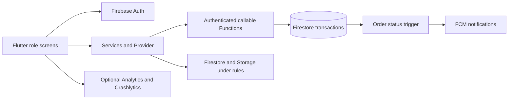

# Bloom & Bunch KL

Flutter application for bouquet ordering, florist preparation, rider delivery and store administration in Kuala Lumpur.

Customers browse ready bouquets or create/pre-order an arrangement. The backend calculates current prices, delivery fees and stock reservations. Florists prepare orders; approved riders accept jobs and confirm delivery. The owning customer then confirms receipt to complete the order. Customers can track orders, report issues and submit feedback after completion. Store staff review issues, manual payments and feedback.

## Supervisor feedback integration

Order tracking provides **Call Florist** and **Call Rider**. Rider contact is available only to the owning customer during an assigned active delivery and comes from the approved rider application's validated phone number. See [rider calling and acceptance checks](docs/rider-calling.md).

The missing worktree improvements have been adapted to main2's existing checkout and data model. Home search/filters keep customer bottom navigation; florist dashboard cards select the corresponding order filter; every role has logout in More. Riders use the same bottom NavigationBar pattern as customers, with Available jobs, Deliveries, History and More. Page headers show a left-side back arrow and left-aligned titles: Back pops a detail route, returns another workspace tab to Home, or stays disabled on Home when there is no previous route. Admin Rider history offers rider, status, MYT creation-date and open-issue filters. Live order lists use cursor pages of 20 records with Previous, Next, Refresh and retry controls.

New delivery transitions are `Out for Delivery → Awaiting Customer Confirmation → Completed`. Only the assigned rider confirms delivery, and only the owning customer confirms receipt. An open delivery issue pauses both actions. Store resolution records a response without completing the order. Issue history is retained under `orders/{id}/issues`; the customer timeline uses actual server activity in Malaysia time. Older Delivered records remain distinct and do not imply customer confirmation.

See [implementation and manual release guide](docs/main2-feedback-integration-2026-10-05.md) for the comparison, validation and the Firebase/device tasks to do manually.

## Current scope

The checked-in store policy is **demo mode**: orders are labelled as demonstrations and collect no payment or real delivery booking. Do not change it to live ordering until the store supplies its delivery area, operating calendar, fees, capacity and payment instructions. Online card payments/refunds are not implemented. Manual payment confirmation is server-controlled and staff-only.

## Toolchain and setup

Validated toolchain: Flutter 3.47.0 / Dart 3.13.0, Firebase CLI 15.30.0, Java 21. Functions target Node 22. Use `pubspec.lock` and `functions/package-lock.json`; CI installs the pinned toolchain.

```powershell
flutter pub get
npm ci --prefix functions
```

Create a local `.env` if absent (an empty file is sufficient for emulator/web tests). Native Maps configuration uses the existing `.env` keys. Only client-safe configuration belongs in Flutter assets. Signing material, service-account credentials and payment secrets must never be bundled or committed.

## Run a local demo

```powershell
firebase emulators:start --project demo-bloom --only auth,firestore,storage,functions
```

In a second terminal:

```powershell
$env:GCLOUD_PROJECT = 'demo-bloom'
$env:FIREBASE_AUTH_EMULATOR_HOST = '127.0.0.1:9099'
$env:FIRESTORE_EMULATOR_HOST = '127.0.0.1:18080'
node tool/seed_demo.cjs
flutter run -d chrome --dart-define=APP_ENV=demo
```

Demo users: `customer@demo.bloom.test`, `florist@demo.bloom.test`, `rider@demo.bloom.test`, `admin@demo.bloom.test`. Password: `DemoPass123!`. These are local seeded test accounts, not production credentials. Seeding refuses non-demo projects and non-loopback endpoints. Seed once into a fresh emulator session; reseeding resets fixture stock and is not a migration tool.

For an Android emulator, use `--dart-define=EMULATOR_HOST=10.0.2.2`. Custom ports use `AUTH_EMULATOR_PORT`, `FIRESTORE_EMULATOR_PORT`, `FUNCTIONS_EMULATOR_PORT` and `STORAGE_EMULATOR_PORT` Dart defines. Native demo builds also require demo native Firebase configuration; do not mix production `google-services.json` or Apple configuration with a demo build. Web is the simplest fully isolated demo target.

`APP_ENV=production` uses the existing Firebase registration. `APP_ENV=staging` requires a separate project and `FIREBASE_PROJECT_ID`, `FIREBASE_API_KEY`, `FIREBASE_APP_ID`, `FIREBASE_MESSAGING_SENDER_ID`, `FIREBASE_STORAGE_BUCKET`, and (web) `FIREBASE_AUTH_DOMAIN` defines, plus matching native platform configuration. Staging rejects the production project ID. No staging project is automatically provisioned.

## Checks

```powershell
flutter analyze --no-pub
flutter test --no-pub
firebase emulators:exec --project demo-bloom --only auth,firestore,storage "npm --prefix functions run test:emulators"
```

The strict emulator runner fails when a required emulator is missing or any tests skip. Backend tests cover transactions, stock races, authentication/deletion, ownership, support/feedback, quotes and rules.

For the real browser journey, start a ChromeDriver matching installed Chrome on port 4444, then:

```powershell
firebase emulators:exec --project demo-bloom --only auth,firestore,storage,functions "node tool/run_app_journey.cjs"
```

The connected browser suite uses demo accounts and actual UI controls for ready checkout, rider acceptance/delivery, customer receipt/feedback, customer problem reporting and admin resolution. It also covers custom recipe saving and mixed checkout, preserved Browse intent, florist dashboard shortcuts, paginated inventory, admin history at large text, related deliveries, concurrent favorites and approved-role switching. Backend tests supply additional race, authorization and negative-case coverage. This does not establish every screen or external integration. See the [role and acceptance review](docs/persona-acceptance-review-2026-10-05.md) for precise coverage and limits. CI runs both suites and a demo web build. Live Google OAuth, Maps, FCM/APNs, image pickers and real-device release behavior require the release checklist.

## Store rules

Edit `functions/store-policy.json`. Modes: `demo`, `manual`, or `toyyibpay_sandbox`. Current quotes charge only for items; delivery is free and the legacy `deliveryFeeSen` setting does not add a fee. Mixed ready/planned carts have two delivery groups. `serviceArea` is null when no coverage restriction is configured, or `{ "label": "approved area", "latitude": ..., "longitude": ..., "radiusKm": ... }`. Manual mode requires an area and positive daily capacity. ToyyibPay sandbox supports flower checkout with `serviceArea: null` and `dailyDeliveryCapacity: 0`, so these settings are not prerequisites for payment testing. A configured radial zone or positive capacity is still enforced.

ToyyibPay sandbox is implemented but disabled until server credentials and public callback/return URLs are configured. It uses one bill per checkout, server-verified settlement, unpaid-order fulfillment holds, and scheduled reservation expiry. See [sandbox setup and recovery limits](docs/toyyibpay-sandbox-setup.md). Live payments and automatic refunds are not implemented.

Deployment-specific `STORE_ORDER_MODE` overrides the checked-in policy mode. Set it to `toyyibpay_sandbox` together with `TOYYIBPAY_ENABLED=true` in the ignored backend environment file when activating sandbox checkout; keep the repository's default demo policy for isolated tests.

Calendar fields use Kuala Lumpur time: weekday numbers 0–6 (Sunday–Saturday), `openingHour`, `cutoffHour`, and ISO holiday dates. After-cutoff orders shift to the next operating date; preparation lead days are added after that date. Displayed dates are estimates of dispatch, not arrival guarantees. Capacity counts accepted delivery groups per date transactionally, conservatively retaining cancelled bookings until staff review. There is no automatic rider allocation or arrival SLA.

`quoteCheckout` returns a server-generated quote. `placeOrder` revalidates its fingerprint, address, price, coverage and capacity. Confirmed snapshots and fees survive retries and later catalogue/policy changes. Older quote-less requests remain accepted only in demo mode for compatibility; live manual mode requires a quote.

## Architecture and data



`lib/core` holds configuration, shared components, services and cart state. `lib/features` separates auth/customer/florist/rider/admin/support. `lib/models` holds snapshots. `functions/domain.js` validates order/material logic; `store-policy.js` calculates coverage/calendar/fees; `index.js` coordinates trusted writes.

Collections: users and private address/favourite subcollections; flowers; bouquets; orders; sanitized delivery_jobs; rider_applications; private notification records and deletion jobs. New order fields include quote/payment/fee/dispatch snapshots, bounded feedback and support maps. `orders/{id}/events` contains server-written status/timestamp activity; `orders/{id}/issues` retains report/resolution history. `delivery_capacity/{date}` is server-only. Events/issues inherit order ownership/staff/assigned-rider access and deny client writes. Customer deletion removes feedback/support and issue comments while historical status events remain without customer identifiers or free text. Deletion is blocked while delivery awaits customer receipt.

Home shows a bounded bouquet preview; Browse and staff inventory/catalogue use cursor pages with Next/Previous controls. Browse search applies to the displayed page. Category and fulfillment mode filters run before pagination, with compatibility checks for older product fields. Order/history lists use cursor pagination. Customer and florist workspace tabs initialize on demand. Florist dashboard summaries explicitly cover the latest 100 orders and a preview of 100 flowers. Profile with realistic data before adding a search service. See the [main2 smoothness fixes and validation](docs/smoothness-fixes-2026-10-05.md).

## Monitoring and release

Monitoring is disabled by default. `--dart-define=ENABLE_MONITORING=true` enables fixed usage events, native crash diagnostics and web error-type events; no raw address/phone/card-note payloads are sent. Web error events are not full crash reports. Validate reports in a staging project before enabling a public build. Apple symbol upload still needs Mac/Xcode setup and verification.

App Check is optional with `ENABLE_APP_CHECK=true` and web `APP_CHECK_WEB_SITE_KEY`. Register the correct platform providers first, test token issuance, then enable callable enforcement using server `ENFORCE_APP_CHECK=true`. Do not enable enforcement before compatible clients are ready. Database/Storage App Check enforcement is a separate console setting.

See [release checklist](docs/release-checklist.md), [user study kit](docs/user-study-kit.md), [implementation record](docs/main2-feedback-integration-2026-10-05.md) and [original review](docs/improvement-and-user-testing-plan-2026-09-21.md).
