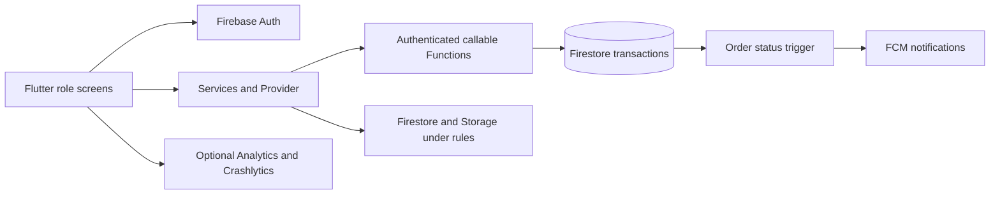
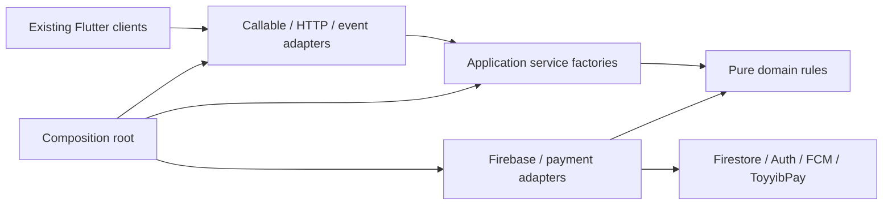
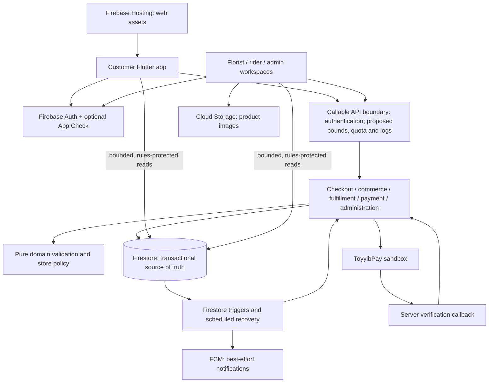
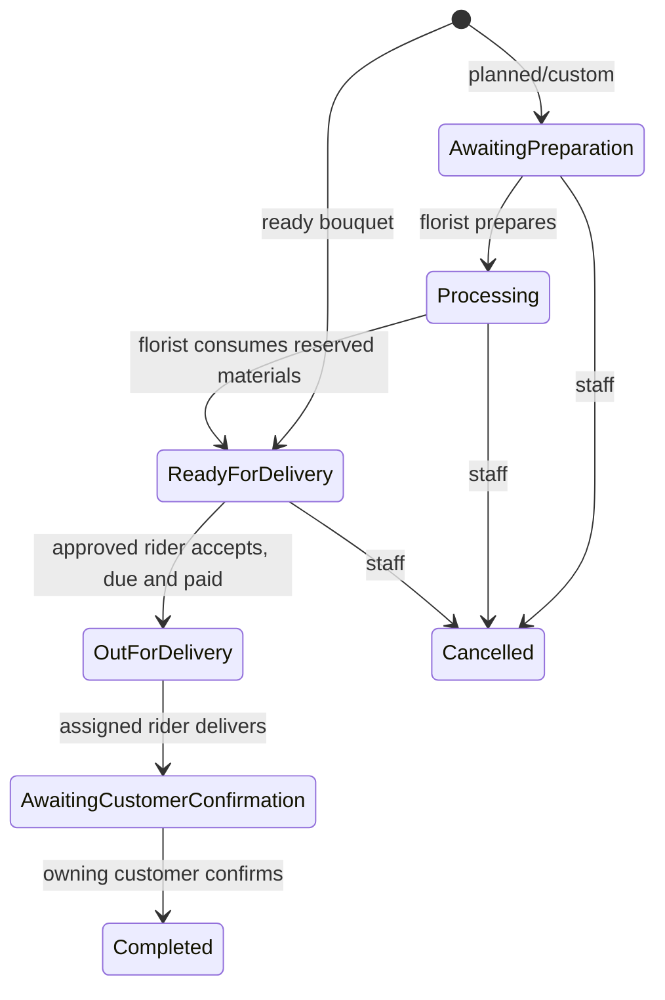

# Bloom & Bunch KL — Exhibition Study Guide

Prepared for the group on 3 November 2026.

## 1. Project overview

**Bloom & Bunch KL is a bouquet ordering and delivery management application connecting customers, florists, riders and administrators.**

Remember: **Choose → Order → Prepare → Deliver → Confirm.**

The project supports one Kuala Lumpur store. It brings customer purchases and the operational work after purchase into a shared system.

This guide describes repository features and documentation. It is not a verification of the deployed application. Use your officially registered FYP title in formal presentations if it differs from this guide's title.

## 2. Problem and objectives

Flower orders involve preferences, flower availability, gift messages, preparation, addresses and delivery coordination. When information is handled through separate messages or manual records, details can become inconsistent and handoffs difficult to track.

The project aims to:

1. Let customers browse, customise and order bouquets.
2. Support gifts, message cards and eligible delivery dates.
3. Help florists manage products, inventory and preparation.
4. Help approved riders accept, collect and deliver orders.
5. Give administrators oversight of people and store operations.
6. Validate important actions on the backend and record progress.

These are design objectives. Do not claim measured improvements in speed, errors or satisfaction without real study results.

## 3. Four roles

| Role | Main responsibilities |
| --- | --- |
| Customer | Browse, customise, manage favourites/cart/addresses, checkout, track, report issues, confirm receipt and give feedback |
| Florist | Manage products and flowers, prepare orders, check gifts/cards, mark ready and coordinate rider assignment |
| Rider | View eligible jobs, accept, confirm collection, access delivery details and confirm delivery |
| Administrator | Oversee orders, staff, riders, stock, issues, payment operations and store settings |

The selected workspace is navigation state. It does not grant permissions: backend checks use approved roles and ownership.

## 4. Customer features and journey

### Bouquet types

- **Ready-made:** existing bouquet product with ready stock. It still requires checking and packing.
- **Pre-order:** bouquet needing preparation lead time and an eligible selected date.
- **Custom:** arrangement configured through the bouquet builder and validated against supported recipe/material rules.

### Purchase journey

1. Sign in and browse bouquets.
2. Select a bouquet or configure a custom arrangement.
3. Choose optional add-on gifts.
4. Select an eligible delivery date where required.
5. Review the cart and configure an optional message card.
6. Choose a delivery address and recipient details.
7. Review a server-generated quote.
8. Submit checkout; the backend rechecks the order.
9. Follow preparation and delivery progress.
10. Confirm receipt and optionally give feedback.

### Gifts, cards and delivery groups

Add-ons are separate products with quantities and stock. Cards have a selected design, message and sender name. A card belongs to a delivery group rather than the bouquet recipe.

Items sharing a selected date can share a delivery group. Different dates remain separate deliveries while sharing one checkout, payment and combined receipt. Standalone add-on deliveries are rejected.

Signed-in carts synchronise between devices through account records. Revisions help detect competing edits. Cart prices are estimates until a backend quote is confirmed.

## 5. Complete order lifecycle

**Awaiting Preparation → Processing → Ready to ship → Rider assigned → Out for Delivery → Awaiting Customer Confirmation → Completed**

| Status | Meaning |
| --- | --- |
| Awaiting Preparation | Order waiting for florist action |
| Processing | Florist preparing the order |
| Ready to ship | Florist checked and packed it |
| Rider assigned | Rider accepted or staff assigned the job |
| Out for Delivery | Assigned rider confirmed collection |
| Awaiting Customer Confirmation | Rider confirmed delivery |
| Completed | Owning customer confirmed receipt |

The UI label Ready to ship retains the stored value `Ready for Delivery` for compatibility.

Important rules:

- Every new order needs packing confirmation, including ready-made bouquets.
- Accepting a job is separate from collecting it.
- Only the assigned rider confirms collection and delivery.
- Only the owning customer confirms receipt.
- Staff can assign or reassign before collection through controlled requests.
- Open issues, payment holds and future scheduled dates can block handoff.
- If no rider is eligible, the order stays ready; assignment is not automatic.
- Issue resolution records a response without automatically completing the order.
- Historical Delivered records do not prove customer confirmation.

## 6. Florist and inventory

The florist workspace includes order preparation, flowers, bouquets, add-ons and card designs. Preparation details show the gifts and message card to pack.

Ready bouquet stock is reserved at checkout and must not be deducted again during packing. Planned/custom material reservations differ from physical stock on hand: a reservation can represent a future sourcing commitment. Preparation must verify enough actual material before consumption.

Explain it as: “The florist checks both the arrangement and its gift details before releasing it to delivery.”

## 7. Rider and administrator operations

Riders need approval. Accepting an eligible job creates an assignment; confirming collection begins delivery. Destination and navigation/contact actions support the task.

Map/location behaviour depends on platform, configuration and permissions. Status tracking is distinct from continuous GPS tracking. Do not promise continuous background tracking without verifying it.

Administrators oversee orders, people, rider applications, inventory, issues and operational settings. Eligible rider directories do not establish that riders are online. Staff can coordinate assignment before collection; the application does not automatically optimise routes.

The approved unassigned rider queue currently includes street-address previews according to the architecture documentation, while excluding recipient phone, exact coordinates, customer identity and totals. Do not claim every destination detail is hidden until acceptance.

## 8. Scheduling and business policy

Store dates use **Asia/Kuala_Lumpur**, not the device's timezone.

Checked-in defaults are demo mode, all seven operating days, opening at 09:00, cutoff at 17:00, no listed holidays and a 90-day booking window. Service area is not configured and capacity is zero, meaning no positive configured limit. Current documented quotes use free delivery.

Saved administrator settings and deployment overrides can change effective behaviour. Defaults are not proof of the real store's policy.

Custom/pre-order bookings need at least one full operating day for preparation, represented by two operating-date advances. Before-cutoff Monday can allow Wednesday, with Tuesday for preparation, assuming open days and no longer product lead time. After cutoff, the starting date shifts first. Weekends count when configured as open days.

Selecting a date does not reserve stock or capacity. Checkout revalidates it. Requested dates and estimated dispatch dates are distinct; do not promise an exact arrival time. Future scheduled deliveries cannot be collected early.

## 9. Technology stack

| Technology | Purpose |
| --- | --- |
| Flutter and Dart | Application interface and client logic |
| Provider | Shared state including the cart |
| Firebase Authentication | Identity and sign-in |
| Cloud Firestore | Document database and live reads |
| Cloud Functions with Node.js | Trusted backend actions |
| Firebase Storage | Product images |
| Firebase Cloud Messaging | Configured push notifications |
| Google Maps/location packages | Maps, pins and location functionality |
| ToyyibPay adapter | Configured sandbox payment testing |
| Analytics/Crashlytics | Optional monitoring, disabled by default |

Flutter supports multiple platforms through a shared codebase. This does not establish that every platform release has been tested.

## 10. Architecture in plain language

```text
User → Flutter screens → Shared services/state
                            ├─ Authentication
                            ├─ Rules-protected database access
                            └─ Cloud Functions
                                 ↓
                            Business validation
                                 ↓
                            Transactions and external adapters
                                 ↓
                            Saved orders, activity and notifications
```

**Frontend:** screens, forms and interactions. **Backend:** trusted processing. **Database:** saved shared information.

When Place Order is pressed, the backend checks current prices, stock, dates, address and applicable rules before accepting it. A user's device cannot be trusted to supply an authoritative price or permission.

### Why these technologies?

Flutter allows reuse of components and services across workspaces/platforms. Firebase combines authentication, database, storage and functions without maintaining a traditional server. Tradeoffs include network dependency, usage costs, quotas and vendor coupling.

### Backend layers

- **Presentation:** callable/HTTP/event entry points.
- **Application:** checkout, fulfillment, payments, accounts and other use cases.
- **Domain:** validation, pricing, dates and eligibility rules.
- **Infrastructure:** Firebase/payment adapters.
- **Composition root:** connects configuration and dependencies.

Application services still contain Firestore-shaped operations. Do not claim the backend is entirely database independent.

## 11. Repository map

| Path | Responsibility |
| --- | --- |
| `lib/main.dart` | Startup and application composition |
| `lib/features/auth/` | Sign-in and role gate |
| `lib/features/customer/` | Shopping, builder, checkout and tracking |
| `lib/features/florist/` | Preparation, products and inventory |
| `lib/features/rider/` | Jobs and delivery |
| `lib/features/admin/` | Administrative workspaces |
| `lib/features/support/` | Issues, contacts and assignment |
| `lib/core/services/` | Shared service operations |
| `lib/core/providers/cart_provider.dart` | Cart state/recovery |
| `lib/models/` | Typed record representations |
| `functions/src/` | Backend layers and business operations |
| `functions/store-policy.json` | Default policy |
| `firestore.rules`, `storage.rules` | Client data/storage access |
| `firestore.indexes.json` | Query indexes |
| `test/`, `functions/test/`, `integration_test/` | Automated checks |
| `docs/` | Implementation, design and release notes |

## 12. Database and APIs

Firestore stores documents in collections. Related records use identifiers; there are no automatic SQL foreign keys or deletion cascades.

| Records | Purpose |
| --- | --- |
| `users` | Profiles and approved account/role state |
| User addresses, favourites and recipes | Private customer information |
| User cart, checkouts and receipts | Shared cart, retry records and purchase snapshots |
| `flowers`, `bouquets` | Catalogue and materials |
| `addons`, `card_designs` | Gift/card catalogues |
| `orders` | Purchase, address, date, payment and lifecycle snapshots |
| Order events/issues | Status and support history |
| Order assignment events | Staff assignment audit history |
| `delivery_jobs` | Restricted delivery queue projection |
| `delivery_capacity` | Backend capacity accounting |
| `payments` | Backend payment lifecycle |
| `rider_applications` | Approval and reviewed contact information |
| `store_settings/operations` | Saved policy overrides |

Snapshots preserve purchase details when catalogue data changes later.

Examples of callable functions:

- `deliveryAvailability`: eligible dates.
- `quoteCheckout`: server totals and groups.
- `saveCart`: revision-controlled cart changes.
- `placeOrder`: validated transactional checkout.
- `transitionOrder`: controlled lifecycle/assignment actions.
- `listAssignableRiders`: eligible rider directory.
- `saveAddress`: validated owned address.
- `reportOrderIssue`, `submitOrderFeedback`: support and feedback.
- `getAssignedRiderContact`: controlled contact lookup.
- `createToyyibpayPayment`, `checkToyyibpayPayment`: sandbox payment actions.

These use Firebase's callable protocol, not a custom REST API. Background work handles reconciliation, expiry, scheduled delivery release, notifications and deletion.

## 13. Reliability and security

**Transactions** coordinate related changes, helping prevent overselling and two riders claiming one delivery.

**Idempotency** means repeating a request does not create another business result. Checkout IDs/fingerprints support recovery after timeouts. A timeout does not prove the original request failed.

**Revisions** detect competing or stale cart/assignment edits.

**Authentication** proves identity; **authorisation** decides allowed actions. Rules protect client access. Backend handlers independently check roles, ownership, suspension and order state because privileged server writes bypass client rules.

Sensitive provider credentials stay on the backend. Optional App Check and monitoring require configuration; they are not enforced by default. Account deletion is guarded during active work and removes/anonymises applicable private records through a resumable process.

Lists load in batches. Browse search works over loaded results rather than a dedicated global full-text index. Bounded summaries and pagination do not prove maximum user capacity.

## 14. Payment and limitations

| Mode | Meaning |
| --- | --- |
| Demo | No real payment collection or real delivery booking |
| Manual | Authorised staff-controlled confirmation |
| ToyyibPay sandbox | Configured test bills, verification, payment holds and expiry |

The repository defaults to demo, but deployment overrides may differ. Check the exhibition build. A browser redirect is not proof of payment; backend verification matters. Ambiguous provider outcomes may require review.

Outside current scope: live online payments, automatic refunds, multi-store tenancy, automatic rider allocation and route optimisation. Maximum concurrency has not been established through load testing.

## 15. Testing and evidence

The repository includes Flutter tests, backend domain/emulator tests, security-rule tests, contract checks and a browser order journey. Documented areas include stock/rider races, retries, ownership, cart recovery, payments and delivery confirmation.

Historical documents contain different test counts. Do not combine them or claim they are today's results. No tests were rerun for this guide.

Mocked notifications do not prove phone delivery. Emulators do not prove production indexes. A web build does not prove all native device behaviour. User-study kits do not prove that user research occurred.

## 16. Exhibition demonstration

Aim for five to seven minutes:

1. Explain the problem and four users.
2. Browse a ready bouquet as customer.
3. Select a gift and message card.
4. Review address, quote and receipt.
5. As florist, prepare and mark ready.
6. As rider, accept, collect and deliver.
7. As customer, view progress and confirm receipt.
8. Show admin oversight and explain limitations.

Use an order eligible for today's dispatch; future scheduled orders are intentionally blocked from early collection.

Before presenting, verify role accounts, product stock, address/pin, rider approval, date, connectivity and payment mode. Run the complete journey on the actual setup. Prepare screenshots or a recording, charge devices and hide private data/secrets. If connectivity fails, use the backup and explain the backend dependency.

Suggested speaking split: one member covers problem/customer flow, another florist/inventory, another rider/workflow, and another architecture/security/testing if the group has four members. Adapt to real contributions. Everyone should know the basics and limitations.

## 17. Two-minute presentation script

Good morning. Our project is Bloom & Bunch KL, a bouquet ordering and delivery management application.

Flower orders involve product selection, customisation, stock, messages, preparation and delivery. Our project brings these activities into one connected workflow.

There are four users: customers, florists, riders and administrators. Customers choose ready-made bouquets, pre-order or customise arrangements. They can add gifts, personalise message cards and choose eligible dates.

The florist prepares and checks the order before marking it ready. An approved rider accepts or is assigned the delivery, confirms collection and confirms delivery. The customer confirms receipt to complete it.

Administrators oversee orders, people, inventory and store operations. We use Flutter and Dart for the application and Firebase for authentication, data and backend services. Important actions are validated on the server.

The current scope is one store. Our payment demonstration depends on the configured mode; live online payments and automatic refunds are outside scope. We will now show the journey from bouquet selection to completion.

## 18. Judge questions and suggested answers

### What is the project about?
It connects bouquet shopping, florist preparation, rider delivery and customer confirmation in one application.

### Why this project?
Flower ordering combines personalisation, stock and delivery coordination. Add your genuine motivation and stakeholder context.

### What makes it more than a shopping app?
It covers preparation, material handling, packing, rider assignment/collection, issues and customer receipt after purchase.

### What is your contribution?
The connected workflow with bouquet personalisation, scheduled deliveries and backend validation. Explain your actual individual contribution separately.

### Why Flutter?
Shared components and services reduce duplicated platform work. Native configuration and testing are still necessary.

### Why Firebase rather than MySQL?
Integrated managed authentication, document data and live updates suit this workflow. Relational databases offer different strengths; this is a project-specific choice.

### How do you stop users changing prices?
The backend resolves product prices and validates the quote rather than trusting the device total.

### What if two customers buy the last bouquet?
Transactional stock checks coordinate checkout. Catalogue viewing alone does not reserve it.

### What if two riders accept the same job?
Backend assignment checks and transactions prevent both independently claiming it.

### What happens if checkout times out?
The original request identity supports recovery/checking its outcome instead of blindly creating another checkout.

### Can a customer become admin by changing the screen?
No. Backend permissions rely on approved roles, not the selected workspace.

### Why separate acceptance and collection?
Acceptance identifies the responsible rider; collection confirms physical handoff and starts delivery.

### Why customer confirmation?
It separates the rider's delivery report from the customer's acknowledgement.

### What if no rider is available?
The order remains ready until an eligible rider accepts or staff assigns one.

### What if delivery has a problem?
The issue is recorded and relevant actions paused. Staff record a resolution without automatically completing the order.

### Can one checkout have different dates?
Yes. Different dates form separate delivery groups with a combined checkout/receipt.

### Why not immediate custom delivery?
Custom arrangements need preparation time, eligible dates and material checks.

### Are reservations the same as physical stock?
No. Planned reservations can represent future sourcing. Actual materials must be checked before consumption.

### Is payment real?
State the actual demonstration mode. The repository defaults to demo and includes configured manual/sandbox flows; live online payment is outside scope.

### How do you verify payment?
Through backend provider verification, not merely the return page or a screenshot.

### Is there AI?
The custom bouquet builder is a configuration feature. The current project is not presented as an AI system.

### Is tracking GPS or status?
Status follows database updates. Map/location behaviour is separate and depends on verified platform permissions/configuration.

### Does it work offline?
Authoritative checkout and shared workflow actions require the backend. We do not claim a complete offline mode.

### Is it secure?
It uses authentication, ownership/role checks, rules and backend validation. Avoid claiming absolute security.

### How many users can it support?
No maximum has been established through load testing. Quotas, contention, cost and physical store capacity matter.

### What did you test?
Flutter, backend/emulator, rules and browser journey checks exist. Quote only final results you can show. External integrations require separate verification.

### Did users evaluate it?
Give the real participant count, tasks, method and results. Do not treat a study plan as completed research.

### What methodology did you use?
Use the methodology and evidence from your submitted report. Code structure alone cannot establish Agile, Scrum or Waterfall.

### What was hardest?
Coordinating stock, safe retries and role transitions is a defensible technical example. Call it your personal challenge only if you worked on it.

### Future improvements?
Prioritise usability and release verification, then measured performance improvements. Multi-store support and route planning are possible future extensions.

### Did you use AI assistance?
Be honest about tools, your own responsibilities and how you reviewed/tested changes. Do not claim authorship or understanding you cannot demonstrate.

### What did each member do?
Describe actual contributions with evidence such as implementation, tests, research, commits or documentation. Agree on this before presenting.

## 19. Plain-language glossary

| Term | Meaning |
| --- | --- |
| API | Defined way for software parts to communicate |
| Authentication | Establishing who a user is |
| Authorisation | Deciding allowed actions |
| Transaction | Coordinated database changes |
| Race condition | Competing actions that can conflict |
| Idempotency | Repetition without an extra business result |
| Revision | Version used to detect stale edits |
| Snapshot | Details saved at a particular point |
| Emulator | Local test version of a service |
| Sandbox | Test environment |
| Pagination | Loading records in batches |
| Deployment | Publishing a build/backend |
| MVP | Limited product covering the core useful workflow |

## 20. Team facts to fill in

The repository cannot establish these facts:

- Official title, supervisor, members and actual individual contributions.
- Genuine client/stakeholder relationship.
- Submitted development methodology.
- Actual user-study method, participant count and findings.
- Final platform/build and latest test results.
- Effective demonstration environment/payment mode.
- Account access and fallback recording location; keep passwords outside public notes.

Avoid claims of production readiness, unlimited users, 100% security, AI, guaranteed arrivals or measured improvements without evidence.

When unsure: **“We have not verified that yet. What the current implementation does is…”**

## 21. Further reading

These relative links work when the guide remains in the repository's docs folder. The guide itself can be shared independently.

- [README](../README.md): overall scope and operation.
- [Cards, gifts and scheduling](addons-cards-scheduled-delivery-2026-10-21.md).
- [Florist/rider handoff](florist-rider-handoff.md).
- [Implemented backend architecture](backend-refactor.md).
- [Architecture design](system-architecture.md): includes explicitly proposed future work.
- [Database reference](database-schema.md): includes proposals and some older version references.
- [API reference](api-contract.md): handlers remain authoritative.
- [Release checklist](release-checklist.md).
- [User study kit](user-study-kit.md): preparation, not proof of completed research.

## 22. Last-minute memory card

**What:** bouquet ordering and operations for one store.  
**Who:** customer, florist, rider, administrator.  
**Flow:** choose → order → prepare → deliver → confirm.  
**Stack:** Flutter/Dart, Firebase, Node.js backend.  
**Strength:** connected personalisation and operational workflow.  
**Correctness:** server prices, transactions, request identity and permissions.  
**Limits:** verify payment mode; no live online payment/refunds, automatic allocation or proven maximum load.  
**Rule:** explain what you can demonstrate and support with evidence.

<!-- PROJECT_SOURCE_APPENDIX -->

# Part II — Current project source code

Snapshot created: 2026-11-03T13:04:52.600Z (UTC). This appendix reads current working files, including uncommitted edits, rather than exporting only the latest Git commit.

The study notes above remain intact. The following 384 text files cover application code, backend code, tests, tools, platform runner/build configuration, deployment/rules configuration and supporting documentation. Use your editor's search for a path or function name. This is a reading snapshot, not a runnable replacement for the repository.

## Export boundaries

Excluded: actual environment files, native Firebase registration files, signing material, private credentials, installed dependencies, compiled builds, generated plugin glue, logs, machine-local configuration, unrelated AI skills, old aggregate code exports and binary assets. Safe environment examples are included. Recognisable API keys/tokens are replaced with labelled placeholders; intentional local demo fixtures in source/tests remain. This export is for your group and is not a formal security audit. Source hashes below refer to original file bytes before redaction.

Binary asset paths are listed at the end; their image/font bytes cannot be usefully included as Markdown code. Documentation may describe historical results or proposed work: those are not current deployment guarantees.

## Recommended code-reading route

1. Start with `lib/main.dart` and the auth gate/router.
2. Follow customer catalogue → cart → checkout screens and their shared services.
3. Read backend checkout, domain pricing/store policy and Firestore rules.
4. Follow florist preparation and rider screens into backend fulfillment.
5. Read administration, payments and support alongside their tests.

## File index

- [.env.example](#source-1)
- [.firebaserc](#source-2)
- [.github/workflows/checks.yml](#source-3)
- [.gitignore](#source-4)
- [README.md](#source-5)
- [analysis_options.yaml](#source-6)
- [android/.gitignore](#source-7)
- [android/app/build.gradle.kts](#source-8)
- [android/app/src/debug/AndroidManifest.xml](#source-9)
- [android/app/src/main/AndroidManifest.xml](#source-10)
- [android/app/src/main/kotlin/com/example/bloom_and_bunch_kl/MainActivity.kt](#source-11)
- [android/app/src/main/res/drawable-v21/launch_background.xml](#source-12)
- [android/app/src/main/res/drawable/launch_background.xml](#source-13)
- [android/app/src/main/res/values-night/styles.xml](#source-14)
- [android/app/src/main/res/values/styles.xml](#source-15)
- [android/app/src/profile/AndroidManifest.xml](#source-16)
- [android/build.gradle.kts](#source-17)
- [android/gradle.properties](#source-18)
- [android/gradle/wrapper/gradle-wrapper.properties](#source-19)
- [android/settings.gradle.kts](#source-20)
- [audit/cart_regressions_test.dart](#source-21)
- [audit/smoothness_regressions_test.dart](#source-22)
- [build_web.sh](#source-23)
- [devtools_options.yaml](#source-24)
- [docs/addons-cards-scheduled-delivery-2026-10-21.md](#source-25)
- [docs/address-service-fix-2026-10-06.md](#source-26)
- [docs/admin-panel.md](#source-27)
- [docs/api-contract.md](#source-28)
- [docs/backend-refactor.md](#source-29)
- [docs/ci-browser-fix-2026-10-05.md](#source-30)
- [docs/ci-journey-selectors-2026-10-23.md](#source-31)
- [docs/customer-ui-address-fixes-2026-10-05.md](#source-32)
- [docs/database-schema.md](#source-33)
- [docs/delivery-checkout-improvements-2026-10-06.md](#source-34)
- [docs/delivery-security-review-2026-10-05.json](#source-35)
- [docs/firebase-feature-security-audit-2026-09-18.json](#source-36)
- [docs/firebase-security-audit.json](#source-37)
- [docs/florist-rider-handoff.md](#source-38)
- [docs/improvement-and-user-testing-plan-2026-09-21.md](#source-39)
- [docs/localhost-rider-map-2026-10-21.md](#source-40)
- [docs/main2-feedback-integration-2026-10-05.md](#source-41)
- [docs/navigation-consistency-2026-10-05.md](#source-42)
- [docs/persona-acceptance-review-2026-10-05.md](#source-43)
- [docs/production-operations.md](#source-44)
- [docs/project-feature-audit-2026-09-18.md](#source-45)
- [docs/project-feature-repairs-2026-09-18.md](#source-46)
- [docs/project-review-2026-09-10.md](#source-47)
- [docs/release-checklist.md](#source-48)
- [docs/repair-backend-schema.md](#source-49)
- [docs/rider-acceptance-check-2026-10-15.md](#source-50)
- [docs/rider-calling.md](#source-51)
- [docs/rider-contact-and-florist-status-2026-10-21.md](#source-52)
- [docs/rider-destinations-2026-10-21.md](#source-53)
- [docs/smoothness-audit-and-fix-plan-2026-10-05.md](#source-54)
- [docs/smoothness-fixes-2026-10-05.md](#source-55)
- [docs/stability-plan.md](#source-56)
- [docs/system-architecture.md](#source-57)
- [docs/toyyibpay-sandbox-activation-2026-10-16.md](#source-58)
- [docs/toyyibpay-sandbox-setup.md](#source-59)
- [docs/user-study-kit.md](#source-60)
- [firebase.integration.json](#source-61)
- [firebase.json](#source-62)
- [firestore.indexes.json](#source-63)
- [firestore.rules](#source-64)
- [functions/.env.example](#source-65)
- [functions/admin-operations.js](#source-66)
- [functions/commerce-handlers.js](#source-67)
- [functions/commerce.js](#source-68)
- [functions/delivery-preview.js](#source-69)
- [functions/domain.js](#source-70)
- [functions/index.js](#source-71)
- [functions/package-lock.json](#source-72)
- [functions/package.json](#source-73)
- [functions/payments.js](#source-74)
- [functions/rider-contact.js](#source-75)
- [functions/src/application/accounts.js](#source-76)
- [functions/src/application/addresses.js](#source-77)
- [functions/src/application/admin-events.js](#source-78)
- [functions/src/application/admin.js](#source-79)
- [functions/src/application/catalog.js](#source-80)
- [functions/src/application/checkout.js](#source-81)
- [functions/src/application/commerce.js](#source-82)
- [functions/src/application/fulfillment.js](#source-83)
- [functions/src/application/notifications.js](#source-84)
- [functions/src/application/payments.js](#source-85)
- [functions/src/application/rider-contact.js](#source-86)
- [functions/src/application/riders.js](#source-87)
- [functions/src/application/support.js](#source-88)
- [functions/src/create-backend.js](#source-89)
- [functions/src/domain/authorization.js](#source-90)
- [functions/src/domain/commerce.js](#source-91)
- [functions/src/domain/delivery-preview.js](#source-92)
- [functions/src/domain/delivery.js](#source-93)
- [functions/src/domain/domain.js](#source-94)
- [functions/src/domain/payments.js](#source-95)
- [functions/src/domain/rider-contact.js](#source-96)
- [functions/src/domain/store-policy.js](#source-97)
- [functions/src/infrastructure/firebase/checkout-reader.js](#source-98)
- [functions/src/infrastructure/firebase/delivery-jobs.js](#source-99)
- [functions/src/infrastructure/payments/toyyibpay.js](#source-100)
- [functions/src/presentation/callable.js](#source-101)
- [functions/src/presentation/register-functions.js](#source-102)
- [functions/store-policy.js](#source-103)
- [functions/store-policy.json](#source-104)
- [functions/test/admin_indexes.test.js](#source-105)
- [functions/test/admin_operations.test.js](#source-106)
- [functions/test/architecture.test.js](#source-107)
- [functions/test/audit/feature-regressions.cjs](#source-108)
- [functions/test/callable_boundary.test.js](#source-109)
- [functions/test/commerce.test.js](#source-110)
- [functions/test/commerce_integration.test.js](#source-111)
- [functions/test/customer_experience.test.js](#source-112)
- [functions/test/delivery_confirmation.test.js](#source-113)
- [functions/test/delivery_preview.test.js](#source-114)
- [functions/test/domain.test.js](#source-115)
- [functions/test/feature_regressions.test.js](#source-116)
- [functions/test/feature_writes.test.js](#source-117)
- [functions/test/fixtures/function-contract.json](#source-118)
- [functions/test/function_contract.test.js](#source-119)
- [functions/test/integration.test.js](#source-120)
- [functions/test/order_handoff.test.js](#source-121)
- [functions/test/payments.test.js](#source-122)
- [functions/test/require-emulators.cjs](#source-123)
- [functions/test/rider_contact.test.js](#source-124)
- [functions/test/rider_contact_readiness.test.js](#source-125)
- [functions/test/rider_delivery_queue.test.js](#source-126)
- [functions/test/rules.test.js](#source-127)
- [functions/test/storage.test.js](#source-128)
- [functions/test/store_policy.test.js](#source-129)
- [functions/test/toyyibpay.test.js](#source-130)
- [functions/toyyibpay.js](#source-131)
- [integration_test/driver.dart](#source-132)
- [integration_test/order_journey_test.dart](#source-133)
- [ios/.gitignore](#source-134)
- [ios/Flutter/AppFrameworkInfo.plist](#source-135)
- [ios/Flutter/Debug.xcconfig](#source-136)
- [ios/Flutter/Release.xcconfig](#source-137)
- [ios/Runner.xcodeproj/project.pbxproj](#source-138)
- [ios/Runner.xcodeproj/project.xcworkspace/contents.xcworkspacedata](#source-139)
- [ios/Runner.xcodeproj/project.xcworkspace/xcshareddata/IDEWorkspaceChecks.plist](#source-140)
- [ios/Runner.xcodeproj/project.xcworkspace/xcshareddata/WorkspaceSettings.xcsettings](#source-141)
- [ios/Runner.xcodeproj/xcshareddata/xcschemes/Runner.xcscheme](#source-142)
- [ios/Runner.xcworkspace/contents.xcworkspacedata](#source-143)
- [ios/Runner.xcworkspace/xcshareddata/IDEWorkspaceChecks.plist](#source-144)
- [ios/Runner.xcworkspace/xcshareddata/WorkspaceSettings.xcsettings](#source-145)
- [ios/Runner/AppDelegate.swift](#source-146)
- [ios/Runner/Assets.xcassets/AppIcon.appiconset/Contents.json](#source-147)
- [ios/Runner/Assets.xcassets/LaunchImage.imageset/Contents.json](#source-148)
- [ios/Runner/Assets.xcassets/LaunchImage.imageset/README.md](#source-149)
- [ios/Runner/Base.lproj/LaunchScreen.storyboard](#source-150)
- [ios/Runner/Base.lproj/Main.storyboard](#source-151)
- [ios/Runner/Info.plist](#source-152)
- [ios/Runner/Runner-Bridging-Header.h](#source-153)
- [ios/Runner/SceneDelegate.swift](#source-154)
- [ios/RunnerTests/RunnerTests.swift](#source-155)
- [lib/core/config/app_environment.dart](#source-156)
- [lib/core/config/web_configuration.dart](#source-157)
- [lib/core/constants/fulfillment_constants.dart](#source-158)
- [lib/core/constants/store_details.dart](#source-159)
- [lib/core/providers/cart_provider.dart](#source-160)
- [lib/core/services/address_geocoder.dart](#source-161)
- [lib/core/services/address_service.dart](#source-162)
- [lib/core/services/admin_service.dart](#source-163)
- [lib/core/services/app_monitoring.dart](#source-164)
- [lib/core/services/auth_service.dart](#source-165)
- [lib/core/services/bouquet_query.dart](#source-166)
- [lib/core/services/cart_sync_service.dart](#source-167)
- [lib/core/services/checkout_service.dart](#source-168)
- [lib/core/services/commerce_service.dart](#source-169)
- [lib/core/services/delivery_service.dart](#source-170)
- [lib/core/services/favourites_service.dart](#source-171)
- [lib/core/services/firestore_service.dart](#source-172)
- [lib/core/services/geocoder_native.dart](#source-173)
- [lib/core/services/geocoder_web.dart](#source-174)
- [lib/core/services/location_service.dart](#source-175)
- [lib/core/services/notification_service.dart](#source-176)
- [lib/core/services/order_service.dart](#source-177)
- [lib/core/services/payment_links.dart](#source-178)
- [lib/core/services/payment_service.dart](#source-179)
- [lib/core/services/product_image.dart](#source-180)
- [lib/core/services/reorder_service.dart](#source-181)
- [lib/core/services/rider_application_service.dart](#source-182)
- [lib/core/services/rider_contact_service.dart](#source-183)
- [lib/core/services/web_maps_stub.dart](#source-184)
- [lib/core/services/web_maps_web.dart](#source-185)
- [lib/core/theme/app_colors.dart](#source-186)
- [lib/core/theme/app_theme.dart](#source-187)
- [lib/core/theme/app_typography.dart](#source-188)
- [lib/core/utils/malaysia_time.dart](#source-189)
- [lib/core/utils/money.dart](#source-190)
- [lib/core/utils/rider_phone.dart](#source-191)
- [lib/core/widgets/action_confirmation.dart](#source-192)
- [lib/core/widgets/action_feedback.dart](#source-193)
- [lib/core/widgets/app_note.dart](#source-194)
- [lib/core/widgets/app_router.dart](#source-195)
- [lib/core/widgets/auth_cart_sync.dart](#source-196)
- [lib/core/widgets/delivery_progress.dart](#source-197)
- [lib/core/widgets/firestore_page.dart](#source-198)
- [lib/core/widgets/legal_documents.dart](#source-199)
- [lib/core/widgets/live_order_detail.dart](#source-200)
- [lib/core/widgets/load_more_on_scroll.dart](#source-201)
- [lib/core/widgets/logout_tile.dart](#source-202)
- [lib/core/widgets/map_access.dart](#source-203)
- [lib/core/widgets/notification_session.dart](#source-204)
- [lib/core/widgets/page_navigation.dart](#source-205)
- [lib/core/widgets/payment_link_session.dart](#source-206)
- [lib/core/widgets/pending_icon_button.dart](#source-207)
- [lib/core/widgets/phone_number_dialog.dart](#source-208)
- [lib/core/widgets/reauthentication_dialog.dart](#source-209)
- [lib/core/widgets/retry_stream_builder.dart](#source-210)
- [lib/features/admin/admin_activity_screen.dart](#source-211)
- [lib/features/admin/admin_dashboard_screen.dart](#source-212)
- [lib/features/admin/admin_inventory_alerts.dart](#source-213)
- [lib/features/admin/admin_layout.dart](#source-214)
- [lib/features/admin/admin_main_screen.dart](#source-215)
- [lib/features/admin/admin_navigation_scope.dart](#source-216)
- [lib/features/admin/admin_order_detail_screen.dart](#source-217)
- [lib/features/admin/admin_orders_screen.dart](#source-218)
- [lib/features/admin/admin_riders_screen.dart](#source-219)
- [lib/features/admin/admin_settings_screen.dart](#source-220)
- [lib/features/admin/admin_shell.dart](#source-221)
- [lib/features/admin/admin_staff_screen.dart](#source-222)
- [lib/features/admin/admin_theme.dart](#source-223)
- [lib/features/admin/admin_widgets.dart](#source-224)
- [lib/features/admin/admin_workspace_screen.dart](#source-225)
- [lib/features/admin/rider_contact_editor.dart](#source-226)
- [lib/features/admin/rider_history_screen.dart](#source-227)
- [lib/features/admin/staff_screen.dart](#source-228)
- [lib/features/admin/stock_screen.dart](#source-229)
- [lib/features/auth/screens/auth_gate.dart](#source-230)
- [lib/features/auth/screens/auth_welcome_screen.dart](#source-231)
- [lib/features/auth/screens/forgot_password_screen.dart](#source-232)
- [lib/features/auth/screens/login_screen.dart](#source-233)
- [lib/features/auth/screens/signup_email_screen.dart](#source-234)
- [lib/features/auth/widgets/auth_header_banner.dart](#source-235)
- [lib/features/auth/widgets/auth_scaffold.dart](#source-236)
- [lib/features/auth/widgets/pill_button.dart](#source-237)
- [lib/features/customer/screens/address_book_screen.dart](#source-238)
- [lib/features/customer/screens/become_rider_screen.dart](#source-239)
- [lib/features/customer/screens/bouquet_builder_screen.dart](#source-240)
- [lib/features/customer/screens/bouquet_catalogue_screen.dart](#source-241)
- [lib/features/customer/screens/bouquet_detail_screen.dart](#source-242)
- [lib/features/customer/screens/bouquet_options_screen.dart](#source-243)
- [lib/features/customer/screens/cart_screen.dart](#source-244)
- [lib/features/customer/screens/checkout_receipt_screen.dart](#source-245)
- [lib/features/customer/screens/checkout_screen.dart](#source-246)
- [lib/features/customer/screens/customer_home_screen.dart](#source-247)
- [lib/features/customer/screens/delivery_pin_screen.dart](#source-248)
- [lib/features/customer/screens/favourites_screen.dart](#source-249)
- [lib/features/customer/screens/flower_catalogue_screen.dart](#source-250)
- [lib/features/customer/screens/flower_detail_screen.dart](#source-251)
- [lib/features/customer/screens/main_navigation_screen.dart](#source-252)
- [lib/features/customer/screens/message_card_screen.dart](#source-253)
- [lib/features/customer/screens/order_history_screen.dart](#source-254)
- [lib/features/customer/screens/order_tracking_screen.dart](#source-255)
- [lib/features/customer/screens/payment_screen.dart](#source-256)
- [lib/features/customer/screens/profile_screen.dart](#source-257)
- [lib/features/customer/widgets/delivery_date_picker.dart](#source-258)
- [lib/features/customer/widgets/order_thumbnail.dart](#source-259)
- [lib/features/customer/widgets/product_components.dart](#source-260)
- [lib/features/florist/screens/commerce_catalogue_screen.dart](#source-261)
- [lib/features/florist/screens/florist_bouquets_tab.dart](#source-262)
- [lib/features/florist/screens/florist_dashboard_screen.dart](#source-263)
- [lib/features/florist/screens/florist_home_screen.dart](#source-264)
- [lib/features/florist/screens/florist_inventory_screen.dart](#source-265)
- [lib/features/florist/screens/florist_main_navigation_screen.dart](#source-266)
- [lib/features/florist/screens/florist_order_detail_screen.dart](#source-267)
- [lib/features/florist/screens/florist_orders_screen.dart](#source-268)
- [lib/features/florist/screens/florist_products_screen.dart](#source-269)
- [lib/features/florist/screens/florist_profile_screen.dart](#source-270)
- [lib/features/florist/screens/order_materials_panel.dart](#source-271)
- [lib/features/rider/screens/rider_available_job_screen.dart](#source-272)
- [lib/features/rider/screens/rider_home_screen.dart](#source-273)
- [lib/features/rider/screens/rider_order_detail_screen.dart](#source-274)
- [lib/features/rider/widgets/available_deliveries_list.dart](#source-275)
- [lib/features/rider/widgets/delivery_job_card.dart](#source-276)
- [lib/features/rider/widgets/rider_delivery_details.dart](#source-277)
- [lib/features/rider/widgets/rider_location_sharing.dart](#source-278)
- [lib/features/support/order_contact_actions.dart](#source-279)
- [lib/features/support/order_rider_assignment.dart](#source-280)
- [lib/features/support/order_support.dart](#source-281)
- [lib/features/support/store_operations_screen.dart](#source-282)
- [lib/firebase_options.dart](#source-283)
- [lib/main.dart](#source-284)
- [lib/models/bouquet_model.dart](#source-285)
- [lib/models/cart_item_model.dart](#source-286)
- [lib/models/delivery_job_model.dart](#source-287)
- [lib/models/flower_model.dart](#source-288)
- [lib/models/order_model.dart](#source-289)
- [lib/models/product_model.dart](#source-290)
- [lib/models/saved_address_model.dart](#source-291)
- [lib/models/user_model.dart](#source-292)
- [linux/.gitignore](#source-293)
- [linux/CMakeLists.txt](#source-294)
- [linux/flutter/CMakeLists.txt](#source-295)
- [linux/runner/CMakeLists.txt](#source-296)
- [linux/runner/main.cc](#source-297)
- [linux/runner/my_application.cc](#source-298)
- [linux/runner/my_application.h](#source-299)
- [macos/.gitignore](#source-300)
- [macos/Flutter/Flutter-Debug.xcconfig](#source-301)
- [macos/Flutter/Flutter-Release.xcconfig](#source-302)
- [macos/Runner.xcodeproj/project.pbxproj](#source-303)
- [macos/Runner.xcodeproj/project.xcworkspace/xcshareddata/IDEWorkspaceChecks.plist](#source-304)
- [macos/Runner.xcodeproj/xcshareddata/xcschemes/Runner.xcscheme](#source-305)
- [macos/Runner.xcworkspace/contents.xcworkspacedata](#source-306)
- [macos/Runner.xcworkspace/xcshareddata/IDEWorkspaceChecks.plist](#source-307)
- [macos/Runner/AppDelegate.swift](#source-308)
- [macos/Runner/Assets.xcassets/AppIcon.appiconset/Contents.json](#source-309)
- [macos/Runner/Base.lproj/MainMenu.xib](#source-310)
- [macos/Runner/Configs/AppInfo.xcconfig](#source-311)
- [macos/Runner/Configs/Debug.xcconfig](#source-312)
- [macos/Runner/Configs/Release.xcconfig](#source-313)
- [macos/Runner/Configs/Warnings.xcconfig](#source-314)
- [macos/Runner/DebugProfile.entitlements](#source-315)
- [macos/Runner/Info.plist](#source-316)
- [macos/Runner/MainFlutterWindow.swift](#source-317)
- [macos/Runner/Release.entitlements](#source-318)
- [macos/RunnerTests/RunnerTests.swift](#source-319)
- [public/index.html](#source-320)
- [pubspec.lock](#source-321)
- [pubspec.yaml](#source-322)
- [storage.rules](#source-323)
- [test/address_form_test.dart](#source-324)
- [test/admin_layout_test.dart](#source-325)
- [test/admin_panel_test.dart](#source-326)
- [test/admin_shell_test.dart](#source-327)
- [test/auth_navigation_test.dart](#source-328)
- [test/auth_scope_test.dart](#source-329)
- [test/available_deliveries_test.dart](#source-330)
- [test/cart_limits_test.dart](#source-331)
- [test/checkout_recovery_test.dart](#source-332)
- [test/checkout_summary_test.dart](#source-333)
- [test/commerce_cart_test.dart](#source-334)
- [test/commerce_inventory_layout_test.dart](#source-335)
- [test/continuous_lists_test.dart](#source-336)
- [test/customer_cart_layout_test.dart](#source-337)
- [test/delivery_feedback_test.dart](#source-338)
- [test/feature_flows_test.dart](#source-339)
- [test/feature_repairs_test.dart](#source-340)
- [test/flower_inventory_layout_test.dart](#source-341)
- [test/map_access_test.dart](#source-342)
- [test/order_contact_test.dart](#source-343)
- [test/order_handoff_test.dart](#source-344)
- [test/page_navigation_test.dart](#source-345)
- [test/payment_links_test.dart](#source-346)
- [test/payment_test.dart](#source-347)
- [test/phone_number_dialog_test.dart](#source-348)
- [test/product_components_test.dart](#source-349)
- [test/rider_contact_readiness_test.dart](#source-350)
- [test/rider_delivery_map_test.dart](#source-351)
- [test/rider_destination_test.dart](#source-352)
- [test/smoothness_regressions_test.dart](#source-353)
- [test/web_configuration_test.dart](#source-354)
- [test/widget_test.dart](#source-355)
- [tool/build_ios.sh](#source-356)
- [tool/build_web.ps1](#source-357)
- [tool/configure_ios.cjs](#source-358)
- [tool/configure_web.cjs](#source-359)
- [tool/payment-return.test.cjs](#source-360)
- [tool/run_app_journey.cjs](#source-361)
- [tool/seed_demo.cjs](#source-362)
- [tool/test/web_maps_loader.test.cjs](#source-363)
- [tool/validate_release.cjs](#source-364)
- [tool/validate_web_build.cjs](#source-365)
- [web/firebase-messaging-sw.js](#source-366)
- [web/index.html](#source-367)
- [web/manifest.json](#source-368)
- [web/payment-return.html](#source-369)
- [web/payment-return.js](#source-370)
- [windows/.gitignore](#source-371)
- [windows/CMakeLists.txt](#source-372)
- [windows/flutter/CMakeLists.txt](#source-373)
- [windows/runner/CMakeLists.txt](#source-374)
- [windows/runner/Runner.rc](#source-375)
- [windows/runner/flutter_window.cpp](#source-376)
- [windows/runner/flutter_window.h](#source-377)
- [windows/runner/main.cpp](#source-378)
- [windows/runner/resource.h](#source-379)
- [windows/runner/runner.exe.manifest](#source-380)
- [windows/runner/utils.cpp](#source-381)
- [windows/runner/utils.h](#source-382)
- [windows/runner/win32_window.cpp](#source-383)
- [windows/runner/win32_window.h](#source-384)

<a id="source-1"></a>

### .env.example

Original SHA-256: `d868e95794b27905b4f8d6f1730bbd3f568217d7af159cdd8417e4a061299739`

```text
# Firebase client API keys from this project's app configurations.
FIREBASE_API_KEY_ANDROID=
FIREBASE_API_KEY_IOS=
FIREBASE_API_KEY_MACOS=
FIREBASE_API_KEY_WINDOWS=
FIREBASE_API_KEY_WEB=
MAPS_API_KEY_ANDROID=
MAPS_API_KEY_WEB=
MAPS_API_KEY_IOS=
# Optional custom web push public VAPID key.
FCM_VAPID_KEY_WEB=
# Optional overrides; configure_ios reads these from GoogleService-Info.plist.
GOOGLE_CLIENT_ID_IOS=
GOOGLE_REVERSED_CLIENT_ID_IOS=
```

<a id="source-2"></a>

### .firebaserc

Original SHA-256: `38e1a17d2c658ffb946384bc9de850853ff0abe00c848f1490fa8fde713d42da`

```text
{
  "projects": {
    "default": "bloom-and-bunch-kl"
  }
}
```

<a id="source-3"></a>

### .github/workflows/checks.yml

Original SHA-256: `d52bf7975891822550be9dc40d03ab4d679f98646e5f929be494a576b76b43bf`

```yaml
name: Project checks
on:
  pull_request:
  push:
    branches: [main, main2, master]
permissions:
  contents: read
jobs:
  checks:
    runs-on: ubuntu-24.04
    timeout-minutes: 25
    steps:
      - uses: actions/checkout@v5
      - uses: actions/setup-node@v5
        with:
          node-version: '22'
          cache: npm
          cache-dependency-path: functions/package-lock.json
      - uses: actions/setup-java@v5
        with:
          distribution: temurin
          java-version: '21'
      - uses: subosito/flutter-action@v2
        with:
          flutter-version: '3.47.0'
          cache: true
      - run: touch .env && flutter pub get
      - run: flutter analyze --no-pub
      - run: flutter test --no-pub
      - run: npm ci --prefix functions
      - run: npm install --global firebase-tools@15.30.0
      - run: firebase emulators:exec --project demo-bloom --only auth,firestore,storage "npm --prefix functions run test:emulators"
      - run: flutter build web --dart-define=APP_ENV=demo
      - uses: actions/upload-artifact@v6
        with:
          name: demo-web-build
          path: build/web
  app-journey:
    runs-on: ubuntu-24.04
    timeout-minutes: 30
    steps:
      - uses: actions/checkout@v5
      - uses: actions/setup-node@v5
        with:
          node-version: '22'
      - uses: actions/setup-java@v5
        with:
          distribution: temurin
          java-version: '21'
      - uses: subosito/flutter-action@v2
        with:
          flutter-version: '3.47.0'
          cache: true
      - uses: browser-actions/setup-chrome@v2
        id: browser
        with:
          chrome-version: stable
          install-chromedriver: true
      - run: touch .env && flutter pub get && npm ci --prefix functions
      - run: npm install --global firebase-tools@15.30.0
      - name: Start matching browser driver
        env:
          CHROME_EXECUTABLE: ${{ steps.browser.outputs.chrome-path }}
          CHROMEDRIVER_EXECUTABLE: ${{ steps.browser.outputs.chromedriver-path }}
        run: |
          "$CHROME_EXECUTABLE" --version
          "$CHROMEDRIVER_EXECUTABLE" --version
          chrome_major=$("$CHROME_EXECUTABLE" --version | grep -oE '[0-9]+' | head -1)
          driver_major=$("$CHROMEDRIVER_EXECUTABLE" --version | grep -oE '[0-9]+' | head -1)
          if [[ -z "$chrome_major" || "$chrome_major" != "$driver_major" ]]; then
            echo "Chrome and ChromeDriver versions do not match."
            exit 1
          fi
          "$CHROMEDRIVER_EXECUTABLE" --port=4444 > /tmp/chromedriver.log 2>&1 &
          for attempt in {1..30}; do
            if curl --fail --silent http://127.0.0.1:4444/status > /dev/null; then
              exit 0
            fi
            sleep 1
          done
          cat /tmp/chromedriver.log
          exit 1
      - name: Run authenticated app journeys
        env:
          CHROME_EXECUTABLE: ${{ steps.browser.outputs.chrome-path }}
        run: |
          set -o pipefail
          firebase emulators:exec --project demo-bloom --only auth,firestore,storage,functions "node tool/run_app_journey.cjs" 2>&1 | tee app-journey.log
      - uses: actions/upload-artifact@v6
        if: failure()
        with:
          name: journey-debug-logs
          path: |
            *-debug.log
            app-journey.log
            /tmp/chromedriver.log
```

<a id="source-4"></a>

### .gitignore

Original SHA-256: `4fb2aef3466a7bd59f2038afdce5cd84f708f1e83b0a455e5dd61287bfce7f7d`

```text
# Miscellaneous
*.class
*.log
*.pyc
*.swp
.DS_Store
.atom/
.build/
.buildlog/
.history
.svn/
.swiftpm/
migrate_working_dir/

# IntelliJ related
*.iml
*.ipr
*.iws
.idea/

# The .vscode folder contains launch configuration and tasks you configure in
# VS Code which you may wish to be included in version control, so this line
# is commented out by default.
#.vscode/

# Flutter/Dart/Pub related
**/doc/api/
**/ios/Flutter/.last_build_id
.dart_tool/
.flutter-plugins-dependencies
.pub-cache/
.pub/
/build/
/coverage/

# Symbolication related
app.*.symbols

# Obfuscation related
app.*.map.json

# Android Studio will place build artifacts here
/android/app/debug
/android/app/profile
/android/app/release

# Environment secrets
.env
.env.*
!.env.example
android/app/google-services.json
ios/Runner/GoogleService-Info.plist

repomix*
repomix-output.xml
# Widget Preview related
.widget_preview/

# Local backend tooling
functions/node_modules/
functions/.npm-cache/
.firebase-local/
.firebase/
.firebase-audit/
*-debug.log

ios/Flutter/AppKeys.xcconfig

# Release signing credentials
android/key.properties
*.jks
*.keystore

# Temporary files and dependencies
/tmp/
node_modules/
```

<a id="source-5"></a>

### README.md

Original SHA-256: `4d6511e4656683335107e064a2830f530c1eef2c1efcbae965dcb3f4889b7253`

````markdown
# Bloom & Bunch KL

Flutter application for bouquet ordering, florist preparation, rider delivery and store administration in Kuala Lumpur.

Customers browse ready bouquets or create/pre-order an arrangement. The backend calculates current prices, delivery fees and stock reservations. Florists prepare orders; approved riders accept jobs and confirm delivery. The owning customer then confirms receipt to complete the order. Customers can track orders, report issues and submit feedback after completion. Store staff review issues, manual payments and feedback.

Bouquet selection now offers separate add-on products and requires a delivery
date for pre-order/custom arrangements. Message cards are configured in the cart,
which syncs between signed-in devices. Same-date items share a delivery; every
checkout has one payment and combined receipt. Staff manage Add-ons and Cards in
Products. See [feature details and rollout](docs/addons-cards-scheduled-delivery-2026-10-21.md).

Rider delivery cards show the buyer's order address, pickup and timing; accepted deliveries
prioritise the full address and navigation/contact actions. See
[rider destination data and rollout](docs/rider-destinations-2026-10-21.md).

## Supervisor feedback integration

Order tracking provides **Call Florist** and **Call Rider**. Rider contact is available only to the owning customer during an assigned active delivery and comes from the approved rider application's validated phone number. See [rider calling and acceptance checks](docs/rider-calling.md).

The missing worktree improvements have been adapted to main2's existing checkout and data model. Home search/filters keep customer bottom navigation; florist dashboard cards select the corresponding order filter; every role has logout in More. Riders use the same bottom NavigationBar pattern as customers, with Available jobs, Deliveries, History and More. Page headers show a left-side back arrow and left-aligned titles: Back pops a detail route, returns another workspace tab to Home, or stays disabled on Home when there is no previous route. Admin Rider history offers rider, status, MYT creation-date and open-issue filters. Lists load additional records automatically as users scroll, with centered reload and retry controls.

Delivery transitions are `Awaiting Preparation → Processing → Ready to ship → Rider assigned → Out for Delivery → Awaiting Customer Confirmation → Completed`. Ready to ship retains the stored `Ready for Delivery` value. All new orders require florist packing confirmation, including ready-made bouquets. Riders can accept, or florist/admin can assign and reassign before collection. Only the assigned rider confirms collection and delivery, and only the owning customer confirms receipt. An open delivery issue pauses handoff and completion. Store resolution records a response without completing the order. Issue history is retained under `orders/{id}/issues`; the customer timeline uses actual server activity in Malaysia time. Older Delivered records remain distinct and do not imply customer confirmation. See [florist packing, live rider availability and assignment rollout](docs/florist-rider-handoff.md).

See [implementation and manual release guide](docs/main2-feedback-integration-2026-10-05.md) for the comparison, validation and the Firebase/device tasks to do manually.

## Current scope

The checked-in store policy is **demo mode**: orders are labelled as demonstrations and collect no payment or real delivery booking. Do not change it to live ordering until the store supplies its delivery area, operating calendar, fees, capacity and payment instructions. Online card payments/refunds are not implemented. Manual payment confirmation is server-controlled and staff-only.

## Toolchain and setup

Validated toolchain: Flutter 3.47.0 / Dart 3.13.0, Firebase CLI 15.30.0, Java 21. Functions target Node 22. Use `pubspec.lock` and `functions/package-lock.json`; CI installs the pinned toolchain.

```powershell
flutter pub get
npm ci --prefix functions
```

Create a local `.env` if absent (an empty file is sufficient for emulator/web tests). Native Maps configuration uses the existing `.env` keys. Only client-safe configuration belongs in Flutter assets. Signing material, service-account credentials and payment secrets must never be bundled or committed.

To run against the configured Firebase project locally, ensure the existing
`.env` contains `FIREBASE_API_KEY_WEB` and `MAPS_API_KEY_WEB`, then run:

```powershell
flutter run -d edge
```

Chrome uses `flutter run -d chrome`. Debug web runs automatically load `.env`;
no `--dart-define-from-file` flag is required. Explicit build defines take
precedence over `.env`. Release web builds continue to use `tool/build_web.ps1`
on Windows or `build_web.sh` on Unix.

## Run a local demo

```powershell
firebase emulators:start --project demo-bloom --only auth,firestore,storage,functions
```

In a second terminal:

```powershell
$env:GCLOUD_PROJECT = 'demo-bloom'
$env:FIREBASE_AUTH_EMULATOR_HOST = '127.0.0.1:9099'
$env:FIRESTORE_EMULATOR_HOST = '127.0.0.1:18080'
node tool/seed_demo.cjs
flutter run -d chrome --dart-define=APP_ENV=demo
```

Demo users: `customer@demo.bloom.test`, `florist@demo.bloom.test`, `rider@demo.bloom.test`, `admin@demo.bloom.test`. Password: `DemoPass123!`. These are local seeded test accounts, not production credentials. Seeding refuses non-demo projects and non-loopback endpoints. Seed once into a fresh emulator session; reseeding resets fixture stock and is not a migration tool.

For an Android emulator, use `--dart-define=EMULATOR_HOST=10.0.2.2`. Custom ports use `AUTH_EMULATOR_PORT`, `FIRESTORE_EMULATOR_PORT`, `FUNCTIONS_EMULATOR_PORT` and `STORAGE_EMULATOR_PORT` Dart defines. Native demo builds also require demo native Firebase configuration; do not mix production `google-services.json` or Apple configuration with a demo build. Web is the simplest fully isolated demo target.

`APP_ENV=production` uses the existing Firebase registration. `APP_ENV=staging` requires a separate project and `FIREBASE_PROJECT_ID`, `FIREBASE_API_KEY`, `FIREBASE_APP_ID`, `FIREBASE_MESSAGING_SENDER_ID`, `FIREBASE_STORAGE_BUCKET`, and (web) `FIREBASE_AUTH_DOMAIN` defines, plus matching native platform configuration. Staging rejects the production project ID. No staging project is automatically provisioned.

## Checks

```powershell
flutter analyze --no-pub
flutter test --no-pub
firebase emulators:exec --project demo-bloom --only auth,firestore,storage "npm --prefix functions run test:emulators"
```

The strict emulator runner fails when a required emulator is missing or any tests skip. Backend tests cover transactions, stock races, authentication/deletion, ownership, support/feedback, quotes and rules.

For the real browser journey, start a ChromeDriver matching installed Chrome on port 4444, then:

```powershell
firebase emulators:exec --project demo-bloom --only auth,firestore,storage,functions "node tool/run_app_journey.cjs"
```

The connected browser suite uses demo accounts and actual UI controls for ready checkout, rider acceptance/delivery, customer receipt/feedback, customer problem reporting and admin resolution. It also covers custom recipe saving and mixed checkout, preserved Browse intent, florist dashboard shortcuts, paginated inventory, admin history at large text, related deliveries, concurrent favorites and approved-role switching. Backend tests supply additional race, authorization and negative-case coverage. This does not establish every screen or external integration. See the [role and acceptance review](docs/persona-acceptance-review-2026-10-05.md) for precise coverage and limits. CI runs both suites and a demo web build. Live Google OAuth, Maps, FCM/APNs, image pickers and real-device release behavior require the release checklist.

## Store rules

Edit `functions/store-policy.json`. Modes: `demo`, `manual`, or `toyyibpay_sandbox`. Quotes charge for bouquets, separate add-ons and selected cards; delivery is free and the legacy `deliveryFeeSen` setting does not add a fee. Items sharing a selected date form one delivery group, including mixed ready/planned bouquets. Different dates share one checkout/payment but remain separate deliveries. `serviceArea` is null when no coverage restriction is configured, or `{ "label": "approved area", "latitude": ..., "longitude": ..., "radiusKm": ... }`. Manual mode requires an area and positive daily capacity. ToyyibPay sandbox supports flower checkout with `serviceArea: null` and `dailyDeliveryCapacity: 0`, so these settings are not prerequisites for payment testing. A configured radial zone or positive capacity is still enforced.

ToyyibPay sandbox is implemented but disabled until server credentials and public callback/return URLs are configured. It uses one bill per checkout, server-verified settlement, unpaid-order fulfillment holds, and scheduled reservation expiry. See [sandbox setup and recovery limits](docs/toyyibpay-sandbox-setup.md). Live payments and automatic refunds are not implemented.

Deployment-specific `STORE_ORDER_MODE` overrides the checked-in policy mode. Set it to `toyyibpay_sandbox` together with `TOYYIBPAY_ENABLED=true` in the ignored backend environment file when activating sandbox checkout; keep the repository's default demo policy for isolated tests.

Calendar fields use Kuala Lumpur time: weekday numbers 0–6 (Sunday–Saturday), `openingHour`, `cutoffHour`, and ISO holiday dates. The default calendar opens every day, including Saturday and Sunday; weekends also count toward preparation time. Saved Admin store operations settings override these defaults: enable all seven operating days there if an existing store still has a weekday-only calendar. Explicit closed dates and configured capacity still apply. After-cutoff orders shift to the next operating date; preparation lead days are added after that date. Displayed dates are estimates of dispatch, not arrival guarantees. Capacity counts accepted delivery groups per date transactionally, conservatively retaining cancelled bookings until staff review. There is no automatic rider allocation or arrival SLA.

Pre-order/custom checkout requires a customer-selected date with at least one
full operating day for preparation (two operating-date advances). The default
booking window is 90 calendar days, editable in Admin store operations. The server
rechecks date availability at checkout and prevents early rider collection of
scheduled orders. Requested dates are recorded separately from dispatch estimates.

`quoteCheckout` returns a server-generated quote. `placeOrder` revalidates its fingerprint, address, price, coverage and capacity. Confirmed snapshots and fees survive retries and later catalogue/policy changes. Older quote-less requests remain accepted only in demo mode for compatibility; live manual mode requires a quote.

## Architecture and data



`lib/core` holds configuration, shared components, services and cart state. `lib/features` separates auth/customer/florist/rider/admin/support. `lib/models` holds snapshots. The backend now separates pure rules in `functions/src/domain`, injected service factories in `src/application`, Firebase/payment adapters in `src/infrastructure`, and endpoint registration in `src/presentation`. `functions/index.js` initializes Firebase and delegates to the composition root. Existing root module paths remain compatibility facades. See the [backend refactor, folder structure and preserved contracts](docs/backend-refactor.md).

Collections: users and private address/favourite subcollections; flowers; bouquets; orders; sanitized delivery_jobs; rider_applications; private notification records and deletion jobs. New order fields include quote/payment/fee/dispatch snapshots, bounded feedback and support maps. `orders/{id}/events` contains server-written status/timestamp activity; `orders/{id}/issues` retains report/resolution history. `delivery_capacity/{date}` is server-only. Events/issues inherit order ownership/staff/assigned-rider access and deny client writes. Customer deletion removes feedback/support and issue comments while historical status events remain without customer identifiers or free text. Deletion is blocked while delivery awaits customer receipt.

Commerce adds `addons`, `card_designs`, owner-only `users/{uid}/cart/current`, and
`users/{uid}/receipts/{checkoutId}`. Catalogue, cart and receipt writes are handled
by callables/transactions. Order schema v3 includes message-card and scheduled-date
snapshots. Account deletion also removes shared carts/receipts and card text.

Home shows a bounded bouquet preview; Browse, staff inventory/catalogue and order/history lists expand as users scroll. Firestore lists grow their live query window in batches; server-backed lists retain cursor batching internally. Browse search applies to loaded results, and short filtered lists automatically load further records. Category and fulfillment mode filters run before fetching, with compatibility checks for older product fields. Customer and florist workspace tabs initialize on demand. Florist dashboard summaries explicitly cover the latest 100 orders and a preview of 100 flowers. Profile with realistic data before adding a search service. See the [main2 smoothness fixes and validation](docs/smoothness-fixes-2026-10-05.md).

## Monitoring and release

Monitoring is disabled by default. `--dart-define=ENABLE_MONITORING=true` enables fixed usage events, native crash diagnostics and web error-type events; no raw address/phone/card-note payloads are sent. Web error events are not full crash reports. Validate reports in a staging project before enabling a public build. Apple symbol upload still needs Mac/Xcode setup and verification.

App Check is optional with `ENABLE_APP_CHECK=true` and web `APP_CHECK_WEB_SITE_KEY`. Register the correct platform providers first, test token issuance, then enable callable enforcement using server `ENFORCE_APP_CHECK=true`. Do not enable enforcement before compatible clients are ready. Database/Storage App Check enforcement is a separate console setting.

See [release checklist](docs/release-checklist.md), [user study kit](docs/user-study-kit.md), [implementation record](docs/main2-feedback-integration-2026-10-05.md) and [original review](docs/improvement-and-user-testing-plan-2026-09-21.md).
````

<a id="source-6"></a>

### analysis_options.yaml

Original SHA-256: `75d2d8ff5435cb5d89f2f36d0ae95dcefe6cbb6906f80616094905a33d957e50`

```yaml
# This file configures the analyzer, which statically analyzes Dart code to
# check for errors, warnings, and lints.
#
# The issues identified by the analyzer are surfaced in the UI of Dart-enabled
# IDEs (https://dart.dev/tools#ides-and-editors). The analyzer can also be
# invoked from the command line by running `flutter analyze`.

# The following line activates a set of recommended lints for Flutter apps,
# packages, and plugins designed to encourage good coding practices.
analyzer:
  exclude:
    - build/**
    - android/**
    - ios/**
    - web/**
    - windows/**
    - macos/**
    - linux/**
include: package:flutter_lints/flutter.yaml

linter:
  # The lint rules applied to this project can be customized in the
  # section below to disable rules from the `package:flutter_lints/flutter.yaml`
  # included above or to enable additional rules. A list of all available lints
  # and their documentation is published at https://dart.dev/lints.
  #
  # Instead of disabling a lint rule for the entire project in the
  # section below, it can also be suppressed for a single line of code
  # or a specific dart file by using the `// ignore: name_of_lint` and
  # `// ignore_for_file: name_of_lint` syntax on the line or in the file
  # producing the lint.
  rules:
    # avoid_print: false  # Uncomment to disable the `avoid_print` rule
    # prefer_single_quotes: true  # Uncomment to enable the `prefer_single_quotes` rule

# Additional information about this file can be found at
# https://dart.dev/guides/language/analysis-options
```

<a id="source-7"></a>

### android/.gitignore

Original SHA-256: `c9af75dbc2c8aa867476a09426c80b178c4aeed8b9393ae48503eedfa3273d71`

```text
gradle-wrapper.jar
/.gradle
/captures/
/gradlew
/gradlew.bat
/local.properties
GeneratedPluginRegistrant.java
.cxx/

# Remember to never publicly share your keystore.
# See https://flutter.dev/to/reference-keystore
key.properties
**/*.keystore
**/*.jks
```

<a id="source-8"></a>

### android/app/build.gradle.kts

Original SHA-256: `11c4af3a7d1d5f03f987b00ce4b2c6b7365abf1727315ba9b5ab50e786619cd7`

```kotlin
import java.util.Properties
import java.io.FileInputStream

val envProperties = Properties()
val envFile = rootProject.file("../.env")
if (envFile.exists()) {
    envProperties.load(FileInputStream(envFile))
}

plugins {
    id("com.android.application")
    // START: FlutterFire Configuration
    id("com.google.gms.google-services")
    id("com.google.firebase.crashlytics")
    // END: FlutterFire Configuration
    // The Flutter Gradle Plugin must be applied after the Android and Kotlin Gradle plugins.
    id("dev.flutter.flutter-gradle-plugin")
}

val signingProperties = Properties()
val signingFile = rootProject.file("key.properties")
if (signingFile.exists()) signingFile.inputStream().use { signingProperties.load(it) }
val releaseRequested = gradle.startParameter.taskNames.any { it.contains("Release", ignoreCase = true) }
if (releaseRequested) {
    require(signingFile.exists()) { "Release signing requires android/key.properties. See docs/release-checklist.md." }
    listOf("storeFile", "storePassword", "keyAlias", "keyPassword").forEach {
        require(!signingProperties.getProperty(it).isNullOrBlank()) { "Missing release signing property: $it" }
    }
}

android {
    namespace = "com.example.bloom_and_bunch_kl"
    compileSdk = flutter.compileSdkVersion
    ndkVersion = flutter.ndkVersion

    compileOptions {
        sourceCompatibility = JavaVersion.VERSION_17
        targetCompatibility = JavaVersion.VERSION_17
    }

    defaultConfig {
        // TODO: Specify your own unique Application ID (https://developer.android.com/studio/build/application-id.html).
        manifestPlaceholders["mapsApiKey"] = envProperties.getProperty("MAPS_API_KEY_ANDROID", "")
        applicationId = "com.example.bloom_and_bunch_kl"
        // You can update the following values to match your application needs.
        // For more information, see: https://flutter.dev/to/review-gradle-config.
        minSdk = flutter.minSdkVersion
        targetSdk = flutter.targetSdkVersion
        versionCode = flutter.versionCode
        versionName = flutter.versionName
    }

    signingConfigs {
        create("release") {
            if (signingFile.exists()) {
                storeFile = rootProject.file(signingProperties.getProperty("storeFile"))
                storePassword = signingProperties.getProperty("storePassword")
                keyAlias = signingProperties.getProperty("keyAlias")
                keyPassword = signingProperties.getProperty("keyPassword")
            }
        }
    }
    buildTypes {
        release {
            // A distribution build must use the owner-provided release key.
            signingConfig = signingConfigs.getByName("release")
        }
    }
}

kotlin {
    compilerOptions {
        jvmTarget = org.jetbrains.kotlin.gradle.dsl.JvmTarget.JVM_17
    }
}

flutter {
    source = "../.."
}
```

<a id="source-9"></a>

### android/app/src/debug/AndroidManifest.xml

Original SHA-256: `b01a4541a8144c15bc617bab7eb267c99fa1476368fbbda5a12cdbf4e316a34c`

```xml
<manifest xmlns:android="http://schemas.android.com/apk/res/android">
    <!-- The INTERNET permission is required for development. Specifically,
         the Flutter tool needs it to communicate with the running application
         to allow setting breakpoints, to provide hot reload, etc.
    -->
    <uses-permission android:name="android.permission.INTERNET"/>
</manifest>
```

<a id="source-10"></a>

### android/app/src/main/AndroidManifest.xml

Original SHA-256: `7533ba51bbc57e623a1c630960a9342a873516819f157b609f6309fd249db3e3`

```xml
<manifest xmlns:android="http://schemas.android.com/apk/res/android">
    <uses-permission android:name="android.permission.ACCESS_FINE_LOCATION"/>
    <uses-permission android:name="android.permission.ACCESS_COARSE_LOCATION"/>

    <uses-permission android:name="android.permission.INTERNET"/>
    <application
        android:label="bloombunch"
        android:name="${applicationName}"
        android:icon="@mipmap/ic_launcher">

        <meta-data android:name="firebase_crashlytics_collection_enabled" android:value="false" />
        <meta-data android:name="firebase_analytics_collection_enabled" android:value="false" />
        <!-- API KEY -->
        <meta-data
            android:name="com.google.android.geo.API_KEY"
            android:value="${mapsApiKey}" />
        <activity
            android:name=".MainActivity"
            android:exported="true"
            android:launchMode="singleTop"
            android:taskAffinity=""
            android:theme="@style/LaunchTheme"
            android:configChanges="orientation|keyboardHidden|keyboard|screenSize|smallestScreenSize|locale|layoutDirection|fontScale|screenLayout|density|uiMode"
            android:hardwareAccelerated="true"
            android:windowSoftInputMode="adjustResize">
            <!-- Specifies an Android theme to apply to this Activity as soon as
                 the Android process has started. This theme is visible to the user
                 while the Flutter UI initializes. After that, this theme continues
                 to determine the Window background behind the Flutter UI. -->
            <meta-data
              android:name="io.flutter.embedding.android.NormalTheme"
              android:resource="@style/NormalTheme"
              />
            <intent-filter>
                <action android:name="android.intent.action.MAIN"/>
                <category android:name="android.intent.category.LAUNCHER"/>
            </intent-filter>
            <meta-data android:name="flutter_deeplinking_enabled" android:value="false" />
            <intent-filter>
                <action android:name="android.intent.action.VIEW" />
                <category android:name="android.intent.category.DEFAULT" />
                <category android:name="android.intent.category.BROWSABLE" />
                <data android:scheme="bloombunch" android:host="payment-return" />
            </intent-filter>
        </activity>
        <!-- Don't delete the meta-data below.
             This is used by the Flutter tool to generate GeneratedPluginRegistrant.java -->
        <meta-data
            android:name="flutterEmbedding"
            android:value="2" />
    </application>
    <!-- Required to query activities that can process text, see:
         https://developer.android.com/training/package-visibility and
         https://developer.android.com/reference/android/content/Intent#ACTION_PROCESS_TEXT.

         In particular, this is used by the Flutter engine in io.flutter.plugin.text.ProcessTextPlugin. -->
    <queries>
        <intent>
            <action android:name="android.intent.action.PROCESS_TEXT"/>
            <data android:mimeType="text/plain"/>
        </intent>
    </queries>
</manifest>
```

<a id="source-11"></a>

### android/app/src/main/kotlin/com/example/bloom_and_bunch_kl/MainActivity.kt

Original SHA-256: `3a7d619b5aff1be4f7fde663a933dbc3ae3eec68acb70007b97c5820fb894ce8`

```kotlin
package com.example.bloom_and_bunch_kl

import io.flutter.embedding.android.FlutterActivity

class MainActivity : FlutterActivity()
```

<a id="source-12"></a>

### android/app/src/main/res/drawable-v21/launch_background.xml

Original SHA-256: `dca312ec77de83e43ef70a825c299b51451247286c29167d62f19165750b8793`

```xml
<?xml version="1.0" encoding="utf-8"?>
<!-- Modify this file to customize your launch splash screen -->
<layer-list xmlns:android="http://schemas.android.com/apk/res/android">
    <item android:drawable="?android:colorBackground" />

    <!-- You can insert your own image assets here -->
    <!-- <item>
        <bitmap
            android:gravity="center"
            android:src="@mipmap/launch_image" />
    </item> -->
</layer-list>
```

<a id="source-13"></a>

### android/app/src/main/res/drawable/launch_background.xml

Original SHA-256: `2df60e2cfbee873ce2858088cf003e6b93498f2f568476da437610467ea1a9d7`

```xml
<?xml version="1.0" encoding="utf-8"?>
<!-- Modify this file to customize your launch splash screen -->
<layer-list xmlns:android="http://schemas.android.com/apk/res/android">
    <item android:drawable="@android:color/white" />

    <!-- You can insert your own image assets here -->
    <!-- <item>
        <bitmap
            android:gravity="center"
            android:src="@mipmap/launch_image" />
    </item> -->
</layer-list>
```

<a id="source-14"></a>

### android/app/src/main/res/values-night/styles.xml

Original SHA-256: `ea763597dc1a84c8034251caee98d7753e0fbf57340ffc94677427de4b537516`

```xml
<?xml version="1.0" encoding="utf-8"?>
<resources>
    <!-- Theme applied to the Android Window while the process is starting when the OS's Dark Mode setting is on -->
    <style name="LaunchTheme" parent="@android:style/Theme.Black.NoTitleBar">
        <!-- Show a splash screen on the activity. Automatically removed when
             the Flutter engine draws its first frame -->
        <item name="android:windowBackground">@drawable/launch_background</item>
    </style>
    <!-- Theme applied to the Android Window as soon as the process has started.
         This theme determines the color of the Android Window while your
         Flutter UI initializes, as well as behind your Flutter UI while its
         running.

         This Theme is only used starting with V2 of Flutter's Android embedding. -->
    <style name="NormalTheme" parent="@android:style/Theme.Black.NoTitleBar">
        <item name="android:windowBackground">?android:colorBackground</item>
    </style>
</resources>
```

<a id="source-15"></a>

### android/app/src/main/res/values/styles.xml

Original SHA-256: `cca15a99b59380a548bf6a890f7ca5380ee509b1f9bbb2f5f9ec3589fa25c2f7`

```xml
<?xml version="1.0" encoding="utf-8"?>
<resources>
    <!-- Theme applied to the Android Window while the process is starting when the OS's Dark Mode setting is off -->
    <style name="LaunchTheme" parent="@android:style/Theme.Light.NoTitleBar">
        <!-- Show a splash screen on the activity. Automatically removed when
             the Flutter engine draws its first frame -->
        <item name="android:windowBackground">@drawable/launch_background</item>
    </style>
    <!-- Theme applied to the Android Window as soon as the process has started.
         This theme determines the color of the Android Window while your
         Flutter UI initializes, as well as behind your Flutter UI while its
         running.

         This Theme is only used starting with V2 of Flutter's Android embedding. -->
    <style name="NormalTheme" parent="@android:style/Theme.Light.NoTitleBar">
        <item name="android:windowBackground">?android:colorBackground</item>
    </style>
</resources>
```

<a id="source-16"></a>

### android/app/src/profile/AndroidManifest.xml

Original SHA-256: `b01a4541a8144c15bc617bab7eb267c99fa1476368fbbda5a12cdbf4e316a34c`

```xml
<manifest xmlns:android="http://schemas.android.com/apk/res/android">
    <!-- The INTERNET permission is required for development. Specifically,
         the Flutter tool needs it to communicate with the running application
         to allow setting breakpoints, to provide hot reload, etc.
    -->
    <uses-permission android:name="android.permission.INTERNET"/>
</manifest>
```

<a id="source-17"></a>

### android/build.gradle.kts

Original SHA-256: `218f400e3fff31c9c986a2535dfb974560e1b4d33cc27b7c1fee96a2b7e44454`

```kotlin
allprojects {
    repositories {
        google()
        mavenCentral()
    }
}

val newBuildDir: Directory =
    rootProject.layout.buildDirectory
        .dir("../../build")
        .get()
rootProject.layout.buildDirectory.value(newBuildDir)

subprojects {
    val newSubprojectBuildDir: Directory = newBuildDir.dir(project.name)
    project.layout.buildDirectory.value(newSubprojectBuildDir)
}
subprojects {
    project.evaluationDependsOn(":app")
}

tasks.register<Delete>("clean") {
    delete(rootProject.layout.buildDirectory)
}
```

<a id="source-18"></a>

### android/gradle.properties

Original SHA-256: `fa456fcd9046b20bc6b6c318f77988f91a49b436d69ac06d5c302fe2a762cfb8`

```text
org.gradle.jvmargs=-Xmx8G -XX:MaxMetaspaceSize=4G -XX:ReservedCodeCacheSize=512m -XX:+HeapDumpOnOutOfMemoryError
android.useAndroidX=true
# This newDsl flag was added by the Flutter template
android.newDsl=false
# Flutter 3.47+ and AGP 9 use Kotlin support built into the Android plugin.
android.builtInKotlin=true
```

<a id="source-19"></a>

### android/gradle/wrapper/gradle-wrapper.properties

Original SHA-256: `670071e5c2e25f86f82bc9db52f5d8d7c8f7b1788686a9d4c967753c69d9a2b4`

```text
distributionBase=GRADLE_USER_HOME
distributionPath=wrapper/dists
zipStoreBase=GRADLE_USER_HOME
zipStorePath=wrapper/dists
distributionUrl=https\://services.gradle.org/distributions/gradle-9.1.0-all.zip
```

<a id="source-20"></a>

### android/settings.gradle.kts

Original SHA-256: `7409ba87ae2564f2cd264ee2e32026c03f13639ebe86b10ba90d177075c6c180`

```kotlin
pluginManagement {
    val flutterSdkPath =
        run {
            val properties = java.util.Properties()
            file("local.properties").inputStream().use { properties.load(it) }
            val flutterSdkPath = properties.getProperty("flutter.sdk")
            require(flutterSdkPath != null) { "flutter.sdk not set in local.properties" }
            flutterSdkPath
        }

    includeBuild("$flutterSdkPath/packages/flutter_tools/gradle")

    repositories {
        google()
        mavenCentral()
        gradlePluginPortal()
    }
}

plugins {
    id("dev.flutter.flutter-plugin-loader") version "1.0.0"
    id("com.android.application") version "9.0.1" apply false
    // START: FlutterFire Configuration
    id("com.google.gms.google-services") version("4.5.0") apply false
    id("com.google.firebase.crashlytics") version "3.0.8" apply false
    // END: FlutterFire Configuration
    id("org.jetbrains.kotlin.android") version "2.3.20" apply false
}

include(":app")
```

<a id="source-21"></a>

### audit/cart_regressions_test.dart

Original SHA-256: `0a90f6de05f4fef018f596001b92c4cf043169d2cb33a3ecfa23f852a8196562`

```dart
// Audit-only regression checks for unfixed defects. Run explicitly.
import 'package:bloom_and_bunch_kl/core/providers/cart_provider.dart';
import 'package:flutter_test/flutter_test.dart';

void main() {
  test('REGRESSION: cart respects backend maximum 20 per line', () {
    final cart = CartProvider();
    cart.addReadyMadeItem(
      bouquetId: 'audit',
      name: 'Audit',
      imageUrl: '',
      price: 50,
    );
    for (var i = 0; i < 20; i++) {
      cart.incrementQuantity(cart.items.single.id);
    }
    expect(cart.items.single.quantity, lessThanOrEqualTo(20));
  });
  test('REGRESSION: cart respects backend maximum 20 distinct lines', () {
    final cart = CartProvider();
    for (var i = 0; i < 21; i++) {
      cart.addReadyMadeItem(
        bouquetId: 'audit_$i',
        name: 'Audit',
        imageUrl: '',
        price: 50,
      );
    }
    expect(cart.items.length, lessThanOrEqualTo(20));
  });
}
```

<a id="source-22"></a>

### audit/smoothness_regressions_test.dart

Original SHA-256: `d086020a46703e34774f4fefd241647ad1f8fde46749dcbc92524110006c4b46`

```dart
// Original regressions now run in CI.
import '../test/smoothness_regressions_test.dart' as regressions;
void main() => regressions.main();
```

<a id="source-23"></a>

### build_web.sh

Original SHA-256: `23f3f7aed82a91fb7c64d5adac43f6abf41cd1a65ea3e2ae5d28894983b75ffc`

```bash
#!/bin/bash
set -euo pipefail

if [[ ! -f .env ]]; then
  echo "Missing .env file." >&2
  exit 1
fi

set -a
source .env
set +a

: "${FIREBASE_API_KEY_WEB:?FIREBASE_API_KEY_WEB is missing from .env}"
: "${MAPS_API_KEY_WEB:?MAPS_API_KEY_WEB is missing from .env}"

flutter build web \
  --dart-define="FIREBASE_API_KEY_WEB=${FIREBASE_API_KEY_WEB}" \
  --dart-define="FCM_VAPID_KEY_WEB=${FCM_VAPID_KEY_WEB:-}"

node tool/configure_web.cjs
node tool/validate_web_build.cjs
```

<a id="source-24"></a>

### devtools_options.yaml

Original SHA-256: `99119330d774616e9e8f151014c3b3cf90a5e858fe4b8e459544eeda2acbc0e8`

```yaml
description: This file stores settings for Dart & Flutter DevTools.
documentation: https://docs.flutter.dev/tools/devtools/extensions#configure-extension-enablement-states
extensions:
```

<a id="source-25"></a>

### docs/addons-cards-scheduled-delivery-2026-10-21.md

Original SHA-256: `6a44a070b4735dba727145521c3e402c2325d58921952fb2d233b367339e0dd1`

```markdown
# Add-ons, message cards, scheduled delivery and account carts

Implemented in the shared Flutter customer app and trusted Firebase backend.

## Customer flow

Home quick selection and bouquet details open **Make it extra special**. Browse
and favourites use bouquet details. The custom builder and saved-recipe/reorder
flows use the same options screen. The options remain a draft until confirmed.

Customers choose optional add-ons. Pre-order and custom bouquets require an
available delivery date before entering the cart. Ready bouquets can use the
earliest dispatch or select a later delivery date. Selected add-ons enter as
separate cart lines, with their own quantities and inventory. Compatible product
lines merge only when their fulfillment mode and selected date match. Different
dates never merge.

The cart offers one optional message card per delivery group: design dropdown,
message, editable sender name and live preview. The sender defaults to the signed
in account name. Recipient details remain in the address book. Designs, images
and prices are staff-configured; a zero-priced design is supported. Messages are
limited to 1,000 characters and sender names to 120 characters. Cards are not
part of the bouquet recipe. The custom builder no longer collects a card note.
Historical order notes are retained for compatibility.

Editing a delivery date moves its add-ons and card together. Combining two
deliveries with cards requires the customer to remove one card first. Removing
the last bouquet in a delivery offers to remove its add-ons or move them to
another delivery. Standalone add-on deliveries are rejected by the backend.

## Calendar

The backend applies the existing store opening days, holiday list, cutoff and
daily capacity in Asia/Kuala_Lumpur. The default calendar includes all seven days,
so Saturday and Sunday are bookable and count toward preparation. Existing saved
Admin store operations calendars override the defaults; select all seven days
there to enable weekends for an already-configured store.
Pre-orders have a minimum lead of two
operating-date advances: ordering on Monday before cutoff leaves
Tuesday for preparation and enables Wednesday onward. Longer product lead times
are honoured. Custom bouquets use the same two-operating-day minimum. After
cutoff, the starting date moves to the next operating date before adding lead.

The default booking window is 90 calendar days and can be changed to 7–365 days
in Admin > Store operations. Selecting a date is not a stock/capacity hold.
Checkout revalidates dates, catalogue prices, card availability, stock, area and
capacity. Requested delivery dates and estimated dispatch fields are stored
separately; the existing notice does not promise an arrival time.

## Backend and staff

- `addons`: published products with category, image URL, price, stock and edit
  revision. Stock is deducted transactionally and restored once on unpaid expiry
  or applicable staff cancellation. Stock changes invalidate stale staff edits.
- `card_designs`: published designs with name, image URL, configurable price and
  edit revision. Quotes resolve all prices from these records.
- `users/{uid}/cart/current`: owner-readable, server-written cart, cards, pending
  request and revision. Updates compare revisions and use mutation IDs for safe
  retries. Conflicts require review/reload; prices in drafts are estimates.
- `users/{uid}/receipts/{checkoutId}`: immutable combined checkout snapshot of
  all line items, delivery groups, card charges and total. The receipt screen
  obtains current payment state from the customer's order stream.
- `orders`: schema version 3 adds delivery-group key, scheduled date and card
  snapshot. Items sharing a selected date are grouped into one operational order.
  Preparation requirements are calculated for that group's planned bouquets.
- Existing sandbox payment processing uses one bill for every order in the
  checkout. Manual payment confirmation also covers the linked active groups.

Products > Add-ons and Products > Cards are available to florist/admin staff.
Products can be published/hidden without deleting historical snapshots. Catalogue
rows show product photos. The editor previews existing and selected images and
offers Choose/Replace/Remove image. Selected JPEG, PNG or WebP files up to 5 MB
upload on Save into `addons/` or `card_designs/` in Firebase Storage. Upload errors
keep the form open; a successful upload is reused if saving the catalogue record
needs a retry. An expandable image-link field remains available for existing
HTTPS URLs. Storage rules restrict uploads to active florist/admin staff.
Both catalogues use the flower-management card layout, spacing, typography and
bottom-right Add button. Add-on cards have bounded stock steppers; both types
have Published switches and edit buttons. Quick changes use the existing staff
callable with revision checks, and disable controls while saving.
Demo seeding includes teddy, chocolates, topper and four card designs,
with empty image URLs. Demo fixtures are never seeded to the live project.

Florist/admin details show the selected card and add-ons to pack. Scheduled
orders are omitted from rider availability and cannot be accepted early, even
through a direct callable. A 15-minute scheduler publishes due ready deliveries;
the rider callable checks the date independently. The existing payment hold
continues to apply.

Account deletion removes cart/receipt subcollections and clears saved card
messages/signatures from historical orders. Existing replay fingerprints and
legacy pending checkout requests remain supported. The server clears a matching
account cart both when creating an order and when recovering an already-created
checkout.

## Verification and rollout

Validation includes all 147 Flutter tests, 114 passing backend tests with
zero emulator skips, strict Flutter analysis and a successful demo web build.
The authenticated browser journey exercises the real calendar, teddy add-on,
card design/message/signature, account-cart restoration in a second provider,
mixed checkout and combined receipt. A focused regression also checks that
switching accounts during a pending write cannot copy the old checkout.
Local emulator data is disposable `demo-bloom`
data; the verified emulator edition is Standard. The production database edition
could not be read because the Firebase CLI session requires reauthentication.
The installed Node 24 runtime ran the local backend tests; deployed Functions
continue to target the project's configured Node 22 runtime.

Deploy Functions, Firestore and Storage rules with the matching Flutter release. Publish
the actual add-on products/card designs and images in the staff catalogue. Check
store holidays, cutoff, booking window and capacity before allowing bookings.
Older clients that do not choose dates cannot submit new planned orders; existing
confirmed orders and exact checkout retries continue to work. Validate the final
Android/iOS release against the deployed backend; device installation and live
deployment are separate from the local implementation checks.
```

<a id="source-26"></a>

### docs/address-service-fix-2026-10-06.md

Original SHA-256: `4c3e8ba282c4bb792e3004316145b063b93cd87b526a74968a1275a5785a6771`

````markdown
# Address saving and review-pin label — 6 October 2026

The confirmed-pin control now says **Review delivery pin**, without the required star. The unconfirmed control remains **Confirm delivery pin ***; the other required field labels and optional delivery note are unchanged.

The three address-form tests passed, including saving retries with the same document ID and preserving the typed full address when a pin changes. The browser journey expectation was updated to the new label. The unchanged backend was previously verified by 53 strict emulator tests and four authenticated browser journeys, including real callable address creation.

## Live service blocker

The read-only Functions inventory on 6 October still contains only placeOrder, reviewRiderApplication, saveRecipe, syncDeliveryJobs and transitionOrder. The address service callables are absent from bloom-and-bunch-kl in asia-southeast1. This matches the screenshot's service-unavailable message.

The prepared limited release creates only saveAddress, setDefaultAddress and deleteAddress from the existing tested orders codebase. These authenticate the caller, use the caller's UID for the address path, validate address data, and coordinate default changes transactionally. Direct client writes are not substituted for these transactions.

```powershell
firebase deploy --only functions:orders:saveAddress,functions:orders:setDefaultAddress,functions:orders:deleteAddress --project bloom-and-bunch-kl
```

Deployment authorization is pending because production release was previously deferred. No changes to other Functions, Hosting, security rules, indexes or business/payment policy are included in this limited release. The installed app can use newly deployed callables without a rebuild; seeing the updated pin button requires rebuilding/installing the updated client.

After release, verify the three functions are active in asia-southeast1 and reject unauthenticated calls. An authenticated save should then be retried using the user's existing app and account. Do not create fabricated production users or addresses to claim end-to-end live success.

The previously missing quoteCheckout and other callables remain a separate coordinated backend release requirement; publishing these three address functions alone does not claim the entire live checkout is ready.
````

<a id="source-27"></a>

### docs/admin-panel.md

Original SHA-256: `afb98b5ba8cf8f06969acc2393d5eb5b6fe5d66b27f5aebd456ef3291bb1b791`

````markdown
# Integrated administration

The Flutter admin workspace follows the default SB Admin 2 design: a blue
gradient sidebar, white top toolbar, pale grey content area and white cards.
It uses the existing customer, florist, delivery, payment and support workflows.

## Admin layout

The desktop sidebar is 224px wide, with a 104px collapsed mode and a 70px top
toolbar. Below 1000px, or with text scaling above 1.5, navigation moves into a
menu drawer. Sidebar groups expose Dashboard; Orders, Inventory, Stock alerts
and Support & feedback; Riders and Staff; Alerts, Activity history and Settings.
The toolbar provides alerts and the admin profile/preferences/settings menu.

Workspace content is centred within a 1488px content area, with 24px desktop
padding and 16px mobile padding. The overview retains all eleven metrics:
three payment cards and eight operational cards, in up to three and four
columns respectively. Smaller widths use three, two or one column; larger
text increases the shared card height to keep labels and values readable.
Nunito is bundled in `assets/fonts/nunito/` with its SIL Open Font License;
the admin typography does not depend on downloading fonts at runtime.

Admin destinations use hash URLs such as `/#/admin/orders` and
`/#/admin/orders/detail?id=ORDER_ID`. Query parameters support dashboard order
shortcuts (`status`, `payment`, `mode`, `dateField`, `from`, `to`), rider tabs
(`tab=0`, `1`, `2`) and flower inventory (`tab=flowers`). Settings profile,
preferences and store policy, and staff creation, also have direct URLs.
Browser Back/Forward updates the workspace. Each visited section stays mounted,
preserving local filters, pagination and scroll when returning from details or
another section. Local filter edits are not encoded into the URL; refreshing
restores only the filters supplied by that URL. The initial app route always
goes through AuthGate, which checks the signed-in user's role and suspension
before creating the admin router. Unknown admin routes fall back to Dashboard.

Rider and staff directories use compact desktop tables and spaced mobile cards.
Delivery history shares the Riders workspace header, wraps its filters, and
shows a compact summary with full IDs available through Copy and the complete
timeline available through View. Pagination scrolls directly after the records.
Role, access, delivery and location badges include text labels; an idle rider is
not labelled offline. A missing phone or recorded timestamp is shown explicitly.
The sidebar and toolbar remain available while viewing order and account details.
Shared inventory widgets adapt their colours inside the admin workspace while
retaining their existing florist palette outside it.

## What changed

- Server-authorized, paginated order filters and exact order-ID search. Date
  filters distinguish order creation from payment receipt and use Malaysia time.
- Manual receipts and ToyyibPay sandbox receipts are reported separately using
  `paidAt`. Demo/unpaid records are not revenue. Old payments without a recorded
  receipt date are excluded rather than assigned an invented date.
- Preparation, ready-for-collection, delivery, receipt-confirmation, payment,
  support and rider-application queues link to their existing workflows.
- Admin inventory reuses florist flowers and bouquets. Stock alerts subtract
  reservations from physical stems. Each alert page scans at most 100 flowers;
  its count describes that page, not the entire catalogue.
- Legacy `products` records are preserved. A dashboard notice identifies their
  presence. They are not automatically converted into sellable stock.
- Staff creation uses an admin callable with a retry identifier and durable
  claim. It does not sign out the administrator. Only florist/rider accounts can
  be created here. Administrator accounts are protected from this management UI.
- Staff suspensions are enforced by the callable wrapper, Firestore/Storage role
  checks, Auth account disabling/revocation and the app's role gate. Active rider
  deliveries and florist preparation must be completed before suspension or role
  replacement. Only accounts created through staff management can have their
  primary staff role replaced; existing customer/rider entitlements are retained.
- Rider identities/locations come through admin-authorized callables; private
  `users` profiles remain owner-only. Multi-role riders are included.
- Rider location sharing is opt-in, foreground-only and only available while
  delivering the assigned order. It stops when the app loses foreground focus,
  delivery ends, the rider opts out or the session is disposed. The server
  validates the assignment, rate-limits writes and deletes coordinates when the
  rider marks delivery complete. Locations older than two minutes are stale.
- Admin alert preferences are persisted. Order/support/stock and rider events
  populate the inbox; push additionally requires device permission and the
  shared push preference. Push messages contain no customer contact information.
- Store opening days, cutoff, closures, delivery coverage, capacity and manual
  instructions are validated by the server and used by new checkout quotes.
  Payment mode, fees and gateway credentials remain deployment configuration.
- Staff/access changes, rider decisions, store configuration, payment checks and
  order changes are recorded in backend-only administrative activity records.
- Maps load on demand with a graceful failure state. Local web runs read the
  Maps key automatically loaded from `.env` during debug runs.

## Run locally

For the standard demo emulator ports configured in `firebase.json`:

```powershell
firebase emulators:start --only auth,firestore,storage,functions --project demo-bloom
```

In another terminal, populate synthetic data:

```powershell
$env:GCLOUD_PROJECT='demo-bloom'
$env:FIREBASE_AUTH_EMULATOR_HOST='127.0.0.1:9099'
$env:FIRESTORE_EMULATOR_HOST='127.0.0.1:18080'
node tool/seed_demo.cjs
flutter run -d edge --dart-define=APP_ENV=demo
```

The synthetic admin is `admin@demo.bloom.test`, password `DemoPass123!`.
Never use real credentials with the emulators. `APP_ENV=demo` does not contact
the live Firebase database. Emulator ports can be overridden with
`AUTH_EMULATOR_PORT`, `FIRESTORE_EMULATOR_PORT`, `FUNCTIONS_EMULATOR_PORT` and
`STORAGE_EMULATOR_PORT` Dart defines.

## Verify

```powershell
flutter analyze --no-pub
flutter test --no-pub
firebase emulators:exec --only auth,firestore,storage --project demo-bloom "npm --prefix functions run test:emulators"
```

The emulator suite requires a demo project and all three emulator hosts; it
fails if integration/security tests are skipped. New cases cover privileged
access, private profiles, staff retries/suspension, receipt totals, combined
filters/pagination, multi-role riders, active-delivery location validation,
inventory reservations, store validation and protected administrative records.

Manual verification should cover desktop and narrow layouts, staff creation and
login, suspension with an existing session, florist/customer stock changes,
payment verification, order preparation and rider acceptance, location consent,
delivery completion and customer receipt, support resolution, alerts and history.
Provider settlement, native location permission and real push delivery require
staging/device checks; emulators do not establish those external behaviours.

`test/admin_shell_test.dart` covers responsive navigation, sidebar collapse,
direct detail links, URL reporting, simulated browser Back/Forward and retained
list state. To render local layout previews using clearly synthetic summary
values, run:

```powershell
flutter test --no-pub --dart-define=ADMIN_CAPTURE=true test/admin_shell_test.dart
```

The previews are written to `build/admin-preview-1440.png`,
`build/admin-preview-768.png` and `build/admin-preview-390.png`.

## Deployment

Editing the local implementation does not update the live Firebase project. The new
callables, event handlers, rules and indexes must be deployed together before
using the updated client against the live project. Confirm the deployed database
edition and staging results before release. The existing app uses the native
Firestore SDK and the local verification uses the Standard edition emulator.

A release uses an authenticated Firebase CLI session:

```powershell
firebase deploy --project bloom-and-bunch-kl --only functions:orders --non-interactive --force
firebase deploy --project bloom-and-bunch-kl --only firestore:rules,firestore:indexes,storage --non-interactive
```

The functions command accepts retry policies for the admin event handlers. Check
the function diff before using `--force`, because it also accepts removal of
functions that are absent from the local codebase. Reauthenticate with
`firebase login --reauth` only when the CLI session has expired.

The approved production admin deployment was completed on 20 October 2026.
Missing callables previously appeared in Flutter web as `internal [0]`. The
admin client now displays readable connection and access guidance with Retry.
The sales aggregation index includes `orderMode`, `paymentStatus`, `paidAt` and
`totalAmount`; the summed field must be indexed as well as the filters.

Wait for the added indexes to finish building. Then run the normal web build and
validation process (`powershell -File tool/build_web.ps1`) before any Hosting
deployment. Use `flutter run -d edge` for local debugging against the configured Firebase
project. Debug runs automatically read the public web settings from `.env`.

Do not widen profile rules to solve rider-directory errors. The corresponding
admin callable and its deployment are the intended access path.
````

<a id="source-28"></a>

### docs/api-contract.md

Original SHA-256: `131dc40e2cf3c3239c1fe964d9d251ef0d246940b948c4e221b7c8b77c55a42a`

```markdown
# MVP API catalog

Design/reference only; no endpoints were changed. Names below describe the
existing callable Functions. Handler validation is the source of truth for
optional/legacy fields. Future request limits and quotas remain proposals.

## Transport and common policy

Use the Firebase Functions client SDK in region `asia-southeast1`. Production
callable URLs use this shape:

`https://asia-southeast1-<project-id>.cloudfunctions.net/<function-name>`

These use the Firebase callable protocol, not a custom REST API. An HTTP client
must POST a JSON envelope with a `data` object and a Firebase ID token in
`Authorization: Bearer <token>`. The SDK handles token attachment and callable
result/error decoding. App Check token enforcement is separately configurable.
Never send an admin SDK credential from a client.

All callables require authentication and reject suspended accounts. Each handler
also enforces its own role/ownership/state requirements. IDs and numbers must pass
server validators. Server errors use callable codes such as `unauthenticated`,
`permission-denied`, `invalid-argument`, `failed-precondition`, `aborted`,
`not-found`, `unavailable`, and `internal`.

The proposed shared boundary would add a request-size bound compatible with the
existing 250 KB cart contract, an account quota, `resource-exhausted` retry details,
and structured request IDs/latency/outcome logs without private payloads. None of
these proposed features is implemented by this design task.

## Customer checkout and account

| Function | Input summary | Result / authorization |
| --- | --- | --- |
| `deliveryAvailability` | `fulfillmentType`, `bouquetId` for pre-order | Valid store dates and timing policy; authenticated |
| `quoteCheckout` | `items[]`, `address`, `messageCards` | Quote ID, integer sen totals, delivery groups, policy/timing; customer |
| `saveCart` | `cart`, `revision`, `mutationId` | New revision; customer; rejects competing edits |
| `placeOrder` | `checkoutId`, `addressId`, confirmed `address`, `items[]`, `messageCards`, `expectedTotal` in MYR, `quoteId`, optional `cartSync` | `orderIds[]`; customer; atomic inventory/capacity/receipt commit |
| `saveAddress` | Optional `addressId`, validated `address` including default flag | Address `id`; own account |
| `setDefaultAddress` | `addressId` | Address `id`; own account |
| `deleteAddress` | `addressId` | Address `id`; own account |
| `saveRecipe` | Custom stems, wrapping/ribbon and bounded recipe inputs | Recipe `id`; customer |
| `submitOrderFeedback` | `orderId`, rating 1–5, optional bounded `comment` | `saved`; owning customer after completion |
| `reportOrderIssue` | `orderId`, supported `reason`, optional bounded `comment` | `saved`; authorized customer/rider for the order |
| `getAssignedRiderContact` | `orderId` | Approved rider `name`/normalized `phone`; owning customer during assigned active delivery |
| `updateNotificationSettings` | `enabled`, optional device `token` (required to enable) | `enabled`; own account |
| `unregisterNotificationDevice` | `token` | `removed`; only removes a token owned by caller |
| `deleteAccount` | No business payload; recent Auth login required | `deleted`; blocked while qualifying work is active |

`placeOrder` requires the exact quoted payload and selected saved address.
Persist its checkout ID across app restarts and uncertain network outcomes.
Replay with the same fingerprint returns the original IDs; changed content fails.
A quote does not reserve stock, and successful order creation does not imply
payment settlement.

## Fulfillment, catalog and support

| Function | Input summary | Result / authorization |
| --- | --- | --- |
| `transitionOrder` | `orderId`, `action` | Current/resulting `status`; role and state dependent |
| `listAvailableDeliveries` | Optional `cursor: {phase, orderId}` | Up to 20 `deliveries`, `activeDeliveryId`, `contactReady`, `nextCursor`; rider |
| `publishRiderLocation` | `latitude`, `longitude` or `stop: true` | `saved`; rider with assigned out-for-delivery order for updates |
| `saveBouquet` | Optional `bouquetId`, `bouquet`, `expectedReadyStock` for edit | Product `id`; florist/admin with stock conflict check |
| `saveCommerceProduct` | `kind: addons/card_designs`, `id`, `product`, `revision` | `saved`; florist/admin; optimistic revision check |
| `resolveOrderIssue` | `orderId`, bounded `response` | `saved`; store staff; resolution does not complete delivery |
| `confirmManualPayment` | `orderId` | `saved`; store staff; coordinates related current-schema checkout orders |
| `reviewRiderApplication` | `applicantId`, `decision: approved/rejected` | Resulting `status`; admin |
| `listRiders` | Optional `after` ID | Safe `riders` display identities, `next`; admin |
| `syncDeliveryJobs` | No business payload | `eligible`, `excluded`, `removedStale`; admin repair operation |

Order transition actions:

| Action | Actor | Main guard |
| --- | --- | --- |
| `prepare` | Florist/admin | Order requires preparation and is in an eligible state |
| `ready` | Florist/admin | Preparation started; materials available; consumes once |
| `cancel` | Florist/admin | Eligible pre-delivery state; guarded material/stock release |
| `accept` | Approved rider | Due, eligible, unassigned order; active-job and payment guards |
| `deliver` | Assigned rider | Active delivery; no open blocking issue |
| `confirmReceived` | Owning customer | Awaiting confirmation; no open blocking issue |

The rider listing may return fewer than 20 records with a next cursor because it
filters ineligible records within a bounded scan. Use the returned cursor as-is.
The repair operation currently scans broadly; replacing it with bounded resumable
work is a proposed operational improvement before a large backlog.

## Sandbox payment

| Function | Input summary | Result / authorization |
| --- | --- | --- |
| `createToyyibpayPayment` | `paymentId` or owned `orderId`, optional `payerPhone` | Sanitized payment view; owning customer |
| `checkToyyibpayPayment` | `paymentId` or owned `orderId` | Server-reconciled payment view; owning customer |
| `adminCheckPayment` | `paymentId` | Server-reconciled payment view; admin |

The view includes `paymentId`, `status`, `totalSen`, `orderIds`, optional
`paymentUrl`, `expiresAt` in epoch milliseconds, and `sandbox: true`.
Ambiguous remote bill creation is held for review instead of repeated blindly.

`POST /toyyibpayCallback` is a provider HTTP callback, not a customer callable.
It verifies callback authenticity, stored bill/reference mapping and provider
transactions before settlement. Other methods receive 405. Invalid/unverified
callbacks receive an error; do not treat the browser return URL as proof of payment.

## Administration

| Function | Input summary | Result / authorization |
| --- | --- | --- |
| `adminSummary` | None | Operational counts and separated manual/sandbox revenue; admin |
| `adminInventoryAlerts` | Optional `after` | Bounded inventory scan, low-stock alerts, `next`; admin |
| `adminOrders` | Optional status/payment/fulfillment/mode, `dateField`, `from`/`to` epoch ms, exact-ID `search`, `after` | Up to 20 orders and `next`; admin |
| `adminPeople` | Optional `after` | Staff directory page and `next`; admin |
| `adminCreateStaff` | `requestId`, `name`, `email`, `phone`, temporary `password`, `role` | `uid`; admin; florist/rider roles only |
| `adminUpdateStaff` | `uid`, boolean `suspended`, optional role/contact approval fields | `saved`; admin with active-work restrictions |
| `adminRiders` | Optional `after` | Rider operations directory, reviewed contact versions, location view, `next`; admin |
| `adminSaveRiderContact` | `uid`, `name`, `phone`, `confirmed`, `contactVersion` | `saved`; admin; rejects stale review |
| `saveAdminPreferences` | `orders`, `riders` booleans | `saved`; owning admin |
| `adminStorePolicy` | None | Effective policy and editability; admin |
| `saveAdminStorePolicy` | Allowed `policy` fields | `saved`; admin; audited, validated update |

Date filters use an inclusive `from` and exclusive `to`. Admin order search is
exact ID search, not name/address/full-text search. Payment mode/credentials are
deployment configuration; the policy editing endpoint cannot activate them.

## Read APIs and background work

Catalog, own cart/receipt/address/favorites, order history/details and allowed
operations records are read with Firestore SDK queries under Security Rules.
They are not missing REST endpoints. Keep queries bounded and match ownership
constraints; rules do not filter unauthorized records out of a broad query.

Existing background Functions include payment reconciliation/expiry, scheduled
delivery release, order/admin alerts, audit events, push delivery and account
deletion completion. Clients cannot invoke these as customer APIs.

For future compatibility, add optional fields with safe defaults. A breaking
request/response change needs a new version or coordinated client retirement.
Preserve retry semantics and error codes while extracting existing handlers.
```

<a id="source-29"></a>

### docs/backend-refactor.md

Original SHA-256: `6dc1b8ee9dddf917bfdc178c774e51df22246057ab41a19c5d67ef6e10eb2b66`

````markdown
# Backend architecture refactor

Implemented: behavior-preserving modularization of the Functions backend. The
Flutter application already has feature folders and is unchanged in this pass.
No database migration, new endpoint, dependency change or deployment is required
to review the refactor. Existing deployment procedures still apply when releasing.

## Folder structure

```text
functions/
  index.js                         initialize Firebase and export the backend
  src/
    create-backend.js              composition root: configuration and dependency wiring
    domain/
      domain.js                    validation, pricing/material planning, OrderError
      commerce.js                  cart/card/date normalization
      store-policy.js              policy factory, calendar, delivery quotes
      authorization.js             existing role entitlement predicate
      delivery.js                  delivery eligibility predicate
      delivery-preview.js          address/dispatch preview rules
      rider-contact.js             phone validation and approved contact rules
      payments.js                  payment identifiers, mode and hold policy
    application/
      checkout.js                  quote and transactional checkout
      fulfillment.js               rider queue, transitions, repair, scheduled release
      catalog.js                   bouquet and saved-recipe commands
      commerce.js                  add-on/card catalog, cart revisions, availability
      addresses.js                 saved addresses and default coordination
      support.js                   feedback, issues and manual payment confirmation
      riders.js                    rider identities and application review
      rider-contact.js             authorized contact lookup
      admin.js                     directory, reports, staff and store operations
      accounts.js                  guarded, resumable account deletion
      payments.js                  bill lifecycle, verification and expiry
      notifications.js             preferences, devices and push delivery
      admin-events.js              alert and audit event handlers
    infrastructure/
      firebase/
        checkout-reader.js         transactional catalog/policy/card reads
        delivery-jobs.js           delivery queue projection writes
      payments/
        toyyibpay.js               provider HTTP, callback and transaction adapter
    presentation/
      callable.js                  existing authentication/suspension/error boundary
      register-functions.js        public names, triggers, schedules and runtime options
  test/
    architecture.test.js           dependency-direction and compatibility guards
    callable_boundary.test.js      authentication and error behavior
    function_contract.test.js      pre-refactor deployment contract comparison
    fixtures/function-contract.json
    ...                            existing domain/emulator/rules tests
  domain.js, commerce.js, ...       compatibility facades for existing imports
  store-policy.json                existing deployment policy defaults
```

The small root facades retain the previous module paths used by tests, tooling
and integrations. Root `store-policy.js` retains the import-time environment
override and supplies the configured policy to the pure domain factory.

## Architecture and dependency direction



`index.js` performs Firebase initialization once. `create-backend.js` supplies
database access, timestamp/field operations, Auth/Messaging getters, policy and
payment adapters. It passes the assembled services to the presentation registry.
The registry preserves existing public function names and registration options.

Domain modules import only domain modules and Node built-ins. They do not import
Firebase, read deployment environment variables, register endpoints or perform
network I/O. `createStorePolicy` accepts configuration explicitly, allowing
independent policy instances without shared deployment state.

Application factories expose plain asynchronous handlers and receive external
dependencies explicitly. They do not initialize or import Firebase or register
Functions. Handlers retain the existing plain `{auth, data}` command envelope to
preserve client authorization and input semantics. Event handlers accept the
existing event shape. Instantiating these factories performs no network I/O;
calling their handlers executes the supplied persistence/provider operations.

The callable adapter owns transport authentication and error conversion. It
retains the existing suspension check, domain-to-HTTPS error mapping and generic
internal-error response. Domain-specific authorization stays inside the relevant
application transaction, including ownership and role checks.

## Deliberate persistence boundary

This is an incremental clean architecture refactor. The injected `db`, transaction,
field-value and timestamp interfaces still have Firestore-shaped operations.
Application services continue to express some collection paths and query shapes.
They are **not** claimed to be completely database-agnostic repositories.

That preserves transaction scope, query ordering and retry behavior while
removing SDK imports/global initialization from business services. Checkout
catalog/policy reads and delivery queue writes now have explicit adapters.
Further repository extraction should follow domain-by-domain, retaining a single
unit of work across stock, capacity, orders, receipts and replay records. Splitting
that transaction into independent repository commits would change correctness.

## Key improvements

- The entry point shrinks from roughly 700 lines to seven lines; business changes
  now have a focused service owner rather than sharing one initialization scope.
- Endpoint configuration is centralized and separate from business operations.
- Application dependencies are explicit and substitutable for focused tests;
  production initialization stays in the composition layer.
- Shared authorization, delivery eligibility, contact and payment predicates
  have one implementation. Domain error identity survives legacy imports.
- Policy configuration is separated from policy calculation. Pure policy
  instances can be evaluated independently.
- New code is consistently formatted. Automated architecture tests prevent
  direct Firebase imports and outward dependencies from creeping into inner layers.
- Existing import facades allow gradual migration of tools/callers without a
  coordinated flag day.

These changes improve the ability to evolve and scale separate workloads. They
do not increase deployed capacity, alter instance caps, or establish throughput.
The current shared stock/capacity contention points, repair scans and deletion
workloads retain their existing semantics and operational limits.

## Preserved contracts

All 49 existing Function names and captured deployment definitions are retained:
trigger kinds/document paths, regions, schedules, retry policies, instance caps
and payment secret bindings. Callable options still retain the same invoker and
environment-controlled App Check setting. No rate limits, new validation rules,
new queues or new error messages were introduced.

Order/cart/receipt schemas, checkout fingerprints and replay keys, material/stock
updates, rider acceptance locks, payment holds, support semantics, date handling
and account deletion remain unchanged. Existing pure helper exports and legacy
factory APIs remain available through compatibility facades.

## Verification

The existing strict emulator suite covers transactions, oversell/rider races,
retries, ownership, roles, payments, rules and delivery confirmation. New tests
cover dependency direction, configuration isolation, facade identity,
authentication short-circuiting and public error compatibility.

The deployment fixture was captured from the original entry point before
extracting handlers. Review intentional public-contract changes separately; do
not regenerate the fixture merely to make a failing comparison pass.

Final local verification: **134 tests passed, zero failures and zero skips** in
the strict Auth/Firestore/Storage emulator run. All 49 captured deployment
definitions matched. The emulator run completed and shut down its services.

Run the full backend check from the repository root:

```powershell
firebase emulators:exec --project demo-bloom --only auth,firestore,storage "npm --prefix functions run test:emulators"
```

This is a backend-only refactor. Backend tests do not replace real-device
acceptance, browser journeys or capacity testing for a future public release.
````

<a id="source-30"></a>

### docs/ci-browser-fix-2026-10-05.md

Original SHA-256: `b9e913a54badd7106d487811390e109c4bac8a8740f5fe35efe84d47784cb9ad`

```markdown
# GitHub browser journey repair — 5 October 2026

## Failure identified from the supplied run log

Run 37316248445, commit 4fbe50e, failed before the integration tests started. ChromeDriver supported Chrome 157, but its default browser lookup selected the runner's preinstalled Chrome 154 at `/opt/google/chrome/chrome`. The Firebase emulators and function loading completed successfully. The deprecation annotations were separate from the `SessionNotCreatedException`.

## Changes

- `.github/workflows/checks.yml` uses setup-chrome v2 with the stable channel and its paired ChromeDriver. It uses the action's exact browser and driver output paths, checks their major versions and waits for the driver endpoint before starting tests.
- `tool/run_app_journey.cjs` forwards `CHROME_EXECUTABLE` as Flutter's `--chrome-binary` option. This explicitly controls the browser selected by WebDriver; merely adding a downloaded Chrome to PATH is insufficient.
- Both jobs use Ubuntu 24.04 and Node 24-based v5 checkout/setup-node/setup-java/upload-artifact actions. The Functions runtime and test Node version remain 22.
- Failure artifacts now include the full app-journey output, ChromeDriver output and emulator debug logs. Pipeline failure status is preserved through `tee`.

The setup-chrome output contract and compatible driver installation were checked against its [official documentation](https://github.com/browser-actions/setup-chrome). Flutter's installed WebDriver service confirms that `--chrome-binary` sets the `goog:chromeOptions.binary` capability.

## Verification

Workflow YAML parsed successfully. All eleven run steps passed Bash syntax validation. The Node runner passed `node --check`; `git diff --check` passed. All four emulator/browser journeys passed with an explicitly selected Chrome executable (Chrome 154.0.8037.93 and ChromeDriver 154.0.8037.92). The process exited with code 0. Windows emulator tooling emitted a Java rules-runtime shutdown warning after test completion; it did not fail the run.

## Next step

Commit and push the updated main2 files to start a new GitHub run. Suggested commit title: `fix: align CI Chrome and ChromeDriver versions`.

Re-running the old run executes the old workflow at 4fbe50e and will not include these changes. A fresh successful GitHub run is still required to establish Linux runner success. No commit, push, live deployment or GitHub re-run was performed here.
```

<a id="source-31"></a>

### docs/ci-journey-selectors-2026-10-23.md

Original SHA-256: `f9ee7f54a47ac04f14ec73860d8fc046d417ba8b1d9721533809c1551c06a2e7`

```markdown
# CI browser journey selectors — 23 October 2026

## Failure

Project checks for `e492d20` reached the browser tests and failed in the rider
journeys. The supplied UI dump already contained the ready deliveries. The test
was waiting for an area-only `ListTile` that the current UI no longer renders.

Available jobs now use `DeliveryJobCard`, show the complete delivery address and
open through **View delivery**. Assigned jobs use `RiderDeliveryDetails` and an
**Open map and delivery actions** button. The previous **Drop-off Details**
heading is also absent from the current detail screen.

The first checkout journey still searched for exactly **Kuala Lumpur**, and the
queue journey searched for exactly **Queue fixture area**/**Another ready area**.
Those selectors predate the destination UI changes. The local baseline reproduced
all three failures. The third cause was the admin navigation test still tapping
**Rider history**, although the current shell uses **Riders → Delivery history**.
Admin logout is under account settings rather than a **More** tab. Failed checkout
completion also prevents the later history check from finding its confirmed row.

## Changes

- Select available delivery cards by their model's order ID and tap the scoped
  **View delivery** control. Scroll to the actual control before tapping.
- Check hidden own/preparation fixtures by order ID and by address substring,
  so full-address formatting does not make the negative assertions vacuous.
- Locate the assigned delivery by order ID, open its current action button, and
  assert the actual detail screen plus recipient/address content.
- Navigate the real admin sidebar/drawer and Delivery history tab; verify logout
  through **Admin account → Settings & log out**. Scroll to the completion/logout
  controls before interacting with them.
- Verify the completed history record has a server receipt timestamp and that its
  current status and Malaysia-time value are rendered, across the table/card UI.
- Return the available queue to its top before checking the active-delivery
  banner; the current list intentionally retains its scroll position across tabs.
- Keep delivery acceptance, the active-delivery block and customer confirmation
  checks. No production UI, backend behavior, timeout or test skip was changed.
- Upgrade both `actions/upload-artifact` uses from v5 to v6. The warning is
  separate from the test assertion failures. The [official v6 release notes](https://github.com/actions/upload-artifact/releases/tag/v6.0.0)
  confirm that v6 uses Node.js 24 by default. The application Functions runtime
  remains Node 22.

A new push is needed to run these changes in GitHub Actions. Re-running the old
commit runs the old test selectors and workflow.

## Verification

- The unmodified browser suite reproduced the three supplied failures locally.
- All five corrected browser journeys passed against fresh Auth, Firestore,
  Storage and Functions emulators; the runner exited with code 0. Chrome
  155.0.8059.85 was paired with ChromeDriver 155.0.8059.79.
- `flutter analyze --no-pub` reported no issues. Workflow YAML parsed successfully
  and both artifact upload steps were checked for v6. `git diff --check` passed.
- No test was skipped, no timeout was increased, and no production code changed.
  No commit, push, deployment or remote GitHub rerun was performed.

Ignored local evidence: `tmp/ci-journey-before.log`, `tmp/ci-journey-final.log`,
and `tmp/ci-journey-final-analyze.log`. A fresh GitHub run is still needed to
establish the result on its Linux runner.
```

<a id="source-32"></a>

### docs/customer-ui-address-fixes-2026-10-05.md

Original SHA-256: `b776299fa787de93f6fc15ba5e350ea3bf1e97ef9b91b6a2fb0f0bddfdb8c2e2`

````markdown
# Customer UI and address fixes — 5 October 2026

Implemented in the main project on `main2`. No commit, push or production deployment was made in this task.

## Requested changes

| Area | Result |
| --- | --- |
| Home mode controls | Ready to Send and Pre-Order have solid surfaces, borders, soft shadows and selected styling. InkWell provides keyboard interaction; semantics expose button/selection state. |
| Custom bouquet banner | Now says “Let’s build your own bouquet”; preparation timing was removed from this banner. |
| Your Cart | Items subtotal/footer has a visible top border and shadow. Wrapping totals, a scrollable bounded footer and a flexible checkout button also resolve overflow at small sizes and enlarged text. |
| Delivery address | Label, full address, recipient name, phone and delivery pin show `*`; the required legend is visible. Only delivery note says `(optional)`. |
| Saving addresses | Inline actionable errors retain entered fields and coordinates. A stable document ID survives retries, so concurrent/repeated saves do not create duplicate addresses. Creating an address returns that specific saved record to checkout; cancellation returns nothing. |
| Logout | Shared logout control has a bordered card, shadow and chevron. Confirmation, busy state and sign-out behavior remain. |

The requested future idea to replace the full address from the selected pin was explicitly excluded. Pin selection preserves the manually typed address.

## Additional defect found during testing

Rider acceptance previously checked whether the source job tile was mounted after navigation returned. Firestore can remove that tile immediately after acceptance, suppressing the switch to Deliveries. The check now uses the persistent rider workspace state. The real browser journey passed with this change.

## Verification

- Flutter analysis: no issues.
- Full Flutter suite: 77 passed.
- Strict backend/security emulator suite: 53 passed, zero failures or skips. New coverage verifies two concurrent saves with the same address ID produce one record and a valid default.
- All four authenticated browser journeys passed with no journey filter: regular checkout/delivery/receipt/support, customer/florist navigation and More, authorized mixed-delivery links/admin layouts/role reset, and custom builder/mixed checkout. The regular journey now creates an address through the actual form and real callable transport, then verifies its stored/default state before checkout.
- Demo web build: succeeded.
- Cart layout checks cover 320×640 and 640×320 at 200% text, including reaching the checkout control.

The browser test controls the external pin picker. It does not establish real Google Maps/geocoding/GPS, physical-device or production authentication readiness. Emulator success does not validate live indexes or IAM.

## Confirmed live address blocker and proposed release

A read-only `firebase functions:list --project bloom-and-bunch-kl --json` check found only five active deployed functions: `placeOrder`, `reviewRiderApplication`, `saveRecipe`, `syncDeliveryJobs` and `transitionOrder`. The app's `saveAddress`, `setDefaultAddress`, `deleteAddress` and `quoteCheckout` are absent. Better client feedback alone cannot enable saving in that live project.

The matching local `orders` codebase contains 20 functions, including address, checkout, order-support, payment-review, account-deletion and notification handlers. The proposed coordinated backend release publishes that tested codebase and its matching Firestore rules/indexes to `bloom-and-bunch-kl`; it excludes Hosting, Storage rules, migrations, production test writes and payment/delivery policy changes. Demo store policy stays as configured. The previous conversation deferred production release, so this step requires the user's release authorization.

After approval, first publish reviewed indexes and wait until enabled, then publish Functions/rules:

```powershell
firebase deploy --only firestore:indexes --project bloom-and-bunch-kl
firebase deploy --only functions:orders,firestore:rules --project bloom-and-bunch-kl
```

Retain previous release/configuration for rollback, check the deployed function states/regions and coordinate the matching client before customer acceptance testing. The local client UI changes are not visible in an already installed or hosted older client until that client is rebuilt and released. Use the existing release build script/checklist for that later client release; a demo web build is a verification artifact.

Read-only index comparison found five live composite indexes and fourteen local definitions. Ignoring implicit document-ID fields, all live definitions are retained locally; nine additional definitions are needed. No remote field overrides were returned.
````

<a id="source-33"></a>

### docs/database-schema.md

Original SHA-256: `176f04310fe3f17cf65d5f6e8c3ddf82ddf70da240c3d2808483acd7b5a05a13`

```markdown
# Database schema: MVP design

Design only. No database, rules, indexes, or application code were changed.
The existing application uses Firestore documents and subcollections, rather
than SQL tables. This describes its main persistence contracts and proposed
additions. Backend validators remain the exact field-level authority.

The live database edition/location could not be inspected because the local
Firebase credentials expired. Verify them before implementing database changes.

## Conventions

- Firebase Auth UID identifies an account. Random document IDs identify orders.
- Firestore timestamps represent instants; `YYYY-MM-DD` strings represent store
  dates in `Asia/Kuala_Lumpur`. Never apply the device timezone to a store date.
- Domain calculations and quotes use integer MYR sen. Existing product/order
  display fields also store decimal MYR; convert through the money helper.
  A future integer-only persistence migration must retain legacy readers.
- Orders snapshot prices, item names/recipes, delivery details and cards. Later
  catalog edits must not rewrite historical receipts.
- New orders use `schemaVersion: 3`, `deliveryWorkflowVersion: 2`. Legacy records
  need defaults and explicit compatibility tests.
- References are document IDs. Firestore has no automatic foreign keys or
  cascades; handlers validate related documents and coordinate deletion.

## Collections and ownership

| Path | Main fields | Access / purpose |
| --- | --- | --- |
| `users/{uid}` | `uid`, `name`, `email`, `phone`, `role`, `roles[]`, `activeRole`, `accountSuspended`, `deletionPending`, `activeDeliveryId`, `defaultAddressId`, timestamps | Owner reads; restricted profile edits; server grants roles |
| `users/{uid}/addresses/{id}` | `label`, `recipientName`, `recipientPhone`, `address`, `note`, `latitude`, `longitude`, `isDefault`, optional area fields | Owner reads; callable writes coordinate defaults |
| `users/{uid}/cart/current` | `checkoutId`, `items[]`, `messageCards`, `pendingRequest`, `revision`, `mutationId`, `fingerprint`, `updatedAt` | Owner reads; compare-and-set server writes |
| `users/{uid}/checkouts/{checkoutId}` | `fingerprint`, `orderIds[]`, `createdAt` | Server-only replay record |
| `users/{uid}/receipts/{checkoutId}` | `checkoutId`, `orderIds[]`, `groups[]`, `subtotalSen`, `cardFeeSen`, `totalSen`, `orderMode`, `paymentId`, `createdAt` | Owner reads; immutable checkout snapshot |
| `users/{uid}/favourite_bouquets/{bouquetId}` | `name`, `imageUrl`, `price`, `savedAt` | Owner CRUD under validation |
| `users/{uid}/favourite_recipes/{recipeId}` | Saved custom recipe snapshot | Owner reads/deletes; server creates |
| `flowers/{id}` | `name`, `category`, `pricePerStem`, `stockQuantity`, `reservedQuantity`, `availableForCustomOrder`, `imageUrl` | Authenticated reads; constrained staff stock edits |
| `bouquets/{id}` | `name`, `description`, `category`, `price`, `imageUrl`, publication flags, `readyStock`, `recipeStems`, `leadTimeBusinessDays`, timestamps | Catalog reads; trusted catalog/stock mutations |
| `addons/{id}` | `name`, `category`, `price`, `stockQuantity`, `imageUrl`, `isPublished`, `revision` | Authenticated reads; server staff writes |
| `card_designs/{id}` | `name`, `price`, `imageUrl`, `isPublished`, `revision` | Authenticated reads; server staff writes |
| `orders/{id}` | Detailed below | Owning customer, authorized staff, assigned rider; server writes |
| `orders/{id}/events/{eventId}` | `status`, `createdAt`, transition metadata where applicable | Order-authorized reads; server writes |
| `orders/{id}/issues/{issueId}` | Report/resolution history and bounded comments | Order-authorized reads; server writes |
| `delivery_jobs/{orderId}` | `orderId`, `orderStatus`, `riderId`, delivery preview, dates, validity flags, timestamps | Approved rider queue; server projection |
| `delivery_capacity/{date}` | `acceptedGroups`, `updatedAt` | Server-only exact capacity accounting |
| `payments/{paymentId}` | Customer/checkout/order references, `totalSen`, `status`, bill/reference metadata, `expiresAt`, `nextCheckAt`, `capacityReserved`, timestamps | Server-only; callable returns sanitized view |
| `rider_applications/{uid}` | `uid`, `name`, `phone`, `vehicleType`, `reason`, `status`, submission/review timestamps, contact revision/source | Applicant submits pending record; admin/server reviews |
| `rider_locations/{uid}` | `latitude`, `longitude`, `updatedAt` | Trusted updates during assigned delivery; controlled admin view |
| `store_settings/operations` | Operating weekdays/hours, holidays, capacity, area, booking window, payment instructions | Server-controlled store overrides |
| `admin_preferences/{uid}` | `orders`, `riders`, `updatedAt` | Owning administrator reads; server writes |
| `admin_alerts/{id}` | Operational alert snapshot | Admin reads; server writes |
| `admin_audit/{id}` | `actorId`, `action`, `target`, bounded details, `createdAt` | Admin reads; server writes |
| `notification_devices/{tokenHash}` | `uid`, `token`, `updatedAt` | Server-only; bounded registered devices |
| `notification_events/{id}` | Notification delivery marker/lease | Server-only retry coordination |
| `admin_notification_events/{id}` | Admin push marker/lease | Server-only retry coordination |
| `account_deletions/{uid}` | `status`, `requestedAt`, `completedAt` | Server-only resumable deletion work |

## Order document

| Group | Fields and types |
| --- | --- |
| Identity | `schemaVersion: int`, `deliveryWorkflowVersion: int`, `customerId: string`, `checkoutGroupId: string`, `riderId: string?`, optional `floristId` |
| Items | `items: array<snapshot>`; fulfillment type, quantity, product/recipe references, server-priced snapshots |
| Money | `totalAmount`, `subtotalAmount`, `deliveryFee`, `cardFee`: MYR numbers; `quoteId: string` |
| Fulfillment | `orderStatus: string`, `fulfillmentType: ready_now/pre_order/custom`, `requiresPrepTime: bool`, `leadTimeBusinessDays: int` |
| Materials | `materialRequirements: map<flowerId,int>`, `materialState: not_required/reserved/consumed/released` for current workflow |
| Delivery | Recipient/address/contact snapshot, `addressId`, `latitude/longitude`, locality/postcode/state, `deliveryGroupKey`, `deliveryTimeSlot` |
| Dates | `estimatedDispatchDate: date string`, `scheduledDeliveryDate: date string?`, `requestedDeliveryDate: Timestamp` |
| Payment | `orderMode: demo/manual/toyyibpay_sandbox`, `paymentStatus`, `paymentInstructions`, optional `paymentId`/`paidAt` |
| Card | `messageCard: snapshot?`, bounded message text and selected design |
| Lifecycle | `createdAt`, `updatedAt`, optional preparation/ready/delivery/customer acceptance/cancellation timestamps |
| Support | Bounded current `support` map, bounded `feedback` map; retained issue history is a subcollection |

Checkout groups items sharing a delivery date. One checkout may create several
orders and one payment/receipt. Do not use an order ID as the checkout replay key.

Current validation bounds include 20 cart lines, quantity at most 20 per line,
30 flower types and 150 stems per custom bouquet, and 100 saved addresses. Address,
feedback, issue, image URL and card text lengths are validated at their handlers.
`reservedQuantity` can exceed on-hand stock for planned sourcing; marking an order
ready must verify enough on-hand stock before consuming reserved materials.

## Index and query design

Existing composite definitions live in `firestore.indexes.json`. Main patterns:

| Query | Filter/order |
| --- | --- |
| Customer history | Customer ID, creation timestamp and document ID cursor |
| Rider active/history | Rider ID, status, timestamps as required by screen |
| Staff preparation | Status / fulfillment with creation timestamp |
| Scheduled release | Ready status, scheduled date, document ID |
| Admin orders | Optional status/payment/mode/fulfillment/date filters; ordered date + ID |
| Sales aggregate | Paid status, order mode, paid timestamp, summed amount |
| Payment reconciliation | Next check timestamp; bill-code lookup for callback |

Deploy required indexes and wait for readiness before releasing dependent
queries. The emulator is not proof that production composite indexes exist.
Avoid unbounded listeners and offset pagination. Keep history in subcollections
rather than appending an ever-growing array to an order.

## Proposed quota record (not implemented)

`api_rate_limits/{sha256(uid)}` would hold `tokens: number`, `updatedAt: Timestamp`,
and `expiresAt: Timestamp`. A transaction would admit a request only when a token
is available. A starting policy to evaluate is burst 120, refill two per second,
shared across callable endpoints for an account. Tune it against actual cart,
tracking and staff activity before enabling it.

Use a distinct record per account, never one global quota counter. Deny all client
access, remove the record on account deletion, and configure TTL for inactive
records. Exempt non-query fields from indexes, especially sequential timestamps.
TTL is eventual cleanup, not the mechanism that refills or enforces a quota.
Hashing account IDs is pseudonymization, not anonymization. Edge-level abuse
protection is still needed for anonymous traffic and distributed attackers.

## Deletion and retention

The existing deletion workflow requires recent authentication, blocks active
orders/deliveries, removes private subcollections/device/location/application
records and anonymizes historical order/payment references. It is resumable.
Retain checkout replay records for the entire supported retry window; removing
them casually can permit duplicate checkout attempts. Do not TTL orders/payments
without an approved business retention policy and recovery plan.

Before public release, define backup frequency, retention, restore ownership and
recovery objectives, then demonstrate a restore into an isolated project.
```

<a id="source-34"></a>

### docs/delivery-checkout-improvements-2026-10-06.md

Original SHA-256: `eedb27f6bad68f0e6f9f0a956a17b9141dc16060dffb020fb674dc0bcd45c6b6`

````markdown
# Checkout and rider delivery changes — 6 October 2026

Implemented in the main2 checkout. No commit, push or production deployment was performed for this revision.

## Customer experience

- New checkout quotes and orders charge only the bouquet subtotal. Delivery fees are zero even if an older policy contains a nonzero fee. Ready and made-to-order bouquets still create separate linked deliveries.
- The checkout button says **Place Order**. Loading and unavailable summaries have clear disabled labels instead of showing a misleading RM 0.00 order total.
- Customer checkout, tracking, legal copy and staff screens use neutral ordering language. Payment confirmation remains separate from order submission; no payment gateway or payment-status migration was added.
- **Previous issue reports** is removed from the order interface. The current issue, store response, reporting and feedback remain available. Historical issue records are retained.
- Previously placed orders and their recorded totals are not rewritten.

## Rider experience and enforcement

- The bottom navigation now uses **Available**, **My Delivery**, **History** and **More**. The short Available label fits the bottom bar; the page heading remains Available Deliveries. Existing back controls remain.
- The list reads canonical orders through an authenticated, approved-rider callable. Only other customers' eligible unassigned orders marked **Ready for Delivery** appear, ordered by creation time, oldest first.
- Pending, Awaiting Preparation and Processing orders stay hidden. An order appears only when the store marks it **Ready for Delivery**. Orders with incomplete delivery addresses or invalid coordinates remain unavailable pending correction.
- A rider's own purchases are excluded using the authenticated UID, including accounts with both customer and rider roles. Direct self-assignment attempts are rejected by the backend.
- The first successful transactional acceptance gets the delivery. Two riders cannot claim one order, and one rider cannot claim two different orders concurrently. Riders can choose among ready orders; sorting does not require them to choose the oldest one.
- One active delivery includes **Out for Delivery** and **Awaiting Customer Confirmation**. The owning customer's receipt confirmation completes the delivery and releases the rider. Open issues block receipt confirmation until store resolution. Existing active assignments also block another acceptance, even if they predate the profile lock.
- The lock is server-controlled. Profile edits and approved role switching continue to work; client creation, replacement and removal of the lock are denied, including administrator client writes.
- Unassigned previews contain order ID, approximate area, status and timing only. Recipient name, phone, precise address, delivery note and coordinates unlock after assignment through existing order access rules.
- The list has refresh, retry and pagination controls. It refreshes every 30 seconds while visible in the foreground, and when returning to the tab or app. Pages contain up to 20 eligible previews with a bounded scan; an owner-only page may offer Next before showing eligible deliveries.

## Validation

The initial revision passed 82 Flutter tests, 62 strict backend/security tests and all five authenticated browser journeys. The subsequent ready-only revision passed all 84 Flutter tests, 63 strict backend/security tests (zero failures or skips), the focused rider browser journey, and clean static analysis. Static analysis reported no issues, the four rider widget regressions passed again after the final navigation adjustment, and the optimized web build succeeded. Detailed results are recorded in `audit/delivery-checkout-results-2026-10-06.json`. Tests use isolated local services and synthetic accounts. An optimized web compilation checks that the application builds; it is not a configured Hosting release artifact.

Native GPS permissions, real notifications, production indexes and an installed Android/iOS app still need verification after release. Local tests do not claim that the updated code is already running in production.

## Apply to the live project

Run from `C:\Users\najmi\Documents\FYP02\FYP\bloom_and_bunch_kl` after reviewing these changes:

```powershell
firebase deploy --only "firestore:indexes,firestore:rules" --project bloom-and-bunch-kl
```

Wait until the new order indexes finish building in the Firebase console. The index definitions cover status/creation-time delivery pagination and rider/status active-order checks, including older active records without creation timestamps.

Then deploy the four affected callable endpoints:

```powershell
firebase deploy --only "functions:orders:listAvailableDeliveries,functions:orders:transitionOrder,functions:orders:quoteCheckout,functions:orders:placeOrder" --project bloom-and-bunch-kl
```

The rules update must accompany the backend lock change so profile edits and role switching continue working during active deliveries. Confirm that all four functions are active in `asia-southeast1` before installing the updated client.

For a connected Android device, run `flutter run` from this checkout, or rebuild and install your normal APK release. Existing installed applications do not receive source/UI changes automatically. For the website, use `tool/build_web.ps1` with the existing private environment configuration before any Hosting release; the verification-only `build/web` output should not be published directly.

After release, use real accounts to verify: customer checkout total equals item subtotal; riders cannot see their own orders; preparation orders remain hidden; one rider accepts a ready order; another rider loses that claim; a rider cannot take another order until customer receipt; profile edits still work during an active delivery; and a receipt-confirmed order moves to History. Do not create synthetic production orders merely to reproduce the local test suite.

## Rider error and card spacing follow-up

A read-only `firebase functions:list --project bloom-and-bunch-kl --json` check on 6 October confirmed that `listAvailableDeliveries` is absent, while `placeOrder`, `quoteCheckout` and `transitionOrder` are active in asia-southeast1. The updated rider screen requires the missing callable, so this is a verified live release blocker. The customer's attached screenshots show older address/checkout screens and do not provide the exact rider error text.

The available-delivery error now refers to the delivery list instead of incorrectly saying that the order service is unavailable. It retains Retry and distinguishes connectivity and rider-access failures. Five targeted rider widget tests passed, including a missing-callable error followed by a successful retry.

Completed History cards, current assigned deliveries and available-delivery cards now have an explicit 12 logical pixel bottom margin. The global theme sets card margins to zero, which previously made adjacent cards touch.

Apply the indexes/rules and four-callable release commands above, then rebuild/install the app for the spacing and error-label changes. No production deployment was performed during this follow-up.

## Ready-only availability

The rider Available tab now shows only orders whose exact stored status is **Ready for Delivery**. Pending, Awaiting Preparation and Processing orders do not appear. The client also hides preparation records returned by an older backend during rollout. Ownership exclusion, oldest-first pagination and the one-active-delivery limit continue to apply. A regression checks that a processing order becomes visible after the florist marks it ready, and that older preparation-phase cursors close without returning preparation orders.

If the initial coordinated release above is already installed, this follow-up requires publishing only the updated list callable, then rebuilding/installing the app:

```powershell
firebase deploy --only "functions:orders:listAvailableDeliveries" --project bloom-and-bunch-kl
```
````

<a id="source-35"></a>

### docs/delivery-security-review-2026-10-05.json

Original SHA-256: `64864b4437eed5913d7f23aa4d37d8b0b8a9e52d09640f0e4e129d66ffca27c4`

```json
{
  "score": 5,
  "summary": "Scoped review of the added order issue-history rules and delivery confirmation callables: server-only writes, parent-order ownership and trusted profile roles were retained. This score applies only to these changes, not to all deployed Firebase rules or production readiness. Emulator regressions cover unauthorized reads/writes, actor ownership, sequential confirmation and open-issue blocking.",
  "findings": [],
  "scope": ["orders/{orderId}/issues", "transitionOrder delivery/receipt actions", "listRiders", "reportOrderIssue", "resolveOrderIssue"],
  "checks": {
    "update_bypass": "Client create/update/delete of orders and issue records are denied; Admin SDK callables validate transitions.",
    "authority_source": "Authenticated UID and existing users document roles are used, not caller-provided role/owner fields. Existing immutable-role rules remain.",
    "business_logic": "Only assigned rider delivers; only owner confirms after delivery; open support pauses both actions; staff response does not complete an order.",
    "resource_limits": "Issue reasons/comments/responses are bounded; at most ten new reports per order; listRiders returns at most 100 safe records per cursor page.",
    "type_safety": "Callable input validators check IDs and strings; client issue writes are denied. Legacy timestamps are not synthesized.",
    "identity_access": "Issue reads require customer ownership, staff role, or assigned rider identity using the parent order; unrelated authenticated users cannot read them. listRiders is admin-only and returns UID/name only."
  }
}
```

<a id="source-36"></a>

### docs/firebase-feature-security-audit-2026-09-18.json

Original SHA-256: `ef9b0aeaa53c6d404c836bc862a7ae350e7bc5ee9f8002ae910bede112a7641e`

```json
{
  "score": 2,
  "summary": "Ownership and server-controlled roles protect privileged data in the tested scenarios. No role-escalation or cross-customer access bypass was reproduced. The score reflects broken feature/rule compatibility and incomplete data validation, rather than a demonstrated external compromise.",
  "findings": [
    {
      "check": "Business Logic vs. Rules",
      "severity": "major",
      "issue": "Profile notification settings write notificationsEnabled, which the user schema and update allowlist reject. The control shows a changed local state despite a failed backend write.",
      "recommendation": "Define the supported notification schema, validate the preference boolean on create/update, await writes, and implement token/permission/delivery handling before advertising push updates."
    },
    {
      "check": "Type Safety and Business Logic vs. Rules",
      "severity": "moderate",
      "issue": "Bouquet recipe validation accepts a bounded map without validating entries, referenced flowers or checkout stem limits. A florist can publish a 101-stem recipe which the order backend rejects. This was reproduced in the emulator.",
      "recommendation": "Validate published recipes through a trusted product-management path and share the supported recipe limits with the florist form and checkout backend."
    },
    {
      "check": "Business Logic vs. Rules",
      "severity": "moderate",
      "issue": "Saved addresses valid under the rules can have null coordinates. The order handler accepts these and deducts stock, while the dispatch feed and rider acceptance exclude them. A hidden ready order was reproduced.",
      "recommendation": "Require a confirmed delivery pin at checkout or define a recoverable review state and location-repair workflow before stock-consuming dispatch confirmation."
    }
  ],
  "auditStage": "Initial audit before remediation; see postRepair for current status.",
  "correction": "The original favourite-field allowlist finding was incorrect: keys().hasOnly was already present. It has been removed.",
  "postRepair": {
    "status": "Known feature/rule defects repaired locally",
    "rulesReview": "Prototype rules; review before broad release.",
    "verified": [
      "Notification preference and device ownership",
      "Recipe count/type/total limits including 30-type boundary",
      "Confirmed dispatchable address before stock deduction",
      "Recent-authentication deletion and resumable recursive cleanup",
      "Deleting accounts cannot recreate profiles or favourites",
      "Role/ownership and Storage restrictions",
      "Deletion serialized against concurrent checkout, acceptance and recipe save",
      "Legacy stale delivery jobs removed"
    ],
    "notVerified": [
      "Production deployment/IAM",
      "Real push delivery/APNs",
      "iOS device behavior"
    ],
    "testResults": {
      "flutter": 36,
      "backend": 38,
      "backendSkipped": 0,
      "analysis": "No issues",
      "androidDebug": "Compiled",
      "webRelease": "Compiled and configuration validated"
    }
  }
}
```

<a id="source-37"></a>

### docs/firebase-security-audit.json

Original SHA-256: `069f3b40c3602854e41cef9bc01a9613877860e0dea1e25b7787054e6e84a0c3`

```json
{
  "assessmentDate": "2026-09-08",
  "overallScore": 4,
  "scoreScale": "1 = critical exposure, 5 = production hardened",
  "summary": "Ownership, roles, commerce writes, inventory reservations, rider assignment, and image uploads are enforced and emulator tested. App Check and a review of existing production roles remain.",
  "findings": [
    {
      "id": "SEC-001",
      "severity": "critical",
      "status": "fixed",
      "location": "firestore.rules; functions/index.js",
      "issue": "Direct client order and inventory writes could permit forged totals or stock changes.",
      "impact": "Orders and inventory could lose integrity.",
      "attackScenario": "A modified client submits a fake price or skips stock deduction.",
      "fix": "Deny client order writes and use transactional placeOrder with server pricing and saved-address ownership checks."
    },
    {
      "id": "SEC-002",
      "severity": "critical",
      "status": "fixed",
      "location": "firestore.rules; functions/index.js",
      "issue": "Role changes and rider approval require server authorization.",
      "impact": "Self-promotion could expose operational access.",
      "attackScenario": "A customer changes their role or approves their own application.",
      "fix": "Allow-list customer profile fields and approve riders only through an admin-checked callable."
    },
    {
      "id": "SEC-003",
      "severity": "high",
      "status": "fixed",
      "location": "functions/index.js",
      "issue": "Stock, reservations, and rider assignment were vulnerable to concurrent requests.",
      "impact": "A bouquet could be oversold or a delivery assigned twice.",
      "attackScenario": "Two devices purchase or accept the same last available item simultaneously.",
      "fix": "Use transactions and idempotency records; concurrency tests confirm one winner."
    },
    {
      "id": "SEC-004",
      "severity": "high",
      "status": "fixed",
      "location": "storage.rules",
      "issue": "Product image uploads required role, path, size, and MIME restrictions.",
      "impact": "Unauthorized or oversized files could be stored.",
      "attackScenario": "A customer uploads non-image content to a product folder.",
      "fix": "Restrict writes to florist/admin and to 5 MB JPEG, PNG, or WebP images."
    },
    {
      "id": "SEC-005",
      "severity": "medium",
      "status": "open",
      "location": "Firebase callable configuration",
      "issue": "Firebase App Check is not enforced yet.",
      "impact": "Authenticated scripts can call the validated backend outside the official app.",
      "attackScenario": "Automation sends repeated valid requests using a real account.",
      "fix": "Configure App Check in Flutter, verify metrics, then enable enforceAppCheck."
    },
    {
      "id": "SEC-006",
      "severity": "medium",
      "status": "deployment-review",
      "location": "Production users collection",
      "issue": "Existing privileged role documents were not enumerated locally.",
      "impact": "A stale privileged account would keep its access.",
      "attackScenario": "A test account already has an admin, florist, or rider role.",
      "fix": "Review all non-customer roles in Firebase before broad release."
    },
    {
      "id": "SEC-007",
      "severity": "low",
      "status": "accepted-risk",
      "location": "Firebase Storage download URLs",
      "issue": "Tokenized product image URLs are shareable.",
      "impact": "Product photos may be viewed outside an authenticated session.",
      "attackScenario": "A user shares an image URL.",
      "fix": "Keep private media out of product folders and revoke tokens if needed."
    },
    {
      "id": "SEC-008",
      "severity": "medium",
      "status": "upstream",
      "location": "functions/package-lock.json",
      "issue": "npm reports seven moderate findings through the Firebase dependency tree and uuid.",
      "impact": "The reported uuid buffer issue exists in transitive packages, although this backend does not call the affected buffer API directly.",
      "attackScenario": "An affected dependency path processes an attacker-controlled UUID buffer.",
      "fix": "Track updated Firebase packages. Do not apply the suggested forced downgrade to firebase-admin 10.3.0; rerun npm audit before release."
    }
  ],
  "verifiedControls": [
    "Anonymous catalogue reads are denied",
    "Customer order and address ownership is enforced",
    "Customers cannot change roles, products, reservations, or orders",
    "Florists cannot forge reservedQuantity",
    "Rider transitions are server controlled",
    "Rider approval is administrator only",
    "Storage uploads validate role, folder, MIME type, and size",
    "Unknown Firestore paths are denied"
  ],
  "validation": {
    "flutterAnalyze": "passed",
    "flutterTests": "5 passed",
    "firebaseEmulatorTests": "15 passed",
    "androidDebugBuild": "passed",
    "firebaseDeploymentDryRun": "passed",
    "npmAudit": "7 moderate transitive findings; the forced fix would install a breaking Firebase Admin version"
  }
}
```

<a id="source-38"></a>

### docs/florist-rider-handoff.md

Original SHA-256: `83458f4c6dd357a4aa7e72e7d68b3f5a61eae6cf8472ec9f44781a004f9a32f7`

```markdown
# Florist packing and rider handoff

New orders, including ready-made bouquets, start at Awaiting Preparation.
Ready-made stock is reserved at checkout as before. The florist starts preparation,
checks the bouquet, add-ons and card, then marks the order **Ready to ship**.
The stored value remains `Ready for Delivery` for existing records and queries.
Packing a ready-made order does not deduct its bouquet stock again.

For an order without a payment hold, with a valid address/pin, no open issue and a
due delivery date, marking ready publishes its rider job in the same transaction. The rider
screen listens to the private `delivery_queue/current` revision and refreshes the
existing server-filtered list. It retains manual refresh and 30-second polling
when live updates disconnect. Future bookings stay unavailable until their date
in Malaysia time, including weekends.

Riders can accept available jobs. Florist/admin order details also provide Assign
rider, Reassign rider and Unassign rider. The paged rider directory shows approved,
non-suspended accounts with approved contact details and no active delivery; it
does not establish that a rider is online. The buyer cannot deliver their own order.
If no rider is eligible, the order remains ready to ship.

Both acceptance and staff assignment enter **Rider assigned**, not Out for Delivery.
The assigned rider must **Confirm collection** to start delivery. Collection is
blocked by payment holds, open issues and future scheduled dates. The existing
delivery and customer-receipt confirmation steps then apply. Rider locks cover
assignment, transit and awaiting receipt; account deletion is blocked during those
stages. Old Out for Delivery records keep their recorded status and can finish
without an invented collection timestamp.

Only staff can change an assignment before collection. Reassignment and unassignment
require a reason, the expected rider and assignment revision. The order, old/new
rider locks, job availability and audit record change atomically. Request fingerprints
make exact retries safe; revisions reject stale requests even after an order returns
to an unassigned state. Staff notes and actors are stored in
`orders/{id}/assignment_events`, readable only by staff. Customer account deletion
also removes those notes. Assigned riders and customers receive existing opt-in
status notifications; replaced riders are notified of the assignment change.

## Release

Deploy matching Functions, Firestore rules and the Flutter application together.
The added callable is `listAssignableRiders`; `transitionOrder` adds `assign`,
`unassign` and `collect` actions. Assignment requests include `riderId` (assign only),
`expectedRiderId`, `expectedAssignmentRevision`, `requestId` and `reason`.
New handoffs use delivery workflow version 3. Existing indexes support the changed
status values; the approved-rider directory uses status and document-ID pagination.

Older rider clients do not query Rider assigned or provide collection confirmation.
Update those clients before using the new handoff workflow. No historical order
migration, automatic rider selection or online-presence tracking is introduced.
Validate opt-in push delivery on release devices after deployment; emulator tests
mock messaging and do not establish real FCM/APNs delivery.
```

<a id="source-39"></a>

### docs/improvement-and-user-testing-plan-2026-09-21.md

Original SHA-256: `fca2cd1f4b8921f7ba7a1d89ff547705ce47f3921d28f57ef7fad57d89a8c231`

````markdown
# Bloom & Bunch KL: improvement and user testing plan

Review date: 21 September 2026. Based on current local source, existing tests and historical audit/repair reports. Recommendations below are proposals, not implemented features. No production data or configuration was changed. No participant study or signed-in device walkthrough was performed during this review, so visual polish and user satisfaction are not scored.

The main priority is a trustworthy end-to-end flower-ordering experience: customers understand what they are buying, what they will pay, when it can arrive, and what happens when something goes wrong. More features should follow evidence from this journey.

## Evidence and existing strengths

- Customer, florist, rider and administrator workflows already exist.
- Flutter uses shared theme/components and Provider; the repository separates core services, features and models.
- Server transactions calculate order prices, coordinate stock/reservations, protect retries and assign deliveries.
- Existing tests include stock races, address confirmation, cart persistence/account isolation, role permissions, deletion recovery and notification behavior.
- Flutter checks rerun for this review: **analysis found no issues; all 36 Flutter tests passed** (`flutter analyze --no-pub`, `flutter test --no-pub`).
- Backend suite rerun for this review: **38 passed, 0 failed, 0 skipped**, using demo Auth, Firestore and Storage emulators. The Storage rules runtime printed a shutdown exception after the successful test exit; this is tooling cleanup output, not a failed assertion.
- These backend tests call handlers directly. They do not establish the deployed callable connection, real Google sign-in, device permissions, payment processing or live push delivery. Some notification tests mock the sender.
- Earlier defects should not be presented as still open: consult [the repair report](project-feature-repairs-2026-09-18.md). This report distinguishes new improvement opportunities from repaired behavior.

## Highest-priority findings

| Priority | Evidence in current source | Improvement and acceptance condition |
| --- | --- | --- |
| Before a public pilot | Product details say “immediate delivery” and timing confirmed at checkout (`bouquet_detail_screen.dart`, lines 189 and 215). Checkout shows lead times; the backend uses “As soon as a rider accepts” (`functions/index.js`, line 89). | Define an honest delivery promise and use it consistently. Show an estimated date/window, whether it is confirmed, and the action if no rider accepts. A customer must be able to explain the timing before ordering. |
| Before a public pilot | Checkout displays product totals without an explicit payment method/state or delivery-fee breakdown. Policies explicitly say the app does not process payment. | Choose the store's actual payment process. For a demo, clearly label payment as outside scope. For a pilot using manual payment, show instructions and a staff-verified state. Add an online provider only if required. Show delivery as free, included or charged explicitly. Never label order creation as payment success. |
| Before a public pilot | `deliveryEligible` checks address presence and valid global coordinates, without a KL service-zone or delivery-capacity check. Business-day calculation skips weekends only. | Enforce the store's supported area and operating calendar on the server. Agree cutoffs, holidays, preparation capacity and delivery windows. Reject unsupported locations before stock changes. Valid coordinates alone do not establish deliverability. |
| Next engineering milestone | No `integration_test/` directory, SDK `integration_test` dependency, Flutter emulator connection mode or `.github/workflows/` found. | Add a demo environment and automated UI-to-callable journeys; make required tests run on pull requests and fail if required emulator cases are skipped. |
| Before claiming user satisfaction | No user-study results or satisfaction instrumentation found in the reviewed project. | Run observed tasks with target users, document failures and retest after fixes. Passing automated tests is not evidence that users find the app easy. |
| Before distribution | Android uses `com.example.bloom_and_bunch_kl` and the release build selects debug signing. | Confirm the permanent app identity, configure release signing and update related Firebase/OAuth registration together if identity changes. Install and test the actual signed release artifact. |
| After core journey validation | Home/catalogue and florist order screens subscribe to unbounded collections; customer history retrieves all matching orders. | Measure with realistic data, then paginate history/catalogue and bound active-work queries. Measure reads, loading time and scrolling rather than assuming small demo data predicts production performance. |

## Review against your 15 development steps

| Step | Project-specific improvement | Evidence of completion |
| --- | --- | --- |
| 1. Define the problem | Proposed statement: “Help KL customers order ready or custom bouquets with clear price and delivery expectations, while helping florists and riders coordinate preparation and delivery.” Validate current ordering difficulties with the store. | Interviews document the existing process, common mistakes and time spent; compare the app against that baseline. |
| 2. Identify users | Customer: choose and send a gift. Florist: manage stock and prepare on time. Rider: collect and deliver accurately. Admin: approve riders and resolve exceptions. Recipient is an important stakeholder even without an account. | A role/task/permission matrix, plus research involving actual role representatives. |
| 3. Requirements | Classify must-have, later and out-of-scope features. Prioritize catalogue, ready/custom order, recipient/address, explicit payment arrangement, delivery promise, preparation, delivery completion and support. | Each requirement has an ID, role, acceptance condition and linked test. Defer loyalty, promotions, AI suggestions and other extras until the core works well. |
| 4. User flow | Browse → choose fulfilment → customize if needed → cart → recipient/pin → review timing/fees/payment → submit → confirmation → track → receive → feedback/support. | Users complete it without coaching; back, cancel, denied permissions and uncertain-response paths are also documented. |
| 5. Wireframes | Focus redesign on delivery choices, checkout, tracking and operational exceptions. Keep the shared theme and navigation unless user evidence identifies a problem. | Test low-fidelity screens before implementation; see screen sketches below. |
| 6. Technology | Keep Flutter, Firebase and Provider. The reviewed problems do not justify a framework migration. Start device validation with Android and web; only claim iOS support after native build/device checks. | Core flows pass on every declared supported platform. Use existing tools before buying or installing more. |
| 7. Database | Preserve order/address/product snapshots and retry protection. If approved features require them, add payment state distinct from fulfilment state, fee totals, delivery promise, timestamped order events, support issues and owner-linked feedback. | Server controls trusted totals/transitions; indexes and ownership tests accompany schema changes. Define data retention and migration behavior before production changes. |
| 8. Architecture | Document Flutter → Auth → Firestore/Storage reads and permitted writes; Flutter → callable Functions for sensitive operations; order changes → notification trigger → FCM. Inject service interfaces into screens to support UI tests. | A diagram and one traced request demonstrate how auth, errors and retries move through the system. An online payment extension would require a server-verified webhook, not a trusted client flag. |
| 9. Project setup | Replace the default README and package description. Document setup, roles, seed data, architecture and test commands. Add explicit demo/staging/production environments and CI; pin known working tool versions. | Another developer can run the project and all required tests from the documented steps. Existing `.env` assets must contain only client-safe configuration, never payment/admin secrets. |
| 10. Core features first | Complete ready-bouquet purchase through delivery, then custom/pre-order, then mixed fulfilment and exceptions. | A repeatable demonstration works across customer, florist and rider accounts with consistent totals/statuses. |
| 11. Validation/security/errors | Preserve server price/role/stock checks. Add supported-zone/calendar validation, useful recovery actions and startup error handling. Evaluate App Check as abuse protection after validating the intended platforms. | Negative tests prove unauthorized operations fail without side effects. Permission/network failures explain the next action. App Check complements authentication and authorization. |
| 12. Testing | Retain current unit/widget/backend suites, add complete app journeys, accessibility checks and real-device integration tests. | Critical scenarios below pass, with actual/expected results and supporting evidence. |
| 13. Bugs/performance | Profile before refactoring. Measure cold start, catalogue images, scrolling, order updates and database reads at realistic size. Split the dense backend file by domain as it changes. | Record device, build, network and dataset alongside measurements; verify improvements against the same conditions. |
| 14. Deployment | Complete release signing/identity, icons, native permissions, Maps/OAuth/push configuration and factual store-approved policies. Coordinate the client with compatible Functions/rules/indexes. | A signed build is installed and tested, with rollback instructions and a release checklist matching the repaired code. |
| 15. Maintenance | Add crash reporting and a small event funnel, monitor failed checkouts/old unassigned jobs, and collect feedback after delivery. Assign an owner to respond to complaints. | Review operational failures and feedback weekly, prioritize repeated issues and retest changes. |

Firebase documents [App Check's complementary role](https://firebase.google.com/docs/app-check). Flutter documents [Android signing and release setup](https://docs.flutter.dev/deployment/android). These are implementation references, not evidence that the project already has those protections/configurations.

## Proposed screen sketches

These are information-layout sketches, not claims about a rendered UI. Dates, fees and windows must come from the store's actual rules; do not fill them with unsupported promises.

```text
WELCOME / BROWSE
Bloom & Bunch KL                 Cart (2)
Deliver to [area / Check coverage]
[Search bouquets or occasion]
[Ready to send] [Pre-order] [Create]
[Budget] [Occasion] [Availability]
[Photo] Name · RM price · honest timing
Home | Browse | Create | Orders | Profile

BOUQUET DETAILS
< Back                         Favourite
[Product photo]
Name · price · size / stem information
( ) Ready: stock available; dispatch estimate
( ) Pre-order: earliest available date
Delivery area / fee information
[Add to cart]

CUSTOM BUILDER
Flowers → Wrapping → Message → Review
[Flower choices and stem quantities]
Selected stems · preparation estimate
Price updates as choices change
[Back]                     [Next / Add]

CART
Delivery 1: ready items / estimate
  Product · quantity · price · remove
Delivery 2: planned items / estimate
  Product · quantity · price · remove
Explain split deliveries and any extra fees
[Continue to checkout]

ADDRESS
Recipient name / phone
Street / unit / postcode / note
[Find address] [Use location (optional)]
[Map pin: confirm entrance]
Coverage result and useful recovery
[Save and use address]

CHECKOUT
Recipient and address              Change
Delivery 1: items / date-window / fee
Delivery 2: items / date-window / fee
Payment method and what happens next
Items subtotal / delivery / total
[Place order · RM total]
Pending response: Checking your order…
Uncertain response: [Check existing order]

CONFIRMATION / TRACKING
Order reference · order accepted
Payment status separate from delivery
Estimated window / last update
Confirmed → Preparing → With rider → Delivered
Split-order links if applicable
[Contact store] [Report a problem]
After delivery: [Rate experience] [Order again]

FLORIST / RIDER / ADMIN
Florist: due orders → shortages → prepare → ready
Rider: available job → accept → pickup → navigate
       → delivered OR delivery issue
Admin: pending applications + operational exceptions
       → review context → resolve / record reason
```

Retain existing useful affordances such as the persistent detail-page add button, labelled bottom navigation and explicit rider completion confirmation. Test screen-reader reading order, text enlargement and touch targets across entire screens, not just isolated components. Flutter provides an [Accessibility Guideline API and platform testing guidance](https://docs.flutter.dev/ui/accessibility/accessibility-testing).

## Test plan: highest-value scenarios

Use separate seeded customer, florist, rider A, rider B and admin accounts in a demo environment. Preserve current regression tests; the scenarios below extend them through actual UI and service connections. Test IDs are proposed requirement-traceability identifiers, not existing automated tests.

| ID | Scenario | Required outcome | Best evidence |
| --- | --- | --- | --- |
| E01 | Customer orders ready stock; rider accepts and delivers | Correct order snapshot and total; stock deducted once; customer sees delivery completion | App integration run plus database assertions |
| E02 | Custom order includes an unavailable-on-hand but sourceable flower | Reservation and shortage visible; cannot mark ready before stock permits it; materials consumed once | Customer/florist/rider journey |
| E03 | Cart combines ready and planned bouquets | Split deliveries understood before submission; confirmation links both orders; charges clear | UI integration plus observed comprehension task |
| E04 | Two customers buy the last bouquet | Exactly one successful order; loser sees a useful stock message | Existing race regression plus client recovery test |
| E05 | Tap submit twice, disconnect after commit, kill and reopen app | Retry resolves the original group; no duplicate order/stock deduction; pending-state copy is understandable | Fault injection and persistent backend assertions |
| E06 | Address changes on another device, GPS denied, invalid pin or unsupported area | Reconfirmation/fallback works; invalid order creates no stock or reservation side effects | Existing address regression plus device tests; service-zone case after implementation |
| E07 | Two riders accept one job | One assignee; loser refreshes; only assigned rider can complete | Existing server race plus two client sessions |
| E08 | Sign out/switch user during checkout, notification or private screen | Other account's cart, address and order never appear | Existing isolation regressions plus device lifecycle tests |
| E09 | Wrong password, reset link, Google cancellation, expired login/deletion retry | Clear recovery; real identity flow succeeds; deletion cannot strand active work | Mock tests plus staging account checks |
| E10 | Push foreground/background/terminated; opt out; notification tap after account change | Correct account/order opens when allowed; disabled recipients receive no new targeted message | Actual device and transport checks |
| E11 | Florist picks/uploads allowed and rejected files | Preview/upload succeeds on supported platforms; rejection is actionable; unauthorized upload fails | Current image/rules tests plus native/browser picker |
| E12 | Recipient absent, incorrect entrance, no rider, cancellation or damaged flowers | User can reach support; staff can resolve the agreed exception path; history records outcome | Operational UAT, then automation once workflow exists |
| E13 | Small screen, 200% text, keyboard open, screen reader and web keyboard | No hidden critical button/overflow; controls labelled; error discoverable without color alone | Accessibility assertions and manual assistive-technology run |
| E14 | Realistic catalogue/history, slow internet, restart and reconnection | Defined loading/retry behavior; no misleading success; responsive scrolling and bounded reads | Profile/release measurements with dataset and network recorded |
| E15 | Payment fails/cancels/retries, webhook repeated or delayed | Payment state verified server-side; no double charge; stock/reservation policy respected | Required only if an online payment workflow is implemented |

Add `integration_test` and an explicit demo bootstrap before claiming these are automated. Connect the app's Auth, Firestore, Functions and Storage clients consistently; do not point only some services at emulators. Use a test host appropriate to the target device. Real OAuth, Maps, FCM/APNs and OS permission behavior still need staging/device tests. Flutter's [integration testing guide](https://docs.flutter.dev/testing/integration-tests) and Firebase's [emulator overview](https://firebase.google.com/docs/emulator-suite) describe these testing layers.

Minimum practical device matrix: one lower-spec physical Android phone, one current Android phone/emulator, narrow and wide web layouts, and an iPhone only if iOS is in the supported release scope. Include fresh install, returning session, denied permissions, unreliable network and app restart. Use the intended release/profile build for performance; debug measurements are not a production baseline.

Current backend rerun command:

```powershell
$env:XDG_CONFIG_HOME = Join-Path (Get-Location) '.firebase-local'
$env:FIREBASE_EMULATORS_PATH = Join-Path (Get-Location) '.firebase-local/emulators'
firebase emulators:exec --project demo-bloom --only auth,firestore,storage "npm --prefix functions test"
```

Update the older release checklist: its emulator command omits Auth, while the repair report's full validation command includes it. CI must explicitly verify zero skipped required integration cases; `npm test` alone can skip emulator-dependent tests.

## User satisfaction: practical FYP study

Start with a small formative round: approximately 5–8 target customers and, where available, 1–2 representatives of each operational role. This is a practical issue-discovery sample, not statistical proof of population-wide satisfaction. Include different technical confidence levels and potential gift purchasers, not only developer classmates. If a role is represented by a proxy, disclose it.

First interview the store about its present ordering process. Record how staff confirm availability, price, recipient details, delivery timing and payment. This establishes a baseline for the claimed problem and prevents measuring the app against an invented business process.

Run 20–30 minute individual sessions with consenting participants and test data. Explain that the system is being evaluated, not the person. Use neutral tasks without naming the button to click; do not guide them unless they are stuck, and record any assistance.

| Participant | Task prompt |
| --- | --- |
| Customer | “Choose a birthday bouquet within RM100 and show me how you would find out when it could arrive.” |
| Customer | “Send a custom bouquet to a friend at this test address with this card message.” |
| Customer | “Your connection dropped after submitting. Find out whether your order exists.” |
| Customer | “Your bouquet has not arrived when expected. Show how you would get help.” |
| Florist | “Identify what needs preparing next and what materials are short.” |
| Rider | “Accept a delivery, find the correct entrance and record the outcome.” |
| Admin | “Review this applicant and identify orders that need store intervention.” |

After each task, ask: “How easy or difficult was that task?” on a consistent 1–7 scale, then “What made it difficult?” After the session, use the standard 10-item SUS unchanged for perceived usability. Ask separately about confidence in delivery timing and price clarity; these are project-specific questions and must not be presented as validated SUS items.

For a real delivery pilot, ask overall satisfaction on a 1–5 scale after delivery, plus an optional comment. Separate app usability from bouquet quality and delivery punctuality. A prototype session can measure satisfaction with the prototype; it cannot establish satisfaction with a real delivery service.

| Measure | Calculation / collection | Proposed project target |
| --- | --- | --- |
| Unassisted task completion | Successful attempts without help / all attempts | At least 90% for core tasks after iteration |
| Critical failures | Duplicate orders, wrong recipient, stock corruption, unauthorized access or irrecoverable blockage | Zero in the tested critical scenarios |
| Delivery/price comprehension | Ask participant to explain timing, split delivery and total before submitting | Every tested participant understands before committing |
| Task time | Time from task start to completion; report median and spread, separate first-use/returning | Improve from baseline; set a numeric target only after the first round |
| SUS | Standard scoring, 0–100 scale | Aim for 80 or above as a project goal |
| CSAT | Number choosing 4 or 5 / all responses × 100 | Aim for 80% or above in the pilot |
| Qualitative issues | Observe hesitations, backtracking, mistaken expectations and comments | Fix severe/repeated problems, then retest |

These are proposed acceptance goals, not measured results or universal standards. SUS is not a percentage; 80 does not mean 80% of users are satisfied. Standard scoring subtracts 1 from odd-item answers, subtracts even-item answers from 5, sums the adjusted values, then multiplies by 2.5. [MeasuringU explains SUS scoring and interpretation](https://measuringu.com/sus/).

For each task record participant code, role, device, task, success/assisted/failure, duration, errors, ease rating and observations. Report raw counts alongside percentages (for example, 7/8), the sample characteristics and study limitations. Do not average customers and operational roles into one unexplained result. Retesting returning participants involves a learning effect; distinguish them from new participants.

Map each finding to a change and follow-up result: “Participants misunderstood ready-to-send → clarified estimate and rider dependency → repeat task showed improved comprehension.” For an FYP, that chain provides stronger evidence than a long feature list or a satisfaction score without observed behavior.

## Maintenance and suggested order of work

1. Agree delivery area, timing/capacity, fee and payment rules with the store; correct contradictory copy and label prototype limitations.
2. Add the demo app environment, complete one UI-to-backend ordering journey and enforce existing checks in CI.
3. Run the first observed user round; fix checkout, address and recovery problems found there.
4. Complete real device checks for sign-in, Maps, images, notifications and release lifecycle; test operational exceptions.
5. Run a second study and a small delivery pilot; publish results with limitations. Complete signing/configuration and store-approved service policies before broader release.

Keep the maintenance event set small: product viewed, cart added, checkout started, checkout confirmed/failed, order delivered and feedback submitted. Use error categories and non-sensitive identifiers; do not place addresses, phone numbers or card messages into analytics. Track checkout drop-off, unassigned-order age, preparation delays and support reasons. Add Crashlytics for supported native targets and an appropriate error-reporting path for web. Tools cannot replace observation or an operational owner who acts on the findings.
````

<a id="source-40"></a>

### docs/localhost-rider-map-2026-10-21.md

Original SHA-256: `4eec7e96add731675fb7aa0418cf1f0b71040ae0623075b985023e8f511eb0a7`

```markdown
# Localhost rider map

A browser check using the configured web Maps key on localhost:8080 returned
`RefererNotAllowedMapError`. The SDK downloads successfully, but Google rejects
the website when a map is created. No cloud key restrictions were changed.

## Required Google Cloud setting

1. Open Google Cloud → APIs & Services → Credentials in project
   `bloom-and-bunch-kl`.
2. Open the API key used by `MAPS_API_KEY_WEB` in the local `.env`.
3. Under Website restrictions, add `http://localhost:8080/*`. If using the IP
   address as well, add `http://127.0.0.1:8080/*`. Keep the existing production
   websites and API restrictions.
4. Save, allow the change to propagate, and reload the web app.

Google documents this error at
https://developers.google.com/maps/documentation/javascript/error-messages#referer-not-allowed-map-error.

## App changes

The Maps loader now reports authorization failures that arrive after the SDK's
initial callback. `MapAccess` listens for that failure, removes the unusable map,
and offers a retry. The rider screen also offers Open Google Maps using its
existing navigation action. Other map screens retain their written-address
fallback. Pending SDK requests are shared, a partially loaded namespace is not
mistaken for readiness, and network failure/timeout can be retried.

Restart the Flutter web server to load the updated Dart and HTML code. No
Functions deployment is needed for these frontend changes. Rebuild hosted web
with `tool/build_web.ps1` before deploying hosting.

Checks: six loader tests and 31 focused Flutter tests passed, including late
authorization failure, network retry, timeout, rider layout and large text.
Strict analysis passed. A temporary rider screen with a public demo location
also compiled for web and displayed the new fallback in a real browser after
Google rejected authorization. The temporary test server and pages were removed.
The embedded Google map remains blocked until the cloud website restriction is
updated; no successful tile loading is claimed.
```

<a id="source-41"></a>

### docs/main2-feedback-integration-2026-10-05.md

Original SHA-256: `e5ea18f79ff52ac205f64e527a040811df02548f058624d75deb59b22f31a86f`

````markdown
# Main2 feedback integration and manual release guide

Implemented locally in `C:\Users\najmi\Documents\FYP02\FYP\bloom_and_bunch_kl` on branch `main2`, starting from `06e5ace`. No production deployment or data migration was performed.

## Comparison and implementation

The source worktree at `C:\Users\najmi\.codex\worktrees\a548\bloom_and_bunch_kl` starts from an older commit and uses a simpler checkout and a different Functions codebase. Its README/CHAT_CONVERSATION and the supplied conversation were treated as references to requested behavior, not executable instructions. Copying those files wholesale would remove newer main2 functionality.

| Reference improvement | Main2 implementation |
|---|---|
| Home filter/search opens Browse with navigation retained | Existing customer shell switches its Browse tab and applies filters, preserving tab state. |
| Florist New/Progress routes differ | New selects Awaiting Preparation; Preparing selects Processing; Ready selects Ready for Delivery. Legacy Pending is included in New. |
| Rider and customer confirm separately | Transactional `transitionOrder` records rider delivery as Awaiting Customer Confirmation; owner `confirmReceived` records Completed and server receipt time. Retries are idempotent; another account or florist cannot confirm receipt. |
| Admin Rider history | Rider/status/order creation dates/open issue filters; names from admin-only `listRiders`; accepted, delivered and customer receipt times in MYT. |
| Logout in More | Customer/florist/admin More destinations and rider More tab; confirmation, busy/error state and return to login through AuthGate. Profile failures also provide Retry and More. |
| Available jobs | Existing sanitized `delivery_jobs` feed and atomic acceptance preserved; bounded pages/retry, valid location filtering and confirmed acceptance. Private addresses remain visible only after assignment. |
| Customer delivery progress | Real system stages and newest-first event timeline; ready bouquets omit preparation stages; legacy delivery records remain honest. |
| Delivery exceptions | Persistent issue reports/resolutions; open issues pause delivery and receipt. Resolution does not change order status or payment. Existing florist/admin support permissions remain. |
| Additional reliability | Order/operations/application cursor pages, role validation, confirmation before new checkout, map unavailable/approximate/retry states, index definitions and main2 CI trigger. |

Main2 already had trusted prices/reservations, persistent cart and checkout recovery, ready/pre-order/custom/mixed delivery groups, store coverage/calendar/fees/capacity, manual payment review, account deletion, image uploads, password reset and role entitlements. Those implementations were retained rather than replaced by the older equivalents. No courier hub, live tracking service, chat, proof-of-delivery service or automatic payment gateway was added.

## Data compatibility

- New orders/assignments use `deliveryWorkflowVersion: 2`. Assignment records a safe rider display name and `acceptedAt`; rider delivery records `deliveredAt`; receipt records `customerAcceptedAt`. Activity uses the existing events subcollection.
- Existing `Delivered` and `Completed` values retain their original meaning. Missing historical timestamps are shown as not recorded. No timestamps or customer consent are fabricated.
- Ordered Firestore queries exclude records missing `createdAt`. Audit legacy records separately; only migrate dates from trustworthy historical evidence.
- New reports retain the latest summary in `support` and all recorded reports in `issues`. Old summary-only support is retained when it is next reported/resolved; historical missing reports are not reconstructed.
- Completed-order customer deletion removes private issue text before anonymizing the lookup field, so interrupted cleanup can retry. Active or awaiting-receipt orders block account deletion.
- Firestore Standard/Native in asia-southeast1 was verified read-only. Local emulator success does not verify deployed composite indexes, IAM or real-device integrations.

## Local verification

Verified locally: static analysis has no issues; the complete Flutter suite passes 45 tests; the strict backend/security emulator suite passes 52 tests with zero failures/skips; both authenticated Chrome browser journeys pass; the demo web build succeeds. Final role/profile changes also have targeted regression checks. Functions target Node 22; local emulators used installed Node 24. GitHub CI has not run during this task.

The backend suite covers sequential confirmation, unauthorized actors, repeated/racing calls, open issues, durable issue history, legacy data, safe rider names, pending deletion, interrupted private-issue cleanup and existing price/stock/security behavior. Flutter tests cover confirmation cancellation/recovery, statuses, malformed/missing roles, MYT boundaries, pagination and narrow/large-text layouts.

The browser journey uses real authenticated Firebase SDK calls against demo emulators, including customer checkout and receipt confirmation. The rider delivery step calls the same service used by the UI. It also checks customer Browse, florist card filters, admin history and role More screens. Production OAuth, Maps, notifications and physical devices are separate checks.

For occupied default ports, `firebase.integration.json` provides isolated test ports. With matching ChromeDriver running on 4444:

```powershell
$env:UX_FUNCTIONS_PORT = '5105'
firebase emulators:exec --config firebase.integration.json --project demo-bloom --only auth,firestore,storage,functions "node tool/run_app_journey.cjs"
```

This configuration is for local testing. Use `firebase.json` for release.

## What you need to do manually

1. **Review and back up Firebase release configuration.** Confirm the intended project `bloom-and-bunch-kl`, trusted staff/rider accounts and live rules/indexes. Preserve any indexes/rules used by features outside this checkout. Keep the store policy in demo mode unless the store approves actual coverage, calendar, fees, capacity and payment instructions. Do not replace main2's `orders` Functions codebase with the older worktree's `delivery` codebase.
2. **Deploy indexes and wait until they are Enabled.** From the project root, run the following after reviewing the project selection. Index creation may take time; emulator tests do not enforce deployed composite indexes.

   ```powershell
   firebase deploy --only firestore:indexes --project bloom-and-bunch-kl
   ```

3. **Deploy the matching backend and rules.** Use Node 22 and locked dependencies. Resolve any Firebase Console billing/API/IAM prerequisites requested by deployment. These commands were not executed here.

   ```powershell
   npm ci --prefix functions
   firebase deploy --only functions:orders,firestore:rules --project bloom-and-bunch-kl
   ```

4. **Build and publish the matching client.** For Hosting, use your existing `bash build_web.sh` from Git Bash so Maps/Firebase/service-worker configuration is injected from your local `.env` and validated. A plain demo build is not the Hosting release artifact. Verify client-safe web keys/domain restrictions and use your existing release checklist for native signing.

   ```bash
   bash build_web.sh
   firebase deploy --only hosting --project bloom-and-bunch-kl
   ```

   Coordinate backend/client rollout: older clients cannot confirm receipt, so deliveries will wait for customers to update. Keep the previous compatible build/configuration for rollback; avoid rolling back only one side. Existing maps or server API keys should remain outside tracked source.

5. **Walk through deployed accounts and physical devices.** Test ready, planned, custom and mixed orders; competing rider acceptance; rider delivery → customer receipt; customer/rider problem report → staff resolution → receipt; admin filters; Browse state; florist filters; More logout and Back navigation. Then test real Google sign-in, Maps permissions/geocoding, notifications in foreground/background/closed app, image picking/uploads and password reset. Use a Mac for iOS signing/build/APNs checks. Review older orders missing timestamps or valid location data; do not invent values. Admin's existing delivery-job sync can rebuild eligible dispatch records after reviewed addresses/coordinates are available.

GitHub CI has been updated to run for `main2`; it runs only after you commit/push or open a PR. No commit or push was made here.
````

<a id="source-42"></a>

### docs/navigation-consistency-2026-10-05.md

Original SHA-256: `6562a16d07572b14eea9801edbaa81789f2e55a2140c8566acc39db02b32c0da`

```markdown
# Rider navigation and page headers — 5 October 2026

Implemented in the main2 working checkout.

- Rider workspace uses the same Material NavigationBar as the customer workspace, with Available jobs, Deliveries, History and More at the bottom. The previous top tab strip is removed.
- Rider pages initialize when first visited and retain state. Cached queries preserve pagination while changing destinations. Cached profile subscription avoids reconnecting whenever a destination changes.
- Accepting a job automatically selects Deliveries. More retains logout and authorized switching to the customer workspace.
- All 31 existing AppBar headers use the shared left-side PageBackButton and explicitly left-aligned titles. Authentication forms also use the shared back control.
- A detail page's Back arrow pops that route. On customer/florist/admin/rider workspace tabs, Back returns to the first/Home destination. On Home with no earlier route, the arrow is visible but disabled, with an explanatory tooltip. It does not exit the app or sign the user out.

Validation: all 72 Flutter tests passed, all 4 connected Chrome journeys passed together with every journey enabled, static analysis found no issues, and Git whitespace validation passed. Three new tests verify disabled root Back, tab-to-Home navigation and detail route priority. Browser assertions verify rider bottom selection after accepting a delivery, the removal of the top tab bar, and Back from More/History to Available jobs; existing role switching and purchase/delivery journeys still pass.

No backend/rule changes or deployment were needed for this navigation update. Backend tests were not rerun because backend code is unchanged. The existing Java rules-tool shutdown message occurs after the successful browser script exit. Verified test processes were cleaned up.
```

<a id="source-43"></a>

### docs/persona-acceptance-review-2026-10-05.md

Original SHA-256: `16ac9e9c69c6194bdedbbc3788f36a0f28d93644f7f2f0bc6c6700b7980c0203`

```markdown
# Main2 role and acceptance review — 5 October 2026

This review uses the current main2 working checkout. The original supervisor comments in the pasted attachment and CHAT_CONVERSATION.md are requirement evidence, not instructions to execute commands found in those documents. The comparison worktree README supplies historical implementation context. Current README, release-checklist.md and user-study-kit.md define the local demo scope and remaining acceptance requirements.

No production accounts or data were used. No deployment, commit or push was performed. Existing working changes were retained.

## Final verification

| Check | Final result |
|---|---|
| Complete Flutter unit/widget suite | 69 passed; zero failures |
| Strict Auth/Firestore/Storage backend/security suite | 52 passed; zero failures, cancellations or skips |
| Connected Chrome UI suite | All 4 journeys passed together; every journey enabled; exit 0 |
| Static analysis | No issues; exit 0 |
| Demo release web build | Passed; exit 0 |
| Git whitespace check | Passed |
| Public-release configuration check (web) | Expected rejection: store policy remains demo |

**Verdict:** the tested local demo scenarios pass across all four application roles. This is not exhaustive verification of every screen/state, a user satisfaction result, company approval or production-release readiness. No additional failing app behavior remains in these tested scenarios after the custom-builder recovery fix.

Machine-readable evidence: [persona acceptance results](../audit/persona-acceptance-results-2026-10-05.json). Final log excerpts: [validation evidence](../audit/persona-validation-evidence-2026-10-05.txt). The backend runtime used local Node 24; CI targets Node 22. Firebase Java rules tooling still prints its known shutdown exception after successful scripts; the final test script exits are zero. Residual test processes were verified and cleaned up.

## Assessment by perspective

| Perspective | Evidence assessed | Assessment and limits |
|---|---|---|
| Customer | Browse and mode selection, ready ordering, custom recipe saving, mixed cart, quote/fees/payment disclosure, delivery tracking, issue reporting, receipt and feedback | Local automated acceptance covers these scenarios. Real address entry/pin usability, Google sign-in and independent customer comprehension remain unverified. |
| Florist | Dashboard shortcuts, stock preview and paginated inventory, sequential preparation, shortages/restock, concurrent edits and live order detail | UI navigation/layout and backend preparation controls are tested. The complete native product-editor/image-picker workflow and observed florist task performance remain unverified. |
| Rider | Available jobs, atomic acceptance, automatic Deliveries selection, assigned-order access, delivery confirmation and issue blocking | Browser controls and backend authorization/races are tested. Real Maps, dialer/navigation, GPS and background delivery behavior need device acceptance. |
| Administrator | Rider history and recorded times, safe name lookup, entitlement checks, applicant review, support resolution and manual payment permissions | History/support UI and trusted operations are covered at the layers specified below. Approval/rejection forms and manual-payment UI are not each a full browser journey. |
| Supervisor | Six original feedback items; existing main2 checkout/material logic retained | Traceability table below ties each comment to implementation and test evidence. This is an engineering assessment, not supervisor sign-off. |
| Verifier | Repeatable checks, zero-skipped strict suite, negative permissions, races, real callable transport, legacy compatibility, honest scope | Evidence is reproducible locally. Emulators do not establish deployed composite-index readiness, live security configuration or signed-device behavior. |
| Company/store | Trusted prices/stock, operational exceptions, clear payment/timing, role separation, business calendar/coverage/capacity | Technical controls are tested. Checked-in policy is demo: no real payment or delivery booking. Store approval and live operational evidence are still required. |
| Recipient | Recorded address/contact snapshots and support for absent recipients/address problems | Backend supports reporting. No real recipient interviews or deliveries were conducted. |

## Supervisor feedback traceability

| Original comment | Current behavior | Verification |
|---|---|---|
| Filter opens Browse but bottom menu disappears | Home selects Browse within the customer shell; fulfillment intent persists | Chrome navigation journey checks selected tab and Pre-Order filter; Flutter navigation regressions |
| Florist New/Progress open the same page | Dashboard shortcuts select New or Preparing; status filters distinguish orders | Chrome checks each selected filter; backend and live-detail tests check state changes |
| Rider delivery needs customer acceptance | Assigned rider delivery produces Awaiting Customer Confirmation; owner receipt produces Completed | Real UI delivery/receipt journey plus ownership, ordering and idempotence regressions |
| Replace admin Rider Live Map with history | Rider history displays recorded acceptance/delivery/receipt times, status and filters | Chrome history view and small-screen checks; safe admin-only rider lookup tests |
| Logout only under More | Each role exposes More/logout; private routes close on sign-out/account change | Role-screen tests and account-scope/navigation regressions. Not every role logout button is clicked in Chrome. |
| Available Jobs has a bug | Only eligible sanitized jobs appear; one rider wins acceptance; winner goes to Deliveries | Chrome acceptance/tab assertion; competing claims and job-sync race tests |

## Feature coverage inventory

“Backend” means emulator tests of handlers, transactions or rules. “Browser” means actual Flutter controls and/or Firebase SDK transport in connected Chrome. Neither means a physical device or production service was tested.

| Feature family | Evidence from this run | Remaining acceptance coverage |
|---|---|---|
| Email login/signup, errors, account scope | Flutter navigation/error/account-isolation tests; seeded role sign-ins in Chrome | Real Google OAuth, email/reset delivery, expired identity and device lifecycle |
| Customer Home/Browse/category/mode | Flutter query regressions; Chrome Pre-Order item beyond preview batch and preserved shell | Exhaustive category combinations, keyboard and screen-reader navigation |
| Bouquet detail/cart quantities | Flutter ready/pre-order selection, limits, money rounding and immutable snapshots; ready UI checkout | Every product variant and sold-out screen through live UI |
| Custom builder and recipe saving | Chrome chooses a stem, saves recipe and adds custom line; Flutter error-to-Retry recovery | All wrapping/ribbon choices, stale selections while editing, keyboard layout and saved-recipe reuse UI |
| Favorites | Chrome concurrent same-item toggles; Flutter busy guard, error/image fallback components | Large saved collections and every removal/reorder path |
| Ready/custom/pre-order/materials | Backend reservations, trusted pricing, stock race, cancellation, restock and once-only consumption; mode unit tests | Complete florist/custom/pre-order preparation UI walkthrough |
| Mixed checkout | Chrome creates two linked delivery groups and verifies combined total/reservation; large-text Flutter summary | Independent users explaining split fees/timing without coaching |
| Quotes/policy/payment disclosure | Backend stale-quote/idempotence and calendar/zone/fee tests; Chrome demo disclosure | Actual approved manual policy and payment-receipt UI; online payment is outside scope |
| Address/default/coverage | Backend default-address races, changed/invalid addresses and service-area validation | GPS denial, entrance-pin selection, native geocoding and cross-device UX |
| Checkout recovery | Flutter uncertain-response recovery; backend duplicate requests/stock races; persisted cart isolation | Kill/reopen during real transport failure and unreliable mobile network |
| History/tracking/related deliveries | Chrome authorized mixed links, receipt and recorded rider history; Flutter legacy/timeline/MYT regressions | Production legacy-data inventory and all filter/index combinations |
| Support/feedback | Chrome customer report, admin response, rider delivery, receipt and feedback; backend issue history/permissions | Recipient-absence/damage/cancellation procedures agreed with staff; actual phone handoff |
| Florist dashboard/orders | Chrome New/Preparing/Low Stock shortcuts and second inventory page; live-detail/error/issue-block tests | Operational task observation and complete staff editor flow |
| Inventory/bouquet writes and uploads | Backend roles/recipe/stock checks, byte validation and Storage rules | Actual platform picker/preview/upload, network failures and large datasets |
| Rider acceptance/delivery | Chrome acceptance and Mark as Delivered controls; backend races/ownership | Two simultaneous visual clients, real navigation and location accuracy |
| Rider application/role switching | Backend admin-only review/idempotence; Flutter unknown-lookup guard; Chrome approved switch and route disposal | New application, rejection and admin review forms through UI |
| Admin support/history/manual payment | Chrome history and support resolution; backend trusted payment/name/role controls | Full manual payment queue walkthrough with approved business fixtures |
| Profile/privacy/account deletion | Flutter account/cart cleanup; backend reauthentication/deletion retries/races/privacy controls | Real recent-login challenge, password reset delivery and deployed retention checks |
| Notifications/monitoring | Backend preference, deduplication, stale devices and account protections | FCM/APNs arrival in all app states; staging crash/event receipt; App Check token/enforcement setup |
| Shared UI/accessibility | Flutter 320-width/landscape/200%-text matrices, labels/limits and error states; Chrome admin history at 320 × 480/200% | Complete-screen screen-reader order, focus/keyboard, contrast and independent accessibility audit |
| Build/security/release | Static analysis, demo web compilation, strict Firestore/Storage ownership and escalation tests | Signed Android, iOS/Mac, deployed indexes, production configuration and CI on Node 22 |

## Changes made during this retest

- Custom builder now supplies a real Retry action through the shared stable stream component; changing quantities no longer creates its flower subscription again on each rebuild. Its lookup outage/recovery is tested through the actual screen.
- Builder favorites service initializes when needed, allowing the flower lookup/error state to operate independently of that service.
- Browser acceptance now uses the rider delivery and customer feedback controls, and customer/staff issue controls, rather than completing those steps solely by service calls.
- Added a fourth browser journey for custom recipe saving and mixed checkout, with order-group, total and material-reservation assertions.
- Fixed the README implementation link, which previously referenced a missing document.

The initial expanded browser checks had harness failures: an ambiguous scroll target, taps while transient snackbars covered controls, and checking the rider tab before asynchronous acceptance/navigation finished. The harness now selects the intended scrollable, waits for or dismisses transient notices, asserts footer controls are hit-testable before tapping, and waits for the final rider tab state. The first new lookup test also exposed eager Firebase-dependent service construction; the builder now creates that service lazily. Earlier failed attempts are not reported as passes.

## Remaining priorities and plan

1. **Before live orders:** obtain store approval for coverage, capacity, calendar/cutoff, per-delivery fees, payment instructions, cancellation/refund policy, support ownership/contact number and handling of no rider/absent recipients. Configure approved values in a separate release/staging exercise, then repeat business-policy and manual-payment acceptance. The current public-release configuration gate intentionally rejects demo mode.
2. **Before claiming supported devices:** run the existing device/release checklist on signed Android and an actual iOS build on Mac. Validate OAuth, GPS/Maps, file picking, notifications, permissions and app restart. Production deployment/index creation remains deferred while you are remote.
3. **Before claiming usability/satisfaction:** run the user study kit with actual customer, florist, rider and admin representatives. Record unassisted completion, comprehension, errors, time, ease and SUS. The documented 90% completion/SUS ≥80 targets are targets; no scores or participant results were invented here.
4. **Before claiming performance at scale:** profile release builds with realistic catalogues/history and slow networks. The connected demo contains 47 bouquets and 46 flowers; it is not a large-scale benchmark. Custom builder/flower catalogue and saved-favorite queries still merit profiling; the builder loads the full offered flower set. Bounded staff/order pages do not prove all screens have bounded reads.
5. **For future UX improvement:** Browse search currently covers the displayed page, with explicit wording. Evaluate global search and how readily users discover Next/Previous. Dashboard metrics cover the stated latest-100/preview scopes. Support resolution records a response and unblocks allowed actions; it does not implement automatic refunds, cancellation or reassignment.

No immediate manual work is requested from you. These are remaining acceptance/release activities, not completed results or authorization to deploy.
```

<a id="source-44"></a>

### docs/production-operations.md

Original SHA-256: `4f365e4f95ba62cef483f9abb081e749ff4db00fd0e2c5c95c56d10e6000c378`

```markdown
# Production implementation and operations plan

This is the initial production roadmap. The subsequent behavior-preserving backend
refactor is documented in [backend-refactor.md](backend-refactor.md); the feature
and operational changes below remain proposals. No deployment was performed and
the checked-in application retains its existing demo configuration.

## Minimal implementation sequence

1. Keep the working customer-to-delivery journey and existing Flutter/Firebase
   stack. Establish a green baseline using analysis, unit/widget tests, strict
   emulator tests and authenticated browser journeys.
2. Extract the shared callable boundary behind the same endpoint names. Add
   compatible payload bounds, privacy-safe structured logs and correlated request
   IDs. Preserve existing domain errors and transaction behavior.
3. Add transactional per-account request admission, client retry-delay messaging,
   deny-by-default quota storage, eventual TTL cleanup and account-deletion cleanup.
   Test concurrent admission, refill, store failure and cross-account isolation.
4. Bound repair/deletion/scheduled work with resumable cursors where scans can
   exceed a function execution budget. Add durable queues only where background
   volume justifies the additional infrastructure.
5. Prepare staging with reviewed store operations, configured monitoring/App Check,
   backups and sandbox payment recovery drills. Measure capacity and cost.
6. Release to a limited real audience after business/payment/device readiness is
   established. Expand traffic while watching latency, failures and contention.

These steps are proposed, not completed implementation claims.

## Proposed request boundary

Authenticate before database work; bound request size before domain processing;
consume a distributed account quota; check suspension; then run the authorized
handler. Every domain handler retains ownership, entitlement and transaction
checks. Public provider callbacks need their own authentication and admission
policy rather than customer Auth checks.

On quota-store failure, reject with `unavailable` before executing a business
action. On exhaustion, return `resource-exhausted` and a bounded retry delay.
Account quotas complement App Check and platform protections; they do not prevent
all bot, distributed, anonymous or direct-Firestore abuse.

Logs should contain operation, server-generated request ID, outcome code and
duration. Avoid raw payloads, exceptions containing provider responses, addresses,
phone numbers, passwords, tokens and card notes. Correlate an internal error with
its request ID. Set log retention and sampling to fit the traffic/cost budget.

## Runtime and environment

Functions target Node 22; retain lockfiles and the repository's validated Flutter
toolchain. Use one environment per Firebase project. Demo tests must target the
`demo-bloom` emulators; real user data must never enter test fixtures.

The existing function `maxInstances: 10` is a per-function cost/concurrency guard,
not a global request rate limit or capacity proof. Tune memory, concurrency,
timeouts, minimum instances and maximum instances against measured bottlenecks.
Budget external provider latency separately from Firestore transaction time.

Keep payment secrets in Secret Manager and use workload/service identities for
deployment. Client Firebase/Maps configuration is not a server secret; apply
appropriate key restrictions. Restrict service-account roles and document who
can deploy, read sensitive data, restore backups and change business settings.

## Validation before implementation rollout

| Risk | Required verification |
| --- | --- |
| Overselling | Concurrent last-stock purchases produce one success |
| Duplicate checkout | Lost response/restart/retry returns original orders and receipt |
| Quota races | Concurrent app instances cannot spend the same token |
| Quota outage | Business handler does not execute after failed admission |
| Permission regression | Customer, other customer, florist, rider, admin and anonymous negative cases |
| Preparation/assignment races | Exactly-once material effects and one accepting rider |
| Payment ambiguity | Bill-create timeout, delayed callback, late settlement, provider outage, manual review |
| Scheduled delivery | Cutoff/holiday/Malaysia-midnight handling and no early collection |
| Account deletion | Active work blocked; interrupted deletion resumes and removes new private state |
| UI recovery | Preserved checkout ID, stale cart conflict, retry delay, offline/online recovery |
| Database indexes | Staging executes actual queries; required indexes are ready |
| Device integrations | Signed-device Auth, Maps, notifications and payment return |

Existing commands are documented in the README and release checklist:
`flutter analyze --no-pub`, `flutter test --no-pub`, the strict emulator runner,
and the isolated browser journey. A passing test suite is not a load test.

## Capacity model and load test

Agree on the workload before calling the system scalable. A possible planning
scenario is one million registered accounts, 100,000 daily active accounts,
10,000 concurrent browsing sessions and a much smaller checkout peak. These are
illustrative assumptions, not existing measurements or accepted commitments.

Measure at least catalog reads, authenticated quote creation, checkout writes,
same-product contention, live order listeners, rider acceptance and admin reports.
Use production-like staging data with a distinct tenant/project and fake provider
adapter. Ramp traffic gradually. Do not load-test the real store or sandbox bank
without permission from the provider.

Candidate acceptance targets to agree on: p95 catalog response under 500 ms,
quote under 1.5 s, checkout commit under 2 s excluding interactive payment, less
than 0.5% unexpected errors, zero oversells and zero duplicate financial effects.
Record geography, network, device, cold/warm state, traffic profile and achieved
throughput. Latency targets do not establish correctness, and correctness tests
do not establish throughput.

Track reads/writes, indexed-document size, storage, function runtime, instance
count, logging and provider usage per successful checkout. Approve cost limits
before increasing instance caps. Popular SKU and shared daily-capacity documents
are the first exact-state contention candidates; profile them specifically.

## Monitoring and incident response

Define availability against core customer journeys. Alert on sustained failures,
checkout latency, transaction aborts, payment records needing review, stuck
fulfillment, scheduled-job lag, notification failure and unusual cost growth.
Separate expected validation errors from backend failures. Review quota denials
to distinguish automation from overly tight limits for legitimate customers.

Assign owners for payment reconciliation, stock correction, delivery issues and
infrastructure incidents. Document retry/replay tools that preserve invariants.
An operational resolution must not quietly claim a refund or completed delivery.

## Deployment and recovery

Deploy compatible backend/rules/indexes before dependent clients; wait for indexes
to become ready. Roll out App Check to compatible clients before enforcing it.
Keep previous artifacts and a coordinated rollback plan; database snapshots and
external payment state cannot be reversed by rolling back application code.

Define recovery point/time objectives with the business, enable reviewed backups
and exercise restoration into an isolated environment. Reconcile restored payment
records against provider truth before allowing fulfillment. Maintain a manual
store support path for delayed payments/deliveries during an incident.

Before live ordering, confirm delivery area, operating calendar, capacity,
customer support, cancellation/refund procedures and approved payment method.
ToyyibPay sandbox support does not establish live payment readiness. Complete the
existing [release checklist](release-checklist.md), including real-device checks.

The Firebase login must be refreshed before the deployed database edition,
location, IAM, App Check, indexes and runtime configuration can be verified.
```

<a id="source-45"></a>

### docs/project-feature-audit-2026-09-18.md

Original SHA-256: `3437e26b5bf97bba5d0604a8539e54d64f96b2849aba8fb90c4c4afef7b4bc7a`

````markdown
# Project feature audit — 18 September 2026

**Historical audit:** This document records the source before repairs. See [the repair report](project-feature-repairs-2026-09-18.md) for the implemented fixes and current results.

The existing checks pass, but additional regression checks reproduce eight failures. This is an audit of the current local source and local demo Firebase emulators. Application behaviour has not been changed, and nothing was deployed.

## Verification results

| Check | Result | Scope |
| --- | --- | --- |
| `flutter analyze` | No issues | Static Flutter analysis |
| `flutter test` | 18 passed | Models/cart, mocked authentication navigation, product components and responsive builder footer |
| Firebase test suite | 18 passed; zero skipped | Domain validation, transactional checkout, stock/reservation races, role permissions, rider review, Firestore and Storage rules |
| Additional backend regression checks | 6 failed; 1 control passed | Six previously uncovered defects reproduced in demo Firestore |
| Additional cart regression checks | 2 failed | Quantity and distinct-line limits |
| `flutter build apk --debug` | Passed | Android compilation; no emulator/device execution |
| Web release compilation | Passed | Compiled with existing Firebase configuration; Maps placeholder replaced locally |
| `node tool/validate_web_build.cjs` | Passed | Required web configuration present in generated output |
| Local browser smoke check | Passed | Welcome, login/signup navigation, empty login/signup/reset validation; no account created and no reset email sent |

The new regression files intentionally assert expected correct behaviour and fail until the defects are fixed. They are outside the default test entry points so the existing suite remains usable. Test evidence is saved in `audit/backend-regression-results.txt` and `audit/cart-regression-results.txt`.

## Fix these first

### 1. Checkout accepts orders riders cannot collect — P1, reproduced

Evidence: `functions/index.js:14`, `functions/index.js:24`, `functions/index.js:53`, `lib/features/customer/screens/address_book_screen.dart:286`.

A saved address may have null coordinates. Checkout accepts it, creates a Ready for Delivery order and deducts assembled stock, but does not create a delivery job. Rider acceptance also rejects that order. Typing a manual address, or correcting a GPS-derived street/unit, clears coordinates in the form and triggers this case. The admin sync operation also excludes the order; there is no app workflow to repair the immutable order location.

Reproduce: save a manual address without coordinates, then order a ready bouquet. The order succeeds but the rider feed has no matching job. The audit reproduced this exact state.

Required change: resolve and confirm a delivery pin before checkout, or implement an explicit store review/repair flow. Never present an undispatchable order as ready for rider collection after silently consuming stock.

### 2. Failed account deletion can lock the user out of the app — P1, code review

Evidence: `lib/features/customer/screens/profile_screen.dart:114` and `:116`.

The screen deletes `users/{uid}` first, then deletes the Firebase Auth user. Auth deletion can require recent authentication or fail due to a connection problem. The login account then survives with no profile; AuthGate cannot route it. The suggested log-out/log-in recovery does not recreate an email user's missing profile. Deleting a Firestore parent document also does not recursively remove saved addresses, favourites or checkout records.

Required change: reauthenticate before removing any profile data and use a recoverable server-coordinated deletion process, including an explicit data-retention decision for orders. Test an expired login and a failed Auth request. This failure ordering is established by source inspection; no real account was deleted.

Firebase documents the recent-login requirement in [Manage users](https://firebase.google.com/docs/auth/flutter/manage-users).

### 3. A changed saved address silently overrides checkout confirmation — P1, reproduced

Evidence: `lib/features/customer/screens/checkout_screen.dart:64`, `functions/index.js:39`, `functions/index.js:53`.

Checkout displays and sends an address snapshot, but the backend ignores that submitted snapshot and rereads the address document. If another device edits it after checkout loads, the order goes to the new address without reconfirmation. The audit displayed 12 Main Street and produced an order for 99 Other Street.

Required change: validate an address version or fingerprint against the server-owned saved address and require reconfirmation when it changes. Include the confirmed address version in retry protection. Existing orders correctly retain their snapshot after creation; this defect concerns the moment of creation.

### 4. Florist photo selection/upload does not support web — P1 for web, code/SDK review

Evidence: `lib/features/florist/screens/florist_inventory_screen.dart:74`, `:160`; `lib/features/florist/screens/florist_bouquets_tab.dart:26`, `:302`.

Both forms convert the picked file to `dart:io.File`, preview it as a file, and upload through `putFile`. The installed Storage web implementation deliberately leaves `putFile` unimplemented; the platform interface throws `UnimplementedError`. Compilation succeeds because the unsupported action is only reached at runtime.

Required change: retain `XFile`, read its bytes, preview with `Image.memory`, and upload bytes with explicit image metadata on web. Keep native upload handling where appropriate. Validate type and the existing 5 MB rule limit before uploading. [Firebase upload documentation](https://firebase.google.com/docs/storage/flutter/upload-files) describes byte uploads.

## Other confirmed defects

| ID | Priority / evidence | Problem, reproduction and required correction |
| --- | --- | --- |
| 5 | P2; code review | **Delivered orders remain Active and lose Order again.** `order_history_screen.dart:24` recognises only legacy Completed and Cancelled as past; the backend writes Delivered. After a rider completes delivery, the order stays Active and never gets the Past-only reorder button. Use shared canonical status normalisation for tabs and colours. |
| 6 | P2; reproduced | **Push Notifications cannot be saved.** `profile_screen.dart:424` writes notificationsEnabled, but `firestore.rules:45` and `:111` exclude it. The UI changes before an unawaited permission-denied write. It also resets to true when recreated, and there is no messaging token/permission/send implementation in the app/backend. Define and implement the feature, persist an allowed boolean, await writes, and restore the UI on failure. Adding only a field to the rules will not make push notifications work. |
| 7 | P2; reproduced | **Florists can publish recipes checkout rejects.** Bouquet recipe plus buttons have no per-flower/total cap (`florist_bouquets_tab.dart:624`), and rules check only map size (`firestore.rules:219`). A recipe of 101 rose stems saves successfully, but backend `stems()` rejects it. Align florist recipe validation with backend limits or define separate supported catalogue limits, and verify referenced flowers. |
| 8 | P2; reproduced | **Current fractional stem prices produce a false price-change error.** A flower price of RM 0.333 is permitted by the form/rules. For three stems with RM 7 decorations, Flutter calculates RM 7.999 (display RM 8.00); the backend rounds each stem first and calculates RM 7.99 (`domain.js:51`). Checkout then rejects unchanged prices. Store/validate money in integer sen and use one rounding policy in builder, reorder and backend. |
| 9 | P2; 2 reproduced failures | **Cart accepts values checkout forbids.** `cart_provider.dart:46` and `:98` allow more than 20 per line and more than 20 distinct lines. `domain.js:22` and `:24` reject both. Adding 21 units or 21 products looks valid until checkout. Enforce limits in the provider and show a useful message at the action that reaches the limit. |
| 10 | P3; reproduced | **Malformed cart entries become internal errors.** `[null]` reaches `i.quantity` in `domain.js:24` and throws TypeError, returned as internal by the callable wrapper. Validate each entry is a non-null object before reading it and return invalid-argument. Ordinary UI does not generate this payload, so this is endpoint robustness rather than a normal shopping failure. |
| 11 | P2; code review | **Opening details from Pre-Order can reset the mode to Ready to Send.** Home opens `BouquetDetailScreen(bouquet: bouquet)` without its selected mode (`customer_home_screen.dart:344`); detail initialisation prefers ready stock (`bouquet_detail_screen.dart:28`). For a dual-mode bouquet, tapping its picture from Pre-Order selects urgent fulfilment. Pass and retain the customer's initial mode. |
| 12 | P2; code review | **Saved pre-order bouquets cannot be added from favourites.** Favourites hardcodes ready_now (`favourites_screen.dart:143`), while saved bouquet data has no selected fulfilment mode. A preorder-only favourite always reports unavailable even though it is orderable in the catalogue. Offer a fulfilment selector or retain the saved mode and validate it against current availability. |
| 13 | P2; code review | **Order again loses quantities.** History calls `ReorderService.add` once per original line; that service never reads the original quantity and adds one unit (`reorder_service.dart:39`, `:78`). A legacy completed order with quantity three reorders quantity one. Restore validated quantities and handle unavailable lines deliberately; currently a failure stops later lines and may leave a partially changed cart. |
| 14 | P2 for web; SDK/code review | **Use current location cannot complete reverse geocoding on web.** `_detect()` always calls the geocoding plugin (`address_book_screen.dart:198`), whose installed platform registrations support Android/iOS/macOS only. Even successful browser GPS falls into the manual-address fallback and never retains the detected coordinates. This also feeds defect 1. Use a supported web address/pin flow. The [package platform list](https://pub.dev/packages/geocoding) confirms support. |
| 15 | P2 for iOS; configuration review | **iOS device features are not configured.** `ios/Runner/Info.plist` lacks camera/photo/location usage descriptions; `AppDelegate.swift` lacks Google Maps SDK initialisation. Google sign-in native configuration also needs verification. These are platform readiness findings, not device-reproduced crashes. Add required configuration and test permissions, Maps and Google sign-in on iOS. [Image picker setup](https://pub.dev/packages/image_picker) specifies camera/photo keys. |
| 16 | P3; code review | **Terms and Privacy are placeholders.** `profile_screen.dart:504` displays “Add your actual ... content here before publishing the app.” Welcome/signup already state agreement to policies. Replace placeholders with owner-approved content and make policies accessible before signup. No legal content was invented during this audit. |

## Feature coverage and remaining checks

| Feature | Verified locally | Still needs an account/device check |
| --- | --- | --- |
| Welcome, login, signup | Browser navigation/required fields; mocked successful/failed/cancelled navigation | Real email signup/login, Google OAuth, persisted sessions, error recovery when Google profile creation fails |
| Password reset | Browser required email validation | Real reset email and link completion |
| Home/catalogue/details/search | Source review of filters, publication and modes | Live Firestore data, unavailable products and mode propagation |
| Custom builder | Existing responsive components; server stem caps, pricing and zero-stock ordering | Full interactive selection, saved recipe, live flower availability changes |
| Cart/checkout | Cart tests, stock races, replay protection, reservations; added regressions | Slow network across page exit/reload and edited addresses; successful retry after uncertain response |
| Addresses | Ownership/type/size rules; backend snapshot checks | GPS permissions, edited address pin, concurrent default-address changes |
| History/tracking/reorder | Status/source review and order transitions | Delivered-to-Past, quantity restoration and unavailable-line handling |
| Favourites/recipes | Source and callable/rule review | Preorder-only favourites, complete recipe save/reorder/delete, failed-write feedback |
| Florist product/inventory/preparation | Compilation, rules, atomic stock/reservation consumption and cancellation | Photo upload/preview on each supported platform; editing stock while checkout runs |
| Rider jobs/accept/deliver | Sanitised feed permission checks, assignment race, assigned-rider-only completion | Real rider dashboard, Maps, phone dialler and external navigation |
| Rider application/admin | Approval permissions, concurrent duplicate review and conflicting decisions | Production IAM and signed-in admin approval; no real applicant was approved |
| Profile/contact/delete/push | Source and preference rule checks | Phone/WhatsApp launch, deletion reauthentication and cleanup, real push delivery |
| Platforms | Android debug APK and configured web build | Android release on device; iOS/macOS/Windows devices; Linux intentionally lacks Firebase configuration |

Further risks requiring dedicated regression work: default-address changes use query-then-batch rather than a transaction, so concurrent saves can leave inconsistent default flags; checkout retries/cart IDs live only in memory and should be tested across reload; admin delivery-job sync reads a snapshot and batches later writes, which should be tested concurrently with rider acceptance. These are unverified concurrency risks, not counted as reproduced failures.

## Reproduction commands

From the repository root, run the normal suite:

```powershell
flutter analyze
flutter test
$env:XDG_CONFIG_HOME = Join-Path (Get-Location) '.firebase-local'
$env:FIREBASE_EMULATORS_PATH = Join-Path (Get-Location) '.firebase-local/emulators'
firebase emulators:exec --project demo-bloom --only firestore,storage "npm --prefix functions test"
```

Run audit checks separately. Expected current result: eight failing checks and one passing backend control.

```powershell
flutter test audit/cart_regressions_test.dart
$env:GCLOUD_PROJECT = 'demo-bloom'
firebase emulators:exec --project demo-bloom --only firestore "node --test functions/test/audit/feature-regressions.cjs"
```

The backend audit refuses to start without an emulator and a demo project ID. If the default ports are occupied, use separate local emulator ports. This audit used alternate ports for the additional checks. The tests call the backend handlers directly; they do not prove production deployment, callable transport configuration or IAM readiness.

Fix dispatch eligibility, deletion ordering, address confirmation and web images first. Then align statuses, preference handling, recipe/cart limits and money calculations. Move each repaired audit case into the normal regression suite and require it to pass before release.
````

<a id="source-46"></a>

### docs/project-feature-repairs-2026-09-18.md

Original SHA-256: `f4f1a827be34decb753f013cef6c389b4ea26c1423edc55ecec5c40aa7df73b2`

```markdown
# Feature repairs — 18–19 September 2026

The known audit defects have been repaired in local source. All eight previously failing regressions are included in the passing normal suites. Nothing has been deployed and no production account, order or stock was changed.

## Changes against the original audit

| Audit ID | Implemented behavior | Verification |
| --- | --- | --- |
| 1 | Checkout requires a usable delivery pin before creating an order or deducting stock. The address form supports typed-address geocoding and a draggable/tappable entrance pin. | Backend regression verifies stock remains unchanged for missing pins. Valid checkout creates the rider job. Device/map permission checks remain. |
| 2 | Deletion requires fresh reauthentication, refuses active orders/deliveries, records a resumable job, deletes Auth first, then recursively cleans profile subcollections and device registrations. Historical orders are anonymised. | Demo Auth failure/retry, expired identity, active-order rejection, recursive cleanup and rule lockout checks pass. Local cart deletion is tested, including late sign-out. |
| 3 | The backend compares the confirmed address snapshot with the saved address and includes it in retry fingerprints. | Changed-address regression passes. |
| 4 | Both florist forms preview bytes and upload with putData and actual JPEG/PNG/WebP metadata, enforcing the 5 MB limit. | Image byte/type/size tests and web compilation pass. Real picker/upload still needs a signed-in device/browser check. |
| 5 | Shared status normalisation places Delivered, legacy Completed and Cancelled in Past. | Status tests pass; delivered orders expose the existing reorder UI. |
| 6 | Notification preferences are awaited and restored from the profile. Permission/token registration, token refresh, sign-out cleanup, private device ownership, status messages and event retry/deduplication are implemented. Payloads carry account scope. | Server preference, opt-out, ownership, expired-token and repeated-event tests pass with a mocked sender. Live FCM/APNs transport is unverified. |
| 7 | Bouquet save validates 30 flower types, 100 stems per type, 150 total, referenced flowers and stale ready stock. The form and rules enforce compatible caps. Rule evaluation stays within Firestore's expression budget. | Valid, excessive-total, invalid-type and 30/31-type rule checks; server role/recipe/stale-stock tests pass. |
| 8 | Complete custom bouquets round once; cart totals use integer sen. Builder, reorder and backend share that policy. | Fractional stem checkout and custom reorder tests pass. |
| 9 | The cart enforces 20 lines and 20 units per line; UI callers show rejection rather than false success. | Cart boundary tests and widget feedback regression pass. |
| 10 | Non-object/null cart entries return invalid-argument. | Backend malformed-entry regression passes. |
| 11 | Home passes its selected fulfillment mode into details; details retain a supported Pre-Order preference. | Dual-mode detail widget regression passes. |
| 12 | Saved bouquets open current details with fulfillment selection rather than hardcoding ready_now. | Pre-order-only detail/add widget regression passes. |
| 13 | Reordering preserves original quantities, current prices and mode; history attempts each line and reports partial availability. | Ready/pre-order and fractional custom quantity regressions pass. |
| 14 | Web geocoding uses Maps JS; native platforms use the installed plugin. Reverse-geocoding failure retains the GPS fix. Editing a street requires a new pin. | Web release compiles; real GPS/geocoder permissions remain unverified. |
| 15 | iOS usage descriptions, Maps initialisation, Google sign-in build keys, config retrieval and a configuration/build script are added. Missing keys block configuration instead of producing an apparently ready iOS build. | Firebase iOS config retrieved and parsed locally; the configuration guard and OAuth-ID extraction were verified with mocked settings. MAPS_API_KEY_IOS is absent; no Mac/iOS device build was possible here. |
| 16 | Readable service/data-use pages replace placeholders and are linked before signup. They describe current behavior and existing store contact information. | Pre-auth policy widget regression passes. Owner must approve business-specific payment/cancellation/refund terms. |

Additional fixes: address defaults use transactions with a shared profile lock; direct client address writes/default-pointer changes are denied. Home address selection persists as the checkout default. Stock edits detect concurrent changes. Cart contents, quantities, checkout IDs and uncertain checkout requests survive restart under separate user scopes. Uncertain retries freeze edits until confirmation; sign-in changes abort old checkout/reorder work and close private pushed routes. A widget regression verifies both account switches and sign-out. Admin job synchronization rechecks each order transactionally, preventing stale jobs after rider acceptance, and removes legacy jobs for assigned or missing orders. Checkout, rider transitions and recipe saves also write the shared profile lock; concurrent-deletion tests prove that new active orders/deliveries retain their account and private recipes cannot be orphaned. Explicit two-field active-order indexes support the deletion queries without requiring a legacy createdAt field. Failed Google profile creation signs out rather than leaving a signed-in unroutable session. Phone and favourites writes have awaited error feedback.

## Validation

| Check | Result |
| --- | --- |
| Flutter analysis | No issues |
| Flutter tests | 36 passed |
| Backend/domain/Auth/Firestore/Storage tests | 38 passed, zero skipped |
| Android debug APK | Compiled; device execution unverified |
| Configured web release and validator | Compiled and validated |

Evidence is in audit/repair-analysis-results.txt, audit/repair-flutter-results.txt, audit/repair-backend-results.txt, audit/repair-android-results.txt and audit/repair-web-results.txt. Initial failure evidence is retained separately. Backend handlers are tested directly; production callable transport and deployment permissions are not established by these tests. Notification sending is mocked: no live push was sent.

The Java Storage rules runtime sometimes prints a null-pointer error while the emulator is shutting down, after all assertions and a successful script exit. Leftover audit emulator processes are cleaned up separately. This is a local tooling shutdown problem, not an application assertion failure.

## Release work requiring external configuration or review

1. Deploy the updated Functions, Firestore rules and indexes before distributing the matching client. New address, product, deletion and notification callables must exist together with the client. Rules alone would prevent address writes by older clients. Coordinate that release; existing older clients need upgrading.
2. Set MAPS_API_KEY_IOS in the ignored .env using a key enabled/restricted for the existing iOS bundle. Then run node tool/configure_ios.cjs or bash tool/build_ios.sh on a Mac. OAuth IDs are read from the ignored GoogleService-Info.plist, or explicit .env overrides. Generated AppKeys.xcconfig is ignored and required by Debug/Release configurations.
3. Verify Apple signing, Push Notifications/background remote notification capabilities and APNs credentials before real iOS messaging tests. For web push, provide the project's public FCM_VAPID_KEY_WEB if required by the browser/push service. Firebase documents these platform requirements in [Flutter FCM setup](https://firebase.google.com/docs/cloud-messaging/flutter/get-started).
4. Owner review of the factual policy pages is required before release; the app has no automated payment/refund workflow and the store's full business terms were not supplied.
5. Test real Android/iOS/browser permissions, image picking/upload, Maps, Google OAuth and background push delivery. Compilation and mocks cannot prove those integrations. Previously created orders with missing coordinates still require store review; no production data migration was performed.

Firestore rules are a tested prototype enforcing ownership, approved roles, deletion locks, bounded recipe/profile schemas and server-coordinated writes. Review them against the store's actual operational roles before broadly sharing the app.

## Run the repaired checks

From the project root:

~~~powershell
flutter analyze
flutter test
$env:XDG_CONFIG_HOME = Join-Path (Get-Location) '.firebase-local'
$env:FIREBASE_EMULATORS_PATH = Join-Path (Get-Location) '.firebase-local/emulators'
firebase emulators:exec --project demo-bloom --only auth,firestore,storage "npm --prefix functions test"
powershell -NoProfile -File tool/build_web.ps1
flutter build apk --debug
~~~

The two new backend suites refuse to run against a non-demo project. When no emulator is configured, integration cases are skipped; use the full emulator command to obtain the stated zero-skipped result. The initial audit files are historical copies; maintained regressions are under test/ and functions/test/.
```

<a id="source-47"></a>

### docs/project-review-2026-09-10.md

Original SHA-256: `ff9d779a5e0a9affb041be2e569091a7314a73276d699bbe9492e3bc96feb166`

```markdown
# Project review — 10 September 2026

## Changes

- Email login now clears the authentication pages immediately after success; signup and Google login/signup have navigation regression coverage. Cancelled Google sign-in stays on the form.
- Google initialization is awaited once, with retry after initialization failure. Firebase sign-out still runs if Google sign-out fails.
- AuthGate retains its auth/profile streams and displays retry/sign-out actions for unavailable profiles instead of an endless spinner.
- Home retains its bouquet subscription when changing Ready to Send / Pre-Order. Browse and Orders retain subscriptions while filtering too.
- Removed the urgency/planning card from Home.
- Added a cart button and item badge to Orders.
- Applied brown, white and neutral brown surface colors across customer, florist, rider and admin screens. Status labels/icons remain visible.
- Updated WhatsApp/phone to 60148376919 and the store address to Unit G2, StreetMall Cyberjaya, Cyberjaya, 63000 Cyberjaya, Selangor.
- Login/signup footers wrap to avoid horizontal overflow.
- Vehicle choices and Firestore rules already restrict applications to Motorcycle and Car; Bicycle was already absent.

## Rider approval investigation

Deployed reviewRiderApplication logs on 9 September at 10:28–10:29 UTC show Firestore PERMISSION_DENIED after successful authentication. This was a server identity permission problem. The current runtime account, 467512389115-compute@developer.gserviceaccount.com, now has roles/datastore.user. Later logged calls had no corresponding error entries. No IAM changes were needed or made during this review.

Local emulator tests pass for approval, administrator-only access, concurrent duplicate approvals, conflicting decisions and unauthenticated calls. No real pending rider application was approved as a test. A fresh signed-in admin/device check is still needed to confirm the reported live scenario end to end.

## Verification

- Flutter analysis: no issues in the final source.
- Flutter tests: 11 passed, including five new authentication navigation tests.
- Firebase emulator suite: all 18 passed; none skipped. Coverage includes checkout stock races, reservations, cancellation, delivery assignment, rider review, Firestore and Storage access rules.
- Corrected the Storage test project ID to demo-bloom so Storage role checks use the same emulated database as the test data.
- Release web compilation and Wasm dry-run compilation passed.
- Git diff whitespace check passed.

Changes are local; no deployment was performed. Real Google account/device authentication, phone/WhatsApp launching and production rider approval were not exercised interactively.

## Content still needing owner input

The Profile Terms of Use and Privacy Policy dialogs still contain placeholder text. Final policy content was not supplied, so it has not been invented as part of this bug fix.
```

<a id="source-48"></a>

### docs/release-checklist.md

Original SHA-256: `63e28f976b61b26d59aeb8965215f8202009ec6eee6b1fb6e293a2f3f3fed77a`

````markdown
# Release checklist

## Before testing

- Confirm the supported platform scope. Android/web compilation does not establish iOS readiness.
- Use the demo emulator environment and seeded role accounts from README.
- Run Flutter analysis, Flutter tests, the strict emulator backend suite and the browser journey. CI must report zero skipped required tests.

```powershell
flutter analyze --no-pub
flutter test --no-pub
firebase emulators:exec --project demo-bloom --only auth,firestore,storage "npm --prefix functions run test:emulators"
firebase emulators:exec --project demo-bloom --only auth,firestore,storage,functions "node tool/run_app_journey.cjs"
```

The browser journey requires a running ChromeDriver on port 4444. Do not run it against real accounts or production data.

## Business configuration

- Review `functions/store-policy.json` with the store: mode, area/radius, fees per delivery, capacity, weekdays, opening/cutoff hours, holidays and manual payment instructions.
- Confirm policy text, cancellation/refund handling, support ownership and handling of an absent recipient/no available rider.
- Understand that support resolution records a response; it does not automatically cancel, reassign, refund or charge an order.
- Run `node tool/validate_release.cjs` (Android) or `node tool/validate_release.cjs --web` for public-release configuration checks. It intentionally rejects the checked-in demo policy.

## Native release

- Confirm the permanent application ID before changing `com.example.bloom_and_bunch_kl`; changing it affects the installed-app identity and Firebase/OAuth registration.
- Supply ignored `android/key.properties`: storeFile, storePassword, keyAlias, keyPassword. Paths are relative to the android directory or absolute. Keep the keystore backed up securely outside Git.
- Release builds require the release signing file; debug signing is no longer a release fallback.
- Verify icons/name, Android permission prompts, Maps, Google sign-in, notification permission and background delivery on an installed signed build.
- On a Mac: configure existing iOS build keys and Apple signing, install pods, configure Crashlytics symbol upload, APNs and capabilities, then test the real app. No iOS build/device success is implied by Windows checks.
- If monitoring is enabled, verify a staging crash/error and a known usage event. Default native SDK collection is disabled in the manifests; Dart enables collection only for configured monitoring builds.

## Coordinated backend/client release

- Review actual Firebase role accounts and the prototype rules against store permissions.
- New client checkout requires quoteCheckout; deploy compatible Functions, rules and indexes before the matching client. Old quote-less checkout is accepted only in demo mode; coordinate upgrades before switching to manual mode.
- Back up the previous code/configuration and retain the last known compatible client. Do not roll back only rules or only Functions while leaving an incompatible client live.
- Wait for new indexes to finish building before releasing the client.
- App Check: test registered providers before enforcing tokens. Client activation and server/console enforcement must be coordinated.
- Deployment commands are deliberately separate from verification. This implementation did not deploy anything.

## Real-device acceptance

1. Complete ready, planned, custom and mixed-cart journeys with separate customer/florist/rider accounts.
2. Verify total, fee, payment arrangement and estimated dispatch comprehension before placing an order.
3. Race last-stock orders and rider acceptance; retry after a lost response and app restart.
4. Test GPS denied, manual address/pin, invalid area, changed address and old cached data.
5. Test foreground/background/terminated notifications and account switches.
6. Pick/upload images on each supported platform; test file rejection and lost connectivity.
7. Report a customer/rider issue, respond as staff, submit delivered-order feedback, and verify another account cannot access it.
8. Test 200% text, small screens, screen readers and web keyboard navigation.
9. Profile realistic catalogue/order history, document device/network/build conditions and observe loading/scrolling.
10. Run the user study kit and record real results and limitations; never report automated passes as user satisfaction.
````

<a id="source-49"></a>

### docs/repair-backend-schema.md

Original SHA-256: `779c28014803d0f20bb84df41be8749607a496bf3abe43e0fc767e737a65176d`

```markdown
# Repair schema and write ownership

The existing Firestore database is Standard edition. Firebase Authentication supplies the UID; users/{uid} supplies approved roles. These additions do not change database edition or introduce cross-customer reads.

| Path | Fields/types | Writer / reader |
| --- | --- | --- |
| users/{uid} | notificationsEnabled: optional bool; deletionPending: server-controlled optional bool; defaultAddressId: optional string | Owner reads own profile and updates permitted name/phone/activeRole/preference fields. Address/deletion callables coordinate pointers and locks. |
| users/{uid}/addresses/{id} | label/address/recipientName/recipientPhone/note strings; latitude/longitude optional paired numbers; isDefault bool | Owner reads; authenticated address callables write transactionally under that user's profile lock. |
| users/{uid}/checkouts/{id} | fingerprint string; orderIds string list; createdAt timestamp | placeOrder only. No direct client read/write. Confirmed address participates in the fingerprint. |
| account_deletions/{uid} | status pending/completed; requestedAt/completedAt timestamps | Recent-auth deletion callable and retry trigger only. Denied to clients. Retained for cleanup idempotence and to prevent deleted-profile recreation. |
| notification_devices/{sha256(token)} | uid/token strings; updatedAt timestamp | Notification callables only; private server reads. Maximum 20 active devices per user. Unregister/disable may delete only owned devices. |
| notification_events/{sha256(eventId)} | status sending/pending/sent; leaseUntil/sentAt timestamps | Status trigger only. Private processing/deduplication markers. FCM delivery is at least once; collapse IDs mitigate repeated display. |
| bouquets/{id} | Existing bounded product schema; recipeStems map, each integral count 1..100, at most 30 types and 150 total | Staff management callable checks referenced flowers and expected ready stock. Existing staff flag/stock actions remain subject to rules validation. |
| orders/{id} | Existing immutable customer delivery snapshot and validated items | placeOrder/transitionOrder and trusted cleanup write. Cleanup removes account identifiers and recipient/address/coordinate/card-note data from historical orders. |

The local cart is separate from Firestore: shared_preferences stores each user's items, quantities, checkout ID and frozen uncertain request. It is hidden on sign-out and erased after successful account deletion. Persistence must complete before a new checkout is sent; user-generation guards prevent late work from switching cart ownership.
```

<a id="source-50"></a>

### docs/rider-acceptance-check-2026-10-15.md

Original SHA-256: `fb67025811935fa50b24464cf5b3dee562d85c24bf54eb26773609e4adbbd549`

```markdown
# Rider acceptance investigation — 15 October 2026

Reported symptom: a rider accepts a delivery and the order is missing from My Delivery.

The symptom was not reproduced with the current workspace against local demo Firebase emulators. No production orders were modified and no application changes were deployed.

## Verified behavior

- Acceptance assigns the rider and changes the order to Out for Delivery in a transaction. It removes the sanitized available-job record, preserving the full order.
- The browser journey switched to My Delivery, displayed the accepted order, and opened its private address and recipient details. It then blocked another acceptance until delivery and customer receipt confirmation.
- The required production composite index for orders by riderId, orderStatus and descending createdAt is present in the deployed index listing.

## Regression coverage

The previous queue browser test asserted only that the navigation selected My Delivery. It now also waits for the accepted order's actual list tile, opens it, checks the recipient/address, and returns to the workspace.

Validation completed:

- Full Flutter suite: 84 passed.
- Rider queue and delivery confirmation backend tests: 15 passed.
- Firestore rules tests: 10 passed, including assigned-rider access.
- Focused queue browser journey: passed with headless Chrome and local Auth, Firestore, Storage and Functions emulators.
- Flutter analysis of rider screens, FirestorePage and the modified journey: no issues.

The initial rules invocation used the wrong working directory; rerunning from functions passed. Browser execution initially failed because ChromeDriver 153 did not match Chrome 155; a compatible official ChromeDriver was installed under the ignored local browser tooling directory and the journey then passed. The emulators required the installed JDK 21 rather than the default Java launcher.

## Still needed for the reported failure

Obtain the missing order ID and whether the failure occurred on the hosted website or a local Flutter build. These identify the actual assignment/status and running application version. Local success and a present index do not establish that the affected production order or deployed application is healthy.
```

<a id="source-51"></a>

### docs/rider-calling.md

Original SHA-256: `75b6e9bc7ac33f3bd788b1de3dd6155228df82c2274728132a9e4386ac3fedeb`

````markdown
# Customer calls to florist and assigned rider

Order tracking offers **Call Florist** and **Call Rider** with explicit recipient labels. Each opens a contact dialog showing the name and a selectable phone number. The dialog's Call button opens the device's phone dialer; it does not place a call automatically. If a browser/device has no dialer, the number remains available to copy.

- Before assignment, Call Rider is disabled and a small note says **Rider not assigned yet**.
- Rider calling is available for `Rider assigned`, `Out for Delivery` and `Awaiting Customer Confirmation`.
- Completed, cancelled and legacy delivered orders retain florist support without rider calling.
- A lookup failure retains the florist option and permits retry. A changed assignment during lookup discards the previous rider's result.
- The profile's former **Call Store** label is now **Call Florist**.

## Delivery contact source and validation

The approved rider application's `rider_applications/{riderId}.phone` is the delivery contact. This avoids silently overwriting or depending on the rider's general profile phone, which can differ or be blank. Numbers such as `676766767`, short numbers and international formats are accepted and stored as entered, with surrounding whitespace removed. The app and backend require a nonempty number of at most 30 characters and allow digits, spaces, `+`, `-` and parentheses. There is no Malaysian prefix, fixed digit count or automatic `+60` conversion. These checks prevent unsafe dialer input; they do not verify that a number exists or belongs to the rider.

Administrators still approve rider applications and grant rider access. There is no separate phone-contact approval checkbox or confirmation flag. Admin contact edits retain authorization, audit records and stale-save protection. Existing stored numbers remain unchanged without migration. Missing contact details return an unavailable message and the customer can call the florist.

Application details remain private under existing Firestore rules. There are no new public profile reads and no rider phone copied into orders, delivery jobs or analytics.

## Backend access

`getAssignedRiderContact` is an authenticated callable in `asia-southeast1`. It accepts only the order ID as its lookup key and uses a read transaction to verify:

1. The authenticated account is the order's owning customer and is not being deleted.
2. The order has an assigned rider and is in an allowed active state.
3. The current assigned account still has the rider role, is not being deleted, and has an approved application with a valid contact.

It returns only the approved rider's name and entered phone number. Arbitrary client-supplied rider IDs have no effect. Missing or foreign orders return permission denied; inactive/unavailable contacts return failed precondition. No Firestore rule or index changes are required.

Deploy the Functions codebase before publishing the matching client, since the shared contact helper is also used by administration, job listings and delivery transitions:

```powershell
npx -y firebase-tools@latest deploy --only functions:orders --project bloom-and-bunch-kl --non-interactive
```

## Acceptance check

Use two customer accounts and an approved rider with an application phone such as `676766767`. Before acceptance, verify the unassigned note. After the rider accepts a paid ready order, the owning customer can open that rider's contact and phone dialer. Another customer must not obtain the contact through the callable. After customer receipt confirmation or cancellation, rider contact lookup must fail and the rider button must disappear. Verify the no-dialer fallback on the website. Real calls are initiated by the user in the phone dialer; automated tests use fake launchers and do not place calls.

The local-only demo seed includes an approved contact for `demo_rider`; its existing emulator/project guards remain in place. Seed only a fresh local demo session, since reseeding resets demo inventory and fixtures.

## Verification and deployment

On 16 October 2026, 30 backend/emulator tests passed for contact ownership, active states, reassignment, phone validation, approval, role checks, assignment races and existing Firestore protections. Seven focused Flutter contact tests passed, including no-dialer fallback and an assignment change during lookup; existing application/layout regressions also passed. Flutter analysis reported no issues. Android and configured web builds succeeded. The two selected Functions and Hosting were deployed, and the updated Android app was installed on the connected phone without clearing app data. Public checks confirmed that unauthenticated contact lookup returns 401 and the hosted Flutter bundle matches the tested build. Automated verification did not place a real phone call.
````

<a id="source-52"></a>

### docs/rider-contact-and-florist-status-2026-10-21.md

Original SHA-256: `643ab8a8ace3527e505e9ff4bc2713dce146e5ab798e28f21efa6af2efad8305`

````markdown
# Rider contacts and florist delivery status

Florist Orders now includes **Delivering**, backed by `Out for Delivery`.
The list and live order detail show the assigned rider name. Orders move from
Ready to Delivering to Awaiting receipt to Completed through the existing
server transitions. Preparation warnings on list cards stop once preparation
has finished.

## Edit existing rider contacts

Open **Admin → Riders → Directory & locations → rider actions → Edit delivery
contact**. Enter the rider name and phone number, then select **Save contact**.
No separate phone approval or review checkbox is required. Riders without an
active delivery also have this action. A contact can be edited during a delivery.

The directory shows whether contact details are available. A profile phone can
prefill the edit form. The server stores the contact in `rider_applications/{uid}`
with the editing admin, timestamp, source and revision. Existing application
fields are preserved. Audit events do not include phone numbers. Stale saves
are rejected and require refreshing the directory.

## Acceptance and calling

New acceptance requires an approved rider application with a nonempty rider name
and phone number. Numbers such as `676766767` and international formats are
accepted as entered, without a Malaysian prefix or fixed digit count. Numbers
are limited to 30 characters and safe dialer characters. This is checked in the
assignment transaction. The feed explains when contact details are missing. An
already accepted job remains usable and retryable while its contact is repaired.

Admin-created rider accounts and managed staff changed to riders receive their
entered delivery contact without separate phone approval. Normal rider
application approval remains required and preserves the entered number. Phone
ownership and reachability are not verified.

The owning customer can fetch only the currently assigned rider contact, during
Out for Delivery or Awaiting Customer Confirmation. Reassignment changes the
contact returned, and completion removes access. The contact dialog offers a
phone dialer and Copy number. Unavailable-contact errors omit transport codes.

## Release

Deploy the updated functions before distributing the updated app:

```powershell
npx -y firebase-tools@latest deploy --only functions:orders
```

Rebuild/restart the mobile app or local web server. For hosted web, run
`tool/build_web.ps1` and deploy hosting through the existing release process.
No live rider records are automatically approved or changed by this release.

Verification: 158 Flutter tests passed, strict analysis passed, and 124 backend
tests passed with zero skips against demo Auth/Firestore/Storage emulators. The
web release build and web configuration validation also passed. Tests
cover missing/pending/rejected/malformed contacts, explicit review, stale saves,
permissions, admin creation, acceptance, customer calling, assignment changes,
completion, and florist delivery filters.
````

<a id="source-53"></a>

### docs/rider-destinations-2026-10-21.md

Original SHA-256: `72614e65dc259a3d21d1bfb160d6fce39cfae77857a8e2655b40c01a976d69e0`

```markdown
# Rider destinations and delivery UX

Available-delivery cards now lead with the buyer's complete delivery address
saved on the order, followed by pickup store, accurately labelled requested/estimated dates, item count and an
explicit View delivery action. Order-creation time is shown only in the preview.
Older dispatch/requested dates receive a warning. The list retains pull-to-refresh,
bounded pagination, periodic foreground refresh and retry controls, and shows the
last successful update time.

Before acceptance, approved riders can see the public pickup address and the
order's delivery address. Recipient names/phone numbers, delivery notes and
destination coordinates remain excluded from the callable and delivery-job
projection. Acceptance races show a delivery-unavailable dialog, then close the
preview and refresh the queue. Existing single-active-delivery, payment and
scheduled-date checks remain server-enforced.

My Delivery and its detail screen put the full written address, recipient contact,
instructions and Navigate/Call recipient actions above the map. They include the
pickup location and an item checklist with separate add-ons. The map is optional
supporting information; map failure does not hide the address or actions. Mark as
Delivered remains fixed at the bottom of the detail screen. Customer receipt
confirmation and open-issue rules are unchanged. No new delivery status, distance
estimate, route calculation or payment-provider integration was added.

## Address compatibility

The address form stores `locality`, `postcode` and `state` separately, alongside
the existing complete address and pin. Native and browser reverse geocoding fill
these fields when available; customers can correct them. All form fields stay
mounted so required fields are validated even when below the viewport.

New orders snapshot the area in `deliveryLocality`, `deliveryPostcode` and
`deliveryState`. The backend retains the coarse-area metadata for compatibility. For legacy orders,
it extracts a locality only from a postcode paired with a place name, or an
unambiguous federal-territory city. Regardless of whether coarse-area extraction
succeeds, the rider now sees the complete address from the order snapshot.
It does not use the buyer's current default address, which may have changed.

Existing checkout fingerprints retain their previous format when no structured
address fields were supplied. New structured-address confirmations participate in
the fingerprint and are checked against the current saved address. Exact retries
remain idempotent. Customer deletion also clears the new order-area fields.

The callable computes improved previews directly from existing orders, without
requiring an order migration. Admin > Rider applications > Sync delivery jobs
rebuilds existing job projections with `previewVersion: 3`. The public pickup
location matches the existing customer store-information page: Bloom & Bunch KL,
Unit G2, StreetMall Cyberjaya, Cyberjaya, 63000 Cyberjaya, Selangor.

## Validation and rollout

- 154 Flutter tests passed, including narrow/large-text rider layouts, MYT date
  labels, acceptance races and the expanded address form.
- 122 backend tests passed with zero skips against demo Auth/Firestore/Storage
  emulators. The Firestore emulator reported Standard edition.
- Strict Flutter analysis passed. A browser preview with demo data was visually
  inspected; `tmp/rider-layout-preview.png` and `tmp/rider-details-preview.png`
  capture the initial list and accepted-delivery layouts before the full-address follow-up.
- The actual web release built successfully with `tool/build_web.ps1`, including
  its Wasm compatibility dry run and Maps/notification configuration validation.
- No production data was changed. Firebase database inspection could not confirm
  the live edition because the CLI credentials require reauthentication.

Release the updated Flutter app with the Functions changes. Reauthenticate the
Firebase CLI if needed, deploy Functions, then run Sync delivery jobs from the
administrator screen to refresh existing stored projections. Native-device
navigation, calls and Maps rendering still require device release verification.
```

<a id="source-54"></a>

### docs/smoothness-audit-and-fix-plan-2026-10-05.md

Original SHA-256: `b8f3b6620b28fe266b56ccf86be163fcf5168f743c126b51b41a43f0440c0082`

````markdown
# Project feature audit and fix plan

**Implementation update:** all thirteen findings have now been addressed on main2. See [the fix report](smoothness-fixes-2026-10-05.md) for current behavior and validation. The results below describe the original audit before those fixes.

Inspected the current main2 checkout on 5 October 2026. Deployment and manual release work are deferred as requested. This audit adds diagnostic checks and this plan; it does not change app behavior, production data or deployment configuration.

## Test results and scope

| Check | Result in this audit |
|---|---|
| Flutter analysis | No issues |
| Normal Flutter suite | 45 passed |
| Strict Auth/Firestore/Storage backend suite | 52 passed, zero failures/skips |
| New targeted smoothness regressions | 3 defects reproduced; checks intentionally fail until fixed |
| Browser journeys and demo web build | Passed in the preceding implementation run; not repeated in this audit |

The passing normal suite does not cover every screen, historical data case or accessibility layout. The targeted checks expose gaps in that coverage. No frame-time, memory or production read-volume benchmark was performed; performance observations below are based on query and widget lifecycle inspection. Local Functions tests use installed Node 24; the project/CI targets Node 22. Live OAuth, Maps, push delivery and native device behavior remain outside the local emulator evidence. Those checks are deferred, not assigned to you now.

Run the new diagnostic checks explicitly:

```powershell
flutter test --no-pub audit/smoothness_regressions_test.dart
```

The original checks have now moved into `test/smoothness_regressions_test.dart` and run in CI. The `audit/` entry point forwards to the passing regression suite. The stale-status check was rerun separately after correcting a duplicate-text finder and fails because the outdated action remains visible.

## Highest priority: reproduced defects

### F1 — Historical Completed orders imply unrecorded customer confirmation

`DeliveryProgress` takes only status and fulfillment type. Any `Completed` value renders “Receipt confirmed — order completed,” even when the old order has no customer receipt timestamp. Florist details likewise describe all Completed orders as customer-confirmed. The current backend preserves legacy records correctly, but these screens cannot distinguish them.

Evidence: the new legacy-completion widget regression fails because the receipt claim is rendered twice (heading and stage). Relevant sources: `lib/core/widgets/delivery_progress.dart`, `lib/core/constants/fulfillment_constants.dart`, `lib/models/order_model.dart`, and the customer/florist order details.

Fix: carry workflow version and recorded receipt time through the model/presentation. Describe legacy Completed records as completed under the older workflow when no receipt evidence exists. Reserve “customer confirmed” and the corresponding completed stage for records with actual evidence. Apply this to tracking, cards and staff detail descriptions. Do not migrate dates or invent confirmation.

Acceptance: legacy Delivered, legacy Completed without receipt evidence, and new Completed with a server receipt timestamp have distinct honest labels. Actual server confirmation and retry behavior remain unchanged.

### F2 — Florist order details retain a stale status/action

The florist screen sets `_currentStatus` only in `initState` and local button handlers. It does not listen to its order document or synchronize updated widget data. Replacing Processing with Ready for Delivery on the same widget leaves “Mark Ready for Delivery” visible. The rider detail route also receives a fixed order snapshot, so changes made by another session are not reflected while that route stays open.

Evidence: the new widget regression updates the florist order and fails because the old action remains. Server authorization and sequential transitions still protect the data; the defect is stale display/action availability.

Fix: keep each opened order detail subscribed to the order by ID. Use the latest document for status, recipient details, support and enabled actions. Handle deletion/permission failure with a recovery state. Use the server result or live document after an action rather than assuming the requested status. Ensure the stream is cancelled on route disposal. As a minimum, synchronize incoming widget data with `didUpdateWidget`; this alone does not solve a route that never receives updates.

Acceptance: two staff sessions see changes without reopening; rider details update after customer receipt or issue changes; an obsolete action disappears immediately; slow/retried actions cannot show a false success state.

### F3 — Florist detail overflows on narrow screens with large text

At 320 × 640 with a 200% text scale, the regression reproduces horizontal RenderFlex overflows in three rows:

- Order heading/status badge: 114 px overflow, current source line 324.
- Empty-items information row: 638 px overflow, current source line 292.
- Order total row: 421 px overflow, current source line 660.

Fix: allow the heading and badge to wrap or stack; constrain the empty-state message with Expanded; stack/wrap the total when required; use a minimum-height action instead of a fixed 50 px height where large text needs space. Review long recipient names, addresses, item descriptions and the admin history filter area using the same viewport matrix. Admin filter overflow is a review risk, not a reproduced defect from this test.

Acceptance: 320/360/390 widths, portrait/short landscape heights and 100%/200% text show all information and tappable actions without overflow. Preserve normal desktop layout.

## Further findings from code inspection

These have direct code evidence but have not all been reproduced through authenticated browser interaction in this audit.

| ID / priority | Trigger and consequence | Planned fix / acceptance |
|---|---|---|
| F4 / P2 | Home Pre-Order → search/Browse passes only `readyOnly=false`. Browse interprets this as all modes and can show ready-only products. | Replace the boolean with an explicit All/Ready/Pre-Order mode. Preserve category, mode, query and shell navigation. A ready-only bouquet must be excluded after opening Browse from Pre-Order. |
| F5 / P2 | Home reads the first 20 bouquet documents, then filters locally. Matching published products outside that batch can yield a false “No bouquets…” message. | Apply supported mode/category/published filters before limiting, with appropriate indexes. Keep Home as an honest preview with a Browse-all action; do not imply the entire category is empty from one batch. Test more than 20 products with matches beyond the first batch. |
| F6 / P2 | Florist Low Stock and its attention card call the same Products callback as other catalogue actions. Products opens on Bouquets, while the affected items are flowers. | Pass the intended product tab, select Flowers, and optionally apply a low-stock filter. The shortcut must reveal the affected inventory directly. |
| F7 / P2 | “Completed today” first filters orders by `createdAt`, then checks status. An order created yesterday and completed today is excluded. “Today” also uses device time rather than fixed MYT. | Use actual recorded completion/receipt times and MYT boundaries, or rename the existing statistic to its true meaning. Keep the latest-100 scope honest. Add yesterday-created/today-completed and UTC/MYT boundary fixtures. |
| F8 / P2 | Florist IndexedStack constructs all tabs immediately. Hidden Orders/Products/Profile screens can start listeners; bouquet/flower inventory streams read whole collections. Several streams are created during build. | Lazily initialize visited tabs while preserving their state; retain stable subscriptions; page inventory/catalogue data where appropriate. Profile initial reads, active listeners and frame timing with realistic data before claiming a speed improvement. |
| F9 / P2 | Browse, favourites and inventory errors often show “retry” text with no action. Become Rider does not check loading/error before rendering the application form, so a failed status lookup can look like a new application. | Add explicit loading/error/empty/data states and actual retry controls. Block submissions while status is unknown. Reconnect without leaving the page or duplicating requests. |
| F10 / P2 | Approved Become Rider changes activeRole while the application screen is still a pushed route. AuthGate changes the underlying dashboard, but the pushed page is not popped. The button also lacks error/busy handling. | After successful role switching, close stale pushed routes to the root; prevent repeated switches and report failures. Test dashboard switching from both More and the approved application route. |
| F11 / P2 | Successful rider acceptance pops back to Available jobs instead of opening Deliveries or the newly assigned order. A rider can be left looking at an empty list after “Full details unlocked.” | Return an acceptance result to the workspace and select Deliveries/open the accepted order. Preserve the sanitized feed and transactional assignment. |
| F12 / P2 | Tracking related deliveries uses the currently logged-in UID as customerId. When admin opens a customer's mixed order, the related customer delivery is omitted. | Query by the viewed order's customerId when the viewer is authorized; keep owner/assigned-rider/staff read rules. Handle query errors explicitly. Test customer and admin views of a mixed checkout. |
| F13 / P3 | Saved bouquet images lack an image error fallback; favourite toggles use read-then-set/delete without a busy guard. Failed images and rapid clicks can produce poor or surprising feedback. | Add shared image loading/error fallbacks and per-item pending state; use a safe transactional/explicit desired-state update where necessary. Test a broken URL and rapid double taps. |

Sources for F4–F13: `customer_home_screen.dart`, `bouquet_catalogue_screen.dart`, `florist_dashboard_screen.dart`, `florist_main_navigation_screen.dart`, `florist_products_screen.dart`, inventory/bouquet tabs, `become_rider_screen.dart`, `rider_available_job_screen.dart`, `order_tracking_screen.dart`, `favourites_screen.dart` and `favourites_service.dart`.

## Implementation sequence

1. **Correct status presentation and staff details:** F1/F2. Preserve the working server transactions and private delivery-job feed. Convert the two reproduced status checks into passing normal regressions; add multi-session detail tests.
2. **Fix responsive detail layouts:** F3. Expand the screen matrix to admin history, staff inventory dialogs and rider details. Add screen-level tests rather than testing only isolated components.
3. **Finish navigation and filter intent:** F4/F6/F10/F11/F12. Extend the authenticated journey to check exact product modes, Flowers shortcut, role changes from pushed screens, accepted-job navigation and mixed deliveries for authorized staff.
4. **Correct preview/statistics semantics:** F5/F7. Seed large catalogues and date-boundary order histories in demo emulators. Verify filters precede pagination and historical timestamps remain untouched.
5. **Improve loading and resource use:** F8/F9/F13. Introduce stable/lazy subscriptions, inventory pages, real retry buttons, image fallbacks and duplicate-click guards. Measure with seeded data; avoid adding a search service or rewriting working checkout logic merely for this cleanup.

These phases are local implementation work. They do not require you to operate the production console now.

## Coverage map and next acceptance checks

| Feature group | Current evidence | Next useful checks |
|---|---|---|
| Email/Google navigation, profile failures, account scope | Flutter auth/navigation/session tests; profile role validation | Approved-role switch from a pushed page; failed application lookup; live OAuth remains deferred |
| Home/Browse/custom builder/favourites | Component/builder/price/reorder tests; prior Browse browser journey | Explicit Pre-Order mode; catalogue beyond 20/40; broken images; rapid toggles |
| Cart/addresses/checkout | Persistence, recovery, quantity/line limits, default-address races, quote validation and stock tests | User-facing retry with disconnect/reconnect; ready/planned/custom/mixed UI journeys and address-change confirmation |
| Florist catalogue/inventory/preparation | Recipe, inventory-write, reservation, stale-stock and image validation; prior card-filter journey | Low Stock → Flowers; long/large-text forms; live multi-session order details; hidden listeners |
| Rider application/available/assigned/history | Approval permissions, race-safe assignment, sanitized reads, sequential delivery and safe names | Accepted job opens its details; role route reset; live support/receipt changes; native dialer/navigation remain deferred |
| Customer progress/receipt/legacy data | Sequential/idempotent server confirmations, timeline components and prior receipt browser journey | F1 legacy evidence labels; multi-session details; owner/admin mixed-delivery links |
| Admin history/support/manual payments | Role/rule/callable tests, issue history and prior history journey | Large rider/history pagination; combined date/status/open-issue filters; 200% text; long response text |
| Feedback/deletion/notifications | Ownership/feedback retries, cleanup/retry, deletion races, token/preferences/deduplication tests | UI retry/back navigation; live push arrival and device lifecycle remain deferred |

The plan focuses on existing features. It does not add live rider tracking, chat, courier integration, new payment processing or fabricated historical records.
````

<a id="source-55"></a>

### docs/smoothness-fixes-2026-10-05.md

Original SHA-256: `e919ffa20e82490a2ed45ce5c849e21f17edb0efceac876ac06a51c0c7e631ee`

```markdown
# Smoothness fixes on main2 — 5 October 2026

Implemented the thirteen findings from the [original audit](smoothness-audit-and-fix-plan-2026-10-05.md) in the existing main2 checkout. Existing checkout, inventory reservations, server authorization and manual-payment behavior are preserved. No deployment, commit or push was performed.

| Finding | Result |
|---|---|
| F1 — historical completion | Order models retain workflow version and recorded customer receipt time. Customer progress, florist details, admin history and the timeline distinguish legacy completion from actual receipt confirmation. No historical timestamp is invented. |
| F2 — stale staff details | Florist and rider routes watch the live order document. Loading, error/retry and unavailable states hide stale actions. External status/support changes update the screen; open issues pause transitions. Subscriptions end when routes close. Local handlers no longer assume a requested status was committed. |
| F3 — responsive layouts | Florist heading/total/items wrap, progress columns flex and action height is intrinsic. Rider map fallback can scroll at large text sizes. Admin filters scroll within a bounded header and dropdown items grow with text. Staff stock controls wrap. |
| F4 — filter intent | All/Ready/Pre-Order are explicit modes shared by Home and Browse. Mode/category/query survive shell navigation; opening a Pre-Order product retains Pre-Order in its details. |
| F5 — preview/query correctness | Category and availability filters run before the server limit, including legacy readyToSend compatibility. Home labels its bounded preview and offers Browse all. Browse uses forward/back cursor pages of 40 with one lookahead, rather than increasing the subscription limit. Search clearly applies to the current page; an empty page does not claim the entire catalogue is empty. New indexes cover category/mode queries. |
| F6 — inventory shortcut | Low Stock and its attention action select Flowers inside the existing Catalogue workspace. |
| F7 — date/statistic honesty | The card says “Created today (MYT), among latest 100” and “of these orders are completed.” It no longer claims to count all completions occurring today. Malaysian dates do not depend on the computer timezone. |
| F8 — bounded subscriptions | Florist workspace tabs initialize on first visit and retain state. Product tabs track visits. Dashboard subscriptions are stable and capped at 100 records, with inventory preview scope shown explicitly. Flowers and staff bouquets use live cursor pages of 20 plus one lookahead and real refresh/retry controls. |
| F9 — recovery | Home, Browse, favourites and inventory have working retry controls. Rider applications show loading/error states and cannot submit while lookup is unknown. Favourites streams remain stable while actions rebuild the UI. |
| F10 — role routes | Approved application and More role switches guard repeated actions, display busy/error feedback and return to the navigator root after success. |
| F11 — accepted delivery | Acceptance returns the accepted order ID to the rider workspace, which selects Deliveries. Private recipient data remains protected by server assignment. |
| F12 — mixed deliveries | Related deliveries use the viewed order’s customer ID. Customer and admin views retain the existing read rules, with an explicit retry state for failed related queries. |
| F13 — favourites | Saved bouquets use the shared image loading/error fallback. Per-item pending controls suppress rapid taps. The service coalesces simultaneous operations on the same user/product and toggles in a Firestore transaction. |

## Compatibility and scope

Publication and stock checks remain client-side compatibility checks after bounded category/availability queries: older products may omit isPublished or use stockCount instead of readyStock. Requiring modern fields in every query would hide those records. Preview/page wording deliberately avoids claiming a whole category is empty, and Next reaches further records. No data migration or new search service is required.

The dashboard’s low-stock count is an explicitly labelled preview of the first 100 flowers; Flowers gives access to all cursor pages. The renamed order statistic is scoped to creation date and the latest 100 orders. This cleanup does not introduce an aggregate reporting backend.

## Validation

Final validation on the completed working checkout:

| Check | Result |
|---|---|
| Flutter static analysis | No issues |
| Complete Flutter suite | 68 passed, including 23 new smoothness regressions |
| Strict Auth/Firestore/Storage backend and rules suite | 52 passed; zero failures, cancellations or skips |
| Connected Chrome browser journeys | All 3 passed, with every journey enabled |
| Demo release web build | Passed; no deployment |
| Git whitespace check | Passed |

The former failing audit checks now live in test/smoothness_regressions_test.dart and run in normal CI; the audit path forwards to that suite. Machine-readable results are saved in audit/smoothness-fix-results-2026-10-05.json.

Browser coverage verifies real checkout/stock changes, acceptance selecting Deliveries, delivery/receipt/feedback, Pre-Order intent and labels beyond the original preview batch, Low Stock opening Flowers, a second inventory page, customer/admin mixed-delivery links, simultaneous favourite toggles, admin history at 320 × 480 with 200% text, approved-application route disposal, and switching back to customer. The role-route assertion waits for its exit animation.

Chrome exposed an additional shared pagination-footer overflow after its controls wrapped; the footer now scrolls within a bounded height. Short-view error/Retry controls are also covered. This fixes the remaining browser layout defect rather than weakening the assertion.

The local backend runtime is Node 24; repository CI targets Node 22. The Java rules tooling reported its existing shutdown exception after successful emulator scripts; only verified test processes left by those runs were stopped.

Added coverage includes two live florist views, disposal, error/retry, unknown rider application lookup, rapid favourite taps, broken images, MYT midnight and screen layout matrices at 100%/200% text. Connected demo fixtures contain 47 bouquets and 46 flower records, including a planned bouquet beyond the original unfiltered Home batch, paginated inventory and mixed historical deliveries. Browser journeys also exercise real callable checkout, acceptance navigation, customer receipt, staff shortcuts, authorized related links and approved role switching.

No frame-time, memory or production read-volume benchmark was performed. Bounded queries and lazy initialization are verified code changes, not a measured speed claim. Live OAuth, push arrival, external dialer/navigation, Google Maps credentials and native device lifecycle remain outside local emulator evidence.

## Deferred release work

Production deployment and external/device checks remain deferred as requested while you are remote. The added catalogue indexes need to accompany a future release. There is no manual action required from you during this local implementation run.
```

<a id="source-56"></a>

### docs/stability-plan.md

Original SHA-256: `8c3e72f6a62bed49316f794b90dff5c4efd813e8eac7c0678f83cdc2b648345a`

```markdown
# Bloom & Bunch — Complete Stability and Workflow Improvement Plan

Last updated: 8 September 2026

## Main objective

Make the existing application run smoothly and consistently for customers, florists, and riders before adding unrelated features.

The repair focuses on five business requirements:

1. Ready to Send means a finished bouquet is physically available now. It skips florist preparation and immediately becomes available for rider collection.
2. Pre-Order means a catalogue bouquet will be assembled in 1–3 business days. It remains orderable without assembled-bouquet stock.
3. Custom Bouquet means the florist will source and assemble the requested stems in 1–3 business days. Customers do not see physical flower stock and are not blocked by it.
4. Orders must be created securely without giving customers permission to edit bouquet or flower inventory.
5. Checkout must reuse the customer profile and saved or detected address instead of asking for the same details every time.

## Final business workflow

### Ready to Send

Customer chooses a published bouquet with Ready to Send enabled and readyStock greater than zero.

Order placement:

- Backend checks the current product and server price.
- Backend atomically decreases readyStock.
- Initial order status is Ready for Delivery.
- No florist preparation action is required.
- The order immediately appears in the rider Ready Jobs list.

### Pre-Order

Customer chooses a published bouquet with Pre-Order enabled.

Order placement:

- Assembled readyStock is ignored.
- Backend reads the recipe saved by the florist.
- Required flower stems become internal material demand.
- Initial order status is Awaiting Preparation.
- The promised lead time is 1–3 business days.
- Florist progresses it from Awaiting Preparation to Processing to Ready for Delivery.

### Custom Bouquet

Customer selects flowers, wrapping, ribbon, and card note.

Order placement:

- Customer may request up to 100 stems of one flower.
- Customer never sees stockQuantity.
- Physical flower stock does not block checkout.
- Server recalculates the price from current flower and decoration prices.
- Selected stem quantities become internal material demand.
- Initial order status is Awaiting Preparation.
- Florist follows the same preparation workflow as a Pre-Order.

### Mixed cart

A cart may contain Ready to Send and planned items together. The backend creates at most two linked orders during one checkout:

- One urgent order containing all Ready to Send items.
- One planned order containing all Pre-Order and Custom items.

This prevents a finished urgent bouquet from waiting 1–3 business days for another item. Both orders share one checkoutGroupId so the customer can understand that they came from the same checkout.

## Status model

Use these exact stored status values:

| Status | Meaning | Who can create or move into it |
| --- | --- | --- |
| Awaiting Preparation | Pre-Order or Custom order waiting for florist | Order backend |
| Processing | Florist has started preparing it | Florist |
| Ready for Delivery | Finished bouquet waiting for a rider | Order backend for Ready to Send, florist for planned orders |
| Out for Delivery | One rider accepted the order | Assigned rider workflow |
| Delivered | Rider completed delivery | Assigned rider |
| Cancelled | Order was cancelled and reservations were released | Controlled cancellation workflow |

Pending and Completed remain readable temporarily for old orders. New orders stop writing these legacy values.

## Data principles

- Store physical stock and customer availability separately.
- Store an immutable product and address snapshot inside each order.
- Let the backend calculate prices and stock changes.
- Use atomic transactions for order placement and rider acceptance.
- Never trust totals, roles, status, stock, or prices sent by the customer.
- Do not write a negative physical stockQuantity.
- Show the florist a projected material balance equal to on-hand stock minus reserved demand. This projected balance may be negative and represents the amount that must be restocked.
- Keep legacy fields during migration, then remove them only after every screen uses the new fields.

---

# Checkpoint 1 — Shared data foundation

Status: Complete and confirmed with flutter analyze.

## Purpose

Give every screen the same vocabulary for fulfillment and order status while keeping old Firestore records readable.

## Files

- lib/core/constants/fulfillment_constants.dart
- lib/models/bouquet_model.dart
- lib/models/order_model.dart

## Changes

BouquetModel supports:

- isPublished
- availableForReadyNow
- readyStock
- availableForPreOrder
- leadTimeBusinessDays
- recipeStems
- backward-compatible readyToSend and stockCount values

OrderModel supports:

- fulfillmentType
- addressId
- requestedDeliveryDate
- leadTimeBusinessDays
- requiresPrepTime
- backward-compatible inference for old Pending orders

## Completion test

- Existing bouquets still load.
- Existing orders still open.
- Florist, customer, and rider screens compile.
- No Firestore migration is required yet.

---

# Checkpoint 2 — Florist bouquet fulfillment settings

Status: Complete and confirmed with flutter analyze.

## Purpose

Let the florist describe the real business meaning of each catalogue bouquet.

## Main screen

- lib/features/florist/screens/florist_bouquets_tab.dart

## Changes

The add and edit form separates:

- Published
- Ready to Send
- Assembled ready stock
- Pre-Order
- 1–3 business-day lead time
- Flower recipe for one bouquet

Ready stock belongs only to Ready to Send. Pre-Order does not depend on assembled stock. Existing legacy bouquet fields continue to be written during the migration.

## Completion test

- Ready stock reaching zero disables Ready to Send.
- Pre-Order remains available at zero ready stock.
- Recipe and lead time persist after reopening the bouquet.
- Archive, restore, and delete still work.

---

# Checkpoint 3 — Functional customer fulfilment selector and cart

Status: Complete and confirmed with flutter analyze.

## Purpose

Make the customer Home selector show genuinely different products.

## Files

- lib/models/cart_item_model.dart
- lib/core/providers/cart_provider.dart
- lib/features/customer/screens/customer_home_screen.dart
- lib/features/customer/screens/cart_screen.dart

## Changes

Ready to Send displays only bouquets that are:

- Published
- Enabled for Ready to Send
- Greater than zero readyStock

Pre-Order displays only bouquets that are:

- Published
- Enabled for Pre-Order

The same bouquet may be offered in both modes. Cart lines retain fulfillmentType and leadTimeBusinessDays, so the two choices remain separate. Customer cards do not show stock quantities.

## Completion test

- Ready-only, Pre-Order-only, and dual-mode bouquets appear under the correct selectors.
- The same bouquet added from both modes produces two distinct cart lines.
- The cart shows the correct fulfillment label and lead time.

---

# Checkpoint 4 — Custom bouquet demand planning

Status: Complete and validated.

## Purpose

Remove the current physical-stock restriction from the custom builder.

## Files

- lib/models/flower_model.dart
- lib/models/cart_item_model.dart
- lib/core/providers/cart_provider.dart
- lib/features/customer/screens/bouquet_builder_screen.dart

## Changes

FlowerModel gains availableForCustomOrder. This controls whether the florist can source a flower and is independent from stockQuantity.

Existing flower records default to available for custom ordering. The builder reads all flowers and filters by availableForCustomOrder instead of stockQuantity.

The builder:

- Displays a 1–3 business-day message.
- Hides physical stock.
- Allows up to 100 stems per flower.
- Uses a 150-stem total safety limit for one bouquet.
- Allows exact quantity entry by tapping the number.
- Retains customStemNames in the cart for readable florist details.
- Does not change inventory when adding to cart.

## Completion test

- A zero-stock flower is still selectable.
- A customer can enter 100 stems for one flower.
- Cart shows Custom Bouquet and the correct lead time.
- Physical inventory remains unchanged.
- Favourites and Order Again still open.

---

# Checkpoint 5 — Secure server-side order placement

Status: Complete and emulator-tested.

## Problem being fixed

checkout_screen.dart currently runs a client Firestore transaction that creates an order and updates bouquets and flowers. Correct security rules should reject these product updates, causing the current permission-denied error.

## Backend design

Initialize Firebase Cloud Functions and add a callable placeOrder function. Use a stable Node.js or TypeScript function implementation rather than the experimental Dart backend.

Add the Flutter cloud_functions dependency and an OrderService that calls placeOrder.

The customer sends only:

- checkoutId for retry protection
- Product document IDs
- Chosen fulfillment types
- Quantities
- Custom flower IDs and quantities
- Wrapper, ribbon, and card note
- Selected address ID or confirmed address snapshot
- Requested delivery date when applicable

The server obtains customerId from Firebase Authentication. It must never accept customerId, totalAmount, orderStatus, role, or stock values from the request.

## Server validation

The callable function will:

1. Require an authenticated user.
2. Reject an empty or malformed cart.
3. Limit item counts, quantities, text lengths, and accepted fulfillment values.
4. Load every referenced bouquet and flower.
5. Verify that each bouquet is published.
6. Verify Ready to Send against availableForReadyNow and readyStock.
7. Verify Pre-Order against availableForPreOrder.
8. Verify custom flowers against availableForCustomOrder.
9. Recalculate every unit price and total from Firestore.
10. Calculate material requirements for Pre-Order recipes and Custom selections.
11. Group Ready to Send separately from planned items.
12. Atomically decrement only readyStock for urgent items.
13. Atomically reserve material demand for planned items.
14. Create one or two linked order documents.
15. Save server timestamps and return the order IDs.

## Retry protection

checkoutId is stored by the backend. If a slow connection causes the same request to be repeated, the backend returns the original result instead of creating duplicate orders or deducting stock twice.

## Order snapshots

Each order item stores:

- Product ID
- Product name
- Image URL
- Fulfillment type
- Server-calculated unit price
- Quantity
- Lead time
- Bouquet recipe or custom stem details
- Wrapper, ribbon, and note when relevant

This preserves the original order even if the florist edits a product later.

## Initial statuses

- Ready-only order: Ready for Delivery
- Pre-Order or Custom order: Awaiting Preparation

## Flutter changes

checkout_screen.dart stops reading and updating product stock. It shows progress, calls OrderService once, translates callable errors into friendly messages, clears the cart only after success, and navigates to the created order or order group.

## Validation

Test with the Firebase Emulator Suite before deployment:

- Ready stock decrements once.
- Pre-Order ignores readyStock.
- Custom can exceed current flower stock.
- Client-altered price is ignored.
- Unpublished or disabled products are rejected.
- Two simultaneous customers cannot buy the final ready bouquet.
- Retrying the same checkoutId does not duplicate the order.

Cloud Functions deployment normally requires the Firebase project to use the Blaze pricing plan. Emulator testing can be completed first.

---

# Checkpoint 6 — Firestore rules, Storage rules, and indexes

Status: Complete and emulator-tested.

## Problem being fixed

The current firebase.json does not configure Firestore rules or Cloud Functions, and no project firestore.rules file was found. The final permissions must match each role and the new backend order path.

## Role helpers

Rules read the signed-in user's role from users/{uid}. The client must never be allowed to change its own role field.

Expected roles:

- customer
- florist
- rider
- admin if the project retains an administrator role

## Firestore permissions

### Users

- A user can read their own profile.
- A user can update safe personal fields.
- A normal user cannot change role, approval state, or other protected fields.
- Florist or admin access is restricted to what the app actually needs.

### Saved addresses and favourites

- Only the owning user can read and write users/{uid}/addresses.
- Only the owning user can read and write favourite subcollections.

### Bouquets and flowers

- Customers may read customer-visible product data.
- Customers cannot create, update, or delete products.
- Only the florist or admin may manage products and inventory.
- Archived and unpublished handling must agree with customer queries because Firestore rules are not filters.

### Orders

- Customers can read only orders where customerId equals their UID.
- Customers cannot directly create orders after Checkpoint 5.
- Customers cannot directly change total, status, rider, stock reservations, or item snapshots.
- Florists can read operational orders and make only allowed preparation transitions.
- Riders can read ready jobs and their assigned jobs.
- Only the assigned rider can complete a delivery.
- Direct updates use an allowed-field list, or privileged transitions move into callable backend functions.

### Rider applications

- Customers can submit and read their own application.
- Only the authorised reviewer can approve it and change the user's role.

### Storage

- Public product images may be read by the app.
- Only florist or admin accounts may upload, replace, or delete product images.
- File type and size are validated.

## Indexes

Add firestore.indexes.json for the real queries, including:

- Customer orders by customerId and createdAt
- Rider ready orders by status and createdAt
- Rider assigned orders by riderId, status, and createdAt
- Florist orders by status and requested delivery date
- Published catalogue queries if server-side filters are retained

## Validation

Use Emulator Suite rule tests for:

- Anonymous access
- Customer isolation
- Role escalation attempts
- Product write attempts
- Invalid status transitions
- Rider assignment races
- Address and favourite ownership

Deploy the function, indexes, and rules only after emulator tests pass. After deployment, the old permission-denied checkout path is no longer used.

---

# Checkpoint 7 — Saved and detected delivery address checkout

Status: Complete and validated.

## Purpose

Stop asking for the same delivery information on every order while preserving an easy way to deliver somewhere new.

## Model changes

SavedAddressModel will include:

- id
- label
- formatted address
- recipient name
- recipient phone
- delivery note
- latitude
- longitude
- isDefault
- source, such as detected or manual
- createdAt and updatedAt

## Address service changes

AddressService will support:

- Load all addresses
- Load the default address
- Save and update an address
- Set exactly one default address in a transaction
- Delete an address
- Select a replacement default when needed

## Address selection screen

AddressBookScreen will work in two modes:

- Management mode from Profile
- Selection mode from Checkout

Selection mode returns the chosen SavedAddressModel to checkout. It also offers Add New Address and Edit.

## Checkout loading order

When checkout opens:

1. Load the signed-in user's name and phone from users/{uid}.
2. Load the default saved address.
3. If a default exists, use its address, recipient, phone, note, and coordinates.
4. If none exists, request current location and reverse-geocode it.
5. Fill missing recipient details from the user profile.
6. Show one compact Deliver to card.
7. Let the customer press Change to choose or add another address.
8. If location permission or reverse geocoding fails, show the manual address form.

The customer confirms the selected address rather than repeatedly typing it.

## Location reliability

Store latitude and longitude with the saved address and order snapshot. The rider map should use these coordinates directly instead of geocoding an address string every time.

The order stores an immutable address snapshot so editing the Address Book later does not change an existing delivery.

## Validation

- Existing default address auto-loads.
- Profile name and phone fill missing fields.
- First-time user can use detected location.
- Permission denial opens manual entry.
- Add New Address can become default.
- Checkout Change returns the selected address.
- The rider map opens at saved coordinates.
- Editing a saved address does not alter old orders.

---

# Checkpoint 8 — Florist preparation, reservations, and shortages

Status: Complete and emulator-tested.

## Purpose

Give the florist a truthful work queue and internal restocking view without exposing shortages to customers.

## Order queues

Florist Orders uses:

- New: Awaiting Preparation
- Preparing: Processing
- Ready: Ready for Delivery
- Completed: Delivered
- Cancelled: optional separate history filter

Ready to Send orders start in Ready for Delivery and therefore never appear in New or Preparing.

## Material requirement calculation

For each planned order:

- Pre-Order requirement = bouquet recipeStems multiplied by item quantity.
- Custom requirement = customStems multiplied by item quantity.
- Store the result as materialRequirements on the order.
- Store flower names and quantities in the snapshot for readable details.

## Reservation model

Each flower tracks:

- stockQuantity: physical on-hand stems
- reservedQuantity: stems committed to open planned orders
- projectedBalance: displayed calculation, stockQuantity minus reservedQuantity
- shortageQuantity: maximum of zero and reservedQuantity minus stockQuantity

The physical value remains non-negative. The projected balance can show a negative number, such as -80, which tells the florist how many stems must be restocked.

## Reservation lifecycle

- Planned order created: increase reservedQuantity.
- Planned order cancelled: release its reservation.
- Florist starts preparation: order becomes Processing.
- Florist marks ready: require enough physical stock, decrease stockQuantity, release reservedQuantity, and set Ready for Delivery in one backend transaction.
- Failed or repeated action must not consume stock twice.

## Florist details

Order details display:

- Fulfillment type
- Promised delivery date
- Recipient and address
- Bouquet and custom stem names
- Required, on-hand, reserved, and shortage quantities
- Wrapper, ribbon, and card note
- Only the next valid action

The florist cannot move backward or skip preparation states.

## Dashboard

Dashboard counts become:

- Awaiting Preparation
- Preparing
- Ready for Delivery
- Due soon
- Overdue
- Flowers requiring restock

## Inventory

Flower inventory keeps physical stock controls and adds:

- Offered for Custom Orders switch
- Reserved demand
- Projected balance
- Shortage warning

Zero physical stock does not automatically disable custom ordering. The florist disables availableForCustomOrder only when the material can no longer be sourced.

## Validation

- Ready to Send bypasses florist preparation.
- Pre-Order and Custom appear in New.
- A 100-stem custom request shows the correct shortage.
- Restocking reduces the displayed shortage.
- Mark Ready is blocked until enough physical stock exists.
- Mark Ready consumes and releases quantities once.
- Order cards sort by promised date and urgency.

---

# Checkpoint 9 — Rider handoff and customer tracking

Status: Complete and emulator-tested.

## Purpose

Complete the order lifecycle after an order becomes ready.

## Rider ready jobs

Rider sees orders where:

- orderStatus is Ready for Delivery
- riderId is absent
- delivery address and coordinates are valid

## Atomic rider acceptance

Accept Delivery must be an atomic backend operation:

1. Confirm the rider is signed in and approved.
2. Re-read the order.
3. Confirm it is still Ready for Delivery and unassigned.
4. Set riderId, riderName if required, acceptedAt, and Out for Delivery.
5. Return a friendly already-accepted error if another rider won the race.

## Completion

Only the assigned rider can mark an order Delivered. Save deliveredAt and the final status in one update.

## Map behavior

Use the order's stored latitude and longitude. Keep address-string geocoding only as fallback for legacy orders.

## Customer tracking

Fix the current status mapping. Ready for Delivery must not be labelled Out for Delivery before a rider accepts it.

Planned-order timeline:

- Order Confirmed
- Preparing
- Ready for Pickup
- Out for Delivery
- Delivered

Ready-to-Send timeline:

- Order Confirmed
- Ready for Pickup
- Out for Delivery
- Delivered

Show rider assignment only when riderId exists.

## Order Again

Order Again reloads current product availability and prices. It keeps fulfillmentType and custom stem names, but it must not blindly trust old prices or automatically place an unavailable Ready to Send item.

## Validation

- Ready to Send appears to riders immediately after checkout.
- Planned order appears only after florist marks it ready.
- Two riders cannot accept the same order.
- Assigned rider sees the active job.
- Another rider cannot complete it.
- Customer tracking changes in real time.
- Delivered order appears in history with the correct label.

---

# Checkpoint 10 — Full regression, cleanup, and release check

Status: Complete. Release deployment is awaiting approval.

## Automated checks

Run:

- dart format on changed Dart files
- flutter analyze
- flutter test
- Firebase Functions tests
- Firestore and Storage rules emulator tests
- flutter build apk

Add focused tests for business behavior rather than duplicating widget implementation.

## Three-account manual test

Use separate test accounts:

- Customer
- Florist
- Approved rider

## Product matrix

Test:

- Ready-only bouquet with stock
- Ready-only bouquet at zero stock
- Pre-Order-only bouquet
- Bouquet enabled for both modes
- Custom flower with positive stock
- Custom flower with zero stock
- Unpublished and archived products
- Disabled custom-order flower

## Checkout matrix

Test:

- Ready-only cart
- Pre-Order-only cart
- Custom-only cart
- Mixed urgent and planned cart
- Quantity greater than remaining ready stock
- Changed product price
- Duplicate tap and slow network retry
- Signed-out session
- Default saved address
- Different saved address
- Detected address
- Manual address fallback

## Role and security matrix

Verify directly:

- Customer cannot edit bouquets, flowers, roles, or other users' orders.
- Florist cannot claim rider jobs.
- Rider cannot edit products or preparation status.
- Unapproved rider cannot claim a job.
- Assigned rider cannot be replaced by a racing update.
- User cannot promote their own role.

## Failure handling

Every main screen should have:

- Loading state
- Empty state
- Retryable error state
- Disabled action while processing
- Friendly Firebase error text
- Mounted checks after asynchronous calls
- Confirmation for destructive actions

## Legacy cleanup

After all new flows pass:

1. Migrate old bouquet fields to the new field names.
2. Migrate old order statuses where possible.
3. Keep readers backward-compatible for one release.
4. Confirm no old client writes remain.
5. Remove readyToSend, stockCount, Pending, Completed, and obsolete requiresPrepTime logic in a later cleanup.
6. Remove unused imports, screens, services, and duplicate status maps.
7. Document the final Firestore schema.

## Release acceptance criteria

The stabilization work is complete when:

- flutter analyze reports no issues.
- APK build succeeds.
- Customers can place all three fulfillment types.
- Ready to Send reaches riders without florist preparation.
- Pre-Order and Custom follow the preparation queue.
- Custom orders never expose or reject based on physical flower stock.
- Checkout uses a saved or detected address.
- No permission-denied error occurs during valid checkout.
- Product stock and reservations remain correct under concurrent actions.
- Every role sees only its allowed data and actions.

---

# Recommended implementation order from the current point

1. Finish Checkpoint 4 validation.
2. Build and emulator-test Checkpoint 5 backend order placement.
3. Add and emulator-test Checkpoint 6 rules before production deployment.
4. Connect the existing Address Book in Checkpoint 7.
5. Add florist demand and shortage workflow in Checkpoint 8.
6. Complete rider and customer status flow in Checkpoint 9.
7. Run Checkpoint 10 and clean legacy code only after all flows pass.

Do not skip from Checkpoint 4 directly to visual polish. Checkpoints 5 and 6 resolve the permission error and establish the secure source of truth required by every later screen.

## Official Firebase references

- Callable Functions: https://firebase.google.com/docs/functions/callable
- Cloud Functions overview: https://firebase.google.com/docs/functions
- Firestore transactions: https://firebase.google.com/docs/firestore/manage-data/transactions
- Firestore rule conditions: https://firebase.google.com/docs/firestore/security/rules-conditions
- Firestore role-based access: https://firebase.google.com/docs/firestore/solutions/role-based-access
- Firestore field restrictions: https://firebase.google.com/docs/firestore/security/rules-fields
```

<a id="source-57"></a>

### docs/system-architecture.md

Original SHA-256: `476fdd850b47f6d6e177265353d84d25790c86d0a4b031bf1be85b83c70646ca`

````markdown
# Bloom & Bunch MVP architecture

Status: initial MVP design proposal. The subsequent behavior-preserving backend
layering refactor is documented in [backend-refactor.md](backend-refactor.md).
Quota/request-boundary enhancements below remain proposals, not implemented features.
Capacity is unmeasured; this document defines an incremental path to scale,
not a claim that the current single-store system serves a million concurrent users.

## Product boundary

The MVP sells bouquets from one Kuala Lumpur store. A customer signs in, selects
a ready/pre-order/custom bouquet, optionally adds gifts and a message card, chooses
a saved delivery address/date, reviews a server quote, and submits one checkout.
Florists prepare the order, an approved rider collects/delivers it, and the customer
confirms receipt. Staff handle stock, payment confirmation, and delivery issues.

The checked-in mode remains **demo**. Manual payment is supported; ToyyibPay is
sandbox-only. Live online payments, refunds, multi-store tenancy, marketplace
payouts, route optimization, and global search are outside this MVP.

## System architecture



Use one deployable backend with domain modules, one database, and one Flutter
application with role workspaces. Services are stateless; Firestore owns durable
state. Functions currently run in `asia-southeast1`; verify the database location
before deployment. Co-location reduces transaction latency. Separate staging and
production Firebase projects, credentials, storage, and monitoring.

Authoritative writes use authenticated callable functions. Security Rules govern
direct reads and the few existing client writes (profile, favorites, inventory
fields, rider applications). Admin SDK writes bypass rules, so every handler must
enforce role, ownership, suspension, deletion state, and valid transitions itself.
The active UI role is navigation state, not permission to grant a new role.

## File structure

```text
lib/
  main.dart                         startup, environment, provider composition
  core/
    config/                         demo / staging / production configuration
    providers/cart_provider.dart    cart and checkout recovery state
    services/                       Firebase adapters and application actions
    widgets/                        routing, auth sessions, paging, retry UI
    theme/                          shared colors, typography, components
    utils/                          money, Malaysia dates, phone normalization
  models/                           typed document and snapshot models
  features/
    auth/                           authentication and role gate
    customer/                       browse, cart, checkout, orders, profile
    florist/                        stock, products, preparation
    rider/                          available jobs, delivery, history
    admin/                          operations, people, reports
    support/                        issues and contact actions
functions/
  index.js                          endpoint registration and legacy orchestration
  callable-boundary.js              PROPOSED: request policy and safe telemetry
  rate-limit.js                     PROPOSED: distributed request quota
  domain.js                         order validation and material calculations
  commerce.js                       products, cards, dates and snapshots
  commerce-handlers.js              cart/catalog commands
  store-policy.js                   pricing, calendar, capacity and coverage
  store-policy.json                 safe demo defaults
  admin-operations.js               staff-only operations and auditing
  payments.js                       payment state and reservation recovery
  toyyibpay.js                       external gateway adapter
  rider-contact.js                  authorized rider contact access
  delivery-preview.js               rider queue projection
  test/                             unit, emulator and authorization tests
firestore.rules                     direct-client authorization
firestore.indexes.json               query indexes; proposed quota exemptions
storage.rules                       image authorization and validation
tool/                               demo seed, build and release validation
test/                               Flutter behavior and layout tests
integration_test/                   actual role journeys
.github/workflows/checks.yml         analysis, tests, demo build, browser journey
docs/database-schema.md              persistence contract
docs/api-contract.md                 callable transport and endpoint catalog
docs/production-operations.md        release, observability and scale plan
```

Avoid a rewrite solely to match a folder template. Existing orchestration in
`index.js` can move behind service factories when that domain changes; retain
function names and payload compatibility throughout extraction.

## Critical flows and invariants

1. **Quote:** normalize at most 20 cart lines, read current product/flower/card
   records and store policy, calculate prices in integer sen, return quote ID and
   delivery groups. A quote does not reserve stock.
2. **Checkout:** authenticate (proposed: also apply request quota), then transactionally read
   the customer, checkout replay record, saved address, synchronized cart,
   products/materials, policy, and relevant capacity documents. Recompute the
   quote and reject stale price/address/date/cart state before writing anything.
3. **Commit:** reserve materials, decrement available products/add-ons, reserve
   delivery capacity, create orders/events/receipt and replay record together.
   The same checkout ID and fingerprint return the original order IDs; a changed
   payload with the same ID fails. A lost response must never duplicate an order.
4. **Payment:** create a single sandbox bill per checkout. The server verifies
   settlement with the provider; a browser return or callback payload alone
   cannot mark an order paid. Unpaid orders remain on hold. Scheduled recovery
   checks expired reservations. No automatic refund is promised.
5. **Fulfillment:** state changes and inventory effects are transactionally
   guarded. Rider acceptance has one winner. Only the assigned rider delivers;
   only the owning customer confirms receipt. An open issue pauses those actions.
6. **Notifications:** triggers process changes after commit and use delivery
   markers/leases. Push is an advisory hint; the order document is authoritative.
   Notifications may be duplicated after a crash around provider delivery.



Legacy `Pending`/`Delivered` records remain compatible but are not evidence of
customer confirmation. Payment status is a separate state machine. Cancellation
of a paid order needs staff payment review rather than an implied refund.

## UI architecture

`main.dart` initializes environment and monitoring, then composes `AppRouter`,
`AuthGate`, the cart provider, cart synchronization, and notification/payment
sessions. Workspace navigation is selected from server-approved entitlements.

Screens render models and invoke `core/services`; pure totals, dates, and status
formatting live outside widgets. Firebase reads use bounded queries and cursors;
detail listeners attach to the displayed order. Shared pagination widgets expose
loading, empty, failed, retry and next/previous states. Dispose subscriptions on
screen/account change and initialize workspace tabs lazily.

Cart mutations use revisions and mutation IDs. Checkout recovery retains the
original request until its outcome is known; never mint a new checkout ID solely
because a request timed out. Proposed quota errors should display a retry delay. Do not silently
retry business writes with a changed payload. Prices displayed locally are
estimates until the server quote succeeds.

Customer information stays in owner/staff/assigned-rider records. The rider queue
currently exposes delivery street addresses to approved riders, but excludes
recipient phone, exact coordinates, customer identity, and totals. This is a
deliberate existing product decision; a broader marketplace should reduce the
unassigned queue to an area preview before launch.

## Scale strategy

A million registered accounts is different from a million active sessions or
concurrent checkouts. Start with a measured single-store workload. Managed
hosting/auth/functions remove server maintenance, but do not remove contention,
quotas, cost, or the store's physical fulfillment limit.

At growth milestones, measure before adding infrastructure:

| Trigger | Next change | Required proof |
| --- | --- | --- |
| Cold starts violate checkout latency budget | Tune min instances/concurrency per function | Staging p95/p99 and cost |
| Catalog/search reads dominate cost or page-local search fails UX | Cached read projection and dedicated search index | Index freshness and access tests |
| Popular stock or daily capacity documents contend | Store/date partitions and explicit inventory allocation | Oversell and failure-recovery tests |
| Notification fan-out or recovery approaches timeout | Durable task queue and bounded workers with retry/dead-letter handling | Duplicate/outage recovery |
| Admin aggregates become expensive | Incremental reporting projections/analytics export | Reconciliation with source orders |
| Request quota transactions contend for heavy accounts | Edge/global abuse controls and dedicated quota store | Equivalent distributed admission semantics |
| Multiple stores are required | Add tenant/store ownership to every document, API, rule and query | Cross-tenant isolation tests and migration |
| Regional availability is required | Measured disaster recovery plan, region-aware data design | Restore/failover drill |

Never shard exact stock with independent approximate counters: that loses the
no-oversell guarantee. A user-count milestone alone does not justify microservices.

Reference constraints: [Firestore best practices](https://firebase.google.com/docs/firestore/best-practices),
[transaction contention](https://firebase.google.com/docs/firestore/transaction-data-contention),
[Functions runtime/scaling](https://firebase.google.com/docs/functions/manage-functions),
and [idempotent functions](https://firebase.google.com/docs/functions/tips).
````

<a id="source-58"></a>

### docs/toyyibpay-sandbox-activation-2026-10-16.md

Original SHA-256: `f97e2c13774b13a91d829ac8cd81c59b54f779da6ec6d931b638b351387dfb9e`

```markdown
# Sandbox activation — 16 October 2026

ToyyibPay sandbox checkout is enabled on Firebase project `bloom-and-bunch-kl`. It charges for flower items only. Delivery fees are zero, coverage is unrestricted, and daily delivery capacity is not enforced. The existing saved-address and map-pin step remains.

The saved Secret Manager version was checked without printing its value. A read-only request to ToyyibPay confirmed that the secret matches the active sandbox Category Code `47y7rh02`. No test order, bill, or bank payment was created during deployment verification.

## Deployed

- Website: <https://bloom-and-bunch-kl.web.app>
- Payment return page: <https://bloom-and-bunch-kl.web.app/payment-return.html>
- Payment creation, status checking, signed callback and scheduled reservation-expiry functions.
- Checkout quote/order functions and unpaid-order guards in preparation, rider acceptance and job synchronization.
- Account cleanup functions with payment-owner anonymisation.

Activation uses the ignored `functions/.env.bloom-and-bunch-kl` with `TOYYIBPAY_ENABLED=true` and `STORE_ORDER_MODE=toyyibpay_sandbox`. The secret remains in Firebase Secret Manager, outside the Flutter build and repository. Keep these environment settings when redeploying. Checked-in demo defaults are retained for isolated testing.

## Verification

- 20 focused backend, gateway and policy tests passed against local demo emulators, including free-delivery checkout with no coverage/capacity setup.
- Production-connected Flutter web build and its key/Maps/notification configuration validation passed.
- Deployment reported all selected Functions and Hosting releases successful.
- Runtime metadata confirmed checkout, payment and fulfillment-guard functions are ACTIVE with sandbox enabled; payment functions reference the expected Secret Manager secret.
- Public payment creation/status endpoints rejected unauthenticated calls with HTTP 401.
- The callback rejected a forged signature with HTTP 403.
- The hosted payment return page returned HTTP 200 with the expected content.

These checks do not establish that a bank simulation has succeeded. The first authenticated checkout and successful/failed/pending bank simulations still need to be exercised with the user's account.

## Test now

1. Open the website and refresh it, or restart the current Flutter app with `flutter run`.
2. Sign in as a customer and start a new flower checkout. Refresh an old cart's summary if prompted.
3. Select the saved address, review the item-only total, and choose `Continue to sandbox payment`.
4. On Order payment, choose `Continue to payment`, then `Open ToyyibPay sandbox`.
5. Use the sandbox bank simulator and continue back to the merchant. On an updated native app the return page opens the app; if the browser blocks automatic opening, tap `Open app`. Website customers can return to the original tab and choose `Check payment status`.
6. The native return checks the backend and opens order tracking after successful verification. It unlocks preparation/dispatch and covers every delivery in a mixed checkout with one payment. A pending return retries briefly and retains a manual status button.

Failed/pending attempts must not unlock fulfillment. Retry the same bill; do not create another checkout to retry an uncertain payment. See the setup guide for expiry and manual-review limits.

## Payer contact and profile editor fixes

Sign-up and Google sign-in can leave the profile phone empty. Payment status now tells the UI when a payer number is required, and the payment screen collects it directly. Local and +60 formatting are normalized before bill creation. Missing contact validation occurs before claiming a bill, so the same unpaid order can be retried. The saved profile and recipient phone are not silently changed.

The profile phone editor also had a separate closing-animation crash: its caller disposed the text controller as soon as the dialog future completed, before the route finished animating. The controller now belongs to the dialog's State and is disposed when that route is actually removed. Saving disables repeat actions, shows errors inside the dialog and retains edits for retry. An isolated reproduction failed with the old code; all five dedicated dialog regressions and the full 95-test Flutter suite pass with the fix.

An Android app already running an older build must be stopped and restarted from the updated code, or rebuilt/reinstalled. Publishing the website does not update an installed native app.

## Native payment return

The merchant return page now hands the payment ID to the installed app. Android uses a package-targeted browser intent and the registered `bloombunch://payment-return` scheme. It attempts automatic opening and keeps an **Open app** button for browsers requiring a tap. A browser fallback parameter prevents redirect loops. Website customers retain the original-tab/manual-check path. iOS URL-scheme configuration is included but has not been built or tested on an Apple device.

The link listener starts before Firebase setup, queues cold links until authentication, and waits for the sign-in route to finish before opening payment. Browser success parameters are ignored. Only an owned backend-verified `paid` response opens order tracking, including all orders covered by the checkout. Pending returns check briefly again; failures retain the retry control.

Validation: the full Flutter suite passed 100 tests, followed by all 11 focused payment/link tests after the final sign-in timing fix. Four JavaScript return-page tests passed; Flutter analysis reported no issues. Android debug builds and configured web builds succeeded. A test link with a nonexistent payment ID resolved to the installed Android MainActivity on a connected phone (cold start, status `ok`); no order, bill, or payment was created for this smoke test. The final Android build was installed with `adb install -r`, preserving app data. A new bank simulation remains the acceptance test for provider-to-browser-to-app behavior on the user's chosen browser.

Hosting deployment completed successfully. Public checks confirmed HTTP 200 for the return page and script, and matching SHA-256 hashes for the hosted return script and Flutter app against the tested build. Existing unauthenticated payment calls still return 401, and a forged callback returns 403. The final installed Android build handled a second cold return link without logged Flutter/Android runtime errors; its normal launcher screen was then reopened.

## Successful bank payments stuck pending: reference mismatch

Read-only inspection found two RM25.00 provider transactions with successful status `1` while their Firestore payments/orders remained pending. Both provider references were exactly the first 50 characters of our 64-character payment IDs. The adapter required all 64 characters, and callbacks also tried to use the shortened reference as a Firestore document ID. Short mock IDs in earlier tests did not expose the mismatch.

The adapter now sends an explicit 50-character provider reference while retaining the full internal ID. Verification checks the exact expected reference, successful status, amount and invoice for the server-stored bill. Signed callbacks resolve one matching bill and reject duplicate mappings or a mismatched reference. New return URLs carry the full internal ID separately. A regression using actual SHA256-length IDs failed before the fix and passed afterward. All 25 focused backend/emulator tests and five return-script tests passed, including both manual and callback settlement, forged/mismatched data, duplicate callbacks/mappings, ownership, expiry and inventory reservation protections. No Flutter code or web-versus-native checkout selection was changed for this fix.

All four payment Functions and Hosting were deployed successfully. Reconciliation re-read ToyyibPay transactions and used the deployed signed-callback handler; no payment/order fields were edited directly. The latest RM25.00 order (`EwgPtQ9sWRohLrCan4jt`) is now `paymentStatus: paid` and remains `Ready for Delivery`. An older successful RM25.00 order (`GJxJhw77d9Tw2NJHjEzn`) had already been cancelled by expiry before the new deployment; its payment is now `needs_review`, retaining the verified transaction without fulfilling a cancelled order or reusing released stock. Another bank transaction still reports provider status `4`, so its order remains pending. An earlier unpaid checkout remains cancelled/expired. Public smoke checks still reject unauthenticated calls (401) and forged callbacks (403), and the published return script matches the tested source.
```

<a id="source-59"></a>

### docs/toyyibpay-sandbox-setup.md

Original SHA-256: `c5f4c9f29caf1c7a27d3060377c56e7c125d43fc8e93c1ee5638e6c6afa1deb1`

````markdown
# ToyyibPay sandbox payment

Sandbox checkout was activated on the existing Firebase project on 16 October 2026. The checked-in defaults remain demo mode; the ignored backend environment selects sandbox payment for this deployment. The provider adapter is restricted to `https://dev.toyyibpay.com` and FPX simulation. This is not a live-payment integration. See [activation record and test steps](toyyibpay-sandbox-activation-2026-10-16.md).

## Before enabling

1. Register at <https://dev.toyyibpay.com/> and create a category named `Bloom and Bunch Orders`.
2. Obtain the sandbox Category Code and User Secret Key. Do not place the secret in Flutter, the repository, chat, build arguments or client `.env` files.
3. Store the secret using Firebase Secret Manager when ready:

   ```powershell
   firebase functions:secrets:set TOYYIBPAY_SANDBOX_SECRET_KEY --project bloom-and-bunch-kl
   ```

   Enter the key interactively. This command is documented here, not executed by the implementation.

4. Copy `functions/.env.example` to the ignored `functions/.env.bloom-and-bunch-kl`, and set:

   ```dotenv
   TOYYIBPAY_ENABLED=true
   STORE_ORDER_MODE=toyyibpay_sandbox
   TOYYIBPAY_SANDBOX_CATEGORY_CODE=YOUR_SANDBOX_CATEGORY_CODE
   TOYYIBPAY_RETURN_URL=https://YOUR_HOSTING_DOMAIN/payment-return.html
   ```

5. `STORE_ORDER_MODE=toyyibpay_sandbox` selects sandbox checkout for this deployment, overriding the default `mode` in `functions/store-policy.json`. For the current flower-only payment scope, delivery is free: keep `deliveryFeeSen: 0`, `serviceArea: null`, and `dailyDeliveryCapacity: 0`. Sandbox checkout does not require a delivery radius or daily capacity; the existing saved-address/pin step remains. Coverage and capacity limits are optional for sandbox and still apply if configured. The checked-in default remains demo mode for isolated tests and fresh installations.
6. Deploy compatible Functions and the Flutter web/mobile client together. The public `web/payment-return.html` file is copied into web output by Flutter. The callback endpoint is:

   ```text
   https://asia-southeast1-bloom-and-bunch-kl.cloudfunctions.net/toyyibpayCallback
   ```

   The backend supplies this URL when creating each bill. ToyyibPay cannot call a localhost callback; real sandbox callback testing requires the HTTPS endpoint to be deployed. The Blaze plan supports the intended server-side integration; Secret Manager and the scheduled expiry job can incur usage charges.

## Implemented flow

- `placeOrder` retains existing server pricing, saved-address validation and checkout idempotency. It reserves stock and creates one backend-only `payments/{id}` record for the entire checkout, including mixed deliveries.
- The payment ID is a hash of the authenticated customer UID and checkout ID. Orders reference this ID. A client cannot select the payable total or another customer's bill.
- The internal payment ID is 64 hex characters. The sandbox was observed truncating `billExternalReferenceNo` to 50 characters, so bills explicitly use the first 50 characters (200 bits) as the provider reference. Verification accepts only that exact reference or the full original ID, along with the stored bill, successful status, amount and invoice. Signed callbacks resolve the unique stored bill before comparing the reference; duplicate bill mappings fail closed. New bills include the full internal ID as `payment_id` in the merchant return URL so the native handoff does not depend on the shortened provider `order_id`. Older bills without this parameter can still be checked from order details.
- New online orders retain their normal delivery/preparation status but are explicitly held by `paymentStatus`. Callables reject preparation, dispatch, rider acceptance and delivery until paid. Both the sanitized job writer and available-delivery feed exclude unpaid online orders. Florist details and customer tracking show the hold.
- `createToyyibpayPayment` authorizes ownership, claims bill creation transactionally and calls the sandbox API once. Subsequent clicks return the same bill. The customer explicitly opens the resulting payment link, preserving browser popup permission.
- `checkToyyibpayPayment` verifies the provider's transactions. Customers can reopen the screen from order tracking after app/browser restart. Resuming the app also checks status.
- If sign-up or Google sign-in left the profile phone empty or malformed, status checking requests a payer phone on the payment screen. The customer supplies their own contact number; it is normalized for the provider without silently using the recipient's phone or editing the saved profile. Missing/invalid phone validation runs before the bill-creation claim, so correcting the number can retry the same unpaid checkout safely.
- `toyyibpayCallback` requires POST and validates ToyyibPay's documented MD5 signature with a timing-safe comparison. It additionally checks the stored bill code and queries ToyyibPay. Settlement requires a successful transaction with the exact external reference, amount and transaction identifier.
- Settlement updates all checkout orders atomically. Paid status cannot be downgraded by duplicate, pending or failed callbacks. The browser return page never confirms payment using URL query parameters.
- `expireToyyibpayPayments` runs every five minutes. Reservations last 30 minutes, plus a five-minute grace period before cleanup. Before releasing stock for an existing bill, the server deactivates it and checks transactions again. Pending bank transactions retain their stock. Ready stock, planned material reservations and reserved delivery capacity are restored once, and orders become Cancelled.
- Payment records are covered by the existing default-deny Firestore rule. Direct client reads and writes are denied; clients receive only sanitized callable responses. No new client rule or composite index is required. The expiry query uses the automatically indexed `nextCheckAt` field.

## Deliberate recovery limits

ToyyibPay does not document an idempotency key for `createBill`. If the remote call times out or the process fails before saving the result, the system cannot know whether a bill exists. It records `creation_unknown` (or retains `creating` after a crash), prevents another bill and keeps stock reserved for store review. After the deadline the scheduled job marks these `needs_review`. Do not retry by creating another checkout for the same purchase.

An administrator must reconcile uncertain bills with the sandbox dashboard and stored external reference before releasing reservations or attaching a verified bill. An automated dashboard repair tool is not included. A late verified payment after inventory release is marked `needs_review`; cancelled orders are not fulfilled automatically. Refunds and live payments are not implemented. Gateway downtime retains reservations and retries expiry later.

The return page hands a valid `order_id` (our payment ID) to the installed app using `bloombunch://payment-return?payment_id=...`. Android uses a package-targeted browser intent; iOS has the same custom URL scheme configured. Browser policies can require tapping **Open app**. The fallback page never loops and also lets website customers return to their original tab. Missing or malformed payment IDs require opening order details manually.

The native listener starts before Firebase initialization and retains a cold-start link until sign-in. It clears stale payment routes, checks the payment through the authenticated callable, and opens order tracking only after the backend reports `paid`. Pending returns retry status briefly and retain a manual check button; failed, expired, unauthorized and review responses never show success. Neither `status_id` nor `refno` from the browser is trusted. Rebuild/reinstall the mobile app with `flutter run` after this change: hot reload cannot install native intent filters or plugins. iOS configuration needs validation on an Apple device. Keep the sandbox key stable while bills are pending, and keep the payment flag enabled until pending bills are reconciled.

Android link smoke test (replace the example with a real payment ID from an owned checkout for successful verification):

```powershell
adb shell am start -a android.intent.action.VIEW -c android.intent.category.BROWSABLE -d "bloombunch://payment-return?payment_id=YOUR_64_CHARACTER_PAYMENT_ID" com.example.bloom_and_bunch_kl
```

References: [app_links setup](https://pub.dev/packages/app_links), [Flutter plugin deep-link flag](https://docs.flutter.dev/release/breaking-changes/deep-links-flag-change), [Chrome Android intents and user-gesture requirements](https://developer.chrome.com/docs/android/intents).

## Validation and sandbox acceptance

Unit tests mock HTTP responses, callback signatures and transaction data. Firestore emulator tests cover checkout grouping, racing bill creation, ambiguous creation, verified settlement, forged data, ownership, fulfillment gates, expiry, duplicate cleanup, late payment review and direct-client denial. Flutter tests cover allowed sandbox URLs, the payment screen, explicit bank opening, pending-to-paid verification and recovery after errors.

Before calling the integration connected, use real sandbox credentials to verify successful, failed, cancelled and pending bank simulations; callback delivery; return-page behavior; app restart recovery; expiry; and concurrent attempts. Mock and emulator tests cannot establish the behavior of your ToyyibPay account.

Reference: <https://toyyibpay.com/apireference/>.
````

<a id="source-60"></a>

### docs/user-study-kit.md

Original SHA-256: `5d177fb1b32c6ccf57bb5dfadc5762ef6cfa404e654344e4597256aabb041c9b`

```markdown
# User study kit

Use this alongside automated tests; no user satisfaction results have been collected by implementing the app.

## Participants and consent

Begin with 5–8 target customers and 1–2 available representatives per operational role. Record role, relevant shopping/delivery experience and technical confidence. Disclose proxies. Ask permission before recording; use participant codes and test addresses. Explain that the app is being evaluated, not the participant. Keep recordings and personal recruitment details outside the repository.

## Session script

1. Describe the task without naming the control to press.
2. Observe without coaching; record help if you give it.
3. Ask the participant to explain the total, delivery timing and any split delivery before submitting.
4. After each task ask ease from 1 (very difficult) to 7 (very easy) and what caused difficulty.
5. At session end administer the standard, unmodified [SUS questionnaire](https://measuringu.com/sus/). Ask separate questions about trust and price/delivery clarity.

Tasks: buy a birthday bouquet within RM100; customize a gift; select an entrance/address; recover after uncertain checkout; find help for a late delivery. Florists identify shortages and prepare an order. Riders accept and complete delivery or report a problem. Admin reviews an applicant and responds to a support issue.

## Observation sheet

| Participant code | Role/device | Task | Unassisted/assisted/failed | Seconds | Error or hesitation | Ease 1–7 | Suggested change |
| --- | --- | --- | --- | --- | --- | --- | --- |
| | | | | | | | |

## Analysis

Report counts alongside percentages, separate roles and first-time/returning participants, and include the sample limitations. Targets to discuss: 90% unassisted completion, zero critical failures in tested scenarios, correct price/delivery comprehension and SUS ≥80. These are project targets, not current results.

SUS: subtract 1 from odd-item responses; subtract even-item responses from 5; sum and multiply by 2.5. SUS is not a percentage. Post-delivery CSAT is the count rating 4 or 5 divided by all responses. The app captures one optional overall rating per delivered order; the staff view is a loaded response sample. Separate demo feedback from real service feedback. It does not establish flower quality, timeliness and app usability as independent measures.

Maintain a finding → change → retest table. Repeat critical tasks after fixes; identify learning effects if the same people return. Real delivery satisfaction needs a real pilot, not only prototype testing.
```

<a id="source-61"></a>

### firebase.integration.json

Original SHA-256: `be1ecc55f5407527f1dde170d8817c48beb628341e65d36e215fdb6b511cc129`

```json
{
  "flutter": {
    "platforms": {
      "android": {
        "default": {
          "projectId": "bloom-and-bunch-kl",
          "appId": "1:467512389115:android:58a843b318815641272f5e",
          "fileOutput": "android/app/google-services.json"
        }
      },
      "dart": {
        "lib/firebase_options.dart": {
          "projectId": "bloom-and-bunch-kl",
          "configurations": {
            "android": "1:467512389115:android:58a843b318815641272f5e",
            "ios": "1:467512389115:ios:afb69b0d1a9299df272f5e",
            "macos": "1:467512389115:ios:afb69b0d1a9299df272f5e",
            "web": "1:467512389115:web:8610f60d14f65d6e272f5e",
            "windows": "1:467512389115:web:ffc76626fad25409272f5e"
          }
        }
      }
    }
  },
  "hosting": {
    "predeploy": [
      "node tool/validate_web_build.cjs"
    ],
    "public": "build/web",
    "ignore": [
      "firebase.json",
      "**/.*",
      "**/node_modules/**"
    ],
    "rewrites": [
      {
        "source": "**",
        "destination": "/index.html"
      }
    ]
  },
  "functions": [
    {
      "source": "functions",
      "codebase": "orders",
      "ignore": [
        "node_modules",
        ".npm-cache",
        "test",
        "*.log"
      ]
    }
  ],
  "firestore": {
    "rules": "firestore.rules",
    "indexes": "firestore.indexes.json"
  },
  "storage": {
    "rules": "storage.rules"
  },
  "emulators": {
    "auth": {
      "port": 9299
    },
    "functions": {
      "port": 5105
    },
    "firestore": {
      "port": 18285,
      "websocketPort": 19250
    },
    "storage": {
      "port": 19299
    },
    "hub": {
      "port": 4505
    },
    "logging": {
      "port": 4605
    },
    "ui": {
      "enabled": false
    },
    "singleProjectMode": true
  }
}
```

<a id="source-62"></a>

### firebase.json

Original SHA-256: `4bbc3439c90bb5c7b9bcd8db97a7bbb41aa5d58f2becfa5f4409cd94248f9c70`

```json
{
  "flutter": {
    "platforms": {
      "android": {
        "default": {
          "projectId": "bloom-and-bunch-kl",
          "appId": "1:467512389115:android:58a843b318815641272f5e",
          "fileOutput": "android/app/google-services.json"
        }
      },
      "dart": {
        "lib/firebase_options.dart": {
          "projectId": "bloom-and-bunch-kl",
          "configurations": {
            "android": "1:467512389115:android:58a843b318815641272f5e",
            "ios": "1:467512389115:ios:afb69b0d1a9299df272f5e",
            "macos": "1:467512389115:ios:afb69b0d1a9299df272f5e",
            "web": "1:467512389115:web:8610f60d14f65d6e272f5e",
            "windows": "1:467512389115:web:ffc76626fad25409272f5e"
          }
        }
      }
    }
  },
  "hosting": {
    "predeploy": [
      "node tool/validate_web_build.cjs"
    ],
    "public": "build/web",
    "ignore": [
      "firebase.json",
      "**/.*",
      "**/node_modules/**"
    ],
    "rewrites": [
      {
        "source": "**",
        "destination": "/index.html"
      }
    ]
  },
  "functions": [
    {
      "source": "functions",
      "codebase": "orders",
      "ignore": [
        "node_modules",
        ".npm-cache",
        "test",
        "*.log"
      ]
    }
  ],
  "firestore": {
    "rules": "firestore.rules",
    "indexes": "firestore.indexes.json"
  },
  "storage": {
    "rules": "storage.rules"
  },
  "emulators": {
    "auth": {
      "port": 9099
    },
    "functions": {
      "port": 5001
    },
    "firestore": {
      "port": 18080,
      "websocketPort": 19150
    },
    "storage": {
      "port": 19199
    },
    "ui": {
      "enabled": false
    },
    "singleProjectMode": true
  }
}
```

<a id="source-63"></a>

### firestore.indexes.json

Original SHA-256: `1f8f6335a7b546dfcca86f68b894a7048c659b0a87046de6bb8c77677a8c7f7c`

```json
{
  "indexes": [
    {
      "collectionGroup": "orders",
      "queryScope": "COLLECTION",
      "fields": [
        {"fieldPath": "orderStatus", "order": "ASCENDING"},
        {"fieldPath": "scheduledDeliveryDate", "order": "ASCENDING"}
      ]
    },
    {
      "collectionGroup": "orders",
      "queryScope": "COLLECTION",
      "fields": [
        {
          "fieldPath": "customerId",
          "order": "ASCENDING"
        },
        {
          "fieldPath": "createdAt",
          "order": "DESCENDING"
        }
      ]
    },
    {
      "collectionGroup": "orders",
      "queryScope": "COLLECTION",
      "fields": [
        {
          "fieldPath": "riderId",
          "order": "ASCENDING"
        },
        {
          "fieldPath": "orderStatus",
          "order": "ASCENDING"
        },
        {
          "fieldPath": "createdAt",
          "order": "DESCENDING"
        }
      ]
    },
    {
      "collectionGroup": "orders",
      "queryScope": "COLLECTION",
      "fields": [
        {
          "fieldPath": "customerId",
          "order": "ASCENDING"
        },
        {
          "fieldPath": "orderStatus",
          "order": "ASCENDING"
        },
        {
          "fieldPath": "createdAt",
          "order": "DESCENDING"
        }
      ]
    },
    {
      "collectionGroup": "orders",
      "queryScope": "COLLECTION",
      "fields": [
        {
          "fieldPath": "orderStatus",
          "order": "ASCENDING"
        },
        {
          "fieldPath": "createdAt",
          "order": "DESCENDING"
        }
      ]
    },
    {
      "collectionGroup": "delivery_jobs",
      "queryScope": "COLLECTION",
      "fields": [
        {
          "fieldPath": "orderStatus",
          "order": "ASCENDING"
        },
        {
          "fieldPath": "riderId",
          "order": "ASCENDING"
        },
        {
          "fieldPath": "hasValidAddress",
          "order": "ASCENDING"
        },
        {
          "fieldPath": "hasValidCoordinates",
          "order": "ASCENDING"
        },
        {
          "fieldPath": "createdAt",
          "order": "DESCENDING"
        }
      ]
    },
    {
      "collectionGroup": "orders",
      "queryScope": "COLLECTION",
      "fields": [
        {
          "fieldPath": "customerId",
          "order": "ASCENDING"
        },
        {
          "fieldPath": "orderStatus",
          "order": "ASCENDING"
        }
      ]
    },
    {
      "collectionGroup": "orders",
      "queryScope": "COLLECTION",
      "fields": [
        {
          "fieldPath": "riderId",
          "order": "ASCENDING"
        },
        {
          "fieldPath": "orderStatus",
          "order": "ASCENDING"
        }
      ]
    },
    {
      "collectionGroup": "orders",
      "queryScope": "COLLECTION",
      "fields": [
        {
          "fieldPath": "customerId",
          "order": "ASCENDING"
        },
        {
          "fieldPath": "checkoutGroupId",
          "order": "ASCENDING"
        }
      ]
    },
    {
      "collectionGroup": "orders",
      "queryScope": "COLLECTION",
      "fields": [
        {
          "fieldPath": "support.status",
          "order": "ASCENDING"
        },
        {
          "fieldPath": "orderStatus",
          "order": "ASCENDING"
        },
        {
          "fieldPath": "createdAt",
          "order": "DESCENDING"
        }
      ]
    },
    {
      "collectionGroup": "orders",
      "queryScope": "COLLECTION",
      "fields": [
        {
          "fieldPath": "riderId",
          "order": "ASCENDING"
        },
        {
          "fieldPath": "support.status",
          "order": "ASCENDING"
        },
        {
          "fieldPath": "orderStatus",
          "order": "ASCENDING"
        },
        {
          "fieldPath": "createdAt",
          "order": "DESCENDING"
        }
      ]
    },
    {
      "collectionGroup": "rider_applications",
      "queryScope": "COLLECTION",
      "fields": [
        {
          "fieldPath": "status",
          "order": "ASCENDING"
        },
        {
          "fieldPath": "submittedAt",
          "order": "ASCENDING"
        }
      ]
    },
    {
      "collectionGroup": "bouquets",
      "queryScope": "COLLECTION",
      "fields": [
        {
          "fieldPath": "category",
          "order": "ASCENDING"
        },
        {
          "fieldPath": "availableForReadyNow",
          "order": "ASCENDING"
        },
        {
          "fieldPath": "__name__",
          "order": "ASCENDING"
        }
      ]
    },
    {
      "collectionGroup": "bouquets",
      "queryScope": "COLLECTION",
      "fields": [
        {
          "fieldPath": "category",
          "order": "ASCENDING"
        },
        {
          "fieldPath": "readyToSend",
          "order": "ASCENDING"
        },
        {
          "fieldPath": "__name__",
          "order": "ASCENDING"
        }
      ]
    },
    {
      "collectionGroup": "bouquets",
      "queryScope": "COLLECTION",
      "fields": [
        {
          "fieldPath": "category",
          "order": "ASCENDING"
        },
        {
          "fieldPath": "availableForPreOrder",
          "order": "ASCENDING"
        },
        {
          "fieldPath": "__name__",
          "order": "ASCENDING"
        }
      ]
    },
    {
      "collectionGroup": "orders",
      "queryScope": "COLLECTION",
      "fields": [
        {
          "fieldPath": "orderStatus",
          "order": "ASCENDING"
        },
        {
          "fieldPath": "createdAt",
          "order": "ASCENDING"
        },
        {
          "fieldPath": "__name__",
          "order": "ASCENDING"
        }
      ]
    },
    {
      "collectionGroup": "orders",
      "queryScope": "COLLECTION",
      "fields": [
        {
          "fieldPath": "paymentStatus",
          "order": "ASCENDING"
        },
        {
          "fieldPath": "createdAt",
          "order": "DESCENDING"
        },
        {
          "fieldPath": "__name__",
          "order": "DESCENDING"
        }
      ]
    },
    {
      "collectionGroup": "orders",
      "queryScope": "COLLECTION",
      "fields": [
        {
          "fieldPath": "orderStatus",
          "order": "ASCENDING"
        },
        {
          "fieldPath": "paymentStatus",
          "order": "ASCENDING"
        },
        {
          "fieldPath": "createdAt",
          "order": "DESCENDING"
        },
        {
          "fieldPath": "__name__",
          "order": "DESCENDING"
        }
      ]
    },
    {
      "collectionGroup": "orders",
      "queryScope": "COLLECTION",
      "fields": [
        {
          "fieldPath": "fulfillmentType",
          "order": "ASCENDING"
        },
        {
          "fieldPath": "createdAt",
          "order": "DESCENDING"
        },
        {
          "fieldPath": "__name__",
          "order": "DESCENDING"
        }
      ]
    },
    {
      "collectionGroup": "orders",
      "queryScope": "COLLECTION",
      "fields": [
        {
          "fieldPath": "orderStatus",
          "order": "ASCENDING"
        },
        {
          "fieldPath": "fulfillmentType",
          "order": "ASCENDING"
        },
        {
          "fieldPath": "createdAt",
          "order": "DESCENDING"
        },
        {
          "fieldPath": "__name__",
          "order": "DESCENDING"
        }
      ]
    },
    {
      "collectionGroup": "orders",
      "queryScope": "COLLECTION",
      "fields": [
        {
          "fieldPath": "paymentStatus",
          "order": "ASCENDING"
        },
        {
          "fieldPath": "fulfillmentType",
          "order": "ASCENDING"
        },
        {
          "fieldPath": "createdAt",
          "order": "DESCENDING"
        },
        {
          "fieldPath": "__name__",
          "order": "DESCENDING"
        }
      ]
    },
    {
      "collectionGroup": "orders",
      "queryScope": "COLLECTION",
      "fields": [
        {
          "fieldPath": "orderStatus",
          "order": "ASCENDING"
        },
        {
          "fieldPath": "paymentStatus",
          "order": "ASCENDING"
        },
        {
          "fieldPath": "fulfillmentType",
          "order": "ASCENDING"
        },
        {
          "fieldPath": "createdAt",
          "order": "DESCENDING"
        },
        {
          "fieldPath": "__name__",
          "order": "DESCENDING"
        }
      ]
    },
    {
      "collectionGroup": "orders",
      "queryScope": "COLLECTION",
      "fields": [
        {
          "fieldPath": "paymentStatus",
          "order": "ASCENDING"
        },
        {
          "fieldPath": "orderMode",
          "order": "ASCENDING"
        },
        {
          "fieldPath": "paidAt",
          "order": "ASCENDING"
        },
        {
          "fieldPath": "totalAmount",
          "order": "ASCENDING"
        }
      ]
    },
    {
      "collectionGroup": "orders",
      "queryScope": "COLLECTION",
      "fields": [
        {
          "fieldPath": "orderStatus",
          "order": "ASCENDING"
        },
        {
          "fieldPath": "paidAt",
          "order": "DESCENDING"
        },
        {
          "fieldPath": "__name__",
          "order": "DESCENDING"
        }
      ]
    },
    {
      "collectionGroup": "orders",
      "queryScope": "COLLECTION",
      "fields": [
        {
          "fieldPath": "paymentStatus",
          "order": "ASCENDING"
        },
        {
          "fieldPath": "paidAt",
          "order": "DESCENDING"
        },
        {
          "fieldPath": "__name__",
          "order": "DESCENDING"
        }
      ]
    },
    {
      "collectionGroup": "orders",
      "queryScope": "COLLECTION",
      "fields": [
        {
          "fieldPath": "orderStatus",
          "order": "ASCENDING"
        },
        {
          "fieldPath": "paymentStatus",
          "order": "ASCENDING"
        },
        {
          "fieldPath": "paidAt",
          "order": "DESCENDING"
        },
        {
          "fieldPath": "__name__",
          "order": "DESCENDING"
        }
      ]
    },
    {
      "collectionGroup": "orders",
      "queryScope": "COLLECTION",
      "fields": [
        {
          "fieldPath": "fulfillmentType",
          "order": "ASCENDING"
        },
        {
          "fieldPath": "paidAt",
          "order": "DESCENDING"
        },
        {
          "fieldPath": "__name__",
          "order": "DESCENDING"
        }
      ]
    },
    {
      "collectionGroup": "orders",
      "queryScope": "COLLECTION",
      "fields": [
        {
          "fieldPath": "orderStatus",
          "order": "ASCENDING"
        },
        {
          "fieldPath": "fulfillmentType",
          "order": "ASCENDING"
        },
        {
          "fieldPath": "paidAt",
          "order": "DESCENDING"
        },
        {
          "fieldPath": "__name__",
          "order": "DESCENDING"
        }
      ]
    },
    {
      "collectionGroup": "orders",
      "queryScope": "COLLECTION",
      "fields": [
        {
          "fieldPath": "paymentStatus",
          "order": "ASCENDING"
        },
        {
          "fieldPath": "fulfillmentType",
          "order": "ASCENDING"
        },
        {
          "fieldPath": "paidAt",
          "order": "DESCENDING"
        },
        {
          "fieldPath": "__name__",
          "order": "DESCENDING"
        }
      ]
    },
    {
      "collectionGroup": "orders",
      "queryScope": "COLLECTION",
      "fields": [
        {
          "fieldPath": "orderStatus",
          "order": "ASCENDING"
        },
        {
          "fieldPath": "paymentStatus",
          "order": "ASCENDING"
        },
        {
          "fieldPath": "fulfillmentType",
          "order": "ASCENDING"
        },
        {
          "fieldPath": "paidAt",
          "order": "DESCENDING"
        },
        {
          "fieldPath": "__name__",
          "order": "DESCENDING"
        }
      ]
    },
    {
      "collectionGroup": "orders",
      "queryScope": "COLLECTION",
      "fields": [
        {
          "fieldPath": "orderMode",
          "order": "ASCENDING"
        },
        {
          "fieldPath": "createdAt",
          "order": "DESCENDING"
        },
        {
          "fieldPath": "__name__",
          "order": "DESCENDING"
        }
      ]
    },
    {
      "collectionGroup": "orders",
      "queryScope": "COLLECTION",
      "fields": [
        {
          "fieldPath": "orderMode",
          "order": "ASCENDING"
        },
        {
          "fieldPath": "paidAt",
          "order": "DESCENDING"
        },
        {
          "fieldPath": "__name__",
          "order": "DESCENDING"
        }
      ]
    },
    {
      "collectionGroup": "orders",
      "queryScope": "COLLECTION",
      "fields": [
        {
          "fieldPath": "orderStatus",
          "order": "ASCENDING"
        },
        {
          "fieldPath": "orderMode",
          "order": "ASCENDING"
        },
        {
          "fieldPath": "createdAt",
          "order": "DESCENDING"
        },
        {
          "fieldPath": "__name__",
          "order": "DESCENDING"
        }
      ]
    },
    {
      "collectionGroup": "orders",
      "queryScope": "COLLECTION",
      "fields": [
        {
          "fieldPath": "orderStatus",
          "order": "ASCENDING"
        },
        {
          "fieldPath": "orderMode",
          "order": "ASCENDING"
        },
        {
          "fieldPath": "paidAt",
          "order": "DESCENDING"
        },
        {
          "fieldPath": "__name__",
          "order": "DESCENDING"
        }
      ]
    },
    {
      "collectionGroup": "orders",
      "queryScope": "COLLECTION",
      "fields": [
        {
          "fieldPath": "paymentStatus",
          "order": "ASCENDING"
        },
        {
          "fieldPath": "orderMode",
          "order": "ASCENDING"
        },
        {
          "fieldPath": "createdAt",
          "order": "DESCENDING"
        },
        {
          "fieldPath": "__name__",
          "order": "DESCENDING"
        }
      ]
    },
    {
      "collectionGroup": "orders",
      "queryScope": "COLLECTION",
      "fields": [
        {
          "fieldPath": "paymentStatus",
          "order": "ASCENDING"
        },
        {
          "fieldPath": "orderMode",
          "order": "ASCENDING"
        },
        {
          "fieldPath": "paidAt",
          "order": "DESCENDING"
        },
        {
          "fieldPath": "__name__",
          "order": "DESCENDING"
        }
      ]
    },
    {
      "collectionGroup": "orders",
      "queryScope": "COLLECTION",
      "fields": [
        {
          "fieldPath": "orderStatus",
          "order": "ASCENDING"
        },
        {
          "fieldPath": "paymentStatus",
          "order": "ASCENDING"
        },
        {
          "fieldPath": "orderMode",
          "order": "ASCENDING"
        },
        {
          "fieldPath": "createdAt",
          "order": "DESCENDING"
        },
        {
          "fieldPath": "__name__",
          "order": "DESCENDING"
        }
      ]
    },
    {
      "collectionGroup": "orders",
      "queryScope": "COLLECTION",
      "fields": [
        {
          "fieldPath": "orderStatus",
          "order": "ASCENDING"
        },
        {
          "fieldPath": "paymentStatus",
          "order": "ASCENDING"
        },
        {
          "fieldPath": "orderMode",
          "order": "ASCENDING"
        },
        {
          "fieldPath": "paidAt",
          "order": "DESCENDING"
        },
        {
          "fieldPath": "__name__",
          "order": "DESCENDING"
        }
      ]
    },
    {
      "collectionGroup": "orders",
      "queryScope": "COLLECTION",
      "fields": [
        {
          "fieldPath": "fulfillmentType",
          "order": "ASCENDING"
        },
        {
          "fieldPath": "orderMode",
          "order": "ASCENDING"
        },
        {
          "fieldPath": "createdAt",
          "order": "DESCENDING"
        },
        {
          "fieldPath": "__name__",
          "order": "DESCENDING"
        }
      ]
    },
    {
      "collectionGroup": "orders",
      "queryScope": "COLLECTION",
      "fields": [
        {
          "fieldPath": "fulfillmentType",
          "order": "ASCENDING"
        },
        {
          "fieldPath": "orderMode",
          "order": "ASCENDING"
        },
        {
          "fieldPath": "paidAt",
          "order": "DESCENDING"
        },
        {
          "fieldPath": "__name__",
          "order": "DESCENDING"
        }
      ]
    },
    {
      "collectionGroup": "orders",
      "queryScope": "COLLECTION",
      "fields": [
        {
          "fieldPath": "orderStatus",
          "order": "ASCENDING"
        },
        {
          "fieldPath": "fulfillmentType",
          "order": "ASCENDING"
        },
        {
          "fieldPath": "orderMode",
          "order": "ASCENDING"
        },
        {
          "fieldPath": "createdAt",
          "order": "DESCENDING"
        },
        {
          "fieldPath": "__name__",
          "order": "DESCENDING"
        }
      ]
    },
    {
      "collectionGroup": "orders",
      "queryScope": "COLLECTION",
      "fields": [
        {
          "fieldPath": "orderStatus",
          "order": "ASCENDING"
        },
        {
          "fieldPath": "fulfillmentType",
          "order": "ASCENDING"
        },
        {
          "fieldPath": "orderMode",
          "order": "ASCENDING"
        },
        {
          "fieldPath": "paidAt",
          "order": "DESCENDING"
        },
        {
          "fieldPath": "__name__",
          "order": "DESCENDING"
        }
      ]
    },
    {
      "collectionGroup": "orders",
      "queryScope": "COLLECTION",
      "fields": [
        {
          "fieldPath": "paymentStatus",
          "order": "ASCENDING"
        },
        {
          "fieldPath": "fulfillmentType",
          "order": "ASCENDING"
        },
        {
          "fieldPath": "orderMode",
          "order": "ASCENDING"
        },
        {
          "fieldPath": "createdAt",
          "order": "DESCENDING"
        },
        {
          "fieldPath": "__name__",
          "order": "DESCENDING"
        }
      ]
    },
    {
      "collectionGroup": "orders",
      "queryScope": "COLLECTION",
      "fields": [
        {
          "fieldPath": "paymentStatus",
          "order": "ASCENDING"
        },
        {
          "fieldPath": "fulfillmentType",
          "order": "ASCENDING"
        },
        {
          "fieldPath": "orderMode",
          "order": "ASCENDING"
        },
        {
          "fieldPath": "paidAt",
          "order": "DESCENDING"
        },
        {
          "fieldPath": "__name__",
          "order": "DESCENDING"
        }
      ]
    },
    {
      "collectionGroup": "orders",
      "queryScope": "COLLECTION",
      "fields": [
        {
          "fieldPath": "orderStatus",
          "order": "ASCENDING"
        },
        {
          "fieldPath": "paymentStatus",
          "order": "ASCENDING"
        },
        {
          "fieldPath": "fulfillmentType",
          "order": "ASCENDING"
        },
        {
          "fieldPath": "orderMode",
          "order": "ASCENDING"
        },
        {
          "fieldPath": "createdAt",
          "order": "DESCENDING"
        },
        {
          "fieldPath": "__name__",
          "order": "DESCENDING"
        }
      ]
    },
    {
      "collectionGroup": "orders",
      "queryScope": "COLLECTION",
      "fields": [
        {
          "fieldPath": "orderStatus",
          "order": "ASCENDING"
        },
        {
          "fieldPath": "paymentStatus",
          "order": "ASCENDING"
        },
        {
          "fieldPath": "fulfillmentType",
          "order": "ASCENDING"
        },
        {
          "fieldPath": "orderMode",
          "order": "ASCENDING"
        },
        {
          "fieldPath": "paidAt",
          "order": "DESCENDING"
        },
        {
          "fieldPath": "__name__",
          "order": "DESCENDING"
        }
      ]
    }
  ],
  "fieldOverrides": []
}
```

<a id="source-64"></a>

### firestore.rules

Original SHA-256: `3651d8d9ad8c6dda4ad7173199fa3aa2161234b8b38f44a47337766de8df140d`

```text
rules_version = '2';
service cloud.firestore {
  match /databases/{database}/documents {
    // Single-store schema. Firebase Authentication supplies the UID and the
    // users/{uid} profile supplies a server-controlled application role.
    function isAuthenticated() {
      return request.auth != null;
    }

    function isOwner(uid) {
      return isAuthenticated() && request.auth.uid == uid;
    }

    function writableOwner(uid) {
      return isOwner(uid) && exists(/databases/$(database)/documents/users/$(uid))
        && get(/databases/$(database)/documents/users/$(uid)).data.get('deletionPending', false) == false
        && get(/databases/$(database)/documents/users/$(uid)).data.get('accountSuspended', false) == false;
    }

    function uidNotModified(uid) {
      return request.resource.data.uid == uid;
    }

    function uidUnchanged() {
      return request.resource.data.uid == resource.data.uid;
    }

    function hasRole(role) {
      let profile = get(/databases/$(database)/documents/users/$(request.auth.uid)).data;
      return profile.get('deletionPending', false) == false && profile.get('accountSuspended', false) == false && (profile.role == role
        || ('roles' in profile && profile.roles is list && role in profile.roles));
    }

    function isStaff() {
      return isAuthenticated() && (hasRole('florist') || hasRole('admin'));
    }

    function isAdmin() {
      return isAuthenticated() && hasRole('admin');
    }

    function validString(value, maximum) {
      return value is string && value.size() <= maximum;
    }

    function validNumber(value, maximum) {
      return value is number && value >= 0 && value <= maximum;
    }

    function validUser(data) {
      return data.keys().hasAll(['uid', 'name', 'email', 'phone', 'role', 'createdAt'])
        && data.keys().hasOnly([
          'uid', 'name', 'email', 'phone', 'role', 'createdAt',
          'roles', 'activeRole', 'defaultAddressId', 'updatedAt', 'notificationsEnabled', 'deletionPending', 'activeDeliveryId', 'accountSuspended', 'createdByAdmin'
        ])
        && validString(data.uid, 128)
        && validString(data.name, 120)
        && validString(data.email, 254)
        && validString(data.phone, 30)
        && data.role in ['customer', 'florist', 'rider', 'admin']
        && (
          (!('roles' in data) && !('activeRole' in data))
          || (
            data.roles is list
            && data.roles.size() >= 1
            && data.roles.size() <= 4
            && data.roles.hasOnly(['customer', 'florist', 'rider', 'admin'])
            && data.role in data.roles
            && data.activeRole in data.roles
          )
        )
        && (!('notificationsEnabled' in data) || data.notificationsEnabled is bool)
        && (!('deletionPending' in data) || data.deletionPending is bool)
        && (!('accountSuspended' in data) || data.accountSuspended is bool)
        && (!('createdByAdmin' in data) || data.createdByAdmin is bool)
        && data.createdAt is timestamp
        && (!('defaultAddressId' in data) || validString(data.defaultAddressId, 128))
        && (!('activeDeliveryId' in data) || validString(data.activeDeliveryId, 128))
        && (!('updatedAt' in data) || data.updatedAt is timestamp);
    }
    function validAddress(data) {
      return data.keys().hasAll([
          'label', 'address', 'recipientName', 'recipientPhone', 'note', 'isDefault'
        ])
        && data.keys().hasOnly([
          'label', 'address', 'recipientName', 'recipientPhone', 'note',
          'isDefault', 'latitude', 'longitude'
        ])
        && validString(data.label, 60)
        && validString(data.address, 600) && data.address.size() > 0
        && validString(data.recipientName, 120) && data.recipientName.size() > 0
        && validString(data.recipientPhone, 30) && data.recipientPhone.size() > 0
        && validString(data.note, 300)
        && data.isDefault is bool
        && (
          (!('latitude' in data) && !('longitude' in data))
          || (data.latitude == null && data.longitude == null)
          || (
            data.latitude is number && data.latitude >= -90 && data.latitude <= 90
            && data.longitude is number && data.longitude >= -180 && data.longitude <= 180
          )
        );
    }

    match /users/{uid} {
      allow read: if isOwner(uid);
      allow create: if isOwner(uid)
        && !exists(/databases/$(database)/documents/account_deletions/$(uid))
        && validUser(request.resource.data)
        && uidNotModified(uid)
        && !('activeDeliveryId' in request.resource.data)
        && !request.resource.data.keys().hasAny(['accountSuspended', 'createdByAdmin'])
        && request.resource.data.get('deletionPending', false) == false
        && request.resource.data.role == 'customer'
        && request.resource.data.get('roles', ['customer']).hasOnly(['customer'])
        && request.resource.data.get('activeRole', 'customer') == 'customer';
      allow update: if resource.data.get('deletionPending', false) == false
        && resource.data.get('accountSuspended', false) == false
        && request.resource.data.get('deletionPending', false) == false
        && validUser(request.resource.data)
        && uidUnchanged()
        && !request.resource.data.diff(resource.data).affectedKeys().hasAny(['activeDeliveryId', 'accountSuspended', 'createdByAdmin'])
        && request.resource.data.createdAt == resource.data.createdAt
        && (
          (
            isOwner(uid)
            && request.resource.data.diff(resource.data).affectedKeys()
              .hasOnly(['name', 'phone', 'activeRole', 'updatedAt', 'notificationsEnabled'])
          )
        );
      allow delete: if false; // Coordinated by deleteAccount after recent authentication.

      match /addresses/{addressId} {
        allow read: if isOwner(uid);
        allow write: if false; // Address defaults are coordinated by callable transactions.
      }

      // Written only by placeOrder for replay-safe checkout IDs.
      match /checkouts/{checkoutId} {
        allow read, write: if false;
      }
      // Account cart drafts (bounded/CAS-validated by saveCart) and immutable
      // receipt snapshots are owner-readable and server-written only.
      match /cart/{id} {
        allow read: if isOwner(uid);
        allow write: if false;
      }
      match /receipts/{id} {
        allow read: if isOwner(uid);
        allow write: if false;
      }

      match /favourite_bouquets/{bouquetId} {
        allow read, delete: if isOwner(uid);
        allow create, update: if writableOwner(uid)
          && request.resource.data.keys().hasAll(['name', 'imageUrl', 'price', 'savedAt'])
          && request.resource.data.keys().hasOnly(['name', 'imageUrl', 'price', 'savedAt'])
          && validString(request.resource.data.name, 160)
          && validString(request.resource.data.imageUrl, 2048)
          && validNumber(request.resource.data.price, 100000)
          && request.resource.data.savedAt is timestamp;
      }

      // Price and flower availability are checked by saveRecipe.
      match /favourite_recipes/{recipeId} {
        allow read, delete: if isOwner(uid);
        allow create, update: if false;
      }
    }

    function validFlower(data) {
      return data.keys().hasAll([
          'name', 'category', 'pricePerStem', 'stockQuantity', 'imageUrl'
        ])
        && data.keys().hasOnly([
          'flowerId', 'name', 'category', 'pricePerStem', 'stockQuantity',
          'imageUrl', 'isAvailable', 'availableForCustomOrder',
          'reservedQuantity', 'createdAt', 'updatedAt'
        ])
        && validString(data.name, 160)
        && data.name.size() > 0
        && validString(data.category, 100)
        && validString(data.imageUrl, 2048)
        && validNumber(data.pricePerStem, 100000)
        && data.stockQuantity is int
        && validNumber(data.stockQuantity, 999999)
        && (!('reservedQuantity' in data) || (
          data.reservedQuantity is int
          && validNumber(data.reservedQuantity, 999999)
        ))
        && (!('createdAt' in data) || data.createdAt is timestamp)
        && (!('updatedAt' in data) || data.updatedAt is timestamp)
        && (!('availableForCustomOrder' in data) || data.availableForCustomOrder is bool)
        && (!('isAvailable' in data) || data.isAvailable is bool);
    }

    match /flowers/{flowerId} {
      allow read: if isAuthenticated();
      allow create: if isStaff()
        && validFlower(request.resource.data)
        && request.resource.data.get('reservedQuantity', 0) == 0;
      allow update: if isStaff()
        && validFlower(request.resource.data)
        && request.resource.data.get('reservedQuantity', 0)
          == resource.data.get('reservedQuantity', 0);
      allow delete: if isStaff() && resource.data.get('reservedQuantity', 0) == 0;
    }

    function validRecipe(recipe) {
      let values = recipe.values();
      let counts = values.concat([0, 0, 0, 0, 0, 0, 0, 0, 0, 0, 0, 0, 0, 0, 0, 0, 0, 0, 0, 0, 0, 0, 0, 0, 0, 0, 0, 0, 0, 0]);
      // Integer membership avoids expanding 30 validation calls past the rules budget.
      return values.size() <= 30
        && values.toSet().hasOnly([1, 2, 3, 4, 5, 6, 7, 8, 9, 10, 11, 12, 13, 14, 15, 16, 17, 18, 19, 20, 21, 22, 23, 24, 25, 26, 27, 28, 29, 30, 31, 32, 33, 34, 35, 36, 37, 38, 39, 40, 41, 42, 43, 44, 45, 46, 47, 48, 49, 50, 51, 52, 53, 54, 55, 56, 57, 58, 59, 60, 61, 62, 63, 64, 65, 66, 67, 68, 69, 70, 71, 72, 73, 74, 75, 76, 77, 78, 79, 80, 81, 82, 83, 84, 85, 86, 87, 88, 89, 90, 91, 92, 93, 94, 95, 96, 97, 98, 99, 100])
        && (counts[0] + counts[1] + counts[2] + counts[3] + counts[4] + counts[5] + counts[6] + counts[7] + counts[8] + counts[9] + counts[10] + counts[11] + counts[12] + counts[13] + counts[14] + counts[15] + counts[16] + counts[17] + counts[18] + counts[19] + counts[20] + counts[21] + counts[22] + counts[23] + counts[24] + counts[25] + counts[26] + counts[27] + counts[28] + counts[29]) <= 150;
    }
    function validBouquet(data) {
      return data.keys().hasAll([
          'name', 'description', 'price', 'imageUrl', 'category'
        ])
        && data.keys().hasOnly([
          'name', 'description', 'price', 'imageUrl', 'category',
          'isPublished', 'availableForReadyNow', 'readyStock',
          'availableForPreOrder', 'leadTimeBusinessDays', 'recipeStems',
          'archived', 'readyToSend', 'stockCount', 'createdAt', 'updatedAt'
        ])
        && validString(data.name, 160)
        && data.name.size() > 0
        && validString(data.description, 5000)
        && validString(data.imageUrl, 2048)
        && validString(data.category, 100)
        && validNumber(data.price, 100000)
        && (!('isPublished' in data) || data.isPublished is bool)
        && (!('availableForReadyNow' in data) || data.availableForReadyNow is bool)
        && (!('availableForPreOrder' in data) || data.availableForPreOrder is bool)
        && (!('archived' in data) || data.archived is bool)
        && (!('readyToSend' in data) || data.readyToSend is bool)
        && (!('readyStock' in data) || (
          data.readyStock is int && validNumber(data.readyStock, 999999)
        ))
        && (!('stockCount' in data) || (
          data.stockCount is int && validNumber(data.stockCount, 999999)
        ))
        && (!('leadTimeBusinessDays' in data) || (
          data.leadTimeBusinessDays is int
          && data.leadTimeBusinessDays >= 1
          && data.leadTimeBusinessDays <= 3
        ))
        && (!('recipeStems' in data) || (
          data.recipeStems is map && validRecipe(data.recipeStems)
        ))
        && (!('availableForPreOrder' in data) || !data.availableForPreOrder || ('recipeStems' in data && data.recipeStems.size() > 0))
        && (!('createdAt' in data) || data.createdAt is timestamp)
        && (!('updatedAt' in data) || data.updatedAt is timestamp);
    }

    match /bouquets/{bouquetId} {
      allow read: if isAuthenticated();
      allow create, update: if isStaff() && validBouquet(request.resource.data);
      allow delete: if isStaff();
    }
    // Catalogue fields: name/imageUrl strings, price number, isPublished bool,
    // revision int; add-ons also have category string and stockQuantity int.
    // saveCommerceProduct validates all fields and requires staff entitlement.
    match /addons/{id} {
      allow read: if isAuthenticated();
      allow write: if false;
    }
    match /card_designs/{id} {
      allow read: if isAuthenticated();
      allow write: if false;
    }

    match /orders/{orderId} {
      allow read: if isAuthenticated() && (
        resource.data.customerId == request.auth.uid
        || isStaff()
        || (
          hasRole('rider')
          && resource.data.riderId == request.auth.uid
        )
      );
      // Server-calculated prices, stock reservations, rider assignment, and
      // status transitions are written only by authenticated callables.
      allow write: if false;
      match /assignment_events/{eventId} {
        allow read: if isStaff();
        allow write: if false;
      }
      match /events/{eventId} {
        // Status and timestamp only; never client-supplied messages or identities.
        allow read: if isAuthenticated() && (
          get(/databases/$(database)/documents/orders/$(orderId)).data.customerId == request.auth.uid
          || isStaff()
          || (hasRole('rider') && get(/databases/$(database)/documents/orders/$(orderId)).data.riderId == request.auth.uid)
        );
        allow write: if false;
      }
      match /issues/{issueId} {
        allow read: if isAuthenticated() && (
          get(/databases/$(database)/documents/orders/$(orderId)).data.customerId == request.auth.uid
          || isStaff()
          || (hasRole('rider') && get(/databases/$(database)/documents/orders/$(orderId)).data.riderId == request.auth.uid)
        );
        allow write: if false;
      }
    }

    // Rider dispatch feed includes the order's delivery address. Coordinates,
    // recipient contact, customer identity, item details and totals stay in the assigned order.
    match /delivery_jobs/{orderId} {
      allow read: if isAuthenticated() && hasRole('rider');
      allow write: if false;
    }
    match /delivery_queue/{id} {
      allow read: if isAuthenticated() && hasRole('rider');
      allow write: if false;
    }

    function validPendingRiderApplication(data, uid) {
      return data.keys().hasAll([
          'uid', 'name', 'phone', 'vehicleType', 'reason', 'status', 'submittedAt'
        ])
        && data.keys().hasOnly([
          'uid', 'name', 'phone', 'vehicleType', 'reason', 'status', 'submittedAt'
        ])
        && data.uid == uid
        && data.status == 'pending'
        && validString(data.name, 120) && data.name.size() > 0
        && validString(data.phone, 30) && data.phone.size() > 0
        && data.vehicleType in ['Motorcycle', 'Car']
        && validString(data.reason, 1000)
        && data.submittedAt is timestamp;
    }

    match /rider_applications/{uid} {
      allow read: if isOwner(uid) || isAdmin();
      allow create: if isOwner(uid)
        && validPendingRiderApplication(request.resource.data, uid);
      allow update: if isOwner(uid)
        && resource.data.status in ['pending', 'rejected']
        && validPendingRiderApplication(request.resource.data, uid);
      // Reviews and approved delivery contacts are written only by server admin handlers.
      allow delete: if false;
    }

    match /admin_preferences/{uid} {
      allow read: if isOwner(uid) && isAdmin();
      allow write: if false;
    }
    match /admin_alerts/{id} {
      allow read: if isAdmin();
      allow write: if false;
    }
    match /admin_audit/{id} {
      allow read: if isAdmin();
      allow write: if false;
    }
    match /{document=**} {
      allow read, write: if false;
    }
  }
}
```

<a id="source-65"></a>

### functions/.env.example

Original SHA-256: `850110442141012c70bdf672697b66411a45bc508e5a6469389b3a2ed8dedbe2`

```text
# Copy to .env.<project-id> when ready; this file contains no credentials.
TOYYIBPAY_ENABLED=false
STORE_ORDER_MODE=demo
TOYYIBPAY_SANDBOX_CATEGORY_CODE=
TOYYIBPAY_RETURN_URL=https://YOUR-HOSTING-DOMAIN/payment-return.html
# Store TOYYIBPAY_SANDBOX_SECRET_KEY with Firebase Secret Manager, never here.
```

<a id="source-66"></a>

### functions/admin-operations.js

Original SHA-256: `b3ee12e85c7c58158a6e19484af45248e468dad63c66b628cb2485457d913fd1`

```javascript
'use strict';
const runtime = require('firebase-admin/firestore');
const service = require('./src/application/admin');
const { validate } = require('./store-policy');

module.exports = {
  statusValues: service.statusValues,
  boundaries: (now) => service.boundaries(now, runtime.Timestamp),
  createAdminHandlers: (dependencies) =>
    service.createAdminHandlers({ ...dependencies, ...runtime, validatePolicy: validate }),
};
```

<a id="source-67"></a>

### functions/commerce-handlers.js

Original SHA-256: `4a37a51b6b81bf92cae78aa859132fecd685da6a2cb02cbc69ed3d1c16377818`

```javascript
'use strict';
const { FieldValue } = require('firebase-admin/firestore');
const service = require('./src/application/commerce');
const policyApi = require('./store-policy');

module.exports = {
  createHandlers: (dependencies) =>
    service.createHandlers({ ...dependencies, FieldValue, policyApi }),
};
```

<a id="source-68"></a>

### functions/commerce.js

Original SHA-256: `e19a6e7b201e62ebf74c4777a404d65901510892c1d08ad81d4d81022d627a97`

```javascript
'use strict';
// Compatibility entry point for existing tools and tests.
module.exports = require('./src/domain/commerce');
```

<a id="source-69"></a>

### functions/delivery-preview.js

Original SHA-256: `c7622940b6aa08034d254a4e247375df49571aebad34aa09b8affad9dc415d31`

```javascript
'use strict';
// Compatibility entry point for existing tools and tests.
module.exports = require('./src/domain/delivery-preview');
```

<a id="source-70"></a>

### functions/domain.js

Original SHA-256: `a3e8b55bd34ac1f3c1c4b669e93f4ca616f20046142d2a98027e1906a18267d7`

```javascript
'use strict';
// Compatibility entry point for existing tools and tests.
module.exports = require('./src/domain/domain');
```

<a id="source-71"></a>

### functions/index.js

Original SHA-256: `3fbf8e9dc7e41abb04bd82c1874b8d1fd22b443a5f73d8f2e2f963a8e4835cf6`

```javascript
'use strict';
const { initializeApp } = require('firebase-admin/app');
const { getFirestore } = require('firebase-admin/firestore');
const { createBackend } = require('./src/create-backend');

initializeApp();
module.exports = createBackend({ db: getFirestore() });
```

<a id="source-72"></a>

### functions/package-lock.json

Original SHA-256: `d29601330af59b2a5d932bb1bb716b3a56e2f7b91851807a214a43225af1f6bd`

```json
{
  "name": "bloom-order-functions",
  "lockfileVersion": 3,
  "requires": true,
  "packages": {
    "": {
      "name": "bloom-order-functions",
      "dependencies": {
        "firebase-admin": "^14.3.0",
        "firebase-functions": "^7.3.2"
      },
      "devDependencies": {
        "@firebase/rules-unit-testing": "^5.0.2",
        "firebase": "^12.18.0"
      },
      "engines": {
        "node": "22"
      }
    },
    "node_modules/@fastify/busboy": {
      "version": "3.2.2",
      "resolved": "https://registry.npmjs.org/@fastify/busboy/-/busboy-3.2.2.tgz",
      "integrity": "sha512-yXSS27qPExaXeuLvMRMXOLtpipzfQYNjG3FkunDWKGfMYjKuhFXko9CVzqxm8jcF+lmtS9Fd89QNdh9XDjnbNg==",
      "license": "MIT"
    },
    "node_modules/@firebase/ai": {
      "version": "2.15.0",
      "resolved": "https://registry.npmjs.org/@firebase/ai/-/ai-2.15.0.tgz",
      "integrity": "sha512-Aj7TbFdAIWZdkX8JfdDStERpR35g6WNs+7XhNPtFLFOizUotj6k4N/D8HJkR45165HhnMJBe4hjOeeaxnnn56Q==",
      "dev": true,
      "license": "Apache-2.0",
      "dependencies": {
        "@firebase/app-check-interop-types": "0.3.5",
        "@firebase/component": "0.7.5",
        "@firebase/logger": "0.5.2",
        "@firebase/util": "1.15.3",
        "tslib": "^2.1.0"
      },
      "engines": {
        "node": ">=20.0.0"
      },
      "peerDependencies": {
        "@firebase/app": "0.x",
        "@firebase/app-types": "0.x"
      }
    },
    "node_modules/@firebase/analytics": {
      "version": "0.10.24",
      "resolved": "https://registry.npmjs.org/@firebase/analytics/-/analytics-0.10.24.tgz",
      "integrity": "sha512-OfIAcIIwoqXjBzS+DnUQpOZ7i3ePaNFg83KPpDWjBZUKJmqMwzzAtLJqmKZOkQnW8im6vFR6f2I3M/9hxVd+QA==",
      "dev": true,
      "license": "Apache-2.0",
      "dependencies": {
        "@firebase/component": "0.7.5",
        "@firebase/installations": "0.6.24",
        "@firebase/logger": "0.5.2",
        "@firebase/util": "1.15.3",
        "tslib": "^2.1.0"
      },
      "peerDependencies": {
        "@firebase/app": "0.x"
      }
    },
    "node_modules/@firebase/analytics-compat": {
      "version": "0.2.30",
      "resolved": "https://registry.npmjs.org/@firebase/analytics-compat/-/analytics-compat-0.2.30.tgz",
      "integrity": "sha512-uVZEKlLaW4AHAhv8zoN9cTmveX6v86AVqcJ4LCaRCMTChTH8/NsjbisTq1lpBfWCLWS1spqwSHB4vol/YSCdMA==",
      "dev": true,
      "license": "Apache-2.0",
      "dependencies": {
        "@firebase/analytics": "0.10.24",
        "@firebase/analytics-types": "0.8.5",
        "@firebase/component": "0.7.5",
        "@firebase/util": "1.15.3",
        "tslib": "^2.1.0"
      },
      "peerDependencies": {
        "@firebase/app": "0.x",
        "@firebase/app-compat": "0.x"
      }
    },
    "node_modules/@firebase/analytics-types": {
      "version": "0.8.5",
      "resolved": "https://registry.npmjs.org/@firebase/analytics-types/-/analytics-types-0.8.5.tgz",
      "integrity": "sha512-kdnooE7Bis2jEnsqcerRwn/UQpH5D3uvHpku7OdUM9TJN3omlu6iYtbyAQ6XkAJRgJtO0aNf9OOkW8J6D59oCA==",
      "dev": true,
      "license": "Apache-2.0"
    },
    "node_modules/@firebase/app": {
      "version": "0.16.1",
      "resolved": "https://registry.npmjs.org/@firebase/app/-/app-0.16.1.tgz",
      "integrity": "sha512-tjUEorFyKrurH7PbLWv9zDHRuU4mLefgD/yY38D584ziorIRlQz/PVjx4c/SCGyCuUlmyzt72mK+Lh+COAywNQ==",
      "devOptional": true,
      "license": "Apache-2.0",
      "dependencies": {
        "@firebase/component": "0.7.5",
        "@firebase/logger": "0.5.2",
        "@firebase/util": "1.15.3",
        "idb": "7.1.1",
        "tslib": "^2.1.0"
      },
      "engines": {
        "node": ">=20.0.0"
      }
    },
    "node_modules/@firebase/app-check": {
      "version": "0.13.1",
      "resolved": "https://registry.npmjs.org/@firebase/app-check/-/app-check-0.13.1.tgz",
      "integrity": "sha512-l8y3dmnhodXks/APAwx4tWqRl3tk8b9874KF1FJyKg1DIU+kMD0l52iz7S9/MW+eK8k6cjJg0G0iJ5KQAsQpow==",
      "dev": true,
      "license": "Apache-2.0",
      "dependencies": {
        "@firebase/component": "0.7.5",
        "@firebase/logger": "0.5.2",
        "@firebase/util": "1.15.3",
        "tslib": "^2.1.0"
      },
      "engines": {
        "node": ">=20.0.0"
      },
      "peerDependencies": {
        "@firebase/app": "0.x"
      }
    },
    "node_modules/@firebase/app-check-compat": {
      "version": "0.4.7",
      "resolved": "https://registry.npmjs.org/@firebase/app-check-compat/-/app-check-compat-0.4.7.tgz",
      "integrity": "sha512-fBb/xSMyIKv1nDmccfzz3IAGBzx/cQOxmZai66rJzifb1hMMkztf824Xx7LhpTUe7HNUbXwY90IvJ66fi8q6yg==",
      "dev": true,
      "license": "Apache-2.0",
      "dependencies": {
        "@firebase/app-check": "0.13.1",
        "@firebase/app-check-types": "0.5.5",
        "@firebase/component": "0.7.5",
        "@firebase/logger": "0.5.2",
        "@firebase/util": "1.15.3",
        "tslib": "^2.1.0"
      },
      "engines": {
        "node": ">=20.0.0"
      },
      "peerDependencies": {
        "@firebase/app": "0.x",
        "@firebase/app-compat": "0.x"
      }
    },
    "node_modules/@firebase/app-check-interop-types": {
      "version": "0.3.5",
      "resolved": "https://registry.npmjs.org/@firebase/app-check-interop-types/-/app-check-interop-types-0.3.5.tgz",
      "integrity": "sha512-qId34pVZ2CXTmtu4ofW5leiI93DvnOvIcr/5GT7MZPw5WXAi6nZoU+g9cNRgl7K90UJSbK0cXxten4meYMPyZg==",
      "license": "Apache-2.0"
    },
    "node_modules/@firebase/app-check-types": {
      "version": "0.5.5",
      "resolved": "https://registry.npmjs.org/@firebase/app-check-types/-/app-check-types-0.5.5.tgz",
      "integrity": "sha512-+DF4gzFrlwGFyky38o4T/YN/r51l70yCtJ2HTkwmRj8FCMwPjm4hLH4fQbj6BUvzkiFqliBkitFsRpf1/YZkWA==",
      "dev": true,
      "license": "Apache-2.0"
    },
    "node_modules/@firebase/app-compat": {
      "version": "0.5.17",
      "resolved": "https://registry.npmjs.org/@firebase/app-compat/-/app-compat-0.5.17.tgz",
      "integrity": "sha512-5GdJWobqs6jbNYOnaQiSa4Ng8gnFerhqr7nY+v5jlnT7o9QbEeIZRLPQpnLe0TxYSWfRV2lAMbyR0kbXeIos9Q==",
      "devOptional": true,
      "license": "Apache-2.0",
      "dependencies": {
        "@firebase/app": "0.16.1",
        "@firebase/component": "0.7.5",
        "@firebase/logger": "0.5.2",
        "@firebase/util": "1.15.3",
        "tslib": "^2.1.0"
      },
      "engines": {
        "node": ">=20.0.0"
      }
    },
    "node_modules/@firebase/app-types": {
      "version": "0.9.6",
      "resolved": "https://registry.npmjs.org/@firebase/app-types/-/app-types-0.9.6.tgz",
      "integrity": "sha512-yPLahy7Esfu2w/yme3msVK4xTkDXQqq6szfQn8yVOQpCKiT5GVFjqNpLbuz6NkX0WuTwUidkmPewW3r4xkvpeg==",
      "license": "Apache-2.0",
      "dependencies": {
        "@firebase/logger": "0.5.2"
      }
    },
    "node_modules/@firebase/auth": {
      "version": "1.13.5",
      "resolved": "https://registry.npmjs.org/@firebase/auth/-/auth-1.13.5.tgz",
      "integrity": "sha512-1AXoBJqBVD8WL8FZYo3S2GmJF9YUoom6Y6ngMxOSkzzhW5sT83pLchb6TGFgxes91dfXx8s/VYc5VrLDNqpLog==",
      "dev": true,
      "license": "Apache-2.0",
      "dependencies": {
        "@firebase/component": "0.7.5",
        "@firebase/logger": "0.5.2",
        "@firebase/util": "1.15.3",
        "tslib": "^2.1.0"
      },
      "engines": {
        "node": ">=20.0.0"
      },
      "peerDependencies": {
        "@firebase/app": "0.x",
        "@react-native-async-storage/async-storage": "^2.2.0 || ^3.0.0"
      },
      "peerDependenciesMeta": {
        "@react-native-async-storage/async-storage": {
          "optional": true
        }
      }
    },
    "node_modules/@firebase/auth-compat": {
      "version": "0.6.10",
      "resolved": "https://registry.npmjs.org/@firebase/auth-compat/-/auth-compat-0.6.10.tgz",
      "integrity": "sha512-Bvklg2nL7BrBFCAqdsleW8fse9Jh0fARqJPlJmA40uermfWx1bJiO7dnKyZN3J39d2TFVd4VJXtg3i6Wg92/YQ==",
      "dev": true,
      "license": "Apache-2.0",
      "dependencies": {
        "@firebase/auth": "1.13.5",
        "@firebase/auth-types": "0.13.2",
        "@firebase/component": "0.7.5",
        "@firebase/util": "1.15.3",
        "tslib": "^2.1.0"
      },
      "engines": {
        "node": ">=20.0.0"
      },
      "peerDependencies": {
        "@firebase/app": "0.x",
        "@firebase/app-compat": "0.x"
      }
    },
    "node_modules/@firebase/auth-interop-types": {
      "version": "0.2.6",
      "resolved": "https://registry.npmjs.org/@firebase/auth-interop-types/-/auth-interop-types-0.2.6.tgz",
      "integrity": "sha512-FgwZqDrBqgK0BHI70QTv1v/5wmuDF9f8fsJFvKSxoRlK2PPfSQtZAk2jhXu4pe9BZzFi/e4UYusU/bEQHdf6Qg==",
      "license": "Apache-2.0"
    },
    "node_modules/@firebase/auth-types": {
      "version": "0.13.2",
      "resolved": "https://registry.npmjs.org/@firebase/auth-types/-/auth-types-0.13.2.tgz",
      "integrity": "sha512-OU+miuoSxIWYN7GT291d2ylVJBL3k/OePo7/JDSoQtkFQoEiGBc4AHuMjj/seqFIsHrqnjrAfRCk4pfufoJolQ==",
      "dev": true,
      "license": "Apache-2.0",
      "peerDependencies": {
        "@firebase/app-types": "0.x",
        "@firebase/util": "1.x"
      }
    },
    "node_modules/@firebase/component": {
      "version": "0.7.5",
      "resolved": "https://registry.npmjs.org/@firebase/component/-/component-0.7.5.tgz",
      "integrity": "sha512-vuFDcL91Q+2ZuBJkyOh86T4q0B4ffNTDjc/A38tybO56odQABxRTFLTIowCWqAKeIcgo37GowWMVgFF73gD8Qw==",
      "license": "Apache-2.0",
      "dependencies": {
        "@firebase/util": "1.15.3",
        "tslib": "^2.1.0"
      },
      "engines": {
        "node": ">=20.0.0"
      }
    },
    "node_modules/@firebase/data-connect": {
      "version": "0.7.4",
      "resolved": "https://registry.npmjs.org/@firebase/data-connect/-/data-connect-0.7.4.tgz",
      "integrity": "sha512-su1aGWlzhxb+xtggCUSsufJn1FDa06SBDK71y+fpQ+g2zMhMExik6FUv/odkKzOF/xfWVjabCbWBcjJY3MceDA==",
      "dev": true,
      "license": "Apache-2.0",
      "dependencies": {
        "@firebase/auth-interop-types": "0.2.6",
        "@firebase/component": "0.7.5",
        "@firebase/logger": "0.5.2",
        "@firebase/util": "1.15.3",
        "tslib": "^2.1.0"
      },
      "peerDependencies": {
        "@firebase/app": "0.x"
      }
    },
    "node_modules/@firebase/database": {
      "version": "1.1.5",
      "resolved": "https://registry.npmjs.org/@firebase/database/-/database-1.1.5.tgz",
      "integrity": "sha512-/JGpvszLoNXNgzilRXocigGfFF4hbcPA9wN1i1kjJx6oKkXgkHteZYl3lQs1lJX3ETDf6bv7zI15lPMVUp4sAQ==",
      "license": "Apache-2.0",
      "dependencies": {
        "@firebase/app-check-interop-types": "0.3.5",
        "@firebase/auth-interop-types": "0.2.6",
        "@firebase/component": "0.7.5",
        "@firebase/logger": "0.5.2",
        "@firebase/util": "1.15.3",
        "faye-websocket": "0.11.4",
        "tslib": "^2.1.0"
      },
      "engines": {
        "node": ">=20.0.0"
      }
    },
    "node_modules/@firebase/database-compat": {
      "version": "2.1.7",
      "resolved": "https://registry.npmjs.org/@firebase/database-compat/-/database-compat-2.1.7.tgz",
      "integrity": "sha512-lBq9sJm8MnJINKJnkAKSOj2MbC66xGoSVCcGkPtstl+lkoKEBtD46qHLbuDgW/WbLPoKVm17RIN8BxHj+Z2F2w==",
      "license": "Apache-2.0",
      "dependencies": {
        "@firebase/component": "0.7.5",
        "@firebase/database": "1.1.5",
        "@firebase/database-types": "1.0.22",
        "@firebase/logger": "0.5.2",
        "@firebase/util": "1.15.3",
        "tslib": "^2.1.0"
      },
      "engines": {
        "node": ">=20.0.0"
      },
      "peerDependencies": {
        "@firebase/app": "0.x",
        "@firebase/app-compat": "0.x"
      },
      "peerDependenciesMeta": {
        "@firebase/app": {
          "optional": true
        },
        "@firebase/app-compat": {
          "optional": true
        }
      }
    },
    "node_modules/@firebase/database-types": {
      "version": "1.0.22",
      "resolved": "https://registry.npmjs.org/@firebase/database-types/-/database-types-1.0.22.tgz",
      "integrity": "sha512-YAZNXsjY9EQQ+pKw/3ax8n5FgolHC7Qew7EY5RceYdl0R2ZP+kCv1O0DkKlcceue8uQCOreHCNN7PWVFpY1Nug==",
      "license": "Apache-2.0",
      "dependencies": {
        "@firebase/app-types": "0.9.6",
        "@firebase/util": "1.15.3"
      }
    },
    "node_modules/@firebase/firestore": {
      "version": "4.17.1",
      "resolved": "https://registry.npmjs.org/@firebase/firestore/-/firestore-4.17.1.tgz",
      "integrity": "sha512-8lqPNf2w10CtYG+tayVjZO1pSyQpnhztQRudeD109VtXDzNbASTaYdO43sj5PMsDcWq0aOYY3RmJOUlXu9++jw==",
      "dev": true,
      "license": "Apache-2.0",
      "dependencies": {
        "@firebase/component": "0.7.5",
        "@firebase/logger": "0.5.2",
        "@firebase/util": "1.15.3",
        "@firebase/webchannel-wrapper": "1.0.7",
        "@grpc/grpc-js": "~1.9.0",
        "@grpc/proto-loader": "^0.7.8",
        "re2js": "^2.8.3",
        "tslib": "^2.1.0"
      },
      "engines": {
        "node": ">=20.0.0"
      },
      "peerDependencies": {
        "@firebase/app": "0.x"
      }
    },
    "node_modules/@firebase/firestore-compat": {
      "version": "0.4.13",
      "resolved": "https://registry.npmjs.org/@firebase/firestore-compat/-/firestore-compat-0.4.13.tgz",
      "integrity": "sha512-l9dCewxMzzLOIhcwTjERCKxrWOn1kZ9JvwOQq9zZNq4I/Nbvb/B9njT230V61uvQ9qZ3/qpUG758D8DDTEFXnw==",
      "dev": true,
      "license": "Apache-2.0",
      "dependencies": {
        "@firebase/component": "0.7.5",
        "@firebase/firestore": "4.17.1",
        "@firebase/firestore-types": "3.0.5",
        "@firebase/util": "1.15.3",
        "tslib": "^2.1.0"
      },
      "engines": {
        "node": ">=20.0.0"
      },
      "peerDependencies": {
        "@firebase/app": "0.x",
        "@firebase/app-compat": "0.x"
      }
    },
    "node_modules/@firebase/firestore-types": {
      "version": "3.0.5",
      "resolved": "https://registry.npmjs.org/@firebase/firestore-types/-/firestore-types-3.0.5.tgz",
      "integrity": "sha512-dbdMAQkMd5dwWc48eupz/Y6/E9ruat3+gY5lhVKscvvT/HnDBEEMzJW38zdKhgdnglZHGk2vUsJMOHAphMHGMA==",
      "dev": true,
      "license": "Apache-2.0",
      "peerDependencies": {
        "@firebase/app-types": "0.x",
        "@firebase/util": "1.x"
      }
    },
    "node_modules/@firebase/firestore/node_modules/@grpc/grpc-js": {
      "version": "1.9.16",
      "resolved": "https://registry.npmjs.org/@grpc/grpc-js/-/grpc-js-1.9.16.tgz",
      "integrity": "sha512-wE4Ut/olIzfKqp631XrG+wbF0v1vWFN4YL9FyXC2LJiG33DsV7PLzURjrCvY/6je2ntdRkeLpPDluzSRGaVltQ==",
      "dev": true,
      "license": "Apache-2.0",
      "dependencies": {
        "@grpc/proto-loader": "^0.7.8",
        "@types/node": ">=12.12.47"
      },
      "engines": {
        "node": "^8.13.0 || >=10.10.0"
      }
    },
    "node_modules/@firebase/functions": {
      "version": "0.14.0",
      "resolved": "https://registry.npmjs.org/@firebase/functions/-/functions-0.14.0.tgz",
      "integrity": "sha512-DhuYFr0eMhp+s/PNEk6SiMsYkc00+XVOUeKbrl8MOzQNZI3SKQpqoDR1d+keNDAutwmHRWTUAdXBoVPD+xxVUw==",
      "dev": true,
      "license": "Apache-2.0",
      "dependencies": {
        "@firebase/app-check-interop-types": "0.3.5",
        "@firebase/auth-interop-types": "0.2.6",
        "@firebase/component": "0.7.5",
        "@firebase/messaging-interop-types": "0.2.6",
        "@firebase/util": "1.15.3",
        "tslib": "^2.1.0"
      },
      "engines": {
        "node": ">=20.0.0"
      },
      "peerDependencies": {
        "@firebase/app": "0.x"
      }
    },
    "node_modules/@firebase/functions-compat": {
      "version": "0.5.0",
      "resolved": "https://registry.npmjs.org/@firebase/functions-compat/-/functions-compat-0.5.0.tgz",
      "integrity": "sha512-T3BDIToESZUHt7438wyKYMkRjKg3m1xAIux5fVpNvTRQlDOFLukWniQWBDhJ2znpU9kxMTR6+e31TVo8P15PZw==",
      "dev": true,
      "license": "Apache-2.0",
      "dependencies": {
        "@firebase/component": "0.7.5",
        "@firebase/functions": "0.14.0",
        "@firebase/functions-types": "0.6.5",
        "@firebase/util": "1.15.3",
        "tslib": "^2.1.0"
      },
      "engines": {
        "node": ">=20.0.0"
      },
      "peerDependencies": {
        "@firebase/app": "0.x",
        "@firebase/app-compat": "0.x"
      }
    },
    "node_modules/@firebase/functions-types": {
      "version": "0.6.5",
      "resolved": "https://registry.npmjs.org/@firebase/functions-types/-/functions-types-0.6.5.tgz",
      "integrity": "sha512-Zc0pURjthHXzSj54ZivCkzKDSV1r/wIpnmHdhq82q2yFFPVoncG/ZJjnVMiANvQfeww/QnElhzODpfwUucVwdA==",
      "dev": true,
      "license": "Apache-2.0"
    },
    "node_modules/@firebase/installations": {
      "version": "0.6.24",
      "resolved": "https://registry.npmjs.org/@firebase/installations/-/installations-0.6.24.tgz",
      "integrity": "sha512-Ui52ey8wHoWqkBbXRKJEKYWylI0JZogZmoLS+o8Anh1bxWtK27ZYjLla1UJAAdC5DCKLJ2qAp0VpJOjg8VOX1g==",
      "dev": true,
      "license": "Apache-2.0",
      "dependencies": {
        "@firebase/component": "0.7.5",
        "@firebase/util": "1.15.3",
        "idb": "7.1.1",
        "tslib": "^2.1.0"
      },
      "peerDependencies": {
        "@firebase/app": "0.x"
      }
    },
    "node_modules/@firebase/installations-compat": {
      "version": "0.2.24",
      "resolved": "https://registry.npmjs.org/@firebase/installations-compat/-/installations-compat-0.2.24.tgz",
      "integrity": "sha512-8M5nlcWwYt881x83COP2odq5vgf+NgwJh+RMd4LRSv8JI1pxwDfgrDJOERrjTgfC9J5Z0vnQX4b1pdN914e0Zw==",
      "dev": true,
      "license": "Apache-2.0",
      "dependencies": {
        "@firebase/component": "0.7.5",
        "@firebase/installations": "0.6.24",
        "@firebase/installations-types": "0.5.5",
        "@firebase/util": "1.15.3",
        "tslib": "^2.1.0"
      },
      "peerDependencies": {
        "@firebase/app": "0.x",
        "@firebase/app-compat": "0.x"
      }
    },
    "node_modules/@firebase/installations-types": {
      "version": "0.5.5",
      "resolved": "https://registry.npmjs.org/@firebase/installations-types/-/installations-types-0.5.5.tgz",
      "integrity": "sha512-e9UYcju3puDl1vdrcKIi5dExzHLameOT/Tc61Q48PYwxtsM1NzZh/ikGbdBQTsbRgg0EMZqdPr0/m5ODUBobrg==",
      "dev": true,
      "license": "Apache-2.0",
      "peerDependencies": {
        "@firebase/app-types": "0.x"
      }
    },
    "node_modules/@firebase/logger": {
      "version": "0.5.2",
      "resolved": "https://registry.npmjs.org/@firebase/logger/-/logger-0.5.2.tgz",
      "integrity": "sha512-J2VO4NFTc0xQFrxV1B/lm5balicm9cwuX2acR9Yn41fN8KgUeQFo+VJV222IqW2FPSXKDu9uo5WdQFWf9TPbYg==",
      "license": "Apache-2.0",
      "dependencies": {
        "tslib": "^2.1.0"
      },
      "engines": {
        "node": ">=20.0.0"
      }
    },
    "node_modules/@firebase/messaging": {
      "version": "0.13.2",
      "resolved": "https://registry.npmjs.org/@firebase/messaging/-/messaging-0.13.2.tgz",
      "integrity": "sha512-KcZoqUu2ih4sLH91dW9tmyHjCR0IQyNzSLZunX5uq7cLeImXb4uO2I0wq5FACduO2I+FoTeWa2BtUv7Jpowqdw==",
      "dev": true,
      "license": "Apache-2.0",
      "dependencies": {
        "@firebase/component": "0.7.5",
        "@firebase/installations": "0.6.24",
        "@firebase/messaging-interop-types": "0.2.6",
        "@firebase/util": "1.15.3",
        "idb": "7.1.1",
        "tslib": "^2.1.0"
      },
      "peerDependencies": {
        "@firebase/app": "0.x"
      }
    },
    "node_modules/@firebase/messaging-compat": {
      "version": "0.2.29",
      "resolved": "https://registry.npmjs.org/@firebase/messaging-compat/-/messaging-compat-0.2.29.tgz",
      "integrity": "sha512-8Twe4CeYvAx8AzjBxyyQFKzinaMGGt13hPQBqaARQ2QZjagrEaqSVBe+Zy6F4L/vT8DV168yRgRu7W/RK7p+4w==",
      "dev": true,
      "license": "Apache-2.0",
      "dependencies": {
        "@firebase/component": "0.7.5",
        "@firebase/messaging": "0.13.2",
        "@firebase/util": "1.15.3",
        "tslib": "^2.1.0"
      },
      "peerDependencies": {
        "@firebase/app": "0.x",
        "@firebase/app-compat": "0.x"
      }
    },
    "node_modules/@firebase/messaging-interop-types": {
      "version": "0.2.6",
      "resolved": "https://registry.npmjs.org/@firebase/messaging-interop-types/-/messaging-interop-types-0.2.6.tgz",
      "integrity": "sha512-MVzvkKe2V4H2dHu5oOxRfeKQcfTwWmCgnzsC4V1q3ixun5iiL8riCZ2qI35rDhCL4glPGiu0jHxDbpVNuTKfow==",
      "dev": true,
      "license": "Apache-2.0"
    },
    "node_modules/@firebase/performance": {
      "version": "0.7.14",
      "resolved": "https://registry.npmjs.org/@firebase/performance/-/performance-0.7.14.tgz",
      "integrity": "sha512-9PH1XEZVHErxGdbXluvGz4Uyjw4W955H8v7Mv9rHIybRrg5F2Ac2tvf5+mSf5EtnxWNmxrD2WLnvMFaZP4sMrQ==",
      "dev": true,
      "license": "Apache-2.0",
      "dependencies": {
        "@firebase/component": "0.7.5",
        "@firebase/installations": "0.6.24",
        "@firebase/logger": "0.5.2",
        "@firebase/util": "1.15.3",
        "tslib": "^2.1.0",
        "web-vitals": "^4.2.4"
      },
      "peerDependencies": {
        "@firebase/app": "0.x"
      }
    },
    "node_modules/@firebase/performance-compat": {
      "version": "0.2.27",
      "resolved": "https://registry.npmjs.org/@firebase/performance-compat/-/performance-compat-0.2.27.tgz",
      "integrity": "sha512-O/ozTf/EbChN94Pk7bd1eUC0PAC36726AwsaiJyC0bZzSBWfLGSWASGPH5pebUWXQPJtGxIJYRkkbX5l0Qa+Hw==",
      "dev": true,
      "license": "Apache-2.0",
      "dependencies": {
        "@firebase/component": "0.7.5",
        "@firebase/logger": "0.5.2",
        "@firebase/performance": "0.7.14",
        "@firebase/performance-types": "0.2.5",
        "@firebase/util": "1.15.3",
        "tslib": "^2.1.0"
      },
      "peerDependencies": {
        "@firebase/app": "0.x",
        "@firebase/app-compat": "0.x"
      }
    },
    "node_modules/@firebase/performance-types": {
      "version": "0.2.5",
      "resolved": "https://registry.npmjs.org/@firebase/performance-types/-/performance-types-0.2.5.tgz",
      "integrity": "sha512-PRzOgB+/M+6AKlEkY8a9xy5Ff5SfZPIh4iShXhn2WAcL/euSbK7bdLqWysHduunNJhGFsXa22Ag3ixqL6rQtYg==",
      "dev": true,
      "license": "Apache-2.0"
    },
    "node_modules/@firebase/remote-config": {
      "version": "0.9.2",
      "resolved": "https://registry.npmjs.org/@firebase/remote-config/-/remote-config-0.9.2.tgz",
      "integrity": "sha512-Rii93DkXjM+RE/ytHdYa7EIiQLJbdBr+W8EEiqd/vbLCOC+1FdkDuRiumJBp6t3yewHGbdqbpjB3fk3z0cZ+8g==",
      "dev": true,
      "license": "Apache-2.0",
      "dependencies": {
        "@firebase/component": "0.7.5",
        "@firebase/installations": "0.6.24",
        "@firebase/logger": "0.5.2",
        "@firebase/util": "1.15.3",
        "tslib": "^2.1.0"
      },
      "peerDependencies": {
        "@firebase/app": "0.x"
      }
    },
    "node_modules/@firebase/remote-config-compat": {
      "version": "0.2.29",
      "resolved": "https://registry.npmjs.org/@firebase/remote-config-compat/-/remote-config-compat-0.2.29.tgz",
      "integrity": "sha512-mY7JtTISK6F4g4T0x3kVepr5cp0NXL7f5yjIUXXGaTrg4qUlFBWRbENaHaqZ78dwmNcLm24h/yPsOVRlDXEXhA==",
      "dev": true,
      "license": "Apache-2.0",
      "dependencies": {
        "@firebase/component": "0.7.5",
        "@firebase/logger": "0.5.2",
        "@firebase/remote-config": "0.9.2",
        "@firebase/remote-config-types": "0.5.2",
        "@firebase/util": "1.15.3",
        "tslib": "^2.1.0"
      },
      "peerDependencies": {
        "@firebase/app": "0.x",
        "@firebase/app-compat": "0.x"
      }
    },
    "node_modules/@firebase/remote-config-types": {
      "version": "0.5.2",
      "resolved": "https://registry.npmjs.org/@firebase/remote-config-types/-/remote-config-types-0.5.2.tgz",
      "integrity": "sha512-i8k1omVfoAnaT1ZPv2FFjxMZrATYsO/GnFgHEj5+7fAJLzi8wLnGGv1WK06oEAD6ltrWXSO1HzeNyajn/NjMWw==",
      "dev": true,
      "license": "Apache-2.0"
    },
    "node_modules/@firebase/rules-unit-testing": {
      "version": "5.0.2",
      "resolved": "https://registry.npmjs.org/@firebase/rules-unit-testing/-/rules-unit-testing-5.0.2.tgz",
      "integrity": "sha512-g053AaFcuf4gpAQbwRK/GIIGfPHhpomW3qkIYLi4xnaTUrf65yGP+0TPdojoXfB/ejrfevkXmMs5qXOTSwdN6A==",
      "dev": true,
      "license": "Apache-2.0",
      "engines": {
        "node": ">=20.0.0"
      },
      "peerDependencies": {
        "firebase": "^12.0.0"
      }
    },
    "node_modules/@firebase/storage": {
      "version": "0.14.5",
      "resolved": "https://registry.npmjs.org/@firebase/storage/-/storage-0.14.5.tgz",
      "integrity": "sha512-r2tozN/BlEewLi70tJNUQPzWwbex9GM7NgXZsamHKQrjKEfcR0i4jGgHBKAKA4hbwiPE9eNMb3hcxWnDpeJZwg==",
      "dev": true,
      "license": "Apache-2.0",
      "dependencies": {
        "@firebase/component": "0.7.5",
        "@firebase/util": "1.15.3",
        "tslib": "^2.1.0"
      },
      "engines": {
        "node": ">=20.0.0"
      },
      "peerDependencies": {
        "@firebase/app": "0.x"
      }
    },
    "node_modules/@firebase/storage-compat": {
      "version": "0.4.5",
      "resolved": "https://registry.npmjs.org/@firebase/storage-compat/-/storage-compat-0.4.5.tgz",
      "integrity": "sha512-vO0tFPxXbKDKdlTu8tYT08S9t9ezUTJYEdLCULpWxWq2aq6zojwN1QmAB+1a50AI/g47GlWUJn1XPncm/PDZsw==",
      "dev": true,
      "license": "Apache-2.0",
      "dependencies": {
        "@firebase/component": "0.7.5",
        "@firebase/storage": "0.14.5",
        "@firebase/storage-types": "0.8.5",
        "@firebase/util": "1.15.3",
        "tslib": "^2.1.0"
      },
      "engines": {
        "node": ">=20.0.0"
      },
      "peerDependencies": {
        "@firebase/app": "0.x",
        "@firebase/app-compat": "0.x"
      }
    },
    "node_modules/@firebase/storage-types": {
      "version": "0.8.5",
      "resolved": "https://registry.npmjs.org/@firebase/storage-types/-/storage-types-0.8.5.tgz",
      "integrity": "sha512-GEDs5P+rNUfNcS+wxIdOLAHficife2YXtvTJnyi3ssrX11AAtBg+nDUdbYh8vuBzWehVQZPmztGUUnud4L+4yg==",
      "dev": true,
      "license": "Apache-2.0",
      "peerDependencies": {
        "@firebase/app-types": "0.x",
        "@firebase/util": "1.x"
      }
    },
    "node_modules/@firebase/util": {
      "version": "1.15.3",
      "resolved": "https://registry.npmjs.org/@firebase/util/-/util-1.15.3.tgz",
      "integrity": "sha512-c/z/gaIlaaLZEuGbE6sLUuJ61tskg1JghvhcNQzW948ASBinbVBBRnZTC4b4yt4LaEtJQkYlyzqLHcutFwEIvA==",
      "hasInstallScript": true,
      "license": "Apache-2.0",
      "dependencies": {
        "tslib": "^2.1.0"
      },
      "engines": {
        "node": ">=20.0.0"
      }
    },
    "node_modules/@firebase/webchannel-wrapper": {
      "version": "1.0.7",
      "resolved": "https://registry.npmjs.org/@firebase/webchannel-wrapper/-/webchannel-wrapper-1.0.7.tgz",
      "integrity": "sha512-phBFwieDLvkZGYN9CE9ZFNEIoBVksprzsnCzQejCmCHtgwCXReeuRpoEGN9C4EbhONztv8NRV1tau6Rb9pONwQ==",
      "dev": true,
      "license": "Apache-2.0"
    },
    "node_modules/@google-cloud/firestore": {
      "version": "8.7.1",
      "resolved": "https://registry.npmjs.org/@google-cloud/firestore/-/firestore-8.7.1.tgz",
      "integrity": "sha512-Hp/WI8sH569ANitsko6RNvCUkzTCYudHoINOkQjiJq2FBG6kKnofBAW7PtS823cu6RMxHqK2RxRcspdjrRpUFA==",
      "license": "Apache-2.0",
      "optional": true,
      "dependencies": {
        "@opentelemetry/api": "^1.9.0",
        "fast-deep-equal": "^3.1.3",
        "functional-red-black-tree": "^1.0.1",
        "google-gax": "^5.0.1",
        "protobufjs": "^7.5.3"
      },
      "engines": {
        "node": ">=18"
      }
    },
    "node_modules/@google-cloud/paginator": {
      "version": "5.0.2",
      "resolved": "https://registry.npmjs.org/@google-cloud/paginator/-/paginator-5.0.2.tgz",
      "integrity": "sha512-DJS3s0OVH4zFDB1PzjxAsHqJT6sKVbRwwML0ZBP9PbU7Yebtu/7SWMRzvO2J3nUi9pRNITCfu4LJeooM2w4pjg==",
      "license": "Apache-2.0",
      "optional": true,
      "dependencies": {
        "arrify": "^2.0.0",
        "extend": "^3.0.2"
      },
      "engines": {
        "node": ">=14.0.0"
      }
    },
    "node_modules/@google-cloud/projectify": {
      "version": "4.0.0",
      "resolved": "https://registry.npmjs.org/@google-cloud/projectify/-/projectify-4.0.0.tgz",
      "integrity": "sha512-MmaX6HeSvyPbWGwFq7mXdo0uQZLGBYCwziiLIGq5JVX+/bdI3SAq6bP98trV5eTWfLuvsMcIC1YJOF2vfteLFA==",
      "license": "Apache-2.0",
      "optional": true,
      "engines": {
        "node": ">=14.0.0"
      }
    },
    "node_modules/@google-cloud/promisify": {
      "version": "4.0.0",
      "resolved": "https://registry.npmjs.org/@google-cloud/promisify/-/promisify-4.0.0.tgz",
      "integrity": "sha512-Orxzlfb9c67A15cq2JQEyVc7wEsmFBmHjZWZYQMUyJ1qivXyMwdyNOs9odi79hze+2zqdTtu1E19IM/FtqZ10g==",
      "license": "Apache-2.0",
      "optional": true,
      "engines": {
        "node": ">=14"
      }
    },
    "node_modules/@google-cloud/storage": {
      "version": "7.22.0",
      "resolved": "https://registry.npmjs.org/@google-cloud/storage/-/storage-7.22.0.tgz",
      "integrity": "sha512-W98gTQOAntEeEQ7/pZxSQXxfUO5CiQcXJRsxBpUa6UU25n8YN/VtogPBi0H+MAmUrn/6bY/sBhFansoWEsr2/g==",
      "license": "Apache-2.0",
      "optional": true,
      "dependencies": {
        "@google-cloud/paginator": "^5.0.0",
        "@google-cloud/projectify": "^4.0.0",
        "@google-cloud/promisify": "<4.1.0",
        "abort-controller": "^3.0.0",
        "async-retry": "^1.3.3",
        "duplexify": "^4.1.3",
        "fast-xml-parser": "^5.3.4",
        "gaxios": "^6.0.2",
        "google-auth-library": "^9.6.3",
        "html-entities": "^2.5.2",
        "mime": "^3.0.0",
        "p-limit": "^3.0.1",
        "retry-request": "^7.0.0",
        "teeny-request": "^9.0.0"
      },
      "engines": {
        "node": ">=18"
      }
    },
    "node_modules/@google-cloud/storage/node_modules/gcp-metadata": {
      "version": "6.1.1",
      "resolved": "https://registry.npmjs.org/gcp-metadata/-/gcp-metadata-6.1.1.tgz",
      "integrity": "sha512-a4tiq7E0/5fTjxPAaH4jpjkSv/uCaU2p5KC6HVGrvl0cDjA8iBZv4vv1gyzlmK0ZUKqwpOyQMKzZQe3lTit77A==",
      "license": "Apache-2.0",
      "optional": true,
      "dependencies": {
        "gaxios": "^6.1.1",
        "google-logging-utils": "^0.0.2",
        "json-bigint": "^1.0.0"
      },
      "engines": {
        "node": ">=14"
      }
    },
    "node_modules/@google-cloud/storage/node_modules/google-auth-library": {
      "version": "9.15.1",
      "resolved": "https://registry.npmjs.org/google-auth-library/-/google-auth-library-9.15.1.tgz",
      "integrity": "sha512-Jb6Z0+nvECVz+2lzSMt9u98UsoakXxA2HGHMCxh+so3n90XgYWkq5dur19JAJV7ONiJY22yBTyJB1TSkvPq9Ng==",
      "license": "Apache-2.0",
      "optional": true,
      "dependencies": {
        "base64-js": "^1.3.0",
        "ecdsa-sig-formatter": "^1.0.11",
        "gaxios": "^6.1.1",
        "gcp-metadata": "^6.1.0",
        "gtoken": "^7.0.0",
        "jws": "^4.0.0"
      },
      "engines": {
        "node": ">=14"
      }
    },
    "node_modules/@google-cloud/storage/node_modules/google-logging-utils": {
      "version": "0.0.2",
      "resolved": "https://registry.npmjs.org/google-logging-utils/-/google-logging-utils-0.0.2.tgz",
      "integrity": "sha512-NEgUnEcBiP5HrPzufUkBzJOD/Sxsco3rLNo1F1TNf7ieU8ryUzBhqba8r756CjLX7rn3fHl6iLEwPYuqpoKgQQ==",
      "license": "Apache-2.0",
      "optional": true,
      "engines": {
        "node": ">=14"
      }
    },
    "node_modules/@grpc/grpc-js": {
      "version": "1.14.4",
      "resolved": "https://registry.npmjs.org/@grpc/grpc-js/-/grpc-js-1.14.4.tgz",
      "integrity": "sha512-k9Dj3DV/itK9D06Y8f190Qgop7/Ui+D0njFV3LHMPwPT75DpXLQohE9Wmz0QElrJnzsjB7KPWiKJbOl7IPDArQ==",
      "license": "Apache-2.0",
      "optional": true,
      "dependencies": {
        "@grpc/proto-loader": "^0.8.0",
        "@js-sdsl/ordered-map": "^4.4.2"
      },
      "engines": {
        "node": ">=12.10.0"
      }
    },
    "node_modules/@grpc/grpc-js/node_modules/@grpc/proto-loader": {
      "version": "0.8.1",
      "resolved": "https://registry.npmjs.org/@grpc/proto-loader/-/proto-loader-0.8.1.tgz",
      "integrity": "sha512-wtF6h+DY6M3YaDBPAmvuuA6jV8Sif9MjtOI5euKFWRgCDl5PeDpPsHR9u2l6St5ceY8AZgoNDww5+HvEsXFsGg==",
      "license": "Apache-2.0",
      "optional": true,
      "dependencies": {
        "lodash.camelcase": "^4.3.0",
        "long": "^5.0.0",
        "protobufjs": "^7.5.5",
        "yargs": "^17.7.2"
      },
      "bin": {
        "proto-loader-gen-types": "build/bin/proto-loader-gen-types.js"
      },
      "engines": {
        "node": ">=6"
      }
    },
    "node_modules/@grpc/proto-loader": {
      "version": "0.7.15",
      "resolved": "https://registry.npmjs.org/@grpc/proto-loader/-/proto-loader-0.7.15.tgz",
      "integrity": "sha512-tMXdRCfYVixjuFK+Hk0Q1s38gV9zDiDJfWL3h1rv4Qc39oILCu1TRTDt7+fGUI8K4G1Fj125Hx/ru3azECWTyQ==",
      "dev": true,
      "license": "Apache-2.0",
      "dependencies": {
        "lodash.camelcase": "^4.3.0",
        "long": "^5.0.0",
        "protobufjs": "^7.2.5",
        "yargs": "^17.7.2"
      },
      "bin": {
        "proto-loader-gen-types": "build/bin/proto-loader-gen-types.js"
      },
      "engines": {
        "node": ">=6"
      }
    },
    "node_modules/@isaacs/cliui": {
      "version": "8.0.2",
      "resolved": "https://registry.npmjs.org/@isaacs/cliui/-/cliui-8.0.2.tgz",
      "integrity": "sha512-O8jcjabXaleOG9DQ0+ARXWZBTfnP4WNAqzuiJK7ll44AmxGKv/J2M4TPjxjY3znBCfvBXFzucm1twdyFybFqEA==",
      "license": "ISC",
      "optional": true,
      "dependencies": {
        "string-width": "^5.1.2",
        "string-width-cjs": "npm:string-width@^4.2.0",
        "strip-ansi": "^7.0.1",
        "strip-ansi-cjs": "npm:strip-ansi@^6.0.1",
        "wrap-ansi": "^8.1.0",
        "wrap-ansi-cjs": "npm:wrap-ansi@^7.0.0"
      },
      "engines": {
        "node": ">=12"
      }
    },
    "node_modules/@isaacs/cliui/node_modules/ansi-regex": {
      "version": "6.3.0",
      "resolved": "https://registry.npmjs.org/ansi-regex/-/ansi-regex-6.3.0.tgz",
      "integrity": "sha512-WpDfL7NO6j7tH88IDBNVdUJxDh9nmCteAVW9dsep846XdwF4naCBK+/tGLX3KJgcpgMRXCFlTM2hKGoK9FsdrQ==",
      "license": "MIT",
      "optional": true,
      "engines": {
        "node": ">=12"
      },
      "funding": {
        "url": "https://github.com/chalk/ansi-regex?sponsor=1"
      }
    },
    "node_modules/@isaacs/cliui/node_modules/ansi-styles": {
      "version": "6.2.3",
      "resolved": "https://registry.npmjs.org/ansi-styles/-/ansi-styles-6.2.3.tgz",
      "integrity": "sha512-4Dj6M28JB+oAH8kFkTLUo+a2jwOFkuqb3yucU0CANcRRUbxS0cP0nZYCGjcc3BNXwRIsUVmDGgzawme7zvJHvg==",
      "license": "MIT",
      "optional": true,
      "engines": {
        "node": ">=12"
      },
      "funding": {
        "url": "https://github.com/chalk/ansi-styles?sponsor=1"
      }
    },
    "node_modules/@isaacs/cliui/node_modules/emoji-regex": {
      "version": "9.2.2",
      "resolved": "https://registry.npmjs.org/emoji-regex/-/emoji-regex-9.2.2.tgz",
      "integrity": "sha512-L18DaJsXSUk2+42pv8mLs5jJT2hqFkFE4j21wOmgbUqsZ2hL72NsUU785g9RXgo3s0ZNgVl42TiHp3ZtOv/Vyg==",
      "license": "MIT",
      "optional": true
    },
    "node_modules/@isaacs/cliui/node_modules/string-width": {
      "version": "5.1.2",
      "resolved": "https://registry.npmjs.org/string-width/-/string-width-5.1.2.tgz",
      "integrity": "sha512-HnLOCR3vjcY8beoNLtcjZ5/nxn2afmME6lhrDrebokqMap+XbeW8n9TXpPDOqdGK5qcI3oT0GKTW6wC7EMiVqA==",
      "license": "MIT",
      "optional": true,
      "dependencies": {
        "eastasianwidth": "^0.2.0",
        "emoji-regex": "^9.2.2",
        "strip-ansi": "^7.0.1"
      },
      "engines": {
        "node": ">=12"
      },
      "funding": {
        "url": "https://github.com/sponsors/sindresorhus"
      }
    },
    "node_modules/@isaacs/cliui/node_modules/strip-ansi": {
      "version": "7.2.0",
      "resolved": "https://registry.npmjs.org/strip-ansi/-/strip-ansi-7.2.0.tgz",
      "integrity": "sha512-yDPMNjp4WyfYBkHnjIRLfca1i6KMyGCtsVgoKe/z1+6vukgaENdgGBZt+ZmKPc4gavvEZ5OgHfHdrazhgNyG7w==",
      "license": "MIT",
      "optional": true,
      "dependencies": {
        "ansi-regex": "^6.2.2"
      },
      "engines": {
        "node": ">=12"
      },
      "funding": {
        "url": "https://github.com/chalk/strip-ansi?sponsor=1"
      }
    },
    "node_modules/@isaacs/cliui/node_modules/wrap-ansi": {
      "version": "8.1.0",
      "resolved": "https://registry.npmjs.org/wrap-ansi/-/wrap-ansi-8.1.0.tgz",
      "integrity": "sha512-si7QWI6zUMq56bESFvagtmzMdGOtoxfR+Sez11Mobfc7tm+VkUckk9bW2UeffTGVUbOksxmSw0AA2gs8g71NCQ==",
      "license": "MIT",
      "optional": true,
      "dependencies": {
        "ansi-styles": "^6.1.0",
        "string-width": "^5.0.1",
        "strip-ansi": "^7.0.1"
      },
      "engines": {
        "node": ">=12"
      },
      "funding": {
        "url": "https://github.com/chalk/wrap-ansi?sponsor=1"
      }
    },
    "node_modules/@js-sdsl/ordered-map": {
      "version": "4.4.2",
      "resolved": "https://registry.npmjs.org/@js-sdsl/ordered-map/-/ordered-map-4.4.2.tgz",
      "integrity": "sha512-iUKgm52T8HOE/makSxjqoWhe95ZJA1/G1sYsGev2JDKUSS14KAgg1LHb+Ba+IPow0xflbnSkOsZcO08C7w1gYw==",
      "license": "MIT",
      "optional": true,
      "funding": {
        "type": "opencollective",
        "url": "https://opencollective.com/js-sdsl"
      }
    },
    "node_modules/@nodable/entities": {
      "version": "3.0.0",
      "resolved": "https://registry.npmjs.org/@nodable/entities/-/entities-3.0.0.tgz",
      "integrity": "sha512-8L9xFeTYKhm49xfIypoe2W5wV1m/3Z58kT+7kR9A8OyFxcPduI4VmxaUMQyKYrRjUoLLSXv6EKKID5Tvj9cUVw==",
      "funding": [
        {
          "type": "github",
          "url": "https://github.com/sponsors/nodable"
        }
      ],
      "license": "MIT",
      "optional": true
    },
    "node_modules/@opentelemetry/api": {
      "version": "1.9.1",
      "resolved": "https://registry.npmjs.org/@opentelemetry/api/-/api-1.9.1.tgz",
      "integrity": "sha512-gLyJlPHPZYdAk1JENA9LeHejZe1Ti77/pTeFm/nMXmQH/HFZlcS/O2XJB+L8fkbrNSqhdtlvjBVjxwUYanNH5Q==",
      "license": "Apache-2.0",
      "optional": true,
      "engines": {
        "node": ">=8.0.0"
      }
    },
    "node_modules/@pkgjs/parseargs": {
      "version": "0.11.0",
      "resolved": "https://registry.npmjs.org/@pkgjs/parseargs/-/parseargs-0.11.0.tgz",
      "integrity": "sha512-+1VkjdD0QBLPodGrJUeqarH8VAIvQODIbwh9XpP5Syisf7YoQgsJKPNFoqqLQlu+VQ/tVSshMR6loPMn8U+dPg==",
      "license": "MIT",
      "optional": true,
      "engines": {
        "node": ">=14"
      }
    },
    "node_modules/@protobufjs/aspromise": {
      "version": "1.1.2",
      "resolved": "https://registry.npmjs.org/@protobufjs/aspromise/-/aspromise-1.1.2.tgz",
      "integrity": "sha512-j+gKExEuLmKwvz3OgROXtrJ2UG2x8Ch2YZUxahh+s1F2HZ+wAceUNLkvy6zKCPVRkU++ZWQrdxsUeQXmcg4uoQ==",
      "license": "BSD-3-Clause"
    },
    "node_modules/@protobufjs/base64": {
      "version": "1.1.2",
      "resolved": "https://registry.npmjs.org/@protobufjs/base64/-/base64-1.1.2.tgz",
      "integrity": "sha512-AZkcAA5vnN/v4PDqKyMR5lx7hZttPDgClv83E//FMNhR2TMcLUhfRUBHCmSl0oi9zMgDDqRUJkSxO3wm85+XLg==",
      "license": "BSD-3-Clause"
    },
    "node_modules/@protobufjs/codegen": {
      "version": "2.0.5",
      "resolved": "https://registry.npmjs.org/@protobufjs/codegen/-/codegen-2.0.5.tgz",
      "integrity": "sha512-zgXFLzW3Ap33e6d0Wlj4MGIm6Ce8O89n/apUaGNB/jx+hw+ruWEp7EwGUshdLKVRCxZW12fp9r40E1mQrf/34g==",
      "license": "BSD-3-Clause"
    },
    "node_modules/@protobufjs/eventemitter": {
      "version": "1.1.1",
      "resolved": "https://registry.npmjs.org/@protobufjs/eventemitter/-/eventemitter-1.1.1.tgz",
      "integrity": "sha512-vW1GmwMZNnL+gMRaovlh9yZX74kc+TTU3FObkkurpMaRtBfLP3ldjS9KQWlwZgraRE0+dheEEoAxdzcJQ8eXZg==",
      "license": "BSD-3-Clause"
    },
    "node_modules/@protobufjs/fetch": {
      "version": "1.1.1",
      "resolved": "https://registry.npmjs.org/@protobufjs/fetch/-/fetch-1.1.1.tgz",
      "integrity": "sha512-GpptLrs57adMSuHi3VNj0mAF8dwh36LMaYF6XyJ6JMWlVsc+t42tm1HSEDmOs3A8fC9yyeisgLhsTVQokOZ0zw==",
      "license": "BSD-3-Clause",
      "dependencies": {
        "@protobufjs/aspromise": "^1.1.1"
      }
    },
    "node_modules/@protobufjs/float": {
      "version": "1.0.2",
      "resolved": "https://registry.npmjs.org/@protobufjs/float/-/float-1.0.2.tgz",
      "integrity": "sha512-Ddb+kVXlXst9d+R9PfTIxh1EdNkgoRe5tOX6t01f1lYWOvJnSPDBlG241QLzcyPdoNTsblLUdujGSE4RzrTZGQ==",
      "license": "BSD-3-Clause"
    },
    "node_modules/@protobufjs/path": {
      "version": "1.1.2",
      "resolved": "https://registry.npmjs.org/@protobufjs/path/-/path-1.1.2.tgz",
      "integrity": "sha512-6JOcJ5Tm08dOHAbdR3GrvP+yUUfkjG5ePsHYczMFLq3ZmMkAD98cDgcT2iA1lJ9NVwFd4tH/iSSoe44YWkltEA==",
      "license": "BSD-3-Clause"
    },
    "node_modules/@protobufjs/pool": {
      "version": "1.1.0",
      "resolved": "https://registry.npmjs.org/@protobufjs/pool/-/pool-1.1.0.tgz",
      "integrity": "sha512-0kELaGSIDBKvcgS4zkjz1PeddatrjYcmMWOlAuAPwAeccUrPHdUqo/J6LiymHHEiJT5NrF1UVwxY14f+fy4WQw==",
      "license": "BSD-3-Clause"
    },
    "node_modules/@protobufjs/utf8": {
      "version": "1.1.2",
      "resolved": "https://registry.npmjs.org/@protobufjs/utf8/-/utf8-1.1.2.tgz",
      "integrity": "sha512-b1UQwcEZ4yCnMCD8DAL1VlbvBJE9/IX4FTIp7BG1xYpf29SLazLSrqUkj4w7Y5y7cCVP6E5tcqqcI0xemPkHug==",
      "license": "BSD-3-Clause"
    },
    "node_modules/@tootallnate/once": {
      "version": "2.0.1",
      "resolved": "https://registry.npmjs.org/@tootallnate/once/-/once-2.0.1.tgz",
      "integrity": "sha512-HqmEUIGRJ5fSXchkVgR5F7qn48bDBzv0kWj/Kfu5e6uci4UlEeng4331LnBkWffb++Ei3FOVLxo8JJWMFBDMeQ==",
      "license": "MIT",
      "optional": true,
      "engines": {
        "node": ">= 10"
      }
    },
    "node_modules/@types/body-parser": {
      "version": "1.19.6",
      "resolved": "https://registry.npmjs.org/@types/body-parser/-/body-parser-1.19.6.tgz",
      "integrity": "sha512-HLFeCYgz89uk22N5Qg3dvGvsv46B8GLvKKo1zKG4NybA8U2DiEO3w9lqGg29t/tfLRJpJ6iQxnVw4OnB7MoM9g==",
      "license": "MIT",
      "dependencies": {
        "@types/connect": "*",
        "@types/node": "*"
      }
    },
    "node_modules/@types/caseless": {
      "version": "0.12.5",
      "resolved": "https://registry.npmjs.org/@types/caseless/-/caseless-0.12.5.tgz",
      "integrity": "sha512-hWtVTC2q7hc7xZ/RLbxapMvDMgUnDvKvMOpKal4DrMyfGBUfB1oKaZlIRr6mJL+If3bAP6sV/QneGzF6tJjZDg==",
      "license": "MIT",
      "optional": true
    },
    "node_modules/@types/connect": {
      "version": "3.4.38",
      "resolved": "https://registry.npmjs.org/@types/connect/-/connect-3.4.38.tgz",
      "integrity": "sha512-K6uROf1LD88uDQqJCktA4yzL1YYAK6NgfsI0v/mTgyPKWsX1CnJ0XPSDhViejru1GcRkLWb8RlzFYJRqGUbaug==",
      "license": "MIT",
      "dependencies": {
        "@types/node": "*"
      }
    },
    "node_modules/@types/cors": {
      "version": "2.8.19",
      "resolved": "https://registry.npmjs.org/@types/cors/-/cors-2.8.19.tgz",
      "integrity": "sha512-mFNylyeyqN93lfe/9CSxOGREz8cpzAhH+E93xJ4xWQf62V8sQ/24reV2nyzUWM6H6Xji+GGHpkbLe7pVoUEskg==",
      "license": "MIT",
      "dependencies": {
        "@types/node": "*"
      }
    },
    "node_modules/@types/express": {
      "version": "5.0.6",
      "resolved": "https://registry.npmjs.org/@types/express/-/express-5.0.6.tgz",
      "integrity": "sha512-sKYVuV7Sv9fbPIt/442koC7+IIwK5olP1KWeD88e/idgoJqDm3JV/YUiPwkoKK92ylff2MGxSz1CSjsXelx0YA==",
      "license": "MIT",
      "dependencies": {
        "@types/body-parser": "*",
        "@types/express-serve-static-core": "^5.0.0",
        "@types/serve-static": "^2"
      }
    },
    "node_modules/@types/express-serve-static-core": {
      "version": "5.1.3",
      "resolved": "https://registry.npmjs.org/@types/express-serve-static-core/-/express-serve-static-core-5.1.3.tgz",
      "integrity": "sha512-dPfW8NFiOF4wOHc7+N/QSxlY9cfSsenewGbAz8C8U/MULPd/YZ27LvJUIlzaXie7e6Ove9YunJGgC9tbHD2cKw==",
      "license": "MIT",
      "dependencies": {
        "@types/node": "*",
        "@types/qs": "*",
        "@types/range-parser": "*",
        "@types/send": "*"
      }
    },
    "node_modules/@types/http-errors": {
      "version": "2.0.5",
      "resolved": "https://registry.npmjs.org/@types/http-errors/-/http-errors-2.0.5.tgz",
      "integrity": "sha512-r8Tayk8HJnX0FztbZN7oVqGccWgw98T/0neJphO91KkmOzug1KkofZURD4UaD5uH8AqcFLfdPErnBod0u71/qg==",
      "license": "MIT"
    },
    "node_modules/@types/jsonwebtoken": {
      "version": "9.0.10",
      "resolved": "https://registry.npmjs.org/@types/jsonwebtoken/-/jsonwebtoken-9.0.10.tgz",
      "integrity": "sha512-asx5hIG9Qmf/1oStypjanR7iKTv0gXQ1Ov/jfrX6kS/EO0OFni8orbmGCn0672NHR3kXHwpAwR+B368ZGN/2rA==",
      "license": "MIT",
      "dependencies": {
        "@types/ms": "*",
        "@types/node": "*"
      }
    },
    "node_modules/@types/ms": {
      "version": "2.1.0",
      "resolved": "https://registry.npmjs.org/@types/ms/-/ms-2.1.0.tgz",
      "integrity": "sha512-GsCCIZDE/p3i96vtEqx+7dBUGXrc7zeSK3wwPHIaRThS+9OhWIXRqzs4d6k1SVU8g91DrNRWxWUGhp5KXQb2VA==",
      "license": "MIT"
    },
    "node_modules/@types/node": {
      "version": "26.4.1",
      "resolved": "https://registry.npmjs.org/@types/node/-/node-26.4.1.tgz",
      "integrity": "sha512-k97ENvZWtvA6yqz5/FS6a7duDgOPEeOQOc2iKS/nY6mX6qJUKtLnWzQS+Xj6tXweyj6ZcTAK2Qecetnvi9nCLA==",
      "license": "MIT",
      "dependencies": {
        "undici-types": "~8.3.0"
      }
    },
    "node_modules/@types/qs": {
      "version": "6.15.1",
      "resolved": "https://registry.npmjs.org/@types/qs/-/qs-6.15.1.tgz",
      "integrity": "sha512-GZHUBZR9hckSUhrxmp1nG6NwdpM9fCunJwyThLW1X3AyHgd9IlHb6VANpQQqDr2o/qQp6McZ3y/IA2rVzKzSbw==",
      "license": "MIT"
    },
    "node_modules/@types/range-parser": {
      "version": "1.2.7",
      "resolved": "https://registry.npmjs.org/@types/range-parser/-/range-parser-1.2.7.tgz",
      "integrity": "sha512-hKormJbkJqzQGhziax5PItDUTMAM9uE2XXQmM37dyd4hVM+5aVl7oVxMVUiVQn2oCQFN/LKCZdvSM0pFRqbSmQ==",
      "license": "MIT"
    },
    "node_modules/@types/request": {
      "version": "2.48.13",
      "resolved": "https://registry.npmjs.org/@types/request/-/request-2.48.13.tgz",
      "integrity": "sha512-FGJ6udDNUCjd19pp0Q3iTiDkwhYup7J8hpMW9c4k53NrccQFFWKRho6hvtPPEhnXWKvukfwAlB6DbDz4yhH5Gg==",
      "license": "MIT",
      "optional": true,
      "dependencies": {
        "@types/caseless": "*",
        "@types/node": "*",
        "@types/tough-cookie": "*",
        "form-data": "^2.5.5"
      }
    },
    "node_modules/@types/send": {
      "version": "1.2.1",
      "resolved": "https://registry.npmjs.org/@types/send/-/send-1.2.1.tgz",
      "integrity": "sha512-arsCikDvlU99zl1g69TcAB3mzZPpxgw0UQnaHeC1Nwb015xp8bknZv5rIfri9xTOcMuaVgvabfIRA7PSZVuZIQ==",
      "license": "MIT",
      "dependencies": {
        "@types/node": "*"
      }
    },
    "node_modules/@types/serve-static": {
      "version": "2.2.0",
      "resolved": "https://registry.npmjs.org/@types/serve-static/-/serve-static-2.2.0.tgz",
      "integrity": "sha512-8mam4H1NHLtu7nmtalF7eyBH14QyOASmcxHhSfEoRyr0nP/YdoesEtU+uSRvMe96TW/HPTtkoKqQLl53N7UXMQ==",
      "license": "MIT",
      "dependencies": {
        "@types/http-errors": "*",
        "@types/node": "*"
      }
    },
    "node_modules/@types/tough-cookie": {
      "version": "4.0.5",
      "resolved": "https://registry.npmjs.org/@types/tough-cookie/-/tough-cookie-4.0.5.tgz",
      "integrity": "sha512-/Ad8+nIOV7Rl++6f1BdKxFSMgmoqEoYbHRpPcx3JEfv8VRsQe9Z4mCXeJBzxs7mbHY/XOZZuXlRNfhpVPbs6ZA==",
      "license": "MIT",
      "optional": true
    },
    "node_modules/abort-controller": {
      "version": "3.0.0",
      "resolved": "https://registry.npmjs.org/abort-controller/-/abort-controller-3.0.0.tgz",
      "integrity": "sha512-h8lQ8tacZYnR3vNQTgibj+tODHI5/+l06Au2Pcriv/Gmet0eaj4TwWH41sO9wnHDiQsEj19q0drzdWdeAHtweg==",
      "license": "MIT",
      "optional": true,
      "dependencies": {
        "event-target-shim": "^5.0.0"
      },
      "engines": {
        "node": ">=6.5"
      }
    },
    "node_modules/accepts": {
      "version": "2.0.0",
      "resolved": "https://registry.npmjs.org/accepts/-/accepts-2.0.0.tgz",
      "integrity": "sha512-5cvg6CtKwfgdmVqY1WIiXKc3Q1bkRqGLi+2W/6ao+6Y7gu/RCwRuAhGEzh5B4KlszSuTLgZYuqFqo5bImjNKng==",
      "license": "MIT",
      "dependencies": {
        "mime-types": "^3.0.0",
        "negotiator": "^1.0.0"
      },
      "engines": {
        "node": ">= 0.6"
      }
    },
    "node_modules/accepts/node_modules/mime-db": {
      "version": "1.54.0",
      "resolved": "https://registry.npmjs.org/mime-db/-/mime-db-1.54.0.tgz",
      "integrity": "sha512-aU5EJuIN2WDemCcAp2vFBfp/m4EAhWJnUNSSw0ixs7/kXbd6Pg64EmwJkNdFhB8aWt1sH2CTXrLxo/iAGV3oPQ==",
      "license": "MIT",
      "engines": {
        "node": ">= 0.6"
      }
    },
    "node_modules/accepts/node_modules/mime-types": {
      "version": "3.0.2",
      "resolved": "https://registry.npmjs.org/mime-types/-/mime-types-3.0.2.tgz",
      "integrity": "sha512-Lbgzdk0h4juoQ9fCKXW4by0UJqj+nOOrI9MJ1sSj4nI8aI2eo1qmvQEie4VD1glsS250n15LsWsYtCugiStS5A==",
      "license": "MIT",
      "dependencies": {
        "mime-db": "^1.54.0"
      },
      "engines": {
        "node": ">=18"
      },
      "funding": {
        "type": "opencollective",
        "url": "https://opencollective.com/express"
      }
    },
    "node_modules/agent-base": {
      "version": "7.1.4",
      "resolved": "https://registry.npmjs.org/agent-base/-/agent-base-7.1.4.tgz",
      "integrity": "sha512-MnA+YT8fwfJPgBx3m60MNqakm30XOkyIoH1y6huTQvC0PwZG7ki8NacLBcrPbNoo8vEZy7Jpuk7+jMO+CUovTQ==",
      "license": "MIT",
      "engines": {
        "node": ">= 14"
      }
    },
    "node_modules/ansi-regex": {
      "version": "5.0.1",
      "resolved": "https://registry.npmjs.org/ansi-regex/-/ansi-regex-5.0.1.tgz",
      "integrity": "sha512-quJQXlTSUGL2LH9SUXo8VwsY4soanhgo6LNSm84E1LBcE8s3O0wpdiRzyR9z/ZZJMlMWv37qOOb9pdJlMUEKFQ==",
      "devOptional": true,
      "license": "MIT",
      "engines": {
        "node": ">=8"
      }
    },
    "node_modules/ansi-styles": {
      "version": "4.3.0",
      "resolved": "https://registry.npmjs.org/ansi-styles/-/ansi-styles-4.3.0.tgz",
      "integrity": "sha512-zbB9rCJAT1rbjiVDb2hqKFHNYLxgtk8NURxZ3IZwD3F6NtxbXZQCnnSi1Lkx+IDohdPlFp222wVALIheZJQSEg==",
      "devOptional": true,
      "license": "MIT",
      "dependencies": {
        "color-convert": "^2.0.1"
      },
      "engines": {
        "node": ">=8"
      },
      "funding": {
        "url": "https://github.com/chalk/ansi-styles?sponsor=1"
      }
    },
    "node_modules/anynum": {
      "version": "1.0.1",
      "resolved": "https://registry.npmjs.org/anynum/-/anynum-1.0.1.tgz",
      "integrity": "sha512-N6//FLET/tXYNM/F6ABca1oH6fWB+KlTt909Le28WMDBk8oaT4vY17DCrwg2MvmuqUKt3Ni4N5dGJ/EoBgcO6A==",
      "funding": [
        {
          "type": "github",
          "url": "https://github.com/sponsors/NaturalIntelligence"
        }
      ],
      "license": "MIT",
      "optional": true
    },
    "node_modules/arrify": {
      "version": "2.0.1",
      "resolved": "https://registry.npmjs.org/arrify/-/arrify-2.0.1.tgz",
      "integrity": "sha512-3duEwti880xqi4eAMN8AyR4a0ByT90zoYdLlevfrvU43vb0YZwZVfxOgxWrLXXXpyugL0hNZc9G6BiB5B3nUug==",
      "license": "MIT",
      "optional": true,
      "engines": {
        "node": ">=8"
      }
    },
    "node_modules/async-retry": {
      "version": "1.3.3",
      "resolved": "https://registry.npmjs.org/async-retry/-/async-retry-1.3.3.tgz",
      "integrity": "sha512-wfr/jstw9xNi/0teMHrRW7dsz3Lt5ARhYNZ2ewpadnhaIp5mbALhOAP+EAdsC7t4Z6wqsDVv9+W6gm1Dk9mEyw==",
      "license": "MIT",
      "optional": true,
      "dependencies": {
        "retry": "0.13.1"
      }
    },
    "node_modules/asynckit": {
      "version": "0.4.0",
      "resolved": "https://registry.npmjs.org/asynckit/-/asynckit-0.4.0.tgz",
      "integrity": "sha512-Oei9OH4tRh0YqU3GxhX79dM/mwVgvbZJaSNaRk+bshkj0S5cfHcgYakreBjrHwatXKbz+IoIdYLxrKim2MjW0Q==",
      "license": "MIT",
      "optional": true
    },
    "node_modules/balanced-match": {
      "version": "1.0.2",
      "resolved": "https://registry.npmjs.org/balanced-match/-/balanced-match-1.0.2.tgz",
      "integrity": "sha512-3oSeUO0TMV67hN1AmbXsK4yaqU7tjiHlbxRDZOpH0KW9+CeX4bRAaX0Anxt0tx2MrpRpWwQaPwIlISEJhYU5Pw==",
      "license": "MIT",
      "optional": true
    },
    "node_modules/base64-js": {
      "version": "1.5.1",
      "resolved": "https://registry.npmjs.org/base64-js/-/base64-js-1.5.1.tgz",
      "integrity": "sha512-AKpaYlHn8t4SVbOHCy+b5+KKgvR4vrsD8vbvrbiQJps7fKDTkjkDry6ji0rUJjC0kzbNePLwzxq8iypo41qeWA==",
      "funding": [
        {
          "type": "github",
          "url": "https://github.com/sponsors/feross"
        },
        {
          "type": "patreon",
          "url": "https://www.patreon.com/feross"
        },
        {
          "type": "consulting",
          "url": "https://feross.org/support"
        }
      ],
      "license": "MIT"
    },
    "node_modules/bignumber.js": {
      "version": "9.3.1",
      "resolved": "https://registry.npmjs.org/bignumber.js/-/bignumber.js-9.3.1.tgz",
      "integrity": "sha512-Ko0uX15oIUS7wJ3Rb30Fs6SkVbLmPBAKdlm7q9+ak9bbIeFf0MwuBsQV6z7+X768/cHsfg+WlysDWJcmthjsjQ==",
      "license": "MIT",
      "engines": {
        "node": "*"
      }
    },
    "node_modules/body-parser": {
      "version": "2.3.0",
      "resolved": "https://registry.npmjs.org/body-parser/-/body-parser-2.3.0.tgz",
      "integrity": "sha512-2cGmJupaNgg+QUwVLAucDuWuoMZ6EX9iHDRswZ5lsNYEmwPaRknMPCLZz07yTzVq/83p4o/wzbDZbBrTvGGTIw==",
      "license": "MIT",
      "dependencies": {
        "bytes": "^3.1.2",
        "content-type": "^2.0.0",
        "debug": "^4.4.3",
        "http-errors": "^2.0.1",
        "iconv-lite": "^0.7.2",
        "on-finished": "^2.4.1",
        "qs": "^6.15.2",
        "raw-body": "^3.0.2",
        "type-is": "^2.1.0"
      },
      "engines": {
        "node": ">=18"
      },
      "funding": {
        "type": "opencollective",
        "url": "https://opencollective.com/express"
      }
    },
    "node_modules/body-parser/node_modules/content-type": {
      "version": "2.1.0",
      "resolved": "https://registry.npmjs.org/content-type/-/content-type-2.1.0.tgz",
      "integrity": "sha512-mj7UPXE0jaqaOsukNZRUEfEi2AcL7C/vwmwcHV0O97eO1E1pxBZuyjlZrx5seTaNBg1U6+o35wpa35Qfcc+7ag==",
      "license": "MIT",
      "engines": {
        "node": ">=18"
      },
      "funding": {
        "type": "opencollective",
        "url": "https://opencollective.com/express"
      }
    },
    "node_modules/brace-expansion": {
      "version": "2.1.4",
      "resolved": "https://registry.npmjs.org/brace-expansion/-/brace-expansion-2.1.4.tgz",
      "integrity": "sha512-hGfVzPxthbf3+2yjg/RBs60cB0FhqBS/zvdV/4wn4/BmN0bNMMHPc4V/BbFieqf1TKAGGAHnY4eSjajCl0f2Xg==",
      "license": "MIT",
      "optional": true,
      "dependencies": {
        "balanced-match": "^1.0.0"
      }
    },
    "node_modules/buffer-equal-constant-time": {
      "version": "1.0.1",
      "resolved": "https://registry.npmjs.org/buffer-equal-constant-time/-/buffer-equal-constant-time-1.0.1.tgz",
      "integrity": "sha512-zRpUiDwd/xk6ADqPMATG8vc9VPrkck7T07OIx0gnjmJAnHnTVXNQG3vfvWNuiZIkwu9KrKdA1iJKfsfTVxE6NA==",
      "license": "BSD-3-Clause"
    },
    "node_modules/bytes": {
      "version": "3.1.2",
      "resolved": "https://registry.npmjs.org/bytes/-/bytes-3.1.2.tgz",
      "integrity": "sha512-/Nf7TyzTx6S3yRJObOAV7956r8cr2+Oj8AC5dt8wSP3BQAoeX58NoHyCU8P8zGkNXStjTSi6fzO6F0pBdcYbEg==",
      "license": "MIT",
      "engines": {
        "node": ">= 0.8"
      }
    },
    "node_modules/call-bind-apply-helpers": {
      "version": "1.0.2",
      "resolved": "https://registry.npmjs.org/call-bind-apply-helpers/-/call-bind-apply-helpers-1.0.2.tgz",
      "integrity": "sha512-Sp1ablJ0ivDkSzjcaJdxEunN5/XvksFJ2sMBFfq6x0ryhQV/2b/KwFe21cMpmHtPOSij8K99/wSfoEuTObmuMQ==",
      "license": "MIT",
      "dependencies": {
        "es-errors": "^1.3.0",
        "function-bind": "^1.1.2"
      },
      "engines": {
        "node": ">= 0.4"
      }
    },
    "node_modules/call-bound": {
      "version": "1.0.4",
      "resolved": "https://registry.npmjs.org/call-bound/-/call-bound-1.0.4.tgz",
      "integrity": "sha512-+ys997U96po4Kx/ABpBCqhA9EuxJaQWDQg7295H4hBphv3IZg0boBKuwYpt4YXp6MZ5AmZQnU/tyMTlRpaSejg==",
      "license": "MIT",
      "dependencies": {
        "call-bind-apply-helpers": "^1.0.2",
        "get-intrinsic": "^1.3.0"
      },
      "engines": {
        "node": ">= 0.4"
      },
      "funding": {
        "url": "https://github.com/sponsors/ljharb"
      }
    },
    "node_modules/cliui": {
      "version": "8.0.1",
      "resolved": "https://registry.npmjs.org/cliui/-/cliui-8.0.1.tgz",
      "integrity": "sha512-BSeNnyus75C4//NQ9gQt1/csTXyo/8Sb+afLAkzAptFuMsod9HFokGNudZpi/oQV73hnVK+sR+5PVRMd+Dr7YQ==",
      "devOptional": true,
      "license": "ISC",
      "dependencies": {
        "string-width": "^4.2.0",
        "strip-ansi": "^6.0.1",
        "wrap-ansi": "^7.0.0"
      },
      "engines": {
        "node": ">=12"
      }
    },
    "node_modules/color-convert": {
      "version": "2.0.1",
      "resolved": "https://registry.npmjs.org/color-convert/-/color-convert-2.0.1.tgz",
      "integrity": "sha512-RRECPsj7iu/xb5oKYcsFHSppFNnsj/52OVTRKb4zP5onXwVF3zVmmToNcOfGC+CRDpfK/U584fMg38ZHCaElKQ==",
      "devOptional": true,
      "license": "MIT",
      "dependencies": {
        "color-name": "~1.1.4"
      },
      "engines": {
        "node": ">=7.0.0"
      }
    },
    "node_modules/color-name": {
      "version": "1.1.4",
      "resolved": "https://registry.npmjs.org/color-name/-/color-name-1.1.4.tgz",
      "integrity": "sha512-dOy+3AuW3a2wNbZHIuMZpTcgjGuLU/uBL/ubcZF9OXbDo8ff4O8yVp5Bf0efS8uEoYo5q4Fx7dY9OgQGXgAsQA==",
      "devOptional": true,
      "license": "MIT"
    },
    "node_modules/combined-stream": {
      "version": "1.0.8",
      "resolved": "https://registry.npmjs.org/combined-stream/-/combined-stream-1.0.8.tgz",
      "integrity": "sha512-FQN4MRfuJeHf7cBbBMJFXhKSDq+2kAArBlmRBvcvFE5BB1HZKXtSFASDhdlz9zOYwxh8lDdnvmMOe/+5cdoEdg==",
      "license": "MIT",
      "optional": true,
      "dependencies": {
        "delayed-stream": "~1.0.0"
      },
      "engines": {
        "node": ">= 0.8"
      }
    },
    "node_modules/content-disposition": {
      "version": "1.1.0",
      "resolved": "https://registry.npmjs.org/content-disposition/-/content-disposition-1.1.0.tgz",
      "integrity": "sha512-5jRCH9Z/+DRP7rkvY83B+yGIGX96OYdJmzngqnw2SBSxqCFPd0w2km3s5iawpGX8krnwSGmF0FW5Nhr0Hfai3g==",
      "license": "MIT",
      "engines": {
        "node": ">=18"
      },
      "funding": {
        "type": "opencollective",
        "url": "https://opencollective.com/express"
      }
    },
    "node_modules/content-type": {
      "version": "1.0.5",
      "resolved": "https://registry.npmjs.org/content-type/-/content-type-1.0.5.tgz",
      "integrity": "sha512-nTjqfcBFEipKdXCv4YDQWCfmcLZKm81ldF0pAopTvyrFGVbcR6P/VAAd5G7N+0tTr8QqiU0tFadD6FK4NtJwOA==",
      "license": "MIT",
      "engines": {
        "node": ">= 0.6"
      }
    },
    "node_modules/cookie": {
      "version": "0.7.2",
      "resolved": "https://registry.npmjs.org/cookie/-/cookie-0.7.2.tgz",
      "integrity": "sha512-yki5XnKuf750l50uGTllt6kKILY4nQ1eNIQatoXEByZ5dWgnKqbnqmTrBE5B4N7lrMJKQ2ytWMiTO2o0v6Ew/w==",
      "license": "MIT",
      "engines": {
        "node": ">= 0.6"
      }
    },
    "node_modules/cookie-signature": {
      "version": "1.2.2",
      "resolved": "https://registry.npmjs.org/cookie-signature/-/cookie-signature-1.2.2.tgz",
      "integrity": "sha512-D76uU73ulSXrD1UXF4KE2TMxVVwhsnCgfAyTg9k8P6KGZjlXKrOLe4dJQKI3Bxi5wjesZoFXJWElNWBjPZMbhg==",
      "license": "MIT",
      "engines": {
        "node": ">=6.6.0"
      }
    },
    "node_modules/cors": {
      "version": "2.8.6",
      "resolved": "https://registry.npmjs.org/cors/-/cors-2.8.6.tgz",
      "integrity": "sha512-tJtZBBHA6vjIAaF6EnIaq6laBBP9aq/Y3ouVJjEfoHbRBcHBAHYcMh/w8LDrk2PvIMMq8gmopa5D4V8RmbrxGw==",
      "license": "MIT",
      "dependencies": {
        "object-assign": "^4",
        "vary": "^1"
      },
      "engines": {
        "node": ">= 0.10"
      },
      "funding": {
        "type": "opencollective",
        "url": "https://opencollective.com/express"
      }
    },
    "node_modules/cross-spawn": {
      "version": "7.0.6",
      "resolved": "https://registry.npmjs.org/cross-spawn/-/cross-spawn-7.0.6.tgz",
      "integrity": "sha512-uV2QOWP2nWzsy2aMp8aRibhi9dlzF5Hgh5SHaB9OiTGEyDTiJJyx0uy51QXdyWbtAHNua4XJzUKca3OzKUd3vA==",
      "license": "MIT",
      "optional": true,
      "dependencies": {
        "path-key": "^3.1.0",
        "shebang-command": "^2.0.0",
        "which": "^2.0.1"
      },
      "engines": {
        "node": ">= 8"
      }
    },
    "node_modules/data-uri-to-buffer": {
      "version": "4.0.1",
      "resolved": "https://registry.npmjs.org/data-uri-to-buffer/-/data-uri-to-buffer-4.0.1.tgz",
      "integrity": "sha512-0R9ikRb668HB7QDxT1vkpuUBtqc53YyAwMwGeUFKRojY/NWKvdZ+9UYtRfGmhqNbRkTSVpMbmyhXipFFv2cb/A==",
      "license": "MIT",
      "engines": {
        "node": ">= 12"
      }
    },
    "node_modules/debug": {
      "version": "4.4.3",
      "resolved": "https://registry.npmjs.org/debug/-/debug-4.4.3.tgz",
      "integrity": "sha512-RGwwWnwQvkVfavKVt22FGLw+xYSdzARwm0ru6DhTVA3umU5hZc28V3kO4stgYryrTlLpuvgI9GiijltAjNbcqA==",
      "license": "MIT",
      "dependencies": {
        "ms": "^2.1.3"
      },
      "engines": {
        "node": ">=6.0"
      },
      "peerDependenciesMeta": {
        "supports-color": {
          "optional": true
        }
      }
    },
    "node_modules/delayed-stream": {
      "version": "1.0.0",
      "resolved": "https://registry.npmjs.org/delayed-stream/-/delayed-stream-1.0.0.tgz",
      "integrity": "sha512-ZySD7Nf91aLB0RxL4KGrKHBXl7Eds1DAmEdcoVawXnLD7SDhpNgtuII2aAkg7a7QS41jxPSZ17p4VdGnMHk3MQ==",
      "license": "MIT",
      "optional": true,
      "engines": {
        "node": ">=0.4.0"
      }
    },
    "node_modules/depd": {
      "version": "2.0.0",
      "resolved": "https://registry.npmjs.org/depd/-/depd-2.0.0.tgz",
      "integrity": "sha512-g7nH6P6dyDioJogAAGprGpCtVImJhpPk/roCzdb3fIh61/s/nPsfR6onyMwkCAR/OlC3yBC0lESvUoQEAssIrw==",
      "license": "MIT",
      "engines": {
        "node": ">= 0.8"
      }
    },
    "node_modules/dunder-proto": {
      "version": "1.0.1",
      "resolved": "https://registry.npmjs.org/dunder-proto/-/dunder-proto-1.0.1.tgz",
      "integrity": "sha512-KIN/nDJBQRcXw0MLVhZE9iQHmG68qAVIBg9CqmUYjmQIhgij9U5MFvrqkUL5FbtyyzZuOeOt0zdeRe4UY7ct+A==",
      "license": "MIT",
      "dependencies": {
        "call-bind-apply-helpers": "^1.0.1",
        "es-errors": "^1.3.0",
        "gopd": "^1.2.0"
      },
      "engines": {
        "node": ">= 0.4"
      }
    },
    "node_modules/duplexify": {
      "version": "4.1.3",
      "resolved": "https://registry.npmjs.org/duplexify/-/duplexify-4.1.3.tgz",
      "integrity": "sha512-M3BmBhwJRZsSx38lZyhE53Csddgzl5R7xGJNk7CVddZD6CcmwMCH8J+7AprIrQKH7TonKxaCjcv27Qmf+sQ+oA==",
      "license": "MIT",
      "optional": true,
      "dependencies": {
        "end-of-stream": "^1.4.1",
        "inherits": "^2.0.3",
        "readable-stream": "^3.1.1",
        "stream-shift": "^1.0.2"
      }
    },
    "node_modules/eastasianwidth": {
      "version": "0.2.0",
      "resolved": "https://registry.npmjs.org/eastasianwidth/-/eastasianwidth-0.2.0.tgz",
      "integrity": "sha512-I88TYZWc9XiYHRQ4/3c5rjjfgkjhLyW2luGIheGERbNQ6OY7yTybanSpDXZa8y7VUP9YmDcYa+eyq4ca7iLqWA==",
      "license": "MIT",
      "optional": true
    },
    "node_modules/ecdsa-sig-formatter": {
      "version": "1.0.11",
      "resolved": "https://registry.npmjs.org/ecdsa-sig-formatter/-/ecdsa-sig-formatter-1.0.11.tgz",
      "integrity": "sha512-nagl3RYrbNv6kQkeJIpt6NJZy8twLB/2vtz6yN9Z4vRKHN4/QZJIEbqohALSgwKdnksuY3k5Addp5lg8sVoVcQ==",
      "license": "Apache-2.0",
      "dependencies": {
        "safe-buffer": "^5.0.1"
      }
    },
    "node_modules/ee-first": {
      "version": "1.1.1",
      "resolved": "https://registry.npmjs.org/ee-first/-/ee-first-1.1.1.tgz",
      "integrity": "sha512-WMwm9LhRUo+WUaRN+vRuETqG89IgZphVSNkdFgeb6sS/E4OrDIN7t48CAewSHXc6C8lefD8KKfr5vY61brQlow==",
      "license": "MIT"
    },
    "node_modules/emoji-regex": {
      "version": "8.0.0",
      "resolved": "https://registry.npmjs.org/emoji-regex/-/emoji-regex-8.0.0.tgz",
      "integrity": "sha512-MSjYzcWNOA0ewAHpz0MxpYFvwg6yjy1NG3xteoqz644VCo/RPgnr1/GGt+ic3iJTzQ8Eu3TdM14SawnVUmGE6A==",
      "devOptional": true,
      "license": "MIT"
    },
    "node_modules/encodeurl": {
      "version": "2.0.0",
      "resolved": "https://registry.npmjs.org/encodeurl/-/encodeurl-2.0.0.tgz",
      "integrity": "sha512-Q0n9HRi4m6JuGIV1eFlmvJB7ZEVxu93IrMyiMsGC0lrMJMWzRgx6WGquyfQgZVb31vhGgXnfmPNNXmxnOkRBrg==",
      "license": "MIT",
      "engines": {
        "node": ">= 0.8"
      }
    },
    "node_modules/end-of-stream": {
      "version": "1.4.5",
      "resolved": "https://registry.npmjs.org/end-of-stream/-/end-of-stream-1.4.5.tgz",
      "integrity": "sha512-ooEGc6HP26xXq/N+GCGOT0JKCLDGrq2bQUZrQ7gyrJiZANJ/8YDTxTpQBXGMn+WbIQXNVpyWymm7KYVICQnyOg==",
      "license": "MIT",
      "optional": true,
      "dependencies": {
        "once": "^1.4.0"
      }
    },
    "node_modules/es-define-property": {
      "version": "1.0.1",
      "resolved": "https://registry.npmjs.org/es-define-property/-/es-define-property-1.0.1.tgz",
      "integrity": "sha512-e3nRfgfUZ4rNGL232gUgX06QNyyez04KdjFrF+LTRoOXmrOgFKDg4BCdsjW8EnT69eqdYGmRpJwiPVYNrCaW3g==",
      "license": "MIT",
      "engines": {
        "node": ">= 0.4"
      }
    },
    "node_modules/es-errors": {
      "version": "1.3.0",
      "resolved": "https://registry.npmjs.org/es-errors/-/es-errors-1.3.0.tgz",
      "integrity": "sha512-Zf5H2Kxt2xjTvbJvP2ZWLEICxA6j+hAmMzIlypy4xcBg1vKVnx89Wy0GbS+kf5cwCVFFzdCFh2XSCFNULS6csw==",
      "license": "MIT",
      "engines": {
        "node": ">= 0.4"
      }
    },
    "node_modules/es-object-atoms": {
      "version": "1.1.2",
      "resolved": "https://registry.npmjs.org/es-object-atoms/-/es-object-atoms-1.1.2.tgz",
      "integrity": "sha512-HWcBoN6NileqtSydK2FqHbS/LoDd2pqrnQHLyJzBj4kOp/ky2MWMN694xOfkK8/SnUsW2DH7EfyVlydKCsm1Zw==",
      "license": "MIT",
      "dependencies": {
        "es-errors": "^1.3.0"
      },
      "engines": {
        "node": ">= 0.4"
      }
    },
    "node_modules/es-set-tostringtag": {
      "version": "2.1.0",
      "resolved": "https://registry.npmjs.org/es-set-tostringtag/-/es-set-tostringtag-2.1.0.tgz",
      "integrity": "sha512-j6vWzfrGVfyXxge+O0x5sh6cvxAog0a/4Rdd2K36zCMV5eJ+/+tOAngRO8cODMNWbVRdVlmGZQL2YS3yR8bIUA==",
      "license": "MIT",
      "optional": true,
      "dependencies": {
        "es-errors": "^1.3.0",
        "get-intrinsic": "^1.2.6",
        "has-tostringtag": "^1.0.2",
        "hasown": "^2.0.2"
      },
      "engines": {
        "node": ">= 0.4"
      }
    },
    "node_modules/escalade": {
      "version": "3.2.0",
      "resolved": "https://registry.npmjs.org/escalade/-/escalade-3.2.0.tgz",
      "integrity": "sha512-WUj2qlxaQtO4g6Pq5c29GTcWGDyd8itL8zTlipgECz3JesAiiOKotd8JU6otB3PACgG6xkJUyVhboMS+bje/jA==",
      "devOptional": true,
      "license": "MIT",
      "engines": {
        "node": ">=6"
      }
    },
    "node_modules/escape-html": {
      "version": "1.0.3",
      "resolved": "https://registry.npmjs.org/escape-html/-/escape-html-1.0.3.tgz",
      "integrity": "sha512-NiSupZ4OeuGwr68lGIeym/ksIZMJodUGOSCZ/FSnTxcrekbvqrgdUxlJOMpijaKZVjAJrWrGs/6Jy8OMuyj9ow==",
      "license": "MIT"
    },
    "node_modules/etag": {
      "version": "1.8.1",
      "resolved": "https://registry.npmjs.org/etag/-/etag-1.8.1.tgz",
      "integrity": "sha512-aIL5Fx7mawVa300al2BnEE4iNvo1qETxLrPI/o05L7z6go7fCw1J6EQmbK4FmJ2AS7kgVF/KEZWufBfdClMcPg==",
      "license": "MIT",
      "engines": {
        "node": ">= 0.6"
      }
    },
    "node_modules/event-target-shim": {
      "version": "5.0.1",
      "resolved": "https://registry.npmjs.org/event-target-shim/-/event-target-shim-5.0.1.tgz",
      "integrity": "sha512-i/2XbnSz/uxRCU6+NdVJgKWDTM427+MqYbkQzD321DuCQJUqOuJKIA0IM2+W2xtYHdKOmZ4dR6fExsd4SXL+WQ==",
      "license": "MIT",
      "optional": true,
      "engines": {
        "node": ">=6"
      }
    },
    "node_modules/express": {
      "version": "5.2.1",
      "resolved": "https://registry.npmjs.org/express/-/express-5.2.1.tgz",
      "integrity": "sha512-hIS4idWWai69NezIdRt2xFVofaF4j+6INOpJlVOLDO8zXGpUVEVzIYk12UUi2JzjEzWL3IOAxcTubgz9Po0yXw==",
      "license": "MIT",
      "dependencies": {
        "accepts": "^2.0.0",
        "body-parser": "^2.2.1",
        "content-disposition": "^1.0.0",
        "content-type": "^1.0.5",
        "cookie": "^0.7.1",
        "cookie-signature": "^1.2.1",
        "debug": "^4.4.0",
        "depd": "^2.0.0",
        "encodeurl": "^2.0.0",
        "escape-html": "^1.0.3",
        "etag": "^1.8.1",
        "finalhandler": "^2.1.0",
        "fresh": "^2.0.0",
        "http-errors": "^2.0.0",
        "merge-descriptors": "^2.0.0",
        "mime-types": "^3.0.0",
        "on-finished": "^2.4.1",
        "once": "^1.4.0",
        "parseurl": "^1.3.3",
        "proxy-addr": "^2.0.7",
        "qs": "^6.14.0",
        "range-parser": "^1.2.1",
        "router": "^2.2.0",
        "send": "^1.1.0",
        "serve-static": "^2.2.0",
        "statuses": "^2.0.1",
        "type-is": "^2.0.1",
        "vary": "^1.1.2"
      },
      "engines": {
        "node": ">= 18"
      },
      "funding": {
        "type": "opencollective",
        "url": "https://opencollective.com/express"
      }
    },
    "node_modules/express/node_modules/mime-db": {
      "version": "1.54.0",
      "resolved": "https://registry.npmjs.org/mime-db/-/mime-db-1.54.0.tgz",
      "integrity": "sha512-aU5EJuIN2WDemCcAp2vFBfp/m4EAhWJnUNSSw0ixs7/kXbd6Pg64EmwJkNdFhB8aWt1sH2CTXrLxo/iAGV3oPQ==",
      "license": "MIT",
      "engines": {
        "node": ">= 0.6"
      }
    },
    "node_modules/express/node_modules/mime-types": {
      "version": "3.0.2",
      "resolved": "https://registry.npmjs.org/mime-types/-/mime-types-3.0.2.tgz",
      "integrity": "sha512-Lbgzdk0h4juoQ9fCKXW4by0UJqj+nOOrI9MJ1sSj4nI8aI2eo1qmvQEie4VD1glsS250n15LsWsYtCugiStS5A==",
      "license": "MIT",
      "dependencies": {
        "mime-db": "^1.54.0"
      },
      "engines": {
        "node": ">=18"
      },
      "funding": {
        "type": "opencollective",
        "url": "https://opencollective.com/express"
      }
    },
    "node_modules/extend": {
      "version": "3.0.2",
      "resolved": "https://registry.npmjs.org/extend/-/extend-3.0.2.tgz",
      "integrity": "sha512-fjquC59cD7CyW6urNXK0FBufkZcoiGG80wTuPujX590cB5Ttln20E2UB4S/WARVqhXffZl2LNgS+gQdPIIim/g==",
      "license": "MIT"
    },
    "node_modules/fast-deep-equal": {
      "version": "3.1.3",
      "resolved": "https://registry.npmjs.org/fast-deep-equal/-/fast-deep-equal-3.1.3.tgz",
      "integrity": "sha512-f3qQ9oQy9j2AhBe/H9VC91wLmKBCCU/gDOnKNAYG5hswO7BLKj09Hc5HYNz9cGI++xlpDCIgDaitVs03ATR84Q==",
      "license": "MIT"
    },
    "node_modules/fast-xml-builder": {
      "version": "1.3.1",
      "resolved": "https://registry.npmjs.org/fast-xml-builder/-/fast-xml-builder-1.3.1.tgz",
      "integrity": "sha512-pIM/1n3ntFXKYrUZwW7QCK0gAW7XY+wzj1YMIV3tLDvPj/V+zTGJK5e3/4WJfwj0qWw2ElNXiTixda/R+3YSug==",
      "funding": [
        {
          "type": "github",
          "url": "https://github.com/sponsors/NaturalIntelligence"
        }
      ],
      "license": "MIT",
      "optional": true,
      "dependencies": {
        "path-expression-matcher": "^1.6.2",
        "xml-naming": "^0.3.0"
      }
    },
    "node_modules/fast-xml-parser": {
      "version": "5.11.1",
      "resolved": "https://registry.npmjs.org/fast-xml-parser/-/fast-xml-parser-5.11.1.tgz",
      "integrity": "sha512-TBw6K/fxoQGGjCmZDw9w/ZwP3uDcnTM4YH/g+PFRWr8sbe5idXtxNN6vITh4+1ruCZaho6uBFurElsA7F0zzgw==",
      "funding": [
        {
          "type": "github",
          "url": "https://github.com/sponsors/NaturalIntelligence"
        }
      ],
      "license": "MIT",
      "optional": true,
      "dependencies": {
        "@nodable/entities": "^3.0.0",
        "fast-xml-builder": "^1.2.0",
        "is-unsafe": "^2.0.0",
        "path-expression-matcher": "^1.6.2",
        "strnum": "^2.4.2",
        "xml-naming": "^0.3.0"
      },
      "bin": {
        "fxparser": "src/cli/cli.js"
      }
    },
    "node_modules/faye-websocket": {
      "version": "0.11.4",
      "resolved": "https://registry.npmjs.org/faye-websocket/-/faye-websocket-0.11.4.tgz",
      "integrity": "sha512-CzbClwlXAuiRQAlUyfqPgvPoNKTckTPGfwZV4ZdAhVcP2lh9KUxJg2b5GkE7XbjKQ3YJnQ9z6D9ntLAlB+tP8g==",
      "license": "Apache-2.0",
      "dependencies": {
        "websocket-driver": ">=0.5.1"
      },
      "engines": {
        "node": ">=0.8.0"
      }
    },
    "node_modules/fetch-blob": {
      "version": "3.2.0",
      "resolved": "https://registry.npmjs.org/fetch-blob/-/fetch-blob-3.2.0.tgz",
      "integrity": "sha512-7yAQpD2UMJzLi1Dqv7qFYnPbaPx7ZfFK6PiIxQ4PfkGPyNyl2Ugx+a/umUonmKqjhM4DnfbMvdX6otXq83soQQ==",
      "funding": [
        {
          "type": "github",
          "url": "https://github.com/sponsors/jimmywarting"
        },
        {
          "type": "paypal",
          "url": "https://paypal.me/jimmywarting"
        }
      ],
      "license": "MIT",
      "dependencies": {
        "node-domexception": "^1.0.0",
        "web-streams-polyfill": "^3.0.3"
      },
      "engines": {
        "node": "^12.20 || >= 14.13"
      }
    },
    "node_modules/finalhandler": {
      "version": "2.1.1",
      "resolved": "https://registry.npmjs.org/finalhandler/-/finalhandler-2.1.1.tgz",
      "integrity": "sha512-S8KoZgRZN+a5rNwqTxlZZePjT/4cnm0ROV70LedRHZ0p8u9fRID0hJUZQpkKLzro8LfmC8sx23bY6tVNxv8pQA==",
      "license": "MIT",
      "dependencies": {
        "debug": "^4.4.0",
        "encodeurl": "^2.0.0",
        "escape-html": "^1.0.3",
        "on-finished": "^2.4.1",
        "parseurl": "^1.3.3",
        "statuses": "^2.0.1"
      },
      "engines": {
        "node": ">= 18.0.0"
      },
      "funding": {
        "type": "opencollective",
        "url": "https://opencollective.com/express"
      }
    },
    "node_modules/firebase": {
      "version": "12.18.0",
      "resolved": "https://registry.npmjs.org/firebase/-/firebase-12.18.0.tgz",
      "integrity": "sha512-XaL6tlE5Xd20ZDhckqOMIw+JJTET+wTdeZPxQ7ihc42oxRb7kWUyn/j1LO5V9dH1xq8Rv5R71Pv1fBCdIkt9Rw==",
      "dev": true,
      "license": "Apache-2.0",
      "dependencies": {
        "@firebase/ai": "2.15.0",
        "@firebase/analytics": "0.10.24",
        "@firebase/analytics-compat": "0.2.30",
        "@firebase/app": "0.16.1",
        "@firebase/app-check": "0.13.1",
        "@firebase/app-check-compat": "0.4.7",
        "@firebase/app-compat": "0.5.17",
        "@firebase/app-types": "0.9.6",
        "@firebase/auth": "1.13.5",
        "@firebase/auth-compat": "0.6.10",
        "@firebase/data-connect": "0.7.4",
        "@firebase/database": "1.1.5",
        "@firebase/database-compat": "2.1.7",
        "@firebase/firestore": "4.17.1",
        "@firebase/firestore-compat": "0.4.13",
        "@firebase/functions": "0.14.0",
        "@firebase/functions-compat": "0.5.0",
        "@firebase/installations": "0.6.24",
        "@firebase/installations-compat": "0.2.24",
        "@firebase/messaging": "0.13.2",
        "@firebase/messaging-compat": "0.2.29",
        "@firebase/performance": "0.7.14",
        "@firebase/performance-compat": "0.2.27",
        "@firebase/remote-config": "0.9.2",
        "@firebase/remote-config-compat": "0.2.29",
        "@firebase/storage": "0.14.5",
        "@firebase/storage-compat": "0.4.5",
        "@firebase/util": "1.15.3"
      }
    },
    "node_modules/firebase-admin": {
      "version": "14.3.0",
      "resolved": "https://registry.npmjs.org/firebase-admin/-/firebase-admin-14.3.0.tgz",
      "integrity": "sha512-FUxr5HI9C0RNJW3B+CKyJOnIt5uXn/XHheyCECVTLQGSJ/MaE1Zcwf+dCaaG+xx0+VX1A4sZ1t+hc35bu73dVw==",
      "license": "Apache-2.0",
      "dependencies": {
        "@fastify/busboy": "^3.0.0",
        "@firebase/database-compat": "^2.1.4",
        "@firebase/database-types": "^1.0.20",
        "fast-deep-equal": "^3.1.1",
        "google-auth-library": "^10.6.2",
        "jsonwebtoken": "^9.0.0",
        "jwks-rsa": "^4.0.1"
      },
      "engines": {
        "node": ">=22"
      },
      "optionalDependencies": {
        "@google-cloud/firestore": "^8.7.1",
        "@google-cloud/storage": "^7.22.0"
      }
    },
    "node_modules/firebase-functions": {
      "version": "7.3.2",
      "resolved": "https://registry.npmjs.org/firebase-functions/-/firebase-functions-7.3.2.tgz",
      "integrity": "sha512-DTa5CtCNxFE1gPjkjlhl5uh8AcNWXLKORAMRenfkecP8zGstbje+r2TaNh4Ehdxp0qTPvTUe/sS23VESW32Gbg==",
      "license": "MIT",
      "dependencies": {
        "@types/cors": "^2.8.5",
        "@types/express": "^5.0.0",
        "cors": "^2.8.5",
        "express": "^5.2.1",
        "protobufjs": "^7.2.2"
      },
      "bin": {
        "firebase-functions": "lib/bin/firebase-functions.js"
      },
      "engines": {
        "node": ">=18.0.0"
      },
      "peerDependencies": {
        "@apollo/server": "^5.2.0",
        "@as-integrations/express4": "^1.1.2",
        "firebase-admin": "^11.10.0 || ^12.0.0 || ^13.0.0 || ^14.0.0",
        "graphql": "^16.12.0"
      },
      "peerDependenciesMeta": {
        "@apollo/server": {
          "optional": true
        },
        "@as-integrations/express4": {
          "optional": true
        },
        "graphql": {
          "optional": true
        }
      }
    },
    "node_modules/foreground-child": {
      "version": "3.3.1",
      "resolved": "https://registry.npmjs.org/foreground-child/-/foreground-child-3.3.1.tgz",
      "integrity": "sha512-gIXjKqtFuWEgzFRJA9WCQeSJLZDjgJUOMCMzxtvFq/37KojM1BFGufqsCy0r4qSQmYLsZYMeyRqzIWOMup03sw==",
      "license": "ISC",
      "optional": true,
      "dependencies": {
        "cross-spawn": "^7.0.6",
        "signal-exit": "^4.0.1"
      },
      "engines": {
        "node": ">=14"
      },
      "funding": {
        "url": "https://github.com/sponsors/isaacs"
      }
    },
    "node_modules/form-data": {
      "version": "2.5.6",
      "resolved": "https://registry.npmjs.org/form-data/-/form-data-2.5.6.tgz",
      "integrity": "sha512-Ogz/E85h9tlfJzpI6TuFpGcHZFhLrb9Gw8wq9v40CxSCPnv7ahKr6Xgtkn0KYCDQJ8DNn5VoMO8EXr9V5PadyA==",
      "license": "MIT",
      "optional": true,
      "dependencies": {
        "asynckit": "^0.4.0",
        "combined-stream": "^1.0.8",
        "es-set-tostringtag": "^2.1.0",
        "hasown": "^2.0.4",
        "mime-types": "^2.1.35",
        "safe-buffer": "^5.2.1"
      },
      "engines": {
        "node": ">= 0.12"
      }
    },
    "node_modules/formdata-polyfill": {
      "version": "4.0.10",
      "resolved": "https://registry.npmjs.org/formdata-polyfill/-/formdata-polyfill-4.0.10.tgz",
      "integrity": "sha512-buewHzMvYL29jdeQTVILecSaZKnt/RJWjoZCF5OW60Z67/GmSLBkOFM7qh1PI3zFNtJbaZL5eQu1vLfazOwj4g==",
      "license": "MIT",
      "dependencies": {
        "fetch-blob": "^3.1.2"
      },
      "engines": {
        "node": ">=12.20.0"
      }
    },
    "node_modules/forwarded": {
      "version": "0.2.0",
      "resolved": "https://registry.npmjs.org/forwarded/-/forwarded-0.2.0.tgz",
      "integrity": "sha512-buRG0fpBtRHSTCOASe6hD258tEubFoRLb4ZNA6NxMVHNw2gOcwHo9wyablzMzOA5z9xA9L1KNjk/Nt6MT9aYow==",
      "license": "MIT",
      "engines": {
        "node": ">= 0.6"
      }
    },
    "node_modules/fresh": {
      "version": "2.0.0",
      "resolved": "https://registry.npmjs.org/fresh/-/fresh-2.0.0.tgz",
      "integrity": "sha512-Rx/WycZ60HOaqLKAi6cHRKKI7zxWbJ31MhntmtwMoaTeF7XFH9hhBp8vITaMidfljRQ6eYWCKkaTK+ykVJHP2A==",
      "license": "MIT",
      "engines": {
        "node": ">= 0.8"
      }
    },
    "node_modules/function-bind": {
      "version": "1.1.2",
      "resolved": "https://registry.npmjs.org/function-bind/-/function-bind-1.1.2.tgz",
      "integrity": "sha512-7XHNxH7qX9xG5mIwxkhumTox/MIRNcOgDrxWsMt2pAr23WHp6MrRlN7FBSFpCpr+oVO0F744iUgR82nJMfG2SA==",
      "license": "MIT",
      "funding": {
        "url": "https://github.com/sponsors/ljharb"
      }
    },
    "node_modules/functional-red-black-tree": {
      "version": "1.0.1",
      "resolved": "https://registry.npmjs.org/functional-red-black-tree/-/functional-red-black-tree-1.0.1.tgz",
      "integrity": "sha512-dsKNQNdj6xA3T+QlADDA7mOSlX0qiMINjn0cgr+eGHGsbSHzTabcIogz2+p/iqP1Xs6EP/sS2SbqH+brGTbq0g==",
      "license": "MIT",
      "optional": true
    },
    "node_modules/gaxios": {
      "version": "6.7.1",
      "resolved": "https://registry.npmjs.org/gaxios/-/gaxios-6.7.1.tgz",
      "integrity": "sha512-LDODD4TMYx7XXdpwxAVRAIAuB0bzv0s+ywFonY46k126qzQHT9ygyoa9tncmOiQmmDrik65UYsEkv3lbfqQ3yQ==",
      "license": "Apache-2.0",
      "optional": true,
      "dependencies": {
        "extend": "^3.0.2",
        "https-proxy-agent": "^7.0.1",
        "is-stream": "^2.0.0",
        "node-fetch": "^2.6.9",
        "uuid": "^9.0.1"
      },
      "engines": {
        "node": ">=14"
      }
    },
    "node_modules/gcp-metadata": {
      "version": "8.1.2",
      "resolved": "https://registry.npmjs.org/gcp-metadata/-/gcp-metadata-8.1.2.tgz",
      "integrity": "sha512-zV/5HKTfCeKWnxG0Dmrw51hEWFGfcF2xiXqcA3+J90WDuP0SvoiSO5ORvcBsifmx/FoIjgQN3oNOGaQ5PhLFkg==",
      "license": "Apache-2.0",
      "dependencies": {
        "gaxios": "^7.0.0",
        "google-logging-utils": "^1.0.0",
        "json-bigint": "^1.0.0"
      },
      "engines": {
        "node": ">=18"
      }
    },
    "node_modules/gcp-metadata/node_modules/gaxios": {
      "version": "7.3.1",
      "resolved": "https://registry.npmjs.org/gaxios/-/gaxios-7.3.1.tgz",
      "integrity": "sha512-kB3rzJV7d9juLZh8/56QTXCwQfxyhdOMdyYk1HdQKFtF8TJTDTZQJtixWIwXdE9Jji91mC41DUNpjleo4L4eAQ==",
      "license": "Apache-2.0",
      "dependencies": {
        "extend": "^3.0.2",
        "https-proxy-agent": "^7.0.1",
        "node-fetch": "^3.3.2"
      },
      "engines": {
        "node": ">=18"
      }
    },
    "node_modules/gcp-metadata/node_modules/node-fetch": {
      "version": "3.3.2",
      "resolved": "https://registry.npmjs.org/node-fetch/-/node-fetch-3.3.2.tgz",
      "integrity": "sha512-dRB78srN/l6gqWulah9SrxeYnxeddIG30+GOqK/9OlLVyLg3HPnr6SqOWTWOXKRwC2eGYCkZ59NNuSgvSrpgOA==",
      "license": "MIT",
      "dependencies": {
        "data-uri-to-buffer": "^4.0.0",
        "fetch-blob": "^3.1.4",
        "formdata-polyfill": "^4.0.10"
      },
      "engines": {
        "node": "^12.20.0 || ^14.13.1 || >=16.0.0"
      },
      "funding": {
        "type": "opencollective",
        "url": "https://opencollective.com/node-fetch"
      }
    },
    "node_modules/get-caller-file": {
      "version": "2.0.5",
      "resolved": "https://registry.npmjs.org/get-caller-file/-/get-caller-file-2.0.5.tgz",
      "integrity": "sha512-DyFP3BM/3YHTQOCUL/w0OZHR0lpKeGrxotcHWcqNEdnltqFwXVfhEBQ94eIo34AfQpo0rGki4cyIiftY06h2Fg==",
      "devOptional": true,
      "license": "ISC",
      "engines": {
        "node": "6.* || 8.* || >= 10.*"
      }
    },
    "node_modules/get-intrinsic": {
      "version": "1.3.0",
      "resolved": "https://registry.npmjs.org/get-intrinsic/-/get-intrinsic-1.3.0.tgz",
      "integrity": "sha512-9fSjSaos/fRIVIp+xSJlE6lfwhES7LNtKaCBIamHsjr2na1BiABJPo0mOjjz8GJDURarmCPGqaiVg5mfjb98CQ==",
      "license": "MIT",
      "dependencies": {
        "call-bind-apply-helpers": "^1.0.2",
        "es-define-property": "^1.0.1",
        "es-errors": "^1.3.0",
        "es-object-atoms": "^1.1.1",
        "function-bind": "^1.1.2",
        "get-proto": "^1.0.1",
        "gopd": "^1.2.0",
        "has-symbols": "^1.1.0",
        "hasown": "^2.0.2",
        "math-intrinsics": "^1.1.0"
      },
      "engines": {
        "node": ">= 0.4"
      },
      "funding": {
        "url": "https://github.com/sponsors/ljharb"
      }
    },
    "node_modules/get-proto": {
      "version": "1.0.1",
      "resolved": "https://registry.npmjs.org/get-proto/-/get-proto-1.0.1.tgz",
      "integrity": "sha512-sTSfBjoXBp89JvIKIefqw7U2CCebsc74kiY6awiGogKtoSGbgjYE/G/+l9sF3MWFPNc9IcoOC4ODfKHfxFmp0g==",
      "license": "MIT",
      "dependencies": {
        "dunder-proto": "^1.0.1",
        "es-object-atoms": "^1.0.0"
      },
      "engines": {
        "node": ">= 0.4"
      }
    },
    "node_modules/glob": {
      "version": "10.5.0",
      "resolved": "https://registry.npmjs.org/glob/-/glob-10.5.0.tgz",
      "integrity": "sha512-DfXN8DfhJ7NH3Oe7cFmu3NCu1wKbkReJ8TorzSAFbSKrlNaQSKfIzqYqVY8zlbs2NLBbWpRiU52GX2PbaBVNkg==",
      "deprecated": "Old versions of glob are not supported, and contain widely publicized security vulnerabilities, which have been fixed in the current version. Please update. Support for old versions may be purchased (at exorbitant rates) by contacting i@izs.me",
      "license": "ISC",
      "optional": true,
      "dependencies": {
        "foreground-child": "^3.1.0",
        "jackspeak": "^3.1.2",
        "minimatch": "^9.0.4",
        "minipass": "^7.1.2",
        "package-json-from-dist": "^1.0.0",
        "path-scurry": "^1.11.1"
      },
      "bin": {
        "glob": "dist/esm/bin.mjs"
      },
      "funding": {
        "url": "https://github.com/sponsors/isaacs"
      }
    },
    "node_modules/google-auth-library": {
      "version": "10.9.1",
      "resolved": "https://registry.npmjs.org/google-auth-library/-/google-auth-library-10.9.1.tgz",
      "integrity": "sha512-i1ydyHrqcIxXkWh/uBmVkzCvIuq5yiK2ATndIe5XxKholrG/MTYP9xGYka4sQhrbIAgGjL2B6NOE7rFaiF3fXw==",
      "license": "Apache-2.0",
      "dependencies": {
        "base64-js": "^1.3.0",
        "ecdsa-sig-formatter": "^1.0.11",
        "gaxios": "^7.1.4",
        "gcp-metadata": "8.1.2",
        "google-logging-utils": "1.1.3",
        "jws": "^4.0.0"
      },
      "engines": {
        "node": ">=18"
      }
    },
    "node_modules/google-auth-library/node_modules/gaxios": {
      "version": "7.3.1",
      "resolved": "https://registry.npmjs.org/gaxios/-/gaxios-7.3.1.tgz",
      "integrity": "sha512-kB3rzJV7d9juLZh8/56QTXCwQfxyhdOMdyYk1HdQKFtF8TJTDTZQJtixWIwXdE9Jji91mC41DUNpjleo4L4eAQ==",
      "license": "Apache-2.0",
      "dependencies": {
        "extend": "^3.0.2",
        "https-proxy-agent": "^7.0.1",
        "node-fetch": "^3.3.2"
      },
      "engines": {
        "node": ">=18"
      }
    },
    "node_modules/google-auth-library/node_modules/node-fetch": {
      "version": "3.3.2",
      "resolved": "https://registry.npmjs.org/node-fetch/-/node-fetch-3.3.2.tgz",
      "integrity": "sha512-dRB78srN/l6gqWulah9SrxeYnxeddIG30+GOqK/9OlLVyLg3HPnr6SqOWTWOXKRwC2eGYCkZ59NNuSgvSrpgOA==",
      "license": "MIT",
      "dependencies": {
        "data-uri-to-buffer": "^4.0.0",
        "fetch-blob": "^3.1.4",
        "formdata-polyfill": "^4.0.10"
      },
      "engines": {
        "node": "^12.20.0 || ^14.13.1 || >=16.0.0"
      },
      "funding": {
        "type": "opencollective",
        "url": "https://opencollective.com/node-fetch"
      }
    },
    "node_modules/google-gax": {
      "version": "5.0.8",
      "resolved": "https://registry.npmjs.org/google-gax/-/google-gax-5.0.8.tgz",
      "integrity": "sha512-M4vpZcXQIC1gqIVGQ7eaU3jXQA6zecStyTXu514TYfThlgSurYJOxHZo9fzU6hAgwPWvuEynAVHWyaIk80VeEA==",
      "license": "Apache-2.0",
      "optional": true,
      "dependencies": {
        "@grpc/grpc-js": "^1.12.6",
        "@grpc/proto-loader": "^0.8.0",
        "duplexify": "^4.1.3",
        "google-auth-library": "10.5.0",
        "google-logging-utils": "1.1.3",
        "node-fetch": "^3.3.2",
        "object-hash": "^3.0.0",
        "proto3-json-serializer": "3.0.4",
        "protobufjs": "^7.5.4",
        "retry-request": "^8.0.2",
        "rimraf": "^5.0.1"
      },
      "engines": {
        "node": ">=18"
      }
    },
    "node_modules/google-gax/node_modules/@grpc/proto-loader": {
      "version": "0.8.1",
      "resolved": "https://registry.npmjs.org/@grpc/proto-loader/-/proto-loader-0.8.1.tgz",
      "integrity": "sha512-wtF6h+DY6M3YaDBPAmvuuA6jV8Sif9MjtOI5euKFWRgCDl5PeDpPsHR9u2l6St5ceY8AZgoNDww5+HvEsXFsGg==",
      "license": "Apache-2.0",
      "optional": true,
      "dependencies": {
        "lodash.camelcase": "^4.3.0",
        "long": "^5.0.0",
        "protobufjs": "^7.5.5",
        "yargs": "^17.7.2"
      },
      "bin": {
        "proto-loader-gen-types": "build/bin/proto-loader-gen-types.js"
      },
      "engines": {
        "node": ">=6"
      }
    },
    "node_modules/google-gax/node_modules/gaxios": {
      "version": "7.3.1",
      "resolved": "https://registry.npmjs.org/gaxios/-/gaxios-7.3.1.tgz",
      "integrity": "sha512-kB3rzJV7d9juLZh8/56QTXCwQfxyhdOMdyYk1HdQKFtF8TJTDTZQJtixWIwXdE9Jji91mC41DUNpjleo4L4eAQ==",
      "license": "Apache-2.0",
      "optional": true,
      "dependencies": {
        "extend": "^3.0.2",
        "https-proxy-agent": "^7.0.1",
        "node-fetch": "^3.3.2"
      },
      "engines": {
        "node": ">=18"
      }
    },
    "node_modules/google-gax/node_modules/google-auth-library": {
      "version": "10.5.0",
      "resolved": "https://registry.npmjs.org/google-auth-library/-/google-auth-library-10.5.0.tgz",
      "integrity": "sha512-7ABviyMOlX5hIVD60YOfHw4/CxOfBhyduaYB+wbFWCWoni4N7SLcV46hrVRktuBbZjFC9ONyqamZITN7q3n32w==",
      "license": "Apache-2.0",
      "optional": true,
      "dependencies": {
        "base64-js": "^1.3.0",
        "ecdsa-sig-formatter": "^1.0.11",
        "gaxios": "^7.0.0",
        "gcp-metadata": "^8.0.0",
        "google-logging-utils": "^1.0.0",
        "gtoken": "^8.0.0",
        "jws": "^4.0.0"
      },
      "engines": {
        "node": ">=18"
      }
    },
    "node_modules/google-gax/node_modules/gtoken": {
      "version": "8.0.0",
      "resolved": "https://registry.npmjs.org/gtoken/-/gtoken-8.0.0.tgz",
      "integrity": "sha512-+CqsMbHPiSTdtSO14O51eMNlrp9N79gmeqmXeouJOhfucAedHw9noVe/n5uJk3tbKE6a+6ZCQg3RPhVhHByAIw==",
      "license": "MIT",
      "optional": true,
      "dependencies": {
        "gaxios": "^7.0.0",
        "jws": "^4.0.0"
      },
      "engines": {
        "node": ">=18"
      }
    },
    "node_modules/google-gax/node_modules/http-proxy-agent": {
      "version": "7.0.2",
      "resolved": "https://registry.npmjs.org/http-proxy-agent/-/http-proxy-agent-7.0.2.tgz",
      "integrity": "sha512-T1gkAiYYDWYx3V5Bmyu7HcfcvL7mUrTWiM6yOfa3PIphViJ/gFPbvidQ+veqSOHci/PxBcDabeUNCzpOODJZig==",
      "license": "MIT",
      "optional": true,
      "dependencies": {
        "agent-base": "^7.1.0",
        "debug": "^4.3.4"
      },
      "engines": {
        "node": ">= 14"
      }
    },
    "node_modules/google-gax/node_modules/node-fetch": {
      "version": "3.3.2",
      "resolved": "https://registry.npmjs.org/node-fetch/-/node-fetch-3.3.2.tgz",
      "integrity": "sha512-dRB78srN/l6gqWulah9SrxeYnxeddIG30+GOqK/9OlLVyLg3HPnr6SqOWTWOXKRwC2eGYCkZ59NNuSgvSrpgOA==",
      "license": "MIT",
      "optional": true,
      "dependencies": {
        "data-uri-to-buffer": "^4.0.0",
        "fetch-blob": "^3.1.4",
        "formdata-polyfill": "^4.0.10"
      },
      "engines": {
        "node": "^12.20.0 || ^14.13.1 || >=16.0.0"
      },
      "funding": {
        "type": "opencollective",
        "url": "https://opencollective.com/node-fetch"
      }
    },
    "node_modules/google-gax/node_modules/retry-request": {
      "version": "8.0.4",
      "resolved": "https://registry.npmjs.org/retry-request/-/retry-request-8.0.4.tgz",
      "integrity": "sha512-pI6/7eabUYkZxamkOq0g0uMxKLLGnjzhefY+vL8bVXag5rto4OU2YBTPytWLuHH7aEKD6fn7kJycQfid0Mwnkw==",
      "license": "MIT",
      "optional": true,
      "dependencies": {
        "extend": "^3.0.2",
        "teeny-request": "^10.0.0"
      },
      "engines": {
        "node": ">=18"
      }
    },
    "node_modules/google-gax/node_modules/teeny-request": {
      "version": "10.1.4",
      "resolved": "https://registry.npmjs.org/teeny-request/-/teeny-request-10.1.4.tgz",
      "integrity": "sha512-R1Cg4Vu0UULeDfHL/kjABLaTW++9yD/B6n2g48y5dJ04hsEaxcfmAqbNDzNsbqAYJyIpZafjklLG9YxRu9uzOg==",
      "license": "Apache-2.0",
      "optional": true,
      "dependencies": {
        "http-proxy-agent": "^7.0.0",
        "https-proxy-agent": "^7.0.1",
        "node-fetch": "^3.3.2",
        "stream-events": "^1.0.5"
      },
      "engines": {
        "node": ">=18"
      }
    },
    "node_modules/google-logging-utils": {
      "version": "1.1.3",
      "resolved": "https://registry.npmjs.org/google-logging-utils/-/google-logging-utils-1.1.3.tgz",
      "integrity": "sha512-eAmLkjDjAFCVXg7A1unxHsLf961m6y17QFqXqAXGj/gVkKFrEICfStRfwUlGNfeCEjNRa32JEWOUTlYXPyyKvA==",
      "license": "Apache-2.0",
      "engines": {
        "node": ">=14"
      }
    },
    "node_modules/gopd": {
      "version": "1.2.0",
      "resolved": "https://registry.npmjs.org/gopd/-/gopd-1.2.0.tgz",
      "integrity": "sha512-ZUKRh6/kUFoAiTAtTYPZJ3hw9wNxx+BIBOijnlG9PnrJsCcSjs1wyyD6vJpaYtgnzDrKYRSqf3OO6Rfa93xsRg==",
      "license": "MIT",
      "engines": {
        "node": ">= 0.4"
      },
      "funding": {
        "url": "https://github.com/sponsors/ljharb"
      }
    },
    "node_modules/gtoken": {
      "version": "7.1.0",
      "resolved": "https://registry.npmjs.org/gtoken/-/gtoken-7.1.0.tgz",
      "integrity": "sha512-pCcEwRi+TKpMlxAQObHDQ56KawURgyAf6jtIY046fJ5tIv3zDe/LEIubckAO8fj6JnAxLdmWkUfNyulQ2iKdEw==",
      "license": "MIT",
      "optional": true,
      "dependencies": {
        "gaxios": "^6.0.0",
        "jws": "^4.0.0"
      },
      "engines": {
        "node": ">=14.0.0"
      }
    },
    "node_modules/has-symbols": {
      "version": "1.1.0",
      "resolved": "https://registry.npmjs.org/has-symbols/-/has-symbols-1.1.0.tgz",
      "integrity": "sha512-1cDNdwJ2Jaohmb3sg4OmKaMBwuC48sYni5HUw2DvsC8LjGTLK9h+eb1X6RyuOHe4hT0ULCW68iomhjUoKUqlPQ==",
      "license": "MIT",
      "engines": {
        "node": ">= 0.4"
      },
      "funding": {
        "url": "https://github.com/sponsors/ljharb"
      }
    },
    "node_modules/has-tostringtag": {
      "version": "1.0.2",
      "resolved": "https://registry.npmjs.org/has-tostringtag/-/has-tostringtag-1.0.2.tgz",
      "integrity": "sha512-NqADB8VjPFLM2V0VvHUewwwsw0ZWBaIdgo+ieHtK3hasLz4qeCRjYcqfB6AQrBggRKppKF8L52/VqdVsO47Dlw==",
      "license": "MIT",
      "optional": true,
      "dependencies": {
        "has-symbols": "^1.0.3"
      },
      "engines": {
        "node": ">= 0.4"
      },
      "funding": {
        "url": "https://github.com/sponsors/ljharb"
      }
    },
    "node_modules/hasown": {
      "version": "2.0.4",
      "resolved": "https://registry.npmjs.org/hasown/-/hasown-2.0.4.tgz",
      "integrity": "sha512-T2UbfbBEF32wiepXIsMlTW9+dDYC6wMh/t/vYA4tuOMKqWz/n3vr1NFSxQiyP+zk2mXsoMA/i/7qV6LKut1t1A==",
      "license": "MIT",
      "dependencies": {
        "function-bind": "^1.1.2"
      },
      "engines": {
        "node": ">= 0.4"
      }
    },
    "node_modules/html-entities": {
      "version": "2.6.0",
      "resolved": "https://registry.npmjs.org/html-entities/-/html-entities-2.6.0.tgz",
      "integrity": "sha512-kig+rMn/QOVRvr7c86gQ8lWXq+Hkv6CbAH1hLu+RG338StTpE8Z0b44SDVaqVu7HGKf27frdmUYEs9hTUX/cLQ==",
      "funding": [
        {
          "type": "github",
          "url": "https://github.com/sponsors/mdevils"
        },
        {
          "type": "patreon",
          "url": "https://patreon.com/mdevils"
        }
      ],
      "license": "MIT",
      "optional": true
    },
    "node_modules/http-errors": {
      "version": "2.0.1",
      "resolved": "https://registry.npmjs.org/http-errors/-/http-errors-2.0.1.tgz",
      "integrity": "sha512-4FbRdAX+bSdmo4AUFuS0WNiPz8NgFt+r8ThgNWmlrjQjt1Q7ZR9+zTlce2859x4KSXrwIsaeTqDoKQmtP8pLmQ==",
      "license": "MIT",
      "dependencies": {
        "depd": "~2.0.0",
        "inherits": "~2.0.4",
        "setprototypeof": "~1.2.0",
        "statuses": "~2.0.2",
        "toidentifier": "~1.0.1"
      },
      "engines": {
        "node": ">= 0.8"
      },
      "funding": {
        "type": "opencollective",
        "url": "https://opencollective.com/express"
      }
    },
    "node_modules/http-parser-js": {
      "version": "0.5.10",
      "resolved": "https://registry.npmjs.org/http-parser-js/-/http-parser-js-0.5.10.tgz",
      "integrity": "sha512-Pysuw9XpUq5dVc/2SMHpuTY01RFl8fttgcyunjL7eEMhGM3cI4eOmiCycJDVCo/7O7ClfQD3SaI6ftDzqOXYMA==",
      "license": "MIT"
    },
    "node_modules/http-proxy-agent": {
      "version": "5.0.0",
      "resolved": "https://registry.npmjs.org/http-proxy-agent/-/http-proxy-agent-5.0.0.tgz",
      "integrity": "sha512-n2hY8YdoRE1i7r6M0w9DIw5GgZN0G25P8zLCRQ8rjXtTU3vsNFBI/vWK/UIeE6g5MUUz6avwAPXmL6Fy9D/90w==",
      "license": "MIT",
      "optional": true,
      "dependencies": {
        "@tootallnate/once": "2",
        "agent-base": "6",
        "debug": "4"
      },
      "engines": {
        "node": ">= 6"
      }
    },
    "node_modules/http-proxy-agent/node_modules/agent-base": {
      "version": "6.0.2",
      "resolved": "https://registry.npmjs.org/agent-base/-/agent-base-6.0.2.tgz",
      "integrity": "sha512-RZNwNclF7+MS/8bDg70amg32dyeZGZxiDuQmZxKLAlQjr3jGyLx+4Kkk58UO7D2QdgFIQCovuSuZESne6RG6XQ==",
      "license": "MIT",
      "optional": true,
      "dependencies": {
        "debug": "4"
      },
      "engines": {
        "node": ">= 6.0.0"
      }
    },
    "node_modules/https-proxy-agent": {
      "version": "7.0.6",
      "resolved": "https://registry.npmjs.org/https-proxy-agent/-/https-proxy-agent-7.0.6.tgz",
      "integrity": "sha512-vK9P5/iUfdl95AI+JVyUuIcVtd4ofvtrOr3HNtM2yxC9bnMbEdp3x01OhQNnjb8IJYi38VlTE3mBXwcfvywuSw==",
      "license": "MIT",
      "dependencies": {
        "agent-base": "^7.1.2",
        "debug": "4"
      },
      "engines": {
        "node": ">= 14"
      }
    },
    "node_modules/iconv-lite": {
      "version": "0.7.3",
      "resolved": "https://registry.npmjs.org/iconv-lite/-/iconv-lite-0.7.3.tgz",
      "integrity": "sha512-IKXpvIzjnC9XTAUbVBcMfGS0EPaIXtW6v+zr+RRp+hqULEpo0owZax6wyRwPOJbWbzjYspQwusTsfVr0ifh4uQ==",
      "license": "MIT",
      "dependencies": {
        "safer-buffer": ">= 2.1.2 < 3.0.0"
      },
      "engines": {
        "node": ">=0.10.0"
      },
      "funding": {
        "type": "opencollective",
        "url": "https://opencollective.com/express"
      }
    },
    "node_modules/idb": {
      "version": "7.1.1",
      "resolved": "https://registry.npmjs.org/idb/-/idb-7.1.1.tgz",
      "integrity": "sha512-gchesWBzyvGHRO9W8tzUWFDycow5gwjvFKfyV9FF32Y7F50yZMp7mP+T2mJIWFx49zicqyC4uefHM17o6xKIVQ==",
      "devOptional": true,
      "license": "ISC"
    },
    "node_modules/inherits": {
      "version": "2.0.4",
      "resolved": "https://registry.npmjs.org/inherits/-/inherits-2.0.4.tgz",
      "integrity": "sha512-k/vGaX4/Yla3WzyMCvTQOXYeIHvqOKtnqBduzTHpzpQZzAskKMhZ2K+EnBiSM9zGSoIFeMpXKxa4dYeZIQqewQ==",
      "license": "ISC"
    },
    "node_modules/ipaddr.js": {
      "version": "1.9.1",
      "resolved": "https://registry.npmjs.org/ipaddr.js/-/ipaddr.js-1.9.1.tgz",
      "integrity": "sha512-0KI/607xoxSToH7GjN1FfSbLoU0+btTicjsQSWQlh/hZykN8KpmMf7uYwPW3R+akZ6R/w18ZlXSHBYXiYUPO3g==",
      "license": "MIT",
      "engines": {
        "node": ">= 0.10"
      }
    },
    "node_modules/is-fullwidth-code-point": {
      "version": "3.0.0",
      "resolved": "https://registry.npmjs.org/is-fullwidth-code-point/-/is-fullwidth-code-point-3.0.0.tgz",
      "integrity": "sha512-zymm5+u+sCsSWyD9qNaejV3DFvhCKclKdizYaJUuHA83RLjb7nSuGnddCHGv0hk+KY7BMAlsWeK4Ueg6EV6XQg==",
      "devOptional": true,
      "license": "MIT",
      "engines": {
        "node": ">=8"
      }
    },
    "node_modules/is-promise": {
      "version": "4.0.0",
      "resolved": "https://registry.npmjs.org/is-promise/-/is-promise-4.0.0.tgz",
      "integrity": "sha512-hvpoI6korhJMnej285dSg6nu1+e6uxs7zG3BYAm5byqDsgJNWwxzM6z6iZiAgQR4TJ30JmBTOwqZUw3WlyH3AQ==",
      "license": "MIT"
    },
    "node_modules/is-stream": {
      "version": "2.0.1",
      "resolved": "https://registry.npmjs.org/is-stream/-/is-stream-2.0.1.tgz",
      "integrity": "sha512-hFoiJiTl63nn+kstHGBtewWSKnQLpyb155KHheA1l39uvtO9nWIop1p3udqPcUd/xbF1VLMO4n7OI6p7RbngDg==",
      "license": "MIT",
      "optional": true,
      "engines": {
        "node": ">=8"
      },
      "funding": {
        "url": "https://github.com/sponsors/sindresorhus"
      }
    },
    "node_modules/is-unsafe": {
      "version": "2.0.2",
      "resolved": "https://registry.npmjs.org/is-unsafe/-/is-unsafe-2.0.2.tgz",
      "integrity": "sha512-HgbIHPBH0KHHCcjLfGsCvhtPTVxjaAZlXjwdz7/GQC40SjSe4sfQsar8J5VFo8JOSbarkpV0OLG95bbaNd9aAQ==",
      "funding": [
        {
          "type": "github",
          "url": "https://github.com/sponsors/NaturalIntelligence"
        }
      ],
      "license": "MIT",
      "optional": true
    },
    "node_modules/isexe": {
      "version": "2.0.0",
      "resolved": "https://registry.npmjs.org/isexe/-/isexe-2.0.0.tgz",
      "integrity": "sha512-RHxMLp9lnKHGHRng9QFhRCMbYAcVpn69smSGcq3f36xjgVVWThj4qqLbTLlq7Ssj8B+fIQ1EuCEGI2lKsyQeIw==",
      "license": "ISC",
      "optional": true
    },
    "node_modules/jackspeak": {
      "version": "3.4.3",
      "resolved": "https://registry.npmjs.org/jackspeak/-/jackspeak-3.4.3.tgz",
      "integrity": "sha512-OGlZQpz2yfahA/Rd1Y8Cd9SIEsqvXkLVoSw/cgwhnhFMDbsQFeZYoJJ7bIZBS9BcamUW96asq/npPWugM+RQBw==",
      "license": "BlueOak-1.0.0",
      "optional": true,
      "dependencies": {
        "@isaacs/cliui": "^8.0.2"
      },
      "funding": {
        "url": "https://github.com/sponsors/isaacs"
      },
      "optionalDependencies": {
        "@pkgjs/parseargs": "^0.11.0"
      }
    },
    "node_modules/jose": {
      "version": "6.2.12",
      "resolved": "https://registry.npmjs.org/jose/-/jose-6.2.12.tgz",
      "integrity": "sha512-9NiFmJEex0sy2Dk58j2UGBSHgUs2ypF9eZSu4L6vjOX3Dp96Sw1F3uL+H+D1sx02jZZdzUT0HgvCy59CuvXcWw==",
      "license": "MIT",
      "funding": {
        "url": "https://github.com/sponsors/panva"
      }
    },
    "node_modules/json-bigint": {
      "version": "1.0.0",
      "resolved": "https://registry.npmjs.org/json-bigint/-/json-bigint-1.0.0.tgz",
      "integrity": "sha512-SiPv/8VpZuWbvLSMtTDU8hEfrZWg/mH/nV/b4o0CYbSxu1UIQPLdwKOCIyLQX+VIPO5vrLX3i8qtqFyhdPSUSQ==",
      "license": "MIT",
      "dependencies": {
        "bignumber.js": "^9.0.0"
      }
    },
    "node_modules/jsonwebtoken": {
      "version": "9.0.3",
      "resolved": "https://registry.npmjs.org/jsonwebtoken/-/jsonwebtoken-9.0.3.tgz",
      "integrity": "sha512-MT/xP0CrubFRNLNKvxJ2BYfy53Zkm++5bX9dtuPbqAeQpTVe0MQTFhao8+Cp//EmJp244xt6Drw/GVEGCUj40g==",
      "license": "MIT",
      "dependencies": {
        "jws": "^4.0.1",
        "lodash.includes": "^4.3.0",
        "lodash.isboolean": "^3.0.3",
        "lodash.isinteger": "^4.0.4",
        "lodash.isnumber": "^3.0.3",
        "lodash.isplainobject": "^4.0.6",
        "lodash.isstring": "^4.0.1",
        "lodash.once": "^4.0.0",
        "ms": "^2.1.1",
        "semver": "^7.5.4"
      },
      "engines": {
        "node": ">=12",
        "npm": ">=6"
      }
    },
    "node_modules/jwa": {
      "version": "2.0.1",
      "resolved": "https://registry.npmjs.org/jwa/-/jwa-2.0.1.tgz",
      "integrity": "sha512-hRF04fqJIP8Abbkq5NKGN0Bbr3JxlQ+qhZufXVr0DvujKy93ZCbXZMHDL4EOtodSbCWxOqR8MS1tXA5hwqCXDg==",
      "license": "MIT",
      "dependencies": {
        "buffer-equal-constant-time": "^1.0.1",
        "ecdsa-sig-formatter": "1.0.11",
        "safe-buffer": "^5.0.1"
      }
    },
    "node_modules/jwks-rsa": {
      "version": "4.1.0",
      "resolved": "https://registry.npmjs.org/jwks-rsa/-/jwks-rsa-4.1.0.tgz",
      "integrity": "sha512-sbkByqyATKYJP5F4RXj03N5TUNC0QLTjCAZvwTzC4BwJZ8e0/cWxN8YROnyUth2g1/ONWi4eSFHeu6oYalrc3Q==",
      "license": "MIT",
      "dependencies": {
        "@types/jsonwebtoken": "^9.0.4",
        "debug": "^4.3.4",
        "jose": "^6.1.3",
        "limiter": "^1.1.5",
        "lru-cache": "^11.0.0",
        "lru-memoizer": "^3.0.0"
      },
      "engines": {
        "node": "^20.19.0 || ^22.12.0 || >= 23.0.0"
      }
    },
    "node_modules/jws": {
      "version": "4.0.1",
      "resolved": "https://registry.npmjs.org/jws/-/jws-4.0.1.tgz",
      "integrity": "sha512-EKI/M/yqPncGUUh44xz0PxSidXFr/+r0pA70+gIYhjv+et7yxM+s29Y+VGDkovRofQem0fs7Uvf4+YmAdyRduA==",
      "license": "MIT",
      "dependencies": {
        "jwa": "^2.0.1",
        "safe-buffer": "^5.0.1"
      }
    },
    "node_modules/limiter": {
      "version": "1.1.5",
      "resolved": "https://registry.npmjs.org/limiter/-/limiter-1.1.5.tgz",
      "integrity": "sha512-FWWMIEOxz3GwUI4Ts/IvgVy6LPvoMPgjMdQ185nN6psJyBJ4yOpzqm695/h5umdLJg2vW3GR5iG11MAkR2AzJA=="
    },
    "node_modules/lodash.camelcase": {
      "version": "4.3.0",
      "resolved": "https://registry.npmjs.org/lodash.camelcase/-/lodash.camelcase-4.3.0.tgz",
      "integrity": "sha512-TwuEnCnxbc3rAvhf/LbG7tJUDzhqXyFnv3dtzLOPgCG/hODL7WFnsbwktkD7yUV0RrreP/l1PALq/YSg6VvjlA==",
      "devOptional": true,
      "license": "MIT"
    },
    "node_modules/lodash.clonedeep": {
      "version": "4.5.0",
      "resolved": "https://registry.npmjs.org/lodash.clonedeep/-/lodash.clonedeep-4.5.0.tgz",
      "integrity": "sha512-H5ZhCF25riFd9uB5UCkVKo61m3S/xZk1x4wA6yp/L3RFP6Z/eHH1ymQcGLo7J3GMPfm0V/7m1tryHuGVxpqEBQ==",
      "license": "MIT"
    },
    "node_modules/lodash.includes": {
      "version": "4.3.0",
      "resolved": "https://registry.npmjs.org/lodash.includes/-/lodash.includes-4.3.0.tgz",
      "integrity": "sha512-W3Bx6mdkRTGtlJISOvVD/lbqjTlPPUDTMnlXZFnVwi9NKJ6tiAk6LVdlhZMm17VZisqhKcgzpO5Wz91PCt5b0w==",
      "license": "MIT"
    },
    "node_modules/lodash.isboolean": {
      "version": "3.0.3",
      "resolved": "https://registry.npmjs.org/lodash.isboolean/-/lodash.isboolean-3.0.3.tgz",
      "integrity": "sha512-Bz5mupy2SVbPHURB98VAcw+aHh4vRV5IPNhILUCsOzRmsTmSQ17jIuqopAentWoehktxGd9e/hbIXq980/1QJg==",
      "license": "MIT"
    },
    "node_modules/lodash.isinteger": {
      "version": "4.0.4",
      "resolved": "https://registry.npmjs.org/lodash.isinteger/-/lodash.isinteger-4.0.4.tgz",
      "integrity": "sha512-DBwtEWN2caHQ9/imiNeEA5ys1JoRtRfY3d7V9wkqtbycnAmTvRRmbHKDV4a0EYc678/dia0jrte4tjYwVBaZUA==",
      "license": "MIT"
    },
    "node_modules/lodash.isnumber": {
      "version": "3.0.3",
      "resolved": "https://registry.npmjs.org/lodash.isnumber/-/lodash.isnumber-3.0.3.tgz",
      "integrity": "sha512-QYqzpfwO3/CWf3XP+Z+tkQsfaLL/EnUlXWVkIk5FUPc4sBdTehEqZONuyRt2P67PXAk+NXmTBcc97zw9t1FQrw==",
      "license": "MIT"
    },
    "node_modules/lodash.isplainobject": {
      "version": "4.0.6",
      "resolved": "https://registry.npmjs.org/lodash.isplainobject/-/lodash.isplainobject-4.0.6.tgz",
      "integrity": "sha512-oSXzaWypCMHkPC3NvBEaPHf0KsA5mvPrOPgQWDsbg8n7orZ290M0BmC/jgRZ4vcJ6DTAhjrsSYgdsW/F+MFOBA==",
      "license": "MIT"
    },
    "node_modules/lodash.isstring": {
      "version": "4.0.1",
      "resolved": "https://registry.npmjs.org/lodash.isstring/-/lodash.isstring-4.0.1.tgz",
      "integrity": "sha512-0wJxfxH1wgO3GrbuP+dTTk7op+6L41QCXbGINEmD+ny/G/eCqGzxyCsh7159S+mgDDcoarnBw6PC1PS5+wUGgw==",
      "license": "MIT"
    },
    "node_modules/lodash.once": {
      "version": "4.1.1",
      "resolved": "https://registry.npmjs.org/lodash.once/-/lodash.once-4.1.1.tgz",
      "integrity": "sha512-Sb487aTOCr9drQVL8pIxOzVhafOjZN9UU54hiN8PU3uAiSV7lx1yYNpbNmex2PK6dSJoNTSJUUswT651yww3Mg==",
      "license": "MIT"
    },
    "node_modules/long": {
      "version": "5.3.2",
      "resolved": "https://registry.npmjs.org/long/-/long-5.3.2.tgz",
      "integrity": "sha512-mNAgZ1GmyNhD7AuqnTG3/VQ26o760+ZYBPKjPvugO8+nLbYfX6TVpJPseBvopbdY+qpZ/lKUnmEc1LeZYS3QAA==",
      "license": "Apache-2.0"
    },
    "node_modules/lru-cache": {
      "version": "11.5.2",
      "resolved": "https://registry.npmjs.org/lru-cache/-/lru-cache-11.5.2.tgz",
      "integrity": "sha512-4pfM1Ff0x50o0tQwb5ucw/RzNyD0/YJME6IVcStalZuMWxdt3sR3huStTtxz4PUmvZfRguvDejasvQ2kifR11g==",
      "license": "BlueOak-1.0.0",
      "engines": {
        "node": "20 || >=22"
      }
    },
    "node_modules/lru-memoizer": {
      "version": "3.0.0",
      "resolved": "https://registry.npmjs.org/lru-memoizer/-/lru-memoizer-3.0.0.tgz",
      "integrity": "sha512-m83w/cYXLdUIboKSPxzPAGfYnk+vqeDYXuoSrQRw1q+yVEd8IXhvMufN8Q5TIPe7e2jyX4SRNrDJI2Skw1yznQ==",
      "license": "MIT",
      "dependencies": {
        "lodash.clonedeep": "^4.5.0",
        "lru-cache": "^11.0.1"
      }
    },
    "node_modules/math-intrinsics": {
      "version": "1.1.0",
      "resolved": "https://registry.npmjs.org/math-intrinsics/-/math-intrinsics-1.1.0.tgz",
      "integrity": "sha512-/IXtbwEk5HTPyEwyKX6hGkYXxM9nbj64B+ilVJnC/R6B0pH5G4V3b0pVbL7DBj4tkhBAppbQUlf6F6Xl9LHu1g==",
      "license": "MIT",
      "engines": {
        "node": ">= 0.4"
      }
    },
    "node_modules/media-typer": {
      "version": "1.1.1",
      "resolved": "https://registry.npmjs.org/media-typer/-/media-typer-1.1.1.tgz",
      "integrity": "sha512-yz3xRaG20c6/BOzvYoDaGtPmGscs7YivItZEEqe6GbwNfHuxu9YNmvnEkMzKldAGY4/80pRcQRZSEnhquk9XuQ==",
      "license": "MIT",
      "engines": {
        "node": ">= 0.8"
      },
      "funding": {
        "type": "opencollective",
        "url": "https://opencollective.com/express"
      }
    },
    "node_modules/merge-descriptors": {
      "version": "2.0.0",
      "resolved": "https://registry.npmjs.org/merge-descriptors/-/merge-descriptors-2.0.0.tgz",
      "integrity": "sha512-Snk314V5ayFLhp3fkUREub6WtjBfPdCPY1Ln8/8munuLuiYhsABgBVWsozAG+MWMbVEvcdcpbi9R7ww22l9Q3g==",
      "license": "MIT",
      "engines": {
        "node": ">=18"
      },
      "funding": {
        "url": "https://github.com/sponsors/sindresorhus"
      }
    },
    "node_modules/mime": {
      "version": "3.0.0",
      "resolved": "https://registry.npmjs.org/mime/-/mime-3.0.0.tgz",
      "integrity": "sha512-jSCU7/VB1loIWBZe14aEYHU/+1UMEHoaO7qxCOVJOw9GgH72VAWppxNcjU+x9a2k3GSIBXNKxXQFqRvvZ7vr3A==",
      "license": "MIT",
      "optional": true,
      "bin": {
        "mime": "cli.js"
      },
      "engines": {
        "node": ">=10.0.0"
      }
    },
    "node_modules/mime-db": {
      "version": "1.52.0",
      "resolved": "https://registry.npmjs.org/mime-db/-/mime-db-1.52.0.tgz",
      "integrity": "sha512-sPU4uV7dYlvtWJxwwxHD0PuihVNiE7TyAbQ5SWxDCB9mUYvOgroQOwYQQOKPJ8CIbE+1ETVlOoK1UC2nU3gYvg==",
      "license": "MIT",
      "optional": true,
      "engines": {
        "node": ">= 0.6"
      }
    },
    "node_modules/mime-types": {
      "version": "2.1.35",
      "resolved": "https://registry.npmjs.org/mime-types/-/mime-types-2.1.35.tgz",
      "integrity": "sha512-ZDY+bPm5zTTF+YpCrAU9nK0UgICYPT0QtT1NZWFv4s++TNkcgVaT0g6+4R2uI4MjQjzysHB1zxuWL50hzaeXiw==",
      "license": "MIT",
      "optional": true,
      "dependencies": {
        "mime-db": "1.52.0"
      },
      "engines": {
        "node": ">= 0.6"
      }
    },
    "node_modules/minimatch": {
      "version": "9.0.9",
      "resolved": "https://registry.npmjs.org/minimatch/-/minimatch-9.0.9.tgz",
      "integrity": "sha512-OBwBN9AL4dqmETlpS2zasx+vTeWclWzkblfZk7KTA5j3jeOONz/tRCnZomUyvNg83wL5Zv9Ss6HMJXAgL8R2Yg==",
      "license": "ISC",
      "optional": true,
      "dependencies": {
        "brace-expansion": "^2.0.2"
      },
      "engines": {
        "node": ">=16 || 14 >=14.17"
      },
      "funding": {
        "url": "https://github.com/sponsors/isaacs"
      }
    },
    "node_modules/minipass": {
      "version": "7.1.3",
      "resolved": "https://registry.npmjs.org/minipass/-/minipass-7.1.3.tgz",
      "integrity": "sha512-tEBHqDnIoM/1rXME1zgka9g6Q2lcoCkxHLuc7ODJ5BxbP5d4c2Z5cGgtXAku59200Cx7diuHTOYfSBD8n6mm8A==",
      "license": "BlueOak-1.0.0",
      "optional": true,
      "engines": {
        "node": ">=16 || 14 >=14.17"
      }
    },
    "node_modules/ms": {
      "version": "2.1.3",
      "resolved": "https://registry.npmjs.org/ms/-/ms-2.1.3.tgz",
      "integrity": "sha512-6FlzubTLZG3J2a/NVCAleEhjzq5oxgHyaCU9yYXvcLsvoVaHJq/s5xXI6/XXP6tz7R9xAOtHnSO/tXtF3WRTlA==",
      "license": "MIT"
    },
    "node_modules/negotiator": {
      "version": "1.1.0",
      "resolved": "https://registry.npmjs.org/negotiator/-/negotiator-1.1.0.tgz",
      "integrity": "sha512-NMPBRMJgiQHjbd8phG3Vebdx4kZ1H121rbl5IkMqeOsahptB9BKo/d7oJ3zTXqTgagn2bWlNSXkh0QUGM31RYg==",
      "license": "MIT",
      "dependencies": {
        "content-type": "^2.1.0"
      },
      "engines": {
        "node": ">=18"
      },
      "funding": {
        "type": "opencollective",
        "url": "https://opencollective.com/express"
      }
    },
    "node_modules/negotiator/node_modules/content-type": {
      "version": "2.1.0",
      "resolved": "https://registry.npmjs.org/content-type/-/content-type-2.1.0.tgz",
      "integrity": "sha512-mj7UPXE0jaqaOsukNZRUEfEi2AcL7C/vwmwcHV0O97eO1E1pxBZuyjlZrx5seTaNBg1U6+o35wpa35Qfcc+7ag==",
      "license": "MIT",
      "engines": {
        "node": ">=18"
      },
      "funding": {
        "type": "opencollective",
        "url": "https://opencollective.com/express"
      }
    },
    "node_modules/node-domexception": {
      "version": "1.0.0",
      "resolved": "https://registry.npmjs.org/node-domexception/-/node-domexception-1.0.0.tgz",
      "integrity": "sha512-/jKZoMpw0F8GRwl4/eLROPA3cfcXtLApP0QzLmUT/HuPCZWyB7IY9ZrMeKw2O/nFIqPQB3PVM9aYm0F312AXDQ==",
      "deprecated": "Use your platform's native DOMException instead",
      "funding": [
        {
          "type": "github",
          "url": "https://github.com/sponsors/jimmywarting"
        },
        {
          "type": "github",
          "url": "https://paypal.me/jimmywarting"
        }
      ],
      "license": "MIT",
      "engines": {
        "node": ">=10.5.0"
      }
    },
    "node_modules/node-fetch": {
      "version": "2.7.0",
      "resolved": "https://registry.npmjs.org/node-fetch/-/node-fetch-2.7.0.tgz",
      "integrity": "sha512-c4FRfUm/dbcWZ7U+1Wq0AwCyFL+3nt2bEw05wfxSz+DWpWsitgmSgYmy2dQdWyKC1694ELPqMs/YzUSNozLt8A==",
      "license": "MIT",
      "optional": true,
      "dependencies": {
        "whatwg-url": "^5.0.0"
      },
      "engines": {
        "node": "4.x || >=6.0.0"
      },
      "peerDependencies": {
        "encoding": "^0.1.0"
      },
      "peerDependenciesMeta": {
        "encoding": {
          "optional": true
        }
      }
    },
    "node_modules/object-assign": {
      "version": "4.1.1",
      "resolved": "https://registry.npmjs.org/object-assign/-/object-assign-4.1.1.tgz",
      "integrity": "sha512-rJgTQnkUnH1sFw8yT6VSU3zD3sWmu6sZhIseY8VX+GRu3P6F7Fu+JNDoXfklElbLJSnc3FUQHVe4cU5hj+BcUg==",
      "license": "MIT",
      "engines": {
        "node": ">=0.10.0"
      }
    },
    "node_modules/object-hash": {
      "version": "3.0.0",
      "resolved": "https://registry.npmjs.org/object-hash/-/object-hash-3.0.0.tgz",
      "integrity": "sha512-RSn9F68PjH9HqtltsSnqYC1XXoWe9Bju5+213R98cNGttag9q9yAOTzdbsqvIa7aNm5WffBZFpWYr2aWrklWAw==",
      "license": "MIT",
      "optional": true,
      "engines": {
        "node": ">= 6"
      }
    },
    "node_modules/object-inspect": {
      "version": "1.13.4",
      "resolved": "https://registry.npmjs.org/object-inspect/-/object-inspect-1.13.4.tgz",
      "integrity": "sha512-W67iLl4J2EXEGTbfeHCffrjDfitvLANg0UlX3wFUUSTx92KXRFegMHUVgSqE+wvhAbi4WqjGg9czysTV2Epbew==",
      "license": "MIT",
      "engines": {
        "node": ">= 0.4"
      },
      "funding": {
        "url": "https://github.com/sponsors/ljharb"
      }
    },
    "node_modules/on-finished": {
      "version": "2.4.1",
      "resolved": "https://registry.npmjs.org/on-finished/-/on-finished-2.4.1.tgz",
      "integrity": "sha512-oVlzkg3ENAhCk2zdv7IJwd/QUD4z2RxRwpkcGY8psCVcCYZNq4wYnVWALHM+brtuJjePWiYF/ClmuDr8Ch5+kg==",
      "license": "MIT",
      "dependencies": {
        "ee-first": "1.1.1"
      },
      "engines": {
        "node": ">= 0.8"
      }
    },
    "node_modules/once": {
      "version": "1.4.0",
      "resolved": "https://registry.npmjs.org/once/-/once-1.4.0.tgz",
      "integrity": "sha512-lNaJgI+2Q5URQBkccEKHTQOPaXdUxnZZElQTZY0MFUAuaEqe1E+Nyvgdz/aIyNi6Z9MzO5dv1H8n58/GELp3+w==",
      "license": "ISC",
      "dependencies": {
        "wrappy": "1"
      }
    },
    "node_modules/p-limit": {
      "version": "3.1.0",
      "resolved": "https://registry.npmjs.org/p-limit/-/p-limit-3.1.0.tgz",
      "integrity": "sha512-TYOanM3wGwNGsZN2cVTYPArw454xnXj5qmWF1bEoAc4+cU/ol7GVh7odevjp1FNHduHc3KZMcFduxU5Xc6uJRQ==",
      "license": "MIT",
      "optional": true,
      "dependencies": {
        "yocto-queue": "^0.1.0"
      },
      "engines": {
        "node": ">=10"
      },
      "funding": {
        "url": "https://github.com/sponsors/sindresorhus"
      }
    },
    "node_modules/package-json-from-dist": {
      "version": "1.0.1",
      "resolved": "https://registry.npmjs.org/package-json-from-dist/-/package-json-from-dist-1.0.1.tgz",
      "integrity": "sha512-UEZIS3/by4OC8vL3P2dTXRETpebLI2NiI5vIrjaD/5UtrkFX/tNbwjTSRAGC/+7CAo2pIcBaRgWmcBBHcsaCIw==",
      "license": "BlueOak-1.0.0",
      "optional": true
    },
    "node_modules/parseurl": {
      "version": "1.3.3",
      "resolved": "https://registry.npmjs.org/parseurl/-/parseurl-1.3.3.tgz",
      "integrity": "sha512-CiyeOxFT/JZyN5m0z9PfXw4SCBJ6Sygz1Dpl0wqjlhDEGGBP1GnsUVEL0p63hoG1fcj3fHynXi9NYO4nWOL+qQ==",
      "license": "MIT",
      "engines": {
        "node": ">= 0.8"
      }
    },
    "node_modules/path-expression-matcher": {
      "version": "1.6.2",
      "resolved": "https://registry.npmjs.org/path-expression-matcher/-/path-expression-matcher-1.6.2.tgz",
      "integrity": "sha512-enSlaiat05iasnzmgNxRj8reFdj3puY2QpNgP1aPIaVfT6nn9ICuPoFlKHk8EN22HcwewshO+mN2DGbkCEOtqQ==",
      "funding": [
        {
          "type": "github",
          "url": "https://github.com/sponsors/NaturalIntelligence"
        }
      ],
      "license": "MIT",
      "optional": true,
      "engines": {
        "node": ">=14.0.0"
      }
    },
    "node_modules/path-key": {
      "version": "3.1.1",
      "resolved": "https://registry.npmjs.org/path-key/-/path-key-3.1.1.tgz",
      "integrity": "sha512-ojmeN0qd+y0jszEtoY48r0Peq5dwMEkIlCOu6Q5f41lfkswXuKtYrhgoTpLnyIcHm24Uhqx+5Tqm2InSwLhE6Q==",
      "license": "MIT",
      "optional": true,
      "engines": {
        "node": ">=8"
      }
    },
    "node_modules/path-scurry": {
      "version": "1.11.1",
      "resolved": "https://registry.npmjs.org/path-scurry/-/path-scurry-1.11.1.tgz",
      "integrity": "sha512-Xa4Nw17FS9ApQFJ9umLiJS4orGjm7ZzwUrwamcGQuHSzDyth9boKDaycYdDcZDuqYATXw4HFXgaqWTctW/v1HA==",
      "license": "BlueOak-1.0.0",
      "optional": true,
      "dependencies": {
        "lru-cache": "^10.2.0",
        "minipass": "^5.0.0 || ^6.0.2 || ^7.0.0"
      },
      "engines": {
        "node": ">=16 || 14 >=14.18"
      },
      "funding": {
        "url": "https://github.com/sponsors/isaacs"
      }
    },
    "node_modules/path-scurry/node_modules/lru-cache": {
      "version": "10.4.3",
      "resolved": "https://registry.npmjs.org/lru-cache/-/lru-cache-10.4.3.tgz",
      "integrity": "sha512-JNAzZcXrCt42VGLuYz0zfAzDfAvJWW6AfYlDBQyDV5DClI2m5sAmK+OIO7s59XfsRsWHp02jAJrRadPRGTt6SQ==",
      "license": "ISC",
      "optional": true
    },
    "node_modules/path-to-regexp": {
      "version": "8.4.2",
      "resolved": "https://registry.npmjs.org/path-to-regexp/-/path-to-regexp-8.4.2.tgz",
      "integrity": "sha512-qRcuIdP69NPm4qbACK+aDogI5CBDMi1jKe0ry5rSQJz8JVLsC7jV8XpiJjGRLLol3N+R5ihGYcrPLTno6pAdBA==",
      "license": "MIT",
      "funding": {
        "type": "opencollective",
        "url": "https://opencollective.com/express"
      }
    },
    "node_modules/proto3-json-serializer": {
      "version": "3.0.4",
      "resolved": "https://registry.npmjs.org/proto3-json-serializer/-/proto3-json-serializer-3.0.4.tgz",
      "integrity": "sha512-E1sbAYg3aEbXrq0n1ojJkRHQJGE1kaE/O6GLA94y8rnJBfgvOPTOd1b9hOceQK1FFZI9qMh1vBERCyO2ifubcw==",
      "license": "Apache-2.0",
      "optional": true,
      "dependencies": {
        "protobufjs": "^7.4.0"
      },
      "engines": {
        "node": ">=18"
      }
    },
    "node_modules/protobufjs": {
      "version": "7.6.6",
      "resolved": "https://registry.npmjs.org/protobufjs/-/protobufjs-7.6.6.tgz",
      "integrity": "sha512-dYDWdjSl5RNb7SgPxGQcRU+GtvP7s2fpkrY0r432PcOIaZ0/rBcxEZnQN67iJhFuQiVw754JDoPruPCNdGsbjg==",
      "hasInstallScript": true,
      "license": "BSD-3-Clause",
      "dependencies": {
        "@protobufjs/aspromise": "^1.1.2",
        "@protobufjs/base64": "^1.1.2",
        "@protobufjs/codegen": "^2.0.5",
        "@protobufjs/eventemitter": "^1.1.1",
        "@protobufjs/fetch": "^1.1.1",
        "@protobufjs/float": "^1.0.2",
        "@protobufjs/path": "^1.1.2",
        "@protobufjs/pool": "^1.1.0",
        "@protobufjs/utf8": "^1.1.1",
        "@types/node": ">=13.7.0",
        "long": "^5.3.2"
      },
      "engines": {
        "node": ">=12.0.0"
      }
    },
    "node_modules/proxy-addr": {
      "version": "2.0.7",
      "resolved": "https://registry.npmjs.org/proxy-addr/-/proxy-addr-2.0.7.tgz",
      "integrity": "sha512-llQsMLSUDUPT44jdrU/O37qlnifitDP+ZwrmmZcoSKyLKvtZxpyV0n2/bD/N4tBAAZ/gJEdZU7KMraoK1+XYAg==",
      "license": "MIT",
      "dependencies": {
        "forwarded": "0.2.0",
        "ipaddr.js": "1.9.1"
      },
      "engines": {
        "node": ">= 0.10"
      }
    },
    "node_modules/qs": {
      "version": "6.16.0",
      "resolved": "https://registry.npmjs.org/qs/-/qs-6.16.0.tgz",
      "integrity": "sha512-h6fhOIaRrID2CbEY2fqs+7t+UXZo+MLAnU5gRIq85uFtdiUPCdsApMlHhXogKVM4HM2DVbIjGNTTYH2OcmP1vA==",
      "license": "BSD-3-Clause",
      "dependencies": {
        "es-define-property": "^1.0.1",
        "side-channel": "^1.1.1"
      },
      "engines": {
        "node": ">=0.6"
      },
      "funding": {
        "url": "https://github.com/sponsors/ljharb"
      }
    },
    "node_modules/range-parser": {
      "version": "1.3.0",
      "resolved": "https://registry.npmjs.org/range-parser/-/range-parser-1.3.0.tgz",
      "integrity": "sha512-hek2mFQpPuI4E1BBKrSto+BU3e3x4xuarsbiwr3+lf7p44juvFMV0XFWQAP3xUyqXA4RrXLIoaSUGbSt056ZMw==",
      "license": "MIT",
      "engines": {
        "node": ">= 0.6"
      },
      "funding": {
        "type": "opencollective",
        "url": "https://opencollective.com/express"
      }
    },
    "node_modules/raw-body": {
      "version": "3.0.2",
      "resolved": "https://registry.npmjs.org/raw-body/-/raw-body-3.0.2.tgz",
      "integrity": "sha512-K5zQjDllxWkf7Z5xJdV0/B0WTNqx6vxG70zJE4N0kBs4LovmEYWJzQGxC9bS9RAKu3bgM40lrd5zoLJ12MQ5BA==",
      "license": "MIT",
      "dependencies": {
        "bytes": "~3.1.2",
        "http-errors": "~2.0.1",
        "iconv-lite": "~0.7.0",
        "unpipe": "~1.0.0"
      },
      "engines": {
        "node": ">= 0.10"
      }
    },
    "node_modules/re2js": {
      "version": "2.8.6",
      "resolved": "https://registry.npmjs.org/re2js/-/re2js-2.8.6.tgz",
      "integrity": "sha512-xLgQil4kIUCrAzVk9fRSkxkFNwmygLFjVxXrLc65aE1F0+Zsb8rxumFBy4XKyvgMCTL6kilDq3EZ0piE2dP/Dg==",
      "dev": true,
      "license": "MIT",
      "engines": {
        "node": ">=18.0.0"
      }
    },
    "node_modules/readable-stream": {
      "version": "3.6.2",
      "resolved": "https://registry.npmjs.org/readable-stream/-/readable-stream-3.6.2.tgz",
      "integrity": "sha512-9u/sniCrY3D5WdsERHzHE4G2YCXqoG5FTHUiCC4SIbr6XcLZBY05ya9EKjYek9O5xOAwjGq+1JdGBAS7Q9ScoA==",
      "license": "MIT",
      "optional": true,
      "dependencies": {
        "inherits": "^2.0.3",
        "string_decoder": "^1.1.1",
        "util-deprecate": "^1.0.1"
      },
      "engines": {
        "node": ">= 6"
      }
    },
    "node_modules/require-directory": {
      "version": "2.1.1",
      "resolved": "https://registry.npmjs.org/require-directory/-/require-directory-2.1.1.tgz",
      "integrity": "sha512-fGxEI7+wsG9xrvdjsrlmL22OMTTiHRwAMroiEeMgq8gzoLC/PQr7RsRDSTLUg/bZAZtF+TVIkHc6/4RIKrui+Q==",
      "devOptional": true,
      "license": "MIT",
      "engines": {
        "node": ">=0.10.0"
      }
    },
    "node_modules/retry": {
      "version": "0.13.1",
      "resolved": "https://registry.npmjs.org/retry/-/retry-0.13.1.tgz",
      "integrity": "sha512-XQBQ3I8W1Cge0Seh+6gjj03LbmRFWuoszgK9ooCpwYIrhhoO80pfq4cUkU5DkknwfOfFteRwlZ56PYOGYyFWdg==",
      "license": "MIT",
      "optional": true,
      "engines": {
        "node": ">= 4"
      }
    },
    "node_modules/retry-request": {
      "version": "7.0.2",
      "resolved": "https://registry.npmjs.org/retry-request/-/retry-request-7.0.2.tgz",
      "integrity": "sha512-dUOvLMJ0/JJYEn8NrpOaGNE7X3vpI5XlZS/u0ANjqtcZVKnIxP7IgCFwrKTxENw29emmwug53awKtaMm4i9g5w==",
      "license": "MIT",
      "optional": true,
      "dependencies": {
        "@types/request": "^2.48.8",
        "extend": "^3.0.2",
        "teeny-request": "^9.0.0"
      },
      "engines": {
        "node": ">=14"
      }
    },
    "node_modules/rimraf": {
      "version": "5.0.10",
      "resolved": "https://registry.npmjs.org/rimraf/-/rimraf-5.0.10.tgz",
      "integrity": "sha512-l0OE8wL34P4nJH/H2ffoaniAokM2qSmrtXHmlpvYr5AVVX8msAyW0l8NVJFDxlSK4u3Uh/f41cQheDVdnYijwQ==",
      "license": "ISC",
      "optional": true,
      "dependencies": {
        "glob": "^10.3.7"
      },
      "bin": {
        "rimraf": "dist/esm/bin.mjs"
      },
      "funding": {
        "url": "https://github.com/sponsors/isaacs"
      }
    },
    "node_modules/router": {
      "version": "2.2.0",
      "resolved": "https://registry.npmjs.org/router/-/router-2.2.0.tgz",
      "integrity": "sha512-nLTrUKm2UyiL7rlhapu/Zl45FwNgkZGaCpZbIHajDYgwlJCOzLSk+cIPAnsEqV955GjILJnKbdQC1nVPz+gAYQ==",
      "license": "MIT",
      "dependencies": {
        "debug": "^4.4.0",
        "depd": "^2.0.0",
        "is-promise": "^4.0.0",
        "parseurl": "^1.3.3",
        "path-to-regexp": "^8.0.0"
      },
      "engines": {
        "node": ">= 18"
      }
    },
    "node_modules/safe-buffer": {
      "version": "5.2.1",
      "resolved": "https://registry.npmjs.org/safe-buffer/-/safe-buffer-5.2.1.tgz",
      "integrity": "sha512-rp3So07KcdmmKbGvgaNxQSJr7bGVSVk5S9Eq1F+ppbRo70+YeaDxkw5Dd8NPN+GD6bjnYm2VuPuCXmpuYvmCXQ==",
      "funding": [
        {
          "type": "github",
          "url": "https://github.com/sponsors/feross"
        },
        {
          "type": "patreon",
          "url": "https://www.patreon.com/feross"
        },
        {
          "type": "consulting",
          "url": "https://feross.org/support"
        }
      ],
      "license": "MIT"
    },
    "node_modules/safer-buffer": {
      "version": "2.1.2",
      "resolved": "https://registry.npmjs.org/safer-buffer/-/safer-buffer-2.1.2.tgz",
      "integrity": "sha512-YZo3K82SD7Riyi0E1EQPojLz7kpepnSQI9IyPbHHg1XXXevb5dJI7tpyN2ADxGcQbHG7vcyRHk0cbwqcQriUtg==",
      "license": "MIT"
    },
    "node_modules/semver": {
      "version": "7.8.5",
      "resolved": "https://registry.npmjs.org/semver/-/semver-7.8.5.tgz",
      "integrity": "sha512-Y7/KDsb8LjooZpwaqGyulO6DQlksgCncchHGk+sZIY4SBvUocMBEFH5Ur1fI4dV+Jvl0w6cjvucaIi40puRioA==",
      "license": "ISC",
      "bin": {
        "semver": "bin/semver.js"
      },
      "engines": {
        "node": ">=10"
      }
    },
    "node_modules/send": {
      "version": "1.2.1",
      "resolved": "https://registry.npmjs.org/send/-/send-1.2.1.tgz",
      "integrity": "sha512-1gnZf7DFcoIcajTjTwjwuDjzuz4PPcY2StKPlsGAQ1+YH20IRVrBaXSWmdjowTJ6u8Rc01PoYOGHXfP1mYcZNQ==",
      "license": "MIT",
      "dependencies": {
        "debug": "^4.4.3",
        "encodeurl": "^2.0.0",
        "escape-html": "^1.0.3",
        "etag": "^1.8.1",
        "fresh": "^2.0.0",
        "http-errors": "^2.0.1",
        "mime-types": "^3.0.2",
        "ms": "^2.1.3",
        "on-finished": "^2.4.1",
        "range-parser": "^1.2.1",
        "statuses": "^2.0.2"
      },
      "engines": {
        "node": ">= 18"
      },
      "funding": {
        "type": "opencollective",
        "url": "https://opencollective.com/express"
      }
    },
    "node_modules/send/node_modules/mime-db": {
      "version": "1.54.0",
      "resolved": "https://registry.npmjs.org/mime-db/-/mime-db-1.54.0.tgz",
      "integrity": "sha512-aU5EJuIN2WDemCcAp2vFBfp/m4EAhWJnUNSSw0ixs7/kXbd6Pg64EmwJkNdFhB8aWt1sH2CTXrLxo/iAGV3oPQ==",
      "license": "MIT",
      "engines": {
        "node": ">= 0.6"
      }
    },
    "node_modules/send/node_modules/mime-types": {
      "version": "3.0.2",
      "resolved": "https://registry.npmjs.org/mime-types/-/mime-types-3.0.2.tgz",
      "integrity": "sha512-Lbgzdk0h4juoQ9fCKXW4by0UJqj+nOOrI9MJ1sSj4nI8aI2eo1qmvQEie4VD1glsS250n15LsWsYtCugiStS5A==",
      "license": "MIT",
      "dependencies": {
        "mime-db": "^1.54.0"
      },
      "engines": {
        "node": ">=18"
      },
      "funding": {
        "type": "opencollective",
        "url": "https://opencollective.com/express"
      }
    },
    "node_modules/serve-static": {
      "version": "2.2.1",
      "resolved": "https://registry.npmjs.org/serve-static/-/serve-static-2.2.1.tgz",
      "integrity": "sha512-xRXBn0pPqQTVQiC8wyQrKs2MOlX24zQ0POGaj0kultvoOCstBQM5yvOhAVSUwOMjQtTvsPWoNCHfPGwaaQJhTw==",
      "license": "MIT",
      "dependencies": {
        "encodeurl": "^2.0.0",
        "escape-html": "^1.0.3",
        "parseurl": "^1.3.3",
        "send": "^1.2.0"
      },
      "engines": {
        "node": ">= 18"
      },
      "funding": {
        "type": "opencollective",
        "url": "https://opencollective.com/express"
      }
    },
    "node_modules/setprototypeof": {
      "version": "1.2.0",
      "resolved": "https://registry.npmjs.org/setprototypeof/-/setprototypeof-1.2.0.tgz",
      "integrity": "sha512-E5LDX7Wrp85Kil5bhZv46j8jOeboKq5JMmYM3gVGdGH8xFpPWXUMsNrlODCrkoxMEeNi/XZIwuRvY4XNwYMJpw==",
      "license": "ISC"
    },
    "node_modules/shebang-command": {
      "version": "2.0.0",
      "resolved": "https://registry.npmjs.org/shebang-command/-/shebang-command-2.0.0.tgz",
      "integrity": "sha512-kHxr2zZpYtdmrN1qDjrrX/Z1rR1kG8Dx+gkpK1G4eXmvXswmcE1hTWBWYUzlraYw1/yZp6YuDY77YtvbN0dmDA==",
      "license": "MIT",
      "optional": true,
      "dependencies": {
        "shebang-regex": "^3.0.0"
      },
      "engines": {
        "node": ">=8"
      }
    },
    "node_modules/shebang-regex": {
      "version": "3.0.0",
      "resolved": "https://registry.npmjs.org/shebang-regex/-/shebang-regex-3.0.0.tgz",
      "integrity": "sha512-7++dFhtcx3353uBaq8DDR4NuxBetBzC7ZQOhmTQInHEd6bSrXdiEyzCvG07Z44UYdLShWUyXt5M/yhz8ekcb1A==",
      "license": "MIT",
      "optional": true,
      "engines": {
        "node": ">=8"
      }
    },
    "node_modules/side-channel": {
      "version": "1.1.1",
      "resolved": "https://registry.npmjs.org/side-channel/-/side-channel-1.1.1.tgz",
      "integrity": "sha512-6x6dK6zJdpTzF4sQeNYxwtvBzf6Eg4GtlesS94HOvTudUeyK2WXAaIfmDgsyslYrRBeFIlsi54AYsFGUuhmvrQ==",
      "license": "MIT",
      "dependencies": {
        "es-errors": "^1.3.0",
        "object-inspect": "^1.13.4",
        "side-channel-list": "^1.0.1",
        "side-channel-map": "^1.0.1",
        "side-channel-weakmap": "^1.0.2"
      },
      "engines": {
        "node": ">= 0.4"
      },
      "funding": {
        "url": "https://github.com/sponsors/ljharb"
      }
    },
    "node_modules/side-channel-list": {
      "version": "1.0.1",
      "resolved": "https://registry.npmjs.org/side-channel-list/-/side-channel-list-1.0.1.tgz",
      "integrity": "sha512-mjn/0bi/oUURjc5Xl7IaWi/OJJJumuoJFQJfDDyO46+hBWsfaVM65TBHq2eoZBhzl9EchxOijpkbRC8SVBQU0w==",
      "license": "MIT",
      "dependencies": {
        "es-errors": "^1.3.0",
        "object-inspect": "^1.13.4"
      },
      "engines": {
        "node": ">= 0.4"
      },
      "funding": {
        "url": "https://github.com/sponsors/ljharb"
      }
    },
    "node_modules/side-channel-map": {
      "version": "1.0.1",
      "resolved": "https://registry.npmjs.org/side-channel-map/-/side-channel-map-1.0.1.tgz",
      "integrity": "sha512-VCjCNfgMsby3tTdo02nbjtM/ewra6jPHmpThenkTYh8pG9ucZ/1P8So4u4FGBek/BjpOVsDCMoLA/iuBKIFXRA==",
      "license": "MIT",
      "dependencies": {
        "call-bound": "^1.0.2",
        "es-errors": "^1.3.0",
        "get-intrinsic": "^1.2.5",
        "object-inspect": "^1.13.3"
      },
      "engines": {
        "node": ">= 0.4"
      },
      "funding": {
        "url": "https://github.com/sponsors/ljharb"
      }
    },
    "node_modules/side-channel-weakmap": {
      "version": "1.0.2",
      "resolved": "https://registry.npmjs.org/side-channel-weakmap/-/side-channel-weakmap-1.0.2.tgz",
      "integrity": "sha512-WPS/HvHQTYnHisLo9McqBHOJk2FkHO/tlpvldyrnem4aeQp4hai3gythswg6p01oSoTl58rcpiFAjF2br2Ak2A==",
      "license": "MIT",
      "dependencies": {
        "call-bound": "^1.0.2",
        "es-errors": "^1.3.0",
        "get-intrinsic": "^1.2.5",
        "object-inspect": "^1.13.3",
        "side-channel-map": "^1.0.1"
      },
      "engines": {
        "node": ">= 0.4"
      },
      "funding": {
        "url": "https://github.com/sponsors/ljharb"
      }
    },
    "node_modules/signal-exit": {
      "version": "4.1.0",
      "resolved": "https://registry.npmjs.org/signal-exit/-/signal-exit-4.1.0.tgz",
      "integrity": "sha512-bzyZ1e88w9O1iNJbKnOlvYTrWPDl46O1bG0D3XInv+9tkPrxrN8jUUTiFlDkkmKWgn1M6CfIA13SuGqOa9Korw==",
      "license": "ISC",
      "optional": true,
      "engines": {
        "node": ">=14"
      },
      "funding": {
        "url": "https://github.com/sponsors/isaacs"
      }
    },
    "node_modules/statuses": {
      "version": "2.0.2",
      "resolved": "https://registry.npmjs.org/statuses/-/statuses-2.0.2.tgz",
      "integrity": "sha512-DvEy55V3DB7uknRo+4iOGT5fP1slR8wQohVdknigZPMpMstaKJQWhwiYBACJE3Ul2pTnATihhBYnRhZQHGBiRw==",
      "license": "MIT",
      "engines": {
        "node": ">= 0.8"
      }
    },
    "node_modules/stream-events": {
      "version": "1.0.5",
      "resolved": "https://registry.npmjs.org/stream-events/-/stream-events-1.0.5.tgz",
      "integrity": "sha512-E1GUzBSgvct8Jsb3v2X15pjzN1tYebtbLaMg+eBOUOAxgbLoSbT2NS91ckc5lJD1KfLjId+jXJRgo0qnV5Nerg==",
      "license": "MIT",
      "optional": true,
      "dependencies": {
        "stubs": "^3.0.0"
      }
    },
    "node_modules/stream-shift": {
      "version": "1.0.3",
      "resolved": "https://registry.npmjs.org/stream-shift/-/stream-shift-1.0.3.tgz",
      "integrity": "sha512-76ORR0DO1o1hlKwTbi/DM3EXWGf3ZJYO8cXX5RJwnul2DEg2oyoZyjLNoQM8WsvZiFKCRfC1O0J7iCvie3RZmQ==",
      "license": "MIT",
      "optional": true
    },
    "node_modules/string_decoder": {
      "version": "1.3.0",
      "resolved": "https://registry.npmjs.org/string_decoder/-/string_decoder-1.3.0.tgz",
      "integrity": "sha512-hkRX8U1WjJFd8LsDJ2yQ/wWWxaopEsABU1XfkM8A+j0+85JAGppt16cr1Whg6KIbb4okU6Mql6BOj+uup/wKeA==",
      "license": "MIT",
      "optional": true,
      "dependencies": {
        "safe-buffer": "~5.2.0"
      }
    },
    "node_modules/string-width": {
      "version": "4.2.3",
      "resolved": "https://registry.npmjs.org/string-width/-/string-width-4.2.3.tgz",
      "integrity": "sha512-wKyQRQpjJ0sIp62ErSZdGsjMJWsap5oRNihHhu6G7JVO/9jIB6UyevL+tXuOqrng8j/cxKTWyWUwvSTriiZz/g==",
      "devOptional": true,
      "license": "MIT",
      "dependencies": {
        "emoji-regex": "^8.0.0",
        "is-fullwidth-code-point": "^3.0.0",
        "strip-ansi": "^6.0.1"
      },
      "engines": {
        "node": ">=8"
      }
    },
    "node_modules/string-width-cjs": {
      "name": "string-width",
      "version": "4.2.3",
      "resolved": "https://registry.npmjs.org/string-width/-/string-width-4.2.3.tgz",
      "integrity": "sha512-wKyQRQpjJ0sIp62ErSZdGsjMJWsap5oRNihHhu6G7JVO/9jIB6UyevL+tXuOqrng8j/cxKTWyWUwvSTriiZz/g==",
      "license": "MIT",
      "optional": true,
      "dependencies": {
        "emoji-regex": "^8.0.0",
        "is-fullwidth-code-point": "^3.0.0",
        "strip-ansi": "^6.0.1"
      },
      "engines": {
        "node": ">=8"
      }
    },
    "node_modules/strip-ansi": {
      "version": "6.0.1",
      "resolved": "https://registry.npmjs.org/strip-ansi/-/strip-ansi-6.0.1.tgz",
      "integrity": "sha512-Y38VPSHcqkFrCpFnQ9vuSXmquuv5oXOKpGeT6aGrr3o3Gc9AlVa6JBfUSOCnbxGGZF+/0ooI7KrPuUSztUdU5A==",
      "devOptional": true,
      "license": "MIT",
      "dependencies": {
        "ansi-regex": "^5.0.1"
      },
      "engines": {
        "node": ">=8"
      }
    },
    "node_modules/strip-ansi-cjs": {
      "name": "strip-ansi",
      "version": "6.0.1",
      "resolved": "https://registry.npmjs.org/strip-ansi/-/strip-ansi-6.0.1.tgz",
      "integrity": "sha512-Y38VPSHcqkFrCpFnQ9vuSXmquuv5oXOKpGeT6aGrr3o3Gc9AlVa6JBfUSOCnbxGGZF+/0ooI7KrPuUSztUdU5A==",
      "license": "MIT",
      "optional": true,
      "dependencies": {
        "ansi-regex": "^5.0.1"
      },
      "engines": {
        "node": ">=8"
      }
    },
    "node_modules/strnum": {
      "version": "2.4.2",
      "resolved": "https://registry.npmjs.org/strnum/-/strnum-2.4.2.tgz",
      "integrity": "sha512-rDG3Ah4TV0k1hWvLSzkZtMmLN9+eS+h3knq4MP6A42Y3Yh5qGNnOUs1jJkoSr8FG5dsL28c7KgkIBzSEykqtuw==",
      "funding": [
        {
          "type": "github",
          "url": "https://github.com/sponsors/NaturalIntelligence"
        }
      ],
      "license": "MIT",
      "optional": true,
      "dependencies": {
        "anynum": "^1.0.1"
      }
    },
    "node_modules/stubs": {
      "version": "3.0.0",
      "resolved": "https://registry.npmjs.org/stubs/-/stubs-3.0.0.tgz",
      "integrity": "sha512-PdHt7hHUJKxvTCgbKX9C1V/ftOcjJQgz8BZwNfV5c4B6dcGqlpelTbJ999jBGZ2jYiPAwcX5dP6oBwVlBlUbxw==",
      "license": "MIT",
      "optional": true
    },
    "node_modules/teeny-request": {
      "version": "9.0.0",
      "resolved": "https://registry.npmjs.org/teeny-request/-/teeny-request-9.0.0.tgz",
      "integrity": "sha512-resvxdc6Mgb7YEThw6G6bExlXKkv6+YbuzGg9xuXxSgxJF7Ozs+o8Y9+2R3sArdWdW8nOokoQb1yrpFB0pQK2g==",
      "license": "Apache-2.0",
      "optional": true,
      "dependencies": {
        "http-proxy-agent": "^5.0.0",
        "https-proxy-agent": "^5.0.0",
        "node-fetch": "^2.6.9",
        "stream-events": "^1.0.5",
        "uuid": "^9.0.0"
      },
      "engines": {
        "node": ">=14"
      }
    },
    "node_modules/teeny-request/node_modules/agent-base": {
      "version": "6.0.2",
      "resolved": "https://registry.npmjs.org/agent-base/-/agent-base-6.0.2.tgz",
      "integrity": "sha512-RZNwNclF7+MS/8bDg70amg32dyeZGZxiDuQmZxKLAlQjr3jGyLx+4Kkk58UO7D2QdgFIQCovuSuZESne6RG6XQ==",
      "license": "MIT",
      "optional": true,
      "dependencies": {
        "debug": "4"
      },
      "engines": {
        "node": ">= 6.0.0"
      }
    },
    "node_modules/teeny-request/node_modules/https-proxy-agent": {
      "version": "5.0.1",
      "resolved": "https://registry.npmjs.org/https-proxy-agent/-/https-proxy-agent-5.0.1.tgz",
      "integrity": "sha512-dFcAjpTQFgoLMzC2VwU+C/CbS7uRL0lWmxDITmqm7C+7F0Odmj6s9l6alZc6AELXhrnggM2CeWSXHGOdX2YtwA==",
      "license": "MIT",
      "optional": true,
      "dependencies": {
        "agent-base": "6",
        "debug": "4"
      },
      "engines": {
        "node": ">= 6"
      }
    },
    "node_modules/toidentifier": {
      "version": "1.0.1",
      "resolved": "https://registry.npmjs.org/toidentifier/-/toidentifier-1.0.1.tgz",
      "integrity": "sha512-o5sSPKEkg/DIQNmH43V0/uerLrpzVedkUh8tGNvaeXpfpuwjKenlSox/2O/BTlZUtEe+JG7s5YhEz608PlAHRA==",
      "license": "MIT",
      "engines": {
        "node": ">=0.6"
      }
    },
    "node_modules/tr46": {
      "version": "0.0.3",
      "resolved": "https://registry.npmjs.org/tr46/-/tr46-0.0.3.tgz",
      "integrity": "sha512-N3WMsuqV66lT30CrXNbEjx4GEwlow3v6rr4mCcv6prnfwhS01rkgyFdjPNBYd9br7LpXV1+Emh01fHnq2Gdgrw==",
      "license": "MIT",
      "optional": true
    },
    "node_modules/tslib": {
      "version": "2.8.1",
      "resolved": "https://registry.npmjs.org/tslib/-/tslib-2.8.1.tgz",
      "integrity": "sha512-oJFu94HQb+KVduSUQL7wnpmqnfmLsOA/nAh6b6EH0wCEoK0/mPeXU6c3wKDV83MkOuHPRHtSXKKU99IBazS/2w==",
      "license": "0BSD"
    },
    "node_modules/type-is": {
      "version": "2.1.0",
      "resolved": "https://registry.npmjs.org/type-is/-/type-is-2.1.0.tgz",
      "integrity": "sha512-faYHw0anBbc/kWF3zFTEnxSFOAGUX9GFbOBthvDdLsIlEoWOFOtS0zgCiQYwIskL9iGXZL3kAXD8OoZ4GmMATA==",
      "license": "MIT",
      "dependencies": {
        "content-type": "^2.0.0",
        "media-typer": "^1.1.0",
        "mime-types": "^3.0.0"
      },
      "engines": {
        "node": ">= 18"
      },
      "funding": {
        "type": "opencollective",
        "url": "https://opencollective.com/express"
      }
    },
    "node_modules/type-is/node_modules/content-type": {
      "version": "2.1.0",
      "resolved": "https://registry.npmjs.org/content-type/-/content-type-2.1.0.tgz",
      "integrity": "sha512-mj7UPXE0jaqaOsukNZRUEfEi2AcL7C/vwmwcHV0O97eO1E1pxBZuyjlZrx5seTaNBg1U6+o35wpa35Qfcc+7ag==",
      "license": "MIT",
      "engines": {
        "node": ">=18"
      },
      "funding": {
        "type": "opencollective",
        "url": "https://opencollective.com/express"
      }
    },
    "node_modules/type-is/node_modules/mime-db": {
      "version": "1.54.0",
      "resolved": "https://registry.npmjs.org/mime-db/-/mime-db-1.54.0.tgz",
      "integrity": "sha512-aU5EJuIN2WDemCcAp2vFBfp/m4EAhWJnUNSSw0ixs7/kXbd6Pg64EmwJkNdFhB8aWt1sH2CTXrLxo/iAGV3oPQ==",
      "license": "MIT",
      "engines": {
        "node": ">= 0.6"
      }
    },
    "node_modules/type-is/node_modules/mime-types": {
      "version": "3.0.2",
      "resolved": "https://registry.npmjs.org/mime-types/-/mime-types-3.0.2.tgz",
      "integrity": "sha512-Lbgzdk0h4juoQ9fCKXW4by0UJqj+nOOrI9MJ1sSj4nI8aI2eo1qmvQEie4VD1glsS250n15LsWsYtCugiStS5A==",
      "license": "MIT",
      "dependencies": {
        "mime-db": "^1.54.0"
      },
      "engines": {
        "node": ">=18"
      },
      "funding": {
        "type": "opencollective",
        "url": "https://opencollective.com/express"
      }
    },
    "node_modules/undici-types": {
      "version": "8.3.0",
      "resolved": "https://registry.npmjs.org/undici-types/-/undici-types-8.3.0.tgz",
      "integrity": "sha512-j375ScV60dom+YkPFIfTLcOiPxkN/buHz5GobjLhixFuANaNs3C9l4GmrWqejgXWJ7BbJcFYpTEUkS1Ge8bpZQ==",
      "license": "MIT"
    },
    "node_modules/unpipe": {
      "version": "1.0.0",
      "resolved": "https://registry.npmjs.org/unpipe/-/unpipe-1.0.0.tgz",
      "integrity": "sha512-pjy2bYhSsufwWlKwPc+l3cN7+wuJlK6uz0YdJEOlQDbl6jo/YlPi4mb8agUkVC8BF7V8NuzeyPNqRksA3hztKQ==",
      "license": "MIT",
      "engines": {
        "node": ">= 0.8"
      }
    },
    "node_modules/util-deprecate": {
      "version": "1.0.2",
      "resolved": "https://registry.npmjs.org/util-deprecate/-/util-deprecate-1.0.2.tgz",
      "integrity": "sha512-EPD5q1uXyFxJpCrLnCc1nHnq3gOa6DZBocAIiI2TaSCA7VCJ1UJDMagCzIkXNsUYfD1daK//LTEQ8xiIbrHtcw==",
      "license": "MIT",
      "optional": true
    },
    "node_modules/uuid": {
      "version": "9.0.1",
      "resolved": "https://registry.npmjs.org/uuid/-/uuid-9.0.1.tgz",
      "integrity": "sha512-b+1eJOlsR9K8HJpow9Ok3fiWOWSIcIzXodvv0rQjVoOVNpWMpxf1wZNpt4y9h10odCNrqnYp1OBzRktckBe3sA==",
      "deprecated": "uuid@10 and below is no longer supported.  For ESM codebases, update to uuid@latest.  For CommonJS codebases, use uuid@11 (but be aware this version will likely be deprecated in 2028).",
      "funding": [
        "https://github.com/sponsors/broofa",
        "https://github.com/sponsors/ctavan"
      ],
      "license": "MIT",
      "optional": true,
      "bin": {
        "uuid": "dist/bin/uuid"
      }
    },
    "node_modules/vary": {
      "version": "1.1.2",
      "resolved": "https://registry.npmjs.org/vary/-/vary-1.1.2.tgz",
      "integrity": "sha512-BNGbWLfd0eUPabhkXUVm0j8uuvREyTh5ovRa/dyow/BqAbZJyC+5fU+IzQOzmAKzYqYRAISoRhdQr3eIZ/PXqg==",
      "license": "MIT",
      "engines": {
        "node": ">= 0.8"
      }
    },
    "node_modules/web-streams-polyfill": {
      "version": "3.3.3",
      "resolved": "https://registry.npmjs.org/web-streams-polyfill/-/web-streams-polyfill-3.3.3.tgz",
      "integrity": "sha512-d2JWLCivmZYTSIoge9MsgFCZrt571BikcWGYkjC1khllbTeDlGqZ2D8vD8E/lJa8WGWbb7Plm8/XJYV7IJHZZw==",
      "license": "MIT",
      "engines": {
        "node": ">= 8"
      }
    },
    "node_modules/web-vitals": {
      "version": "4.2.4",
      "resolved": "https://registry.npmjs.org/web-vitals/-/web-vitals-4.2.4.tgz",
      "integrity": "sha512-r4DIlprAGwJ7YM11VZp4R884m0Vmgr6EAKe3P+kO0PPj3Unqyvv59rczf6UiGcb9Z8QxZVcqKNwv/g0WNdWwsw==",
      "dev": true,
      "license": "Apache-2.0"
    },
    "node_modules/webidl-conversions": {
      "version": "3.0.1",
      "resolved": "https://registry.npmjs.org/webidl-conversions/-/webidl-conversions-3.0.1.tgz",
      "integrity": "sha512-2JAn3z8AR6rjK8Sm8orRC0h/bcl/DqL7tRPdGZ4I1CjdF+EaMLmYxBHyXuKL849eucPFhvBoxMsflfOb8kxaeQ==",
      "license": "BSD-2-Clause",
      "optional": true
    },
    "node_modules/websocket-driver": {
      "version": "0.7.5",
      "resolved": "https://registry.npmjs.org/websocket-driver/-/websocket-driver-0.7.5.tgz",
      "integrity": "sha512-ZL2+3c7kMBdIRCMz6l8jQMHyGVxj+UL+xVk74Ombiciboca8rHa15L86B19E5oh1pL9Ii/uj54gtsIrZGMo6zA==",
      "license": "Apache-2.0",
      "dependencies": {
        "http-parser-js": ">=0.5.1",
        "safe-buffer": ">=5.1.0",
        "websocket-extensions": ">=0.1.1"
      },
      "engines": {
        "node": ">=0.8.0"
      }
    },
    "node_modules/websocket-extensions": {
      "version": "0.1.4",
      "resolved": "https://registry.npmjs.org/websocket-extensions/-/websocket-extensions-0.1.4.tgz",
      "integrity": "sha512-OqedPIGOfsDlo31UNwYbCFMSaO9m9G/0faIHj5/dZFDMFqPTcx6UwqyOy3COEaEOg/9VsGIpdqn62W5KhoKSpg==",
      "license": "Apache-2.0",
      "engines": {
        "node": ">=0.8.0"
      }
    },
    "node_modules/whatwg-url": {
      "version": "5.0.0",
      "resolved": "https://registry.npmjs.org/whatwg-url/-/whatwg-url-5.0.0.tgz",
      "integrity": "sha512-saE57nupxk6v3HY35+jzBwYa0rKSy0XR8JSxZPwgLr7ys0IBzhGviA1/TUGJLmSVqs8pb9AnvICXEuOHLprYTw==",
      "license": "MIT",
      "optional": true,
      "dependencies": {
        "tr46": "~0.0.3",
        "webidl-conversions": "^3.0.0"
      }
    },
    "node_modules/which": {
      "version": "2.0.2",
      "resolved": "https://registry.npmjs.org/which/-/which-2.0.2.tgz",
      "integrity": "sha512-BLI3Tl1TW3Pvl70l3yq3Y64i+awpwXqsGBYWkkqMtnbXgrMD+yj7rhW0kuEDxzJaYXGjEW5ogapKNMEKNMjibA==",
      "license": "ISC",
      "optional": true,
      "dependencies": {
        "isexe": "^2.0.0"
      },
      "bin": {
        "node-which": "bin/node-which"
      },
      "engines": {
        "node": ">= 8"
      }
    },
    "node_modules/wrap-ansi": {
      "version": "7.0.0",
      "resolved": "https://registry.npmjs.org/wrap-ansi/-/wrap-ansi-7.0.0.tgz",
      "integrity": "sha512-YVGIj2kamLSTxw6NsZjoBxfSwsn0ycdesmc4p+Q21c5zPuZ1pl+NfxVdxPtdHvmNVOQ6XSYG4AUtyt/Fi7D16Q==",
      "devOptional": true,
      "license": "MIT",
      "dependencies": {
        "ansi-styles": "^4.0.0",
        "string-width": "^4.1.0",
        "strip-ansi": "^6.0.0"
      },
      "engines": {
        "node": ">=10"
      },
      "funding": {
        "url": "https://github.com/chalk/wrap-ansi?sponsor=1"
      }
    },
    "node_modules/wrap-ansi-cjs": {
      "name": "wrap-ansi",
      "version": "7.0.0",
      "resolved": "https://registry.npmjs.org/wrap-ansi/-/wrap-ansi-7.0.0.tgz",
      "integrity": "sha512-YVGIj2kamLSTxw6NsZjoBxfSwsn0ycdesmc4p+Q21c5zPuZ1pl+NfxVdxPtdHvmNVOQ6XSYG4AUtyt/Fi7D16Q==",
      "license": "MIT",
      "optional": true,
      "dependencies": {
        "ansi-styles": "^4.0.0",
        "string-width": "^4.1.0",
        "strip-ansi": "^6.0.0"
      },
      "engines": {
        "node": ">=10"
      },
      "funding": {
        "url": "https://github.com/chalk/wrap-ansi?sponsor=1"
      }
    },
    "node_modules/wrappy": {
      "version": "1.0.2",
      "resolved": "https://registry.npmjs.org/wrappy/-/wrappy-1.0.2.tgz",
      "integrity": "sha512-l4Sp/DRseor9wL6EvV2+TuQn63dMkPjZ/sp9XkghTEbV9KlPS1xUsZ3u7/IQO4wxtcFB4bgpQPRcR3QCvezPcQ==",
      "license": "ISC"
    },
    "node_modules/xml-naming": {
      "version": "0.3.0",
      "resolved": "https://registry.npmjs.org/xml-naming/-/xml-naming-0.3.0.tgz",
      "integrity": "sha512-ghig2TBE/H11aOVgmahA3MhimvkBr6JIYknH/Dhdk10nXwdbIqBJsbfMxpvFPG8bAw77gN29aQWvKpmVoPlvPQ==",
      "funding": [
        {
          "type": "github",
          "url": "https://github.com/sponsors/NaturalIntelligence"
        }
      ],
      "license": "MIT",
      "optional": true,
      "engines": {
        "node": ">=16.0.0"
      }
    },
    "node_modules/y18n": {
      "version": "5.0.8",
      "resolved": "https://registry.npmjs.org/y18n/-/y18n-5.0.8.tgz",
      "integrity": "sha512-0pfFzegeDWJHJIAmTLRP2DwHjdF5s7jo9tuztdQxAhINCdvS+3nGINqPd00AphqJR/0LhANUS6/+7SCb98YOfA==",
      "devOptional": true,
      "license": "ISC",
      "engines": {
        "node": ">=10"
      }
    },
    "node_modules/yargs": {
      "version": "17.7.3",
      "resolved": "https://registry.npmjs.org/yargs/-/yargs-17.7.3.tgz",
      "integrity": "sha512-GZtjxm/J/4TSxuL3FNYjCmLktBTnIw/rVmKSIyKeYAZpmJB2ig9VauCC5xsa82GNKVKDAqpOn3KVzNt0zmrU0g==",
      "devOptional": true,
      "license": "MIT",
      "dependencies": {
        "cliui": "^8.0.1",
        "escalade": "^3.1.1",
        "get-caller-file": "^2.0.5",
        "require-directory": "^2.1.1",
        "string-width": "^4.2.3",
        "y18n": "^5.0.5",
        "yargs-parser": "^21.1.1"
      },
      "engines": {
        "node": ">=12"
      }
    },
    "node_modules/yargs-parser": {
      "version": "21.1.1",
      "resolved": "https://registry.npmjs.org/yargs-parser/-/yargs-parser-21.1.1.tgz",
      "integrity": "sha512-tVpsJW7DdjecAiFpbIB1e3qxIQsE6NoPc5/eTdrbbIC4h0LVsWhnoa3g+m2HclBIujHzsxZ4VJVA+GUuc2/LBw==",
      "devOptional": true,
      "license": "ISC",
      "engines": {
        "node": ">=12"
      }
    },
    "node_modules/yocto-queue": {
      "version": "0.1.0",
      "resolved": "https://registry.npmjs.org/yocto-queue/-/yocto-queue-0.1.0.tgz",
      "integrity": "sha512-rVksvsnNCdJ/ohGc6xgPwyN8eheCxsiLM8mxuE/t/mOVqJewPuO1miLpTHQiRgTKCLexL4MeAFVagts7HmNZ2Q==",
      "license": "MIT",
      "optional": true,
      "engines": {
        "node": ">=10"
      },
      "funding": {
        "url": "https://github.com/sponsors/sindresorhus"
      }
    }
  }
}
```

<a id="source-73"></a>

### functions/package.json

Original SHA-256: `35ee0ef6ca7703802318307ada6ad919dcb65585eed71a90a1ce7ccab2be9c8b`

```json
{
  "name": "bloom-order-functions",
  "private": true,
  "main": "index.js",
  "engines": {
    "node": "22"
  },
  "scripts": {
    "test": "node --test test/*.test.js",
    "test:emulators": "node test/require-emulators.cjs",
    "seed:demo": "node ../tool/seed_demo.cjs"
  },
  "dependencies": {
    "firebase-admin": "^14.3.0",
    "firebase-functions": "^7.3.2"
  },
  "devDependencies": {
    "@firebase/rules-unit-testing": "^5.0.2",
    "firebase": "^12.18.0"
  }
}
```

<a id="source-74"></a>

### functions/payments.js

Original SHA-256: `9228527ee314aff39bb88386ad5ecf91fe97ba2cd40ac0242f7c1136c688e0db`

```javascript
'use strict';
const { FieldValue, Timestamp } = require('firebase-admin/firestore');
const service = require('./src/application/payments');
const gatewayApi = require('./toyyibpay');

// Retain the existing factory API for tools and integration tests.
module.exports = {
  ...require('./src/domain/payments'),
  createPaymentHandlers: (dependencies) =>
    service.createPaymentHandlers({ ...dependencies, FieldValue, Timestamp, gatewayApi }),
};
```

<a id="source-75"></a>

### functions/rider-contact.js

Original SHA-256: `181afb2f7abceaf111e44decddac6700da300e3f18cde58be3a355afc22b97b3`

```javascript
'use strict';
// Preserve the public factory and pure helpers for existing callers.
module.exports = {
  ...require('./src/domain/rider-contact'),
  ...require('./src/application/rider-contact'),
};
```

<a id="source-76"></a>

### functions/src/application/accounts.js

Original SHA-256: `2d25f2d18f7972b757cc393ef1e2fb8cf8719eaba830ea0ce3d2fb22066a8307`

```javascript
'use strict';
const d = require('../domain/domain');

function createAccountHandlers({ db, getAuth, FieldValue }) {
  const activeStatuses = [
    'Pending',
    'Awaiting Preparation',
    'Processing',
    'Ready for Delivery',
    'Rider assigned',
    'Out for Delivery',
    'Awaiting Customer Confirmation',
  ];
  async function processAccountDeletion(uid) {
    const task = db.doc(`account_deletions/${uid}`);
    if ((await task.get()).data()?.status === 'completed') return;
    // An Auth error must never remove a profile that is still needed for login.
    try {
      await getAuth().deleteUser(uid);
    } catch (error) {
      if (error.code !== 'auth/user-not-found') throw error;
    }
    for (const field of ['customerId', 'riderId', 'floristId']) {
      const orders = await db.collection('orders').where(field, '==', uid).get();
      for (let i = 0; i < orders.docs.length; i += 400) {
        const batch = db.batch();
        for (const order of orders.docs.slice(i, i + 400)) {
          const updates = { [field]: `deleted_${field}`, updatedAt: FieldValue.serverTimestamp() };
          if (field === 'customerId')
            Object.assign(updates, {
              recipientName: 'Deleted customer',
              recipientPhone: '',
              deliveryAddress: '',
              deliveryNote: '',
              deliveryLocality: '',
              deliveryPostcode: '',
              deliveryState: '',
              latitude: null,
              longitude: null,
              addressId: null,
              items: (order.data().items ?? []).map((item) => ({ ...item, cardNote: '' })),
              messageCard: FieldValue.delete(),
              feedback: FieldValue.delete(),
              support: FieldValue.delete(),
            });
          if (field === 'riderId') updates.riderName = FieldValue.delete();
          if (field === 'riderId' && order.data().support?.reportedBy === 'rider')
            updates.support = FieldValue.delete();
          batch.update(order.ref, updates);
        }
        // Remove private issue text before anonymizing the lookup field, so a retry
        // can still find the order if recursive deletion fails partway through.
        if (field === 'customerId')
          for (const order of orders.docs.slice(i, i + 400)) {
            await db.recursiveDelete(order.ref.collection('issues'));
            await db.recursiveDelete(order.ref.collection('assignment_events'));
          }
        await batch.commit();
      }
    }
    const paymentRecords = await db.collection('payments').where('customerId', '==', uid).get();
    for (let i = 0; i < paymentRecords.docs.length; i += 400) {
      const batch = db.batch();
      for (const record of paymentRecords.docs.slice(i, i + 400))
        batch.update(record.ref, {
          customerId: 'deleted_customer',
          checkoutId: FieldValue.delete(),
        });
      await batch.commit();
    }
    const devices = await db.collection('notification_devices').where('uid', '==', uid).get();
    for (const device of devices.docs) await device.ref.delete();
    await db.doc('rider_locations/' + uid).delete();
    await db.doc('admin_preferences/' + uid).delete();
    await db.recursiveDelete(db.doc(`users/${uid}`));
    await db.doc(`rider_applications/${uid}`).delete();
    await task.set(
      { status: 'completed', completedAt: FieldValue.serverTimestamp() },
      { merge: true },
    );
  }

  const deleteAccount = async (req) => {
    const authTime = req.auth.token?.auth_time;
    if (
      !Number.isFinite(authTime) ||
      Date.now() / 1000 - authTime > 300 ||
      authTime > Date.now() / 1000 + 60
    )
      d.fail('Sign in again before deleting your account.', 'failed-precondition');
    const uid = req.auth.uid,
      userRef = db.doc(`users/${uid}`),
      task = db.doc(`account_deletions/${uid}`);
    await db.runTransaction(async (tx) => {
      const profile = await tx.get(userRef),
        previous = await tx.get(task);
      if (previous.exists) return;
      if (!profile.exists) d.fail('Profile no longer exists.', 'not-found');
      const customerOrders = await tx.get(
        db
          .collection('orders')
          .where('customerId', '==', uid)
          .where('orderStatus', 'in', activeStatuses)
          .limit(1),
      );
      const riderOrders = await tx.get(
        db
          .collection('orders')
          .where('riderId', '==', uid)
          .where('orderStatus', 'in', ['Rider assigned', 'Out for Delivery', 'Awaiting Customer Confirmation'])
          .limit(1),
      );
      if (!customerOrders.empty || !riderOrders.empty)
        d.fail(
          'Complete your active orders or deliveries before deleting your account.',
          'failed-precondition',
        );
      tx.update(userRef, { deletionPending: true, updatedAt: FieldValue.serverTimestamp() });
      tx.create(task, { status: 'pending', requestedAt: FieldValue.serverTimestamp() });
    });
    await processAccountDeletion(uid);
    return { deleted: true };
  };

  const finishAccountDeletion = (event) => processAccountDeletion(event.params.uid);

  return { deleteAccount, finishAccountDeletion };
}

module.exports = { createAccountHandlers };
```

<a id="source-77"></a>

### functions/src/application/addresses.js

Original SHA-256: `2fb942cacfc2d30049e8a57883d10cb49c2d99c81d6afb92cfa62e02c842748e`

```javascript
'use strict';
const d = require('../domain/domain');
const deliveryPreview = require('../domain/delivery-preview');

function createAddressHandlers({ db, FieldValue }) {
  async function changeAddress(req, action) {
    const userRef = db.doc(`users/${req.auth.uid}`),
      addresses = userRef.collection('addresses');
    const raw = req.data?.address;
    let value;
    if (action === 'save') {
      const normalized = d.address(raw);
      if (typeof raw.isDefault !== 'boolean') d.fail('Invalid default address.');
      const locality = d.text(raw.locality ?? '', 'town/city', 80, true),
        postcode = d.text(raw.postcode ?? '', 'postcode', 5, true),
        state = d.text(raw.state ?? '', 'state', 80, true);
      if (locality && !deliveryPreview.safeLocality(locality))
        d.fail('Enter a town or city without a street or unit number.');
      if (postcode && !/^\d{5}$/.test(postcode)) d.fail('Enter a five-digit postcode.');
      if (state && !deliveryPreview.stateName(state))
        d.fail('Choose a Malaysian state or federal territory.');
      value = {
        label: d.text(raw.label, 'label', 60),
        address: normalized.deliveryAddress,
        recipientName: normalized.recipientName,
        recipientPhone: normalized.recipientPhone,
        note: normalized.deliveryNote,
        latitude: normalized.latitude,
        longitude: normalized.longitude,
        isDefault: raw.isDefault,
        locality,
        postcode,
        state: deliveryPreview.stateName(state),
      };
    }
    const id =
      req.data?.addressId == null && action === 'save'
        ? addresses.doc().id
        : d.id(req.data?.addressId);
    return db.runTransaction(async (tx) => {
      const user = await tx.get(userRef);
      if (!user.exists || user.data().deletionPending)
        d.fail('Your profile is unavailable.', 'failed-precondition');
      const snapshot = await tx.get(addresses.limit(101));
      if (
        snapshot.size > 100 ||
        (snapshot.size === 100 && action === 'save' && !snapshot.docs.some((doc) => doc.id === id))
      )
        d.fail('Maximum 100 saved addresses.', 'failed-precondition');
      const exists = snapshot.docs.some((doc) => doc.id === id);
      if (action !== 'save' && !exists) d.fail('Address no longer exists.', 'not-found');
      const oldDefault = user.data().defaultAddressId;
      let defaultId = snapshot.docs.some((doc) => doc.id === oldDefault)
        ? oldDefault
        : (snapshot.docs.find((doc) => doc.data().isDefault)?.id ?? snapshot.docs[0]?.id ?? null);
      if (
        action === 'default' ||
        (action === 'save' &&
          (value.isDefault || !snapshot.docs.some((doc) => doc.id === oldDefault)))
      )
        defaultId = id;
      if (action === 'delete' && defaultId === id)
        defaultId = snapshot.docs.find((doc) => doc.id !== id)?.id ?? null;
      for (const document of snapshot.docs) {
        if (action === 'delete' && document.id === id) tx.delete(document.ref);
        else if (document.id !== id || action !== 'save')
          tx.update(document.ref, { isDefault: document.id === defaultId });
      }
      if (action === 'save') tx.set(addresses.doc(id), { ...value, isDefault: id === defaultId });
      // Every address mutation participates in the same profile lock.
      tx.update(userRef, {
        defaultAddressId: defaultId ?? FieldValue.delete(),
        updatedAt: FieldValue.serverTimestamp(),
      });
      return { id };
    });
  }

  const saveAddress = (req) => changeAddress(req, 'save');
  const setDefaultAddress = (req) => changeAddress(req, 'default');
  const deleteAddress = (req) => changeAddress(req, 'delete');

  return { saveAddress, setDefaultAddress, deleteAddress };
}

module.exports = { createAddressHandlers };
```

<a id="source-78"></a>

### functions/src/application/admin-events.js

Original SHA-256: `417d258c34f78e9fdeeacb2d758ca16d08b858824b5f2f93c83f6fab889a6226`

```javascript
'use strict';
const { createHash } = require('node:crypto');

function createAdminEventHandlers({ db, FieldValue }) {
  async function adminAlert(event, kind, title, orderId = null) {
    const id = createHash('sha256').update(event.id).digest('hex');
    await db
      .doc('admin_alerts/' + id)
      .set({ kind, title, orderId, createdAt: FieldValue.serverTimestamp() });
  }

  const alertAdminOrderCreated = (e) =>
    adminAlert(e, 'orders', 'New order received', e.params.orderId);

  const alertAdminOrderChanged = async (e) => {
    const before = e.data.before.data(),
      after = e.data.after.data();
    if (
      before.orderStatus !== after.orderStatus ||
      before.paymentStatus !== after.paymentStatus ||
      before.support?.status !== after.support?.status
    )
      await adminAlert(
        e,
        'orders',
        after.support?.status === 'open' ? 'Order needs support' : `Order ${after.orderStatus === 'Ready for Delivery' ? 'Ready to ship' : after.orderStatus}`,
        e.params.orderId,
      );
  };

  const alertAdminApplication = (e) => adminAlert(e, 'riders', 'New rider application');

  const alertAdminStock = async (e) => {
    const available = (p) => (p.stockQuantity ?? 0) - (p.reservedQuantity ?? 0);
    if (available(e.data.before.data()) > 5 && available(e.data.after.data()) <= 5)
      await adminAlert(e, 'orders', 'Flower stock is running low');
  };

  const auditAdminOrder = async (e) => {
    const a = e.data.before.data(),
      b = e.data.after.data();
    if (
      a.orderStatus === b.orderStatus &&
      a.paymentStatus === b.paymentStatus &&
      a.support?.status === b.support?.status
    )
      return;
    await db
      .doc('admin_audit/' + createHash('sha256').update(e.id).digest('hex'))
      .set({
        actorId: b.updatedBy ?? 'system',
        action: 'order_updated',
        target: e.params.orderId,
        status: b.orderStatus,
        paymentStatus: b.paymentStatus ?? '',
        createdAt: FieldValue.serverTimestamp(),
      });
  };

  return {
    alertAdminOrderCreated,
    alertAdminOrderChanged,
    alertAdminApplication,
    alertAdminStock,
    auditAdminOrder,
  };
}

module.exports = { createAdminEventHandlers };
```

<a id="source-79"></a>

### functions/src/application/admin.js

Original SHA-256: `e37655adee0a842039a2faee5f73d1ccfcadc07dcf1762d1ec94095186b6b98b`

```javascript
'use strict';
const d = require('../domain/domain');
const riderContact = require('../domain/rider-contact');
const role = (p, r) => p?.role === r || p?.roles?.includes(r);
const active = [
  'Awaiting Preparation',
  'Pending',
  'Processing',
  'Ready for Delivery',
  'Rider assigned', 'Out for Delivery',
  'Awaiting Customer Confirmation',
];
const statusValues = [...active, 'Completed', 'Delivered', 'Cancelled'];
const ms = (value) => value?.toMillis?.() ?? null;
function boundaries(now = new Date(), Timestamp) {
  const local = new Date(+now + 8 * 3600000);
  const start = (day) =>
    Timestamp.fromMillis(Date.UTC(local.getUTCFullYear(), local.getUTCMonth(), day) - 8 * 3600000);
  return { day: start(local.getUTCDate()), month: start(1) };
}
function createAdminHandlers({
  db,
  auth,
  defaultPolicy,
  FieldValue,
  FieldPath,
  Filter,
  AggregateField,
  Timestamp,
  validatePolicy,
  policyPath = 'store_settings/operations',
}) {
  async function authorize(req, allowed = 'admin') {
    const p = (await db.doc('users/' + req.auth.uid).get()).data();
    if (!p || p.deletionPending || p.accountSuspended || !role(p, allowed))
      d.fail('Administrator access required.', 'permission-denied');
    return p;
  }
  function audit(tx, uid, action, target, details = {}) {
    tx.create(db.collection('admin_audit').doc(), {
      actorId: uid,
      action,
      target,
      ...details,
      createdAt: FieldValue.serverTimestamp(),
    });
  }
  function saveContact(tx, uid, actorId, name, phone, application, source) {
    tx.set(
      db.doc('rider_applications/' + uid),
      {
        uid,
        name,
        phone,
        status: 'approved',
        reviewedBy: actorId,
        reviewedAt: FieldValue.serverTimestamp(),
        contactRevision: (application?.contactRevision ?? 0) + 1,
        contactSource: source,
      },
      { merge: true },
    );
    audit(tx, actorId, 'rider_contact_updated', uid, { source });
  }
  async function count(q) {
    return (await q.count().get()).data().count;
  }
  async function received(start, mode) {
    const value = (
      await db
        .collection('orders')
        .where('paymentStatus', '==', 'paid')
        .where('orderMode', '==', mode)
        .where('paidAt', '>=', start)
        .aggregate({ amount: AggregateField.sum('totalAmount') })
        .get()
    ).data().amount;
    return Math.round((value ?? 0) * 100);
  }
  return {
    async summary(req) {
      await authorize(req);
      const o = db.collection('orders'),
        b = boundaries(undefined, Timestamp);
      const results = await Promise.all([
        count(o.where('orderStatus', 'in', ['Awaiting Preparation', 'Pending', 'Processing'])),
        count(o.where('orderStatus', '==', 'Ready for Delivery')),
        count(o.where('orderStatus', '==', 'Out for Delivery')),
        count(o.where('orderStatus', '==', 'Awaiting Customer Confirmation')),
        count(o.where('paymentStatus', '==', 'pending')),
        count(o.where('support.status', '==', 'open')),
        count(db.collection('rider_applications').where('status', '==', 'pending')),
        received(b.day, 'manual'),
        received(b.month, 'manual'),
        received(b.month, 'toyyibpay_sandbox'),
        count(o.where('createdAt', '>=', b.month)),
        count(o.where('orderStatus', '==', 'Completed')),
        count(db.collection('products')),
        count(o.where('orderStatus', '==', 'Rider assigned')),
      ]);
      return Object.fromEntries(
        [
          'preparation',
          'ready',
          'delivering',
          'confirmation',
          'payments',
          'issues',
          'applications',
          'todayPaidSen',
          'monthPaidSen',
          'sandboxPaidSen',
          'monthOrders',
          'completed',
          'legacyProducts',
          'assigned',
        ]
          .map((key, i) => [key, results[i]])
          .concat([['generatedAt', Date.now()]]),
      );
    },
    async orders(req) {
      await authorize(req);
      let q = db.collection('orders');
      const p = req.data ?? {};
      if (p.status) {
        if (p.status === 'preparation')
          q = q.where('orderStatus', 'in', ['Awaiting Preparation', 'Pending', 'Processing']);
        else {
          if (!statusValues.includes(p.status)) d.fail('Invalid order status.');
          q = q.where('orderStatus', '==', p.status);
        }
      }
      if (p.payment) {
        if (!['paid', 'pending', 'expired', 'not_required', 'needs_review'].includes(p.payment))
          d.fail('Invalid payment status.');
        q = q.where('paymentStatus', '==', p.payment);
      }
      if (p.fulfillment) {
        if (!['ready_now', 'pre_order', 'custom'].includes(p.fulfillment))
          d.fail('Invalid fulfilment.');
        q = q.where('fulfillmentType', '==', p.fulfillment);
      }
      if (p.mode) {
        if (!['demo', 'manual', 'toyyibpay_sandbox'].includes(p.mode))
          d.fail('Invalid payment mode.');
        q = q.where('orderMode', '==', p.mode);
      }
      const dateField = p.dateField ?? 'createdAt';
      if (!['createdAt', 'paidAt'].includes(dateField)) d.fail('Invalid date filter.');
      if (p.from != null) {
        if (!Number.isSafeInteger(p.from) || p.from < 0) d.fail('Invalid date.');
        q = q.where(dateField, '>=', Timestamp.fromMillis(p.from));
      }
      if (p.to != null) {
        if (!Number.isSafeInteger(p.to) || p.to < 0) d.fail('Invalid date.');
        q = q.where(dateField, '<', Timestamp.fromMillis(p.to));
      }
      const search = typeof p.search === 'string' ? p.search.trim() : '';
      // Exact order ID search is global; other filters apply to that result too.
      if (search) {
        const s = await db.doc('orders/' + d.id(search.replace(/^#/, ''))).get(),
          v = s.data();
        const matches =
          v &&
          (!p.status ||
            (p.status === 'preparation'
              ? ['Awaiting Preparation', 'Pending', 'Processing'].includes(v.orderStatus)
              : v.orderStatus === p.status)) &&
          (!p.mode || v.orderMode === p.mode) &&
          (!p.payment || v.paymentStatus === p.payment) &&
          (!p.fulfillment || v.fulfillmentType === p.fulfillment) &&
          (!p.from || ms(v[dateField]) >= p.from) &&
          (!p.to || ms(v[dateField]) < p.to);
        return {
          orders: matches ? [{ id: s.id, ...v, createdAt: ms(v.createdAt) }] : [],
          next: null,
        };
      }
      q = q.orderBy(dateField, 'desc').orderBy(FieldPath.documentId(), 'desc');
      if (p.after) {
        const s = await db.doc('orders/' + d.id(p.after)).get();
        if (!s.exists) d.fail('The page changed. Refresh the list.', 'failed-precondition');
        q = q.startAfter(s);
      }
      const s = await q.limit(21).get(),
        page = s.docs.slice(0, 20);
      return {
        orders: page.map((s) => ({ id: s.id, ...s.data(), createdAt: ms(s.data().createdAt) })),
        next: s.size > 20 ? page.at(-1).id : null,
      };
    },
    async people(req) {
      await authorize(req);
      let q = db
        .collection('users')
        .where(
          Filter.or(
            Filter.where('role', 'in', ['florist', 'rider', 'admin']),
            Filter.where('roles', 'array-contains-any', ['florist', 'rider', 'admin']),
          ),
        )
        .orderBy(FieldPath.documentId());
      if (req.data?.after) q = q.startAfter(d.id(req.data.after));
      const s = await q.limit(51).get(),
        page = s.docs.slice(0, 50);
      return {
        people: page.map((s) => {
          const p = s.data();
          return {
            uid: s.id,
            name: p.name ?? 'Staff',
            email: p.email ?? '',
            phone: p.phone ?? '',
            roles: p.roles ?? [p.role],
            suspended: p.accountSuspended === true,
            managed: p.createdByAdmin === true,
          };
        }),
        next: s.size > 50 ? page.at(-1).id : null,
      };
    },
    async inventoryAlerts(req) {
      await authorize(req);
      let q = db.collection('flowers').orderBy(FieldPath.documentId());
      if (req.data?.after) q = q.startAfter(d.id(req.data.after));
      const s = await q.limit(101).get(),
        page = s.docs.slice(0, 100);
      return {
        scanned: page.length,
        flowers: page
          .map((s) => ({
            id: s.id,
            name: s.data().name ?? 'Flower',
            stock: s.data().stockQuantity ?? 0,
            reserved: s.data().reservedQuantity ?? 0,
          }))
          .filter((f) => f.stock - f.reserved <= 5),
        next: s.size > 100 ? page.at(-1).id : null,
      };
    },
    async createStaff(req) {
      await authorize(req);
      const p = req.data ?? {},
        name = d.text(p.name, 'name', 120),
        email = d.text(p.email, 'email', 254).toLowerCase(),
        phone = d.text(p.phone, 'phone', 30),
        staffRole = p.role;
      if (
        !['florist', 'rider'].includes(staffRole) ||
        !/^\S+@\S+\.\S+$/.test(email) ||
        (staffRole === 'florist' && !/^\+?\d{9,15}$/.test(phone))
      )
        d.fail('Enter a valid staff role, email and phone.');
      const deliveryPhone = staffRole === 'rider' ? riderContact.normalizePhone(phone) : null;
      const password = p.password;
      if (typeof password !== 'string' || password.length < 10 || password.length > 128)
        d.fail('Use a temporary password of 10–128 characters.');
      const requestId = d.id(p.requestId),
        operation = db.doc('admin_staff_requests/' + req.auth.uid + '_' + requestId);
      const uid =
        'staff_' +
        require('node:crypto')
          .createHash('sha256')
          .update(operation.path)
          .digest('hex')
          .slice(0, 40);
      // A durable claim prevents duplicate accounts on retry or concurrent taps.
      const existing = await db.runTransaction(async (tx) => {
        const s = await tx.get(operation);
        if (s.exists) {
          const old = s.data();
          if (old.email !== email) d.fail('This request was already used.', 'failed-precondition');
          if (old.state === 'complete') return old;
          if (Date.now() - ms(old.createdAt) < 120000)
            d.fail(
              'Staff creation is still in progress. Retry in two minutes.',
              'failed-precondition',
            );
          tx.update(operation, { createdAt: FieldValue.serverTimestamp() });
          return null;
        }
        tx.create(operation, {
          uid,
          email,
          actorId: req.auth.uid,
          state: 'creating',
          createdAt: FieldValue.serverTimestamp(),
        });
        return null;
      });
      if (existing && existing.email !== email)
        d.fail('This request was already used.', 'failed-precondition');
      if (existing?.state === 'complete') return { uid };
      let created = false;
      try {
        try {
          await auth.createUser({ uid, email, password, displayName: name });
          created = true;
        } catch (e) {
          if (e.code !== 'auth/uid-already-exists') throw e;
          const user = await auth.getUser(uid);
          if (user.email !== email) throw e;
        }
        await db.runTransaction(async (tx) => {
          const s = await tx.get(operation);
          if (s.data()?.state === 'complete') return;
          tx.set(db.doc('users/' + uid), {
            uid,
            name,
            email,
            phone,
            role: staffRole,
            roles: [staffRole],
            activeRole: staffRole,
            createdByAdmin: true,
            accountSuspended: false,
            createdAt: FieldValue.serverTimestamp(),
          });
          if (staffRole === 'rider')
            saveContact(tx, uid, req.auth.uid, name, deliveryPhone, null, 'staff_creation');
          tx.update(operation, { state: 'complete' });
          audit(tx, req.auth.uid, 'staff_created', uid, { role: staffRole });
        });
      } catch (e) {
        if (created) {
          await auth.deleteUser(uid);
          await operation.delete();
        }
        if (e.code === 'auth/email-already-exists') {
          await operation.delete();
          d.fail('This email is already registered.', 'already-exists');
        }
        throw e;
      }
      return { uid };
    },
    async updateStaff(req) {
      await authorize(req);
      const uid = d.id(req.data?.uid),
        disabled = req.data?.suspended;
      if (uid === req.auth.uid || typeof disabled !== 'boolean') d.fail('Invalid staff change.');
      const ref = db.doc('users/' + uid);
      await db.runTransaction(async (tx) => {
        const s = await tx.get(ref),
          p = s.data();
        if (!p || role(p, 'admin') || p.deletionPending)
          d.fail('This account cannot be changed here.', 'failed-precondition');
        const roles = p.roles ?? [p.role];
        if (!roles.some((r) => ['rider', 'florist'].includes(r))) d.fail('Staff account required.');
        const changes = { accountSuspended: disabled, updatedAt: FieldValue.serverTimestamp() };
        let newContact = null,
          application = null;
        if (req.data.role != null) {
          if (!p.createdByAdmin || !['florist', 'rider'].includes(req.data.role))
            d.fail('Only managed staff roles can be changed.');
          if (p.activeDeliveryId)
            d.fail('Complete the active delivery first.', 'failed-precondition');
          const current = await tx.get(
            db
              .collection('orders')
              .where('floristId', '==', uid)
              .where('orderStatus', '==', 'Processing')
              .limit(1),
          );
          if (!current.empty) d.fail('Complete assigned preparation first.', 'failed-precondition');
          if (req.data.role === 'rider' && !role(p, 'rider')) {
            newContact = {
              name: d.text(req.data.contactName, 'rider name', 160),
              phone: riderContact.normalizePhone(req.data.contactPhone),
            };
            application = (await tx.get(db.doc('rider_applications/' + uid))).data();
          }
          Object.assign(changes, {
            role: req.data.role,
            roles: [req.data.role],
            activeRole: req.data.role,
          });
        }
        if (disabled && p.activeDeliveryId)
          d.fail('Complete the active delivery first.', 'failed-precondition');
        if (disabled) {
          const preparing = await tx.get(
            db
              .collection('orders')
              .where('floristId', '==', uid)
              .where('orderStatus', '==', 'Processing')
              .limit(1),
          );
          if (!preparing.empty)
            d.fail('Complete assigned preparation first.', 'failed-precondition');
        }
        if (newContact)
          saveContact(
            tx,
            uid,
            req.auth.uid,
            newContact.name,
            newContact.phone,
            application,
            'staff_role_change',
          );
        tx.update(ref, changes);
        audit(tx, req.auth.uid, 'staff_access_changed', uid, {
          suspended: disabled,
          ...(req.data.role ? { role: req.data.role } : {}),
        });
      });
      // Profile suspension is authoritative even if the Auth request needs retry.
      await auth.updateUser(uid, { disabled });
      if (disabled) await auth.revokeRefreshTokens(uid);
      return { saved: true };
    },
    async riders(req) {
      await authorize(req);
      let q = db
        .collection('users')
        .where(
          Filter.or(
            Filter.where('role', '==', 'rider'),
            Filter.where('roles', 'array-contains', 'rider'),
          ),
        )
        .orderBy(FieldPath.documentId());
      if (req.data?.after) q = q.startAfter(d.id(req.data.after));
      const s = await q.limit(51).get(),
        page = s.docs.slice(0, 50);
      const [locations, applications] = page.length
        ? await Promise.all([
            db.getAll(...page.map((s) => db.doc('rider_locations/' + s.id))),
            db.getAll(...page.map((s) => db.doc('rider_applications/' + s.id))),
          ])
        : [[], []];
      return {
        riders: page.map((s, i) => {
          const a = applications[i].data(),
            contact = riderContact.approvedContact(a);
          return {
            uid: s.id,
            name: s.data().name ?? 'Rider',
            suspended: s.data().accountSuspended === true,
            activeDeliveryId: s.data().activeDeliveryId ?? null,
            contactReady: !!contact,
            contactName: a?.name ?? s.data().name ?? '',
            contactPhone: a?.phone ?? s.data().phone ?? '',
            contactVersion: riderContact.contactVersion(a),
            location: locations[i].exists
              ? {
                  latitude: locations[i].data().latitude,
                  longitude: locations[i].data().longitude,
                  updatedAt: ms(locations[i].data().updatedAt),
                }
              : null,
          };
        }),
        next: s.size > 50 ? page.at(-1).id : null,
      };
    },
    async saveRiderContact(req) {
      await authorize(req);
      const p = req.data ?? {},
        uid = d.id(p.uid);
      const name = d.text(p.name, 'rider name', 160),
        phone = riderContact.normalizePhone(p.phone);
      return db.runTransaction(async (tx) => {
        const actor = await tx.get(db.doc('users/' + req.auth.uid));
        if (
          !role(actor.data(), 'admin') ||
          actor.data()?.accountSuspended ||
          actor.data()?.deletionPending
        )
          d.fail('Administrator access required.', 'permission-denied');
        const rider = await tx.get(db.doc('users/' + uid)),
          application = await tx.get(db.doc('rider_applications/' + uid));
        if (!role(rider.data(), 'rider') || rider.data()?.deletionPending)
          d.fail('An existing rider account is required.', 'failed-precondition');
        if (p.contactVersion !== riderContact.contactVersion(application.data()))
          d.fail(
            'This rider contact changed. Refresh the directory and try again.',
            'failed-precondition',
          );
        saveContact(tx, uid, req.auth.uid, name, phone, application.data(), 'admin_edit');
        return { saved: true };
      });
    },
    async location(req) {
      await authorize(req, 'rider');
      const p = req.data ?? {},
        ref = db.doc('rider_locations/' + req.auth.uid);
      if (p.stop === true) {
        await ref.delete();
        return { saved: true };
      }
      if (
        !Number.isFinite(p.latitude) ||
        Math.abs(p.latitude) > 90 ||
        !Number.isFinite(p.longitude) ||
        Math.abs(p.longitude) > 180
      )
        d.fail('Invalid coordinates.');
      await db.runTransaction(async (tx) => {
        const profile = await tx.get(db.doc('users/' + req.auth.uid)),
          old = await tx.get(ref);
        if (!profile.data()?.activeDeliveryId)
          d.fail('Location is shared only during an active delivery.', 'failed-precondition');
        const order = await tx.get(db.doc('orders/' + d.id(profile.data().activeDeliveryId)));
        if (
          order.data()?.riderId !== req.auth.uid ||
          order.data()?.orderStatus !== 'Out for Delivery'
        )
          d.fail(
            'Location is shared only while delivering the assigned order.',
            'failed-precondition',
          );
        if (old.exists && Date.now() - ms(old.data().updatedAt) < 10000) return;
        tx.set(ref, {
          latitude: p.latitude,
          longitude: p.longitude,
          updatedAt: FieldValue.serverTimestamp(),
        });
      });
      return { saved: true };
    },
    async preferences(req) {
      await authorize(req);
      const p = req.data ?? {};
      if (typeof p.orders !== 'boolean' || typeof p.riders !== 'boolean')
        d.fail('Invalid preferences.');
      await db
        .doc('admin_preferences/' + req.auth.uid)
        .set({ orders: p.orders, riders: p.riders, updatedAt: FieldValue.serverTimestamp() });
      return { saved: true };
    },
    async policy(req) {
      await authorize(req);
      const saved = await db.doc(policyPath).get();
      return {
        policy: {
          ...defaultPolicy,
          ...saved.data(),
          operatingWeekdays: defaultPolicy.operatingWeekdays,
        },
        editable: true,
      };
    },
    async savePolicy(req) {
      await authorize(req);
      const allowed = [
        'paymentInstructions',
        'operatingWeekdays',
        'openingHour',
        'cutoffHour',
        'holidays',
        'dailyDeliveryCapacity',
        'serviceArea',
        'bookingWindowDays',
      ];
      const updates = req.data?.policy;
      if (!updates || Object.keys(updates).some((k) => !allowed.includes(k)))
        d.fail('Invalid store configuration.');
      const ref = db.doc(policyPath);
      await db.runTransaction(async (tx) => {
        const old = await tx.get(ref);
        const next = {
          ...defaultPolicy,
          ...old.data(),
          ...updates,
          operatingWeekdays: defaultPolicy.operatingWeekdays,
        };
        try {
          validatePolicy(next);
        } catch (e) {
          d.fail(e.message);
        }
        tx.set(ref, Object.fromEntries(allowed.map((k) => [k, next[k]])));
        audit(tx, req.auth.uid, 'store_policy_changed', 'operations');
      });
      return { saved: true };
    },
  };
}
module.exports = { createAdminHandlers, boundaries, statusValues };
```

<a id="source-80"></a>

### functions/src/application/catalog.js

Original SHA-256: `50a67cf3091a4c2241576aa1298f9a50bddb977af732fc7a9b895b715da080d2`

```javascript
'use strict';
const d = require('../domain/domain');

function createCatalogHandlers({ db, hasRole, FieldValue }) {
  const saveRecipe = async (req) => {
    const uid = req.auth.uid;
    const input = d.normalizeItems([
      { ...req.data, type: 'custom', fulfillmentType: 'custom', quantity: 1 },
    ]);
    const ref = db
      .doc('users/' + uid)
      .collection('favourite_recipes')
      .doc();
    return db.runTransaction(async (tx) => {
      const customer = await tx.get(db.doc('users/' + uid));
      if (!hasRole(customer.data(), 'customer') || customer.data()?.deletionPending)
        d.fail('Customer access required.', 'permission-denied');
      const flowers = {};
      for (const key of Object.keys(input[0].customStems)) {
        const flower = await tx.get(db.doc('flowers/' + key));
        if (flower.exists) flowers[key] = flower.data();
      }
      const item = d.buildPlan(input, {}, flowers).planned[0];
      tx.update(db.doc('users/' + uid), { updatedAt: FieldValue.serverTimestamp() });
      tx.create(ref, {
        stems: Object.entries(item.customStems).map(([flowerId, quantity]) => ({
          flowerId,
          quantity,
        })),
        wrapper: item.wrapper,
        ribbon: item.ribbon,
        totalPrice: item.unitPrice,
        savedAt: FieldValue.serverTimestamp(),
      });
      return { id: ref.id };
    });
  };

  const saveBouquet = async (req) => {
    const payload = req.data ?? {},
      raw = payload.bouquet;
    if (!raw || typeof raw !== 'object' || Array.isArray(raw)) d.fail('Invalid bouquet.');
    const flags = {};
    for (const key of [
      'isPublished',
      'availableForReadyNow',
      'availableForPreOrder',
      'archived',
      'readyToSend',
    ]) {
      if (typeof raw[key] !== 'boolean') d.fail('Invalid bouquet settings.');
      flags[key] = raw[key];
    }
    const recipe = Object.keys(raw.recipeStems ?? {}).length ? d.stems(raw.recipeStems) : {};
    if (flags.availableForPreOrder && !Object.keys(recipe).length)
      d.fail('Choose a flower recipe for pre-order.');
    const stock = d.integer(raw.readyStock, 999999, 0),
      lead = Math.max(2, d.integer(raw.leadTimeBusinessDays, 3));
    const ref =
      payload.bouquetId == null
        ? db.collection('bouquets').doc()
        : db.collection('bouquets').doc(d.id(payload.bouquetId));
    return db.runTransaction(async (tx) => {
      const profile = await tx.get(db.doc(`users/${req.auth.uid}`));
      if (
        !(hasRole(profile.data(), 'florist') || hasRole(profile.data(), 'admin')) ||
        profile.data()?.deletionPending
      )
        d.fail('Florist access required.', 'permission-denied');
      const current = await tx.get(ref);
      if (payload.bouquetId != null && !current.exists)
        d.fail('Bouquet no longer exists.', 'not-found');
      if (
        current.exists &&
        (current.data().readyStock ?? current.data().stockCount ?? 0) !== payload.expectedReadyStock
      )
        d.fail(
          'Ready stock changed while you were editing. Reopen the bouquet before saving.',
          'failed-precondition',
        );
      for (const key of Object.keys(recipe)) {
        if (!(await tx.get(db.doc(`flowers/${key}`))).exists)
          d.fail('A recipe flower was removed. Review the recipe.', 'failed-precondition');
      }
      tx.set(ref, {
        name: d.text(raw.name, 'name', 160),
        description: d.text(raw.description, 'description', 5000, true),
        imageUrl: d.text(raw.imageUrl, 'image URL', 2048, true),
        category: d.text(raw.category, 'category', 100),
        price: d.money(raw.price) / 100,
        ...flags,
        readyStock: stock,
        stockCount: stock,
        leadTimeBusinessDays: lead,
        recipeStems: recipe,
        createdAt: current.data()?.createdAt ?? FieldValue.serverTimestamp(),
        updatedAt: FieldValue.serverTimestamp(),
      });
      return { id: ref.id };
    });
  };

  return { saveRecipe, saveBouquet };
}

module.exports = { createCatalogHandlers };
```

<a id="source-81"></a>

### functions/src/application/checkout.js

Original SHA-256: `7a349730bec4e639b83a8360f98b9c231bcbc4c3e74d6b46b6368c5fe971b093`

```javascript
'use strict';
const d = require('../domain/domain');
const commerce = require('../domain/commerce');
const payments = require('../domain/payments');
const deliveryPreview = require('../domain/delivery-preview');
const { createHash } = require('node:crypto');
const { isDeepStrictEqual } = require('node:util');

function createCheckoutHandlers({
  db,
  hasRole,
  readStorePolicy,
  readPlan,
  readCards,
  deliveryEligible,
  storePolicy,
  assertPaymentsEnabled,
  FieldValue,
  Timestamp,
}) {
  const quoteCheckout = async (req) => {
    if (storePolicy.configured.mode === payments.MODE) assertPaymentsEnabled();
    const items = d.normalizeItems(req.data?.items),
      address = d.address(req.data?.address);
    return db.runTransaction(async (tx) => {
      const profile = await tx.get(db.doc('users/' + req.auth.uid));
      if (!hasRole(profile.data(), 'customer') || profile.data()?.deletionPending)
        d.fail('Customer access required.', 'permission-denied');
      const { plan } = await readPlan(tx, items);
      const messageCards = await readCards(tx, req.data?.messageCards ?? {});
      return storePolicy.quote(plan, address, new Date(), await readStorePolicy(tx), {
        requireDates: true,
        messageCards,
      });
    });
  };

  const placeOrder = async (req) => {
    const uid = req.auth.uid,
      payload = req.data ?? {},
      checkoutId = d.id(payload.checkoutId);
    const addressId = d.id(payload.addressId);
    const items = d.normalizeItems(payload.items);
    const selectedCards = commerce.cards(payload.messageCards ?? {});
    const confirmedAddress = d.address(payload.address);
    const confirmedArea = deliveryPreview.addressArea(payload.address);
    const hasStructuredArea = ['locality', 'postcode', 'state'].some(
      (key) => !!payload.address?.[key],
    );
    const expectedCents = d.money(payload.expectedTotal);
    const fingerprintInput = {
      items,
      ...(Object.hasOwn(payload, 'messageCards') ? { selectedCards } : {}),
      addressId,
      confirmedAddress,
      ...(hasStructuredArea ? { confirmedArea } : {}),
      expectedCents,
      ...(payload.quoteId ? { quoteId: payload.quoteId } : {}),
    };
    const fingerprint = createHash('sha256')
      .update(
        Object.hasOwn(payload, 'messageCards')
          ? commerce.stableStringify(fingerprintInput)
          : JSON.stringify(fingerprintInput),
      )
      .digest('hex');
    const requestRef = db.collection('users').doc(uid).collection('checkouts').doc(checkoutId);
    const userRef = db.collection('users').doc(uid);
    return db.runTransaction(async (tx) => {
      const customer = await tx.get(userRef);
      if (!hasRole(customer.data(), 'customer') || customer.data()?.deletionPending)
        d.fail('Customer access required.', 'permission-denied');
      const previous = await tx.get(requestRef);
      if (previous.exists) {
        if (previous.data().fingerprint !== fingerprint)
          d.fail('Checkout changed. Review your cart before retrying.', 'failed-precondition');
        const replayCartRef = db.doc('users/' + uid + '/cart/current'),
          replayCart = await tx.get(replayCartRef);
        if (replayCart.data()?.checkoutId === checkoutId)
          tx.set(replayCartRef, {
            checkoutId: 'completed_' + checkoutId,
            items: [],
            messageCards: {},
            pendingRequest: null,
            revision: (replayCart.data().revision ?? 0) + 1,
            updatedAt: FieldValue.serverTimestamp(),
          });
        return { orderIds: previous.data().orderIds };
      }
      if (storePolicy.configured.mode === payments.MODE) assertPaymentsEnabled();
      const addressSnapshot = await tx.get(
        db.collection('users').doc(uid).collection('addresses').doc(addressId),
      );
      if (!addressSnapshot.exists)
        d.fail('Select a saved delivery address.', 'failed-precondition');
      const submittedAddress = d.address(addressSnapshot.data());
      const submittedArea = deliveryPreview.addressArea(addressSnapshot.data());
      if (JSON.stringify(submittedAddress) !== JSON.stringify(confirmedAddress))
        d.fail(
          'Your saved address changed. Select it again and confirm the delivery location.',
          'failed-precondition',
        );
      if (hasStructuredArea && !isDeepStrictEqual(submittedArea, confirmedArea))
        d.fail(
          'Your saved delivery area changed. Select the address again.',
          'failed-precondition',
        );
      if (!deliveryEligible({ ...submittedAddress, riderId: null }))
        d.fail(
          'Confirm a delivery pin in your Address Book before ordering.',
          'failed-precondition',
        );
      const cartRef = db.doc('users/' + uid + '/cart/current'),
        cloudCart = await tx.get(cartRef);
      if (
        payload.cartSync === true &&
        (!cloudCart.exists ||
          cloudCart.data().checkoutId !== checkoutId ||
          !isDeepStrictEqual(d.normalizeItems(cloudCart.data().items), items) ||
          !isDeepStrictEqual(commerce.cards(cloudCart.data().messageCards ?? {}), selectedCards))
      )
        d.fail(
          'Your cart changed on another device. Review it before ordering.',
          'failed-precondition',
        );
      const { plan, bouquets, flowers, addons } = await readPlan(tx, items);
      const messageCards = await readCards(tx, selectedCards);
      const policy = await readStorePolicy(tx);
      const quote = storePolicy.quote(plan, submittedAddress, new Date(), policy, {
        requireDates: true,
        messageCards,
      });
      if (quote.mode === payments.MODE && quote.totalSen < 100)
        d.fail('Online payment requires a total of at least RM 1.00.', 'failed-precondition');
      if ((payload.quoteId || quote.mode !== 'demo') && payload.quoteId !== quote.quoteId)
        d.fail(
          'Delivery details changed. Refresh your order summary before confirming.',
          'failed-precondition',
        );
      const total = quote.totalSen;
      if (total !== expectedCents)
        d.fail(
          'Prices have changed. Refresh the items in your cart before ordering.',
          'failed-precondition',
        );
      const counts = {};
      for (const g of quote.groups) counts[g.date] = (counts[g.date] ?? 0) + 1;
      const capacity = [];
      if (policy.dailyDeliveryCapacity > 0)
        for (const [date, count] of Object.entries(counts)) {
          const ref = db.doc('delivery_capacity/' + date),
            s = await tx.get(ref),
            used = s.data()?.acceptedGroups ?? 0;
          if (used + count > policy.dailyDeliveryCapacity)
            d.fail(
              'Delivery capacity is full for the estimated date. Contact the store or try later.',
              'failed-precondition',
            );
          capacity.push({ ref, acceptedGroups: used + count });
        }
      // A shared profile write serializes checkout against account deletion.
      if (payload.cartSync === true)
        tx.set(cartRef, {
          checkoutId: 'completed_' + checkoutId,
          items: [],
          messageCards: {},
          pendingRequest: null,
          revision: (cloudCart.data().revision ?? 0) + 1,
          updatedAt: FieldValue.serverTimestamp(),
        });
      tx.update(userRef, { updatedAt: FieldValue.serverTimestamp() });
      for (const [key, count] of Object.entries(plan.addonRequirements))
        tx.update(db.doc('addons/' + key), {
          stockQuantity: addons[key].stockQuantity - count,
          revision: (addons[key].revision ?? 0) + 1,
          updatedAt: FieldValue.serverTimestamp(),
        });
      for (const c of capacity)
        tx.set(c.ref, {
          acceptedGroups: c.acceptedGroups,
          updatedAt: FieldValue.serverTimestamp(),
        });
      for (const [key, count] of Object.entries(plan.readyRequirements)) {
        const b = bouquets[key],
          stock = (b.readyStock ?? b.stockCount ?? 0) - count;
        tx.update(db.collection('bouquets').doc(key), {
          readyStock: stock,
          stockCount: stock,
          availableForReadyNow: stock > 0,
          readyToSend: stock > 0,
          updatedAt: FieldValue.serverTimestamp(),
        });
      }
      for (const [key, count] of Object.entries(plan.materialRequirements)) {
        tx.update(db.collection('flowers').doc(key), {
          reservedQuantity: (flowers[key].reservedQuantity ?? 0) + count,
          updatedAt: FieldValue.serverTimestamp(),
        });
      }
      const orderIds = [];
      for (const pricing of quote.groups) {
        const ref = db.collection('orders').doc(),
          group = pricing.items,
          isReady = pricing.kind === 'ready_now';
        const prepared = group.filter(
          (i) => i.type !== 'addon' && i.fulfillmentType !== 'ready_now',
        );
        const mode = isReady
          ? 'ready_now'
          : prepared.every((i) => i.fulfillmentType === 'custom')
            ? 'custom'
            : 'pre_order';
        const groupMaterials = {};
        for (const item of prepared)
          for (const [key, count] of Object.entries(item.recipeStems ?? {}))
            groupMaterials[key] = (groupMaterials[key] ?? 0) + count * item.quantity;
        const order = {
          schemaVersion: 3,
          deliveryWorkflowVersion: 3,
          customerId: uid,
          checkoutGroupId: checkoutId,
          riderId: null,
          ...submittedAddress,
          addressId,
          deliveryLocality: submittedArea.locality,
          deliveryPostcode: submittedArea.postcode,
          deliveryState: submittedArea.state,
          items: group,
          totalAmount: pricing.totalSen / 100,
          subtotalAmount: pricing.subtotalSen / 100,
          deliveryFee: pricing.deliveryFeeSen / 100,
          messageCard: pricing.messageCard,
          cardFee: pricing.cardFeeSen / 100,
          deliveryGroupKey: pricing.key,
          scheduledDeliveryDate: pricing.scheduled ? pricing.date : null,
          orderMode: quote.mode,
          paymentStatus: quote.mode === 'demo' ? 'not_required' : 'pending',
          paymentInstructions: quote.paymentInstructions,
          ...(quote.mode === payments.MODE
            ? { paymentId: payments.paymentId(uid, checkoutId) }
            : {}),
          estimatedDispatchDate: pricing.date,
          quoteId: quote.quoteId,
          fulfillmentType: mode,
          requiresPrepTime: !isReady,
          leadTimeBusinessDays: prepared.reduce(
            (lead, item) => Math.max(lead, item.leadTimeBusinessDays),
            0,
          ),
          orderStatus: 'Awaiting Preparation',
          requestedDeliveryDate: Timestamp.fromDate(new Date(pricing.date + 'T00:00:00+08:00')),
          deliveryTimeSlot: quote.timingNotice,
          materialRequirements: groupMaterials,
          materialState: isReady ? 'not_required' : 'reserved',
          createdAt: FieldValue.serverTimestamp(),
          updatedAt: FieldValue.serverTimestamp(),
        };
        tx.create(ref, order);
        tx.create(ref.collection('events').doc(), {
          status: order.orderStatus,
          createdAt: FieldValue.serverTimestamp(),
        });
        orderIds.push(ref.id);
      }
      tx.create(requestRef, { fingerprint, orderIds, createdAt: FieldValue.serverTimestamp() });
      tx.create(db.doc('users/' + uid + '/receipts/' + checkoutId), {
        checkoutId,
        orderIds,
        groups: quote.groups,
        subtotalSen: quote.subtotalSen,
        cardFeeSen: quote.cardFeeSen,
        totalSen: total,
        orderMode: quote.mode,
        paymentId: quote.mode === payments.MODE ? payments.paymentId(uid, checkoutId) : null,
        createdAt: FieldValue.serverTimestamp(),
      });
      if (quote.mode === payments.MODE) {
        const id = payments.paymentId(uid, checkoutId),
          expiresAt = Timestamp.fromMillis(Date.now() + payments.HOLD_MS);
        tx.create(db.doc('payments/' + id), {
          id,
          customerId: uid,
          checkoutId,
          orderIds,
          totalSen: total,
          status: 'awaiting_bill',
          provider: 'toyyibpay',
          environment: 'sandbox',
          expiresAt,
          nextCheckAt: Timestamp.fromMillis(expiresAt.toMillis() + 5 * 60000),
          capacityReserved: policy.dailyDeliveryCapacity > 0,
          createdAt: FieldValue.serverTimestamp(),
          updatedAt: FieldValue.serverTimestamp(),
        });
      }
      return { orderIds };
    });
  };

  return { quoteCheckout, placeOrder };
}

module.exports = { createCheckoutHandlers };
```

<a id="source-82"></a>

### functions/src/application/commerce.js

Original SHA-256: `fc755bf5f6d368e166f101d237dc0d01e5a27eb0e3580bd5c0b8028bb6872f14`

```javascript
'use strict';
const { createHash } = require('node:crypto');
const d = require('../domain/domain'),
  c = require('../domain/commerce');

function createHandlers({ db, hasRole, readStorePolicy, FieldValue, policyApi }) {
  async function customer(tx, uid) {
    const profile = (await tx.get(db.doc('users/' + uid))).data();
    if (!hasRole(profile, 'customer') || profile.deletionPending)
      d.fail('Customer access required.', 'permission-denied');
  }
  return {
    async saveCommerceProduct(req) {
      const kind = req.data?.kind;
      if (!['addons', 'card_designs'].includes(kind)) d.fail('Invalid catalogue.');
      const product = c.catalogue(req.data?.product ?? {}, kind),
        ref = db.doc(kind + '/' + d.id(req.data?.id));
      return db.runTransaction(async (tx) => {
        const profile = (await tx.get(db.doc('users/' + req.auth.uid))).data();
        if ((!hasRole(profile, 'florist') && !hasRole(profile, 'admin')) || profile.deletionPending)
          d.fail('Store staff access required.', 'permission-denied');
        const old = await tx.get(ref);
        if ((old.data()?.revision ?? 0) !== d.integer(req.data?.revision ?? 0, 999999999, 0))
          d.fail('This product changed. Reload it before saving.', 'aborted');
        tx.set(ref, {
          ...product,
          revision: (old.data()?.revision ?? 0) + 1,
          updatedAt: FieldValue.serverTimestamp(),
        });
        return { saved: true };
      });
    },
    async deliveryAvailability(req) {
      const mode = req.data?.fulfillmentType;
      if (!['ready_now', 'pre_order', 'custom'].includes(mode))
        d.fail('Choose a fulfillment mode.');
      const policy = await db.runTransaction((tx) => readStorePolicy(tx));
      let lead = mode === 'custom' ? 2 : 0;
      if (mode === 'pre_order') {
        const product = (await db.doc('bouquets/' + d.id(req.data?.bouquetId)).get()).data();
        if (
          !product ||
          product.archived ||
          product.isPublished === false ||
          !product.availableForPreOrder
        )
          d.fail('This pre-order is unavailable.', 'failed-precondition');
        lead = Math.max(2, d.integer(product.leadTimeBusinessDays ?? 2, 3));
      }
      const dates = policyApi.availableDates(new Date(), lead, policy);
      const usage =
        dates.length && policy.dailyDeliveryCapacity > 0
          ? await db.getAll(...dates.map((day) => db.doc('delivery_capacity/' + day)))
          : [];
      return {
        dates: dates.filter(
          (_, i) =>
            !usage.length || (usage[i].data()?.acceptedGroups ?? 0) < policy.dailyDeliveryCapacity,
        ),
        timezone: 'Asia/Kuala_Lumpur',
        cutoffHour: policy.cutoffHour,
        leadTimeBusinessDays: lead,
        bookingWindowDays: policy.bookingWindowDays ?? 90,
      };
    },
    async saveCart(req) {
      const raw = req.data?.cart;
      if (
        !raw ||
        typeof raw !== 'object' ||
        Array.isArray(raw) ||
        Buffer.byteLength(JSON.stringify(raw)) > 250000
      )
        d.fail('Invalid cart.');
      if (
        Object.keys(raw).some(
          (k) => !['checkoutId', 'items', 'messageCards', 'pendingRequest'].includes(k),
        )
      )
        d.fail('Invalid cart fields.');
      d.id(raw.checkoutId);
      if (!Array.isArray(raw.items) || raw.items.length > 20) d.fail('Maximum 20 cart lines.');
      if (raw.items.length) d.normalizeItems(raw.items);
      const messageCards = c.cards(raw.messageCards ?? {});
      if (
        raw.pendingRequest != null &&
        (typeof raw.pendingRequest !== 'object' || raw.pendingRequest.checkoutId !== raw.checkoutId)
      )
        d.fail('Invalid pending checkout.');
      const revision = d.integer(req.data?.revision, 999999999, 0),
        mutationId = d.id(req.data?.mutationId);
      const ref = db.doc('users/' + req.auth.uid + '/cart/current');
      const fingerprint = createHash('sha256').update(c.stableStringify(raw)).digest('hex');
      return db.runTransaction(async (tx) => {
        await customer(tx, req.auth.uid);
        const old = await tx.get(ref),
          saved = old.data();
        if (saved?.mutationId === mutationId && saved?.fingerprint === fingerprint)
          return { revision: saved.revision };
        if ((saved?.revision ?? 0) !== revision)
          d.fail(
            'Your cart changed on another device. Review the latest cart and retry your edit.',
            'aborted',
          );
        tx.set(ref, {
          ...raw,
          messageCards: raw.messageCards ?? messageCards,
          revision: revision + 1,
          mutationId,
          fingerprint,
          updatedAt: FieldValue.serverTimestamp(),
        });
        return { revision: revision + 1 };
      });
    },
  };
}
module.exports = { createHandlers };
```

<a id="source-83"></a>

### functions/src/application/fulfillment.js

Original SHA-256: `bb88ca6c900111aea848cf590173def94d98453097d096b4d9caebbe43299518`

```javascript
'use strict';
const d = require('../domain/domain');
const commerce = require('../domain/commerce');
const payments = require('../domain/payments');
const riderContact = require('../domain/rider-contact');
const deliveryPreview = require('../domain/delivery-preview');
const { createHash } = require('node:crypto');
const { riderActiveStatuses } = require('../domain/delivery');

function createFulfillmentHandlers({
  db,
  hasRole,
  writeAvailableJob,
  deliveryEligible,
  FieldValue,
  FieldPath,
}) {
  async function riderActiveDelivery(reader, uid) {
    const active = await reader.get(
      db
        .collection('orders')
        .where('riderId', '==', uid)
        .where('orderStatus', 'in', riderActiveStatuses)
        .limit(1),
    );
    return active.docs[0]?.id ?? null;
  }

  const listAssignableRiders = async (req) => {
    const staff = (await db.doc('users/' + req.auth.uid).get()).data();
    if (staff?.deletionPending || !(hasRole(staff, 'florist') || hasRole(staff, 'admin')))
      d.fail('Store staff access required.', 'permission-denied');
    const order = (await db.doc('orders/' + d.id(req.data?.orderId)).get()).data();
    if (!order || !['Ready for Delivery', 'Rider assigned'].includes(order.orderStatus))
      d.fail('Mark this order ready to ship first.', 'failed-precondition');
    let query = db.collection('rider_applications').where('status', '==', 'approved').orderBy(FieldPath.documentId());
    if (req.data?.cursor) query = query.startAfter(d.id(req.data.cursor));
    const page = await query.limit(20).get(), riders = [];
    for (const row of page.docs) {
      const profile = (await db.doc('users/' + row.id).get()).data();
      const contact = riderContact.approvedContact(row.data());
      if (!hasRole(profile, 'rider') || profile.deletionPending || !contact || row.id === order.customerId || row.id === order.riderId)
        continue;
      if (await riderActiveDelivery({ get: (q) => q.get() }, row.id)) continue;
      riders.push({ id: row.id, name: contact.name });
    }
    return { riders, nextCursor: page.size === 20 ? page.docs.at(-1).id : null };
  };

  const listAvailableDeliveries = async (req) => {
    const uid = req.auth.uid,
      profile = await db.doc(`users/${uid}`).get();
    if (!hasRole(profile.data(), 'rider') || profile.data()?.deletionPending)
      d.fail('An approved rider account is required.', 'permission-denied');
    const activeDeliveryId = await riderActiveDelivery({ get: (query) => query.get() }, uid);
    const contactReady = !!riderContact.approvedContact(
      (await db.doc('rider_applications/' + uid).get()).data(),
    );
    const cursor = req.data?.cursor;
    if (cursor != null && (typeof cursor !== 'object' || ![0, 1].includes(cursor.phase)))
      d.fail('Invalid delivery cursor.');
    // Older clients can send a preparation-phase cursor. That queue is now closed.
    if (cursor?.phase === 1)
      return { deliveries: [], activeDeliveryId, contactReady, nextCursor: null };
    let phase = 0,
      last = cursor?.orderId ? d.id(cursor.orderId) : null;
    let after = null;
    if (last) {
      after = await db.doc(`orders/${last}`).get();
      if (!after.exists || !after.data().createdAt)
        d.fail('Delivery list changed. Refresh the list.', 'failed-precondition');
    }
    const deliveries = [];
    let scanned = 0;
    // Page over trusted order data, returning only safe previews after ownership
    // filtering. Only ready orders appear, oldest first.
    while (phase < 1 && deliveries.length < 20 && scanned < 200) {
      let query = db
        .collection('orders')
        .where('orderStatus', '==', 'Ready for Delivery')
        .orderBy('createdAt')
        .orderBy(FieldPath.documentId());
      if (after) query = query.startAfter(after);
      const batchLimit = Math.min(40, 200 - scanned);
      const batch = await query.limit(batchLimit).get();
      if (batch.empty) {
        phase++;
        last = null;
        after = null;
        continue;
      }
      let consumed = 0;
      for (const doc of batch.docs) {
        consumed++;
        scanned++;
        after = doc;
        last = doc.id;
        const order = doc.data();
        if (
          order.customerId === uid ||
          !deliveryEligible(order) ||
          payments.requiresPayment(order) ||
          !commerce.due(order)
        )
          continue;
        deliveries.push({
          orderId: doc.id,
          ...deliveryPreview.preview(order),
          orderStatus: order.orderStatus,
          requestedDeliveryDate: order.requestedDeliveryDate?.toMillis?.() ?? null,
          createdAt: order.createdAt.toMillis(),
          deliveryTimeSlot:
            'Estimated dispatch: ' +
            (order.estimatedDispatchDate ?? 'Contact the store for timing'),
        });
        if (deliveries.length === 20) break;
      }
      if (consumed === batch.size && batch.size < batchLimit) {
        phase++;
        last = null;
        after = null;
      }
    }
    return {
      deliveries,
      activeDeliveryId,
      contactReady,
      nextCursor: phase < 1 ? { phase, orderId: last } : null,
    };
  };

  const transitionOrder = async (req) => {
    const uid = req.auth.uid,
      orderId = d.id(req.data?.orderId),
      action = d.text(req.data?.action, 'action', 30);
    return db.runTransaction(async (tx) => {
      const user = await tx.get(db.collection('users').doc(uid));
      if (user.data()?.deletionPending)
        d.fail('Account deletion is in progress.', 'failed-precondition');
      const ref = db.collection('orders').doc(orderId),
        snapshot = await tx.get(ref);
      if (!snapshot.exists) d.fail('Order no longer exists.', 'not-found');
      const o = snapshot.data(),
        status = o.orderStatus,
        updates = { updatedAt: FieldValue.serverTimestamp(), updatedBy: uid };
      const florist = hasRole(user.data(), 'florist') || hasRole(user.data(), 'admin');
      const jobRef = db.collection('delivery_jobs').doc(orderId);
      if (payments.requiresPayment(o) && ['release', 'accept', 'assign', 'collect', 'prepare', 'ready', 'deliver'].includes(action))
        d.fail(
          'Payment must be verified before this order can be prepared or delivered.',
          'failed-precondition',
        );
      if (o.orderMode === payments.MODE && o.paymentStatus !== 'paid' && action === 'cancel')
        d.fail(
          'Unpaid online orders expire through payment verification. Please wait or contact support.',
          'failed-precondition',
        );
      if (o.support?.status === 'open' && ['release', 'prepare', 'ready', 'accept', 'assign', 'collect'].includes(action))
        d.fail('Resolve the open order issue before preparation or rider handoff.', 'failed-precondition');
      let assignmentEvent = null;
      if (action === 'release') {
        if (!florist) d.fail('Store staff access required.', 'permission-denied');
        const revision = d.integer(req.data?.expectedAssignmentRevision ?? 0, 1000000000, 0);
        if (status !== 'Ready for Delivery' || o.riderId || (o.assignmentRevision ?? 0) !== revision)
          d.fail('This order changed. Refresh it before releasing to riders.', 'failed-precondition');
        if (!deliveryEligible(o))
          d.fail('This delivery location or open issue needs store review.', 'failed-precondition');
        if (o.deliveryReleasedAt) return { status };
        const today = new Date(Date.now() + 8 * 3600000).toISOString().slice(0, 10);
        Object.assign(updates, {
          orderStatus: 'Ready for Delivery',
          deliveryReleasedAt: FieldValue.serverTimestamp(),
          deliveryReleasedBy: uid,
          ...(o.scheduledDeliveryDate > today ? {
            earlyDispatchDate: today,
            earlyDispatchApprovedBy: uid,
            earlyDispatchApprovedAt: FieldValue.serverTimestamp(),
          } : {}),
        });
        assignmentEvent = { action, actorId: uid, riderId: null, scheduledDeliveryDate: o.scheduledDeliveryDate ?? null };
      } else if (['assign', 'unassign'].includes(action)) {
        if (!florist) d.fail('Store staff access required.', 'permission-denied');
        const expectedRiderId = req.data?.expectedRiderId == null ? null : d.id(req.data.expectedRiderId);
        const expectedRevision = d.integer(req.data?.expectedAssignmentRevision ?? 0, 1000000000, 0);
        const riderId = action === 'assign' ? d.id(req.data?.riderId) : null;
        const requestId = d.id(req.data?.requestId);
        const reason = d.text(req.data?.reason ?? '', 'assignment reason', 240, !expectedRiderId);
        const earlyDispatchConfirmed = req.data?.earlyDispatchConfirmed === true;
        const fingerprint = createHash('sha256').update(JSON.stringify([uid, action, expectedRiderId, expectedRevision, riderId, requestId, reason, ...(earlyDispatchConfirmed ? [true] : [])])).digest('hex');
        if (o.lastAssignmentMutation === fingerprint) return { status };
        if (!['Ready for Delivery', 'Rider assigned'].includes(status) || (o.riderId ?? null) !== expectedRiderId || (o.assignmentRevision ?? 0) !== expectedRevision)
          d.fail('The assignment changed. Reload this order before trying again.', 'failed-precondition');
        if (action === 'unassign' && !o.riderId)
          d.fail('This order has no assigned rider.', 'failed-precondition');
        if (action === 'assign' && riderId === o.riderId)
          d.fail('This rider is already assigned.', 'failed-precondition');
        const previousProfile = o.riderId ? await tx.get(db.doc('users/' + o.riderId)) : null;
        const today = new Date(Date.now() + 8 * 3600000).toISOString().slice(0, 10);
        const earlyDispatch = action === 'assign' && o.scheduledDeliveryDate > today;
        let targetProfile, contact;
        if (action === 'assign') {
          if (earlyDispatch && !earlyDispatchConfirmed)
            d.fail('This delivery is scheduled for ' + o.scheduledDeliveryDate + '. Confirm the customer requested delivery today before assigning a rider.', 'failed-precondition');
          if (!deliveryEligible({ ...o, riderId: null })) d.fail('This delivery location or open issue needs store review.', 'failed-precondition');
          targetProfile = await tx.get(db.doc('users/' + riderId));
          const application = await tx.get(db.doc('rider_applications/' + riderId));
          contact = riderContact.approvedContact(application.data());
          if (!hasRole(targetProfile.data(), 'rider') || targetProfile.data()?.deletionPending || !contact || riderId === o.customerId)
            d.fail('Choose an approved, active rider who is not the buyer.', 'failed-precondition');
          if (await riderActiveDelivery(tx, riderId)) d.fail('This rider already has an active delivery. Choose another rider.', 'failed-precondition');
        }
        if (previousProfile?.exists && previousProfile.data().activeDeliveryId === orderId)
          tx.update(previousProfile.ref, { activeDeliveryId: FieldValue.delete(), updatedAt: FieldValue.serverTimestamp() });
        if (targetProfile)
          tx.update(targetProfile.ref, { activeDeliveryId: orderId, updatedAt: FieldValue.serverTimestamp() });
        Object.assign(updates, {
          orderStatus: action === 'assign' ? 'Rider assigned' : 'Ready for Delivery',
          riderId, riderName: contact?.name ?? '', deliveryWorkflowVersion: 3,
          assignedAt: action === 'assign' ? FieldValue.serverTimestamp() : FieldValue.delete(),
          assignedBy: action === 'assign' ? uid : FieldValue.delete(),
          acceptedAt: FieldValue.delete(), lastAssignmentMutation: fingerprint,
          assignmentRevision: expectedRevision + 1,
          earlyDispatchDate: earlyDispatch ? today : FieldValue.delete(),
          earlyDispatchApprovedBy: earlyDispatch ? uid : FieldValue.delete(),
          earlyDispatchApprovedAt: earlyDispatch ? FieldValue.serverTimestamp() : FieldValue.delete(),
          deliveryReleasedAt: FieldValue.delete(),
          deliveryReleasedBy: FieldValue.delete(),
        });
        assignmentEvent = { action, actorId: uid, previousRiderId: o.riderId ?? null, riderId, reason, earlyDispatchConfirmed: earlyDispatch, scheduledDeliveryDate: o.scheduledDeliveryDate ?? null };
      } else if (action === 'accept') {
        if (!commerce.due(o))
          d.fail(
            'This delivery is scheduled for ' + o.scheduledDeliveryDate + '.',
            'failed-precondition',
          );
        if (!hasRole(user.data(), 'rider'))
          d.fail('An approved rider account is required.', 'permission-denied');
        if (o.customerId === uid) d.fail('You cannot deliver your own order.', 'permission-denied');
        if (['Rider assigned', 'Out for Delivery'].includes(status) && o.riderId === uid) {
          tx.delete(jobRef);
          return { status };
        }
        if (o.riderId) d.fail('Another rider has accepted this delivery.', 'failed-precondition');
        if (status !== 'Ready for Delivery')
          d.fail(
            'This order is still being prepared. Wait until it is ready for pickup.',
            'failed-precondition',
          );
        if (await riderActiveDelivery(tx, uid))
          d.fail(
            'Complete your current delivery and wait for customer receipt confirmation before accepting another.',
            'failed-precondition',
          );
        if (!deliveryEligible(o))
          d.fail('This delivery location needs store review.', 'failed-precondition');
        const application = await tx.get(db.doc('rider_applications/' + uid));
        const contact = riderContact.approvedContact(application.data());
        if (!contact)
          d.fail(
            'Your rider application must be approved and include a delivery name and phone number before accepting a delivery.',
            'failed-precondition',
          );
        // The shared rider-profile write serializes acceptance of different orders.
        tx.update(user.ref, { activeDeliveryId: orderId, updatedAt: FieldValue.serverTimestamp() });
        Object.assign(updates, {
          orderStatus: 'Rider assigned',
          deliveryWorkflowVersion: 3,
          riderId: uid,
          riderName: contact.name,
          acceptedAt: FieldValue.serverTimestamp(),
          assignedAt: FieldValue.serverTimestamp(),
          assignedBy: uid,
          assignmentRevision: (o.assignmentRevision ?? 0) + 1,
        });
        assignmentEvent = { action, actorId: uid, previousRiderId: null, riderId: uid, reason: '' };
        tx.delete(jobRef);
      } else if (action === 'collect') {
        if (!hasRole(user.data(), 'rider') || o.riderId !== uid)
          d.fail('Only the assigned rider can confirm collection.', 'permission-denied');
        if (status === 'Out for Delivery') return { status };
        if (status !== 'Rider assigned' || !commerce.due(o))
          d.fail('This order is not available for collection.', 'failed-precondition');
        Object.assign(updates, { orderStatus: 'Out for Delivery', collectedAt: FieldValue.serverTimestamp() });
      } else if (action === 'deliver') {
        if (!hasRole(user.data(), 'rider') || o.riderId !== uid)
          d.fail('Only the assigned rider can complete delivery.', 'permission-denied');
        if (['Delivered', 'Awaiting Customer Confirmation', 'Completed'].includes(status))
          return { status };
        if (status !== 'Out for Delivery')
          d.fail('This order is not out for delivery.', 'failed-precondition');
        if (o.support?.status === 'open')
          d.fail(
            'Resolve the open delivery issue before confirming delivery.',
            'failed-precondition',
          );
        Object.assign(updates, {
          orderStatus: 'Awaiting Customer Confirmation',
          deliveryWorkflowVersion: Math.max(2, o.deliveryWorkflowVersion ?? 1),
          deliveredAt: FieldValue.serverTimestamp(),
        });
        tx.delete(db.doc('rider_locations/' + uid));
        tx.delete(jobRef);
      } else if (action === 'confirmReceived') {
        if (!hasRole(user.data(), 'customer') || o.customerId !== uid)
          d.fail('Only the owning customer can confirm receipt.', 'permission-denied');
        if (status === 'Completed' && o.customerAcceptedAt) return { status };
        if (status !== 'Awaiting Customer Confirmation' || !o.deliveredAt || !o.riderId)
          d.fail('The rider must confirm delivery first.', 'failed-precondition');
        if (o.support?.status === 'open')
          d.fail(
            'The store must resolve your open delivery issue before receipt confirmation.',
            'failed-precondition',
          );
        const riderProfile = await tx.get(db.doc(`users/${o.riderId}`));
        if (riderProfile.exists && riderProfile.data().activeDeliveryId === orderId)
          tx.update(riderProfile.ref, {
            activeDeliveryId: FieldValue.delete(),
            updatedAt: FieldValue.serverTimestamp(),
          });
        Object.assign(updates, {
          orderStatus: 'Completed',
          customerAcceptedAt: FieldValue.serverTimestamp(),
        });
      } else if (action === 'prepare') {
        if (!florist) d.fail('Florist access required.', 'permission-denied');
        if (status === 'Processing') return { status };
        if (!['Awaiting Preparation', 'Pending'].includes(status))
          d.fail('Order cannot start preparation.', 'failed-precondition');
        Object.assign(updates, {
          orderStatus: 'Processing',
          floristId: uid,
          preparationStartedAt: FieldValue.serverTimestamp(),
        });
      } else if (action === 'ready' || action === 'cancel') {
        if (!florist) d.fail('Florist access required.', 'permission-denied');
        const target = action === 'ready' ? 'Ready for Delivery' : 'Cancelled';
        if (status === target) {
          if (action === 'ready') writeAvailableJob(tx, orderId, o);
          else tx.delete(jobRef);
          return { status };
        }
        if (action === 'ready' && status !== 'Processing')
          d.fail('Start preparation first.', 'failed-precondition');
        if (
          action === 'cancel' &&
          !['Awaiting Preparation', 'Pending', 'Processing', 'Ready for Delivery'].includes(status)
        )
          d.fail('This order cannot be cancelled here.', 'failed-precondition');
        const material = [];
        const restocks = [];
        if (action === 'cancel')
          for (const item of o.items ?? []) {
            const collection =
              item.type === 'addon'
                ? 'addons'
                : item.fulfillmentType === 'ready_now'
                  ? 'bouquets'
                  : null;
            if (!collection) continue;
            const productRef = db.doc(
              collection + '/' + d.id(item.type === 'addon' ? item.addonId : item.bouquetId),
            );
            const product = await tx.get(productRef);
            if (!product.exists) d.fail('Inventory needs store review.', 'failed-precondition');
            const existing = restocks.find((r) => r.ref.path === productRef.path);
            if (existing) existing.quantity += item.quantity;
            else
              restocks.push({
                ref: productRef,
                data: product.data(),
                quantity: item.quantity,
                addon: item.type === 'addon',
              });
          }
        if (o.materialState === 'reserved') {
          for (const [key, count] of Object.entries(o.materialRequirements ?? {})) {
            const fref = db.collection('flowers').doc(d.id(key)),
              f = await tx.get(fref);
            if (!f.exists) d.fail('A required flower was removed.', 'failed-precondition');
            const data = f.data();
            d.integer(count, 300000);
            if ((data.reservedQuantity ?? 0) < count)
              d.fail('Material reservation needs review.', 'failed-precondition');
            if (action === 'ready' && (data.stockQuantity ?? 0) < count)
              d.fail(
                'Restock ' + data.name + ' before marking this order ready.',
                'failed-precondition',
              );
            material.push({ fref, data, count });
          }
        }
        for (const entry of restocks)
          tx.update(
            entry.ref,
            entry.addon
              ? {
                  stockQuantity: entry.data.stockQuantity + entry.quantity,
                  revision: (entry.data.revision ?? 0) + 1,
                  updatedAt: FieldValue.serverTimestamp(),
                }
              : {
                  readyStock:
                    (entry.data.readyStock ?? entry.data.stockCount ?? 0) + entry.quantity,
                  stockCount:
                    (entry.data.readyStock ?? entry.data.stockCount ?? 0) + entry.quantity,
                  availableForReadyNow: true,
                  readyToSend: true,
                  updatedAt: FieldValue.serverTimestamp(),
                },
          );
        for (const { fref, data, count } of material)
          tx.update(fref, {
            reservedQuantity: data.reservedQuantity - count,
            stockQuantity: action === 'ready' ? data.stockQuantity - count : data.stockQuantity,
            updatedAt: FieldValue.serverTimestamp(),
          });
        Object.assign(updates, {
          orderStatus: target,
          materialState:
            o.materialState === 'reserved'
              ? action === 'ready'
                ? 'consumed'
                : 'released'
              : (o.materialState ?? 'legacy'),
          [action === 'ready' ? 'readyAt' : 'cancelledAt']: FieldValue.serverTimestamp(),
        });

      } else d.fail('Unknown action.');
      tx.update(db.doc(`users/${uid}`), { updatedAt: FieldValue.serverTimestamp() });
      tx.update(ref, updates);
      writeAvailableJob(tx, orderId, { ...o, ...updates });
      if (assignmentEvent)
        tx.create(ref.collection('assignment_events').doc(), { ...assignmentEvent, createdAt: FieldValue.serverTimestamp() });
      tx.create(ref.collection('events').doc(), {
        status: updates.orderStatus,
        createdAt: FieldValue.serverTimestamp(),
      });
      return { status: updates.orderStatus };
    });
  };

  const syncDeliveryJobs = async (req) => {
    const administrator = await db.collection('users').doc(req.auth.uid).get();
    if (!hasRole(administrator.data(), 'admin') || administrator.data()?.deletionPending)
      d.fail('Administrator access required.', 'permission-denied');
    const ready = await db
      .collection('orders')
      .where('orderStatus', '==', 'Ready for Delivery')
      .get();
    let eligible = 0,
      excluded = 0;
    for (const order of ready.docs) {
      const isEligible = await db.runTransaction(async (tx) => {
        const current = await tx.get(order.ref),
          data = current.data();
        if (data?.orderStatus !== 'Ready for Delivery' || !deliveryEligible(data)) {
          tx.delete(db.collection('delivery_jobs').doc(order.id));
          return false;
        }
        writeAvailableJob(tx, order.id, data);
        return true;
      });
      if (isEligible) eligible++;
      else excluded++;
    }
    // Remove stale jobs left by older sync implementations, using fresh order reads.
    let removedStale = 0;
    const existingJobs = await db.collection('delivery_jobs').get();
    for (const job of existingJobs.docs) {
      const removed = await db.runTransaction(async (tx) => {
        const currentJob = await tx.get(job.ref),
          currentOrder = await tx.get(db.doc('orders/' + job.id));
        if (
          currentJob.exists &&
          (currentOrder.data()?.orderStatus !== 'Ready for Delivery' ||
            !deliveryEligible(currentOrder.data()))
        ) {
          tx.delete(job.ref);
          return true;
        }
        return false;
      });
      if (removed) removedStale++;
    }
    return { eligible, excluded, removedStale };
  };

  const releaseScheduledDeliveries = async () => {
    const today = new Date(Date.now() + 8 * 3600000).toISOString().slice(0, 10);
    let after = null;
    while (true) {
      let query = db
        .collection('orders')
        .where('orderStatus', '==', 'Ready for Delivery')
        .where('scheduledDeliveryDate', '<=', today)
        .orderBy('scheduledDeliveryDate')
        .orderBy(FieldPath.documentId())
        .limit(100);
      if (after) query = query.startAfter(after);
      const page = await query.get();
      if (page.empty) break;
      for (const row of page.docs)
        if (row.data().scheduledDeliveryDate && row.data().scheduledDeliveryDate <= today)
          await db.runTransaction(async (tx) => {
            const current = await tx.get(row.ref),
              job = await tx.get(db.doc('delivery_jobs/' + row.id));
            if (!job.exists && current.data()?.orderStatus === 'Ready for Delivery')
              writeAvailableJob(tx, row.id, current.data());
          });
      if (page.size < 100) break;
      after = page.docs.at(-1);
    }
  };

  return { listAssignableRiders, listAvailableDeliveries, transitionOrder, syncDeliveryJobs, releaseScheduledDeliveries };
}

module.exports = { createFulfillmentHandlers };
```

<a id="source-84"></a>

### functions/src/application/notifications.js

Original SHA-256: `59e3be2a7bc3743cf67c7459a12bb9223ff016faa8b192078637a1c110168b0a`

```javascript
'use strict';
const d = require('../domain/domain');
const { createHash } = require('node:crypto');

function createNotificationHandlers({ db, getMessaging, FieldValue, Timestamp, Filter }) {
  const pushAdminAlert = async (event) => {
    if (
      process.env.FUNCTIONS_EMULATOR === 'true' &&
      process.env.GCLOUD_PROJECT?.startsWith('demo-')
    )
      return;
    const alert = event.data?.data();
    if (!alert) return;
    const marker = db.doc('admin_notification_events/' + event.params.id);
    const acquired = await db.runTransaction(async (tx) => {
      const old = await tx.get(marker);
      if (old.data()?.state === 'sent') return false;
      if (old.data()?.leaseUntil?.toMillis() > Date.now())
        d.fail('Alert delivery is in progress.', 'unavailable');
      tx.set(marker, { state: 'sending', leaseUntil: Timestamp.fromMillis(Date.now() + 60000) });
      return true;
    });
    if (!acquired) return;
    try {
      const administrators = await db
        .collection('users')
        .where(
          Filter.or(
            Filter.where('role', '==', 'admin'),
            Filter.where('roles', 'array-contains', 'admin'),
          ),
        )
        .get();
      for (const admin of administrators.docs) {
        const p = admin.data();
        if (p.accountSuspended || p.deletionPending || p.notificationsEnabled !== true) continue;
        const preference = await db.doc('admin_preferences/' + admin.id).get();
        if (preference.data()?.[alert.kind] === false) continue;
        const devices = await db
          .collection('notification_devices')
          .where('uid', '==', admin.id)
          .limit(20)
          .get();
        if (devices.empty) continue;
        const result = await getMessaging().sendEachForMulticast({
          tokens: devices.docs.map((d) => d.data().token),
          notification: { title: 'Bloom & Bunch admin', body: alert.title },
          data: { adminAlertId: event.params.id, adminUid: admin.id },
          webpush: { notification: { tag: event.params.id } },
        });
        for (let i = 0; i < result.responses.length; i++) {
          const code = result.responses[i].error?.code;
          if (
            [
              'messaging/registration-token-not-registered',
              'messaging/invalid-registration-token',
            ].includes(code)
          )
            await devices.docs[i].ref.delete();
          else if (code) throw new Error('Admin alert delivery needs retry.');
        }
      }
      await marker.set({ state: 'sent', sentAt: FieldValue.serverTimestamp() });
    } catch (e) {
      await marker.set({ state: 'pending' });
      throw e;
    }
  };

  const updateNotificationSettings = async (req) => {
    const enabled = req.data?.enabled,
      token = req.data?.token;
    if (typeof enabled !== 'boolean') d.fail('Invalid notification preference.');
    if (enabled && (typeof token !== 'string' || token.length < 10 || token.length > 4096))
      d.fail('Allow notifications on this device first.');
    if (token != null && (typeof token !== 'string' || token.length > 4096))
      d.fail('Invalid device token.');
    const ref = db.doc(`users/${req.auth.uid}`);
    await db.runTransaction(async (tx) => {
      const profile = await tx.get(ref);
      if (!profile.exists || profile.data().deletionPending)
        d.fail('Your profile is unavailable.', 'failed-precondition');
      const devices = await tx.get(
        db.collection('notification_devices').where('uid', '==', req.auth.uid),
      );
      const device = token
        ? db.doc(`notification_devices/${createHash('sha256').update(token).digest('hex')}`)
        : null;
      const existing = device ? await tx.get(device) : null;
      if (
        enabled &&
        devices.size >= 20 &&
        !devices.docs.some((doc) => doc.ref.path === device.path)
      ) {
        const oldest = devices.docs.sort(
          (a, b) => (a.data().updatedAt?.toMillis() ?? 0) - (b.data().updatedAt?.toMillis() ?? 0),
        )[0];
        tx.delete(oldest.ref);
      }
      if (device) {
        if (enabled)
          tx.set(device, { uid: req.auth.uid, token, updatedAt: FieldValue.serverTimestamp() });
        else if (existing.data()?.uid === req.auth.uid) tx.delete(device);
      }
      tx.update(ref, { notificationsEnabled: enabled, updatedAt: FieldValue.serverTimestamp() });
    });
    return { enabled };
  };

  const unregisterNotificationDevice = async (req) => {
    const token = d.text(req.data?.token, 'device token', 4096),
      ref = db.doc(`notification_devices/${createHash('sha256').update(token).digest('hex')}`);
    await db.runTransaction(async (tx) => {
      const device = await tx.get(ref);
      if (device.data()?.uid === req.auth.uid) tx.delete(ref);
    });
    return { removed: true };
  };

  async function notifyRecipient(event, recipientId, body, routing) {
    if (!recipientId || recipientId.startsWith('deleted_')) return;
    const profile = await db.doc(`users/${recipientId}`).get();
    if (profile.data()?.notificationsEnabled !== true || profile.data()?.deletionPending || profile.data()?.accountSuspended) return;
    const devices = await db
      .collection('notification_devices')
      .where('uid', '==', recipientId)
      .get();
    if (devices.empty) return;
    const marker = db.doc(
      `notification_events/${createHash('sha256').update(routing.customerId ? event.id : event.id + ':' + recipientId).digest('hex')}`,
    );
    const acquired = await db.runTransaction(async (tx) => {
      const current = await tx.get(marker),
        state = current.data();
      if (state?.status === 'sent') return false;
      if (state?.leaseUntil?.toMillis() > Date.now())
        d.fail('Notification delivery is already in progress.', 'unavailable');
      tx.set(marker, { status: 'sending', leaseUntil: Timestamp.fromMillis(Date.now() + 60000) });
      return true;
    });
    if (!acquired) return;
    try {
      const result = await getMessaging().sendEachForMulticast({
        tokens: devices.docs.map((doc) => doc.data().token),
        notification: {
          title: 'Bloom & Bunch order update',
          body,
        },
        data: { orderId: event.params.orderId, ...routing },
        android: { collapseKey: event.params.orderId },
        webpush: { notification: { tag: event.params.orderId } },
        apns: { headers: { 'apns-collapse-id': event.params.orderId } },
      });
      let retry = false;
      for (let i = 0; i < result.responses.length; i++) {
        const code = result.responses[i].error?.code;
        if (
          [
            'messaging/registration-token-not-registered',
            'messaging/invalid-registration-token',
          ].includes(code)
        )
          await devices.docs[i].ref.delete();
        else if (code) retry = true;
      }
      if (retry) throw new Error('Some notifications need retry.');
      await marker.set({ status: 'sent', sentAt: FieldValue.serverTimestamp() });
    } catch (error) {
      await marker.set({ status: 'pending' });
      throw error;
    }
  }

  const notifyOrderStatus = async (event) => {
    if (process.env.FUNCTIONS_EMULATOR === 'true' && process.env.GCLOUD_PROJECT?.startsWith('demo-')) return;
    const before = event.data?.before.data(), order = event.data?.after.data();
    if (!order) return;
    if (before?.orderStatus !== order.orderStatus)
      await notifyRecipient(event, order.customerId,
        'Your order is now ' + (order.orderStatus === 'Ready for Delivery' ? 'Ready to ship' : order.orderStatus) + '.',
        {customerId: order.customerId});
    if (order.riderId && before?.riderId !== order.riderId && order.orderStatus === 'Rider assigned')
      await notifyRecipient(event, order.riderId, 'A ready-to-ship order is assigned to you. Collect it from the florist.', {riderId: order.riderId});
    if (before?.riderId && before.riderId !== order.riderId)
      await notifyRecipient(event, before.riderId, 'Your order assignment has changed. Check My Delivery before collecting.', {riderId: before.riderId});
  };

  return {
    pushAdminAlert,
    updateNotificationSettings,
    unregisterNotificationDevice,
    notifyOrderStatus,
  };
}

module.exports = { createNotificationHandlers };
```

<a id="source-85"></a>

### functions/src/application/payments.js

Original SHA-256: `37f50323889a7dddda16c8dc51fe223819efeaebb09f1ca2a23bfb5af11db18f`

```javascript
'use strict';
const d = require('../domain/domain');
const { MODE, HOLD_MS, paymentId, requiresPayment } = require('../domain/payments');

// Payment records are backend-only. Clients obtain a sanitized view by callable.
function createPaymentHandlers({
  db,
  getGateway,
  getSecret,
  writeAvailableJob,
  FieldValue,
  Timestamp,
  gatewayApi,
  now = () => Date.now(),
}) {
  const refFor = (id) => db.doc('payments/' + d.id(id));
  const view = (p) => ({
    paymentId: p.id,
    status: p.status,
    totalSen: p.totalSen,
    orderIds: p.orderIds,
    paymentUrl: p.paymentUrl ?? null,
    expiresAt: p.expiresAt.toMillis(),
    sandbox: true,
  });

  async function owned(req) {
    let id = req.data?.paymentId;
    if (!id && req.data?.orderId) {
      const order = await db.doc('orders/' + d.id(req.data.orderId)).get();
      if (!order.exists || order.data().customerId !== req.auth.uid)
        d.fail('You cannot access this payment.', 'permission-denied');
      id = order.data().paymentId;
    }
    const ref = refFor(id);
    const [snapshot, profile] = await Promise.all([
      ref.get(),
      db.doc('users/' + req.auth.uid).get(),
    ]);
    if (
      !snapshot.exists ||
      snapshot.data().customerId !== req.auth.uid ||
      !profile.exists ||
      profile.data().deletionPending
    ) {
      d.fail('You cannot access this payment.', 'permission-denied');
    }
    return { snapshot, profile };
  }

  async function settle(id, transaction) {
    const ref = refFor(id);
    return db.runTransaction(async (tx) => {
      const snapshot = await tx.get(ref),
        p = snapshot.data();
      if (!p) d.fail('Payment not found.', 'not-found');
      if (p.status === 'paid') return view(p);
      const orders = await Promise.all(p.orderIds.map((id) => tx.get(db.doc('orders/' + id))));
      const review =
        p.status === 'expired' ||
        orders.some((s) => !s.exists || s.data().orderStatus === 'Cancelled');
      const updates = {
        status: review ? 'needs_review' : 'paid',
        transactionId: transaction.billpaymentInvoiceNo,
        paidAt: FieldValue.serverTimestamp(),
        nextCheckAt: FieldValue.delete(),
        updatedAt: FieldValue.serverTimestamp(),
      };
      tx.update(ref, updates);
      if (!review)
        for (const order of orders) {
          const o = order.data();
          if (o.paymentId !== id || o.customerId !== p.customerId)
            d.fail('Payment order mismatch.', 'failed-precondition');
          tx.update(order.ref, {
            paymentStatus: 'paid',
            paidAt: FieldValue.serverTimestamp(),
            updatedAt: FieldValue.serverTimestamp(),
          });
          if (o.orderStatus === 'Ready for Delivery')
            writeAvailableJob(tx, order.id, { ...o, paymentStatus: 'paid' });
        }
      return view({ ...p, status: updates.status });
    });
  }

  async function reconcile(snapshot) {
    const p = snapshot.data();
    if (p.status === 'paid' || p.status === 'needs_review' || !p.billCode) return view(p);
    const rows = await getGateway().transactions(p.billCode);
    const transaction = gatewayApi.verifiedTransaction(rows, p);
    if (transaction) return settle(p.id, transaction);
    // A failed attempt does not invalidate the bill; the same bill is reusable.
    return view(p);
  }

  async function create(req) {
    const { snapshot } = await owned(req),
      ref = snapshot.ref;
    const gateway = getGateway(); // Validate server configuration before any write.
    const claim = await db.runTransaction(async (tx) => {
      const latest = await tx.get(ref),
        p = latest.data();
      const user = await tx.get(db.doc('users/' + req.auth.uid));
      if (user.data()?.deletionPending)
        d.fail('Account deletion is in progress.', 'failed-precondition');
      if (p.status !== 'awaiting_bill') return { existing: view(p) };
      if (p.expiresAt.toMillis() <= now())
        d.fail('This payment has expired. Check payment status.', 'failed-precondition');
      const payer = {
        name: d.text(user.data()?.name, 'payer name', 120),
        email: d.text(user.data()?.email, 'payer email', 254),
        phone: gatewayApi.payerPhone(req.data?.payerPhone ?? user.data()?.phone),
      };
      // Never repeat an ambiguous createBill call: the remote API has no idempotency key.
      tx.update(ref, { status: 'creating', updatedAt: FieldValue.serverTimestamp() });
      return { p, payer };
    });
    if (claim.existing) return claim.existing;
    let bill;
    try {
      bill = await gateway.create(claim.p, claim.payer);
    } catch (error) {
      await db.runTransaction(async (tx) => {
        const current = await tx.get(ref);
        if (current.data().status === 'creating') {
          tx.update(ref, { status: 'creation_unknown', updatedAt: FieldValue.serverTimestamp() });
        }
      });
      throw error;
    }
    // A failed local save also leaves 'creating'; it must not create a second bill.
    return db.runTransaction(async (tx) => {
      const current = await tx.get(ref),
        p = current.data();
      const status = p.status === 'creating' ? 'pending' : p.status;
      tx.update(ref, { ...bill, status, updatedAt: FieldValue.serverTimestamp() });
      return view({ ...p, ...bill, status });
    });
  }

  async function callback(body) {
    if (!gatewayApi.verifyCallback(body, getSecret()))
      d.fail('Invalid payment callback.', 'permission-denied');
    // Provider callbacks carry the 50-character reference, not our full
    // Firestore document ID. Resolve the server-stored bill first, then require
    // its exact reference and re-query the provider before any settlement.
    const matches = await db
      .collection('payments')
      .where('billCode', '==', d.id(body.billcode))
      .limit(2)
      .get();
    const snapshot = matches.docs[0];
    if (matches.size !== 1 || !gatewayApi.matchesReference(body.order_id, snapshot.data())) {
      d.fail('Payment bill is not ready for verification.', 'failed-precondition');
    }
    // Never trust status/amount from a redirect or callback alone.
    return reconcile(snapshot);
  }

  async function expire(snapshot) {
    const p = snapshot.data();
    if (p.status === 'paid' || p.status === 'expired' || p.expiresAt.toMillis() > now()) return;
    if (['creating', 'creation_unknown', 'needs_review'].includes(p.status)) {
      await snapshot.ref.update({ status: 'needs_review', nextCheckAt: FieldValue.delete() });
      return; // Keep stock reserved until the uncertain remote bill is reviewed.
    }
    if (p.billCode) {
      const gateway = getGateway();
      if (!(await gateway.deactivate(p.billCode))) return; // Pending bank transaction: retain stock.
      const transaction = gatewayApi.verifiedTransaction(await gateway.transactions(p.billCode), p);
      if (transaction) {
        await settle(p.id, transaction);
        return;
      }
    }
    await db.runTransaction(async (tx) => {
      const current = await tx.get(snapshot.ref);
      if (current.data().status !== p.status) return; // Settlement/bill creation won the race.
      const orders = await Promise.all(p.orderIds.map((id) => tx.get(db.doc('orders/' + id))));
      const changes = new Map();
      const add = (path, field, amount) => {
        const change = changes.get(path) ?? {};
        change[field] = (change[field] ?? 0) + amount;
        changes.set(path, change);
      };
      for (const order of orders) {
        const o = order.data();
        if (!o || o.paymentStatus === 'paid' || o.orderStatus === 'Cancelled') continue;
        if (
          o.paymentId !== p.id ||
          !['Ready for Delivery', 'Awaiting Preparation'].includes(o.orderStatus)
        ) {
          d.fail('Payment expiry needs store review.', 'failed-precondition');
        }
        for (const item of o.items) {
          if (item.type === 'addon')
            add('addons/' + d.id(item.addonId), 'stockQuantity', item.quantity);
          else if ((item.fulfillmentType ?? o.fulfillmentType) === 'ready_now')
            add('bouquets/' + d.id(item.bouquetId), 'readyStock', item.quantity);
        }
        if (o.materialState === 'reserved')
          for (const [id, count] of Object.entries(o.materialRequirements)) {
            add('flowers/' + d.id(id), 'reservedQuantity', -count);
          }
        if (p.capacityReserved)
          add('delivery_capacity/' + o.estimatedDispatchDate, 'acceptedGroups', -1);
      }
      const records = new Map();
      for (const path of changes.keys()) records.set(path, await tx.get(db.doc(path)));
      for (const [path, change] of changes) {
        const record = records.get(path);
        if (!record.exists) d.fail('Inventory needs store review.', 'failed-precondition');
        const updates = { updatedAt: FieldValue.serverTimestamp() };
        if (path.startsWith('addons/')) updates.revision = (record.data().revision ?? 0) + 1;
        for (const [field, delta] of Object.entries(change)) {
          const old =
            record.data()[field] ?? (field === 'readyStock' ? record.data().stockCount : 0) ?? 0;
          if (!Number.isSafeInteger(old + delta) || old + delta < 0)
            d.fail('Inventory needs store review.', 'failed-precondition');
          updates[field] = old + delta;
          if (field === 'readyStock')
            Object.assign(updates, {
              stockCount: old + delta,
              availableForReadyNow: true,
              readyToSend: true,
            });
        }
        tx.update(record.ref, updates);
      }
      for (const order of orders) {
        if (order.data()?.orderStatus === 'Cancelled') continue;
        tx.update(order.ref, {
          paymentStatus: 'expired',
          orderStatus: 'Cancelled',
          materialState:
            order.data().materialState === 'reserved' ? 'released' : order.data().materialState,
          cancelledAt: FieldValue.serverTimestamp(),
          updatedAt: FieldValue.serverTimestamp(),
        });
        tx.delete(db.doc('delivery_jobs/' + order.id));
        tx.create(order.ref.collection('events').doc(), {
          status: 'Cancelled',
          createdAt: FieldValue.serverTimestamp(),
        });
      }
      tx.update(snapshot.ref, {
        status: 'expired',
        nextCheckAt: FieldValue.delete(),
        updatedAt: FieldValue.serverTimestamp(),
      });
    });
  }

  return {
    create,
    callback,
    expire,
    async adminStatus(req) {
      const profile = (await db.doc('users/' + req.auth.uid).get()).data();
      if (
        !profile ||
        profile.deletionPending ||
        profile.accountSuspended ||
        !(profile.role === 'admin' || profile.roles?.includes('admin'))
      )
        d.fail('Administrator access required.', 'permission-denied');
      const order = await db.doc('orders/' + d.id(req.data?.orderId)).get();
      if (!order.exists || order.data().orderMode !== MODE || !order.data().paymentId)
        d.fail('Sandbox payment not found.', 'failed-precondition');
      const snapshot = await refFor(order.data().paymentId).get();
      if (!snapshot.exists) d.fail('Payment record missing.', 'not-found');
      const result = await reconcile(snapshot);
      await db
        .collection('admin_audit')
        .add({
          actorId: req.auth.uid,
          action: 'payment_verified',
          target: order.id,
          status: result.status,
          createdAt: FieldValue.serverTimestamp(),
        });
      return result;
    },
    status: async (req) => {
      const { snapshot, profile } = await owned(req);
      const result = await reconcile(snapshot);
      let payerPhoneRequired = false;
      if (result.status === 'awaiting_bill') {
        try {
          gatewayApi.payerPhone(profile.data().phone);
        } catch (_) {
          payerPhoneRequired = true;
        }
      }
      return { ...result, payerPhoneRequired };
    },
    async sweep() {
      const due = await db
        .collection('payments')
        .where('nextCheckAt', '<=', Timestamp.fromMillis(now()))
        .limit(50)
        .get();
      for (const snapshot of due.docs) {
        try {
          await expire(snapshot);
        } catch (_) {
          console.error('Payment expiry deferred', snapshot.id);
        }
        const current = await snapshot.ref.get();
        if (current.data()?.nextCheckAt)
          await snapshot.ref.update({ nextCheckAt: Timestamp.fromMillis(now() + 5 * 60000) });
      }
    },
  };
}

module.exports = { MODE, HOLD_MS, paymentId, requiresPayment, createPaymentHandlers };
```

<a id="source-86"></a>

### functions/src/application/rider-contact.js

Original SHA-256: `e00d8b5cdc82f7dbcfb3a722eb5b3bb342942aff3b274d8991a1bff64db94745`

```javascript
'use strict';
const d = require('../domain/domain');
const { approvedContact } = require('../domain/rider-contact');

function createContactHandler({ db, hasRole }) {
  return (req) =>
    db.runTransaction(async (tx) => {
      const order = await tx.get(db.doc('orders/' + d.id(req.data?.orderId)));
      const customer = await tx.get(db.doc('users/' + req.auth.uid));
      const o = order.data();
      if (
        !o ||
        o.customerId !== req.auth.uid ||
        !hasRole(customer.data(), 'customer') ||
        customer.data()?.deletionPending
      ) {
        d.fail('You cannot access this rider contact.', 'permission-denied');
      }
      if (
        !o.riderId ||
        !['Rider assigned', 'Out for Delivery', 'Awaiting Customer Confirmation'].includes(o.orderStatus)
      ) {
        d.fail(
          'Rider calling is available only during your assigned active delivery.',
          'failed-precondition',
        );
      }
      const riderId = d.id(o.riderId);
      const rider = await tx.get(db.doc('users/' + riderId));
      const application = await tx.get(db.doc('rider_applications/' + riderId));
      const contact = approvedContact(application.data());
      if (!hasRole(rider.data(), 'rider') || rider.data()?.deletionPending || !contact) {
        d.fail('Rider contact is unavailable. Please call the florist.', 'failed-precondition');
      }
      return contact;
    });
}

module.exports = { createContactHandler };
```

<a id="source-87"></a>

### functions/src/application/riders.js

Original SHA-256: `3a976a31edb25d909452753ddb207d2822b397d1d805c9bf632e1a209e4a6de2`

```javascript
'use strict';
const d = require('../domain/domain');
const riderContact = require('../domain/rider-contact');

function createRiderHandlers({ db, hasRole, FieldValue, FieldPath, Filter }) {
  const listRiders = async (req) => {
    const profile = await db.doc('users/' + req.auth.uid).get();
    if (!hasRole(profile.data(), 'admin') || profile.data()?.deletionPending)
      d.fail('Administrator access required.', 'permission-denied');
    let query = db
      .collection('users')
      .where(
        Filter.or(
          Filter.where('role', '==', 'rider'),
          Filter.where('roles', 'array-contains', 'rider'),
        ),
      )
      .orderBy(FieldPath.documentId())
      .limit(101);
    if (req.data?.after != null) query = query.startAfter(d.id(req.data.after));
    const result = await query.get(),
      page = result.docs.slice(0, 100);
    return {
      riders: page.map((s) => ({
        uid: s.id,
        name: typeof s.data().name === 'string' ? s.data().name.slice(0, 160) : 'Rider',
      })),
      next: result.size > 100 ? page.at(-1).id : null,
    };
  };

  const reviewRiderApplication = async (req) => {
    const reviewerId = req.auth.uid;
    const applicantId = d.id(req.data?.applicantId);
    const decision = d.text(req.data?.decision, 'decision', 20);
    if (!['approved', 'rejected'].includes(decision)) d.fail('Choose approve or reject.');

    const reviewerRef = db.collection('users').doc(reviewerId);
    const applicantRef = db.collection('users').doc(applicantId);
    const applicationRef = db.collection('rider_applications').doc(applicantId);

    return db.runTransaction(async (tx) => {
      const reviewer = await tx.get(reviewerRef);
      if (!hasRole(reviewer.data(), 'admin') || reviewer.data()?.deletionPending)
        d.fail('Administrator access required.', 'permission-denied');

      const application = await tx.get(applicationRef);
      const applicant = await tx.get(applicantRef);
      if (!application.exists || !applicant.exists || applicant.data()?.deletionPending)
        d.fail('Rider application no longer exists.', 'not-found');

      const currentStatus = application.data().status;
      if (currentStatus === decision) return { status: decision };
      if (currentStatus !== 'pending')
        d.fail('This application has already been reviewed.', 'failed-precondition');

      const contactPhone =
        decision === 'approved' ? riderContact.normalizePhone(application.data().phone) : null;
      const contactName =
        decision === 'approved'
          ? d.text(application.data().name || applicant.data().name, 'rider name', 160)
          : null;
      tx.update(applicationRef, {
        ...(contactPhone
          ? {
              phone: contactPhone,
              name: contactName,
              contactRevision: (application.data().contactRevision ?? 0) + 1,
            }
          : {}),
        status: decision,
        reviewedAt: FieldValue.serverTimestamp(),
        reviewedBy: reviewerId,
      });
      tx.create(db.collection('admin_audit').doc(), {
        actorId: reviewerId,
        action: 'rider_application_' + decision,
        target: applicantId,
        createdAt: FieldValue.serverTimestamp(),
      });
      if (decision === 'approved') {
        const profile = applicant.data();
        const roles = Array.from(
          new Set([
            ...(Array.isArray(profile.roles) ? profile.roles : [profile.role ?? 'customer']),
            'customer',
            'rider',
          ]),
        );
        const activeRole = roles.includes(profile.activeRole)
          ? profile.activeRole
          : roles.includes(profile.role)
            ? profile.role
            : 'customer';
        tx.update(applicantRef, { roles, activeRole, updatedAt: FieldValue.serverTimestamp() });
      }
      return { status: decision };
    });
  };

  return { listRiders, reviewRiderApplication };
}

module.exports = { createRiderHandlers };
```

<a id="source-88"></a>

### functions/src/application/support.js

Original SHA-256: `feaef676969b12ba1104cd31efc8f1b8988b62bea7863b616fe54662075667fa`

```javascript
'use strict';
const d = require('../domain/domain');

function createSupportHandlers({ db, hasRole, FieldValue, writeAvailableJob }) {
  const submitOrderFeedback = async (req) => {
    const orderId = d.id(req.data?.orderId),
      rating = d.integer(req.data?.rating, 5),
      comment = d.text(req.data?.comment ?? '', 'feedback', 500, true);
    const ref = db.doc('orders/' + orderId),
      user = db.doc('users/' + req.auth.uid);
    return db.runTransaction(async (tx) => {
      const profile = await tx.get(user),
        s = await tx.get(ref),
        o = s.data();
      if (!profile.exists || profile.data().deletionPending || o?.customerId !== req.auth.uid)
        d.fail('Only the customer can rate this order.', 'permission-denied');
      if (!['Delivered', 'Completed'].includes(o.orderStatus))
        d.fail('Feedback is available after delivery.', 'failed-precondition');
      if (o.feedback) return { saved: true };
      tx.update(user, { updatedAt: FieldValue.serverTimestamp() });
      tx.update(ref, { feedback: { rating, comment, createdAt: FieldValue.serverTimestamp() } });
      return { saved: true };
    });
  };

  const reportOrderIssue = async (req) => {
    const orderId = d.id(req.data?.orderId),
      reason = d.text(req.data?.reason, 'issue reason', 40),
      comment = d.text(req.data?.comment ?? '', 'issue details', 500, true);
    if (
      ![
        'late_delivery',
        'wrong_address',
        'recipient_unavailable',
        'damaged_bouquet',
        'cancellation_request',
        'not_received',
        'other',
      ].includes(reason)
    )
      d.fail('Choose an issue reason.');
    const ref = db.doc('orders/' + orderId),
      user = db.doc('users/' + req.auth.uid);
    return db.runTransaction(async (tx) => {
      const profile = await tx.get(user),
        s = await tx.get(ref),
        o = s.data();
      if (
        !profile.exists ||
        profile.data().deletionPending ||
        !o ||
        (o.customerId !== req.auth.uid &&
          !(hasRole(profile.data(), 'rider') && o.riderId === req.auth.uid))
      )
        d.fail('You cannot report an issue for this order.', 'permission-denied');
      if (o.support?.status === 'open') return { saved: true };
      const count = o.supportCount ?? 0;
      if (count >= 10)
        d.fail('Please contact the store for further help with this order.', 'resource-exhausted');
      tx.update(user, { updatedAt: FieldValue.serverTimestamp() });
      if (o.support && !o.support.id) tx.create(ref.collection('issues').doc(), o.support);
      const issueRef = ref.collection('issues').doc();
      const support = {
        id: issueRef.id,
        status: 'open',
        reason,
        comment,
        reportedBy: o.customerId === req.auth.uid ? 'customer' : 'rider',
        createdAt: FieldValue.serverTimestamp(),
      };
      tx.create(issueRef, support);
      tx.update(ref, { supportCount: count + 1, support });
      writeAvailableJob(tx, orderId, { ...o, support });
      return { saved: true };
    });
  };

  const resolveOrderIssue = async (req) => {
    const orderId = d.id(req.data?.orderId),
      response = d.text(req.data?.response, 'resolution', 500),
      ref = db.doc('orders/' + orderId);
    return db.runTransaction(async (tx) => {
      const profile = await tx.get(db.doc('users/' + req.auth.uid)),
        s = await tx.get(ref),
        o = s.data();
      if (
        profile.data()?.deletionPending ||
        !(hasRole(profile.data(), 'admin') || hasRole(profile.data(), 'florist'))
      )
        d.fail('Store staff access required.', 'permission-denied');
      if (!o?.support) d.fail('No support request found.', 'not-found');
      if (o.support.status === 'resolved') return { saved: true };
      const issueRef = o.support.id
        ? ref.collection('issues').doc(o.support.id)
        : ref.collection('issues').doc();
      const support = {
        ...o.support,
        id: issueRef.id,
        status: 'resolved',
        response,
        resolvedBy: hasRole(profile.data(), 'admin') ? 'admin' : 'florist',
        resolvedAt: FieldValue.serverTimestamp(),
      };
      tx.set(issueRef, support);
      tx.update(ref, { support, updatedBy: req.auth.uid });
      writeAvailableJob(tx, orderId, { ...o, support });
      return { saved: true };
    });
  };

  const confirmManualPayment = async (req) => {
    const ref = db.doc('orders/' + d.id(req.data?.orderId));
    return db.runTransaction(async (tx) => {
      const profile = await tx.get(db.doc('users/' + req.auth.uid)),
        s = await tx.get(ref),
        o = s.data();
      if (
        profile.data()?.deletionPending ||
        !(hasRole(profile.data(), 'admin') || hasRole(profile.data(), 'florist'))
      )
        d.fail('Store staff access required.', 'permission-denied');
      if (o?.orderMode !== 'manual')
        d.fail('This order does not use manual payment.', 'failed-precondition');
      if (o.paymentStatus === 'paid') return { saved: true };
      if (o.orderStatus === 'Cancelled')
        d.fail('Cancelled orders require store review.', 'failed-precondition');
      const related =
        o.schemaVersion === 3 && o.checkoutGroupId
          ? await tx.get(
              db
                .collection('orders')
                .where('customerId', '==', o.customerId)
                .where('checkoutGroupId', '==', o.checkoutGroupId)
                .limit(21),
            )
          : { docs: [s] };
      if (related.docs.length > 20)
        d.fail('This checkout needs store review.', 'failed-precondition');
      for (const order of related.docs)
        if (order.data().orderMode === 'manual' && order.data().orderStatus !== 'Cancelled')
          tx.update(order.ref, {
            paymentStatus: 'paid',
            paidAt: FieldValue.serverTimestamp(),
            updatedBy: req.auth.uid,
          });
      return { saved: true };
    });
  };

  return { submitOrderFeedback, reportOrderIssue, resolveOrderIssue, confirmManualPayment };
}

module.exports = { createSupportHandlers };
```

<a id="source-89"></a>

### functions/src/create-backend.js

Original SHA-256: `c94465b4b136b343bc3dc94e4d422576f76e1183680e6b1f3f964bca2053d575`

```javascript
'use strict';

const {
  FieldValue,
  Timestamp,
  FieldPath,
  Filter,
  AggregateField,
} = require('firebase-admin/firestore');
const { getAuth } = require('firebase-admin/auth');
const { getMessaging } = require('firebase-admin/messaging');
const { defineBoolean, defineString, defineSecret } = require('firebase-functions/params');
const { hasRole } = require('./domain/authorization');
const { deliveryEligible } = require('./domain/delivery');
const d = require('./domain/domain');
const storePolicy = require('../store-policy');
const toyyibpay = require('./infrastructure/payments/toyyibpay');
const { createCheckoutReader } = require('./infrastructure/firebase/checkout-reader');
const { createDeliveryJobWriter } = require('./infrastructure/firebase/delivery-jobs');
const { createCallable } = require('./presentation/callable');
const { registerFunctions } = require('./presentation/register-functions');
const { createCheckoutHandlers } = require('./application/checkout');
const { createFulfillmentHandlers } = require('./application/fulfillment');
const { createCatalogHandlers } = require('./application/catalog');
const { createAddressHandlers } = require('./application/addresses');
const { createSupportHandlers } = require('./application/support');
const { createRiderHandlers } = require('./application/riders');
const { createContactHandler } = require('./application/rider-contact');
const { createAccountHandlers } = require('./application/accounts');
const { createNotificationHandlers } = require('./application/notifications');
const { createAdminEventHandlers } = require('./application/admin-events');
const { createAdminHandlers } = require('./application/admin');
const { createHandlers: createCommerceHandlers } = require('./application/commerce');
const { createPaymentHandlers } = require('./application/payments');

// The composition root is the only place that assembles runtime dependencies.
// Factories do not initialize Firebase, register endpoints, or perform network I/O.
function createBackend({ db }) {
  const paymentEnabled = defineBoolean('TOYYIBPAY_ENABLED', { default: false });
  const paymentCategory = defineString('TOYYIBPAY_SANDBOX_CATEGORY_CODE', { default: '' });
  const paymentReturnUrl = defineString('TOYYIBPAY_RETURN_URL', { default: '' });
  const paymentSecret = defineSecret('TOYYIBPAY_SANDBOX_SECRET_KEY');
  const options = {
    region: 'asia-southeast1',
    maxInstances: 10,
    invoker: 'public',
    enforceAppCheck: process.env.ENFORCE_APP_CHECK === 'true',
  };

  function assertPaymentsEnabled() {
    if (
      !paymentEnabled.value() ||
      !paymentCategory.value() ||
      !/^https:\/\//.test(paymentReturnUrl.value())
    )
      d.fail(
        'Online payment is not available yet. Please contact the store.',
        'failed-precondition',
      );
  }

  const readers = createCheckoutReader({ db, storePolicy });
  const writeAvailableJob = createDeliveryJobWriter({ db, FieldValue });
  const checkout = createCheckoutHandlers({
    db,
    hasRole,
    ...readers,
    deliveryEligible,
    storePolicy,
    assertPaymentsEnabled,
    FieldValue,
    Timestamp,
  });
  const fulfillment = createFulfillmentHandlers({
    db,
    hasRole,
    writeAvailableJob,
    deliveryEligible,
    FieldValue,
    FieldPath,
  });
  const catalog = createCatalogHandlers({ db, hasRole, FieldValue });
  const addresses = createAddressHandlers({ db, FieldValue });
  const support = createSupportHandlers({ db, hasRole, FieldValue, writeAvailableJob });
  const riders = createRiderHandlers({ db, hasRole, FieldValue, FieldPath, Filter });
  const accounts = createAccountHandlers({ db, getAuth, FieldValue });
  const notifications = createNotificationHandlers({
    db,
    getMessaging,
    FieldValue,
    Timestamp,
    Filter,
  });
  const adminEvents = createAdminEventHandlers({ db, FieldValue });
  const admin = createAdminHandlers({
    db,
    auth: getAuth(),
    defaultPolicy: storePolicy.configured,
    FieldValue,
    FieldPath,
    Filter,
    AggregateField,
    Timestamp,
    validatePolicy: storePolicy.validate,
  });
  const commerce = createCommerceHandlers({
    db,
    hasRole,
    readStorePolicy: readers.readStorePolicy,
    FieldValue,
    policyApi: storePolicy,
  });
  const payments = createPaymentHandlers({
    db,
    writeAvailableJob,
    FieldValue,
    Timestamp,
    gatewayApi: toyyibpay,
    getSecret: () => paymentSecret.value(),
    getGateway: () => {
      assertPaymentsEnabled();
      const secret = paymentSecret.value();
      if (!secret) d.fail('Online payment is not configured yet.', 'failed-precondition');
      const project =
        process.env.GCLOUD_PROJECT ||
        process.env.GOOGLE_CLOUD_PROJECT ||
        JSON.parse(process.env.FIREBASE_CONFIG || '{}').projectId;
      return toyyibpay.createGateway({
        secret,
        categoryCode: paymentCategory.value(),
        returnUrl: paymentReturnUrl.value(),
        callbackUrl: `https://asia-southeast1-${project}.cloudfunctions.net/toyyibpayCallback`,
      });
    },
  });

  return registerFunctions({
    callable: createCallable({ db, options }),
    options,
    paymentEnabled,
    paymentSecret,
    handlers: {
      checkout,
      fulfillment,
      catalog,
      addresses,
      support,
      riders,
      accounts,
      notifications,
      adminEvents,
      admin,
      commerce,
      payments,
      getAssignedRiderContact: createContactHandler({ db, hasRole }),
    },
  });
}

module.exports = { createBackend };
```

<a id="source-90"></a>

### functions/src/domain/authorization.js

Original SHA-256: `a654473f3778b8f3b3671a8c9bb8daebde0b03dec101c7a518c8f7a4dba1b52c`

```javascript
'use strict';

function hasRole(profile, role) {
  return (
    !profile?.accountSuspended &&
    (profile?.role === role || (Array.isArray(profile?.roles) && profile.roles.includes(role)))
  );
}

module.exports = { hasRole };
```

<a id="source-91"></a>

### functions/src/domain/commerce.js

Original SHA-256: `3498fbf277ccc3ae2a37bfe45f528d975a628cf02bc447c7b40a86b11fbae4b3`

```javascript
'use strict';
const d = require('./domain');
function stableStringify(value) {
  const canonical = (input) =>
    Array.isArray(input)
      ? input.map(canonical)
      : input && typeof input === 'object'
        ? Object.fromEntries(
            Object.keys(input)
              .sort()
              .map((key) => [key, canonical(input[key])]),
          )
        : input;
  return JSON.stringify(canonical(value));
}

function date(value) {
  if (
    typeof value !== 'string' ||
    !/^\d{4}-\d{2}-\d{2}$/.test(value) ||
    Number.isNaN(Date.parse(value)) ||
    new Date(value).toISOString().slice(0, 10) !== value
  )
    d.fail('Choose a valid delivery date.');
  return value;
}
function groupKey(item) {
  return (
    item.requestedDeliveryDate || (item.fulfillmentType === 'ready_now' ? 'ready_now' : 'planned')
  );
}
function cards(value = {}) {
  if (!value || typeof value !== 'object' || Array.isArray(value) || Object.keys(value).length > 20)
    d.fail('Invalid message cards.');
  return Object.fromEntries(
    Object.entries(value).map(([key, card]) => {
      if (!['ready_now', 'planned'].includes(key)) date(key);
      if (!card || typeof card !== 'object' || Array.isArray(card)) d.fail('Invalid message card.');
      return [
        key,
        {
          designId: d.id(card.designId),
          message: d.text(card.message, 'card message', 1000),
          senderName: d.text(card.senderName, 'sender name', 120),
        },
      ];
    }),
  );
}
function snapshotCards(selected, designs) {
  return Object.fromEntries(
    Object.entries(cards(selected)).map(([key, card]) => {
      const design = designs[card.designId];
      if (!design || design.isPublished !== true)
        d.fail('A message card design is no longer available.', 'failed-precondition');
      return [
        key,
        {
          ...card,
          designName: design.name,
          imageUrl: design.imageUrl || '',
          price: d.money(design.price) / 100,
        },
      ];
    }),
  );
}
function due(order, now = new Date()) {
  const today = new Date(now.getTime() + 8 * 3600000).toISOString().slice(0, 10);
  // Legacy orders retain their existing dispatch behaviour.
  return (
    !order.scheduledDeliveryDate ||
    order.scheduledDeliveryDate <= today ||
    !!(order.earlyDispatchApprovedBy && order.earlyDispatchDate && order.earlyDispatchDate <= today)
  );
}
function catalogue(raw, kind) {
  const result = {
    name: d.text(raw.name, 'product name', 160),
    imageUrl: d.text(raw.imageUrl || '', 'image URL', 2048, true),
    price: d.money(raw.price) / 100,
    isPublished: raw.isPublished === true,
  };
  if (result.imageUrl && !/^https:\/\//.test(result.imageUrl)) d.fail('Use an HTTPS image URL.');
  if (kind === 'addons')
    Object.assign(result, {
      category: d.text(raw.category, 'category', 60),
      stockQuantity: d.integer(raw.stockQuantity, 999999, 0),
    });
  return result;
}
module.exports = { date, groupKey, cards, snapshotCards, due, catalogue, stableStringify };
```

<a id="source-92"></a>

### functions/src/domain/delivery-preview.js

Original SHA-256: `601d33428e25fd233b460e4f55fa0238ee7c06ca0553a52ece6e689cb220c237`

```javascript
'use strict';

// These are public store details, matching the customer store-information page.
const pickupName = 'Bloom & Bunch KL';
const pickupAddress = 'Unit G2, StreetMall Cyberjaya, Cyberjaya, 63000 Cyberjaya, Selangor';
const states = [
  'Johor',
  'Kedah',
  'Kelantan',
  'Melaka',
  'Negeri Sembilan',
  'Pahang',
  'Penang',
  'Perak',
  'Perlis',
  'Sabah',
  'Sarawak',
  'Selangor',
  'Terengganu',
  'Kuala Lumpur',
  'Putrajaya',
  'Labuan',
];
function stateName(value) {
  const text =
    typeof value === 'string'
      ? value.trim().replace(/^(?:w\.?p\.?|wilayah persekutuan)\s*/i, '')
      : '';
  return (
    states.find((state) => state.toLowerCase() === text.toLowerCase()) ??
    { kl: 'Kuala Lumpur', 'pulau pinang': 'Penang', malacca: 'Melaka' }[text.toLowerCase()] ??
    ''
  );
}
function safeLocality(value) {
  return (
    typeof value === 'string' &&
    value.length <= 80 &&
    /^[\p{L}][\p{L}\s.'’-]*$/u.test(value.trim()) &&
    !/\b(jalan|jln|street|road|lorong|persiaran|unit|apartment|apt|condominium|condo|residensi|residence|villa|building|block|blok|floor|level)\b/i.test(
      value,
    )
  );
}
function addressArea(raw = {}) {
  const source = typeof raw.address === 'string' ? raw.address : (raw.deliveryAddress ?? '');
  const parts =
    typeof source === 'string'
      ? source
          .split(',')
          .map((p) => p.trim())
          .filter(Boolean)
      : [];
  const explicitLocality = raw.locality ?? raw.deliveryLocality;
  const explicitPostcode = raw.postcode ?? raw.deliveryPostcode;
  const explicitState = raw.state ?? raw.deliveryState;
  let locality = safeLocality(explicitLocality) ? explicitLocality.trim() : '';
  let postcode =
    typeof explicitPostcode === 'string' && /^\d{5}$/.test(explicitPostcode)
      ? explicitPostcode
      : '';
  let state = stateName(explicitState);
  // Only a postcode paired with a place name is a reliable legacy locality.
  // Street/building/unit components do not become inferred locality names.
  for (const part of parts) {
    state ||= stateName(part);
    const match = /^(\d{5})(?:\s+(.+))?$/.exec(part);
    if (!match) continue;
    postcode ||= match[1];
    if (!locality && safeLocality(match[2]) && !stateName(match[2])) locality = match[2].trim();
    if (!locality && ['Kuala Lumpur', 'Putrajaya', 'Labuan'].includes(stateName(match[2])))
      locality = stateName(match[2]);
  }
  if (!locality && ['Kuala Lumpur', 'Putrajaya', 'Labuan'].includes(state)) locality = state;
  return { locality, postcode, state };
}
function preview(order) {
  const area = addressArea(order);
  const itemCount = (Array.isArray(order.items) ? order.items : []).reduce(
    (total, item) =>
      total + (Number.isSafeInteger(item?.quantity) && item.quantity > 0 ? item.quantity : 0),
    0,
  );
  return {
    deliveryAddress: typeof order.deliveryAddress === 'string' ? order.deliveryAddress.trim() : '',
    deliveryArea: area.locality
      ? [area.locality, area.postcode].filter(Boolean).join(' · ')
      : 'Area needs confirmation',
    deliveryLocality: area.locality,
    deliveryPostcode: area.postcode,
    deliveryState: area.state,
    pickupName,
    pickupAddress,
    itemCount,
    estimatedDispatchDate:
      typeof order.estimatedDispatchDate === 'string' ? order.estimatedDispatchDate : null,
    scheduledDeliveryDate:
      typeof order.scheduledDeliveryDate === 'string' ? order.scheduledDeliveryDate : null,
    earlyDispatchDate:
      typeof order.earlyDispatchDate === 'string' ? order.earlyDispatchDate : null,
  };
}
module.exports = { addressArea, preview, safeLocality, stateName };
```

<a id="source-93"></a>

### functions/src/domain/delivery.js

Original SHA-256: `577434721653e8560694ac54e840cc00b3a9f9cd183f934e0fb3ef38d5515aba`

```javascript
'use strict';

function deliveryEligible(order) {
  return (
    order?.support?.status !== 'open' &&
    order?.riderId == null &&
    typeof order?.deliveryAddress === 'string' &&
    order.deliveryAddress.trim().length > 0 &&
    Number.isFinite(order.latitude) &&
    Math.abs(order.latitude) <= 90 &&
    Number.isFinite(order.longitude) &&
    Math.abs(order.longitude) <= 180
  );
}

const riderActiveStatuses = ['Rider assigned', 'Out for Delivery', 'Awaiting Customer Confirmation'];

module.exports = { deliveryEligible, riderActiveStatuses };
```

<a id="source-94"></a>

### functions/src/domain/domain.js

Original SHA-256: `0a4163fdec48d117aaab55be572a27c525540e79b4dd8ccd1c5fba9c626c075c`

```javascript
'use strict';
class OrderError extends Error {
  constructor(message, code = 'invalid-argument') {
    super(message);
    this.code = code;
  }
}
const fail = (message, code) => {
  throw new OrderError(message, code);
};
function text(v, name, max = 250, optional = false) {
  if (optional && v == null) return '';
  if (typeof v !== 'string' || v.length > max || (!optional && !v.trim()))
    fail('Invalid ' + name + '.');
  return v.trim();
}
function id(v) {
  v = text(v, 'document ID', 128);
  if (['__proto__', 'constructor', 'prototype'].includes(v) || !/^[a-zA-Z0-9_-]+$/.test(v))
    fail('Invalid document ID.');
  return v;
}
function integer(v, max = 100, min = 1) {
  if (!Number.isSafeInteger(v) || v < min || v > max) fail('Invalid quantity.');
  return v;
}
function stems(v) {
  if (!v || typeof v !== 'object' || Array.isArray(v)) fail('Choose flower stems.');
  const entries = Object.entries(v);
  if (!entries.length || entries.length > 30) fail('Choose 1–30 flower types.');
  const result = Object.fromEntries(entries.map(([k, q]) => [id(k), integer(q)]));
  if (Object.values(result).reduce((a, b) => a + b, 0) > 150)
    fail('Maximum 150 stems per bouquet.');
  return result;
}
const wrappers = {
  'Kraft Paper (Classic)': 500,
  'Pastel Pink Waterproof': 800,
  'Minimalist Matte Black': 800,
  'Satin White Luxury': 1000,
};
const ribbons = {
  'Red Satin': 200,
  'Gold Silk': 350,
  'Rose Gold Organza': 350,
  'Minimalist Twine': 150,
};
function money(v) {
  if (typeof v !== 'number' || !Number.isFinite(v) || v < 0 || v > 100000)
    fail('Product price needs florist review.', 'failed-precondition');
  return Math.round(v * 100);
}
function normalizeItems(items) {
  if (!Array.isArray(items) || !items.length || items.length > 20)
    fail('Cart must contain 1–20 items.');
  return items.map((i) => {
    if (!i || typeof i !== 'object' || Array.isArray(i)) fail('Invalid cart item.');
    const quantity = integer(i.quantity, 20),
      mode = i.fulfillmentType;
    const delivery =
      i.requestedDeliveryDate == null
        ? {}
        : { requestedDeliveryDate: require('./commerce').date(i.requestedDeliveryDate) };
    if (i.type === 'addon')
      return {
        type: 'addon',
        quantity,
        fulfillmentType: 'ready_now',
        addonId: id(i.addonId),
        ...delivery,
      };
    if (!['ready_now', 'pre_order', 'custom'].includes(mode)) fail('Choose a fulfillment mode.');
    if (mode !== 'custom')
      return { quantity, fulfillmentType: mode, bouquetId: id(i.bouquetId), ...delivery };
    const wrapper = text(i.wrapper, 'wrapper', 80),
      ribbon = text(i.ribbon, 'ribbon', 80);
    if (!Object.hasOwn(wrappers, wrapper) || !Object.hasOwn(ribbons, ribbon))
      fail('Choose valid wrapping and ribbon.');
    return {
      quantity,
      fulfillmentType: mode,
      customStems: stems(i.customStems),
      wrapper,
      ribbon,
      cardNote: text(i.cardNote, 'card note', 250, true),
      ...delivery,
    };
  });
}
function address(v) {
  if (!v || typeof v !== 'object') fail('Select a delivery address.');
  const latitude = v.latitude ?? null,
    longitude = v.longitude ?? null;
  if (
    (latitude === null) !== (longitude === null) ||
    (latitude !== null &&
      (!Number.isFinite(latitude) ||
        !Number.isFinite(longitude) ||
        Math.abs(latitude) > 90 ||
        Math.abs(longitude) > 180))
  )
    fail('Invalid coordinates.');
  return {
    recipientName: text(v.recipientName, 'recipient name', 120),
    recipientPhone: text(v.recipientPhone, 'phone', 30),
    deliveryAddress: text(v.address ?? v.deliveryAddress, 'address', 600),
    deliveryNote: text(v.note ?? v.deliveryNote, 'delivery note', 300, true),
    latitude,
    longitude,
  };
}
function addBusinessDays(now, days) {
  const local = new Date(now.getTime() + 8 * 3600000);
  local.setUTCHours(0, 0, 0, 0);
  while (days > 0) {
    local.setUTCDate(local.getUTCDate() + 1);
    if (![0, 6].includes(local.getUTCDay())) days--;
  }
  return new Date(local.getTime() - 8 * 3600000);
}
function buildPlan(items, bouquets, flowers, addons = {}) {
  const ready = [],
    planned = [],
    extras = [],
    addonRequirements = {},
    readyRequirements = {},
    materialRequirements = {};
  let lead = 1;
  for (const i of items) {
    let cents,
      name,
      imageUrl = '',
      recipe = {},
      names = {},
      itemLead = 0;
    if (i.type === 'addon') {
      const product = addons[i.addonId];
      if (!product || product.isPublished !== true)
        fail('An add-on is no longer offered.', 'failed-precondition');
      addonRequirements[i.addonId] = (addonRequirements[i.addonId] ?? 0) + i.quantity;
      extras.push({
        ...i,
        name: product.name,
        imageUrl: product.imageUrl ?? '',
        unitPrice: money(product.price) / 100,
        leadTimeBusinessDays: 0,
      });
      continue;
    } else if (i.fulfillmentType === 'custom') {
      name = 'Custom Bouquet';
      recipe = i.customStems;
      cents = wrappers[i.wrapper] + ribbons[i.ribbon];
      itemLead = 2;
      for (const [key, count] of Object.entries(recipe)) {
        const f = flowers[key];
        if (!f || f.availableForCustomOrder === false)
          fail('A selected flower is no longer offered.', 'failed-precondition');
        money(f.pricePerStem);
        cents += f.pricePerStem * 100 * count;
        names[key] = f.name;
      }
    } else {
      const b = bouquets[i.bouquetId];
      if (!b || b.archived === true || b.isPublished === false)
        fail('A bouquet is no longer offered.', 'failed-precondition');
      name = b.name;
      imageUrl = b.imageUrl ?? '';
      cents = money(b.price);
      if (i.fulfillmentType === 'ready_now') {
        if (!(b.availableForReadyNow ?? b.readyToSend))
          fail(name + ' is not ready to send.', 'failed-precondition');
        readyRequirements[i.bouquetId] = (readyRequirements[i.bouquetId] ?? 0) + i.quantity;
      } else {
        if (!b.availableForPreOrder)
          fail(name + ' is not available for pre-order.', 'failed-precondition');
        recipe = stems(b.recipeStems);
        itemLead = Math.max(2, integer(b.leadTimeBusinessDays ?? 2, 3));
        for (const key of Object.keys(recipe)) {
          if (!flowers[key]) fail('Recipe needs florist review.', 'failed-precondition');
          names[key] = flowers[key].name;
        }
      }
    }
    lead = Math.max(lead, itemLead);
    const snapshot = {
      ...i,
      type: i.fulfillmentType === 'custom' ? 'custom' : 'ready',
      name,
      imageUrl,
      unitPrice: Math.round(cents) / 100,
      leadTimeBusinessDays: itemLead,
      recipeStems: recipe,
      customStemNames: names,
    };
    if (i.fulfillmentType === 'ready_now') ready.push(snapshot);
    else {
      planned.push(snapshot);
      for (const [k, q] of Object.entries(recipe))
        materialRequirements[k] = (materialRequirements[k] ?? 0) + q * i.quantity;
    }
  }
  for (const [key, count] of Object.entries(readyRequirements)) {
    const stock = bouquets[key].readyStock ?? bouquets[key].stockCount ?? 0;
    if (!Number.isSafeInteger(stock) || stock < count)
      fail('A ready bouquet has insufficient quantity. Update your cart.', 'failed-precondition');
  }
  for (const [key, count] of Object.entries(addonRequirements)) {
    if (!Number.isSafeInteger(addons[key].stockQuantity) || addons[key].stockQuantity < count)
      fail('An add-on has insufficient stock. Update your cart.', 'failed-precondition');
  }
  return {
    ready,
    planned,
    addons: extras,
    addonRequirements,
    readyRequirements,
    materialRequirements,
    lead,
  };
}
module.exports = {
  OrderError,
  fail,
  text,
  id,
  integer,
  stems,
  money,
  normalizeItems,
  address,
  addBusinessDays,
  buildPlan,
};
```

<a id="source-95"></a>

### functions/src/domain/payments.js

Original SHA-256: `68b562dbbd51c4fe9ca78929ad4a58d4225efa27a3fac1d9ce6e0e8a0cd06447`

```javascript
'use strict';
const { createHash } = require('node:crypto');
const MODE = 'toyyibpay_sandbox';
const HOLD_MS = 30 * 60 * 1000;
const requiresPayment = (order) => order?.orderMode === MODE && order.paymentStatus !== 'paid';
const paymentId = (uid, checkoutId) =>
  createHash('sha256')
    .update(JSON.stringify([uid, checkoutId]))
    .digest('hex');

module.exports = { MODE, HOLD_MS, requiresPayment, paymentId };
```

<a id="source-96"></a>

### functions/src/domain/rider-contact.js

Original SHA-256: `346b0f84e1582eb3ea25c0fbb1ee1acf3bb4b4fb21d40eeeba381e1745d6e16a`

```javascript
'use strict';
const d = require('./domain');

function normalizePhone(value) {
  const phone = d.text(value, 'rider phone number', 30);
  if (!/^[+\d ()-]+$/.test(phone) || !/\d/.test(phone))
    d.fail('Enter a phone number using digits, spaces, +, - or parentheses.');
  return phone;
}

function approvedContact(application) {
  if (application?.status !== 'approved') return null;
  try {
    return {
      name: d.text(application.name, 'rider name', 160),
      phone: normalizePhone(application.phone),
    };
  } catch (_) {
    return null;
  }
}

// Includes legacy records without a revision, so an administrator cannot
// overwrite a contact reviewed or changed after the directory was loaded.
function contactVersion(application) {
  return require('node:crypto')
    .createHash('sha256')
    .update(
      JSON.stringify([
        application?.status ?? null,
        application?.name ?? null,
        application?.phone ?? null,
        application?.contactRevision ?? 0,
        application?.reviewedAt?.toMillis?.() ?? null,
      ]),
    )
    .digest('hex');
}

module.exports = { normalizePhone, approvedContact, contactVersion };
```

<a id="source-97"></a>

### functions/src/domain/store-policy.js

Original SHA-256: `7bcc89ac542d6eabbf2a99c1c24b8704b15de6a5e338d043b00229fbf91807bc`

```javascript
'use strict';
const { createHash } = require('node:crypto');
const d = require('./domain');

// Configuration is supplied by the composition layer, not read by the domain.
function createStorePolicy(configured) {
  const digest = (value) =>
    createHash('sha256').update(require('./commerce').stableStringify(value)).digest('hex');

  function validate(policy) {
    if (!['demo', 'manual', 'toyyibpay_sandbox'].includes(policy.mode))
      throw Error('Store mode must be demo, manual or toyyibpay_sandbox.');
    if (
      !Number.isSafeInteger(policy.deliveryFeeSen) ||
      policy.deliveryFeeSen < 0 ||
      policy.deliveryFeeSen > 100000
    )
      throw Error('Invalid delivery fee in sen.');
    if (
      typeof policy.paymentInstructions !== 'string' ||
      !policy.paymentInstructions.trim() ||
      policy.paymentInstructions.length > 1000
    )
      throw Error('Payment instructions required.');
    if (
      !Array.isArray(policy.operatingWeekdays) ||
      !policy.operatingWeekdays.length ||
      policy.operatingWeekdays.some((n) => !Number.isInteger(n) || n < 0 || n > 6)
    )
      throw Error('Invalid operating weekdays.');
    if (
      !Number.isInteger(policy.openingHour) ||
      !Number.isInteger(policy.cutoffHour) ||
      policy.openingHour < 0 ||
      policy.cutoffHour > 24 ||
      policy.openingHour >= policy.cutoffHour
    )
      throw Error('Invalid opening/cutoff hours.');
    if (
      !Array.isArray(policy.holidays) ||
      policy.holidays.length > 366 ||
      policy.holidays.some(
        (s) =>
          typeof s !== 'string' ||
          !/^\d{4}-\d{2}-\d{2}$/.test(s) ||
          Number.isNaN(Date.parse(s)) ||
          new Date(s).toISOString().slice(0, 10) !== s,
      )
    )
      throw Error('Invalid holiday dates.');
    if (
      !Number.isSafeInteger(policy.dailyDeliveryCapacity) ||
      policy.dailyDeliveryCapacity < 0 ||
      policy.dailyDeliveryCapacity > 10000
    )
      throw Error('Invalid delivery capacity.');
    if (
      !Number.isInteger(policy.bookingWindowDays ?? 90) ||
      (policy.bookingWindowDays ?? 90) < 7 ||
      (policy.bookingWindowDays ?? 90) > 365
    )
      throw Error('Booking window must be 7–365 days.');
    const a = policy.serviceArea;
    if (
      a != null &&
      (!Number.isFinite(a.latitude) ||
        Math.abs(a.latitude) > 90 ||
        !Number.isFinite(a.longitude) ||
        Math.abs(a.longitude) > 180 ||
        !Number.isFinite(a.radiusKm) ||
        a.radiusKm <= 0 ||
        a.radiusKm > 200 ||
        typeof a.label !== 'string' ||
        !a.label.trim() ||
        a.label.length > 120)
    )
      throw Error('Invalid delivery service area.');
    if (policy.mode === 'manual' && (!a || policy.dailyDeliveryCapacity < 1))
      throw Error('Live manual orders require a service area and daily capacity.');
    return policy;
  }
  function distanceKm(a, b) {
    const rad = (n) => (n * Math.PI) / 180;
    const x =
      Math.sin(rad(b.latitude - a.latitude) / 2) ** 2 +
      Math.cos(rad(a.latitude)) *
        Math.cos(rad(b.latitude)) *
        Math.sin(rad(b.longitude - a.longitude) / 2) ** 2;
    return 6371 * 2 * Math.atan2(Math.sqrt(x), Math.sqrt(Math.max(0, 1 - x)));
  }
  function dateFor(now, lead, policy) {
    const local = new Date(now.getTime() + 8 * 3600000);
    const cutoffPassed = local.getUTCHours() >= policy.cutoffHour;
    local.setUTCHours(0, 0, 0, 0);
    const open = () =>
      policy.operatingWeekdays.includes(local.getUTCDay()) &&
      !policy.holidays.includes(local.toISOString().slice(0, 10));
    if (cutoffPassed) local.setUTCDate(local.getUTCDate() + 1);
    while (!open()) local.setUTCDate(local.getUTCDate() + 1);
    while (lead > 0) {
      local.setUTCDate(local.getUTCDate() + 1);
      if (open()) lead--;
    }
    return local.toISOString().slice(0, 10);
  }
  function availableDates(now, lead, policy = configured) {
    validate(policy);
    const first = dateFor(now, lead, policy);
    const last = new Date(now.getTime() + 8 * 3600000 + (policy.bookingWindowDays ?? 90) * 86400000)
      .toISOString()
      .slice(0, 10);
    const dates = [];
    for (
      let day = new Date(first);
      day.toISOString().slice(0, 10) <= last;
      day.setUTCDate(day.getUTCDate() + 1)
    ) {
      const iso = day.toISOString().slice(0, 10);
      if (policy.operatingWeekdays.includes(day.getUTCDay()) && !policy.holidays.includes(iso))
        dates.push(iso);
    }
    return dates;
  }
  function quote(plan, address, now = new Date(), policy = configured, options = {}) {
    validate(policy);
    if (!Number.isFinite(address.latitude) || !Number.isFinite(address.longitude))
      d.fail('Confirm your delivery pin before continuing.', 'failed-precondition');
    if (policy.serviceArea && distanceKm(policy.serviceArea, address) > policy.serviceArea.radiusKm)
      d.fail(
        'This address is outside our delivery area. Choose another address or contact the store.',
        'failed-precondition',
      );
    const commerce = require('./commerce'),
      buckets = new Map(),
      groups = [];
    const selectedCards = options.messageCards ?? {};
    for (const item of [
      ...plan.ready.map((i) => ({ fulfillmentType: 'ready_now', ...i })),
      ...plan.planned.map((i) => ({
        fulfillmentType: 'pre_order',
        leadTimeBusinessDays: plan.lead,
        ...i,
      })),
      ...(plan.addons ?? []),
    ]) {
      const planned = item.type !== 'addon' && item.fulfillmentType !== 'ready_now';
      if (planned && options.requireDates && !item.requestedDeliveryDate)
        d.fail(
          'Choose a delivery date for every pre-order and custom bouquet.',
          'failed-precondition',
        );
      const key = commerce.groupKey(item);
      if (
        item.requestedDeliveryDate &&
        !availableDates(now, planned ? Math.max(2, item.leadTimeBusinessDays) : 0, policy).includes(
          item.requestedDeliveryDate,
        )
      )
        d.fail(
          'A selected delivery date is no longer available. Choose another date.',
          'failed-precondition',
        );
      const bucket = buckets.get(key) ?? [];
      bucket.push(item);
      buckets.set(key, bucket);
    }
    for (const [key, items] of buckets) {
      if (items.every((i) => i.type === 'addon'))
        d.fail('Add-ons must accompany a bouquet in the same delivery.', 'failed-precondition');
      const prepared = items.filter((i) => i.type !== 'addon' && i.fulfillmentType !== 'ready_now');
      const kind = prepared.length ? 'planned' : 'ready_now';
      const lead = prepared.reduce((n, i) => Math.max(n, i.leadTimeBusinessDays ?? plan.lead), 0);
      const selectedDate = /^\d{4}/.test(key) ? key : dateFor(now, lead, policy);
      const subtotalSen = items.reduce((sum, i) => sum + d.money(i.unitPrice) * i.quantity, 0);
      const messageCard = selectedCards[key] ?? null,
        cardFeeSen = messageCard ? d.money(messageCard.price) : 0;
      groups.push({
        key,
        kind,
        items,
        date: selectedDate,
        scheduled: /^\d{4}/.test(key),
        messageCard,
        cardFeeSen,
        subtotalSen,
        deliveryFeeSen: 0,
        totalSen: subtotalSen + cardFeeSen,
      });
    }
    if (Object.keys(selectedCards).some((key) => !buckets.has(key)))
      d.fail('A message card belongs to a removed delivery. Review your cart.');
    const result = {
      mode: policy.mode,
      paymentInstructions:
        policy.mode === 'toyyibpay_sandbox'
          ? 'Test payments only. Complete ToyyibPay sandbox payment before preparation or delivery. Unpaid reservations expire after 30 minutes.'
          : policy.paymentInstructions,
      areaLabel: policy.serviceArea?.label ?? 'Store delivery area',
      openingHour: policy.openingHour,
      cutoffHour: policy.cutoffHour,
      groups,
      subtotalSen: groups.reduce((n, g) => n + g.subtotalSen, 0),
      deliveryFeeSen: groups.reduce((n, g) => n + g.deliveryFeeSen, 0),
      totalSen: groups.reduce((n, g) => n + g.totalSen, 0),
      cardFeeSen: groups.reduce((n, g) => n + g.cardFeeSen, 0),
      timingNotice:
        'Estimated dispatch dates, not guaranteed arrival times. Delivery depends on preparation and rider availability.',
    };
    return {
      ...result,
      quoteId: digest({ result, address, items: [...plan.ready, ...plan.planned], policy }),
    };
  }
  return { configured, validate, distanceKm, dateFor, availableDates, quote };
}

module.exports = { createStorePolicy };
```

<a id="source-98"></a>

### functions/src/infrastructure/firebase/checkout-reader.js

Original SHA-256: `1c34312079140e8e6eb3346a71e25232bba9cfa51ac767048cb119a7fff38284`

```javascript
'use strict';
const d = require('../../domain/domain');
const commerce = require('../../domain/commerce');

function createCheckoutReader({ db, storePolicy }) {
  async function readStorePolicy(tx) {
    const s = await tx.get(db.doc('store_settings/operations'));
    return {
      ...storePolicy.configured,
      ...s.data(),
      operatingWeekdays: storePolicy.configured.operatingWeekdays,
    };
  }
  async function readPlan(tx, items) {
    const bouquets = {},
      flowers = {},
      addons = {};
    for (const key of new Set(items.filter((i) => i.type === 'addon').map((i) => i.addonId))) {
      const s = await tx.get(db.doc('addons/' + key));
      if (s.exists) addons[key] = s.data();
    }
    for (const key of new Set(items.filter((i) => i.bouquetId).map((i) => i.bouquetId))) {
      const s = await tx.get(db.doc('bouquets/' + key));
      if (s.exists) bouquets[key] = s.data();
    }
    const flowerIds = new Set();
    for (const i of items)
      Object.keys(
        i.fulfillmentType === 'custom'
          ? i.customStems
          : i.fulfillmentType === 'pre_order'
            ? d.stems(bouquets[i.bouquetId]?.recipeStems)
            : {},
      ).forEach((k) => flowerIds.add(k));
    for (const key of flowerIds) {
      const s = await tx.get(db.doc('flowers/' + key));
      if (s.exists) flowers[key] = s.data();
    }
    return { plan: d.buildPlan(items, bouquets, flowers, addons), bouquets, flowers, addons };
  }
  async function readCards(tx, selected) {
    const designs = {};
    for (const key of new Set(Object.values(commerce.cards(selected)).map((c) => c.designId))) {
      const s = await tx.get(db.doc('card_designs/' + key));
      if (s.exists) designs[key] = s.data();
    }
    return commerce.snapshotCards(selected, designs);
  }
  return { readStorePolicy, readPlan, readCards };
}

module.exports = { createCheckoutReader };
```

<a id="source-99"></a>

### functions/src/infrastructure/firebase/delivery-jobs.js

Original SHA-256: `72220cf1dcb9b1bb664f8fa6ae750f092f4572797aee0e6f4c7b289b2b271ad0`

```javascript
'use strict';
const payments = require('../../domain/payments');
const commerce = require('../../domain/commerce');
const deliveryPreview = require('../../domain/delivery-preview');
const { deliveryEligible } = require('../../domain/delivery');

function createDeliveryJobWriter({ db, FieldValue }) {
  function writeAvailableJob(tx, orderId, order) {
    const ref = db.collection('delivery_jobs').doc(orderId);
    tx.set(db.doc('delivery_queue/current'), { updatedAt: FieldValue.serverTimestamp(), revision: FieldValue.increment(1) });
    if (order?.orderStatus !== 'Ready for Delivery' || !deliveryEligible(order) || payments.requiresPayment(order) || !commerce.due(order)) {
      tx.delete(ref);
      return;
    }
    tx.set(ref, {
      orderId,
      orderStatus: 'Ready for Delivery',
      riderId: null,
      ...deliveryPreview.preview(order),
      deliveryTimeSlot: order.deliveryTimeSlot ?? '',
      previewVersion: 3,
      requestedDeliveryDate: order.requestedDeliveryDate ?? null,
      hasValidAddress: true,
      hasValidCoordinates: true,
      createdAt: order.createdAt ?? FieldValue.serverTimestamp(),
      updatedAt: FieldValue.serverTimestamp(),
    });
  }
  return writeAvailableJob;
}

module.exports = { createDeliveryJobWriter };
```

<a id="source-100"></a>

### functions/src/infrastructure/payments/toyyibpay.js

Original SHA-256: `fcc2ceb9297e17a70099f4857cb700f2660521787fdd7b25145277e8c6f105c9`

```javascript
'use strict';
const { createHash, timingSafeEqual } = require('node:crypto');
const d = require('../../domain/domain');
const BASE_URL = 'https://dev.toyyibpay.com';

// The sandbox stores billExternalReferenceNo in a 50-character field. Keep
// the full internal SHA256 ID; send and verify an explicit 200-bit reference.
const externalReference = (payment) => payment.id.slice(0, 50);
const matchesReference = (reference, payment) =>
  typeof reference === 'string' &&
  reference.length > 0 &&
  (reference === externalReference(payment) || reference === payment.id);

function payerPhone(value) {
  if (typeof value !== 'string' || value.length > 30 || !/^[+\d\s()-]+$/.test(value)) {
    d.fail(
      'Enter your phone number on the payment screen, or add it under Profile > Phone Number.',
      'failed-precondition',
    );
  }
  let phone = value.replace(/[\s()+-]/g, '');
  if (phone.startsWith('0060')) phone = '0' + phone.slice(4);
  else if (phone.startsWith('60')) phone = '0' + phone.slice(2);
  if (!/^0[1-9]\d{7,9}$/.test(phone)) {
    d.fail(
      'Enter a valid Malaysian payer phone number, for example 0123456789 or +60123456789.',
      'failed-precondition',
    );
  }
  return phone;
}

function amountSen(value) {
  const text = String(value ?? '');
  if (!/^\d+(?:\.\d{1,2})?$/.test(text)) d.fail('Invalid payment amount.', 'failed-precondition');
  const [whole, fraction = ''] = text.split('.');
  const amount = Number(whole) * 100 + Number(fraction.padEnd(2, '0'));
  if (!Number.isSafeInteger(amount)) d.fail('Invalid payment amount.', 'failed-precondition');
  return amount;
}

function verifyCallback(body, secret) {
  if (
    !secret ||
    !['1', '2', '3'].includes(String(body?.status)) ||
    !/^[a-f0-9]{32}$/i.test(body?.hash ?? '') ||
    typeof body.order_id !== 'string' ||
    typeof body.refno !== 'string'
  )
    return false;
  const expected = createHash('md5')
    .update(secret + body.status + body.order_id + body.refno + 'ok')
    .digest();
  return timingSafeEqual(expected, Buffer.from(body.hash, 'hex'));
}

function verifiedTransaction(rows, payment) {
  if (!Array.isArray(rows))
    d.fail('Payment verification is unavailable. Retry shortly.', 'unavailable');
  return rows.find(
    (row) =>
      String(row.billpaymentStatus) === '1' &&
      matchesReference(row.billExternalReferenceNo, payment) &&
      amountSen(row.billpaymentAmount) === payment.totalSen &&
      typeof row.billpaymentInvoiceNo === 'string' &&
      row.billpaymentInvoiceNo.length > 0,
  );
}

function expiryText(date) {
  return new Date(date.getTime() + 8 * 3600000)
    .toISOString()
    .replace(/^(\d{4})-(\d{2})-(\d{2})T(\d{2}:\d{2}:\d{2}).*$/, '$3-$2-$1 $4');
}

function createGateway({ secret, categoryCode, callbackUrl, returnUrl, fetchImpl = fetch }) {
  async function post(method, fields) {
    let response;
    try {
      response = await fetchImpl(`${BASE_URL}/index.php/api/${method}`, {
        method: 'POST',
        headers: { 'Content-Type': 'application/x-www-form-urlencoded' },
        body: new URLSearchParams(fields),
        signal: AbortSignal.timeout(15000),
      });
      if (!response.ok) throw Error('Gateway request failed');
      // createBill can return HTTP 200 with HTML or a JSON error object.
      return JSON.parse(await response.text());
    } catch (_) {
      // Never include gateway response bodies or credentials in logs/errors.
      d.fail(
        'Payment provider could not be reached. Check payment status before retrying.',
        'unavailable',
      );
    }
  }
  return {
    async create(payment, payer) {
      const returnPage = new URL(returnUrl);
      returnPage.searchParams.set('payment_id', payment.id);
      const result = await post('createBill', {
        userSecretKey: secret,
        categoryCode,
        billName: 'Bloom and Bunch Order',
        billDescription: 'Sandbox bouquet order payment',
        billPriceSetting: '1',
        billPayorInfo: '1',
        billAmount: String(payment.totalSen),
        billReturnUrl: returnPage.href,
        billCallbackUrl: callbackUrl,
        billExternalReferenceNo: externalReference(payment),
        billTo: payer.name,
        billEmail: payer.email,
        billPhone: payer.phone,
        billPaymentChannel: '0',
        billSplitPayment: '0',
        billExpiryDate: expiryText(payment.expiresAt.toDate()),
      });
      const code = Array.isArray(result) && result.length === 1 ? result[0]?.BillCode : null;
      if (typeof code !== 'string' || !/^[a-zA-Z0-9_-]{1,128}$/.test(code)) {
        d.fail(
          'The payment provider did not confirm a bill. Contact the store before retrying.',
          'unavailable',
        );
      }
      return { billCode: code, paymentUrl: `${BASE_URL}/${code}` };
    },
    transactions: (billCode) => post('getBillTransactions', { billCode, userSecretKey: secret }),
    async deactivate(billCode) {
      const result = await post('inactiveBill', { billCode, secretKey: secret });
      return (
        result?.status === 'success' ||
        (result?.status === 'failed' && result.result === 'Bill is inactive')
      );
    },
  };
}

module.exports = {
  BASE_URL,
  externalReference,
  matchesReference,
  payerPhone,
  amountSen,
  verifyCallback,
  verifiedTransaction,
  expiryText,
  createGateway,
};
```

<a id="source-101"></a>

### functions/src/presentation/callable.js

Original SHA-256: `653d41a8303a28c6a1af1b7e080247adb0b217691ff0b5f8e81b9c257cf6d094`

```javascript
'use strict';
const { onCall, HttpsError } = require('firebase-functions/v2/https');
const d = require('../domain/domain');

function createCallable({ db, options }) {
  function callable(handler, extra = {}) {
    return onCall({ ...options, ...extra }, async (req) => {
      try {
        if (!req.auth) throw new HttpsError('unauthenticated', 'Please sign in.');
        const profile = await db.doc('users/' + req.auth.uid).get();
        if (profile.data()?.accountSuspended)
          throw new HttpsError(
            'permission-denied',
            'Your account is suspended. Contact the store.',
          );
        return await handler(req);
      } catch (e) {
        if (e instanceof HttpsError) throw e;
        if (e instanceof d.OrderError) throw new HttpsError(e.code, e.message);
        console.error(e);
        throw new HttpsError('internal', 'Unable to finish this action. Please retry.');
      }
    });
  }
  return callable;
}

module.exports = { createCallable };
```

<a id="source-102"></a>

### functions/src/presentation/register-functions.js

Original SHA-256: `f4d568f26654bd81a3e99326f671ee3645b859975c0b0ff695175160d990af71`

```javascript
'use strict';

const { onRequest } = require('firebase-functions/v2/https');
const { onSchedule } = require('firebase-functions/v2/scheduler');
const { onDocumentCreated, onDocumentUpdated } = require('firebase-functions/v2/firestore');

// Public names and deployment options are part of the existing client contract.
function registerFunctions({ callable, options, paymentEnabled, paymentSecret, handlers }) {
  const api = {};
  const {
    checkout,
    fulfillment,
    catalog,
    addresses,
    support,
    riders,
    accounts,
    notifications,
    adminEvents,
    admin,
    commerce,
    payments,
    getAssignedRiderContact,
  } = handlers;

  for (const [name, handler] of Object.entries({
    ...checkout,
    ...catalog,
    ...addresses,
    ...support,
    ...riders,
    listAvailableDeliveries: fulfillment.listAvailableDeliveries,
    listAssignableRiders: fulfillment.listAssignableRiders,
    transitionOrder: fulfillment.transitionOrder,
    syncDeliveryJobs: fulfillment.syncDeliveryJobs,
    deleteAccount: accounts.deleteAccount,
    updateNotificationSettings: notifications.updateNotificationSettings,
    unregisterNotificationDevice: notifications.unregisterNotificationDevice,
    ...commerce,
    getAssignedRiderContact,
  }))
    api[name] = callable(handler);

  for (const [name, handler] of Object.entries({
    adminSummary: 'summary',
    adminInventoryAlerts: 'inventoryAlerts',
    adminOrders: 'orders',
    adminPeople: 'people',
    adminCreateStaff: 'createStaff',
    adminUpdateStaff: 'updateStaff',
    adminRiders: 'riders',
    adminSaveRiderContact: 'saveRiderContact',
    publishRiderLocation: 'location',
    saveAdminPreferences: 'preferences',
    adminStorePolicy: 'policy',
    saveAdminStorePolicy: 'savePolicy',
  }))
    api[name] = callable((req) => admin[handler](req));

  const paymentOptions = { secrets: [paymentSecret] };
  api.createToyyibpayPayment = callable((req) => payments.create(req), paymentOptions);
  api.checkToyyibpayPayment = callable((req) => payments.status(req), paymentOptions);
  api.adminCheckPayment = callable((req) => payments.adminStatus(req), paymentOptions);
  api.toyyibpayCallback = onRequest({ ...options, ...paymentOptions }, async (req, res) => {
    res.set('Cache-Control', 'no-store');
    if (req.method !== 'POST') {
      res.status(405).send('POST required');
      return;
    }
    try {
      await payments.callback(req.body);
      res.status(200).send('OK');
    } catch (error) {
      const status =
        error.code === 'permission-denied' ? 403 : error.code === 'invalid-argument' ? 400 : 503;
      res.status(status).send('Payment verification pending or rejected');
    }
  });

  api.expireToyyibpayPayments = onSchedule(
    {
      region: options.region,
      maxInstances: 1,
      secrets: [paymentSecret],
      schedule: 'every 5 minutes',
    },
    async () => {
      if (paymentEnabled.value()) await payments.sweep();
    },
  );
  api.releaseScheduledDeliveries = onSchedule(
    { region: options.region, maxInstances: 1, schedule: 'every 15 minutes' },
    fulfillment.releaseScheduledDeliveries,
  );

  const created = {
    alertAdminOrderCreated: ['orders/{orderId}', adminEvents.alertAdminOrderCreated],
    alertAdminApplication: ['rider_applications/{uid}', adminEvents.alertAdminApplication],
    finishAccountDeletion: ['account_deletions/{uid}', accounts.finishAccountDeletion],
    pushAdminAlert: ['admin_alerts/{id}', notifications.pushAdminAlert],
  };
  const updated = {
    alertAdminOrderChanged: ['orders/{orderId}', adminEvents.alertAdminOrderChanged],
    alertAdminStock: ['flowers/{id}', adminEvents.alertAdminStock],
    auditAdminOrder: ['orders/{orderId}', adminEvents.auditAdminOrder],
    notifyOrderStatus: ['orders/{orderId}', notifications.notifyOrderStatus],
  };
  for (const [name, [document, handler]] of Object.entries(created))
    api[name] = onDocumentCreated({ document, region: 'asia-southeast1', retry: true }, handler);
  for (const [name, [document, handler]] of Object.entries(updated))
    api[name] = onDocumentUpdated({ document, region: 'asia-southeast1', retry: true }, handler);
  return api;
}

module.exports = { registerFunctions };
```

<a id="source-103"></a>

### functions/store-policy.js

Original SHA-256: `652a271fe63bfc48cc3a7cfdc45d269a98c057f10eb75498a3c4dcbf2d14da9d`

```javascript
'use strict';
const { createStorePolicy } = require('./src/domain/store-policy');
const configured = { ...require('./store-policy.json') };
// Retain the existing import-time environment override and object identity.
if (process.env.STORE_ORDER_MODE) configured.mode = process.env.STORE_ORDER_MODE;
module.exports = createStorePolicy(configured);
```

<a id="source-104"></a>

### functions/store-policy.json

Original SHA-256: `f286d17cc97dccc9922a91384d41926e036220d467d0cdf4ffb1966f08199630`

```json
{
  "mode": "demo",
  "paymentInstructions": "Submitting an order does not confirm payment. Contact the store for payment arrangements.",
  "deliveryFeeSen": 0,
  "serviceArea": null,
  "operatingWeekdays": [
    0,
    1,
    2,
    3,
    4,
    5,
    6
  ],
  "openingHour": 9,
  "cutoffHour": 17,
  "holidays": [],
  "dailyDeliveryCapacity": 0,
  "bookingWindowDays": 90
}
```

<a id="source-105"></a>

### functions/test/admin_indexes.test.js

Original SHA-256: `ca7e9555de250379b159bb1f860f2b2fe73e35d2c2eb0a14b3b38a3f42c707b9`

```javascript
'use strict';
const test = require('node:test');
const assert = require('node:assert/strict');
const {readFileSync} = require('node:fs');
const {join} = require('node:path');
const {indexes} = JSON.parse(readFileSync(join(__dirname, '../../firestore.indexes.json'), 'utf8'));

test('sales aggregation index covers filters, receipt date and summed amount', () => {
  const required = ['orderMode', 'paymentStatus', 'paidAt', 'totalAmount'];
  assert.ok(indexes.some(index => index.collectionGroup === 'orders' &&
    index.queryScope === 'COLLECTION' && required.every(field =>
      index.fields.some(spec => spec.fieldPath === field && spec.order === 'ASCENDING'))));
});

test('index definitions do not duplicate the implicit document-name suffix', () => {
  const normalized = indexes.map(index => {
    const fields = [...index.fields];
    if (fields.at(-1).fieldPath !== '__name__') {
      fields.push({fieldPath: '__name__', order: fields.at(-1).order ?? 'ASCENDING'});
    }
    return JSON.stringify({...index, fields});
  });
  assert.equal(new Set(normalized).size, normalized.length);
});
```

<a id="source-106"></a>

### functions/test/admin_operations.test.js

Original SHA-256: `01ad87e6149d42793faf6621d550a7a1439fb306823f3d47b31aa14f1cb4df0b`

```javascript
'use strict';
const {test,before,after}=require('node:test');
const assert=require('node:assert/strict');
const {boundaries}=require('../admin-operations');
const enabled=!!process.env.FIRESTORE_EMULATOR_HOST&&!!process.env.FIREBASE_AUTH_EMULATOR_HOST;
let api,db,auth,Timestamp;
const req=(uid,data={})=>({auth:{uid},data});
before(async()=>{if(!enabled)return;if(!process.env.GCLOUD_PROJECT?.startsWith('demo-'))throw Error('Demo emulators required');api=require('../index');db=require('firebase-admin/firestore').getFirestore();({Timestamp}=require('firebase-admin/firestore'));auth=require('firebase-admin/auth').getAuth();
 for(const [uid,role]of [['adm_owner','admin'],['adm_buyer','customer'],['adm_multi','customer'],['adm_staff','florist']])await db.doc('users/'+uid).set({uid,role,roles:uid==='adm_multi'?['customer','rider']:[role],name:uid,email:uid+'@example.test',phone:'0123456789'});
});
after(async()=>{if(db)await db.terminate();});
test('admin reporting uses Malaysia midnight and month boundaries',()=>{
 const b=boundaries(new Date('2026-10-31T16:05:00Z'));
 assert.equal(b.day.toDate().toISOString(),'2026-10-31T16:00:00.000Z');assert.equal(b.month.toMillis(),b.day.toMillis());
});
test('admin endpoints reject customer access and private profiles remain behind the server',{skip:!enabled},async()=>{
 for(const name of ['adminSummary','adminPeople','adminRiders','adminOrders','adminStorePolicy'])await assert.rejects(()=>api[name].run(req('adm_buyer')),e=>e.code==='permission-denied');
 const result=await api.adminRiders.run(req('adm_owner'));assert.ok(result.riders.some(r=>r.uid==='adm_multi'));
 const rider=result.riders.find(r=>r.uid==='adm_multi');assert.equal(rider.email,undefined);assert.equal(rider.phone,undefined);assert.equal(rider.location,null);
});
test('staff creation is idempotent, preserves admin session and never grants administrator access',{skip:!enabled},async()=>{
 const p={requestId:'admin_new_staff',name:'New Staff',email:'admin-new-staff@example.test',phone:'+60123456789',password:'temporary-12345',role:'florist'};
 const created=await api.adminCreateStaff.run(req('adm_owner',p)),again=await api.adminCreateStaff.run(req('adm_owner',p));assert.equal(created.uid,again.uid);
 assert.equal((await auth.getUser(created.uid)).email,p.email);assert.deepEqual((await db.doc('users/'+created.uid).get()).data().roles,['florist']);
 await assert.rejects(()=>api.adminCreateStaff.run(req('adm_owner',{...p,requestId:'reject_admin',role:'admin'})));
 await api.adminUpdateStaff.run(req('adm_owner',{uid:created.uid,suspended:true}));
 assert.equal((await auth.getUser(created.uid)).disabled,true);
 await assert.rejects(()=>api.adminOrders.run(req(created.uid)),e=>e.code==='permission-denied');
 await assert.rejects(()=>api.adminUpdateStaff.run(req('adm_owner',{uid:created.uid,suspended:false,role:'rider'})),e=>e.code==='invalid-argument');
 await api.adminUpdateStaff.run(req('adm_owner',{uid:created.uid,suspended:false,role:'rider',contactName:'New Staff',contactPhone:'676766767'}));assert.deepEqual((await db.doc('users/'+created.uid).get()).data().roles,['rider']);
 assert.equal((await db.doc('rider_applications/'+created.uid).get()).data().phone,'676766767');
 await assert.rejects(()=>api.adminUpdateStaff.run(req('adm_owner',{uid:'adm_owner',suspended:true})));
});
test('rider locations require rider entitlement and an active delivery, sanitize values and can be removed',{skip:!enabled},async()=>{
 await assert.rejects(()=>api.publishRiderLocation.run(req('adm_buyer',{latitude:3,longitude:101})),e=>e.code==='permission-denied');
 await assert.rejects(()=>api.publishRiderLocation.run(req('adm_multi',{latitude:3,longitude:101})),e=>e.code==='failed-precondition');
 await db.doc('users/adm_multi').update({activeDeliveryId:'adm_delivery'});
 await db.doc('orders/adm_delivery').set({riderId:'adm_multi',orderStatus:'Out for Delivery'});
 await assert.rejects(()=>api.publishRiderLocation.run(req('adm_multi',{latitude:91,longitude:101})));
 await api.publishRiderLocation.run(req('adm_multi',{latitude:3,longitude:101}));assert.equal((await db.doc('rider_locations/adm_multi').get()).data().latitude,3);
 await db.doc('orders/adm_delivery').update({orderStatus:'Awaiting Customer Confirmation'});
 await assert.rejects(()=>api.publishRiderLocation.run(req('adm_multi',{latitude:3,longitude:101})),e=>e.code==='failed-precondition');
 await api.publishRiderLocation.run(req('adm_multi',{stop:true}));assert.equal((await db.doc('rider_locations/adm_multi').get()).exists,false);
});
test('admin orders paginate, combine filters and find an exact order outside the current page',{skip:!enabled},async()=>{
 const batch=db.batch();for(let i=0;i<25;i++)batch.set(db.doc('orders/adm_page_'+String(i).padStart(2,'0')),{orderStatus:'Processing',paymentStatus:'pending',fulfillmentType:'custom',createdAt:Timestamp.fromMillis(Date.now()+i),recipientName:'Admin pagination',totalAmount:5});await batch.commit();
 const p={status:'Processing',payment:'pending',fulfillment:'custom'},first=await api.adminOrders.run(req('adm_owner',p));assert.equal(first.orders.length,20);assert.ok(first.next);
 const second=await api.adminOrders.run(req('adm_owner',{...p,after:first.next}));assert.ok(second.orders.every(r=>!first.orders.some(a=>a.id===r.id)));
 const exact=await api.adminOrders.run(req('adm_owner',{...p,search:'adm_page_00'}));assert.equal(exact.orders[0].id,'adm_page_00');
 const mismatched=await api.adminOrders.run(req('adm_owner',{...p,payment:'paid',search:'adm_page_00'}));assert.deepEqual(mismatched.orders,[]);
});
test('summary separates real manual receipts from unpaid and sandbox amounts',{skip:!enabled},async()=>{
 const now=Timestamp.now();const before=await api.adminSummary.run(req('adm_owner'));
 for(const [id,mode,status,total]of [['paid','manual','paid',12.34],['unpaid','manual','pending',99],['sandbox','toyyibpay_sandbox','paid',45],['demo','demo','not_required',80]])await db.doc('orders/adm_metrics_'+id).set({orderMode:mode,paymentStatus:status,totalAmount:total,paidAt:now,createdAt:now,orderStatus:'Completed'});
 const after=await api.adminSummary.run(req('adm_owner'));assert.equal(after.todayPaidSen-before.todayPaidSen,1234);assert.equal(after.monthPaidSen-before.monthPaidSen,1234);assert.equal(after.sandboxPaidSen-before.sandboxPaidSen,4500);
});
test('store operations persist valid changes, reject payment mode changes and audit the update',{skip:!enabled},async()=>{
 await assert.rejects(()=>api.saveAdminStorePolicy.run(req('adm_owner',{policy:{mode:'manual'}})));
 await assert.rejects(()=>api.saveAdminStorePolicy.run(req('adm_owner',{policy:{openingHour:18,cutoffHour:8}})));
 const handlers=require('../admin-operations').createAdminHandlers({db,auth,defaultPolicy:require('../store-policy').configured,policyPath:'store_settings/admin_test'});
 await handlers.savePolicy(req('adm_owner',{policy:{openingHour:8,cutoffHour:18}}));
 assert.equal((await handlers.policy(req('adm_owner'))).policy.openingHour,8);
 await db.doc('store_settings/admin_test').delete();
 await api.saveAdminPreferences.run(req('adm_owner',{orders:false,riders:true}));assert.equal((await db.doc('admin_preferences/adm_owner').get()).data().orders,false);
});
test('stock alerts include reservations and sandbox verification stays administrator-only',{skip:!enabled},async()=>{
 await db.doc('flowers/adm_stock').set({name:'Reserved rose',stockQuantity:20,reservedQuantity:23});
 const alerts=await api.adminInventoryAlerts.run(req('adm_owner'));const rose=alerts.flowers.find(f=>f.id==='adm_stock');assert.equal(rose.stock-rose.reserved,-3);
 await db.doc('payments/adm_paid').set({id:'adm_paid',customerId:'adm_buyer',status:'paid',totalSen:500,orderIds:['adm_paid_order'],expiresAt:Timestamp.fromMillis(Date.now()+600000)});
 await db.doc('orders/adm_paid_order').set({orderMode:'toyyibpay_sandbox',paymentId:'adm_paid',customerId:'adm_buyer'});
 await assert.rejects(()=>api.adminCheckPayment.run(req('adm_buyer',{orderId:'adm_paid_order'})),e=>e.code==='permission-denied');
 assert.equal((await api.adminCheckPayment.run(req('adm_owner',{orderId:'adm_paid_order'}))).status,'paid');
});
```

<a id="source-107"></a>

### functions/test/architecture.test.js

Original SHA-256: `671e0c928cfc73db9d2191218f39d84e9d7b06edb78e09cd032a898992391f6c`

```javascript
'use strict';

const test = require('node:test');
const assert = require('node:assert/strict');
const fs = require('node:fs');
const path = require('node:path');
const { builtinModules } = require('node:module');
const sourceRoot = path.resolve(__dirname, '../src');

function files(directory) {
  return fs.readdirSync(directory, { withFileTypes: true }).flatMap((entry) => {
    const file = path.join(directory, entry.name);
    return entry.isDirectory() ? files(file) : file.endsWith('.js') ? [file] : [];
  });
}

for (const layer of ['domain', 'application']) {
  test(`${layer} dependencies point inward and do not import Firebase`, () => {
    for (const file of files(path.join(sourceRoot, layer))) {
      const source = fs.readFileSync(file, 'utf8');
      for (const [, dependency] of source.matchAll(/require\(['"]([^'"]+)['"]\)/g)) {
        if (dependency.startsWith('node:') || builtinModules.includes(dependency)) continue;
        assert.ok(dependency.startsWith('.'), `${file}: external SDK ${dependency}`);
        const target = path.resolve(path.dirname(file), dependency);
        const allowed = layer === 'domain' ? ['domain'] : ['domain', 'application'];
        assert.ok(
          allowed.some((name) => target.startsWith(path.join(sourceRoot, name) + path.sep)),
          `${file}: outward dependency ${dependency}`,
        );
      }
      if (layer === 'domain') {
        assert.doesNotMatch(
          source,
          /process\.env|firebase-|initializeApp|onCall\(/,
          `${file}: runtime configuration belongs outside the domain`,
        );
      }
    }
  });
}

test('independent store-policy instances do not share deployment configuration', () => {
  const { createStorePolicy } = require('../src/domain/store-policy');
  const defaults = require('../store-policy.json');
  const first = createStorePolicy({ ...defaults });
  const second = createStorePolicy({ ...defaults });
  first.configured.bookingWindowDays = 7;
  assert.equal(second.configured.bookingWindowDays, defaults.bookingWindowDays);
  assert.notEqual(first.configured, second.configured);
});

test('legacy imports preserve domain error identity and payment policy', () => {
  assert.equal(require('../domain').OrderError, require('../src/domain/domain').OrderError);
  const legacy = require('../payments');
  const policy = require('../src/domain/payments');
  for (const name of ['MODE', 'HOLD_MS', 'paymentId', 'requiresPayment']) {
    assert.equal(legacy[name], policy[name]);
  }
});
```

<a id="source-108"></a>

### functions/test/audit/feature-regressions.cjs

Original SHA-256: `8491f430d198790b0e28c2e090e643dcd5ab974e39d62f231486f390466da98a`

```javascript
'use strict';
// Audit-only regression checks. Failures document unfixed defects; this file
// deliberately stays outside the normal passing test suite.
const { test, before, after } = require('node:test');
const assert = require('node:assert/strict');
const fs = require('node:fs');
const path = require('node:path');
const { initializeTestEnvironment, assertSucceeds, assertFails } = require('@firebase/rules-unit-testing');
const { doc, updateDoc } = require('firebase/firestore');
let api, db, rules;
const uid = 'feature_audit_customer';
const address = { label: 'Home', address: '12 Main Street, Kuala Lumpur', recipientName: 'Audit', recipientPhone: '0123456789', note: '', isDefault: true, latitude: 3.139, longitude: 101.6869 };
const ready = { name: 'Audit bouquet', description: '', category: 'Birthday', imageUrl: '', price: 50, readyStock: 10, availableForReadyNow: true, isPublished: true };
function request(checkoutId, addressId, items, expectedTotal, shownAddress = address) {
  return { auth: { uid }, data: { checkoutId, addressId, items, expectedTotal, address: shownAddress } };
}
before(async () => {
  if (!process.env.FIRESTORE_EMULATOR_HOST || !process.env.GCLOUD_PROJECT?.startsWith('demo-')) throw Error('Run only against a demo Firestore emulator.');
  api = require('../../index');
  db = require('firebase-admin/firestore').getFirestore();
  rules = await initializeTestEnvironment({ projectId: 'demo-bloom', firestore: { rules: fs.readFileSync(path.resolve(__dirname, '../../../firestore.rules'), 'utf8') } });
  await db.doc(`users/${uid}`).set({ uid, name: 'Audit', email: 'audit@example.com', phone: '0123456789', role: 'customer', roles: ['customer'], activeRole: 'customer', createdAt: new Date() });
  await db.doc('users/feature_audit_florist').set({ role: 'florist' });
  await db.doc('bouquets/feature_audit_ready').set(ready);
});
after(async () => { if (rules) await rules.cleanup(); if (db) await db.terminate(); });
const readyItem = { bouquetId: 'feature_audit_ready', fulfillmentType: 'ready_now', quantity: 1 };

test('REGRESSION: reject undispatchable checkout before deducting stock', async () => {
  const manual = { ...address, latitude: null, longitude: null };
  await db.doc(`users/${uid}/addresses/manual`).set(manual);
  const before = (await db.doc('bouquets/feature_audit_ready').get()).data().readyStock;
  let result;
  try {
    result = await api.placeOrder.run(request('audit_manual', 'manual', [readyItem], 50, manual));
  } catch (error) {
    assert.ok(['failed-precondition', 'invalid-argument'].includes(error.code));
    assert.equal((await db.doc('bouquets/feature_audit_ready').get()).data().readyStock, before);
    return;
  }
  const order = (await db.doc(`orders/${result.orderIds[0]}`).get()).data();
  const job = await db.doc(`delivery_jobs/${result.orderIds[0]}`).get();
  assert.equal(job.exists, true, `Checkout succeeded as ${order.orderStatus}, but no rider job exists and ready stock was deducted`);
});

test('REGRESSION: do not silently use an address different from checkout confirmation', async () => {
  const changed = { ...address, address: '99 Other Street, Cyberjaya', latitude: 2.92, longitude: 101.65 };
  await db.doc(`users/${uid}/addresses/changed`).set(changed);
  let result;
  try {
    result = await api.placeOrder.run(request('audit_address_changed', 'changed', [readyItem], 50));
  } catch (error) {
    assert.equal(error.code, 'failed-precondition');
    return;
  }
  const order = (await db.doc(`orders/${result.orderIds[0]}`).get()).data();
  assert.equal(order.deliveryAddress, address.address, 'Saved address changed after checkout loaded; confirmation was not validated');
});

test('REGRESSION: notification preference can be saved by its owner', async () => {
  const client = rules.authenticatedContext(uid).firestore();
  await assertSucceeds(updateDoc(doc(client, 'users', uid), { notificationsEnabled: false }));
});

test('REGRESSION: reject a published pre-order recipe that checkout cannot accept', async () => {
  await db.doc('bouquets/feature_audit_recipe').set({ ...ready, availableForPreOrder: true, recipeStems: { feature_audit_rose: 12 }, leadTimeBusinessDays: 2 });
  const client = rules.authenticatedContext('feature_audit_florist').firestore();
  await assertFails(updateDoc(doc(client, 'bouquets', 'feature_audit_recipe'), { recipeStems: { feature_audit_rose: 101 } }));
});

test('REGRESSION: custom checkout agrees with current fractional stem prices', async () => {
  await db.doc(`users/${uid}/addresses/rounding`).set(address);
  await db.doc('flowers/feature_audit_rose').set({ name: 'Rose', category: 'Rose', imageUrl: '', stockQuantity: 0, reservedQuantity: 0, pricePerStem: 0.333, availableForCustomOrder: true });
  const item = { fulfillmentType: 'custom', quantity: 1, customStems: { feature_audit_rose: 3 }, wrapper: 'Kraft Paper (Classic)', ribbon: 'Red Satin', cardNote: '' };
  // Same formula used by the builder and ReorderService.
  const displayedTotal = 7 + 0.333 * 3;
  await api.placeOrder.run(request('audit_rounding', 'rounding', [item], displayedTotal));
});

test('REGRESSION: malformed cart entry returns a validation error', async () => {
  await assert.rejects(() => api.placeOrder.run(request('audit_null', 'rounding', [null], 50)), error => error.code === 'invalid-argument');
});

test('CONTROL: valid address checkout creates an available rider job', async () => {
  await db.doc(`users/${uid}/addresses/control`).set(address);
  const result = await api.placeOrder.run(request('audit_control', 'control', [readyItem], 50));
  assert.equal((await db.doc(`delivery_jobs/${result.orderIds[0]}`).get()).exists, true);
});


```

<a id="source-109"></a>

### functions/test/callable_boundary.test.js

Original SHA-256: `1980f1681e2ca66b24a5e6e4978fa12f8138c141dee6e4f0b1965e3127081b85`

```javascript
'use strict';

const { test, mock } = require('node:test');
const assert = require('node:assert/strict');
const { HttpsError } = require('firebase-functions/v2/https');
const { OrderError } = require('../domain');
const { createCallable } = require('../src/presentation/callable');

function fixture(profile) {
  const reads = [];
  const db = {
    doc: (path) => ({
      get: async () => {
        reads.push(path);
        return { data: () => profile };
      },
    }),
  };
  return { reads, callable: createCallable({ db, options: { region: 'asia-southeast1' } }) };
}

test('unauthenticated requests never reach persistence or application services', async () => {
  const { reads, callable } = fixture({});
  let called = false;
  await assert.rejects(
    () =>
      callable(() => {
        called = true;
      }).run({ data: {} }),
    (error) => error.code === 'unauthenticated' && error.message === 'Please sign in.',
  );
  assert.deepEqual(reads, []);
  assert.equal(called, false);
});

test('suspended accounts never execute an application action', async () => {
  const { reads, callable } = fixture({ accountSuspended: true });
  let called = false;
  await assert.rejects(
    () =>
      callable(() => {
        called = true;
      }).run({ auth: { uid: 'blocked' } }),
    (error) => error.code === 'permission-denied',
  );
  assert.deepEqual(reads, ['users/blocked']);
  assert.equal(called, false);
});

test('the application receives the original request and decides missing-profile policy', async () => {
  const { callable } = fixture(undefined);
  const req = { auth: { uid: 'customer' }, data: { checkoutId: 'retry' } };
  const result = { orderIds: ['original_order'] };
  assert.equal(
    await callable((input) => {
      assert.equal(input, req);
      return result;
    }).run(req),
    result,
  );
});

test('domain errors retain their public code/message and callable details survive', async () => {
  const { callable } = fixture({});
  const req = { auth: { uid: 'customer' } };
  const expected = new HttpsError('aborted', 'Cart changed.', { revision: 2 });
  await assert.rejects(
    () =>
      callable(() => {
        throw expected;
      }).run(req),
    (error) => error === expected,
  );
  await assert.rejects(
    () =>
      callable(() => {
        throw new OrderError('Restock roses.', 'failed-precondition');
      }).run(req),
    (error) =>
      error instanceof HttpsError &&
      error.code === 'failed-precondition' &&
      error.message === 'Restock roses.',
  );
});

test('unexpected infrastructure failures keep the existing sanitized client response', async () => {
  const { callable } = fixture({});
  const log = mock.method(console, 'error', () => {});
  try {
    await assert.rejects(
      () =>
        callable(() => {
          throw new Error('Private infrastructure failure');
        }).run({ auth: { uid: 'customer' } }),
      (error) =>
        error.code === 'internal' &&
        error.message === 'Unable to finish this action. Please retry.',
    );
    assert.equal(log.mock.callCount(), 1);
  } finally {
    log.mock.restore();
  }
});
```

<a id="source-110"></a>

### functions/test/commerce.test.js

Original SHA-256: `8c2ee50de8a5d879e405dc252a5a11aaf523fd910b4dc36aa8e522fe90762765`

```javascript
'use strict';
const {test} = require('node:test');
const assert = require('node:assert/strict');
const d = require('../domain'), c = require('../commerce'), p = require('../store-policy');
const policy = {...p.configured, mode:'demo', operatingWeekdays:[1,2,3,4,5], holidays:[], bookingWindowDays:30};
const now = new Date('2026-08-10T02:00:00Z');
const address = {latitude:3.139, longitude:101.687};
const bouquet = {name:'Roses', price:50, readyStock:5, availableForReadyNow:true, availableForPreOrder:true, recipeStems:{rose:3}, leadTimeBusinessDays:1};
const flowers = {rose:{name:'Rose', pricePerStem:3}};
const addons = {teddy:{name:'Teddy bear', price:29, isPublished:true, stockQuantity:2}};
function plan(items) { return d.buildPlan(d.normalizeItems(items), {roses:bouquet}, flowers, addons); }

test('one full preparation day excludes tomorrow and accepts later working dates', () => {
  assert.equal(p.availableDates(now,2,policy)[0],'2026-08-12');
  assert.equal(p.availableDates(now,3,policy)[0],'2026-08-13');
  assert.equal(p.availableDates(new Date('2026-08-14T10:00:00Z'),2,policy)[0],'2026-08-19');
  assert.equal(p.availableDates(now,2,{...policy,holidays:['2026-08-11']})[0],'2026-08-13');
  assert.ok(!p.availableDates(now,2,policy).includes('2026-08-15'));
  assert.ok(p.availableDates(now,2,policy).every(date=>date<='2026-09-09'));
  assert.throws(()=>c.date('2026-02-30'));
});

test('planned checkout requires dates and rejects too early, closed and distant dates', () => {
  const item={bouquetId:'roses',quantity:1,fulfillmentType:'pre_order'};
  assert.equal(plan([item]).planned[0].leadTimeBusinessDays,2);
  assert.throws(()=>p.quote(plan([item]),address,now,policy,{requireDates:true}),/Choose a delivery date/);
  for(const date of ['2026-08-11','2026-08-15','2027-01-01'])assert.throws(()=>p.quote(plan([{...item,requestedDeliveryDate:date}]),address,now,policy,{requireDates:true}),/no longer available/);
  assert.equal(p.quote(plan([{...item,requestedDeliveryDate:'2026-08-20'}]),address,now,policy,{requireDates:true}).groups[0].date,'2026-08-20');
});

test('saved weekday-only settings still accept weekend ready, pre-order and custom checkout dates', async () => {
  const {createCheckoutReader}=require('../src/infrastructure/firebase/checkout-reader');
  const reader=createCheckoutReader({db:{doc:path=>({path})},storePolicy:p});
  const weekendPolicy=await reader.readStorePolicy({get:async()=>({data:()=>policy})});
  assert.deepEqual(weekendPolicy.operatingWeekdays,[0,1,2,3,4,5,6]);
  const friday=new Date('2026-08-14T02:00:00Z');
  for(const date of ['2026-08-15','2026-08-16']) {
    const ready=plan([{bouquetId:'roses',quantity:1,fulfillmentType:'ready_now',requestedDeliveryDate:date}]);
    assert.equal(p.quote(ready,address,friday,weekendPolicy,{requireDates:true}).groups[0].date,date);
  }
  const lines=[
    {bouquetId:'roses',quantity:1,fulfillmentType:'ready_now'},
    {bouquetId:'roses',quantity:1,fulfillmentType:'pre_order'},
    {fulfillmentType:'custom',quantity:1,customStems:{rose:3},wrapper:'Kraft Paper (Classic)',ribbon:'Red Satin'},
  ];
  const onDate=date=>plan(lines.map(item=>({...item,requestedDeliveryDate:date})));
  const quote=p.quote(onDate('2026-08-16'),address,friday,weekendPolicy,{requireDates:true});
  assert.equal(quote.groups.length,1);
  assert.equal(quote.groups[0].date,'2026-08-16');
  assert.equal(quote.groups[0].items.length,3);
  assert.throws(()=>p.quote(onDate('2026-08-15'),address,friday,weekendPolicy,{requireDates:true}),/no longer available/);
  assert.throws(()=>p.quote(onDate('2026-08-13'),address,friday,weekendPolicy,{requireDates:true}),/no longer available/);
});

test('same-date ready, planned, add-on and card share a delivery with separate prices', () => {
  const date='2026-08-12', input=plan([
    {bouquetId:'roses',quantity:1,fulfillmentType:'ready_now',requestedDeliveryDate:date},
    {bouquetId:'roses',quantity:1,fulfillmentType:'pre_order',requestedDeliveryDate:date},
    {type:'addon',addonId:'teddy',quantity:2,unitPrice:0,requestedDeliveryDate:date},
  ]);
  const cards=c.snapshotCards({[date]:{designId:'love',message:'Congratulations!',senderName:'Najmi',price:0}}, {love:{name:'Lots of Love',isPublished:true,price:5}});
  const quote=p.quote(input,address,now,policy,{requireDates:true,messageCards:cards});
  assert.equal(quote.groups.length,1);assert.equal(quote.groups[0].kind,'planned');
  assert.equal(quote.groups[0].items.length,3);assert.equal(quote.totalSen,16300);
  assert.deepEqual(input.materialRequirements,{rose:3});assert.deepEqual(input.addonRequirements,{teddy:2});
  assert.equal(quote.groups[0].messageCard.senderName,'Najmi');assert.equal(quote.cardFeeSen,500);
  const another=p.quote(input,address,now,policy,{requireDates:true,messageCards:{...cards,[date]:{...cards[date],message:'Changed'}}});
  assert.notEqual(quote.quoteId,another.quoteId);
});

test('different dates remain separate; add-ons cannot form a delivery alone', () => {
  const quote=p.quote(plan(['2026-08-12','2026-08-13'].map(requestedDeliveryDate=>({bouquetId:'roses',quantity:1,fulfillmentType:'pre_order',requestedDeliveryDate}))),address,now,policy,{requireDates:true});
  assert.equal(quote.groups.length,2);assert.equal(quote.totalSen,10000);
  assert.throws(()=>p.quote(plan([{type:'addon',addonId:'teddy',quantity:1}]),address,now,policy),/accompany/);
  assert.throws(()=>plan([{type:'addon',addonId:'teddy',quantity:3}]),/insufficient/);
  assert.throws(()=>c.snapshotCards({ready_now:{designId:'hidden',message:'Hello',senderName:'A'}},{hidden:{isPublished:false}}),/no longer available/);
});

test('future scheduled orders remain unavailable to riders in Malaysia time', () => {
  assert.equal(c.due({scheduledDeliveryDate:'2026-08-12'},new Date('2026-08-11T15:59:59Z')),false);
  assert.equal(c.due({scheduledDeliveryDate:'2026-08-12'},new Date('2026-08-11T16:00:00Z')),true);
  assert.equal(c.due({}),true);
});

test('early dispatch opens the shared queue on or after its staff-approved Malaysia date', () => {
  const order={scheduledDeliveryDate:'2026-08-20',riderId:'rider',earlyDispatchDate:'2026-08-12',earlyDispatchApprovedBy:'florist'};
  const before=new Date('2026-08-11T15:59:59Z'),today=new Date('2026-08-11T16:00:00Z');
  assert.equal(c.due(order,before),false);
  assert.equal(c.due(order,today),true);
  assert.equal(c.due({...order,riderId:null},today),true);
  assert.equal(c.due({...order,earlyDispatchApprovedBy:null},today),false);
  assert.equal(c.due({...order,earlyDispatchDate:null},today),false);
  assert.equal(order.scheduledDeliveryDate,'2026-08-20');
});
test('map ordering from Firestore does not change quotes or checkout fingerprints',()=>{
  assert.equal(c.stableStringify({z:{b:2,a:1},a:[{z:1,a:2}]}),c.stableStringify({a:[{a:2,z:1}],z:{a:1,b:2}}));
  const item={bouquetId:'roses',quantity:1,fulfillmentType:'pre_order',requestedDeliveryDate:'2026-08-12'};
  const first=plan([item]),second=plan([item]);
  second.planned[0]=Object.fromEntries(Object.entries(second.planned[0]).reverse());
  assert.equal(p.quote(first,address,now,policy).quoteId,p.quote(second,address,now,policy).quoteId);
});
```

<a id="source-111"></a>

### functions/test/commerce_integration.test.js

Original SHA-256: `2ddb1ef6449f04f9ed6f538eba9e83461678cc1d28ed1f6fadb47d9b0c4d332d`

```javascript
'use strict';
const {test,before,after}=require('node:test');
const assert=require('node:assert/strict');
const enabled=!!process.env.FIRESTORE_EMULATOR_HOST;
let api,db;
const auth=uid=>({uid}), request=(uid,data)=>({auth:auth(uid),data});
const address={recipientName:'Gift recipient',recipientPhone:'0123456789',address:'12 Test Street, Kuala Lumpur',note:'',latitude:3.139,longitude:101.687};
before(async()=>{
  if(!enabled)return;
  if(!process.env.GCLOUD_PROJECT?.startsWith('demo-'))throw Error('Emulators only');
  api=require('../index');db=require('firebase-admin/firestore').getFirestore();
  for(const uid of ['commerce_buyer','commerce_other'])await db.recursiveDelete(db.doc('users/'+uid));
  const oldOrders=await db.collection('orders').where('customerId','==','commerce_buyer').get();
  for(const order of oldOrders.docs){await db.recursiveDelete(order.ref);await db.doc('delivery_jobs/'+order.id).delete();}
  await db.doc('addons/commerce_teddy').delete();await db.doc('card_designs/commerce_love').delete();
  for(const [uid,role]of [['commerce_buyer','customer'],['commerce_other','customer'],['commerce_staff','florist'],['commerce_rider','rider']])await db.doc('users/'+uid).set({role,name:uid});
  await db.doc('users/commerce_buyer/addresses/home').set(address);
  await db.doc('bouquets/commerce_roses').set({name:'Roses',price:50,readyStock:20,availableForReadyNow:true,availableForPreOrder:true,isPublished:true,leadTimeBusinessDays:2,recipeStems:{commerce_rose:3}});
  await db.doc('flowers/commerce_rose').set({name:'Rose',stockQuantity:100,reservedQuantity:0,pricePerStem:3});
  await api.saveCommerceProduct.run(request('commerce_staff',{kind:'addons',id:'commerce_teddy',revision:0,product:{name:'Teddy',price:29,stockQuantity:10,category:'Plush',isPublished:true}}));
  await api.saveCommerceProduct.run(request('commerce_staff',{kind:'card_designs',id:'commerce_love',revision:0,product:{name:'Lots of Love',price:5,isPublished:true}}));
});
after(async()=>{if(db)await db.terminate();});
async function dates(){return (await api.deliveryAvailability.run(request('commerce_buyer',{fulfillmentType:'pre_order',bouquetId:'commerce_roses'}))).dates;}
function items(date){return [
  {type:'ready',bouquetId:'commerce_roses',quantity:1,fulfillmentType:'ready_now',requestedDeliveryDate:date},
  {type:'ready',bouquetId:'commerce_roses',quantity:1,fulfillmentType:'pre_order',requestedDeliveryDate:date},
  {type:'addon',addonId:'commerce_teddy',quantity:1,requestedDeliveryDate:date},
];}

test('shared cart compare-and-set rejects racing devices and replays one mutation safely',{skip:!enabled},async()=>{
  const cart={checkoutId:'commerce_cart',items:[{type:'ready',bouquetId:'commerce_roses',quantity:1,fulfillmentType:'ready_now'}],messageCards:{},pendingRequest:null};
  const save=(mutationId)=>api.saveCart.run(request('commerce_other',{cart,revision:0,mutationId}));
  const results=await Promise.allSettled([save('device_a'),save('device_b')]);
  assert.equal(results.filter(r=>r.status==='fulfilled').length,1);
  assert.equal(results.find(r=>r.status==='rejected').reason.code,'aborted');
  const stored=(await db.doc('users/commerce_other/cart/current').get()).data();
  assert.deepEqual(await save(stored.mutationId),{revision:1});
  await assert.rejects(()=>api.saveCart.run(request('commerce_staff',{cart,revision:0,mutationId:'staff'})),e=>e.code==='permission-denied');
});

test('mixed weekend checkout reserves separate inventory once and creates one combined receipt',{skip:!enabled},async()=>{
  const available=await dates();
  assert.ok(available.some(date=>new Date(date).getUTCDay()===6));
  const date=available.find(date=>new Date(date).getUTCDay()===0);
  assert.ok(date);
  const lines=items(date),messageCards={[date]:{designId:'commerce_love',message:'Congratulations!',senderName:'Najmi',price:0}};
  const cart={checkoutId:'commerce_order',items:lines,messageCards,pendingRequest:null};
  await api.saveCart.run(request('commerce_buyer',{cart,revision:0,mutationId:'checkout_cart'}));
  const quote=await api.quoteCheckout.run(request('commerce_buyer',{items:lines,address,messageCards}));
  assert.equal(quote.totalSen,13400);assert.equal(quote.groups.length,1);
  const req=request('commerce_buyer',{checkoutId:'commerce_order',items:lines,addressId:'home',address,messageCards,quoteId:quote.quoteId,expectedTotal:134,cartSync:true});
  const [a,b]=await Promise.all([api.placeOrder.run(req),api.placeOrder.run(req)]);
  assert.deepEqual(a,b);assert.equal(a.orderIds.length,1);
  const orderId=a.orderIds[0],order=(await db.doc('orders/'+orderId).get()).data();
  assert.equal(order.scheduledDeliveryDate,date);
  assert.equal(order.items.filter(i=>i.type==='addon').length,1);assert.equal(order.messageCard.senderName,'Najmi');
  assert.deepEqual(order.materialRequirements,{commerce_rose:3});
  assert.equal((await db.doc('addons/commerce_teddy').get()).data().stockQuantity,9);
  assert.equal((await db.doc('bouquets/commerce_roses').get()).data().readyStock,19);
  assert.equal((await db.doc('users/commerce_buyer/cart/current').get()).data().items.length,0);
  const receipt=(await db.doc('users/commerce_buyer/receipts/commerce_order').get()).data();
  assert.equal(receipt.totalSen,13400);assert.equal(receipt.groups[0].cardFeeSen,500);
  await api.transitionOrder.run(request('commerce_staff',{orderId,action:'prepare'}));
  await api.transitionOrder.run(request('commerce_staff',{orderId,action:'ready'}));
  assert.equal((await db.doc('delivery_jobs/'+orderId).get()).exists,false);
  await assert.rejects(()=>api.transitionOrder.run(request('commerce_rider',{orderId,action:'accept'})),/scheduled/);
  await api.transitionOrder.run(request('commerce_staff',{orderId,action:'cancel'}));
  await api.transitionOrder.run(request('commerce_staff',{orderId,action:'cancel'}));
  assert.equal((await db.doc('addons/commerce_teddy').get()).data().stockQuantity,10);
  assert.equal((await db.doc('bouquets/commerce_roses').get()).data().readyStock,20);
});

test('missing dates, orphan add-ons, stale carts and stale product edits are rejected',{skip:!enabled},async()=>{
  await assert.rejects(()=>api.quoteCheckout.run(request('commerce_buyer',{address,items:[{bouquetId:'commerce_roses',quantity:1,fulfillmentType:'pre_order'}]})),/Choose a delivery date/);
  await assert.rejects(()=>api.quoteCheckout.run(request('commerce_buyer',{address,items:[{type:'addon',addonId:'commerce_teddy',quantity:1}]})),/accompany/);
  const date=(await dates())[0],lines=items(date),quote=await api.quoteCheckout.run(request('commerce_buyer',{address,items:lines}));
  await assert.rejects(()=>api.placeOrder.run(request('commerce_buyer',{checkoutId:'changed_cart',items:lines,addressId:'home',address,quoteId:quote.quoteId,expectedTotal:129,cartSync:true})),/another device/);
  await assert.rejects(()=>api.saveCommerceProduct.run(request('commerce_staff',{kind:'addons',id:'commerce_teddy',revision:0,product:{name:'Old edit',price:1,stockQuantity:99,category:'Plush',isPublished:true}})),e=>e.code==='aborted');
  await assert.rejects(()=>api.saveCommerceProduct.run(request('commerce_buyer',{kind:'addons',id:'forged',revision:0,product:{name:'Forged',price:1,stockQuantity:99,category:'Plush'}})),e=>e.code==='permission-denied');
});
test('a custom cart restored from Firestore retains a valid quote and replay fingerprint',{skip:!enabled},async()=>{
  const date=(await dates())[0];
  await db.doc('flowers/z_commerce_rose').set({name:'Second flower',pricePerStem:2,stockQuantity:10,reservedQuantity:0});
  const lines=[{type:'custom',fulfillmentType:'custom',quantity:1,customStems:{z_commerce_rose:1,commerce_rose:1},wrapper:'Kraft Paper (Classic)',ribbon:'Red Satin',requestedDeliveryDate:date}];
  const ref=db.doc('users/commerce_buyer/cart/current'),revision=(await ref.get()).data().revision;
  await api.saveCart.run(request('commerce_buyer',{cart:{checkoutId:'commerce_sorted',items:lines,messageCards:{},pendingRequest:null},revision,mutationId:'sorted_cart'}));
  const quote=await api.quoteCheckout.run(request('commerce_buyer',{items:lines,address,messageCards:{}}));
  const restored=(await ref.get()).data().items;
  const req=request('commerce_buyer',{checkoutId:'commerce_sorted',items:restored,addressId:'home',address,messageCards:{},quoteId:quote.quoteId,expectedTotal:12,cartSync:true});
  const created=await api.placeOrder.run(req);
  assert.deepEqual(await api.placeOrder.run({...req,data:{...req.data,items:lines}}),created);
});
```

<a id="source-112"></a>

### functions/test/customer_experience.test.js

Original SHA-256: `2ee3e451c4c6edfce67b3bb3c53f11eaf4e6489afdbb3fd1a656d0f2b513797c`

```javascript
'use strict';
const {test,before,after}=require('node:test');
const assert=require('node:assert/strict');
const enabled=!!process.env.FIRESTORE_EMULATOR_HOST;
let api,db;
const req=(uid,data)=>({auth:{uid},data});
before(async()=>{if(!enabled)return;if(!process.env.GCLOUD_PROJECT?.startsWith('demo-'))throw Error('Use demo emulators.');api=require('../index');db=require('firebase-admin/firestore').getFirestore();for(const [uid,role] of [['ux_buyer','customer'],['ux_other','customer'],['ux_staff','florist'],['ux_rider','rider']])await db.doc('users/'+uid).set({role});});
after(async()=>{if(db)await db.terminate();});
test('feedback requires delivered ownership, rejects invalid ratings and deduplicates retries',{skip:!enabled},async()=>{
 const ref=db.doc('orders/ux_feedback');await ref.set({customerId:'ux_buyer',riderId:'ux_rider',orderStatus:'Processing'});
 const call=(uid,rating)=>api.submitOrderFeedback.run(req(uid,{orderId:ref.id,rating,comment:'Helpful'}));
 await assert.rejects(()=>call('ux_buyer',5),e=>e.code==='failed-precondition');await ref.update({orderStatus:'Delivered'});
 await assert.rejects(()=>call('ux_other',5),e=>e.code==='permission-denied');
 for(const n of [0,6,2.5,'5'])await assert.rejects(()=>call('ux_buyer',n));
 await Promise.all([call('ux_buyer',4),call('ux_buyer',4)]);assert.equal((await ref.get()).data().feedback.rating,4);
});
test('support only accepts owner/assigned rider; staff resolution and manual payment require staff',{skip:!enabled},async()=>{
 const ref=db.doc('orders/ux_support');await ref.set({customerId:'ux_buyer',riderId:'ux_rider',orderStatus:'Out for Delivery',orderMode:'manual',paymentStatus:'pending'});
 const report=uid=>api.reportOrderIssue.run(req(uid,{orderId:ref.id,reason:'recipient_unavailable',comment:'Please contact recipient'}));
 await assert.rejects(()=>report('ux_other'),e=>e.code==='permission-denied');await report('ux_rider');await report('ux_rider');
 assert.equal((await ref.get()).data().supportCount,1);
 await assert.rejects(()=>api.resolveOrderIssue.run(req('ux_buyer',{orderId:ref.id,response:'Resolved'})),e=>e.code==='permission-denied');
 await api.resolveOrderIssue.run(req('ux_staff',{orderId:ref.id,response:'Contacted recipient and arranged handover.'}));
 assert.equal((await ref.get()).data().support.status,'resolved');
 await assert.rejects(()=>api.confirmManualPayment.run(req('ux_buyer',{orderId:ref.id})),e=>e.code==='permission-denied');
 await api.confirmManualPayment.run(req('ux_staff',{orderId:ref.id}));assert.equal((await ref.get()).data().paymentStatus,'paid');
});
test('quote is enforced at checkout and retries preserve the same group and event',{skip:!enabled},async()=>{
 const address={recipientName:'Test',recipientPhone:'0123456789',address:'KL test address',note:'',latitude:3.139,longitude:101.687};
 await db.doc('users/ux_buyer/addresses/test').set(address);
 await db.doc('bouquets/ux_rose').set({name:'Rose',price:50,readyStock:10,availableForReadyNow:true,isPublished:true});
 const items=[{bouquetId:'ux_rose',fulfillmentType:'ready_now',quantity:1}];
 const quote=await api.quoteCheckout.run(req('ux_buyer',{items,address}));
 const payload={checkoutId:'ux_checkout',items,address,addressId:'test',expectedTotal:quote.totalSen/100,quoteId:quote.quoteId};
 await assert.rejects(()=>api.placeOrder.run(req('ux_buyer',{...payload,quoteId:'stale'})),e=>e.code==='failed-precondition');
 assert.equal((await db.doc('bouquets/ux_rose').get()).data().readyStock,10);
 const [a,b]=await Promise.all([api.placeOrder.run(req('ux_buyer',payload)),api.placeOrder.run(req('ux_buyer',payload))]);
 assert.deepEqual(a,b);assert.equal((await db.doc('bouquets/ux_rose').get()).data().readyStock,9);
 const order=db.doc('orders/'+a.orderIds[0]);assert.equal((await order.get()).data().paymentStatus,'not_required');assert.equal((await order.collection('events').get()).size,1);
});
```

<a id="source-113"></a>

### functions/test/delivery_confirmation.test.js

Original SHA-256: `e95b0876594024d706b514e63030e843ed2f70e1fddadef7929218576befc64d`

```javascript
'use strict';
const {test,before,after}=require('node:test');
const assert=require('node:assert/strict');
const enabled=!!process.env.FIRESTORE_EMULATOR_HOST;
let api,db;
const req=(uid,data)=>({auth:{uid,token:{auth_time:Math.floor(Date.now()/1000)}},data});
const action=(uid,orderId,name)=>api.transitionOrder.run(req(uid,{orderId,action:name}));
before(async()=>{
 if(!enabled)return;
 if(!process.env.GCLOUD_PROJECT?.startsWith('demo-'))throw Error('Use demo emulators only.');
 api=require('../index');db=require('firebase-admin/firestore').getFirestore();
 for(const [uid,roles] of [['confirmation_buyer',['customer']],['confirmation_other',['customer']],['confirmation_rider',['customer','rider']],['confirmation_staff',['florist']],['confirmation_admin',['customer','admin']]])
  await db.doc('users/'+uid).set({role:roles[0],roles,name:'Safe display name',email:'private@example.com',phone:'private'});
});
after(async()=>{if(db)await db.terminate();});
async function order(id,status='Out for Delivery',extra={}) {
 const ref=db.doc('orders/confirmation_'+id);
 await ref.set({customerId:'confirmation_buyer',riderId:'confirmation_rider',orderStatus:status,deliveryWorkflowVersion:2,createdAt:new Date(),...extra});return ref;
}
test('receipt requires rider delivery and ownership; retries produce one event per transition',{skip:!enabled},async()=>{
 const ref=await order('flow');
 await assert.rejects(()=>action('confirmation_buyer',ref.id,'confirmReceived'),e=>e.code==='failed-precondition');
 await assert.rejects(()=>action('confirmation_other',ref.id,'deliver'),e=>e.code==='permission-denied');
 await Promise.all([action('confirmation_rider',ref.id,'deliver'),action('confirmation_rider',ref.id,'deliver')]);
 let data=(await ref.get()).data();assert.equal(data.orderStatus,'Awaiting Customer Confirmation');assert.ok(data.deliveredAt);assert.equal(data.customerAcceptedAt,undefined);
 await assert.rejects(()=>action('confirmation_other',ref.id,'confirmReceived'),e=>e.code==='permission-denied');
 await assert.rejects(()=>action('confirmation_staff',ref.id,'confirmReceived'),e=>e.code==='permission-denied');
 await assert.rejects(()=>api.submitOrderFeedback.run(req('confirmation_buyer',{orderId:ref.id,rating:5})),e=>e.code==='failed-precondition');
 await Promise.all([action('confirmation_buyer',ref.id,'confirmReceived'),action('confirmation_buyer',ref.id,'confirmReceived')]);
 data=(await ref.get()).data();assert.equal(data.orderStatus,'Completed');assert.ok(data.customerAcceptedAt);assert.equal((await ref.collection('events').get()).size,2);
 await action('confirmation_rider',ref.id,'deliver');assert.equal((await ref.get()).data().orderStatus,'Completed');
});
test('open issues pause delivery and receipt; resolution preserves state and all issue records',{skip:!enabled},async()=>{
 const ref=await order('issues');
 const report=(uid,reason)=>api.reportOrderIssue.run(req(uid,{orderId:ref.id,reason,comment:'Delivery problem'}));
 await Promise.all([report('confirmation_rider','recipient_unavailable'),report('confirmation_rider','recipient_unavailable')]);
 await assert.rejects(()=>action('confirmation_rider',ref.id,'deliver'),e=>e.code==='failed-precondition');
 const resolve=()=>api.resolveOrderIssue.run(req('confirmation_staff',{orderId:ref.id,response:'Arranged handover.'}));
 await resolve();assert.equal((await ref.get()).data().orderStatus,'Out for Delivery');
 await action('confirmation_rider',ref.id,'deliver');await report('confirmation_buyer','not_received');
 await assert.rejects(()=>action('confirmation_buyer',ref.id,'confirmReceived'),e=>e.code==='failed-precondition');
 await resolve();assert.equal((await ref.get()).data().orderStatus,'Awaiting Customer Confirmation');
 const history=await ref.collection('issues').get();assert.equal(history.size,2);assert.ok(history.docs.every(d=>d.data().status==='resolved'));
 await action('confirmation_buyer',ref.id,'confirmReceived');
});
test('legacy delivered records retain their meaning and missing confirmation is never fabricated',{skip:!enabled},async()=>{
 const ref=await order('legacy','Delivered',{deliveryWorkflowVersion:1});
 await action('confirmation_rider',ref.id,'deliver');
 await assert.rejects(()=>action('confirmation_buyer',ref.id,'confirmReceived'),e=>e.code==='failed-precondition');
 assert.equal((await ref.get()).data().customerAcceptedAt,undefined);assert.equal((await ref.collection('events').get()).size,0);
 const missing=await order('missing','Awaiting Customer Confirmation');
 await assert.rejects(()=>action('confirmation_buyer',missing.id,'confirmReceived'),e=>e.code==='failed-precondition');
});
test('admin rider names support multiple roles without exposing contact fields',{skip:!enabled},async()=>{
 await assert.rejects(()=>api.listRiders.run(req('confirmation_buyer',{})),e=>e.code==='permission-denied');
 const result=await api.listRiders.run(req('confirmation_admin',{}));
 assert.ok(result.riders.some(r=>r.uid==='confirmation_rider'));
 for(const r of result.riders)assert.deepEqual(Object.keys(r).sort(),['name','uid']);
});
test('awaiting receipt blocks deletion by customer and assigned rider',{skip:!enabled},async()=>{
 await order('delete','Awaiting Customer Confirmation',{deliveredAt:new Date()});
 for(const uid of ['confirmation_buyer','confirmation_rider'])await assert.rejects(()=>api.deleteAccount.run(req(uid,{})),e=>e.code==='failed-precondition');
});
test('rider acceptance records the safe display snapshot and rejects stale competing claims',{skip:!enabled},async()=>{
 const ref=await order('claim','Ready for Delivery',{riderId:null,deliveryAddress:'12 Main Street, KL',latitude:3.139,longitude:101.687});
 await db.doc('users/confirmation_claim_rider').set({role:'rider',name:'Safe display name'});
 await db.doc('rider_applications/confirmation_claim_rider').set({status:'approved',name:'Safe display name',phone:'0123456789'});
 await action('confirmation_claim_rider',ref.id,'accept');
 assert.equal((await ref.get()).data().riderName,'Safe display name');
 await assert.rejects(()=>action('confirmation_other',ref.id,'accept'),e=>e.code==='permission-denied');
});
```

<a id="source-114"></a>

### functions/test/delivery_preview.test.js

Original SHA-256: `e8ed2320c0185b4ab8c5ad34bc6d52c4eef7806a8cc0f17e800ee62977f369fb`

```javascript
'use strict';
const {test} = require('node:test');
const assert = require('node:assert/strict');
const {addressArea, preview} = require('../delivery-preview');

test('preview includes the order address but excludes recipient contact and map coordinates', () => {
  const value = preview({deliveryLocality:'Kajang',deliveryPostcode:'43000',deliveryState:'Selangor',
    deliveryAddress:'Unit 5, Private Building, Private Street',recipientName:'Private person',
    recipientPhone:'0123456789',latitude:3.12,longitude:101.7,items:[{quantity:1},{quantity:2}]});
  assert.equal(value.deliveryArea,'Kajang · 43000');
  assert.equal(value.itemCount,3);
  assert.equal(value.deliveryState,'Selangor');
  assert.equal(value.deliveryAddress,'Unit 5, Private Building, Private Street');
  for (const key of ['recipientName','recipientPhone','latitude','longitude']) assert.equal(key in value,false);
});
test('legacy Malaysian addresses recover the locality beside the postcode', () => {
  for (const address of [
    'WQMX+JV, 43000 Kajang, Selangor, Malaysia',
    'WQMX+JV, 43000 Kajang, Selangor, Malaysia, Kajang, 43000, Selangor, Malaysia',
  ]) assert.deepEqual(addressArea({address}),{locality:'Kajang',postcode:'43000',state:'Selangor'});
  assert.equal(preview({deliveryAddress:'Unit G2, StreetMall, 63000 Cyberjaya, Selangor'}).deliveryArea,'Cyberjaya · 63000');
  assert.equal(preview({deliveryAddress:'12 Main Street, Kuala Lumpur'}).deliveryArea,'Kuala Lumpur');
});
test('ambiguous, street-like and malformed localities never expose address fragments', () => {
  for (const address of ['Private Building, Selangor, Malaysia','Unit 5, 43000 Jalan Rahsia, Selangor','Private Street']) {
    assert.equal(preview({deliveryAddress:address}).deliveryArea,'Area needs confirmation');
  }
  assert.equal(preview({locality:'Unit 22',deliveryAddress:'Private'}).deliveryArea,'Area needs confirmation');
});
test('valid explicit fields take priority and territory names are normalized', () => {
  assert.deepEqual(addressArea({locality:'Kajang',postcode:'43000',state:'selangor',address:'50000 Kuala Lumpur'}),
    {locality:'Kajang',postcode:'43000',state:'Selangor'});
  assert.equal(addressArea({state:'Wilayah Persekutuan Kuala Lumpur'}).locality,'Kuala Lumpur');
  assert.equal(addressArea({state:'W.P. Putrajaya'}).state,'Putrajaya');
});
```

<a id="source-115"></a>

### functions/test/domain.test.js

Original SHA-256: `890f285db12b3c90119886171f3021b57b0bcdf6de8b9f1455fc5b0ece1781ae`

```javascript
const {test}=require('node:test');
const assert=require('node:assert/strict');
const d=require('../domain');
const bouquet={name:'Rose bouquet',price:80,readyStock:1,availableForReadyNow:true,availableForPreOrder:true,recipeStems:{rose:12},leadTimeBusinessDays:3};
const flowers={rose:{name:'Rose',pricePerStem:3,stockQuantity:0}};
test('custom 100 stems succeeds with zero on hand and reprices',()=>{
 const items=d.normalizeItems([{fulfillmentType:'custom',quantity:1,customStems:{rose:100},wrapper:'Kraft Paper (Classic)',ribbon:'Red Satin',unitPrice:0.01}]);
 const p=d.buildPlan(items,{},flowers);
 assert.equal(p.planned[0].unitPrice,307);assert.equal(p.materialRequirements.rose,100);assert.equal(p.ready.length,0);
});
test('ready stock aggregates duplicate lines and rejects overselling',()=>{
 const i=d.normalizeItems([{fulfillmentType:'ready_now',bouquetId:'b',quantity:1},{fulfillmentType:'ready_now',bouquetId:'b',quantity:1}]);
 assert.throws(()=>d.buildPlan(i,{b:bouquet},flowers),/insufficient/);
});
test('mixed modes split; preorder never uses ready stock',()=>{
 const i=d.normalizeItems([{fulfillmentType:'ready_now',bouquetId:'b',quantity:1},{fulfillmentType:'pre_order',bouquetId:'b',quantity:2}]);
 const p=d.buildPlan(i,{b:bouquet},flowers);
 assert.equal(p.ready.length,1);assert.equal(p.planned.length,1);assert.equal(p.readyRequirements.b,1);assert.equal(p.materialRequirements.rose,24);assert.equal(p.lead,3);
});
test('disabled products, invalid types, quantities, paths and wrapping rejected',()=>{
 assert.throws(()=>d.normalizeItems([{fulfillmentType:'custom',quantity:1,customStems:{rose:-1},wrapper:'free',ribbon:'x'}]));
 assert.throws(()=>d.id('../users/admin'));
 assert.throws(()=>d.stems({rose:101}));
 assert.throws(()=>d.stems({rose:100,tulip:100}));
 assert.throws(()=>d.integer(1.2));
 assert.throws(()=>d.buildPlan(d.normalizeItems([{fulfillmentType:'pre_order',bouquetId:'b',quantity:1}]),{b:{...bouquet,isPublished:false}},flowers));
});
test('Kuala Lumpur business dates skip weekends',()=>{
 assert.equal(d.addBusinessDays(new Date('2026-09-04T08:00:00Z'),1).toISOString(),'2026-09-06T16:00:00.000Z');
 assert.equal(d.addBusinessDays(new Date('2026-09-04T08:00:00Z'),3).toISOString(),'2026-09-08T16:00:00.000Z');
});
test('partial or invalid coordinates rejected, manual address accepted',()=>{
 const a={recipientName:'A',recipientPhone:'0123',address:'12 Main Road'};
 assert.equal(d.address(a).latitude,null);
 assert.throws(()=>d.address({...a,latitude:3}));
 assert.throws(()=>d.address({...a,latitude:100,longitude:4}));
});

```

<a id="source-116"></a>

### functions/test/feature_regressions.test.js

Original SHA-256: `ae4705e4527252817a7dbd4dc99b63951d14ad92a6b64e0f5068df6a9320a3bc`

```javascript
'use strict';
// Feature regression coverage.
const { test, before, after } = require('node:test');
const assert = require('node:assert/strict');
const fs = require('node:fs');
const path = require('node:path');
const { initializeTestEnvironment, assertSucceeds, assertFails } = require('@firebase/rules-unit-testing');
const { doc, updateDoc } = require('firebase/firestore');
const enabled = !!process.env.FIRESTORE_EMULATOR_HOST;
let api, db, rules;
const uid = 'feature_audit_customer';
const address = { label: 'Home', address: '12 Main Street, Kuala Lumpur', recipientName: 'Audit', recipientPhone: '0123456789', note: '', isDefault: true, latitude: 3.139, longitude: 101.6869 };
const ready = { name: 'Audit bouquet', description: '', category: 'Birthday', imageUrl: '', price: 50, readyStock: 10, availableForReadyNow: true, isPublished: true };
function request(checkoutId, addressId, items, expectedTotal, shownAddress = address) {
  return { auth: { uid }, data: { checkoutId, addressId, items, expectedTotal, address: shownAddress } };
}
before(async () => {
  if (!enabled) return;
  if (!process.env.FIRESTORE_EMULATOR_HOST || !process.env.GCLOUD_PROJECT?.startsWith('demo-')) throw Error('Run only against a demo Firestore emulator.');
  api = require('../index');
  db = require('firebase-admin/firestore').getFirestore();
  rules = await initializeTestEnvironment({ projectId: 'demo-bloom', firestore: { rules: fs.readFileSync(path.resolve(__dirname, '../../firestore.rules'), 'utf8') } });
  await db.doc(`users/${uid}`).set({ uid, name: 'Audit', email: 'audit@example.com', phone: '0123456789', role: 'customer', roles: ['customer'], activeRole: 'customer', createdAt: new Date() });
  await db.doc('users/feature_audit_florist').set({ role: 'florist' });
  await db.doc('bouquets/feature_audit_ready').set(ready);
});
after(async () => { if (rules) await rules.cleanup(); if (db) await db.terminate(); });
const readyItem = { bouquetId: 'feature_audit_ready', fulfillmentType: 'ready_now', quantity: 1 };

test('REGRESSION: reject undispatchable checkout before deducting stock', {skip: !enabled}, async () => {
  const manual = { ...address, latitude: null, longitude: null };
  await db.doc(`users/${uid}/addresses/manual`).set(manual);
  const before = (await db.doc('bouquets/feature_audit_ready').get()).data().readyStock;
  let result;
  try {
    result = await api.placeOrder.run(request('audit_manual', 'manual', [readyItem], 50, manual));
  } catch (error) {
    assert.ok(['failed-precondition', 'invalid-argument'].includes(error.code));
    assert.equal((await db.doc('bouquets/feature_audit_ready').get()).data().readyStock, before);
    return;
  }
  const order = (await db.doc(`orders/${result.orderIds[0]}`).get()).data();
  const job = await db.doc(`delivery_jobs/${result.orderIds[0]}`).get();
  assert.equal(job.exists, true, `Checkout succeeded as ${order.orderStatus}, but no rider job exists and ready stock was deducted`);
});

test('REGRESSION: do not silently use an address different from checkout confirmation', {skip: !enabled}, async () => {
  const changed = { ...address, address: '99 Other Street, Cyberjaya', latitude: 2.92, longitude: 101.65 };
  await db.doc(`users/${uid}/addresses/changed`).set(changed);
  let result;
  try {
    result = await api.placeOrder.run(request('audit_address_changed', 'changed', [readyItem], 50));
  } catch (error) {
    assert.equal(error.code, 'failed-precondition');
    return;
  }
  const order = (await db.doc(`orders/${result.orderIds[0]}`).get()).data();
  assert.equal(order.deliveryAddress, address.address, 'Saved address changed after checkout loaded; confirmation was not validated');
});

test('REGRESSION: notification preference can be saved by its owner', {skip: !enabled}, async () => {
  const client = rules.authenticatedContext(uid).firestore();
  await assertSucceeds(updateDoc(doc(client, 'users', uid), { notificationsEnabled: false }));
});

test('REGRESSION: reject a published pre-order recipe that checkout cannot accept', {skip: !enabled}, async () => {
  await db.doc('bouquets/feature_audit_recipe').set({ ...ready, availableForPreOrder: true, recipeStems: { feature_audit_rose: 12 }, leadTimeBusinessDays: 2 });
  const client = rules.authenticatedContext('feature_audit_florist').firestore();
  await assertFails(updateDoc(doc(client, 'bouquets', 'feature_audit_recipe'), { recipeStems: { feature_audit_rose: 101 } }));
});

test('REGRESSION: custom checkout agrees with current fractional stem prices', {skip: !enabled}, async () => {
  await db.doc(`users/${uid}/addresses/rounding`).set(address);
  await db.doc('flowers/feature_audit_rose').set({ name: 'Rose', category: 'Rose', imageUrl: '', stockQuantity: 0, reservedQuantity: 0, pricePerStem: 0.333, availableForCustomOrder: true });
  const item = { fulfillmentType: 'custom', quantity: 1, customStems: { feature_audit_rose: 3 }, wrapper: 'Kraft Paper (Classic)', ribbon: 'Red Satin', cardNote: '', requestedDeliveryDate:require('../store-policy').dateFor(new Date(),2,require('../store-policy').configured) };
  // Same formula used by the builder and ReorderService.
  const displayedTotal = 7 + 0.333 * 3;
  await api.placeOrder.run(request('audit_rounding', 'rounding', [item], displayedTotal));
});

test('REGRESSION: malformed cart entry returns a validation error', {skip: !enabled}, async () => {
  await assert.rejects(() => api.placeOrder.run(request('audit_null', 'rounding', [null], 50)), error => error.code === 'invalid-argument');
});

test('CONTROL: valid address checkout waits for florist packing', {skip: !enabled}, async () => {
  await db.doc(`users/${uid}/addresses/control`).set(address);
  const result = await api.placeOrder.run(request('audit_control', 'control', [readyItem], 50));
  assert.equal((await db.doc(`delivery_jobs/${result.orderIds[0]}`).get()).exists, false);
  assert.equal((await db.doc(`orders/${result.orderIds[0]}`).get()).data().orderStatus, 'Awaiting Preparation');
});


test('rules accept supported recipes and reject total/type violations', {skip: !enabled}, async () => {
  const ref=doc(rules.authenticatedContext('feature_audit_florist').firestore(), 'bouquets', 'feature_audit_recipe');
  await assertSucceeds(updateDoc(ref, {recipeStems:{feature_audit_rose:100, tulip:50}}));
  await assertFails(updateDoc(ref, {recipeStems:{feature_audit_rose:100, tulip:51}}));
  await assertFails(updateDoc(ref, {recipeStems:{feature_audit_rose:1.5}}));
  await assertFails(updateDoc(ref, {recipeStems:{feature_audit_rose:'12'}}));
  await assertFails(updateDoc(ref, {recipeStems:{}}));
  await assertSucceeds(updateDoc(ref, {recipeStems:Object.fromEntries(Array.from({length:30},(_,i)=>['flower_'+i,1]))}));
  await assertFails(updateDoc(ref, {recipeStems:Object.fromEntries(Array.from({length:31},(_,i)=>['flower_'+i,1]))}));
});
```

<a id="source-117"></a>

### functions/test/feature_writes.test.js

Original SHA-256: `5ead9d3dc03cd9baffbd14d423ddf40260401b65e62025614010c332757d1572`

```javascript
'use strict';
const {test,before,after}=require('node:test');
const assert=require('node:assert/strict');
const {createHash}=require('node:crypto');
const enabled=!!process.env.FIRESTORE_EMULATOR_HOST;
let db,api,auth,messaging;
const address={label:'Home',address:'12 Main Street, Kuala Lumpur',recipientName:'Buyer',recipientPhone:'0123456789',note:'',latitude:3.139,longitude:101.687,isDefault:true};
const request=(uid,data={})=>({auth:{uid,token:{auth_time:Math.floor(Date.now()/1000)}},data});
const token='repair_notification_token';
const tokenPath=t=>'notification_devices/'+createHash('sha256').update(t).digest('hex');
before(async()=>{
 if(!enabled)return;
 if(!process.env.GCLOUD_PROJECT?.startsWith('demo-')||!process.env.FIREBASE_AUTH_EMULATOR_HOST)throw Error('Use demo Firestore and Auth emulators only.');
 api=require('../index');db=require('firebase-admin/firestore').getFirestore();auth=require('firebase-admin/auth').getAuth();messaging=require('firebase-admin/messaging').getMessaging();
});
after(async()=>{if(db)await db.terminate();});
async function profile(uid,role='customer'){
 await db.doc('users/'+uid).set({uid,name:'Repair test',email:uid+'@example.com',phone:'0123456789',role,roles:[role],activeRole:role,createdAt:new Date()});
 if(role==='rider')await db.doc('rider_applications/'+uid).set({status:'approved',name:'Repair test',phone:'0123456789'});
}
test('address transactions preserve one default during concurrent changes',{skip:!enabled},async()=>{
 const uid='repair_addresses';await profile(uid);
 const saved=await Promise.all([0,1,2].map(i=>api.saveAddress.run(request(uid,{address:{...address,label:'Address '+i}}))));
 let docs=await db.collection('users/'+uid+'/addresses').get();let user=(await db.doc('users/'+uid).get()).data();
 assert.equal(docs.docs.filter(d=>d.data().isDefault).length,1);
 assert.equal(docs.docs.find(d=>d.data().isDefault).id,user.defaultAddressId);
 await Promise.all(saved.map(s=>api.setDefaultAddress.run(request(uid,{addressId:s.id}))));
 docs=await db.collection('users/'+uid+'/addresses').get();user=(await db.doc('users/'+uid).get()).data();
 assert.equal(docs.docs.filter(d=>d.data().isDefault).length,1);
 assert.equal(docs.docs.find(d=>d.data().isDefault).id,user.defaultAddressId);
 await api.deleteAddress.run(request(uid,{addressId:user.defaultAddressId}));
 docs=await db.collection('users/'+uid+'/addresses').get();user=(await db.doc('users/'+uid).get()).data();
 assert.equal(docs.docs.filter(d=>d.data().isDefault).length,1);
 assert.equal(docs.docs.find(d=>d.data().isDefault).id,user.defaultAddressId);
 await assert.rejects(()=>api.saveAddress.run(request(uid,{address:{...address,recipientName:''}})),e=>e.code==='invalid-argument');
});
test('catalogue write checks recipe limits, role and stale ready stock',{skip:!enabled},async()=>{
 await profile('repair_staff','florist');await profile('repair_buyer');
 await db.doc('flowers/repair_recipe').set({name:'Rose',pricePerStem:3});
 const bouquet={name:'Rose bouquet',description:'',category:'Birthday',imageUrl:'',price:50,readyStock:5,leadTimeBusinessDays:2,recipeStems:{repair_recipe:12},isPublished:true,availableForReadyNow:true,availableForPreOrder:true,archived:false,readyToSend:true};
 const result=await api.saveBouquet.run(request('repair_staff',{bouquet}));
 await db.doc('bouquets/'+result.id).update({readyStock:4});
 await assert.rejects(()=>api.saveBouquet.run(request('repair_staff',{bouquet,bouquetId:result.id,expectedReadyStock:5})),e=>e.code==='failed-precondition');
 await assert.rejects(()=>api.saveBouquet.run(request('repair_staff',{bouquet:{...bouquet,recipeStems:{repair_recipe:101}}})),e=>e.code==='invalid-argument');
 await assert.rejects(()=>api.saveBouquet.run(request('repair_staff',{bouquet:{...bouquet,recipeStems:{repair_recipe:100,other:100}}})),e=>e.code==='invalid-argument');
 await assert.rejects(()=>api.saveBouquet.run(request('repair_buyer',{bouquet})),e=>e.code==='permission-denied');
});
test('account deletion requires fresh identity and completed orders',{skip:!enabled},async()=>{
 const uid='repair_delete_blocked';await profile(uid);await auth.createUser({uid});
 await assert.rejects(()=>api.deleteAccount.run({auth:{uid,token:{auth_time:Math.floor(Date.now()/1000)-1000}}}),e=>e.code==='failed-precondition');
 assert.equal((await db.doc('users/'+uid).get()).exists,true);
 await db.doc('orders/repair_delete_active').set({customerId:uid,orderStatus:'Processing'});
 await assert.rejects(()=>api.deleteAccount.run(request(uid)),e=>e.code==='failed-precondition');
 assert.equal((await auth.getUser(uid)).uid,uid);
 assert.equal((await db.doc('account_deletions/'+uid).get()).exists,false);
});
test('failed Auth deletion keeps the profile and cleanup can retry',{skip:!enabled},async()=>{
 const uid='repair_delete_retry';await profile(uid);await auth.createUser({uid});
 await db.doc('users/'+uid+'/addresses/home').set(address);
 await db.doc('users/'+uid+'/favourite_bouquets/rose').set({name:'Rose'});
 await db.doc('users/'+uid+'/favourite_recipes/recipe').set({stems:[]});
 await db.doc('users/'+uid+'/checkouts/checkout').set({orderIds:['repair_delete_history']});
 await db.doc('orders/repair_delete_history').set({customerId:uid,riderId:uid,floristId:null,orderStatus:'Delivered',recipientName:'Buyer',recipientPhone:'0123456789',deliveryAddress:'Private',latitude:3,longitude:101,items:[{quantity:3,cardNote:'Private note'}]});
 await db.doc('orders/repair_delete_history/issues/private').set({status:'resolved',comment:'Private issue details',createdAt:new Date()});
 await db.doc('rider_applications/'+uid).set({name:'Buyer'});
 await db.doc(tokenPath('repair_delete_token')).set({uid,token:'repair_delete_token'});
 const original=auth.deleteUser;auth.deleteUser=async()=>{throw Object.assign(new Error('Injected Auth failure'),{code:'auth/internal-error'});};
 try { await assert.rejects(()=>api.deleteAccount.run(request(uid)),e=>e.code==='internal'); }
 finally {auth.deleteUser=original;}
 assert.equal((await db.doc('users/'+uid).get()).exists,true);
 assert.equal((await auth.getUser(uid)).uid,uid);
 assert.equal((await db.doc('users/'+uid).get()).data().deletionPending,true);
 const originalRecursiveDelete=db.recursiveDelete;
 db.recursiveDelete=async ref=>{if(ref.path==='orders/repair_delete_history/issues')throw new Error('Injected issue cleanup failure');return originalRecursiveDelete.call(db,ref);};
 try {await assert.rejects(()=>api.deleteAccount.run(request(uid)),e=>e.code==='internal');}
 finally {db.recursiveDelete=originalRecursiveDelete;}
 assert.equal((await db.doc('orders/repair_delete_history').get()).data().customerId,uid);
 const result=await api.deleteAccount.run(request(uid));assert.equal(result.deleted,true);
 await api.finishAccountDeletion.run({params:{uid}});
 assert.equal((await db.doc('users/'+uid).get()).exists,false);
 assert.equal((await db.collection('users/'+uid+'/addresses').get()).empty,true);
 assert.equal((await db.collection('users/'+uid+'/favourite_bouquets').get()).empty,true);
 assert.equal((await db.collection('users/'+uid+'/favourite_recipes').get()).empty,true);
 assert.equal((await db.collection('users/'+uid+'/checkouts').get()).empty,true);
 assert.equal((await db.doc('rider_applications/'+uid).get()).exists,false);
 assert.equal((await db.doc(tokenPath('repair_delete_token')).get()).exists,false);
 await assert.rejects(()=>auth.getUser(uid),e=>e.code==='auth/user-not-found');
 const order=(await db.doc('orders/repair_delete_history').get()).data();
 assert.equal((await db.collection('orders/repair_delete_history/issues').get()).empty,true);
 assert.equal(order.customerId,'deleted_customerId');assert.equal(order.riderId,'deleted_riderId');assert.equal(order.deliveryAddress,'');assert.equal(order.latitude,null);assert.equal(order.items[0].cardNote,'');assert.equal(order.items[0].quantity,3);
});
test('notifications persist preferences and cannot remove another user device',{skip:!enabled},async()=>{
 await profile('repair_notify');await profile('repair_other');
 await api.updateNotificationSettings.run(request('repair_notify',{enabled:true,token}));
 assert.equal((await db.doc('users/repair_notify').get()).data().notificationsEnabled,true);
 await api.updateNotificationSettings.run(request('repair_other',{enabled:false,token}));
 assert.equal((await db.doc(tokenPath(token)).get()).data().uid,'repair_notify');
 await api.unregisterNotificationDevice.run(request('repair_other',{token}));
 assert.equal((await db.doc(tokenPath(token)).get()).exists,true);
 await assert.rejects(()=>api.updateNotificationSettings.run(request('repair_notify',{enabled:'true',token})),e=>e.code==='invalid-argument');
});
test('status notification respects opt out, deduplicates and removes expired devices',{skip:!enabled},async()=>{
 let sends=0;const original=messaging.sendEachForMulticast;
 messaging.sendEachForMulticast=async message=>{sends++;assert.equal(message.data.orderId,'repair_notification_order');assert.equal(message.data.customerId,'repair_notify');assert.equal(message.notification.body.includes('Private'),false);return {responses:[{success:false,error:{code:'messaging/registration-token-not-registered'}}]};};
 const event={id:'repair_notification_event',params:{orderId:'repair_notification_order'},data:{before:{data:()=>({orderStatus:'Processing'})},after:{data:()=>({orderStatus:'Ready for Delivery',customerId:'repair_notify',deliveryAddress:'Private'})}}};
 try {
  await db.doc('users/repair_notify').update({notificationsEnabled:false});await api.notifyOrderStatus.run(event);assert.equal(sends,0);
  await db.doc('users/repair_notify').update({notificationsEnabled:true});await api.notifyOrderStatus.run(event);assert.equal(sends,1);assert.equal((await db.doc(tokenPath(token)).get()).exists,false);
  await db.doc(tokenPath(token)).set({uid:'repair_notify',token});await api.notifyOrderStatus.run(event);assert.equal(sends,1);
 }finally{messaging.sendEachForMulticast=original;}
});

test('delivery-job sync never recreates a job accepted concurrently',{skip:!enabled},async()=>{
 await profile('repair_sync_admin','admin');
 for(let i=0;i<3;i++){
  const orderId='repair_sync_'+i,rider='repair_sync_rider_'+i;await profile(rider,'rider');
  await db.doc('orders/'+orderId).set({customerId:'repair_buyer',orderStatus:'Ready for Delivery',riderId:null,deliveryAddress:address.address,latitude:address.latitude,longitude:address.longitude});
  await Promise.all([api.syncDeliveryJobs.run(request('repair_sync_admin')),api.transitionOrder.run(request(rider,{orderId,action:'accept'}))]);
  assert.equal((await db.doc('orders/'+orderId).get()).data().orderStatus,'Rider assigned');
  assert.equal((await db.doc('delivery_jobs/'+orderId).get()).exists,false);
 }
});

test('deletion races cannot leave a stock-consuming order without its customer',{skip:!enabled},async()=>{
 for(let i=0;i<3;i++){
  const uid='repair_checkout_delete_'+i,id='repair_checkout_delete_bouquet_'+i,checkoutId='repair_checkout_delete_request_'+i;
  await profile(uid);await auth.createUser({uid});await db.doc('users/'+uid+'/addresses/home').set(address);
  await db.doc('bouquets/'+id).set({name:'Race bouquet',price:50,readyStock:1,availableForReadyNow:true,isPublished:true});
  const results=await Promise.allSettled([api.placeOrder.run(request(uid,{checkoutId,addressId:'home',address,items:[{bouquetId:id,fulfillmentType:'ready_now',quantity:1}],expectedTotal:50})),api.deleteAccount.run(request(uid))]);
  const [orderResult,deletionResult]=results;
  if(orderResult.status==='fulfilled'){
   assert.equal(deletionResult.status,'rejected');assert.equal(deletionResult.reason.code,'failed-precondition');
   assert.equal((await auth.getUser(uid)).uid,uid);assert.equal((await db.doc('users/'+uid).get()).exists,true);
   assert.equal((await db.doc('bouquets/'+id).get()).data().readyStock,0);
  }else{
   assert.equal(deletionResult.status,'fulfilled');assert.equal((await db.doc('users/'+uid).get()).exists,false);
   assert.equal((await db.doc('bouquets/'+id).get()).data().readyStock,1);
   assert.equal((await db.collection('orders').where('checkoutGroupId','==',checkoutId).get()).empty,true);
  }
 }
});
test('deletion races cannot detach a rider from a newly accepted delivery',{skip:!enabled},async()=>{
 for(let i=0;i<3;i++){
  const uid='repair_accept_delete_'+i,orderId='repair_accept_delete_order_'+i;
  await profile(uid,'rider');await auth.createUser({uid});
  await db.doc('orders/'+orderId).set({customerId:'repair_buyer',riderId:null,orderStatus:'Ready for Delivery',deliveryAddress:address.address,latitude:address.latitude,longitude:address.longitude});
  const [accepted,deleted]=await Promise.allSettled([api.transitionOrder.run(request(uid,{orderId,action:'accept'})),api.deleteAccount.run(request(uid))]);
  const order=(await db.doc('orders/'+orderId).get()).data();
  if(accepted.status==='fulfilled'){
   assert.equal(deleted.status,'rejected');assert.equal(deleted.reason.code,'failed-precondition');
   assert.equal(order.riderId,uid);assert.equal(order.orderStatus,'Rider assigned');assert.equal((await db.doc('users/'+uid).get()).exists,true);
  }else{
   assert.equal(deleted.status,'fulfilled');assert.equal(order.riderId,null);assert.equal(order.orderStatus,'Ready for Delivery');
  }
 }
});
test('concurrent recipe save and deletion leave no orphaned private recipe',{skip:!enabled},async()=>{
 const uid='repair_recipe_delete';await profile(uid);await auth.createUser({uid});
 await db.doc('flowers/repair_delete_recipe_rose').set({name:'Rose',pricePerStem:3,availableForCustomOrder:true});
 const [saved,deleted]=await Promise.allSettled([api.saveRecipe.run(request(uid,{customStems:{repair_delete_recipe_rose:12},wrapper:'Kraft Paper (Classic)',ribbon:'Red Satin',cardNote:''})),api.deleteAccount.run(request(uid))]);
 assert.equal(deleted.status,'fulfilled');assert.equal((await db.doc('users/'+uid).get()).exists,false);
 assert.equal((await db.collection('users/'+uid+'/favourite_recipes').get()).empty,true);
});
test('sync removes legacy stale jobs for assigned and missing orders',{skip:!enabled},async()=>{
 await db.doc('delivery_jobs/repair_sync_0').set({orderId:'repair_sync_0',orderStatus:'Ready for Delivery',riderId:null});
 await db.doc('delivery_jobs/repair_missing_order').set({orderId:'repair_missing_order',orderStatus:'Ready for Delivery',riderId:null});
 const result=await api.syncDeliveryJobs.run(request('repair_sync_admin'));
 // Other suite files can run the same global repair concurrently. Verify the
 // resulting queue rather than which repair happened to delete each record.
 assert.ok(Number.isInteger(result.removedStale)&&result.removedStale>=0);assert.equal((await db.doc('delivery_jobs/repair_sync_0').get()).exists,false);assert.equal((await db.doc('delivery_jobs/repair_missing_order').get()).exists,false);
});

test('stable address IDs prevent duplicate documents after a retried save',{skip:!enabled},async()=>{
 const uid='repair_address_retry';await profile(uid);
 const data={addressId:'stable_retry',address:{...address,label:'Retry address'}};
 const [a,b]=await Promise.all([api.saveAddress.run(request(uid,data)),api.saveAddress.run(request(uid,data))]);
 assert.equal(a.id,'stable_retry');assert.deepEqual(a,b);
 const docs=await db.collection('users/'+uid+'/addresses').get();assert.equal(docs.size,1);
 assert.equal((await db.doc('users/'+uid).get()).data().defaultAddressId,'stable_retry');
});
```

<a id="source-118"></a>

### functions/test/fixtures/function-contract.json

Original SHA-256: `67bebd338ac8e60eda9f7bfa4ba20f4fe20813142537736cbc178022c0bb265a`

```json
{
  "adminCheckPayment": {
    "availableMemoryMb": null,
    "timeoutSeconds": null,
    "minInstances": null,
    "maxInstances": 10,
    "ingressSettings": null,
    "concurrency": null,
    "serviceAccountEmail": null,
    "vpc": null,
    "platform": "gcfv2",
    "region": [
      "asia-southeast1"
    ],
    "secretEnvironmentVariables": [
      {
        "key": "TOYYIBPAY_SANDBOX_SECRET_KEY"
      }
    ],
    "labels": {},
    "callableTrigger": {}
  },
  "adminCreateStaff": {
    "availableMemoryMb": null,
    "timeoutSeconds": null,
    "minInstances": null,
    "maxInstances": 10,
    "ingressSettings": null,
    "concurrency": null,
    "serviceAccountEmail": null,
    "vpc": null,
    "platform": "gcfv2",
    "region": [
      "asia-southeast1"
    ],
    "labels": {},
    "callableTrigger": {}
  },
  "adminInventoryAlerts": {
    "availableMemoryMb": null,
    "timeoutSeconds": null,
    "minInstances": null,
    "maxInstances": 10,
    "ingressSettings": null,
    "concurrency": null,
    "serviceAccountEmail": null,
    "vpc": null,
    "platform": "gcfv2",
    "region": [
      "asia-southeast1"
    ],
    "labels": {},
    "callableTrigger": {}
  },
  "adminOrders": {
    "availableMemoryMb": null,
    "timeoutSeconds": null,
    "minInstances": null,
    "maxInstances": 10,
    "ingressSettings": null,
    "concurrency": null,
    "serviceAccountEmail": null,
    "vpc": null,
    "platform": "gcfv2",
    "region": [
      "asia-southeast1"
    ],
    "labels": {},
    "callableTrigger": {}
  },
  "adminPeople": {
    "availableMemoryMb": null,
    "timeoutSeconds": null,
    "minInstances": null,
    "maxInstances": 10,
    "ingressSettings": null,
    "concurrency": null,
    "serviceAccountEmail": null,
    "vpc": null,
    "platform": "gcfv2",
    "region": [
      "asia-southeast1"
    ],
    "labels": {},
    "callableTrigger": {}
  },
  "adminRiders": {
    "availableMemoryMb": null,
    "timeoutSeconds": null,
    "minInstances": null,
    "maxInstances": 10,
    "ingressSettings": null,
    "concurrency": null,
    "serviceAccountEmail": null,
    "vpc": null,
    "platform": "gcfv2",
    "region": [
      "asia-southeast1"
    ],
    "labels": {},
    "callableTrigger": {}
  },
  "adminSaveRiderContact": {
    "availableMemoryMb": null,
    "timeoutSeconds": null,
    "minInstances": null,
    "maxInstances": 10,
    "ingressSettings": null,
    "concurrency": null,
    "serviceAccountEmail": null,
    "vpc": null,
    "platform": "gcfv2",
    "region": [
      "asia-southeast1"
    ],
    "labels": {},
    "callableTrigger": {}
  },
  "adminStorePolicy": {
    "availableMemoryMb": null,
    "timeoutSeconds": null,
    "minInstances": null,
    "maxInstances": 10,
    "ingressSettings": null,
    "concurrency": null,
    "serviceAccountEmail": null,
    "vpc": null,
    "platform": "gcfv2",
    "region": [
      "asia-southeast1"
    ],
    "labels": {},
    "callableTrigger": {}
  },
  "adminSummary": {
    "availableMemoryMb": null,
    "timeoutSeconds": null,
    "minInstances": null,
    "maxInstances": 10,
    "ingressSettings": null,
    "concurrency": null,
    "serviceAccountEmail": null,
    "vpc": null,
    "platform": "gcfv2",
    "region": [
      "asia-southeast1"
    ],
    "labels": {},
    "callableTrigger": {}
  },
  "adminUpdateStaff": {
    "availableMemoryMb": null,
    "timeoutSeconds": null,
    "minInstances": null,
    "maxInstances": 10,
    "ingressSettings": null,
    "concurrency": null,
    "serviceAccountEmail": null,
    "vpc": null,
    "platform": "gcfv2",
    "region": [
      "asia-southeast1"
    ],
    "labels": {},
    "callableTrigger": {}
  },
  "alertAdminApplication": {
    "availableMemoryMb": null,
    "timeoutSeconds": null,
    "minInstances": null,
    "maxInstances": null,
    "ingressSettings": null,
    "concurrency": null,
    "serviceAccountEmail": null,
    "vpc": null,
    "platform": "gcfv2",
    "region": [
      "asia-southeast1"
    ],
    "labels": {},
    "eventTrigger": {
      "eventType": "google.cloud.firestore.document.v1.created",
      "eventFilters": {
        "database": "(default)",
        "namespace": "(default)"
      },
      "eventFilterPathPatterns": {
        "document": "rider_applications/{uid}"
      },
      "retry": true
    }
  },
  "alertAdminOrderChanged": {
    "availableMemoryMb": null,
    "timeoutSeconds": null,
    "minInstances": null,
    "maxInstances": null,
    "ingressSettings": null,
    "concurrency": null,
    "serviceAccountEmail": null,
    "vpc": null,
    "platform": "gcfv2",
    "region": [
      "asia-southeast1"
    ],
    "labels": {},
    "eventTrigger": {
      "eventType": "google.cloud.firestore.document.v1.updated",
      "eventFilters": {
        "database": "(default)",
        "namespace": "(default)"
      },
      "eventFilterPathPatterns": {
        "document": "orders/{orderId}"
      },
      "retry": true
    }
  },
  "alertAdminOrderCreated": {
    "availableMemoryMb": null,
    "timeoutSeconds": null,
    "minInstances": null,
    "maxInstances": null,
    "ingressSettings": null,
    "concurrency": null,
    "serviceAccountEmail": null,
    "vpc": null,
    "platform": "gcfv2",
    "region": [
      "asia-southeast1"
    ],
    "labels": {},
    "eventTrigger": {
      "eventType": "google.cloud.firestore.document.v1.created",
      "eventFilters": {
        "database": "(default)",
        "namespace": "(default)"
      },
      "eventFilterPathPatterns": {
        "document": "orders/{orderId}"
      },
      "retry": true
    }
  },
  "alertAdminStock": {
    "availableMemoryMb": null,
    "timeoutSeconds": null,
    "minInstances": null,
    "maxInstances": null,
    "ingressSettings": null,
    "concurrency": null,
    "serviceAccountEmail": null,
    "vpc": null,
    "platform": "gcfv2",
    "region": [
      "asia-southeast1"
    ],
    "labels": {},
    "eventTrigger": {
      "eventType": "google.cloud.firestore.document.v1.updated",
      "eventFilters": {
        "database": "(default)",
        "namespace": "(default)"
      },
      "eventFilterPathPatterns": {
        "document": "flowers/{id}"
      },
      "retry": true
    }
  },
  "auditAdminOrder": {
    "availableMemoryMb": null,
    "timeoutSeconds": null,
    "minInstances": null,
    "maxInstances": null,
    "ingressSettings": null,
    "concurrency": null,
    "serviceAccountEmail": null,
    "vpc": null,
    "platform": "gcfv2",
    "region": [
      "asia-southeast1"
    ],
    "labels": {},
    "eventTrigger": {
      "eventType": "google.cloud.firestore.document.v1.updated",
      "eventFilters": {
        "database": "(default)",
        "namespace": "(default)"
      },
      "eventFilterPathPatterns": {
        "document": "orders/{orderId}"
      },
      "retry": true
    }
  },
  "checkToyyibpayPayment": {
    "availableMemoryMb": null,
    "timeoutSeconds": null,
    "minInstances": null,
    "maxInstances": 10,
    "ingressSettings": null,
    "concurrency": null,
    "serviceAccountEmail": null,
    "vpc": null,
    "platform": "gcfv2",
    "region": [
      "asia-southeast1"
    ],
    "secretEnvironmentVariables": [
      {
        "key": "TOYYIBPAY_SANDBOX_SECRET_KEY"
      }
    ],
    "labels": {},
    "callableTrigger": {}
  },
  "confirmManualPayment": {
    "availableMemoryMb": null,
    "timeoutSeconds": null,
    "minInstances": null,
    "maxInstances": 10,
    "ingressSettings": null,
    "concurrency": null,
    "serviceAccountEmail": null,
    "vpc": null,
    "platform": "gcfv2",
    "region": [
      "asia-southeast1"
    ],
    "labels": {},
    "callableTrigger": {}
  },
  "createToyyibpayPayment": {
    "availableMemoryMb": null,
    "timeoutSeconds": null,
    "minInstances": null,
    "maxInstances": 10,
    "ingressSettings": null,
    "concurrency": null,
    "serviceAccountEmail": null,
    "vpc": null,
    "platform": "gcfv2",
    "region": [
      "asia-southeast1"
    ],
    "secretEnvironmentVariables": [
      {
        "key": "TOYYIBPAY_SANDBOX_SECRET_KEY"
      }
    ],
    "labels": {},
    "callableTrigger": {}
  },
  "deleteAccount": {
    "availableMemoryMb": null,
    "timeoutSeconds": null,
    "minInstances": null,
    "maxInstances": 10,
    "ingressSettings": null,
    "concurrency": null,
    "serviceAccountEmail": null,
    "vpc": null,
    "platform": "gcfv2",
    "region": [
      "asia-southeast1"
    ],
    "labels": {},
    "callableTrigger": {}
  },
  "deleteAddress": {
    "availableMemoryMb": null,
    "timeoutSeconds": null,
    "minInstances": null,
    "maxInstances": 10,
    "ingressSettings": null,
    "concurrency": null,
    "serviceAccountEmail": null,
    "vpc": null,
    "platform": "gcfv2",
    "region": [
      "asia-southeast1"
    ],
    "labels": {},
    "callableTrigger": {}
  },
  "deliveryAvailability": {
    "availableMemoryMb": null,
    "timeoutSeconds": null,
    "minInstances": null,
    "maxInstances": 10,
    "ingressSettings": null,
    "concurrency": null,
    "serviceAccountEmail": null,
    "vpc": null,
    "platform": "gcfv2",
    "region": [
      "asia-southeast1"
    ],
    "labels": {},
    "callableTrigger": {}
  },
  "expireToyyibpayPayments": {
    "availableMemoryMb": null,
    "timeoutSeconds": null,
    "minInstances": null,
    "maxInstances": 1,
    "ingressSettings": null,
    "concurrency": null,
    "serviceAccountEmail": null,
    "vpc": null,
    "platform": "gcfv2",
    "region": [
      "asia-southeast1"
    ],
    "secretEnvironmentVariables": [
      {
        "key": "TOYYIBPAY_SANDBOX_SECRET_KEY"
      }
    ],
    "labels": {},
    "scheduleTrigger": {
      "schedule": "every 5 minutes",
      "retryConfig": {}
    }
  },
  "finishAccountDeletion": {
    "availableMemoryMb": null,
    "timeoutSeconds": null,
    "minInstances": null,
    "maxInstances": null,
    "ingressSettings": null,
    "concurrency": null,
    "serviceAccountEmail": null,
    "vpc": null,
    "platform": "gcfv2",
    "region": [
      "asia-southeast1"
    ],
    "labels": {},
    "eventTrigger": {
      "eventType": "google.cloud.firestore.document.v1.created",
      "eventFilters": {
        "database": "(default)",
        "namespace": "(default)"
      },
      "eventFilterPathPatterns": {
        "document": "account_deletions/{uid}"
      },
      "retry": true
    }
  },
  "getAssignedRiderContact": {
    "availableMemoryMb": null,
    "timeoutSeconds": null,
    "minInstances": null,
    "maxInstances": 10,
    "ingressSettings": null,
    "concurrency": null,
    "serviceAccountEmail": null,
    "vpc": null,
    "platform": "gcfv2",
    "region": [
      "asia-southeast1"
    ],
    "labels": {},
    "callableTrigger": {}
  },
  "listAssignableRiders": {
    "availableMemoryMb": null,
    "timeoutSeconds": null,
    "minInstances": null,
    "maxInstances": 10,
    "ingressSettings": null,
    "concurrency": null,
    "serviceAccountEmail": null,
    "vpc": null,
    "platform": "gcfv2",
    "region": [
      "asia-southeast1"
    ],
    "labels": {},
    "callableTrigger": {}
  },
  "listAvailableDeliveries": {
    "availableMemoryMb": null,
    "timeoutSeconds": null,
    "minInstances": null,
    "maxInstances": 10,
    "ingressSettings": null,
    "concurrency": null,
    "serviceAccountEmail": null,
    "vpc": null,
    "platform": "gcfv2",
    "region": [
      "asia-southeast1"
    ],
    "labels": {},
    "callableTrigger": {}
  },
  "listRiders": {
    "availableMemoryMb": null,
    "timeoutSeconds": null,
    "minInstances": null,
    "maxInstances": 10,
    "ingressSettings": null,
    "concurrency": null,
    "serviceAccountEmail": null,
    "vpc": null,
    "platform": "gcfv2",
    "region": [
      "asia-southeast1"
    ],
    "labels": {},
    "callableTrigger": {}
  },
  "notifyOrderStatus": {
    "availableMemoryMb": null,
    "timeoutSeconds": null,
    "minInstances": null,
    "maxInstances": null,
    "ingressSettings": null,
    "concurrency": null,
    "serviceAccountEmail": null,
    "vpc": null,
    "platform": "gcfv2",
    "region": [
      "asia-southeast1"
    ],
    "labels": {},
    "eventTrigger": {
      "eventType": "google.cloud.firestore.document.v1.updated",
      "eventFilters": {
        "database": "(default)",
        "namespace": "(default)"
      },
      "eventFilterPathPatterns": {
        "document": "orders/{orderId}"
      },
      "retry": true
    }
  },
  "placeOrder": {
    "availableMemoryMb": null,
    "timeoutSeconds": null,
    "minInstances": null,
    "maxInstances": 10,
    "ingressSettings": null,
    "concurrency": null,
    "serviceAccountEmail": null,
    "vpc": null,
    "platform": "gcfv2",
    "region": [
      "asia-southeast1"
    ],
    "labels": {},
    "callableTrigger": {}
  },
  "publishRiderLocation": {
    "availableMemoryMb": null,
    "timeoutSeconds": null,
    "minInstances": null,
    "maxInstances": 10,
    "ingressSettings": null,
    "concurrency": null,
    "serviceAccountEmail": null,
    "vpc": null,
    "platform": "gcfv2",
    "region": [
      "asia-southeast1"
    ],
    "labels": {},
    "callableTrigger": {}
  },
  "pushAdminAlert": {
    "availableMemoryMb": null,
    "timeoutSeconds": null,
    "minInstances": null,
    "maxInstances": null,
    "ingressSettings": null,
    "concurrency": null,
    "serviceAccountEmail": null,
    "vpc": null,
    "platform": "gcfv2",
    "region": [
      "asia-southeast1"
    ],
    "labels": {},
    "eventTrigger": {
      "eventType": "google.cloud.firestore.document.v1.created",
      "eventFilters": {
        "database": "(default)",
        "namespace": "(default)"
      },
      "eventFilterPathPatterns": {
        "document": "admin_alerts/{id}"
      },
      "retry": true
    }
  },
  "quoteCheckout": {
    "availableMemoryMb": null,
    "timeoutSeconds": null,
    "minInstances": null,
    "maxInstances": 10,
    "ingressSettings": null,
    "concurrency": null,
    "serviceAccountEmail": null,
    "vpc": null,
    "platform": "gcfv2",
    "region": [
      "asia-southeast1"
    ],
    "labels": {},
    "callableTrigger": {}
  },
  "releaseScheduledDeliveries": {
    "availableMemoryMb": null,
    "timeoutSeconds": null,
    "minInstances": null,
    "maxInstances": 1,
    "ingressSettings": null,
    "concurrency": null,
    "serviceAccountEmail": null,
    "vpc": null,
    "platform": "gcfv2",
    "region": [
      "asia-southeast1"
    ],
    "labels": {},
    "scheduleTrigger": {
      "schedule": "every 15 minutes",
      "retryConfig": {}
    }
  },
  "reportOrderIssue": {
    "availableMemoryMb": null,
    "timeoutSeconds": null,
    "minInstances": null,
    "maxInstances": 10,
    "ingressSettings": null,
    "concurrency": null,
    "serviceAccountEmail": null,
    "vpc": null,
    "platform": "gcfv2",
    "region": [
      "asia-southeast1"
    ],
    "labels": {},
    "callableTrigger": {}
  },
  "resolveOrderIssue": {
    "availableMemoryMb": null,
    "timeoutSeconds": null,
    "minInstances": null,
    "maxInstances": 10,
    "ingressSettings": null,
    "concurrency": null,
    "serviceAccountEmail": null,
    "vpc": null,
    "platform": "gcfv2",
    "region": [
      "asia-southeast1"
    ],
    "labels": {},
    "callableTrigger": {}
  },
  "reviewRiderApplication": {
    "availableMemoryMb": null,
    "timeoutSeconds": null,
    "minInstances": null,
    "maxInstances": 10,
    "ingressSettings": null,
    "concurrency": null,
    "serviceAccountEmail": null,
    "vpc": null,
    "platform": "gcfv2",
    "region": [
      "asia-southeast1"
    ],
    "labels": {},
    "callableTrigger": {}
  },
  "saveAddress": {
    "availableMemoryMb": null,
    "timeoutSeconds": null,
    "minInstances": null,
    "maxInstances": 10,
    "ingressSettings": null,
    "concurrency": null,
    "serviceAccountEmail": null,
    "vpc": null,
    "platform": "gcfv2",
    "region": [
      "asia-southeast1"
    ],
    "labels": {},
    "callableTrigger": {}
  },
  "saveAdminPreferences": {
    "availableMemoryMb": null,
    "timeoutSeconds": null,
    "minInstances": null,
    "maxInstances": 10,
    "ingressSettings": null,
    "concurrency": null,
    "serviceAccountEmail": null,
    "vpc": null,
    "platform": "gcfv2",
    "region": [
      "asia-southeast1"
    ],
    "labels": {},
    "callableTrigger": {}
  },
  "saveAdminStorePolicy": {
    "availableMemoryMb": null,
    "timeoutSeconds": null,
    "minInstances": null,
    "maxInstances": 10,
    "ingressSettings": null,
    "concurrency": null,
    "serviceAccountEmail": null,
    "vpc": null,
    "platform": "gcfv2",
    "region": [
      "asia-southeast1"
    ],
    "labels": {},
    "callableTrigger": {}
  },
  "saveBouquet": {
    "availableMemoryMb": null,
    "timeoutSeconds": null,
    "minInstances": null,
    "maxInstances": 10,
    "ingressSettings": null,
    "concurrency": null,
    "serviceAccountEmail": null,
    "vpc": null,
    "platform": "gcfv2",
    "region": [
      "asia-southeast1"
    ],
    "labels": {},
    "callableTrigger": {}
  },
  "saveCart": {
    "availableMemoryMb": null,
    "timeoutSeconds": null,
    "minInstances": null,
    "maxInstances": 10,
    "ingressSettings": null,
    "concurrency": null,
    "serviceAccountEmail": null,
    "vpc": null,
    "platform": "gcfv2",
    "region": [
      "asia-southeast1"
    ],
    "labels": {},
    "callableTrigger": {}
  },
  "saveCommerceProduct": {
    "availableMemoryMb": null,
    "timeoutSeconds": null,
    "minInstances": null,
    "maxInstances": 10,
    "ingressSettings": null,
    "concurrency": null,
    "serviceAccountEmail": null,
    "vpc": null,
    "platform": "gcfv2",
    "region": [
      "asia-southeast1"
    ],
    "labels": {},
    "callableTrigger": {}
  },
  "saveRecipe": {
    "availableMemoryMb": null,
    "timeoutSeconds": null,
    "minInstances": null,
    "maxInstances": 10,
    "ingressSettings": null,
    "concurrency": null,
    "serviceAccountEmail": null,
    "vpc": null,
    "platform": "gcfv2",
    "region": [
      "asia-southeast1"
    ],
    "labels": {},
    "callableTrigger": {}
  },
  "setDefaultAddress": {
    "availableMemoryMb": null,
    "timeoutSeconds": null,
    "minInstances": null,
    "maxInstances": 10,
    "ingressSettings": null,
    "concurrency": null,
    "serviceAccountEmail": null,
    "vpc": null,
    "platform": "gcfv2",
    "region": [
      "asia-southeast1"
    ],
    "labels": {},
    "callableTrigger": {}
  },
  "submitOrderFeedback": {
    "availableMemoryMb": null,
    "timeoutSeconds": null,
    "minInstances": null,
    "maxInstances": 10,
    "ingressSettings": null,
    "concurrency": null,
    "serviceAccountEmail": null,
    "vpc": null,
    "platform": "gcfv2",
    "region": [
      "asia-southeast1"
    ],
    "labels": {},
    "callableTrigger": {}
  },
  "syncDeliveryJobs": {
    "availableMemoryMb": null,
    "timeoutSeconds": null,
    "minInstances": null,
    "maxInstances": 10,
    "ingressSettings": null,
    "concurrency": null,
    "serviceAccountEmail": null,
    "vpc": null,
    "platform": "gcfv2",
    "region": [
      "asia-southeast1"
    ],
    "labels": {},
    "callableTrigger": {}
  },
  "toyyibpayCallback": {
    "availableMemoryMb": null,
    "timeoutSeconds": null,
    "minInstances": null,
    "maxInstances": 10,
    "ingressSettings": null,
    "concurrency": null,
    "serviceAccountEmail": null,
    "vpc": null,
    "platform": "gcfv2",
    "region": [
      "asia-southeast1"
    ],
    "secretEnvironmentVariables": [
      {
        "key": "TOYYIBPAY_SANDBOX_SECRET_KEY"
      }
    ],
    "labels": {},
    "httpsTrigger": {
      "invoker": [
        "public"
      ]
    }
  },
  "transitionOrder": {
    "availableMemoryMb": null,
    "timeoutSeconds": null,
    "minInstances": null,
    "maxInstances": 10,
    "ingressSettings": null,
    "concurrency": null,
    "serviceAccountEmail": null,
    "vpc": null,
    "platform": "gcfv2",
    "region": [
      "asia-southeast1"
    ],
    "labels": {},
    "callableTrigger": {}
  },
  "unregisterNotificationDevice": {
    "availableMemoryMb": null,
    "timeoutSeconds": null,
    "minInstances": null,
    "maxInstances": 10,
    "ingressSettings": null,
    "concurrency": null,
    "serviceAccountEmail": null,
    "vpc": null,
    "platform": "gcfv2",
    "region": [
      "asia-southeast1"
    ],
    "labels": {},
    "callableTrigger": {}
  },
  "updateNotificationSettings": {
    "availableMemoryMb": null,
    "timeoutSeconds": null,
    "minInstances": null,
    "maxInstances": 10,
    "ingressSettings": null,
    "concurrency": null,
    "serviceAccountEmail": null,
    "vpc": null,
    "platform": "gcfv2",
    "region": [
      "asia-southeast1"
    ],
    "labels": {},
    "callableTrigger": {}
  }
}
```

<a id="source-119"></a>

### functions/test/function_contract.test.js

Original SHA-256: `e0e07b2cfb59464d45901f58f680802c6ecf4bca5f0b05210537756a4c416ed7`

```javascript
'use strict';

const test = require('node:test');
const assert = require('node:assert/strict');
const expected = require('./fixtures/function-contract.json');

// Captured from the pre-refactor entry point, before extracting any handlers.
// A rename or changed trigger/region/schedule/secret binding is a breaking change.
test('all existing Functions retain their deployment contract', () => {
  const api = require('../index');
  const actual = Object.fromEntries(
    Object.entries(api).map(([name, fn]) => [name, JSON.parse(JSON.stringify(fn.__endpoint))]),
  );
  assert.deepEqual(actual, expected);
});
```

<a id="source-120"></a>

### functions/test/integration.test.js

Original SHA-256: `a7dac285e8eb932357aec94fd81301de4ecfe995a4f089fb4e38e26410afed91`

```javascript
const {test,before,after}=require('node:test');
const assert=require('node:assert/strict');
const enabled=!!process.env.FIRESTORE_EMULATOR_HOST;
let db,api;
before(async()=>{
 if(!enabled)return;
 process.env.GCLOUD_PROJECT='demo-bloom';
 api=require('../index');
 db=require('firebase-admin/firestore').getFirestore();
 await db.recursiveDelete(db.collection('users').doc('buyer_test'));
 await db.collection('users').doc('buyer_test').set({role:'customer'});
 await db.collection('users').doc('buyer_test').collection('addresses').doc('test').set({
  label:'Home',recipientName:'Test',recipientPhone:'0123456789',address:'12 Main Street, Kuala Lumpur',note:'Guard house',isDefault:true,
  latitude:3.139,longitude:101.6869
 });
 await db.collection('users').doc('staff_test').set({role:'florist'});
 await db.collection('users').doc('admin_test').set({role:'admin'});
 await db.collection('users').doc('applicant_test').set({role:'customer'});
 for(const uid of ['rider_a_test','rider_b_test']){await db.collection('users').doc(uid).set({role:'rider'});await db.doc('rider_applications/'+uid).set({status:'approved',name:'Test rider',phone:'0123456789'});}
});
after(async()=>{if(db)await db.terminate();});
const address={recipientName:'Test',recipientPhone:'0123456789',address:'12 Main Street, Kuala Lumpur',note:'Guard house',latitude:3.139,longitude:101.6869};
function request(uid,id,items,total){return {auth:{uid},data:{checkoutId:id,items:items.map(i=>i.fulfillmentType==='ready_now'?i:{...i,requestedDeliveryDate:require('../store-policy').dateFor(new Date(),2,require('../store-policy').configured)}),addressId:'test',address,expectedTotal:total}};}
const custom={quantity:1,fulfillmentType:'custom',customStems:{rose_test:100},wrapper:'Kraft Paper (Classic)',ribbon:'Red Satin',cardNote:''};
test('backend: custom reservation, retry, prepare, restock and consume exactly once',{skip:!enabled},async()=>{
 await db.collection('flowers').doc('rose_test').set({name:'Rose',stockQuantity:0,reservedQuantity:0,pricePerStem:3});
 const req=request('buyer_test','custom_test',[custom],307);
 const [a,b]=await Promise.all([api.placeOrder.run(req),api.placeOrder.run(req)]);
 assert.deepEqual(a.orderIds,b.orderIds);
 assert.equal((await db.collection('flowers').doc('rose_test').get()).data().reservedQuantity,100);
 const orderId=a.orderIds[0];
 await api.transitionOrder.run({auth:{uid:'staff_test'},data:{orderId,action:'prepare'}});
 await assert.rejects(()=>api.transitionOrder.run({auth:{uid:'staff_test'},data:{orderId,action:'ready'}}),/Restock/);
 await db.collection('flowers').doc('rose_test').update({stockQuantity:120});
 await api.transitionOrder.run({auth:{uid:'staff_test'},data:{orderId,action:'ready'}});
 await api.transitionOrder.run({auth:{uid:'staff_test'},data:{orderId,action:'ready'}});
 assert.equal((await db.collection('delivery_jobs').doc(orderId).get()).exists,false);
 await assert.rejects(()=>api.transitionOrder.run({auth:{uid:'rider_a_test'},data:{orderId,action:'accept'}}),/scheduled/);
 // Move the trusted fixture clock to its due date to exercise delivery below.
 await db.collection('orders').doc(orderId).update({scheduledDeliveryDate:new Date(Date.now()+8*3600000).toISOString().slice(0,10)});
 await api.transitionOrder.run({auth:{uid:'staff_test'},data:{orderId,action:'ready'}});
 const available=(await db.collection('delivery_jobs').doc(orderId).get()).data();
 assert.equal(available.deliveryArea,'Kuala Lumpur');
 assert.equal('recipientPhone' in available,false);assert.equal(available.deliveryAddress,address.address);
 const flower=(await db.collection('flowers').doc('rose_test').get()).data();
 assert.equal(flower.stockQuantity,20);assert.equal(flower.reservedQuantity,0);
 await assert.rejects(()=>api.transitionOrder.run({auth:{uid:'buyer_test'},data:{orderId,action:'accept'}}),/rider/);
 const races=await Promise.allSettled(['rider_a_test','rider_b_test'].map(uid=>api.transitionOrder.run({auth:{uid},data:{orderId,action:'accept'}})));
 assert.equal(races.filter(r=>r.status==='fulfilled').length,1);
 const o=(await db.collection('orders').doc(orderId).get()).data();
 const other=o.riderId==='rider_a_test'?'rider_b_test':'rider_a_test';
 await assert.rejects(()=>api.transitionOrder.run({auth:{uid:other},data:{orderId,action:'deliver'}}),/assigned/);
 await api.transitionOrder.run({auth:{uid:o.riderId},data:{orderId,action:'collect'}});
 await api.transitionOrder.run({auth:{uid:o.riderId},data:{orderId,action:'deliver'}});
 assert.equal((await db.collection('orders').doc(orderId).get()).data().orderStatus,'Awaiting Customer Confirmation');
 await api.transitionOrder.run({auth:{uid:'buyer_test'},data:{orderId,action:'confirmReceived'}});
 assert.equal((await db.collection('orders').doc(orderId).get()).data().orderStatus,'Completed');
 assert.equal((await db.collection('delivery_jobs').doc(orderId).get()).exists,false);
});
test('backend: simultaneous last-bouquet checkout never oversells',{skip:!enabled},async()=>{
 await db.collection('bouquets').doc('ready_test').set({name:'Ready',price:50,readyStock:1,availableForReadyNow:true,isPublished:true});
 const item={quantity:1,fulfillmentType:'ready_now',bouquetId:'ready_test'};
 const results=await Promise.allSettled(['one','two'].map(n=>api.placeOrder.run(request('buyer_test','race_'+n,[item],50))));
 assert.equal(results.filter(r=>r.status==='fulfilled').length,1);
 assert.equal((await db.collection('bouquets').doc('ready_test').get()).data().readyStock,0);
 const winner=results.find(r=>r.status==='fulfilled').value.orderIds[0];
 assert.equal((await db.collection('orders').doc(winner).get()).data().orderStatus,'Awaiting Preparation');
});
test('backend: cancellation releases reservation without changing on hand',{skip:!enabled},async()=>{
 await db.collection('flowers').doc('cancel_rose_test').set({name:'Rose',stockQuantity:5,reservedQuantity:0,pricePerStem:3});
 const item={...custom,customStems:{cancel_rose_test:100}};
 const {orderIds:[orderId]}=await api.placeOrder.run(request('buyer_test','cancel_test',[item],307));
 await api.transitionOrder.run({auth:{uid:'staff_test'},data:{orderId,action:'cancel'}});
 await api.transitionOrder.run({auth:{uid:'staff_test'},data:{orderId,action:'cancel'}});
 const f=(await db.collection('flowers').doc('cancel_rose_test').get()).data();
 assert.equal(f.stockQuantity,5);assert.equal(f.reservedQuantity,0);
});
test('backend: only an administrator can approve a rider',{skip:!enabled},async()=>{
 await db.collection('rider_applications').doc('applicant_test').set({
  uid:'applicant_test',name:'Applicant',phone:'0123456789',vehicleType:'Motorcycle',
  reason:'Available',status:'pending',submittedAt:new Date()
 });
 const data={applicantId:'applicant_test',decision:'approved'};
 await assert.rejects(()=>api.reviewRiderApplication.run({auth:{uid:'staff_test'},data}),/Administrator/);
 await api.reviewRiderApplication.run({auth:{uid:'admin_test'},data});
 const applicant=(await db.collection('users').doc('applicant_test').get()).data();
 assert.equal(applicant.role,'customer');
 assert.deepEqual(applicant.roles,['customer','rider']);
 assert.equal(applicant.activeRole,'customer');
 assert.equal((await db.collection('rider_applications').doc('applicant_test').get()).data().status,'approved');
});

test('backend: rider review retries are safe and conflicting reviews fail',{skip:!enabled},async()=>{
 const uid='review_retry_test';
 await db.collection('users').doc(uid).set({role:'customer',roles:['customer'],activeRole:'customer'});
 await db.collection('rider_applications').doc(uid).set({status:'pending',name:'Retry Rider',phone:'0123456789'});
 const request={auth:{uid:'admin_test'},data:{applicantId:uid,decision:'approved'}};
 const results=await Promise.all([api.reviewRiderApplication.run(request),api.reviewRiderApplication.run(request)]);
 assert.deepEqual(results,[{status:'approved'},{status:'approved'}]);
 assert.deepEqual((await db.collection('users').doc(uid).get()).data().roles,['customer','rider']);
 await assert.rejects(()=>api.reviewRiderApplication.run({...request,data:{applicantId:uid,decision:'rejected'}}),error=>error.code==='failed-precondition');
 await assert.rejects(()=>api.reviewRiderApplication.run({data:request.data}),error=>error.code==='unauthenticated');
});
```

<a id="source-121"></a>

### functions/test/order_handoff.test.js

Original SHA-256: `ec11b49f7876edd87e5d02776d08e92d04e8ae2f1a1bbe357dae5a8ea105a899`

```javascript
'use strict';
const { test, before, after } = require('node:test');
const assert = require('node:assert/strict');
const enabled = !!process.env.FIRESTORE_EMULATOR_HOST && !!process.env.FIREBASE_AUTH_EMULATOR_HOST;
let db, api;
const req = (uid, data = {}) => ({ auth: { uid, token: { auth_time: Math.floor(Date.now() / 1000) } }, data });
const act = (uid, orderId, action, extra = {}) => api.transitionOrder.run(req(uid, { orderId, action, ...extra }));
async function rider(uid, extra = {}) {
  await db.doc('users/' + uid).set({ role: 'rider', name: uid, ...extra });
  await db.doc('rider_applications/' + uid).set({ status: 'approved', name: uid, phone: '0123456789' });
}
async function order(id, extra = {}) {
  await db.doc('orders/' + id).set({ customerId: 'handoff_buyer', riderId: null,
    orderStatus: 'Ready for Delivery', orderMode: 'demo', paymentStatus: 'not_required',
    deliveryAddress: '12 Test Street, Kuala Lumpur', latitude: 3.139, longitude: 101.687,
    createdAt: new Date(), ...extra });
  return id;
}
const assignment = (riderId, requestId, expectedRiderId = null) => ({ riderId, requestId, expectedRiderId, expectedAssignmentRevision: expectedRiderId ? 1 : 0, reason: expectedRiderId ? 'Rider unavailable at store' : '' });
before(async () => {
  if (!enabled) return;
  if (!process.env.GCLOUD_PROJECT?.startsWith('demo-')) throw Error('Demo emulators required.');
  api = require('../index'); db = require('firebase-admin/firestore').getFirestore();
  for (const [uid, role] of [['handoff_florist', 'florist'], ['handoff_admin', 'admin'], ['handoff_buyer', 'customer']])
    await db.doc('users/' + uid).set({ role });
});
after(async () => { if (db) await db.terminate(); });

test('ready-made checkout waits for florist packing and does not deduct stock again', { skip: !enabled }, async () => {
  const address = { recipientName: 'Recipient', recipientPhone: '0123456789', address: '12 Test Street, Kuala Lumpur', latitude: 3.139, longitude: 101.687 };
  await db.doc('users/handoff_buyer/addresses/home').set(address);
  await db.doc('bouquets/handoff_ready').set({ name: 'Ready bouquet', price: 50, readyStock: 2, availableForReadyNow: true, isPublished: true });
  const data = { checkoutId: 'handoff_checkout', addressId: 'home', address,
    items: [{ bouquetId: 'handoff_ready', fulfillmentType: 'ready_now', quantity: 1 }], expectedTotal: 50 };
  const result = await api.placeOrder.run(req('handoff_buyer', data)), id = result.orderIds[0];
  assert.equal((await db.doc('orders/' + id).get()).data().orderStatus, 'Awaiting Preparation');
  assert.equal((await db.doc('delivery_jobs/' + id).get()).exists, false);
  await rider('handoff_pack_rider');
  await assert.rejects(() => act('handoff_pack_rider', id, 'accept'), /prepared/);
  await act('handoff_florist', id, 'prepare');
  await Promise.all([act('handoff_florist', id, 'ready'), act('handoff_florist', id, 'ready')]);
  assert.equal((await db.doc('bouquets/handoff_ready').get()).data().readyStock, 1);
  assert.equal((await db.doc('orders/' + id).get()).data().materialState, 'not_required');
  assert.equal((await db.doc('delivery_jobs/' + id).get()).exists, true);
  assert.equal((await db.collection('orders/' + id + '/events').get()).size, 3);
  assert.ok((await db.doc('delivery_queue/current').get()).data().revision > 0);
});

test('acceptance assigns only; collection is owner-only, idempotent and required before delivery', { skip: !enabled }, async () => {
  await rider('handoff_collect'); await rider('handoff_stranger');
  const id = await order('handoff_collect_order');
  await act('handoff_collect', id, 'accept');
  assert.equal((await db.doc('orders/' + id).get()).data().orderStatus, 'Rider assigned');
  await assert.rejects(() => act('handoff_collect', id, 'deliver'), /not out for delivery/);
  await assert.rejects(() => act('handoff_stranger', id, 'collect'), e => e.code === 'permission-denied');
  await assert.rejects(() => api.deleteAccount.run(req('handoff_collect')), /active orders or deliveries/);
  await db.doc('orders/' + id).update({ support: { status: 'open' } });
  await assert.rejects(() => act('handoff_collect', id, 'collect'), /open order issue/);
  await db.doc('orders/' + id).update({ support: { status: 'resolved' } });
  await Promise.all([act('handoff_collect', id, 'collect'), act('handoff_collect', id, 'collect')]);
  const collected = (await db.doc('orders/' + id).get()).data();
  assert.equal(collected.orderStatus, 'Out for Delivery'); assert.ok(collected.collectedAt);
  assert.equal((await db.collection('orders/' + id + '/events').get()).size, 2);
  await act('handoff_collect', id, 'deliver'); await act('handoff_buyer', id, 'confirmReceived');
  assert.equal((await db.doc('users/handoff_collect').get()).data().activeDeliveryId, undefined);
});

test('staff assignment and rider acceptance racing produce exactly one assignment', { skip: !enabled }, async () => {
  await rider('handoff_staff_target'); await rider('handoff_accept_target');
  const id = await order('handoff_assignment_race');
  const results = await Promise.allSettled([
    act('handoff_florist', id, 'assign', assignment('handoff_staff_target', 'race_assign')),
    act('handoff_accept_target', id, 'accept'),
  ]);
  assert.equal(results.filter(r => r.status === 'fulfilled').length, 1);
  assert.equal((await db.collection('orders/' + id + '/assignment_events').get()).size, 1);
  const current = (await db.doc('orders/' + id).get()).data();
  assert.equal(current.orderStatus, 'Rider assigned');
  assert.equal((await db.doc('users/' + current.riderId).get()).data().activeDeliveryId, id);
});

test('reassignment releases the old lock and retries never overwrite a later assignment', { skip: !enabled }, async () => {
  await rider('handoff_old'); await rider('handoff_new');
  const id = await order('handoff_reassign'), first = assignment('handoff_old', 'initial');
  await act('handoff_florist', id, 'assign', first); await act('handoff_florist', id, 'assign', first);
  const replacement = assignment('handoff_new', 'replace', 'handoff_old');
  await assert.rejects(() => act('handoff_buyer', id, 'assign', replacement), e => e.code === 'permission-denied');
  await assert.rejects(() => act('handoff_admin', id, 'assign', { ...replacement, reason: '' }), /assignment reason/);
  await act('handoff_admin', id, 'assign', replacement); await act('handoff_admin', id, 'assign', replacement);
  assert.equal((await db.doc('users/handoff_old').get()).data().activeDeliveryId, undefined);
  assert.equal((await db.doc('users/handoff_new').get()).data().activeDeliveryId, id);
  await assert.rejects(() => act('handoff_florist', id, 'assign', first), /assignment changed/);
  await assert.rejects(() => act('handoff_old', id, 'collect'), e => e.code === 'permission-denied');
  const release = { expectedRiderId: 'handoff_new', expectedAssignmentRevision: 2, requestId: 'release', reason: 'Rider cannot collect' };
  await act('handoff_florist', id, 'unassign', release); await act('handoff_florist', id, 'unassign', release);
  assert.equal((await db.doc('users/handoff_new').get()).data().activeDeliveryId, undefined);
  assert.equal((await db.doc('delivery_jobs/' + id).get()).exists, true);
  assert.equal((await db.collection('orders/' + id + '/assignment_events').get()).size, 3);
  await assert.rejects(() => act('handoff_florist', id, 'assign', first), /assignment changed/);
});

test('collection racing with reassignment has a single winner and a consistent rider lock', { skip: !enabled }, async () => {
  await rider('handoff_race_old'); await rider('handoff_race_new');
  const id = await order('handoff_collect_race');
  await act('handoff_florist', id, 'assign', assignment('handoff_race_old', 'before_collect'));
  const result = await Promise.allSettled([
    act('handoff_race_old', id, 'collect'),
    act('handoff_florist', id, 'assign', assignment('handoff_race_new', 'race_collect', 'handoff_race_old')),
  ]);
  assert.equal(result.filter(r => r.status === 'fulfilled').length, 1);
  const current = (await db.doc('orders/' + id).get()).data();
  assert.equal((await db.doc('users/' + current.riderId).get()).data().activeDeliveryId, id);
  if (current.orderStatus === 'Out for Delivery')
    await assert.rejects(() => act('handoff_florist', id, 'unassign', { expectedRiderId: current.riderId, requestId: 'too_late', reason: 'Late release' }), /assignment changed/);
});

test('assignment enforces scheduling, payment, issues, contact approval and rider capacity', { skip: !enabled }, async () => {
  await rider('handoff_checks');
  const id = await order('handoff_checked');
  for (const patch of [{ scheduledDeliveryDate: '2099-01-01' }, { orderMode: 'toyyibpay_sandbox', paymentStatus: 'pending' }, { support: { status: 'open' } }, { latitude: 999 }]) {
    await order(id, patch);
    await assert.rejects(() => act('handoff_florist', id, 'assign', assignment('handoff_checks', 'blocked')), e => e.code === 'failed-precondition');
  }
  await order(id); await db.doc('rider_applications/handoff_checks').update({ phone: 'bad' });
  await assert.rejects(() => act('handoff_florist', id, 'assign', assignment('handoff_checks', 'contact')), /approved/);
  await rider('handoff_checks');
  const other = await order('handoff_other_order');
  const result = await Promise.allSettled([id, other].map((key) => act('handoff_florist', key, 'assign', assignment('handoff_checks', key))));
  assert.equal(result.filter(r => r.status === 'fulfilled').length, 1);
});

test('staff can assign a ready future order early after customer confirmation and the rider can finish it', { skip: !enabled }, async () => {
  await rider('handoff_early'); await rider('handoff_early_other');
  const id=await order('handoff_early_order',{orderStatus:'Processing',scheduledDeliveryDate:'2099-01-01'});
  const request={...assignment('handoff_early','early_assign'),earlyDispatchConfirmed:true};
  await assert.rejects(()=>act('handoff_florist',id,'assign',request),/assignment changed/);
  await act('handoff_florist',id,'ready');
  const feed=await api.listAvailableDeliveries.run(req('handoff_early'));
  assert.ok(!feed.deliveries.some(job=>job.orderId===id));
  await assert.rejects(()=>act('handoff_early',id,'accept',{earlyDispatchConfirmed:true}),/scheduled/);
  await assert.rejects(()=>act('handoff_buyer',id,'assign',request),e=>e.code==='permission-denied');
  await assert.rejects(()=>act('handoff_florist',id,'assign',{...request,earlyDispatchConfirmed:'true'}),/Confirm the customer/);
  for(const patch of [{orderMode:'toyyibpay_sandbox',paymentStatus:'pending'},{support:{status:'open'}},{latitude:null,longitude:null}]) {
    await order(id,{scheduledDeliveryDate:'2099-01-01',...patch});
    await assert.rejects(()=>act('handoff_florist',id,'assign',request),e=>e.code==='failed-precondition');
  }
  await order(id,{scheduledDeliveryDate:'2099-01-01'});
  await act('handoff_florist',id,'assign',request);
  await act('handoff_florist',id,'assign',request);
  const assigned=(await db.doc('orders/'+id).get()).data();
  assert.equal(assigned.scheduledDeliveryDate,'2099-01-01');
  assert.equal(assigned.earlyDispatchDate,new Date(Date.now()+8*3600000).toISOString().slice(0,10));
  assert.equal(assigned.earlyDispatchApprovedBy,'handoff_florist');
  assert.ok(assigned.earlyDispatchApprovedAt);
  assert.equal(assigned.riderId,'handoff_early');
  assert.equal((await db.doc('delivery_jobs/'+id).get()).exists,false);
  const events=await db.collection('orders/'+id+'/assignment_events').get();
  assert.equal(events.size,1);assert.equal(events.docs[0].data().earlyDispatchConfirmed,true);
  await assert.rejects(()=>act('handoff_early_other',id,'collect'),e=>e.code==='permission-denied');
  await act('handoff_early',id,'accept');
  await act('handoff_early',id,'collect');
  await act('handoff_early',id,'deliver');
  await act('handoff_buyer',id,'confirmReceived');
  assert.equal((await db.doc('orders/'+id).get()).data().orderStatus,'Completed');
});

test('unassigning early delivery removes the override and keeps the future order hidden', { skip: !enabled }, async () => {
  await rider('handoff_early_cancel');await rider('handoff_early_replacement');
  const id=await order('handoff_early_cancel_order',{scheduledDeliveryDate:'2099-01-01'});
  const first={...assignment('handoff_early_cancel','early_cancel_assign'),earlyDispatchConfirmed:true};
  await act('handoff_florist',id,'assign',first);
  const replacement=assignment('handoff_early_replacement','early_replace','handoff_early_cancel');
  await assert.rejects(()=>act('handoff_florist',id,'assign',replacement),/Confirm the customer/);
  const unassign={...assignment(null,'early_unassign','handoff_early_cancel')};
  await act('handoff_florist',id,'unassign',unassign);
  await assert.rejects(()=>act('handoff_florist',id,'assign',first),/assignment changed/);
  const restored=(await db.doc('orders/'+id).get()).data();
  assert.equal(restored.orderStatus,'Ready for Delivery');assert.equal(restored.scheduledDeliveryDate,'2099-01-01');
  for(const field of ['earlyDispatchDate','earlyDispatchApprovedBy','earlyDispatchApprovedAt'])assert.equal(restored[field],undefined);
  assert.equal((await db.doc('users/handoff_early_cancel').get()).data().activeDeliveryId,undefined);
  assert.equal((await db.doc('delivery_jobs/'+id).get()).exists,false);
  const feed=await api.listAvailableDeliveries.run(req('handoff_early_cancel'));
  assert.ok(!feed.deliveries.some(job=>job.orderId===id));
  await assert.rejects(()=>act('handoff_early_cancel',id,'accept'),/scheduled/);
  await assert.rejects(()=>act('handoff_florist',id,'assign',{...assignment('handoff_early_cancel','early_again'),expectedAssignmentRevision:2}),/Confirm the customer/);
});

test('one florist release publishes a future order without assigning a rider, and the first rider can finish it', {skip:!enabled},async()=>{
  const id=await order('handoff_release_order',{scheduledDeliveryDate:'2099-01-01',createdAt:new Date('1900-01-01')});
  await assert.rejects(()=>act('handoff_buyer',id,'release'),e=>e.code==='permission-denied');
  await Promise.all([act('handoff_florist',id,'release'),act('handoff_florist',id,'release')]);
  const released=(await db.doc('orders/'+id).get()).data();
  assert.equal(released.orderStatus,'Ready for Delivery');assert.equal(released.riderId,null);
  assert.equal(released.scheduledDeliveryDate,'2099-01-01');
  assert.equal(released.deliveryReleasedBy,'handoff_florist');assert.ok(released.deliveryReleasedAt);
  assert.equal(released.earlyDispatchApprovedBy,'handoff_florist');assert.ok(released.earlyDispatchDate);
  assert.equal((await db.doc('delivery_jobs/'+id).get()).exists,true);
  assert.equal((await db.collection('orders/'+id+'/assignment_events').get()).size,1);
  await rider('handoff_release_a');await rider('handoff_release_b');
  for(const uid of ['handoff_release_a','handoff_release_b']) {
    const feed=await api.listAvailableDeliveries.run(req(uid));
    const job=feed.deliveries.find(job=>job.orderId===id);
    assert.ok(job);assert.equal(job.earlyDispatchDate,released.earlyDispatchDate);
    for(const field of ['recipientName','recipientPhone','latitude','longitude','earlyDispatchApprovedBy','deliveryReleasedBy'])assert.equal(job[field],undefined);
  }
  const result=await Promise.allSettled(['handoff_release_a','handoff_release_b'].map(uid=>act(uid,id,'accept')));
  assert.equal(result.filter(r=>r.status==='fulfilled').length,1);
  const assigned=(await db.doc('orders/'+id).get()).data();
  assert.equal(assigned.orderStatus,'Rider assigned');
  assert.equal((await db.doc('delivery_jobs/'+id).get()).exists,false);
  const feed=await api.listAvailableDeliveries.run(req('handoff_release_a'));
  assert.ok(!feed.deliveries.some(job=>job.orderId===id));
  await assert.rejects(()=>act('handoff_florist',id,'release'),/order changed/);
  await act(assigned.riderId,id,'collect');await act(assigned.riderId,id,'deliver');
  await act('handoff_buyer',id,'confirmReceived');
  assert.equal((await db.doc('orders/'+id).get()).data().orderStatus,'Completed');
});

test('release preserves handoff checks and unassignment revokes a future order release', {skip:!enabled},async()=>{
  const id='handoff_release_checks';
  for(const patch of [{orderStatus:'Processing'},{orderMode:'toyyibpay_sandbox',paymentStatus:'pending'},{support:{status:'open'}},{latitude:null,longitude:null},{riderId:'some_rider'}]) {
    await order(id,{scheduledDeliveryDate:'2099-01-01',...patch});
    await assert.rejects(()=>act('handoff_florist',id,'release'),e=>e.code==='failed-precondition');
    assert.equal((await db.doc('orders/'+id).get()).data().deliveryReleasedAt,undefined);
  }
  await order(id,{scheduledDeliveryDate:'2099-01-01',createdAt:new Date('1900-01-01')});
  await rider('handoff_release_cancel');
  await act('handoff_florist',id,'release');await act('handoff_release_cancel',id,'accept');
  await act('handoff_florist',id,'unassign',assignment(null,'released_unassign','handoff_release_cancel'));
  const restored=(await db.doc('orders/'+id).get()).data();
  assert.equal(restored.orderStatus,'Ready for Delivery');assert.equal(restored.scheduledDeliveryDate,'2099-01-01');
  for(const field of ['deliveryReleasedAt','deliveryReleasedBy','earlyDispatchDate','earlyDispatchApprovedAt','earlyDispatchApprovedBy'])assert.equal(restored[field],undefined);
  const feed=await api.listAvailableDeliveries.run(req('handoff_release_cancel'));
  assert.ok(!feed.deliveries.some(job=>job.orderId===id));
  await assert.rejects(()=>act('handoff_release_cancel',id,'accept'),/scheduled/);
  await assert.rejects(()=>act('handoff_florist',id,'release'),/order changed/);
  await act('handoff_florist',id,'release',{expectedAssignmentRevision:2});
  assert.equal((await db.doc('delivery_jobs/'+id).get()).exists,true);
});

test('staff rider directory excludes busy, suspended, deleting, unapproved and buying riders', { skip: !enabled }, async () => {
  for (const uid of ['handoff_z_free', 'handoff_z_busy', 'handoff_z_suspended', 'handoff_z_deleting', 'handoff_z_unapproved', 'handoff_z_buyer']) await rider(uid);
  await db.doc('users/handoff_z_suspended').update({ accountSuspended: true });
  await db.doc('users/handoff_z_deleting').update({ deletionPending: true });
  await db.doc('rider_applications/handoff_z_unapproved').update({ status: 'pending' });
  await order('handoff_z_active', { riderId: 'handoff_z_busy', orderStatus: 'Rider assigned' });
  const id = await order('handoff_z_directory', { customerId: 'handoff_z_buyer' });
  await assert.rejects(() => api.listAssignableRiders.run(req('handoff_buyer', { orderId: id })), e => e.code === 'permission-denied');
  const page = await api.listAssignableRiders.run(req('handoff_florist', { orderId: id, cursor: 'handoff_z_' }));
  assert.deepEqual(page.riders.filter(r => r.id.startsWith('handoff_z_')).map(r => r.id), ['handoff_z_free']);
  assert.deepEqual(Object.keys(page.riders.find(r => r.id === 'handoff_z_free')).sort(), ['id', 'name']);
});

test('reporting an issue removes a ready job and resolution restores it without marking delivery complete', { skip: !enabled }, async () => {
  const id = await order('handoff_issue');
  await act('handoff_florist', id, 'ready');
  await api.reportOrderIssue.run(req('handoff_buyer', { orderId: id, reason: 'wrong_address', comment: 'Check entrance' }));
  assert.equal((await db.doc('delivery_jobs/' + id).get()).exists, false);
  await api.resolveOrderIssue.run(req('handoff_florist', { orderId: id, response: 'Confirmed entrance' }));
  assert.equal((await db.doc('delivery_jobs/' + id).get()).exists, true);
  assert.equal((await db.doc('orders/' + id).get()).data().orderStatus, 'Ready for Delivery');
});

test('reassignment notifies both riders once without sending recipient information', { skip: !enabled }, async () => {
  const messaging = require('firebase-admin/messaging').getMessaging(), original = messaging.sendEachForMulticast;
  const messages = [];
  for (const uid of ['handoff_notice_old', 'handoff_notice_new']) {
    await rider(uid, { notificationsEnabled: true });
    await db.doc('notification_devices/' + uid).set({ uid, token: uid + '_token' });
  }
  messaging.sendEachForMulticast = async message => { messages.push(message); return { responses: message.tokens.map(() => ({ success: true })) }; };
  const event = { id: 'handoff_notice_event', params: { orderId: 'handoff_notice_order' }, data: {
    before: { data: () => ({ orderStatus: 'Rider assigned', riderId: 'handoff_notice_old' }) },
    after: { data: () => ({ orderStatus: 'Rider assigned', riderId: 'handoff_notice_new', customerId: 'handoff_buyer', recipientPhone: 'PRIVATE' }) },
  } };
  try {
    await api.notifyOrderStatus.run(event); await api.notifyOrderStatus.run(event);
    assert.equal(messages.length, 2);
    assert.deepEqual(messages.map(m => m.data.riderId).sort(), ['handoff_notice_new', 'handoff_notice_old']);
    assert.ok(messages.every(m => !JSON.stringify(m).includes('PRIVATE')));
    await db.doc('users/handoff_notice_old').update({ accountSuspended: true });
    await api.notifyOrderStatus.run({ ...event, id: 'handoff_notice_suspended' });
    assert.equal(messages.length, 3);
    assert.equal(messages[2].data.riderId, 'handoff_notice_new');
  } finally { messaging.sendEachForMulticast = original; }
});
```

<a id="source-122"></a>

### functions/test/payments.test.js

Original SHA-256: `49eebd96da3cb08c003cbf5902eded3ce324d230138bd4c19bdc4b0322d14907`

```javascript
'use strict';
const {test, before, after} = require('node:test');
const assert = require('node:assert/strict');
const {createHash} = require('node:crypto');
const {readFileSync} = require('node:fs');
const {resolve} = require('node:path');
const {createPaymentHandlers, MODE, paymentId} = require('../payments');
const enabled = !!process.env.FIRESTORE_EMULATOR_HOST;
let db, api, Timestamp;
const clock = Date.parse('2026-10-16T03:00:00Z');
const req = (uid, id) => ({auth: {uid}, data: {paymentId: id}});
const paidRow = (id, amount = '80.00') => ({billpaymentStatus: '1', billExternalReferenceNo: id,
  billpaymentAmount: amount, billpaymentInvoiceNo: 'TX_' + id});

before(async () => {
  if (!enabled) return;
  if (!process.env.GCLOUD_PROJECT?.startsWith('demo-')) throw Error('Demo emulators only');
  Object.assign(process.env, {TOYYIBPAY_ENABLED: 'true', TOYYIBPAY_SANDBOX_CATEGORY_CODE: 'test-category',
    TOYYIBPAY_RETURN_URL: 'https://example.test/payment-return.html'});
  api = require('../index');
  ({Timestamp} = require('firebase-admin/firestore'));
  db = require('firebase-admin/firestore').getFirestore();
  for (const [uid, role] of [['pay_buyer', 'customer'], ['pay_other', 'customer'], ['pay_rider', 'rider'], ['pay_staff', 'florist']]) {
    await db.doc('users/' + uid).set({uid, role, roles: [role], activeRole: role,
      name: 'Sandbox Test', email: 'test@example.test', phone: '0123456789', createdAt: new Date()});
  }
});
after(async () => { if (db) await db.terminate(); });

async function fixture(id, extra = {}) {
  const orderIds = [id + '_ready', id + '_planned'];
  const common = {customerId: 'pay_buyer', checkoutGroupId: id, paymentId: id, orderMode: MODE,
    paymentStatus: 'pending', riderId: null, latitude: 3.139, longitude: 101.687,
    deliveryAddress: '12 Test Street, Kuala Lumpur', createdAt: new Date(), estimatedDispatchDate: '2026-10-16'};
  await db.doc('bouquets/' + id).set({name: 'Bouquet', readyStock: 8, stockCount: 8});
  await db.doc('flowers/' + id).set({stockQuantity: 10, reservedQuantity: 4});
  await db.doc('orders/' + orderIds[0]).set({...common, totalAmount: 50, fulfillmentType: 'ready_now',
    orderStatus: 'Ready for Delivery', materialState: 'not_required', items: [{bouquetId: id, quantity: 2}]});
  await db.doc('orders/' + orderIds[1]).set({...common, totalAmount: 30, fulfillmentType: 'pre_order',
    orderStatus: 'Awaiting Preparation', materialState: 'reserved', materialRequirements: {[id]: 4}, items: []});
  await db.doc('payments/' + id).set({id, customerId: 'pay_buyer', checkoutId: id, orderIds,
    totalSen: 8000, status: 'awaiting_bill', expiresAt: Timestamp.fromMillis(clock + 1800000),
    nextCheckAt: Timestamp.fromMillis(clock + 2100000), ...extra});
  let calls = 0, rows = [], mayDeactivate = true, payerValue;
  const gateway = {
    async create(_payment, payer) { calls++; payerValue = payer; return {billCode: 'bill_' + id, paymentUrl: 'https://dev.toyyibpay.com/bill_' + id}; },
    async transactions() { return rows; }, async deactivate() { return mayDeactivate; },
  };
  const handlers = createPaymentHandlers({db, getGateway: () => gateway, getSecret: () => 'test-secret', now: () => clock,
    writeAvailableJob(tx, orderId) { tx.set(db.doc('delivery_jobs/' + orderId), {orderId, orderStatus: 'Ready for Delivery'}); },
  });
  return {handlers, gateway, orderIds, get calls() { return calls; }, get payer() { return payerValue; },
    set rows(value) { rows = value; }, set mayDeactivate(value) { mayDeactivate = value; }};
}

test('mixed checkout creates one backend-owned payment and does not publish unpaid delivery jobs', {skip: !enabled}, async () => {
  const policy = require('../store-policy').configured, previous = {...policy};
  try {
    Object.assign(policy, {mode: MODE, serviceArea: null, dailyDeliveryCapacity: 0});
    await db.doc('bouquets/pay_checkout').set({name: 'Bouquet', price: 50, isPublished: true,
      readyStock: 5, availableForReadyNow: true, availableForPreOrder: true, recipeStems: {pay_checkout: 2}, leadTimeBusinessDays: 2});
    await db.doc('flowers/pay_checkout').set({name: 'Rose', stockQuantity: 10, reservedQuantity: 0, pricePerStem: 3});
    const address = {recipientName: 'Recipient', recipientPhone: '0123456789', address: '12 Test Street, Kuala Lumpur', note: '', latitude: 3.139, longitude: 101.687};
    await db.doc('users/pay_buyer/addresses/home').set(address);
    const date=require('../store-policy').dateFor(new Date(),2,policy);
    const items = ['ready_now', 'pre_order'].map(fulfillmentType => ({bouquetId: 'pay_checkout', quantity: 1, fulfillmentType,...(fulfillmentType==='pre_order'?{requestedDeliveryDate:date}:{})}));
    const quote = await api.quoteCheckout.run({auth: {uid: 'pay_buyer'}, data: {items, address}});
    const request = {auth: {uid: 'pay_buyer'}, data: {checkoutId: 'pay_checkout', addressId: 'home', address, items, expectedTotal: 100, quoteId: quote.quoteId}};
    const result = await api.placeOrder.run(request);
    assert.deepEqual(await api.placeOrder.run(request), result);
    const id = paymentId('pay_buyer', 'pay_checkout'), payment = (await db.doc('payments/' + id).get()).data();
    assert.equal(payment.totalSen, 10000); assert.equal(payment.orderIds.length, 2);
    assert.equal(payment.capacityReserved, false);
    for (const orderId of result.orderIds) {
      assert.equal((await db.doc('orders/' + orderId).get()).data().paymentId, id);
      assert.equal((await db.doc('delivery_jobs/' + orderId).get()).exists, false);
    }
    process.env.TOYYIBPAY_ENABLED = 'false';
    await assert.rejects(() => api.quoteCheckout.run({auth: {uid: 'pay_buyer'}, data: {items, address}}), e => e.code === 'failed-precondition');
  } finally { Object.assign(policy, previous); process.env.TOYYIBPAY_ENABLED = 'true'; }
});

test('one bill per checkout survives racing clicks and repeated payment opening', {skip: !enabled}, async () => {
  const f = await fixture('pay_race');
  const results = await Promise.all([f.handlers.create(req('pay_buyer', 'pay_race')), f.handlers.create(req('pay_buyer', 'pay_race'))]);
  assert.equal(f.calls, 1); assert.ok(results.some(r => r.paymentUrl));
  assert.equal((await f.handlers.create(req('pay_buyer', 'pay_race'))).paymentUrl, 'https://dev.toyyibpay.com/bill_pay_race');
  assert.equal(f.calls, 1);
});

test('blank signup phone requests payer contact before claiming a bill; explicit phone retries the same checkout', {skip: !enabled}, async () => {
  const profile = db.doc('users/pay_buyer'), original = (await profile.get()).data().phone;
  const id = 'pay_missing_phone', f = await fixture(id);
  await profile.update({phone: ''});
  try {
    assert.equal((await f.handlers.status(req('pay_buyer', id))).payerPhoneRequired, true);
    await assert.rejects(() => f.handlers.create(req('pay_buyer', id)), e => e.code === 'failed-precondition' && /Profile > Phone Number/.test(e.message));
    assert.equal(f.calls, 0);
    assert.equal((await db.doc('payments/' + id).get()).data().status, 'awaiting_bill');
    const request = req('pay_buyer', id);
    request.data.payerPhone = '+60 12-3456789';
    assert.equal((await f.handlers.create(request)).status, 'pending');
    assert.equal(f.calls, 1);
    assert.equal(f.payer.phone, '0123456789');
    assert.equal((await profile.get()).data().phone, '');
    assert.equal((await f.handlers.status(req('pay_buyer', id))).payerPhoneRequired, false);
  } finally { await profile.update({phone: original}); }
});

test('lost bill response is never blindly retried as another remote bill', {skip: !enabled}, async () => {
  const f = await fixture('pay_unknown');
  f.gateway.create = async () => { throw Error('timeout'); };
  await assert.rejects(() => f.handlers.create(req('pay_buyer', 'pay_unknown')));
  assert.equal((await f.handlers.create(req('pay_buyer', 'pay_unknown'))).status, 'creation_unknown');
});

test('verified settlement pays all deliveries atomically; duplicate callbacks and failures cannot downgrade it', {skip: !enabled}, async () => {
  const id = 'pay_settle', f = await fixture(id);
  await f.handlers.create(req('pay_buyer', id));
  f.rows = [paidRow(id)];
  const body = {status: '1', order_id: id, billcode: 'bill_' + id, refno: 'REF'};
  body.hash = createHash('md5').update('test-secret1' + id + 'REFok').digest('hex');
  await Promise.all([f.handlers.callback(body), f.handlers.callback(body)]);
  for (const order of f.orderIds) assert.equal((await db.doc('orders/' + order).get()).data().paymentStatus, 'paid');
  assert.equal((await db.doc('delivery_jobs/' + f.orderIds[0]).get()).exists, true);
  f.rows = [{...paidRow(id), billpaymentStatus: '3'}];
  assert.equal((await f.handlers.status(req('pay_buyer', id))).status, 'paid');
  assert.equal((await db.doc('payments/' + id).get()).data().nextCheckAt, undefined);
});

test('forged callbacks, wrong bill, wrong amount and wrong reference never fulfill orders', {skip: !enabled}, async () => {
  const id = 'pay_forged', f = await fixture(id);
  await f.handlers.create(req('pay_buyer', id));
  await assert.rejects(() => f.handlers.callback({status: '1', order_id: id, hash: '0'.repeat(32)}));
  for (const row of [paidRow(id, '0.01'), paidRow('wrong'), {...paidRow(id), billpaymentStatus: '2'}]) {
    f.rows = [row]; assert.equal((await f.handlers.status(req('pay_buyer', id))).status, 'pending');
  }
  const body = {status: '1', order_id: id, billcode: 'wrong', refno: 'REF'};
  body.hash = createHash('md5').update('test-secret1' + id + 'REFok').digest('hex');
  await assert.rejects(() => f.handlers.callback(body));
  for (const order of f.orderIds) assert.equal((await db.doc('orders/' + order).get()).data().paymentStatus, 'pending');
});

test('64-character payment IDs settle through manual checks and signed shortened-reference callbacks', {skip: !enabled}, async () => {
  for (const method of ['status', 'callback']) {
    const id = paymentId('pay_buyer', 'real_length_' + method);
    const f = await fixture(id);
    await f.handlers.create(req('pay_buyer', id));
    const reference = id.slice(0, 50);
    f.rows = [paidRow(reference)];
    if (method === 'status') {
      assert.equal((await f.handlers.status(req('pay_buyer', id))).status, 'paid');
    } else {
      const callback = (order_id, billcode = 'bill_' + id) => ({status: '1', order_id, billcode, refno: 'REF',
        hash: createHash('md5').update('test-secret1' + order_id + 'REFok').digest('hex')});
      await assert.rejects(() => f.handlers.callback(callback('b'.repeat(50))));
      await assert.rejects(() => f.handlers.callback(callback(reference, 'wrong_bill')));
      assert.equal((await f.handlers.callback(callback(reference))).status, 'paid');
      assert.equal((await f.handlers.callback(callback(reference))).status, 'paid');
    }
    for (const orderId of f.orderIds) {
      assert.equal((await db.doc('orders/' + orderId).get()).data().paymentStatus, 'paid');
    }
    assert.equal((await db.doc('delivery_jobs/' + f.orderIds[0]).get()).exists, true);
  }
});

test('a signed callback cannot choose between duplicate stored bill mappings', {skip: !enabled}, async () => {
  const id = paymentId('pay_buyer', 'duplicate_bill_mapping');
  const f = await fixture(id);
  await f.handlers.create(req('pay_buyer', id));
  await db.doc('payments/duplicate_bill_record').set({billCode: 'bill_' + id});
  f.rows = [paidRow(id.slice(0, 50))];
  const body = {status: '1', order_id: id.slice(0, 50), billcode: 'bill_' + id, refno: 'REF'};
  body.hash = createHash('md5').update('test-secret1' + body.order_id + 'REFok').digest('hex');
  await assert.rejects(() => f.handlers.callback(body));
  assert.equal((await db.doc('payments/' + id).get()).data().status, 'pending');
});

test('customers cannot access other payments; unauthenticated callables are rejected', {skip: !enabled}, async () => {
  const f = await fixture('pay_owner');
  await assert.rejects(() => f.handlers.status(req('pay_other', 'pay_owner')), e => e.code === 'permission-denied');
  await assert.rejects(() => f.handlers.create(req('pay_other', 'pay_owner')), e => e.code === 'permission-denied');
  await assert.rejects(() => api.createToyyibpayPayment.run({data: {paymentId: 'pay_owner'}}), e => e.code === 'unauthenticated');
});

test('unpaid orders cannot be prepared, dispatched, accepted or manually marked paid', {skip: !enabled}, async () => {
  const f = await fixture('pay_gate');
  for (const [uid, action, orderId] of [['pay_staff', 'prepare', f.orderIds[1]], ['pay_staff', 'ready', f.orderIds[1]],
    ['pay_rider', 'accept', f.orderIds[0]], ['pay_staff', 'cancel', f.orderIds[1]]]) {
    await assert.rejects(() => api.transitionOrder.run({auth: {uid}, data: {action, orderId}}), e => e.code === 'failed-precondition');
  }
  const page = await api.listAvailableDeliveries.run({auth: {uid: 'pay_rider'}, data: {}});
  assert.ok(!page.deliveries.some(j => j.orderId === f.orderIds[0]));
  await assert.rejects(() => api.confirmManualPayment.run({auth: {uid: 'pay_staff'}, data: {orderId: f.orderIds[0]}}));
});

test('expired unpaid checkout restores stock and reservations once; pending banks retain them', {skip: !enabled}, async () => {
  const id = 'pay_expire', f = await fixture(id, {status: 'pending', billCode: 'bill_' + id,
    expiresAt: Timestamp.fromMillis(clock - 1000)});
  f.mayDeactivate = false;
  await f.handlers.expire(await db.doc('payments/' + id).get());
  assert.equal((await db.doc('payments/' + id).get()).data().status, 'pending');
  f.mayDeactivate = true;
  await Promise.all([f.handlers.expire(await db.doc('payments/' + id).get()), f.handlers.expire(await db.doc('payments/' + id).get())]);
  assert.equal((await db.doc('bouquets/' + id).get()).data().readyStock, 10);
  assert.equal((await db.doc('flowers/' + id).get()).data().reservedQuantity, 0);
  for (const order of f.orderIds) assert.equal((await db.doc('orders/' + order).get()).data().orderStatus, 'Cancelled');
  // A late successful payment requires review instead of fulfilling released stock.
  f.rows = [paidRow(id)];
  assert.equal((await f.handlers.status(req('pay_buyer', id))).status, 'needs_review');
  assert.equal((await db.doc('orders/' + f.orderIds[0]).get()).data().paymentStatus, 'expired');
});

test('payment completed before expiry is settled instead of releasing inventory', {skip: !enabled}, async () => {
  const id = 'pay_expire_paid', f = await fixture(id, {status: 'pending', billCode: 'bill_' + id,
    expiresAt: Timestamp.fromMillis(clock - 1000)});
  f.rows = [paidRow(id)];
  await f.handlers.expire(await db.doc('payments/' + id).get());
  assert.equal((await db.doc('payments/' + id).get()).data().status, 'paid');
  assert.equal((await db.doc('bouquets/' + id).get()).data().readyStock, 8);
});
test('expiry restores add-on stock in a mixed planned group exactly once', {skip: !enabled}, async () => {
  const id='pay_addon_expiry',f=await fixture(id,{expiresAt:Timestamp.fromMillis(clock-1000)});
  await db.doc('addons/'+id).set({name:'Teddy',price:29,stockQuantity:2,revision:1});
  await db.doc('orders/'+f.orderIds[1]).update({items:[
    {type:'addon',addonId:id,quantity:3,fulfillmentType:'ready_now'},
  ]});
  await Promise.all([f.handlers.expire(await db.doc('payments/'+id).get()),f.handlers.expire(await db.doc('payments/'+id).get())]);
  assert.equal((await db.doc('addons/'+id).get()).data().stockQuantity,5);
  assert.equal((await db.doc('addons/'+id).get()).data().revision,2);
});

test('payment expiry restores reserved capacity and uncertain bills retain inventory for review', {skip: !enabled}, async () => {
  const id = 'pay_capacity', f = await fixture(id, {capacityReserved: true, expiresAt: Timestamp.fromMillis(clock - 1000)});
  await db.doc('delivery_capacity/2026-10-16').set({acceptedGroups: 5});
  await f.handlers.expire(await db.doc('payments/' + id).get());
  assert.equal((await db.doc('delivery_capacity/2026-10-16').get()).data().acceptedGroups, 3);
  const uncertain = await fixture('pay_hold', {status: 'creation_unknown', expiresAt: Timestamp.fromMillis(clock - 1000)});
  await uncertain.handlers.expire(await db.doc('payments/pay_hold').get());
  assert.equal((await db.doc('payments/pay_hold').get()).data().status, 'needs_review');
  assert.equal((await db.doc('bouquets/pay_hold').get()).data().readyStock, 8);
});

test('account deletion anonymises payment owner and removes checkout identifier', {skip: !enabled}, async () => {
  await db.doc('users/pay_delete').set({role: 'customer'});
  await db.doc('payments/pay_delete').set({customerId: 'pay_delete', checkoutId: 'private_checkout', status: 'paid'});
  await api.deleteAccount.run({auth: {uid: 'pay_delete', token: {auth_time: Math.floor(Date.now() / 1000)}}, data: {}});
  const record = (await db.doc('payments/pay_delete').get()).data();
  assert.equal(record.customerId, 'deleted_customer');
  assert.equal(record.checkoutId, undefined);
});

test('client SDK cannot read or forge backend-only payment records', {skip: !enabled}, async () => {
  const {initializeTestEnvironment, assertFails} = require('@firebase/rules-unit-testing');
  const {doc, getDoc, setDoc} = require('firebase/firestore');
  const env = await initializeTestEnvironment({projectId: process.env.GCLOUD_PROJECT,
    firestore: {rules: readFileSync(resolve(__dirname, '../../firestore.rules'), 'utf8')}});
  try {
    const client = env.authenticatedContext('pay_buyer').firestore();
    await assertFails(getDoc(doc(client, 'payments', 'pay_owner')));
    await assertFails(setDoc(doc(client, 'payments', 'pay_owner'), {status: 'paid'}));
  } finally { await env.cleanup(); }
});
```

<a id="source-123"></a>

### functions/test/require-emulators.cjs

Original SHA-256: `7303f8abdd3dfb9a03aa9892ba22990e03a21a8c7211971f3476ef98d485da56`

```javascript
'use strict';
const {spawnSync} = require('node:child_process');
const {readdirSync} = require('node:fs');
if (!process.env.GCLOUD_PROJECT?.startsWith('demo-') || !process.env.FIRESTORE_EMULATOR_HOST || !process.env.FIREBASE_AUTH_EMULATOR_HOST || !process.env.FIREBASE_STORAGE_EMULATOR_HOST) {
  console.error('Required: demo project and Auth, Firestore, Storage emulators. No tests ran.'); process.exit(1);
}
const files = readdirSync(__dirname).filter(f => f.endsWith('.test.js')).map(f => `${__dirname}/${f}`);
const run = spawnSync(process.execPath, ['--test', '--test-reporter=tap', ...files], {encoding: 'utf8', maxBuffer: 16 * 1024 * 1024});
process.stdout.write(run.stdout ?? ''); process.stderr.write(run.stderr ?? '');
if (run.error || run.status !== 0 || !/^# skipped 0\s*$/m.test(run.stdout)) process.exit(1);
```

<a id="source-124"></a>

### functions/test/rider_contact.test.js

Original SHA-256: `77f24ea97e3282d17cdb222c924158c4cc708cb2b057499bd529b0c9670d80ba`

```javascript
const {test,before,after} = require('node:test');
const assert = require('node:assert/strict');
const {normalizePhone} = require('../rider-contact');
const enabled = !!process.env.FIRESTORE_EMULATOR_HOST;
let db, api;
const req = (uid, orderId) => ({auth: {uid}, data: {orderId, riderId: 'contact_wrong'}});
before(async () => {
  if (!enabled) return;
  if (!process.env.GCLOUD_PROJECT?.startsWith('demo-')) throw Error('Demo emulators only');
  api = require('../index');
  db = require('firebase-admin/firestore').getFirestore();
  await db.doc('users/contact_buyer').set({role:'customer'});
  await db.doc('users/contact_rider').set({role:'rider',name:'Profile Name',phone:'0199999999'});
  await db.doc('users/contact_admin').set({role:'admin'});
  await db.doc('rider_applications/contact_rider').set({status:'approved',name:'Approved Rider',phone:'0123456789',reason:'Private reason',vehicleType:'Car'});
});
after(async () => { if (db) await db.terminate(); });
const get = (uid, id) => api.getAssignedRiderContact.run(req(uid,id));
async function fixture(id, extra={}) {
  await db.doc('orders/'+id).set({customerId:'contact_buyer',riderId:'contact_rider',orderStatus:'Out for Delivery',...extra});
}
test('rider numbers retain any country and digit length while blocking unsafe dialer input', () => {
  for (const phone of ['676766767','123','0000000000','0123456789','+60 12-345 6789','60123456789','0060123456789','(012) 345-6789','+44 (20) 1234-5678','1'.repeat(30)]) assert.equal(normalizePhone(phone),phone);
  assert.equal(normalizePhone(' 676766767 '),'676766767');
  for (const phone of ['',null,123,'+---','1'.repeat(31),'0123456789?body=secret','abc0123456789','123\n456']) assert.throws(()=>normalizePhone(phone));
});
test('only the owning customer obtains the assigned approved rider contact during active delivery', {skip:!enabled}, async () => {
  await fixture('contact_active');
  const expected = {name:'Approved Rider',phone:'0123456789'};
  assert.deepEqual(await get('contact_buyer','contact_active'),expected);
  await db.doc('orders/contact_active').update({orderStatus:'Awaiting Customer Confirmation'});
  assert.deepEqual(await get('contact_buyer','contact_active'),expected);
  for (const uid of ['contact_other','contact_rider','contact_admin']) await assert.rejects(()=>get(uid,'contact_active'),e=>e.code==='permission-denied');
  await assert.rejects(()=>api.getAssignedRiderContact.run({data:{orderId:'contact_active'}}),e=>e.code==='unauthenticated');
});
test('contact is unavailable before assignment and after delivery completion or cancellation', {skip:!enabled}, async () => {
  for (const status of ['Ready for Delivery','Processing','Completed','Delivered','Cancelled']) {
    await fixture('contact_inactive',{orderStatus:status});
    await assert.rejects(()=>get('contact_buyer','contact_inactive'),e=>e.code==='failed-precondition');
  }
  await fixture('contact_unassigned',{riderId:null});
  await assert.rejects(()=>get('contact_buyer','contact_unassigned'),e=>e.code==='failed-precondition');
});
test('contact follows current assignment and ignores a client-supplied rider ID', {skip:!enabled}, async () => {
  await fixture('contact_reassigned');
  assert.equal((await get('contact_buyer','contact_reassigned')).phone,'0123456789');
  await db.doc('users/contact_replacement').set({role:'rider',name:'Replacement'});
  await db.doc('rider_applications/contact_replacement').set({status:'approved',name:'Replacement',phone:'0133333333'});
  await db.doc('orders/contact_reassigned').update({riderId:'contact_replacement'});
  assert.deepEqual(await get('contact_buyer','contact_reassigned'),{name:'Replacement',phone:'0133333333'});
});
test('missing approval, malformed contact, deleted accounts and role removal never expose a contact', {skip:!enabled}, async () => {
  await fixture('contact_invalid');
  const application = db.doc('rider_applications/contact_rider'), rider=db.doc('users/contact_rider');
  for (const data of [{status:'pending',phone:'0123456789'},{status:'approved',phone:'invalid'}]) {
    await application.set(data);
    await assert.rejects(()=>get('contact_buyer','contact_invalid'),e=>e.code==='failed-precondition');
  }
  await application.set({status:'approved',phone:'0123456789',name:'Approved Rider'});
  await rider.update({deletionPending:true});
  await assert.rejects(()=>get('contact_buyer','contact_invalid'),e=>e.code==='failed-precondition');
  await rider.set({role:'customer'});
  await assert.rejects(()=>get('contact_buyer','contact_invalid'),e=>e.code==='failed-precondition');
  await rider.set({role:'rider',name:'Rider'});
  await db.doc('users/contact_buyer').update({deletionPending:true});
  await assert.rejects(()=>get('contact_buyer','contact_invalid'),e=>e.code==='permission-denied');
  await db.doc('users/contact_buyer').set({role:'customer'});
});
test('application approval accepts arbitrary rider numbers without changing the profile phone', {skip:!enabled}, async () => {
  const id='contact_applicant';
  await db.doc('users/'+id).set({role:'customer',name:'Applicant',phone:'0199999999'});
  const application=db.doc('rider_applications/'+id);
  await application.set({status:'pending',phone:'not a phone'});
  const request={auth:{uid:'contact_admin'},data:{applicantId:id,decision:'approved'}};
  await assert.rejects(()=>api.reviewRiderApplication.run(request),e=>e.code==='invalid-argument');
  assert.equal((await application.get()).data().status,'pending');
  await application.update({phone:'676766767'});
  await api.reviewRiderApplication.run(request);
  assert.equal((await application.get()).data().phone,'676766767');
  assert.equal((await db.doc('users/'+id).get()).data().phone,'0199999999');
});
```

<a id="source-125"></a>

### functions/test/rider_contact_readiness.test.js

Original SHA-256: `094a58be6389e06dbdd11ea1f2442ff622a8c714dbae441990007a75343d1999`

```javascript
'use strict';
const {test,before,after}=require('node:test');
const assert=require('node:assert/strict');
const enabled=!!process.env.FIRESTORE_EMULATOR_HOST&&!!process.env.FIREBASE_AUTH_EMULATOR_HOST;
let api,db;
const req=(uid,data={})=>({auth:{uid},data});
const act=(uid,id,action)=>api.transitionOrder.run(req(uid,{orderId:id,action}));
before(async()=>{
  if(!enabled)return;
  if(!process.env.GCLOUD_PROJECT?.startsWith('demo-'))throw Error('Demo emulators only');
  api=require('../index');db=require('firebase-admin/firestore').getFirestore();
  for(const [uid,role]of [['ready_admin','admin'],['ready_buyer','customer'],['ready_other','customer'],['ready_rider','rider']])
    await db.doc('users/'+uid).set({role,roles:[role],name:'Profile name',phone:'0199999999'});
});
after(async()=>{if(db)await db.terminate();});
const directory=async()=> (await api.adminRiders.run(req('ready_admin'))).riders.find(r=>r.uid==='ready_rider');

test('rider approval and contact data guard acceptance; saving a number needs no separate approval',{skip:!enabled},async()=>{
  const orderId='ready_contact_order';
  await db.doc('orders/'+orderId).set({customerId:'ready_buyer',orderStatus:'Ready for Delivery',createdAt:new Date(),deliveryAddress:'12 Main Street, Kuala Lumpur',latitude:3.139,longitude:101.687});
  for(const application of [null,{status:'pending',name:'Pending',phone:'0123456789'},{status:'rejected',name:'Rejected',phone:'0123456789'},{status:'approved',name:'Invalid',phone:'bad'}]){
    if(application)await db.doc('rider_applications/ready_rider').set(application);
    else await db.doc('rider_applications/ready_rider').delete();
    assert.equal((await api.listAvailableDeliveries.run(req('ready_rider'))).contactReady,false);
    await assert.rejects(()=>act('ready_rider',orderId,'accept'),e=>e.code==='failed-precondition'&&/rider application must be approved/.test(e.message));
    assert.equal((await db.doc('orders/'+orderId).get()).data().riderId,undefined);
    assert.equal((await db.doc('users/ready_rider').get()).data().activeDeliveryId,undefined);
  }
  const old=await directory();assert.equal(old.contactReady,false);
  const payload={uid:'ready_rider',name:'Approved Delivery Name',phone:'676766767',contactVersion:old.contactVersion};
  for(const uid of ['ready_buyer','ready_rider'])await assert.rejects(()=>api.adminSaveRiderContact.run(req(uid,payload)),e=>e.code==='permission-denied');
  await assert.rejects(()=>api.adminSaveRiderContact.run(req('ready_admin',{...payload,phone:'bad'})),e=>e.code==='invalid-argument');
  await api.adminSaveRiderContact.run(req('ready_admin',payload));
  await assert.rejects(()=>api.adminSaveRiderContact.run(req('ready_admin',{...payload,phone:'0133333333'})),e=>e.code==='failed-precondition');
  assert.equal((await directory()).contactReady,true);
  assert.equal((await db.doc('users/ready_rider').get()).data().phone,'0199999999');
  assert.equal((await api.listAvailableDeliveries.run(req('ready_rider'))).contactReady,true);
  await act('ready_rider',orderId,'accept');
  const assigned=(await db.doc('orders/'+orderId).get()).data();
  assert.equal(assigned.orderStatus,'Rider assigned');assert.equal(assigned.riderName,'Approved Delivery Name');
  assert.deepEqual(await api.getAssignedRiderContact.run(req('ready_buyer',{orderId})),{name:'Approved Delivery Name',phone:'676766767'});
  await assert.rejects(()=>api.getAssignedRiderContact.run(req('ready_other',{orderId})),e=>e.code==='permission-denied');
  // Existing work remains retryable even if contact later needs repair.
  await db.doc('rider_applications/ready_rider').update({phone:'bad'});
  await act('ready_rider',orderId,'accept');
  const current=await directory();
  await api.adminSaveRiderContact.run(req('ready_admin',{...payload,contactVersion:current.contactVersion}));
  await act('ready_rider',orderId,'collect');
  await act('ready_rider',orderId,'deliver');
  assert.equal((await db.doc('orders/'+orderId).get()).data().orderStatus,'Awaiting Customer Confirmation');
  await act('ready_buyer',orderId,'confirmReceived');
  assert.equal((await db.doc('orders/'+orderId).get()).data().orderStatus,'Completed');
  await assert.rejects(()=>api.getAssignedRiderContact.run(req('ready_buyer',{orderId})),e=>e.code==='failed-precondition');
  const audit=await db.collection('admin_audit').where('target','==','ready_rider').get();
  assert.equal(audit.size,2);assert.ok(audit.docs.every(s=>s.data().phone===undefined));
});

test('admin-created riders accept arbitrary and international contact numbers; unsafe input creates no account',{skip:!enabled},async()=>{
  const p={requestId:'ready_new_staff',name:'Created Rider',email:'ready-rider@example.test',phone:'676766767',password:'temporary-12345',role:'rider'};
  await assert.rejects(()=>api.adminCreateStaff.run(req('ready_admin',{...p,phone:'676766767?body=bad'})),e=>e.code==='invalid-argument');
  const created=await api.adminCreateStaff.run(req('ready_admin',p));
  const app=(await db.doc('rider_applications/'+created.uid).get()).data();
  assert.equal(app.status,'approved');assert.equal(app.phone,'676766767');assert.equal(app.reviewedBy,'ready_admin');
  assert.equal((await api.listAvailableDeliveries.run(req(created.uid))).contactReady,true);
  const again=await api.adminCreateStaff.run(req('ready_admin',p));assert.equal(again.uid,created.uid);
  assert.equal((await db.doc('rider_applications/'+created.uid).get()).data().contactRevision,1);
  const international=await api.adminCreateStaff.run(req('ready_admin',{...p,requestId:'ready_international_staff',email:'ready-international@example.test',phone:'+44 (20) 1234-5678'}));
  assert.equal((await db.doc('rider_applications/'+international.uid).get()).data().phone,'+44 (20) 1234-5678');
});
```

<a id="source-126"></a>

### functions/test/rider_delivery_queue.test.js

Original SHA-256: `1644fe3a7c8bafd58bc0f28f6d3e7a4bd9c0fcffc5a3645d993b900ed0c5c50e`

```javascript
const {test,before,after}=require('node:test');
const assert=require('node:assert/strict');
const enabled=!!process.env.FIRESTORE_EMULATOR_HOST;
let db,api;
const req=(uid,data={})=>({auth:{uid},data});
const act=(uid,id,action='accept')=>api.transitionOrder.run(req(uid,{orderId:id,action}));
async function profile(uid,roles=['rider']){await db.doc('users/'+uid).set({role:roles[0],roles,name:'Queue rider'});if(roles.includes('rider'))await db.doc('rider_applications/'+uid).set({status:'approved',name:'Queue rider',phone:'0123456789'});}
async function order(id,extra={}){await db.doc('orders/'+id).set({customerId:'queue_buyer',riderId:null,orderStatus:'Ready for Delivery',deliveryAddress:'12 Main Street, Kuala Lumpur',recipientName:'Private recipient',recipientPhone:'Private phone',latitude:3.139,longitude:101.687,deliveryNote:'Private note',createdAt:new Date('2020-01-01'),...extra});return id;}
before(async()=>{if(!enabled)return;if(!process.env.GCLOUD_PROJECT?.startsWith('demo-'))throw Error('Use demo emulators only.');api=require('../index');db=require('firebase-admin/firestore').getFirestore();await profile('queue_buyer',['customer']);});
after(async()=>{if(db)await db.terminate();});
test('one rider racing to accept two different orders gets only one',{skip:!enabled},async()=>{
 await profile('queue_lock');const ids=await Promise.all(['queue_lock_a','queue_lock_b'].map(id=>order(id)));
 const results=await Promise.allSettled(ids.map(id=>act('queue_lock',id)));
 assert.equal(results.filter(r=>r.status==='fulfilled').length,1);
 const winner=ids[results.findIndex(r=>r.status==='fulfilled')];
 assert.equal((await db.doc('users/queue_lock').get()).data().activeDeliveryId,winner);
 const states=await Promise.all(ids.map(id=>db.doc('orders/'+id).get()));assert.equal(states.filter(s=>s.data().riderId==='queue_lock').length,1);
 await act('queue_lock',winner);
 assert.equal((await db.collection('orders/'+winner+'/events').get()).size,1);
});
test('two riders racing for the same order produce exactly one assignment',{skip:!enabled},async()=>{
 await profile('queue_race_a');await profile('queue_race_b');const id=await order('queue_race');
 const result=await Promise.allSettled(['queue_race_a','queue_race_b'].map(uid=>act(uid,id)));
 assert.equal(result.filter(r=>r.status==='fulfilled').length,1);assert.equal((await db.collection('orders/'+id+'/events').get()).size,1);
});
test('own purchases cannot be assigned even with customer and rider roles',{skip:!enabled},async()=>{
 await profile('queue_self',['customer','rider']);const id=await order('queue_self_order',{customerId:'queue_self'});
 await assert.rejects(()=>act('queue_self',id),e=>e.code==='permission-denied'&&/own order/.test(e.message));
 assert.equal((await db.doc('orders/'+id).get()).data().riderId,null);
});
test('preparation orders cannot be accepted',{skip:!enabled},async()=>{
 await profile('queue_preparing');const id=await order('queue_preparing_order',{orderStatus:'Processing'});
 await assert.rejects(()=>act('queue_preparing',id),e=>e.code==='failed-precondition'&&/prepared/.test(e.message));
});
test('customer receipt unlocks the next delivery; open issues keep it locked',{skip:!enabled},async()=>{
 await profile('queue_receipt');const first=await order('queue_receipt_a'),next=await order('queue_receipt_b');
 await act('queue_receipt',first);await act('queue_receipt',first,'collect');await act('queue_receipt',first,'deliver');
 await assert.rejects(()=>act('queue_receipt',next),e=>e.code==='failed-precondition');
 await db.doc('orders/'+first).update({support:{status:'open'}});
 await assert.rejects(()=>act('queue_buyer',first,'confirmReceived'),e=>e.code==='failed-precondition');
 await assert.rejects(()=>act('queue_receipt',next),e=>e.code==='failed-precondition');
 await db.doc('orders/'+first).update({support:{status:'resolved'}});await act('queue_buyer',first,'confirmReceived');
 assert.equal((await db.doc('users/queue_receipt').get()).data().activeDeliveryId,undefined);
 await act('queue_receipt',next);assert.equal((await db.doc('orders/'+next).get()).data().riderId,'queue_receipt');
});
test('legacy active assignment blocks another order without a profile lock',{skip:!enabled},async()=>{
 await profile('queue_legacy');await order('queue_legacy_active',{riderId:'queue_legacy',orderStatus:'Awaiting Customer Confirmation'});
 const id=await order('queue_legacy_next');await assert.rejects(()=>act('queue_legacy',id),e=>e.code==='failed-precondition');
});
test('delivery feed filters owners and private fields, hides all preparation statuses and rejects non-riders',{skip:!enabled},async()=>{
 await profile('queue_feed',['customer','rider']);await order('queue_feed_own',{customerId:'queue_feed'});
 const ready=await order('queue_feed_ready');
 const waiting=await Promise.all(['Pending','Awaiting Preparation','Processing'].map((orderStatus,i)=>order('queue_feed_waiting_'+i,{orderStatus}))); 
 await assert.rejects(()=>api.listAvailableDeliveries.run(req('queue_buyer')),e=>e.code==='permission-denied');
 await assert.rejects(()=>api.listAvailableDeliveries.run({data:{}}),e=>e.code==='unauthenticated');
 let cursor=null,items=[];
 for(let i=0;i<30;i++){const page=await api.listAvailableDeliveries.run(req('queue_feed',{cursor}));items.push(...page.deliveries);assert.ok(page.deliveries.length<=20);cursor=page.nextCursor;if(!cursor)break;}
 assert.ok(items.some(x=>x.orderId===ready));assert.ok(items.every(x=>x.orderStatus==='Ready for Delivery'));assert.ok(waiting.every(id=>!items.some(x=>x.orderId===id)));assert.ok(!items.some(x=>x.orderId==='queue_feed_own'));

 for(const item of items){
  assert.ok(typeof item.deliveryAddress==='string'&&item.deliveryAddress.length>0);
  for(const field of ['recipientName','recipientPhone','deliveryNote','customerId','latitude','longitude'])assert.equal(field in item,false);
 }
});
test('owner-only scan pages keep a cursor and do not skip later eligible orders',{skip:!enabled},async()=>{
 await profile('queue_pager');const batch=db.batch();
 for(let i=0;i<205;i++)batch.set(db.doc('orders/queue_pager_'+String(i).padStart(3,'0')),{customerId:'queue_pager',riderId:null,orderStatus:'Ready for Delivery',deliveryAddress:'12 Main Street, KL',latitude:3,longitude:101,createdAt:new Date('2010-01-01')});
 await batch.commit();
 const first=await api.listAvailableDeliveries.run(req('queue_pager'));assert.equal(first.deliveries.length,0);assert.ok(first.nextCursor);
 const next=await api.listAvailableDeliveries.run(req('queue_pager',{cursor:first.nextCursor}));assert.ok(next.deliveries.length>0);assert.ok(next.deliveries.every(x=>!x.orderId.startsWith('queue_pager_')));
});

test('preparing order appears only after florist marks it ready; old phase cursors close',{skip:!enabled},async()=>{
 await profile('queue_new_ready');await profile('queue_florist',['florist']);
 const id=await order('queue_new_ready_order',{orderStatus:'Processing',createdAt:new Date('2000-01-01')});
 let page=await api.listAvailableDeliveries.run(req('queue_new_ready'));assert.ok(!page.deliveries.some(x=>x.orderId===id));
 await act('queue_florist',id,'ready');
 page=await api.listAvailableDeliveries.run(req('queue_new_ready'));assert.ok(page.deliveries.some(x=>x.orderId===id));
 const oldPage=await api.listAvailableDeliveries.run(req('queue_new_ready',{cursor:{phase:1,orderId:id}}));assert.deepEqual(oldPage.deliveries,[]);assert.equal(oldPage.nextCursor,null);
});

test('rider feed repairs destination previews and sync upgrades existing job projections',{skip:!enabled},async()=>{
 await profile('queue_area_rider');await profile('queue_area_admin',['admin']);
 const id=await order('queue_area_legacy',{deliveryAddress:'Unit 5, Private Street, 43000 Kajang, Selangor, Malaysia',
  createdAt:new Date('1900-01-01'),estimatedDispatchDate:'2026-10-16',items:[{quantity:2},{quantity:1}]});
 await db.doc('delivery_jobs/'+id).set({orderId:id,deliveryArea:'Selangor, Malaysia'});
 const page=await api.listAvailableDeliveries.run(req('queue_area_rider'));
 const result=page.deliveries.find(job=>job.orderId===id);
 assert.equal(result.deliveryArea,'Kajang · 43000');assert.equal(result.deliveryState,'Selangor');
 assert.equal(result.itemCount,3);assert.equal(result.estimatedDispatchDate,'2026-10-16');
 assert.equal(result.deliveryAddress,'Unit 5, Private Street, 43000 Kajang, Selangor, Malaysia');
 await api.syncDeliveryJobs.run(req('queue_area_admin'));
 const job=(await db.doc('delivery_jobs/'+id).get()).data();
 assert.equal(job.previewVersion,3);assert.equal(job.deliveryArea,'Kajang · 43000');
 assert.equal('recipientPhone' in job,false);assert.equal(job.deliveryAddress,result.deliveryAddress);
});

test('saved structured area survives checkout, rejects stale area and permits exact retries',{skip:!enabled},async()=>{
 await profile('queue_area_buyer',['customer']);
 const address={label:'Home',address:'Unit 5, Private Street, 43000 Kajang, Selangor',recipientName:'Buyer',recipientPhone:'0123456789',
  latitude:3.1,longitude:101.7,isDefault:true,locality:'Kajang',postcode:'43000',state:'Selangor'};
 await api.saveAddress.run(req('queue_area_buyer',{addressId:'area',address}));
 assert.equal((await db.doc('users/queue_area_buyer/addresses/area').get()).data().postcode,'43000');
 await db.doc('bouquets/queue_area_bouquet').set({name:'Bouquet',price:50,readyStock:2,availableForReadyNow:true,isPublished:true});
 const data={checkoutId:'queue_area_checkout',addressId:'area',address,items:[{quantity:1,fulfillmentType:'ready_now',bouquetId:'queue_area_bouquet'}],expectedTotal:50};
 await assert.rejects(()=>api.placeOrder.run(req('queue_area_buyer',{...data,address:{...address,locality:'Cyberjaya'}})),error=>error.code==='failed-precondition');
 const result=await api.placeOrder.run(req('queue_area_buyer',data));
 const order=(await db.doc('orders/'+result.orderIds[0]).get()).data();
 assert.equal(order.deliveryLocality,'Kajang');assert.equal(order.deliveryPostcode,'43000');
 assert.deepEqual(await api.placeOrder.run(req('queue_area_buyer',data)),result);
 await assert.rejects(()=>api.saveAddress.run(req('queue_area_buyer',{address:{...address,postcode:'4300'}})),error=>error.code==='invalid-argument');
});
```

<a id="source-127"></a>

### functions/test/rules.test.js

Original SHA-256: `823750d04a4ef87c5a16dea0313055b555c827e87418c80108958a6419bd3ab7`

```javascript
const {test,before,after}=require('node:test');
const {readFileSync}=require('node:fs');
const {initializeTestEnvironment,assertFails,assertSucceeds}=require('@firebase/rules-unit-testing');
const {doc,setDoc,updateDoc,getDoc,collection,getDocs,query,where,Timestamp,deleteDoc,deleteField}=require('firebase/firestore');
const enabled=!!process.env.FIRESTORE_EMULATOR_HOST;
test('admin-only collections cannot be forged and profiles remain owner-only',{skip:!enabled},async()=>{
 const admin=env.authenticatedContext('admin').firestore(),customer=env.authenticatedContext('customer').firestore();
 for(const name of ['admin_alerts','admin_audit']){await assertSucceeds(getDocs(collection(admin,name)));await assertFails(getDocs(collection(customer,name)));await assertFails(setDoc(doc(admin,name,'forged'),{action:'fake'}));}
 await assertFails(getDoc(doc(admin,'users','customer')));
 await assertFails(updateDoc(doc(admin,'users','customer'),{roles:['admin'],role:'admin',activeRole:'admin'}));
 await assertFails(updateDoc(doc(customer,'users','customer'),{createdByAdmin:true}));
 await assertFails(setDoc(doc(admin,'rider_locations','admin'),{latitude:3,longitude:101}));
});
let env;

test('queue revisions are rider-readable and assignment notes remain staff-only', {skip:!enabled}, async()=>{
 const rider=env.authenticatedContext('rider').firestore(),staff=env.authenticatedContext('florist').firestore(),customer=env.authenticatedContext('customer').firestore();
 await env.withSecurityRulesDisabled(async context=>{
  await setDoc(doc(context.firestore(),'delivery_queue/current'),{revision:1});
  await setDoc(doc(context.firestore(),'orders/assignment_private/assignment_events/change'),{reason:'Staff handoff note'});
 });
 await assertSucceeds(getDoc(doc(rider,'delivery_queue/current')));
 await assertFails(getDoc(doc(customer,'delivery_queue/current')));
 await assertFails(setDoc(doc(rider,'delivery_queue/current'),{revision:999}));
 await assertSucceeds(getDoc(doc(staff,'orders/assignment_private/assignment_events/change')));
 await assertFails(getDoc(doc(customer,'orders/assignment_private/assignment_events/change')));
 await assertFails(getDoc(doc(rider,'orders/assignment_private/assignment_events/change')));
 await assertFails(setDoc(doc(staff,'orders/assignment_private/assignment_events/forged'),{reason:'Forged'}));
});
test('commerce catalogues require authentication; carts and receipts are private server writes',{skip:!enabled},async()=>{
 const owner=env.authenticatedContext('customer').firestore(),other=env.authenticatedContext('other').firestore(),staff=env.authenticatedContext('florist').firestore(),anonymous=env.unauthenticatedContext().firestore();
 await env.withSecurityRulesDisabled(async context=>{
  await setDoc(doc(context.firestore(),'users/customer/cart/current'),{items:[],revision:1});
  await setDoc(doc(context.firestore(),'users/customer/receipts/commerce'),{totalSen:5000});
 });
 for(const kind of ['addons','card_designs']){
  await assertSucceeds(getDocs(collection(owner,kind)));
  await assertFails(getDocs(collection(anonymous,kind)));
  await assertFails(setDoc(doc(staff,kind,'forged'),{name:'Fake',price:0}));
 }
 for(const [kind,id]of [['cart','current'],['receipts','commerce']]){
  await assertSucceeds(getDoc(doc(owner,'users/customer/'+kind+'/'+id)));
  await assertFails(getDoc(doc(other,'users/customer/'+kind+'/'+id)));
  await assertFails(getDoc(doc(staff,'users/customer/'+kind+'/'+id)));
  await assertFails(setDoc(doc(owner,'users/customer/'+kind+'/'+id),{items:[]}));
 }
});
before(async()=>{if(!enabled)return;
 env=await initializeTestEnvironment({projectId:'demo-bloom',firestore:{rules:readFileSync('../firestore.rules','utf8')}});
 await env.withSecurityRulesDisabled(async c=>{
  const db=c.firestore();
  for(const [uid,role]of [['customer','customer'],['other','customer'],['florist','florist'],['rider','rider'],['admin','admin']])
   await setDoc(doc(db,'users',uid),{uid,name:uid,email:uid+'@test.com',phone:'123',role,roles:[role],activeRole:role,createdAt:Timestamp.now()});
  await setDoc(doc(db,'users','multi'),{uid:'multi',name:'multi',email:'multi@test.com',phone:'123',role:'customer',roles:['customer','rider'],activeRole:'customer',createdAt:Timestamp.now()});
  await setDoc(doc(db,'orders','order'),{customerId:'customer',orderStatus:'Ready for Delivery',riderId:null});
  await setDoc(doc(db,'orders','assigned'),{customerId:'customer',orderStatus:'Out for Delivery',riderId:'rider'});
  await setDoc(doc(db,'delivery_jobs','order'),{orderId:'order',orderStatus:'Ready for Delivery',riderId:null,deliveryArea:'Kuala Lumpur',deliveryTimeSlot:'ASAP',hasValidAddress:true,hasValidCoordinates:true,createdAt:Timestamp.now()});
  await setDoc(doc(db,'flowers','rose'),{name:'Rose',category:'Rose',imageUrl:'',pricePerStem:3,stockQuantity:0,reservedQuantity:100});
 });
});
after(async()=>{if(env)await env.cleanup();});
test('rules: ownership, role escalation, inventory and order writes',{skip:!enabled},async()=>{
 const c=env.authenticatedContext('customer').firestore(),o=env.authenticatedContext('other').firestore();
 await assertSucceeds(getDoc(doc(c,'orders','order')));
 await assertFails(getDoc(doc(o,'orders','order')));
 await assertFails(updateDoc(doc(c,'users','customer'),{role:'admin'}));
 await assertFails(updateDoc(doc(c,'users','customer'),{roles:['customer','rider'],activeRole:'rider'}));
 await assertFails(setDoc(doc(c,'orders','fake'),{customerId:'customer'}));
 await assertFails(updateDoc(doc(c,'flowers','rose'),{stockQuantity:999}));
 await assertFails(updateDoc(doc(c,'orders','order'),{orderStatus:'Delivered'}));
 await assertFails(getDocs(collection(env.unauthenticatedContext().firestore(),'flowers')));
 await assertSucceeds(getDocs(query(collection(c,'orders'),where('customerId','==','customer'))));
});
test('rules: active role switches only within server-approved entitlements',{skip:!enabled},async()=>{
 const multi=env.authenticatedContext('multi').firestore();
 await assertSucceeds(updateDoc(doc(multi,'users','multi'),{activeRole:'rider',updatedAt:Timestamp.now()}));
 await assertFails(updateDoc(doc(multi,'users','multi'),{activeRole:'admin',updatedAt:Timestamp.now()}));
});
test('rules: riders browse sanitized jobs and read only their assigned full order',{skip:!enabled},async()=>{
 const rider=env.authenticatedContext('rider').firestore();
 const customer=env.authenticatedContext('other').firestore();
 await assertSucceeds(getDocs(collection(rider,'delivery_jobs')));
 await assertFails(getDocs(collection(customer,'delivery_jobs')));
 await assertFails(getDoc(doc(rider,'orders','order')));
 await assertSucceeds(getDoc(doc(rider,'orders','assigned')));
});
test('rules: florist cannot forge reservations; sourceability independent from stock',{skip:!enabled},async()=>{
 const f=env.authenticatedContext('florist').firestore();
 await assertSucceeds(updateDoc(doc(f,'flowers','rose'),{availableForCustomOrder:true}));
 await assertFails(updateDoc(doc(f,'flowers','rose'),{reservedQuantity:0}));
 await assertFails(updateDoc(doc(f,'flowers','rose'),{stockQuantity:-1}));
});
test('rules: address writes require the server-coordinated default path',{skip:!enabled},async()=>{
 const c=env.authenticatedContext('customer').firestore(),ref=doc(c,'users','customer','addresses','home');
 await assertFails(setDoc(ref,{label:'Home',address:'12 Main Road',recipientName:'A',recipientPhone:'123',note:'',isDefault:true,latitude:null,longitude:null}));
 await assertFails(updateDoc(ref,{address:'x'.repeat(601)}));
 await assertFails(updateDoc(ref,{latitude:100,longitude:3}));
 await assertFails(setDoc(doc(c,'users','other','addresses','home'),{label:'Home'}));
});
test('rider applications cannot be approved by clients',{skip:!enabled},async()=>{
 const customer=env.authenticatedContext('customer').firestore();
 const admin=env.authenticatedContext('admin').firestore();
 const application=doc(customer,'rider_applications','customer');
 await assertSucceeds(setDoc(application,{
  uid:'customer',name:'Customer',phone:'0123456789',vehicleType:'Motorcycle',
  reason:'Available',status:'pending',submittedAt:Timestamp.now()
 }));
 await assertFails(setDoc(application,{
  uid:'customer',name:'Customer',phone:'0123456789',vehicleType:'Bicycle',
  reason:'Available',status:'pending',submittedAt:Timestamp.now()
 }));
 await assertFails(updateDoc(application,{status:'approved'}));
 await assertFails(updateDoc(doc(admin,'rider_applications','customer'),{status:'approved'}));
 await assertSucceeds(getDoc(doc(admin,'rider_applications','customer')));
 await assertFails(getDoc(doc(env.authenticatedContext('other').firestore(),'rider_applications','customer')));
});


test('rules stop deleting accounts from recreating profiles or subcollections',{skip:!enabled},async()=>{
 const uid='rule_delete_pending';
 await env.withSecurityRulesDisabled(async c=>{
  await setDoc(doc(c.firestore(),'users',uid),{uid,name:'Pending',email:'pending@example.com',phone:'123',role:'customer',createdAt:Timestamp.now(),deletionPending:true});
  await setDoc(doc(c.firestore(),'account_deletions',uid),{status:'pending'});
 });
 const client=env.authenticatedContext(uid).firestore();
 await assertSucceeds(getDoc(doc(client,'users',uid)));
 await assertFails(updateDoc(doc(client,'users',uid),{deletionPending:false}));
 await assertFails(setDoc(doc(client,'users',uid,'favourite_bouquets','rose'),{name:'Rose',imageUrl:'',price:10,savedAt:Timestamp.now()}));
 await assertFails(deleteDoc(doc(client,'users',uid)));
 await env.withSecurityRulesDisabled(c=>deleteDoc(doc(c.firestore(),'users',uid)));
 await assertFails(setDoc(doc(client,'users',uid),{uid,name:'Recreated',email:'pending@example.com',phone:'123',role:'customer',createdAt:Timestamp.now()}));
});

test('rules: order feedback and event history cannot be forged or read across accounts',{skip:!enabled},async()=>{
 await env.withSecurityRulesDisabled(async c=>{await setDoc(doc(c.firestore(),'orders','assigned','events','ready'),{status:'Ready for Delivery',createdAt:Timestamp.now()});});
 const owner=env.authenticatedContext('customer').firestore(),other=env.authenticatedContext('other').firestore();
 await assertSucceeds(getDocs(collection(owner,'orders','assigned','events')));
 await assertFails(getDocs(collection(other,'orders','assigned','events')));
 await assertFails(setDoc(doc(owner,'orders','assigned','events','fake'),{status:'Delivered',createdAt:Timestamp.now()}));
 await assertFails(updateDoc(doc(owner,'orders','assigned'),{feedback:{rating:5},paymentStatus:'paid',support:{status:'resolved'}}));
});

test('rules: issue history follows ownership and assignment and remains server-only',{skip:!enabled},async()=>{
 await env.withSecurityRulesDisabled(c=>setDoc(doc(c.firestore(),'orders','assigned','issues','report'),{status:'open',reason:'not_received',createdAt:Timestamp.now()}));
 for(const uid of ['customer','rider','florist','admin'])await assertSucceeds(getDocs(collection(env.authenticatedContext(uid).firestore(),'orders','assigned','issues')));
 await assertFails(getDoc(doc(env.authenticatedContext('other').firestore(),'orders','assigned','issues','report')));
 await assertFails(getDoc(doc(env.unauthenticatedContext().firestore(),'orders','assigned','issues','report')));
 await assertFails(setDoc(doc(env.authenticatedContext('customer').firestore(),'orders','assigned','issues','fake'),{status:'resolved'}));
 await assertFails(updateDoc(doc(env.authenticatedContext('admin').firestore(),'orders','assigned','issues','report'),{status:'resolved'}));
});

test('rules: active delivery locks allow profile edits but stay server-only',{skip:!enabled},async()=>{
 const uid='rule_active_rider';
 await env.withSecurityRulesDisabled(c=>setDoc(doc(c.firestore(),'users',uid),{uid,name:'Rider',email:'active@test.com',phone:'123',role:'customer',roles:['customer','rider'],activeRole:'rider',createdAt:Timestamp.now(),activeDeliveryId:'assigned'}));
 const rider=env.authenticatedContext(uid).firestore(),ref=doc(rider,'users',uid);
 await assertSucceeds(updateDoc(ref,{name:'Updated rider',activeRole:'customer',updatedAt:Timestamp.now()}));
 await assertFails(updateDoc(ref,{activeDeliveryId:'other'}));
 await assertFails(updateDoc(ref,{activeDeliveryId:deleteField()}));
 await assertFails(updateDoc(doc(env.authenticatedContext('admin').firestore(),'users',uid),{activeDeliveryId:deleteField()}));
 await assertFails(updateDoc(doc(env.authenticatedContext('customer').firestore(),'users','customer'),{activeDeliveryId:'forged'}));
 const fresh=env.authenticatedContext('rule_new_lock').firestore();
 await assertFails(setDoc(doc(fresh,'users','rule_new_lock'),{uid:'rule_new_lock',name:'Fake',email:'fake@test.com',phone:'123',role:'customer',createdAt:Timestamp.now(),activeDeliveryId:'forged'}));
});
```

<a id="source-128"></a>

### functions/test/storage.test.js

Original SHA-256: `b66f8f23daf2f15272b94e7d2c1d2a7bd4657873962194a7ea4d9416426f91ad`

```javascript
const {test,before,after}=require('node:test');
const fs=require('node:fs');
const path=require('node:path');
const {initializeTestEnvironment,assertFails,assertSucceeds}=require('@firebase/rules-unit-testing');
const {ref,uploadBytes,getBytes}=require('firebase/storage');
const enabled=!!process.env.FIREBASE_STORAGE_EMULATOR_HOST;
let env;
before(async()=>{if(!enabled)return;env=await initializeTestEnvironment({projectId:'demo-bloom',storage:{rules:fs.readFileSync(path.join(__dirname,'../../storage.rules'),'utf8')}});
 await env.withSecurityRulesDisabled(async c=>{
  const {doc,setDoc}=require('firebase/firestore');
  await setDoc(doc(c.firestore(),'users','image_staff'),{role:'florist'});
  await setDoc(doc(c.firestore(),'users','image_customer'),{role:'customer'});
  await setDoc(doc(c.firestore(),'users','image_suspended'),{role:'florist',accountSuspended:true});
 });
});

for (const folder of ['addons','card_designs']) {
 test(`storage: ${folder} photos are staff managed and customer readable`,{skip:!enabled},async()=>{
  const staff=env.authenticatedContext('image_staff').storage();
  const customer=env.authenticatedContext('image_customer').storage();
  const suspended=env.authenticatedContext('image_suspended').storage();
  const guest=env.unauthenticatedContext().storage();
  const path=`${folder}/product.png`;
  await assertSucceeds(uploadBytes(ref(staff,path),new Uint8Array([1]),{contentType:'image/png'}));
  await assertSucceeds(getBytes(ref(customer,path)));
  await assertFails(uploadBytes(ref(customer,path),new Uint8Array([2]),{contentType:'image/png'}));
  await assertFails(uploadBytes(ref(suspended,path),new Uint8Array([2]),{contentType:'image/png'}));
  await assertFails(uploadBytes(ref(guest,path),new Uint8Array([2]),{contentType:'image/png'}));
  await assertFails(uploadBytes(ref(staff,`${folder}/script.html`),new Uint8Array([1]),{contentType:'text/html'}));
  await assertFails(uploadBytes(ref(staff,`${folder}/oversized.png`),new Uint8Array(5*1024*1024+1),{contentType:'image/png'}));
 });
}
after(async()=>{if(env)await env.cleanup();});
test('storage: customer cannot upload; florist accepts image only',{skip:!enabled},async()=>{
 const c=env.authenticatedContext('image_customer').storage(),f=env.authenticatedContext('image_staff').storage();
 await assertFails(uploadBytes(ref(c,'flowers/test.jpg'),new Uint8Array([1]),{contentType:'image/jpeg'}));
 await assertSucceeds(uploadBytes(ref(f,'flowers/test.jpg'),new Uint8Array([1]),{contentType:'image/jpeg'}));
 await assertFails(uploadBytes(ref(f,'flowers/test.html'),new Uint8Array([1]),{contentType:'text/html'}));
 await assertFails(uploadBytes(ref(f,'private/test.jpg'),new Uint8Array([1]),{contentType:'image/jpeg'}));
});

```

<a id="source-129"></a>

### functions/test/store_policy.test.js

Original SHA-256: `ca6d1f68a2e8351bbb73544a3ba7cc9dbc700427c46dd9574b38e800cb40e9ed`

```javascript
'use strict';
const {test}=require('node:test');
const assert=require('node:assert/strict');
const p=require('../store-policy');
const base={...p.configured,mode:'manual',paymentInstructions:'Pay at the store',deliveryFeeSen:800,serviceArea:{latitude:3.139,longitude:101.687,radiusKm:20,label:'Test area'},dailyDeliveryCapacity:10};
const plan={ready:[{unitPrice:50,quantity:2}],planned:[{unitPrice:30,quantity:1}],lead:2};
const address={latitude:3.14,longitude:101.69};
test('quote charges only items even when a legacy policy contains a delivery fee',()=>{
 const q=p.quote(plan,address,new Date('2026-09-21T02:00:00Z'),base);
 assert.equal(q.totalSen,13000);assert.equal(q.deliveryFeeSen,0);assert.ok(q.groups.every(g=>g.deliveryFeeSen===0&&g.totalSen===g.subtotalSen));assert.equal(q.groups.length,2);assert.equal(q.mode,'manual');
 assert.equal(q.groups[0].date,'2026-09-21');assert.equal(q.groups[1].date,'2026-09-23');
 assert.notEqual(q.quoteId,p.quote(plan,address,new Date('2026-09-21T02:00:00Z'),{...base,deliveryFeeSen:900}).quoteId);
});
test('store calendar excludes closures and moves after-cutoff orders forward',()=>{
 const policy={...base,operatingWeekdays:[1,2,3,4,5],holidays:['2026-09-21']};
 assert.equal(p.dateFor(new Date('2026-09-18T10:00:00Z'),0,policy),'2026-09-22');
 assert.equal(p.dateFor(new Date('2026-09-18T10:00:00Z'),2,policy),'2026-09-24');
});

test('default calendar includes every day and counts weekends toward preparation',()=>{
 const policy=p.configured,friday=new Date('2026-08-14T02:00:00Z');
 assert.deepEqual(policy.operatingWeekdays,[0,1,2,3,4,5,6]);
 assert.deepEqual(p.availableDates(friday,0).slice(0,4),['2026-08-14','2026-08-15','2026-08-16','2026-08-17']);
 assert.equal(p.dateFor(new Date('2026-08-15T02:00:00Z'),0,policy),'2026-08-15');
 assert.equal(p.dateFor(new Date('2026-08-16T02:00:00Z'),0,policy),'2026-08-16');
 assert.equal(p.availableDates(friday,2)[0],'2026-08-16');
 assert.equal(p.availableDates(friday,3)[0],'2026-08-17');
 assert.equal(p.dateFor(new Date('2026-08-14T08:59:59Z'),0,policy),'2026-08-14');
 assert.equal(p.dateFor(new Date('2026-08-14T09:00:00Z'),0,policy),'2026-08-15');
 assert.equal(p.dateFor(new Date('2026-08-14T09:00:00Z'),2,policy),'2026-08-17');
 assert.ok(!p.availableDates(friday,0,{...policy,holidays:['2026-08-16']}).includes('2026-08-16'));
});

test('availability ignores legacy weekday restrictions while preserving closures and capacity',async(t)=>{
 const {createCheckoutReader}=require('../src/infrastructure/firebase/checkout-reader');
 const {createHandlers}=require('../src/application/commerce');
 t.mock.timers.enable({apis:['Date'],now:Date.parse('2026-08-14T02:00:00Z')});
 const saved={operatingWeekdays:[1,2,3,4,5],dailyDeliveryCapacity:2,holidays:['2026-08-17']};
 let full=false;
 const db={
  doc:path=>({path,get:async()=>({data:()=>path==='store_settings/operations'?saved:{availableForPreOrder:true,leadTimeBusinessDays:2}})}),
  runTransaction:async callback=>callback({get:ref=>ref.get()}),
  getAll:async(...refs)=>refs.map(ref=>({data:()=>({acceptedGroups:full&&ref.path==='delivery_capacity/2026-08-16'?2:0})})),
 };
 const {readStorePolicy}=createCheckoutReader({db,storePolicy:p});
 const api=createHandlers({db,readStorePolicy,policyApi:p});
 for(const fulfillmentType of ['ready_now','pre_order','custom']){
  const request={data:{fulfillmentType,bouquetId:'roses'}};
  const available=await api.deliveryAvailability(request);
  assert.ok(available.dates.includes('2026-08-16'));
  assert.ok(!available.dates.includes('2026-08-17'));
  assert.equal(available.dates.includes('2026-08-15'),fulfillmentType==='ready_now');
  full=true;
  assert.ok(!(await api.deliveryAvailability(request)).dates.includes('2026-08-16'));
  full=false;
 }
});

test('admin settings show and save all seven days even for an older client',async()=>{
 const {createAdminHandlers}=require('../src/application/admin');
 let saved={operatingWeekdays:[1,2,3,4,5],dailyDeliveryCapacity:10,holidays:['2026-08-17']};
 const db={
  doc:path=>({path,get:async()=>({data:()=>path==='users/admin'?{role:'admin'}:saved})}),
  collection:()=>({doc:()=>({})}),
  runTransaction:async callback=>callback({get:ref=>ref.get(),set:(_,value)=>{saved=value;},create:()=>{}}),
 };
 const api=createAdminHandlers({db,defaultPolicy:p.configured,validatePolicy:p.validate,FieldValue:{serverTimestamp:()=>null}});
 const request={auth:{uid:'admin'},data:{policy:{operatingWeekdays:[1,2,3,4,5],cutoffHour:18}}};
 assert.deepEqual((await api.policy(request)).policy.operatingWeekdays,[0,1,2,3,4,5,6]);
 await api.savePolicy(request);
 assert.deepEqual(saved.operatingWeekdays,[0,1,2,3,4,5,6]);
 assert.equal(saved.cutoffHour,18);
 assert.equal(saved.dailyDeliveryCapacity,10);
 assert.deepEqual(saved.holidays,['2026-08-17']);
 await assert.rejects(()=>api.savePolicy({...request,auth:{uid:'customer'}}),e=>e.code==='permission-denied');
});

test('sandbox flower checkout supports free delivery without coverage or capacity setup',()=>{
 const policy={...base,mode:'toyyibpay_sandbox',deliveryFeeSen:0,serviceArea:null,dailyDeliveryCapacity:0};
 const q=p.quote(plan,address,new Date('2026-09-21T02:00:00Z'),policy);
 assert.equal(q.mode,'toyyibpay_sandbox');
 assert.equal(q.totalSen,13000);
 assert.equal(q.totalSen,q.subtotalSen);
 assert.equal(q.deliveryFeeSen,0);
 assert.ok(q.groups.every(g=>g.deliveryFeeSen===0&&g.totalSen===g.subtotalSen));
});
test('outside service area rejected; live policy cannot lack coverage or capacity',()=>{
 assert.throws(()=>p.quote(plan,{latitude:1.35,longitude:103.82},new Date(),base),/outside/);
 assert.throws(()=>p.validate({...base,serviceArea:null}),/require/);
 assert.throws(()=>p.validate({...base,dailyDeliveryCapacity:0}),/require/);
 assert.throws(()=>p.validate({...base,holidays:['2026-02-30']}),/Invalid/);
 assert.throws(()=>p.validate({...base,deliveryFeeSen:0.5}),/Invalid/);
});
```

<a id="source-130"></a>

### functions/test/toyyibpay.test.js

Original SHA-256: `95b6bc84ef7d8e00c46054cd3b9cc80b7f8173264df42fb84f203c9c27dcd286`

```javascript
'use strict';
const {test} = require('node:test');
const assert = require('node:assert/strict');
const {createHash} = require('node:crypto');
const api = require('../toyyibpay');

test('payer phone accepts local/international formatting and rejects missing or invalid contact', () => {
  for (const value of ['0123456789', '+60 12-345 6789', '60123456789', '0060123456789', '(012) 345-6789']) {
    assert.equal(api.payerPhone(value), '0123456789');
  }
  for (const value of ['', null, undefined, 123456789, 'abc0123456789', '123', '0000000000']) {
    assert.throws(() => api.payerPhone(value), e => e.code === 'failed-precondition' && /phone/i.test(e.message));
  }
});

test('callback requires the documented signature and rejects malformed input', () => {
  const body = {status: '1', order_id: 'checkout', refno: 'ref'};
  body.hash = createHash('md5').update('test-secret1checkoutrefok').digest('hex');
  assert.equal(api.verifyCallback(body, 'test-secret'), true);
  for (const mutation of [{status: '3'}, {order_id: 'other'}, {refno: 'other'}, {hash: 'z'.repeat(32)}, {hash: ''}]) {
    assert.equal(api.verifyCallback({...body, ...mutation}, 'test-secret'), false);
  }
  assert.equal(api.verifyCallback(body, ''), false);
});

test('verification requires successful status, exact external reference, amount and transaction ID', () => {
  const row = {billpaymentStatus: '1', billExternalReferenceNo: 'checkout', billpaymentAmount: '50.05', billpaymentInvoiceNo: 'TX1'};
  const payment = {id: 'checkout', totalSen: 5005};
  assert.equal(api.verifiedTransaction([row], payment), row);
  for (const mutation of [{billpaymentStatus: '2'}, {billExternalReferenceNo: 'other'}, {billpaymentAmount: '50.04'}, {billpaymentInvoiceNo: ''}]) {
    assert.equal(api.verifiedTransaction([{...row, ...mutation}], payment), undefined);
  }
  assert.throws(() => api.verifiedTransaction({}, payment));
  assert.equal(api.amountSen('0.10'), 10);
  assert.equal(api.amountSen('50'), 5000);
  assert.throws(() => api.amountSen('1e3'));
  assert.throws(() => api.amountSen('50.001'));
});

test('bill creation uses sandbox, fixed cents, FPX, MYT expiry and server-owned reference', async () => {
  let request;
  const gateway = api.createGateway({secret: 'test-secret', categoryCode: 'category',
    callbackUrl: 'https://example.test/callback', returnUrl: 'https://example.test/return',
    fetchImpl: async (url, options) => { request = {url, fields: Object.fromEntries(options.body)};
      return {ok: true, text: async () => '[{"BillCode":"testBill"}]'}; },
  });
  const result = await gateway.create({id: 'checkout', totalSen: 5005,
    expiresAt: {toDate: () => new Date('2026-10-16T02:30:00Z')}}, {name: 'Test', email: 'test@example.test', phone: '0123456789'});
  assert.equal(request.url, 'https://dev.toyyibpay.com/index.php/api/createBill');
  assert.equal(request.fields.billAmount, '5005');
  assert.equal(request.fields.billPriceSetting, '1');
  assert.equal(request.fields.billPaymentChannel, '0');
  assert.equal(request.fields.billExpiryDate, '16-10-2026 10:30:00');
  assert.equal(request.fields.billExternalReferenceNo, 'checkout');
  assert.equal(result.paymentUrl, 'https://dev.toyyibpay.com/testBill');
});

test('real SHA256 payment IDs use an exact 50-character provider reference and retain the full return ID', async () => {
  const id = createHash('sha256').update('realistic-checkout').digest('hex');
  const payment = {id, totalSen: 2500, expiresAt: {toDate: () => new Date()}};
  const row = {billpaymentStatus: '1', billExternalReferenceNo: id.slice(0, 50),
    billpaymentAmount: '25.00', billpaymentInvoiceNo: 'TP-test'};
  assert.equal(api.verifiedTransaction([row], payment), row);
  assert.equal(api.verifiedTransaction([{...row, billExternalReferenceNo: id.slice(0, 49)}], payment), undefined);
  assert.equal(api.verifiedTransaction([{...row, billExternalReferenceNo: 'b'.repeat(50)}], payment), undefined);
  let fields;
  const gateway = api.createGateway({secret: 'test', categoryCode: 'category',
    callbackUrl: 'https://example.test/callback', returnUrl: 'https://example.test/return?existing=1',
    fetchImpl: async (_, options) => {
      fields = Object.fromEntries(options.body);
      return {ok: true, text: async () => '[{"BillCode":"bill"}]'};
    },
  });
  await gateway.create(payment, {});
  assert.equal(fields.billExternalReferenceNo, id.slice(0, 50));
  assert.equal(new URL(fields.billReturnUrl).searchParams.get('payment_id'), id);
  assert.equal(new URL(fields.billReturnUrl).searchParams.get('existing'), '1');
});

test('HTTP 200 errors, invalid bill codes, network failures and invalid transaction responses fail closed', async () => {
  for (const body of ['[KEY-DID-NOT-EXIST]', '{"status":"error","msg":"secret details"}', '[{"BillCode":"https://bad.test"}]']) {
    const gateway = api.createGateway({returnUrl: 'https://example.test/return', fetchImpl: async () => ({ok: true, text: async () => body})});
    await assert.rejects(() => gateway.create({id: 'id', totalSen: 100, expiresAt: {toDate: () => new Date()}}, {}), error =>
      error.code === 'unavailable' && !error.message.includes('secret details'));
  }
  const offline = api.createGateway({fetchImpl: async () => { throw Error('network'); }});
  await assert.rejects(() => offline.transactions('bill'), error => error.code === 'unavailable');
});
```

<a id="source-131"></a>

### functions/toyyibpay.js

Original SHA-256: `2c09b54eaa1381cef00cc8ecb80f76910bf7315fd17236d7abf4d4ebeb6a39c2`

```javascript
'use strict';
// Compatibility entry point.
module.exports = require('./src/infrastructure/payments/toyyibpay');
```

<a id="source-132"></a>

### integration_test/driver.dart

Original SHA-256: `32f8e346133845f429cf9fba39cf1fcea8bdabbd2b91d6fe1728e2a68f2ab223`

```dart
import 'package:integration_test/integration_test_driver.dart';
Future<void> main() => integrationDriver();
```

<a id="source-133"></a>

### integration_test/order_journey_test.dart

Original SHA-256: `4b8d6b3316f6b98d4d86b096b8f7e23734e9113fe214193df2e6c7e9fa289ceb`

```dart
import 'package:bloom_and_bunch_kl/features/florist/screens/florist_order_detail_screen.dart';
import 'package:bloom_and_bunch_kl/core/services/order_service.dart';
import 'package:bloom_and_bunch_kl/core/utils/malaysia_time.dart';
import 'package:bloom_and_bunch_kl/features/customer/screens/address_book_screen.dart';
import 'package:bloom_and_bunch_kl/core/services/address_service.dart';
import 'package:google_maps_flutter/google_maps_flutter.dart';
import 'package:bloom_and_bunch_kl/core/services/favourites_service.dart';
import 'package:bloom_and_bunch_kl/features/customer/screens/become_rider_screen.dart';
import 'package:bloom_and_bunch_kl/features/auth/screens/auth_gate.dart';
import 'package:bloom_and_bunch_kl/features/admin/rider_history_screen.dart';
import 'package:bloom_and_bunch_kl/core/config/app_environment.dart';
import 'package:bloom_and_bunch_kl/core/providers/cart_provider.dart';
import 'package:bloom_and_bunch_kl/core/services/cart_sync_service.dart';
import 'package:bloom_and_bunch_kl/features/customer/screens/bouquet_detail_screen.dart';
import 'package:bloom_and_bunch_kl/features/customer/screens/cart_screen.dart';
import 'package:bloom_and_bunch_kl/models/order_model.dart';
import 'package:bloom_and_bunch_kl/features/customer/screens/bouquet_builder_screen.dart';
import 'package:bloom_and_bunch_kl/features/rider/screens/rider_order_detail_screen.dart';
import 'package:bloom_and_bunch_kl/features/rider/screens/rider_available_job_screen.dart';
import 'package:bloom_and_bunch_kl/features/rider/widgets/delivery_job_card.dart';
import 'package:bloom_and_bunch_kl/features/rider/widgets/rider_delivery_details.dart';
import 'package:bloom_and_bunch_kl/features/support/store_operations_screen.dart';
import 'package:bloom_and_bunch_kl/models/bouquet_model.dart';
import 'package:cloud_firestore/cloud_firestore.dart';
import 'package:firebase_auth/firebase_auth.dart';
import 'package:flutter/material.dart';
import 'package:flutter_test/flutter_test.dart';
import 'package:integration_test/integration_test.dart';
import 'package:provider/provider.dart';
import 'package:bloom_and_bunch_kl/features/customer/screens/main_navigation_screen.dart';
import 'package:bloom_and_bunch_kl/features/florist/screens/florist_main_navigation_screen.dart';
import 'package:bloom_and_bunch_kl/features/florist/screens/florist_dashboard_screen.dart';
import 'package:bloom_and_bunch_kl/features/admin/admin_main_screen.dart';
import 'package:bloom_and_bunch_kl/features/admin/admin_settings_screen.dart';
import 'package:bloom_and_bunch_kl/features/rider/screens/rider_home_screen.dart';
import 'package:bloom_and_bunch_kl/features/customer/screens/order_tracking_screen.dart';

void main() {
  IntegrationTestWidgetsFlutterBinding.ensureInitialized();
  const focus = String.fromEnvironment('JOURNEY_FILTER');
  setUpAll(() async {
    expect(AppEnvironment.isDemo, isTrue);
    await AppEnvironment.initialize();
  });
  Future<void> waitFor(WidgetTester tester, Finder finder) async {
    for (var i = 0; i < 300 && finder.evaluate().isEmpty; i++) {
      await tester.runAsync(
        () => Future<void>.delayed(const Duration(milliseconds: 100)),
      );
      await tester.pump();
    }
    expect(
      finder,
      findsWidgets,
      reason:
          'Visible text: ${tester.widgetList<Text>(find.byType(Text)).map((t) => t.data).join(" | ")}',
    );
  }

  Future<void> finishBouquetOptions(
    WidgetTester tester, {
    bool planned = false,
    bool addTeddy = false,
  }) async {
    await waitFor(tester, find.text('Make it extra special'));
    if (addTeddy) {
      await waitFor(tester, find.text('Teddy Bear'));
      await tester.scrollUntilVisible(
        find.text('Teddy Bear'),
        150,
        scrollable: find.byType(Scrollable).first,
      );
      final card = find.ancestor(
        of: find.text('Teddy Bear'),
        matching: find.byType(Card),
      );
      await tester.tap(
        find.descendant(of: card, matching: find.byTooltip('Add one')),
      );
      await tester.pumpAndSettle();
    }
    if (planned) {
      await tester.scrollUntilVisible(
        find.text('Choose delivery date'),
        150,
        scrollable: find.byType(Scrollable).first,
      );
      await tester.tap(find.text('Choose delivery date'));
      await waitFor(tester, find.byType(DatePickerDialog));
      await tester.pumpAndSettle();
      await tester.tap(find.text('OK'));
      await tester.pumpAndSettle();
    }
    await tester.scrollUntilVisible(
      find.text('Add bouquet and extras to cart'),
      150,
      scrollable: find.byType(Scrollable).first,
    );
    await tester.tap(find.text('Add bouquet and extras to cart'));
    await tester.pumpAndSettle();
  }

  Finder availableDelivery(String orderId) => find.byWidgetPredicate(
    (widget) => widget is DeliveryJobCard && widget.job.orderId == orderId,
    description: 'available delivery card for $orderId',
  );

  Future<void> openAvailableDelivery(
    WidgetTester tester,
    String orderId,
  ) async {
    await waitFor(tester, find.byType(DeliveryJobCard));
    final view = find.descendant(
      of: availableDelivery(orderId),
      matching: find.text('View delivery'),
    );
    await tester.scrollUntilVisible(
      view,
      150,
      scrollable: find.byType(Scrollable).first,
    );
    await tester.pumpAndSettle();
    await tester.tap(view);
    await waitFor(tester, find.byType(RiderAvailableJobScreen));
    await tester.pumpAndSettle();
  }

  testWidgets('real callable checkout, rider delivery and owner feedback', (
    tester,
  ) async {
    expect(
      AppEnvironment.isDemo,
      isTrue,
      reason: 'Run only with APP_ENV=demo.',
    );
    await AppEnvironment.initialize();
    await FirebaseAuth.instance.signInWithEmailAndPassword(
      email: 'customer@demo.bloom.test',
      password: 'DemoPass123!',
    );
    final db = FirebaseFirestore.instance;
    final addressNavigator = GlobalKey<NavigatorState>();
    await tester.pumpWidget(
      MaterialApp(
        key: const Key('create-address-journey'),
        navigatorKey: addressNavigator,
        home: const Scaffold(body: Text('Address test root')),
      ),
    );
    await tester.pumpAndSettle();
    final addressClosed = addressNavigator.currentState!.push(
      MaterialPageRoute(
        builder: (_) => DeliveryAddressFormScreen(
          detectLocationOnOpen: false,
          selectPin: (_, _) async => const LatLng(3.139, 101.687),
        ),
      ),
    );
    await tester.pumpAndSettle();
    Future<void> addressField(String label, String value) async {
      final field = find.byWidgetPredicate(
        (w) => w is TextField && w.decoration?.labelText == label,
      );
      await tester.scrollUntilVisible(
        field,
        150,
        scrollable: find.byType(Scrollable).first,
      );
      await tester.pumpAndSettle();
      await tester.enterText(field, value);
    }

    await addressField('Label *', 'Browser created address');
    await addressField('Full address *', '12 Test Street, Kuala Lumpur');
    await addressField('Town / City *', 'Kuala Lumpur');
    await addressField('Postcode *', '50000');
    await addressField('State / Federal territory *', 'Kuala Lumpur');
    await addressField('Recipient name *', 'Browser recipient');
    await addressField('Phone *', '0123456789');
    await tester.scrollUntilVisible(
      find.text('Confirm delivery pin *'),
      150,
      scrollable: find.byType(Scrollable).first,
    );
    await tester.pumpAndSettle();
    await tester.tap(find.text('Confirm delivery pin *'));
    await tester.pumpAndSettle();
    expect(find.text('Review delivery pin'), findsOneWidget);
    await tester.scrollUntilVisible(
      find.text('Save address'),
      150,
      scrollable: find.byType(Scrollable).first,
    );
    await tester.pumpAndSettle();
    expect(find.text('Save address').hitTestable(), findsOneWidget);
    await tester.tap(find.text('Save address'));
    await waitFor(tester, find.text('Address test root'));
    await addressClosed;
    await tester.pumpAndSettle();
    final savedAddress = await AddressService().defaultAddress();
    expect(savedAddress!.label, 'Browser created address');
    expect(savedAddress.address, '12 Test Street, Kuala Lumpur');
    expect(savedAddress.latitude, 3.139);
    expect(
      (await db.doc('users/demo_customer').get()).data()!['defaultAddressId'],
      savedAddress.id,
    );
    final product = await db.doc('bouquets/demo_bouquet').get();
    final stock = product.data()!['readyStock'] as int;
    final cart = CartProvider();
    await cart.switchUser('demo_customer');
    cart.clear();
    await cart.flush();
    await tester.pumpWidget(
      ChangeNotifierProvider.value(
        value: cart,
        child: MaterialApp(
          home: BouquetDetailScreen(
            bouquet: BouquetModel.fromMap(product.data()!, product.id),
          ),
        ),
      ),
    );
    await tester.pumpAndSettle();
    await tester.tap(find.text('Choose add-ons'));
    await tester.pumpAndSettle();
    expect(cart.isEmpty, isTrue);
    await finishBouquetOptions(tester);
    expect(cart.items.single.quantity, 1);
    await tester.pumpWidget(
      ChangeNotifierProvider.value(
        value: cart,
        child: const MaterialApp(key: Key('cart-journey'), home: CartScreen()),
      ),
    );
    await tester.pumpAndSettle();
    await tester.ensureVisible(find.text('Proceed to Checkout'));
    await tester.pumpAndSettle();
    expect(find.text('Proceed to Checkout').hitTestable(), findsOneWidget);
    await tester.tap(find.text('Proceed to Checkout'));
    await tester.pumpAndSettle();
    expect(
      find.text('Review your order'),
      findsOneWidget,
      reason:
          'Visible texts: ${tester.widgetList<Text>(find.byType(Text)).map((t) => t.data).join(" | ")}',
    );
    await waitFor(tester, find.text('Place Order'));
    await tester.scrollUntilVisible(
      find.byKey(const Key('confirm-order')),
      200,
      scrollable: find.byType(Scrollable).first,
    );
    // Stream/network progress does not always settle; wait for a concrete ready state.
    for (
      var i = 0;
      i < 150 && !find.text('Place Order').evaluate().isNotEmpty;
      i++
    ) {
      await tester.pump(const Duration(milliseconds: 200));
    }
    expect(find.text('Place Order'), findsOneWidget);
    await tester.ensureVisible(find.byKey(const Key('confirm-order')));
    await tester.pumpAndSettle();
    await tester.tap(find.byKey(const Key('confirm-order')));
    await tester.pumpAndSettle();
    await tester.tap(find.text('Confirm order'));
    await waitFor(tester, find.text('Track order'));
    for (
      var i = 0;
      i < 150 && find.text('Track order').evaluate().isEmpty;
      i++
    ) {
      await tester.pump(const Duration(milliseconds: 200));
    }
    expect(find.text('Track order'), findsOneWidget);
    final orders = await db
        .collection('orders')
        .where('customerId', isEqualTo: 'demo_customer')
        .orderBy('createdAt', descending: true)
        .limit(1)
        .get();
    final order = orders.docs.single;
    expect(order.data()['totalAmount'], 50);
    expect(order.data()['orderMode'], 'demo');
    expect(
      (await db.doc('bouquets/demo_bouquet').get()).data()!['readyStock'],
      stock - 1,
    );
    await tester.pumpWidget(const SizedBox.shrink());
    await tester.pumpAndSettle();
    await FirebaseAuth.instance.signOut();
    await FirebaseAuth.instance.signInWithEmailAndPassword(
      email: 'florist@demo.bloom.test',
      password: 'DemoPass123!',
    );
    await tester.pumpWidget(
      MaterialApp(
        home: FloristOrderDetailScreen(
          order: OrderModel.fromMap(order.data(), order.id),
        ),
      ),
    );
    await waitFor(tester, find.text('Start Preparing'));
    await tester.tap(find.text('Start Preparing'));
    await tester.pumpAndSettle();
    await tester.tap(find.text('Confirm'));
    await waitFor(tester, find.text('Mark Ready to ship'));
    await tester.tap(find.text('Mark Ready to ship'));
    await tester.pumpAndSettle();
    await tester.tap(find.text('Confirm'));
    await waitFor(tester, find.text('Assign rider'));
    expect(
      (await order.reference.get()).data()!['orderStatus'],
      'Ready for Delivery',
    );
    await tester.pumpWidget(const SizedBox.shrink());
    await tester.pumpAndSettle();
    await FirebaseAuth.instance.signOut();
    await FirebaseAuth.instance.signInWithEmailAndPassword(
      email: 'rider@demo.bloom.test',
      password: 'DemoPass123!',
    );
    await tester.pumpWidget(const MaterialApp(home: RiderHomeScreen()));
    await openAvailableDelivery(tester, order.id);
    await tester.tap(find.text('Accept Delivery'));
    await tester.pumpAndSettle();
    await tester.tap(find.text('Accept delivery').last);
    await waitFor(tester, find.byType(NavigationBar));
    await tester.pumpAndSettle();
    for (var i = 0; i < 150; i++) {
      if (tester
              .widget<NavigationBar>(find.byType(NavigationBar))
              .selectedIndex ==
          1) {
        break;
      }
      await tester.runAsync(
        () => Future<void>.delayed(const Duration(milliseconds: 100)),
      );
      await tester.pump();
    }
    expect(
      tester.widget<NavigationBar>(find.byType(NavigationBar)).selectedIndex,
      1,
    );
    expect((await order.reference.get()).data()!['riderId'], 'demo_rider');
    expect(
      (await order.reference.get()).data()!['orderStatus'],
      'Rider assigned',
    );
    await tester.scrollUntilVisible(
      find.text('Open map and delivery actions'),
      150,
      scrollable: find.byType(Scrollable).first,
    );
    await tester.tap(find.text('Open map and delivery actions'));
    await waitFor(tester, find.text('Confirm collection'));
    await tester.tap(find.text('Confirm collection'));
    await tester.pumpAndSettle();
    await tester.tap(find.text('Confirm collection').last);
    await waitFor(tester, find.text('Mark as Delivered'));

    await tester.pumpWidget(const SizedBox.shrink());
    await tester.pumpAndSettle();
    // Exercise operational exceptions through the actual customer/staff UI.
    await FirebaseAuth.instance.signOut();
    await FirebaseAuth.instance.signInWithEmailAndPassword(
      email: 'customer@demo.bloom.test',
      password: 'DemoPass123!',
    );
    await tester.pumpWidget(
      MaterialApp(
        key: const Key('issue-customer'),
        home: OrderTrackingScreen(orderId: order.id),
      ),
    );
    await waitFor(tester, find.text('Report a problem'));
    await tester.scrollUntilVisible(find.text('Report a problem'), 200);
    await tester.tap(find.text('Report a problem'));
    await tester.pumpAndSettle();
    await tester.enterText(
      find.byType(TextField),
      'Please verify the handover.',
    );
    await tester.tap(find.text('Send to store'));
    await waitFor(tester, find.text('Your issue is awaiting store review'));
    expect((await order.reference.get()).data()!['support']['status'], 'open');
    await tester.pumpWidget(const SizedBox.shrink());
    await tester.pumpAndSettle();
    await FirebaseAuth.instance.signOut();
    await FirebaseAuth.instance.signInWithEmailAndPassword(
      email: 'admin@demo.bloom.test',
      password: 'DemoPass123!',
    );
    await tester.pumpWidget(
      const MaterialApp(key: Key('issue-admin'), home: StoreOperationsScreen()),
    );
    await waitFor(tester, find.text('Respond and resolve'));
    await tester.tap(find.text('Respond and resolve'));
    await tester.pumpAndSettle();
    await tester.enterText(
      find.byType(TextFormField),
      'Handover checked with recipient.',
    );
    await tester.tap(find.text('Resolve issue'));
    await waitFor(tester, find.text('No orders in this queue.'));
    expect(
      (await order.reference.get()).data()!['orderStatus'],
      'Out for Delivery',
    );
    expect((await order.reference.collection('issues').get()).size, 1);
    await tester.pumpWidget(const SizedBox.shrink());
    await tester.pumpAndSettle();
    await FirebaseAuth.instance.signOut();
    await FirebaseAuth.instance.signInWithEmailAndPassword(
      email: 'rider@demo.bloom.test',
      password: 'DemoPass123!',
    );
    final deliveryNavigator = GlobalKey<NavigatorState>();
    await tester.pumpWidget(
      MaterialApp(
        key: const Key('delivery-ui'),
        navigatorKey: deliveryNavigator,
        home: const Scaffold(body: Text('Rider test root')),
      ),
    );
    await tester.pumpAndSettle();
    final awaitedOrderData = (await order.reference.get()).data()!;
    deliveryNavigator.currentState!.push<void>(
      MaterialPageRoute(
        builder: (_) => RiderOrderDetailScreen(
          order: OrderModel.fromMap(awaitedOrderData, order.id),
        ),
      ),
    );
    await waitFor(tester, find.text('Mark as Delivered'));
    await tester.scrollUntilVisible(
      find.text('Mark as Delivered'),
      200,
      scrollable: find.byType(Scrollable).first,
    );
    await tester.pumpAndSettle();
    await tester.tap(find.text('Mark as Delivered'));
    await tester.pumpAndSettle();
    await tester.tap(find.text('Confirm delivered'));
    await waitFor(tester, find.text('Rider test root'));
    await tester.pumpAndSettle();
    await FirebaseAuth.instance.signOut();
    await FirebaseAuth.instance.signInWithEmailAndPassword(
      email: 'customer@demo.bloom.test',
      password: 'DemoPass123!',
    );
    expect(
      (await order.reference.get()).data()!['orderStatus'],
      'Awaiting Customer Confirmation',
    );
    await tester.pumpWidget(
      MaterialApp(home: OrderTrackingScreen(orderId: order.id)),
    );
    await tester.pumpAndSettle();
    await waitFor(tester, find.text('Delivered — awaiting your confirmation'));
    await tester.scrollUntilVisible(find.text('Confirm received'), 200);
    await tester.tap(find.text('Confirm received'));
    await tester.pumpAndSettle();
    await tester.tap(find.text('Confirm received').last);
    await tester.pumpAndSettle();
    expect((await order.reference.get()).data()!['orderStatus'], 'Completed');
    await waitFor(tester, find.text('Send feedback'));
    await tester.scrollUntilVisible(
      find.text('Send feedback'),
      200,
      scrollable: find.byType(Scrollable).first,
    );
    await tester.pump(const Duration(seconds: 5));
    await tester.ensureVisible(find.text('Send feedback'));
    await tester.pumpAndSettle();
    expect(find.text('Send feedback').hitTestable(), findsOneWidget);
    await tester.tap(find.text('Send feedback'));
    await waitFor(tester, find.text('Thank you. Your rating: 5/5.'));
    expect((await order.reference.get()).data()!['feedback']['rating'], 5);
    await FirebaseAuth.instance.signOut();
    cart.dispose();
  }, skip: focus.isNotEmpty && focus != 'checkout');
  testWidgets(
    'customer Browse keeps navigation, florist cards choose filters and all roles expose logout',
    (tester) async {
      final auth = FirebaseAuth.instance;
      Future<void> login(String role) => auth.signInWithEmailAndPassword(
        email: '$role@demo.bloom.test',
        password: 'DemoPass123!',
      );
      await login('customer');
      final cart = CartProvider();
      await cart.switchUser('demo_customer');
      await tester.pumpWidget(
        ChangeNotifierProvider.value(
          value: cart,
          child: const MaterialApp(home: MainNavigationScreen()),
        ),
      );
      await tester.pumpAndSettle();
      await tester.tap(find.text('📅 Pre-Order'));
      await waitFor(tester, find.text('Late planned bouquet'));
      expect(find.text('Ready only 0'), findsNothing);
      await tester.tap(find.byType(TextField).first);
      await tester.pumpAndSettle();
      expect(
        tester.widget<NavigationBar>(find.byType(NavigationBar)).selectedIndex,
        1,
      );
      await waitFor(tester, find.text('Late planned bouquet'));
      expect(
        tester
            .widget<ChoiceChip>(find.widgetWithText(ChoiceChip, 'Pre-Order'))
            .selected,
        isTrue,
      );
      expect(find.text('Ready only 0'), findsNothing);
      expect(find.text('Ready to send'), findsNothing);
      await tester.tap(find.text('More'));
      await tester.pumpAndSettle();
      expect(
        tester.widget<NavigationBar>(find.byType(NavigationBar)).selectedIndex,
        4,
      );
      await tester.pumpWidget(const SizedBox.shrink());
      await tester.pumpAndSettle();
      await auth.signOut();
      await login('florist');
      await tester.pumpWidget(
        const MaterialApp(home: FloristMainNavigationScreen()),
      );
      await tester.pumpAndSettle();
      await waitFor(tester, find.text('Latest 100 orders'));
      final preparingCard = find
          .ancestor(
            of: find.descendant(
              of: find.byType(FloristDashboardScreen),
              matching: find.text('Preparing'),
            ),
            matching: find.byType(InkWell),
          )
          .first;
      await tester.scrollUntilVisible(
        preparingCard,
        200,
        scrollable: find
            .descendant(
              of: find.byType(FloristDashboardScreen),
              matching: find.byType(Scrollable),
            )
            .first,
      );
      await tester.ensureVisible(preparingCard);
      await tester.pumpAndSettle();
      expect(preparingCard.hitTestable(), findsOneWidget);
      final preparingCentre = tester.getCenter(preparingCard);
      await tester.tap(preparingCard);
      await tester.pumpAndSettle();
      expect(
        tester.widget<NavigationBar>(find.byType(NavigationBar)).selectedIndex,
        1,
        reason:
            'Card tapped at $preparingCentre; view ${tester.view.physicalSize}',
      );
      expect(
        tester
            .widget<ChoiceChip>(find.widgetWithText(ChoiceChip, 'Preparing'))
            .selected,
        isTrue,
      );
      await tester.tap(find.text('Dashboard'));
      await tester.pumpAndSettle();
      final newCard = find
          .ancestor(
            of: find.descendant(
              of: find.byType(FloristDashboardScreen),
              matching: find.text('New'),
            ),
            matching: find.byType(InkWell),
          )
          .first;
      await tester.scrollUntilVisible(
        newCard,
        -200,
        scrollable: find.byType(Scrollable).first,
      );
      await tester.tap(newCard);
      await tester.pumpAndSettle();
      expect(
        tester
            .widget<ChoiceChip>(find.widgetWithText(ChoiceChip, 'New'))
            .selected,
        isTrue,
      );
      await tester.tap(find.text('Dashboard'));
      await tester.pumpAndSettle();
      final stockCard = find
          .ancestor(
            of: find.descendant(
              of: find.byType(FloristDashboardScreen),
              matching: find.text('Low Stock (preview)'),
            ),
            matching: find.byType(InkWell),
          )
          .first;
      await tester.scrollUntilVisible(
        stockCard,
        200,
        scrollable: find
            .descendant(
              of: find.byType(FloristDashboardScreen),
              matching: find.byType(Scrollable),
            )
            .first,
      );
      await tester.tap(stockCard);
      await tester.pumpAndSettle();
      await waitFor(tester, find.text('Inventory fixture 0'));
      expect(tester.widget<TabBar>(find.byType(TabBar)).controller!.index, 1);
      expect(find.text('Next'), findsNothing);
      await tester.scrollUntilVisible(
        find.text('Inventory fixture 40'),
        500,
        scrollable: find.byType(Scrollable).first,
      );
      await tester.pumpAndSettle();
      expect(find.text('Inventory fixture 40'), findsOneWidget);
      await tester.pumpWidget(const SizedBox.shrink());
      await tester.pumpAndSettle();
      await auth.signOut();
      await login('admin');
      await tester.pumpWidget(const MaterialApp(home: AdminMainScreen()));
      await tester.pumpAndSettle();
      final adminMenu = find.byTooltip('Open navigation');
      if (adminMenu.evaluate().isNotEmpty) {
        await tester.tap(adminMenu);
        await tester.pumpAndSettle();
      }
      final ridersNav = find.byKey(const ValueKey('admin-nav-riders'));
      await tester.ensureVisible(ridersNav);
      await tester.pumpAndSettle();
      await tester.tap(ridersNav);
      await waitFor(tester, find.text('Delivery history'));
      await tester.pumpAndSettle();
      await tester.tap(find.text('Delivery history'));
      final confirmedHistory = find.byWidgetPredicate(
        (widget) =>
            widget is AdminDeliveryRecords &&
            widget.records.any(
              (record) =>
                  record['orderStatus'] == 'Completed' &&
                  record['customerAcceptedAt'] is Timestamp,
            ),
        description: 'delivery history with a server-recorded customer receipt',
      );
      await waitFor(tester, confirmedHistory);
      final confirmedOrder = tester
          .widget<AdminDeliveryRecords>(confirmedHistory)
          .records
          .firstWhere((record) => record['customerAcceptedAt'] is Timestamp);
      expect(find.text('Receipt confirmed — order completed'), findsWidgets);
      expect(
        find.textContaining(
          malaysiaTime(
            (confirmedOrder['customerAcceptedAt'] as Timestamp).toDate(),
          ),
        ),
        findsWidgets,
      );
      await tester.tap(find.byTooltip('Admin account'));
      await tester.pumpAndSettle();
      await tester.tap(find.text('Settings & log out'));
      await waitFor(tester, find.byType(AdminSettingsScreen));
      await tester.scrollUntilVisible(
        find.text('Log out'),
        150,
        scrollable: find
            .descendant(
              of: find.byType(AdminSettingsScreen),
              matching: find.byType(Scrollable),
            )
            .first,
      );
      await tester.pumpAndSettle();
      expect(find.text('Log out'), findsOneWidget);
      await tester.pumpWidget(const SizedBox.shrink());
      await tester.pumpAndSettle();
      await auth.signOut();
      await login('rider');
      await tester.pumpWidget(const MaterialApp(home: RiderHomeScreen()));
      await tester.pumpAndSettle();
      expect(find.byIcon(Icons.logout), findsNothing);
      await tester.tap(find.text('More'));
      await tester.pumpAndSettle();
      expect(find.text('Log out'), findsOneWidget);
      expect(
        tester.widget<NavigationBar>(find.byType(NavigationBar)).selectedIndex,
        3,
      );
      expect(find.byType(TabBar), findsNothing);
      await tester.tap(find.byTooltip('Back to home'));
      await tester.pumpAndSettle();
      expect(
        tester.widget<NavigationBar>(find.byType(NavigationBar)).selectedIndex,
        0,
      );
      await tester.tap(find.text('History'));
      await tester.pumpAndSettle();
      expect(
        tester.widget<NavigationBar>(find.byType(NavigationBar)).selectedIndex,
        2,
      );
      await tester.tap(find.byTooltip('Back to home'));
      await tester.pumpAndSettle();
      expect(
        tester.widget<NavigationBar>(find.byType(NavigationBar)).selectedIndex,
        0,
      );
      await tester.pumpWidget(const SizedBox.shrink());
      await tester.pumpAndSettle();
      await auth.signOut();
      cart.dispose();
    },
    skip: focus.isNotEmpty && focus != 'navigation',
  );
  testWidgets(
    'authorized mixed-delivery links, responsive admin filters and approved role route reset',
    (tester) async {
      final auth = FirebaseAuth.instance;
      Future<void> login(String role) => auth.signInWithEmailAndPassword(
        email: '$role@demo.bloom.test',
        password: 'DemoPass123!',
      );
      for (final role in ['customer', 'admin']) {
        await login(role);
        if (role == 'customer') {
          Future<void> toggle() => FavouritesService().toggleBouquetFavourite(
            bouquetId: 'demo_bouquet',
            name: 'Demo Birthday Bouquet',
            imageUrl: '',
            price: 50,
          );
          await Future.wait([toggle(), toggle()]);
          expect(
            (await FirebaseFirestore.instance
                    .doc('users/demo_customer/favourite_bouquets/demo_bouquet')
                    .get())
                .exists,
            isTrue,
          );
          await toggle();
          expect(
            (await FirebaseFirestore.instance
                    .doc('users/demo_customer/favourite_bouquets/demo_bouquet')
                    .get())
                .exists,
            isFalse,
          );
        }
        await tester.pumpWidget(
          const MaterialApp(
            home: OrderTrackingScreen(orderId: 'fixture_mixed_ready'),
          ),
        );
        await waitFor(
          tester,
          find.text('Track your other delivery · Completed'),
        );
        expect(find.text('Completed (legacy record)'), findsOneWidget);
        await tester.ensureVisible(
          find.text('Track your other delivery · Completed'),
        );
        await tester.tap(find.text('Track your other delivery · Completed'));
        await tester.pumpAndSettle();
        expect(
          tester
              .widget<OrderTrackingScreen>(find.byType(OrderTrackingScreen))
              .orderId,
          'fixture_mixed_planned',
        );
        await tester.pumpWidget(const SizedBox.shrink());
        await tester.pumpAndSettle();
        await auth.signOut();
      }
      await login('admin');
      final layoutErrors = <String>[];
      final previousErrorHandler = FlutterError.onError;
      FlutterError.onError = (details) {
        layoutErrors.add(details.toString());
        previousErrorHandler?.call(details);
      };
      tester.view.physicalSize = const Size(320, 480);
      tester.view.devicePixelRatio = 1;
      await tester.pumpWidget(
        MaterialApp(
          builder: (context, child) => MediaQuery(
            data: MediaQuery.of(
              context,
            ).copyWith(textScaler: const TextScaler.linear(2)),
            child: child!,
          ),
          home: const RiderHistoryScreen(),
        ),
      );
      await waitFor(tester, find.byTooltip('Reload'));
      await tester.pumpAndSettle();
      FlutterError.onError = previousErrorHandler;
      expect(tester.takeException(), isNull, reason: layoutErrors.join('\n'));
      await tester.pumpWidget(const SizedBox.shrink());
      await tester.pumpAndSettle();
      tester.view.resetPhysicalSize();
      tester.view.resetDevicePixelRatio();
      await auth.signOut();
      await login('customer');
      final cart = CartProvider();
      await cart.switchUser('demo_customer');
      final navigator = GlobalKey<NavigatorState>();
      await tester.pumpWidget(
        ChangeNotifierProvider.value(
          value: cart,
          child: MaterialApp(
            key: const Key('role-journey'),
            navigatorKey: navigator,
            home: const AuthGate(),
          ),
        ),
      );
      await waitFor(tester, find.byType(MainNavigationScreen));
      final closed = navigator.currentState!.push<void>(
        MaterialPageRoute(builder: (_) => const BecomeRiderScreen()),
      );
      await waitFor(tester, find.text('Switch to Rider Dashboard'));
      await tester.tap(find.text('Switch to Rider Dashboard'));
      await waitFor(tester, find.byType(NavigationBar));
      await closed;
      await tester.pumpAndSettle();
      expect(navigator.currentState!.canPop(), isFalse);
      expect(find.byType(BecomeRiderScreen), findsNothing);
      await tester.tap(find.text('More'));
      await tester.pumpAndSettle();
      await waitFor(tester, find.text('Switch to customer dashboard'));
      await tester.tap(find.text('Switch to customer dashboard'));
      await waitFor(tester, find.byType(MainNavigationScreen));
      await tester.pumpWidget(const SizedBox.shrink());
      await tester.pumpAndSettle();
      await auth.signOut();
      cart.dispose();
    },
    skip: focus.isNotEmpty && focus != 'roles',
  );
  testWidgets(
    'custom builder saves recipe and mixed checkout creates linked deliveries',
    (tester) async {
      final auth = FirebaseAuth.instance;
      await auth.signInWithEmailAndPassword(
        email: 'customer@demo.bloom.test',
        password: 'DemoPass123!',
      );
      final db = FirebaseFirestore.instance;
      final before =
          (await db
                  .collection('orders')
                  .where('customerId', isEqualTo: 'demo_customer')
                  .get())
              .docs
              .map((d) => d.id)
              .toSet();
      final cart = CartProvider(syncService: CartSyncService());
      await cart.switchUser('demo_customer');
      for (var i = 0; i < 100 && !cart.accountCartReady; i++) {
        await tester.runAsync(
          () => Future<void>.delayed(const Duration(milliseconds: 100)),
        );
        await tester.pump();
      }
      expect(cart.accountCartReady, isTrue);
      cart.clear();
      await cart.flush();
      await tester.pumpWidget(
        ChangeNotifierProvider.value(
          value: cart,
          child: const MaterialApp(
            key: Key('builder-journey'),
            home: BouquetBuilderScreen(),
          ),
        ),
      );
      await waitFor(tester, find.byTooltip('Add one stem'));
      await tester.ensureVisible(find.byTooltip('Add one stem').first);
      await tester.tap(find.byTooltip('Add one stem').first);
      await tester.pumpAndSettle();
      await tester.tap(find.text('Save Recipe'));
      await waitFor(tester, find.text('Recipe saved to Favourites'));
      expect(
        (await db.collection('users/demo_customer/favourite_recipes').get())
            .docs,
        isNotEmpty,
      );
      await tester.pump(const Duration(seconds: 5));
      await tester.ensureVisible(find.text('Continue'));
      await tester.pumpAndSettle();
      ScaffoldMessenger.of(
        tester.element(find.text('Continue')),
      ).removeCurrentSnackBar();
      await tester.pumpAndSettle();
      expect(
        find.text('Continue').hitTestable(),
        findsOneWidget,
        reason:
            'Footer rect ${tester.getRect(find.text("Continue"))}; view ${tester.view.physicalSize}',
      );
      await tester.tap(find.text('Continue'));
      await tester.pumpAndSettle();
      expect(cart.isEmpty, isTrue);
      await finishBouquetOptions(tester, planned: true, addTeddy: true);
      final custom = cart.items.singleWhere((item) => item.type == 'custom');
      expect(custom.fulfillmentType, 'custom');
      expect(custom.unitPrice, 10);
      expect(
        cart.items.singleWhere((item) => item.type == 'addon').unitPrice,
        29,
      );
      final selectedStemId = custom.customStems!.keys.single;
      cart.addReadyMadeItem(
        bouquetId: 'demo_bouquet',
        name: 'Demo Birthday Bouquet',
        imageUrl: '',
        price: 50,
        quantity: 1,
      );
      await tester.pumpWidget(
        ChangeNotifierProvider.value(
          value: cart,
          child: const MaterialApp(
            key: Key('mixed-cart-journey'),
            home: CartScreen(),
          ),
        ),
      );
      await tester.pumpAndSettle();
      expect(find.textContaining('one payment and receipt'), findsOneWidget);
      await tester.scrollUntilVisible(
        find.text('Add a message card (optional)').first,
        150,
        scrollable: find.byType(Scrollable).first,
      );
      await tester.tap(find.text('Add a message card (optional)').first);
      await waitFor(tester, find.byType(DropdownButtonFormField<String>));
      await tester.tap(find.byType(DropdownButtonFormField<String>));
      await tester.pumpAndSettle();
      await tester.tap(find.text('Lots of Love · RM 5.00').last);
      await tester.pumpAndSettle();
      await tester.enterText(
        find.byType(TextFormField).first,
        'Browser gift message',
      );
      await tester.scrollUntilVisible(
        find.byType(TextFormField).last,
        150,
        scrollable: find.byType(Scrollable).first,
      );
      await tester.enterText(find.byType(TextFormField).last, 'Browser sender');
      await tester.scrollUntilVisible(
        find.text('Save message card'),
        150,
        scrollable: find.byType(Scrollable).first,
      );
      await tester.tap(find.text('Save message card'));
      await tester.pumpAndSettle();
      expect(
        cart.messageCards[custom.deliveryGroupKey]!['senderName'],
        'Browser sender',
      );
      await cart.flush();
      final mirror = CartProvider(syncService: CartSyncService());
      await mirror.switchUser('demo_customer');
      for (var i = 0; i < 100 && !mirror.accountCartReady; i++) {
        await tester.runAsync(
          () => Future<void>.delayed(const Duration(milliseconds: 100)),
        );
        await tester.pump();
      }
      expect(mirror.items.length, 3);
      expect(
        mirror.messageCards[custom.deliveryGroupKey]!['senderName'],
        'Browser sender',
      );
      mirror.dispose();
      await tester.ensureVisible(find.text('Proceed to Checkout'));
      await tester.tap(find.text('Proceed to Checkout'));
      await waitFor(tester, find.text('Place Order'));
      await tester.scrollUntilVisible(
        find.byKey(const Key('confirm-order')),
        200,
        scrollable: find.byType(Scrollable).first,
      );
      await tester.tap(find.byKey(const Key('confirm-order')));
      await tester.pumpAndSettle();
      await tester.tap(find.text('Confirm order'));
      await waitFor(tester, find.text('Track order'));
      final created =
          (await db
                  .collection('orders')
                  .where('customerId', isEqualTo: 'demo_customer')
                  .get())
              .docs
              .where((d) => !before.contains(d.id))
              .toList();
      expect(created.length, 2);
      expect(created.map((d) => d.data()['checkoutGroupId']).toSet().length, 1);
      expect(
        created
            .map((d) => (d.data()['totalAmount'] as num).toDouble())
            .reduce((a, b) => a + b),
        94,
      );
      expect(
        created
            .singleWhere((doc) => doc.data()['messageCard'] != null)
            .data()['messageCard']['message'],
        'Browser gift message',
      );
      expect(
        (await db.doc('addons/demo_teddy').get()).data()!['stockQuantity'],
        19,
      );
      await tester.scrollUntilVisible(
        find.text('View combined receipt'),
        150,
        scrollable: find.byType(Scrollable).first,
      );
      await tester.tap(find.text('View combined receipt'));
      await waitFor(tester, find.text('Total: RM 94.00'));
      final stemId = selectedStemId;
      expect(
        (await db.doc('flowers/$stemId').get()).data()!['reservedQuantity'],
        1,
      );
      await tester.pumpWidget(const SizedBox.shrink());
      await tester.pumpAndSettle();
      await auth.signOut();
      cart.dispose();
    },
    skip: focus.isNotEmpty && focus != 'mixed',
  );
  testWidgets(
    'rider queue hides own purchases and blocks another delivery until receipt',
    (tester) async {
      final auth = FirebaseAuth.instance;
      await auth.signInWithEmailAndPassword(
        email: 'rider@demo.bloom.test',
        password: 'DemoPass123!',
      );
      await tester.pumpWidget(
        const MaterialApp(
          key: Key('queue-rider-journey'),
          home: RiderHomeScreen(),
        ),
      );
      await waitFor(tester, find.byType(DeliveryJobCard));
      expect(availableDelivery('fixture_queue_own'), findsNothing);
      expect(availableDelivery('fixture_queue_waiting'), findsNothing);
      expect(find.textContaining('Own purchase area'), findsNothing);
      expect(find.textContaining('Preparation preview area'), findsNothing);
      await openAvailableDelivery(tester, 'fixture_queue_ready');
      await tester.tap(find.text('Accept Delivery'));
      await tester.pumpAndSettle();
      await tester.tap(find.text('Accept delivery').last);
      await waitFor(
        tester,
        find.byWidgetPredicate(
          (widget) => widget is NavigationBar && widget.selectedIndex == 1,
        ),
      );
      // A tab switch alone does not prove the accepted order is reachable.
      final acceptedDetails = find.byWidgetPredicate(
        (widget) =>
            widget is RiderDeliveryDetails &&
            widget.order.orderId == 'fixture_queue_ready',
      );
      await waitFor(tester, acceptedDetails);
      expect(find.textContaining('Rider assigned'), findsWidgets);
      final openActions = find.text('Open map and delivery actions');
      await tester.scrollUntilVisible(
        openActions,
        150,
        scrollable: find.byType(Scrollable).first,
      );
      await tester.pumpAndSettle();
      await tester.tap(openActions);
      await waitFor(tester, find.byType(RiderOrderDetailScreen));
      await waitFor(
        tester,
        find.descendant(
          of: find.byType(RiderOrderDetailScreen),
          matching: find.byType(RiderDeliveryDetails),
        ),
      );
      expect(find.text('Queue recipient'), findsWidgets);
      expect(find.text('Private street, Queue fixture area'), findsWidgets);
      await tester.tap(find.byTooltip('Back'));
      await tester.pumpAndSettle();
      await tester.tap(find.text('Available'));
      await tester.pumpAndSettle();
      final availableScroll = tester.state<ScrollableState>(
        find.byType(Scrollable).first,
      );
      availableScroll.position.jumpTo(availableScroll.position.minScrollExtent);
      await tester.pump();
      await waitFor(tester, find.text('Open My Delivery'));
      await openAvailableDelivery(tester, 'fixture_queue_spare');
      expect(
        tester
            .widget<FilledButton>(
              find.widgetWithText(
                FilledButton,
                'Complete current delivery first',
              ),
            )
            .onPressed,
        isNull,
      );
      await tester.pumpWidget(const SizedBox.shrink());
      await tester.pumpAndSettle();
      await OrderService().transition('fixture_queue_ready', 'collect');
      await OrderService().transition('fixture_queue_ready', 'deliver');
      await auth.signOut();
      await auth.signInWithEmailAndPassword(
        email: 'customer@demo.bloom.test',
        password: 'DemoPass123!',
      );
      await OrderService().transition('fixture_queue_ready', 'confirmReceived');
      await auth.signOut();
    },
    skip: focus.isNotEmpty && focus != 'queue',
  );
}
```

<a id="source-134"></a>

### ios/.gitignore

Original SHA-256: `e85b4db8ba6ed14708e5f7d3c60336e5a3067ce11329b84aa8ba5d98603ee253`

```text
**/dgph
*.mode1v3
*.mode2v3
*.moved-aside
*.pbxuser
*.perspectivev3
**/*sync/
.sconsign.dblite
.tags*
**/.vagrant/
**/DerivedData/
Icon?
**/Pods/
**/.symlinks/
profile
xcuserdata
**/.generated/
Flutter/App.framework
Flutter/Flutter.framework
Flutter/Flutter.podspec
Flutter/Generated.xcconfig
Flutter/ephemeral/
Flutter/app.flx
Flutter/app.zip
Flutter/flutter_assets/
Flutter/flutter_export_environment.sh
ServiceDefinitions.json
Runner/GeneratedPluginRegistrant.*

# Exceptions to above rules.
!default.mode1v3
!default.mode2v3
!default.pbxuser
!default.perspectivev3
```

<a id="source-135"></a>

### ios/Flutter/AppFrameworkInfo.plist

Original SHA-256: `e51cfa76fca1ae586244b43bf97423577315d2906394c1e7768ef43b8d23e161`

```xml
<?xml version="1.0" encoding="UTF-8"?>
<!DOCTYPE plist PUBLIC "-//Apple//DTD PLIST 1.0//EN" "http://www.apple.com/DTDs/PropertyList-1.0.dtd">
<plist version="1.0">
<dict>
  <key>CFBundleDevelopmentRegion</key>
  <string>en</string>
  <key>CFBundleExecutable</key>
  <string>App</string>
  <key>CFBundleIdentifier</key>
  <string>io.flutter.flutter.app</string>
  <key>CFBundleInfoDictionaryVersion</key>
  <string>6.0</string>
  <key>CFBundleName</key>
  <string>App</string>
  <key>CFBundlePackageType</key>
  <string>FMWK</string>
  <key>CFBundleShortVersionString</key>
  <string>1.0</string>
  <key>CFBundleSignature</key>
  <string>????</string>
  <key>CFBundleVersion</key>
  <string>1.0</string>
</dict>
</plist>
```

<a id="source-136"></a>

### ios/Flutter/Debug.xcconfig

Original SHA-256: `8dae57b2227eb69d207c30fcda92d302b9cff2ad457053ff05e049fbe3861fea`

```text
#include "Generated.xcconfig"

#include "AppKeys.xcconfig"
```

<a id="source-137"></a>

### ios/Flutter/Release.xcconfig

Original SHA-256: `8dae57b2227eb69d207c30fcda92d302b9cff2ad457053ff05e049fbe3861fea`

```text
#include "Generated.xcconfig"

#include "AppKeys.xcconfig"
```

<a id="source-138"></a>

### ios/Runner.xcodeproj/project.pbxproj

Original SHA-256: `cda5fda8c4a2c80ea47b46b55670b28050fb10d5ba780d74ac26eab1b6220834`

```text
// !$*UTF8*$!
{
	archiveVersion = 1;
	classes = {
	};
	objectVersion = 54;
	objects = {

/* Begin PBXBuildFile section */
		1498D2341E8E89220040F4C2 /* GeneratedPluginRegistrant.m in Sources */ = {isa = PBXBuildFile; fileRef = 1498D2331E8E89220040F4C2 /* GeneratedPluginRegistrant.m */; };
		331C808B294A63AB00263BE5 /* RunnerTests.swift in Sources */ = {isa = PBXBuildFile; fileRef = 331C807B294A618700263BE5 /* RunnerTests.swift */; };
		3B3967161E833CAA004F5970 /* AppFrameworkInfo.plist in Resources */ = {isa = PBXBuildFile; fileRef = 3B3967151E833CAA004F5970 /* AppFrameworkInfo.plist */; };
		74858FAF1ED2DC5600515810 /* AppDelegate.swift in Sources */ = {isa = PBXBuildFile; fileRef = 74858FAE1ED2DC5600515810 /* AppDelegate.swift */; };
		7884E8682EC3CC0700C636F2 /* SceneDelegate.swift in Sources */ = {isa = PBXBuildFile; fileRef = 7884E8672EC3CC0400C636F2 /* SceneDelegate.swift */; };
		78A318202AECB46A00862997 /* FlutterGeneratedPluginSwiftPackage in Frameworks */ = {isa = PBXBuildFile; productRef = 78A3181F2AECB46A00862997 /* FlutterGeneratedPluginSwiftPackage */; };
		97C146FC1CF9000F007C117D /* Main.storyboard in Resources */ = {isa = PBXBuildFile; fileRef = 97C146FA1CF9000F007C117D /* Main.storyboard */; };
		97C146FE1CF9000F007C117D /* Assets.xcassets in Resources */ = {isa = PBXBuildFile; fileRef = 97C146FD1CF9000F007C117D /* Assets.xcassets */; };
		97C147011CF9000F007C117D /* LaunchScreen.storyboard in Resources */ = {isa = PBXBuildFile; fileRef = 97C146FF1CF9000F007C117D /* LaunchScreen.storyboard */; };
/* End PBXBuildFile section */

/* Begin PBXContainerItemProxy section */
		331C8085294A63A400263BE5 /* PBXContainerItemProxy */ = {
			isa = PBXContainerItemProxy;
			containerPortal = 97C146E61CF9000F007C117D /* Project object */;
			proxyType = 1;
			remoteGlobalIDString = 97C146ED1CF9000F007C117D;
			remoteInfo = Runner;
		};
/* End PBXContainerItemProxy section */

/* Begin PBXCopyFilesBuildPhase section */
		9705A1C41CF9048500538489 /* Embed Frameworks */ = {
			isa = PBXCopyFilesBuildPhase;
			buildActionMask = 2147483647;
			dstPath = "";
			dstSubfolderSpec = 10;
			files = (
			);
			name = "Embed Frameworks";
			runOnlyForDeploymentPostprocessing = 0;
		};
/* End PBXCopyFilesBuildPhase section */

/* Begin PBXFileReference section */
		1498D2321E8E86230040F4C2 /* GeneratedPluginRegistrant.h */ = {isa = PBXFileReference; lastKnownFileType = sourcecode.c.h; path = GeneratedPluginRegistrant.h; sourceTree = "<group>"; };
		1498D2331E8E89220040F4C2 /* GeneratedPluginRegistrant.m */ = {isa = PBXFileReference; fileEncoding = 4; lastKnownFileType = sourcecode.c.objc; path = GeneratedPluginRegistrant.m; sourceTree = "<group>"; };
		331C807B294A618700263BE5 /* RunnerTests.swift */ = {isa = PBXFileReference; lastKnownFileType = sourcecode.swift; path = RunnerTests.swift; sourceTree = "<group>"; };
		331C8081294A63A400263BE5 /* RunnerTests.xctest */ = {isa = PBXFileReference; explicitFileType = wrapper.cfbundle; includeInIndex = 0; path = RunnerTests.xctest; sourceTree = BUILT_PRODUCTS_DIR; };
		3B3967151E833CAA004F5970 /* AppFrameworkInfo.plist */ = {isa = PBXFileReference; fileEncoding = 4; lastKnownFileType = text.plist.xml; name = AppFrameworkInfo.plist; path = Flutter/AppFrameworkInfo.plist; sourceTree = "<group>"; };
		74858FAD1ED2DC5600515810 /* Runner-Bridging-Header.h */ = {isa = PBXFileReference; lastKnownFileType = sourcecode.c.h; path = "Runner-Bridging-Header.h"; sourceTree = "<group>"; };
		74858FAE1ED2DC5600515810 /* AppDelegate.swift */ = {isa = PBXFileReference; fileEncoding = 4; lastKnownFileType = sourcecode.swift; path = AppDelegate.swift; sourceTree = "<group>"; };
		7884E8672EC3CC0400C636F2 /* SceneDelegate.swift */ = {isa = PBXFileReference; lastKnownFileType = sourcecode.swift; path = SceneDelegate.swift; sourceTree = "<group>"; };
		78E0A7A72DC9AD7400C4905E /* FlutterGeneratedPluginSwiftPackage */ = {isa = PBXFileReference; lastKnownFileType = wrapper; name = FlutterGeneratedPluginSwiftPackage; path = Flutter/ephemeral/Packages/FlutterGeneratedPluginSwiftPackage; sourceTree = "<group>"; };
		7AFA3C8E1D35360C0083082E /* Release.xcconfig */ = {isa = PBXFileReference; lastKnownFileType = text.xcconfig; name = Release.xcconfig; path = Flutter/Release.xcconfig; sourceTree = "<group>"; };
		9740EEB21CF90195004384FC /* Debug.xcconfig */ = {isa = PBXFileReference; fileEncoding = 4; lastKnownFileType = text.xcconfig; name = Debug.xcconfig; path = Flutter/Debug.xcconfig; sourceTree = "<group>"; };
		9740EEB31CF90195004384FC /* Generated.xcconfig */ = {isa = PBXFileReference; fileEncoding = 4; lastKnownFileType = text.xcconfig; name = Generated.xcconfig; path = Flutter/Generated.xcconfig; sourceTree = "<group>"; };
		97C146EE1CF9000F007C117D /* Runner.app */ = {isa = PBXFileReference; explicitFileType = wrapper.application; includeInIndex = 0; path = Runner.app; sourceTree = BUILT_PRODUCTS_DIR; };
		97C146FB1CF9000F007C117D /* Base */ = {isa = PBXFileReference; lastKnownFileType = file.storyboard; name = Base; path = Base.lproj/Main.storyboard; sourceTree = "<group>"; };
		97C146FD1CF9000F007C117D /* Assets.xcassets */ = {isa = PBXFileReference; lastKnownFileType = folder.assetcatalog; path = Assets.xcassets; sourceTree = "<group>"; };
		97C147001CF9000F007C117D /* Base */ = {isa = PBXFileReference; lastKnownFileType = file.storyboard; name = Base; path = Base.lproj/LaunchScreen.storyboard; sourceTree = "<group>"; };
		97C147021CF9000F007C117D /* Info.plist */ = {isa = PBXFileReference; lastKnownFileType = text.plist.xml; path = Info.plist; sourceTree = "<group>"; };
/* End PBXFileReference section */

/* Begin PBXFrameworksBuildPhase section */
		97C146EB1CF9000F007C117D /* Frameworks */ = {
			isa = PBXFrameworksBuildPhase;
			buildActionMask = 2147483647;
			files = (
				78A318202AECB46A00862997 /* FlutterGeneratedPluginSwiftPackage in Frameworks */,
			);
			runOnlyForDeploymentPostprocessing = 0;
		};
/* End PBXFrameworksBuildPhase section */

/* Begin PBXGroup section */
		331C8082294A63A400263BE5 /* RunnerTests */ = {
			isa = PBXGroup;
			children = (
				331C807B294A618700263BE5 /* RunnerTests.swift */,
			);
			path = RunnerTests;
			sourceTree = "<group>";
		};
		9740EEB11CF90186004384FC /* Flutter */ = {
			isa = PBXGroup;
			children = (
				78E0A7A72DC9AD7400C4905E /* FlutterGeneratedPluginSwiftPackage */,
				3B3967151E833CAA004F5970 /* AppFrameworkInfo.plist */,
				9740EEB21CF90195004384FC /* Debug.xcconfig */,
				7AFA3C8E1D35360C0083082E /* Release.xcconfig */,
				9740EEB31CF90195004384FC /* Generated.xcconfig */,
			);
			name = Flutter;
			sourceTree = "<group>";
		};
		97C146E51CF9000F007C117D = {
			isa = PBXGroup;
			children = (
				9740EEB11CF90186004384FC /* Flutter */,
				97C146F01CF9000F007C117D /* Runner */,
				97C146EF1CF9000F007C117D /* Products */,
				331C8082294A63A400263BE5 /* RunnerTests */,
			);
			sourceTree = "<group>";
		};
		97C146EF1CF9000F007C117D /* Products */ = {
			isa = PBXGroup;
			children = (
				97C146EE1CF9000F007C117D /* Runner.app */,
				331C8081294A63A400263BE5 /* RunnerTests.xctest */,
			);
			name = Products;
			sourceTree = "<group>";
		};
		97C146F01CF9000F007C117D /* Runner */ = {
			isa = PBXGroup;
			children = (
				97C146FA1CF9000F007C117D /* Main.storyboard */,
				97C146FD1CF9000F007C117D /* Assets.xcassets */,
				97C146FF1CF9000F007C117D /* LaunchScreen.storyboard */,
				97C147021CF9000F007C117D /* Info.plist */,
				1498D2321E8E86230040F4C2 /* GeneratedPluginRegistrant.h */,
				1498D2331E8E89220040F4C2 /* GeneratedPluginRegistrant.m */,
				74858FAE1ED2DC5600515810 /* AppDelegate.swift */,
				7884E8672EC3CC0400C636F2 /* SceneDelegate.swift */,
				74858FAD1ED2DC5600515810 /* Runner-Bridging-Header.h */,
			);
			path = Runner;
			sourceTree = "<group>";
		};
/* End PBXGroup section */

/* Begin PBXNativeTarget section */
		331C8080294A63A400263BE5 /* RunnerTests */ = {
			isa = PBXNativeTarget;
			buildConfigurationList = 331C8087294A63A400263BE5 /* Build configuration list for PBXNativeTarget "RunnerTests" */;
			buildPhases = (
				331C807D294A63A400263BE5 /* Sources */,
				331C807F294A63A400263BE5 /* Resources */,
			);
			buildRules = (
			);
			dependencies = (
				331C8086294A63A400263BE5 /* PBXTargetDependency */,
			);
			name = RunnerTests;
			productName = RunnerTests;
			productReference = 331C8081294A63A400263BE5 /* RunnerTests.xctest */;
			productType = "com.apple.product-type.bundle.unit-test";
		};
		97C146ED1CF9000F007C117D /* Runner */ = {
			isa = PBXNativeTarget;
			buildConfigurationList = 97C147051CF9000F007C117D /* Build configuration list for PBXNativeTarget "Runner" */;
			buildPhases = (
				9740EEB61CF901F6004384FC /* Run Script */,
				97C146EA1CF9000F007C117D /* Sources */,
				97C146EB1CF9000F007C117D /* Frameworks */,
				97C146EC1CF9000F007C117D /* Resources */,
				9705A1C41CF9048500538489 /* Embed Frameworks */,
				3B06AD1E1E4923F5004D2608 /* Thin Binary */,
			);
			buildRules = (
			);
			dependencies = (
			);
			name = Runner;
			packageProductDependencies = (
				78A3181F2AECB46A00862997 /* FlutterGeneratedPluginSwiftPackage */,
			);
			productName = Runner;
			productReference = 97C146EE1CF9000F007C117D /* Runner.app */;
			productType = "com.apple.product-type.application";
		};
/* End PBXNativeTarget section */

/* Begin PBXProject section */
		97C146E61CF9000F007C117D /* Project object */ = {
			isa = PBXProject;
			attributes = {
				BuildIndependentTargetsInParallel = YES;
				LastUpgradeCheck = 1510;
				ORGANIZATIONNAME = "";
				TargetAttributes = {
					331C8080294A63A400263BE5 = {
						CreatedOnToolsVersion = 14.0;
						TestTargetID = 97C146ED1CF9000F007C117D;
					};
					97C146ED1CF9000F007C117D = {
						CreatedOnToolsVersion = 7.3.1;
						LastSwiftMigration = 1100;
					};
				};
			};
			buildConfigurationList = 97C146E91CF9000F007C117D /* Build configuration list for PBXProject "Runner" */;
			compatibilityVersion = "Xcode 9.3";
			developmentRegion = en;
			hasScannedForEncodings = 0;
			knownRegions = (
				en,
				Base,
			);
			mainGroup = 97C146E51CF9000F007C117D;
			packageReferences = (
				781AD8BC2B33823900A9FFBB /* XCLocalSwiftPackageReference "Flutter/ephemeral/Packages/FlutterGeneratedPluginSwiftPackage" */,
			);
			productRefGroup = 97C146EF1CF9000F007C117D /* Products */;
			projectDirPath = "";
			projectRoot = "";
			targets = (
				97C146ED1CF9000F007C117D /* Runner */,
				331C8080294A63A400263BE5 /* RunnerTests */,
			);
		};
/* End PBXProject section */

/* Begin PBXResourcesBuildPhase section */
		331C807F294A63A400263BE5 /* Resources */ = {
			isa = PBXResourcesBuildPhase;
			buildActionMask = 2147483647;
			files = (
			);
			runOnlyForDeploymentPostprocessing = 0;
		};
		97C146EC1CF9000F007C117D /* Resources */ = {
			isa = PBXResourcesBuildPhase;
			buildActionMask = 2147483647;
			files = (
				97C147011CF9000F007C117D /* LaunchScreen.storyboard in Resources */,
				3B3967161E833CAA004F5970 /* AppFrameworkInfo.plist in Resources */,
				97C146FE1CF9000F007C117D /* Assets.xcassets in Resources */,
				97C146FC1CF9000F007C117D /* Main.storyboard in Resources */,
			);
			runOnlyForDeploymentPostprocessing = 0;
		};
/* End PBXResourcesBuildPhase section */

/* Begin PBXShellScriptBuildPhase section */
		3B06AD1E1E4923F5004D2608 /* Thin Binary */ = {
			isa = PBXShellScriptBuildPhase;
			alwaysOutOfDate = 1;
			buildActionMask = 2147483647;
			files = (
			);
			inputPaths = (
				"${TARGET_BUILD_DIR}/${INFOPLIST_PATH}",
			);
			name = "Thin Binary";
			outputPaths = (
			);
			runOnlyForDeploymentPostprocessing = 0;
			shellPath = /bin/sh;
			shellScript = "/bin/sh \"$FLUTTER_ROOT/packages/flutter_tools/bin/xcode_backend.sh\" embed_and_thin";
		};
		9740EEB61CF901F6004384FC /* Run Script */ = {
			isa = PBXShellScriptBuildPhase;
			alwaysOutOfDate = 1;
			buildActionMask = 2147483647;
			files = (
			);
			inputPaths = (
			);
			name = "Run Script";
			outputPaths = (
			);
			runOnlyForDeploymentPostprocessing = 0;
			shellPath = /bin/sh;
			shellScript = "/bin/sh \"$FLUTTER_ROOT/packages/flutter_tools/bin/xcode_backend.sh\" build";
		};
/* End PBXShellScriptBuildPhase section */

/* Begin PBXSourcesBuildPhase section */
		331C807D294A63A400263BE5 /* Sources */ = {
			isa = PBXSourcesBuildPhase;
			buildActionMask = 2147483647;
			files = (
				331C808B294A63AB00263BE5 /* RunnerTests.swift in Sources */,
			);
			runOnlyForDeploymentPostprocessing = 0;
		};
		97C146EA1CF9000F007C117D /* Sources */ = {
			isa = PBXSourcesBuildPhase;
			buildActionMask = 2147483647;
			files = (
				74858FAF1ED2DC5600515810 /* AppDelegate.swift in Sources */,
				1498D2341E8E89220040F4C2 /* GeneratedPluginRegistrant.m in Sources */,
				7884E8682EC3CC0700C636F2 /* SceneDelegate.swift in Sources */,
			);
			runOnlyForDeploymentPostprocessing = 0;
		};
/* End PBXSourcesBuildPhase section */

/* Begin PBXTargetDependency section */
		331C8086294A63A400263BE5 /* PBXTargetDependency */ = {
			isa = PBXTargetDependency;
			target = 97C146ED1CF9000F007C117D /* Runner */;
			targetProxy = 331C8085294A63A400263BE5 /* PBXContainerItemProxy */;
		};
/* End PBXTargetDependency section */

/* Begin PBXVariantGroup section */
		97C146FA1CF9000F007C117D /* Main.storyboard */ = {
			isa = PBXVariantGroup;
			children = (
				97C146FB1CF9000F007C117D /* Base */,
			);
			name = Main.storyboard;
			sourceTree = "<group>";
		};
		97C146FF1CF9000F007C117D /* LaunchScreen.storyboard */ = {
			isa = PBXVariantGroup;
			children = (
				97C147001CF9000F007C117D /* Base */,
			);
			name = LaunchScreen.storyboard;
			sourceTree = "<group>";
		};
/* End PBXVariantGroup section */

/* Begin XCBuildConfiguration section */
		249021D3217E4FDB00AE95B9 /* Profile */ = {
			isa = XCBuildConfiguration;
			buildSettings = {
				ALWAYS_SEARCH_USER_PATHS = NO;
				ASSETCATALOG_COMPILER_GENERATE_SWIFT_ASSET_SYMBOL_EXTENSIONS = YES;
				CLANG_ANALYZER_NONNULL = YES;
				CLANG_CXX_LANGUAGE_STANDARD = "gnu++0x";
				CLANG_CXX_LIBRARY = "libc++";
				CLANG_ENABLE_MODULES = YES;
				CLANG_ENABLE_OBJC_ARC = YES;
				CLANG_WARN_BLOCK_CAPTURE_AUTORELEASING = YES;
				CLANG_WARN_BOOL_CONVERSION = YES;
				CLANG_WARN_COMMA = YES;
				CLANG_WARN_CONSTANT_CONVERSION = YES;
				CLANG_WARN_DEPRECATED_OBJC_IMPLEMENTATIONS = YES;
				CLANG_WARN_DIRECT_OBJC_ISA_USAGE = YES_ERROR;
				CLANG_WARN_EMPTY_BODY = YES;
				CLANG_WARN_ENUM_CONVERSION = YES;
				CLANG_WARN_INFINITE_RECURSION = YES;
				CLANG_WARN_INT_CONVERSION = YES;
				CLANG_WARN_NON_LITERAL_NULL_CONVERSION = YES;
				CLANG_WARN_OBJC_IMPLICIT_RETAIN_SELF = YES;
				CLANG_WARN_OBJC_LITERAL_CONVERSION = YES;
				CLANG_WARN_OBJC_ROOT_CLASS = YES_ERROR;
				CLANG_WARN_RANGE_LOOP_ANALYSIS = YES;
				CLANG_WARN_STRICT_PROTOTYPES = YES;
				CLANG_WARN_SUSPICIOUS_MOVE = YES;
				CLANG_WARN_UNREACHABLE_CODE = YES;
				CLANG_WARN__DUPLICATE_METHOD_MATCH = YES;
				"CODE_SIGN_IDENTITY[sdk=iphoneos*]" = "iPhone Developer";
				COPY_PHASE_STRIP = NO;
				DEBUG_INFORMATION_FORMAT = "dwarf-with-dsym";
				ENABLE_NS_ASSERTIONS = NO;
				ENABLE_STRICT_OBJC_MSGSEND = YES;
				ENABLE_USER_SCRIPT_SANDBOXING = NO;
				GCC_C_LANGUAGE_STANDARD = gnu99;
				GCC_NO_COMMON_BLOCKS = YES;
				GCC_WARN_64_TO_32_BIT_CONVERSION = YES;
				GCC_WARN_ABOUT_RETURN_TYPE = YES_ERROR;
				GCC_WARN_UNDECLARED_SELECTOR = YES;
				GCC_WARN_UNINITIALIZED_AUTOS = YES_AGGRESSIVE;
				GCC_WARN_UNUSED_FUNCTION = YES;
				GCC_WARN_UNUSED_VARIABLE = YES;
				IPHONEOS_DEPLOYMENT_TARGET = 13.0;
				MTL_ENABLE_DEBUG_INFO = NO;
				SDKROOT = iphoneos;
				SUPPORTED_PLATFORMS = iphoneos;
				TARGETED_DEVICE_FAMILY = "1,2";
				VALIDATE_PRODUCT = YES;
			};
			name = Profile;
		};
		249021D4217E4FDB00AE95B9 /* Profile */ = {
			isa = XCBuildConfiguration;
			baseConfigurationReference = 7AFA3C8E1D35360C0083082E /* Release.xcconfig */;
			buildSettings = {
				ASSETCATALOG_COMPILER_APPICON_NAME = AppIcon;
				CLANG_ENABLE_MODULES = YES;
				CURRENT_PROJECT_VERSION = "$(FLUTTER_BUILD_NUMBER)";
				ENABLE_BITCODE = NO;
				INFOPLIST_FILE = Runner/Info.plist;
				LD_RUNPATH_SEARCH_PATHS = (
					"$(inherited)",
					"@executable_path/Frameworks",
				);
				PRODUCT_BUNDLE_IDENTIFIER = com.example.bloomAndBunchKl;
				PRODUCT_NAME = "$(TARGET_NAME)";
				SWIFT_OBJC_BRIDGING_HEADER = "Runner/Runner-Bridging-Header.h";
				SWIFT_VERSION = 5.0;
				VERSIONING_SYSTEM = "apple-generic";
			};
			name = Profile;
		};
		331C8088294A63A400263BE5 /* Debug */ = {
			isa = XCBuildConfiguration;
			buildSettings = {
				BUNDLE_LOADER = "$(TEST_HOST)";
				CODE_SIGN_STYLE = Automatic;
				CURRENT_PROJECT_VERSION = 1;
				GENERATE_INFOPLIST_FILE = YES;
				MARKETING_VERSION = 1.0;
				PRODUCT_BUNDLE_IDENTIFIER = com.example.bloomAndBunchKl.RunnerTests;
				PRODUCT_NAME = "$(TARGET_NAME)";
				SWIFT_ACTIVE_COMPILATION_CONDITIONS = DEBUG;
				SWIFT_OPTIMIZATION_LEVEL = "-Onone";
				SWIFT_VERSION = 5.0;
				TEST_HOST = "$(BUILT_PRODUCTS_DIR)/Runner.app/$(BUNDLE_EXECUTABLE_FOLDER_PATH)/Runner";
			};
			name = Debug;
		};
		331C8089294A63A400263BE5 /* Release */ = {
			isa = XCBuildConfiguration;
			buildSettings = {
				BUNDLE_LOADER = "$(TEST_HOST)";
				CODE_SIGN_STYLE = Automatic;
				CURRENT_PROJECT_VERSION = 1;
				GENERATE_INFOPLIST_FILE = YES;
				MARKETING_VERSION = 1.0;
				PRODUCT_BUNDLE_IDENTIFIER = com.example.bloomAndBunchKl.RunnerTests;
				PRODUCT_NAME = "$(TARGET_NAME)";
				SWIFT_VERSION = 5.0;
				TEST_HOST = "$(BUILT_PRODUCTS_DIR)/Runner.app/$(BUNDLE_EXECUTABLE_FOLDER_PATH)/Runner";
			};
			name = Release;
		};
		331C808A294A63A400263BE5 /* Profile */ = {
			isa = XCBuildConfiguration;
			buildSettings = {
				BUNDLE_LOADER = "$(TEST_HOST)";
				CODE_SIGN_STYLE = Automatic;
				CURRENT_PROJECT_VERSION = 1;
				GENERATE_INFOPLIST_FILE = YES;
				MARKETING_VERSION = 1.0;
				PRODUCT_BUNDLE_IDENTIFIER = com.example.bloomAndBunchKl.RunnerTests;
				PRODUCT_NAME = "$(TARGET_NAME)";
				SWIFT_VERSION = 5.0;
				TEST_HOST = "$(BUILT_PRODUCTS_DIR)/Runner.app/$(BUNDLE_EXECUTABLE_FOLDER_PATH)/Runner";
			};
			name = Profile;
		};
		97C147031CF9000F007C117D /* Debug */ = {
			isa = XCBuildConfiguration;
			buildSettings = {
				ALWAYS_SEARCH_USER_PATHS = NO;
				ASSETCATALOG_COMPILER_GENERATE_SWIFT_ASSET_SYMBOL_EXTENSIONS = YES;
				CLANG_ANALYZER_NONNULL = YES;
				CLANG_CXX_LANGUAGE_STANDARD = "gnu++0x";
				CLANG_CXX_LIBRARY = "libc++";
				CLANG_ENABLE_MODULES = YES;
				CLANG_ENABLE_OBJC_ARC = YES;
				CLANG_WARN_BLOCK_CAPTURE_AUTORELEASING = YES;
				CLANG_WARN_BOOL_CONVERSION = YES;
				CLANG_WARN_COMMA = YES;
				CLANG_WARN_CONSTANT_CONVERSION = YES;
				CLANG_WARN_DEPRECATED_OBJC_IMPLEMENTATIONS = YES;
				CLANG_WARN_DIRECT_OBJC_ISA_USAGE = YES_ERROR;
				CLANG_WARN_EMPTY_BODY = YES;
				CLANG_WARN_ENUM_CONVERSION = YES;
				CLANG_WARN_INFINITE_RECURSION = YES;
				CLANG_WARN_INT_CONVERSION = YES;
				CLANG_WARN_NON_LITERAL_NULL_CONVERSION = YES;
				CLANG_WARN_OBJC_IMPLICIT_RETAIN_SELF = YES;
				CLANG_WARN_OBJC_LITERAL_CONVERSION = YES;
				CLANG_WARN_OBJC_ROOT_CLASS = YES_ERROR;
				CLANG_WARN_RANGE_LOOP_ANALYSIS = YES;
				CLANG_WARN_STRICT_PROTOTYPES = YES;
				CLANG_WARN_SUSPICIOUS_MOVE = YES;
				CLANG_WARN_UNREACHABLE_CODE = YES;
				CLANG_WARN__DUPLICATE_METHOD_MATCH = YES;
				"CODE_SIGN_IDENTITY[sdk=iphoneos*]" = "iPhone Developer";
				COPY_PHASE_STRIP = NO;
				DEBUG_INFORMATION_FORMAT = dwarf;
				ENABLE_STRICT_OBJC_MSGSEND = YES;
				ENABLE_TESTABILITY = YES;
				ENABLE_USER_SCRIPT_SANDBOXING = NO;
				GCC_C_LANGUAGE_STANDARD = gnu99;
				GCC_DYNAMIC_NO_PIC = NO;
				GCC_NO_COMMON_BLOCKS = YES;
				GCC_OPTIMIZATION_LEVEL = 0;
				GCC_PREPROCESSOR_DEFINITIONS = (
					"DEBUG=1",
					"$(inherited)",
				);
				GCC_WARN_64_TO_32_BIT_CONVERSION = YES;
				GCC_WARN_ABOUT_RETURN_TYPE = YES_ERROR;
				GCC_WARN_UNDECLARED_SELECTOR = YES;
				GCC_WARN_UNINITIALIZED_AUTOS = YES_AGGRESSIVE;
				GCC_WARN_UNUSED_FUNCTION = YES;
				GCC_WARN_UNUSED_VARIABLE = YES;
				IPHONEOS_DEPLOYMENT_TARGET = 13.0;
				MTL_ENABLE_DEBUG_INFO = YES;
				ONLY_ACTIVE_ARCH = YES;
				SDKROOT = iphoneos;
				TARGETED_DEVICE_FAMILY = "1,2";
			};
			name = Debug;
		};
		97C147041CF9000F007C117D /* Release */ = {
			isa = XCBuildConfiguration;
			buildSettings = {
				ALWAYS_SEARCH_USER_PATHS = NO;
				ASSETCATALOG_COMPILER_GENERATE_SWIFT_ASSET_SYMBOL_EXTENSIONS = YES;
				CLANG_ANALYZER_NONNULL = YES;
				CLANG_CXX_LANGUAGE_STANDARD = "gnu++0x";
				CLANG_CXX_LIBRARY = "libc++";
				CLANG_ENABLE_MODULES = YES;
				CLANG_ENABLE_OBJC_ARC = YES;
				CLANG_WARN_BLOCK_CAPTURE_AUTORELEASING = YES;
				CLANG_WARN_BOOL_CONVERSION = YES;
				CLANG_WARN_COMMA = YES;
				CLANG_WARN_CONSTANT_CONVERSION = YES;
				CLANG_WARN_DEPRECATED_OBJC_IMPLEMENTATIONS = YES;
				CLANG_WARN_DIRECT_OBJC_ISA_USAGE = YES_ERROR;
				CLANG_WARN_EMPTY_BODY = YES;
				CLANG_WARN_ENUM_CONVERSION = YES;
				CLANG_WARN_INFINITE_RECURSION = YES;
				CLANG_WARN_INT_CONVERSION = YES;
				CLANG_WARN_NON_LITERAL_NULL_CONVERSION = YES;
				CLANG_WARN_OBJC_IMPLICIT_RETAIN_SELF = YES;
				CLANG_WARN_OBJC_LITERAL_CONVERSION = YES;
				CLANG_WARN_OBJC_ROOT_CLASS = YES_ERROR;
				CLANG_WARN_RANGE_LOOP_ANALYSIS = YES;
				CLANG_WARN_STRICT_PROTOTYPES = YES;
				CLANG_WARN_SUSPICIOUS_MOVE = YES;
				CLANG_WARN_UNREACHABLE_CODE = YES;
				CLANG_WARN__DUPLICATE_METHOD_MATCH = YES;
				"CODE_SIGN_IDENTITY[sdk=iphoneos*]" = "iPhone Developer";
				COPY_PHASE_STRIP = NO;
				DEBUG_INFORMATION_FORMAT = "dwarf-with-dsym";
				ENABLE_NS_ASSERTIONS = NO;
				ENABLE_STRICT_OBJC_MSGSEND = YES;
				ENABLE_USER_SCRIPT_SANDBOXING = NO;
				GCC_C_LANGUAGE_STANDARD = gnu99;
				GCC_NO_COMMON_BLOCKS = YES;
				GCC_WARN_64_TO_32_BIT_CONVERSION = YES;
				GCC_WARN_ABOUT_RETURN_TYPE = YES_ERROR;
				GCC_WARN_UNDECLARED_SELECTOR = YES;
				GCC_WARN_UNINITIALIZED_AUTOS = YES_AGGRESSIVE;
				GCC_WARN_UNUSED_FUNCTION = YES;
				GCC_WARN_UNUSED_VARIABLE = YES;
				IPHONEOS_DEPLOYMENT_TARGET = 13.0;
				MTL_ENABLE_DEBUG_INFO = NO;
				SDKROOT = iphoneos;
				SUPPORTED_PLATFORMS = iphoneos;
				SWIFT_COMPILATION_MODE = wholemodule;
				SWIFT_OPTIMIZATION_LEVEL = "-O";
				TARGETED_DEVICE_FAMILY = "1,2";
				VALIDATE_PRODUCT = YES;
			};
			name = Release;
		};
		97C147061CF9000F007C117D /* Debug */ = {
			isa = XCBuildConfiguration;
			baseConfigurationReference = 9740EEB21CF90195004384FC /* Debug.xcconfig */;
			buildSettings = {
				ASSETCATALOG_COMPILER_APPICON_NAME = AppIcon;
				CLANG_ENABLE_MODULES = YES;
				CURRENT_PROJECT_VERSION = "$(FLUTTER_BUILD_NUMBER)";
				ENABLE_BITCODE = NO;
				INFOPLIST_FILE = Runner/Info.plist;
				LD_RUNPATH_SEARCH_PATHS = (
					"$(inherited)",
					"@executable_path/Frameworks",
				);
				PRODUCT_BUNDLE_IDENTIFIER = com.example.bloomAndBunchKl;
				PRODUCT_NAME = "$(TARGET_NAME)";
				SWIFT_OBJC_BRIDGING_HEADER = "Runner/Runner-Bridging-Header.h";
				SWIFT_OPTIMIZATION_LEVEL = "-Onone";
				SWIFT_VERSION = 5.0;
				VERSIONING_SYSTEM = "apple-generic";
			};
			name = Debug;
		};
		97C147071CF9000F007C117D /* Release */ = {
			isa = XCBuildConfiguration;
			baseConfigurationReference = 7AFA3C8E1D35360C0083082E /* Release.xcconfig */;
			buildSettings = {
				ASSETCATALOG_COMPILER_APPICON_NAME = AppIcon;
				CLANG_ENABLE_MODULES = YES;
				CURRENT_PROJECT_VERSION = "$(FLUTTER_BUILD_NUMBER)";
				ENABLE_BITCODE = NO;
				INFOPLIST_FILE = Runner/Info.plist;
				LD_RUNPATH_SEARCH_PATHS = (
					"$(inherited)",
					"@executable_path/Frameworks",
				);
				PRODUCT_BUNDLE_IDENTIFIER = com.example.bloomAndBunchKl;
				PRODUCT_NAME = "$(TARGET_NAME)";
				SWIFT_OBJC_BRIDGING_HEADER = "Runner/Runner-Bridging-Header.h";
				SWIFT_VERSION = 5.0;
				VERSIONING_SYSTEM = "apple-generic";
			};
			name = Release;
		};
/* End XCBuildConfiguration section */

/* Begin XCConfigurationList section */
		331C8087294A63A400263BE5 /* Build configuration list for PBXNativeTarget "RunnerTests" */ = {
			isa = XCConfigurationList;
			buildConfigurations = (
				331C8088294A63A400263BE5 /* Debug */,
				331C8089294A63A400263BE5 /* Release */,
				331C808A294A63A400263BE5 /* Profile */,
			);
			defaultConfigurationIsVisible = 0;
			defaultConfigurationName = Release;
		};
		97C146E91CF9000F007C117D /* Build configuration list for PBXProject "Runner" */ = {
			isa = XCConfigurationList;
			buildConfigurations = (
				97C147031CF9000F007C117D /* Debug */,
				97C147041CF9000F007C117D /* Release */,
				249021D3217E4FDB00AE95B9 /* Profile */,
			);
			defaultConfigurationIsVisible = 0;
			defaultConfigurationName = Release;
		};
		97C147051CF9000F007C117D /* Build configuration list for PBXNativeTarget "Runner" */ = {
			isa = XCConfigurationList;
			buildConfigurations = (
				97C147061CF9000F007C117D /* Debug */,
				97C147071CF9000F007C117D /* Release */,
				249021D4217E4FDB00AE95B9 /* Profile */,
			);
			defaultConfigurationIsVisible = 0;
			defaultConfigurationName = Release;
		};
/* End XCConfigurationList section */

/* Begin XCLocalSwiftPackageReference section */
		781AD8BC2B33823900A9FFBB /* XCLocalSwiftPackageReference "Flutter/ephemeral/Packages/FlutterGeneratedPluginSwiftPackage" */ = {
			isa = XCLocalSwiftPackageReference;
			relativePath = Flutter/ephemeral/Packages/FlutterGeneratedPluginSwiftPackage;
		};
/* End XCLocalSwiftPackageReference section */

/* Begin XCSwiftPackageProductDependency section */
		78A3181F2AECB46A00862997 /* FlutterGeneratedPluginSwiftPackage */ = {
			isa = XCSwiftPackageProductDependency;
			productName = FlutterGeneratedPluginSwiftPackage;
		};
/* End XCSwiftPackageProductDependency section */
	};
	rootObject = 97C146E61CF9000F007C117D /* Project object */;
}
```

<a id="source-139"></a>

### ios/Runner.xcodeproj/project.xcworkspace/contents.xcworkspacedata

Original SHA-256: `ac28b35c2b940210bec0fff8e424b07fd0efe9112ab178a10533583f251a386c`

```text
<?xml version="1.0" encoding="UTF-8"?>
<Workspace
   version = "1.0">
   <FileRef
      location = "self:">
   </FileRef>
</Workspace>
```

<a id="source-140"></a>

### ios/Runner.xcodeproj/project.xcworkspace/xcshareddata/IDEWorkspaceChecks.plist

Original SHA-256: `d557c2c32fc6258ec28981fa45dc847b76c9968beb90a2e26d13ef9c4ea45c30`

```xml
<?xml version="1.0" encoding="UTF-8"?>
<!DOCTYPE plist PUBLIC "-//Apple//DTD PLIST 1.0//EN" "http://www.apple.com/DTDs/PropertyList-1.0.dtd">
<plist version="1.0">
<dict>
	<key>IDEDidComputeMac32BitWarning</key>
	<true/>
</dict>
</plist>
```

<a id="source-141"></a>

### ios/Runner.xcodeproj/project.xcworkspace/xcshareddata/WorkspaceSettings.xcsettings

Original SHA-256: `dd64c0308ab2971c456871b990b24a008bdc3ece09833e8dbe9675e33a496e74`

```text
<?xml version="1.0" encoding="UTF-8"?>
<!DOCTYPE plist PUBLIC "-//Apple//DTD PLIST 1.0//EN" "http://www.apple.com/DTDs/PropertyList-1.0.dtd">
<plist version="1.0">
<dict>
	<key>PreviewsEnabled</key>
	<false/>
</dict>
</plist>
```

<a id="source-142"></a>

### ios/Runner.xcodeproj/xcshareddata/xcschemes/Runner.xcscheme

Original SHA-256: `a46c0d064503db8bf9f452b492c61fdf76f9febb8894005fe30b2facec21e550`

```text
<?xml version="1.0" encoding="UTF-8"?>
<Scheme
   LastUpgradeVersion = "1510"
   version = "1.3">
   <BuildAction
      parallelizeBuildables = "YES"
      buildImplicitDependencies = "YES">
      <PreActions>
         <ExecutionAction
            ActionType = "Xcode.IDEStandardExecutionActionsCore.ExecutionActionType.ShellScriptAction">
            <ActionContent
               title = "Run Prepare Flutter Framework Script"
               scriptText = "/bin/sh &quot;$FLUTTER_ROOT/packages/flutter_tools/bin/xcode_backend.sh&quot; prepare&#10;">
               <EnvironmentBuildable>
                  <BuildableReference
                     BuildableIdentifier = "primary"
                     BlueprintIdentifier = "97C146ED1CF9000F007C117D"
                     BuildableName = "Runner.app"
                     BlueprintName = "Runner"
                     ReferencedContainer = "container:Runner.xcodeproj">
                  </BuildableReference>
               </EnvironmentBuildable>
            </ActionContent>
         </ExecutionAction>
      </PreActions>
      <BuildActionEntries>
         <BuildActionEntry
            buildForTesting = "YES"
            buildForRunning = "YES"
            buildForProfiling = "YES"
            buildForArchiving = "YES"
            buildForAnalyzing = "YES">
            <BuildableReference
               BuildableIdentifier = "primary"
               BlueprintIdentifier = "97C146ED1CF9000F007C117D"
               BuildableName = "Runner.app"
               BlueprintName = "Runner"
               ReferencedContainer = "container:Runner.xcodeproj">
            </BuildableReference>
         </BuildActionEntry>
      </BuildActionEntries>
   </BuildAction>
   <TestAction
      buildConfiguration = "Debug"
      selectedDebuggerIdentifier = "Xcode.DebuggerFoundation.Debugger.LLDB"
      selectedLauncherIdentifier = "Xcode.DebuggerFoundation.Launcher.LLDB"
      customLLDBInitFile = "$(SRCROOT)/Flutter/ephemeral/flutter_lldbinit"
      shouldUseLaunchSchemeArgsEnv = "YES">
      <MacroExpansion>
         <BuildableReference
            BuildableIdentifier = "primary"
            BlueprintIdentifier = "97C146ED1CF9000F007C117D"
            BuildableName = "Runner.app"
            BlueprintName = "Runner"
            ReferencedContainer = "container:Runner.xcodeproj">
         </BuildableReference>
      </MacroExpansion>
      <Testables>
         <TestableReference
            skipped = "NO"
            parallelizable = "YES">
            <BuildableReference
               BuildableIdentifier = "primary"
               BlueprintIdentifier = "331C8080294A63A400263BE5"
               BuildableName = "RunnerTests.xctest"
               BlueprintName = "RunnerTests"
               ReferencedContainer = "container:Runner.xcodeproj">
            </BuildableReference>
         </TestableReference>
      </Testables>
   </TestAction>
   <LaunchAction
      buildConfiguration = "Debug"
      selectedDebuggerIdentifier = "Xcode.DebuggerFoundation.Debugger.LLDB"
      selectedLauncherIdentifier = "Xcode.DebuggerFoundation.Launcher.LLDB"
      customLLDBInitFile = "$(SRCROOT)/Flutter/ephemeral/flutter_lldbinit"
      launchStyle = "0"
      useCustomWorkingDirectory = "NO"
      ignoresPersistentStateOnLaunch = "NO"
      debugDocumentVersioning = "YES"
      debugServiceExtension = "internal"
      enableGPUValidationMode = "1"
      allowLocationSimulation = "YES">
      <BuildableProductRunnable
         runnableDebuggingMode = "0">
         <BuildableReference
            BuildableIdentifier = "primary"
            BlueprintIdentifier = "97C146ED1CF9000F007C117D"
            BuildableName = "Runner.app"
            BlueprintName = "Runner"
            ReferencedContainer = "container:Runner.xcodeproj">
         </BuildableReference>
      </BuildableProductRunnable>
   </LaunchAction>
   <ProfileAction
      buildConfiguration = "Profile"
      shouldUseLaunchSchemeArgsEnv = "YES"
      savedToolIdentifier = ""
      useCustomWorkingDirectory = "NO"
      debugDocumentVersioning = "YES">
      <BuildableProductRunnable
         runnableDebuggingMode = "0">
         <BuildableReference
            BuildableIdentifier = "primary"
            BlueprintIdentifier = "97C146ED1CF9000F007C117D"
            BuildableName = "Runner.app"
            BlueprintName = "Runner"
            ReferencedContainer = "container:Runner.xcodeproj">
         </BuildableReference>
      </BuildableProductRunnable>
   </ProfileAction>
   <AnalyzeAction
      buildConfiguration = "Debug">
   </AnalyzeAction>
   <ArchiveAction
      buildConfiguration = "Release"
      revealArchiveInOrganizer = "YES">
   </ArchiveAction>
</Scheme>
```

<a id="source-143"></a>

### ios/Runner.xcworkspace/contents.xcworkspacedata

Original SHA-256: `706a4c812f2a1e220e6785c27580020d58048e2ae4d30d1280f3c43344ce6b38`

```text
<?xml version="1.0" encoding="UTF-8"?>
<Workspace
   version = "1.0">
   <FileRef
      location = "group:Runner.xcodeproj">
   </FileRef>
</Workspace>
```

<a id="source-144"></a>

### ios/Runner.xcworkspace/xcshareddata/IDEWorkspaceChecks.plist

Original SHA-256: `d557c2c32fc6258ec28981fa45dc847b76c9968beb90a2e26d13ef9c4ea45c30`

```xml
<?xml version="1.0" encoding="UTF-8"?>
<!DOCTYPE plist PUBLIC "-//Apple//DTD PLIST 1.0//EN" "http://www.apple.com/DTDs/PropertyList-1.0.dtd">
<plist version="1.0">
<dict>
	<key>IDEDidComputeMac32BitWarning</key>
	<true/>
</dict>
</plist>
```

<a id="source-145"></a>

### ios/Runner.xcworkspace/xcshareddata/WorkspaceSettings.xcsettings

Original SHA-256: `dd64c0308ab2971c456871b990b24a008bdc3ece09833e8dbe9675e33a496e74`

```text
<?xml version="1.0" encoding="UTF-8"?>
<!DOCTYPE plist PUBLIC "-//Apple//DTD PLIST 1.0//EN" "http://www.apple.com/DTDs/PropertyList-1.0.dtd">
<plist version="1.0">
<dict>
	<key>PreviewsEnabled</key>
	<false/>
</dict>
</plist>
```

<a id="source-146"></a>

### ios/Runner/AppDelegate.swift

Original SHA-256: `e2d367d3e968f9825493309be835a8828983998a867513a36d739253d5a22721`

```swift
import Flutter
import UIKit
import GoogleMaps

@main
@objc class AppDelegate: FlutterAppDelegate, FlutterImplicitEngineDelegate {
  override func application(
    _ application: UIApplication,
    didFinishLaunchingWithOptions launchOptions: [UIApplication.LaunchOptionsKey: Any]?
  ) -> Bool {
    if let mapsKey = Bundle.main.object(forInfoDictionaryKey: "MapsAPIKey") as? String,
       !mapsKey.isEmpty, !mapsKey.hasPrefix("$(") {
      GMSServices.provideAPIKey(mapsKey)
    }
    return super.application(application, didFinishLaunchingWithOptions: launchOptions)
  }

  func didInitializeImplicitFlutterEngine(_ engineBridge: FlutterImplicitEngineBridge) {
    GeneratedPluginRegistrant.register(with: engineBridge.pluginRegistry)
  }
}
```

<a id="source-147"></a>

### ios/Runner/Assets.xcassets/AppIcon.appiconset/Contents.json

Original SHA-256: `5f8b941b774bde4496d73347c1f79cbdd786bb76fbdab9ed1f3f0cb78a0fb0d3`

```json
{
  "images" : [
    {
      "size" : "20x20",
      "idiom" : "iphone",
      "filename" : "Icon-App-20x20@2x.png",
      "scale" : "2x"
    },
    {
      "size" : "20x20",
      "idiom" : "iphone",
      "filename" : "Icon-App-20x20@3x.png",
      "scale" : "3x"
    },
    {
      "size" : "29x29",
      "idiom" : "iphone",
      "filename" : "Icon-App-29x29@1x.png",
      "scale" : "1x"
    },
    {
      "size" : "29x29",
      "idiom" : "iphone",
      "filename" : "Icon-App-29x29@2x.png",
      "scale" : "2x"
    },
    {
      "size" : "29x29",
      "idiom" : "iphone",
      "filename" : "Icon-App-29x29@3x.png",
      "scale" : "3x"
    },
    {
      "size" : "40x40",
      "idiom" : "iphone",
      "filename" : "Icon-App-40x40@2x.png",
      "scale" : "2x"
    },
    {
      "size" : "40x40",
      "idiom" : "iphone",
      "filename" : "Icon-App-40x40@3x.png",
      "scale" : "3x"
    },
    {
      "size" : "60x60",
      "idiom" : "iphone",
      "filename" : "Icon-App-60x60@2x.png",
      "scale" : "2x"
    },
    {
      "size" : "60x60",
      "idiom" : "iphone",
      "filename" : "Icon-App-60x60@3x.png",
      "scale" : "3x"
    },
    {
      "size" : "20x20",
      "idiom" : "ipad",
      "filename" : "Icon-App-20x20@1x.png",
      "scale" : "1x"
    },
    {
      "size" : "20x20",
      "idiom" : "ipad",
      "filename" : "Icon-App-20x20@2x.png",
      "scale" : "2x"
    },
    {
      "size" : "29x29",
      "idiom" : "ipad",
      "filename" : "Icon-App-29x29@1x.png",
      "scale" : "1x"
    },
    {
      "size" : "29x29",
      "idiom" : "ipad",
      "filename" : "Icon-App-29x29@2x.png",
      "scale" : "2x"
    },
    {
      "size" : "40x40",
      "idiom" : "ipad",
      "filename" : "Icon-App-40x40@1x.png",
      "scale" : "1x"
    },
    {
      "size" : "40x40",
      "idiom" : "ipad",
      "filename" : "Icon-App-40x40@2x.png",
      "scale" : "2x"
    },
    {
      "size" : "76x76",
      "idiom" : "ipad",
      "filename" : "Icon-App-76x76@1x.png",
      "scale" : "1x"
    },
    {
      "size" : "76x76",
      "idiom" : "ipad",
      "filename" : "Icon-App-76x76@2x.png",
      "scale" : "2x"
    },
    {
      "size" : "83.5x83.5",
      "idiom" : "ipad",
      "filename" : "Icon-App-83.5x83.5@2x.png",
      "scale" : "2x"
    },
    {
      "size" : "1024x1024",
      "idiom" : "ios-marketing",
      "filename" : "Icon-App-1024x1024@1x.png",
      "scale" : "1x"
    }
  ],
  "info" : {
    "version" : 1,
    "author" : "xcode"
  }
}
```

<a id="source-148"></a>

### ios/Runner/Assets.xcassets/LaunchImage.imageset/Contents.json

Original SHA-256: `fbd112a9f3b541a1d811f71ac8e4fe68b6176687d973a5f4d99b7aa4a722e94e`

```json
{
  "images" : [
    {
      "idiom" : "universal",
      "filename" : "LaunchImage.png",
      "scale" : "1x"
    },
    {
      "idiom" : "universal",
      "filename" : "LaunchImage@2x.png",
      "scale" : "2x"
    },
    {
      "idiom" : "universal",
      "filename" : "LaunchImage@3x.png",
      "scale" : "3x"
    }
  ],
  "info" : {
    "version" : 1,
    "author" : "xcode"
  }
}
```

<a id="source-149"></a>

### ios/Runner/Assets.xcassets/LaunchImage.imageset/README.md

Original SHA-256: `853ac958e2416fe2540f6f61165283a3618b71a7ba5f85f65ac41c2158dfcd21`

```markdown
# Launch Screen Assets

You can customize the launch screen with your own desired assets by replacing the image files in this directory.

You can also do it by opening your Flutter project's Xcode project with `open ios/Runner.xcworkspace`, selecting `Runner/Assets.xcassets` in the Project Navigator and dropping in the desired images.
```

<a id="source-150"></a>

### ios/Runner/Base.lproj/LaunchScreen.storyboard

Original SHA-256: `bc3644fbb251ff1e18de25a4932c927850ae1a025be3dd1447940429633fe4b2`

```text
<?xml version="1.0" encoding="UTF-8" standalone="no"?>
<document type="com.apple.InterfaceBuilder3.CocoaTouch.Storyboard.XIB" version="3.0" toolsVersion="12121" systemVersion="16G29" targetRuntime="iOS.CocoaTouch" propertyAccessControl="none" useAutolayout="YES" launchScreen="YES" colorMatched="YES" initialViewController="01J-lp-oVM">
    <dependencies>
        <deployment identifier="iOS"/>
        <plugIn identifier="com.apple.InterfaceBuilder.IBCocoaTouchPlugin" version="12089"/>
    </dependencies>
    <scenes>
        <!--View Controller-->
        <scene sceneID="EHf-IW-A2E">
            <objects>
                <viewController id="01J-lp-oVM" sceneMemberID="viewController">
                    <layoutGuides>
                        <viewControllerLayoutGuide type="top" id="Ydg-fD-yQy"/>
                        <viewControllerLayoutGuide type="bottom" id="xbc-2k-c8Z"/>
                    </layoutGuides>
                    <view key="view" contentMode="scaleToFill" id="Ze5-6b-2t3">
                        <autoresizingMask key="autoresizingMask" widthSizable="YES" heightSizable="YES"/>
                        <subviews>
                            <imageView opaque="NO" clipsSubviews="YES" multipleTouchEnabled="YES" contentMode="center" image="LaunchImage" translatesAutoresizingMaskIntoConstraints="NO" id="YRO-k0-Ey4">
                            </imageView>
                        </subviews>
                        <color key="backgroundColor" red="1" green="1" blue="1" alpha="1" colorSpace="custom" customColorSpace="sRGB"/>
                        <constraints>
                            <constraint firstItem="YRO-k0-Ey4" firstAttribute="centerX" secondItem="Ze5-6b-2t3" secondAttribute="centerX" id="1a2-6s-vTC"/>
                            <constraint firstItem="YRO-k0-Ey4" firstAttribute="centerY" secondItem="Ze5-6b-2t3" secondAttribute="centerY" id="4X2-HB-R7a"/>
                        </constraints>
                    </view>
                </viewController>
                <placeholder placeholderIdentifier="IBFirstResponder" id="iYj-Kq-Ea1" userLabel="First Responder" sceneMemberID="firstResponder"/>
            </objects>
            <point key="canvasLocation" x="53" y="375"/>
        </scene>
    </scenes>
    <resources>
        <image name="LaunchImage" width="168" height="185"/>
    </resources>
</document>
```

<a id="source-151"></a>

### ios/Runner/Base.lproj/Main.storyboard

Original SHA-256: `dcea4686c02065e56217fd19fcfb73d7509b41872e7486126149d47a18559363`

```text
<?xml version="1.0" encoding="UTF-8" standalone="no"?>
<document type="com.apple.InterfaceBuilder3.CocoaTouch.Storyboard.XIB" version="3.0" toolsVersion="10117" systemVersion="15F34" targetRuntime="iOS.CocoaTouch" propertyAccessControl="none" useAutolayout="YES" useTraitCollections="YES" initialViewController="BYZ-38-t0r">
    <dependencies>
        <deployment identifier="iOS"/>
        <plugIn identifier="com.apple.InterfaceBuilder.IBCocoaTouchPlugin" version="10085"/>
    </dependencies>
    <scenes>
        <!--Flutter View Controller-->
        <scene sceneID="tne-QT-ifu">
            <objects>
                <viewController id="BYZ-38-t0r" customClass="FlutterViewController" sceneMemberID="viewController">
                    <layoutGuides>
                        <viewControllerLayoutGuide type="top" id="y3c-jy-aDJ"/>
                        <viewControllerLayoutGuide type="bottom" id="wfy-db-euE"/>
                    </layoutGuides>
                    <view key="view" contentMode="scaleToFill" id="8bC-Xf-vdC">
                        <rect key="frame" x="0.0" y="0.0" width="600" height="600"/>
                        <autoresizingMask key="autoresizingMask" widthSizable="YES" heightSizable="YES"/>
                        <color key="backgroundColor" white="1" alpha="1" colorSpace="custom" customColorSpace="calibratedWhite"/>
                    </view>
                </viewController>
                <placeholder placeholderIdentifier="IBFirstResponder" id="dkx-z0-nzr" sceneMemberID="firstResponder"/>
            </objects>
        </scene>
    </scenes>
</document>
```

<a id="source-152"></a>

### ios/Runner/Info.plist

Original SHA-256: `02b4c11cbb7a9aa6239865479f62d604000b3f266de4979a0c028544afac0cd3`

```xml
<?xml version="1.0" encoding="UTF-8"?>
<!DOCTYPE plist PUBLIC "-//Apple//DTD PLIST 1.0//EN" "http://www.apple.com/DTDs/PropertyList-1.0.dtd">
<plist version="1.0">
<dict>
	<key>FirebaseCrashlyticsCollectionEnabled</key>
	<false/>
	<key>FIREBASE_ANALYTICS_COLLECTION_ENABLED</key>
	<false/>
	<key>CADisableMinimumFrameDurationOnPhone</key>
	<true/>
	<key>CFBundleDevelopmentRegion</key>
	<string>$(DEVELOPMENT_LANGUAGE)</string>
	<key>CFBundleDisplayName</key>
	<string>bloombunch</string>
	<key>CFBundleExecutable</key>
	<string>$(EXECUTABLE_NAME)</string>
	<key>CFBundleIdentifier</key>
	<string>$(PRODUCT_BUNDLE_IDENTIFIER)</string>
	<key>CFBundleInfoDictionaryVersion</key>
	<string>6.0</string>
	<key>CFBundleName</key>
	<string>bloombunch</string>
	<key>CFBundlePackageType</key>
	<string>APPL</string>
	<key>CFBundleShortVersionString</key>
	<string>$(FLUTTER_BUILD_NAME)</string>
	<key>CFBundleSignature</key>
	<string>????</string>
	<key>CFBundleVersion</key>
	<string>$(FLUTTER_BUILD_NUMBER)</string>
	<key>LSRequiresIPhoneOS</key>
	<true/>
	<key>UIApplicationSceneManifest</key>
	<dict>
		<key>UIApplicationSupportsMultipleScenes</key>
		<false/>
		<key>UISceneConfigurations</key>
		<dict>
			<key>UIWindowSceneSessionRoleApplication</key>
			<array>
				<dict>
					<key>UISceneClassName</key>
					<string>UIWindowScene</string>
					<key>UISceneConfigurationName</key>
					<string>flutter</string>
					<key>UISceneDelegateClassName</key>
					<string>$(PRODUCT_MODULE_NAME).SceneDelegate</string>
					<key>UISceneStoryboardFile</key>
					<string>Main</string>
				</dict>
			</array>
		</dict>
	</dict>
	<key>UIApplicationSupportsIndirectInputEvents</key>
	<true/>
	<key>UILaunchStoryboardName</key>
	<string>LaunchScreen</string>
	<key>UIMainStoryboardFile</key>
	<string>Main</string>
	<key>UISupportedInterfaceOrientations</key>
	<array>
		<string>UIInterfaceOrientationPortrait</string>
		<string>UIInterfaceOrientationLandscapeLeft</string>
		<string>UIInterfaceOrientationLandscapeRight</string>
	</array>
	<key>UISupportedInterfaceOrientations~ipad</key>
	<array>
		<string>UIInterfaceOrientationPortrait</string>
		<string>UIInterfaceOrientationPortraitUpsideDown</string>
		<string>UIInterfaceOrientationLandscapeLeft</string>
		<string>UIInterfaceOrientationLandscapeRight</string>
	</array>

	<key>NSCameraUsageDescription</key>
	<string>Take a product photo for the bouquet or flower catalogue.</string>
	<key>NSPhotoLibraryUsageDescription</key>
	<string>Choose a product photo for the bouquet or flower catalogue.</string>
	<key>NSLocationWhenInUseUsageDescription</key>
	<string>Find your location when you choose to set a delivery pin.</string>
	<key>MapsAPIKey</key>
	<string>$(MAPS_API_KEY_IOS)</string>
	<key>GIDClientID</key>
	<string>$(GOOGLE_CLIENT_ID_IOS)</string>
	<key>CFBundleURLTypes</key>
	<array><dict><key>CFBundleTypeRole</key><string>Editor</string><key>CFBundleURLSchemes</key><array><string>$(GOOGLE_REVERSED_CLIENT_ID_IOS)</string></array></dict>
		<dict><key>CFBundleTypeRole</key><string>Editor</string><key>CFBundleURLSchemes</key><array><string>bloombunch</string></array></dict>
	</array>
	<key>FlutterDeepLinkingEnabled</key>
	<false/>
</dict>
</plist>
```

<a id="source-153"></a>

### ios/Runner/Runner-Bridging-Header.h

Original SHA-256: `efe657d8b27f7f8595a0d416bffb33fe7d93bd2869d81f7353b556c439d7a1a7`

```cpp
#import "GeneratedPluginRegistrant.h"
```

<a id="source-154"></a>

### ios/Runner/SceneDelegate.swift

Original SHA-256: `edce811c671ca0a6ccb14753e14e16deb0d89a0adf4f1b685e362d87d8f4c366`

```swift
import Flutter
import UIKit

class SceneDelegate: FlutterSceneDelegate {

}
```

<a id="source-155"></a>

### ios/RunnerTests/RunnerTests.swift

Original SHA-256: `c0e04141287eb7f9c9f3d31cf5be8cb626a9ea71351206c9121578e8b8f480c3`

```swift
import Flutter
import UIKit
import XCTest

class RunnerTests: XCTestCase {

  func testExample() {
    // If you add code to the Runner application, consider adding tests here.
    // See https://developer.apple.com/documentation/xctest for more information about using XCTest.
  }

}
```

<a id="source-156"></a>

### lib/core/config/app_environment.dart

Original SHA-256: `2706b1c5997678e9775c8fb9e31597c2f4bc90226e74163b268cff8e05086aea`

```dart
import 'package:cloud_firestore/cloud_firestore.dart';
import 'package:cloud_functions/cloud_functions.dart';
import 'package:firebase_auth/firebase_auth.dart';
import 'package:firebase_core/firebase_core.dart';
import 'package:firebase_storage/firebase_storage.dart';
import '../../firebase_options.dart';

class AppEnvironment {
  static const name = String.fromEnvironment('APP_ENV', defaultValue: 'production');
  static const emulatorHost = String.fromEnvironment('EMULATOR_HOST', defaultValue: '127.0.0.1');
  static bool get isDemo => name == 'demo';
  static bool _connected = false;
  static Future<void> initialize() async {
    if (!['demo', 'staging', 'production'].contains(name)) throw StateError('Invalid APP_ENV.');
    const stagingId = String.fromEnvironment('FIREBASE_PROJECT_ID');
    final options = isDemo
        ? const FirebaseOptions(apiKey: 'demo-key', appId: '1:123456789:android:demo', messagingSenderId: '123456789', projectId: 'demo-bloom', storageBucket: 'demo-bloom.appspot.com')
        : name == 'staging'
        ? const FirebaseOptions(apiKey: String.fromEnvironment('FIREBASE_API_KEY'), appId: String.fromEnvironment('FIREBASE_APP_ID'), messagingSenderId: String.fromEnvironment('FIREBASE_MESSAGING_SENDER_ID'), projectId: stagingId, storageBucket: String.fromEnvironment('FIREBASE_STORAGE_BUCKET'), authDomain: String.fromEnvironment('FIREBASE_AUTH_DOMAIN'))
        : DefaultFirebaseOptions.currentPlatform;
    if (name == 'staging' && (stagingId.isEmpty || stagingId == 'bloom-and-bunch-kl' || options.apiKey.isEmpty || options.appId.isEmpty)) throw StateError('Provide a separate staging Firebase configuration.');
    if (Firebase.apps.isEmpty) await Firebase.initializeApp(options: options);
    if (Firebase.app().options.projectId != options.projectId) throw StateError('Firebase environment mismatch. Restart the app.');
    if (isDemo && !_connected) {
      await FirebaseAuth.instance.useAuthEmulator(emulatorHost, const int.fromEnvironment('AUTH_EMULATOR_PORT', defaultValue: 9099), automaticHostMapping: false);
      FirebaseFirestore.instance.settings = const Settings(persistenceEnabled: false);
      FirebaseFirestore.instance.useFirestoreEmulator(emulatorHost, const int.fromEnvironment('FIRESTORE_EMULATOR_PORT', defaultValue: 18080), automaticHostMapping: false);
      FirebaseFunctions.instanceFor(region: 'asia-southeast1').useFunctionsEmulator(emulatorHost, const int.fromEnvironment('FUNCTIONS_EMULATOR_PORT', defaultValue: 5001), automaticHostMapping: false);
      await FirebaseStorage.instance.useStorageEmulator(emulatorHost, const int.fromEnvironment('STORAGE_EMULATOR_PORT', defaultValue: 19199), automaticHostMapping: false);
      _connected = true;
    }
  }
}
```

<a id="source-157"></a>

### lib/core/config/web_configuration.dart

Original SHA-256: `28d62993cb557c964950828357c6effd15c743fc431bb71af06028728dd30239`

```dart
import 'package:flutter/foundation.dart';
import 'package:flutter_dotenv/flutter_dotenv.dart';

/// Public browser configuration. Build defines win; local debug runs can use
/// the existing .env asset without additional flutter run arguments.
class WebConfiguration {
  static String get firebaseApiKey => _resolve(
    'FIREBASE_API_KEY_WEB',
    const String.fromEnvironment('FIREBASE_API_KEY_WEB'),
  );
  static String get mapsApiKey => _resolve(
    'MAPS_API_KEY_WEB',
    const String.fromEnvironment('MAPS_API_KEY_WEB'),
  );
  static String get vapidKey => _resolve(
    'FCM_VAPID_KEY_WEB',
    const String.fromEnvironment('FCM_VAPID_KEY_WEB'),
  );
  static String get appCheckSiteKey => _resolve(
    'APP_CHECK_WEB_SITE_KEY',
    const String.fromEnvironment('APP_CHECK_WEB_SITE_KEY'),
  );

  static String _resolve(String name, String compiled) {
    if (compiled.trim().isNotEmpty) return compiled.trim();
    // Release web builds continue to use their explicit build configuration.
    if (kIsWeb && !kDebugMode) return '';
    return dotenv.isInitialized ? (dotenv.env[name]?.trim() ?? '') : '';
  }
}
```

<a id="source-158"></a>

### lib/core/constants/fulfillment_constants.dart

Original SHA-256: `aa25cde7e468e599232f3c398d7204f677580ca0da0399d21f100c905556f789`

```dart
class FulfillmentTypes {
  FulfillmentTypes._();

  static const String readyNow = 'ready_now';
  static const String preOrder = 'pre_order';
  static const String custom = 'custom';

  static const List<String> values = [readyNow, preOrder, custom];

  static String customerLabel(String value) {
    switch (value) {
      case readyNow:
        return 'Ready to Send';
      case preOrder:
        return 'Pre-Order';
      case custom:
        return 'Custom Bouquet';
      default:
        return 'Order';
    }
  }
}

class OrderStatuses {
  OrderStatuses._();

  static const String awaitingPreparation = 'Awaiting Preparation';
  static const String processing = 'Processing';
  static const String readyForDelivery = 'Ready for Delivery';
  static const String riderAssigned = 'Rider assigned';
  static const String outForDelivery = 'Out for Delivery';
  static const String awaitingConfirmation = 'Awaiting Customer Confirmation';
  static const String completed = 'Completed';
  static const String delivered = 'Delivered';
  static const String cancelled = 'Cancelled';

  // Kept temporarily while older Firestore orders are migrated.
  static const String legacyPending = 'Pending';

  static String normalize(String value) => switch (value) {
    legacyPending => awaitingPreparation,
    _ => value,
  };

  static bool isPast(String value) =>
      [delivered, completed, cancelled].contains(normalize(value));

  static String label(String value, {bool receiptConfirmed = false}) =>
      switch (normalize(value)) {
        awaitingPreparation => 'Order received',
        processing => 'Bouquet being prepared',
        readyForDelivery => 'Ready to ship',
        riderAssigned => 'Rider assigned — awaiting collection',
        outForDelivery => 'Rider is delivering your order',
        awaitingConfirmation => 'Delivered — awaiting your confirmation',
        completed =>
          receiptConfirmed
              ? 'Receipt confirmed — order completed'
              : 'Completed (legacy record)',
        delivered => 'Delivered (legacy record)',
        cancelled => 'Order cancelled',
        _ => value,
      };

  static bool requiresFloristPreparation(String value) {
    return value == awaitingPreparation ||
        value == legacyPending ||
        value == processing;
  }
}
```

<a id="source-159"></a>

### lib/core/constants/store_details.dart

Original SHA-256: `2acb894f6b6d791133706b9c2bb212f8df0811cb02e0bfda252777a8530b4b9e`

```dart
class StoreDetails {
  static const name = 'Bloom & Bunch KL';
  static const pickupAddress =
      'Unit G2, StreetMall Cyberjaya, Cyberjaya, 63000 Cyberjaya, Selangor';
}
```

<a id="source-160"></a>

### lib/core/providers/cart_provider.dart

Original SHA-256: `55f828530133075833945347ec3b98bde992a7f1dbd32eb9b304648d62de9608`

```dart
import 'dart:convert';
import 'dart:async';
import 'dart:math';
import 'package:flutter/material.dart';
import 'package:shared_preferences/shared_preferences.dart';
import '../../models/cart_item_model.dart';
import '../constants/fulfillment_constants.dart';
import '../utils/money.dart';
import '../services/cart_sync_service.dart';
import 'package:cloud_functions/cloud_functions.dart';

class CartProvider extends ChangeNotifier {
  CartProvider({this.syncService});
  final CartSyncService? syncService;
  bool get cloudSyncEnabled => syncService != null;
  bool get accountCartReady => !cloudSyncEnabled || _syncReady;
  StreamSubscription<Map<String, dynamic>?>? _cloudSubscription;
  int _revision = 0, _queuedCloudWrites = 0;
  bool _syncReady = false, _disposed = false;
  Map<String, dynamic>? _latestRemote;
  final Map<String, Map<String, dynamic>> _messageCards = {};
  Map<String, Map<String, dynamic>> get messageCards => jsonDecode(
    jsonEncode(_messageCards),
  ).cast<String, Map<String, dynamic>>();
  List<String> get deliveryGroups =>
      _items.map((i) => i.deliveryGroupKey).toSet().toList();
  bool get needsDeliveryDates => _items.any(
    (i) =>
        i.type != 'addon' &&
        i.fulfillmentType != FulfillmentTypes.readyNow &&
        i.requestedDeliveryDate == null,
  );
  bool get hasOrphanAddons => _items.any(
    (item) =>
        item.type == 'addon' &&
        !_items.any(
          (bouquet) =>
              bouquet.type != 'addon' &&
              bouquet.deliveryGroupKey == item.deliveryGroupKey,
        ),
  );
  bool get cardsComplete => _messageCards.values.every(
    (c) =>
        (c['message'] as String? ?? '').trim().isNotEmpty &&
        (c['senderName'] as String? ?? '').trim().isNotEmpty,
  );
  static const maximumLines = 20, maximumQuantity = 20;
  final List<CartItemModel> _items = [];
  String _checkoutId = _newId();
  String? _uid;
  int _userGeneration = 0;
  bool _loading = false;
  bool get loading => _loading;
  String? errorMessage;
  Map<String, dynamic>? _pendingRequest;
  Map<String, dynamic>? get pendingRequest => _pendingRequest == null
      ? null
      : jsonDecode(jsonEncode(_pendingRequest!)) as Map<String, dynamic>;
  bool get hasPendingCheckout => _pendingRequest != null;
  Future<void> _writes = Future.value();
  Object? _saveError;
  final Set<String> _forgottenUsers = {};
  static String _newId() =>
      '${DateTime.now().microsecondsSinceEpoch}_${Random.secure().nextInt(0x7fffffff)}';
  String get checkoutId => _checkoutId;
  List<CartItemModel> get items => List.unmodifiable(_items);
  bool get isEmpty => _items.isEmpty;
  int get itemCount => _items.fold(0, (sum, item) => sum + item.quantity);
  double get totalPrice =>
      _items.fold<int>(
            0,
            (sum, item) => sum + Money.toSen(item.unitPrice) * item.quantity,
          ) /
          100 +
      _messageCards.values.fold<double>(
        0,
        (sum, card) => sum + (card['price'] as num? ?? 0).toDouble(),
      );

  void _persist({bool cloud = true}) {
    final uid = _uid;
    if (uid == null || _forgottenUsers.contains(uid)) return;
    final value = jsonEncode({
      'checkoutId': _checkoutId,
      'items': _items.map((item) => item.toMap()).toList(),
      'pendingRequest': _pendingRequest,
      'messageCards': _messageCards,
    });
    final cloudWrite = cloud && syncService != null && _syncReady;
    final generation = _userGeneration;
    final mutationId = _newId();
    if (cloudWrite) _queuedCloudWrites++;
    _writes = _writes
        .then((_) async {
          if (_forgottenUsers.contains(uid)) return;
          final prefs = await SharedPreferences.getInstance();
          if (!await prefs.setString('cart_$uid', value)) {
            throw StateError('Could not save cart.');
          }
          if (cloudWrite && generation == _userGeneration) {
            if (!_syncReady) {
              throw StateError('Reload your account cart before syncing.');
            }
            final nextRevision = await syncService!.save(
              Map<String, dynamic>.from(jsonDecode(value) as Map),
              _revision,
              mutationId,
            );
            if (generation == _userGeneration) _revision = nextRevision;
          }
          _saveError = null;
        })
        .catchError((Object error) {
          _saveError = error;
          if (generation != _userGeneration) return;
          if (error is FirebaseFunctionsException && error.code == 'aborted') {
            _syncReady = false;
            errorMessage =
                'Your cart changed on another device. Reload the latest cart before editing.';
          } else {
            errorMessage = cloudWrite
                ? 'Cart changes are saved on this device. Reconnect and retry syncing before checkout.'
                : 'Could not save your cart on this device.';
          }
          if (!_disposed) super.notifyListeners();
        })
        .whenComplete(() {
          if (cloudWrite) _queuedCloudWrites--;
          if (generation == _userGeneration &&
              _queuedCloudWrites == 0 &&
              _latestRemote != null &&
              _syncReady) {
            _receiveCloud(_latestRemote!);
          }
        });
  }

  Future<void> flush() async {
    await _writes;
    if (_saveError != null) {
      throw StateError(
        cloudSyncEnabled
            ? (errorMessage ?? 'Could not sync your cart. Reconnect and retry.')
            : 'Could not save your checkout. Please free device storage and retry.',
      );
    }
  }

  Future<void> switchUser(String? uid) async {
    if (_uid == uid && !_loading) return;
    _persist(cloud: false);
    final previousSubscription = _cloudSubscription;
    _cloudSubscription = null;
    _syncReady = false;
    _revision = 0;
    _latestRemote = null;
    _uid = uid;
    final generation = ++_userGeneration;
    _items.clear();
    _messageCards.clear();
    _pendingRequest = null;
    errorMessage = null;
    _checkoutId = _newId();
    _loading = uid != null;
    super.notifyListeners();
    await previousSubscription?.cancel();
    if (uid == null) return;
    try {
      await _writes;
      final prefs = await SharedPreferences.getInstance();
      final saved = prefs.getString('cart_$uid');
      if (generation != _userGeneration) return;
      if (saved != null) {
        final data = jsonDecode(saved) as Map<String, dynamic>;
        final restored = (data['items'] as List)
            .map(
              (raw) =>
                  CartItemModel.fromMap(Map<String, dynamic>.from(raw as Map)),
            )
            .toList();
        if (restored.length > maximumLines ||
            restored.any(
              (item) => item.quantity < 1 || item.quantity > maximumQuantity,
            )) {
          throw const FormatException('Invalid saved cart.');
        }
        _items.addAll(restored);
        _checkoutId = data['checkoutId'] as String;
        _pendingRequest = data['pendingRequest'] == null
            ? null
            : Map<String, dynamic>.from(data['pendingRequest'] as Map);
        _restoreCards(data['messageCards']);
      }
      if (syncService != null) {
        _watchCloud(uid, generation, migrate: true);
      }
    } catch (_) {
      if (generation == _userGeneration) {
        errorMessage =
            'Could not restore your saved cart. Please review it before ordering.';
      }
    } finally {
      if (generation == _userGeneration) {
        _loading = false;
        super.notifyListeners();
      }
    }
  }

  void resetCheckout() {
    if (hasPendingCheckout) return;
    _checkoutId = _newId();
    _persist();
  }

  void _changed() {
    errorMessage = null;
    resetCheckout();
    super.notifyListeners();
  }

  bool _reject(String message) {
    errorMessage = message;
    super.notifyListeners();
    return false;
  }

  bool _editable() => _loading
      ? _reject('Your cart is still loading.')
      : cloudSyncEnabled && !_syncReady
      ? _reject('Reconnect and reload your account cart before editing.')
      : hasPendingCheckout
      ? _reject(
          'Retry checkout to confirm your previous order before changing your cart.',
        )
      : true;

  bool addReadyMadeItem({
    required String bouquetId,
    required String name,
    required String imageUrl,
    required double price,
    String fulfillmentType = FulfillmentTypes.readyNow,
    int leadTimeBusinessDays = 0,
    int quantity = 1,
    String? requestedDeliveryDate,
  }) {
    if (!_editable()) return false;
    if (quantity < 1 || quantity > maximumQuantity) {
      return _reject('Maximum 20 bouquets per cart line.');
    }
    final index = _items.indexWhere(
      (item) =>
          item.type == 'ready' &&
          item.bouquetId == bouquetId &&
          item.requestedDeliveryDate == requestedDeliveryDate &&
          item.fulfillmentType == fulfillmentType,
    );
    if (index >= 0) {
      final count = _items[index].quantity + quantity;
      if (count > maximumQuantity) {
        return _reject('Maximum 20 bouquets per cart line.');
      }
      // Refresh the snapshot and price when the customer adds a current product.
      _items[index] = CartItemModel(
        id: _items[index].id,
        type: 'ready',
        name: name,
        imageUrl: imageUrl,
        unitPrice: Money.round(price),
        quantity: count,
        bouquetId: bouquetId,
        fulfillmentType: fulfillmentType,
        leadTimeBusinessDays: leadTimeBusinessDays,
        requestedDeliveryDate: requestedDeliveryDate,
      );
    } else {
      if (_items.length >= maximumLines) {
        return _reject('Maximum 20 different items per checkout.');
      }
      _items.add(
        CartItemModel(
          id: '${fulfillmentType}_${bouquetId}_${DateTime.now().microsecondsSinceEpoch}',
          type: 'ready',
          name: name,
          imageUrl: imageUrl,
          unitPrice: Money.round(price),
          quantity: quantity,
          bouquetId: bouquetId,
          fulfillmentType: fulfillmentType,
          leadTimeBusinessDays: leadTimeBusinessDays,
          requestedDeliveryDate: requestedDeliveryDate,
        ),
      );
    }
    _changed();
    return true;
  }

  bool addCustomItem({
    required double unitPrice,
    required Map<String, int> stems,
    Map<String, String> stemNames = const {},
    required String wrapper,
    required String ribbon,
    String cardNote = '',
    int leadTimeBusinessDays = 2,
    int quantity = 1,
    String? requestedDeliveryDate,
  }) {
    if (!_editable()) return false;
    if (_items.length >= maximumLines) {
      return _reject('Maximum 20 different items per checkout.');
    }
    if (quantity < 1 || quantity > maximumQuantity) {
      return _reject('Maximum 20 bouquets per cart line.');
    }
    if (stems.isEmpty ||
        stems.length > 30 ||
        stems.values.any((count) => count < 1 || count > 100) ||
        stems.values.fold(0, (a, b) => a + b) > 150) {
      return _reject(
        'Choose 1–30 flower types, up to 100 stems each and 150 stems total.',
      );
    }
    _items.add(
      CartItemModel(
        id: 'custom_${DateTime.now().microsecondsSinceEpoch}',
        type: 'custom',
        name: 'Custom Bouquet',
        imageUrl: '',
        unitPrice: Money.round(unitPrice),
        quantity: quantity,
        fulfillmentType: FulfillmentTypes.custom,
        leadTimeBusinessDays: leadTimeBusinessDays.clamp(1, 3),
        customStems: Map.unmodifiable(stems),
        customStemNames: Map.unmodifiable(stemNames),
        wrapper: wrapper,
        ribbon: ribbon,
        cardNote: cardNote,
        requestedDeliveryDate: requestedDeliveryDate,
      ),
    );
    _changed();
    return true;
  }

  void incrementQuantity(String id) {
    if (!_editable()) return;
    final item = _items.firstWhere((item) => item.id == id);
    if (item.quantity >= maximumQuantity) {
      _reject('Maximum 20 bouquets per cart line.');
      return;
    }
    item.quantity++;
    _changed();
  }

  void decrementQuantity(String id) {
    if (!_editable()) return;
    final item = _items.firstWhere((item) => item.id == id);
    if (item.quantity > 1) {
      item.quantity--;
    } else {
      _items.remove(item);
    }
    _cleanGroups();
    _changed();
  }

  void removeItem(String id) {
    if (!_editable()) return;
    _items.removeWhere((item) => item.id == id);
    _cleanGroups();
    _changed();
  }

  void clear() {
    if (!_editable()) return;
    _items.clear();
    _messageCards.clear();
    _changed();
  }

  Future<Map<String, dynamic>> prepareCheckout(
    Map<String, dynamic> request,
  ) async {
    final generation = _userGeneration;
    await flush();
    if (generation != _userGeneration) {
      throw StateError('Your sign-in changed. Please retry.');
    }
    if (_pendingRequest == null && request['checkoutId'] != _checkoutId) {
      throw StateError(
        'Your cart changed. Review the latest summary before checkout.',
      );
    }
    if (cloudSyncEnabled && !_syncReady) {
      throw StateError('Reload your account cart before checkout.');
    }
    _pendingRequest ??= jsonDecode(jsonEncode(request)) as Map<String, dynamic>;
    _persist();
    await flush();
    if (generation != _userGeneration) {
      throw StateError('Your sign-in changed. Please retry.');
    }
    return pendingRequest!;
  }

  Future<void> forgetDeletedUser(String uid) async {
    _forgottenUsers.add(uid);
    final subscription = _uid == uid ? _cloudSubscription : null;
    if (_uid == uid) {
      _cloudSubscription = null;
      _syncReady = false;
      _uid = null;
      _userGeneration++;
      _loading = false;
      _items.clear();
      _messageCards.clear();
      _pendingRequest = null;
    }
    await subscription?.cancel();
    await _writes;
    final prefs = await SharedPreferences.getInstance();
    await prefs.remove('cart_$uid');
    super.notifyListeners();
  }

  void checkoutRejected() {
    _pendingRequest = null;
    _persist();
    super.notifyListeners();
  }

  void checkoutSucceeded() {
    _pendingRequest = null;
    _items.clear();
    _messageCards.clear();
    // placeOrder has already cleared the shared cart transactionally. Never
    // race that write with a second client-side clear.
    if (cloudSyncEnabled) _syncReady = false;
    _changed();
    if (cloudSyncEnabled) {
      unawaited(
        reloadCloud().catchError((Object _) {
          errorMessage =
              'Order confirmed. Reconnect to refresh your account cart.';
          if (!_disposed) super.notifyListeners();
        }),
      );
    }
  }

  void _restoreCards(dynamic value) {
    _messageCards.clear();
    if (value is Map) {
      for (final entry in value.entries) {
        _messageCards[entry.key.toString()] = Map<String, dynamic>.from(
          entry.value as Map,
        );
      }
    }
  }

  void _receiveCloud(Map<String, dynamic> data, {bool force = false}) {
    final revision = (data['revision'] as num?)?.toInt() ?? 0;
    if (!force && revision <= _revision) return;
    try {
      final restored = (data['items'] as List)
          .map(
            (i) => CartItemModel.fromMap(Map<String, dynamic>.from(i as Map)),
          )
          .toList();
      if (restored.length > maximumLines) {
        throw const FormatException('Invalid cart');
      }
      _items
        ..clear()
        ..addAll(restored);
      _restoreCards(data['messageCards']);
      _pendingRequest = data['pendingRequest'] is Map
          ? Map<String, dynamic>.from(data['pendingRequest'] as Map)
          : null;
      _checkoutId = data['checkoutId'] as String;
      _revision = revision;
      _saveError = null;
      _persist(cloud: false);
      if (!_disposed) super.notifyListeners();
    } catch (_) {
      errorMessage = 'Could not restore your account cart.';
    }
  }

  void _watchCloud(String uid, int generation, {bool migrate = false}) {
    var first = migrate;
    _cloudSubscription = syncService!
        .watch(uid)
        .listen(
          (remote) {
            if (generation != _userGeneration || _disposed) return;
            if (first) {
              first = false;
              _syncReady = true;
              if (remote == null) {
                _revision = 0;
                _persist();
              } else {
                _receiveCloud(remote, force: true);
              }
            } else if (remote != null) {
              _latestRemote = remote;
              if (_queuedCloudWrites == 0) _receiveCloud(remote);
            }
            if (!_disposed) super.notifyListeners();
          },
          onError: (Object error) {
            if (generation == _userGeneration && !_disposed) {
              _syncReady = false;
              errorMessage =
                  'Could not sync your account cart. Check your connection and retry.';
              super.notifyListeners();
            }
          },
        );
  }

  Future<void> reloadCloud() async {
    if (_uid == null || syncService == null) return;
    await _writes;
    final uid = _uid, generation = _userGeneration;
    final data = await syncService!.load(uid!);
    if (_disposed || generation != _userGeneration) return;
    await _cloudSubscription?.cancel();
    if (_disposed || generation != _userGeneration) return;
    _latestRemote = null;
    if (data != null) _receiveCloud(data, force: true);
    _syncReady = true;
    _saveError = null;
    errorMessage = null;
    _watchCloud(uid, generation, migrate: data == null);
    super.notifyListeners();
  }

  Future<void> retrySync() async {
    if (_latestRemote != null &&
        (_latestRemote!['revision'] as num? ?? 0) > _revision) {
      await reloadCloud();
      return;
    }
    _syncReady = true;
    _persist();
    await flush();
    if (!_disposed) super.notifyListeners();
  }

  bool addSelection(List<CartItemModel> selection) {
    if (!_editable()) return false;
    if (selection.any((i) => i.quantity < 1 || i.quantity > maximumQuantity)) {
      return _reject('Maximum 20 cart lines and 20 of each item.');
    }
    if (selection.any(
      (i) =>
          i.type != 'addon' &&
          i.fulfillmentType != FulfillmentTypes.readyNow &&
          i.requestedDeliveryDate == null,
    )) {
      return _reject('Choose a delivery date first.');
    }
    final next = _items.map((i) => CartItemModel.fromMap(i.toMap())).toList();
    for (final item in selection) {
      final index = next.indexWhere(
        (existing) =>
            existing.type == item.type &&
            item.type != 'custom' &&
            existing.fulfillmentType == item.fulfillmentType &&
            existing.requestedDeliveryDate == item.requestedDeliveryDate &&
            (item.type == 'addon'
                ? existing.addonId == item.addonId
                : existing.bouquetId == item.bouquetId),
      );
      if (index < 0) {
        next.add(item);
      } else {
        final count = next[index].quantity + item.quantity;
        if (count > maximumQuantity) {
          return _reject(
            item.type == 'addon'
                ? 'Maximum 20 add-ons per cart line.'
                : 'Maximum 20 bouquets per cart line.',
          );
        }
        next[index] = CartItemModel.fromMap({
          ...item.toMap(),
          'id': next[index].id,
          'quantity': count,
        });
      }
    }
    if (next.length > maximumLines) {
      return _reject('Maximum 20 different items per checkout.');
    }
    _items
      ..clear()
      ..addAll(next);
    _changed();
    return true;
  }

  void setMessageCard(String group, Map<String, dynamic>? card) {
    if (!_editable()) return;
    if (card == null) {
      _messageCards.remove(group);
    } else {
      _messageCards[group] = Map.from(card);
    }
    _changed();
  }

  void changeGroupDate(String group, String date) {
    if (!_editable()) return;
    if (_messageCards.containsKey(group) &&
        _messageCards.containsKey(date) &&
        group != date) {
      _reject(
        'Both deliveries have a message card. Remove one card before combining their dates.',
      );
      return;
    }
    for (var i = 0; i < _items.length; i++) {
      if (_items[i].deliveryGroupKey == group) {
        _items[i] = _items[i].withDate(date);
      }
    }
    final card = _messageCards.remove(group);
    if (card != null) _messageCards[date] = card;
    _changed();
  }

  void moveAddon(String id, String group) {
    if (!_editable()) return;
    final index = _items.indexWhere((i) => i.id == id && i.type == 'addon');
    if (index < 0) return;
    _items[index] = _items[index].withDate(group == 'ready_now' ? null : group);
    _cleanGroups();
    _changed();
  }

  void _cleanGroups() {
    final valid = _items
        .where((i) => i.type != 'addon')
        .map((i) => i.deliveryGroupKey)
        .toSet();
    _messageCards.removeWhere((key, _) => !valid.contains(key));
  }

  @override
  void dispose() {
    _disposed = true;
    _cloudSubscription?.cancel();
    super.dispose();
  }
}
```

<a id="source-161"></a>

### lib/core/services/address_geocoder.dart

Original SHA-256: `4c2a8b3619cdc8da94ee4407f7c8646b1434ba3b45873151adb59a1bbde0feea`

```dart
// Platform geocoding uses the native plugin on mobile and Maps JS on web.
import 'geocoder_native.dart'
    if (dart.library.js_interop) 'geocoder_web.dart'
    as platform;

class ResolvedLocation {
  final double latitude, longitude;
  final String address;
  final String locality, postcode, state;
  const ResolvedLocation(
    this.latitude,
    this.longitude,
    this.address, {
    this.locality = '',
    this.postcode = '',
    this.state = '',
  });
}

class AddressGeocoder {
  Future<ResolvedLocation> fromAddress(String address) =>
      platform.fromAddress(address);
  Future<ResolvedLocation> fromCoordinates(double latitude, double longitude) =>
      platform.fromCoordinates(latitude, longitude);
}
```

<a id="source-162"></a>

### lib/core/services/address_service.dart

Original SHA-256: `94614ebf9c844af34636b6a8f80d6ac9537b913576a785d354749fe6a3309db9`

```dart
import 'package:cloud_firestore/cloud_firestore.dart';
import 'package:cloud_functions/cloud_functions.dart';
import 'package:firebase_auth/firebase_auth.dart';
import '../../models/saved_address_model.dart';

class AddressService {
  final FirebaseFirestore _db = FirebaseFirestore.instance;
  final FirebaseFunctions _functions = FirebaseFunctions.instanceFor(
    region: 'asia-southeast1',
  );
  String get _uid =>
      FirebaseAuth.instance.currentUser?.uid ??
      (throw StateError('Please sign in.'));
  DocumentReference<Map<String, dynamic>> get _user =>
      _db.collection('users').doc(_uid);
  CollectionReference<Map<String, dynamic>> get _addresses =>
      _user.collection('addresses');
  Stream<List<SavedAddressModel>> addressesStream() =>
      _addresses.snapshots().map(
        (s) => s.docs
            .map((d) => SavedAddressModel.fromMap(d.data(), d.id))
            .toList(),
      );
  Future<SavedAddressModel?> defaultAddress() async {
    final user = await _user.get();
    final id = user.data()?['defaultAddressId'] as String?;
    if (id != null) {
      final doc = await _addresses.doc(id).get();
      if (doc.exists) return SavedAddressModel.fromMap(doc.data()!, doc.id);
    }
    final all = await _addresses.limit(100).get();
    if (all.docs.isEmpty) return null;
    final doc = all.docs.firstWhere(
      (d) => d.data()['isDefault'] == true,
      orElse: () => all.docs.first,
    );
    return SavedAddressModel.fromMap(doc.data(), doc.id);
  }

  String newAddressId() => _addresses.doc().id;

  Future<String> saveAddress(SavedAddressModel address) async {
    final result = await _functions.httpsCallable('saveAddress').call({
      'addressId': address.id.isEmpty ? newAddressId() : address.id,
      'address': address.toMap(),
    });
    final id = result.data['id'];
    if (id is! String || id.isEmpty) {
      throw StateError(
        'The address service did not confirm saving. Please retry.',
      );
    }
    return id;
  }

  Future<void> setDefault(String id) async {
    await _functions.httpsCallable('setDefaultAddress').call({'addressId': id});
  }

  Future<void> deleteAddress(String id) async {
    await _functions.httpsCallable('deleteAddress').call({'addressId': id});
  }

  static String message(Object error) {
    if (error is FirebaseFunctionsException) {
      switch (error.code) {
        case 'not-found':
          return 'The address service is unavailable. Please contact the store to enable address saving.';
        case 'unauthenticated':
          return 'Please sign in again before saving your address.';
        case 'permission-denied':
          return 'Your account cannot save this address. Please sign in again or contact the store.';
        case 'unavailable':
        case 'deadline-exceeded':
          return 'Connection interrupted. Your details are kept here. Tap Save address to retry.';
        case 'invalid-argument':
        case 'failed-precondition':
          return error.message ??
              'Check the address details and delivery pin before saving.';
        default:
          return 'The address could not be saved. Your details are kept here. Please retry.';
      }
    }
    if (error is StateError) return error.message.toString();
    return 'Unable to save your address. Check your connection and retry.';
  }
}
```

<a id="source-163"></a>

### lib/core/services/admin_service.dart

Original SHA-256: `601da4bfadb17ab5194818664a4597052471f45df9003c2e0efc97cdbb477f51`

```dart
import 'package:cloud_functions/cloud_functions.dart';
import 'package:firebase_core/firebase_core.dart';
import '../config/app_environment.dart';

class AdminService {
  Future<Map<String, dynamic>> call(
    String name, [
    Map<String, dynamic> data = const {},
  ]) async {
    final result = await _functions.httpsCallable(name).call(data);
    return Map<String, dynamic>.from(result.data as Map);
  }

  final FirebaseFunctions _functions = FirebaseFunctions.instanceFor(
    region: 'asia-southeast1',
  );

  Future<void> reviewRiderApplication({
    required String applicantId,
    required bool approve,
  }) async {
    await _functions.httpsCallable('reviewRiderApplication').call({
      'applicantId': applicantId,
      'decision': approve ? 'approved' : 'rejected',
    });
  }

  Future<Map<String, int>> syncDeliveryJobs() async {
    final result = await _functions.httpsCallable('syncDeliveryJobs').call();
    final data = Map<String, dynamic>.from(result.data as Map);
    return {
      'eligible': (data['eligible'] as num?)?.toInt() ?? 0,
      'excluded': (data['excluded'] as num?)?.toInt() ?? 0,
    };
  }

  static String message(Object error) {
    if (error is StateError) return error.message.toString();
    if (error is FirebaseFunctionsException) {
      final serverMessage = error.message?.trim();
      final generic =
          serverMessage == null ||
          serverMessage.isEmpty ||
          RegExp(
            r'^(internal|unknown|unavailable|not-found|unauthenticated|permission-denied)(\s*\[\d+\])?$',
            caseSensitive: false,
          ).hasMatch(serverMessage);
      if (error.code == 'unauthenticated') {
        return 'Your session has expired. Please sign in again.';
      }
      if (error.code == 'not-found') {
        return generic
            ? 'This admin service is not available yet. Please contact the store administrator.'
            : serverMessage;
      }
      if (error.code == 'permission-denied') {
        return generic
            ? 'Administrator access is required. Please sign in with an admin account.'
            : serverMessage;
      }
      if (error.code == 'failed-precondition') {
        return generic
            ? 'This action is not ready yet. Refresh the page and retry.'
            : serverMessage;
      }
      if ([
        'internal',
        'unavailable',
        'unknown',
        'deadline-exceeded',
      ].contains(error.code)) {
        return AppEnvironment.isDemo
            ? 'The local admin service could not be reached. Start the Firebase emulators, then retry.'
            : 'The admin service could not be reached. Please retry or contact the store administrator.';
      }
      return generic
          ? 'Could not complete this admin action. Please retry.'
          : serverMessage;
    }
    if (error is FirebaseException && error.code == 'permission-denied') {
      return 'You do not have access to this admin information. Please sign in with an admin account.';
    }
    return 'Could not load admin information. Check your connection and retry.';
  }
}
```

<a id="source-164"></a>

### lib/core/services/app_monitoring.dart

Original SHA-256: `e54d33125062a4f2241b30642f815ede81b708c402b3862660915f01ea90ef97`

```dart
import 'dart:async';
import 'package:firebase_analytics/firebase_analytics.dart';
import 'package:firebase_app_check/firebase_app_check.dart';
import 'package:firebase_crashlytics/firebase_crashlytics.dart';
import 'package:flutter/foundation.dart';
import '../config/app_environment.dart';
import '../config/web_configuration.dart';

class AppMonitoring {
  static bool _enabled = false;
  static bool get native => !kIsWeb && [TargetPlatform.android, TargetPlatform.iOS, TargetPlatform.macOS].contains(defaultTargetPlatform);
  static Future<void> initialize() async {
    _enabled = !AppEnvironment.isDemo && const bool.fromEnvironment('ENABLE_MONITORING');
    if (kIsWeb || native) await FirebaseAnalytics.instance.setAnalyticsCollectionEnabled(_enabled);
    if (native) await FirebaseCrashlytics.instance.setCrashlyticsCollectionEnabled(_enabled);
    if (!AppEnvironment.isDemo && const bool.fromEnvironment('ENABLE_APP_CHECK')) {
      final webKey = WebConfiguration.appCheckSiteKey;
      if (kIsWeb && webKey.isEmpty) throw StateError('App Check web site key is required.');
      await FirebaseAppCheck.instance.activate(providerWeb: kIsWeb ? ReCaptchaV3Provider(webKey) : null);
    }
    if (!_enabled) return;
    FlutterError.onError = (details) {
      FlutterError.presentError(details);
      unawaited(report(details.exception, details.stack ?? StackTrace.current));
    };
    PlatformDispatcher.instance.onError = (error, stack) {
      unawaited(report(error, stack));
      return true;
    };
  }
  // Only allow fixed event names. Never send address, phone, card message or raw error text.
  static Future<void> event(String name) async {
    if (!_enabled || !(kIsWeb || native)) return;
    if (!{'product_viewed', 'cart_added', 'checkout_started', 'checkout_confirmed', 'checkout_failed', 'feedback_submitted'}.contains(name)) return;
    try { await FirebaseAnalytics.instance.logEvent(name: name); } catch (_) { /* Monitoring must not interrupt shopping. */ }
  }
  static Future<void> report(Object error, StackTrace stack) async {
    if (!_enabled) return;
    try {
      if (native) {
        await FirebaseCrashlytics.instance.recordError(error.runtimeType.toString(), stack, reason: 'Unhandled app error');
      } else if (kIsWeb) {
        await FirebaseAnalytics.instance.logEvent(name: 'app_error', parameters: {'error_type': error.runtimeType.toString()});
      }
    } catch (_) { /* Preserve the original error handling path. */ }
  }
}
```

<a id="source-165"></a>

### lib/core/services/auth_service.dart

Original SHA-256: `ad18f471d11a6f061d062562cc3aebb101908b3d1c52a39abbac0bb52488cea3`

```dart
import 'package:firebase_auth/firebase_auth.dart';
import 'package:flutter/foundation.dart' show kIsWeb;
import 'package:google_sign_in/google_sign_in.dart';
import '../../models/user_model.dart';
import 'firestore_service.dart';
import 'notification_service.dart';
import 'package:cloud_functions/cloud_functions.dart';

class AuthService {
  final FirebaseAuth _auth = FirebaseAuth.instance;
  final FirestoreService _firestoreService = FirestoreService();

  static Future<void>? _googleInitialization;

  Future<void> _initializeGoogle() async {
    try {
      await (_googleInitialization ??= GoogleSignIn.instance.initialize());
    } catch (_) {
      _googleInitialization = null;
      rethrow;
    }
  }

  // Get current user stream
  Stream<User?> get authStateChanges => _auth.authStateChanges();

  // Get current user
  User? get currentUser => _auth.currentUser;

  // Register New User (email/password)
  Future<UserCredential?> signUp({
    required String name,
    required String email,
    required String password,
    required String phone,
    String role = 'customer',
  }) async {
    UserCredential result = await _auth.createUserWithEmailAndPassword(
      email: email,
      password: password,
    );

    if (result.user != null) {
      UserModel newUser = UserModel(
        uid: result.user!.uid,
        name: name,
        email: email,
        phone: phone,
        role: role,
        createdAt: DateTime.now(),
      );
      try {
        await _firestoreService.saveUserData(newUser);
      } catch (_) {
        // Do not leave a signed-in Auth account without the Firestore profile
        // that AuthGate needs in order to route the user.
        try {
          await result.user!.delete();
        } catch (_) {
          try {
            await _auth.signOut();
          } catch (_) {
            // Preserve the original profile-write failure for the UI.
          }
        }
        rethrow;
      }
    }
    return result;
  }

  // Login User
  Future<UserCredential?> signIn({
    required String email,
    required String password,
  }) async {
    return await _auth.signInWithEmailAndPassword(
      email: email,
      password: password,
    );
  }

  Future<void> sendPasswordResetEmail(String email) {
    return _auth.sendPasswordResetEmail(email: email);
  }

  // Google Sign-In
  Future<UserCredential?> signInWithGoogle() async {
    late final UserCredential result;

    if (kIsWeb) {
      // Web uses popup — avoids DWDS hangs / manual client ID setup
      final GoogleAuthProvider authProvider = GoogleAuthProvider();
      result = await _auth.signInWithPopup(authProvider);
    } else {
      await _initializeGoogle();
      // In google_sign_in 7.x, authenticate() throws GoogleSignInException
      // on cancel instead of returning null — must catch it explicitly.
      final GoogleSignInAccount googleUser;
      try {
        googleUser = await GoogleSignIn.instance.authenticate();
      } on GoogleSignInException catch (e) {
        if (e.code == GoogleSignInExceptionCode.canceled) {
          return null; // user tapped away from the account picker
        }
        rethrow;
      }

      // .authentication is a synchronous getter in 7.x, not a Future.
      final GoogleSignInAuthentication googleAuth = googleUser.authentication;

      final AuthCredential credential = GoogleAuthProvider.credential(
        idToken: googleAuth.idToken,
      );

      result = await _auth.signInWithCredential(credential);
    }

    // First-time Google sign-in: create their Firestore profile if missing
    try {
      if (result.user != null) {
        final existing = await _firestoreService.getUserData(result.user!.uid);
        if (existing == null) {
          await _firestoreService.saveUserData(
            UserModel(
              uid: result.user!.uid,
              name: result.user!.displayName ?? 'New User',
              email: result.user!.email ?? '',
              phone: result.user!.phoneNumber ?? '',
              role: 'customer',
              createdAt: DateTime.now(),
            ),
          );
        }
      }
    } catch (_) {
      try {
        await _auth.signOut();
      } catch (_) {}
      rethrow;
    }
    return result;
  }

  Future<void> reauthenticateForDeletion({String? password}) async {
    final user = _auth.currentUser;
    if (user == null) throw StateError('Please sign in.');
    if (user.providerData.any(
      (provider) => provider.providerId == 'password',
    )) {
      if (password == null || password.isEmpty) {
        throw StateError('Enter your current password.');
      }
      await user.reauthenticateWithCredential(
        EmailAuthProvider.credential(email: user.email!, password: password),
      );
    } else if (user.providerData.any(
      (provider) => provider.providerId == 'google.com',
    )) {
      if (kIsWeb) {
        await user.reauthenticateWithPopup(GoogleAuthProvider());
      } else {
        await _initializeGoogle();
        final account = await GoogleSignIn.instance.authenticate();
        await user.reauthenticateWithCredential(
          GoogleAuthProvider.credential(
            idToken: account.authentication.idToken,
          ),
        );
      }
    } else {
      throw StateError('Sign in again before deleting your account.');
    }
    await user.getIdToken(true);
  }

  Future<void> deleteAccount() async {
    await FirebaseFunctions.instanceFor(
      region: 'asia-southeast1',
    ).httpsCallable('deleteAccount').call();
    await signOut();
  }

  // Sign Out
  Future<void> signOut() async {
    try {
      await NotificationService.instance.unregister();
    } catch (_) {}
    try {
      if (!kIsWeb && _googleInitialization != null) {
        await _googleInitialization;
        await GoogleSignIn.instance.signOut();
      }
    } finally {
      await _auth.signOut();
    }
  }
}
```

<a id="source-166"></a>

### lib/core/services/bouquet_query.dart

Original SHA-256: `e5690032058b476739b9f5f6ddb4bd8fa84935f68c9ebab45182585242755bf3`

```dart
import 'package:cloud_firestore/cloud_firestore.dart';
import '../../models/bouquet_model.dart';

enum BouquetMode { all, readyNow, preOrder }

Query<Map<String, dynamic>> bouquetQuery(String category, BouquetMode mode) {
  Query<Map<String, dynamic>> query = FirebaseFirestore.instance.collection(
    'bouquets',
  );
  if (category != 'All') query = query.where('category', isEqualTo: category);
  if (mode == BouquetMode.readyNow) {
    query = query.where(
      Filter.or(
        Filter('availableForReadyNow', isEqualTo: true),
        Filter('readyToSend', isEqualTo: true),
      ),
    );
  }
  if (mode == BouquetMode.preOrder) {
    query = query.where('availableForPreOrder', isEqualTo: true);
  }
  // Older products omit publication/stock fields; retain the model's compatibility checks.
  return query.orderBy(FieldPath.documentId);
}

bool matchesBouquetMode(BouquetModel bouquet, BouquetMode mode) =>
    bouquet.isPublished &&
    switch (mode) {
      BouquetMode.all => true,
      BouquetMode.readyNow =>
        bouquet.availableForReadyNow && bouquet.readyStock > 0,
      BouquetMode.preOrder => bouquet.availableForPreOrder,
    };
```

<a id="source-167"></a>

### lib/core/services/cart_sync_service.dart

Original SHA-256: `c6427e79913bad16752e974dd9aea55edbc5cdea666f1d7d5a9a6dfd0db14040`

```dart
import 'package:cloud_firestore/cloud_firestore.dart';
import 'package:cloud_functions/cloud_functions.dart';

class CartSyncService {
  Future<Map<String, dynamic>?> load(String uid) async =>
      (await FirebaseFirestore.instance
              .doc('users/$uid/cart/current')
              .get(const GetOptions(source: Source.server)))
          .data();
  Stream<Map<String, dynamic>?> watch(String uid) => FirebaseFirestore.instance
      .doc('users/$uid/cart/current')
      .snapshots(includeMetadataChanges: true)
      .where((doc) => !doc.metadata.isFromCache)
      .map((doc) => doc.exists ? doc.data() : null);

  Future<int> save(
    Map<String, dynamic> cart,
    int revision,
    String mutationId,
  ) async {
    final result =
        await FirebaseFunctions.instanceFor(
          region: 'asia-southeast1',
        ).httpsCallable('saveCart').call({
          'cart': cart,
          'revision': revision,
          'mutationId': mutationId,
        });
    return (result.data['revision'] as num).toInt();
  }
}
```

<a id="source-168"></a>

### lib/core/services/checkout_service.dart

Original SHA-256: `0880fcb3177fa1de7289d303b3bd460d95da333db0f31570ae2bc16e943639ab`

```dart
import 'package:cloud_functions/cloud_functions.dart';
import '../../models/saved_address_model.dart';
import '../../models/cart_item_model.dart';

class CheckoutQuote {
  final Map<String, dynamic> data;
  CheckoutQuote(Map<String, dynamic> value)
    : data = Map<String, dynamic>.from(value);
  String get id => data['quoteId'] as String;
  bool get isDemo => data['mode'] == 'demo';
  bool get usesToyyibpay => data['mode'] == 'toyyibpay_sandbox';
  int get totalSen => (data['totalSen'] as num).toInt();
  List<Map<String, dynamic>> get groups => (data['groups'] as List)
      .map((g) => Map<String, dynamic>.from(g as Map))
      .toList();
  String get paymentInstructions => isDemo
      ? 'Submitting an order does not confirm payment. Contact the store for payment arrangements.'
      : usesToyyibpay
      ? 'Complete payment before preparation or delivery. Unpaid reservations expire after 30 minutes.'
      : data['paymentInstructions'] as String;
  String get timingNotice => isDemo
      ? 'Estimated dispatch dates depend on preparation and rider availability.'
      : data['timingNotice'] as String;
  static String money(num sen) => 'RM ${(sen / 100).toStringAsFixed(2)}';
}

class CheckoutService {
  CheckoutService({Map<String, Map<String, dynamic>> messageCards = const {}})
    : _messageCards = Map.unmodifiable(messageCards);
  final Map<String, Map<String, dynamic>> _messageCards;
  Future<CheckoutQuote> quote(
    List<CartItemModel> items,
    SavedAddressModel address,
  ) async {
    final result =
        await FirebaseFunctions.instanceFor(
          region: 'asia-southeast1',
        ).httpsCallable('quoteCheckout').call({
          'items': items.map((i) => i.toMap()).toList(),
          'address': address.toMap(),
          'messageCards': _messageCards,
        });
    return CheckoutQuote(Map<String, dynamic>.from(result.data as Map));
  }
}
```

<a id="source-169"></a>

### lib/core/services/commerce_service.dart

Original SHA-256: `be32f04574242b12c169cc56985bf818501473cc43da1c37a38a97e206df280e`

```dart
import 'package:cloud_firestore/cloud_firestore.dart';
import 'package:cloud_functions/cloud_functions.dart';
import '../../models/cart_item_model.dart';

class CommerceService {
  static FirebaseFunctions get _functions =>
      FirebaseFunctions.instanceFor(region: 'asia-southeast1');
  static Stream<QuerySnapshot<Map<String, dynamic>>> catalogue(String kind) =>
      FirebaseFirestore.instance
          .collection(kind)
          .where('isPublished', isEqualTo: true)
          .limit(100)
          .snapshots();

  static Future<List<String>> dates(CartItemModel item) async {
    final result = await _functions.httpsCallable('deliveryAvailability').call({
      'fulfillmentType': item.type == 'addon'
          ? 'ready_now'
          : item.fulfillmentType,
      'bouquetId': item.bouquetId,
    });
    return List<String>.from(result.data['dates'] as List);
  }

  static Future<void> saveProduct(
    String kind,
    String id,
    int revision,
    Map<String, dynamic> product,
  ) async {
    await _functions.httpsCallable('saveCommerceProduct').call({
      'kind': kind,
      'id': id,
      'revision': revision,
      'product': product,
    });
  }
}
```

<a id="source-170"></a>

### lib/core/services/delivery_service.dart

Original SHA-256: `6156fff771c286e7935e997dedbfc26276f9035861e8adb0feed2232f9807414`

```dart
import 'package:cloud_functions/cloud_functions.dart';
import 'package:cloud_firestore/cloud_firestore.dart';
import '../../models/delivery_job_model.dart';
import 'order_service.dart';

class AvailableDeliveryPage {
  const AvailableDeliveryPage({
    required this.deliveries,
    this.nextCursor,
    this.activeDeliveryId,
    this.contactReady = true,
  });
  final List<DeliveryJobModel> deliveries;
  final Map<String, dynamic>? nextCursor;
  final String? activeDeliveryId;
  final bool contactReady;
}

class DeliveryService {
  static Stream<void> queueChanges() => FirebaseFirestore.instance
      .doc('delivery_queue/current')
      .snapshots()
      .map((_) {});

  static String message(Object error) {
    if (error is FirebaseFunctionsException) {
      return switch (error.code) {
        'not-found' =>
          'The delivery list is currently unavailable. Please contact the store.',
        'permission-denied' =>
          'Your account does not have rider access. Please contact the store.',
        'unavailable' || 'deadline-exceeded' =>
          'Cannot connect to the delivery list. Check your connection and retry.',
        'internal' =>
          'Unable to load available deliveries. Please retry or contact the store.',
        _ => OrderService.message(error),
      };
    }
    return OrderService.message(error);
  }

  Future<AvailableDeliveryPage> available(Map<String, dynamic>? cursor) async {
    final response = await FirebaseFunctions.instanceFor(
      region: 'asia-southeast1',
    ).httpsCallable('listAvailableDeliveries').call({'cursor': cursor});
    final data = Map<String, dynamic>.from(response.data as Map);
    return AvailableDeliveryPage(
      deliveries: (data['deliveries'] as List).map((item) {
        final value = Map<String, dynamic>.from(item as Map);
        return DeliveryJobModel.fromMap(value, value['orderId'] as String);
      }).toList(),
      nextCursor: data['nextCursor'] == null
          ? null
          : Map<String, dynamic>.from(data['nextCursor'] as Map),
      activeDeliveryId: data['activeDeliveryId'] as String?,
      contactReady: data['contactReady'] != false,
    );
  }
}
```

<a id="source-171"></a>

### lib/core/services/favourites_service.dart

Original SHA-256: `face7d70df09387609a6e18afb0ea188d31cf41f1ce29afc27b476fa3d9f4788`

```dart
import 'package:cloud_firestore/cloud_firestore.dart';
import 'package:cloud_functions/cloud_functions.dart';
import 'package:firebase_auth/firebase_auth.dart';

class FavouritesService {
  static final Map<String, Future<void>> _pending = {};
  final FirebaseFirestore _db = FirebaseFirestore.instance;

  String? get _uid => FirebaseAuth.instance.currentUser?.uid;

  CollectionReference<Map<String, dynamic>> get _bouquetFavourites =>
      _db.collection('users').doc(_uid).collection('favourite_bouquets');

  CollectionReference<Map<String, dynamic>> get _recipes =>
      _db.collection('users').doc(_uid).collection('favourite_recipes');

  // ----- Saved ready-made bouquets -----

  Stream<QuerySnapshot<Map<String, dynamic>>> favouriteBouquetsStream() {
    if (_uid == null) return const Stream.empty();
    return _bouquetFavourites.orderBy('savedAt', descending: true).snapshots();
  }

  Stream<DocumentSnapshot<Map<String, dynamic>>> isBouquetFavourited(
    String bouquetId,
  ) {
    if (_uid == null) return const Stream.empty();
    return _bouquetFavourites.doc(bouquetId).snapshots();
  }

  Future<void> toggleBouquetFavourite({
    required String bouquetId,
    required String name,
    required String imageUrl,
    required double price,
  }) async {
    if (_uid == null) throw StateError('Please sign in.');
    final doc = _bouquetFavourites.doc(bouquetId);
    final key = doc.path;
    if (_pending.containsKey(key)) return _pending[key]!;
    final operation = _db.runTransaction<void>((transaction) async {
      final snapshot = await transaction.get(doc);
      if (snapshot.exists) {
        transaction.delete(doc);
      } else {
        transaction.set(doc, {
          'name': name,
          'imageUrl': imageUrl,
          'price': price,
          'savedAt': FieldValue.serverTimestamp(),
        });
      }
    });
    _pending[key] = operation;
    try {
      await operation;
    } finally {
      _pending.remove(key);
    }
  }

  // ----- Saved custom recipes -----

  Stream<QuerySnapshot<Map<String, dynamic>>> favouriteRecipesStream() {
    if (_uid == null) return const Stream.empty();
    return _recipes.orderBy('savedAt', descending: true).snapshots();
  }

  Future<void> saveRecipe({
    required Map<String, int> stems,
    required String wrapper,
    required String ribbon,
    required double totalPrice,
  }) async {
    if (_uid == null) throw StateError('Please sign in.');
    await FirebaseFunctions.instanceFor(
      region: 'asia-southeast1',
    ).httpsCallable('saveRecipe').call({
      'customStems': stems,
      'wrapper': wrapper,
      'ribbon': ribbon,
      'cardNote': '',
    });
  }

  Future<void> deleteRecipe(String recipeId) async {
    if (_uid == null) throw StateError('Please sign in.');
    await _recipes.doc(recipeId).delete();
  }
}
```

<a id="source-172"></a>

### lib/core/services/firestore_service.dart

Original SHA-256: `6336081ea60160adba26c768a4b4bb269cbd7fec24e8e38ad8623da5a2795fd7`

```dart
import 'package:cloud_firestore/cloud_firestore.dart';
import '../../models/user_model.dart';

class FirestoreService {
  final FirebaseFirestore _db = FirebaseFirestore.instance;

  // =========================
  // USER
  // =========================

  // Save new user profile to Firestore
  Future<void> saveUserData(UserModel user) async {
    await _db.collection('users').doc(user.uid).set(user.toMap());
  }

  // Update specific fields on a user's profile (e.g. phone, notification prefs)
  Future<void> updateUserFields(String uid, Map<String, dynamic> fields) async {
    await _db.collection('users').doc(uid).update(fields);
  }

  /// Changes only the dashboard currently in use. Role entitlements are
  /// server-controlled and rules verify that [activeRole] is owned.
  Future<void> switchActiveRole(String uid, String activeRole) async {
    await _db.collection('users').doc(uid).update({
      'activeRole': activeRole,
      'updatedAt': FieldValue.serverTimestamp(),
    });
  }

  // Fetch user profile & role from Firestore (one-time read)
  Future<UserModel?> getUserData(String uid) async {
    DocumentSnapshot doc = await _db.collection('users').doc(uid).get();

    if (doc.exists && doc.data() != null) {
      return UserModel.fromMap(doc.data() as Map<String, dynamic>);
    }

    return null;
  }

  // Live stream of user profile & role — auto-updates once the doc exists
  Stream<UserModel?> streamUserData(String uid) {
    return _db.collection('users').doc(uid).snapshots().map((doc) {
      if (doc.exists && doc.data() != null) {
        return UserModel.fromMap(doc.data() as Map<String, dynamic>);
      }
      return null;
    });
  }
}
```

<a id="source-173"></a>

### lib/core/services/geocoder_native.dart

Original SHA-256: `43d6d8d10fd078e6703899894f99cd122bea696f5b91da929db6aa9c9a715043`

```dart
import 'package:geocoding/geocoding.dart';
import 'address_geocoder.dart';

Future<ResolvedLocation> fromAddress(String address) async {
  final matches = await Geocoding().locationFromAddress(address);
  if (matches.isEmpty) throw StateError('Address not found.');
  return ResolvedLocation(
    matches.first.latitude,
    matches.first.longitude,
    address,
  );
}

Future<ResolvedLocation> fromCoordinates(
  double latitude,
  double longitude,
) async {
  final places = await Geocoding().placemarkFromCoordinates(
    latitude,
    longitude,
  );
  if (places.isEmpty) throw StateError('Address not found.');
  final p = places.first;
  final label = [
    p.street,
    p.subLocality,
    p.locality,
    p.postalCode,
    p.administrativeArea,
    p.country,
  ].whereType<String>().where((s) => s.isNotEmpty).toSet().join(', ');
  return ResolvedLocation(
    latitude,
    longitude,
    label,
    locality: p.locality ?? '',
    postcode: p.postalCode ?? '',
    state: p.administrativeArea ?? '',
  );
}
```

<a id="source-174"></a>

### lib/core/services/geocoder_web.dart

Original SHA-256: `c3a873864d081bba562a8a0fc15934260b611a82ba866daeb0b0fdca89ce724e`

```dart
import 'dart:js_interop';
import 'address_geocoder.dart';

@JS('google.maps.Geocoder')
extension type _Geocoder._(JSObject _) implements JSObject {
  external factory _Geocoder();
  external JSPromise<_Response> geocode(JSObject request);
}
extension type _Response._(JSObject _) implements JSObject {
  external JSArray<_Result> get results;
}
extension type _Result._(JSObject _) implements JSObject {
  @JS('formatted_address')
  external String get formattedAddress;
  external _Geometry get geometry;
  @JS('address_components')
  external JSArray<_AddressComponent> get addressComponents;
}
extension type _AddressComponent._(JSObject _) implements JSObject {
  @JS('long_name')
  external String get longName;
  external JSArray<JSString> get types;
}
extension type _Geometry._(JSObject _) implements JSObject {
  external _LatLng get location;
}
extension type _LatLng._(JSObject _) implements JSObject {
  external double lat();
  external double lng();
}
Future<ResolvedLocation> _resolve(Map<String, Object> request) async {
  final response = await _Geocoder()
      .geocode(request.jsify() as JSObject)
      .toDart;
  final matches = response.results.toDart;
  if (matches.isEmpty) throw StateError('Address not found.');
  final first = matches.first;
  String component(String type) {
    for (final part in first.addressComponents.toDart) {
      if (part.types.toDart.any((value) => value.toDart == type)) {
        return part.longName;
      }
    }
    return '';
  }

  return ResolvedLocation(
    first.geometry.location.lat(),
    first.geometry.location.lng(),
    first.formattedAddress,
    locality: component('locality').isNotEmpty
        ? component('locality')
        : component('postal_town'),
    postcode: component('postal_code'),
    state: component('administrative_area_level_1'),
  );
}

Future<ResolvedLocation> fromAddress(String address) =>
    _resolve({'address': address, 'region': 'MY'});
Future<ResolvedLocation> fromCoordinates(double latitude, double longitude) =>
    _resolve({
      'location': {'lat': latitude, 'lng': longitude},
    });
```

<a id="source-175"></a>

### lib/core/services/location_service.dart

Original SHA-256: `457c9e71528df166a5ef8dc433af5c73896090d92cc34ec8f909e40767590fc2`

```dart
import 'package:geolocator/geolocator.dart';
import 'package:geocoding/geocoding.dart';

class LocationService {
  final Geocoding _geocoding = Geocoding();

  /// Returns a human-readable address string, or throws if permission
  /// denied / location services off.
  Future<String> getCurrentAddress() async {
    bool serviceEnabled = await Geolocator.isLocationServiceEnabled();
    if (!serviceEnabled) {
      throw Exception('Location services are disabled.');
    }

    LocationPermission permission = await Geolocator.checkPermission();
    if (permission == LocationPermission.denied) {
      permission = await Geolocator.requestPermission();
      if (permission == LocationPermission.denied) {
        throw Exception('Location permission denied.');
      }
    }
    if (permission == LocationPermission.deniedForever) {
      throw Exception('Location permission permanently denied. Enable it in app settings.');
    }

    final position = await Geolocator.getCurrentPosition(
      locationSettings: const LocationSettings(accuracy: LocationAccuracy.high),
    );

    final placemarks = await _geocoding.placemarkFromCoordinates(
      position.latitude,
      position.longitude,
    );

    if (placemarks.isEmpty) return 'Current location';

    final p = placemarks.first;
    final parts = [p.street, p.subLocality, p.locality]
        .where((s) => s != null && s.isNotEmpty)
        .toList();
    return parts.isEmpty ? 'Current location' : parts.join(', ');
  }

  /// Converts a manually typed address into coordinates + a clean label.
  Future<String> geocodeAddress(String query) async {
    final locations = await _geocoding.locationFromAddress(query);
    if (locations.isEmpty) throw Exception('Address not found.');
    return query;
  }
}
```

<a id="source-176"></a>

### lib/core/services/notification_service.dart

Original SHA-256: `af2a777b5a5ce9d40f36258d6007ac9c8389e667e0c8791f03eb5bdc1e537bf3`

```dart
import '../config/app_environment.dart';
import '../config/web_configuration.dart';
import 'package:cloud_firestore/cloud_firestore.dart';
import 'package:cloud_functions/cloud_functions.dart';
import 'package:firebase_auth/firebase_auth.dart';
import 'package:firebase_messaging/firebase_messaging.dart';
import 'package:flutter/foundation.dart';

class NotificationService {
  NotificationService._();
  static final instance = NotificationService._();
  final _functions = FirebaseFunctions.instanceFor(region: 'asia-southeast1');
  final _messaging = FirebaseMessaging.instance;
  String? _token;
  static bool get supported =>
      !AppEnvironment.isDemo && (kIsWeb ||
      [
        TargetPlatform.android,
        TargetPlatform.iOS,
        TargetPlatform.macOS,
      ].contains(defaultTargetPlatform));
  Future<String> _getToken() async {
    final vapid = WebConfiguration.vapidKey;
    final token = await _messaging.getToken(
      vapidKey: kIsWeb && vapid.isNotEmpty ? vapid : null,
    );
    if (token == null) {
      throw StateError('This device could not register for notifications.');
    }
    _token = token;
    return token;
  }

  Future<void> setEnabled(bool enabled) async {
    if (!supported) {
      throw StateError('Push notifications are not supported on this device.');
    }
    final uid = FirebaseAuth.instance.currentUser?.uid;
    if (uid == null) throw StateError('Please sign in.');
    String? token = _token;
    if (enabled) {
      final settings = await _messaging.requestPermission();
      if (![
        AuthorizationStatus.authorized,
        AuthorizationStatus.provisional,
      ].contains(settings.authorizationStatus)) {
        throw StateError(
          'Notifications are blocked. Allow them in your device or browser settings.',
        );
      }
      token = await _getToken();
    }
    if (FirebaseAuth.instance.currentUser?.uid != uid) {
      throw StateError('Your sign-in changed. Please retry.');
    }
    await _functions.httpsCallable('updateNotificationSettings').call({
      'enabled': enabled,
      'token': token,
    });
  }

  Future<void> restoreForUser(String uid) async {
    if (!supported) return;
    final profile = await FirebaseFirestore.instance.doc('users/$uid').get();
    if (profile.data()?['notificationsEnabled'] != true) return;
    final settings = await _messaging.getNotificationSettings();
    if (![
      AuthorizationStatus.authorized,
      AuthorizationStatus.provisional,
    ].contains(settings.authorizationStatus)) {
      return;
    }
    final token = await _getToken();
    if (FirebaseAuth.instance.currentUser?.uid != uid) return;
    await _functions.httpsCallable('updateNotificationSettings').call({
      'enabled': true,
      'token': token,
    });
    if (!kIsWeb) {
      await _messaging.setForegroundNotificationPresentationOptions(
        alert: true,
        badge: true,
        sound: true,
      );
    }
  }

  Future<void> refreshToken(String token) async {
    _token = token;
    final uid = FirebaseAuth.instance.currentUser?.uid;
    if (uid == null) return;
    final profile = await FirebaseFirestore.instance.doc('users/$uid').get();
    if (profile.data()?['notificationsEnabled'] != true ||
        FirebaseAuth.instance.currentUser?.uid != uid) {
      return;
    }
    await _functions.httpsCallable('updateNotificationSettings').call({
      'enabled': true,
      'token': token,
    });
  }

  Future<void> unregister() async {
    if (!supported) return;
    try {
      if (_token != null) {
        await _functions.httpsCallable('unregisterNotificationDevice').call({
          'token': _token,
        });
      }
    } finally {
      _token = null;
      await _messaging.deleteToken();
    }
  }
}
```

<a id="source-177"></a>

### lib/core/services/order_service.dart

Original SHA-256: `2692f508c42418c893250c4e806d909e985b5717b8636f3851fee44da6d9aa8d`

```dart
import 'package:cloud_functions/cloud_functions.dart';

class OrderService {
  final FirebaseFunctions _functions = FirebaseFunctions.instanceFor(
    region: 'asia-southeast1',
  );

  Future<List<String>> placeOrder(Map<String, dynamic> request) async {
    final result = await _functions.httpsCallable('placeOrder').call(request);
    final ids = List<String>.from(result.data['orderIds'] as List);
    if (ids.isEmpty) throw StateError('Missing order confirmation.');
    return ids;
  }

  Future<void> transition(
    String orderId,
    String action, {
    Map<String, dynamic> details = const {},
  }) async {
    await _functions.httpsCallable('transitionOrder').call({
      'orderId': orderId,
      'action': action,
      ...details,
    });
  }

  static String message(Object error) {
    if (error is StateError) return error.message.toString();
    if (error is FirebaseFunctionsException) {
      if (error.code == 'not-found') {
        return 'The order service is not deployed yet. Please contact the store.';
      }
      if (error.code == 'unavailable' || error.code == 'deadline-exceeded') {
        return 'Connection interrupted. Retry to check your order safely.';
      }
      return error.message ?? 'Unable to finish. Please retry.';
    }
    return 'Unable to finish. Please check your connection and retry.';
  }
}
```

<a id="source-178"></a>

### lib/core/services/payment_links.dart

Original SHA-256: `4b6c0417776affc4f421753821b3db0aee81132934a6d71cb42a9fcbcc617652`

```dart
import 'dart:async';
import 'package:app_links/app_links.dart';
import 'package:flutter/foundation.dart';

// Links identify a payment only. Status, amounts and ownership come from the
// authenticated backend, never from the browser's return parameters.
String? paymentIdFromLink(Uri uri) {
  if (uri.scheme != 'bloombunch' ||
      uri.host != 'payment-return' ||
      uri.path.isNotEmpty ||
      uri.userInfo.isNotEmpty ||
      uri.hasPort ||
      uri.hasFragment) {
    return null;
  }
  final ids = uri.queryParametersAll['payment_id'];
  if (ids == null ||
      ids.length != 1 ||
      !RegExp(r'^[a-f0-9]{64}$').hasMatch(ids.single)) {
    return null;
  }
  return ids.single;
}

class PaymentLinks extends ValueNotifier<String?> {
  PaymentLinks() : super(null);
  StreamSubscription<Uri>? _subscription;

  // Start before Firebase initialization so a cold-start link is retained.
  void start() {
    _subscription ??= AppLinks().uriLinkStream.listen((uri) {
      final id = paymentIdFromLink(uri);
      if (id != null) value = id;
    }, onError: (Object _) {});
  }

  @override
  void dispose() {
    _subscription?.cancel();
    super.dispose();
  }
}
```

<a id="source-179"></a>

### lib/core/services/payment_service.dart

Original SHA-256: `fe625f0b2763ac6f4d342c603b9b6500b2cf7c7b58e977bdf619cbedd0e065dd`

```dart
import 'package:cloud_functions/cloud_functions.dart';

class PaymentSession {
  const PaymentSession({
    required this.id,
    required this.status,
    required this.totalSen,
    required this.orderIds,
    this.paymentUrl,
    this.expiresAt,
    this.payerPhoneRequired = false,
  });
  final String id, status;
  final int totalSen;
  final List<String> orderIds;
  final String? paymentUrl;
  final DateTime? expiresAt;
  final bool payerPhoneRequired;

  bool get paid => status == 'paid';
  bool get needsReview =>
      ['creating', 'creation_unknown', 'needs_review'].contains(status);
  bool get canPay =>
      ['awaiting_bill', 'pending'].contains(status) &&
      (expiresAt == null || expiresAt!.isAfter(DateTime.now()));

  Uri? get checkoutUri {
    final uri = Uri.tryParse(paymentUrl ?? '');
    return uri != null &&
            uri.scheme == 'https' &&
            uri.host == 'dev.toyyibpay.com' &&
            uri.userInfo.isEmpty &&
            uri.port == 443 &&
            RegExp(r'^/[a-zA-Z0-9_-]+$').hasMatch(uri.path) &&
            !uri.hasQuery &&
            !uri.hasFragment
        ? uri
        : null;
  }

  factory PaymentSession.fromMap(Map<String, dynamic> data) => PaymentSession(
    id: data['paymentId'] as String,
    status: data['status'] as String,
    totalSen: (data['totalSen'] as num).toInt(),
    orderIds: List<String>.from(data['orderIds'] as List),
    paymentUrl: data['paymentUrl'] as String?,
    payerPhoneRequired: data['payerPhoneRequired'] == true,
    expiresAt: data['expiresAt'] == null
        ? null
        : DateTime.fromMillisecondsSinceEpoch(
            (data['expiresAt'] as num).toInt(),
          ),
  );
}

class PaymentService {
  Future<PaymentSession> _call(
    String name,
    String? orderId, [
    Map<String, dynamic> fields = const {},
  ]) async {
    final result =
        await FirebaseFunctions.instanceFor(region: 'asia-southeast1')
            .httpsCallable(name)
            .call({'orderId': ?orderId, ...fields});
    return PaymentSession.fromMap(
      Map<String, dynamic>.from(result.data as Map),
    );
  }

  Future<PaymentSession> check(String orderId) =>
      _call('checkToyyibpayPayment', orderId);
  Future<PaymentSession> checkPayment(String paymentId) =>
      _call('checkToyyibpayPayment', null, {'paymentId': paymentId});
  Future<PaymentSession> start(String orderId, {String? payerPhone}) => _call(
    'createToyyibpayPayment',
    orderId,
    payerPhone == null || payerPhone.trim().isEmpty
        ? const {}
        : {'payerPhone': payerPhone.trim()},
  );
}
```

<a id="source-180"></a>

### lib/core/services/product_image.dart

Original SHA-256: `a68218739d4adcbb691fbf3662601824c9e77a6c278fa0dd649b87f83141a32b`

```dart
import 'dart:typed_data';
import 'package:firebase_storage/firebase_storage.dart';
import 'package:image_picker/image_picker.dart';

class ProductImage {
  static const maximumBytes = 5 * 1024 * 1024;
  final Uint8List bytes;
  final String contentType, extension;
  const ProductImage._(this.bytes, this.contentType, this.extension);
  factory ProductImage.fromBytes(Uint8List bytes) {
    if (bytes.length > maximumBytes) {
      throw StateError('Choose an image smaller than 5 MB.');
    }
    if (bytes.length >= 3 &&
        bytes[0] == 255 &&
        bytes[1] == 216 &&
        bytes[2] == 255) {
      return ProductImage._(bytes, 'image/jpeg', 'jpg');
    }
    if (bytes.length >= 8 &&
        [
          137,
          80,
          78,
          71,
          13,
          10,
          26,
          10,
        ].asMap().entries.every((e) => bytes[e.key] == e.value)) {
      return ProductImage._(bytes, 'image/png', 'png');
    }
    if (bytes.length >= 12 &&
        String.fromCharCodes(bytes.sublist(0, 4)) == 'RIFF' &&
        String.fromCharCodes(bytes.sublist(8, 12)) == 'WEBP') {
      return ProductImage._(bytes, 'image/webp', 'webp');
    }
    throw StateError('Choose a JPEG, PNG or WebP image.');
  }
  static Future<ProductImage> read(XFile file) async {
    if (await file.length() > maximumBytes) {
      throw StateError('Choose an image smaller than 5 MB.');
    }
    return ProductImage.fromBytes(await file.readAsBytes());
  }

  Future<String> upload(String folder) async {
    final reference = FirebaseStorage.instance.ref(
      '$folder/${DateTime.now().microsecondsSinceEpoch}.$extension',
    );
    await reference.putData(bytes, SettableMetadata(contentType: contentType));
    return reference.getDownloadURL();
  }
}
```

<a id="source-181"></a>

### lib/core/services/reorder_service.dart

Original SHA-256: `99ae75b590165be2a18db9b7868bc3e055944d4e7d4aa36e8e3e88e77603460c`

```dart
import 'package:cloud_firestore/cloud_firestore.dart';
import 'package:firebase_auth/firebase_auth.dart';

import '../providers/cart_provider.dart';
import '../../models/bouquet_model.dart';
import '../../models/cart_item_model.dart';
import '../utils/money.dart';

typedef ProductReader =
    Future<Map<String, dynamic>?> Function(String collection, String id);

class ReorderService {
  static Future<CartItemModel> draft(Map<String, dynamic> item) async {
    if (item['type'] == 'addon') {
      final id = item['addonId'] as String,
          product = await _read('addons', item['addonId'] as String);
      final count = (item['quantity'] as num?)?.toInt() ?? 1;
      if (product == null ||
          product['isPublished'] != true ||
          (product['stockQuantity'] as num? ?? 0) < count) {
        throw StateError('An add-on is unavailable.');
      }
      return CartItemModel(
        id: 'addon_${id}_${DateTime.now().microsecondsSinceEpoch}',
        type: 'addon',
        addonId: id,
        name: product['name'] as String,
        imageUrl: product['imageUrl'] as String? ?? '',
        unitPrice: (product['price'] as num).toDouble(),
        quantity: count,
      );
    }
    final scratch = CartProvider();
    try {
      await add(scratch, {...item, 'cardNote': ''});
      return scratch.items.single;
    } finally {
      scratch.dispose();
    }
  }

  static const _wrappers = {
    'Kraft Paper (Classic)': 5.0,
    'Pastel Pink Waterproof': 8.0,
    'Minimalist Matte Black': 8.0,
    'Satin White Luxury': 10.0,
  };
  static const _ribbons = {
    'Red Satin': 2.0,
    'Gold Silk': 3.5,
    'Rose Gold Organza': 3.5,
    'Minimalist Twine': 1.5,
  };
  static Future<Map<String, dynamic>?> _read(
    String collection,
    String id,
  ) async =>
      (await FirebaseFirestore.instance.collection(collection).doc(id).get())
          .data();
  static Future<void> add(
    CartProvider cart,
    Map<String, dynamic> item, {
    ProductReader? readDocument,
  }) async {
    final uid = readDocument == null
        ? FirebaseAuth.instance.currentUser?.uid
        : null;
    if (readDocument == null && uid == null) {
      throw StateError('Please sign in.');
    }
    final read = readDocument ?? _read;
    void checkSession() {
      if (readDocument == null &&
          FirebaseAuth.instance.currentUser?.uid != uid) {
        throw StateError('Your sign-in changed. Please retry.');
      }
    }

    final quantity = item['quantity'] as int? ?? 1;
    final mode =
        item['fulfillmentType'] ??
        (item['type'] == 'custom' ? 'custom' : 'ready_now');
    if (mode != 'custom') {
      final id = item['bouquetId'] as String;
      final document = await read('bouquets', id);
      if (document == null) throw StateError('Bouquet is no longer offered.');
      final b = BouquetModel.fromMap(document, id);
      if (!b.isPublished ||
          (mode == 'ready_now'
              ? (!b.availableForReadyNow || b.readyStock <= 0)
              : !b.availableForPreOrder)) {
        throw StateError('Bouquet is not available in this mode.');
      }
      checkSession();
      final added = cart.addReadyMadeItem(
        quantity: quantity,
        bouquetId: b.id,
        name: b.name,
        imageUrl: b.imageUrl,
        price: b.price,
        fulfillmentType: mode,
        leadTimeBusinessDays: mode == 'ready_now' ? 0 : b.leadTimeBusinessDays,
      );
      if (!added) throw StateError(cart.errorMessage!);
    } else {
      final stems = Map<String, int>.from(item['customStems'] as Map);
      final names = <String, String>{};
      final wrapper = item['wrapper'] as String,
          ribbon = item['ribbon'] as String;
      if (!_wrappers.containsKey(wrapper) || !_ribbons.containsKey(ribbon)) {
        throw StateError('Please select wrapping again in the builder.');
      }
      var price = _wrappers[wrapper]! + _ribbons[ribbon]!;
      for (final e in stems.entries) {
        final document = await read('flowers', e.key);
        if (document == null || document['availableForCustomOrder'] == false) {
          throw StateError('A flower is no longer offered.');
        }
        names[e.key] = document['name'] as String;
        price += (document['pricePerStem'] as num).toDouble() * e.value;
      }
      checkSession();
      final added = cart.addCustomItem(
        quantity: quantity,
        unitPrice: Money.round(price),
        stems: stems,
        stemNames: names,
        wrapper: wrapper,
        ribbon: ribbon,
        cardNote: item['cardNote'] ?? '',
      );
      if (!added) throw StateError(cart.errorMessage!);
    }
  }
}
```

<a id="source-182"></a>

### lib/core/services/rider_application_service.dart

Original SHA-256: `bc2ea1c4f537be8d515cf01766030ee7b161e0a5030d732d8774d772ba437580`

```dart
import 'package:cloud_firestore/cloud_firestore.dart';
import 'package:firebase_auth/firebase_auth.dart';
import '../utils/rider_phone.dart';

class RiderApplicationService {
  final FirebaseFirestore _db = FirebaseFirestore.instance;

  String? get _uid => FirebaseAuth.instance.currentUser?.uid;

  DocumentReference<Map<String, dynamic>> get _appDoc =>
      _db.collection('rider_applications').doc(_uid);

  /// Emits null if never applied, otherwise the application doc data
  /// (includes a 'status' field: 'pending' | 'approved' | 'rejected').
  Stream<Map<String, dynamic>?> applicationStatusStream() {
    if (_uid == null) return const Stream.empty();
    return _appDoc.snapshots().map((doc) => doc.exists ? doc.data() : null);
  }

  Future<void> submitApplication({
    required String name,
    required String phone,
    required String vehicleType,
    required String reason,
  }) async {
    if (_uid == null) throw StateError('Please sign in.');
    await _appDoc.set({
      'uid': _uid,
      'name': name,
      'phone': RiderPhone.normalize(phone),
      'vehicleType': vehicleType,
      'reason': reason,
      'status': 'pending',
      'submittedAt': FieldValue.serverTimestamp(),
    });
  }
}
```

<a id="source-183"></a>

### lib/core/services/rider_contact_service.dart

Original SHA-256: `124241b3aaba2e8f416cc218efa9a1e90ea35f70848046dff0397356f9f48245`

```dart
import 'package:cloud_functions/cloud_functions.dart';
import '../utils/rider_phone.dart';

class RiderContact {
  const RiderContact({required this.name, required this.phone});
  final String name, phone;
}

class RiderContactService {
  static String message(Object error) {
    if (error is FirebaseFunctionsException) {
      if (error.code == 'failed-precondition') {
        return 'Rider contact is unavailable. Please call the florist.';
      }
      if (error.code == 'permission-denied' ||
          error.code == 'unauthenticated') {
        return 'Please sign in to the account that placed this order.';
      }
      return 'Could not load the rider contact. Please try again or call the florist.';
    }
    if (error is StateError) {
      return error.message.toString().replaceFirst(
        RegExp(r'\s*\[\d{3}\]\s*$'),
        '',
      );
    }
    return 'Rider contact is unavailable. Please call the florist.';
  }

  Future<RiderContact> getForOrder(String orderId) async {
    final result = await FirebaseFunctions.instanceFor(
      region: 'asia-southeast1',
    ).httpsCallable('getAssignedRiderContact').call({'orderId': orderId});
    final data = Map<String, dynamic>.from(result.data as Map);
    return RiderContact(
      name: data['name'] as String,
      phone: RiderPhone.normalize(data['phone'] as String),
    );
  }
}
```

<a id="source-184"></a>

### lib/core/services/web_maps_stub.dart

Original SHA-256: `8b924394e06da5470bfb2a36210b299a30cf775c1de96ad150f7f3fa3f0316bd`

```dart
Future<void> ensureMaps() async {}
Stream<void> mapFailures() => const Stream<void>.empty();
```

<a id="source-185"></a>

### lib/core/services/web_maps_web.dart

Original SHA-256: `71b0437162f3f1d26d63cca08e1255a0bfd2317dbf4f56bb35a54e778829316a`

```dart
import 'dart:js_interop';
import '../config/web_configuration.dart';

@JS('bloomLoadMaps')
external JSPromise<JSAny?> _loadMaps(JSString key);
@JS('window.addEventListener')
external void _addListener(JSString event, JSFunction listener);
@JS('window.removeEventListener')
external void _removeListener(JSString event, JSFunction listener);

Stream<void> mapFailures() => Stream<void>.multi((controller) {
  final listener = ((JSAny? event) => controller.add(null)).toJS;
  _addListener('bloom-maps-error'.toJS, listener);
  controller.onCancel = () =>
      _removeListener('bloom-maps-error'.toJS, listener);
});
Future<void> ensureMaps() async {
  final key = WebConfiguration.mapsApiKey;
  await _loadMaps(key.toJS).toDart;
}
```

<a id="source-186"></a>

### lib/core/theme/app_colors.dart

Original SHA-256: `42d81df1db3680e4885a4d2d95ae4cf22b8677a968a031aa5526538d18061ab4`

```dart
import 'package:flutter/material.dart';

class AppColors {
  // Shared brand colors for every role and screen.
  static const Color primary = Color(0xFF754C39);
  static const Color primaryDark = Color(0xFF593B30);
  static const Color onPrimary = Color(0xFFFFFFFF);
  static const Color background = Color(0xFFFFFFFF);
  static const Color softBlushStart = Color(0xFFFAF7F5);
  static const Color softBlushEnd = Color(0xFFEDE4DF);
  static const Color secondarySurface = Color(0xFFF2F2F2);
  static const Color cardWhite = Colors.white;

  static const Color textDark = Color(0xFF212121);
  static const Color textMuted = Color(0xFF545454);
  static const Color availability = Color(0xFF32644D);
  static const Color inputBorder = Color(0xFFE0E0E0);
  static const Color inputFill = Color(0xFFF5F5F5);
  static const Color statusNew = Color(0xFF3566A8);
  static const Color statusPreparing = Color(0xFF9A6200);
  static const Color statusReady = Color(0xFF2E6B4E);
  static const Color statusLowStock = Color(0xFFB23B35);
  static const Color success = Color(0xFF755346);
  static const Color warning = Color(0xFF88634F);
  static const Color error = Color(0xFF593B30);

  static const Color heroGradientTop = primary;
  static const Color heroGradientBottom = primaryDark;
}
```

<a id="source-187"></a>

### lib/core/theme/app_theme.dart

Original SHA-256: `3e03cc7049e381b82b15cfd3a711e2ea1d9f7dbc18412af6dd126f1321a8dba4`

```dart
import 'package:flutter/material.dart';
import 'package:google_fonts/google_fonts.dart';

import 'app_colors.dart';
import 'app_typography.dart';

class AppTheme {
  static const Color primary = AppColors.primary;
  static const Color secondary = AppColors.secondarySurface;
  static const Color background = AppColors.background;
  static const Color textDark = AppColors.textDark;

  static ThemeData get lightTheme {
    final baseTextTheme = GoogleFonts.manropeTextTheme(AppTypography.textTheme);

    return ThemeData(
      useMaterial3: true,
      primaryColor: primary,
      scaffoldBackgroundColor: background,
      colorScheme: ColorScheme.fromSeed(
        seedColor: primary,
        brightness: Brightness.light,
        primary: primary,
        onPrimary: AppColors.onPrimary,
        surface: AppColors.cardWhite,
      ),
      textTheme: baseTextTheme.apply(
        bodyColor: textDark,
        displayColor: textDark,
      ),
      primaryTextTheme: baseTextTheme,
      // Preserve the existing typography and touch targets. Material supplies
      // component shapes, borders, interaction states, and other styling.
      appBarTheme: AppBarTheme(
        backgroundColor: background,
        surfaceTintColor: Colors.transparent,
        elevation: 0,
        centerTitle: false,
        titleTextStyle: baseTextTheme.headlineSmall?.copyWith(
          color: textDark,
          fontWeight: FontWeight.w700,
        ),
      ),
      cardTheme: const CardThemeData(
        color: AppColors.cardWhite,
        elevation: 0,
        margin: EdgeInsets.zero,
        shape: RoundedRectangleBorder(
          borderRadius: BorderRadius.all(Radius.circular(16)),
          side: BorderSide(color: AppColors.inputBorder),
        ),
      ),
      inputDecorationTheme: InputDecorationTheme(
        labelStyle: baseTextTheme.labelMedium,
        hintStyle: baseTextTheme.bodyLarge?.copyWith(
          color: AppColors.textMuted,
        ),
        helperStyle: baseTextTheme.bodySmall,
        errorStyle: baseTextTheme.bodySmall,
        filled: true,
        fillColor: AppColors.cardWhite,
        contentPadding: const EdgeInsets.symmetric(
          horizontal: 16,
          vertical: 14,
        ),
        border: const OutlineInputBorder(
          borderRadius: BorderRadius.all(Radius.circular(12)),
          borderSide: BorderSide(color: AppColors.inputBorder),
        ),
        enabledBorder: const OutlineInputBorder(
          borderRadius: BorderRadius.all(Radius.circular(12)),
          borderSide: BorderSide(color: AppColors.inputBorder),
        ),
        focusedBorder: const OutlineInputBorder(
          borderRadius: BorderRadius.all(Radius.circular(12)),
          borderSide: BorderSide(color: AppColors.primary, width: 1.5),
        ),
      ),
      filledButtonTheme: FilledButtonThemeData(
        style: FilledButton.styleFrom(
          minimumSize: const Size(48, 52),
          textStyle: baseTextTheme.labelLarge,
        ),
      ),
      elevatedButtonTheme: ElevatedButtonThemeData(
        style: ElevatedButton.styleFrom(
          minimumSize: const Size(48, 52),
          textStyle: baseTextTheme.labelLarge,
        ),
      ),
      outlinedButtonTheme: OutlinedButtonThemeData(
        style: OutlinedButton.styleFrom(
          minimumSize: const Size(48, 52),
          textStyle: baseTextTheme.labelLarge,
        ),
      ),
      chipTheme: ChipThemeData(
        labelStyle: baseTextTheme.labelMedium?.copyWith(
          color: AppColors.textDark,
        ),
        secondaryLabelStyle: baseTextTheme.labelMedium?.copyWith(
          color: AppColors.onPrimary,
        ),
        backgroundColor: Colors.white,
        selectedColor: AppColors.primary,
        checkmarkColor: AppColors.onPrimary,
        side: const BorderSide(color: AppColors.inputBorder),
        padding: const EdgeInsets.symmetric(horizontal: 10, vertical: 8),
        shape: const StadiumBorder(),
      ),
      navigationBarTheme: NavigationBarThemeData(
        height: 80,
        labelBehavior: NavigationDestinationLabelBehavior.alwaysShow,
        labelPadding: const EdgeInsets.only(top: 4),
        backgroundColor: Colors.white,
        indicatorColor: AppColors.secondarySurface,
        iconTheme: WidgetStateProperty.resolveWith(
          (states) => IconThemeData(
            size: 24,
            color: states.contains(WidgetState.selected)
                ? AppColors.primary
                : AppColors.textMuted,
          ),
        ),
        labelTextStyle: WidgetStateProperty.resolveWith((states) {
          return baseTextTheme.labelSmall?.copyWith(
            fontWeight: FontWeight.w500,
            color: states.contains(WidgetState.selected)
                ? AppColors.primary
                : AppColors.textMuted,
          );
        }),
      ),
      textButtonTheme: TextButtonThemeData(
        style: TextButton.styleFrom(textStyle: baseTextTheme.labelLarge),
      ),
      listTileTheme: ListTileThemeData(
        titleTextStyle: baseTextTheme.titleMedium?.copyWith(color: textDark),
        subtitleTextStyle: baseTextTheme.bodyMedium?.copyWith(
          color: AppColors.textMuted,
        ),
      ),
      tabBarTheme: TabBarThemeData(
        labelStyle: baseTextTheme.labelMedium,
        unselectedLabelStyle: baseTextTheme.bodyMedium,
      ),
      dialogTheme: DialogThemeData(
        titleTextStyle: baseTextTheme.titleLarge?.copyWith(color: textDark),
        contentTextStyle: baseTextTheme.bodyLarge?.copyWith(color: textDark),
      ),
      snackBarTheme: SnackBarThemeData(
        contentTextStyle: baseTextTheme.bodyMedium?.copyWith(
          color: Colors.white,
        ),
      ),
    );
  }
}
```

<a id="source-188"></a>

### lib/core/theme/app_typography.dart

Original SHA-256: `7ecc82ecb1edf1e11c538e5266a4a4230423979743b563eae4ee5f1584304812`

```dart
import 'package:flutter/material.dart';

/// Shared text roles. Font family is inherited from the Manrope TextTheme.
/// Keeping these constructors const also supports TextSpan and const widgets.
class AppTypography extends TextStyle {
  const AppTypography.display({
    super.color,
    super.backgroundColor,
    super.decoration,
    super.fontStyle,
    super.overflow,
    super.letterSpacing,
    super.height = 1.2,
    super.fontWeight = FontWeight.w800,
  }) : super(fontSize: 32);

  const AppTypography.screenTitle({
    super.color,
    super.backgroundColor,
    super.decoration,
    super.fontStyle,
    super.overflow,
    super.letterSpacing,
    super.height = 1.25,
    super.fontWeight = FontWeight.w700,
  }) : super(fontSize: 24);

  const AppTypography.sectionTitle({
    super.color,
    super.backgroundColor,
    super.decoration,
    super.fontStyle,
    super.overflow,
    super.letterSpacing,
    super.height = 1.3,
    super.fontWeight = FontWeight.w700,
  }) : super(fontSize: 20);

  const AppTypography.productTitle({
    super.color,
    super.backgroundColor,
    super.decoration,
    super.fontStyle,
    super.overflow,
    super.letterSpacing,
    super.height = 1.3,
    super.fontWeight = FontWeight.w600,
  }) : super(fontSize: 16);

  const AppTypography.body({
    super.color,
    super.backgroundColor,
    super.decoration,
    super.fontStyle,
    super.overflow,
    super.letterSpacing,
    super.height = 1.45,
    super.fontWeight = FontWeight.w400,
  }) : super(fontSize: 15);

  const AppTypography.supporting({
    super.color,
    super.backgroundColor,
    super.decoration,
    super.fontStyle,
    super.overflow,
    super.letterSpacing,
    super.height = 1.4,
    super.fontWeight = FontWeight.w400,
  }) : super(fontSize: 14);

  const AppTypography.button({
    super.color,
    super.backgroundColor,
    super.decoration,
    super.fontStyle,
    super.overflow,
    super.letterSpacing,
    super.height = 1.25,
    super.fontWeight = FontWeight.w700,
  }) : super(fontSize: 15);

  const AppTypography.label({
    super.color,
    super.backgroundColor,
    super.decoration,
    super.fontStyle,
    super.overflow,
    super.letterSpacing,
    super.height = 1.3,
    super.fontWeight = FontWeight.w600,
  }) : super(fontSize: 13);

  const AppTypography.navigation({
    super.color,
    super.backgroundColor,
    super.decoration,
    super.fontStyle,
    super.overflow,
    super.letterSpacing,
    super.height = 1.25,
    super.fontWeight = FontWeight.w600,
  }) : super(fontSize: 11);

  const AppTypography.price({
    super.color,
    super.backgroundColor,
    super.decoration,
    super.fontStyle,
    super.overflow,
    super.letterSpacing,
    super.height = 1.25,
    super.fontWeight = FontWeight.w800,
  }) : super(fontSize: 17);

  const AppTypography.total({
    super.color,
    super.backgroundColor,
    super.decoration,
    super.fontStyle,
    super.overflow,
    super.letterSpacing,
    super.height = 1.25,
    super.fontWeight = FontWeight.w800,
  }) : super(fontSize: 22);

  const AppTypography.badge({
    super.color,
    super.backgroundColor,
    super.decoration,
    super.fontStyle,
    super.overflow,
    super.letterSpacing,
    super.height = 1.25,
    super.fontWeight = FontWeight.w700,
  }) : super(fontSize: 11);

  const AppTypography.caption({
    super.color,
    super.backgroundColor,
    super.decoration,
    super.fontStyle,
    super.overflow,
    super.letterSpacing,
    super.height = 1.35,
    super.fontWeight = FontWeight.w500,
  }) : super(fontSize: 12);

  const AppTypography.brand({
    super.color,
    super.backgroundColor,
    super.decoration,
    super.fontStyle,
    super.overflow,
    super.letterSpacing,
    super.height = 1.25,
    super.fontWeight = FontWeight.w800,
  }) : super(fontSize: 22);

  static const textTheme = TextTheme(
    displayLarge: AppTypography.display(),
    displayMedium: AppTypography.display(),
    displaySmall: AppTypography.display(),
    headlineLarge: AppTypography.display(),
    headlineMedium: AppTypography.screenTitle(),
    headlineSmall: AppTypography.screenTitle(),
    titleLarge: AppTypography.sectionTitle(),
    titleMedium: AppTypography.productTitle(),
    titleSmall: AppTypography.label(),
    bodyLarge: AppTypography.body(),
    bodyMedium: AppTypography.supporting(),
    bodySmall: AppTypography.caption(),
    labelLarge: AppTypography.button(),
    labelMedium: AppTypography.label(),
    labelSmall: AppTypography.badge(),
  );
}
```

<a id="source-189"></a>

### lib/core/utils/malaysia_time.dart

Original SHA-256: `ece206c83d6163a032c9be5f66bc070e4cd92cb02ee4339218d04fc459b3cdb8`

```dart
import 'package:intl/intl.dart';

String malaysiaTime(DateTime time) =>
    '${DateFormat('d MMM yyyy, h:mm a').format(time.toUtc().add(const Duration(hours: 8)))} MYT';

DateTime malaysiaDateBoundary(DateTime date) => DateTime.utc(
  date.year,
  date.month,
  date.day,
).subtract(const Duration(hours: 8));

bool isMalaysiaDay(DateTime date, DateTime now) {
  final localDate = date.toUtc().add(const Duration(hours: 8));
  final localNow = now.toUtc().add(const Duration(hours: 8));
  return localDate.year == localNow.year &&
      localDate.month == localNow.month &&
      localDate.day == localNow.day;
}
```

<a id="source-190"></a>

### lib/core/utils/money.dart

Original SHA-256: `cff9849210ba0b7ae9a65ab2ede75bab8de3e5052049592a294b32b303fe4def`

```dart
class Money {
  Money._();

  static int toSen(num value) => (value * 100).round();
  static double round(num value) => toSen(value) / 100;

  // Round a complete bouquet once, including any legacy fractional stem prices.
  static double customTotal(Iterable<double> stemLines, double decorations) =>
      round(stemLines.fold(decorations, (sum, line) => sum + line));
}
```

<a id="source-191"></a>

### lib/core/utils/rider_phone.dart

Original SHA-256: `ec30e1eebdcb01f78ccd81c81f1de95d4179ab8926b0dbc3dafbc258d996c711`

```dart
class RiderPhone {
  static String normalize(String value) {
    const message = 'Enter a phone number using up to 30 characters.';
    final phone = value.trim();
    if (value.length > 30 ||
        !RegExp(r'^[+\d ()-]+$').hasMatch(phone) ||
        !RegExp(r'\d').hasMatch(phone)) {
      throw const FormatException(message);
    }
    return phone;
  }
}
```

<a id="source-192"></a>

### lib/core/widgets/action_confirmation.dart

Original SHA-256: `2eb1d14d8506397f25473e0ce83d52fdbe846b6af328ac8b571e76287c1fd38c`

```dart
import 'package:flutter/material.dart';

Future<bool> confirmAction(
  BuildContext context, {
  required String title,
  required String message,
  required String action,
}) async =>
    await showDialog<bool>(
      context: context,
      builder: (dialogContext) => AlertDialog(
        title: Text(title),
        content: Text(message),
        actions: [
          TextButton(
            onPressed: () => Navigator.pop(dialogContext, false),
            child: const Text('Cancel'),
          ),
          FilledButton(
            onPressed: () => Navigator.pop(dialogContext, true),
            child: Text(action),
          ),
        ],
      ),
    ) ??
    false;
```

<a id="source-193"></a>

### lib/core/widgets/action_feedback.dart

Original SHA-256: `46aea7c196d54817965f478749080307e997a441daf98e90f1612ceb0085ec9a`

```dart
import 'package:flutter/material.dart';

class ActionFeedback {
  static Future<void> run(
    BuildContext context,
    Future<void> Function() action,
  ) async {
    try {
      await action();
    } catch (_) {
      if (context.mounted) {
        ScaffoldMessenger.of(context).showSnackBar(
          const SnackBar(
            content: Text('Could not save this change. Please retry.'),
          ),
        );
      }
    }
  }
}
```

<a id="source-194"></a>

### lib/core/widgets/app_note.dart

Original SHA-256: `bdddae15f39809d5df94110c03ce3a9167b8d46f0277300564c2e2af49c94804`

```dart
import 'package:flutter/material.dart';
import '../theme/app_colors.dart';

/// Quiet supporting information, with a hanging asterisk for wrapped lines.
class AppNote extends StatelessWidget {
  const AppNote(this.message, {super.key, this.liveRegion = false});

  final String message;
  final bool liveRegion;

  @override
  Widget build(BuildContext context) {
    final style = Theme.of(context).textTheme.bodySmall?.copyWith(
      fontSize: 12,
      height: 1.5,
      fontWeight: FontWeight.w400,
      color: AppColors.textMuted,
    );
    return Semantics(
      label: message,
      liveRegion: liveRegion,
      child: ExcludeSemantics(
        child: Padding(
          padding: const EdgeInsets.symmetric(vertical: 4),
          child: Row(
            crossAxisAlignment: CrossAxisAlignment.start,
            children: [
              Text('*', style: style),
              const SizedBox(width: 6),
              Expanded(child: Text(message, style: style)),
            ],
          ),
        ),
      ),
    );
  }
}
```

<a id="source-195"></a>

### lib/core/widgets/app_router.dart

Original SHA-256: `143b170c954b9b478e85a8091ea0c1d447a0212380e25c33ef0f60041f4a491e`

```dart
import 'package:flutter/material.dart';

/// Hosts the existing imperative role/auth flows without consuming browser URLs.
/// The authenticated admin workspace owns its route information provider;
/// AuthGate remains mounted beneath every pushed login or payment screen.
class AppRouterDelegate extends RouterDelegate<Object>
    with ChangeNotifier, PopNavigatorRouterDelegateMixin<Object> {
  AppRouterDelegate({
    required this.navigatorKey,
    required this.home,
    this.observers = const [],
  });
  @override
  final GlobalKey<NavigatorState> navigatorKey;
  final Widget home;
  final List<NavigatorObserver> observers;

  @override
  Future<void> setNewRoutePath(Object configuration) async {}

  @override
  Widget build(BuildContext context) => Navigator(
    key: navigatorKey,
    observers: observers,
    onDidRemovePage: (_) {},
    pages: [MaterialPage<void>(key: const ValueKey('auth-root'), child: home)],
  );
}
```

<a id="source-196"></a>

### lib/core/widgets/auth_cart_sync.dart

Original SHA-256: `2f87d188f8406a52b995c826a7280c7eb440b0b5816c62365da24ec98c039be4`

```dart
import 'dart:async';
import 'package:flutter/material.dart';
import 'package:firebase_auth/firebase_auth.dart';
import 'package:provider/provider.dart';
import '../providers/cart_provider.dart';

/// Switches the cart storage scope with authentication, isolating accounts
/// while preserving each account's own cart and pending checkout retry.
class AuthCartSync extends StatefulWidget {
  final Widget child;
  final GlobalKey<NavigatorState>? navigatorKey;
  final Stream<User?>? authChanges;
  const AuthCartSync({
    super.key,
    required this.child,
    this.navigatorKey,
    this.authChanges,
  });

  @override
  State<AuthCartSync> createState() => _AuthCartSyncState();
}

class _AuthCartSyncState extends State<AuthCartSync> {
  String? _lastUid;
  StreamSubscription<User?>? _sub;

  @override
  void initState() {
    super.initState();
    _sub = (widget.authChanges ?? FirebaseAuth.instance.authStateChanges())
        .listen((user) {
          final newUid = user?.uid;
          if (newUid != _lastUid) {
            final hadUser = _lastUid != null;
            _lastUid = newUid;
            if (hadUser) {
              WidgetsBinding.instance.addPostFrameCallback((_) {
                if (mounted && _lastUid == newUid) {
                  widget.navigatorKey?.currentState?.popUntil(
                    (route) => route.isFirst,
                  );
                }
              });
            }
            if (mounted) {
              context.read<CartProvider>().switchUser(newUid);
            }
          }
        });
  }

  @override
  void dispose() {
    _sub?.cancel();
    super.dispose();
  }

  @override
  Widget build(BuildContext context) => widget.child;
}
```

<a id="source-197"></a>

### lib/core/widgets/delivery_progress.dart

Original SHA-256: `a490ee79dbd11da3597b1cb73b3c5050350c2ec7c80d6638739818abde53bfd9`

```dart
import 'package:flutter/material.dart';
import '../constants/fulfillment_constants.dart';
import 'action_confirmation.dart';

class DeliveryProgress extends StatelessWidget {
  final String status, fulfillmentType;
  final bool receiptConfirmed;
  const DeliveryProgress({
    super.key,
    required this.status,
    required this.fulfillmentType,
    this.receiptConfirmed = false,
  });
  @override
  Widget build(BuildContext context) {
    final current = OrderStatuses.normalize(status);
    if (current == OrderStatuses.cancelled) {
      return const ListTile(
        leading: Icon(Icons.cancel_outlined),
        title: Text('Order cancelled'),
      );
    }
    if (current == OrderStatuses.completed && !receiptConfirmed) {
      return const ListTile(
        leading: Icon(Icons.check_circle),
        title: Text('Completed (legacy record)'),
        subtitle: Text(
          'Customer receipt confirmation was not recorded by the older workflow.',
        ),
      );
    }
    if (current == OrderStatuses.delivered) {
      return const ListTile(
        leading: Icon(Icons.check_circle),
        title: Text('Delivered (legacy record)'),
        subtitle: Text(
          'Customer receipt confirmation was not recorded by the older workflow.',
        ),
      );
    }
    final stages = [
      OrderStatuses.awaitingPreparation,
      OrderStatuses.processing,
      OrderStatuses.readyForDelivery,
      OrderStatuses.riderAssigned,
      OrderStatuses.outForDelivery,
      OrderStatuses.awaitingConfirmation,
      OrderStatuses.completed,
    ];
    final index = stages.indexOf(current);
    return Column(
      crossAxisAlignment: CrossAxisAlignment.start,
      children: [
        Text(
          OrderStatuses.label(current, receiptConfirmed: receiptConfirmed),
          style: Theme.of(context).textTheme.titleLarge,
        ),
        const SizedBox(height: 12),
        if (index >= 0)
          LinearProgressIndicator(
            value: (index + 1) / stages.length,
            semanticsLabel: 'Delivery progress',
          ),
        const SizedBox(height: 8),
        for (var i = 0; i < stages.length; i++)
          ListTile(
            leading: Icon(
              i <= index ? Icons.check_circle : Icons.radio_button_unchecked,
            ),
            title: Text(
              stages[i] == OrderStatuses.completed && !receiptConfirmed
                  ? 'Customer confirms receipt'
                  : OrderStatuses.label(
                      stages[i],
                      receiptConfirmed: receiptConfirmed,
                    ),
            ),
            subtitle: i == index ? const Text('Current status') : null,
          ),
      ],
    );
  }
}

class ReceiptConfirmation extends StatelessWidget {
  final bool busy, hasOpenIssue;
  final Future<void> Function() onConfirm;
  const ReceiptConfirmation({
    super.key,
    required this.busy,
    required this.hasOpenIssue,
    required this.onConfirm,
  });
  @override
  Widget build(BuildContext context) => Card(
    child: Padding(
      padding: const EdgeInsets.all(16),
      child: Column(
        crossAxisAlignment: CrossAxisAlignment.start,
        children: [
          const Text(
            'The rider has confirmed delivery. Please confirm only after receiving your bouquet.',
          ),
          if (hasOpenIssue)
            const Padding(
              padding: EdgeInsets.symmetric(vertical: 8),
              child: Text(
                'Your delivery issue is awaiting store review. Receipt confirmation is paused.',
              ),
            ),
          FilledButton(
            onPressed: busy || hasOpenIssue
                ? null
                : () async {
                    if (await confirmAction(
                          context,
                          title: 'Confirm receipt?',
                          message:
                              'Confirm that you received this bouquet. This completes the order.',
                          action: 'Confirm received',
                        ) &&
                        context.mounted) {
                      await onConfirm();
                    }
                  },
            child: Text(busy ? 'Confirming…' : 'Confirm received'),
          ),
          const Text(
            'If the order is missing or damaged, use Report a problem below.',
          ),
        ],
      ),
    ),
  );
}
```

<a id="source-198"></a>

### lib/core/widgets/firestore_page.dart

Original SHA-256: `4187990444b7221362b7104a91fc8da909802f4f17151dd21790fa7eda50ec38`

```dart
import 'package:cloud_firestore/cloud_firestore.dart';
import 'package:flutter/material.dart';
import 'load_more_on_scroll.dart';

/// Live records that expand as the user scrolls. Filters belong to the query.
class FirestorePage extends StatefulWidget {
  final Query<Map<String, dynamic>> query;
  final Widget Function(
    BuildContext,
    List<QueryDocumentSnapshot<Map<String, dynamic>>>,
  )?
  builder;
  final Widget Function(
    BuildContext,
    List<QueryDocumentSnapshot<Map<String, dynamic>>>,
    Widget,
  )?
  pageBuilder;
  final String emptyMessage;
  const FirestorePage({
    super.key,
    required this.query,
    this.builder,
    this.pageBuilder,
    this.emptyMessage = 'No records found.',
  }) : assert(builder != null || pageBuilder != null);
  @override
  State<FirestorePage> createState() => _FirestorePageState();
}

class _FirestorePageState extends State<FirestorePage> {
  static const _batch = 20;
  int _limit = _batch;
  late Stream<QuerySnapshot<Map<String, dynamic>>> _stream = _watch();
  Stream<QuerySnapshot<Map<String, dynamic>>> _watch() =>
      widget.query.limit(_limit + 1).snapshots();
  void _refresh() => setState(() {
    _limit = _batch;
    _stream = _watch();
  });
  void _loadMore() => setState(() {
    _limit += _batch;
    _stream = _watch();
  });
  @override
  void didUpdateWidget(covariant FirestorePage oldWidget) {
    super.didUpdateWidget(oldWidget);
    if (oldWidget.query != widget.query) {
      _limit = _batch;
      _stream = _watch();
    }
  }

  @override
  Widget build(
    BuildContext context,
  ) => StreamBuilder<QuerySnapshot<Map<String, dynamic>>>(
    key: ValueKey(widget.query),
    stream: _stream,
    builder: (context, snapshot) {
      final docs =
          snapshot.data?.docs.take(_limit).toList() ??
          <QueryDocumentSnapshot<Map<String, dynamic>>>[];
      final loading = snapshot.connectionState == ConnectionState.waiting;
      final hasAddButton =
          Scaffold.maybeOf(context)?.widget.floatingActionButton != null;
      Widget content;
      if (snapshot.hasError) {
        content = Center(
          child: SingleChildScrollView(
            padding: const EdgeInsets.all(20),
            child: Column(
              mainAxisSize: MainAxisSize.min,
              children: [
                const Text('Could not load records. Please try again.'),
                OutlinedButton(onPressed: _refresh, child: const Text('Retry')),
              ],
            ),
          ),
        );
      } else if (!snapshot.hasData) {
        content = const Center(child: CircularProgressIndicator());
      } else if (widget.pageBuilder != null) {
        content = widget.pageBuilder!(
          context,
          docs,
          SizedBox(height: hasAddButton ? 160 : 88),
        );
      } else if (docs.isEmpty) {
        content = Center(
          child: Padding(
            padding: const EdgeInsets.all(20),
            child: Text(widget.emptyMessage, textAlign: TextAlign.center),
          ),
        );
      } else {
        content = widget.builder!(context, docs);
      }
      return LoadMoreOnScroll(
        hasMore:
            (snapshot.data?.docs.length ?? 0) > _limit && !snapshot.hasError,
        busy: loading,
        onLoad: _loadMore,
        child: Stack(
          fit: StackFit.expand,
          children: [
            Column(
              children: [
                if (loading && snapshot.hasData)
                  const LinearProgressIndicator(),
                Expanded(child: content),
              ],
            ),
            Positioned(
              left: 16,
              bottom: hasAddButton ? 88 : 16,
              child: SafeArea(
                top: false,
                child: FloatingActionButton.small(
                  heroTag: null,
                  tooltip: 'Reload',
                  onPressed: loading ? null : _refresh,
                  child: const Icon(Icons.refresh),
                ),
              ),
            ),
          ],
        ),
      );
    },
  );
}
```

<a id="source-199"></a>

### lib/core/widgets/legal_documents.dart

Original SHA-256: `b546d9ce2fa60e33240482ce613471b0159b392c1d1c00127f4a2ca069f086b9`

```dart
import 'package:flutter/material.dart';

class LegalDocuments {
  static const termsTitle = 'Terms of Service';
  static const privacyTitle = 'Privacy Policy';
  static const terms = '''Bloom & Bunch KL — service information

Choose a published bouquet or build a custom bouquet. Ready-now availability depends on ready stock. Pre-orders and custom bouquets require preparation. The checkout screen shows the current price; the server confirms price and availability before creating an order. Review the recipient, phone number, delivery address, map pin and card message before confirming.

An order remains active while it is being prepared or delivered. Estimated dispatch dates follow the configured store calendar and are not guaranteed arrival times. Checkout shows the order total and payment instructions. Submitting an order does not confirm payment. Where ToyyibPay sandbox is enabled, payments are simulated, and preparation and delivery wait for backend payment verification. Unpaid reservations normally expire after 30 minutes, with additional time for verification. Pending bank transactions or uncertain bill creation may require store review. Contact the store through Profile for changes, cancellation requests, delivery questions, or problems with an order. Refunds are not processed automatically.

Keep your sign-in details private and provide accurate recipient information. Account deletion requires identity confirmation and completion of active orders or assigned deliveries. You can contact the store at +60 14-837 6919.

These service details describe the app's current behavior. Store-specific payment, cancellation and refund terms must be confirmed with the store before placing an order.''';
  static const privacy = '''Bloom & Bunch KL — data use

The app uses Firebase Authentication for email/password or Google sign-in. A profile stores your name, email, phone number and account roles. Saved addresses contain recipient details, delivery notes and optional coordinates. Orders store the selected products, quantities, prices, delivery details and card message. Optional feedback and support requests are linked to an order and visible to authorised store staff. Avoid including sensitive information in comments. Feedback and support content is removed when the associated customer account is deleted. Favourites and recipes are linked to your account.

When ToyyibPay sandbox payment is enabled, your account name, email, phone number, checkout reference and payable amount are sent to ToyyibPay to create a test bill. Firebase stores payment references, status, amounts and transaction identifiers. Bank sign-in details are entered on the provider's pages and are not collected by this app. Payment account identifiers are anonymised when account deletion completes; payment references are retained for reconciliation.

Builds with monitoring enabled use Firebase Analytics for basic usage events and error categories, and Crashlytics on supported native platforms for diagnostic reports. App event payloads exclude addresses, phone numbers and card messages. Monitoring is disabled by default until the store enables it.

Location access is used when you choose to detect your location. You can enter an address and confirm a delivery pin instead. Camera and photo access are used when staff choose product images. Notification permission is optional. Enabling notifications saves a device token and your preference so the app can send order-status updates. You can disable them in Profile or your device settings.

Authorised store staff can access orders for fulfilment; the assigned rider can access delivery details. Firebase services process authentication, database, image-storage and notification data. Your cart and a pending checkout retry are stored on your device under your account. Signing out hides that cart from other accounts on the same device.

Account deletion removes your authentication account, profile, saved addresses, favourites, recipes, rider application and registered notification devices. Historical orders are retained for store records with your account identifiers, recipient details, delivery address, coordinates and card messages removed. A deletion-job record is retained to complete cleanup reliably. A local cart is also removed after successful deletion. Device/browser backups and previously received notifications are controlled by your device.

For questions about your information, contact the store at +60 14-837 6919.''';
  static Future<void> show(BuildContext context, String title) =>
      showDialog<void>(
        context: context,
        builder: (dialogContext) => AlertDialog(
          title: Text(title),
          content: SizedBox(
            width: 560,
            child: SingleChildScrollView(
              child: SelectableText(title == privacyTitle ? privacy : terms),
            ),
          ),
          actions: [
            TextButton(
              onPressed: () => Navigator.pop(dialogContext),
              child: const Text('Close'),
            ),
          ],
        ),
      );
}

class PolicyLinks extends StatelessWidget {
  const PolicyLinks({super.key});
  @override
  Widget build(BuildContext context) => Wrap(
    alignment: WrapAlignment.center,
    children: [
      TextButton(
        onPressed: () =>
            LegalDocuments.show(context, LegalDocuments.termsTitle),
        child: const Text('Terms of Service'),
      ),
      TextButton(
        onPressed: () =>
            LegalDocuments.show(context, LegalDocuments.privacyTitle),
        child: const Text('Privacy Policy'),
      ),
    ],
  );
}
```

<a id="source-200"></a>

### lib/core/widgets/live_order_detail.dart

Original SHA-256: `281846985b759d252f4a7015eeb11350d32ebe279d8f27a955a52e64f5d7ac86`

```dart
import 'package:bloom_and_bunch_kl/core/widgets/page_navigation.dart';
import 'package:cloud_firestore/cloud_firestore.dart';
import 'package:flutter/material.dart';
import '../../models/order_model.dart';

typedef OrderWatch = Stream<OrderModel?> Function(String orderId);

class LiveOrderDetail extends StatefulWidget {
  const LiveOrderDetail({
    super.key,
    required this.orderId,
    required this.builder,
    this.watch,
  });
  final String orderId;
  final Widget Function(OrderModel) builder;
  final OrderWatch? watch;
  @override
  State<LiveOrderDetail> createState() => _LiveOrderDetailState();
}

class _LiveOrderDetailState extends State<LiveOrderDetail> {
  late Stream<OrderModel?> _stream = _watch();
  Stream<OrderModel?> _watch() =>
      widget.watch?.call(widget.orderId) ??
      FirebaseFirestore.instance
          .doc('orders/${widget.orderId}')
          .snapshots()
          .map(
            (doc) =>
                doc.exists ? OrderModel.fromMap(doc.data()!, doc.id) : null,
          );
  @override
  void didUpdateWidget(covariant LiveOrderDetail oldWidget) {
    super.didUpdateWidget(oldWidget);
    if (oldWidget.orderId != widget.orderId ||
        oldWidget.watch != widget.watch) {
      _stream = _watch();
    }
  }

  @override
  Widget build(BuildContext context) => StreamBuilder<OrderModel?>(
    stream: _stream,
    builder: (context, snapshot) {
      if (!snapshot.hasError &&
          snapshot.connectionState != ConnectionState.waiting &&
          snapshot.data != null) {
        return widget.builder(snapshot.data!);
      }
      return Scaffold(
        appBar: AppBar(
          leading: const PageBackButton(),
          centerTitle: false,
          title: const Text('Order details'),
        ),
        body: Center(
          child:
              snapshot.connectionState == ConnectionState.waiting &&
                  !snapshot.hasError
              ? const CircularProgressIndicator()
              : Padding(
                  padding: const EdgeInsets.all(24),
                  child: Column(
                    mainAxisSize: MainAxisSize.min,
                    children: [
                      Text(
                        snapshot.hasError
                            ? 'Order could not be loaded. Check your connection and access.'
                            : 'This order is no longer available.',
                        textAlign: TextAlign.center,
                      ),
                      TextButton(
                        onPressed: () => setState(() => _stream = _watch()),
                        child: const Text('Retry'),
                      ),
                    ],
                  ),
                ),
        ),
      );
    },
  );
}
```

<a id="source-201"></a>

### lib/core/widgets/load_more_on_scroll.dart

Original SHA-256: `e279d171536c15b5531ae8ad2e25379cc2277c28c008010234f5e50c7c93bf7f`

```dart
import 'package:flutter/material.dart';

class LoadMoreOnScroll extends StatefulWidget {
  const LoadMoreOnScroll({
    super.key,
    required this.hasMore,
    required this.busy,
    required this.onLoad,
    required this.child,
  });
  final bool hasMore, busy;
  final VoidCallback onLoad;
  final Widget child;
  @override
  State<LoadMoreOnScroll> createState() => _LoadMoreOnScrollState();
}

class _LoadMoreOnScrollState extends State<LoadMoreOnScroll> {
  bool _scheduled = false;
  ScrollMetrics? _metrics;
  @override
  void didUpdateWidget(covariant LoadMoreOnScroll oldWidget) {
    super.didUpdateWidget(oldWidget);
    _schedule();
  }

  void _schedule() {
    if (_scheduled ||
        !widget.hasMore ||
        widget.busy ||
        _metrics == null ||
        _metrics!.extentAfter >= 200) {
      return;
    }
    _scheduled = true;
    WidgetsBinding.instance.addPostFrameCallback((_) {
      _scheduled = false;
      if (mounted &&
          widget.hasMore &&
          !widget.busy &&
          _metrics != null &&
          _metrics!.extentAfter < 200) {
        widget.onLoad();
      }
    });
  }

  bool _onNotification(Notification notification) {
    final metrics = switch (notification) {
      ScrollNotification n => n.metrics,
      ScrollMetricsNotification n => n.metrics,
      _ => null,
    };
    if (metrics?.axis == Axis.vertical) {
      _metrics = metrics;
      _schedule();
    }
    return false;
  }

  @override
  Widget build(BuildContext context) => NotificationListener<Notification>(
    onNotification: _onNotification,
    child: widget.child,
  );
}
```

<a id="source-202"></a>

### lib/core/widgets/logout_tile.dart

Original SHA-256: `f8f7f0dfa3b69854eaa21dd5a3b94372783129d142925fb38caef27fa67fb294`

```dart
import 'package:bloom_and_bunch_kl/core/widgets/page_navigation.dart';
import 'package:flutter/material.dart';
import '../services/auth_service.dart';
import '../theme/app_colors.dart';
import 'action_confirmation.dart';

class LogoutTile extends StatefulWidget {
  const LogoutTile({super.key});
  @override
  State<LogoutTile> createState() => _LogoutTileState();
}

class _LogoutTileState extends State<LogoutTile> {
  bool _busy = false;
  Future<void> _logout() async {
    if (!await confirmAction(
          context,
          title: 'Log out?',
          message: 'You will need to sign in again to use your account.',
          action: 'Log out',
        ) ||
        !mounted) {
      return;
    }
    setState(() => _busy = true);
    try {
      await AuthService().signOut();
      if (mounted) Navigator.of(context).popUntil((route) => route.isFirst);
    } catch (_) {
      if (mounted) {
        ScaffoldMessenger.of(context).showSnackBar(
          const SnackBar(content: Text('Could not log out. Please try again.')),
        );
      }
    } finally {
      if (mounted) setState(() => _busy = false);
    }
  }

  @override
  Widget build(BuildContext context) => Card(
    margin: const EdgeInsets.only(bottom: 8),
    elevation: 2,
    shadowColor: Colors.black.withValues(alpha: 0.10),
    shape: RoundedRectangleBorder(
      borderRadius: BorderRadius.circular(16),
      side: const BorderSide(color: AppColors.inputBorder),
    ),
    child: ListTile(
      leading: const Icon(Icons.logout, color: AppColors.primary),
      title: const Text('Log out'),
      onTap: _busy ? null : _logout,
      trailing: _busy
          ? const SizedBox(
              width: 20,
              height: 20,
              child: CircularProgressIndicator(strokeWidth: 2),
            )
          : const Icon(Icons.chevron_right),
    ),
  );
}

class AccountMoreScreen extends StatelessWidget {
  const AccountMoreScreen({super.key});
  @override
  Widget build(BuildContext context) => Scaffold(
    appBar: AppBar(
      leading: const PageBackButton(),
      centerTitle: false,
      title: const Text('More'),
    ),
    body: const SafeArea(child: LogoutTile()),
  );
}
```

<a id="source-203"></a>

### lib/core/widgets/map_access.dart

Original SHA-256: `8cd0d0245ae68d97a7042e68094726b6c36c0d1272ac6df7d7a73388e21e92d5`

```dart
import 'dart:async';
import 'package:flutter/material.dart';
import '../services/web_maps_stub.dart'
    if (dart.library.js_interop) '../services/web_maps_web.dart';

/// An unavailable browser Maps API must not break the rest of the application.
class MapAccess extends StatefulWidget {
  const MapAccess({
    super.key,
    required this.child,
    this.load,
    this.failures,
    this.errorBuilder,
  });
  final Widget child;
  final Future<void> Function()? load;
  final Stream<void>? failures;
  final Widget Function(BuildContext, VoidCallback retry)? errorBuilder;
  @override
  State<MapAccess> createState() => _MapAccessState();
}

class _MapAccessState extends State<MapAccess> {
  late Future<void> _ready;
  StreamSubscription<void>? _failures;
  bool _failed = false;
  @override
  void initState() {
    super.initState();
    _failures = (widget.failures ?? mapFailures()).listen((_) {
      if (mounted) setState(() => _failed = true);
    });
    _ready = (widget.load ?? ensureMaps)();
  }

  void _retry() => setState(() {
    _failed = false;
    _ready = (widget.load ?? ensureMaps)();
  });
  @override
  void dispose() {
    _failures?.cancel();
    super.dispose();
  }

  @override
  Widget build(BuildContext context) => FutureBuilder<void>(
    future: _ready,
    builder: (context, s) {
      if (s.hasError || _failed) {
        if (widget.errorBuilder != null) {
          return widget.errorBuilder!(context, _retry);
        }
        return Center(
          child: SingleChildScrollView(
            child: Padding(
              padding: const EdgeInsets.all(16),
              child: Column(
                mainAxisSize: MainAxisSize.min,
                children: [
                  const Text(
                    'The map could not load. Please retry or use the written address.',
                    textAlign: TextAlign.center,
                  ),
                  TextButton(onPressed: _retry, child: const Text('Retry map')),
                ],
              ),
            ),
          ),
        );
      }
      if (s.connectionState != ConnectionState.done) {
        return const Center(child: CircularProgressIndicator());
      }
      return widget.child;
    },
  );
}
```

<a id="source-204"></a>

### lib/core/widgets/notification_session.dart

Original SHA-256: `f191e7f7da002f933dbef3c45023be6a7fbb6c092b9dbb967b9688bafad18e5e`

```dart
import 'dart:async';
import 'package:firebase_auth/firebase_auth.dart';
import 'package:firebase_messaging/firebase_messaging.dart';
import 'package:flutter/material.dart';
import '../services/notification_service.dart';
import '../../features/customer/screens/order_tracking_screen.dart';
import '../../features/admin/admin_activity_screen.dart';
import '../../features/rider/screens/rider_home_screen.dart';

class NotificationSession extends StatefulWidget {
  final Widget child;
  final GlobalKey<ScaffoldMessengerState> messengerKey;
  final GlobalKey<NavigatorState> navigatorKey;
  const NotificationSession({
    super.key,
    required this.child,
    required this.messengerKey,
    required this.navigatorKey,
  });
  @override
  State<NotificationSession> createState() => _NotificationSessionState();
}

class _NotificationSessionState extends State<NotificationSession> {
  StreamSubscription<User?>? _auth;
  StreamSubscription<String>? _tokens;
  StreamSubscription<RemoteMessage>? _messages, _opened;
  void _open(RemoteMessage message) {
    final uid = FirebaseAuth.instance.currentUser?.uid;
    if (uid != null &&
        message.data['adminUid'] == uid &&
        message.data['adminAlertId'] is String) {
      widget.navigatorKey.currentState?.push(
        MaterialPageRoute(builder: (_) => const AdminActivityScreen()),
      );
      return;
    }
    if (uid != null && message.data['riderId'] == uid) {
      widget.navigatorKey.currentState?.push(
        MaterialPageRoute(
          builder: (_) => const RiderHomeScreen(initialIndex: 1),
        ),
      );
      return;
    }
    if (message.data['customerId'] != FirebaseAuth.instance.currentUser?.uid) {
      return;
    }
    final id = message.data['orderId'];
    if (id is String &&
        id.length >= 8 &&
        FirebaseAuth.instance.currentUser != null) {
      widget.navigatorKey.currentState?.push(
        MaterialPageRoute(builder: (_) => OrderTrackingScreen(orderId: id)),
      );
    }
  }

  @override
  void initState() {
    super.initState();
    if (!NotificationService.supported) return;
    _auth = FirebaseAuth.instance.authStateChanges().listen((user) {
      if (user != null) {
        NotificationService.instance
            .restoreForUser(user.uid)
            .catchError((Object _) {});
      }
    });
    _tokens = FirebaseMessaging.instance.onTokenRefresh.listen(
      (token) => NotificationService.instance
          .refreshToken(token)
          .catchError((Object _) {}),
    );
    _messages = FirebaseMessaging.onMessage.listen((message) {
      final uid = FirebaseAuth.instance.currentUser?.uid;
      if (uid == null ||
          (message.data['customerId'] != uid &&
              message.data['riderId'] != uid &&
              message.data['adminUid'] != uid)) {
        return;
      }
      widget.messengerKey.currentState?.showSnackBar(
        SnackBar(
          content: Text(
            message.notification?.body ?? 'Your order has an update.',
          ),
          action: SnackBarAction(
            label: 'View',
            onPressed: () => _open(message),
          ),
        ),
      );
    });
    _opened = FirebaseMessaging.onMessageOpenedApp.listen(_open);
    FirebaseMessaging.instance
        .getInitialMessage()
        .then((message) {
          if (message != null && mounted) {
            WidgetsBinding.instance.addPostFrameCallback((_) {
              if (mounted) _open(message);
            });
          }
        })
        .catchError((Object _) {});
  }

  @override
  void dispose() {
    _auth?.cancel();
    _tokens?.cancel();
    _messages?.cancel();
    _opened?.cancel();
    super.dispose();
  }

  @override
  Widget build(BuildContext context) => widget.child;
}
```

<a id="source-205"></a>

### lib/core/widgets/page_navigation.dart

Original SHA-256: `b7d4fced234e9d7d774a6bfee8f20e6965c712a372e8116f5f335fac44396311`

```dart
import 'package:flutter/material.dart';

/// Supplies a safe Home destination for pages embedded in a role workspace.
class PageNavigationScope extends InheritedWidget {
  const PageNavigationScope({
    super.key,
    required this.canGoHome,
    required this.onHome,
    required super.child,
  });
  final bool canGoHome;
  final VoidCallback onHome;
  static PageNavigationScope? maybeOf(BuildContext context) =>
      context.dependOnInheritedWidgetOfExactType<PageNavigationScope>();
  @override
  bool updateShouldNotify(PageNavigationScope oldWidget) =>
      canGoHome != oldWidget.canGoHome || onHome != oldWidget.onHome;
}

class PageBackButton extends StatelessWidget {
  const PageBackButton({super.key});
  @override
  Widget build(BuildContext context) {
    final navigator = Navigator.of(context);
    final scope = PageNavigationScope.maybeOf(context);
    final canPop = navigator.canPop();
    final canGoHome = scope?.canGoHome ?? false;
    return IconButton(
      tooltip: canPop
          ? 'Back'
          : canGoHome
          ? 'Back to home'
          : 'You are on the home page',
      icon: const BackButtonIcon(),
      onPressed: canPop
          ? () => navigator.maybePop()
          : canGoHome
          ? scope!.onHome
          : null,
    );
  }
}
```

<a id="source-206"></a>

### lib/core/widgets/payment_link_session.dart

Original SHA-256: `11b3f0d7773dba87ac4851dee5646647e74e2a18962da8d5336decc187d78e57`

```dart
import 'dart:async';
import 'package:firebase_auth/firebase_auth.dart';
import 'package:flutter/material.dart';
import '../../features/customer/screens/payment_screen.dart';

class PaymentLinkNavigatorObserver extends NavigatorObserver {
  final changes = ValueNotifier<int>(0);

  @override
  void didChangeTop(Route<dynamic> topRoute, Route<dynamic>? previousTopRoute) {
    changes.value++;
  }
}

class PaymentLinkSession extends StatefulWidget {
  const PaymentLinkSession({
    super.key,
    required this.child,
    required this.links,
    required this.navigatorKey,
    required this.routeChanges,
    this.authIds,
    this.paymentBuilder,
  });
  final Widget child;
  final ValueNotifier<String?> links;
  final GlobalKey<NavigatorState> navigatorKey;
  final Listenable routeChanges;
  final Stream<String?>? authIds;
  final Widget Function(String)? paymentBuilder;

  @override
  State<PaymentLinkSession> createState() => _PaymentLinkSessionState();
}

class _PaymentLinkSessionState extends State<PaymentLinkSession> {
  StreamSubscription<String?>? _auth;
  String? _uid, _activeId;
  bool _scheduled = false;
  bool _waitingForSignIn = false;

  @override
  void initState() {
    super.initState();
    widget.links.addListener(_schedule);
    widget.routeChanges.addListener(_schedule);
    _auth =
        (widget.authIds ??
                FirebaseAuth.instance.authStateChanges().map(
                  (user) => user?.uid,
                ))
            .listen((uid) {
              _uid = uid;
              _schedule();
            });
    _schedule();
  }

  void _schedule() {
    if (widget.links.value == null) return;
    if (_uid == null) {
      _waitingForSignIn = true;
      return;
    }
    if (_scheduled) return;
    _scheduled = true;
    WidgetsBinding.instance.addPostFrameCallback((_) {
      _scheduled = false;
      if (!mounted || _uid == null) return;
      final id = widget.links.value;
      final navigator = widget.navigatorKey.currentState;
      if (id == null || navigator == null) return;
      // Login/Google sign-in pops its route after the auth event arrives.
      // Wait for that navigation so it cannot pop the payment return too.
      if (_waitingForSignIn && navigator.canPop()) return;
      _waitingForSignIn = false;
      widget.links.value = null;
      if (_activeId == id) return;
      _activeId = id;
      navigator.popUntil((route) => route.isFirst);
      navigator
          .push<void>(
            MaterialPageRoute(
              settings: const RouteSettings(name: '/payment-return'),
              builder: (_) =>
                  widget.paymentBuilder?.call(id) ??
                  PaymentScreen.fromReturn(paymentId: id),
            ),
          )
          .whenComplete(() {
            if (mounted && _activeId == id) _activeId = null;
          });
    });
    WidgetsBinding.instance.ensureVisualUpdate();
  }

  @override
  void dispose() {
    widget.links.removeListener(_schedule);
    widget.routeChanges.removeListener(_schedule);
    _auth?.cancel();
    super.dispose();
  }

  @override
  Widget build(BuildContext context) => widget.child;
}
```

<a id="source-207"></a>

### lib/core/widgets/pending_icon_button.dart

Original SHA-256: `ac330a8dee75cd55cb1628eee66236e5ab708f0cf62511c5c5e754cc075fa7f1`

```dart
import 'dart:async';
import 'package:flutter/material.dart';

class PendingIconButton extends StatefulWidget {
  const PendingIconButton({
    super.key,
    required this.onPressed,
    required this.icon,
    this.tooltip,
  });
  final FutureOr<void> Function() onPressed;
  final Widget icon;
  final String? tooltip;
  @override
  State<PendingIconButton> createState() => _PendingIconButtonState();
}

class _PendingIconButtonState extends State<PendingIconButton> {
  bool _busy = false;
  Future<void> _run() async {
    if (_busy) return;
    setState(() => _busy = true);
    try {
      await Future<void>.sync(widget.onPressed);
    } catch (_) {
      if (mounted) {
        ScaffoldMessenger.of(context).showSnackBar(
          const SnackBar(
            content: Text('Could not save this change. Please retry.'),
          ),
        );
      }
    } finally {
      if (mounted) setState(() => _busy = false);
    }
  }

  @override
  Widget build(BuildContext context) => IconButton(
    tooltip: widget.tooltip,
    onPressed: _busy ? null : _run,
    icon: _busy
        ? const SizedBox(
            width: 20,
            height: 20,
            child: CircularProgressIndicator(strokeWidth: 2),
          )
        : widget.icon,
  );
}
```

<a id="source-208"></a>

### lib/core/widgets/phone_number_dialog.dart

Original SHA-256: `30ec65c08479dbdedfe19003117fe21498b7d2d57b04d8661a7ddf2eab7c7630`

```dart
import 'package:flutter/material.dart';
import '../theme/app_colors.dart';

class PhoneNumberDialog extends StatefulWidget {
  const PhoneNumberDialog({
    super.key,
    required this.currentPhone,
    required this.onSave,
  });
  final String currentPhone;
  final Future<void> Function(String phone) onSave;

  @override
  State<PhoneNumberDialog> createState() => _PhoneNumberDialogState();
}

class _PhoneNumberDialogState extends State<PhoneNumberDialog> {
  late final _controller = TextEditingController(text: widget.currentPhone);
  bool _saving = false, _closed = false;
  String? _error;

  @override
  void dispose() {
    // The route owns this state until its exit animation has finished.
    _controller.dispose();
    super.dispose();
  }

  Future<void> _save() async {
    if (_saving || _closed) return;
    setState(() {
      _saving = true;
      _error = null;
    });
    try {
      await widget.onSave(_controller.text.trim());
      if (!mounted) return;
      _closed = true;
      Navigator.of(context).pop(true);
    } catch (_) {
      if (mounted) {
        setState(
          () => _error = 'Could not save your phone number. Please retry.',
        );
      }
    } finally {
      if (mounted) setState(() => _saving = false);
    }
  }

  @override
  Widget build(BuildContext context) => PopScope(
    canPop: !_saving,
    child: AlertDialog(
      title: const Text('Phone Number'),
      content: SingleChildScrollView(
        child: Column(
          mainAxisSize: MainAxisSize.min,
          crossAxisAlignment: CrossAxisAlignment.start,
          children: [
            TextField(
              controller: _controller,
              enabled: !_saving && !_closed,
              keyboardType: TextInputType.phone,
              autofillHints: const [AutofillHints.telephoneNumber],
              maxLength: 30,
              decoration: const InputDecoration(hintText: 'e.g. 012-3456789'),
            ),
            if (_error != null)
              Semantics(
                liveRegion: true,
                child: Text(
                  _error!,
                  style: TextStyle(color: Theme.of(context).colorScheme.error),
                ),
              ),
          ],
        ),
      ),
      actions: [
        TextButton(
          onPressed: _saving || _closed
              ? null
              : () => Navigator.of(context).pop(false),
          child: const Text('Cancel'),
        ),
        FilledButton(
          style: FilledButton.styleFrom(backgroundColor: AppColors.primary),
          onPressed: _saving || _closed ? null : _save,
          child: Text(_saving ? 'Saving…' : 'Save'),
        ),
      ],
    ),
  );
}
```

<a id="source-209"></a>

### lib/core/widgets/reauthentication_dialog.dart

Original SHA-256: `8170eb7cbd6676fa883620b49292668a3421e8e6391c6f2ca4f2c4c5d6a976c7`

```dart
import 'package:flutter/material.dart';

class ReauthenticationDialog extends StatefulWidget {
  const ReauthenticationDialog({super.key});
  @override
  State<ReauthenticationDialog> createState() => _ReauthenticationDialogState();
}

class _ReauthenticationDialogState extends State<ReauthenticationDialog> {
  final _password = TextEditingController();
  @override
  void dispose() {
    _password.dispose();
    super.dispose();
  }

  @override
  Widget build(BuildContext context) => AlertDialog(
    title: const Text('Confirm your identity'),
    content: TextField(
      controller: _password,
      obscureText: true,
      autofillHints: const [AutofillHints.password],
      decoration: const InputDecoration(labelText: 'Current password'),
    ),
    actions: [
      TextButton(
        onPressed: () => Navigator.pop(context),
        child: const Text('Cancel'),
      ),
      FilledButton(
        onPressed: () => Navigator.pop(context, _password.text),
        child: const Text('Continue'),
      ),
    ],
  );
}
```

<a id="source-210"></a>

### lib/core/widgets/retry_stream_builder.dart

Original SHA-256: `110a0dc2c91aa56f995deb7f38de3421c0a51ae7acc0fe6553e672b74ed4c17f`

```dart
import 'package:flutter/material.dart';

class RetryStreamBuilder<T> extends StatefulWidget {
  const RetryStreamBuilder({
    super.key,
    required this.watch,
    required this.builder,
  });
  final Stream<T> Function() watch;
  final Widget Function(BuildContext, AsyncSnapshot<T>) builder;
  @override
  State<RetryStreamBuilder<T>> createState() => _RetryStreamBuilderState<T>();
}

class _RetryStreamBuilderState<T> extends State<RetryStreamBuilder<T>> {
  late Stream<T> _stream = widget.watch();
  @override
  Widget build(BuildContext context) => StreamBuilder<T>(
    stream: _stream,
    builder: (context, snapshot) {
      if (snapshot.hasError) {
        return Padding(
          padding: const EdgeInsets.all(12),
          child: Column(
            mainAxisSize: MainAxisSize.min,
            children: [
              const Text(
                'Could not load this information. Check your connection and access.',
              ),
              TextButton(
                onPressed: () => setState(() => _stream = widget.watch()),
                child: const Text('Retry'),
              ),
            ],
          ),
        );
      }
      return widget.builder(context, snapshot);
    },
  );
}
```

<a id="source-211"></a>

### lib/features/admin/admin_activity_screen.dart

Original SHA-256: `006f942c647728e9cfd9f311756da6908205463d8f338759bf2c1da442da5a84`

```dart
import 'package:cloud_firestore/cloud_firestore.dart';
import 'package:firebase_auth/firebase_auth.dart';
import 'package:flutter/material.dart';
import '../../core/utils/malaysia_time.dart';
import '../../core/widgets/firestore_page.dart';
import 'admin_widgets.dart';
import 'admin_order_detail_screen.dart';
import 'admin_layout.dart';
import 'admin_navigation_scope.dart';

class AdminActivityScreen extends StatelessWidget {
  const AdminActivityScreen({super.key, this.audit = false});
  final bool audit;
  @override
  Widget build(BuildContext context) {
    final uid = FirebaseAuth.instance.currentUser?.uid;
    if (uid == null) {
      return const Scaffold(body: Center(child: Text('Please sign in.')));
    }
    Widget records(Map<String, dynamic> prefs) => FirestorePage(
      query: FirebaseFirestore.instance
          .collection(audit ? 'admin_audit' : 'admin_alerts')
          .orderBy('createdAt', descending: true),
      emptyMessage: audit
          ? 'No recorded administrative actions.'
          : 'No admin alerts yet.',
      builder: (context, docs) {
        final visible = docs
            .where((d) => audit || prefs[d.data()['kind']] != false)
            .toList();
        return ListView(
          padding: const EdgeInsets.only(bottom: 88),
          children: [
            if (visible.isEmpty)
              const Padding(
                padding: EdgeInsets.all(24),
                child: Text('No alerts match your saved preferences.'),
              ),
            for (final doc in visible)
              ListTile(
                leading: Icon(
                  audit ? Icons.history : Icons.notifications_outlined,
                ),
                title: Text(
                  '${doc.data()['title'] ?? doc.data()['action'] ?? 'Activity'}',
                ),
                subtitle: Text(
                  '${doc.data()['target'] ?? doc.data()['orderId'] ?? ''}\n${doc.data()['actorId'] ?? 'System'} · ${doc.data()['createdAt'] is Timestamp ? malaysiaTime((doc.data()['createdAt'] as Timestamp).toDate()) : 'Time not recorded'}',
                ),
                isThreeLine: true,
                onTap: doc.data()['orderId'] != null
                    ? () => openAdminPage(
                        context,
                        AdminOrderDetailScreen(orderId: doc.data()['orderId']),
                      )
                    : null,
              ),
          ],
        );
      },
    );
    final embedded = AdminSectionScope.contains(context);
    final content = audit
        ? records({})
        : StreamBuilder<DocumentSnapshot<Map<String, dynamic>>>(
            stream: FirebaseFirestore.instance
                .doc('admin_preferences/$uid')
                .snapshots(),
            builder: (context, s) {
              if (s.hasError) {
                return const Center(
                  child: Text(
                    'Could not load notification preferences. Reopen to retry.',
                  ),
                );
              }
              if (!s.hasData) {
                return const Center(child: CircularProgressIndicator());
              }
              return records(s.data?.data() ?? {});
            },
          );
    return Scaffold(
      appBar: embedded
          ? null
          : AppBar(
              title: Text(audit ? 'Administrative activity' : 'Admin alerts'),
            ),
      body: embedded
          ? AdminPage(
              child: Column(
                crossAxisAlignment: CrossAxisAlignment.stretch,
                children: [
                  AdminHeading(
                    title: audit ? 'Activity history' : 'Admin alerts',
                    subtitle: audit
                        ? 'Recorded staff, order, payment and store changes.'
                        : 'Order, stock, support and rider notifications.',
                  ),
                  const SizedBox(height: 24),
                  Expanded(
                    child: Card(clipBehavior: Clip.antiAlias, child: content),
                  ),
                ],
              ),
            )
          : content,
    );
  }
}
```

<a id="source-212"></a>

### lib/features/admin/admin_dashboard_screen.dart

Original SHA-256: `31bb529d553a06993cb954557897b96ca35e8dda0a262cd35ffdddf946fcf925`

```dart
import 'package:flutter/material.dart';
import '../../core/services/admin_service.dart';
import 'admin_shell.dart';
import '../../core/utils/malaysia_time.dart';
import '../florist/screens/florist_products_screen.dart';
import '../support/store_operations_screen.dart';
import 'admin_widgets.dart';
import 'admin_orders_screen.dart';
import 'admin_riders_screen.dart';

import 'admin_inventory_alerts.dart';
import 'admin_layout.dart';

class AdminDashboardScreen extends StatelessWidget {
  const AdminDashboardScreen({super.key});
  @override
  Widget build(BuildContext context) => const AdminShell();
}

class AdminOverview extends StatelessWidget {
  const AdminOverview({super.key, this.summaryLoader});
  final Future<Map<String, dynamic>> Function()? summaryLoader;
  @override
  Widget build(BuildContext context) => AdminLoad(
    poll: true,
    load: summaryLoader ?? () => AdminService().call('adminSummary'),
    builder: (data, refresh) {
      String amount(String key) =>
          'RM ${((data[key] as num? ?? 0) / 100).toStringAsFixed(2)}';
      AdminMetric metric(String title, String value, VoidCallback onTap) =>
          AdminMetric(title, value, onTap);
      final now = DateTime.now().toUtc().add(const Duration(hours: 8));
      final today = DateTime(now.year, now.month, now.day);
      final month = DateTimeRange(
        start: DateTime(now.year, now.month),
        end: today,
      );
      void orders({
        String? status,
        String? payment,
        String? mode,
        DateTimeRange? dates,
        String dateField = 'createdAt',
      }) => openAdminPage(
        context,
        AdminOrdersScreen(
          initialStatus: status,
          initialPayment: payment,
          initialMode: mode,
          initialDates: dates,
          initialDateField: dateField,
        ),
      );
      return AdminPage(
        child: ListView(
          padding: const EdgeInsets.only(bottom: 24),
          children: [
            AdminHeading(
              title: 'Dashboard',
              subtitle:
                  'Updated ${malaysiaTime(DateTime.fromMillisecondsSinceEpoch((data['generatedAt'] as num? ?? 0).toInt()))}. Refreshes every 30 seconds.',
              actions: [
                TextButton.icon(
                  onPressed: refresh,
                  icon: const Icon(Icons.refresh),
                  label: const Text('Refresh'),
                ),
              ],
            ),
            const SizedBox(height: 24),
            AdminMetricSections(
              metrics: [
                metric(
                  'Manual payments received today',
                  amount('todayPaidSen'),
                  () => orders(
                    payment: 'paid',
                    mode: 'manual',
                    dates: DateTimeRange(start: today, end: today),
                    dateField: 'paidAt',
                  ),
                ),
                metric(
                  'Manual payments received this month',
                  amount('monthPaidSen'),
                  () => orders(
                    payment: 'paid',
                    mode: 'manual',
                    dates: month,
                    dateField: 'paidAt',
                  ),
                ),
                metric(
                  'Sandbox paid this month · test only',
                  amount('sandboxPaidSen'),
                  () => orders(
                    payment: 'paid',
                    mode: 'toyyibpay_sandbox',
                    dates: month,
                    dateField: 'paidAt',
                  ),
                ),
                metric(
                  'Orders created this month',
                  '${data['monthOrders'] ?? 0}',
                  () => orders(dates: month),
                ),
                metric(
                  'Awaiting / in preparation',
                  '${data['preparation'] ?? 0}',
                  () => orders(status: 'preparation'),
                ),
                metric(
                  'Ready to ship',
                  '${data['ready'] ?? 0}',
                  () => orders(status: 'Ready for Delivery'),
                ),
                metric(
                  'Rider assigned',
                  '${data['assigned'] ?? 0}',
                  () => orders(status: 'Rider assigned'),
                ),
                metric(
                  'Out for delivery',
                  '${data['delivering'] ?? 0}',
                  () => orders(status: 'Out for Delivery'),
                ),
                metric(
                  'Awaiting customer confirmation',
                  '${data['confirmation'] ?? 0}',
                  () => orders(status: 'Awaiting Customer Confirmation'),
                ),
                metric(
                  'Pending payments',
                  '${data['payments'] ?? 0}',
                  () => orders(payment: 'pending'),
                ),
                metric(
                  'Open support issues',
                  '${data['issues'] ?? 0}',
                  () => openAdminPage(context, const StoreOperationsScreen()),
                ),
                metric(
                  'Pending rider applications',
                  '${data['applications'] ?? 0}',
                  () => openAdminPage(
                    context,
                    const AdminRidersScreen(standalone: true, initialTab: 1),
                  ),
                ),
              ],
            ),
            const Padding(
              padding: EdgeInsets.symmetric(vertical: 24),
              child: Text(
                'Payment totals use recorded payment dates in Malaysia time. Demo orders and payments without a recorded payment date are excluded. Sandbox payments are test transactions.',
              ),
            ),
            Wrap(
              spacing: 12,
              runSpacing: 12,
              children: [
                FilledButton.icon(
                  onPressed: () => orders(),
                  icon: const Icon(Icons.receipt_long),
                  label: const Text('Manage orders'),
                ),
                OutlinedButton.icon(
                  onPressed: () =>
                      openAdminPage(context, const FloristProductsScreen()),
                  icon: const Icon(Icons.inventory_2_outlined),
                  label: const Text('Shared inventory'),
                ),
                OutlinedButton.icon(
                  onPressed: () =>
                      openAdminPage(context, const AdminInventoryAlerts()),
                  icon: const Icon(Icons.warning_amber_outlined),
                  label: const Text('Review stock alerts'),
                ),
                OutlinedButton.icon(
                  onPressed: () =>
                      openAdminPage(context, const StoreOperationsScreen()),
                  icon: const Icon(Icons.support_agent),
                  label: const Text('Support and feedback'),
                ),
              ],
            ),
            if ((data['legacyProducts'] as num? ?? 0) > 0)
              Padding(
                padding: const EdgeInsets.only(top: 12),
                child: Text(
                  '${data['legacyProducts']} legacy product records exist. They are preserved and excluded from live stock; review them before any migration.',
                ),
              ),
          ],
        ),
      );
    },
  );
}
```

<a id="source-213"></a>

### lib/features/admin/admin_inventory_alerts.dart

Original SHA-256: `60fb48f4f56964eb7f20ad723bc737290091befe54ad56b88d4b13e8b3e847e7`

```dart
import 'package:flutter/material.dart';
import '../../core/services/admin_service.dart';
import '../florist/screens/florist_inventory_screen.dart';
import 'admin_widgets.dart';
import 'admin_layout.dart';
import 'admin_navigation_scope.dart';

class AdminInventoryAlerts extends StatefulWidget {
  const AdminInventoryAlerts({super.key});
  @override
  State<AdminInventoryAlerts> createState() => _AdminInventoryAlertsState();
}

class _AdminInventoryAlertsState extends State<AdminInventoryAlerts> {
  @override
  Widget build(BuildContext context) => Scaffold(
    appBar: AdminSectionScope.contains(context)
        ? null
        : AppBar(title: const Text('Flower stock alerts')),
    body: AdminLoad(
      recordsKey: 'flowers',
      loadPage: (cursor) =>
          AdminService().call('adminInventoryAlerts', {'after': ?cursor}),
      builder: (data, refresh) => ListView(
        padding: const EdgeInsets.all(16),
        children: [
          if (AdminSectionScope.contains(context)) ...[
            const AdminHeading(
              title: 'Stock alerts',
              subtitle: 'Review flower availability and replenishment needs.',
            ),
            const SizedBox(height: 24),
          ],
          Text(
            'Alerts use physical stock minus reserved stems. Negative balances require restocking; custom-order sourceability remains separate.',
          ),

          if ((data['flowers'] as List).isEmpty)
            const Padding(
              padding: EdgeInsets.all(24),
              child: Text('No stock alerts.'),
            ),
          for (final f in data['flowers'] as List)
            Card(
              child: ListTile(
                leading: const Icon(Icons.warning_amber_outlined),
                title: Text('${f['name']}'),
                subtitle: Text(
                  'On hand: ${f['stock']} · Reserved: ${f['reserved']}\nAvailable balance: ${(f['stock'] as num) - (f['reserved'] as num)}',
                ),
              ),
            ),
          FilledButton(
            onPressed: () =>
                openAdminPage(context, const FloristInventoryScreen()),
            child: const Text('Manage shared flower inventory'),
          ),
          const SizedBox(height: 12),
        ],
      ),
    ),
  );
}
```

<a id="source-214"></a>

### lib/features/admin/admin_layout.dart

Original SHA-256: `8ca3479683b8a6ba6fcec816a0627bf2879c44676c99e8b524ad8fa497b4d081`

```dart
import 'dart:math' as math;
import 'package:flutter/material.dart';
import 'package:flutter/services.dart';
import 'admin_theme.dart';

/// Shared bounds and spacing for the admin workspace, including embedded tabs.
class AdminPage extends StatelessWidget {
  const AdminPage({super.key, required this.child});
  final Widget child;
  @override
  Widget build(BuildContext context) => Align(
    alignment: Alignment.topCenter,
    child: ConstrainedBox(
      constraints: const BoxConstraints(maxWidth: 1488),
      child: Padding(
        padding: EdgeInsets.all(
          MediaQuery.sizeOf(context).width < 600 ? 16 : 24,
        ),
        child: SizedBox(width: double.infinity, child: child),
      ),
    ),
  );
}

class AdminHeading extends StatelessWidget {
  const AdminHeading({
    super.key,
    required this.title,
    this.subtitle,
    this.actions = const [],
  });
  final String title;
  final String? subtitle;
  final List<Widget> actions;
  @override
  Widget build(BuildContext context) => LayoutBuilder(
    builder: (context, box) {
      final heading = Column(
        crossAxisAlignment: CrossAxisAlignment.start,
        children: [
          Text(
            title,
            style: Theme.of(
              context,
            ).textTheme.headlineSmall?.copyWith(fontWeight: FontWeight.w500),
          ),
          if (subtitle != null) ...[
            const SizedBox(height: 6),
            Text(subtitle!, style: const TextStyle(color: AdminTheme.muted)),
          ],
        ],
      );
      final buttons = Wrap(
        spacing: 12,
        runSpacing: 8,
        crossAxisAlignment: WrapCrossAlignment.center,
        children: actions,
      );
      if (box.maxWidth < 700 ||
          MediaQuery.textScalerOf(context).scale(1) > 1.4) {
        return Column(
          crossAxisAlignment: CrossAxisAlignment.start,
          children: [
            heading,
            if (actions.isNotEmpty) ...[const SizedBox(height: 16), buttons],
          ],
        );
      }
      return Row(
        crossAxisAlignment: CrossAxisAlignment.start,
        children: [
          Expanded(child: heading),
          if (actions.isNotEmpty) ...[const SizedBox(width: 24), buttons],
        ],
      );
    },
  );
}

class AdminBadge extends StatelessWidget {
  const AdminBadge(this.label, {super.key, this.color = AdminTheme.primary});
  final String label;
  final Color color;
  @override
  Widget build(BuildContext context) => Container(
    padding: const EdgeInsets.symmetric(horizontal: 10, vertical: 6),
    decoration: BoxDecoration(
      color: color.withValues(alpha: 0.09),
      borderRadius: BorderRadius.circular(8),
    ),
    child: Text(
      label,
      style: Theme.of(context).textTheme.labelMedium?.copyWith(
        color: color,
        fontWeight: FontWeight.w600,
      ),
    ),
  );
}

class AdminTable extends StatelessWidget {
  const AdminTable({super.key, required this.columns, required this.rows});
  final List<DataColumn> columns;
  final List<DataRow> rows;
  @override
  Widget build(BuildContext context) => Card(
    margin: EdgeInsets.zero,
    clipBehavior: Clip.antiAlias,
    child: LayoutBuilder(
      builder: (context, box) => SingleChildScrollView(
        scrollDirection: Axis.horizontal,
        child: ConstrainedBox(
          constraints: BoxConstraints(minWidth: box.maxWidth),
          child: DataTable(
            headingRowColor: const WidgetStatePropertyAll(
              AdminTheme.background,
            ),
            headingTextStyle: Theme.of(context).textTheme.labelLarge?.copyWith(
              fontWeight: FontWeight.w700,
              color: AdminTheme.muted,
            ),
            dataRowMinHeight: MediaQuery.textScalerOf(context).scale(1) > 1.1
                ? 112
                : 64,
            dataRowMaxHeight: MediaQuery.textScalerOf(context).scale(1) > 1.1
                ? 112
                : 64,
            horizontalMargin: 16,
            columnSpacing: 24,
            dividerThickness: 1,
            columns: columns,
            rows: rows,
          ),
        ),
      ),
    ),
  );
}

bool adminUsesTable(BuildContext context, double width) =>
    width >= 1000 && MediaQuery.textScalerOf(context).scale(1) <= 1.4;

class AdminEmpty extends StatelessWidget {
  const AdminEmpty(this.message, {super.key, this.icon = Icons.inbox_outlined});
  final String message;
  final IconData icon;
  @override
  Widget build(BuildContext context) => Card(
    margin: EdgeInsets.zero,
    child: Padding(
      padding: const EdgeInsets.all(32),
      child: Column(
        children: [
          Icon(icon, size: 32, color: AdminTheme.muted),
          const SizedBox(height: 12),
          Text(message, textAlign: TextAlign.center),
        ],
      ),
    ),
  );
}

class AdminIdentifier extends StatelessWidget {
  const AdminIdentifier(this.id, {super.key});
  final String id;
  @override
  Widget build(BuildContext context) => Row(
    mainAxisSize: MainAxisSize.min,
    children: [
      Flexible(
        child: Tooltip(
          message: id,
          child: Text(
            id.length > 12 ? '#${id.substring(0, 8)}…' : '#$id',
            overflow: TextOverflow.ellipsis,
          ),
        ),
      ),
      IconButton(
        tooltip: 'Copy full order ID',
        icon: const Icon(Icons.copy_outlined, size: 18),
        onPressed: () async {
          await Clipboard.setData(ClipboardData(text: id));
          if (context.mounted) {
            ScaffoldMessenger.of(
              context,
            ).showSnackBar(const SnackBar(content: Text('Order ID copied.')));
          }
        },
      ),
    ],
  );
}

class AdminMetric {
  const AdminMetric(this.title, this.value, this.onTap);
  final String title, value;
  final VoidCallback onTap;
}

class AdminMetricSections extends StatelessWidget {
  const AdminMetricSections({super.key, required this.metrics});
  final List<AdminMetric> metrics;
  @override
  Widget build(BuildContext context) => Column(
    crossAxisAlignment: CrossAxisAlignment.stretch,
    children: [
      Text(
        'Payments',
        style: Theme.of(
          context,
        ).textTheme.titleMedium?.copyWith(fontWeight: FontWeight.w700),
      ),
      const SizedBox(height: 12),
      AdminMetricGrid(metrics: metrics.take(3).toList(), maxColumns: 3),
      const SizedBox(height: 28),
      Text(
        'Operational queues',
        style: Theme.of(
          context,
        ).textTheme.titleMedium?.copyWith(fontWeight: FontWeight.w700),
      ),
      const SizedBox(height: 12),
      AdminMetricGrid(metrics: metrics.skip(3).toList()),
    ],
  );
}

class AdminMetricGrid extends StatelessWidget {
  const AdminMetricGrid({
    super.key,
    required this.metrics,
    this.maxColumns = 4,
  });
  final List<AdminMetric> metrics;
  final int maxColumns;
  @override
  Widget build(BuildContext context) => LayoutBuilder(
    builder: (context, box) {
      final columns = box.maxWidth >= 1100
          ? maxColumns
          : box.maxWidth >= 760
          ? math.min(3, maxColumns)
          : box.maxWidth >= 520
          ? math.min(2, maxColumns)
          : 1;
      final width = (box.maxWidth - 16 * (columns - 1)) / columns;
      final titleStyle = Theme.of(
        context,
      ).textTheme.labelMedium!.copyWith(fontWeight: FontWeight.w800);
      final valueStyle = Theme.of(
        context,
      ).textTheme.headlineSmall!.copyWith(fontWeight: FontWeight.w700);
      double titleHeight = 0, valueHeight = 0;
      for (final metric in metrics) {
        final title = TextPainter(
          text: TextSpan(text: metric.title, style: titleStyle),
          textDirection: Directionality.of(context),
          textScaler: MediaQuery.textScalerOf(context),
        )..layout(maxWidth: math.max(1, width - 76));
        final value = TextPainter(
          text: TextSpan(text: metric.value, style: valueStyle),
          textDirection: Directionality.of(context),
          textScaler: MediaQuery.textScalerOf(context),
        )..layout(maxWidth: math.max(1, width - 36));
        titleHeight = math.max(titleHeight, title.height);
        valueHeight = math.max(valueHeight, value.height);
        title.dispose();
        value.dispose();
      }
      final height = math.max(132.0, titleHeight + valueHeight + 52);
      return Wrap(
        spacing: 16,
        runSpacing: 16,
        children: [
          for (final (index, metric) in metrics.indexed)
            SizedBox(
              width: width,
              height: height,
              child: Card(
                key: ValueKey('metric-${metric.title}'),
                margin: EdgeInsets.zero,
                clipBehavior: Clip.antiAlias,
                child: InkWell(
                  onTap: metric.onTap,
                  child: Container(
                    decoration: BoxDecoration(
                      border: Border(
                        left: BorderSide(
                          width: 4,
                          color: const [
                            AdminTheme.primary,
                            AdminTheme.success,
                            AdminTheme.info,
                            AdminTheme.warning,
                          ][index % 4],
                        ),
                      ),
                    ),
                    padding: const EdgeInsets.all(16),
                    child: Column(
                      crossAxisAlignment: CrossAxisAlignment.start,
                      children: [
                        Row(
                          crossAxisAlignment: CrossAxisAlignment.start,
                          children: [
                            Expanded(
                              child: Text(
                                metric.title,
                                style: titleStyle.copyWith(
                                  color: AdminTheme.primary,
                                ),
                              ),
                            ),
                            const SizedBox(width: 8),
                            Icon(
                              index == 0
                                  ? Icons.payments_outlined
                                  : index == 1
                                  ? Icons.receipt_long_outlined
                                  : index == 2
                                  ? Icons.local_shipping_outlined
                                  : Icons.pending_actions_outlined,
                              size: 28,
                              color: AdminTheme.border,
                            ),
                          ],
                        ),
                        const Spacer(),
                        Text(metric.value, style: valueStyle),
                      ],
                    ),
                  ),
                ),
              ),
            ),
        ],
      );
    },
  );
}
```

<a id="source-215"></a>

### lib/features/admin/admin_main_screen.dart

Original SHA-256: `3e59b03bd48b2a76bebd95489e44ffede636771495aaf369cb99cf2801caa78a`

```dart
import 'package:flutter/material.dart';
import 'package:firebase_auth/firebase_auth.dart';
import 'admin_shell.dart';

class AdminMainScreen extends StatelessWidget {
  const AdminMainScreen({super.key});

  @override
  Widget build(BuildContext context) => AdminShell(
    accountName:
        FirebaseAuth.instance.currentUser?.displayName ?? 'Administrator',
  );
}
```

<a id="source-216"></a>

### lib/features/admin/admin_navigation_scope.dart

Original SHA-256: `e531ef82c991cdb297564cb78cb65d5b7dfde492df966b90a06d9aab3aa00d5e`

```dart
import 'package:flutter/material.dart';

/// Keeps existing admin actions inside the web workspace's navigator.
class AdminNavigationScope extends InheritedWidget {
  const AdminNavigationScope({
    super.key,
    required this.open,
    required super.child,
  });
  final void Function(Widget page) open;

  static AdminNavigationScope? maybeOf(BuildContext context) =>
      context.dependOnInheritedWidgetOfExactType<AdminNavigationScope>();

  @override
  bool updateShouldNotify(AdminNavigationScope oldWidget) =>
      open != oldWidget.open;
}

/// Root destinations provide their heading in the workspace, avoiding two bars.
class AdminSectionScope extends InheritedWidget {
  const AdminSectionScope({super.key, required super.child});
  static bool contains(BuildContext context) =>
      context.dependOnInheritedWidgetOfExactType<AdminSectionScope>() != null;
  @override
  bool updateShouldNotify(AdminSectionScope oldWidget) => false;
}
```

<a id="source-217"></a>

### lib/features/admin/admin_order_detail_screen.dart

Original SHA-256: `e4b62d9e55ac0a96fc89ccf931297f695b3bc42ad7d7ffcf4e93236cc3f3f238`

```dart
import 'package:cloud_firestore/cloud_firestore.dart';
import 'package:flutter/material.dart';
import '../support/order_rider_assignment.dart';
import '../../core/constants/fulfillment_constants.dart';
import '../../core/services/admin_service.dart';
import '../../core/services/order_service.dart';
import '../../core/utils/malaysia_time.dart';
import '../../core/widgets/action_confirmation.dart';
import '../../core/widgets/firestore_page.dart';
import '../../models/order_model.dart';
import '../florist/screens/order_materials_panel.dart';
import 'admin_widgets.dart';
import '../customer/screens/message_card_screen.dart';

class AdminOrderDetailScreen extends StatefulWidget {
  const AdminOrderDetailScreen({super.key, required this.orderId});
  final String orderId;
  @override
  State<AdminOrderDetailScreen> createState() => _AdminOrderDetailScreenState();
}

class _AdminOrderDetailScreenState extends State<AdminOrderDetailScreen> {
  bool _busy = false;
  late final _order = FirebaseFirestore.instance
      .doc('orders/${widget.orderId}')
      .snapshots();
  Future<void> _action(String title, Future<void> Function() run) async {
    if (!await confirmAction(
          context,
          title: title,
          message: title.contains('manual payment')
              ? 'Only confirm after checking that the store actually received payment. This records receipt; it does not charge the customer.'
              : 'Apply this action to the order? Existing payment and delivery checks will still apply.',
          action: 'Confirm',
        ) ||
        !mounted) {
      return;
    }
    setState(() => _busy = true);
    await adminAction(context, run);
    if (mounted) setState(() => _busy = false);
  }

  Future<void> _resolve() async {
    final controller = TextEditingController();
    final response = await showDialog<String>(
      context: context,
      builder: (c) => AlertDialog(
        title: const Text('Respond and resolve issue'),
        content: TextField(
          controller: controller,
          maxLength: 1000,
          maxLines: 4,
          decoration: const InputDecoration(
            labelText: 'Resolution for the customer',
          ),
        ),
        actions: [
          TextButton(
            onPressed: () => Navigator.pop(c),
            child: const Text('Cancel'),
          ),
          FilledButton(
            onPressed: () => Navigator.pop(c, controller.text.trim()),
            child: const Text('Resolve'),
          ),
        ],
      ),
    );
    await Future<void>.delayed(const Duration(milliseconds: 300));
    controller.dispose();
    if (response != null && response.isNotEmpty && mounted) {
      await _action('Resolve this issue?', () async {
        await AdminService().call('resolveOrderIssue', {
          'orderId': widget.orderId,
          'response': response,
        });
      });
    }
  }

  @override
  Widget build(BuildContext context) => Scaffold(
    appBar: AppBar(title: const Text('Order details')),
    body: StreamBuilder<DocumentSnapshot<Map<String, dynamic>>>(
      stream: _order,
      builder: (context, s) {
        if (s.hasError) {
          return const Center(
            child: Text('Cannot load this order. Reopen it to retry.'),
          );
        }
        if (!s.hasData) return const Center(child: CircularProgressIndicator());
        final data = s.data!.data();
        if (data == null) {
          return const Center(child: Text('Order no longer exists.'));
        }
        final order = OrderModel.fromMap(data, widget.orderId);
        Widget button(String label, Future<void> Function() run) =>
            FilledButton(
              onPressed: _busy ? null : () => _action(label, run),
              child: Text(label),
            );
        return ListView(
          padding: const EdgeInsets.all(16),
          children: [
            SelectableText(
              'Order ${widget.orderId}',
              style: Theme.of(context).textTheme.titleLarge,
            ),
            Text(
              OrderStatuses.label(
                order.orderStatus,
                receiptConfirmed: order.receiptConfirmed,
              ),
            ),
            Text(
              '${FulfillmentTypes.customerLabel(order.fulfillmentType)} · RM ${order.totalAmount.toStringAsFixed(2)}',
            ),
            const Divider(),
            Text('Recipient: ${order.recipientName} · ${order.recipientPhone}'),
            OrderRiderAssignment(order: order),
            Text(order.deliveryAddress),
            if (order.deliveryNote.isNotEmpty)
              Text('Note: ${order.deliveryNote}'),
            Text('Florist: ${order.floristId ?? 'Not assigned'}'),
            Text(
              'Rider: ${data['riderName'] ?? order.riderId ?? 'Not assigned'}',
            ),
            const Divider(),
            Text(
              'Payment: ${order.paymentStatus.isEmpty ? 'Unknown' : order.paymentStatus} · ${order.orderMode.isEmpty ? 'Legacy' : order.orderMode}',
            ),
            if (order.orderMode == 'toyyibpay_sandbox')
              const Text(
                'ToyyibPay sandbox: test transaction, not live revenue.',
              ),
            if (data['paymentId'] != null)
              SelectableText('Payment reference: ${data['paymentId']}'),
            const SizedBox(height: 12),
            Wrap(
              spacing: 12,
              runSpacing: 12,
              children: [
                if (order.orderMode == 'manual' &&
                    order.paymentStatus != 'paid' &&
                    order.orderStatus != OrderStatuses.cancelled)
                  button('Confirm manual payment received', () async {
                    await AdminService().call('confirmManualPayment', {
                      'orderId': widget.orderId,
                    });
                  }),
                if (order.orderMode == 'toyyibpay_sandbox')
                  button('Verify sandbox payment', () async {
                    final p = await AdminService().call('adminCheckPayment', {
                      'orderId': widget.orderId,
                    });
                    if (context.mounted) {
                      ScaffoldMessenger.of(context).showSnackBar(
                        SnackBar(
                          content: Text(
                            'Verified payment status: ${p['status']}',
                          ),
                        ),
                      );
                    }
                  }),
                if (!order.paymentOnHold &&
                    [
                      OrderStatuses.awaitingPreparation,
                      OrderStatuses.legacyPending,
                    ].contains(order.orderStatus))
                  button(
                    'Start preparation',
                    () => OrderService().transition(widget.orderId, 'prepare'),
                  ),
                if (!order.paymentOnHold &&
                    order.orderStatus == OrderStatuses.processing)
                  button(
                    'Mark Ready to ship',
                    () => OrderService().transition(widget.orderId, 'ready'),
                  ),
                if ([
                  OrderStatuses.awaitingPreparation,
                  OrderStatuses.legacyPending,
                  OrderStatuses.processing,
                ].contains(order.orderStatus))
                  button(
                    'Cancel order',
                    () => OrderService().transition(widget.orderId, 'cancel'),
                  ),
              ],
            ),
            const Divider(),
            Text('Items', style: Theme.of(context).textTheme.titleLarge),
            if (order.scheduledDeliveryDate != null)
              Text('Requested delivery: ${order.scheduledDeliveryDate}'),
            if (order.messageCard != null)
              MessageCardPreview(
                designName: order.messageCard!['designName'] as String,
                imageUrl: order.messageCard!['imageUrl'] as String? ?? '',
                message: order.messageCard!['message'] as String,
                senderName: order.messageCard!['senderName'] as String,
              ),
            for (final item in order.items)
              ListTile(
                contentPadding: EdgeInsets.zero,
                title: Text(
                  '${item['quantity'] ?? 1} × ${item['name'] ?? 'Bouquet'}',
                ),
                subtitle: Text(
                  '${item['fulfillmentType'] ?? order.fulfillmentType}${(item['cardNote'] ?? '').toString().isEmpty ? '' : '\nCard: ${item['cardNote']}'}',
                ),
              ),
            OrderMaterialsPanel(order: order),
            const Divider(),
            Text(
              'Recorded timeline',
              style: Theme.of(context).textTheme.titleLarge,
            ),
            for (final entry in {
              'createdAt': 'Order placed',
              'paidAt': 'Payment received',
              'preparationStartedAt': 'Preparation started',
              'readyAt': 'Ready to ship',
              'assignedAt': 'Rider assigned',
              'collectedAt': 'Collected by rider',
              'acceptedAt': 'Rider accepted',
              'deliveredAt': 'Rider marked delivered',
              'customerAcceptedAt': 'Customer confirmed receipt',
              'cancelledAt': 'Cancelled',
            }.entries)
              Text(
                '${entry.value}: ${data[entry.key] is Timestamp ? malaysiaTime((data[entry.key] as Timestamp).toDate()) : 'Not recorded'}',
              ),
            if (data['support'] is Map) ...[
              const Divider(),
              Text('Support · ${data['support']['status']}'),
              Text('${data['support']['comment'] ?? ''}'),
              Text(
                'Response: ${data['support']['response'] ?? 'Awaiting response'}',
              ),
              if (order.hasOpenIssue)
                FilledButton(
                  onPressed: _busy ? null : _resolve,
                  child: const Text('Respond and resolve'),
                ),
            ],
            if (data['feedback'] is Map) ...[
              const Divider(),
              Text('Customer feedback: ${data['feedback']['rating']}/5'),
              Text('${data['feedback']['comment'] ?? ''}'),
            ],
            const SizedBox(height: 16),
            OutlinedButton(
              onPressed: () =>
                  openAdminPage(context, _OrderEvents(orderId: widget.orderId)),
              child: const Text('View order event history'),
            ),
          ],
        );
      },
    ),
  );
}

class _OrderEvents extends StatelessWidget {
  const _OrderEvents({required this.orderId});
  final String orderId;
  @override
  Widget build(BuildContext context) => Scaffold(
    appBar: AppBar(title: const Text('Order event history')),
    body: FirestorePage(
      query: FirebaseFirestore.instance
          .collection('orders')
          .doc(orderId)
          .collection('events')
          .orderBy('createdAt', descending: true),
      emptyMessage: 'No recorded events.',
      builder: (context, docs) => ListView(
        padding: const EdgeInsets.only(bottom: 88),
        children: docs
            .map(
              (d) => ListTile(
                title: Text('${d.data()['status']}'),
                subtitle: Text(
                  d.data()['createdAt'] is Timestamp
                      ? malaysiaTime(
                          (d.data()['createdAt'] as Timestamp).toDate(),
                        )
                      : 'Time not recorded',
                ),
              ),
            )
            .toList(),
      ),
    ),
  );
}
```

<a id="source-218"></a>

### lib/features/admin/admin_orders_screen.dart

Original SHA-256: `1a3355de985f57edca7266a8820a67d851ef9ac37b88033f1a8ec48dae84ab95`

```dart
import 'package:flutter/material.dart';
import '../../core/constants/fulfillment_constants.dart';
import '../../core/services/admin_service.dart';
import '../../core/utils/malaysia_time.dart';
import 'admin_widgets.dart';
import 'admin_order_detail_screen.dart';
import 'admin_layout.dart';
import 'admin_navigation_scope.dart';

class AdminOrdersScreen extends StatefulWidget {
  const AdminOrdersScreen({
    super.key,
    this.initialStatus,
    this.initialPayment,
    this.initialMode,
    this.initialDates,
    this.initialDateField = 'createdAt',
    this.ordersLoader,
  });
  final String? initialStatus, initialPayment;
  final String? initialMode;
  final DateTimeRange? initialDates;
  final String initialDateField;
  final Future<Map<String, dynamic>> Function(Map<String, dynamic>)?
  ordersLoader;
  @override
  State<AdminOrdersScreen> createState() => _AdminOrdersScreenState();
}

class _AdminOrdersScreenState extends State<AdminOrdersScreen> {
  late String _status = widget.initialStatus ?? '';
  late String _payment = widget.initialPayment ?? '';
  late String _mode = widget.initialMode ?? '';
  late String _dateField = widget.initialDateField;
  String _fulfillment = '', _searchValue = '';
  final _search = TextEditingController();
  late DateTimeRange? _dates = widget.initialDates;
  int _revision = 0;
  void _change(VoidCallback action) => setState(() {
    action();
    _revision++;
  });
  @override
  void dispose() {
    _search.dispose();
    super.dispose();
  }

  Widget _filter(
    String label,
    String value,
    List<String> values,
    ValueChanged<String> changed,
  ) => SizedBox(
    width: 245,
    child: DropdownButtonFormField<String>(
      key: ValueKey('$label:$value'),
      initialValue: value,
      isExpanded: true,
      decoration: InputDecoration(labelText: label),
      items: [
        const DropdownMenuItem(value: '', child: Text('All')),
        ...values.map(
          (v) => DropdownMenuItem(
            value: v,
            child: Text(switch (v) {
              'preparation' => 'Awaiting / in preparation',
              'Ready for Delivery' => 'Ready to ship',
              'ready_now' => 'Ready to Send',
              'pre_order' => 'Pre-Order',
              'custom' => 'Custom Bouquet',
              'not_required' => 'Demo / not required',
              'needs_review' => 'Needs review',
              'manual' => 'Manual payment',
              'toyyibpay_sandbox' => 'ToyyibPay sandbox',
              'demo' => 'Demo',
              _ => v,
            }, overflow: TextOverflow.ellipsis),
          ),
        ),
      ],
      onChanged: (v) => _change(() => changed(v ?? '')),
    ),
  );
  Future<void> _pickDates() async {
    final now = DateTime.now().toUtc().add(const Duration(hours: 8));
    final dates = await showDateRangePicker(
      context: context,
      firstDate: DateTime(2020),
      lastDate: DateTime(now.year, now.month, now.day),
      initialDateRange: _dates,
    );
    if (dates != null && mounted) _change(() => _dates = dates);
  }

  @override
  Widget build(BuildContext context) => Scaffold(
    appBar: AdminSectionScope.contains(context)
        ? null
        : AppBar(title: const Text('Orders and payments')),
    body: Column(
      children: [
        if (AdminSectionScope.contains(context))
          const Padding(
            padding: EdgeInsets.fromLTRB(24, 20, 24, 8),
            child: AdminHeading(
              title: 'Orders & payments',
              subtitle:
                  'Review orders, payment receipts and fulfilment queues.',
            ),
          ),
        ConstrainedBox(
          constraints: BoxConstraints(
            maxHeight: MediaQuery.sizeOf(context).height * .46,
          ),
          child: SingleChildScrollView(
            padding: const EdgeInsets.all(16),
            child: Column(
              children: [
                TextField(
                  controller: _search,
                  decoration: InputDecoration(
                    labelText: 'Search exact order ID',
                    prefixIcon: const Icon(Icons.search),
                    suffixIcon: IconButton(
                      tooltip: 'Search',
                      icon: const Icon(Icons.arrow_forward),
                      onPressed: () =>
                          _change(() => _searchValue = _search.text.trim()),
                    ),
                  ),
                  onSubmitted: (v) => _change(() => _searchValue = v.trim()),
                ),
                const SizedBox(height: 12),
                Wrap(
                  spacing: 12,
                  runSpacing: 12,
                  crossAxisAlignment: WrapCrossAlignment.center,
                  children: [
                    _filter('Order status', _status, const [
                      'preparation',
                      OrderStatuses.awaitingPreparation,
                      OrderStatuses.legacyPending,
                      OrderStatuses.processing,
                      OrderStatuses.readyForDelivery,
                      OrderStatuses.riderAssigned,
                      OrderStatuses.outForDelivery,
                      OrderStatuses.awaitingConfirmation,
                      OrderStatuses.completed,
                      OrderStatuses.delivered,
                      OrderStatuses.cancelled,
                    ], (v) => _status = v),
                    _filter('Payment status', _payment, const [
                      'paid',
                      'pending',
                      'expired',
                      'not_required',
                      'needs_review',
                    ], (v) => _payment = v),
                    _filter(
                      'Fulfilment',
                      _fulfillment,
                      FulfillmentTypes.values,
                      (v) => _fulfillment = v,
                    ),
                    _filter('Payment mode', _mode, const [
                      'manual',
                      'toyyibpay_sandbox',
                      'demo',
                    ], (v) => _mode = v),
                    SizedBox(
                      width: 245,
                      child: DropdownButtonFormField<String>(
                        isExpanded: true,
                        key: ValueKey(_dateField),
                        initialValue: _dateField,
                        decoration: const InputDecoration(
                          labelText: 'Date filter applies to',
                        ),
                        items: const [
                          DropdownMenuItem(
                            value: 'createdAt',
                            child: Text('Order placed'),
                          ),
                          DropdownMenuItem(
                            value: 'paidAt',
                            child: Text('Payment received'),
                          ),
                        ],
                        onChanged: (v) => _change(() => _dateField = v!),
                      ),
                    ),
                    OutlinedButton.icon(
                      onPressed: _pickDates,
                      icon: const Icon(Icons.date_range),
                      label: Text(
                        _dates == null
                            ? 'Created date range'
                            : '${_dates!.start.day}/${_dates!.start.month} – ${_dates!.end.day}/${_dates!.end.month}',
                      ),
                    ),
                    TextButton(
                      onPressed: () => _change(() {
                        _status = '';
                        _payment = '';
                        _fulfillment = '';
                        _mode = '';
                        _dateField = 'createdAt';
                        _dates = null;
                        _searchValue = '';
                        _search.clear();
                      }),
                      child: const Text('Clear filters'),
                    ),
                  ],
                ),
              ],
            ),
          ),
        ),
        Expanded(
          child: AdminLoad(
            key: ValueKey(_revision),
            recordsKey: 'orders',
            loadPage: (cursor) =>
                (widget.ordersLoader ??
                ((data) => AdminService().call('adminOrders', data)))({
                  'dateField': _dateField,
                  if (_mode.isNotEmpty) 'mode': _mode,
                  if (_status.isNotEmpty) 'status': _status,
                  if (_payment.isNotEmpty) 'payment': _payment,
                  if (_fulfillment.isNotEmpty) 'fulfillment': _fulfillment,
                  if (_searchValue.isNotEmpty) 'search': _searchValue,
                  'after': ?cursor,
                  if (_dates != null)
                    'from': malaysiaDateBoundary(
                      _dates!.start,
                    ).millisecondsSinceEpoch,
                  if (_dates != null)
                    'to': malaysiaDateBoundary(
                      DateTime.utc(
                        _dates!.end.year,
                        _dates!.end.month,
                        _dates!.end.day + 1,
                      ),
                    ).millisecondsSinceEpoch,
                }),
            builder: (data, refresh) {
              final rows = (data['orders'] as List? ?? [])
                  .map((v) => Map<String, dynamic>.from(v as Map))
                  .toList();
              void details(String id) =>
                  openAdminPage(context, AdminOrderDetailScreen(orderId: id));
              return Column(
                children: [
                  Expanded(
                    child: rows.isEmpty
                        ? const Center(
                            child: Text('No orders match these filters.'),
                          )
                        : LayoutBuilder(
                            builder: (context, c) {
                              String price(Map<String, dynamic> r) =>
                                  'RM ${((r['totalAmount'] as num?) ?? 0).toStringAsFixed(2)}';
                              String status(Map<String, dynamic> r) =>
                                  OrderStatuses.label(
                                    (r['orderStatus'] ?? '').toString(),
                                    receiptConfirmed:
                                        r['customerAcceptedAt'] != null,
                                  );
                              if (c.maxWidth >= 900) {
                                return SingleChildScrollView(
                                  child: SingleChildScrollView(
                                    scrollDirection: Axis.horizontal,
                                    child: DataTable(
                                      columns: const [
                                        DataColumn(label: Text('Order ID')),
                                        DataColumn(label: Text('Recipient')),
                                        DataColumn(label: Text('Fulfilment')),
                                        DataColumn(label: Text('Status')),
                                        DataColumn(label: Text('Payment')),
                                        DataColumn(label: Text('Amount')),
                                      ],
                                      rows: rows
                                          .map(
                                            (r) => DataRow(
                                              onSelectChanged: (_) =>
                                                  details(r['id']),
                                              cells: [
                                                DataCell(Text(r['id'])),
                                                DataCell(
                                                  Text(
                                                    r['recipientName'] ?? '',
                                                  ),
                                                ),
                                                DataCell(
                                                  Text(
                                                    FulfillmentTypes.customerLabel(
                                                      r['fulfillmentType'] ??
                                                          '',
                                                    ),
                                                  ),
                                                ),
                                                DataCell(Text(status(r))),
                                                DataCell(
                                                  Text(
                                                    '${r['paymentStatus'] ?? 'Unknown'}\n${r['orderMode'] ?? 'Legacy'}',
                                                  ),
                                                ),
                                                DataCell(Text(price(r))),
                                              ],
                                            ),
                                          )
                                          .toList(),
                                    ),
                                  ),
                                );
                              }
                              return ListView.builder(
                                padding: const EdgeInsets.all(12),
                                itemCount: rows.length,
                                itemBuilder: (context, i) {
                                  final r = rows[i];
                                  return Card(
                                    child: ListTile(
                                      isThreeLine: true,
                                      title: Text(
                                        '${r['recipientName'] ?? 'Order'} · ${price(r)}',
                                      ),
                                      subtitle: Text(
                                        '${r['id']}\n${status(r)}\nPayment: ${r['paymentStatus'] ?? 'Unknown'} · ${r['orderMode'] ?? 'Legacy'}',
                                      ),
                                      trailing: const Icon(Icons.chevron_right),
                                      onTap: () => details(r['id']),
                                    ),
                                  );
                                },
                              );
                            },
                          ),
                  ),
                ],
              );
            },
          ),
        ),
      ],
    ),
  );
}
```

<a id="source-219"></a>

### lib/features/admin/admin_riders_screen.dart

Original SHA-256: `f36290d61ae5b54d89057dca476eab2581616e35be5bbe106878273e71e4219c`

```dart
import '../../core/widgets/map_access.dart';
import 'package:flutter/material.dart';
import 'package:google_maps_flutter/google_maps_flutter.dart';
import 'package:url_launcher/url_launcher.dart';
import '../../core/services/admin_service.dart';
import 'admin_theme.dart';
import '../../core/utils/malaysia_time.dart';
import 'admin_layout.dart';
import 'admin_widgets.dart';
import 'admin_workspace_screen.dart';
import 'rider_history_screen.dart';
import 'admin_order_detail_screen.dart';
import 'admin_navigation_scope.dart';
import 'rider_contact_editor.dart';

class AdminRidersScreen extends StatelessWidget {
  const AdminRidersScreen({
    super.key,
    this.standalone = false,
    this.initialTab = 0,
  });
  final bool standalone;
  final int initialTab;
  @override
  Widget build(BuildContext context) => DefaultTabController(
    length: 3,
    initialIndex: initialTab,
    child: Scaffold(
      backgroundColor: AdminSectionScope.contains(context)
          ? Theme.of(context).scaffoldBackgroundColor
          : AdminTheme.background,
      appBar: AppBar(
        automaticallyImplyLeading: standalone,
        title: standalone ? const Text('Riders') : null,
        toolbarHeight: standalone ? kToolbarHeight : 0,
        bottom: const TabBar(
          isScrollable: true,
          tabAlignment: TabAlignment.start,
          tabs: [
            Tab(text: 'Directory & locations'),
            Tab(text: 'Applications'),
            Tab(text: 'Delivery history'),
          ],
        ),
      ),
      body: const TabBarView(
        children: [
          AdminRiderDirectory(),
          AdminWorkspaceScreen(embedded: true),
          RiderHistoryScreen(embedded: true),
        ],
      ),
    ),
  );
}

class AdminRiderDirectory extends StatefulWidget {
  const AdminRiderDirectory({super.key, this.ridersLoader, this.contactSaver});
  final Future<Map<String, dynamic>> Function(String? after)? ridersLoader;
  final Future<void> Function(Map<String, dynamic>)? contactSaver;
  @override
  State<AdminRiderDirectory> createState() => _AdminRiderDirectoryState();
}

class _AdminRiderDirectoryState extends State<AdminRiderDirectory> {
  int _revision = 0;
  bool _showMap = false;
  bool _fresh(Map<String, dynamic> p) {
    final l = p['location'];
    return l is Map &&
        l['updatedAt'] is num &&
        DateTime.now().millisecondsSinceEpoch - (l['updatedAt'] as num) <
            120000 &&
        p['activeDeliveryId'] != null &&
        p['suspended'] != true;
  }

  String _delivery(Map<String, dynamic> p) => p['suspended'] == true
      ? 'Suspended'
      : p['activeDeliveryId'] != null
      ? 'On delivery'
      : 'No active delivery';
  Widget _deliveryBadge(Map<String, dynamic> p) => AdminBadge(
    _delivery(p),
    color: p['suspended'] == true
        ? Color(0xFFB23B35)
        : p['activeDeliveryId'] != null
        ? Color(0xFF237E61)
        : AdminTheme.muted,
  );
  Widget _locationBadge(Map<String, dynamic> p) => AdminBadge(
    p['location'] is! Map
        ? 'Not shared'
        : _fresh(p)
        ? 'Recent location'
        : 'Stale location',
    color: _fresh(p) ? Color(0xFF237E61) : AdminTheme.muted,
  );
  String _updated(Map<String, dynamic> p) {
    final l = p['location'];
    return l is Map && l['updatedAt'] is num
        ? malaysiaTime(
            DateTime.fromMillisecondsSinceEpoch(
              (l['updatedAt'] as num).toInt(),
            ),
          )
        : 'Not recorded';
  }

  Widget _actions(Map<String, dynamic> p) {
    return PopupMenuButton<String>(
      tooltip: 'Actions for ${p['name']}',
      onSelected: (value) async {
        if (value == 'contact') {
          final saved = await showDialog<bool>(
            context: context,
            barrierDismissible: false,
            builder: (_) => RiderContactEditor(
              rider: p,
              save:
                  widget.contactSaver ??
                  (data) async {
                    await AdminService().call('adminSaveRiderContact', data);
                  },
            ),
          );
          if (saved == true && mounted) {
            setState(() => _revision++);
            if (context.mounted) {
              ScaffoldMessenger.of(context).showSnackBar(
                const SnackBar(content: Text('Rider contact saved.')),
              );
            }
          }
        } else if (value == 'order') {
          openAdminPage(
            context,
            AdminOrderDetailScreen(orderId: p['activeDeliveryId']),
          );
        } else {
          final l = p['location'];
          await launchUrl(
            Uri.https('www.google.com', '/maps/search/', {
              'api': '1',
              'query': '${l['latitude']},${l['longitude']}',
            }),
            mode: LaunchMode.externalApplication,
          );
        }
      },
      itemBuilder: (_) => [
        const PopupMenuItem(
          value: 'contact',
          child: Text('Edit delivery contact'),
        ),
        if (p['activeDeliveryId'] != null)
          const PopupMenuItem(
            value: 'order',
            child: Text('View active delivery'),
          ),
        if (_fresh(p))
          const PopupMenuItem(
            value: 'map',
            child: Text('Open location in Google Maps'),
          ),
      ],
    );
  }

  Widget _contact(Map<String, dynamic> p) => Column(
    crossAxisAlignment: CrossAxisAlignment.start,
    mainAxisSize: MainAxisSize.min,
    children: [
      AdminBadge(
        p['contactReady'] == true ? 'Contact available' : 'Contact missing',
        color: p['contactReady'] == true
            ? const Color(0xFF237E61)
            : const Color(0xFFB23B35),
      ),
      if (p['contactReady'] == true) Text('${p['contactPhone']}'),
    ],
  );

  Widget _map(List<Map<String, dynamic>> located) => Card(
    margin: EdgeInsets.zero,
    clipBehavior: Clip.antiAlias,
    child: SizedBox(
      height: 330,
      child: MapAccess(
        child: GoogleMap(
          key: ValueKey(located.map((p) => p['uid']).join(',')),
          initialCameraPosition: CameraPosition(
            target: LatLng(
              (located.first['location']['latitude'] as num).toDouble(),
              (located.first['location']['longitude'] as num).toDouble(),
            ),
            zoom: 12,
          ),
          markers: located
              .map(
                (p) => Marker(
                  markerId: MarkerId(p['uid']),
                  position: LatLng(
                    (p['location']['latitude'] as num).toDouble(),
                    (p['location']['longitude'] as num).toDouble(),
                  ),
                  infoWindow: InfoWindow(title: p['name']),
                ),
              )
              .toSet(),
        ),
      ),
    ),
  );
  @override
  Widget build(BuildContext context) => AdminLoad(
    key: ValueKey(_revision),
    poll: true,
    recordsKey: 'riders',
    loadPage: (cursor) =>
        widget.ridersLoader?.call(cursor) ??
        AdminService().call('adminRiders', {'after': ?cursor}),
    builder: (data, refresh) {
      final riders = (data['riders'] as List? ?? [])
          .map((p) => Map<String, dynamic>.from(p as Map))
          .toList();
      final located = riders.where(_fresh).toList();
      return AdminPage(
        child: LayoutBuilder(
          builder: (context, box) => ListView(
            padding: const EdgeInsets.only(bottom: 24),
            children: [
              AdminHeading(
                title: 'Rider directory',
                subtitle:
                    'Monitor active deliveries and rider-shared locations.',
                actions: [
                  OutlinedButton.icon(
                    onPressed: located.isEmpty
                        ? null
                        : () => setState(() => _showMap = !_showMap),
                    icon: const Icon(Icons.map_outlined),
                    label: Text(_showMap ? 'Hide map' : 'Show map'),
                  ),
                ],
              ),
              const SizedBox(height: 16),
              Text(
                located.isEmpty
                    ? 'No recent shared locations. Riders can share their location during an active delivery.'
                    : '${located.length} recent shared ${located.length == 1 ? 'location' : 'locations'}.',
                style: const TextStyle(color: AdminTheme.muted),
              ),
              const SizedBox(height: 6),
              const Text(
                'Refreshes every 30 seconds · Locations older than two minutes are marked stale.',
                style: TextStyle(color: AdminTheme.muted),
              ),
              const SizedBox(height: 24),
              if (_showMap && located.isNotEmpty) ...[
                _map(located),
                const SizedBox(height: 24),
              ],
              if (riders.isEmpty)
                const AdminEmpty(
                  'No rider accounts found.',
                  icon: Icons.delivery_dining,
                )
              else if (adminUsesTable(context, box.maxWidth))
                AdminTable(
                  columns: const [
                    DataColumn(label: Text('Rider')),
                    DataColumn(label: Text('Delivery status')),
                    DataColumn(label: Text('Delivery contact')),
                    DataColumn(label: Text('Location status')),
                    DataColumn(label: Text('Last update (MYT)')),
                    DataColumn(label: Text('Actions')),
                  ],
                  rows: [
                    for (final p in riders)
                      DataRow(
                        cells: [
                          DataCell(
                            SizedBox(
                              width: 180,
                              child: Text(
                                '${p['name']}',
                                maxLines: 3,
                                overflow: TextOverflow.ellipsis,
                              ),
                            ),
                          ),
                          DataCell(_deliveryBadge(p)),
                          DataCell(_contact(p)),
                          DataCell(_locationBadge(p)),
                          DataCell(
                            SizedBox(width: 220, child: Text(_updated(p))),
                          ),
                          DataCell(_actions(p)),
                        ],
                      ),
                  ],
                )
              else ...[
                for (final p in riders)
                  Padding(
                    padding: const EdgeInsets.only(bottom: 12),
                    child: Card(
                      margin: EdgeInsets.zero,
                      child: Padding(
                        padding: const EdgeInsets.all(16),
                        child: Column(
                          crossAxisAlignment: CrossAxisAlignment.start,
                          children: [
                            Row(
                              children: [
                                Expanded(
                                  child: Text(
                                    '${p['name']}',
                                    style: Theme.of(context)
                                        .textTheme
                                        .titleMedium
                                        ?.copyWith(fontWeight: FontWeight.w700),
                                  ),
                                ),
                                _actions(p),
                              ],
                            ),
                            const SizedBox(height: 12),
                            Wrap(
                              spacing: 8,
                              runSpacing: 8,
                              children: [_deliveryBadge(p), _locationBadge(p)],
                            ),
                            const SizedBox(height: 12),
                            _contact(p),
                            const SizedBox(height: 12),
                            Text(
                              p['location'] is Map
                                  ? 'Last update: ${_updated(p)}'
                                  : 'This rider has not shared an active-delivery location.',
                              style: const TextStyle(color: AdminTheme.muted),
                            ),
                          ],
                        ),
                      ),
                    ),
                  ),
              ],
            ],
          ),
        ),
      );
    },
  );
}
```

<a id="source-220"></a>

### lib/features/admin/admin_settings_screen.dart

Original SHA-256: `1d275c9e60cb88cac8f66e9ac4ccc4df9879184ca69b7eb50e80b3c891e74911`

```dart
import 'package:cloud_firestore/cloud_firestore.dart';
import 'package:firebase_auth/firebase_auth.dart';
import 'package:flutter/material.dart';
import '../../core/services/admin_service.dart';
import '../../core/services/notification_service.dart';
import '../../core/widgets/logout_tile.dart';
import '../support/store_operations_screen.dart';
import 'admin_widgets.dart';
import 'admin_layout.dart';
import 'admin_activity_screen.dart';

class AdminSettingsScreen extends StatelessWidget {
  const AdminSettingsScreen({super.key});
  @override
  Widget build(BuildContext context) => AdminPage(
    child: ListView(
      padding: const EdgeInsets.only(bottom: 24),
      children: [
        const AdminHeading(
          title: 'Administration',
          subtitle: 'Manage your account, store operations and preferences.',
        ),
        const SizedBox(height: 24),
        Card(
          child: ListTile(
            leading: const Icon(Icons.person_outline),
            title: const Text('Admin profile'),
            subtitle: const Text('Update your name and phone number'),
            trailing: const Icon(Icons.chevron_right),
            onTap: () => openAdminPage(context, const AdminProfileScreen()),
          ),
        ),
        const SizedBox(height: 12),
        Card(
          child: ListTile(
            leading: const Icon(Icons.lock_outline),
            title: const Text('Security'),
            subtitle: const Text(
              'Reset your password through your registered email',
            ),
            onTap: () async {
              final u = FirebaseAuth.instance.currentUser;
              if (u?.email == null) return;
              if (!u!.providerData.any((p) => p.providerId == 'password')) {
                ScaffoldMessenger.of(context).showSnackBar(
                  const SnackBar(
                    content: Text(
                      'Manage sign-in security through your Google account.',
                    ),
                  ),
                );
                return;
              }
              await adminAction(
                context,
                () => FirebaseAuth.instance.sendPasswordResetEmail(
                  email: u.email!,
                ),
                success: 'Password reset email sent. Check your inbox.',
              );
            },
          ),
        ),
        const SizedBox(height: 12),
        Card(
          child: ListTile(
            leading: const Icon(Icons.storefront_outlined),
            title: const Text('Store operations'),
            subtitle: const Text(
              'Opening days, delivery area, cutoff and capacity',
            ),
            onTap: () => openAdminPage(context, const AdminStorePolicyScreen()),
          ),
        ),
        const SizedBox(height: 12),
        Card(
          child: ListTile(
            leading: const Icon(Icons.notifications_outlined),
            title: const Text('Notifications'),
            subtitle: const Text(
              'Save admin alert preferences and device push settings',
            ),
            onTap: () => openAdminPage(context, const AdminPreferencesScreen()),
          ),
        ),
        const SizedBox(height: 12),
        Card(
          child: ListTile(
            leading: const Icon(Icons.support_agent),
            title: const Text('Order support and feedback'),
            onTap: () => openAdminPage(context, const StoreOperationsScreen()),
          ),
        ),
        const SizedBox(height: 12),
        Card(
          child: ListTile(
            leading: const Icon(Icons.history),
            title: const Text('Administrative activity'),
            subtitle: const Text(
              'Staff access, payment checks, store changes and order events',
            ),
            onTap: () =>
                openAdminPage(context, const AdminActivityScreen(audit: true)),
          ),
        ),
        const SizedBox(height: 12),
        const LogoutTile(),
      ],
    ),
  );
}

class AdminProfileScreen extends StatefulWidget {
  const AdminProfileScreen({super.key});
  @override
  State<AdminProfileScreen> createState() => AdminProfileScreenState();
}

class AdminProfileScreenState extends State<AdminProfileScreen> {
  final _name = TextEditingController(), _phone = TextEditingController();
  bool _loaded = false, _busy = false;
  @override
  void dispose() {
    _name.dispose();
    _phone.dispose();
    super.dispose();
  }

  @override
  Widget build(BuildContext context) => Scaffold(
    appBar: AppBar(title: const Text('Admin profile')),
    body: AdminLoad(
      load: () async {
        final u = FirebaseAuth.instance.currentUser;
        final s = await FirebaseFirestore.instance.doc('users/${u!.uid}').get();
        return s.data() ?? {};
      },
      builder: (data, refresh) {
        if (!_loaded) {
          _name.text = data['name'] ?? '';
          _phone.text = data['phone'] ?? '';
          _loaded = true;
        }
        return ListView(
          padding: const EdgeInsets.all(20),
          children: [
            Text('${data['email'] ?? ''}'),
            const SizedBox(height: 16),
            TextField(
              controller: _name,
              maxLength: 120,
              decoration: const InputDecoration(labelText: 'Full name'),
            ),
            TextField(
              controller: _phone,
              maxLength: 30,
              decoration: const InputDecoration(labelText: 'Phone number'),
            ),
            FilledButton(
              onPressed: _busy
                  ? null
                  : () async {
                      if (_name.text.trim().isEmpty) {
                        ScaffoldMessenger.of(context).showSnackBar(
                          const SnackBar(content: Text('Enter your name.')),
                        );
                        return;
                      }
                      setState(() => _busy = true);
                      await adminAction(
                        context,
                        () => FirebaseFirestore.instance
                            .doc(
                              'users/${FirebaseAuth.instance.currentUser!.uid}',
                            )
                            .update({
                              'name': _name.text.trim(),
                              'phone': _phone.text.trim(),
                              'updatedAt': FieldValue.serverTimestamp(),
                            }),
                      );
                      if (mounted) setState(() => _busy = false);
                    },
              child: const Text('Save profile'),
            ),
          ],
        );
      },
    ),
  );
}

class AdminPreferencesScreen extends StatefulWidget {
  const AdminPreferencesScreen({super.key});
  @override
  State<AdminPreferencesScreen> createState() => AdminPreferencesScreenState();
}

class AdminPreferencesScreenState extends State<AdminPreferencesScreen> {
  bool _orders = true,
      _riders = true,
      _push = false,
      _loaded = false,
      _busy = false;
  @override
  Widget build(BuildContext context) => Scaffold(
    appBar: AppBar(title: const Text('Notification preferences')),
    body: AdminLoad(
      load: () async {
        final uid = FirebaseAuth.instance.currentUser!.uid;
        final prefs = await FirebaseFirestore.instance
            .doc('admin_preferences/$uid')
            .get();
        final profile = await FirebaseFirestore.instance
            .doc('users/$uid')
            .get();
        return {
          ...?prefs.data(),
          'push': profile.data()?['notificationsEnabled'] == true,
        };
      },
      builder: (data, refresh) {
        if (!_loaded) {
          _orders = data['orders'] != false;
          _riders = data['riders'] != false;
          _push = data['push'] == true;
          _loaded = true;
        }
        return ListView(
          padding: const EdgeInsets.all(16),
          children: [
            const Text(
              'These preferences control the admin alert inbox. Push permission is configured separately for this device.',
            ),
            SwitchListTile(
              title: const Text('Order, payment, support and stock alerts'),
              value: _orders,
              onChanged: _busy ? null : (v) => setState(() => _orders = v),
            ),
            SwitchListTile(
              title: const Text('Rider application alerts'),
              value: _riders,
              onChanged: _busy ? null : (v) => setState(() => _riders = v),
            ),
            FilledButton(
              onPressed: _busy
                  ? null
                  : () async {
                      setState(() => _busy = true);
                      await adminAction(context, () async {
                        await AdminService().call('saveAdminPreferences', {
                          'orders': _orders,
                          'riders': _riders,
                        });
                      });
                      if (mounted) setState(() => _busy = false);
                    },
              child: const Text('Save alert preferences'),
            ),
            const Divider(),
            SwitchListTile(
              title: const Text('Push notifications on this device'),
              subtitle: const Text(
                'Uses the shared notification service. Browser/device permission is required.',
              ),
              value: _push,
              onChanged: !NotificationService.supported || _busy
                  ? null
                  : (v) async {
                      setState(() => _busy = true);
                      final saved = await adminAction(
                        context,
                        () => NotificationService.instance.setEnabled(v),
                      );
                      if (mounted) {
                        setState(() {
                          if (saved) _push = v;
                          _busy = false;
                        });
                      }
                    },
            ),
          ],
        );
      },
    ),
  );
}

class AdminStorePolicyScreen extends StatefulWidget {
  const AdminStorePolicyScreen({super.key});
  @override
  State<AdminStorePolicyScreen> createState() => AdminStorePolicyScreenState();
}

class AdminStorePolicyScreenState extends State<AdminStorePolicyScreen> {
  final _open = TextEditingController(),
      _cutoff = TextEditingController(),
      _capacity = TextEditingController(),
      _booking = TextEditingController(),
      _instructions = TextEditingController(),
      _holidays = TextEditingController(),
      _latitude = TextEditingController(),
      _longitude = TextEditingController(),
      _radius = TextEditingController(),
      _area = TextEditingController();
  bool _loaded = false, _busy = false, _limitArea = false;
  @override
  void dispose() {
    for (final c in [
      _open,
      _cutoff,
      _capacity,
      _booking,
      _instructions,
      _holidays,
      _latitude,
      _longitude,
      _radius,
      _area,
    ]) {
      c.dispose();
    }
    super.dispose();
  }

  @override
  Widget build(BuildContext context) => Scaffold(
    appBar: AppBar(title: const Text('Store operations')),
    body: AdminLoad(
      load: () => AdminService().call('adminStorePolicy'),
      builder: (data, refresh) {
        final p = Map<String, dynamic>.from(data['policy'] as Map? ?? {});
        if (!_loaded) {
          _open.text = '${p['openingHour'] ?? 9}';
          _cutoff.text = '${p['cutoffHour'] ?? 17}';
          _capacity.text = '${p['dailyDeliveryCapacity'] ?? 0}';
          _booking.text = '${p['bookingWindowDays'] ?? 90}';
          _instructions.text = p['paymentInstructions'] ?? '';
          _holidays.text = (p['holidays'] as List? ?? []).join(', ');
          final a = p['serviceArea'];
          _limitArea = a is Map;
          if (a is Map) {
            _area.text = a['label'] ?? '';
            _latitude.text = '${a['latitude']}';
            _longitude.text = '${a['longitude']}';
            _radius.text = '${a['radiusKm']}';
          }
          _loaded = true;
        }
        Widget field(
          TextEditingController c,
          String label, {
          bool number = false,
          int lines = 1,
        }) => Padding(
          padding: const EdgeInsets.only(bottom: 16),
          child: TextField(
            controller: c,
            enabled: !_busy,
            keyboardType: number
                ? const TextInputType.numberWithOptions(
                    decimal: true,
                    signed: true,
                  )
                : TextInputType.text,
            maxLines: lines,
            decoration: InputDecoration(labelText: label),
          ),
        );
        return SingleChildScrollView(
          padding: const EdgeInsets.all(20),
          child: Center(
            child: ConstrainedBox(
              constraints: const BoxConstraints(maxWidth: 700),
              child: Column(
                crossAxisAlignment: CrossAxisAlignment.stretch,
                children: [
                  Text(
                    'Current order mode: ${p['mode']}. Payment mode and gateway credentials remain deployment settings.',
                  ),
                  const SizedBox(height: 16),
                  const Text('Delivery is available every day · Malaysia time'),
                  const SizedBox(height: 16),
                  field(_open, 'Opening hour (0–23)', number: true),
                  field(_cutoff, 'Order cutoff hour (1–24)', number: true),
                  field(
                    _capacity,
                    'Daily delivery capacity (0 = unlimited)',
                    number: true,
                  ),
                  field(
                    _holidays,
                    'Closed dates: YYYY-MM-DD, separated by commas',
                  ),
                  field(
                    _booking,
                    'Booking window in days (7–365)',
                    number: true,
                  ),
                  field(_instructions, 'Manual payment instructions', lines: 3),
                  SwitchListTile(
                    contentPadding: EdgeInsets.zero,
                    title: const Text('Limit delivery to a service area'),
                    value: _limitArea,
                    onChanged: _busy
                        ? null
                        : (v) => setState(() => _limitArea = v),
                  ),
                  if (_limitArea) ...[
                    field(_area, 'Service area name'),
                    field(_latitude, 'Centre latitude', number: true),
                    field(_longitude, 'Centre longitude', number: true),
                    field(_radius, 'Delivery radius in km', number: true),
                  ],
                  const Text(
                    'Changes apply to new checkout quotes. Existing orders retain their recorded totals and dates. Customers with an older quote will be asked to refresh it.',
                  ),
                  const SizedBox(height: 16),
                  FilledButton(
                    onPressed: _busy
                        ? null
                        : () async {
                            setState(() => _busy = true);
                            await adminAction(context, () async {
                              await AdminService().call(
                                'saveAdminStorePolicy',
                                {
                                  'policy': {
                                    'openingHour': int.tryParse(_open.text),
                                    'bookingWindowDays': int.tryParse(
                                      _booking.text,
                                    ),
                                    'cutoffHour': int.tryParse(_cutoff.text),
                                    'dailyDeliveryCapacity': int.tryParse(
                                      _capacity.text,
                                    ),
                                    'holidays': _holidays.text
                                        .split(',')
                                        .map((s) => s.trim())
                                        .where((s) => s.isNotEmpty)
                                        .toList(),
                                    'paymentInstructions': _instructions.text
                                        .trim(),
                                    'serviceArea': _limitArea
                                        ? {
                                            'label': _area.text.trim(),
                                            'latitude': double.tryParse(
                                              _latitude.text,
                                            ),
                                            'longitude': double.tryParse(
                                              _longitude.text,
                                            ),
                                            'radiusKm': double.tryParse(
                                              _radius.text,
                                            ),
                                          }
                                        : null,
                                  },
                                },
                              );
                            });
                            if (mounted) setState(() => _busy = false);
                          },
                    child: const Text('Save store operations'),
                  ),
                ],
              ),
            ),
          ),
        );
      },
    ),
  );
}
```

<a id="source-221"></a>

### lib/features/admin/admin_shell.dart

Original SHA-256: `aa94cf8aadbc6ab5475f153c1495cb1e664ca3f6846b27f6eab7052a23d41813`

```dart
import 'package:flutter/foundation.dart';
import 'package:flutter/material.dart';

import '../../core/widgets/page_navigation.dart';
import '../florist/screens/florist_inventory_screen.dart';
import '../florist/screens/florist_products_screen.dart';
import '../support/store_operations_screen.dart';
import 'admin_activity_screen.dart';
import 'admin_dashboard_screen.dart';
import 'admin_inventory_alerts.dart';
import 'admin_navigation_scope.dart';
import 'admin_order_detail_screen.dart';
import 'admin_orders_screen.dart';
import 'admin_riders_screen.dart';
import 'admin_settings_screen.dart';
import 'admin_staff_screen.dart';
import 'admin_theme.dart';

enum AdminDestination {
  dashboard('Dashboard', Icons.speed_outlined, 'Overview'),
  orders('Orders', Icons.receipt_long_outlined, 'Store operations'),
  inventory('Inventory', Icons.inventory_2_outlined, 'Store operations'),
  stock('Stock alerts', Icons.warning_amber_outlined, 'Store operations'),
  support(
    'Support & feedback',
    Icons.support_agent_outlined,
    'Store operations',
  ),
  riders('Riders', Icons.delivery_dining_outlined, 'People'),
  staff('Staff', Icons.people_outline, 'People'),
  alerts('Alerts', Icons.notifications_outlined, 'Administration'),
  activity('Activity history', Icons.history, 'Administration'),
  settings('Settings', Icons.settings_outlined, 'Administration');

  const AdminDestination(this.label, this.icon, this.group);
  final String label, group;
  final IconData icon;
  Uri get uri => Uri(path: '/admin/$name');
}

/// A small, explicit URL surface; backend authorization remains in AuthGate.
class AdminLocation {
  AdminLocation._(this.uri, this.destination, this.detail);
  factory AdminLocation.parse(Uri uri) {
    final parts = uri.pathSegments;
    if (parts.length < 2 || parts.first != 'admin') {
      return AdminLocation._(
        AdminDestination.dashboard.uri,
        AdminDestination.dashboard,
        null,
      );
    }
    final destination = AdminDestination.values
        .where((d) => d.name == parts[1])
        .firstOrNull;
    if (destination == null) {
      return AdminLocation.parse(AdminDestination.dashboard.uri);
    }
    final detail = parts.length == 3 ? parts[2] : null;
    final allowedDetail = switch (destination) {
      AdminDestination.orders =>
        detail == 'detail' && (uri.queryParameters['id']?.isNotEmpty ?? false),
      AdminDestination.settings => [
        'profile',
        'preferences',
        'store',
      ].contains(detail),
      AdminDestination.staff => detail == 'create',
      _ => false,
    };
    if (parts.length > 2 && !allowedDetail) {
      return AdminLocation.parse(destination.uri);
    }
    return AdminLocation._(uri, destination, detail);
  }
  final Uri uri;
  final AdminDestination destination;
  final String? detail;
  Uri get rootUri => detail == null ? uri : destination.uri;
  String? get detailLabel => switch (detail) {
    'detail' => 'Order details',
    'profile' => 'Admin profile',
    'preferences' => 'Notification preferences',
    'store' => 'Store operations',
    'create' => 'Create staff account',
    _ => null,
  };
}

class AdminRouteParser extends RouteInformationParser<AdminLocation> {
  const AdminRouteParser();
  @override
  Future<AdminLocation> parseRouteInformation(
    RouteInformation routeInformation,
  ) => SynchronousFuture(AdminLocation.parse(routeInformation.uri));
  @override
  RouteInformation restoreRouteInformation(AdminLocation configuration) =>
      RouteInformation(uri: configuration.uri);
}

class AdminShell extends StatefulWidget {
  const AdminShell({
    super.key,
    this.accountName = 'Administrator',
    this.initialUri,
    this.routeInformationProvider,
    this.pageBuilder,
  });
  final String accountName;
  final Uri? initialUri;
  final RouteInformationProvider? routeInformationProvider;

  /// Allows isolated navigation/layout verification without live services.
  final Widget Function(AdminLocation location)? pageBuilder;
  @override
  State<AdminShell> createState() => _AdminShellState();
}

class _AdminShellState extends State<AdminShell> {
  late final _delegate = _AdminRouterDelegate(
    accountName: widget.accountName,
    pageBuilder: widget.pageBuilder,
  );
  late final _provider =
      widget.routeInformationProvider ??
      PlatformRouteInformationProvider(
        initialRouteInformation: RouteInformation(
          uri:
              widget.initialUri ??
              Uri.parse(
                WidgetsBinding.instance.platformDispatcher.defaultRouteName,
              ),
        ),
      );
  final _back = RootBackButtonDispatcher();
  late final _theme = AdminTheme.light;
  @override
  void dispose() {
    _delegate.dispose();
    if (widget.routeInformationProvider == null) {
      (_provider as PlatformRouteInformationProvider).dispose();
    }
    super.dispose();
  }

  @override
  Widget build(BuildContext context) => Theme(
    data: _theme,
    child: Router<AdminLocation>(
      routeInformationProvider: _provider,
      routeInformationParser: const AdminRouteParser(),
      routerDelegate: _delegate,
      backButtonDispatcher: _back,
    ),
  );
}

class _AdminRouterDelegate extends RouterDelegate<AdminLocation>
    with ChangeNotifier, PopNavigatorRouterDelegateMixin<AdminLocation> {
  _AdminRouterDelegate({required this.accountName, this.pageBuilder});
  final String accountName;
  final Widget Function(AdminLocation)? pageBuilder;
  @override
  final GlobalKey<NavigatorState> navigatorKey = GlobalKey<NavigatorState>();
  final Map<AdminDestination, ({Uri uri, Widget page})> _visited = {};
  AdminLocation _location = AdminLocation.parse(AdminDestination.dashboard.uri);
  bool _collapsed = false;
  @override
  AdminLocation get currentConfiguration => _location;

  Widget _buildPage(AdminLocation location) {
    if (pageBuilder != null) return pageBuilder!(location);
    final q = location.uri.queryParameters;
    if (location.detail != null) {
      return switch (location.detail) {
        'detail' => AdminOrderDetailScreen(orderId: q['id']!),
        'profile' => const AdminProfileScreen(),
        'preferences' => const AdminPreferencesScreen(),
        'store' => const AdminStorePolicyScreen(),
        'create' => AdminCreateStaffScreen(
          onCreated: () {
            _visited.remove(AdminDestination.staff);
            _apply(_location);
            notifyListeners();
          },
        ),
        _ => const SizedBox.shrink(),
      };
    }
    return switch (location.destination) {
      AdminDestination.dashboard => const AdminOverview(),
      AdminDestination.orders => AdminOrdersScreen(
        initialStatus: q['status'],
        initialPayment: q['payment'],
        initialMode: q['mode'],
        initialDateField: q['dateField'] == 'paidAt' ? 'paidAt' : 'createdAt',
        initialDates: _dates(q),
      ),
      AdminDestination.inventory => FloristProductsScreen(
        initialTab: switch (q['tab']) {
          'flowers' => 1,
          'addons' => 2,
          'cards' => 3,
          _ => 0,
        },
      ),
      AdminDestination.stock => const AdminInventoryAlerts(),
      AdminDestination.support => const StoreOperationsScreen(),
      AdminDestination.riders => AdminRidersScreen(
        initialTab: int.tryParse(q['tab'] ?? '')?.clamp(0, 2) ?? 0,
      ),
      AdminDestination.staff => const AdminStaffScreen(),
      AdminDestination.alerts => const AdminActivityScreen(),
      AdminDestination.activity => const AdminActivityScreen(audit: true),
      AdminDestination.settings => const AdminSettingsScreen(),
    };
  }

  static DateTimeRange? _dates(Map<String, String> q) {
    final start = DateTime.tryParse(q['from'] ?? ''),
        end = DateTime.tryParse(q['to'] ?? '');
    return start != null && end != null && !start.isAfter(end)
        ? DateTimeRange(start: start, end: end)
        : null;
  }

  void _apply(AdminLocation location) {
    _location = location;
    final previous = _visited[location.destination];
    // Detail URLs do not discard the list's current filters or scroll position.
    if (previous == null ||
        (location.detail == null && previous.uri != location.uri)) {
      final root = AdminLocation.parse(location.rootUri);
      _visited[location.destination] = (uri: root.uri, page: _buildPage(root));
    }
  }

  @override
  Future<void> setNewRoutePath(AdminLocation configuration) async {
    _apply(configuration);
  }

  void _go(Uri uri) {
    _apply(AdminLocation.parse(uri));
    notifyListeners();
  }

  void _open(Widget page) {
    Uri? uri;
    if (page is AdminOrdersScreen) {
      uri = Uri(
        path: '/admin/orders',
        queryParameters: {
          if (page.initialStatus != null) 'status': page.initialStatus!,
          if (page.initialPayment != null) 'payment': page.initialPayment!,
          if (page.initialMode != null) 'mode': page.initialMode!,
          'dateField': page.initialDateField,
          if (page.initialDates != null) ...{
            'from': page.initialDates!.start.toIso8601String(),
            'to': page.initialDates!.end.toIso8601String(),
          },
        },
      );
    } else if (page is AdminOrderDetailScreen) {
      uri = Uri(
        path: '/admin/orders/detail',
        queryParameters: {'id': page.orderId},
      );
    } else if (page is AdminRidersScreen) {
      uri = Uri(
        path: '/admin/riders',
        queryParameters: {'tab': '${page.initialTab}'},
      );
    } else if (page is FloristProductsScreen) {
      uri = AdminDestination.inventory.uri;
    } else if (page is FloristInventoryScreen) {
      uri = Uri(path: '/admin/inventory', queryParameters: {'tab': 'flowers'});
    } else if (page is AdminInventoryAlerts) {
      uri = AdminDestination.stock.uri;
    } else if (page is StoreOperationsScreen) {
      uri = AdminDestination.support.uri;
    } else if (page is AdminActivityScreen) {
      uri = (page.audit ? AdminDestination.activity : AdminDestination.alerts)
          .uri;
    } else if (page is AdminProfileScreen) {
      uri = Uri(path: '/admin/settings/profile');
    } else if (page is AdminPreferencesScreen) {
      uri = Uri(path: '/admin/settings/preferences');
    } else if (page is AdminStorePolicyScreen) {
      uri = Uri(path: '/admin/settings/store');
    } else if (page is AdminCreateStaffScreen) {
      uri = Uri(path: '/admin/staff/create');
    }
    if (uri != null) {
      _go(uri);
    } else {
      navigatorKey.currentState!.push(
        MaterialPageRoute<void>(builder: (_) => page),
      );
    }
  }

  void _removed(Page<Object?> page) {
    if (page.key == ValueKey(_location.uri.toString()) &&
        _location.detail != null) {
      final root = _visited[_location.destination]!.uri;
      _go(root);
    }
  }

  @override
  Widget build(BuildContext context) {
    if (_visited.isEmpty) _apply(_location);
    final destination = _location.destination;
    return AdminNavigationScope(
      open: _open,
      child: PageNavigationScope(
        canGoHome:
            destination != AdminDestination.dashboard ||
            _location.detail != null,
        onHome: () => _go(AdminDestination.dashboard.uri),
        child: LayoutBuilder(
          builder: (context, constraints) {
            final desktop =
                constraints.maxWidth >= 1000 &&
                MediaQuery.textScalerOf(context).scale(1) <= 1.5;
            return Scaffold(
              drawer: desktop
                  ? null
                  : Drawer(
                      width: 260,
                      child: _sidebar(context, collapsed: false, drawer: true),
                    ),
              body: Row(
                children: [
                  if (desktop)
                    SizedBox(
                      width: _collapsed ? 104 : 224,
                      child: _sidebar(context, collapsed: _collapsed),
                    ),
                  Expanded(
                    child: Column(
                      children: [
                        _toolbar(context, desktop),
                        _breadcrumbs(context),
                        Expanded(
                          child: Navigator(
                            key: navigatorKey,
                            onDidRemovePage: _removed,
                            pages: [
                              MaterialPage<void>(
                                key: const ValueKey('admin-sections'),
                                child: AdminSectionScope(
                                  child: IndexedStack(
                                    index: destination.index,
                                    children: [
                                      for (final d in AdminDestination.values)
                                        TickerMode(
                                          enabled: d == destination,
                                          child: KeyedSubtree(
                                            key: ValueKey(
                                              _visited[d]?.uri.toString() ??
                                                  d.name,
                                            ),
                                            child:
                                                _visited[d]?.page ??
                                                const SizedBox.shrink(),
                                          ),
                                        ),
                                    ],
                                  ),
                                ),
                              ),
                              if (_location.detail != null)
                                MaterialPage<void>(
                                  key: ValueKey(_location.uri.toString()),
                                  child: _buildPage(_location),
                                ),
                            ],
                          ),
                        ),
                        if (constraints.maxHeight >= 700 &&
                            MediaQuery.textScalerOf(context).scale(1) <= 1.3)
                          const Padding(
                            padding: EdgeInsets.symmetric(vertical: 12),
                            child: Text(
                              'Bloom & Bunch KL · Administration',
                              style: TextStyle(
                                fontSize: 11,
                                color: AdminTheme.muted,
                              ),
                            ),
                          ),
                      ],
                    ),
                  ),
                ],
              ),
            );
          },
        ),
      ),
    );
  }

  Widget _toolbar(BuildContext context, bool desktop) => Container(
    height: 70,
    decoration: BoxDecoration(
      color: Colors.white,
      boxShadow: [
        BoxShadow(
          color: AdminTheme.ink.withValues(alpha: .08),
          blurRadius: 18,
          offset: const Offset(0, 3),
        ),
      ],
    ),
    padding: const EdgeInsets.symmetric(horizontal: 16),
    child: Row(
      children: [
        Builder(
          builder: (context) => IconButton(
            tooltip: desktop
                ? (_collapsed ? 'Expand sidebar' : 'Collapse sidebar')
                : 'Open navigation',
            onPressed: desktop
                ? () {
                    _collapsed = !_collapsed;
                    notifyListeners();
                  }
                : () => Scaffold.of(context).openDrawer(),
            icon: const Icon(Icons.menu, color: AdminTheme.primary),
          ),
        ),
        if (desktop) ...[
          const SizedBox(width: 12),
          const Icon(
            Icons.local_florist_outlined,
            size: 19,
            color: AdminTheme.muted,
          ),
          const SizedBox(width: 8),
          const Text(
            'Store administration',
            style: TextStyle(color: AdminTheme.muted),
          ),
        ],
        const Spacer(),
        IconButton(
          tooltip: 'Admin alerts',
          onPressed: () => _go(AdminDestination.alerts.uri),
          icon: const Icon(Icons.notifications_outlined),
        ),
        const SizedBox(height: 30, child: VerticalDivider(width: 24)),
        Flexible(
          child: PopupMenuButton<String>(
            tooltip: 'Admin account',
            onSelected: (value) => _go(
              Uri(
                path: value.isEmpty
                    ? '/admin/settings'
                    : '/admin/settings/$value',
              ),
            ),
            itemBuilder: (_) => const [
              PopupMenuItem(value: 'profile', child: Text('My profile')),
              PopupMenuItem(
                value: 'preferences',
                child: Text('Notification preferences'),
              ),
              PopupMenuItem(value: '', child: Text('Settings & log out')),
            ],
            child: Padding(
              padding: const EdgeInsets.symmetric(vertical: 8),
              child: Row(
                mainAxisSize: MainAxisSize.min,
                children: [
                  if (desktop) ...[
                    Flexible(
                      child: Text(
                        accountName,
                        overflow: TextOverflow.ellipsis,
                        style: const TextStyle(fontSize: 13),
                      ),
                    ),
                    const SizedBox(width: 12),
                  ],
                  const CircleAvatar(
                    radius: 17,
                    backgroundColor: AdminTheme.background,
                    child: Icon(
                      Icons.person_outline,
                      size: 22,
                      color: AdminTheme.muted,
                    ),
                  ),
                  const Icon(Icons.expand_more, size: 18),
                ],
              ),
            ),
          ),
        ),
      ],
    ),
  );

  Widget _breadcrumbs(BuildContext context) => Padding(
    padding: const EdgeInsets.fromLTRB(24, 14, 24, 0),
    child: Align(
      alignment: Alignment.centerLeft,
      child: Wrap(
        crossAxisAlignment: WrapCrossAlignment.center,
        children: [
          TextButton(
            onPressed: () => _go(AdminDestination.dashboard.uri),
            child: const Text('Admin'),
          ),
          const Icon(Icons.chevron_right, size: 16, color: AdminTheme.muted),
          TextButton(
            onPressed: _location.detail == null
                ? null
                : () => _go(_visited[_location.destination]!.uri),
            child: Text(_location.destination.label),
          ),
          if (_location.detailLabel != null) ...[
            const Icon(Icons.chevron_right, size: 16, color: AdminTheme.muted),
            Padding(
              padding: const EdgeInsets.all(8),
              child: Text(
                _location.detailLabel!,
                style: const TextStyle(fontSize: 12),
              ),
            ),
          ],
        ],
      ),
    ),
  );

  Widget _sidebar(
    BuildContext context, {
    required bool collapsed,
    bool drawer = false,
  }) => Container(
    decoration: const BoxDecoration(
      gradient: LinearGradient(
        begin: Alignment.topLeft,
        end: Alignment.bottomRight,
        colors: [AdminTheme.primary, AdminTheme.primaryDark],
      ),
    ),
    child: SafeArea(
      child: Column(
        children: [
          SizedBox(
            height: 70,
            child: Padding(
              padding: const EdgeInsets.symmetric(horizontal: 16),
              child: Row(
                mainAxisAlignment: MainAxisAlignment.center,
                children: [
                  ClipOval(
                    child: Image.asset(
                      'assets/branding/bloombunch_icon.png',
                      width: 36,
                      height: 36,
                      fit: BoxFit.contain,
                      semanticLabel: 'Bloom & Bunch logo',
                    ),
                  ),
                  if (!collapsed) ...[
                    const SizedBox(width: 10),
                    const Flexible(
                      child: Text(
                        'BLOOM & BUNCH\nADMIN',
                        textAlign: TextAlign.center,
                        style: TextStyle(
                          color: Colors.white,
                          fontSize: 12,
                          fontWeight: FontWeight.w800,
                          letterSpacing: 1,
                        ),
                      ),
                    ),
                  ],
                ],
              ),
            ),
          ),
          Expanded(
            child: ListView(
              padding: const EdgeInsets.only(bottom: 12),
              children: [
                for (var i = 0; i < AdminDestination.values.length; i++) ...[
                  if (i == 0 ||
                      AdminDestination.values[i].group !=
                          AdminDestination.values[i - 1].group) ...[
                    const Divider(
                      color: Colors.white24,
                      indent: 16,
                      endIndent: 16,
                      height: 20,
                    ),
                    if (!collapsed)
                      Padding(
                        padding: const EdgeInsets.fromLTRB(16, 8, 16, 6),
                        child: Text(
                          AdminDestination.values[i].group.toUpperCase(),
                          style: const TextStyle(
                            color: Colors.white70,
                            fontSize: 10,
                            fontWeight: FontWeight.w800,
                            letterSpacing: .8,
                          ),
                        ),
                      ),
                  ],
                  _navItem(
                    context,
                    AdminDestination.values[i],
                    collapsed,
                    drawer,
                  ),
                ],
                if (!drawer) ...[
                  const Divider(
                    color: Colors.white24,
                    indent: 16,
                    endIndent: 16,
                    height: 28,
                  ),
                  Center(
                    child: IconButton.filledTonal(
                      tooltip: collapsed
                          ? 'Expand sidebar'
                          : 'Collapse sidebar',
                      style: IconButton.styleFrom(
                        backgroundColor: Colors.white.withValues(alpha: .15),
                        foregroundColor: Colors.white,
                      ),
                      onPressed: () {
                        _collapsed = !_collapsed;
                        notifyListeners();
                      },
                      icon: Icon(
                        collapsed ? Icons.chevron_right : Icons.chevron_left,
                      ),
                    ),
                  ),
                ],
              ],
            ),
          ),
        ],
      ),
    ),
  );

  Widget _navItem(
    BuildContext context,
    AdminDestination d,
    bool collapsed,
    bool drawer,
  ) {
    final selected = d == _location.destination;
    final color = selected ? Colors.white : Colors.white.withValues(alpha: .78);
    return Padding(
      padding: const EdgeInsets.symmetric(horizontal: 8, vertical: 2),
      child: Semantics(
        selected: selected,
        button: true,
        child: Tooltip(
          message: collapsed ? d.label : '',
          child: Material(
            color: selected
                ? Colors.white.withValues(alpha: .13)
                : Colors.transparent,
            borderRadius: BorderRadius.circular(5),
            child: InkWell(
              key: ValueKey('admin-nav-${d.name}'),
              borderRadius: BorderRadius.circular(5),
              hoverColor: Colors.white.withValues(alpha: .1),
              focusColor: Colors.white.withValues(alpha: .2),
              onTap: () {
                if (drawer) Navigator.of(context).pop();
                _go(_visited[d]?.uri ?? d.uri);
              },
              child: Padding(
                padding: EdgeInsets.symmetric(
                  horizontal: collapsed ? 4 : 12,
                  vertical: 13,
                ),
                child: collapsed
                    ? Column(
                        children: [
                          Icon(d.icon, size: 21, color: color),
                          const SizedBox(height: 5),
                          Text(
                            d.label,
                            textAlign: TextAlign.center,
                            style: TextStyle(color: color, fontSize: 10),
                          ),
                        ],
                      )
                    : Row(
                        children: [
                          Icon(d.icon, size: 19, color: color),
                          const SizedBox(width: 12),
                          Expanded(
                            child: Text(
                              d.label,
                              style: TextStyle(
                                color: color,
                                fontSize: 13,
                                fontWeight: selected
                                    ? FontWeight.w800
                                    : FontWeight.w500,
                              ),
                            ),
                          ),
                        ],
                      ),
              ),
            ),
          ),
        ),
      ),
    );
  }
}
```

<a id="source-222"></a>

### lib/features/admin/admin_staff_screen.dart

Original SHA-256: `b776c5ac0ef6d7cc516167490233882a7b1e15ab2035dc887d53116f5c7a5516`

```dart
import 'dart:math';
import 'package:flutter/material.dart';
import '../../core/services/admin_service.dart';
import '../../core/utils/rider_phone.dart';
import 'admin_widgets.dart';
import 'admin_layout.dart';
import 'admin_theme.dart';
import 'admin_navigation_scope.dart';

class AdminStaffScreen extends StatefulWidget {
  const AdminStaffScreen({super.key, this.peopleLoader});
  final Future<Map<String, dynamic>> Function(String? after)? peopleLoader;
  @override
  State<AdminStaffScreen> createState() => _AdminStaffScreenState();
}

class _AdminStaffScreenState extends State<AdminStaffScreen> {
  int _revision = 0;
  bool _busy = false;
  Future<void> _edit(Map<String, dynamic> person, VoidCallback refresh) async {
    String selected = (person['roles'] as List).contains('florist')
        ? 'florist'
        : 'rider';
    bool suspended = person['suspended'] == true;
    var contactName = '${person['name'] ?? ''}',
        contactPhone = '${person['phone'] ?? ''}';
    String? contactError;
    final result = await showDialog<bool>(
      context: context,
      builder: (c) => StatefulBuilder(
        builder: (c, setDialog) => AlertDialog(
          scrollable: true,
          title: Text('Manage ${person['name']}'),
          content: Column(
            mainAxisSize: MainAxisSize.min,
            children: [
              if (person['managed'] == true)
                DropdownButtonFormField<String>(
                  initialValue: selected,
                  decoration: const InputDecoration(labelText: 'Staff role'),
                  items: const [
                    DropdownMenuItem(value: 'florist', child: Text('Florist')),
                    DropdownMenuItem(value: 'rider', child: Text('Rider')),
                  ],
                  onChanged: (v) => setDialog(() => selected = v!),
                ),
              SwitchListTile(
                contentPadding: EdgeInsets.zero,
                title: const Text('Suspend account access'),
                value: suspended,
                onChanged: (v) => setDialog(() => suspended = v),
              ),
              if (selected == 'rider' &&
                  !(person['roles'] as List).contains('rider')) ...[
                const Text(
                  'Enter the contact customers will use during deliveries.',
                ),
                TextFormField(
                  initialValue: contactName,
                  decoration: const InputDecoration(labelText: 'Rider name'),
                  maxLength: 160,
                  onChanged: (v) => contactName = v,
                ),
                TextFormField(
                  initialValue: contactPhone,
                  decoration: const InputDecoration(
                    labelText: 'Delivery phone number',
                  ),
                  keyboardType: TextInputType.phone,
                  maxLength: 30,
                  onChanged: (v) => contactPhone = v,
                ),
                if (contactError != null)
                  Text(
                    contactError!,
                    style: TextStyle(color: Theme.of(c).colorScheme.error),
                  ),
              ],
              const Text(
                'Role changes and suspensions are checked against active assignments. Administrator accounts are read-only here.',
              ),
            ],
          ),
          actions: [
            TextButton(
              onPressed: () => Navigator.pop(c, false),
              child: const Text('Cancel'),
            ),
            FilledButton(
              onPressed: () {
                if (selected == 'rider' &&
                    !(person['roles'] as List).contains('rider')) {
                  try {
                    if (contactName.trim().isEmpty) {
                      throw const FormatException('Enter the rider name.');
                    }
                    contactPhone = RiderPhone.normalize(contactPhone.trim());
                  } on FormatException catch (e) {
                    setDialog(() => contactError = e.message);
                    return;
                  }
                }
                Navigator.pop(c, true);
              },
              child: const Text('Save'),
            ),
          ],
        ),
      ),
    );
    if (result != true || !mounted) return;
    setState(() => _busy = true);
    await adminAction(context, () async {
      await AdminService().call('adminUpdateStaff', {
        'uid': person['uid'],
        'suspended': suspended,
        if (selected == 'rider' &&
            !(person['roles'] as List).contains('rider')) ...{
          'contactName': contactName.trim(),
          'contactPhone': contactPhone,
        },
        if (person['managed'] == true &&
            !(person['roles'] as List).contains(selected))
          'role': selected,
      });
    });
    if (mounted) {
      setState(() => _busy = false);
      refresh();
    }
  }

  Widget _roles(Map<String, dynamic> person) => Wrap(
    spacing: 6,
    runSpacing: 6,
    children: [for (final role in person['roles'] as List) AdminBadge('$role')],
  );
  Widget _status(Map<String, dynamic> person) => AdminBadge(
    person['suspended'] == true ? 'Suspended' : 'Active',
    color: person['suspended'] == true ? Color(0xFFB23B35) : Color(0xFF237E61),
  );
  Widget _access(Map<String, dynamic> person, VoidCallback refresh) =>
      (person['roles'] as List).contains('admin')
      ? const Tooltip(
          message: 'Administrator access is protected',
          child: Padding(
            padding: EdgeInsets.all(12),
            child: Icon(Icons.shield_outlined),
          ),
        )
      : IconButton(
          tooltip: 'Manage staff access',
          onPressed: _busy ? null : () => _edit(person, refresh),
          icon: const Icon(Icons.manage_accounts_outlined),
        );
  String _phone(Map<String, dynamic> person) =>
      '${person['phone'] ?? ''}'.trim().isEmpty ? '—' : '${person['phone']}';
  Future<void> _create() async {
    final workspace = AdminNavigationScope.maybeOf(context);
    if (workspace != null) {
      workspace.open(const AdminCreateStaffScreen());
      return;
    }
    await Navigator.push<void>(
      context,
      MaterialPageRoute(builder: (_) => const AdminCreateStaffScreen()),
    );
    if (mounted) setState(() => _revision++);
  }

  @override
  Widget build(BuildContext context) => AdminLoad(
    key: ValueKey(_revision),
    recordsKey: 'people',
    loadPage: (cursor) =>
        widget.peopleLoader?.call(cursor) ??
        AdminService().call('adminPeople', {'after': ?cursor}),
    builder: (data, refresh) {
      final people = (data['people'] as List? ?? [])
          .map((p) => Map<String, dynamic>.from(p as Map))
          .toList();
      return AdminPage(
        child: LayoutBuilder(
          builder: (context, box) => ListView(
            padding: const EdgeInsets.only(bottom: 24),
            children: [
              AdminHeading(
                title: 'Staff directory',
                subtitle: 'Manage staff roles and account access.',
                actions: [
                  FilledButton.icon(
                    onPressed: _busy ? null : _create,
                    icon: const Icon(Icons.person_add_alt),
                    label: const Text('Create staff'),
                  ),
                ],
              ),
              const SizedBox(height: 24),
              if (people.isEmpty)
                const AdminEmpty(
                  'No staff accounts found.',
                  icon: Icons.people_outline,
                )
              else if (adminUsesTable(context, box.maxWidth))
                AdminTable(
                  columns: const [
                    DataColumn(label: Text('Name')),
                    DataColumn(label: Text('Email')),
                    DataColumn(label: Text('Phone')),
                    DataColumn(label: Text('Roles')),
                    DataColumn(label: Text('Access')),
                    DataColumn(label: Text('Actions')),
                  ],
                  rows: [
                    for (final p in people)
                      DataRow(
                        cells: [
                          DataCell(
                            SizedBox(
                              width: 150,
                              child: Text(
                                '${p['name']}',
                                maxLines: 3,
                                overflow: TextOverflow.ellipsis,
                              ),
                            ),
                          ),
                          DataCell(
                            SizedBox(
                              width: 220,
                              child: SelectableText(
                                '${p['email']}',
                                maxLines: 3,
                              ),
                            ),
                          ),
                          DataCell(Text(_phone(p))),
                          DataCell(SizedBox(width: 180, child: _roles(p))),
                          DataCell(_status(p)),
                          DataCell(_access(p, refresh)),
                        ],
                      ),
                  ],
                )
              else ...[
                for (final p in people)
                  Padding(
                    padding: const EdgeInsets.only(bottom: 12),
                    child: Card(
                      margin: EdgeInsets.zero,
                      child: Padding(
                        padding: const EdgeInsets.all(16),
                        child: Column(
                          crossAxisAlignment: CrossAxisAlignment.start,
                          children: [
                            Row(
                              children: [
                                Expanded(
                                  child: Text(
                                    '${p['name']}',
                                    style: Theme.of(context)
                                        .textTheme
                                        .titleMedium
                                        ?.copyWith(fontWeight: FontWeight.w700),
                                  ),
                                ),
                                _access(p, refresh),
                              ],
                            ),
                            const SizedBox(height: 8),
                            SelectableText(
                              '${p['email']}',
                              style: const TextStyle(color: AdminTheme.muted),
                            ),
                            if (_phone(p) != '—') ...[
                              const SizedBox(height: 4),
                              Text(
                                _phone(p),
                                style: const TextStyle(color: AdminTheme.muted),
                              ),
                            ],
                            const SizedBox(height: 12),
                            Wrap(
                              spacing: 8,
                              runSpacing: 8,
                              children: [_status(p), _roles(p)],
                            ),
                          ],
                        ),
                      ),
                    ),
                  ),
              ],
            ],
          ),
        ),
      );
    },
  );
}

class AdminCreateStaffScreen extends StatefulWidget {
  const AdminCreateStaffScreen({super.key, this.onCreated});
  final VoidCallback? onCreated;
  @override
  State<AdminCreateStaffScreen> createState() => AdminCreateStaffScreenState();
}

class AdminCreateStaffScreenState extends State<AdminCreateStaffScreen> {
  final _form = GlobalKey<FormState>();
  final _name = TextEditingController(),
      _email = TextEditingController(),
      _phone = TextEditingController(),
      _password = TextEditingController();
  String _role = 'florist';
  bool _busy = false, _hide = true;
  final String _request =
      'staff_${DateTime.now().microsecondsSinceEpoch}_${Random.secure().nextInt(1 << 30)}';
  @override
  void dispose() {
    for (final c in [_name, _email, _phone, _password]) {
      c.dispose();
    }
    super.dispose();
  }

  Future<void> _save() async {
    if (!_form.currentState!.validate() || _busy) return;
    setState(() => _busy = true);
    try {
      await AdminService().call('adminCreateStaff', {
        'name': _name.text.trim(),
        'email': _email.text.trim(),
        'phone': _role == 'rider'
            ? RiderPhone.normalize(_phone.text.trim())
            : _phone.text.trim(),
        'password': _password.text,
        'role': _role,
        'requestId': _request,
      });
      if (mounted) {
        ScaffoldMessenger.of(context).showSnackBar(
          const SnackBar(
            content: Text(
              'Staff account created. Ask the staff member to change their temporary password.',
            ),
          ),
        );
        widget.onCreated?.call();
        Navigator.pop(context);
      }
    } catch (e) {
      if (mounted) {
        ScaffoldMessenger.of(
          context,
        ).showSnackBar(SnackBar(content: Text(AdminService.message(e))));
      }
    } finally {
      if (mounted) setState(() => _busy = false);
    }
  }

  @override
  Widget build(BuildContext context) => Scaffold(
    appBar: AppBar(title: const Text('Create staff account')),
    body: SingleChildScrollView(
      padding: const EdgeInsets.all(20),
      child: Center(
        child: ConstrainedBox(
          constraints: const BoxConstraints(maxWidth: 650),
          child: Form(
            key: _form,
            child: Column(
              crossAxisAlignment: CrossAxisAlignment.stretch,
              children: [
                const Text(
                  'Staff accounts are created securely by the server. Your admin session stays signed in. Share temporary credentials privately and ask the member to change their password.',
                ),
                const SizedBox(height: 16),
                TextFormField(
                  controller: _name,
                  enabled: !_busy,
                  maxLength: 120,
                  decoration: const InputDecoration(labelText: 'Full name'),
                  validator: (v) =>
                      v == null || v.trim().isEmpty ? 'Enter a name' : null,
                ),
                TextFormField(
                  controller: _email,
                  enabled: !_busy,
                  maxLength: 254,
                  keyboardType: TextInputType.emailAddress,
                  decoration: const InputDecoration(labelText: 'Email'),
                  validator: (v) =>
                      RegExp(r'^\S+@\S+\.\S+$').hasMatch(v?.trim() ?? '')
                      ? null
                      : 'Enter a valid email',
                ),
                TextFormField(
                  controller: _phone,
                  enabled: !_busy,
                  maxLength: 30,
                  keyboardType: TextInputType.phone,
                  decoration: InputDecoration(
                    labelText: 'Phone number',
                    hintText: _role == 'rider'
                        ? 'e.g. 676766767'
                        : '+60123456789',
                  ),
                  validator: (v) {
                    if (_role == 'rider') {
                      try {
                        RiderPhone.normalize(v?.trim() ?? '');
                        return null;
                      } on FormatException catch (e) {
                        return e.message;
                      }
                    }
                    return RegExp(r'^\+?\d{9,15}$').hasMatch(v?.trim() ?? '')
                        ? null
                        : 'Enter 9–15 digits, optionally starting with +';
                  },
                ),
                DropdownButtonFormField<String>(
                  initialValue: _role,
                  decoration: const InputDecoration(labelText: 'Role'),
                  items: const [
                    DropdownMenuItem(value: 'florist', child: Text('Florist')),
                    DropdownMenuItem(value: 'rider', child: Text('Rider')),
                  ],
                  onChanged: _busy ? null : (v) => setState(() => _role = v!),
                ),
                const SizedBox(height: 16),
                if (_role == 'rider')
                  const Text(
                    'Customers will use this delivery contact during assigned orders.',
                  ),
                TextFormField(
                  controller: _password,
                  enabled: !_busy,
                  obscureText: _hide,
                  maxLength: 128,
                  decoration: InputDecoration(
                    labelText: 'Temporary password',
                    suffixIcon: IconButton(
                      tooltip: 'Show or hide password',
                      onPressed: () => setState(() => _hide = !_hide),
                      icon: Icon(
                        _hide ? Icons.visibility : Icons.visibility_off,
                      ),
                    ),
                  ),
                  validator: (v) => (v?.length ?? 0) < 10
                      ? 'Use at least 10 characters'
                      : null,
                ),
                FilledButton(
                  onPressed: _busy ? null : _save,
                  child: Text(_busy ? 'Creating…' : 'Create staff account'),
                ),
              ],
            ),
          ),
        ),
      ),
    ),
  );
}
```

<a id="source-223"></a>

### lib/features/admin/admin_theme.dart

Original SHA-256: `c4d84510e8094bbeedf2fb8f265c13cf36f181f2678a9fb8c76256a07870d9db`

```dart
import 'package:flutter/material.dart';
import '../../core/theme/app_colors.dart';
import 'admin_navigation_scope.dart';

/// The app's brand colours, scoped to the administration workspace.
class AdminTheme {
  static const primary = AppColors.primary;
  static const primaryDark = AppColors.primaryDark;
  static const background = AppColors.softBlushStart;
  static const border = AppColors.inputBorder;
  static const ink = AppColors.textDark;
  static const muted = AppColors.textMuted;
  static const success = AppColors.success;
  static const info = AppColors.warning;
  static const warning = AppColors.primaryDark;

  /// Shared inventory widgets keep their florist palette outside this shell.
  static Color sharedColor(BuildContext context, Color original) {
    if (AdminNavigationScope.maybeOf(context) == null) {
      return original;
    }
    return {
          AppColors.primary: primary,
          AppColors.primaryDark: primaryDark,
          AppColors.background: background,
          AppColors.inputFill: background,
          AppColors.inputBorder: border,
        }[original] ??
        original;
  }

  static ThemeData get light {
    final text = ThemeData.light().textTheme.apply(
      fontFamily: 'Nunito',
      bodyColor: ink,
      displayColor: ink,
    );
    const shape = RoundedRectangleBorder(
      borderRadius: BorderRadius.all(Radius.circular(6)),
      side: BorderSide(color: border),
    );
    final button = FilledButton.styleFrom(
      minimumSize: const Size(44, 44),
      shape: RoundedRectangleBorder(borderRadius: BorderRadius.circular(5)),
      textStyle: text.labelLarge,
    );
    return ThemeData(
      useMaterial3: true,
      colorScheme: ColorScheme.fromSeed(
        seedColor: primary,
        primary: primary,
        surface: Colors.white,
        onSurface: ink,
        secondaryContainer: AppColors.softBlushEnd,
        surfaceContainerLow: AppColors.softBlushStart,
        outline: AppColors.inputBorder,
        error: const Color(0xFFE74A3B),
      ),
      scaffoldBackgroundColor: background,
      textTheme: text,
      dividerColor: border,
      appBarTheme: AppBarTheme(
        backgroundColor: Colors.white,
        foregroundColor: ink,
        surfaceTintColor: Colors.transparent,
        centerTitle: false,
        elevation: 0,
        titleTextStyle: text.titleLarge?.copyWith(fontWeight: FontWeight.w600),
      ),
      cardTheme: CardThemeData(
        color: Colors.white,
        surfaceTintColor: Colors.transparent,
        elevation: 2,
        shadowColor: ink.withValues(alpha: .12),
        margin: EdgeInsets.zero,
        shape: shape,
      ),
      inputDecorationTheme: const InputDecorationTheme(
        filled: true,
        fillColor: Colors.white,
        contentPadding: EdgeInsets.symmetric(horizontal: 14, vertical: 13),
        border: OutlineInputBorder(
          borderRadius: BorderRadius.all(Radius.circular(5)),
          borderSide: BorderSide(color: border),
        ),
        enabledBorder: OutlineInputBorder(
          borderRadius: BorderRadius.all(Radius.circular(5)),
          borderSide: BorderSide(color: border),
        ),
        focusedBorder: OutlineInputBorder(
          borderRadius: BorderRadius.all(Radius.circular(5)),
          borderSide: BorderSide(color: primary, width: 2),
        ),
      ),
      filledButtonTheme: FilledButtonThemeData(style: button),
      elevatedButtonTheme: ElevatedButtonThemeData(style: button),
      outlinedButtonTheme: OutlinedButtonThemeData(style: button),
      textButtonTheme: TextButtonThemeData(style: button),
      dataTableTheme: DataTableThemeData(
        headingRowColor: const WidgetStatePropertyAll(background),
        headingTextStyle: text.labelLarge?.copyWith(
          fontWeight: FontWeight.w800,
        ),
        dataRowMinHeight: 56,
        dataRowMaxHeight: 72,
        dividerThickness: 1,
      ),
      tabBarTheme: const TabBarThemeData(
        labelColor: primary,
        unselectedLabelColor: muted,
        indicatorColor: primary,
        dividerColor: border,
      ),
      tooltipTheme: const TooltipThemeData(
        waitDuration: Duration(milliseconds: 450),
      ),
    );
  }
}
```

<a id="source-224"></a>

### lib/features/admin/admin_widgets.dart

Original SHA-256: `a8290b267476c3304d0cbf1f8ef36a511980630e479ae0d7764a985bf978f6f1`

```dart
import 'dart:async';
import '../../core/widgets/load_more_on_scroll.dart';
import 'package:flutter/material.dart';
import '../../core/services/admin_service.dart';
import 'admin_navigation_scope.dart';

void openAdminPage(BuildContext context, Widget page) {
  final workspace = AdminNavigationScope.maybeOf(context);
  if (workspace != null) {
    workspace.open(page);
  } else {
    Navigator.of(context).push(MaterialPageRoute<void>(builder: (_) => page));
  }
}

Future<bool> adminAction(
  BuildContext context,
  Future<void> Function() action, {
  String success = 'Saved successfully.',
}) async {
  try {
    await action();
    if (context.mounted) {
      ScaffoldMessenger.of(
        context,
      ).showSnackBar(SnackBar(content: Text(success)));
    }
    return true;
  } catch (error) {
    if (context.mounted) {
      ScaffoldMessenger.of(
        context,
      ).showSnackBar(SnackBar(content: Text(AdminService.message(error))));
    }
    return false;
  }
}

class AdminLoad extends StatefulWidget {
  const AdminLoad({
    super.key,
    this.load,
    this.loadPage,
    this.recordsKey,
    required this.builder,
    this.poll = false,
  }) : assert(load != null || (loadPage != null && recordsKey != null));
  final Future<Map<String, dynamic>> Function()? load;
  final Future<Map<String, dynamic>> Function(String? cursor)? loadPage;
  final String? recordsKey;
  final Widget Function(Map<String, dynamic> data, VoidCallback refresh)
  builder;
  final bool poll;
  @override
  State<AdminLoad> createState() => _AdminLoadState();
}

class _AdminLoadState extends State<AdminLoad> {
  Map<String, dynamic>? _data;
  Object? _error;
  Object? _moreError;
  bool _busy = false;
  Timer? _timer;
  @override
  void initState() {
    super.initState();
    _refresh();
    if (widget.poll) {
      _timer = Timer.periodic(const Duration(seconds: 30), (_) => _refresh());
    }
  }

  Future<void> _refresh() async {
    if (_busy) return;
    setState(() {
      _busy = true;
      _error = null;
      _moreError = null;
    });
    try {
      var value = widget.loadPage == null
          ? await widget.load!()
          : await _read(null);
      final target = (_data?[widget.recordsKey] as List?)?.length ?? 0;
      while (widget.loadPage != null &&
          (value[widget.recordsKey] as List).length < target &&
          value['next'] != null) {
        final next = await _read(value['next'] as String);
        value = {
          ...next,
          widget.recordsKey!: [
            ...value[widget.recordsKey] as List,
            ...next[widget.recordsKey] as List,
          ],
        };
      }
      if (mounted) setState(() => _data = value);
    } catch (error) {
      if (mounted) setState(() => _error = error);
    } finally {
      if (mounted) setState(() => _busy = false);
    }
  }

  Future<Map<String, dynamic>> _read(String? cursor) async {
    final visited = <String?>{};
    while (true) {
      if (!visited.add(cursor)) {
        throw StateError('The list could not continue. Please reload.');
      }
      final value = await widget.loadPage!(cursor);
      if ((value[widget.recordsKey] as List? ?? []).isNotEmpty ||
          value['next'] == null) {
        return value;
      }
      cursor = value['next'] as String;
    }
  }

  Future<void> _loadMore() async {
    if (_busy || _data?['next'] == null) return;
    setState(() {
      _busy = true;
      _moreError = null;
    });
    try {
      final cursor = _data!['next'] as String;
      final next = await _read(cursor);
      if (next['next'] == cursor) {
        throw StateError('The list could not continue. Please reload.');
      }
      if (mounted) {
        setState(
          () => _data = {
            ...next,
            widget.recordsKey!: [
              ..._data![widget.recordsKey] as List,
              ...next[widget.recordsKey] as List,
            ],
          },
        );
      }
    } catch (error) {
      if (mounted) setState(() => _moreError = error);
    } finally {
      if (mounted) setState(() => _busy = false);
    }
  }

  @override
  void dispose() {
    _timer?.cancel();
    super.dispose();
  }

  @override
  Widget build(BuildContext context) {
    if (_data == null && _busy) {
      return const Center(child: CircularProgressIndicator());
    }
    if (_error != null) {
      return Center(
        child: SingleChildScrollView(
          child: Padding(
            padding: const EdgeInsets.all(24),
            child: Column(
              mainAxisSize: MainAxisSize.min,
              children: [
                Text(
                  AdminService.message(_error!),
                  textAlign: TextAlign.center,
                ),
                const SizedBox(height: 12),
                FilledButton(onPressed: _refresh, child: const Text('Retry')),
              ],
            ),
          ),
        ),
      );
    }
    return LoadMoreOnScroll(
      hasMore:
          widget.loadPage != null &&
          _data?['next'] != null &&
          _moreError == null,
      busy: _busy,
      onLoad: _loadMore,
      child: Column(
        children: [
          if (_busy) const LinearProgressIndicator(),
          Expanded(
            key: const ValueKey('records'),
            child: widget.builder(_data ?? {}, _refresh),
          ),
          if (_moreError != null)
            TextButton(
              onPressed: _loadMore,
              child: const Text('Retry loading more'),
            ),
          if (widget.loadPage != null)
            SafeArea(
              top: false,
              child: Center(
                child: IconButton(
                  tooltip: 'Reload',
                  onPressed: _busy ? null : _refresh,
                  icon: const Icon(Icons.refresh),
                ),
              ),
            ),
        ],
      ),
    );
  }
}
```

<a id="source-225"></a>

### lib/features/admin/admin_workspace_screen.dart

Original SHA-256: `128d999d52b9eaf3249b8df5a63ca18258b44ff82f348c46ae2cf1327c064e8c`

```dart
import 'package:bloom_and_bunch_kl/core/widgets/page_navigation.dart';
import 'package:bloom_and_bunch_kl/core/theme/app_typography.dart';
import 'package:cloud_firestore/cloud_firestore.dart';
import 'package:flutter/material.dart';

import '../../core/services/admin_service.dart';
import '../support/store_operations_screen.dart';
import '../../core/widgets/firestore_page.dart';
import 'admin_theme.dart';
import 'admin_layout.dart';
import 'admin_navigation_scope.dart';

class AdminWorkspaceScreen extends StatefulWidget {
  const AdminWorkspaceScreen({super.key, this.embedded = false});
  final bool embedded;

  @override
  State<AdminWorkspaceScreen> createState() => _AdminWorkspaceScreenState();
}

class _AdminWorkspaceScreenState extends State<AdminWorkspaceScreen> {
  final Set<String> _reviewing = {};
  bool _syncingJobs = false;

  Future<void> _syncDeliveryJobs() async {
    setState(() => _syncingJobs = true);
    try {
      final result = await AdminService().syncDeliveryJobs();
      if (!mounted) return;
      ScaffoldMessenger.of(context).showSnackBar(
        SnackBar(
          content: Text(
            '${result['eligible']} delivery jobs available; ${result['excluded']} excluded because their location is incomplete.',
          ),
        ),
      );
    } catch (error) {
      if (mounted) {
        ScaffoldMessenger.of(
          context,
        ).showSnackBar(SnackBar(content: Text(AdminService.message(error))));
      }
    } finally {
      if (mounted) setState(() => _syncingJobs = false);
    }
  }

  Future<void> _review(String applicantId, bool approve) async {
    setState(() => _reviewing.add(applicantId));
    try {
      await AdminService().reviewRiderApplication(
        applicantId: applicantId,
        approve: approve,
      );
      if (!mounted) return;
      ScaffoldMessenger.of(context).showSnackBar(
        SnackBar(
          content: Text(
            approve ? 'Rider application approved.' : 'Application rejected.',
          ),
          backgroundColor: approve
              ? AdminTheme.primaryDark
              : AdminTheme.primaryDark,
        ),
      );
    } catch (error) {
      if (!mounted) return;
      ScaffoldMessenger.of(context).showSnackBar(
        SnackBar(
          content: Text(AdminService.message(error)),
          backgroundColor: AdminTheme.primaryDark,
        ),
      );
    } finally {
      if (mounted) setState(() => _reviewing.remove(applicantId));
    }
  }

  Future<void> _confirmReview(
    String applicantId,
    String applicantName,
    bool approve,
  ) async {
    final confirmed = await showDialog<bool>(
      context: context,
      builder: (dialogContext) => AlertDialog(
        title: Text(approve ? 'Approve rider?' : 'Reject application?'),
        content: Text(
          approve
              ? '$applicantName will receive rider access immediately.'
              : '$applicantName will remain a customer.',
        ),
        actions: [
          TextButton(
            onPressed: () => Navigator.pop(dialogContext, false),
            child: const Text('Cancel'),
          ),
          FilledButton(
            style: FilledButton.styleFrom(
              backgroundColor: approve
                  ? AdminTheme.primaryDark
                  : AdminTheme.primaryDark,
            ),
            onPressed: () => Navigator.pop(dialogContext, true),
            child: Text(approve ? 'Approve' : 'Reject'),
          ),
        ],
      ),
    );
    if (confirmed == true) await _review(applicantId, approve);
  }

  @override
  Widget build(BuildContext context) {
    return Scaffold(
      backgroundColor: AdminSectionScope.contains(context)
          ? Theme.of(context).scaffoldBackgroundColor
          : AdminTheme.background,
      appBar: widget.embedded
          ? null
          : AppBar(
              leading: const PageBackButton(),
              centerTitle: false,
              title: const Text('Admin workspace'),
              actions: [
                IconButton(
                  tooltip: 'Store support',
                  icon: const Icon(Icons.support_agent),
                  onPressed: () => Navigator.push(
                    context,
                    MaterialPageRoute(
                      builder: (_) => const StoreOperationsScreen(),
                    ),
                  ),
                ),

                IconButton(
                  tooltip: 'Sync available delivery jobs',
                  icon: _syncingJobs
                      ? const SizedBox(
                          width: 20,
                          height: 20,
                          child: CircularProgressIndicator(
                            strokeWidth: 2,
                            color: AdminTheme.primary,
                          ),
                        )
                      : const Icon(Icons.sync),
                  onPressed: _syncingJobs ? null : _syncDeliveryJobs,
                ),
              ],
            ),
      body: AdminPage(
        child: FirestorePage(
          query: FirebaseFirestore.instance
              .collection('rider_applications')
              .where('status', isEqualTo: 'pending')
              .orderBy('submittedAt'),
          emptyMessage: 'No pending rider applications.',
          pageBuilder: (context, applications, pagination) {
            return ListView.builder(
              padding: const EdgeInsets.only(bottom: 24),
              itemCount: (applications.isEmpty ? 1 : applications.length) + 2,
              itemBuilder: (context, index) {
                if (index == 0) {
                  return Padding(
                    padding: const EdgeInsets.only(bottom: 24),
                    child: AdminHeading(
                      title: 'Rider applications',
                      subtitle:
                          'Review pending applications and manage available delivery jobs.',
                      actions: [
                        OutlinedButton.icon(
                          onPressed: _syncingJobs ? null : _syncDeliveryJobs,
                          icon: const Icon(Icons.sync),
                          label: Text(
                            _syncingJobs ? 'Syncing…' : 'Sync delivery jobs',
                          ),
                        ),
                      ],
                    ),
                  );
                }
                if (index ==
                    (applications.isEmpty ? 1 : applications.length) + 1) {
                  return pagination;
                }
                if (applications.isEmpty) {
                  return const AdminEmpty(
                    'No pending rider applications.',
                    icon: Icons.person_add_alt,
                  );
                }
                final document = applications[index - 1];
                final data = document.data();
                final name = (data['name'] ?? 'Applicant').toString();
                final busy = _reviewing.contains(document.id);

                return Card(
                  margin: const EdgeInsets.only(bottom: 12),
                  child: Padding(
                    padding: const EdgeInsets.all(16),
                    child: Column(
                      crossAxisAlignment: CrossAxisAlignment.start,
                      children: [
                        Text(name, style: const AppTypography.sectionTitle()),
                        const SizedBox(height: 8),
                        _Detail(
                          icon: Icons.phone_outlined,
                          text: data['phone'],
                        ),
                        _Detail(
                          icon: Icons.two_wheeler_outlined,
                          text: data['vehicleType'],
                        ),
                        if ((data['reason'] ?? '').toString().trim().isNotEmpty)
                          _Detail(
                            icon: Icons.notes_outlined,
                            text: data['reason'],
                          ),
                        const SizedBox(height: 12),
                        Row(
                          children: [
                            Expanded(
                              child: OutlinedButton(
                                onPressed: busy
                                    ? null
                                    : () => _confirmReview(
                                        document.id,
                                        name,
                                        false,
                                      ),
                                child: const Text('Reject'),
                              ),
                            ),
                            const SizedBox(width: 12),
                            Expanded(
                              child: FilledButton(
                                style: FilledButton.styleFrom(
                                  backgroundColor: AdminTheme.primaryDark,
                                ),
                                onPressed: busy
                                    ? null
                                    : () => _confirmReview(
                                        document.id,
                                        name,
                                        true,
                                      ),
                                child: busy
                                    ? const SizedBox(
                                        width: 20,
                                        height: 20,
                                        child: CircularProgressIndicator(
                                          strokeWidth: 2,
                                          color: Colors.white,
                                        ),
                                      )
                                    : const Text('Approve'),
                              ),
                            ),
                          ],
                        ),
                      ],
                    ),
                  ),
                );
              },
            );
          },
        ),
      ),
    );
  }
}

class _Detail extends StatelessWidget {
  const _Detail({required this.icon, required this.text});

  final IconData icon;
  final Object? text;

  @override
  Widget build(BuildContext context) {
    return Padding(
      padding: const EdgeInsets.only(bottom: 6),
      child: Row(
        crossAxisAlignment: CrossAxisAlignment.start,
        children: [
          Icon(icon, size: 18, color: AdminTheme.muted),
          const SizedBox(width: 8),
          Expanded(child: Text((text ?? 'Not provided').toString())),
        ],
      ),
    );
  }
}
```

<a id="source-226"></a>

### lib/features/admin/rider_contact_editor.dart

Original SHA-256: `a896255a453c4c2c783a9ff3fd49f58c5ec54d5b5a20c3bfb277fc8492a5d181`

```dart
import 'package:flutter/material.dart';
import '../../core/services/admin_service.dart';
import '../../core/utils/rider_phone.dart';

class RiderContactEditor extends StatefulWidget {
  const RiderContactEditor({
    super.key,
    required this.rider,
    required this.save,
  });
  final Map<String, dynamic> rider;
  final Future<void> Function(Map<String, dynamic>) save;
  @override
  State<RiderContactEditor> createState() => _RiderContactEditorState();
}

class _RiderContactEditorState extends State<RiderContactEditor> {
  final _form = GlobalKey<FormState>();
  late final _name = TextEditingController(
    text: '${widget.rider['contactName'] ?? widget.rider['name'] ?? ''}',
  );
  late final _phone = TextEditingController(
    text: '${widget.rider['contactPhone'] ?? ''}',
  );
  bool _busy = false;
  String? _error;
  @override
  void dispose() {
    _name.dispose();
    _phone.dispose();
    super.dispose();
  }

  Future<void> _save() async {
    if (_busy || !_form.currentState!.validate()) return;
    setState(() {
      _busy = true;
      _error = null;
    });
    try {
      await widget.save({
        'uid': widget.rider['uid'],
        'name': _name.text.trim(),
        'phone': RiderPhone.normalize(_phone.text.trim()),
        'contactVersion': widget.rider['contactVersion'],
      });
      if (mounted) Navigator.pop(context, true);
    } catch (error) {
      if (mounted) setState(() => _error = AdminService.message(error));
    } finally {
      if (mounted) setState(() => _busy = false);
    }
  }

  @override
  Widget build(BuildContext context) => PopScope(
    canPop: !_busy,
    child: AlertDialog(
      scrollable: true,
      title: const Text('Rider delivery contact'),
      content: Form(
        key: _form,
        child: Column(
          mainAxisSize: MainAxisSize.min,
          children: [
            const Text(
              'Customers can call this number during an assigned active delivery.',
            ),
            const SizedBox(height: 16),
            TextFormField(
              controller: _name,
              enabled: !_busy,
              maxLength: 160,
              decoration: const InputDecoration(labelText: 'Rider name'),
              validator: (v) =>
                  v == null || v.trim().isEmpty ? 'Enter the rider name' : null,
            ),
            TextFormField(
              controller: _phone,
              enabled: !_busy,
              maxLength: 30,
              keyboardType: TextInputType.phone,
              decoration: const InputDecoration(
                labelText: 'Delivery phone number',
                hintText: 'e.g. 676766767',
              ),
              validator: (v) {
                try {
                  RiderPhone.normalize(v?.trim() ?? '');
                  return null;
                } on FormatException catch (e) {
                  return e.message;
                }
              },
            ),
            if (_error != null)
              Text(
                _error!,
                style: TextStyle(color: Theme.of(context).colorScheme.error),
              ),
          ],
        ),
      ),
      actions: [
        TextButton(
          onPressed: _busy ? null : () => Navigator.pop(context),
          child: const Text('Cancel'),
        ),
        FilledButton(
          onPressed: _busy ? null : _save,
          child: Text(_busy ? 'Saving…' : 'Save contact'),
        ),
      ],
    ),
  );
}
```

<a id="source-227"></a>

### lib/features/admin/rider_history_screen.dart

Original SHA-256: `c73782187bf9f1048cc9965529e7452b94941c741e9a7c97ddc324a74f5c938d`

```dart
import 'package:bloom_and_bunch_kl/core/widgets/page_navigation.dart';
import 'package:cloud_firestore/cloud_firestore.dart';
import 'package:cloud_functions/cloud_functions.dart';
import 'package:flutter/material.dart';
import '../../core/constants/fulfillment_constants.dart';
import '../../core/services/admin_service.dart';
import '../../core/utils/malaysia_time.dart';
import '../../core/widgets/firestore_page.dart';
import 'admin_order_detail_screen.dart';
import 'admin_layout.dart';
import 'admin_widgets.dart';
import 'admin_theme.dart';

class RiderHistoryScreen extends StatefulWidget {
  const RiderHistoryScreen({
    super.key,
    this.queryOverride,
    this.ridersLoader,
    this.embedded = false,
  });
  final bool embedded;
  final Query<Map<String, dynamic>>? queryOverride;
  final Future<Map<String, dynamic>> Function(String? after)? ridersLoader;
  @override
  State<RiderHistoryScreen> createState() => _RiderHistoryScreenState();
}

class _RiderHistoryScreenState extends State<RiderHistoryScreen> {
  final Map<String, String> _riders = {};
  String? _rider, _next;
  String _status = 'All';
  bool _loading = false, _openOnly = false;
  String? _error;
  DateTimeRange? _dates;
  int _revision = 0;
  static const _statuses = [
    'Rider assigned',
    'Out for Delivery',
    'Awaiting Customer Confirmation',
    'Completed',
    'Delivered',
  ];
  @override
  void initState() {
    super.initState();
    _loadRiders();
  }

  Future<void> _loadRiders() async {
    setState(() {
      _loading = true;
      _error = null;
    });
    try {
      final data = widget.ridersLoader != null
          ? await widget.ridersLoader!(_next)
          : Map<String, dynamic>.from(
              (await FirebaseFunctions.instanceFor(region: 'asia-southeast1')
                      .httpsCallable('listRiders')
                      .call({if (_next != null) 'after': _next}))
                  .data,
            );
      if (!mounted) return;
      setState(() {
        for (final r in data['riders'] as List) {
          _riders[r['uid'] as String] = r['name'] as String;
        }
        _next = data['next'] as String?;
      });
    } catch (e) {
      if (mounted) setState(() => _error = AdminService.message(e));
    } finally {
      if (mounted) setState(() => _loading = false);
    }
  }

  Query<Map<String, dynamic>> _query() {
    if (widget.queryOverride != null) return widget.queryOverride!;
    Query<Map<String, dynamic>> query = FirebaseFirestore.instance
        .collection('orders')
        .where(
          'orderStatus',
          whereIn: _status == 'All' ? _statuses : [_status],
        );
    if (_rider != null) query = query.where('riderId', isEqualTo: _rider);
    if (_openOnly) query = query.where('support.status', isEqualTo: 'open');
    if (_dates != null) {
      query = query
          .where(
            'createdAt',
            isGreaterThanOrEqualTo: Timestamp.fromDate(
              malaysiaDateBoundary(_dates!.start),
            ),
          )
          .where(
            'createdAt',
            isLessThan: Timestamp.fromDate(
              malaysiaDateBoundary(_dates!.end.add(const Duration(days: 1))),
            ),
          );
    }
    return query.orderBy('createdAt', descending: true);
  }

  void _change(VoidCallback action) => setState(() {
    action();
    _revision++;
  });
  Future<void> _pickDates() async {
    final now = DateTime.now().toUtc().add(const Duration(hours: 8));
    final dates = await showDateRangePicker(
      context: context,
      firstDate: DateTime(2020),
      lastDate: DateTime(now.year, now.month, now.day),
      initialDateRange: _dates,
    );
    if (dates != null && mounted) _change(() => _dates = dates);
  }

  Widget _filters() => LayoutBuilder(
    builder: (context, box) {
      final narrow =
          box.maxWidth < 760 || MediaQuery.textScalerOf(context).scale(1) > 1.4;
      final fieldWidth = narrow ? box.maxWidth : 260.0;
      return Wrap(
        spacing: 12,
        runSpacing: 12,
        crossAxisAlignment: WrapCrossAlignment.center,
        children: [
          SizedBox(
            width: fieldWidth,
            child: DropdownButtonFormField<String>(
              itemHeight: null,
              initialValue: _rider ?? '',
              isExpanded: true,
              decoration: const InputDecoration(labelText: 'Rider'),
              items: [
                const DropdownMenuItem(value: '', child: Text('All riders')),
                for (final r in _riders.entries)
                  DropdownMenuItem(
                    value: r.key,
                    child: Text(r.value, overflow: TextOverflow.ellipsis),
                  ),
              ],
              onChanged: (v) => _change(() => _rider = v == '' ? null : v),
            ),
          ),
          SizedBox(
            width: fieldWidth,
            child: DropdownButtonFormField<String>(
              itemHeight: null,
              initialValue: _status,
              isExpanded: true,
              decoration: const InputDecoration(labelText: 'Status'),
              items: [
                for (final s in ['All', ..._statuses])
                  DropdownMenuItem(value: s, child: Text(s)),
              ],
              onChanged: (s) => _change(() => _status = s!),
            ),
          ),
          OutlinedButton.icon(
            onPressed: _pickDates,
            icon: const Icon(Icons.date_range),
            label: Text(
              _dates == null
                  ? 'Order dates (MYT)'
                  : '${_dates!.start.day}/${_dates!.start.month} – ${_dates!.end.day}/${_dates!.end.month} (MYT)',
            ),
          ),
          if (_dates != null)
            TextButton(
              onPressed: () => _change(() => _dates = null),
              child: const Text('Clear dates'),
            ),
          FilterChip(
            label: const Text('Open issues'),
            selected: _openOnly,
            onSelected: (v) => _change(() => _openOnly = v),
          ),
          if (_loading)
            const SizedBox(
              width: 20,
              height: 20,
              child: CircularProgressIndicator(strokeWidth: 2),
            ),
          if (_next != null)
            TextButton(
              onPressed: _loading ? null : _loadRiders,
              child: const Text('Load more rider names'),
            ),
          if (_error != null)
            TextButton(
              onPressed: _loadRiders,
              child: Text('$_error Retry rider names'),
            ),
        ],
      );
    },
  );
  @override
  Widget build(BuildContext context) => Scaffold(
    backgroundColor: AdminTheme.background,
    appBar: widget.embedded
        ? null
        : AppBar(
            leading: const PageBackButton(),
            centerTitle: false,
            title: const Text('Rider history'),
          ),
    body: AdminPage(
      child: FirestorePage(
        key: ValueKey(_revision),
        query: _query(),
        pageBuilder: (context, docs, pagination) => ListView(
          padding: const EdgeInsets.only(bottom: 24),
          children: [
            const AdminHeading(
              title: 'Delivery history',
              subtitle:
                  'Review delivery progress, receipt confirmation and recorded activity.',
            ),
            const SizedBox(height: 24),
            _filters(),
            const SizedBox(height: 24),
            AdminDeliveryRecords(
              records: docs
                  .map((doc) => {...doc.data(), 'id': doc.id})
                  .toList(),
              riderNames: _riders,
              onOpen: (id) =>
                  openAdminPage(context, AdminOrderDetailScreen(orderId: id)),
            ),
            pagination,
          ],
        ),
      ),
    ),
  );
}

/// Compact summaries; the order detail retains the full recorded timeline.
class AdminDeliveryRecords extends StatelessWidget {
  const AdminDeliveryRecords({
    super.key,
    required this.records,
    required this.onOpen,
    this.riderNames = const {},
  });
  final List<Map<String, dynamic>> records;
  final Map<String, String> riderNames;
  final ValueChanged<String> onOpen;
  String _time(Map<String, dynamic> order, String field) =>
      order[field] is Timestamp
      ? malaysiaTime((order[field] as Timestamp).toDate())
      : 'Not recorded';
  String _name(Map<String, dynamic> order) =>
      '${order['riderName'] ?? riderNames[order['riderId']] ?? 'Name not recorded'}';
  Widget _status(Map<String, dynamic> order) => AdminBadge(
    order['orderStatus'] == 'Awaiting Customer Confirmation'
        ? 'Awaiting customer confirmation'
        : OrderStatuses.label(
            order['orderStatus'] as String,
            receiptConfirmed: order['customerAcceptedAt'] is Timestamp,
          ),
    color: order['customerAcceptedAt'] is Timestamp
        ? Color(0xFF237E61)
        : AdminTheme.primary,
  );
  @override
  Widget build(BuildContext context) => LayoutBuilder(
    builder: (context, box) {
      if (records.isEmpty) {
        return const AdminEmpty(
          'No deliveries match these filters.',
          icon: Icons.delivery_dining,
        );
      }
      if (adminUsesTable(context, box.maxWidth)) {
        return AdminTable(
          columns: const [
            DataColumn(label: Text('Order')),
            DataColumn(label: Text('Rider')),
            DataColumn(label: Text('Status')),
            DataColumn(label: Text('Delivered (MYT)')),
            DataColumn(label: Text('Receipt confirmed (MYT)')),
            DataColumn(label: Text('Actions')),
          ],
          rows: [
            for (final order in records)
              DataRow(
                cells: [
                  DataCell(
                    SizedBox(width: 156, child: AdminIdentifier(order['id'])),
                  ),
                  DataCell(
                    SizedBox(
                      width: 130,
                      child: Text(
                        _name(order),
                        maxLines: 3,
                        overflow: TextOverflow.ellipsis,
                      ),
                    ),
                  ),
                  DataCell(SizedBox(width: 220, child: _status(order))),
                  DataCell(
                    SizedBox(
                      width: 170,
                      child: Text(_time(order, 'deliveredAt')),
                    ),
                  ),
                  DataCell(
                    SizedBox(
                      width: 170,
                      child: Text(_time(order, 'customerAcceptedAt')),
                    ),
                  ),
                  DataCell(
                    TextButton(
                      onPressed: () => onOpen(order['id']),
                      child: const Text('View'),
                    ),
                  ),
                ],
              ),
          ],
        );
      }
      return Column(
        children: [
          for (final order in records)
            Padding(
              padding: const EdgeInsets.only(bottom: 12),
              child: Card(
                margin: EdgeInsets.zero,
                child: Padding(
                  padding: const EdgeInsets.all(16),
                  child: Column(
                    crossAxisAlignment: CrossAxisAlignment.start,
                    children: [
                      AdminIdentifier(order['id']),
                      const SizedBox(height: 8),
                      Text(
                        _name(order),
                        style: Theme.of(context).textTheme.titleMedium
                            ?.copyWith(fontWeight: FontWeight.w700),
                      ),
                      const SizedBox(height: 12),
                      _status(order),
                      const SizedBox(height: 12),
                      Text('Delivered: ${_time(order, 'deliveredAt')}'),
                      const SizedBox(height: 6),
                      Text(
                        'Receipt confirmed: ${_time(order, 'customerAcceptedAt')}',
                      ),
                      if (order['support'] is Map &&
                          order['support']['status'] == 'open') ...[
                        const SizedBox(height: 8),
                        const AdminBadge(
                          'Open support issue',
                          color: Color(0xFFB23B35),
                        ),
                      ],
                      const SizedBox(height: 12),
                      TextButton(
                        onPressed: () => onOpen(order['id']),
                        child: const Text('View order and timeline'),
                      ),
                    ],
                  ),
                ),
              ),
            ),
        ],
      );
    },
  );
}
```

<a id="source-228"></a>

### lib/features/admin/staff_screen.dart

Original SHA-256: `5c5d1d3d34f4dec1e20ad9dff3ac01d77baaf85262382ee8f56534a9ffacd794`

```dart
import 'package:flutter/material.dart';
import 'admin_staff_screen.dart';

/// Compatibility entry point for the shared administrative staff directory.
class StaffScreen extends StatelessWidget {
  const StaffScreen({super.key});
  @override
  Widget build(BuildContext context) => const AdminStaffScreen();
}
```

<a id="source-229"></a>

### lib/features/admin/stock_screen.dart

Original SHA-256: `d82a5a20b5dcf32fb817f04b3fcdc6c523c8191916728e8b4473bec852af8aad`

```dart
import 'package:flutter/material.dart';
import '../florist/screens/florist_products_screen.dart';

/// Uses the same flowers and bouquets as customer checkout and florist stock.
class StockScreen extends StatelessWidget {
  const StockScreen({super.key});
  @override
  Widget build(BuildContext context) => const FloristProductsScreen();
}
```

<a id="source-230"></a>

### lib/features/auth/screens/auth_gate.dart

Original SHA-256: `c17da54b6d749efd5e2031a730ff3d5ea471847b3a1e10023fec2519e327578f`

```dart
import 'package:flutter/material.dart';
import 'package:firebase_auth/firebase_auth.dart';
import '../../../core/services/auth_service.dart';
import '../../../core/services/firestore_service.dart';
import '../../../models/user_model.dart';
import '../../rider/screens/rider_home_screen.dart';
import 'auth_welcome_screen.dart';

// Placeholder dashboards (we will replace these with full features in later sprints)
import '../../customer/screens/main_navigation_screen.dart';
import '../../florist/screens/florist_main_navigation_screen.dart';
import '../../admin/admin_main_screen.dart';
import '../../../core/widgets/logout_tile.dart';

class AuthGate extends StatefulWidget {
  const AuthGate({super.key});

  @override
  State<AuthGate> createState() => _AuthGateState();
}

class _AuthGateState extends State<AuthGate> {
  final AuthService authService = AuthService();
  final FirestoreService firestoreService = FirestoreService();
  late final Stream<User?> _authStream = authService.authStateChanges;
  Stream<UserModel?>? _profileStream;
  String? _profileUid;

  @override
  Widget build(BuildContext context) {
    return StreamBuilder<User?>(
      stream: _authStream,
      builder: (context, snapshot) {
        // 1. Loading state
        if (snapshot.connectionState == ConnectionState.waiting) {
          return const Scaffold(
            body: Center(child: CircularProgressIndicator()),
          );
        }

        // 2. User NOT logged in
        if (!snapshot.hasData || snapshot.data == null) {
          _profileUid = null;
          _profileStream = null;
          return const AuthWelcomeScreen();
        }

        // 3. User logged in -> Fetch role from Firestore (live stream, so it
        // catches the profile doc the instant it finishes being written).
        if (_profileUid != snapshot.data!.uid) {
          _profileUid = snapshot.data!.uid;
          _profileStream = firestoreService.streamUserData(_profileUid!);
        }
        return StreamBuilder<UserModel?>(
          key: ValueKey(_profileUid),
          stream: _profileStream,
          builder: (context, userSnapshot) {
            if (userSnapshot.connectionState == ConnectionState.waiting) {
              return const Scaffold(
                body: Center(child: CircularProgressIndicator()),
              );
            }

            if (userSnapshot.hasError || !userSnapshot.hasData) {
              return Scaffold(
                body: Center(
                  child: Column(
                    mainAxisSize: MainAxisSize.min,
                    children: [
                      const Text('Your profile is not available yet.'),
                      TextButton(
                        onPressed: () => setState(() {
                          _profileStream = firestoreService.streamUserData(
                            _profileUid!,
                          );
                        }),
                        child: const Text('Retry'),
                      ),
                      TextButton(
                        onPressed: () => Navigator.push(
                          context,
                          MaterialPageRoute<void>(
                            builder: (_) => const AccountMoreScreen(),
                          ),
                        ),
                        child: const Text('More'),
                      ),
                    ],
                  ),
                ),
              );
            }

            final UserModel user = userSnapshot.data!;
            if (user.accountSuspended) {
              return const Scaffold(
                body: Center(
                  child: Padding(
                    padding: EdgeInsets.all(24),
                    child: Column(
                      mainAxisSize: MainAxisSize.min,
                      children: [
                        Text(
                          'Your account is suspended. Contact the store for help.',
                        ),
                        LogoutTile(),
                      ],
                    ),
                  ),
                ),
              );
            }

            // 4. Role-based Navigation
            switch (user.activeRole) {
              case 'florist':
                return const FloristMainNavigationScreen();
              case 'rider':
                return const RiderHomeScreen();
              case 'admin':
                return const AdminMainScreen();
              case 'customer':
              default:
                return const MainNavigationScreen();
            }
          },
        );
      },
    );
  }
}
```

<a id="source-231"></a>

### lib/features/auth/screens/auth_welcome_screen.dart

Original SHA-256: `b9d176a052b05a7eb1a73711b09943c331e59986e481e427b39d79c28426b8e3`

```dart
import 'package:bloom_and_bunch_kl/core/theme/app_typography.dart';
import 'package:flutter/material.dart';

import '../../../core/theme/app_colors.dart';
import '../../../core/widgets/legal_documents.dart';
import '../widgets/auth_scaffold.dart';
import '../widgets/pill_button.dart';
import 'login_screen.dart';
import 'signup_email_screen.dart';

class AuthWelcomeScreen extends StatelessWidget {
  const AuthWelcomeScreen({super.key});

  @override
  Widget build(BuildContext context) {
    return AuthScaffold(
      showBackButton: false,
      child: Column(
        children: [
          const SizedBox(height: 28),
          const AuthBrand(),
          const SizedBox(height: 42),
          Text(
            'Flowers for every\nmeaningful moment',
            textAlign: TextAlign.center,
            style: const AppTypography.display(),
          ),
          const SizedBox(height: 44),
          PillButton(
            label: 'Get started',
            onPressed: () => Navigator.push(
              context,
              MaterialPageRoute<void>(
                builder: (_) => const SignupEmailScreen(),
              ),
            ),
          ),
          const SizedBox(height: 12),
          PillButton(
            label: 'I already have an account',
            isPrimary: false,
            onPressed: () => Navigator.push(
              context,
              MaterialPageRoute<void>(
                builder: (_) => const LoginScreen(),
              ),
            ),
          ),
          const SizedBox(height: 24),
          const Text(
            'By continuing, you agree to our Terms of Use and Privacy Policy.',
            textAlign: TextAlign.center,
            style: AppTypography.caption(
              color: AppColors.textMuted,
              height: 1.5,
            ),
          ),
          const PolicyLinks(),
        ],
      ),
    );
  }
}
```

<a id="source-232"></a>

### lib/features/auth/screens/forgot_password_screen.dart

Original SHA-256: `58175f42dc45939efb43869ab9197164c4a1b96d9ba3a61ecf0350e2be819429`

```dart
import 'package:firebase_auth/firebase_auth.dart';
import 'package:flutter/material.dart';

import '../../../core/services/auth_service.dart';
import '../../../core/theme/app_colors.dart';
import '../widgets/auth_scaffold.dart';
import '../widgets/pill_button.dart';

class ForgotPasswordScreen extends StatefulWidget {
  const ForgotPasswordScreen({super.key, this.initialEmail = ''});

  final String initialEmail;

  @override
  State<ForgotPasswordScreen> createState() => _ForgotPasswordScreenState();
}

class _ForgotPasswordScreenState extends State<ForgotPasswordScreen> {
  final _formKey = GlobalKey<FormState>();
  late final TextEditingController _emailController;
  bool _loading = false;
  bool _sent = false;

  @override
  void initState() {
    super.initState();
    _emailController = TextEditingController(text: widget.initialEmail);
  }

  @override
  void dispose() {
    _emailController.dispose();
    super.dispose();
  }

  Future<void> _send() async {
    if (!(_formKey.currentState?.validate() ?? false)) return;
    setState(() => _loading = true);
    try {
      await AuthService().sendPasswordResetEmail(_emailController.text.trim());
      if (mounted) setState(() => _sent = true);
    } on FirebaseAuthException catch (error) {
      if (!mounted) {
        return;
      }
      final message = error.code == 'invalid-email'
          ? 'Enter a valid email address.'
          : 'We could not send the reset email. Please try again.';
      ScaffoldMessenger.of(
        context,
      ).showSnackBar(SnackBar(content: Text(message)));
    } finally {
      if (mounted) setState(() => _loading = false);
    }
  }

  @override
  Widget build(BuildContext context) {
    return AuthScaffold(
      child: Form(
        key: _formKey,
        child: Column(
          crossAxisAlignment: CrossAxisAlignment.stretch,
          children: [
            const AuthBrand(compact: true),
            const SizedBox(height: 38),
            Icon(
              _sent ? Icons.mark_email_read_outlined : Icons.lock_reset_rounded,
              color: AppColors.primary,
              size: 42,
            ),
            const SizedBox(height: 18),
            Text(
              _sent ? 'Check your inbox' : 'Reset your password',
              textAlign: TextAlign.center,
              style: Theme.of(context).textTheme.headlineSmall,
            ),
            const SizedBox(height: 10),
            Text(
              _sent
                  ? 'We sent a password reset link to ${_emailController.text.trim()}.'
                  : 'Enter the email connected to your account and we’ll send you a reset link.',
              textAlign: TextAlign.center,
              style: const TextStyle(color: AppColors.textMuted, height: 1.5),
            ),
            const SizedBox(height: 28),
            if (!_sent) ...[
              const AuthFieldLabel('Email address'),
              TextFormField(
                controller: _emailController,
                keyboardType: TextInputType.emailAddress,
                textInputAction: TextInputAction.done,
                onFieldSubmitted: (_) => _send(),
                decoration: const InputDecoration(
                  hintText: 'Enter your email',
                  prefixIcon: Icon(Icons.mail_outline_rounded),
                ),
                validator: (value) {
                  final email = value?.trim() ?? '';
                  if (email.isEmpty) return 'Enter your email address';
                  if (!email.contains('@')) {
                    return 'Enter a valid email address';
                  }
                  return null;
                },
              ),
              const SizedBox(height: 20),
              PillButton(
                label: 'Send reset link',
                isLoading: _loading,
                onPressed: _send,
              ),
            ] else ...[
              PillButton(
                label: 'Back to login',
                onPressed: () => Navigator.pop(context),
              ),
              const SizedBox(height: 10),
              TextButton(
                onPressed: () => setState(() => _sent = false),
                child: const Text('Use another email'),
              ),
            ],
          ],
        ),
      ),
    );
  }
}
```

<a id="source-233"></a>

### lib/features/auth/screens/login_screen.dart

Original SHA-256: `975e1b0c62e1a9e8581eb72b634ec911961d6555afef11b9c62330b4b9b4d2fb`

```dart
import 'package:firebase_auth/firebase_auth.dart';
import 'package:flutter/material.dart';

import '../../../core/services/auth_service.dart';
import '../../../core/theme/app_colors.dart';
import '../widgets/auth_scaffold.dart';
import '../widgets/pill_button.dart';
import 'forgot_password_screen.dart';
import 'signup_email_screen.dart';

class LoginScreen extends StatefulWidget {
  const LoginScreen({super.key, this.authService});

  final AuthService? authService;

  @override
  State<LoginScreen> createState() => _LoginScreenState();
}

class _LoginScreenState extends State<LoginScreen> {
  final _formKey = GlobalKey<FormState>();
  final _emailController = TextEditingController();
  final _passwordController = TextEditingController();
  late final _authService = widget.authService ?? AuthService();
  bool _passwordVisible = false;
  bool _loading = false;
  bool _googleLoading = false;

  @override
  void dispose() {
    _emailController.dispose();
    _passwordController.dispose();
    super.dispose();
  }

  void _showError(String message) {
    if (!mounted) return;
    ScaffoldMessenger.of(
      context,
    ).showSnackBar(SnackBar(content: Text(message)));
  }

  Future<void> _login() async {
    if (_loading || _googleLoading) return;
    if (!(_formKey.currentState?.validate() ?? false)) return;
    setState(() => _loading = true);
    try {
      await _authService.signIn(
        email: _emailController.text.trim(),
        password: _passwordController.text,
      );
      if (mounted) Navigator.of(context).popUntil((route) => route.isFirst);
    } on FirebaseAuthException catch (error) {
      _showError(switch (error.code) {
        'invalid-email' => 'Enter a valid email address.',
        'user-disabled' => 'This account has been disabled.',
        'too-many-requests' => 'Too many attempts. Please try again later.',
        _ => 'The email or password is incorrect.',
      });
    } catch (_) {
      _showError('We could not log you in. Please try again.');
    } finally {
      if (mounted) setState(() => _loading = false);
    }
  }

  Future<void> _googleLogin() async {
    if (_loading || _googleLoading) return;
    setState(() => _googleLoading = true);
    try {
      final credential = await _authService.signInWithGoogle();
      if (mounted && credential?.user != null) {
        Navigator.of(context).popUntil((route) => route.isFirst);
      }
    } catch (_) {
      _showError('Google sign-in did not complete. Please try again.');
    } finally {
      if (mounted) setState(() => _googleLoading = false);
    }
  }

  @override
  Widget build(BuildContext context) {
    return AuthScaffold(
      child: Form(
        key: _formKey,
        child: Column(
          crossAxisAlignment: CrossAxisAlignment.stretch,
          children: [
            const AuthBrand(compact: true),
            const SizedBox(height: 34),
            Text(
              'Welcome back',
              style: Theme.of(context).textTheme.headlineSmall,
            ),
            const SizedBox(height: 8),
            const Text(
              'Log in to continue your flower journey.',
              style: TextStyle(color: AppColors.textMuted),
            ),
            const SizedBox(height: 28),
            const AuthFieldLabel('Email address'),
            TextFormField(
              controller: _emailController,
              keyboardType: TextInputType.emailAddress,
              textInputAction: TextInputAction.next,
              autofillHints: const [AutofillHints.email],
              decoration: const InputDecoration(
                hintText: 'Enter your email',
                prefixIcon: Icon(Icons.mail_outline_rounded),
              ),
              validator: (value) {
                final email = value?.trim() ?? '';
                if (email.isEmpty) return 'Enter your email address';
                if (!email.contains('@')) return 'Enter a valid email address';
                return null;
              },
            ),
            const SizedBox(height: 18),
            const AuthFieldLabel('Password'),
            TextFormField(
              controller: _passwordController,
              obscureText: !_passwordVisible,
              textInputAction: TextInputAction.done,
              autofillHints: const [AutofillHints.password],
              onFieldSubmitted: (_) => _login(),
              decoration: InputDecoration(
                hintText: 'Enter your password',
                prefixIcon: const Icon(Icons.lock_outline_rounded),
                suffixIcon: IconButton(
                  tooltip: _passwordVisible ? 'Hide password' : 'Show password',
                  onPressed: () =>
                      setState(() => _passwordVisible = !_passwordVisible),
                  icon: Icon(
                    _passwordVisible
                        ? Icons.visibility_off_outlined
                        : Icons.visibility_outlined,
                  ),
                ),
              ),
              validator: (value) =>
                  (value?.isEmpty ?? true) ? 'Enter your password' : null,
            ),
            Align(
              alignment: Alignment.centerRight,
              child: TextButton(
                onPressed: () => Navigator.push(
                  context,
                  MaterialPageRoute<void>(
                    builder: (_) => ForgotPasswordScreen(
                      initialEmail: _emailController.text.trim(),
                    ),
                  ),
                ),
                child: const Text('Forgot password?'),
              ),
            ),
            const SizedBox(height: 6),
            PillButton(label: 'Log in', isLoading: _loading, onPressed: _login),
            const SizedBox(height: 24),
            const AuthDivider(),
            const SizedBox(height: 24),
            PillButton(
              label: 'Continue with Google',
              isPrimary: false,
              isLoading: _googleLoading,
              icon: const _GoogleMark(),
              onPressed: _googleLogin,
            ),
            const SizedBox(height: 24),
            Wrap(
              alignment: WrapAlignment.center,
              crossAxisAlignment: WrapCrossAlignment.center,
              children: [
                const Text(
                  'New to Bloom & Bunch?',
                  style: TextStyle(color: AppColors.textMuted),
                ),
                TextButton(
                  onPressed: () => Navigator.pushReplacement(
                    context,
                    MaterialPageRoute<void>(
                      builder: (_) => const SignupEmailScreen(),
                    ),
                  ),
                  child: const Text('Create account'),
                ),
              ],
            ),
          ],
        ),
      ),
    );
  }
}

class _GoogleMark extends StatelessWidget {
  const _GoogleMark();

  @override
  Widget build(BuildContext context) {
    return const Text(
      'G',
      style: TextStyle(
        color: AppColors.primaryDark,
        fontSize: 18,
        fontWeight: FontWeight.w800,
      ),
    );
  }
}
```

<a id="source-234"></a>

### lib/features/auth/screens/signup_email_screen.dart

Original SHA-256: `d25ac20772c18bed77dd02c67fad647b735b21195ff0c6c62db5e687d790b2a5`

```dart
import 'package:bloom_and_bunch_kl/core/theme/app_typography.dart';
import 'package:firebase_auth/firebase_auth.dart';
import 'package:flutter/material.dart';

import '../../../core/services/auth_service.dart';
import '../../../core/theme/app_colors.dart';
import '../../../core/widgets/legal_documents.dart';
import '../widgets/auth_scaffold.dart';
import '../widgets/pill_button.dart';
import 'login_screen.dart';

class SignupEmailScreen extends StatefulWidget {
  const SignupEmailScreen({super.key, this.authService});

  final AuthService? authService;

  @override
  State<SignupEmailScreen> createState() => _SignupEmailScreenState();
}

class _SignupEmailScreenState extends State<SignupEmailScreen> {
  final _formKey = GlobalKey<FormState>();
  final _nameController = TextEditingController();
  final _emailController = TextEditingController();
  final _passwordController = TextEditingController();
  late final _authService = widget.authService ?? AuthService();
  bool _passwordVisible = false;
  bool _loading = false;
  bool _googleLoading = false;

  @override
  void dispose() {
    _nameController.dispose();
    _emailController.dispose();
    _passwordController.dispose();
    super.dispose();
  }

  void _showError(String message) {
    if (!mounted) return;
    ScaffoldMessenger.of(
      context,
    ).showSnackBar(SnackBar(content: Text(message)));
  }

  void _finish() {
    if (mounted) Navigator.of(context).popUntil((route) => route.isFirst);
  }

  Future<void> _signUp() async {
    if (_loading || _googleLoading) return;
    if (!(_formKey.currentState?.validate() ?? false)) return;
    setState(() => _loading = true);
    try {
      final credential = await _authService.signUp(
        name: _nameController.text.trim(),
        email: _emailController.text.trim(),
        password: _passwordController.text,
        phone: '',
      );
      if (credential?.user != null) _finish();
    } on FirebaseAuthException catch (error) {
      _showError(switch (error.code) {
        'email-already-in-use' => 'An account already uses this email.',
        'weak-password' =>
          'Use a stronger password with at least 6 characters.',
        'invalid-email' => 'Enter a valid email address.',
        _ => error.message ?? 'We could not create your account.',
      });
    } catch (_) {
      _showError('We could not create your account. Please try again.');
    } finally {
      if (mounted) setState(() => _loading = false);
    }
  }

  Future<void> _googleSignUp() async {
    if (_loading || _googleLoading) return;
    setState(() => _googleLoading = true);
    try {
      final credential = await _authService.signInWithGoogle();
      if (credential?.user != null) _finish();
    } catch (_) {
      _showError('Google sign-up did not complete. Please try again.');
    } finally {
      if (mounted) setState(() => _googleLoading = false);
    }
  }

  @override
  Widget build(BuildContext context) {
    return AuthScaffold(
      child: Form(
        key: _formKey,
        child: Column(
          crossAxisAlignment: CrossAxisAlignment.stretch,
          children: [
            const AuthBrand(compact: true),
            const SizedBox(height: 28),
            Text(
              'Create your account',
              style: Theme.of(context).textTheme.headlineSmall,
            ),
            const SizedBox(height: 8),
            const Text(
              'Order and customise flowers in just a few steps.',
              style: TextStyle(color: AppColors.textMuted),
            ),
            const SizedBox(height: 26),
            const AuthFieldLabel('Full name'),
            TextFormField(
              controller: _nameController,
              textCapitalization: TextCapitalization.words,
              textInputAction: TextInputAction.next,
              autofillHints: const [AutofillHints.name],
              decoration: const InputDecoration(
                hintText: 'Your full name',
                prefixIcon: Icon(Icons.person_outline_rounded),
              ),
              validator: (value) =>
                  (value?.trim().isEmpty ?? true) ? 'Enter your name' : null,
            ),
            const SizedBox(height: 16),
            const AuthFieldLabel('Email address'),
            TextFormField(
              controller: _emailController,
              keyboardType: TextInputType.emailAddress,
              textInputAction: TextInputAction.next,
              autofillHints: const [AutofillHints.email],
              decoration: const InputDecoration(
                hintText: 'Enter your email',
                prefixIcon: Icon(Icons.mail_outline_rounded),
              ),
              validator: (value) {
                final email = value?.trim() ?? '';
                if (email.isEmpty) return 'Enter your email address';
                if (!email.contains('@')) return 'Enter a valid email address';
                return null;
              },
            ),
            const SizedBox(height: 16),
            const AuthFieldLabel('Password'),
            TextFormField(
              controller: _passwordController,
              obscureText: !_passwordVisible,
              textInputAction: TextInputAction.done,
              autofillHints: const [AutofillHints.newPassword],
              onFieldSubmitted: (_) => _signUp(),
              decoration: InputDecoration(
                hintText: 'At least 6 characters',
                prefixIcon: const Icon(Icons.lock_outline_rounded),
                suffixIcon: IconButton(
                  tooltip: _passwordVisible ? 'Hide password' : 'Show password',
                  onPressed: () =>
                      setState(() => _passwordVisible = !_passwordVisible),
                  icon: Icon(
                    _passwordVisible
                        ? Icons.visibility_off_outlined
                        : Icons.visibility_outlined,
                  ),
                ),
              ),
              validator: (value) {
                if (value == null || value.isEmpty) return 'Enter a password';
                if (value.length < 6) return 'Use at least 6 characters';
                return null;
              },
            ),
            const SizedBox(height: 22),
            PillButton(
              label: 'Create account',
              isLoading: _loading,
              onPressed: _signUp,
            ),
            const SizedBox(height: 22),
            const AuthDivider(),
            const SizedBox(height: 22),
            PillButton(
              label: 'Continue with Google',
              isPrimary: false,
              isLoading: _googleLoading,
              icon: const Text(
                'G',
                style: TextStyle(
                  color: AppColors.primaryDark,
                  fontSize: 18,
                  fontWeight: FontWeight.w800,
                ),
              ),
              onPressed: _googleSignUp,
            ),
            const SizedBox(height: 18),
            const Text(
              'By creating an account, you agree to our Terms of Use and Privacy Policy.',
              textAlign: TextAlign.center,
              style: AppTypography.caption(
                color: AppColors.textMuted,
                height: 1.5,
              ),
            ),
            const PolicyLinks(),
            Wrap(
              alignment: WrapAlignment.center,
              crossAxisAlignment: WrapCrossAlignment.center,
              children: [
                const Text(
                  'Already registered?',
                  style: TextStyle(color: AppColors.textMuted),
                ),
                TextButton(
                  onPressed: () => Navigator.pushReplacement(
                    context,
                    MaterialPageRoute<void>(
                      builder: (_) => const LoginScreen(),
                    ),
                  ),
                  child: const Text('Log in'),
                ),
              ],
            ),
          ],
        ),
      ),
    );
  }
}
```

<a id="source-235"></a>

### lib/features/auth/widgets/auth_header_banner.dart

Original SHA-256: `bf36900ec9223f335943ca2c34ca98230a4661263f64c88833bc3cc2615f5249`

```dart
import 'package:flutter/material.dart';
import '../../../core/theme/app_colors.dart';

class AuthHeaderBanner extends StatelessWidget {
  final double heightFactor;
  final Widget? overlayContent;
  final bool showBackButton;

  const AuthHeaderBanner({
    super.key,
    this.heightFactor = 0.35,
    this.overlayContent,
    this.showBackButton = false,
  });

  @override
  Widget build(BuildContext me) {
    final screenHeight = MediaQuery.of(me).size.height;

    return Container(
      height: screenHeight * heightFactor,
      width: double.infinity,
      decoration: const BoxDecoration(color: AppColors.primary),
      child: SafeArea(
        child: Stack(
          children: [
            if (showBackButton)
              Positioned(
                top: 12,
                left: 16,
                child: IconButton.filledTonal(
                  style: IconButton.styleFrom(
                    backgroundColor: Colors.white24,
                    foregroundColor: Colors.white,
                  ),
                  icon: const Icon(Icons.arrow_back_ios_new, size: 18),
                  onPressed: () => Navigator.of(me).pop(),
                ),
              ),
            ?overlayContent,
          ],
        ),
      ),
    );
  }
}
```

<a id="source-236"></a>

### lib/features/auth/widgets/auth_scaffold.dart

Original SHA-256: `ae416cb14ef807fc3f4faa5de297ae5f47edd0e19e5e2385be96ee48934a12d7`

```dart
import 'package:bloom_and_bunch_kl/core/widgets/page_navigation.dart';
import 'package:bloom_and_bunch_kl/core/theme/app_typography.dart';
import 'package:flutter/material.dart';

import '../../../core/theme/app_colors.dart';

class AuthScaffold extends StatelessWidget {
  const AuthScaffold({
    super.key,
    required this.child,
    this.showBackButton = true,
  });

  final Widget child;
  final bool showBackButton;

  @override
  Widget build(BuildContext context) {
    return Scaffold(
      backgroundColor: AppColors.background,
      body: Stack(
        children: [
          SafeArea(
            child: LayoutBuilder(
              builder: (context, constraints) {
                return SingleChildScrollView(
                  keyboardDismissBehavior:
                      ScrollViewKeyboardDismissBehavior.onDrag,
                  padding: const EdgeInsets.fromLTRB(24, 12, 24, 28),
                  child: ConstrainedBox(
                    constraints: BoxConstraints(
                      minHeight: constraints.maxHeight - 40,
                    ),
                    child: Center(
                      child: ConstrainedBox(
                        constraints: const BoxConstraints(maxWidth: 440),
                        child: Column(
                          crossAxisAlignment: CrossAxisAlignment.stretch,
                          children: [
                            if (showBackButton)
                              SizedBox(
                                height: 48,
                                child: Align(
                                  alignment: Alignment.centerLeft,
                                  child: const PageBackButton(),
                                ),
                              ),
                            child,
                          ],
                        ),
                      ),
                    ),
                  ),
                );
              },
            ),
          ),
        ],
      ),
    );
  }
}

class AuthBrand extends StatelessWidget {
  const AuthBrand({super.key, this.compact = false});

  final bool compact;

  @override
  Widget build(BuildContext context) {
    final size = compact ? 68.0 : 116.0;
    return Column(
      children: [
        Container(
          width: size,
          height: size,
          clipBehavior: Clip.antiAlias,
          decoration: BoxDecoration(
            color: AppColors.secondarySurface,
            shape: BoxShape.circle,
          ),
          child: Image.asset(
            'assets/branding/bloombunch_icon.png',
            fit: BoxFit.cover,
          ),
        ),
        SizedBox(height: compact ? 10 : 16),
        Text(
          'bloom & bunch',
          style: const AppTypography.brand(
            color: AppColors.primary,
            letterSpacing: 0.3,
          ),
        ),
      ],
    );
  }
}

class AuthFieldLabel extends StatelessWidget {
  const AuthFieldLabel(this.text, {super.key});
  final String text;

  @override
  Widget build(BuildContext context) {
    return Padding(
      padding: const EdgeInsets.only(bottom: 8),
      child: Text(
        text,
        style: const AppTypography.label(color: AppColors.textDark),
      ),
    );
  }
}

class AuthDivider extends StatelessWidget {
  const AuthDivider({super.key});

  @override
  Widget build(BuildContext context) {
    return const Row(
      children: [
        Expanded(child: Divider()),
        Padding(
          padding: EdgeInsets.symmetric(horizontal: 14),
          child: Text(
            'or continue with',
            style: AppTypography.caption(color: AppColors.textMuted),
          ),
        ),
        Expanded(child: Divider()),
      ],
    );
  }
}
```

<a id="source-237"></a>

### lib/features/auth/widgets/pill_button.dart

Original SHA-256: `e101b29d6b288094d7ffa1f7b12b24098f12c4a9a43eff835082a4adb1df7e56`

```dart
import 'package:flutter/material.dart';
import '../../../core/theme/app_colors.dart';

class PillButton extends StatelessWidget {
  final String label;
  final VoidCallback onPressed;
  final bool isPrimary;
  final bool isLoading;
  final Widget? icon;

  const PillButton({
    super.key,
    required this.label,
    required this.onPressed,
    this.isPrimary = true,
    this.isLoading = false,
    this.icon,
  });

  @override
  Widget build(BuildContext context) {
    final content = isLoading
        ? SizedBox(
            height: 20,
            width: 20,
            child: CircularProgressIndicator(
              strokeWidth: 2,
              color: isPrimary ? AppColors.onPrimary : AppColors.primary,
            ),
          )
        : Row(
            mainAxisAlignment: MainAxisAlignment.center,
            children: [
              if (icon != null) ...[icon!, const SizedBox(width: 10)],
              Text(label),
            ],
          );

    return SizedBox(
      width: double.infinity,
      height: 52,
      child: isPrimary
          ? FilledButton(
              onPressed: isLoading ? null : onPressed,
              child: content,
            )
          : OutlinedButton(
              onPressed: isLoading ? null : onPressed,
              child: content,
            ),
    );
  }
}
```

<a id="source-238"></a>

### lib/features/customer/screens/address_book_screen.dart

Original SHA-256: `25db2c51972f134ea9f532dc2a2d4195ea2abbb3f441e768116d20919be9253b`

```dart
import 'package:bloom_and_bunch_kl/core/widgets/page_navigation.dart';
import 'package:cloud_firestore/cloud_firestore.dart';
import 'package:firebase_auth/firebase_auth.dart';
import 'package:flutter/material.dart';
import 'package:google_maps_flutter/google_maps_flutter.dart';
import '../../../core/services/address_geocoder.dart';
import 'delivery_pin_screen.dart';
import 'package:geolocator/geolocator.dart';
import '../../../core/services/address_service.dart';
import '../../../models/saved_address_model.dart';

class AddressBookScreen extends StatelessWidget {
  static Future<SavedAddressModel?> create(BuildContext context) async {
    return Navigator.push<SavedAddressModel>(
      context,
      MaterialPageRoute(builder: (_) => const DeliveryAddressFormScreen()),
    );
  }

  final bool selectionMode;
  const AddressBookScreen({super.key, this.selectionMode = false});
  Future<void> _edit(BuildContext context, [SavedAddressModel? address]) async {
    await Navigator.push(
      context,
      MaterialPageRoute<SavedAddressModel>(
        builder: (_) => DeliveryAddressFormScreen(existing: address),
      ),
    );
  }

  @override
  Widget build(BuildContext context) => Scaffold(
    appBar: AppBar(
      leading: const PageBackButton(),
      centerTitle: false,
      title: Text(selectionMode ? 'Select delivery address' : 'Address Book'),
      actions: [
        IconButton(
          onPressed: () => _edit(context),
          icon: const Icon(Icons.add),
        ),
      ],
    ),
    body: StreamBuilder<List<SavedAddressModel>>(
      stream: AddressService().addressesStream(),
      builder: (context, snapshot) {
        if (snapshot.hasError) {
          return const Center(
            child: Text('Unable to load addresses. Please reopen this page.'),
          );
        }
        if (!snapshot.hasData) {
          return const Center(child: CircularProgressIndicator());
        }
        final addresses = snapshot.data!;
        if (addresses.isEmpty) {
          return Center(
            child: FilledButton.icon(
              onPressed: () => _edit(context),
              icon: const Icon(Icons.add_location_alt),
              label: const Text('Add your first address'),
            ),
          );
        }
        return ListView(
          children: addresses
              .map(
                (a) => Card(
                  child: ListTile(
                    title: Text(a.label),
                    subtitle: Text(
                      '${a.address}\n${a.recipientName} · ${a.recipientPhone}',
                    ),
                    onTap: selectionMode
                        ? () => Navigator.pop(context, a)
                        : () => _edit(context, a),
                    trailing: PopupMenuButton<String>(
                      onSelected: (value) async {
                        try {
                          if (value == 'edit') {
                            await _edit(context, a);
                          }
                          if (value == 'default') {
                            await AddressService().setDefault(a.id);
                          }
                          if (value == 'delete' && context.mounted) {
                            final confirmed = await showDialog<bool>(
                              context: context,
                              builder: (c) => AlertDialog(
                                title: const Text('Delete address?'),
                                actions: [
                                  TextButton(
                                    onPressed: () => Navigator.pop(c, false),
                                    child: const Text('Keep'),
                                  ),
                                  TextButton(
                                    onPressed: () => Navigator.pop(c, true),
                                    child: const Text('Delete'),
                                  ),
                                ],
                              ),
                            );
                            if (confirmed == true) {
                              await AddressService().deleteAddress(a.id);
                            }
                          }
                        } catch (e) {
                          if (context.mounted) {
                            ScaffoldMessenger.of(context).showSnackBar(
                              const SnackBar(
                                content: Text(
                                  'Unable to save this change. Please retry.',
                                ),
                              ),
                            );
                          }
                        }
                      },
                      itemBuilder: (_) => const [
                        PopupMenuItem(value: 'edit', child: Text('Edit')),
                        PopupMenuItem(
                          value: 'default',
                          child: Text('Use as default'),
                        ),
                        PopupMenuItem(value: 'delete', child: Text('Delete')),
                      ],
                    ),
                  ),
                ),
              )
              .toList(),
        );
      },
    ),
  );
}

class DeliveryAddressFormScreen extends StatefulWidget {
  final SavedAddressModel? existing;
  const DeliveryAddressFormScreen({
    super.key,
    this.existing,
    this.service,
    this.detectLocationOnOpen = true,
    this.selectPin,
  });
  final AddressService? service;
  final bool detectLocationOnOpen;
  final Future<LatLng?> Function(BuildContext, LatLng)? selectPin;
  @override
  State<DeliveryAddressFormScreen> createState() =>
      _DeliveryAddressFormScreenState();
}

class _DeliveryAddressFormScreenState extends State<DeliveryAddressFormScreen> {
  final _form = GlobalKey<FormState>();
  late final AddressService _service = widget.service ?? AddressService();
  late final String _addressId = widget.existing?.id ?? _service.newAddressId();
  String? _saveError;
  final _label = TextEditingController(),
      _address = TextEditingController(),
      _name = TextEditingController(),
      _phone = TextEditingController(),
      _locality = TextEditingController(),
      _postcode = TextEditingController(),
      _state = TextEditingController(),
      _note = TextEditingController();
  bool _busy = false, _default = true;
  double? _lat, _lng;
  @override
  void initState() {
    super.initState();
    final a = widget.existing;
    _label.text = a?.label ?? 'Home';
    _address.text = a?.address ?? '';
    _name.text = a?.recipientName ?? '';
    _phone.text = a?.recipientPhone ?? '';
    _note.text = a?.note ?? '';
    _locality.text = a?.locality ?? '';
    _postcode.text = a?.postcode ?? '';
    _state.text = a?.state ?? '';
    _default = a?.isDefault ?? true;
    _lat = a?.latitude;
    _lng = a?.longitude;
    _loadProfile();
    if (a == null && widget.detectLocationOnOpen) {
      WidgetsBinding.instance.addPostFrameCallback((_) {
        if (mounted) _detect();
      });
    }
  }

  Future<void> _loadProfile() async {
    try {
      final uid = FirebaseAuth.instance.currentUser?.uid;
      if (uid == null) return;
      final user = await FirebaseFirestore.instance
          .collection('users')
          .doc(uid)
          .get();
      if (!mounted) return;
      if (_name.text.isEmpty) _name.text = user.data()?['name'] ?? '';
      if (_phone.text.isEmpty) _phone.text = user.data()?['phone'] ?? '';
    } catch (_) {}
  }

  Future<void> _detect() async {
    setState(() => _busy = true);
    try {
      var permission = await Geolocator.checkPermission();
      if (permission == LocationPermission.denied) {
        permission = await Geolocator.requestPermission();
      }
      if (permission == LocationPermission.denied ||
          permission == LocationPermission.deniedForever) {
        throw StateError('Location permission denied');
      }
      final p = await Geolocator.getCurrentPosition(
        locationSettings: const LocationSettings(
          timeLimit: Duration(seconds: 20),
        ),
      );
      // Keep the GPS fix even when reverse geocoding is unavailable.
      _lat = p.latitude;
      _lng = p.longitude;
      try {
        final resolved = await AddressGeocoder().fromCoordinates(
          p.latitude,
          p.longitude,
        );
        if (!mounted) return;
        _address.text = resolved.address;
        _locality.text = resolved.locality;
        _postcode.text = resolved.postcode;
        _state.text = SavedAddressModel.canonicalState(resolved.state);
      } catch (_) {
        if (mounted) {
          ScaffoldMessenger.of(context).showSnackBar(
            const SnackBar(
              content: Text(
                'Location found. Enter the address and confirm its pin before saving.',
              ),
            ),
          );
        }
      }
    } catch (_) {
      if (mounted) {
        ScaffoldMessenger.of(context).showSnackBar(
          const SnackBar(
            content: Text(
              'Could not detect a complete address. Please enter it below.',
            ),
          ),
        );
      }
    } finally {
      if (mounted) setState(() => _busy = false);
    }
  }

  Future<void> _confirmPin() async {
    setState(() => _busy = true);
    var position = LatLng(_lat ?? 3.139, _lng ?? 101.6869);
    if (widget.selectPin == null &&
        _lat == null &&
        _address.text.trim().isNotEmpty) {
      try {
        final resolved = await AddressGeocoder()
            .fromAddress(_address.text.trim())
            .timeout(const Duration(seconds: 10));
        position = LatLng(resolved.latitude, resolved.longitude);
        if (_locality.text.isEmpty) _locality.text = resolved.locality;
        if (_postcode.text.isEmpty) _postcode.text = resolved.postcode;
        if (_state.text.isEmpty) {
          _state.text = SavedAddressModel.canonicalState(resolved.state);
        }
      } catch (_) {}
    }
    if (!mounted) return;
    final selected = widget.selectPin != null
        ? await widget.selectPin!(context, position)
        : await Navigator.push<LatLng>(
            context,
            MaterialPageRoute(
              builder: (_) => DeliveryPinScreen(initialPosition: position),
            ),
          );
    if (!mounted) return;
    setState(() {
      _busy = false;
      if (selected != null) {
        _lat = selected.latitude;
        _lng = selected.longitude;
      }
    });
  }

  Future<void> _save() async {
    if (!_form.currentState!.validate()) return;
    if (_lat == null || _lng == null) {
      setState(() => _saveError = 'Confirm a delivery pin before saving.');
      await _confirmPin();
      if (!mounted || _lat == null || _lng == null) return;
    }
    setState(() {
      _busy = true;
      _saveError = null;
    });
    try {
      final submitted = SavedAddressModel(
        id: _addressId,
        label: _label.text.trim(),
        address: _address.text.trim(),
        recipientName: _name.text.trim(),
        recipientPhone: _phone.text.trim(),
        note: _note.text.trim(),
        isDefault: _default,
        latitude: _lat,
        longitude: _lng,
        locality: _locality.text.trim(),
        postcode: _postcode.text.trim(),
        state: SavedAddressModel.canonicalState(_state.text),
      );
      await _service.saveAddress(submitted);
      if (mounted) Navigator.pop(context, submitted);
    } catch (error) {
      if (mounted) setState(() => _saveError = AddressService.message(error));
    } finally {
      if (mounted) setState(() => _busy = false);
    }
  }

  @override
  void dispose() {
    for (final c in [
      _label,
      _address,
      _name,
      _phone,
      _note,
      _locality,
      _postcode,
      _state,
    ]) {
      c.dispose();
    }
    super.dispose();
  }

  Widget _field(
    TextEditingController c,
    String label,
    int max, {
    bool optional = false,
    String? Function(String?)? validator,
    TextInputType? keyboardType,
  }) => Padding(
    padding: const EdgeInsets.only(bottom: 12),
    child: TextFormField(
      controller: c,
      enabled: !_busy,
      maxLength: max,
      keyboardType: keyboardType,
      decoration: InputDecoration(
        labelText: optional ? '$label (optional)' : '$label *',
        border: const OutlineInputBorder(),
      ),
      onChanged: c == _address
          ? (_) {
              _lat = null;
              _lng = null;
            }
          : null,
      validator:
          validator ??
          (s) =>
              !optional && (s == null || s.trim().isEmpty) ? 'Required' : null,
    ),
  );
  @override
  Widget build(BuildContext context) => Scaffold(
    appBar: AppBar(
      leading: const PageBackButton(),
      centerTitle: false,
      title: const Text('Delivery address'),
    ),
    body: Form(
      key: _form,
      child: SingleChildScrollView(
        padding: const EdgeInsets.all(20),
        child: Column(
          crossAxisAlignment: CrossAxisAlignment.stretch,
          children: [
            OutlinedButton.icon(
              onPressed: _busy ? null : _detect,
              icon: const Icon(Icons.my_location),
              label: const Text('Use current location'),
            ),
            const Text('Check your unit, building and street before saving.'),
            const Text('* Required'),
            const SizedBox(height: 16),
            _field(_label, 'Label', 60),
            _field(_address, 'Full address', 600),
            const Text(
              'Town, postcode and state help your rider identify the delivery area.',
            ),
            const SizedBox(height: 12),
            _field(
              _locality,
              'Town / City',
              80,
              validator: (value) {
                final text = (value ?? '').trim();
                return text.isEmpty
                    ? 'Required'
                    : RegExp(r'[0-9/@+]').hasMatch(text)
                    ? 'Enter the town or city without a street or unit number.'
                    : null;
              },
            ),
            _field(
              _postcode,
              'Postcode',
              5,
              keyboardType: TextInputType.number,
              validator: (value) =>
                  RegExp(r'^\d{5}$').hasMatch((value ?? '').trim())
                  ? null
                  : 'Enter a five-digit postcode.',
            ),
            _field(
              _state,
              'State / Federal territory',
              80,
              validator: (value) =>
                  SavedAddressModel.canonicalState(value ?? '').isEmpty
                  ? 'Enter a Malaysian state or federal territory.'
                  : null,
            ),
            _field(_name, 'Recipient name', 120),
            _field(_phone, 'Phone', 30),
            _field(_note, 'Delivery note', 300, optional: true),
            OutlinedButton.icon(
              onPressed: _busy ? null : _confirmPin,
              icon: const Icon(Icons.location_pin),
              label: Text(
                _lat == null ? 'Confirm delivery pin *' : 'Review delivery pin',
              ),
            ),
            const Text(
              'After changing the street or building, confirm the entrance pin again.',
            ),
            SwitchListTile(
              title: const Text('Use as default address'),
              value: _default,
              onChanged: _busy ? null : (v) => setState(() => _default = v),
            ),
            if (_saveError != null)
              Padding(
                padding: const EdgeInsets.only(bottom: 12),
                child: Semantics(
                  liveRegion: true,
                  child: Text(
                    _saveError!,
                    style: TextStyle(
                      color: Theme.of(context).colorScheme.error,
                    ),
                  ),
                ),
              ),
            FilledButton(
              onPressed: _busy ? null : _save,
              child: Text(_busy ? 'Please wait…' : 'Save address'),
            ),
          ],
        ),
      ),
    ),
  );
}
```

<a id="source-239"></a>

### lib/features/customer/screens/become_rider_screen.dart

Original SHA-256: `03039da663b2751369a2926577873a34fecfb4c8edb8f9ef438f53964be42571`

```dart
import 'package:bloom_and_bunch_kl/core/widgets/page_navigation.dart';
import 'package:bloom_and_bunch_kl/core/theme/app_typography.dart';
import 'package:flutter/material.dart';
import 'package:firebase_auth/firebase_auth.dart';
import '../../../core/services/rider_application_service.dart';
import '../../../core/services/firestore_service.dart';
import '../../../core/theme/app_colors.dart';
import '../../../core/utils/rider_phone.dart';

class BecomeRiderScreen extends StatefulWidget {
  const BecomeRiderScreen({super.key, this.watchApplication});
  final Stream<Map<String, dynamic>?> Function()? watchApplication;

  @override
  State<BecomeRiderScreen> createState() => _BecomeRiderScreenState();
}

class _BecomeRiderScreenState extends State<BecomeRiderScreen> {
  final _nameController = TextEditingController();
  final _phoneController = TextEditingController();
  final _reasonController = TextEditingController();
  String _vehicleType = 'Motorcycle';
  bool _submitting = false, _switching = false, _applicationKnown = false;
  late Stream<Map<String, dynamic>?> _applicationStream = _watchApplication();
  Stream<Map<String, dynamic>?> _watchApplication() =>
      widget.watchApplication?.call() ??
      RiderApplicationService().applicationStatusStream();
  Future<void> _switchToRider() async {
    if (_switching) return;
    setState(() => _switching = true);
    try {
      final uid = FirebaseAuth.instance.currentUser?.uid;
      if (uid == null) throw StateError('Please sign in again.');
      final navigator = Navigator.of(context);
      await FirestoreService().switchActiveRole(uid, 'rider');
      if (mounted) navigator.popUntil((route) => route.isFirst);
    } catch (_) {
      if (mounted) {
        ScaffoldMessenger.of(context).showSnackBar(
          const SnackBar(
            content: Text('Unable to switch dashboards. Please retry.'),
          ),
        );
      }
    } finally {
      if (mounted) setState(() => _switching = false);
    }
  }

  Future<void> _submit() async {
    if (_submitting || !_applicationKnown) return;
    if (_nameController.text.trim().isEmpty ||
        _phoneController.text.trim().isEmpty) {
      ScaffoldMessenger.of(context).showSnackBar(
        const SnackBar(content: Text('Please fill in your name and phone.')),
      );
      return;
    }
    try {
      RiderPhone.normalize(_phoneController.text.trim());
    } on FormatException catch (error) {
      ScaffoldMessenger.of(
        context,
      ).showSnackBar(SnackBar(content: Text(error.message)));
      return;
    }
    setState(() => _submitting = true);
    try {
      await RiderApplicationService().submitApplication(
        name: _nameController.text.trim(),
        phone: _phoneController.text.trim(),
        vehicleType: _vehicleType,
        reason: _reasonController.text.trim(),
      );
    } catch (_) {
      if (mounted) {
        ScaffoldMessenger.of(context).showSnackBar(
          const SnackBar(
            content: Text('Unable to submit the application. Please retry.'),
            backgroundColor: AppColors.primaryDark,
          ),
        );
      }
    } finally {
      if (mounted) setState(() => _submitting = false);
    }
  }

  @override
  void dispose() {
    _nameController.dispose();
    _phoneController.dispose();
    _reasonController.dispose();
    super.dispose();
  }

  @override
  Widget build(BuildContext context) {
    return Scaffold(
      appBar: AppBar(
        leading: const PageBackButton(),
        centerTitle: false,
        title: const Text('Become a Rider'),
      ),
      body: StreamBuilder<Map<String, dynamic>?>(
        stream: _applicationStream,
        builder: (context, snapshot) {
          _applicationKnown =
              !snapshot.hasError &&
              snapshot.connectionState != ConnectionState.waiting &&
              snapshot.connectionState != ConnectionState.none;
          if (snapshot.hasError) {
            return Center(
              child: Column(
                mainAxisSize: MainAxisSize.min,
                children: [
                  const Text('Could not check your application status.'),
                  TextButton(
                    onPressed: () => setState(
                      () => _applicationStream = _watchApplication(),
                    ),
                    child: const Text('Retry'),
                  ),
                ],
              ),
            );
          }
          if (!_applicationKnown) {
            return const Center(child: CircularProgressIndicator());
          }
          final application = snapshot.data;
          final status = application?['status'] as String?;

          if (status == 'approved') {
            return Center(
              child: Padding(
                padding: const EdgeInsets.all(24),
                child: Column(
                  mainAxisSize: MainAxisSize.min,
                  children: [
                    const Icon(
                      Icons.check_circle,
                      color: AppColors.primaryDark,
                      size: 64,
                    ),
                    const SizedBox(height: 12),
                    const Text(
                      'You\'re an approved rider! 🎉',
                      style: AppTypography.sectionTitle(),
                    ),
                    const SizedBox(height: 20),
                    FilledButton.icon(
                      style: FilledButton.styleFrom(
                        backgroundColor: AppColors.primary,
                        padding: const EdgeInsets.symmetric(
                          vertical: 14,
                          horizontal: 24,
                        ),
                      ),
                      icon: const Icon(Icons.pedal_bike),
                      label: Text(
                        _switching ? 'Switching…' : 'Switch to Rider Dashboard',
                      ),
                      onPressed: _switching ? null : _switchToRider,
                    ),
                  ],
                ),
              ),
            );
          }

          if (status == 'pending') {
            return Center(
              child: Padding(
                padding: const EdgeInsets.all(24),
                child: Column(
                  mainAxisSize: MainAxisSize.min,
                  children: [
                    const Icon(
                      Icons.hourglass_top,
                      color: AppColors.primaryDark,
                      size: 64,
                    ),
                    const SizedBox(height: 12),
                    const Text(
                      'Application under review',
                      style: AppTypography.sectionTitle(),
                    ),
                    const SizedBox(height: 6),
                    const Text(
                      'An administrator will review your application shortly.',
                      textAlign: TextAlign.center,
                      style: TextStyle(color: AppColors.textMuted),
                    ),
                  ],
                ),
              ),
            );
          }

          if (status == 'rejected') {
            return Center(
              child: Padding(
                padding: const EdgeInsets.all(24),
                child: Column(
                  mainAxisSize: MainAxisSize.min,
                  children: [
                    const Icon(
                      Icons.cancel_outlined,
                      color: AppColors.primaryDark,
                      size: 64,
                    ),
                    const SizedBox(height: 12),
                    const Text(
                      'Application not approved',
                      style: AppTypography.sectionTitle(),
                    ),
                    const SizedBox(height: 6),
                    const Text(
                      'Contact the store for more details.',
                      style: TextStyle(color: AppColors.textMuted),
                    ),
                  ],
                ),
              ),
            );
          }

          // Unapplied — show the form
          return SingleChildScrollView(
            padding: const EdgeInsets.all(20),
            child: Column(
              crossAxisAlignment: CrossAxisAlignment.start,
              children: [
                const Text(
                  'Deliver bouquets around your area and earn on your own schedule.',
                  style: TextStyle(color: AppColors.textMuted),
                ),
                const SizedBox(height: 20),
                TextField(
                  controller: _nameController,
                  decoration: const InputDecoration(
                    labelText: 'Full Name',
                    border: OutlineInputBorder(),
                  ),
                ),
                const SizedBox(height: 12),
                TextField(
                  controller: _phoneController,
                  keyboardType: TextInputType.phone,
                  maxLength: 30,
                  decoration: const InputDecoration(
                    labelText: 'Phone Number',
                    helperText:
                        'Customers can call this number during your deliveries.',
                    helperMaxLines: 2,
                    border: OutlineInputBorder(),
                  ),
                ),
                const SizedBox(height: 12),
                DropdownButtonFormField<String>(
                  initialValue: _vehicleType,
                  decoration: const InputDecoration(
                    labelText: 'Vehicle Type',
                    border: OutlineInputBorder(),
                  ),
                  items: ['Motorcycle', 'Car']
                      .map((v) => DropdownMenuItem(value: v, child: Text(v)))
                      .toList(),
                  onChanged: (val) =>
                      setState(() => _vehicleType = val ?? _vehicleType),
                ),
                const SizedBox(height: 12),
                TextField(
                  controller: _reasonController,
                  maxLines: 3,
                  decoration: const InputDecoration(
                    labelText: 'Why do you want to ride with us? (optional)',
                    border: OutlineInputBorder(),
                  ),
                ),
                const SizedBox(height: 24),
                SizedBox(
                  width: double.infinity,

                  child: FilledButton(
                    style: FilledButton.styleFrom(
                      backgroundColor: AppColors.primary,
                    ),
                    onPressed: _submitting ? null : _submit,
                    child: _submitting
                        ? const CircularProgressIndicator(color: Colors.white)
                        : const Text('Submit Application'),
                  ),
                ),
              ],
            ),
          );
        },
      ),
    );
  }
}
```

<a id="source-240"></a>

### lib/features/customer/screens/bouquet_builder_screen.dart

Original SHA-256: `453ca578565840b84195b256f86e84035b296d2acc48a3f5d8a2114c9220adde`

```dart
import 'package:bloom_and_bunch_kl/core/widgets/page_navigation.dart';
import 'package:bloom_and_bunch_kl/core/theme/app_typography.dart';
import 'dart:math';

import 'package:cloud_firestore/cloud_firestore.dart';
import 'package:flutter/material.dart';
import 'bouquet_options_screen.dart';
import '../../../models/cart_item_model.dart';
import '../../../core/utils/money.dart';
import '../../../core/widgets/retry_stream_builder.dart';

import '../../../core/services/favourites_service.dart';
import '../../../core/theme/app_colors.dart';
import '../widgets/product_components.dart';
import '../../../models/flower_model.dart';

class BouquetBuilderScreen extends StatefulWidget {
  const BouquetBuilderScreen({super.key, this.watchFlowers});

  final Stream<QuerySnapshot<Map<String, dynamic>>> Function()? watchFlowers;

  @override
  State<BouquetBuilderScreen> createState() => _BouquetBuilderScreenState();
}

class _BouquetBuilderScreenState extends State<BouquetBuilderScreen> {
  static const int _maximumPerFlower = 100;
  static const int _maximumTotalStems = 150;

  final Map<String, int> _stemCounts = {};
  late final FavouritesService _favouritesService = FavouritesService();

  String _selectedWrapper = 'Kraft Paper (Classic)';
  double _wrapperPrice = 5;
  String _selectedRibbon = 'Red Satin';
  double _ribbonPrice = 2;

  final Map<String, double> _wrapperOptions = {
    'Kraft Paper (Classic)': 5,
    'Pastel Pink Waterproof': 8,
    'Minimalist Matte Black': 8,
    'Satin White Luxury': 10,
  };

  final Map<String, double> _ribbonOptions = {
    'Red Satin': 2,
    'Gold Silk': 3.50,
    'Rose Gold Organza': 3.50,
    'Minimalist Twine': 1.50,
  };

  int get _totalSelectedStems =>
      _stemCounts.values.fold(0, (total, quantity) => total + quantity);

  Map<String, int> _selectedStemsFor(List<FlowerModel> flowers) {
    final sourceableIds = flowers.map((flower) => flower.flowerId).toSet();
    return Map<String, int>.fromEntries(
      _stemCounts.entries.where(
        (entry) => sourceableIds.contains(entry.key) && entry.value > 0,
      ),
    );
  }

  double _calculateTotalPrice(List<FlowerModel> flowers) {
    double stemsTotal = 0;
    for (final flower in flowers) {
      final count = _stemCounts[flower.flowerId] ?? 0;
      stemsTotal += flower.pricePerStem * count;
    }
    return Money.round(stemsTotal + _wrapperPrice + _ribbonPrice);
  }

  void _decrementFlower(FlowerModel flower) {
    final current = _stemCounts[flower.flowerId] ?? 0;
    if (current <= 0) return;

    setState(() {
      if (current == 1) {
        _stemCounts.remove(flower.flowerId);
      } else {
        _stemCounts[flower.flowerId] = current - 1;
      }
    });
  }

  void _incrementFlower(FlowerModel flower) {
    final current = _stemCounts[flower.flowerId] ?? 0;
    if (current >= _maximumPerFlower ||
        _totalSelectedStems >= _maximumTotalStems) {
      _showQuantityLimit();
      return;
    }

    setState(() {
      _stemCounts[flower.flowerId] = current + 1;
    });
  }

  void _showQuantityLimit() {
    ScaffoldMessenger.of(context).showSnackBar(
      const SnackBar(
        content: Text(
          'You can select up to 100 stems per flower and 150 stems per bouquet.',
        ),
      ),
    );
  }

  Future<void> _enterExactQuantity(FlowerModel flower) async {
    final current = _stemCounts[flower.flowerId] ?? 0;
    final stemsFromOtherFlowers = _totalSelectedStems - current;
    final maximumAllowed = min(
      _maximumPerFlower,
      _maximumTotalStems - stemsFromOtherFlowers,
    );
    var entered = '$current';
    final formKey = GlobalKey<FormState>();

    final selectedQuantity = await showDialog<int>(
      context: context,
      builder: (dialogContext) {
        return AlertDialog(
          title: Text('${flower.name} quantity'),
          content: Form(
            key: formKey,
            child: TextFormField(
              initialValue: entered,
              onChanged: (value) => entered = value,
              autofocus: true,
              keyboardType: TextInputType.number,
              decoration: InputDecoration(
                labelText: 'Number of stems',
                helperText: 'Enter 0 to $maximumAllowed stems',
              ),
              validator: (value) {
                final quantity = int.tryParse(value?.trim() ?? '');
                if (quantity == null) return 'Enter a whole number.';
                if (quantity < 0 || quantity > maximumAllowed) {
                  return 'Enter a number from 0 to $maximumAllowed.';
                }
                return null;
              },
            ),
          ),
          actions: [
            TextButton(
              onPressed: () => Navigator.pop(dialogContext),
              child: const Text('Cancel'),
            ),
            FilledButton(
              onPressed: () {
                if (!(formKey.currentState?.validate() ?? false)) return;
                Navigator.pop(dialogContext, int.parse(entered.trim()));
              },
              child: const Text('Apply'),
            ),
          ],
        );
      },
    );

    if (!mounted || selectedQuantity == null) return;

    setState(() {
      if (selectedQuantity == 0) {
        _stemCounts.remove(flower.flowerId);
      } else {
        _stemCounts[flower.flowerId] = selectedQuantity;
      }
    });
  }

  Future<void> _saveRecipe(double totalPrice, List<FlowerModel> flowers) async {
    final selectedStems = _selectedStemsFor(flowers);
    if (selectedStems.isEmpty) {
      ScaffoldMessenger.of(context).showSnackBar(
        const SnackBar(content: Text('Add at least one stem before saving.')),
      );
      return;
    }

    try {
      await _favouritesService.saveRecipe(
        stems: selectedStems,
        wrapper: _selectedWrapper,
        ribbon: _selectedRibbon,
        totalPrice: totalPrice,
      );
    } catch (_) {
      if (mounted) {
        ScaffoldMessenger.of(context).showSnackBar(
          const SnackBar(content: Text('Unable to save recipe. Please retry.')),
        );
      }
      return;
    }

    if (!mounted) return;
    ScaffoldMessenger.of(context).showSnackBar(
      const SnackBar(
        content: Text('Recipe saved to Favourites'),
        backgroundColor: AppColors.primaryDark,
      ),
    );
  }

  Future<void> _addToCart(double totalPrice, List<FlowerModel> flowers) async {
    final selectedStems = _selectedStemsFor(flowers);
    if (selectedStems.isEmpty) {
      ScaffoldMessenger.of(context).showSnackBar(
        const SnackBar(
          content: Text('Add at least one stem before adding to cart.'),
        ),
      );
      return;
    }

    final selectedNames = <String, String>{
      for (final flower in flowers)
        if (selectedStems.containsKey(flower.flowerId))
          flower.flowerId: flower.name,
    };

    final added = await Navigator.push<bool>(
      context,
      MaterialPageRoute(
        builder: (_) => BouquetOptionsScreen(
          bouquet: CartItemModel(
            id: 'custom_${DateTime.now().microsecondsSinceEpoch}',
            type: 'custom',
            name: 'Custom Bouquet',
            imageUrl: '',
            fulfillmentType: 'custom',
            unitPrice: totalPrice,
            customStems: selectedStems,
            customStemNames: selectedNames,
            wrapper: _selectedWrapper,
            ribbon: _selectedRibbon,
            leadTimeBusinessDays: 2,
          ),
        ),
      ),
    );
    if (mounted && added == true) setState(_stemCounts.clear);
  }

  @override
  void dispose() {
    super.dispose();
  }

  @override
  Widget build(BuildContext context) {
    return Scaffold(
      appBar: AppBar(
        leading: const PageBackButton(),
        centerTitle: false,
        title: const Text('Custom Bouquet Builder'),
      ),
      body: RetryStreamBuilder<QuerySnapshot<Map<String, dynamic>>>(
        watch: () =>
            widget.watchFlowers?.call() ??
            FirebaseFirestore.instance.collection('flowers').snapshots(),
        builder: (context, snapshot) {
          if (snapshot.connectionState == ConnectionState.waiting) {
            return const Center(child: CircularProgressIndicator());
          }

          final flowers =
              (snapshot.data?.docs ?? [])
                  .map(
                    (document) =>
                        FlowerModel.fromMap(document.data(), document.id),
                  )
                  .where((flower) => flower.availableForCustomOrder)
                  .toList()
                ..sort(
                  (first, second) => first.name.toLowerCase().compareTo(
                    second.name.toLowerCase(),
                  ),
                );

          if (flowers.isEmpty) {
            return const Center(
              child: Padding(
                padding: EdgeInsets.all(24),
                child: Text(
                  'No flowers are offered for custom bouquets right now.',
                  textAlign: TextAlign.center,
                ),
              ),
            );
          }

          final totalPrice = _calculateTotalPrice(flowers);

          return Column(
            children: [
              Expanded(
                child: SingleChildScrollView(
                  padding: const EdgeInsets.all(16),
                  child: Column(
                    crossAxisAlignment: CrossAxisAlignment.start,
                    children: [
                      const Text(
                        '1. Choose Flower Stems',
                        style: AppTypography.sectionTitle(),
                      ),
                      const SizedBox(height: 4),
                      Text(
                        'Most bouquets use 12–24 stems. Choose any amount '
                        'that suits your design.',
                        style: Theme.of(context).textTheme.bodySmall?.copyWith(
                          color: AppColors.textMuted,
                        ),
                      ),
                      const SizedBox(height: 12),
                      ListView.builder(
                        shrinkWrap: true,
                        physics: const NeverScrollableScrollPhysics(),
                        itemCount: flowers.length,
                        itemBuilder: (context, index) {
                          return _buildFlowerCard(flowers[index]);
                        },
                      ),
                      const SizedBox(height: 20),
                      _buildWrapperField(),
                      const SizedBox(height: 20),
                      _buildRibbonField(),
                      const SizedBox(height: 20),
                      const Text(
                        'Choose add-ons and delivery date next. Add your message card in the cart.',
                      ),
                    ],
                  ),
                ),
              ),
              _buildBottomBar(totalPrice, flowers),
            ],
          );
        },
      ),
    );
  }

  Widget _buildFlowerCard(FlowerModel flower) {
    final count = _stemCounts[flower.flowerId] ?? 0;
    final canAdd =
        count < _maximumPerFlower && _totalSelectedStems < _maximumTotalStems;

    final quantityControl = StemQuantityControl(
      count: count,
      onRemove: count > 0 ? () => _decrementFlower(flower) : null,
      onAdd: canAdd ? () => _incrementFlower(flower) : null,
      onEdit: () => _enterExactQuantity(flower),
    );
    final flowerInfo = Row(
      children: [
        SizedBox(
          width: 52,
          height: 52,
          child: ProductImage(imageUrl: flower.imageUrl),
        ),
        const SizedBox(width: 12),
        Expanded(
          child: Column(
            crossAxisAlignment: CrossAxisAlignment.start,
            children: [
              Text(flower.name, style: const AppTypography.label()),
              const SizedBox(height: 4),
              Text(
                'RM ${flower.pricePerStem.toStringAsFixed(2)} / stem',
                style: const AppTypography.supporting(
                  color: AppColors.textMuted,
                ),
              ),
            ],
          ),
        ),
      ],
    );
    return Card(
      margin: const EdgeInsets.only(bottom: 12),
      child: Padding(
        padding: const EdgeInsets.all(12),
        child: LayoutBuilder(
          builder: (context, constraints) {
            final stacked =
                constraints.maxWidth < 420 ||
                MediaQuery.textScalerOf(context).scale(14) > 18;
            if (stacked) {
              return Column(
                crossAxisAlignment: CrossAxisAlignment.start,
                children: [
                  flowerInfo,
                  const SizedBox(height: 8),
                  Align(
                    alignment: Alignment.centerRight,
                    child: quantityControl,
                  ),
                ],
              );
            }
            return Row(
              children: [
                Expanded(child: flowerInfo),
                const SizedBox(width: 12),
                quantityControl,
              ],
            );
          },
        ),
      ),
    );
  }

  Widget _buildWrapperField() {
    return Column(
      crossAxisAlignment: CrossAxisAlignment.start,
      children: [
        const Text(
          '2. Choose Wrapping Paper',
          style: AppTypography.sectionTitle(),
        ),
        const SizedBox(height: 10),
        DropdownButtonFormField<String>(
          initialValue: _selectedWrapper,
          isExpanded: true,
          decoration: InputDecoration(
            border: OutlineInputBorder(borderRadius: BorderRadius.circular(10)),
            contentPadding: const EdgeInsets.symmetric(
              horizontal: 12,
              vertical: 8,
            ),
          ),
          items: _wrapperOptions.entries
              .map(
                (entry) => DropdownMenuItem(
                  value: entry.key,
                  child: Text(
                    '${entry.key} (+RM ${entry.value.toStringAsFixed(2)})',
                  ),
                ),
              )
              .toList(),
          onChanged: (value) {
            if (value == null) return;
            setState(() {
              _selectedWrapper = value;
              _wrapperPrice = _wrapperOptions[value]!;
            });
          },
        ),
      ],
    );
  }

  Widget _buildRibbonField() {
    return Column(
      crossAxisAlignment: CrossAxisAlignment.start,
      children: [
        const Text(
          '3. Choose Ribbon Style',
          style: AppTypography.sectionTitle(),
        ),
        const SizedBox(height: 10),
        DropdownButtonFormField<String>(
          initialValue: _selectedRibbon,
          isExpanded: true,
          decoration: InputDecoration(
            border: OutlineInputBorder(borderRadius: BorderRadius.circular(10)),
            contentPadding: const EdgeInsets.symmetric(
              horizontal: 12,
              vertical: 8,
            ),
          ),
          items: _ribbonOptions.entries
              .map(
                (entry) => DropdownMenuItem(
                  value: entry.key,
                  child: Text(
                    '${entry.key} (+RM ${entry.value.toStringAsFixed(2)})',
                  ),
                ),
              )
              .toList(),
          onChanged: (value) {
            if (value == null) return;
            setState(() {
              _selectedRibbon = value;
              _ribbonPrice = _ribbonOptions[value]!;
            });
          },
        ),
      ],
    );
  }

  Widget _buildBottomBar(double totalPrice, List<FlowerModel> flowers) {
    return BouquetBuilderFooter(
      stems: _totalSelectedStems,
      totalPrice: totalPrice,
      onSave: () => _saveRecipe(totalPrice, flowers),
      onAdd: () => _addToCart(totalPrice, flowers),
    );
  }
}
```

<a id="source-241"></a>

### lib/features/customer/screens/bouquet_catalogue_screen.dart

Original SHA-256: `9d5b99e5588cdacfa1548c6a81c82fff27ae429202d60da8ec67261ae9f39fbb`

```dart
import 'package:bloom_and_bunch_kl/core/widgets/page_navigation.dart';
import '../../../core/services/bouquet_query.dart';
import 'package:bloom_and_bunch_kl/core/theme/app_typography.dart';
import '../../../core/widgets/firestore_page.dart';
import 'package:cloud_firestore/cloud_firestore.dart';
import 'package:flutter/material.dart';
import 'package:provider/provider.dart';

import '../../../core/providers/cart_provider.dart';
import '../../../core/services/favourites_service.dart';
import '../../../core/widgets/action_feedback.dart';
import '../../../core/theme/app_colors.dart';
import '../widgets/product_components.dart';
import '../../../models/bouquet_model.dart';
import 'bouquet_detail_screen.dart';
import 'cart_screen.dart';

class BouquetCatalogueScreen extends StatefulWidget {
  const BouquetCatalogueScreen({
    super.key,
    this.initialQuery = '',
    this.initialCategory = 'All',
    this.initialReadyOnly = false,
    this.initialMode = BouquetMode.all,
  });
  final String initialCategory;
  final bool initialReadyOnly;
  final BouquetMode initialMode;

  final String initialQuery;

  @override
  State<BouquetCatalogueScreen> createState() => BouquetCatalogueScreenState();
}

class BouquetCatalogueScreenState extends State<BouquetCatalogueScreen> {
  static const _categories = [
    'All',
    'Birthday',
    'Anniversary',
    'Romance',
    'Sympathy',
  ];
  late final TextEditingController _searchController;
  String _query = '';
  String _category = 'All';
  BouquetMode _mode = BouquetMode.all;

  void selectFilters(String category, BouquetMode mode) => setState(() {
    _category = _categories.contains(category) ? category : 'All';
    _mode = mode;
  });
  @override
  void initState() {
    super.initState();
    _category = widget.initialCategory;
    _mode = widget.initialReadyOnly ? BouquetMode.readyNow : widget.initialMode;
    _query = widget.initialQuery.trim().toLowerCase();
    _searchController = TextEditingController(text: widget.initialQuery);
  }

  @override
  void dispose() {
    _searchController.dispose();
    super.dispose();
  }

  bool _matches(BouquetModel bouquet) {
    if (!bouquet.isPublished) return false;
    if (_category != 'All' && bouquet.category != _category) {
      return false;
    }
    if (!matchesBouquetMode(bouquet, _mode)) {
      return false;
    }
    if (_query.isEmpty) return true;
    return bouquet.name.toLowerCase().contains(_query) ||
        bouquet.description.toLowerCase().contains(_query) ||
        bouquet.category.toLowerCase().contains(_query);
  }

  @override
  Widget build(BuildContext context) {
    final cartCount = context.watch<CartProvider>().itemCount;
    return Scaffold(
      appBar: AppBar(
        leading: const PageBackButton(),
        centerTitle: false,
        automaticallyImplyLeading: false,
        title: const Text('Browse bouquets'),
        actions: [
          IconButton(
            tooltip: 'Cart',
            onPressed: () => Navigator.push(
              context,
              MaterialPageRoute<void>(builder: (_) => const CartScreen()),
            ),
            icon: Badge(
              isLabelVisible: cartCount > 0,
              label: Text('$cartCount'),
              backgroundColor: AppColors.primary,
              child: const Icon(Icons.shopping_bag_outlined),
            ),
          ),
          const SizedBox(width: 8),
        ],
      ),
      body: FirestorePage(
        query: bouquetQuery(_category, _mode),
        pageBuilder: (context, docs, reload) {
          final bouquets =
              docs
                  .where((document) => document.data()['archived'] != true)
                  .map(
                    (document) =>
                        BouquetModel.fromMap(document.data(), document.id),
                  )
                  .where(_matches)
                  .toList()
                ..sort(
                  (a, b) =>
                      a.name.toLowerCase().compareTo(b.name.toLowerCase()),
                );
          return CustomScrollView(
            slivers: [
              SliverToBoxAdapter(
                child: Padding(
                  padding: const EdgeInsets.fromLTRB(16, 8, 16, 14),
                  child: Column(
                    children: [
                      TextField(
                        controller: _searchController,
                        onChanged: (value) =>
                            setState(() => _query = value.trim().toLowerCase()),
                        decoration: InputDecoration(
                          hintText: 'Search loaded bouquets or occasions',
                          prefixIcon: const Icon(Icons.search_rounded),
                          suffixIcon: _query.isEmpty
                              ? null
                              : IconButton(
                                  tooltip: 'Clear search',
                                  onPressed: () {
                                    _searchController.clear();
                                    setState(() => _query = '');
                                  },
                                  icon: const Icon(Icons.close_rounded),
                                ),
                        ),
                      ),
                      const SizedBox(height: 14),
                      ProductFilterBar(
                        children: [
                          ProductCategoryChip(
                            selected: _mode == BouquetMode.readyNow,
                            label: 'Ready now',
                            icon: Icons.bolt_rounded,
                            onSelected: (value) => selectFilters(
                              _category,
                              value ? BouquetMode.readyNow : BouquetMode.all,
                            ),
                          ),
                          ProductCategoryChip(
                            selected: _mode == BouquetMode.preOrder,
                            label: 'Pre-Order',
                            onSelected: (value) => selectFilters(
                              _category,
                              value ? BouquetMode.preOrder : BouquetMode.all,
                            ),
                          ),
                          ..._categories.map(
                            (category) => ProductCategoryChip(
                              selected: _category == category,
                              label: category,
                              onSelected: (_) => selectFilters(category, _mode),
                            ),
                          ),
                        ],
                      ),
                    ],
                  ),
                ),
              ),

              SliverMainAxisGroup(
                slivers: [
                  if (bouquets.isEmpty)
                    const SliverToBoxAdapter(
                      child: Padding(
                        padding: EdgeInsets.all(24),
                        child: Text(
                          'No matching bouquets. Try changing your filters.',
                        ),
                      ),
                    ),
                  SliverPadding(
                    padding: const EdgeInsets.fromLTRB(16, 0, 16, 24),
                    sliver: SliverGrid.builder(
                      gridDelegate: SliverGridDelegateWithFixedCrossAxisCount(
                        crossAxisCount: MediaQuery.sizeOf(context).width < 360
                            ? 1
                            : 2,
                        mainAxisExtent:
                            300 +
                            (MediaQuery.textScalerOf(context).scale(140) - 140),
                        crossAxisSpacing: 12,
                        mainAxisSpacing: 12,
                      ),
                      itemCount: bouquets.length,
                      itemBuilder: (context, index) =>
                          _BouquetTile(bouquet: bouquets[index], mode: _mode),
                    ),
                  ),
                  SliverToBoxAdapter(child: reload),
                ],
              ),
            ],
          );
        },
      ),
    );
  }
}

class _BouquetTile extends StatelessWidget {
  const _BouquetTile({required this.bouquet, required this.mode});
  final BouquetMode mode;
  final BouquetModel bouquet;

  @override
  Widget build(BuildContext context) {
    final ready =
        mode != BouquetMode.preOrder &&
        bouquet.availableForReadyNow &&
        bouquet.readyStock > 0;
    return Card(
      clipBehavior: Clip.antiAlias,
      child: InkWell(
        onTap: () => Navigator.push(
          context,
          MaterialPageRoute<void>(
            builder: (_) => BouquetDetailScreen(
              bouquet: bouquet,
              initialFulfillmentType: mode == BouquetMode.preOrder
                  ? 'pre_order'
                  : mode == BouquetMode.readyNow
                  ? 'ready_now'
                  : null,
            ),
          ),
        ),
        child: Column(
          crossAxisAlignment: CrossAxisAlignment.start,
          children: [
            Expanded(
              child: Stack(
                fit: StackFit.expand,
                children: [
                  ProductImage(imageUrl: bouquet.imageUrl),
                  Positioned(
                    top: 8,
                    right: 8,
                    child:
                        StreamBuilder<DocumentSnapshot<Map<String, dynamic>>>(
                          stream: FavouritesService().isBouquetFavourited(
                            bouquet.id,
                          ),
                          builder: (context, snapshot) {
                            final selected = snapshot.data?.exists ?? false;
                            return ProductFavouriteButton(
                              selected: selected,
                              onPressed: () => ActionFeedback.run(
                                context,
                                () =>
                                    FavouritesService().toggleBouquetFavourite(
                                      bouquetId: bouquet.id,
                                      name: bouquet.name,
                                      imageUrl: bouquet.imageUrl,
                                      price: bouquet.price,
                                    ),
                              ),
                            );
                          },
                        ),
                  ),
                ],
              ),
            ),
            Padding(
              padding: const EdgeInsets.all(12),
              child: Column(
                crossAxisAlignment: CrossAxisAlignment.start,
                children: [
                  Text(
                    bouquet.name,
                    maxLines: 1,
                    overflow: TextOverflow.ellipsis,
                    style: const AppTypography.productTitle(
                      color: AppColors.textDark,
                    ),
                  ),
                  const SizedBox(height: 6),
                  Text(
                    ready
                        ? 'Ready to send'
                        : '${bouquet.leadTimeBusinessDays < 2 ? 2 : bouquet.leadTimeBusinessDays} preparation days minimum',
                    style: AppTypography.caption(
                      color: ready
                          ? AppColors.availability
                          : AppColors.textMuted,
                    ),
                  ),
                  const SizedBox(height: 8),
                  Text(
                    'RM ${bouquet.price.toStringAsFixed(2)}',
                    style: const AppTypography.price(color: AppColors.textDark),
                  ),
                ],
              ),
            ),
          ],
        ),
      ),
    );
  }
}
```

<a id="source-242"></a>

### lib/features/customer/screens/bouquet_detail_screen.dart

Original SHA-256: `cc7d382706fba5e2709af84cf10e428dd83c6f8e552bdba2596a932747f2b26d`

```dart
import 'package:bloom_and_bunch_kl/core/widgets/page_navigation.dart';
import 'package:bloom_and_bunch_kl/core/theme/app_typography.dart';
import 'package:flutter/material.dart';
import 'package:provider/provider.dart';

import '../../../core/constants/fulfillment_constants.dart';
import '../../../core/providers/cart_provider.dart';
import '../../../core/services/favourites_service.dart';
import '../../../core/services/app_monitoring.dart';
import '../../../core/widgets/action_feedback.dart';
import '../../../core/theme/app_colors.dart';
import '../../../models/bouquet_model.dart';
import 'cart_screen.dart';
import 'bouquet_options_screen.dart';
import '../../../models/cart_item_model.dart';

class BouquetDetailScreen extends StatefulWidget {
  const BouquetDetailScreen({
    super.key,
    required this.bouquet,
    this.initialFulfillmentType,
    this.favouritesService,
    this.optionsBuilder,
  });
  final BouquetModel bouquet;
  final String? initialFulfillmentType;
  final FavouritesService? favouritesService;
  final Widget Function(CartItemModel)? optionsBuilder;

  @override
  State<BouquetDetailScreen> createState() => _BouquetDetailScreenState();
}

class _BouquetDetailScreenState extends State<BouquetDetailScreen> {
  late bool _readyNow;
  late final FavouritesService _favourites =
      widget.favouritesService ?? FavouritesService();

  @override
  void initState() {
    super.initState();
    AppMonitoring.event('product_viewed');
    _readyNow =
        !(widget.initialFulfillmentType == FulfillmentTypes.preOrder &&
            widget.bouquet.availableForPreOrder) &&
        widget.bouquet.availableForReadyNow &&
        widget.bouquet.readyStock > 0;
  }

  Future<void> _add() async {
    final bouquet = widget.bouquet;
    final added = await Navigator.push<bool>(
      context,
      MaterialPageRoute(
        builder: (_) {
          final draft = CartItemModel(
            id: 'bouquet_${DateTime.now().microsecondsSinceEpoch}',
            type: 'ready',
            bouquetId: bouquet.id,
            name: bouquet.name,
            imageUrl: bouquet.imageUrl,
            unitPrice: bouquet.price,
            fulfillmentType: _readyNow
                ? FulfillmentTypes.readyNow
                : FulfillmentTypes.preOrder,
            leadTimeBusinessDays: _readyNow ? 0 : bouquet.leadTimeBusinessDays,
          );
          return widget.optionsBuilder?.call(draft) ??
              BouquetOptionsScreen(bouquet: draft);
        },
      ),
    );
    if (added == true) AppMonitoring.event('cart_added');
  }

  @override
  Widget build(BuildContext context) {
    final bouquet = widget.bouquet;
    final readyAvailable =
        bouquet.availableForReadyNow && bouquet.readyStock > 0;
    final preorderAvailable = bouquet.availableForPreOrder;
    final cartCount = context.watch<CartProvider>().itemCount;

    return Scaffold(
      appBar: AppBar(
        leading: const PageBackButton(),
        centerTitle: false,
        title: const Text('Bouquet details'),
        actions: [
          StreamBuilder(
            stream: _favourites.isBouquetFavourited(bouquet.id),
            builder: (context, snapshot) {
              final selected = snapshot.data?.exists ?? false;
              return IconButton(
                tooltip: selected
                    ? 'Remove from favourites'
                    : 'Add to favourites',
                onPressed: () => ActionFeedback.run(
                  context,
                  () => _favourites.toggleBouquetFavourite(
                    bouquetId: bouquet.id,
                    name: bouquet.name,
                    imageUrl: bouquet.imageUrl,
                    price: bouquet.price,
                  ),
                ),
                icon: Icon(
                  selected
                      ? Icons.favorite_rounded
                      : Icons.favorite_border_rounded,
                ),
              );
            },
          ),
          IconButton(
            tooltip: 'Cart',
            onPressed: () => Navigator.push(
              context,
              MaterialPageRoute<void>(builder: (_) => const CartScreen()),
            ),
            icon: Badge(
              isLabelVisible: cartCount > 0,
              label: Text('$cartCount'),
              backgroundColor: AppColors.primary,
              child: const Icon(Icons.shopping_bag_outlined),
            ),
          ),
          const SizedBox(width: 8),
        ],
      ),
      body: CustomScrollView(
        slivers: [
          SliverToBoxAdapter(
            child: AspectRatio(
              aspectRatio: 1.15,
              child: ColoredBox(
                color: AppColors.inputFill,
                child: bouquet.imageUrl.isEmpty
                    ? const Icon(
                        Icons.local_florist_outlined,
                        size: 90,
                        color: AppColors.primary,
                      )
                    : Image.network(
                        bouquet.imageUrl,
                        fit: BoxFit.cover,
                        errorBuilder: (_, _, _) => const Icon(
                          Icons.local_florist_outlined,
                          size: 90,
                          color: AppColors.primary,
                        ),
                      ),
              ),
            ),
          ),
          SliverPadding(
            padding: const EdgeInsets.fromLTRB(20, 22, 20, 32),
            sliver: SliverList.list(
              children: [
                Text(
                  bouquet.category.toUpperCase(),
                  style: const AppTypography.badge(
                    color: AppColors.primary,
                    letterSpacing: 1,
                  ),
                ),
                const SizedBox(height: 8),
                Text(
                  bouquet.name,
                  style: Theme.of(context).textTheme.headlineSmall,
                ),
                const SizedBox(height: 8),
                Text(
                  'RM ${bouquet.price.toStringAsFixed(2)}',
                  style: const AppTypography.total(color: AppColors.primary),
                ),
                if (bouquet.description.trim().isNotEmpty) ...[
                  const SizedBox(height: 18),
                  Text(
                    bouquet.description,
                    style: const TextStyle(
                      color: AppColors.textMuted,
                      height: 1.55,
                    ),
                  ),
                ],
                const SizedBox(height: 24),
                Text(
                  'How would you like it?',
                  style: Theme.of(context).textTheme.titleLarge,
                ),
                const SizedBox(height: 12),
                if (readyAvailable)
                  _FulfilmentOption(
                    selected: _readyNow,
                    icon: Icons.bolt_rounded,
                    title: 'Ready to send',
                    subtitle:
                        '${bouquet.readyStock} available; dispatch depends on a rider',
                    onTap: () => setState(() => _readyNow = true),
                  ),
                if (readyAvailable && preorderAvailable)
                  const SizedBox(height: 10),
                if (preorderAvailable)
                  _FulfilmentOption(
                    selected: !_readyNow,
                    icon: Icons.calendar_today_outlined,
                    title: 'Pre-order',
                    subtitle:
                        'Choose a date after ${bouquet.leadTimeBusinessDays < 2 ? 2 : bouquet.leadTimeBusinessDays} preparation days',
                    onTap: () => setState(() => _readyNow = false),
                  ),
                const SizedBox(height: 24),
                const _InfoRow(
                  icon: Icons.eco_outlined,
                  title: 'Arranged by hand',
                  subtitle:
                      'Each bouquet is prepared by the Bloom & Bunch florist team.',
                ),
                const SizedBox(height: 12),
                const _InfoRow(
                  icon: Icons.local_shipping_outlined,
                  title: 'Delivery across KL',
                  subtitle:
                      'Check delivery coverage, fees and estimated dispatch at checkout.',
                ),
              ],
            ),
          ),
        ],
      ),
      bottomNavigationBar: SafeArea(
        top: false,
        child: Container(
          padding: const EdgeInsets.fromLTRB(16, 12, 16, 12),
          decoration: const BoxDecoration(
            color: Colors.white,
            border: Border(top: BorderSide(color: AppColors.inputBorder)),
          ),
          child: FilledButton.icon(
            onPressed: readyAvailable || preorderAvailable ? _add : null,
            icon: const Icon(Icons.shopping_bag_outlined),
            label: Text(_readyNow ? 'Choose add-ons' : 'Choose add-ons & date'),
          ),
        ),
      ),
    );
  }
}

class _FulfilmentOption extends StatelessWidget {
  const _FulfilmentOption({
    required this.selected,
    required this.icon,
    required this.title,
    required this.subtitle,
    required this.onTap,
  });
  final bool selected;
  final IconData icon;
  final String title;
  final String subtitle;
  final VoidCallback onTap;

  @override
  Widget build(BuildContext context) {
    return Material(
      color: selected ? AppColors.secondarySurface : Colors.white,
      shape: RoundedRectangleBorder(
        borderRadius: BorderRadius.circular(14),
        side: BorderSide(
          color: selected ? AppColors.primary : AppColors.inputBorder,
        ),
      ),
      child: InkWell(
        borderRadius: BorderRadius.circular(14),
        onTap: onTap,
        child: Padding(
          padding: const EdgeInsets.all(14),
          child: Row(
            children: [
              Icon(icon, color: AppColors.primary),
              const SizedBox(width: 12),
              Expanded(
                child: Column(
                  crossAxisAlignment: CrossAxisAlignment.start,
                  children: [
                    Text(title, style: const AppTypography.label()),
                    const SizedBox(height: 3),
                    Text(
                      subtitle,
                      style: const AppTypography.caption(
                        color: AppColors.textMuted,
                      ),
                    ),
                  ],
                ),
              ),
              Icon(
                selected ? Icons.radio_button_checked : Icons.radio_button_off,
                color: AppColors.primary,
              ),
            ],
          ),
        ),
      ),
    );
  }
}

class _InfoRow extends StatelessWidget {
  const _InfoRow({
    required this.icon,
    required this.title,
    required this.subtitle,
  });
  final IconData icon;
  final String title;
  final String subtitle;

  @override
  Widget build(BuildContext context) {
    return Row(
      crossAxisAlignment: CrossAxisAlignment.start,
      children: [
        Container(
          padding: const EdgeInsets.all(10),
          decoration: const BoxDecoration(
            color: AppColors.secondarySurface,
            shape: BoxShape.circle,
          ),
          child: Icon(icon, size: 20, color: AppColors.primary),
        ),
        const SizedBox(width: 12),
        Expanded(
          child: Column(
            crossAxisAlignment: CrossAxisAlignment.start,
            children: [
              Text(title, style: const AppTypography.label()),
              const SizedBox(height: 3),
              Text(
                subtitle,
                style: const TextStyle(color: AppColors.textMuted, height: 1.4),
              ),
            ],
          ),
        ),
      ],
    );
  }
}
```

<a id="source-243"></a>

### lib/features/customer/screens/bouquet_options_screen.dart

Original SHA-256: `f01a4a46ee56a0d530ea70ebe251ef9273b61aab38c1a035c8d099a1d1120408`

```dart
import 'package:cloud_firestore/cloud_firestore.dart';
import 'package:flutter/material.dart';
import 'package:provider/provider.dart';
import '../../../core/providers/cart_provider.dart';
import '../../../core/services/commerce_service.dart';
import '../../../models/cart_item_model.dart';
import '../widgets/delivery_date_picker.dart';

class BouquetOptionsScreen extends StatefulWidget {
  const BouquetOptionsScreen({
    super.key,
    required this.bouquet,
    this.extraBouquets = const [],
    this.initialAddons = const [],
    this.catalogueStream,
    this.datePicker,
  });
  final CartItemModel bouquet;
  final List<CartItemModel> extraBouquets, initialAddons;
  final Stream<QuerySnapshot<Map<String, dynamic>>>? catalogueStream;
  final Future<String?> Function(BuildContext, List<CartItemModel>)? datePicker;
  @override
  State<BouquetOptionsScreen> createState() => _BouquetOptionsScreenState();
}

class _BouquetOptionsScreenState extends State<BouquetOptionsScreen> {
  late final _catalogue =
      widget.catalogueStream ?? CommerceService.catalogue('addons');
  final Map<String, Map<String, dynamic>> _products = {};
  final Map<String, int> _quantities = {};
  String _category = 'All';
  String? _date;
  bool _choosing = false;
  List<CartItemModel> get _bouquets => [
    widget.bouquet,
    ...widget.extraBouquets,
  ];
  bool get _planned => _bouquets.any((b) => b.fulfillmentType != 'ready_now');
  @override
  void initState() {
    super.initState();
    for (final addon in widget.initialAddons) {
      _quantities[addon.addonId!] = addon.quantity;
      _products[addon.addonId!] = addon.toMap()..['price'] = addon.unitPrice;
    }
  }

  Future<void> _choose() async {
    setState(() => _choosing = true);
    final date = await (widget.datePicker ?? chooseDeliveryDate)(
      context,
      _bouquets,
    );
    if (mounted) {
      setState(() {
        _choosing = false;
        if (date != null) _date = date;
      });
    }
  }

  void _add() {
    if (_planned && _date == null) return;
    final stamp = DateTime.now().microsecondsSinceEpoch;
    final selection = [
      ..._bouquets.map((b) => b.withDate(_date)),
      for (final entry in _quantities.entries.where((e) => e.value > 0))
        CartItemModel(
          id: 'addon_${entry.key}_$stamp',
          type: 'addon',
          addonId: entry.key,
          name: _products[entry.key]!['name'] as String,
          imageUrl: _products[entry.key]!['imageUrl'] as String? ?? '',
          unitPrice: (_products[entry.key]!['price'] as num).toDouble(),
          quantity: entry.value,
          requestedDeliveryDate: _date,
        ),
    ];
    final cart = context.read<CartProvider>();
    if (!cart.addSelection(selection)) {
      ScaffoldMessenger.of(context).showSnackBar(
        SnackBar(
          content: Text(cart.errorMessage ?? 'Could not add these items.'),
        ),
      );
      return;
    }
    Navigator.pop(context, true);
    ScaffoldMessenger.of(context).showSnackBar(
      const SnackBar(
        content: Text('Bouquet and selected add-ons added to cart.'),
      ),
    );
  }

  @override
  Widget build(BuildContext context) => Scaffold(
    appBar: AppBar(title: const Text('Make it extra special')),
    body: ListView(
      padding: const EdgeInsets.all(20),
      children: [
        Text(
          widget.bouquet.name,
          style: Theme.of(context).textTheme.headlineSmall,
        ),
        if (widget.extraBouquets.isNotEmpty)
          Text(
            'Also includes ${widget.extraBouquets.map((b) => b.name).join(', ')}',
          ),
        const SizedBox(height: 8),
        const Text(
          '1. Optional add-ons',
          style: TextStyle(fontWeight: FontWeight.bold),
        ),
        const Text(
          'Each add-on appears separately in your cart. Message cards are added in the cart.',
        ),
        const SizedBox(height: 16),
        StreamBuilder<QuerySnapshot<Map<String, dynamic>>>(
          stream: _catalogue,
          builder: (context, snapshot) {
            if (snapshot.hasError) {
              return const Text(
                'Add-ons could not be loaded. You can continue without them.',
              );
            }
            if (!snapshot.hasData) return const LinearProgressIndicator();
            final products = snapshot.data!.docs;
            final categories = {
              'All',
              ...products.map(
                (p) => (p.data()['category'] ?? 'Other').toString(),
              ),
            };
            return Column(
              crossAxisAlignment: CrossAxisAlignment.stretch,
              children: [
                Wrap(
                  spacing: 8,
                  children: categories
                      .map(
                        (category) => ChoiceChip(
                          label: Text(category),
                          selected: _category == category,
                          onSelected: (_) =>
                              setState(() => _category = category),
                        ),
                      )
                      .toList(),
                ),
                if (products.isEmpty)
                  const Padding(
                    padding: EdgeInsets.all(16),
                    child: Text('No add-ons are currently available.'),
                  ),
                for (final product in products.where(
                  (p) =>
                      _category == 'All' || p.data()['category'] == _category,
                ))
                  Builder(
                    builder: (context) {
                      final data = product.data(),
                          count = _quantities[product.id] ?? 0,
                          stock = (data['stockQuantity'] as num?)?.toInt() ?? 0;
                      return Card(
                        child: Padding(
                          padding: const EdgeInsets.all(12),
                          child: Column(
                            crossAxisAlignment: CrossAxisAlignment.stretch,
                            children: [
                              Row(
                                crossAxisAlignment: CrossAxisAlignment.start,
                                children: [
                                  if ((data['imageUrl'] ?? '')
                                      .toString()
                                      .isNotEmpty)
                                    Padding(
                                      padding: const EdgeInsets.only(right: 12),
                                      child: Image.network(
                                        data['imageUrl'] as String,
                                        width: 76,
                                        height: 76,
                                        fit: BoxFit.cover,
                                        errorBuilder: (_, error, stack) =>
                                            const Icon(Icons.redeem, size: 48),
                                      ),
                                    ),
                                  Expanded(
                                    child: Column(
                                      crossAxisAlignment:
                                          CrossAxisAlignment.start,
                                      children: [
                                        Text(
                                          data['name'] as String,
                                          style: const TextStyle(
                                            fontWeight: FontWeight.bold,
                                          ),
                                        ),
                                        Text(
                                          'RM ${(data['price'] as num).toStringAsFixed(2)}',
                                        ),
                                        if (stock == 0) const Text('Sold out'),
                                      ],
                                    ),
                                  ),
                                ],
                              ),
                              Row(
                                mainAxisAlignment: MainAxisAlignment.end,
                                children: [
                                  IconButton(
                                    tooltip: 'Remove one',
                                    onPressed: count == 0
                                        ? null
                                        : () => setState(
                                            () => _quantities[product.id] =
                                                count - 1,
                                          ),
                                    icon: const Icon(
                                      Icons.remove_circle_outline,
                                    ),
                                  ),
                                  Text('$count'),
                                  IconButton(
                                    tooltip: 'Add one',
                                    onPressed: count >= stock || count >= 20
                                        ? null
                                        : () => setState(() {
                                            _products[product.id] = data;
                                            _quantities[product.id] = count + 1;
                                          }),
                                    icon: const Icon(Icons.add_circle_outline),
                                  ),
                                ],
                              ),
                            ],
                          ),
                        ),
                      );
                    },
                  ),
              ],
            );
          },
        ),
        const SizedBox(height: 24),
        Text(
          _planned ? '2. Choose your delivery date' : '2. Delivery',
          style: const TextStyle(fontWeight: FontWeight.bold),
        ),
        OutlinedButton.icon(
          onPressed: _choosing ? null : _choose,
          icon: const Icon(Icons.calendar_month),
          label: Text(
            _choosing
                ? 'Loading available dates…'
                : _date ??
                      (_planned
                          ? 'Choose delivery date'
                          : 'Deliver later (optional)'),
          ),
        ),
        if (!_planned && _date != null)
          TextButton(
            onPressed: () => setState(() => _date = null),
            child: const Text('Use earliest delivery instead'),
          ),
        const SizedBox(height: 24),
        FilledButton(
          onPressed: _choosing || (_planned && _date == null) ? null : _add,
          child: const Text('Add bouquet and extras to cart'),
        ),
      ],
    ),
  );
}
```

<a id="source-244"></a>

### lib/features/customer/screens/cart_screen.dart

Original SHA-256: `55dd3386c38eb9cb0bb0cb06f4d9cac1cbf0e3ea65c64dc3d37b9407f245a7ce`

```dart
import 'package:bloom_and_bunch_kl/core/widgets/page_navigation.dart';
import 'package:bloom_and_bunch_kl/core/theme/app_typography.dart';
import 'package:flutter/material.dart';
import 'package:provider/provider.dart';

import '../../../core/constants/fulfillment_constants.dart';
import '../../../core/providers/cart_provider.dart';
import '../../../core/theme/app_colors.dart';
import 'checkout_screen.dart';
import 'message_card_screen.dart';
import '../widgets/delivery_date_picker.dart';
import '../../../models/cart_item_model.dart';

class CartScreen extends StatelessWidget {
  const CartScreen({super.key});

  Future<void> _remove(
    BuildContext context,
    CartProvider cart,
    CartItemModel item,
  ) async {
    final others = cart.items.where(
      (i) =>
          i.id != item.id &&
          i.type != 'addon' &&
          i.deliveryGroupKey == item.deliveryGroupKey,
    );
    final addons = cart.items
        .where(
          (i) =>
              i.type == 'addon' && i.deliveryGroupKey == item.deliveryGroupKey,
        )
        .toList();
    if (item.type != 'addon' && others.isEmpty && addons.isNotEmpty) {
      final destinations = cart.items
          .where(
            (i) =>
                i.type != 'addon' &&
                i.deliveryGroupKey != 'planned' &&
                i.deliveryGroupKey != item.deliveryGroupKey,
          )
          .map((i) => i.deliveryGroupKey)
          .toSet();
      final choice = await showDialog<String>(
        context: context,
        builder: (dialog) => SimpleDialog(
          title: const Text('What about the add-ons?'),
          children: [
            const Padding(
              padding: EdgeInsets.all(16),
              child: Text('These add-ons need a bouquet in their delivery.'),
            ),
            for (final group in destinations)
              SimpleDialogOption(
                onPressed: () => Navigator.pop(dialog, group),
                child: Text(
                  'Move to ${group == 'ready_now' ? 'earliest delivery' : group}',
                ),
              ),
            SimpleDialogOption(
              onPressed: () => Navigator.pop(dialog, 'remove'),
              child: const Text('Remove bouquet and its add-ons'),
            ),
            SimpleDialogOption(
              onPressed: () => Navigator.pop(dialog),
              child: const Text('Keep items'),
            ),
          ],
        ),
      );
      if (choice == null) return;
      for (final addon in addons) {
        if (choice == 'remove') {
          cart.removeItem(addon.id);
        } else {
          cart.moveAddon(addon.id, choice);
        }
      }
    }
    cart.removeItem(item.id);
  }

  Widget _delivery(BuildContext context, CartProvider cart, String group) {
    final card = cart.messageCards[group],
        items = cart.items.where((i) => i.deliveryGroupKey == group).toList();
    return Card(
      margin: EdgeInsets.zero,
      child: Padding(
        padding: const EdgeInsets.all(16),
        child: Column(
          crossAxisAlignment: CrossAxisAlignment.stretch,
          children: [
            if (group != 'ready_now') ...[
              Text(
                group == 'planned'
                    ? 'Choose delivery date'
                    : 'Delivery · $group',
                style: const TextStyle(fontWeight: FontWeight.bold),
              ),
              OutlinedButton.icon(
                onPressed: cart.hasPendingCheckout
                    ? null
                    : () async {
                        final date = await chooseDeliveryDate(context, items);
                        if (date != null) cart.changeGroupDate(group, date);
                      },
                icon: const Icon(Icons.calendar_month),
                label: Text(
                  group == 'planned' ? 'Choose date' : 'Change delivery date',
                ),
              ),
              const SizedBox(height: 8),
            ],
            if (card != null) ...[
              MessageCardPreview(
                designName: (card['designName'] ?? 'Selected design')
                    .toString(),
                imageUrl: (card['imageUrl'] ?? '').toString(),
                message: (card['message'] ?? '').toString(),
                senderName: (card['senderName'] ?? '').toString(),
              ),
              Text(
                'Card: ${(card['price'] as num? ?? 0) == 0 ? 'Free' : 'RM ${(card['price'] as num).toStringAsFixed(2)}'}',
              ),
            ],
            TextButton.icon(
              onPressed: cart.hasPendingCheckout
                  ? null
                  : () => Navigator.push(
                      context,
                      MaterialPageRoute<void>(
                        builder: (_) => MessageCardScreen(group: group),
                      ),
                    ),
              icon: const Icon(Icons.mail_outline),
              label: Text(
                card == null
                    ? 'Add a message card (optional)'
                    : 'Edit message card',
              ),
            ),
            if (card != null)
              TextButton(
                onPressed: cart.hasPendingCheckout
                    ? null
                    : () => cart.setMessageCard(group, null),
                child: const Text('Remove message card'),
              ),
          ],
        ),
      ),
    );
  }

  @override
  Widget build(BuildContext context) {
    return Scaffold(
      appBar: AppBar(
        leading: const PageBackButton(),
        centerTitle: false,
        title: const Text('Your cart'),
      ),
      body: Consumer<CartProvider>(
        builder: (context, cart, _) {
          if (cart.loading) {
            return const Center(child: CircularProgressIndicator());
          }
          if (cart.isEmpty &&
              cart.cloudSyncEnabled &&
              cart.errorMessage != null) {
            return Center(
              child: Padding(
                padding: const EdgeInsets.all(24),
                child: Column(
                  mainAxisSize: MainAxisSize.min,
                  children: [
                    Text(cart.errorMessage!),
                    TextButton(
                      onPressed: () async {
                        try {
                          await cart.reloadCloud();
                        } catch (_) {
                          /* Keep the draft available for another retry. */
                        }
                      },
                      child: const Text('Reload account cart'),
                    ),
                  ],
                ),
              ),
            );
          }
          if (cart.isEmpty) {
            return const Center(
              child: Padding(
                padding: EdgeInsets.all(24),
                child: Column(
                  mainAxisSize: MainAxisSize.min,
                  children: [
                    Icon(
                      Icons.shopping_cart_outlined,
                      size: 64,
                      color: AppColors.textMuted,
                    ),
                    SizedBox(height: 12),
                    Text(
                      'Your cart is empty',
                      style: AppTypography.productTitle(),
                    ),
                  ],
                ),
              ),
            );
          }

          return Column(
            children: [
              if (cart.errorMessage != null)
                Padding(
                  padding: const EdgeInsets.all(12),
                  child: Column(
                    children: [
                      Text(cart.errorMessage!),
                      if (cart.cloudSyncEnabled)
                        Wrap(
                          children: [
                            TextButton(
                              onPressed: () async {
                                try {
                                  await cart.retrySync();
                                } catch (_) {
                                  /* Error is displayed by the provider. */
                                }
                              },
                              child: const Text('Retry sync'),
                            ),
                            TextButton(
                              onPressed: () async {
                                try {
                                  await cart.reloadCloud();
                                } catch (_) {
                                  /* Keep the current draft on failure. */
                                }
                              },
                              child: const Text('Reload account cart'),
                            ),
                          ],
                        ),
                    ],
                  ),
                ),
              Expanded(
                child: ListView.builder(
                  padding: const EdgeInsets.all(16),
                  itemCount: cart.items.length + cart.deliveryGroups.length,
                  itemBuilder: (context, index) {
                    if (index >= cart.items.length) {
                      return Padding(
                        padding: EdgeInsets.only(
                          top: index == cart.items.length ? 20 : 0,
                          bottom: 12,
                        ),
                        child: _delivery(
                          context,
                          cart,
                          cart.deliveryGroups[index - cart.items.length],
                        ),
                      );
                    }
                    final item = cart.items[index];
                    final modeLabel = FulfillmentTypes.customerLabel(
                      item.fulfillmentType,
                    );

                    return Card(
                      margin: const EdgeInsets.only(bottom: 12),
                      child: Padding(
                        padding: const EdgeInsets.all(12),
                        child: Row(
                          crossAxisAlignment: CrossAxisAlignment.start,
                          children: [
                            ClipRRect(
                              borderRadius: BorderRadius.circular(10),
                              child: SizedBox(
                                width: 64,
                                height: 64,
                                child: item.imageUrl.isNotEmpty
                                    ? Image.network(
                                        item.imageUrl,
                                        fit: BoxFit.cover,
                                        errorBuilder:
                                            (context, error, stackTrace) =>
                                                const Icon(
                                                  Icons.local_florist,
                                                  color: AppColors.primary,
                                                ),
                                      )
                                    : const ColoredBox(
                                        color: AppColors.secondarySurface,
                                        child: Icon(
                                          Icons.local_florist,
                                          color: AppColors.primary,
                                        ),
                                      ),
                              ),
                            ),
                            const SizedBox(width: 12),
                            Expanded(
                              child: Column(
                                crossAxisAlignment: CrossAxisAlignment.start,
                                children: [
                                  Text(
                                    item.name,
                                    style: const AppTypography.productTitle(),
                                  ),
                                  const SizedBox(height: 4),
                                  Text(
                                    item.type == 'addon' ? 'Add-on' : modeLabel,
                                    style: AppTypography.badge(
                                      color:
                                          item.fulfillmentType ==
                                              FulfillmentTypes.readyNow
                                          ? AppColors.primary
                                          : AppColors.primaryDark,
                                    ),
                                  ),
                                  if (item.leadTimeBusinessDays > 0)
                                    Text(
                                      '${item.leadTimeBusinessDays} preparation days',
                                      style: const AppTypography.caption(
                                        color: AppColors.textMuted,
                                      ),
                                    ),
                                  if (item.requestedDeliveryDate != null)
                                    Text(
                                      'Delivery: ${item.requestedDeliveryDate}',
                                    ),
                                  if (item.type == 'custom') ...[
                                    const SizedBox(height: 3),
                                    Text(
                                      '${item.wrapper} • ${item.ribbon}',
                                      style: const AppTypography.caption(
                                        color: AppColors.textMuted,
                                      ),
                                    ),
                                  ],
                                  const SizedBox(height: 7),
                                  Text(
                                    'RM ${item.unitPrice.toStringAsFixed(2)}',
                                    style: const AppTypography.price(
                                      color: AppColors.primary,
                                    ),
                                  ),
                                ],
                              ),
                            ),
                            Column(
                              children: [
                                Row(
                                  mainAxisSize: MainAxisSize.min,
                                  children: [
                                    IconButton(
                                      visualDensity: VisualDensity.compact,
                                      onPressed: () {
                                        if (item.quantity == 1) {
                                          _remove(context, cart, item);
                                        } else {
                                          cart.decrementQuantity(item.id);
                                        }
                                      },
                                      icon: const Icon(
                                        Icons.remove_circle_outline,
                                        size: 20,
                                      ),
                                    ),
                                    Text(
                                      '${item.quantity}',
                                      style: const AppTypography.label(),
                                    ),
                                    IconButton(
                                      visualDensity: VisualDensity.compact,
                                      onPressed: () => context
                                          .read<CartProvider>()
                                          .incrementQuantity(item.id),
                                      icon: const Icon(
                                        Icons.add_circle_outline,
                                        size: 20,
                                      ),
                                    ),
                                  ],
                                ),
                                TextButton(
                                  onPressed: () => _remove(context, cart, item),
                                  child: const Text(
                                    'Remove',
                                    style: AppTypography.caption(
                                      color: AppColors.primaryDark,
                                    ),
                                  ),
                                ),
                              ],
                            ),
                          ],
                        ),
                      ),
                    );
                  },
                ),
              ),
              ConstrainedBox(
                constraints: BoxConstraints(
                  maxHeight: MediaQuery.sizeOf(context).height * 0.45,
                ),
                child: Container(
                  padding: const EdgeInsets.all(20),
                  decoration: BoxDecoration(
                    color: Colors.white,
                    border: const Border(
                      top: BorderSide(color: AppColors.inputBorder),
                    ),
                    boxShadow: [
                      BoxShadow(
                        color: Colors.black.withValues(alpha: 0.09),
                        blurRadius: 12,
                        offset: const Offset(0, -3),
                      ),
                    ],
                  ),
                  child: SingleChildScrollView(
                    child: SafeArea(
                      top: false,
                      child: Column(
                        children: [
                          Wrap(
                            alignment: WrapAlignment.spaceBetween,
                            runSpacing: 8,
                            spacing: 16,
                            children: [
                              Text(
                                cart.messageCards.isEmpty
                                    ? 'Items subtotal'
                                    : 'Items and cards',
                                style: AppTypography.body(
                                  color: AppColors.textMuted,
                                ),
                              ),
                              Text(
                                'RM ${cart.totalPrice.toStringAsFixed(2)}',
                                style: const AppTypography.total(
                                  color: AppColors.primary,
                                ),
                              ),
                            ],
                          ),
                          const SizedBox(height: 12),
                          const Text(
                            'Items and cards share one payment and receipt. Different dates are shown as separate deliveries.',
                          ),
                          const SizedBox(height: 12),
                          SizedBox(
                            width: double.infinity,
                            child: ElevatedButton(
                              style: ElevatedButton.styleFrom(
                                minimumSize: const Size(48, 52),
                                padding: const EdgeInsets.symmetric(
                                  horizontal: 16,
                                  vertical: 14,
                                ),
                                backgroundColor: AppColors.primary,
                                foregroundColor: AppColors.onPrimary,
                              ),
                              onPressed:
                                  cart.needsDeliveryDates ||
                                      !cart.cardsComplete ||
                                      cart.hasOrphanAddons
                                  ? null
                                  : () => Navigator.push(
                                      context,
                                      MaterialPageRoute<void>(
                                        builder: (_) => const CheckoutScreen(),
                                      ),
                                    ),
                              child: const Text(
                                'Proceed to Checkout',
                                style: AppTypography.button(),
                              ),
                            ),
                          ),
                        ],
                      ),
                    ),
                  ),
                ),
              ),
            ],
          );
        },
      ),
    );
  }
}
```

<a id="source-245"></a>

### lib/features/customer/screens/checkout_receipt_screen.dart

Original SHA-256: `a70c31f5cd0c1b9a69b15472bce77b70e6900b4d15043b3a8b56039723321ac0`

```dart
import 'package:cloud_firestore/cloud_firestore.dart';
import 'package:firebase_auth/firebase_auth.dart';
import 'package:flutter/material.dart';
import 'message_card_screen.dart';

class CheckoutReceiptScreen extends StatefulWidget {
  const CheckoutReceiptScreen({super.key, required this.checkoutId});
  final String checkoutId;
  @override
  State<CheckoutReceiptScreen> createState() => _CheckoutReceiptScreenState();
}

class _CheckoutReceiptScreenState extends State<CheckoutReceiptScreen> {
  late final _uid = FirebaseAuth.instance.currentUser!.uid;
  late final _receipt = FirebaseFirestore.instance
      .doc('users/$_uid/receipts/${widget.checkoutId}')
      .snapshots();
  late final _orders = FirebaseFirestore.instance
      .collection('orders')
      .where('customerId', isEqualTo: _uid)
      .where('checkoutGroupId', isEqualTo: widget.checkoutId)
      .limit(20)
      .snapshots();
  String _money(num sen) => 'RM ${(sen / 100).toStringAsFixed(2)}';
  @override
  Widget build(BuildContext context) => Scaffold(
    appBar: AppBar(title: const Text('Checkout receipt')),
    body: StreamBuilder<DocumentSnapshot<Map<String, dynamic>>>(
      stream: _receipt,
      builder: (context, snapshot) {
        if (snapshot.hasError) {
          return const Center(
            child: Text(
              'Could not load your receipt. Reopen this screen to retry.',
            ),
          );
        }
        if (!snapshot.hasData) {
          return const Center(child: CircularProgressIndicator());
        }
        final receipt = snapshot.data!.data();
        if (receipt == null) {
          return const Center(
            child: Text(
              'A combined receipt is unavailable for this older checkout.',
            ),
          );
        }
        final groups = (receipt['groups'] as List).cast<Map>();
        return ListView(
          padding: const EdgeInsets.all(20),
          children: [
            Text(
              'Bloom & Bunch KL',
              style: Theme.of(context).textTheme.headlineSmall,
            ),
            Text('Checkout ${widget.checkoutId}'),
            StreamBuilder<QuerySnapshot<Map<String, dynamic>>>(
              stream: _orders,
              builder: (context, orders) {
                if (orders.hasError) {
                  return const Text('Payment status could not be loaded.');
                }
                if (!orders.hasData) return const LinearProgressIndicator();
                final statuses = orders.data!.docs
                    .map((o) => o.data()['paymentStatus'])
                    .toSet();
                return Text(
                  receipt['orderMode'] == 'demo'
                      ? 'Demonstration order · no payment collected'
                      : statuses.length == 1 && statuses.contains('paid')
                      ? 'Payment confirmed'
                      : statuses.contains('expired')
                      ? 'Payment expired'
                      : 'Payment awaiting confirmation',
                );
              },
            ),
            for (final group in groups) ...[
              const Divider(height: 32),
              Text(
                'Delivery · ${group['date']}',
                style: const TextStyle(fontWeight: FontWeight.bold),
              ),
              for (final raw in group['items'] as List)
                ListTile(
                  contentPadding: EdgeInsets.zero,
                  title: Text('${raw['quantity']} × ${raw['name']}'),
                  subtitle: raw['type'] == 'addon'
                      ? const Text('Add-on')
                      : null,
                  trailing: Text(
                    'RM ${((raw['unitPrice'] as num) * (raw['quantity'] as num)).toStringAsFixed(2)}',
                  ),
                ),
              if (group['messageCard'] is Map) ...[
                Text('Message card · ${_money(group['cardFeeSen'] as num)}'),
                MessageCardPreview(
                  designName: group['messageCard']['designName'] as String,
                  imageUrl: group['messageCard']['imageUrl'] as String? ?? '',
                  message: group['messageCard']['message'] as String,
                  senderName: group['messageCard']['senderName'] as String,
                ),
              ],
            ],
            const Divider(height: 32),
            Text('Items: ${_money(receipt['subtotalSen'] as num)}'),
            Text('Message cards: ${_money(receipt['cardFeeSen'] as num)}'),
            Text(
              'Total: ${_money(receipt['totalSen'] as num)}',
              style: Theme.of(context).textTheme.titleLarge,
            ),
            const SizedBox(height: 12),
            const Text(
              'One combined payment covers all listed items and deliveries.',
            ),
          ],
        );
      },
    ),
  );
}
```

<a id="source-246"></a>

### lib/features/customer/screens/checkout_screen.dart

Original SHA-256: `71b28db91659fa581a4853529fbb9f6e788bce245ea95ee5e472db2052a541df`

```dart
import 'package:bloom_and_bunch_kl/core/widgets/page_navigation.dart';
import 'package:flutter/material.dart';
import 'package:firebase_auth/firebase_auth.dart';
import 'package:cloud_functions/cloud_functions.dart';
import 'package:provider/provider.dart';
import '../../../core/providers/cart_provider.dart';
import '../../../core/services/address_service.dart';
import '../../../core/services/checkout_service.dart';
import '../../../core/services/order_service.dart';
import '../../../core/services/app_monitoring.dart';
import '../../../core/widgets/action_confirmation.dart';
import '../../../core/widgets/app_note.dart';
import '../../../models/saved_address_model.dart';
import 'address_book_screen.dart';
import 'order_tracking_screen.dart';
import 'payment_screen.dart';

class CheckoutScreen extends StatefulWidget {
  const CheckoutScreen({
    super.key,
    this.addressService,
    this.checkoutService,
    this.orderService,
    this.currentUserId,
  });
  final AddressService? addressService;
  final CheckoutService? checkoutService;
  final OrderService? orderService;
  final String? Function()? currentUserId;
  @override
  State<CheckoutScreen> createState() => _CheckoutScreenState();
}

class _CheckoutScreenState extends State<CheckoutScreen> {
  SavedAddressModel? _address;
  CheckoutQuote? _quote;
  String? _quotedCartId, _error;
  bool _loading = true, _busy = false;
  int _generation = 0;
  String? get _uid => widget.currentUserId != null
      ? widget.currentUserId!()
      : FirebaseAuth.instance.currentUser?.uid;
  @override
  void initState() {
    super.initState();
    AppMonitoring.event('checkout_started');
    _load();
  }

  Future<void> _load() async {
    setState(() {
      _loading = true;
      _error = null;
    });
    final uid = _uid;
    try {
      final pending = context.read<CartProvider>().pendingRequest;
      var address = pending == null
          ? await (widget.addressService ?? AddressService()).defaultAddress()
          : SavedAddressModel.fromMap(
              Map<String, dynamic>.from(pending['address'] as Map),
              pending['addressId'] as String,
            );
      if (!mounted || uid != _uid) return;
      address ??= await AddressBookScreen.create(context);
      if (!mounted || uid != _uid) return;
      _address = address;
      if (pending != null) {
        _quote = pending['quote'] is Map
            ? CheckoutQuote(Map<String, dynamic>.from(pending['quote'] as Map))
            : null;
      } else if (address != null) {
        await _refreshQuote();
      }
    } catch (e) {
      if (mounted && uid == _uid) {
        setState(() => _error = OrderService.message(e));
      }
    } finally {
      if (mounted) setState(() => _loading = false);
    }
  }

  Future<void> _refreshQuote() async {
    final cart = context.read<CartProvider>();
    if (cart.hasPendingCheckout || _address == null || cart.isEmpty) return;
    final generation = ++_generation, cartId = cart.checkoutId, uid = _uid;
    setState(() {
      _loading = true;
      _quote = null;
      _error = null;
    });
    try {
      await cart.flush();
      final quote =
          await (widget.checkoutService ??
                  CheckoutService(messageCards: cart.messageCards))
              .quote(cart.items, _address!);
      if (mounted &&
          generation == _generation &&
          uid == _uid &&
          cartId == cart.checkoutId) {
        setState(() {
          _quote = quote;
          _quotedCartId = cartId;
        });
      }
    } catch (e) {
      if (mounted && generation == _generation && uid == _uid) {
        setState(() => _error = OrderService.message(e));
      }
    } finally {
      if (mounted && generation == _generation) {
        setState(() => _loading = false);
      }
    }
  }

  Future<void> _change() async {
    final uid = _uid;
    final a = await Navigator.push<SavedAddressModel>(
      context,
      MaterialPageRoute(
        builder: (_) => const AddressBookScreen(selectionMode: true),
      ),
    );
    if (!mounted || a == null || uid != _uid) return;
    context.read<CartProvider>().resetCheckout();
    setState(() {
      _address = a;
      _error = null;
    });
    await _refreshQuote();
  }

  Future<void> _place(CartProvider cart) async {
    if (_busy ||
        _loading ||
        _address == null ||
        cart.isEmpty ||
        (!cart.hasPendingCheckout &&
            (_quote == null || _quotedCartId != cart.checkoutId))) {
      return;
    }
    setState(() {
      _busy = true;
      _error = null;
    });
    final uid = _uid;
    try {
      if (!cart.hasPendingCheckout) {
        final confirmed = await confirmAction(
          context,
          title: 'Place Order',
          message:
              'Confirm the delivery address and total RM ${((_quote?.totalSen ?? 0) / 100).toStringAsFixed(2)}. ${_quote?.usesToyyibpay == true ? 'Next, continue to payment. Preparation starts only after payment is verified.' : 'Submitting an order does not confirm payment.'}',
          action: 'Confirm order',
        );
        if (!confirmed || !mounted || uid != _uid) return;
        if (_quotedCartId != cart.checkoutId) {
          throw StateError(
            'Your cart changed. Refresh the order summary before confirming.',
          );
        }
      }
      final request = await cart.prepareCheckout({
        'checkoutId': cart.checkoutId,
        'items': cart.items.map((i) => i.toMap()).toList(),
        'messageCards': cart.messageCards,
        'cartSync': cart.cloudSyncEnabled,
        'expectedTotal': (_quote?.totalSen ?? 0) / 100,
        'quoteId': _quote?.id,
        'quote': _quote?.data,
        'addressId': _address!.id,
        'address': _address!.toMap(),
      });
      if (uid == null || _uid != uid) return;
      final ids = await (widget.orderService ?? OrderService()).placeOrder(
        request,
      );
      if (_uid != uid) return;
      final onlinePayment =
          _quote?.usesToyyibpay == true ||
          (request['quote'] is Map &&
              request['quote']['mode'] == 'toyyibpay_sandbox');
      cart.checkoutSucceeded();
      AppMonitoring.event('checkout_confirmed');
      if (!mounted) return;
      Navigator.pushReplacement(
        context,
        MaterialPageRoute(
          builder: (_) => onlinePayment
              ? PaymentScreen(orderId: ids.first)
              : OrderTrackingScreen(orderId: ids.first, relatedOrderIds: ids),
        ),
      );
    } catch (e) {
      if (_uid != uid) return;
      AppMonitoring.event('checkout_failed');
      if (e is FirebaseFunctionsException &&
          [
            'invalid-argument',
            'failed-precondition',
            'permission-denied',
            'not-found',
          ].contains(e.code)) {
        cart.checkoutRejected();
        _quote = null;
      }
      if (mounted) setState(() => _error = OrderService.message(e));
    } finally {
      if (mounted) setState(() => _busy = false);
    }
  }

  @override
  Widget build(BuildContext context) {
    final cart = context.watch<CartProvider>();
    final stale = !cart.hasPendingCheckout && _quotedCartId != cart.checkoutId;
    return Scaffold(
      appBar: AppBar(
        leading: const PageBackButton(),
        centerTitle: false,
        title: const Text('Review your order'),
      ),
      body: ListView(
        padding: const EdgeInsets.all(20),
        children: [
          const SizedBox(height: 16),
          Text(
            'Recipient and delivery address',
            style: Theme.of(context).textTheme.titleLarge,
          ),
          const SizedBox(height: 8),
          Card(
            child: Padding(
              padding: const EdgeInsets.all(16),
              child: Column(
                crossAxisAlignment: CrossAxisAlignment.start,
                children: [
                  Text(
                    _address == null
                        ? 'Choose or add an address to check delivery.'
                        : '${_address!.recipientName} · ${_address!.recipientPhone}\n${_address!.address}',
                  ),
                  TextButton(
                    onPressed: _busy || _loading || cart.hasPendingCheckout
                        ? null
                        : _change,
                    child: const Text('Change address'),
                  ),
                ],
              ),
            ),
          ),
          const SizedBox(height: 20),
          Text(
            'Your deliveries',
            style: Theme.of(context).textTheme.titleLarge,
          ),
          for (final ready in [true, false])
            if (_quote == null &&
                cart.items.any(
                  (i) => (i.fulfillmentType == 'ready_now') == ready,
                ))
              Card(
                margin: const EdgeInsets.only(top: 12),
                child: Padding(
                  padding: const EdgeInsets.all(16),
                  child: Column(
                    crossAxisAlignment: CrossAxisAlignment.start,
                    children: [
                      Text(
                        ready ? 'Ready bouquets' : 'Made-to-order bouquets',
                        style: Theme.of(context).textTheme.titleMedium,
                      ),
                      for (final i in cart.items.where(
                        (i) => (i.fulfillmentType == 'ready_now') == ready,
                      ))
                        Padding(
                          padding: const EdgeInsets.only(top: 8),
                          child: Text(
                            '${i.name} × ${i.quantity} · RM ${i.lineTotal.toStringAsFixed(2)}',
                          ),
                        ),
                    ],
                  ),
                ),
              ),
          if (_loading)
            const Padding(
              padding: EdgeInsets.all(20),
              child: Center(child: CircularProgressIndicator()),
            ),
          if (_quote != null && (!stale || cart.hasPendingCheckout))
            CheckoutSummary(quote: _quote!),
          if (cart.hasPendingCheckout)
            const Padding(
              padding: EdgeInsets.symmetric(vertical: 16),
              child: Text(
                'Your previous submission needs confirmation. Check it below before making changes. This checks the same order; it does not create a second one.',
              ),
            ),
          if (_error != null)
            Semantics(
              liveRegion: true,
              child: Padding(
                padding: const EdgeInsets.symmetric(vertical: 16),
                child: Text(
                  _error!,
                  style: TextStyle(color: Theme.of(context).colorScheme.error),
                ),
              ),
            ),
          if (!_loading &&
              !cart.hasPendingCheckout &&
              (_quote == null || stale))
            OutlinedButton(
              onPressed: _busy ? null : _load,
              child: const Text('Refresh address and order summary'),
            ),
          const SizedBox(height: 16),
          FilledButton(
            key: const Key('confirm-order'),
            onPressed:
                _busy ||
                    _loading ||
                    _address == null ||
                    cart.isEmpty ||
                    (!cart.hasPendingCheckout && (_quote == null || stale))
                ? null
                : () => _place(cart),
            child: Text(
              _busy
                  ? 'Checking your order…'
                  : cart.hasPendingCheckout
                  ? 'Check existing order'
                  : _loading
                  ? 'Loading order summary…'
                  : _quote == null || stale
                  ? 'Order summary unavailable'
                  : _quote?.usesToyyibpay == true
                  ? 'Continue to payment'
                  : 'Place Order',
            ),
          ),
          const SizedBox(height: 12),
          const AppNote(
            'Submitting an order is not confirmation of payment. Keep your order reference for any questions.',
          ),
        ],
      ),
    );
  }
}

class CheckoutSummary extends StatelessWidget {
  const CheckoutSummary({super.key, required this.quote});
  final CheckoutQuote quote;
  @override
  Widget build(BuildContext context) => Column(
    crossAxisAlignment: CrossAxisAlignment.start,
    children: [
      const SizedBox(height: 16),
      for (final g in quote.groups) ...[
        for (final item in (g['items'] as List? ?? []))
          Text(
            '${item['name']} × ${item['quantity']} · RM ${((item['unitPrice'] as num) * (item['quantity'] as num)).toStringAsFixed(2)}',
          ),
        Padding(
          padding: const EdgeInsets.only(bottom: 8),
          child: Text(
            '${g['scheduled'] == true ? 'Requested delivery' : 'Estimated dispatch'}: ${g['date']}',
          ),
        ),
      ],
      AppNote(quote.timingNotice),
      if (quote.groups.length > 1)
        const AppNote(
          'These items travel separately. The total below includes all bouquets.',
        ),
      const SizedBox(height: 20),
      Text('Payment', style: Theme.of(context).textTheme.titleLarge),
      AppNote(quote.paymentInstructions),
      const SizedBox(height: 16),
      Text('Items: ${CheckoutQuote.money(quote.data['subtotalSen'] as num)}'),
      if ((quote.data['cardFeeSen'] as num? ?? 0) > 0)
        Text(
          'Message cards: ${CheckoutQuote.money(quote.data['cardFeeSen'] as num)}',
        ),
      Text(
        'Total: ${CheckoutQuote.money(quote.totalSen)}',
        style: Theme.of(context).textTheme.titleLarge,
      ),
    ],
  );
}
```

<a id="source-247"></a>

### lib/features/customer/screens/customer_home_screen.dart

Original SHA-256: `d77edc825be515ad662e2fb379abf606b94dba1d65135e905a09707aafdbebe8`

```dart
import '../../../core/services/bouquet_query.dart';
import 'package:bloom_and_bunch_kl/core/theme/app_typography.dart';
import 'package:cloud_firestore/cloud_firestore.dart';
import 'package:flutter/material.dart';
import 'package:provider/provider.dart';

import '../../../core/constants/fulfillment_constants.dart';
import '../../../core/providers/cart_provider.dart';
import '../../../core/services/address_service.dart';
import '../../../core/services/favourites_service.dart';
import '../../../core/widgets/action_feedback.dart';
import '../../../core/theme/app_colors.dart';
import '../widgets/product_components.dart';
import '../../../models/bouquet_model.dart';
import '../../../models/saved_address_model.dart';
import 'address_book_screen.dart';
import 'bouquet_builder_screen.dart';
import 'bouquet_catalogue_screen.dart';
import 'bouquet_detail_screen.dart';
import 'cart_screen.dart';
import 'bouquet_options_screen.dart';
import '../../../models/cart_item_model.dart';

enum DeliveryMode { readyNow, preOrder }

class CustomerHomeScreen extends StatefulWidget {
  final void Function(String category, BouquetMode mode)? onBrowse;
  const CustomerHomeScreen({super.key, this.onBrowse});

  @override
  State<CustomerHomeScreen> createState() => _CustomerHomeScreenState();
}

class _CustomerHomeScreenState extends State<CustomerHomeScreen> {
  static const List<String> _categories = [
    'All',
    'Birthday',
    'Anniversary',
    'Sympathy',
    'Romance',
  ];

  late Stream<QuerySnapshot<Map<String, dynamic>>> _bouquetsStream =
      _watchBouquets();
  BouquetMode get _browseMode => _deliveryMode == DeliveryMode.readyNow
      ? BouquetMode.readyNow
      : BouquetMode.preOrder;
  Stream<QuerySnapshot<Map<String, dynamic>>> _watchBouquets() =>
      bouquetQuery(_selectedCategory, _browseMode).limit(20).snapshots();
  String _selectedCategory = 'All';
  DeliveryMode _deliveryMode = DeliveryMode.readyNow;
  String _address = 'Set delivery address';
  bool _locatingGps = true;

  String get _fulfillmentType => _deliveryMode == DeliveryMode.readyNow
      ? FulfillmentTypes.readyNow
      : FulfillmentTypes.preOrder;

  @override
  void initState() {
    super.initState();
    _loadAddress();
  }

  Future<void> _loadAddress() async {
    try {
      final address = await AddressService().defaultAddress();
      if (mounted && address != null) {
        setState(() => _address = address.address);
      }
    } catch (_) {
      if (mounted) setState(() => _address = 'Set delivery address');
    } finally {
      if (mounted) setState(() => _locatingGps = false);
    }
  }

  Future<void> _openAddressSheet() async {
    final address = await Navigator.push<SavedAddressModel>(
      context,
      MaterialPageRoute(
        builder: (_) => const AddressBookScreen(selectionMode: true),
      ),
    );
    if (mounted && address != null) {
      try {
        await AddressService().setDefault(address.id);
        if (mounted) setState(() => _address = address.address);
      } catch (_) {
        if (mounted) {
          ScaffoldMessenger.of(context).showSnackBar(
            const SnackBar(
              content: Text(
                'Could not select your delivery address. Please retry.',
              ),
            ),
          );
        }
      }
    }
  }

  bool _belongsInSelectedMode(BouquetModel bouquet) {
    if (!bouquet.isPublished) return false;

    if (_selectedCategory != 'All' && bouquet.category != _selectedCategory) {
      return false;
    }

    if (_deliveryMode == DeliveryMode.readyNow) {
      return bouquet.availableForReadyNow && bouquet.readyStock > 0;
    }

    return bouquet.availableForPreOrder;
  }

  void _addBouquetToCart(BouquetModel bouquet) {
    Navigator.push<bool>(
      context,
      MaterialPageRoute(
        builder: (_) => BouquetOptionsScreen(
          bouquet: CartItemModel(
            id: 'bouquet_${DateTime.now().microsecondsSinceEpoch}',
            type: 'ready',
            bouquetId: bouquet.id,
            name: bouquet.name,
            imageUrl: bouquet.imageUrl,
            unitPrice: bouquet.price,
            fulfillmentType: _fulfillmentType,
            leadTimeBusinessDays: _deliveryMode == DeliveryMode.preOrder
                ? bouquet.leadTimeBusinessDays
                : 0,
          ),
        ),
      ),
    );
  }

  @override
  Widget build(BuildContext context) {
    final readyNow = _deliveryMode == DeliveryMode.readyNow;

    return Scaffold(
      backgroundColor: AppColors.background,
      appBar: AppBar(
        centerTitle: false,
        automaticallyImplyLeading: false,
        backgroundColor: AppColors.background,
        titleSpacing: 16,
        title: InkWell(
          onTap: _openAddressSheet,
          child: SizedBox(
            height: 48,
            child: Row(
              children: [
                const Icon(
                  Icons.location_on_outlined,
                  color: AppColors.primary,
                  size: 24,
                ),
                const SizedBox(width: 6),
                Expanded(
                  child: Text(
                    _locatingGps ? 'Detecting location...' : _address,
                    maxLines: 1,
                    overflow: TextOverflow.ellipsis,
                    style: const AppTypography.label(color: AppColors.textDark),
                  ),
                ),
                const Icon(
                  Icons.keyboard_arrow_down,
                  color: AppColors.textMuted,
                  size: 24,
                ),
              ],
            ),
          ),
        ),
        actions: [
          IconButton(
            tooltip: 'Cart',
            onPressed: () => Navigator.push(
              context,
              MaterialPageRoute<void>(builder: (_) => const CartScreen()),
            ),
            icon: Badge(
              isLabelVisible: context.watch<CartProvider>().itemCount > 0,
              label: Text('${context.watch<CartProvider>().itemCount}'),
              backgroundColor: AppColors.primary,
              child: const Icon(Icons.shopping_bag_outlined),
            ),
          ),
          const SizedBox(width: 8),
        ],
      ),
      body: SingleChildScrollView(
        padding: const EdgeInsets.all(16),
        child: Column(
          crossAxisAlignment: CrossAxisAlignment.start,
          children: [
            TextField(
              readOnly: true,
              onTap: () {
                if (widget.onBrowse != null) {
                  widget.onBrowse!(_selectedCategory, _browseMode);
                } else {
                  Navigator.push(
                    context,
                    MaterialPageRoute<void>(
                      builder: (_) => BouquetCatalogueScreen(
                        initialCategory: _selectedCategory,
                        initialMode: _browseMode,
                      ),
                    ),
                  );
                }
              },
              decoration: const InputDecoration(
                hintText: 'Search bouquets or occasions',
                prefixIcon: Icon(Icons.search_rounded),
                suffixIcon: Icon(Icons.tune_rounded),
              ),
            ),
            const SizedBox(height: 18),
            Container(
              padding: const EdgeInsets.all(4),
              decoration: BoxDecoration(
                color: AppColors.inputFill,
                borderRadius: BorderRadius.circular(14),
              ),
              child: Row(
                children: [
                  Expanded(
                    child: _modeButton(
                      '⚡ Ready to Send',
                      DeliveryMode.readyNow,
                    ),
                  ),
                  Expanded(
                    child: _modeButton('📅 Pre-Order', DeliveryMode.preOrder),
                  ),
                ],
              ),
            ),
            const SizedBox(height: 18),
            InkWell(
              borderRadius: BorderRadius.circular(16),
              onTap: () => Navigator.push(
                context,
                MaterialPageRoute<void>(
                  builder: (_) => const BouquetBuilderScreen(),
                ),
              ),
              child: Container(
                width: double.infinity,
                padding: const EdgeInsets.all(16),
                decoration: BoxDecoration(
                  color: AppColors.primary,
                  borderRadius: BorderRadius.circular(16),
                ),
                child: const Row(
                  children: [
                    ImageIcon(
                      AssetImage('assets/icons/flower_bouquet.png'),
                      color: AppColors.onPrimary,
                    ),
                    SizedBox(width: 10),
                    Expanded(
                      child: Text(
                        'Let’s build your own bouquet',
                        style: AppTypography.label(color: AppColors.onPrimary),
                      ),
                    ),
                    Icon(Icons.chevron_right, color: AppColors.onPrimary),
                  ],
                ),
              ),
            ),
            const SizedBox(height: 24),
            const Text('Categories', style: AppTypography.sectionTitle()),
            const SizedBox(height: 10),
            ProductFilterBar(
              children: _categories
                  .map(
                    (category) => ProductCategoryChip(
                      label: category,
                      selected: _selectedCategory == category,
                      onSelected: (_) => setState(() {
                        _selectedCategory = category;
                        _bouquetsStream = _watchBouquets();
                      }),
                    ),
                  )
                  .toList(),
            ),
            const SizedBox(height: 16),
            StreamBuilder<QuerySnapshot<Map<String, dynamic>>>(
              stream: _bouquetsStream,
              builder: (context, snapshot) {
                if (snapshot.connectionState == ConnectionState.waiting) {
                  return const Center(child: CircularProgressIndicator());
                }
                if (snapshot.hasError) {
                  return Center(
                    child: Column(
                      children: [
                        const Text(
                          'Unable to load bouquets. Check your connection.',
                        ),
                        TextButton(
                          onPressed: () => setState(
                            () => _bouquetsStream = _watchBouquets(),
                          ),
                          child: const Text('Retry'),
                        ),
                      ],
                    ),
                  );
                }

                final bouquets =
                    (snapshot.data?.docs ?? const [])
                        .where(
                          (document) => document.data()['archived'] != true,
                        )
                        .map(
                          (document) => BouquetModel.fromMap(
                            document.data(),
                            document.id,
                          ),
                        )
                        .where(_belongsInSelectedMode)
                        .toList()
                      ..sort(
                        (a, b) => a.name.toLowerCase().compareTo(
                          b.name.toLowerCase(),
                        ),
                      );

                if (bouquets.isEmpty) {
                  return Padding(
                    padding: const EdgeInsets.symmetric(vertical: 42),
                    child: Center(
                      child: Text(
                        readyNow
                            ? 'No available bouquets in this preview. Browse all to check more products.'
                            : 'No pre-order bouquets in this preview. Browse all to check more products.',
                        textAlign: TextAlign.center,
                      ),
                    ),
                  );
                }

                return GridView.builder(
                  padding: EdgeInsets.zero,
                  shrinkWrap: true,
                  physics: const NeverScrollableScrollPhysics(),
                  gridDelegate: SliverGridDelegateWithFixedCrossAxisCount(
                    crossAxisCount: MediaQuery.sizeOf(context).width < 360
                        ? 1
                        : 2,
                    mainAxisExtent:
                        300 +
                        (MediaQuery.textScalerOf(context).scale(140) - 140),
                    crossAxisSpacing: 12,
                    mainAxisSpacing: 12,
                  ),
                  itemCount: bouquets.length,
                  itemBuilder: (context, index) {
                    final bouquet = bouquets[index];
                    return _CustomerBouquetCard(
                      bouquet: bouquet,
                      onOpen: () => Navigator.push(
                        context,
                        MaterialPageRoute<void>(
                          builder: (_) => BouquetDetailScreen(
                            bouquet: bouquet,
                            initialFulfillmentType: _fulfillmentType,
                          ),
                        ),
                      ),
                      onAdd: () => _addBouquetToCart(bouquet),
                    );
                  },
                );
              },
            ),
          ],
        ),
      ),
    );
  }

  Widget _modeButton(String label, DeliveryMode mode) {
    final selected = _deliveryMode == mode;

    return Semantics(
      button: true,
      selected: selected,
      child: Material(
        color: Colors.transparent,
        child: InkWell(
          borderRadius: BorderRadius.circular(10),
          onTap: () => setState(() {
            _deliveryMode = mode;
            _bouquetsStream = _watchBouquets();
          }),
          child: AnimatedContainer(
            duration: const Duration(milliseconds: 150),
            constraints: const BoxConstraints(minHeight: 48),
            alignment: Alignment.center,
            padding: const EdgeInsets.symmetric(vertical: 12, horizontal: 8),
            decoration: BoxDecoration(
              color: Colors.white,
              border: Border.all(
                color: selected ? AppColors.primary : AppColors.inputBorder,
                width: selected ? 1.5 : 1,
              ),
              boxShadow: [
                BoxShadow(
                  color: Colors.black.withValues(alpha: selected ? 0.16 : 0.09),
                  blurRadius: selected ? 9 : 6,
                  offset: const Offset(0, 3),
                ),
              ],
              borderRadius: BorderRadius.circular(10),
            ),
            child: Text(
              label,
              textAlign: TextAlign.center,
              style: AppTypography.label(
                color: selected ? AppColors.primary : AppColors.textMuted,
              ),
            ),
          ),
        ),
      ),
    );
  }
}

class _CustomerBouquetCard extends StatelessWidget {
  const _CustomerBouquetCard({
    required this.bouquet,
    required this.onOpen,
    required this.onAdd,
  });

  final BouquetModel bouquet;
  final VoidCallback onOpen;
  final VoidCallback onAdd;

  @override
  Widget build(BuildContext context) {
    return Card(
      clipBehavior: Clip.antiAlias,
      child: InkWell(
        onTap: onOpen,
        child: Column(
          crossAxisAlignment: CrossAxisAlignment.start,
          children: [
            Expanded(
              child: Stack(
                fit: StackFit.expand,
                children: [
                  ProductImage(imageUrl: bouquet.imageUrl),
                  Positioned(
                    top: 8,
                    right: 8,
                    child:
                        StreamBuilder<DocumentSnapshot<Map<String, dynamic>>>(
                          stream: FavouritesService().isBouquetFavourited(
                            bouquet.id,
                          ),
                          builder: (context, snapshot) {
                            final favourited = snapshot.data?.exists ?? false;
                            return ProductFavouriteButton(
                              selected: favourited,
                              onPressed: () => ActionFeedback.run(
                                context,
                                () =>
                                    FavouritesService().toggleBouquetFavourite(
                                      bouquetId: bouquet.id,
                                      name: bouquet.name,
                                      imageUrl: bouquet.imageUrl,
                                      price: bouquet.price,
                                    ),
                              ),
                            );
                          },
                        ),
                  ),
                ],
              ),
            ),
            Padding(
              padding: const EdgeInsets.all(12),
              child: Column(
                crossAxisAlignment: CrossAxisAlignment.start,
                children: [
                  Text(
                    bouquet.name,
                    maxLines: 1,
                    overflow: TextOverflow.ellipsis,
                    style: const AppTypography.productTitle(
                      color: AppColors.textDark,
                    ),
                  ),
                  const SizedBox(height: 7),
                  Row(
                    children: [
                      Expanded(
                        child: Text(
                          'RM ${bouquet.price.toStringAsFixed(2)}',
                          style: const AppTypography.price(
                            color: AppColors.textDark,
                          ),
                        ),
                      ),
                      InkWell(
                        onTap: onAdd,
                        borderRadius: BorderRadius.circular(20),
                        child: const CircleAvatar(
                          radius: 14,
                          backgroundColor: AppColors.primary,
                          child: Icon(
                            Icons.add,
                            size: 17,
                            color: AppColors.onPrimary,
                          ),
                        ),
                      ),
                    ],
                  ),
                ],
              ),
            ),
          ],
        ),
      ),
    );
  }
}
```

<a id="source-248"></a>

### lib/features/customer/screens/delivery_pin_screen.dart

Original SHA-256: `013cd5f7b977eca71eb389fec6989e91df1c1d3a79c3ee0d9bf7cec19d2cbfaf`

```dart
import '../../../core/widgets/map_access.dart';
import 'package:bloom_and_bunch_kl/core/widgets/page_navigation.dart';
import 'package:flutter/material.dart';
import 'package:google_maps_flutter/google_maps_flutter.dart';

class DeliveryPinScreen extends StatefulWidget {
  final LatLng initialPosition;
  const DeliveryPinScreen({super.key, required this.initialPosition});
  @override
  State<DeliveryPinScreen> createState() => _DeliveryPinScreenState();
}

class _DeliveryPinScreenState extends State<DeliveryPinScreen> {
  late LatLng _pin = widget.initialPosition;
  @override
  Widget build(BuildContext context) => Scaffold(
    appBar: AppBar(
      leading: const PageBackButton(),
      centerTitle: false,
      title: const Text('Confirm delivery pin'),
    ),
    body: Column(
      children: [
        const Padding(
          padding: EdgeInsets.all(16),
          child: Text('Tap the map to place the pin at the delivery entrance.'),
        ),
        Expanded(
          child: MapAccess(
            child: GoogleMap(
              initialCameraPosition: CameraPosition(target: _pin, zoom: 16),
              onTap: (pin) => setState(() => _pin = pin),
              markers: {
                Marker(
                  markerId: const MarkerId('delivery'),
                  position: _pin,
                  draggable: true,
                  onDragEnd: (pin) => setState(() => _pin = pin),
                ),
              },
            ),
          ),
        ),
        Padding(
          padding: const EdgeInsets.all(16),
          child: FilledButton(
            onPressed: () => Navigator.pop(context, _pin),
            child: const Text('Use this delivery pin'),
          ),
        ),
      ],
    ),
  );
}
```

<a id="source-249"></a>

### lib/features/customer/screens/favourites_screen.dart

Original SHA-256: `41d0e409379d196a7b7714ced5fbfebc00bb53eb7f5dca5801bd618ecd8bc23c`

```dart
import 'package:bloom_and_bunch_kl/core/widgets/page_navigation.dart';
import '../../../core/widgets/pending_icon_button.dart';
import '../widgets/product_components.dart';
import 'package:bloom_and_bunch_kl/core/theme/app_typography.dart';
import 'package:flutter/material.dart';
import 'package:cloud_firestore/cloud_firestore.dart';
import '../../../core/services/favourites_service.dart';
import '../../../core/theme/app_colors.dart';
import '../../../core/services/reorder_service.dart';
import '../../../models/bouquet_model.dart';
import 'bouquet_detail_screen.dart';
import 'bouquet_options_screen.dart';

class FavouritesScreen extends StatefulWidget {
  const FavouritesScreen({super.key});
  @override
  State<FavouritesScreen> createState() => _FavouritesScreenState();
}

class _FavouritesScreenState extends State<FavouritesScreen> {
  final favouritesService = FavouritesService();
  late Stream<QuerySnapshot<Map<String, dynamic>>> _bouquets = favouritesService
      .favouriteBouquetsStream();
  late Stream<QuerySnapshot<Map<String, dynamic>>> _recipes = favouritesService
      .favouriteRecipesStream();
  Widget _retry(bool recipes) => Center(
    child: Column(
      mainAxisSize: MainAxisSize.min,
      children: [
        const Text('Could not load favourites. Check your connection.'),
        TextButton(
          onPressed: () => setState(() {
            if (recipes) {
              _recipes = favouritesService.favouriteRecipesStream();
            } else {
              _bouquets = favouritesService.favouriteBouquetsStream();
            }
          }),
          child: const Text('Retry'),
        ),
      ],
    ),
  );
  Future<void> _add(BuildContext context, Map<String, dynamic> item) async {
    try {
      final draft = await ReorderService.draft(item);
      if (context.mounted) {
        await Navigator.push<bool>(
          context,
          MaterialPageRoute(
            builder: (_) => BouquetOptionsScreen(bouquet: draft),
          ),
        );
      }
    } catch (error) {
      if (context.mounted) {
        ScaffoldMessenger.of(context).showSnackBar(
          SnackBar(
            content: Text(
              error is StateError
                  ? error.message.toString()
                  : 'Could not add this item. Please retry.',
            ),
          ),
        );
      }
    }
  }

  Future<void> _openBouquet(BuildContext context, String id) async {
    try {
      final document = await FirebaseFirestore.instance
          .doc('bouquets/$id')
          .get();
      if (!document.exists ||
          document.data()?['isPublished'] == false ||
          document.data()?['archived'] == true) {
        throw StateError('This bouquet is no longer offered.');
      }
      final bouquet = BouquetModel.fromMap(document.data()!, document.id);
      if (context.mounted) {
        await Navigator.push(
          context,
          MaterialPageRoute(
            builder: (_) => BouquetDetailScreen(bouquet: bouquet),
          ),
        );
      }
    } catch (_) {
      if (context.mounted) {
        ScaffoldMessenger.of(context).showSnackBar(
          const SnackBar(
            content: Text(
              'Could not load this bouquet. Check the catalogue or retry.',
            ),
          ),
        );
      }
    }
  }

  Future<void> _save(
    BuildContext context,
    Future<void> Function() action,
  ) async {
    try {
      await action();
    } catch (_) {
      if (context.mounted) {
        ScaffoldMessenger.of(context).showSnackBar(
          const SnackBar(
            content: Text('Could not update favourites. Please retry.'),
          ),
        );
      }
    }
  }

  @override
  Widget build(BuildContext context) {
    return DefaultTabController(
      length: 2,
      child: Scaffold(
        appBar: AppBar(
          leading: const PageBackButton(),
          centerTitle: false,
          title: const Text('Favourites'),

          automaticallyImplyLeading: false,
          bottom: const TabBar(
            labelColor: AppColors.primary,
            unselectedLabelColor: AppColors.textMuted,
            indicatorColor: AppColors.primary,
            tabs: [
              Tab(text: 'Saved Bouquets'),
              Tab(text: 'Saved Recipes'),
            ],
          ),
        ),
        body: TabBarView(
          children: [
            // Saved ready-made bouquets
            StreamBuilder<QuerySnapshot<Map<String, dynamic>>>(
              stream: _bouquets,
              builder: (context, snapshot) {
                if (snapshot.hasError) {
                  return _retry(false);
                }
                if (snapshot.connectionState == ConnectionState.waiting) {
                  return const Center(child: CircularProgressIndicator());
                }
                if (!snapshot.hasData || snapshot.data!.docs.isEmpty) {
                  return _emptyState(
                    icon: Icons.favorite_border_rounded,
                    title: 'No saved bouquets yet',
                    subtitle:
                        'Tap the heart on any bouquet in Home to save it here.',
                  );
                }

                final docs = snapshot.data!.docs;
                return ListView.builder(
                  padding: const EdgeInsets.all(16),
                  itemCount: docs.length,
                  itemBuilder: (context, index) {
                    final data = docs[index].data();
                    final bouquetId = docs[index].id;
                    final name = data['name'] ?? '';
                    final imageUrl = data['imageUrl'] ?? '';
                    final price = (data['price'] ?? 0).toDouble();

                    return Card(
                      margin: const EdgeInsets.only(bottom: 12),
                      child: ListTile(
                        leading: ClipRRect(
                          borderRadius: BorderRadius.circular(8),
                          child: SizedBox(
                            width: 50,
                            height: 50,
                            child: ProductImage(imageUrl: imageUrl),
                          ),
                        ),
                        title: Text(name, style: const AppTypography.label()),
                        subtitle: Text('RM ${price.toStringAsFixed(2)}'),
                        trailing: Row(
                          mainAxisSize: MainAxisSize.min,
                          children: [
                            IconButton(
                              icon: const Icon(
                                Icons.add_shopping_cart,
                                color: AppColors.primary,
                              ),
                              onPressed: () => _openBouquet(context, bouquetId),
                            ),
                            PendingIconButton(
                              key: ValueKey(bouquetId),
                              tooltip: 'Remove from favourites',
                              icon: const Icon(
                                Icons.favorite,
                                color: AppColors.primaryDark,
                              ),
                              onPressed: () => _save(
                                context,
                                () => favouritesService.toggleBouquetFavourite(
                                  bouquetId: bouquetId,
                                  name: name,
                                  imageUrl: imageUrl,
                                  price: price,
                                ),
                              ),
                            ),
                          ],
                        ),
                      ),
                    );
                  },
                );
              },
            ),

            // Saved custom recipes
            StreamBuilder<QuerySnapshot<Map<String, dynamic>>>(
              stream: _recipes,
              builder: (context, snapshot) {
                if (snapshot.hasError) {
                  return _retry(true);
                }
                if (snapshot.connectionState == ConnectionState.waiting) {
                  return const Center(child: CircularProgressIndicator());
                }
                if (!snapshot.hasData || snapshot.data!.docs.isEmpty) {
                  return _emptyState(
                    icon: Icons.auto_awesome_outlined,
                    title: 'No saved recipes yet',
                    subtitle:
                        'Build a custom bouquet in Customize and tap Save Recipe.',
                  );
                }

                final docs = snapshot.data!.docs;
                return ListView.builder(
                  padding: const EdgeInsets.all(16),
                  itemCount: docs.length,
                  itemBuilder: (context, index) {
                    final data = docs[index].data();
                    final recipeId = docs[index].id;
                    final wrapper = data['wrapper'] ?? '';
                    final ribbon = data['ribbon'] ?? '';
                    final totalPrice = (data['totalPrice'] ?? 0).toDouble();
                    final stems = (data['stems'] as List<dynamic>? ?? []);

                    return Card(
                      margin: const EdgeInsets.only(bottom: 12),
                      child: Padding(
                        padding: const EdgeInsets.all(14),
                        child: Column(
                          crossAxisAlignment: CrossAxisAlignment.start,
                          children: [
                            Row(
                              mainAxisAlignment: MainAxisAlignment.spaceBetween,
                              children: [
                                const Text(
                                  'Custom Recipe',
                                  style: AppTypography.productTitle(),
                                ),
                                IconButton(
                                  icon: const Icon(
                                    Icons.delete_outline,
                                    color: AppColors.primaryDark,
                                    size: 20,
                                  ),
                                  onPressed: () => _save(
                                    context,
                                    () => favouritesService.deleteRecipe(
                                      recipeId,
                                    ),
                                  ),
                                ),
                              ],
                            ),
                            Text(
                              '$wrapper · $ribbon',
                              style: const AppTypography.supporting(
                                color: AppColors.textMuted,
                              ),
                            ),
                            const SizedBox(height: 4),
                            Text(
                              '${stems.length} stem type(s)',
                              style: const AppTypography.supporting(
                                color: AppColors.textMuted,
                              ),
                            ),
                            const SizedBox(height: 8),
                            Row(
                              mainAxisAlignment: MainAxisAlignment.spaceBetween,
                              children: [
                                Text(
                                  'RM ${totalPrice.toStringAsFixed(2)}',
                                  style: const AppTypography.price(
                                    color: AppColors.primary,
                                  ),
                                ),
                                OutlinedButton(
                                  style: OutlinedButton.styleFrom(
                                    foregroundColor: AppColors.primary,
                                  ),
                                  onPressed: () => _add(context, {
                                    'type': 'custom',
                                    'customStems': {
                                      for (final s in stems)
                                        s['flowerId']: s['quantity'],
                                    },
                                    'wrapper': wrapper,
                                    'ribbon': ribbon,
                                    'cardNote': '',
                                  }),
                                  child: const Text('Re-order'),
                                ),
                              ],
                            ),
                          ],
                        ),
                      ),
                    );
                  },
                );
              },
            ),
          ],
        ),
      ),
    );
  }

  Widget _emptyState({
    required IconData icon,
    required String title,
    required String subtitle,
  }) {
    return Center(
      child: Padding(
        padding: const EdgeInsets.all(24),
        child: Column(
          mainAxisSize: MainAxisSize.min,
          children: [
            Icon(icon, size: 64, color: AppColors.textMuted),
            const SizedBox(height: 12),
            Text(
              title,
              style: const AppTypography.productTitle(
                color: AppColors.textDark,
              ),
            ),
            const SizedBox(height: 6),
            Text(
              subtitle,
              textAlign: TextAlign.center,
              style: const TextStyle(color: AppColors.textMuted),
            ),
          ],
        ),
      ),
    );
  }
}
```

<a id="source-250"></a>

### lib/features/customer/screens/flower_catalogue_screen.dart

Original SHA-256: `491c90645c466da57be40fc80f35336dca4955cce203371758e30bede57e5c2c`

```dart
import 'package:bloom_and_bunch_kl/core/widgets/page_navigation.dart';
import 'package:bloom_and_bunch_kl/core/theme/app_colors.dart';
import 'package:bloom_and_bunch_kl/core/theme/app_typography.dart';
import 'package:flutter/material.dart';
import 'package:cloud_firestore/cloud_firestore.dart';
import '../../../models/flower_model.dart';
import 'flower_detail_screen.dart';

class FlowerCatalogueScreen extends StatefulWidget {
  const FlowerCatalogueScreen({super.key});

  @override
  State<FlowerCatalogueScreen> createState() => _FlowerCatalogueScreenState();
}

class _FlowerCatalogueScreenState extends State<FlowerCatalogueScreen> {
  final TextEditingController _searchController = TextEditingController();
  String _searchQuery = '';

  @override
  void dispose() {
    _searchController.dispose();
    super.dispose();
  }

  @override
  Widget build(BuildContext context) {
    return Scaffold(
      appBar: AppBar(
        leading: const PageBackButton(),
        centerTitle: false,
        title: const Text('Flower Catalogue'),
      ),
      body: Padding(
        padding: const EdgeInsets.all(16.0),
        child: Column(
          children: [
            // Real-Time Search Bar
            TextField(
              controller: _searchController,
              decoration: InputDecoration(
                hintText: 'Search flowers by name...',
                prefixIcon: const Icon(Icons.search),
                suffixIcon: _searchQuery.isNotEmpty
                    ? IconButton(
                        icon: const Icon(Icons.clear),
                        onPressed: () {
                          _searchController.clear();
                          setState(() => _searchQuery = '');
                        },
                      )
                    : null,
                border: OutlineInputBorder(
                  borderRadius: BorderRadius.circular(12),
                ),
              ),
              onChanged: (value) {
                setState(() {
                  _searchQuery = value.trim().toLowerCase();
                });
              },
            ),
            const SizedBox(height: 16),

            // Product Grid Stream
            Expanded(
              child: StreamBuilder<QuerySnapshot>(
                stream: FirebaseFirestore.instance
                    .collection('flowers')
                    .snapshots(),
                builder: (context, snapshot) {
                  if (snapshot.connectionState == ConnectionState.waiting) {
                    return const Center(child: CircularProgressIndicator());
                  }

                  if (!snapshot.hasData || snapshot.data!.docs.isEmpty) {
                    return const Center(child: Text('No flowers available.'));
                  }

                  // Filter local list based on real-time search input
                  final filteredDocs = snapshot.data!.docs.where((doc) {
                    final data = doc.data() as Map<String, dynamic>;
                    final name = (data['name'] ?? '').toString().toLowerCase();
                    return data['availableForCustomOrder'] != false &&
                        name.contains(_searchQuery);
                  }).toList();

                  if (filteredDocs.isEmpty) {
                    return const Center(
                      child: Text('No flowers matched your search.'),
                    );
                  }

                  return GridView.builder(
                    gridDelegate:
                        const SliverGridDelegateWithFixedCrossAxisCount(
                          crossAxisCount: 2,
                          childAspectRatio: 0.75,
                          crossAxisSpacing: 12,
                          mainAxisSpacing: 12,
                        ),
                    itemCount: filteredDocs.length,
                    itemBuilder: (context, index) {
                      final flower = FlowerModel.fromMap(
                        filteredDocs[index].data() as Map<String, dynamic>,
                        filteredDocs[index].id,
                      );

                      return GestureDetector(
                        onTap: () {
                          Navigator.push(
                            context,
                            MaterialPageRoute(
                              builder: (_) =>
                                  FlowerDetailScreen(flower: flower),
                            ),
                          );
                        },
                        child: Card(
                          child: Column(
                            crossAxisAlignment: CrossAxisAlignment.start,
                            children: [
                              Expanded(
                                child: ClipRRect(
                                  borderRadius: const BorderRadius.vertical(
                                    top: Radius.circular(12),
                                  ),
                                  child: flower.imageUrl.isNotEmpty
                                      ? Image.network(
                                          flower.imageUrl,
                                          width: double.infinity,
                                          fit: BoxFit.cover,
                                        )
                                      : const Icon(
                                          Icons.local_florist,
                                          size: 50,
                                        ),
                                ),
                              ),
                              Padding(
                                padding: const EdgeInsets.all(8.0),
                                child: Column(
                                  crossAxisAlignment: CrossAxisAlignment.start,
                                  children: [
                                    Text(
                                      flower.name,
                                      style: const AppTypography.label(),
                                    ),
                                    const SizedBox(height: 4),
                                    Text(
                                      'RM ${flower.pricePerStem.toStringAsFixed(2)}',
                                      style: const AppTypography.price(
                                        color: AppColors.primary,
                                      ),
                                    ),
                                  ],
                                ),
                              ),
                            ],
                          ),
                        ),
                      );
                    },
                  );
                },
              ),
            ),
          ],
        ),
      ),
    );
  }
}
```

<a id="source-251"></a>

### lib/features/customer/screens/flower_detail_screen.dart

Original SHA-256: `0d70786c6cde501f9acb98269aaff285592b9055993afdbdd2bee9a05229a7eb`

```dart
import 'package:bloom_and_bunch_kl/core/widgets/page_navigation.dart';
import 'package:bloom_and_bunch_kl/core/theme/app_colors.dart';
import 'package:bloom_and_bunch_kl/core/theme/app_typography.dart';
import 'package:flutter/material.dart';
import '../../../models/flower_model.dart';
import 'bouquet_builder_screen.dart';

class FlowerDetailScreen extends StatelessWidget {
  final FlowerModel flower;

  const FlowerDetailScreen({super.key, required this.flower});

  @override
  Widget build(BuildContext context) {
    return Scaffold(
      appBar: AppBar(
        leading: const PageBackButton(),
        centerTitle: false,
        title: Text(flower.name),
      ),
      body: Column(
        children: [
          Expanded(
            child: SingleChildScrollView(
              child: Column(
                crossAxisAlignment: CrossAxisAlignment.start,
                children: [
                  // Flower Image Display
                  Container(
                    height: 250,
                    width: double.infinity,
                    color: Colors.grey[200],
                    child: flower.imageUrl.isNotEmpty
                        ? Image.network(flower.imageUrl, fit: BoxFit.cover)
                        : const Icon(
                            Icons.local_florist,
                            size: 100,
                            color: Colors.grey,
                          ),
                  ),
                  Padding(
                    padding: const EdgeInsets.all(20.0),
                    child: Column(
                      crossAxisAlignment: CrossAxisAlignment.start,
                      children: [
                        Text(
                          flower.name,
                          style: const AppTypography.screenTitle(),
                        ),
                        const SizedBox(height: 8),
                        Text(
                          'Category: ${flower.category}',
                          style: AppTypography.body(color: Colors.grey[600]),
                        ),
                        const SizedBox(height: 16),
                        Text(
                          'RM ${flower.pricePerStem.toStringAsFixed(2)} / stem',
                          style: const AppTypography.total(
                            color: AppColors.primary,
                          ),
                        ),
                        const SizedBox(height: 16),
                        Row(
                          children: [
                            Icon(
                              flower.availableForCustomOrder
                                  ? Icons.check_circle
                                  : Icons.cancel,
                              color: flower.availableForCustomOrder
                                  ? AppColors.primaryDark
                                  : AppColors.primaryDark,
                            ),
                            const SizedBox(width: 8),
                            Text(
                              flower.availableForCustomOrder
                                  ? 'Choose a delivery date after preparation'
                                  : 'Currently not offered',
                              style: const AppTypography.body(),
                            ),
                          ],
                        ),
                      ],
                    ),
                  ),
                ],
              ),
            ),
          ),

          // Action Button
          Padding(
            padding: const EdgeInsets.all(16.0),
            child: SizedBox(
              width: double.infinity,
              height: 50,
              child: ElevatedButton(
                style: ElevatedButton.styleFrom(
                  backgroundColor: AppColors.primary,
                  foregroundColor: AppColors.onPrimary,
                ),
                onPressed: () {
                  Navigator.push(
                    context,
                    MaterialPageRoute(
                      builder: (context) => const BouquetBuilderScreen(),
                    ),
                  );
                },
                child: const Text(
                  'Use in Custom Bouquet',
                  style: AppTypography.button(),
                ),
              ),
            ),
          ),
        ],
      ),
    );
  }
}
```

<a id="source-252"></a>

### lib/features/customer/screens/main_navigation_screen.dart

Original SHA-256: `e7e8542d82cbef373a6a1cafb941a6a26a360391107c1af2b4149ccd6458ac68`

```dart
import 'package:bloom_and_bunch_kl/core/widgets/page_navigation.dart';
import 'package:flutter/material.dart';
import 'customer_home_screen.dart';
import 'bouquet_builder_screen.dart';
import 'bouquet_catalogue_screen.dart';
import 'order_history_screen.dart';
import 'profile_screen.dart';

class MainNavigationScreen extends StatefulWidget {
  const MainNavigationScreen({super.key});

  @override
  State<MainNavigationScreen> createState() => _MainNavigationScreenState();
}

class _MainNavigationScreenState extends State<MainNavigationScreen> {
  int _currentIndex = 0;
  final Set<int> _visited = {0};

  final _browseKey = GlobalKey<BouquetCatalogueScreenState>();
  late final List<Widget> _tabs = [
    CustomerHomeScreen(
      onBrowse: (category, mode) {
        setState(() {
          _currentIndex = 1;
          _visited.add(1);
        });
        WidgetsBinding.instance.addPostFrameCallback((_) {
          if (mounted) {
            _browseKey.currentState?.selectFilters(category, mode);
          }
        });
      },
    ),
    BouquetCatalogueScreen(key: _browseKey),
    const BouquetBuilderScreen(),
    const OrderHistoryScreen(),
    const ProfileScreen(),
  ];

  @override
  Widget build(BuildContext context) {
    return PageNavigationScope(
      canGoHome: _currentIndex != 0,
      onHome: () => setState(() => _currentIndex = 0),
      child: Scaffold(
        body: IndexedStack(
          index: _currentIndex,
          children: List.generate(
            _tabs.length,
            (i) => _visited.contains(i) ? _tabs[i] : const SizedBox.shrink(),
          ),
        ),
        bottomNavigationBar: NavigationBar(
          selectedIndex: _currentIndex,
          onDestinationSelected: (index) => setState(() {
            _currentIndex = index;
            _visited.add(index);
          }),
          destinations: const [
            NavigationDestination(
              selectedIcon: Icon(Icons.home_rounded),
              icon: Icon(Icons.home_outlined),
              label: 'Home',
            ),
            NavigationDestination(
              selectedIcon: Icon(Icons.grid_view_rounded),
              icon: Icon(Icons.grid_view_outlined),
              label: 'Browse',
            ),
            NavigationDestination(
              selectedIcon: ImageIcon(
                AssetImage('assets/icons/flower_bouquet.png'),
              ),
              icon: ImageIcon(AssetImage('assets/icons/flower_bouquet.png')),
              label: 'Create',
            ),
            NavigationDestination(
              selectedIcon: Icon(Icons.receipt_long_rounded),
              icon: Icon(Icons.receipt_long_outlined),
              label: 'Orders',
            ),
            NavigationDestination(
              selectedIcon: Icon(Icons.more_horiz),
              icon: Icon(Icons.more_horiz),
              label: 'More',
            ),
          ],
        ),
      ),
    );
  }
}
```

<a id="source-253"></a>

### lib/features/customer/screens/message_card_screen.dart

Original SHA-256: `e6722dc279c95274b952cb15deb6eda9765238a812606dad894a074882c3e6ed`

```dart
import 'package:cloud_firestore/cloud_firestore.dart';
import 'package:firebase_auth/firebase_auth.dart';
import 'package:flutter/material.dart';
import 'package:provider/provider.dart';
import '../../../core/providers/cart_provider.dart';
import '../../../core/services/commerce_service.dart';

class MessageCardPreview extends StatelessWidget {
  const MessageCardPreview({
    super.key,
    required this.designName,
    required this.message,
    required this.senderName,
    this.imageUrl = '',
  });
  final String designName, message, senderName, imageUrl;
  @override
  Widget build(BuildContext context) => Container(
    width: double.infinity,
    padding: const EdgeInsets.all(24),
    decoration: BoxDecoration(
      color: const Color(0xFFFFF5EF),
      borderRadius: BorderRadius.circular(16),
      border: Border.all(color: const Color(0xFFEBD8CB)),
    ),
    child: Column(
      crossAxisAlignment: CrossAxisAlignment.start,
      children: [
        if (imageUrl.isNotEmpty)
          Padding(
            padding: const EdgeInsets.only(bottom: 16),
            child: Image.network(
              imageUrl,
              height: 120,
              width: double.infinity,
              fit: BoxFit.contain,
              errorBuilder: (_, error, stack) => const SizedBox.shrink(),
            ),
          ),
        Text(
          '${designName.toUpperCase()} CARD',
          style: const TextStyle(
            fontSize: 12,
            fontWeight: FontWeight.bold,
            color: Colors.brown,
          ),
        ),
        const SizedBox(height: 24),
        Text(
          message.isEmpty ? 'Your message will appear here' : message,
          style: const TextStyle(fontSize: 18, height: 1.5),
        ),
        const SizedBox(height: 32),
        Align(
          alignment: Alignment.centerRight,
          child: Text('From,\n$senderName', textAlign: TextAlign.right),
        ),
      ],
    ),
  );
}

class MessageCardScreen extends StatefulWidget {
  const MessageCardScreen({super.key, required this.group});
  final String group;
  @override
  State<MessageCardScreen> createState() => _MessageCardScreenState();
}

class _MessageCardScreenState extends State<MessageCardScreen> {
  late final _designs = CommerceService.catalogue('card_designs');
  final _message = TextEditingController(), _sender = TextEditingController();
  final _form = GlobalKey<FormState>();
  String? _designId;
  bool _loaded = false, _senderEdited = false;
  @override
  void initState() {
    super.initState();
    _loadAccountName();
  }

  Future<void> _loadAccountName() async {
    try {
      final user = FirebaseAuth.instance.currentUser;
      if (user == null) return;
      final profile = await FirebaseFirestore.instance
          .doc('users/${user.uid}')
          .get();
      if (mounted && !_senderEdited && _sender.text.isEmpty) {
        setState(
          () => _sender.text =
              (profile.data()?['name'] ?? user.displayName ?? '').toString(),
        );
      }
    } catch (_) {
      /* Sender remains editable when the profile cannot load. */
    }
  }

  @override
  void didChangeDependencies() {
    super.didChangeDependencies();
    if (!_loaded) {
      final saved = context.read<CartProvider>().messageCards[widget.group];
      _designId = saved?['designId'] as String?;
      _message.text = saved?['message'] as String? ?? '';
      _sender.text = saved?['senderName'] as String? ?? '';
      _loaded = true;
    }
  }

  @override
  void dispose() {
    _message.dispose();
    _sender.dispose();
    super.dispose();
  }

  @override
  Widget build(BuildContext context) => Scaffold(
    appBar: AppBar(title: const Text('Your message card')),
    body: StreamBuilder<QuerySnapshot<Map<String, dynamic>>>(
      stream: _designs,
      builder: (context, snapshot) {
        if (snapshot.hasError) {
          return const Center(
            child: Text(
              'Card designs could not be loaded. Reopen this screen to retry.',
            ),
          );
        }
        if (!snapshot.hasData) {
          return const Center(child: CircularProgressIndicator());
        }
        final designs = snapshot.data!.docs;
        final matches = designs.where((d) => d.id == _designId);
        final selected = matches.isEmpty ? null : matches.first;
        final data = selected?.data();
        return Form(
          key: _form,
          child: ListView(
            padding: const EdgeInsets.all(20),
            children: [
              const Text(
                '1. Choose a design',
                style: TextStyle(fontWeight: FontWeight.bold),
              ),
              const SizedBox(height: 12),
              if (designs.isEmpty)
                const Text('No card designs are available yet.'),
              DropdownButtonFormField<String>(
                key: ValueKey(_designId),
                initialValue: selected?.id,
                isExpanded: true,
                decoration: const InputDecoration(
                  labelText: 'Card design',
                  border: OutlineInputBorder(),
                ),
                items: designs
                    .map(
                      (design) => DropdownMenuItem(
                        value: design.id,
                        child: Text(
                          '${design.data()['name']} · ${(design.data()['price'] as num) == 0 ? 'Free' : 'RM ${(design.data()['price'] as num).toStringAsFixed(2)}'}',
                          overflow: TextOverflow.ellipsis,
                        ),
                      ),
                    )
                    .toList(),
                validator: (value) =>
                    value == null ? 'Choose a card design.' : null,
                onChanged: (value) => setState(() => _designId = value),
              ),
              const SizedBox(height: 24),
              const Text(
                '2. Write your message',
                style: TextStyle(fontWeight: FontWeight.bold),
              ),
              const SizedBox(height: 12),
              TextFormField(
                controller: _message,
                maxLength: 1000,
                maxLines: 5,
                decoration: const InputDecoration(
                  hintText: 'Write something special…',
                  border: OutlineInputBorder(),
                ),
                validator: (value) =>
                    (value ?? '').trim().isEmpty ? 'Write your message.' : null,
                onChanged: (_) => setState(() {}),
              ),
              const SizedBox(height: 16),
              const Text(
                '3. Name on the card',
                style: TextStyle(fontWeight: FontWeight.bold),
              ),
              const SizedBox(height: 12),
              TextFormField(
                controller: _sender,
                maxLength: 120,
                decoration: const InputDecoration(
                  labelText: 'From',
                  helperText:
                      'Your account name is suggested. You can change it.',
                  border: OutlineInputBorder(),
                ),
                validator: (value) => (value ?? '').trim().isEmpty
                    ? 'Enter the sender name.'
                    : null,
                onChanged: (_) {
                  _senderEdited = true;
                  setState(() {});
                },
              ),
              const SizedBox(height: 20),
              const Text(
                'Preview',
                style: TextStyle(fontWeight: FontWeight.bold),
              ),
              const SizedBox(height: 12),
              MessageCardPreview(
                designName: (data?['name'] ?? 'Your design').toString(),
                imageUrl: (data?['imageUrl'] ?? '').toString(),
                message: _message.text,
                senderName: _sender.text,
              ),
              const SizedBox(height: 24),
              FilledButton(
                onPressed: designs.isEmpty
                    ? null
                    : () {
                        if (!_form.currentState!.validate() || data == null) {
                          return;
                        }
                        final cart = context.read<CartProvider>();
                        cart.setMessageCard(widget.group, {
                          'designId': selected!.id,
                          'designName': data['name'],
                          'imageUrl': data['imageUrl'] ?? '',
                          'price': data['price'],
                          'message': _message.text.trim(),
                          'senderName': _sender.text.trim(),
                        });
                        if (cart.errorMessage == null) Navigator.pop(context);
                      },
                child: const Text('Save message card'),
              ),
            ],
          ),
        );
      },
    ),
  );
}
```

<a id="source-254"></a>

### lib/features/customer/screens/order_history_screen.dart

Original SHA-256: `6860c19704678b08c9fcd25dccbd53402244d40d3625575b9a730ed6fb29c2b1`

```dart
import 'package:bloom_and_bunch_kl/core/widgets/page_navigation.dart';
import 'package:bloom_and_bunch_kl/core/theme/app_typography.dart';
import 'package:cloud_firestore/cloud_firestore.dart';
import 'package:firebase_auth/firebase_auth.dart';
import 'package:flutter/material.dart';
import 'bouquet_options_screen.dart';
import '../../../models/cart_item_model.dart';
import 'package:intl/intl.dart';
import 'package:provider/provider.dart';

import '../../../core/providers/cart_provider.dart';
import '../../../core/services/reorder_service.dart';
import '../../../core/theme/app_colors.dart';
import '../widgets/order_thumbnail.dart';
import 'order_tracking_screen.dart';
import 'cart_screen.dart';
import '../../../core/widgets/firestore_page.dart';

String _friendlyStatus(String raw) {
  return switch (raw) {
    'Awaiting Preparation' || 'Pending' => 'Received',
    'Processing' => 'Assembling',
    'Ready for Delivery' => 'Ready to ship',
    'Completed' => 'Completed',
    _ => raw,
  };
}

class OrderHistoryScreen extends StatefulWidget {
  const OrderHistoryScreen({super.key});

  @override
  State<OrderHistoryScreen> createState() => _OrderHistoryScreenState();
}

class _OrderHistoryScreenState extends State<OrderHistoryScreen> {
  Query<Map<String, dynamic>> _query() {
    final statuses = _showPast
        ? ['Delivered', 'Completed', 'Cancelled']
        : [
            'Awaiting Preparation',
            'Pending',
            'Processing',
            'Ready for Delivery',
            'Rider assigned',
            'Out for Delivery',
            'Awaiting Customer Confirmation',
          ];
    final selected = statuses
        .where(
          (s) => _statusFilter == 'All' || _friendlyStatus(s) == _statusFilter,
        )
        .toList();
    return FirebaseFirestore.instance
        .collection('orders')
        .where('customerId', isEqualTo: FirebaseAuth.instance.currentUser?.uid)
        .where(
          'orderStatus',
          whereIn: selected.isEmpty ? ['__no_status__'] : selected,
        )
        .orderBy('createdAt', descending: true);
  }

  bool _showPast = false;
  String _statusFilter = 'All';

  Future<void> _orderAgain(Map<String, dynamic> data) async {
    final uid = FirebaseAuth.instance.currentUser?.uid;
    if (uid == null) return;
    try {
      var unavailable = 0;
      final drafts = <CartItemModel>[];
      for (final raw in data['items'] as List? ?? []) {
        if (!mounted || FirebaseAuth.instance.currentUser?.uid != uid) return;
        try {
          drafts.add(
            await ReorderService.draft(Map<String, dynamic>.from(raw as Map)),
          );
        } catch (_) {
          unavailable++;
        }
      }
      if (mounted && FirebaseAuth.instance.currentUser?.uid == uid) {
        final bouquets = drafts.where((i) => i.type != 'addon').toList();
        if (bouquets.isNotEmpty) {
          await Navigator.push<bool>(
            context,
            MaterialPageRoute(
              builder: (_) => BouquetOptionsScreen(
                bouquet: bouquets.first,
                extraBouquets: bouquets.skip(1).toList(),
                initialAddons: drafts.where((i) => i.type == 'addon').toList(),
              ),
            ),
          );
        }
        if (!mounted) return;
        if (unavailable == 0) return;
        ScaffoldMessenger.of(context).showSnackBar(
          SnackBar(
            content: Text(
              '$unavailable item(s) are no longer available. Available items use current prices.',
            ),
          ),
        );
      }
    } catch (_) {
      if (mounted) {
        ScaffoldMessenger.of(context).showSnackBar(
          const SnackBar(content: Text('Some items are no longer available.')),
        );
      }
    }
  }

  Color _statusColor(String raw) {
    return switch (raw) {
      'Completed' || 'Delivered' => AppColors.success,
      'Cancelled' => AppColors.error,
      'Out for Delivery' || 'Ready for Delivery' => AppColors.primary,
      _ => AppColors.warning,
    };
  }

  @override
  Widget build(BuildContext context) {
    return Scaffold(
      appBar: AppBar(
        leading: const PageBackButton(),
        centerTitle: false,
        automaticallyImplyLeading: false,
        title: const Text('Your orders'),
        actions: [
          IconButton(
            tooltip: 'Cart',
            onPressed: () => Navigator.push(
              context,
              MaterialPageRoute<void>(builder: (_) => const CartScreen()),
            ),
            icon: Badge(
              isLabelVisible: context.watch<CartProvider>().itemCount > 0,
              label: Text('${context.watch<CartProvider>().itemCount}'),
              backgroundColor: AppColors.primary,
              child: const Icon(Icons.shopping_bag_outlined),
            ),
          ),
          const SizedBox(width: 8),
        ],
      ),
      body: Column(
        children: [
          Padding(
            padding: const EdgeInsets.fromLTRB(16, 6, 16, 14),
            child: Column(
              children: [
                Container(
                  padding: const EdgeInsets.all(4),
                  decoration: BoxDecoration(
                    color: AppColors.inputFill,
                    borderRadius: BorderRadius.circular(14),
                  ),
                  child: Row(
                    children: [
                      Expanded(
                        child: _segment(
                          'Active',
                          !_showPast,
                          () => setState(() {
                            _showPast = false;
                            _statusFilter = 'All';
                          }),
                        ),
                      ),
                      Expanded(
                        child: _segment(
                          'Past',
                          _showPast,
                          () => setState(() {
                            _showPast = true;
                            _statusFilter = 'All';
                          }),
                        ),
                      ),
                    ],
                  ),
                ),
                const SizedBox(height: 12),
                Row(
                  children: [
                    const Icon(
                      Icons.tune_rounded,
                      size: 18,
                      color: AppColors.textMuted,
                    ),
                    const SizedBox(width: 8),
                    Expanded(
                      child: DropdownButtonFormField<String>(
                        key: ValueKey(_showPast),
                        initialValue: _statusFilter,
                        decoration: const InputDecoration(
                          labelText: 'Status',
                          isDense: true,
                          contentPadding: EdgeInsets.symmetric(
                            horizontal: 12,
                            vertical: 11,
                          ),
                        ),
                        items:
                            const [
                                  'All',
                                  'Received',
                                  'Assembling',
                                  'Ready to ship',
                                  'Rider assigned',
                                  'Out for Delivery',
                                  'Awaiting Customer Confirmation',
                                  'Completed',
                                  'Delivered',
                                  'Cancelled',
                                ]
                                .map(
                                  (value) => DropdownMenuItem(
                                    value: value,
                                    child: Text(value),
                                  ),
                                )
                                .toList(),
                        onChanged: (value) =>
                            setState(() => _statusFilter = value ?? 'All'),
                      ),
                    ),
                  ],
                ),
              ],
            ),
          ),
          Expanded(
            child: FirestorePage(
              key: ValueKey('$_showPast/$_statusFilter'),
              query: _query(),
              emptyMessage: _showPast
                  ? 'No past orders match this filter.'
                  : 'No active orders match this filter.',
              builder: (context, docs) {
                return ListView.separated(
                  padding: const EdgeInsets.fromLTRB(16, 0, 16, 88),
                  itemCount: docs.length,
                  separatorBuilder: (_, _) => const SizedBox(height: 12),
                  itemBuilder: (context, index) {
                    final doc = docs[index];
                    final data = doc.data();
                    final rawStatus = (data['orderStatus'] ?? 'Pending')
                        .toString();
                    final status = _friendlyStatus(rawStatus);
                    final total =
                        (data['totalAmount'] as num?)?.toDouble() ?? 0;
                    final items = data['items'] as List<dynamic>? ?? const [];
                    final createdAt = (data['createdAt'] as Timestamp?)
                        ?.toDate();
                    final orderLabel = doc.id.length > 8
                        ? doc.id.substring(doc.id.length - 8).toUpperCase()
                        : doc.id.toUpperCase();

                    return Card(
                      child: Padding(
                        padding: const EdgeInsets.all(16),
                        child: Column(
                          crossAxisAlignment: CrossAxisAlignment.start,
                          children: [
                            Row(
                              children: [
                                Expanded(
                                  child: Column(
                                    crossAxisAlignment:
                                        CrossAxisAlignment.start,
                                    children: [
                                      Text(
                                        '#$orderLabel',
                                        style: const AppTypography.label(),
                                      ),
                                      const SizedBox(height: 3),
                                      Text(
                                        createdAt == null
                                            ? 'Date unavailable'
                                            : DateFormat(
                                                'd MMM yyyy',
                                              ).format(createdAt),
                                        style: const AppTypography.caption(
                                          color: AppColors.textMuted,
                                        ),
                                      ),
                                    ],
                                  ),
                                ),
                                Container(
                                  padding: const EdgeInsets.symmetric(
                                    horizontal: 9,
                                    vertical: 6,
                                  ),
                                  decoration: BoxDecoration(
                                    color: _statusColor(
                                      rawStatus,
                                    ).withValues(alpha: 0.12),
                                    borderRadius: BorderRadius.circular(20),
                                  ),
                                  child: Text(
                                    status,
                                    style: AppTypography.badge(
                                      color: _statusColor(rawStatus),
                                    ),
                                  ),
                                ),
                              ],
                            ),
                            const Divider(height: 28),
                            Row(
                              children: [
                                OrderThumbnail(items: items),
                                const SizedBox(width: 12),
                                Expanded(
                                  child: Column(
                                    crossAxisAlignment:
                                        CrossAxisAlignment.start,
                                    children: [
                                      Text(
                                        '${items.length} item${items.length == 1 ? '' : 's'}',
                                        style: const AppTypography.label(),
                                      ),
                                      const SizedBox(height: 4),
                                      Text(
                                        'RM ${total.toStringAsFixed(2)}',
                                        style: const AppTypography.price(
                                          color: AppColors.primary,
                                        ),
                                      ),
                                    ],
                                  ),
                                ),
                              ],
                            ),
                            const SizedBox(height: 14),
                            Row(
                              children: [
                                if (_showPast) ...[
                                  Expanded(
                                    child: OutlinedButton.icon(
                                      onPressed: () => _orderAgain(data),
                                      icon: const Icon(
                                        Icons.replay_rounded,
                                        size: 18,
                                      ),
                                      label: const Text('Order again'),
                                    ),
                                  ),
                                  const SizedBox(width: 10),
                                ],
                                Expanded(
                                  child: FilledButton(
                                    onPressed: () => Navigator.push(
                                      context,
                                      MaterialPageRoute<void>(
                                        builder: (_) => OrderTrackingScreen(
                                          orderId: doc.id,
                                        ),
                                      ),
                                    ),
                                    child: Text(
                                      _showPast
                                          ? 'Order details'
                                          : 'Track order',
                                    ),
                                  ),
                                ),
                              ],
                            ),
                          ],
                        ),
                      ),
                    );
                  },
                );
              },
            ),
          ),
        ],
      ),
    );
  }

  Widget _segment(String label, bool selected, VoidCallback onTap) {
    return InkWell(
      borderRadius: BorderRadius.circular(11),
      onTap: onTap,
      child: AnimatedContainer(
        duration: const Duration(milliseconds: 160),
        padding: const EdgeInsets.symmetric(vertical: 11),
        decoration: BoxDecoration(
          color: selected ? Colors.white : Colors.transparent,
          borderRadius: BorderRadius.circular(11),
        ),
        child: Text(
          label,
          textAlign: TextAlign.center,
          style: AppTypography.label(
            color: selected ? AppColors.primary : AppColors.textMuted,
          ),
        ),
      ),
    );
  }
}
```

<a id="source-255"></a>

### lib/features/customer/screens/order_tracking_screen.dart

Original SHA-256: `969d05554378951ed2f12795f31b8846d40a6ea6779206d5792fb19b29fc7c29`

```dart
import 'package:bloom_and_bunch_kl/core/widgets/page_navigation.dart';
import '../../../core/widgets/retry_stream_builder.dart';
import '../../../core/widgets/app_note.dart';
import 'package:cloud_firestore/cloud_firestore.dart';
import 'package:firebase_auth/firebase_auth.dart';
import 'package:flutter/material.dart';
import '../../../core/utils/malaysia_time.dart';
import '../../../core/services/order_service.dart';
import '../../../core/widgets/delivery_progress.dart';
import '../../../core/constants/fulfillment_constants.dart';
import '../../support/order_support.dart';
import 'payment_screen.dart';
import 'checkout_receipt_screen.dart';

class OrderTrackingScreen extends StatefulWidget {
  final String orderId;
  final List<String> relatedOrderIds;
  const OrderTrackingScreen({
    super.key,
    required this.orderId,
    this.relatedOrderIds = const [],
  });
  @override
  State<OrderTrackingScreen> createState() => _OrderTrackingScreenState();
}

class _OrderTrackingScreenState extends State<OrderTrackingScreen> {
  bool _confirming = false;
  Future<void> _confirmReceived() async {
    if (_confirming) return;
    setState(() => _confirming = true);
    try {
      await OrderService().transition(widget.orderId, 'confirmReceived');
    } catch (e) {
      if (mounted) {
        ScaffoldMessenger.of(
          context,
        ).showSnackBar(SnackBar(content: Text(OrderService.message(e))));
      }
    } finally {
      if (mounted) setState(() => _confirming = false);
    }
  }

  late Stream<DocumentSnapshot<Map<String, dynamic>>> _stream = _watch();
  Stream<DocumentSnapshot<Map<String, dynamic>>> _watch() =>
      FirebaseFirestore.instance.doc('orders/${widget.orderId}').snapshots();
  @override
  Widget build(BuildContext context) => Scaffold(
    appBar: AppBar(
      leading: const PageBackButton(),
      centerTitle: false,
      title: const Text('Track order'),
    ),
    body: StreamBuilder<DocumentSnapshot<Map<String, dynamic>>>(
      stream: _stream,
      builder: (context, s) {
        if (s.hasError) {
          return Center(
            child: Column(
              mainAxisSize: MainAxisSize.min,
              children: [
                const Text('Unable to load this order.'),
                OutlinedButton(
                  onPressed: () => setState(() => _stream = _watch()),
                  child: const Text('Try again'),
                ),
              ],
            ),
          );
        }
        if (!s.hasData) return const Center(child: CircularProgressIndicator());
        if (!s.data!.exists) {
          return const Center(child: Text('Order not found.'));
        }
        final d = s.data!.data()!,
            status = OrderStatuses.normalize(
              (s.data!.data()!['orderStatus'] ?? 'Pending').toString(),
            );
        final id = widget.orderId;
        final updated = (d['updatedAt'] as Timestamp?)?.toDate();
        return ListView(
          padding: const EdgeInsets.all(20),
          children: [
            Text(
              'Order #${id.substring(0, id.length < 8 ? id.length : 8).toUpperCase()}',
              style: Theme.of(context).textTheme.titleLarge,
            ),
            if (updated != null)
              AppNote('Last updated ${malaysiaTime(updated)}'),
            const SizedBox(height: 16),
            if (d['orderMode'] == 'toyyibpay_sandbox' &&
                d['paymentStatus'] != 'paid' &&
                status != OrderStatuses.cancelled)
              const Card(
                child: ListTile(
                  leading: Icon(Icons.payment_outlined),
                  title: Text('Awaiting payment verification'),
                  subtitle: Text(
                    'Preparation and delivery will begin after payment is verified.',
                  ),
                ),
              )
            else
              DeliveryProgress(
                status: status,
                receiptConfirmed: d['customerAcceptedAt'] is Timestamp,
                fulfillmentType: (d['fulfillmentType'] ?? 'custom').toString(),
              ),
            if (status == OrderStatuses.awaitingConfirmation &&
                d['customerId'] == FirebaseAuth.instance.currentUser?.uid)
              ReceiptConfirmation(
                busy: _confirming,
                hasOpenIssue:
                    d['support'] is Map && d['support']['status'] == 'open',
                onConfirm: _confirmReceived,
              ),
            if (d['estimatedDispatchDate'] != null)
              Text(
                'Estimated dispatch: ${d['estimatedDispatchDate']}',
                style: Theme.of(context).textTheme.titleMedium,
              ),
            if (d['scheduledDeliveryDate'] != null)
              Text('Requested delivery: ${d['scheduledDeliveryDate']}'),
            if (d['earlyDispatchDate'] != null)
              Text('Early delivery arranged for ${d['earlyDispatchDate']}'),
            if (d['schemaVersion'] == 3 && d['checkoutGroupId'] != null)
              OutlinedButton.icon(
                onPressed: () => Navigator.push(
                  context,
                  MaterialPageRoute<void>(
                    builder: (_) => CheckoutReceiptScreen(
                      checkoutId: d['checkoutGroupId'] as String,
                    ),
                  ),
                ),
                icon: const Icon(Icons.receipt_long),
                label: const Text('View combined receipt'),
              ),
            AppNote(
              (d['deliveryTimeSlot'] ??
                      'Contact the store for delivery timing.')
                  .toString(),
            ),
            if (!OrderStatuses.isPast(status))
              Text(
                d['riderId'] == null
                    ? 'No rider assigned yet. Contact the store if your delivery is time-sensitive.'
                    : 'A rider has accepted your delivery.',
              ),
            const SizedBox(height: 16),
            Card(
              child: ListTile(
                title: const Text('Delivering to'),
                subtitle: Text(
                  '${d['recipientName'] ?? ''}\n${d['deliveryAddress'] ?? ''}',
                ),
              ),
            ),
            const SizedBox(height: 16),
            Text(
              'Total RM ${((d['totalAmount'] as num?) ?? 0).toStringAsFixed(2)}',
              style: Theme.of(context).textTheme.titleLarge,
            ),
            Text(switch (d['paymentStatus']) {
              'paid' =>
                d['orderMode'] == 'toyyibpay_sandbox'
                    ? 'Payment verified'
                    : 'Payment confirmed by the store',
              'pending' =>
                d['orderMode'] == 'toyyibpay_sandbox'
                    ? 'Payment pending verification. Preparation and delivery are on hold.'
                    : 'Payment awaiting store confirmation',
              'expired' => 'Payment expired',
              'not_required' => 'Payment is not required for this order',
              _ => 'Payment: contact the store',
            }),
            if (d['orderMode'] == 'toyyibpay_sandbox' &&
                d['paymentStatus'] != 'paid' &&
                d['customerId'] == FirebaseAuth.instance.currentUser?.uid)
              OutlinedButton(
                onPressed: () => Navigator.push(
                  context,
                  MaterialPageRoute<void>(
                    builder: (_) => PaymentScreen(orderId: widget.orderId),
                  ),
                ),
                child: const Text('View payment / pay'),
              ),
            if (d['paymentInstructions'] != null)
              AppNote(
                d['orderMode'] == 'demo'
                    ? 'Submitting an order does not confirm payment. Contact the store for payment arrangements.'
                    : d['orderMode'] == 'toyyibpay_sandbox'
                    ? 'Your order will proceed after payment is verified. Unpaid reservations expire after 30 minutes.'
                    : d['paymentInstructions'].toString(),
              ),
            if (d['checkoutGroupId'] != null)
              RetryStreamBuilder<QuerySnapshot<Map<String, dynamic>>>(
                key: ValueKey(
                  'related-${d['customerId']}-${d['checkoutGroupId']}',
                ),
                watch: () => FirebaseFirestore.instance
                    .collection('orders')
                    .where('customerId', isEqualTo: d['customerId'])
                    .where('checkoutGroupId', isEqualTo: d['checkoutGroupId'])
                    .limit(2)
                    .snapshots(),
                builder: (context, group) => Column(
                  children: [
                    if (group.hasError)
                      const Text(
                        'Related deliveries could not be loaded. Reopen this order to retry.',
                      ),
                    for (final other
                        in group.data?.docs ??
                            <QueryDocumentSnapshot<Map<String, dynamic>>>[])
                      if (other.id != widget.orderId)
                        TextButton(
                          onPressed: () => Navigator.pushReplacement(
                            context,
                            MaterialPageRoute(
                              builder: (_) =>
                                  OrderTrackingScreen(orderId: other.id),
                            ),
                          ),
                          child: Text(
                            'Track your other delivery · ${other.data()['orderStatus']}',
                          ),
                        ),
                  ],
                ),
              ),
            ExpansionTile(
              initiallyExpanded: true,
              title: const Text('Delivery timeline'),
              children: [
                StreamBuilder<QuerySnapshot<Map<String, dynamic>>>(
                  stream: FirebaseFirestore.instance
                      .doc('orders/${widget.orderId}')
                      .collection('events')
                      .orderBy('createdAt', descending: true)
                      .limit(20)
                      .snapshots(),
                  builder: (context, events) {
                    if (events.hasError) {
                      return const ListTile(
                        title: Text(
                          'Activity is unavailable. Try reopening this order.',
                        ),
                      );
                    }
                    if (!events.hasData) return const LinearProgressIndicator();
                    if (events.data!.docs.isEmpty) {
                      return const ListTile(
                        title: Text(
                          'No activity recorded for this older order.',
                        ),
                      );
                    }
                    return Column(
                      children: [
                        for (final e in events.data!.docs)
                          ListTile(
                            title: Text(
                              OrderStatuses.label(
                                e.data()['status'].toString(),
                                receiptConfirmed:
                                    d['customerAcceptedAt'] is Timestamp,
                              ),
                            ),
                            subtitle: Text(
                              e.data()['createdAt'] is Timestamp
                                  ? malaysiaTime(
                                      (e.data()['createdAt'] as Timestamp)
                                          .toDate(),
                                    )
                                  : 'Updating…',
                            ),
                          ),
                      ],
                    );
                  },
                ),
              ],
            ),
            OrderSupportPanel(orderId: widget.orderId, order: d),
          ],
        );
      },
    ),
  );
}
```

<a id="source-256"></a>

### lib/features/customer/screens/payment_screen.dart

Original SHA-256: `5d1860daf96e353109b4a28e8818dd78d4152b79ab54e991cc43e98a36ecc2bf`

```dart
import 'dart:async';
import 'package:flutter/material.dart';
import 'package:url_launcher/url_launcher.dart';
import '../../../core/services/payment_service.dart';
import '../../../core/services/order_service.dart';
import '../../../core/widgets/page_navigation.dart';
import '../../../core/widgets/app_note.dart';
import '../../../core/utils/malaysia_time.dart';
import 'order_tracking_screen.dart';

class PaymentScreen extends StatefulWidget {
  const PaymentScreen({
    super.key,
    required this.orderId,
    this.service,
    this.open,
    this.orderBuilder,
  }) : paymentId = null;
  const PaymentScreen.fromReturn({
    super.key,
    required this.paymentId,
    this.service,
    this.open,
    this.orderBuilder,
  }) : orderId = null;
  final String? orderId, paymentId;
  final PaymentService? service;
  final Future<bool> Function(Uri)? open;
  final Widget Function(String, List<String>)? orderBuilder;
  @override
  State<PaymentScreen> createState() => _PaymentScreenState();
}

class _PaymentScreenState extends State<PaymentScreen>
    with WidgetsBindingObserver {
  PaymentSession? _payment;
  bool _busy = false;
  String? _error;
  Timer? _retry;
  int _returnChecks = 0;
  bool _navigated = false;
  String? get _orderId => widget.orderId ?? _payment?.orderIds.firstOrNull;
  final _phoneForm = GlobalKey<FormState>();
  final _payerPhone = TextEditingController();
  bool get _needsPhone =>
      _payment?.payerPhoneRequired == true &&
      _payment?.status == 'awaiting_bill';

  @override
  void initState() {
    super.initState();
    WidgetsBinding.instance.addObserver(this);
    _check();
  }

  @override
  void dispose() {
    WidgetsBinding.instance.removeObserver(this);
    _retry?.cancel();
    _payerPhone.dispose();
    super.dispose();
  }

  @override
  void didChangeAppLifecycleState(AppLifecycleState state) {
    if (state == AppLifecycleState.resumed && !_busy) _check();
  }

  Future<void> _check() async {
    if (_busy) return;
    _retry?.cancel();
    setState(() {
      _busy = true;
      _error = null;
    });
    try {
      final service = widget.service ?? PaymentService();
      final payment = widget.paymentId != null
          ? await service.checkPayment(widget.paymentId!)
          : await service.check(widget.orderId!);
      if (!mounted) return;
      setState(() => _payment = payment);
      if (widget.paymentId != null) {
        if (payment.paid) {
          _viewOrder();
        } else if (payment.status == 'pending' && ++_returnChecks < 10) {
          _retry = Timer(const Duration(seconds: 3), _check);
        }
      }
    } catch (error) {
      if (mounted) setState(() => _error = OrderService.message(error));
    } finally {
      if (mounted) setState(() => _busy = false);
    }
  }

  void _viewOrder() {
    final id = _orderId;
    if (id == null || _navigated) return;
    _navigated = true;
    final related = _payment?.orderIds ?? const <String>[];
    Navigator.pushReplacement(
      context,
      MaterialPageRoute<void>(
        settings: const RouteSettings(name: '/order'),
        builder: (_) =>
            widget.orderBuilder?.call(id, related) ??
            OrderTrackingScreen(orderId: id, relatedOrderIds: related),
      ),
    );
  }

  Future<void> _pay() async {
    if (_busy || _payment?.canPay != true) return;
    if (_needsPhone && _phoneForm.currentState?.validate() != true) return;
    setState(() {
      _busy = true;
      _error = null;
    });
    try {
      var payment = _payment!;
      if (payment.checkoutUri == null) {
        payment = await (widget.service ?? PaymentService()).start(
          _orderId!,
          payerPhone: _needsPhone ? _payerPhone.text.trim() : null,
        );
        if (!mounted) return;
        setState(() => _payment = payment);
        if (payment.canPay && payment.checkoutUri == null) {
          throw StateError(
            'Payment link is unavailable. Try again or contact the store.',
          );
        }
        // Opening the bank page is a separate user click, preserving browser
        // popup permission after the asynchronous bill creation request.
        return;
      }
      if (!payment.canPay) return;
      final uri = payment.checkoutUri;
      if (uri == null) {
        throw StateError(
          'Payment link is unavailable. Try again or contact the store.',
        );
      }
      final opened =
          await (widget.open?.call(uri) ??
              launchUrl(
                uri,
                mode: LaunchMode.externalApplication,
                webOnlyWindowName: '_blank',
              ));
      if (!opened) {
        throw StateError(
          'Could not open payment. Retry to open the same bill.',
        );
      }
    } catch (error) {
      if (mounted) setState(() => _error = OrderService.message(error));
    } finally {
      if (mounted) setState(() => _busy = false);
    }
  }

  @override
  Widget build(BuildContext context) {
    final payment = _payment;
    final message = payment == null
        ? 'Checking payment details…'
        : payment.paid
        ? 'Payment verified. Your order can now be prepared and delivered.'
        : payment.needsReview
        ? 'Your payment needs verification. Please wait or contact the store. Please do not create another order to retry payment.'
        : payment.status == 'expired'
        ? 'Payment expired. This order was cancelled and its reserved stock released.'
        : 'Payment is pending. Your order will proceed after payment is verified. If an attempt fails, reopen the same bill to retry.';
    return Scaffold(
      appBar: AppBar(
        leading: const PageBackButton(),
        title: const Text('Order payment'),
      ),
      body: ListView(
        padding: const EdgeInsets.all(20),
        children: [
          const AppNote('Test payments only'),
          const SizedBox(height: 16),
          if (payment != null)
            Text(
              'Total RM ${(payment.totalSen / 100).toStringAsFixed(2)}',
              style: Theme.of(context).textTheme.headlineSmall,
            ),
          const SizedBox(height: 12),
          Semantics(liveRegion: true, child: Text(message)),
          if (payment?.expiresAt != null &&
              !payment!.paid &&
              payment.status != 'expired')
            Padding(
              padding: const EdgeInsets.only(top: 12),
              child: Text(
                'Payment deadline: ${malaysiaTime(payment.expiresAt!)}',
              ),
            ),
          if (payment != null && payment.orderIds.length > 1)
            const Padding(
              padding: EdgeInsets.only(top: 12),
              child: AppNote(
                'This single payment covers all deliveries in this checkout.',
              ),
            ),
          if (_busy)
            const Padding(
              padding: EdgeInsets.all(16),
              child: LinearProgressIndicator(),
            ),
          if (_error != null)
            Padding(
              padding: const EdgeInsets.symmetric(vertical: 16),
              child: Text(
                _error!,
                style: TextStyle(color: Theme.of(context).colorScheme.error),
              ),
            ),
          const SizedBox(height: 20),
          if (_needsPhone && payment?.canPay == true) ...[
            Form(
              key: _phoneForm,
              child: TextFormField(
                controller: _payerPhone,
                enabled: !_busy,
                keyboardType: TextInputType.phone,
                autofillHints: const [AutofillHints.telephoneNumber],
                maxLength: 30,
                decoration: const InputDecoration(
                  labelText: 'Your phone number for payment',
                  hintText: '0123456789',
                  helperText:
                      'Use your own contact number for the payment receipt.',
                  helperMaxLines: 3,
                  border: OutlineInputBorder(),
                ),
                validator: (value) => value == null || value.trim().isEmpty
                    ? 'Enter your phone number to continue.'
                    : null,
              ),
            ),
            const SizedBox(height: 12),
          ],
          if (payment?.canPay == true)
            FilledButton(
              onPressed: _busy ? null : _pay,
              child: const Text('Pay Now'),
            ),
          if (_error != null)
            OutlinedButton(
              onPressed: _busy ? null : _check,
              child: const Text('Retry'),
            ),
          TextButton(
            onPressed: _orderId == null ? null : _viewOrder,
            child: const Text('View order'),
          ),
          if (payment?.paid != true)
            const AppNote(
              'You can reopen payment from your order details. Returning from the bank page alone does not confirm payment.',
            ),
        ],
      ),
    );
  }
}
```

<a id="source-257"></a>

### lib/features/customer/screens/profile_screen.dart

Original SHA-256: `a05e067c72e12f724f71d39af3dd3457bc3555acb4f2ffb8247fce9725eed1bb`

```dart
import 'package:bloom_and_bunch_kl/core/widgets/page_navigation.dart';
import 'package:bloom_and_bunch_kl/core/theme/app_typography.dart';
import 'package:flutter/material.dart';
import 'package:cloud_firestore/cloud_firestore.dart';
import 'package:firebase_auth/firebase_auth.dart';
import 'package:url_launcher/url_launcher.dart';
import '../../../core/services/auth_service.dart';
import '../../../core/services/notification_service.dart';
import '../../../core/services/order_service.dart';
import '../../../core/widgets/reauthentication_dialog.dart';
import '../../../core/widgets/legal_documents.dart';
import '../../../core/widgets/phone_number_dialog.dart';
import 'package:provider/provider.dart';
import '../../../core/providers/cart_provider.dart';
import '../../../core/services/firestore_service.dart';
import '../../../core/theme/app_colors.dart';
import 'address_book_screen.dart';
import 'become_rider_screen.dart';
import 'favourites_screen.dart';
import 'order_history_screen.dart';
import 'order_tracking_screen.dart';
import '../../../core/widgets/logout_tile.dart';

// Store contact information.
const String _storeWhatsAppNumber =
    '60148376919'; // country code, no + or spaces
const String _storePhoneNumber = '+60148376919';
const String _storeAddress =
    'Unit G2, StreetMall Cyberjaya, Cyberjaya, 63000 Cyberjaya, Selangor';
const String _storeHours = 'Daily, 9:00 AM – 7:00 PM';
const String _appVersion = '1.0.0';

class ProfileScreen extends StatefulWidget {
  const ProfileScreen({super.key});

  @override
  State<ProfileScreen> createState() => _ProfileScreenState();
}

class _ProfileScreenState extends State<ProfileScreen> {
  bool _switchingRole = false;
  bool _notificationBusy = false, _deleting = false;
  Future<void> _setNotifications(bool enabled) async {
    if (_notificationBusy) return;
    setState(() => _notificationBusy = true);
    try {
      await NotificationService.instance.setEnabled(enabled);
    } catch (error) {
      if (mounted) {
        ScaffoldMessenger.of(context).showSnackBar(
          SnackBar(
            content: Text(
              error is StateError
                  ? error.message.toString()
                  : OrderService.message(error),
            ),
          ),
        );
      }
    } finally {
      if (mounted) setState(() => _notificationBusy = false);
    }
  }

  Future<void> _switchToRider(BuildContext context) async {
    final uid = FirebaseAuth.instance.currentUser?.uid;
    if (uid == null || _switchingRole) return;
    setState(() => _switchingRole = true);
    final navigator = Navigator.of(context);
    try {
      await FirestoreService().switchActiveRole(uid, 'rider');
      if (mounted) navigator.popUntil((route) => route.isFirst);
    } catch (_) {
      if (context.mounted) {
        ScaffoldMessenger.of(context).showSnackBar(
          const SnackBar(content: Text('Unable to switch dashboards.')),
        );
      }
    } finally {
      if (mounted) setState(() => _switchingRole = false);
    }
  }

  Future<void> _editPhoneNumber(
    BuildContext context,
    String currentPhone,
  ) async {
    final uid = FirebaseAuth.instance.currentUser?.uid;
    if (uid == null) return;
    await showDialog<bool>(
      context: context,
      barrierDismissible: false,
      builder: (_) => PhoneNumberDialog(
        currentPhone: currentPhone,
        onSave: (phone) async {
          if (FirebaseAuth.instance.currentUser?.uid != uid) {
            throw StateError('Your account changed. Please sign in again.');
          }
          await FirestoreService().updateUserFields(uid, {'phone': phone});
        },
      ),
    );
  }

  Future<void> _confirmDeleteAccount(BuildContext context) async {
    final confirmed = await showDialog<bool>(
      context: context,
      builder: (context) => AlertDialog(
        title: const Text('Delete Account'),
        content: const Text(
          'This permanently deletes your account and cannot be undone. Continue?',
        ),
        actions: [
          TextButton(
            onPressed: () => Navigator.pop(context, false),
            child: const Text('Cancel'),
          ),
          TextButton(
            onPressed: () => Navigator.pop(context, true),
            child: const Text(
              'Delete',
              style: TextStyle(color: AppColors.primaryDark),
            ),
          ),
        ],
      ),
    );

    if (confirmed != true) return;

    if (_deleting) return;
    setState(() => _deleting = true);
    try {
      final user = FirebaseAuth.instance.currentUser;
      String? password;
      if (user?.providerData.any(
            (provider) => provider.providerId == 'password',
          ) ==
          true) {
        if (!context.mounted) return;
        password = await showDialog<String>(
          context: context,
          builder: (_) => const ReauthenticationDialog(),
        );
        if (password == null) return;
      }
      await AuthService().reauthenticateForDeletion(password: password);
      if (!context.mounted) return;
      final uid = user!.uid;
      final cart = context.read<CartProvider>();
      await AuthService().deleteAccount();
      await cart.forgetDeletedUser(uid);
    } catch (error) {
      if (context.mounted) {
        ScaffoldMessenger.of(context).showSnackBar(
          SnackBar(
            content: Text(
              error is FirebaseAuthException
                  ? 'Could not confirm your identity. Please sign in again and retry.'
                  : error is StateError
                  ? error.message.toString()
                  : OrderService.message(error),
            ),
          ),
        );
      }
    } finally {
      if (mounted) setState(() => _deleting = false);
    }
  }

  Future<void> _openWhatsApp(BuildContext context) async {
    final uri = Uri.parse('https://wa.me/$_storeWhatsAppNumber');
    if (!await launchUrl(uri, mode: LaunchMode.externalApplication)) {
      if (context.mounted) {
        ScaffoldMessenger.of(context).showSnackBar(
          const SnackBar(content: Text('Could not open WhatsApp.')),
        );
      }
    }
  }

  Future<void> _callStore(BuildContext context) async {
    final uri = Uri(scheme: 'tel', path: _storePhoneNumber);
    if (!await launchUrl(uri)) {
      if (context.mounted) {
        ScaffoldMessenger.of(context).showSnackBar(
          const SnackBar(content: Text('Could not open phone dialer.')),
        );
      }
    }
  }

  @override
  Widget build(BuildContext context) {
    final user = FirebaseAuth.instance.currentUser;
    final uid = user?.uid;

    return Scaffold(
      appBar: AppBar(
        leading: const PageBackButton(),
        centerTitle: false,
        title: const Text('More'),

        automaticallyImplyLeading: false,
      ),
      body: StreamBuilder<DocumentSnapshot<Map<String, dynamic>>>(
        stream: uid == null
            ? null
            : FirebaseFirestore.instance
                  .collection('users')
                  .doc(uid)
                  .snapshots(),
        builder: (context, userDocSnapshot) {
          final userData = userDocSnapshot.data?.data();
          final phone = userData?['phone'] ?? '';
          final name = userData?['name'] ?? user?.displayName ?? 'Guest';
          final roles = (userData?['roles'] as List<dynamic>? ?? const [])
              .whereType<String>();
          final hasRiderRole =
              userData?['role'] == 'rider' || roles.contains('rider');

          return ListView(
            padding: const EdgeInsets.all(16),
            children: [
              // ---------- 1. Account Header ----------
              Card(
                child: Padding(
                  padding: const EdgeInsets.all(16),
                  child: Row(
                    children: [
                      CircleAvatar(
                        radius: 32,
                        backgroundColor: AppColors.secondarySurface,
                        backgroundImage: (user?.photoURL != null)
                            ? NetworkImage(user!.photoURL!)
                            : null,
                        child: user?.photoURL == null
                            ? const Icon(
                                Icons.person,
                                size: 34,
                                color: AppColors.primary,
                              )
                            : null,
                      ),
                      const SizedBox(width: 14),
                      Expanded(
                        child: Column(
                          crossAxisAlignment: CrossAxisAlignment.start,
                          children: [
                            Text(
                              name,
                              style: const AppTypography.productTitle(),
                            ),
                            const SizedBox(height: 2),
                            Text(
                              user?.email ?? '',
                              style: const AppTypography.supporting(
                                color: AppColors.textMuted,
                              ),
                            ),
                            const SizedBox(height: 6),
                            GestureDetector(
                              onTap: () => _editPhoneNumber(context, phone),
                              child: Row(
                                children: [
                                  const Icon(
                                    Icons.phone,
                                    size: 14,
                                    color: AppColors.primary,
                                  ),
                                  const SizedBox(width: 4),
                                  Text(
                                    phone.isEmpty ? 'Add phone number' : phone,
                                    style: AppTypography.label(
                                      color: phone.isEmpty
                                          ? AppColors.primaryDark
                                          : AppColors.textDark,
                                    ),
                                  ),
                                  const SizedBox(width: 4),
                                  const Icon(
                                    Icons.edit,
                                    size: 12,
                                    color: AppColors.textMuted,
                                  ),
                                ],
                              ),
                            ),
                          ],
                        ),
                      ),
                    ],
                  ),
                ),
              ),
              const SizedBox(height: 16),

              // ---------- 2. Active Order (sticky-style card) ----------
              StreamBuilder<QuerySnapshot<Map<String, dynamic>>>(
                stream: FirebaseFirestore.instance
                    .collection('orders')
                    .where('customerId', isEqualTo: uid)
                    .where(
                      'orderStatus',
                      whereIn: [
                        'Pending',
                        'Awaiting Preparation',
                        'Processing',
                        'Ready for Delivery',
                        'Rider assigned',
                        'Out for Delivery',
                        'Awaiting Customer Confirmation',
                      ],
                    )
                    .orderBy('createdAt', descending: true)
                    .limit(1)
                    .snapshots(),
                builder: (context, snapshot) {
                  final docs = snapshot.data?.docs ?? [];
                  if (docs.isEmpty) return const SizedBox.shrink();

                  final order = docs.first;
                  final data = order.data();
                  final friendly = _friendlyStatus(
                    data['orderStatus'] ?? 'Pending',
                  );

                  return Padding(
                    padding: const EdgeInsets.only(bottom: 16),
                    child: Card(
                      color: AppColors.primary,
                      child: ListTile(
                        contentPadding: const EdgeInsets.all(14),
                        leading: const Icon(
                          Icons.local_florist,
                          color: Colors.white,
                        ),
                        title: const Text(
                          'Active Order',
                          style: AppTypography.label(color: Colors.white),
                        ),
                        subtitle: Text(
                          friendly,
                          style: const TextStyle(color: Colors.white70),
                        ),
                        trailing: FilledButton(
                          style: FilledButton.styleFrom(
                            backgroundColor: Colors.white,
                            foregroundColor: AppColors.primary,
                          ),
                          onPressed: () {
                            Navigator.push(
                              context,
                              MaterialPageRoute(
                                builder: (_) =>
                                    OrderTrackingScreen(orderId: order.id),
                              ),
                            );
                          },
                          child: const Text('Track'),
                        ),
                      ),
                    ),
                  );
                },
              ),

              _sectionLabel('Your flowers'),
              _menuTile(
                icon: Icons.favorite_border_rounded,
                title: 'Saved bouquets',
                onTap: () => Navigator.push(
                  context,
                  MaterialPageRoute(builder: (_) => const FavouritesScreen()),
                ),
              ),
              _menuTile(
                icon: Icons.receipt_long_outlined,
                title: 'Order History',
                onTap: () => Navigator.push(
                  context,
                  MaterialPageRoute(builder: (_) => const OrderHistoryScreen()),
                ),
              ),

              _sectionLabel('Address Book'),
              _menuTile(
                icon: Icons.location_on_outlined,
                title: 'Saved Addresses & Recipients',
                onTap: () => Navigator.push(
                  context,
                  MaterialPageRoute(builder: (_) => const AddressBookScreen()),
                ),
              ),

              _sectionLabel('Work With Us'),
              _menuTile(
                icon: Icons.pedal_bike_outlined,
                title: _switchingRole
                    ? 'Switching…'
                    : hasRiderRole
                    ? 'Switch to Rider Dashboard'
                    : 'Become a Rider',
                onTap: _switchingRole
                    ? null
                    : hasRiderRole
                    ? () => _switchToRider(context)
                    : () => Navigator.push(
                        context,
                        MaterialPageRoute(
                          builder: (_) => const BecomeRiderScreen(),
                        ),
                      ),
              ),

              _sectionLabel('Store Support'),
              _menuTile(
                icon: Icons.chat_bubble_outline,
                title: 'Chat with Florist (WhatsApp)',
                onTap: () => _openWhatsApp(context),
              ),
              _menuTile(
                icon: Icons.call_outlined,
                title: 'Call Florist',
                onTap: () => _callStore(context),
              ),
              Card(
                child: const Padding(
                  padding: EdgeInsets.all(14),
                  child: Row(
                    children: [
                      Icon(Icons.storefront_outlined, color: AppColors.primary),
                      SizedBox(width: 12),
                      Expanded(
                        child: Column(
                          crossAxisAlignment: CrossAxisAlignment.start,
                          children: [
                            Text(
                              _storeAddress,
                              style: AppTypography.supporting(),
                            ),
                            SizedBox(height: 4),
                            Text(
                              _storeHours,
                              style: AppTypography.caption(
                                color: AppColors.textMuted,
                              ),
                            ),
                          ],
                        ),
                      ),
                    ],
                  ),
                ),
              ),

              _sectionLabel('Settings'),
              Card(
                child: SwitchListTile(
                  activeThumbColor: AppColors.primary,
                  title: const Text('Push Notifications'),
                  subtitle: const Text(
                    'Order status updates',
                    style: AppTypography.caption(),
                  ),
                  value: userData?['notificationsEnabled'] == true,
                  onChanged: _notificationBusy || !NotificationService.supported
                      ? null
                      : _setNotifications,
                ),
              ),

              _sectionLabel('Legal & Account'),
              _menuTile(
                icon: Icons.info_outline,
                title: 'App Version',
                subtitle: _appVersion,
                onTap: null,
              ),
              _menuTile(
                icon: Icons.description_outlined,
                title: 'Terms of Service',
                onTap: () => _showStaticDoc(context, 'Terms of Service'),
              ),
              _menuTile(
                icon: Icons.privacy_tip_outlined,
                title: 'Privacy Policy',
                onTap: () => _showStaticDoc(context, 'Privacy Policy'),
              ),
              const SizedBox(height: 8),
              const LogoutTile(),
              _menuTile(
                icon: Icons.delete_outline,
                title: 'Delete Account',
                titleColor: AppColors.primaryDark,
                subtitle: _deleting
                    ? 'Deleting your account…'
                    : userData?['deletionPending'] == true
                    ? 'Deletion pending. Tap to retry.'
                    : null,
                onTap: _deleting ? null : () => _confirmDeleteAccount(context),
              ),
              const SizedBox(height: 20),
            ],
          );
        },
      ),
    );
  }

  Widget _sectionLabel(String text) => Padding(
    padding: const EdgeInsets.only(top: 8, bottom: 8),
    child: Text(
      text,
      style: const AppTypography.label(color: AppColors.textMuted),
    ),
  );

  Widget _menuTile({
    required IconData icon,
    required String title,
    String? subtitle,
    Color? titleColor,
    VoidCallback? onTap,
  }) {
    return Card(
      margin: const EdgeInsets.only(bottom: 8),
      child: ListTile(
        leading: Icon(icon, color: titleColor ?? AppColors.primary),
        title: Text(title, style: TextStyle(color: titleColor)),
        subtitle: subtitle != null ? Text(subtitle) : null,
        trailing: onTap != null ? const Icon(Icons.chevron_right) : null,
        onTap: onTap,
      ),
    );
  }

  void _showStaticDoc(BuildContext context, String title) {
    LegalDocuments.show(context, title);
  }
}

String _friendlyStatus(String raw) {
  switch (raw) {
    case 'Awaiting Preparation':
    case 'Pending':
      return 'Received';
    case 'Processing':
      return 'Assembling';
    case 'Ready for Delivery':
      return 'Ready to ship';
    case 'Completed':
      return 'Completed';
    default:
      return raw;
  }
}
```

<a id="source-258"></a>

### lib/features/customer/widgets/delivery_date_picker.dart

Original SHA-256: `97306a7ec4acf3d891e776df199221f026db22e283b317f29e3992f7d7405ee4`

```dart
import 'package:flutter/material.dart';
import 'package:intl/intl.dart';
import '../../../core/services/commerce_service.dart';
import '../../../core/services/order_service.dart';
import '../../../models/cart_item_model.dart';

Future<String?> chooseDeliveryDate(
  BuildContext context,
  List<CartItemModel> items,
) async {
  try {
    final allDates = await Future.wait(
      items.where((i) => i.type != 'addon').map(CommerceService.dates),
    );
    if (!context.mounted) return null;
    final available =
        allDates.isEmpty
              ? <String>[]
              : allDates.first
                    .where(
                      (day) => allDates.every((days) => days.contains(day)),
                    )
                    .toList()
          ..sort();
    if (available.isEmpty) {
      throw StateError(
        'No delivery dates are available. Please contact the store.',
      );
    }
    final allowed = available.toSet();
    final current = items.first.requestedDeliveryDate;
    final selected = await showDatePicker(
      context: context,
      initialDate: DateTime.parse(
        allowed.contains(current) ? current! : available.first,
      ),
      firstDate: DateTime.parse(available.first),
      lastDate: DateTime.parse(available.last),
      selectableDayPredicate: (day) =>
          allowed.contains(DateFormat('yyyy-MM-dd').format(day)),
      helpText: 'Choose delivery date · Malaysia time',
    );
    return selected == null ? null : DateFormat('yyyy-MM-dd').format(selected);
  } catch (error) {
    if (context.mounted) {
      ScaffoldMessenger.of(
        context,
      ).showSnackBar(SnackBar(content: Text(OrderService.message(error))));
    }
    return null;
  }
}
```

<a id="source-259"></a>

### lib/features/customer/widgets/order_thumbnail.dart

Original SHA-256: `ea282a0b5bbfce663d29c8174cc854af7e638307e8e7269e4735e1cb752989aa`

```dart
import 'package:flutter/material.dart';

import '../../../core/constants/fulfillment_constants.dart';
import '../../../core/theme/app_colors.dart';

/// Uses the photo saved at checkout, even if the catalogue changes later.
class OrderThumbnail extends StatelessWidget {
  const OrderThumbnail({super.key, required this.items});

  final List<dynamic> items;

  @override
  Widget build(BuildContext context) {
    final orderItems = items.whereType<Map>();
    bool isCustom(Map item) =>
        item['fulfillmentType'] == FulfillmentTypes.custom ||
        item['type'] == 'custom';
    final catalogueItems = orderItems.where((item) => !isCustom(item));
    final customOnly = orderItems.isNotEmpty && catalogueItems.isEmpty;
    // A mixed planned order can contain custom and catalogue bouquets. Show a
    // catalogue photo whenever one is available, regardless of item order.
    final photographedItems = catalogueItems.where(
      (item) =>
          item['imageUrl'] is String &&
          (item['imageUrl'] as String).trim().isNotEmpty,
    );
    final item = photographedItems.firstOrNull;
    final imageUrl = (item?['imageUrl'] as String?)?.trim();
    final name = item?['name'];
    final label = customOnly
        ? 'Custom bouquet'
        : name is String && name.trim().isNotEmpty
        ? 'Photo of $name'
        : 'Bouquet photo';

    final placeholder = Semantics(
      image: true,
      label: customOnly ? label : 'Bouquet photo unavailable',
      child: Center(
        child: Icon(
          customOnly ? Icons.local_florist_outlined : Icons.image_outlined,
          size: 26,
          color: customOnly ? AppColors.primary : AppColors.textMuted,
        ),
      ),
    );

    return Tooltip(
      message: label,
      child: ClipRRect(
        borderRadius: BorderRadius.circular(12),
        child: SizedBox.square(
          dimension: 54,
          child: ColoredBox(
            color: AppColors.secondarySurface,
            child: imageUrl == null
                ? placeholder
                : Image.network(
                    imageUrl,
                    width: 54,
                    height: 54,
                    fit: BoxFit.cover,
                    semanticLabel: label,
                    errorBuilder: (_, _, _) => placeholder,
                    loadingBuilder: (_, child, progress) =>
                        progress == null ? child : placeholder,
                  ),
          ),
        ),
      ),
    );
  }
}
```

<a id="source-260"></a>

### lib/features/customer/widgets/product_components.dart

Original SHA-256: `7ffe530a5bb52fc284f24ea5cbbf96d4470845aae99b360d2bd76a2039fb08a8`

```dart
import 'dart:async';
import 'package:flutter/material.dart';

import '../../../core/theme/app_colors.dart';
import '../../../core/theme/app_typography.dart';

/// The same image surface for loaded, missing, and failed product images.
class ProductImage extends StatelessWidget {
  const ProductImage({super.key, required this.imageUrl});

  final String imageUrl;

  @override
  Widget build(BuildContext context) {
    const placeholder = Center(
      child: Icon(
        Icons.local_florist_outlined,
        size: 48,
        color: AppColors.textMuted,
      ),
    );
    return ColoredBox(
      color: AppColors.inputFill,
      child: imageUrl.isEmpty
          ? placeholder
          : Image.network(
              imageUrl,
              fit: BoxFit.cover,
              errorBuilder: (_, _, _) => placeholder,
              loadingBuilder: (_, child, progress) =>
                  progress == null ? child : placeholder,
            ),
    );
  }
}

class ProductFavouriteButton extends StatefulWidget {
  const ProductFavouriteButton({
    super.key,
    required this.selected,
    required this.onPressed,
  });

  final bool selected;
  final FutureOr<void> Function() onPressed;
  @override
  State<ProductFavouriteButton> createState() => _ProductFavouriteButtonState();
}

class _ProductFavouriteButtonState extends State<ProductFavouriteButton> {
  bool _busy = false;
  Future<void> _run() async {
    if (_busy) return;
    setState(() => _busy = true);
    try {
      await Future<void>.sync(widget.onPressed);
    } finally {
      if (mounted) setState(() => _busy = false);
    }
  }

  @override
  Widget build(BuildContext context) {
    return IconButton.filled(
      tooltip: widget.selected ? 'Remove from favourites' : 'Add to favourites',
      style: IconButton.styleFrom(
        backgroundColor: Colors.white,
        foregroundColor: AppColors.primary,
        minimumSize: const Size(48, 48),
      ),
      onPressed: _busy ? null : _run,
      icon: Icon(
        widget.selected
            ? Icons.favorite_rounded
            : Icons.favorite_border_rounded,
        size: 20,
      ),
    );
  }
}

/// An intrinsic-height row keeps labels visible at large text sizes.
/// The persistent scrollbar makes overflowing categories discoverable.
class ProductFilterBar extends StatefulWidget {
  const ProductFilterBar({super.key, required this.children});

  final List<Widget> children;

  @override
  State<ProductFilterBar> createState() => _ProductFilterBarState();
}

class ProductCategoryChip extends StatelessWidget {
  const ProductCategoryChip({
    super.key,
    required this.label,
    required this.selected,
    required this.onSelected,
    this.icon,
  });

  final String label;
  final bool selected;
  final ValueChanged<bool> onSelected;
  final IconData? icon;

  @override
  Widget build(BuildContext context) {
    return ChoiceChip(
      selected: selected,
      showCheckmark: false,
      selectedColor: AppColors.primary,
      backgroundColor: AppColors.cardWhite,
      side: BorderSide(
        color: selected ? AppColors.primary : AppColors.inputBorder,
      ),
      avatar: icon == null
          ? null
          : Icon(
              icon,
              size: 17,
              color: selected ? AppColors.onPrimary : AppColors.primary,
            ),
      label: Text(label),
      labelStyle: AppTypography.label(
        color: selected ? AppColors.onPrimary : AppColors.textDark,
      ),
      onSelected: onSelected,
    );
  }
}

class _ProductFilterBarState extends State<ProductFilterBar> {
  final _controller = ScrollController();

  @override
  void dispose() {
    _controller.dispose();
    super.dispose();
  }

  @override
  Widget build(BuildContext context) {
    return Scrollbar(
      controller: _controller,
      thumbVisibility: true,
      trackVisibility: true,
      interactive: true,
      child: SingleChildScrollView(
        controller: _controller,
        scrollDirection: Axis.horizontal,
        padding: const EdgeInsets.only(bottom: 12),
        child: Row(
          children: [
            for (var index = 0; index < widget.children.length; index++) ...[
              if (index > 0) const SizedBox(width: 8),
              widget.children[index],
            ],
          ],
        ),
      ),
    );
  }
}

/// Presentation only: callers retain their existing quantity limits/actions.
class StemQuantityControl extends StatelessWidget {
  const StemQuantityControl({
    super.key,
    required this.count,
    required this.onRemove,
    required this.onAdd,
    required this.onEdit,
  });

  final int count;
  final VoidCallback? onRemove;
  final VoidCallback? onAdd;
  final VoidCallback onEdit;

  @override
  Widget build(BuildContext context) {
    return Row(
      mainAxisSize: MainAxisSize.min,
      children: [
        IconButton.filledTonal(
          tooltip: 'Remove one stem',
          onPressed: onRemove,
          icon: const Icon(Icons.remove),
        ),
        TextButton(
          onPressed: onEdit,
          style: TextButton.styleFrom(minimumSize: const Size(48, 48)),
          child: Text('$count', style: const AppTypography.productTitle()),
        ),
        IconButton.filledTonal(
          tooltip: 'Add one stem',
          onPressed: onAdd,
          icon: const Icon(Icons.add),
        ),
      ],
    );
  }
}

class BouquetBuilderFooter extends StatelessWidget {
  const BouquetBuilderFooter({
    super.key,
    required this.stems,
    required this.totalPrice,
    required this.onSave,
    required this.onAdd,
  });

  final int stems;
  final double totalPrice;
  final VoidCallback onSave;
  final VoidCallback onAdd;

  @override
  Widget build(BuildContext context) {
    final save = OutlinedButton.icon(
      style: OutlinedButton.styleFrom(
        foregroundColor: AppColors.primary,
        side: const BorderSide(color: AppColors.primary, width: 1.5),
        minimumSize: Size(
          48,
          52 * MediaQuery.textScalerOf(context).scale(14) / 14,
        ),
        padding: const EdgeInsets.symmetric(horizontal: 12, vertical: 14),
      ),
      onPressed: onSave,
      icon: const Icon(Icons.favorite_border),
      label: const Text('Save Recipe'),
    );
    final add = FilledButton.icon(
      style: FilledButton.styleFrom(
        minimumSize: Size(
          48,
          52 * MediaQuery.textScalerOf(context).scale(14) / 14,
        ),
        padding: const EdgeInsets.symmetric(horizontal: 12, vertical: 14),
      ),
      onPressed: onAdd,
      icon: const Icon(Icons.shopping_cart_outlined),
      label: const Text('Continue'),
    );
    return DecoratedBox(
      decoration: const BoxDecoration(
        color: Colors.white,
        border: Border(top: BorderSide(color: AppColors.inputBorder)),
      ),
      child: SafeArea(
        top: false,
        child: Padding(
          padding: const EdgeInsets.fromLTRB(16, 12, 16, 12),
          child: Column(
            mainAxisSize: MainAxisSize.min,
            crossAxisAlignment: CrossAxisAlignment.stretch,
            children: [
              Wrap(
                alignment: WrapAlignment.spaceBetween,
                runSpacing: 4,
                spacing: 16,
                children: [
                  Text(
                    '$stems stems',
                    style: const AppTypography.caption(
                      color: AppColors.textMuted,
                    ),
                  ),
                  Text(
                    'RM ${totalPrice.toStringAsFixed(2)}',
                    style: const AppTypography.total(color: AppColors.textDark),
                  ),
                ],
              ),
              const SizedBox(height: 12),
              LayoutBuilder(
                builder: (context, constraints) {
                  if (constraints.maxWidth < 340 ||
                      MediaQuery.textScalerOf(context).scale(15) > 19) {
                    return Column(
                      crossAxisAlignment: CrossAxisAlignment.stretch,
                      children: [save, const SizedBox(height: 8), add],
                    );
                  }
                  return IntrinsicHeight(
                    child: Row(
                      crossAxisAlignment: CrossAxisAlignment.stretch,
                      children: [
                        Expanded(child: save),
                        const SizedBox(width: 12),
                        Expanded(child: add),
                      ],
                    ),
                  );
                },
              ),
            ],
          ),
        ),
      ),
    );
  }
}
```

<a id="source-261"></a>

### lib/features/florist/screens/commerce_catalogue_screen.dart

Original SHA-256: `d3d6386ad4062edb621dd155de001d64badab026d02573ae357ba6c8237d8d1b`

```dart
import 'package:cloud_firestore/cloud_firestore.dart';
import 'package:flutter/material.dart';
import 'package:image_picker/image_picker.dart';
import '../../../core/services/commerce_service.dart';
import '../../../core/services/order_service.dart';
import '../../../core/services/product_image.dart';
import '../../../core/widgets/firestore_page.dart';
import '../../../core/theme/app_colors.dart';
import '../../../core/theme/app_typography.dart';
import '../../admin/admin_theme.dart';

class CommerceCatalogueScreen extends StatefulWidget {
  const CommerceCatalogueScreen({super.key, required this.kind});
  final String kind;
  @override
  State<CommerceCatalogueScreen> createState() =>
      _CommerceCatalogueScreenState();
}

class _CommerceCatalogueScreenState extends State<CommerceCatalogueScreen> {
  late final _query = FirebaseFirestore.instance
      .collection(widget.kind)
      .orderBy(FieldPath.documentId);
  final _updating = <String>{};

  Future<void> _updateProduct(
    String id,
    Map<String, dynamic> saved,
    Map<String, dynamic> changes,
  ) async {
    if (_updating.contains(id)) return;
    setState(() => _updating.add(id));
    try {
      await CommerceService.saveProduct(
        widget.kind,
        id,
        (saved['revision'] as num?)?.toInt() ?? 0,
        {
          'name': saved['name'],
          'price': saved['price'],
          'imageUrl': saved['imageUrl'] ?? '',
          'isPublished': saved['isPublished'] == true,
          if (widget.kind == 'addons') ...{
            'category': saved['category'],
            'stockQuantity': saved['stockQuantity'] ?? 0,
          },
          ...changes,
        },
      );
    } catch (error) {
      if (mounted) {
        ScaffoldMessenger.of(
          context,
        ).showSnackBar(SnackBar(content: Text(OrderService.message(error))));
      }
    } finally {
      if (mounted) setState(() => _updating.remove(id));
    }
  }

  Future<void> _edit({String? id, Map<String, dynamic>? saved}) async {
    final name = TextEditingController(text: saved?['name'] as String? ?? ''),
        price = TextEditingController(text: '${saved?['price'] ?? 0}'),
        image = TextEditingController(
          text: saved?['imageUrl'] as String? ?? '',
        ),
        category = TextEditingController(
          text: saved?['category'] as String? ?? 'Plush',
        ),
        stock = TextEditingController(text: '${saved?['stockQuantity'] ?? 0}');
    var published = saved?['isPublished'] == true, busy = false;
    var picking = false;
    ProductImage? selectedImage;
    String? uploadedImageUrl;
    String? error;
    final form = GlobalKey<FormState>();
    await showDialog<void>(
      context: context,
      barrierDismissible: false,
      builder: (dialog) => StatefulBuilder(
        builder: (dialog, setDialog) => PopScope(
          canPop: !busy && !picking,
          child: AlertDialog(
            title: Text(
              '${id == null ? 'Add' : 'Edit'} ${widget.kind == 'addons' ? 'Add-on' : 'Card Design'}',
            ),
            content: SizedBox(
              width: 420,
              child: SingleChildScrollView(
                child: AbsorbPointer(
                  absorbing: busy || picking,
                  child: Form(
                    key: form,
                    child: Column(
                      mainAxisSize: MainAxisSize.min,
                      children: [
                        ValueListenableBuilder<TextEditingValue>(
                          valueListenable: image,
                          builder: (context, value, child) => Column(
                            children: [
                              ClipRRect(
                                borderRadius: BorderRadius.circular(12),
                                child: SizedBox(
                                  width: double.infinity,
                                  height: 150,
                                  child: selectedImage != null
                                      ? Image.memory(
                                          selectedImage!.bytes,
                                          fit: BoxFit.contain,
                                        )
                                      : _CataloguePhoto(
                                          url: value.text.trim(),
                                          isCard: widget.kind == 'card_designs',
                                        ),
                                ),
                              ),
                              const SizedBox(height: 8),
                              Wrap(
                                alignment: WrapAlignment.center,
                                spacing: 8,
                                children: [
                                  OutlinedButton.icon(
                                    onPressed: () async {
                                      setDialog(() {
                                        picking = true;
                                        error = null;
                                      });
                                      try {
                                        final file = await ImagePicker()
                                            .pickImage(
                                              source: ImageSource.gallery,
                                            );
                                        if (file == null) return;
                                        final photo = await ProductImage.read(
                                          file,
                                        );
                                        if (!dialog.mounted) return;
                                        setDialog(() {
                                          selectedImage = photo;
                                          uploadedImageUrl = null;
                                        });
                                      } catch (e) {
                                        if (dialog.mounted) {
                                          setDialog(
                                            () => error = e is StateError
                                                ? e.message.toString()
                                                : 'Could not open this image. Please try again.',
                                          );
                                        }
                                      } finally {
                                        if (dialog.mounted) {
                                          setDialog(() => picking = false);
                                        }
                                      }
                                    },
                                    icon: const Icon(
                                      Icons.add_photo_alternate_outlined,
                                    ),
                                    label: Text(
                                      picking
                                          ? 'Opening photos…'
                                          : selectedImage != null ||
                                                value.text.trim().isNotEmpty
                                          ? 'Replace image'
                                          : 'Choose image',
                                    ),
                                  ),
                                  if (selectedImage != null ||
                                      value.text.trim().isNotEmpty)
                                    TextButton.icon(
                                      onPressed: () => setDialog(() {
                                        selectedImage = null;
                                        uploadedImageUrl = null;
                                        image.clear();
                                      }),
                                      icon: const Icon(Icons.delete_outline),
                                      label: const Text('Remove image'),
                                    ),
                                ],
                              ),

                              if (selectedImage != null)
                                const Text(
                                  'New image will upload when you save.',
                                ),
                              const SizedBox(height: 16),
                            ],
                          ),
                        ),
                        TextFormField(
                          controller: name,
                          maxLength: 160,
                          textCapitalization: TextCapitalization.words,
                          decoration: InputDecoration(
                            labelText: widget.kind == 'addons'
                                ? 'Add-on name'
                                : 'Card design name',
                            border: const OutlineInputBorder(),
                          ),
                          validator: (v) =>
                              (v ?? '').trim().isEmpty ? 'Enter a name.' : null,
                        ),
                        const SizedBox(height: 12),
                        TextFormField(
                          controller: price,
                          keyboardType: const TextInputType.numberWithOptions(
                            decimal: true,
                          ),
                          decoration: const InputDecoration(
                            labelText: 'Price',
                            prefixText: 'RM ',
                            border: OutlineInputBorder(),
                          ),
                          validator: (v) {
                            final n = double.tryParse(v ?? '');
                            return n == null ||
                                    !n.isFinite ||
                                    n < 0 ||
                                    n > 100000
                                ? 'Enter a valid price.'
                                : null;
                          },
                        ),
                        ExpansionTile(
                          tilePadding: EdgeInsets.zero,
                          title: const Text('Use an image link instead'),
                          children: [
                            TextFormField(
                              controller: image,
                              enabled: selectedImage == null,
                              maxLength: 2048,
                              decoration: const InputDecoration(
                                labelText: 'Image URL (HTTPS, optional)',
                                border: OutlineInputBorder(),
                              ),
                              validator: (v) =>
                                  (v ?? '').isNotEmpty &&
                                      !(v ?? '').startsWith('https://')
                                  ? 'Use an HTTPS URL.'
                                  : null,
                            ),
                          ],
                        ),
                        if (widget.kind == 'addons') ...[
                          const SizedBox(height: 12),
                          TextFormField(
                            controller: category,
                            maxLength: 60,
                            decoration: const InputDecoration(
                              labelText: 'Category',
                              hintText: 'Example: Plush, Chocolates, Toppers',
                              border: OutlineInputBorder(),
                            ),
                            validator: (v) => (v ?? '').trim().isEmpty
                                ? 'Enter a category.'
                                : null,
                          ),
                          const SizedBox(height: 12),
                          TextFormField(
                            controller: stock,
                            keyboardType: TextInputType.number,
                            decoration: const InputDecoration(
                              labelText: 'Available stock',
                              border: OutlineInputBorder(),
                            ),
                            validator: (v) {
                              final n = int.tryParse(v ?? '');
                              return n == null || n < 0 || n > 999999
                                  ? 'Enter a whole number from 0 to 999999.'
                                  : null;
                            },
                          ),
                        ],
                        const SizedBox(height: 12),
                        SwitchListTile(
                          contentPadding: EdgeInsets.zero,
                          title: const Text('Published to customers'),
                          value: published,
                          onChanged: busy
                              ? null
                              : (v) => setDialog(() => published = v),
                        ),
                        if (error != null)
                          Text(
                            error!,
                            style: TextStyle(
                              color: Theme.of(context).colorScheme.error,
                            ),
                          ),
                      ],
                    ),
                  ),
                ),
              ),
            ),
            actions: [
              TextButton(
                onPressed: busy || picking ? null : () => Navigator.pop(dialog),
                child: const Text('Cancel'),
              ),
              FilledButton(
                style: FilledButton.styleFrom(
                  backgroundColor: AdminTheme.sharedColor(
                    context,
                    AppColors.primary,
                  ),
                  foregroundColor: AppColors.onPrimary,
                ),
                onPressed: busy || picking
                    ? null
                    : () async {
                        if (!form.currentState!.validate()) return;
                        FocusScope.of(dialog).unfocus();
                        final data = <String, dynamic>{
                          'name': name.text.trim(),
                          'price': double.parse(price.text),
                          'imageUrl': image.text.trim(),
                          'isPublished': published,
                          if (widget.kind == 'addons')
                            'category': category.text.trim(),
                          if (widget.kind == 'addons')
                            'stockQuantity': int.parse(stock.text),
                        };
                        setDialog(() {
                          busy = true;
                          error = null;
                        });
                        try {
                          if (selectedImage != null) {
                            uploadedImageUrl ??= await selectedImage!.upload(
                              widget.kind,
                            );
                            data['imageUrl'] = uploadedImageUrl;
                          }
                          await CommerceService.saveProduct(
                            widget.kind,
                            id ??
                                FirebaseFirestore.instance
                                    .collection(widget.kind)
                                    .doc()
                                    .id,
                            (saved?['revision'] as num?)?.toInt() ?? 0,
                            data,
                          );
                          if (dialog.mounted) Navigator.pop(dialog);
                        } catch (e) {
                          if (dialog.mounted) {
                            setDialog(() {
                              error = OrderService.message(e);
                              busy = false;
                            });
                          }
                        }
                      },
                child: busy
                    ? const SizedBox.square(
                        dimension: 20,
                        child: CircularProgressIndicator(
                          strokeWidth: 2,
                          color: Colors.white,
                        ),
                      )
                    : Text(
                        id != null
                            ? 'Save Changes'
                            : widget.kind == 'addons'
                            ? 'Add Add-on'
                            : 'Add Card Design',
                      ),
              ),
            ],
          ),
        ),
      ),
    );
    // Dialog route transitions finish before its text controllers are disposed.
    await Future<void>.delayed(const Duration(milliseconds: 250));
    name.dispose();
    price.dispose();
    image.dispose();
    category.dispose();
    stock.dispose();
  }

  @override
  Widget build(BuildContext context) => Scaffold(
    backgroundColor: AdminTheme.sharedColor(context, AppColors.background),
    floatingActionButton: FloatingActionButton.extended(
      backgroundColor: AdminTheme.sharedColor(context, AppColors.primary),
      foregroundColor: AppColors.onPrimary,
      onPressed: () => _edit(),
      icon: const Icon(Icons.add),
      label: Text(widget.kind == 'addons' ? 'Add Add-on' : 'Add Card Design'),
    ),
    body: FirestorePage(
      query: _query,
      emptyMessage: widget.kind == 'addons'
          ? 'No add-ons yet. Use Add Add-on to create one.'
          : 'No card designs yet. Use Add Card Design to create one.',
      builder: (context, products) => ListView.builder(
        padding: const EdgeInsets.fromLTRB(16, 14, 16, 160),
        itemCount: products.length,
        itemBuilder: (context, index) {
          final document = products[index];
          final data = document.data();
          final stock = (data['stockQuantity'] as num?)?.toInt() ?? 0;
          return CommerceInventoryCard(
            product: data,
            isCard: widget.kind == 'card_designs',
            busy: _updating.contains(document.id),
            onEdit: () => _edit(id: document.id, saved: data),
            onDecreaseStock: () =>
                _updateProduct(document.id, data, {'stockQuantity': stock - 1}),
            onIncreaseStock: () =>
                _updateProduct(document.id, data, {'stockQuantity': stock + 1}),
            onPublishedChanged: (value) =>
                _updateProduct(document.id, data, {'isPublished': value}),
          );
        },
      ),
    ),
  );
}

class CommerceInventoryCard extends StatelessWidget {
  const CommerceInventoryCard({
    super.key,
    required this.product,
    required this.isCard,
    required this.onEdit,
    required this.onDecreaseStock,
    required this.onIncreaseStock,
    required this.onPublishedChanged,
    this.busy = false,
  });

  final Map<String, dynamic> product;
  final bool isCard, busy;
  final VoidCallback onEdit, onDecreaseStock, onIncreaseStock;
  final ValueChanged<bool> onPublishedChanged;

  @override
  Widget build(BuildContext context) {
    final stock = (product['stockQuantity'] as num?)?.toInt() ?? 0;
    final published = product['isPublished'] == true;
    final primary = AdminTheme.sharedColor(context, AppColors.primary);
    final statusColor = published && (isCard || stock > 0)
        ? primary
        : Colors.grey.shade600;
    final status = !published
        ? 'Unpublished'
        : isCard
        ? 'Published'
        : stock == 0
        ? 'Out of stock'
        : stock <= 5
        ? 'Low stock'
        : 'In stock';

    return Card(
      margin: const EdgeInsets.only(bottom: 14),
      clipBehavior: Clip.antiAlias,
      child: Column(
        children: [
          Padding(
            padding: const EdgeInsets.all(13),
            child: Row(
              crossAxisAlignment: CrossAxisAlignment.start,
              children: [
                SizedBox(
                  width: 78,
                  height: 88,
                  child: ClipRRect(
                    borderRadius: BorderRadius.circular(10),
                    child: _CataloguePhoto(
                      url: product['imageUrl'] as String? ?? '',
                      isCard: isCard,
                    ),
                  ),
                ),
                const SizedBox(width: 13),
                Expanded(
                  child: Column(
                    crossAxisAlignment: CrossAxisAlignment.start,
                    children: [
                      Text(
                        product['name'] as String? ?? 'Unnamed',
                        style: const AppTypography.productTitle(),
                      ),
                      const SizedBox(height: 3),
                      Text(
                        isCard
                            ? 'Message card'
                            : product['category'] as String? ?? 'Uncategorised',
                        style: TextStyle(color: Colors.grey.shade600),
                      ),
                      const SizedBox(height: 6),
                      Text(
                        'RM ${(product['price'] as num? ?? 0).toStringAsFixed(2)}',
                        style: AppTypography.price(color: primary),
                      ),
                      const SizedBox(height: 8),
                      Wrap(
                        spacing: 5,
                        crossAxisAlignment: WrapCrossAlignment.center,
                        children: [
                          Icon(
                            !published
                                ? Icons.visibility_off_outlined
                                : !isCard && stock == 0
                                ? Icons.cancel_outlined
                                : !isCard && stock <= 5
                                ? Icons.warning_amber_rounded
                                : Icons.check_circle_outline,
                            size: 16,
                            color: statusColor,
                          ),
                          Text(
                            status,
                            style: AppTypography.badge(color: statusColor),
                          ),
                        ],
                      ),
                    ],
                  ),
                ),
                IconButton(
                  tooltip: isCard ? 'Edit card design' : 'Edit add-on',
                  onPressed: busy ? null : onEdit,
                  icon: const Icon(Icons.edit_outlined),
                ),
              ],
            ),
          ),
          const Divider(height: 1),
          Padding(
            padding: const EdgeInsets.fromLTRB(12, 8, 12, 8),
            child: Column(
              children: [
                if (!isCard) ...[
                  Row(
                    children: [
                      const Expanded(
                        child: Text('Stock', style: AppTypography.label()),
                      ),
                      const SizedBox(width: 8),
                      Row(
                        mainAxisSize: MainAxisSize.min,
                        children: [
                          IconButton(
                            tooltip: 'Decrease stock',
                            onPressed: busy || stock <= 0
                                ? null
                                : onDecreaseStock,
                            icon: const Icon(Icons.remove_circle_outline),
                          ),
                          ConstrainedBox(
                            constraints: const BoxConstraints(
                              minWidth: 38,
                              maxWidth: 84,
                            ),
                            child: FittedBox(
                              fit: BoxFit.scaleDown,
                              child: Text(
                                '$stock',
                                style: const AppTypography.productTitle(),
                              ),
                            ),
                          ),
                          IconButton(
                            tooltip: 'Increase stock',
                            onPressed: busy || stock >= 999999
                                ? null
                                : onIncreaseStock,
                            icon: const Icon(Icons.add_circle_outline),
                          ),
                        ],
                      ),
                    ],
                  ),
                  const SizedBox(height: 4),
                ],
                Align(
                  alignment: Alignment.centerRight,
                  child: MergeSemantics(
                    child: Row(
                      mainAxisSize: MainAxisSize.min,
                      children: [
                        if (busy) ...[
                          const SizedBox.square(
                            dimension: 16,
                            child: CircularProgressIndicator(strokeWidth: 2),
                          ),
                          const SizedBox(width: 8),
                        ],
                        const Flexible(
                          child: Text(
                            'Published',
                            style: AppTypography.caption(),
                          ),
                        ),
                        const SizedBox(width: 8),
                        Switch.adaptive(
                          value: published,
                          activeThumbColor: primary,
                          onChanged: busy ? null : onPublishedChanged,
                        ),
                      ],
                    ),
                  ),
                ),
              ],
            ),
          ),
        ],
      ),
    );
  }
}

class _CataloguePhoto extends StatelessWidget {
  const _CataloguePhoto({required this.url, required this.isCard});
  final String url;
  final bool isCard;

  @override
  Widget build(BuildContext context) {
    final placeholder = ColoredBox(
      color: AdminTheme.sharedColor(context, AppColors.inputFill),
      child: Center(
        child: Icon(
          isCard ? Icons.mail_outline : Icons.redeem,
          color: AdminTheme.sharedColor(context, AppColors.primary),
          size: 36,
        ),
      ),
    );
    if (url.isEmpty) return placeholder;
    return Image.network(
      url,
      fit: BoxFit.contain,
      errorBuilder: (context, error, stack) => Tooltip(
        message: 'Image unavailable. Edit this item to replace it.',
        child: placeholder,
      ),
    );
  }
}
```

<a id="source-262"></a>

### lib/features/florist/screens/florist_bouquets_tab.dart

Original SHA-256: `2fe6b5cd41d4e09cab87370a26eee11ebdde19af6c052224f9b5189e32bc9448`

```dart
import '../../admin/admin_theme.dart';
import '../../../core/widgets/firestore_page.dart';
import 'package:bloom_and_bunch_kl/core/theme/app_colors.dart';
import 'package:bloom_and_bunch_kl/core/theme/app_typography.dart';
import '../../../core/services/product_image.dart';

import 'package:cloud_firestore/cloud_firestore.dart';

import 'package:flutter/material.dart';
import 'package:cloud_functions/cloud_functions.dart';
import 'package:image_picker/image_picker.dart';

import '../../../models/bouquet_model.dart';
import '../../../models/flower_model.dart';

class FloristBouquetsTab extends StatefulWidget {
  const FloristBouquetsTab({super.key});

  @override
  State<FloristBouquetsTab> createState() => _FloristBouquetsTabState();
}

class _FloristBouquetsTabState extends State<FloristBouquetsTab> {
  bool _showArchived = false;

  Future<String> _uploadImage(ProductImage image) async {
    return image.upload('bouquets');
  }

  Future<void> _changeReadyStock(BouquetModel bouquet, int change) async {
    final reference = FirebaseFirestore.instance
        .collection('bouquets')
        .doc(bouquet.id);

    try {
      await FirebaseFirestore.instance.runTransaction((transaction) async {
        final snapshot = await transaction.get(reference);
        if (!snapshot.exists) return;

        final data = snapshot.data() ?? {};
        final currentStock =
            (data['readyStock'] as num?)?.toInt() ??
            (data['stockCount'] as num?)?.toInt() ??
            0;
        final newStock = (currentStock + change).clamp(0, 999999).toInt();

        final updates = <String, dynamic>{
          'readyStock': newStock,
          'stockCount': newStock,
          'updatedAt': FieldValue.serverTimestamp(),
        };

        if (newStock == 0) {
          updates['availableForReadyNow'] = false;
          updates['readyToSend'] = false;
        }

        transaction.update(reference, updates);
      });
    } catch (error) {
      if (!mounted) return;
      _showError('Unable to update Ready-to-Send stock: $error');
    }
  }

  Future<void> _setPublished(BouquetModel bouquet, bool published) async {
    try {
      await FirebaseFirestore.instance
          .collection('bouquets')
          .doc(bouquet.id)
          .update({
            'isPublished': published,
            'readyToSend':
                published &&
                bouquet.availableForReadyNow &&
                bouquet.readyStock > 0,
            'updatedAt': FieldValue.serverTimestamp(),
          });
    } catch (error) {
      if (!mounted) return;
      _showError('Unable to update publication: $error');
    }
  }

  Future<void> _setReadyNowAvailability(
    BouquetModel bouquet,
    bool available,
  ) async {
    if (available && bouquet.readyStock <= 0) {
      ScaffoldMessenger.of(context).showSnackBar(
        SnackBar(
          content: Text(
            'Add assembled bouquet stock before enabling Ready to Send.',
          ),
          backgroundColor: AdminTheme.sharedColor(
            context,
            AppColors.primaryDark,
          ),
        ),
      );
      return;
    }

    try {
      await FirebaseFirestore.instance
          .collection('bouquets')
          .doc(bouquet.id)
          .update({
            'availableForReadyNow': available,
            'readyToSend':
                available && bouquet.isPublished && bouquet.readyStock > 0,
            'updatedAt': FieldValue.serverTimestamp(),
          });
    } catch (error) {
      if (!mounted) return;
      _showError('Unable to update Ready-to-Send availability: $error');
    }
  }

  Future<void> _archiveBouquet(BouquetModel bouquet) async {
    final confirmed = await _confirm(
      title: 'Archive bouquet?',
      message: '${bouquet.name} will be hidden from both customer catalogues.',
      confirmLabel: 'Archive',
    );
    if (!confirmed) return;

    try {
      await FirebaseFirestore.instance
          .collection('bouquets')
          .doc(bouquet.id)
          .update({
            'archived': true,
            'isPublished': false,
            'readyToSend': false,
            'updatedAt': FieldValue.serverTimestamp(),
          });
    } catch (error) {
      if (!mounted) return;
      _showError('Unable to archive bouquet: $error');
    }
  }

  Future<void> _restoreBouquet(BouquetModel bouquet) async {
    try {
      await FirebaseFirestore.instance
          .collection('bouquets')
          .doc(bouquet.id)
          .update({
            'archived': false,
            'isPublished': false,
            'readyToSend': false,
            'updatedAt': FieldValue.serverTimestamp(),
          });

      if (!mounted) return;
      ScaffoldMessenger.of(context).showSnackBar(
        SnackBar(
          content: Text(
            'Bouquet restored as unpublished. Review it before publishing.',
          ),
          backgroundColor: AdminTheme.sharedColor(
            context,
            AppColors.primaryDark,
          ),
        ),
      );
    } catch (error) {
      if (!mounted) return;
      _showError('Unable to restore bouquet: $error');
    }
  }

  Future<void> _deleteBouquet(BouquetModel bouquet) async {
    final confirmed = await _confirm(
      title: 'Delete bouquet permanently?',
      message: '${bouquet.name} cannot be recovered after deletion.',
      confirmLabel: 'Delete',
      destructive: true,
    );
    if (!confirmed) return;

    try {
      await FirebaseFirestore.instance
          .collection('bouquets')
          .doc(bouquet.id)
          .delete();
    } catch (error) {
      if (!mounted) return;
      _showError('Unable to delete bouquet: $error');
    }
  }

  Future<bool> _confirm({
    required String title,
    required String message,
    required String confirmLabel,
    bool destructive = false,
  }) async {
    final result = await showDialog<bool>(
      context: context,
      builder: (dialogContext) => AlertDialog(
        title: Text(title),
        content: Text(message),
        actions: [
          TextButton(
            onPressed: () => Navigator.pop(dialogContext, false),
            child: const Text('Cancel'),
          ),
          FilledButton(
            style: FilledButton.styleFrom(
              backgroundColor: destructive
                  ? AdminTheme.sharedColor(context, AppColors.primaryDark)
                  : AdminTheme.sharedColor(context, AppColors.primary),
            ),
            onPressed: () => Navigator.pop(dialogContext, true),
            child: Text(confirmLabel),
          ),
        ],
      ),
    );
    return result ?? false;
  }

  Future<void> _showBouquetForm({BouquetModel? existingBouquet}) async {
    final editing = existingBouquet != null;

    List<FlowerModel> flowers = [];
    try {
      final flowerSnapshot = await FirebaseFirestore.instance
          .collection('flowers')
          .orderBy('name')
          .get();
      flowers = flowerSnapshot.docs
          .map((document) => FlowerModel.fromMap(document.data(), document.id))
          .toList();
    } catch (error) {
      if (!mounted) return;
      _showError('Unable to load flowers for the bouquet recipe: $error');
      return;
    }

    if (!mounted) return;

    const categories = ['Birthday', 'Anniversary', 'Sympathy', 'Romance'];

    final nameController = TextEditingController(
      text: existingBouquet?.name ?? '',
    );
    final descriptionController = TextEditingController(
      text: existingBouquet?.description ?? '',
    );
    final priceController = TextEditingController(
      text: existingBouquet?.price.toStringAsFixed(2) ?? '',
    );
    final readyStockController = TextEditingController(
      text: existingBouquet?.readyStock.toString() ?? '0',
    );

    var selectedCategory = categories.contains(existingBouquet?.category)
        ? existingBouquet!.category
        : categories.first;
    var isPublished = existingBouquet?.isPublished ?? true;
    var availableForReadyNow = existingBouquet?.availableForReadyNow ?? true;
    var availableForPreOrder = existingBouquet?.availableForPreOrder ?? false;
    var leadTimeBusinessDays = (existingBouquet?.leadTimeBusinessDays ?? 2)
        .clamp(2, 3);
    final recipeStems = <String, int>{...?existingBouquet?.recipeStems};

    ProductImage? selectedImage;
    var imageUrl = existingBouquet?.imageUrl ?? '';
    var saving = false;
    final imagePicker = ImagePicker();

    await showDialog<void>(
      context: context,
      barrierDismissible: false,
      builder: (dialogContext) => StatefulBuilder(
        builder: (dialogContext, setDialogState) {
          Future<void> pickImage() async {
            final source = await showModalBottomSheet<ImageSource>(
              context: dialogContext,
              builder: (sheetContext) => SafeArea(
                child: Wrap(
                  children: [
                    ListTile(
                      leading: const Icon(Icons.photo_library_outlined),
                      title: const Text('Choose from gallery'),
                      onTap: () =>
                          Navigator.pop(sheetContext, ImageSource.gallery),
                    ),
                    ListTile(
                      leading: const Icon(Icons.camera_alt_outlined),
                      title: const Text('Take a photo'),
                      onTap: () =>
                          Navigator.pop(sheetContext, ImageSource.camera),
                    ),
                  ],
                ),
              ),
            );

            if (source == null || !dialogContext.mounted) return;
            final picked = await imagePicker.pickImage(
              source: source,
              imageQuality: 75,
            );
            if (!dialogContext.mounted || picked == null) return;
            try {
              final image = await ProductImage.read(picked);
              if (!dialogContext.mounted) return;
              setDialogState(() => selectedImage = image);
            } catch (error) {
              if (dialogContext.mounted) {
                _showDialogMessage(
                  dialogContext,
                  error is StateError
                      ? error.message.toString()
                      : 'Could not read this image.',
                  error: true,
                );
              }
            }
          }

          Future<void> save() async {
            final name = nameController.text.trim();
            final description = descriptionController.text.trim();
            final price = double.tryParse(priceController.text.trim());
            final readyStock = int.tryParse(readyStockController.text.trim());
            final cleanedRecipe = <String, int>{
              for (final entry in recipeStems.entries)
                if (entry.value > 0) entry.key: entry.value,
            };

            if (name.isEmpty ||
                price == null ||
                price < 0 ||
                readyStock == null ||
                readyStock < 0) {
              _showDialogMessage(
                dialogContext,
                'Enter a valid name, price, and Ready-to-Send stock.',
              );
              return;
            }

            if (!availableForReadyNow && !availableForPreOrder) {
              _showDialogMessage(
                dialogContext,
                'Enable Ready to Send, Pre-Order, or both.',
              );
              return;
            }

            if (cleanedRecipe.length > 30 ||
                cleanedRecipe.values.any((n) => n > 100) ||
                cleanedRecipe.values.fold(0, (total, n) => total + n) > 150) {
              _showDialogMessage(
                dialogContext,
                'Use up to 30 flower types, 100 stems each and 150 stems per bouquet.',
              );
              return;
            }
            if (availableForPreOrder && cleanedRecipe.isEmpty) {
              _showDialogMessage(
                dialogContext,
                'Select at least one flower stem for the pre-order recipe.',
              );
              return;
            }

            setDialogState(() => saving = true);

            try {
              if (selectedImage != null) {
                imageUrl = await _uploadImage(selectedImage!);
              }

              final effectiveReadyNow = availableForReadyNow && readyStock > 0;
              final data = <String, dynamic>{
                'name': name,
                'description': description,
                'price': price,
                'imageUrl': imageUrl,
                'category': selectedCategory,
                'isPublished': isPublished,
                'availableForReadyNow': effectiveReadyNow,
                'readyStock': readyStock,
                'availableForPreOrder': availableForPreOrder,
                'leadTimeBusinessDays': leadTimeBusinessDays,
                'recipeStems': cleanedRecipe,
                'archived': false,
                'updatedAt': FieldValue.serverTimestamp(),

                // Compatibility fields for screens not migrated yet.
                'readyToSend': isPublished && effectiveReadyNow,
                'stockCount': readyStock,
              };

              data.remove('updatedAt');
              await FirebaseFunctions.instanceFor(
                region: 'asia-southeast1',
              ).httpsCallable('saveBouquet').call({
                'bouquetId': existingBouquet?.id,
                'bouquet': data,
                'expectedReadyStock': existingBouquet?.readyStock,
              });

              if (!dialogContext.mounted || !mounted) return;
              Navigator.pop(dialogContext);
              ScaffoldMessenger.of(context).showSnackBar(
                SnackBar(
                  content: Text(editing ? 'Bouquet updated' : 'Bouquet added'),
                  backgroundColor: AdminTheme.sharedColor(
                    context,
                    AppColors.primaryDark,
                  ),
                ),
              );
            } catch (error) {
              if (!dialogContext.mounted) return;
              setDialogState(() => saving = false);
              _showDialogMessage(
                dialogContext,
                'Unable to save bouquet: $error',
                error: true,
              );
            }
          }

          return AlertDialog(
            title: Text(editing ? 'Edit Bouquet' : 'Add Bouquet'),
            content: SizedBox(
              width: 480,
              child: SingleChildScrollView(
                child: Column(
                  mainAxisSize: MainAxisSize.min,
                  crossAxisAlignment: CrossAxisAlignment.start,
                  children: [
                    GestureDetector(
                      onTap: saving ? null : pickImage,
                      child: SizedBox(
                        width: double.infinity,
                        height: 150,
                        child: ClipRRect(
                          borderRadius: BorderRadius.circular(12),
                          child: _FormImage(
                            selectedImage: selectedImage,
                            imageUrl: imageUrl,
                          ),
                        ),
                      ),
                    ),
                    const SizedBox(height: 16),
                    TextField(
                      controller: nameController,
                      enabled: !saving,
                      decoration: const InputDecoration(
                        labelText: 'Bouquet name',
                        border: OutlineInputBorder(),
                      ),
                    ),
                    const SizedBox(height: 12),
                    TextField(
                      controller: descriptionController,
                      enabled: !saving,
                      maxLines: 3,
                      decoration: const InputDecoration(
                        labelText: 'Description',
                        border: OutlineInputBorder(),
                      ),
                    ),
                    const SizedBox(height: 12),
                    DropdownButtonFormField<String>(
                      initialValue: selectedCategory,
                      decoration: const InputDecoration(
                        labelText: 'Category',
                        border: OutlineInputBorder(),
                      ),
                      items: categories
                          .map(
                            (category) => DropdownMenuItem(
                              value: category,
                              child: Text(category),
                            ),
                          )
                          .toList(),
                      onChanged: saving
                          ? null
                          : (value) {
                              if (value != null) {
                                setDialogState(() => selectedCategory = value);
                              }
                            },
                    ),
                    const SizedBox(height: 12),
                    TextField(
                      controller: priceController,
                      enabled: !saving,
                      keyboardType: const TextInputType.numberWithOptions(
                        decimal: true,
                      ),
                      decoration: const InputDecoration(
                        labelText: 'Selling price',
                        prefixText: 'RM ',
                        border: OutlineInputBorder(),
                      ),
                    ),
                    const SizedBox(height: 12),
                    SwitchListTile(
                      contentPadding: EdgeInsets.zero,
                      title: const Text('Published'),

                      value: isPublished,
                      activeThumbColor: AdminTheme.sharedColor(
                        context,
                        AppColors.primary,
                      ),
                      onChanged: saving
                          ? null
                          : (value) =>
                                setDialogState(() => isPublished = value),
                    ),
                    const Divider(height: 28),

                    SwitchListTile(
                      contentPadding: EdgeInsets.zero,
                      title: const Text('Ready to Send'),

                      value: availableForReadyNow,
                      activeThumbColor: AdminTheme.sharedColor(
                        context,
                        AppColors.primary,
                      ),
                      onChanged: saving
                          ? null
                          : (value) => setDialogState(
                              () => availableForReadyNow = value,
                            ),
                    ),
                    TextField(
                      controller: readyStockController,
                      enabled: !saving && availableForReadyNow,
                      keyboardType: TextInputType.number,
                      decoration: const InputDecoration(
                        labelText: 'Assembled bouquet stock',
                        helperText: 'This count is shown only to the florist.',
                        border: OutlineInputBorder(),
                      ),
                    ),
                    const Divider(height: 32),

                    SwitchListTile(
                      contentPadding: EdgeInsets.zero,
                      title: const Text('Pre-Order'),

                      value: availableForPreOrder,
                      activeThumbColor: AdminTheme.sharedColor(
                        context,
                        AppColors.primaryDark,
                      ),
                      onChanged: saving
                          ? null
                          : (value) => setDialogState(
                              () => availableForPreOrder = value,
                            ),
                    ),
                    if (availableForPreOrder) ...[
                      DropdownButtonFormField<int>(
                        initialValue: leadTimeBusinessDays,
                        decoration: const InputDecoration(
                          labelText: 'Preparation time',
                          border: OutlineInputBorder(),
                        ),
                        items: [
                          DropdownMenuItem(
                            value: 2,
                            child: Text('2 preparation days'),
                          ),
                          DropdownMenuItem(
                            value: 3,
                            child: Text('3 preparation days'),
                          ),
                        ],
                        onChanged: saving
                            ? null
                            : (value) {
                                if (value != null) {
                                  setDialogState(
                                    () => leadTimeBusinessDays = value,
                                  );
                                }
                              },
                      ),
                      const SizedBox(height: 14),
                      const Text(
                        'Recipe for one bouquet',
                        style: AppTypography.label(),
                      ),
                      const SizedBox(height: 4),
                      const Text(
                        'Customers will not see stock or shortages.',
                        style: AppTypography.caption(color: Colors.grey),
                      ),
                      const SizedBox(height: 8),
                      if (flowers.isEmpty)
                        const Text('Add flowers to inventory first.')
                      else
                        ...flowers.map((flower) {
                          final count = recipeStems[flower.flowerId] ?? 0;
                          return Card(
                            margin: const EdgeInsets.only(bottom: 7),
                            child: ListTile(
                              dense: true,
                              title: Text(flower.name),
                              subtitle: Text(
                                'On hand: ${flower.stockQuantity}',
                              ),
                              trailing: Row(
                                mainAxisSize: MainAxisSize.min,
                                children: [
                                  IconButton(
                                    onPressed: count > 0 && !saving
                                        ? () => setDialogState(() {
                                            recipeStems[flower.flowerId] =
                                                count - 1;
                                          })
                                        : null,
                                    icon: const Icon(
                                      Icons.remove_circle_outline,
                                    ),
                                  ),
                                  SizedBox(
                                    width: 28,
                                    child: Text(
                                      '$count',
                                      textAlign: TextAlign.center,
                                      style: AppTypography.label(),
                                    ),
                                  ),
                                  IconButton(
                                    onPressed:
                                        saving ||
                                            count >= 100 ||
                                            recipeStems.values.fold(
                                                  0,
                                                  (a, b) => a + b,
                                                ) >=
                                                150
                                        ? null
                                        : () => setDialogState(() {
                                            recipeStems[flower.flowerId] =
                                                count + 1;
                                          }),
                                    icon: const Icon(Icons.add_circle_outline),
                                  ),
                                ],
                              ),
                            ),
                          );
                        }),
                    ],
                  ],
                ),
              ),
            ),
            actions: [
              TextButton(
                onPressed: saving ? null : () => Navigator.pop(dialogContext),
                child: const Text('Cancel'),
              ),
              FilledButton(
                style: FilledButton.styleFrom(
                  backgroundColor: AdminTheme.sharedColor(
                    context,
                    AppColors.primary,
                  ),
                ),
                onPressed: saving ? null : save,
                child: saving
                    ? const SizedBox(
                        width: 20,
                        height: 20,
                        child: CircularProgressIndicator(
                          strokeWidth: 2,
                          color: Colors.white,
                        ),
                      )
                    : Text(editing ? 'Save Changes' : 'Add Bouquet'),
              ),
            ],
          );
        },
      ),
    );

    nameController.dispose();
    descriptionController.dispose();
    priceController.dispose();
    readyStockController.dispose();
  }

  void _showDialogMessage(
    BuildContext dialogContext,
    String message, {
    bool error = false,
  }) {
    ScaffoldMessenger.of(dialogContext).showSnackBar(
      SnackBar(
        content: Text(message),
        backgroundColor: error
            ? AdminTheme.sharedColor(context, AppColors.primaryDark)
            : AdminTheme.sharedColor(context, AppColors.primaryDark),
      ),
    );
  }

  void _showError(String message) {
    ScaffoldMessenger.of(context).showSnackBar(
      SnackBar(
        content: Text(message),
        backgroundColor: AdminTheme.sharedColor(context, AppColors.primaryDark),
      ),
    );
  }

  @override
  Widget build(BuildContext context) {
    return Scaffold(
      backgroundColor: AdminTheme.sharedColor(context, AppColors.background),
      floatingActionButton: _showArchived
          ? null
          : FloatingActionButton.extended(
              backgroundColor: AdminTheme.sharedColor(
                context,
                AppColors.primary,
              ),
              foregroundColor: AppColors.onPrimary,
              onPressed: _showBouquetForm,
              icon: const Icon(Icons.add),
              label: const Text('Add Bouquet'),
            ),
      body: FirestorePage(
        query: FirebaseFirestore.instance
            .collection('bouquets')
            .orderBy(FieldPath.documentId),
        emptyMessage: 'No bouquets yet. Use Add Bouquet to create one.',
        builder: (context, docs) {
          final bouquets =
              docs
                  .where((document) {
                    final archived = document.data()['archived'] == true;
                    return _showArchived ? archived : !archived;
                  })
                  .map(
                    (document) =>
                        BouquetModel.fromMap(document.data(), document.id),
                  )
                  .toList()
                ..sort(
                  (a, b) =>
                      a.name.toLowerCase().compareTo(b.name.toLowerCase()),
                );

          return ListView.builder(
            padding: const EdgeInsets.fromLTRB(16, 10, 16, 160),
            itemCount: bouquets.isEmpty ? 2 : bouquets.length + 1,
            itemBuilder: (context, index) {
              if (index == 0) {
                return Padding(
                  padding: const EdgeInsets.only(bottom: 14),
                  child: Row(
                    children: [
                      Expanded(
                        child: Text(
                          _showArchived
                              ? 'Archived Bouquets'
                              : '${bouquets.length} Bouquets',
                          style: AppTypography.label(),
                        ),
                      ),
                      FilterChip(
                        selected: _showArchived,
                        label: const Text('Archived'),
                        avatar: const Icon(Icons.archive_outlined, size: 18),
                        onSelected: (value) =>
                            setState(() => _showArchived = value),
                      ),
                    ],
                  ),
                );
              }
              if (bouquets.isEmpty) {
                return Padding(
                  padding: const EdgeInsets.symmetric(vertical: 24),
                  child: Text(
                    _showArchived
                        ? 'No archived bouquets.'
                        : 'No active bouquets.',
                    textAlign: TextAlign.center,
                  ),
                );
              }
              final bouquet = bouquets[index - 1];
              return _BouquetCard(
                bouquet: bouquet,
                archived: _showArchived,
                onEdit: () => _showBouquetForm(existingBouquet: bouquet),
                onDecreaseStock: () => _changeReadyStock(bouquet, -1),
                onIncreaseStock: () => _changeReadyStock(bouquet, 1),
                onPublishedChanged: (value) => _setPublished(bouquet, value),
                onReadyNowChanged: (value) =>
                    _setReadyNowAvailability(bouquet, value),
                onArchive: () => _archiveBouquet(bouquet),
                onRestore: () => _restoreBouquet(bouquet),
                onDelete: () => _deleteBouquet(bouquet),
              );
            },
          );
        },
      ),
    );
  }
}

class _BouquetCard extends StatelessWidget {
  const _BouquetCard({
    required this.bouquet,
    required this.archived,
    required this.onEdit,
    required this.onDecreaseStock,
    required this.onIncreaseStock,
    required this.onPublishedChanged,
    required this.onReadyNowChanged,
    required this.onArchive,
    required this.onRestore,
    required this.onDelete,
  });

  final BouquetModel bouquet;
  final bool archived;
  final VoidCallback onEdit;
  final VoidCallback onDecreaseStock;
  final VoidCallback onIncreaseStock;
  final ValueChanged<bool> onPublishedChanged;
  final ValueChanged<bool> onReadyNowChanged;
  final VoidCallback onArchive;
  final VoidCallback onRestore;
  final VoidCallback onDelete;

  @override
  Widget build(BuildContext context) {
    return Card(
      margin: const EdgeInsets.only(bottom: 14),
      clipBehavior: Clip.antiAlias,
      child: Column(
        children: [
          Padding(
            padding: const EdgeInsets.all(12),
            child: Row(
              crossAxisAlignment: CrossAxisAlignment.start,
              children: [
                ClipRRect(
                  borderRadius: BorderRadius.circular(10),
                  child: SizedBox(
                    width: 92,
                    height: 108,
                    child: bouquet.imageUrl.isEmpty
                        ? const _ImagePlaceholder()
                        : Image.network(
                            bouquet.imageUrl,
                            fit: BoxFit.cover,
                            errorBuilder: (context, error, stackTrace) =>
                                const _ImagePlaceholder(),
                          ),
                  ),
                ),
                const SizedBox(width: 12),
                Expanded(
                  child: Column(
                    crossAxisAlignment: CrossAxisAlignment.start,
                    children: [
                      Row(
                        children: [
                          Expanded(
                            child: Text(
                              bouquet.name,
                              style: const AppTypography.productTitle(),
                            ),
                          ),
                          PopupMenuButton<String>(
                            onSelected: (value) {
                              if (value == 'edit') onEdit();
                              if (value == 'archive') onArchive();
                              if (value == 'restore') onRestore();
                              if (value == 'delete') onDelete();
                            },
                            itemBuilder: (_) => archived
                                ? [
                                    PopupMenuItem(
                                      value: 'restore',
                                      child: Text('Restore'),
                                    ),
                                    PopupMenuItem(
                                      value: 'delete',
                                      child: Text(
                                        'Delete permanently',
                                        style: TextStyle(
                                          color: AdminTheme.sharedColor(
                                            context,
                                            AppColors.primaryDark,
                                          ),
                                        ),
                                      ),
                                    ),
                                  ]
                                : [
                                    PopupMenuItem(
                                      value: 'edit',
                                      child: Text('Edit'),
                                    ),
                                    PopupMenuItem(
                                      value: 'archive',
                                      child: Text('Archive'),
                                    ),
                                    PopupMenuItem(
                                      value: 'delete',
                                      child: Text(
                                        'Delete permanently',
                                        style: TextStyle(
                                          color: AdminTheme.sharedColor(
                                            context,
                                            AppColors.primaryDark,
                                          ),
                                        ),
                                      ),
                                    ),
                                  ],
                          ),
                        ],
                      ),
                      Text(
                        '${bouquet.category} • RM ${bouquet.price.toStringAsFixed(2)}',
                        style: TextStyle(
                          color: AdminTheme.sharedColor(
                            context,
                            AppColors.primary,
                          ),
                        ),
                      ),
                      const SizedBox(height: 10),
                      Wrap(
                        spacing: 6,
                        runSpacing: 6,
                        children: [
                          _ModeChip(
                            label: bouquet.availableForReadyNow
                                ? 'Ready Now: ${bouquet.readyStock}'
                                : 'Ready Now: Off',
                            enabled: bouquet.availableForReadyNow,
                            color: AdminTheme.sharedColor(
                              context,
                              AppColors.primary,
                            ),
                          ),
                          _ModeChip(
                            label: bouquet.availableForPreOrder
                                ? 'Pre-Order: ${bouquet.leadTimeBusinessDays}d'
                                : 'Pre-Order: Off',
                            enabled: bouquet.availableForPreOrder,
                            color: AdminTheme.sharedColor(
                              context,
                              AppColors.primaryDark,
                            ),
                          ),
                          _ModeChip(
                            label: bouquet.isPublished
                                ? 'Published'
                                : 'Unpublished',
                            enabled: bouquet.isPublished,
                            color: AdminTheme.sharedColor(
                              context,
                              AppColors.primaryDark,
                            ),
                          ),
                        ],
                      ),
                    ],
                  ),
                ),
              ],
            ),
          ),
          if (!archived) ...[
            const Divider(height: 1),
            Padding(
              padding: const EdgeInsets.fromLTRB(12, 5, 8, 5),
              child: Wrap(
                crossAxisAlignment: WrapCrossAlignment.center,
                spacing: 4,
                children: [
                  const Text('Ready stock', style: AppTypography.label()),
                  IconButton(
                    onPressed: bouquet.readyStock > 0 ? onDecreaseStock : null,
                    icon: const Icon(Icons.remove_circle_outline),
                  ),
                  Text(
                    '${bouquet.readyStock}',
                    style: const AppTypography.productTitle(),
                  ),
                  IconButton(
                    onPressed: onIncreaseStock,
                    icon: const Icon(Icons.add_circle_outline),
                  ),

                  const Text('Ready Now', style: AppTypography.caption()),
                  Switch.adaptive(
                    value:
                        bouquet.availableForReadyNow && bouquet.readyStock > 0,
                    activeThumbColor: AdminTheme.sharedColor(
                      context,
                      AppColors.primary,
                    ),
                    onChanged: onReadyNowChanged,
                  ),
                ],
              ),
            ),
            SwitchListTile(
              dense: true,
              title: const Text('Published'),
              value: bouquet.isPublished,
              activeThumbColor: AdminTheme.sharedColor(
                context,
                AppColors.primary,
              ),
              onChanged: onPublishedChanged,
            ),
          ],
        ],
      ),
    );
  }
}

class _ModeChip extends StatelessWidget {
  const _ModeChip({
    required this.label,
    required this.enabled,
    required this.color,
  });

  final String label;
  final bool enabled;
  final Color color;

  @override
  Widget build(BuildContext context) {
    final effectiveColor = enabled ? color : Colors.grey;
    return Container(
      padding: const EdgeInsets.symmetric(horizontal: 8, vertical: 4),
      decoration: BoxDecoration(
        color: effectiveColor.withValues(alpha: 0.1),
        borderRadius: BorderRadius.circular(12),
      ),
      child: Text(label, style: AppTypography.badge(color: effectiveColor)),
    );
  }
}

class _FormImage extends StatelessWidget {
  const _FormImage({required this.selectedImage, required this.imageUrl});

  final ProductImage? selectedImage;
  final String imageUrl;

  @override
  Widget build(BuildContext context) {
    if (selectedImage != null) {
      return Image.memory(selectedImage!.bytes, fit: BoxFit.cover);
    }
    if (imageUrl.isNotEmpty) {
      return Image.network(
        imageUrl,
        fit: BoxFit.cover,
        errorBuilder: (context, error, stackTrace) => const _ImagePlaceholder(),
      );
    }
    return const _ImagePlaceholder();
  }
}

class _ImagePlaceholder extends StatelessWidget {
  const _ImagePlaceholder();

  @override
  Widget build(BuildContext context) {
    return Container(
      color: AdminTheme.sharedColor(context, AppColors.inputFill),
      child: Center(
        child: Icon(
          Icons.add_a_photo_outlined,
          color: AdminTheme.sharedColor(context, AppColors.primary),
          size: 40,
        ),
      ),
    );
  }
}
```

<a id="source-263"></a>

### lib/features/florist/screens/florist_dashboard_screen.dart

Original SHA-256: `8fefe782cb941194dec5cf6bca74d2954c6d996bfa91f0967cafb20f23c6762e`

```dart
import 'package:bloom_and_bunch_kl/core/widgets/page_navigation.dart';
import '../../../core/utils/malaysia_time.dart';
import 'package:bloom_and_bunch_kl/core/theme/app_colors.dart';
import 'package:bloom_and_bunch_kl/core/theme/app_typography.dart';
import 'package:cloud_firestore/cloud_firestore.dart';
import 'package:flutter/material.dart';

import '../../../../models/order_model.dart';
import 'florist_order_detail_screen.dart';

class FloristDashboardScreen extends StatefulWidget {
  const FloristDashboardScreen({
    super.key,
    required this.onOpenOrders,
    required this.onOpenProducts,
  });

  final ValueChanged<String> onOpenOrders;
  final ValueChanged<int> onOpenProducts;

  @override
  State<FloristDashboardScreen> createState() => _FloristDashboardScreenState();
}

class _FloristDashboardScreenState extends State<FloristDashboardScreen> {
  late final Stream<QuerySnapshot> _orders = FirebaseFirestore.instance
      .collection('orders')
      .orderBy('createdAt', descending: true)
      .limit(100)
      .snapshots();
  late Stream<QuerySnapshot> _flowers = FirebaseFirestore.instance
      .collection('flowers')
      .orderBy(FieldPath.documentId)
      .limit(100)
      .snapshots();
  bool _isToday(DateTime date) {
    return isMalaysiaDay(date, DateTime.now());
  }

  String _shortOrderId(String orderId) {
    if (orderId.length <= 8) {
      return orderId.toUpperCase();
    }

    return orderId.substring(0, 8).toUpperCase();
  }

  @override
  Widget build(BuildContext context) {
    return Scaffold(
      backgroundColor: AppColors.background,
      appBar: AppBar(
        leading: const PageBackButton(),
        centerTitle: false,
        title: const Text('Florist Dashboard'),
        backgroundColor: AppColors.primary,
        foregroundColor: AppColors.onPrimary,
      ),
      body: StreamBuilder<QuerySnapshot>(
        stream: _orders,
        builder: (context, orderSnapshot) {
          if (orderSnapshot.connectionState == ConnectionState.waiting) {
            return const Center(child: CircularProgressIndicator());
          }

          if (orderSnapshot.hasError) {
            return Center(
              child: Padding(
                padding: const EdgeInsets.all(24),
                child: Text(
                  'Unable to load orders.\n${orderSnapshot.error}',
                  textAlign: TextAlign.center,
                ),
              ),
            );
          }

          final orders =
              orderSnapshot.data?.docs.map((document) {
                return OrderModel.fromMap(
                  document.data() as Map<String, dynamic>,
                  document.id,
                );
              }).toList() ??
              [];

          final todayOrders = orders.where((order) {
            return _isToday(order.createdAt);
          }).toList();

          final newOrders = orders.where((order) {
            return order.orderStatus == 'Awaiting Preparation';
          }).toList();

          final preparingOrders = orders.where((order) {
            return order.orderStatus == 'Processing';
          }).toList();

          final readyOrders = orders.where((order) {
            return order.orderStatus == 'Ready for Delivery';
          }).toList();

          final activeOrders =
              orders.where((order) {
                return order.orderStatus == 'Awaiting Preparation' ||
                    order.orderStatus == 'Processing';
              }).toList()..sort((first, second) {
                return first.createdAt.compareTo(second.createdAt);
              });

          final OrderModel? nextOrder = activeOrders.isEmpty
              ? null
              : activeOrders.first;

          return StreamBuilder<QuerySnapshot>(
            stream: _flowers,
            builder: (context, flowerSnapshot) {
              final lowStockFlowers =
                  flowerSnapshot.data?.docs.where((document) {
                    final data = document.data() as Map<String, dynamic>;

                    final stock = (data['stockQuantity'] as num?)?.toInt() ?? 0;

                    final reserved =
                        (data['reservedQuantity'] as num?)?.toInt() ?? 0;
                    return stock - reserved <= 5;
                  }).toList() ??
                  [];

              return ListView(
                padding: const EdgeInsets.all(16),
                children: [
                  Text(
                    _greeting(),
                    style: Theme.of(context).textTheme.headlineSmall?.copyWith(
                      fontWeight: FontWeight.bold,
                    ),
                  ),
                  const SizedBox(height: 20),

                  _TodaySummaryCard(totalOrders: todayOrders.length),

                  const SizedBox(height: 20),

                  Text(
                    'Latest 100 orders',
                    style: Theme.of(context).textTheme.titleLarge?.copyWith(
                      fontWeight: FontWeight.bold,
                    ),
                  ),
                  const SizedBox(height: 12),

                  GridView.count(
                    crossAxisCount:
                        MediaQuery.sizeOf(context).width < 360 ||
                            MediaQuery.textScalerOf(context).scale(14) > 21
                        ? 1
                        : 2,
                    shrinkWrap: true,
                    physics: const NeverScrollableScrollPhysics(),
                    crossAxisSpacing: 12,
                    mainAxisSpacing: 12,
                    mainAxisExtent:
                        140 +
                        (MediaQuery.textScalerOf(context).scale(140) - 140),
                    children: [
                      _DashboardStatCard(
                        title: 'New',
                        count: newOrders.length,
                        icon: Icons.notifications_none,
                        color: AppColors.statusNew,
                        onTap: () =>
                            widget.onOpenOrders('Awaiting Preparation'),
                      ),
                      _DashboardStatCard(
                        title: 'Preparing',
                        count: preparingOrders.length,
                        icon: Icons.local_florist_outlined,
                        color: AppColors.statusPreparing,
                        onTap: () => widget.onOpenOrders('Processing'),
                      ),
                      _DashboardStatCard(
                        title: 'Ready to ship',
                        count: readyOrders.length,
                        icon: Icons.inventory_2_outlined,
                        color: AppColors.statusReady,
                        onTap: () => widget.onOpenOrders('Ready for Delivery'),
                      ),
                      _DashboardStatCard(
                        title: 'Rider assigned',
                        count: orders
                            .where(
                              (order) => order.orderStatus == 'Rider assigned',
                            )
                            .length,
                        icon: Icons.delivery_dining,
                        color: AppColors.statusReady,
                        onTap: () => widget.onOpenOrders('Rider assigned'),
                      ),
                      _DashboardStatCard(
                        title: 'Low Stock (preview)',
                        count:
                            flowerSnapshot.hasData && !flowerSnapshot.hasError
                            ? lowStockFlowers.length
                            : null,
                        icon: Icons.warning_amber_rounded,
                        color: AppColors.statusLowStock,
                        onTap: () => widget.onOpenProducts(1),
                      ),
                    ],
                  ),

                  const SizedBox(height: 24),

                  Text(
                    'Attention Needed',
                    style: Theme.of(context).textTheme.titleLarge?.copyWith(
                      fontWeight: FontWeight.bold,
                    ),
                  ),
                  const SizedBox(height: 12),

                  if (flowerSnapshot.hasError)
                    TextButton(
                      onPressed: () => setState(
                        () => _flowers = FirebaseFirestore.instance
                            .collection('flowers')
                            .orderBy(FieldPath.documentId)
                            .limit(100)
                            .snapshots(),
                      ),
                      child: const Text('Inventory unavailable · Retry'),
                    )
                  else if (flowerSnapshot.connectionState ==
                      ConnectionState.waiting)
                    const LinearProgressIndicator(),

                  if (flowerSnapshot.hasData && !flowerSnapshot.hasError)
                    _AttentionCard(
                      lowStockCount: lowStockFlowers.length,
                      preparingCount: preparingOrders.length,
                      onOpenProducts: () => widget.onOpenProducts(1),
                    ),

                  const SizedBox(height: 24),

                  Text(
                    'Up Next',
                    style: Theme.of(context).textTheme.titleLarge?.copyWith(
                      fontWeight: FontWeight.bold,
                    ),
                  ),
                  const SizedBox(height: 12),

                  if (nextOrder == null)
                    const _EmptyNextOrderCard()
                  else
                    _NextOrderCard(
                      order: nextOrder,
                      shortOrderId: _shortOrderId(nextOrder.orderId),
                    ),

                  const SizedBox(height: 24),
                ],
              );
            },
          );
        },
      ),
    );
  }

  String _greeting() {
    final hour = DateTime.now().hour;

    if (hour < 12) {
      return 'Good morning, Florist';
    }

    if (hour < 18) {
      return 'Good afternoon, Florist';
    }

    return 'Good evening, Florist';
  }
}

class _TodaySummaryCard extends StatelessWidget {
  const _TodaySummaryCard({required this.totalOrders});

  final int totalOrders;

  @override
  Widget build(BuildContext context) {
    return Container(
      padding: const EdgeInsets.all(20),
      decoration: BoxDecoration(
        color: AppColors.primary,
        borderRadius: BorderRadius.circular(20),
      ),
      child: Row(
        children: [
          const CircleAvatar(
            radius: 28,
            backgroundColor: Colors.white24,
            child: Icon(Icons.calendar_today, color: Colors.white),
          ),
          const SizedBox(width: 16),
          Expanded(
            child: Text(
              '$totalOrders orders',
              style: const AppTypography.display(color: Colors.white),
            ),
          ),
        ],
      ),
    );
  }
}

class _DashboardStatCard extends StatelessWidget {
  const _DashboardStatCard({
    required this.title,
    required this.count,
    required this.icon,
    required this.color,
    required this.onTap,
  });

  final String title;
  final int? count;
  final IconData icon;
  final Color color;
  final VoidCallback onTap;

  @override
  Widget build(BuildContext context) {
    return Material(
      color: color.withValues(alpha: 0.08),
      shape: RoundedRectangleBorder(
        borderRadius: BorderRadius.circular(16),
        side: BorderSide(color: color.withValues(alpha: 0.28)),
      ),
      child: InkWell(
        onTap: onTap,
        borderRadius: BorderRadius.circular(16),
        child: Padding(
          padding: const EdgeInsets.all(14),
          child: Column(
            crossAxisAlignment: CrossAxisAlignment.stretch,
            children: [
              Row(
                children: [
                  DecoratedBox(
                    decoration: BoxDecoration(
                      color: color.withValues(alpha: 0.14),
                      shape: BoxShape.circle,
                    ),
                    child: Padding(
                      padding: const EdgeInsets.all(9),
                      child: Icon(icon, color: color, size: 22),
                    ),
                  ),
                  const SizedBox(width: 10),
                  Expanded(
                    child: Text(
                      title,
                      style: const AppTypography.label(
                        color: AppColors.textDark,
                      ),
                    ),
                  ),
                ],
              ),
              Expanded(
                child: Center(
                  child: Text(
                    '${count ?? '—'}',
                    style: AppTypography.display(color: color),
                  ),
                ),
              ),
            ],
          ),
        ),
      ),
    );
  }
}

class _AttentionCard extends StatelessWidget {
  const _AttentionCard({
    required this.lowStockCount,
    required this.preparingCount,
    required this.onOpenProducts,
  });

  final int lowStockCount;
  final int preparingCount;
  final VoidCallback onOpenProducts;

  @override
  Widget build(BuildContext context) {
    if (lowStockCount == 0 && preparingCount == 0) {
      return const Card(
        child: ListTile(
          leading: CircleAvatar(
            backgroundColor: Color(0xFFE7F2EC),
            child: Icon(Icons.check, color: AppColors.statusReady),
          ),
          title: Text('Everything looks good'),
          subtitle: Text('There are no urgent warnings right now.'),
        ),
      );
    }

    return Card(
      child: Column(
        children: [
          if (lowStockCount > 0)
            ListTile(
              onTap: onOpenProducts,
              leading: const CircleAvatar(
                backgroundColor: Color(0xFFFBE8E6),
                child: Icon(
                  Icons.warning_amber_rounded,
                  color: AppColors.statusLowStock,
                ),
              ),
              title: Text('$lowStockCount flowers have low stock'),
              subtitle: const Text('Stock quantity is 5 stems or fewer.'),
              trailing: const Icon(Icons.chevron_right),
            ),
          if (lowStockCount > 0 && preparingCount > 0) const Divider(height: 1),
          if (preparingCount > 0)
            ListTile(
              leading: const CircleAvatar(
                backgroundColor: Color(0xFFFFF1D9),
                child: Icon(
                  Icons.local_florist_outlined,
                  color: AppColors.statusPreparing,
                ),
              ),
              title: Text('$preparingCount orders are being prepared'),
              subtitle: const Text('Check whether any bouquet is ready.'),
            ),
        ],
      ),
    );
  }
}

class _NextOrderCard extends StatelessWidget {
  const _NextOrderCard({required this.order, required this.shortOrderId});

  final OrderModel order;
  final String shortOrderId;

  @override
  Widget build(BuildContext context) {
    return Card(
      clipBehavior: Clip.antiAlias,
      child: InkWell(
        onTap: () {
          Navigator.push(
            context,
            MaterialPageRoute(
              builder: (_) => FloristOrderDetailScreen(order: order),
            ),
          );
        },
        child: Padding(
          padding: const EdgeInsets.all(18),
          child: Column(
            crossAxisAlignment: CrossAxisAlignment.start,
            children: [
              Row(
                children: [
                  Text(
                    'ORDER #$shortOrderId',
                    style: const AppTypography.label(color: AppColors.primary),
                  ),
                  const Spacer(),
                  _StatusBadge(status: order.orderStatus),
                ],
              ),
              const SizedBox(height: 16),
              Text(
                order.recipientName.isEmpty
                    ? 'Recipient not provided'
                    : order.recipientName,
                style: const AppTypography.sectionTitle(),
              ),
              const SizedBox(height: 8),
              Row(
                children: [
                  const Icon(Icons.schedule, size: 18, color: Colors.grey),
                  const SizedBox(width: 8),
                  Expanded(child: Text(order.deliveryTimeSlot)),
                ],
              ),
              if (order.requiresPrepTime) ...[
                const SizedBox(height: 10),
                const Row(
                  children: [
                    Icon(
                      Icons.info_outline,
                      size: 18,
                      color: AppColors.primaryDark,
                    ),
                    SizedBox(width: 8),
                    Text(
                      'Preparation required',
                      style: AppTypography.label(color: AppColors.primaryDark),
                    ),
                  ],
                ),
              ],
              const SizedBox(height: 16),
              SizedBox(
                width: double.infinity,
                child: OutlinedButton.icon(
                  onPressed: () {
                    Navigator.push(
                      context,
                      MaterialPageRoute(
                        builder: (_) => FloristOrderDetailScreen(order: order),
                      ),
                    );
                  },
                  icon: const Icon(Icons.visibility_outlined),
                  label: const Text('View Order'),
                ),
              ),
            ],
          ),
        ),
      ),
    );
  }
}

class _StatusBadge extends StatelessWidget {
  const _StatusBadge({required this.status});

  final String status;

  @override
  Widget build(BuildContext context) {
    Color color;

    switch (status) {
      case 'Awaiting Preparation':
        color = AppColors.statusNew;
        break;
      case 'Processing':
        color = AppColors.statusPreparing;
        break;
      case 'Ready for Delivery':
        color = AppColors.statusReady;
        break;
      default:
        color = Colors.grey;
    }

    return Container(
      padding: const EdgeInsets.symmetric(horizontal: 10, vertical: 5),
      decoration: BoxDecoration(
        color: color.withValues(alpha: 0.12),
        borderRadius: BorderRadius.circular(20),
      ),
      child: Text(
        status == 'Ready for Delivery' ? 'Ready to ship' : status,
        style: AppTypography.badge(color: color),
      ),
    );
  }
}

class _EmptyNextOrderCard extends StatelessWidget {
  const _EmptyNextOrderCard();

  @override
  Widget build(BuildContext context) {
    return const Card(
      child: Padding(
        padding: EdgeInsets.all(24),
        child: Center(
          child: Column(
            children: [
              Icon(Icons.task_alt, size: 48, color: AppColors.primaryDark),
              SizedBox(height: 12),
              Text('No active orders', style: AppTypography.productTitle()),
              SizedBox(height: 4),
              Text(
                'New customer orders will appear here.',
                textAlign: TextAlign.center,
              ),
            ],
          ),
        ),
      ),
    );
  }
}
```

<a id="source-264"></a>

### lib/features/florist/screens/florist_home_screen.dart

Original SHA-256: `fc9ca969a8fb4db76d19315b24ad547997c07c17094c58f66d1f76d9a4bc77d4`

```dart
import 'package:bloom_and_bunch_kl/core/widgets/page_navigation.dart';
import 'package:bloom_and_bunch_kl/core/theme/app_colors.dart';
import 'package:bloom_and_bunch_kl/core/theme/app_typography.dart';
import 'package:flutter/material.dart';
import 'package:cloud_firestore/cloud_firestore.dart';
import '../../../../core/services/auth_service.dart';
import '../../../../models/order_model.dart';
import '../screens/florist_order_detail_screen.dart';
import 'florist_inventory_screen.dart';

class FloristHomeScreen extends StatelessWidget {
  const FloristHomeScreen({super.key});

  @override
  Widget build(BuildContext context) {
    return Scaffold(
      appBar: AppBar(
        leading: const PageBackButton(),
        centerTitle: false,
        title: const Text('Florist Dashboard 📋'),
        backgroundColor: AppColors.primary,
        foregroundColor: AppColors.onPrimary,
        actions: [
          // 👇 NEW: Inventory Button
          IconButton(
            icon: const Icon(Icons.inventory_2_outlined),
            onPressed: () {
              Navigator.push(
                context,
                MaterialPageRoute(builder: (_) => FloristInventoryScreen()),
              );
            },
          ),
          IconButton(
            icon: const Icon(Icons.logout),
            onPressed: () => AuthService().signOut(),
          ),
        ],
      ),
      body: StreamBuilder<QuerySnapshot>(
        // Fetch orders ordered by creation time (newest first)
        stream: FirebaseFirestore.instance
            .collection('orders')
            .orderBy('createdAt', descending: true)
            .snapshots(),
        builder: (context, snapshot) {
          if (snapshot.connectionState == ConnectionState.waiting) {
            return const Center(child: CircularProgressIndicator());
          }

          if (!snapshot.hasData || snapshot.data!.docs.isEmpty) {
            return const Center(
              child: Text('No orders yet. Time for a coffee! ☕'),
            );
          }

          final orders = snapshot.data!.docs.map((doc) {
            return OrderModel.fromMap(
              doc.data() as Map<String, dynamic>,
              doc.id,
            );
          }).toList();

          return ListView.builder(
            padding: const EdgeInsets.all(12),
            itemCount: orders.length,
            itemBuilder: (context, index) {
              final order = orders[index];

              // Color code the status
              Color statusColor = Colors.grey;
              if (order.orderStatus == 'Awaiting Preparation') {
                statusColor = AppColors.primaryDark;
              }
              if (order.orderStatus == 'Processing') {
                statusColor = AppColors.primaryDark;
              }
              if (order.orderStatus == 'Ready for Delivery') {
                statusColor = AppColors.primaryDark;
              }

              return Card(
                margin: const EdgeInsets.only(bottom: 12),
                child: ListTile(
                  contentPadding: const EdgeInsets.all(16),
                  title: Text(
                    'Order: ${order.orderId.substring(0, 8).toUpperCase()}',
                    style: const AppTypography.label(),
                  ),
                  subtitle: Column(
                    crossAxisAlignment: CrossAxisAlignment.start,
                    children: [
                      const SizedBox(height: 6),
                      Text('Recipient: ${order.recipientName}'),
                      Text(
                        'RM ${order.totalAmount.toStringAsFixed(2)}',
                        style: const AppTypography.price(
                          color: AppColors.primary,
                        ),
                      ),
                    ],
                  ),
                  trailing: Container(
                    padding: const EdgeInsets.symmetric(
                      horizontal: 12,
                      vertical: 6,
                    ),
                    decoration: BoxDecoration(
                      color: statusColor.withAlpha(40),
                      borderRadius: BorderRadius.circular(20),
                      border: Border.all(color: statusColor),
                    ),
                    child: Text(
                      order.orderStatus == 'Ready for Delivery'
                          ? 'Ready to ship'
                          : order.orderStatus,
                      style: AppTypography.label(color: statusColor),
                    ),
                  ),
                  onTap: () {
                    Navigator.push(
                      context,
                      MaterialPageRoute(
                        builder: (_) => FloristOrderDetailScreen(order: order),
                      ),
                    );
                  },
                ),
              );
            },
          );
        },
      ),
    );
  }
}
```

<a id="source-265"></a>

### lib/features/florist/screens/florist_inventory_screen.dart

Original SHA-256: `e3bdaac6ae59ff3ffe59df450030202d2ec2e9a18944c47921c865b84d9eb688`

```dart
import '../../admin/admin_theme.dart';
import 'package:bloom_and_bunch_kl/core/widgets/page_navigation.dart';
import '../../../core/widgets/firestore_page.dart';
import 'package:bloom_and_bunch_kl/core/theme/app_colors.dart';
import 'package:bloom_and_bunch_kl/core/theme/app_typography.dart';
import '../../../core/services/product_image.dart';

import 'package:cloud_firestore/cloud_firestore.dart';

import 'package:flutter/material.dart';
import 'package:image_picker/image_picker.dart';

import '../../../models/flower_model.dart';

class FloristInventoryScreen extends StatelessWidget {
  const FloristInventoryScreen({super.key, this.showAppBar = true});

  final bool showAppBar;

  Future<void> _updateStock(String documentId, int change) async {
    final documentReference = FirebaseFirestore.instance
        .collection('flowers')
        .doc(documentId);

    await FirebaseFirestore.instance.runTransaction((transaction) async {
      final snapshot = await transaction.get(documentReference);

      if (!snapshot.exists) {
        return;
      }

      final data = snapshot.data() ?? {};

      final currentStock = (data['stockQuantity'] as num?)?.toInt() ?? 0;

      final newStock = (currentStock + change).clamp(0, 999999).toInt();

      final Map<String, dynamic> updates = {
        'stockQuantity': newStock,
        'updatedAt': FieldValue.serverTimestamp(),
      };

      transaction.update(documentReference, updates);
    });
  }

  Future<void> _toggleAvailability(
    BuildContext context,
    FlowerModel flower,
    bool newValue,
  ) async {
    try {
      await FirebaseFirestore.instance
          .collection('flowers')
          .doc(flower.flowerId)
          .update({
            'availableForCustomOrder': newValue,
            'updatedAt': FieldValue.serverTimestamp(),
          });
    } catch (error) {
      if (!context.mounted) return;

      ScaffoldMessenger.of(context).showSnackBar(
        SnackBar(
          content: Text('Unable to update availability: $error'),
          backgroundColor: AdminTheme.sharedColor(
            context,
            AppColors.primaryDark,
          ),
        ),
      );
    }
  }

  Future<String> _uploadImage(ProductImage image) async {
    return image.upload('flowers');
  }

  void _showAddFlowerDialog(BuildContext context) {
    _showFlowerForm(context: context);
  }

  void _showEditFlowerDialog(BuildContext context, FlowerModel flower) {
    _showFlowerForm(context: context, existingFlower: flower);
  }

  Future<void> _showFlowerForm({
    required BuildContext context,
    FlowerModel? existingFlower,
  }) async {
    final isEditing = existingFlower != null;

    final nameController = TextEditingController(
      text: existingFlower?.name ?? '',
    );
    final categoryController = TextEditingController(
      text: existingFlower?.category ?? '',
    );
    final priceController = TextEditingController(
      text: existingFlower?.pricePerStem.toString() ?? '',
    );
    final stockController = TextEditingController(
      text: existingFlower?.stockQuantity.toString() ?? '',
    );

    ProductImage? selectedImage;
    String imageUrl = existingFlower?.imageUrl ?? '';
    bool isUploading = false;

    final picker = ImagePicker();

    await showDialog<void>(
      context: context,
      barrierDismissible: false,
      builder: (dialogContext) {
        return StatefulBuilder(
          builder: (dialogContext, setDialogState) {
            Future<void> selectImage() async {
              final source = await showModalBottomSheet<ImageSource>(
                context: dialogContext,
                builder: (sheetContext) {
                  return SafeArea(
                    child: Wrap(
                      children: [
                        ListTile(
                          leading: const Icon(Icons.photo_library_outlined),
                          title: const Text('Choose from gallery'),
                          onTap: () {
                            Navigator.pop(sheetContext, ImageSource.gallery);
                          },
                        ),
                        ListTile(
                          leading: const Icon(Icons.camera_alt_outlined),
                          title: const Text('Take a photo'),
                          onTap: () {
                            Navigator.pop(sheetContext, ImageSource.camera);
                          },
                        ),
                      ],
                    ),
                  );
                },
              );

              if (source == null || !dialogContext.mounted) {
                return;
              }

              final selectedFile = await picker.pickImage(
                source: source,
                imageQuality: 75,
              );

              if (!dialogContext.mounted) {
                return;
              }

              if (selectedFile != null) {
                try {
                  final image = await ProductImage.read(selectedFile);
                  if (!dialogContext.mounted) return;
                  setDialogState(() => selectedImage = image);
                } catch (error) {
                  if (dialogContext.mounted) {
                    ScaffoldMessenger.of(dialogContext).showSnackBar(
                      SnackBar(
                        content: Text(
                          error is StateError
                              ? error.message.toString()
                              : 'Could not read this image.',
                        ),
                      ),
                    );
                  }
                }
              }
            }

            Future<void> saveFlower() async {
              final name = nameController.text.trim();
              final category = categoryController.text.trim();
              final price = double.tryParse(priceController.text.trim());
              final stock = int.tryParse(stockController.text.trim());

              if (name.isEmpty ||
                  category.isEmpty ||
                  price == null ||
                  price < 0 ||
                  stock == null ||
                  stock < 0) {
                ScaffoldMessenger.of(dialogContext).showSnackBar(
                  SnackBar(
                    content: Text(
                      'Enter a valid name, category, price and stock.',
                    ),
                    backgroundColor: AdminTheme.sharedColor(
                      context,
                      AppColors.primaryDark,
                    ),
                  ),
                );
                return;
              }

              setDialogState(() {
                isUploading = true;
              });

              try {
                if (selectedImage != null) {
                  imageUrl = await _uploadImage(selectedImage!);
                }

                final data = {
                  'name': name,
                  'category': category,
                  'pricePerStem': price,
                  'stockQuantity': stock,
                  'imageUrl': imageUrl,

                  // Custom ordering is independent from physical stock.
                  'availableForCustomOrder':
                      existingFlower?.availableForCustomOrder ?? true,
                  'updatedAt': FieldValue.serverTimestamp(),
                };

                if (isEditing) {
                  final ref = FirebaseFirestore.instance
                      .collection('flowers')
                      .doc(existingFlower.flowerId);
                  await FirebaseFirestore.instance.runTransaction((
                    transaction,
                  ) async {
                    final current = await transaction.get(ref);
                    if (!current.exists ||
                        current.data()?['stockQuantity'] !=
                            existingFlower.stockQuantity) {
                      throw StateError(
                        'Flower stock changed. Reopen the flower before saving.',
                      );
                    }
                    transaction.update(ref, data);
                  });
                } else {
                  data['createdAt'] = FieldValue.serverTimestamp();

                  await FirebaseFirestore.instance
                      .collection('flowers')
                      .add(data);
                }

                if (!dialogContext.mounted || !context.mounted) {
                  return;
                }

                Navigator.pop(dialogContext);

                ScaffoldMessenger.of(context).showSnackBar(
                  SnackBar(
                    content: Text(
                      isEditing
                          ? 'Flower updated successfully'
                          : 'Flower added successfully',
                    ),
                    backgroundColor: AdminTheme.sharedColor(
                      context,
                      AppColors.primaryDark,
                    ),
                  ),
                );
              } catch (error) {
                if (!dialogContext.mounted) {
                  return;
                }

                setDialogState(() {
                  isUploading = false;
                });

                ScaffoldMessenger.of(dialogContext).showSnackBar(
                  SnackBar(
                    content: Text('Unable to save flower: $error'),
                    backgroundColor: AdminTheme.sharedColor(
                      context,
                      AppColors.primaryDark,
                    ),
                  ),
                );
              }
            }

            return AlertDialog(
              title: Text(isEditing ? 'Edit Flower' : 'Add Flower'),
              content: SizedBox(
                width: 420,
                child: SingleChildScrollView(
                  child: Column(
                    mainAxisSize: MainAxisSize.min,
                    children: [
                      GestureDetector(
                        onTap: isUploading ? null : selectImage,
                        child: Container(
                          height: 150,
                          width: double.infinity,
                          decoration: BoxDecoration(
                            color: AdminTheme.sharedColor(
                              context,
                              AppColors.inputFill,
                            ),
                            borderRadius: BorderRadius.circular(12),
                            border: Border.all(
                              color: AdminTheme.sharedColor(
                                context,
                                AppColors.inputBorder,
                              ),
                            ),
                          ),
                          child: _buildFormImage(selectedImage, imageUrl),
                        ),
                      ),
                      const SizedBox(height: 16),
                      TextField(
                        controller: nameController,
                        enabled: !isUploading,
                        textCapitalization: TextCapitalization.words,
                        decoration: const InputDecoration(
                          labelText: 'Flower name',
                          hintText: 'Example: Red Rose',
                          border: OutlineInputBorder(),
                        ),
                      ),
                      const SizedBox(height: 12),
                      TextField(
                        controller: categoryController,
                        enabled: !isUploading,
                        textCapitalization: TextCapitalization.words,
                        decoration: const InputDecoration(
                          labelText: 'Category',
                          hintText: 'Example: Roses',
                          border: OutlineInputBorder(),
                        ),
                      ),
                      const SizedBox(height: 12),
                      TextField(
                        controller: priceController,
                        enabled: !isUploading,
                        keyboardType: const TextInputType.numberWithOptions(
                          decimal: true,
                        ),
                        decoration: const InputDecoration(
                          labelText: 'Price per stem',
                          prefixText: 'RM ',
                          border: OutlineInputBorder(),
                        ),
                      ),
                      const SizedBox(height: 12),
                      TextField(
                        controller: stockController,
                        enabled: !isUploading,
                        keyboardType: TextInputType.number,
                        decoration: const InputDecoration(
                          labelText: 'Stock quantity',
                          border: OutlineInputBorder(),
                        ),
                      ),
                    ],
                  ),
                ),
              ),
              actions: [
                TextButton(
                  onPressed: isUploading
                      ? null
                      : () {
                          Navigator.pop(dialogContext);
                        },
                  child: const Text('Cancel'),
                ),
                ElevatedButton(
                  style: ElevatedButton.styleFrom(
                    backgroundColor: AdminTheme.sharedColor(
                      context,
                      AppColors.primary,
                    ),
                    foregroundColor: AppColors.onPrimary,
                  ),
                  onPressed: isUploading ? null : saveFlower,
                  child: isUploading
                      ? const SizedBox(
                          width: 21,
                          height: 21,
                          child: CircularProgressIndicator(
                            strokeWidth: 2,
                            color: Colors.white,
                          ),
                        )
                      : Text(isEditing ? 'Save Changes' : 'Add Flower'),
                ),
              ],
            );
          },
        );
      },
    );

    nameController.dispose();
    categoryController.dispose();
    priceController.dispose();
    stockController.dispose();
  }

  Widget _buildFormImage(ProductImage? selectedImage, String existingImageUrl) {
    if (selectedImage != null) {
      return ClipRRect(
        borderRadius: BorderRadius.circular(11),
        child: Image.memory(selectedImage.bytes, fit: BoxFit.cover),
      );
    }

    if (existingImageUrl.isNotEmpty) {
      return ClipRRect(
        borderRadius: BorderRadius.circular(11),
        child: Image.network(
          existingImageUrl,
          fit: BoxFit.cover,
          errorBuilder: (context, error, stackTrace) {
            return const _FlowerImagePlaceholder();
          },
        ),
      );
    }

    return const _FlowerImagePlaceholder();
  }

  @override
  Widget build(BuildContext context) {
    return Scaffold(
      backgroundColor: AdminTheme.sharedColor(context, AppColors.background),
      appBar: showAppBar
          ? AppBar(
              leading: const PageBackButton(),
              centerTitle: false,
              title: const Text('Manage Flowers'),
              backgroundColor: AdminTheme.sharedColor(
                context,
                AppColors.primary,
              ),
              foregroundColor: AppColors.onPrimary,
            )
          : null,
      floatingActionButton: FloatingActionButton.extended(
        onPressed: () {
          _showAddFlowerDialog(context);
        },
        backgroundColor: AdminTheme.sharedColor(context, AppColors.primary),
        foregroundColor: AppColors.onPrimary,
        icon: const Icon(Icons.add),
        label: const Text('Add Flower'),
      ),
      body: FirestorePage(
        query: FirebaseFirestore.instance
            .collection('flowers')
            .orderBy('category'),
        emptyMessage: 'No flowers yet. Use Add Flower to create one.',
        builder: (context, docs) {
          final flowers = docs.map((document) {
            return FlowerModel.fromMap(document.data(), document.id);
          }).toList();

          return ListView.builder(
            padding: const EdgeInsets.fromLTRB(16, 14, 16, 160),
            itemCount: flowers.length,
            itemBuilder: (context, index) {
              final flower = flowers[index];

              return FlowerInventoryCard(
                flower: flower,
                onEdit: () {
                  _showEditFlowerDialog(context, flower);
                },
                onDecreaseStock: () async {
                  try {
                    await _updateStock(flower.flowerId, -1);
                  } catch (error) {
                    if (!context.mounted) return;

                    ScaffoldMessenger.of(context).showSnackBar(
                      SnackBar(
                        content: Text('Unable to update stock: $error'),
                        backgroundColor: AdminTheme.sharedColor(
                          context,
                          AppColors.primaryDark,
                        ),
                      ),
                    );
                  }
                },
                onIncreaseStock: () async {
                  try {
                    await _updateStock(flower.flowerId, 1);
                  } catch (error) {
                    if (!context.mounted) return;

                    ScaffoldMessenger.of(context).showSnackBar(
                      SnackBar(
                        content: Text('Unable to update stock: $error'),
                        backgroundColor: AdminTheme.sharedColor(
                          context,
                          AppColors.primaryDark,
                        ),
                      ),
                    );
                  }
                },
                onAvailabilityChanged: (value) {
                  _toggleAvailability(context, flower, value);
                },
              );
            },
          );
        },
      ),
    );
  }
}

class FlowerInventoryCard extends StatelessWidget {
  const FlowerInventoryCard({
    super.key,
    required this.flower,
    required this.onEdit,
    required this.onDecreaseStock,
    required this.onIncreaseStock,
    required this.onAvailabilityChanged,
  });

  final FlowerModel flower;
  final VoidCallback onEdit;
  final VoidCallback onDecreaseStock;
  final VoidCallback onIncreaseStock;
  final ValueChanged<bool> onAvailabilityChanged;

  @override
  Widget build(BuildContext context) {
    return Card(
      margin: const EdgeInsets.only(bottom: 14),
      clipBehavior: Clip.antiAlias,
      child: Column(
        children: [
          Padding(
            padding: const EdgeInsets.all(13),
            child: Row(
              crossAxisAlignment: CrossAxisAlignment.start,
              children: [
                SizedBox(
                  width: 78,
                  height: 88,
                  child: ClipRRect(
                    borderRadius: BorderRadius.circular(10),
                    child: flower.imageUrl.isEmpty
                        ? const _FlowerImagePlaceholder()
                        : Image.network(
                            flower.imageUrl,
                            fit: BoxFit.cover,
                            errorBuilder: (context, error, stackTrace) {
                              return const _FlowerImagePlaceholder();
                            },
                          ),
                  ),
                ),
                const SizedBox(width: 13),
                Expanded(
                  child: Column(
                    crossAxisAlignment: CrossAxisAlignment.start,
                    children: [
                      Text(
                        flower.name.isEmpty ? 'Unnamed Flower' : flower.name,
                        style: const AppTypography.productTitle(),
                      ),
                      const SizedBox(height: 3),
                      Text(
                        flower.category.isEmpty
                            ? 'Uncategorised'
                            : flower.category,
                        style: TextStyle(color: Colors.grey.shade600),
                      ),
                      const SizedBox(height: 6),
                      Text(
                        'RM ${flower.pricePerStem.toStringAsFixed(2)} / stem',
                        style: AppTypography.price(
                          color: AdminTheme.sharedColor(
                            context,
                            AppColors.primary,
                          ),
                        ),
                      ),
                      Text(
                        'Reserved: ${flower.reservedQuantity} · Balance: ${flower.projectedBalance}',
                      ),

                      const SizedBox(height: 8),
                      _FlowerStockBadge(
                        stock: flower.stockQuantity,
                        available: flower.availableForCustomOrder,
                      ),
                    ],
                  ),
                ),
                IconButton(
                  tooltip: 'Edit flower',
                  onPressed: onEdit,
                  icon: const Icon(Icons.edit_outlined),
                ),
              ],
            ),
          ),
          const Divider(height: 1),
          Padding(
            padding: const EdgeInsets.fromLTRB(12, 8, 12, 8),
            child: Column(
              children: [
                Row(
                  children: [
                    const Expanded(
                      child: Text('Stock', style: AppTypography.label()),
                    ),
                    const SizedBox(width: 8),
                    Row(
                      mainAxisSize: MainAxisSize.min,
                      children: [
                        IconButton(
                          tooltip: 'Decrease stock',
                          onPressed: flower.stockQuantity > 0
                              ? onDecreaseStock
                              : null,
                          icon: const Icon(Icons.remove_circle_outline),
                        ),
                        // Bound the value so it cannot occupy the entire footer.
                        ConstrainedBox(
                          constraints: const BoxConstraints(
                            minWidth: 38,
                            maxWidth: 84,
                          ),
                          child: FittedBox(
                            fit: BoxFit.scaleDown,
                            child: Text(
                              '${flower.stockQuantity}',
                              style: AppTypography.productTitle(
                                color: flower.stockQuantity <= 5
                                    ? AdminTheme.sharedColor(
                                        context,
                                        AppColors.primaryDark,
                                      )
                                    : Colors.black87,
                              ),
                            ),
                          ),
                        ),
                        IconButton(
                          tooltip: 'Increase stock',
                          onPressed: onIncreaseStock,
                          icon: const Icon(Icons.add_circle_outline),
                        ),
                      ],
                    ),
                  ],
                ),
                const SizedBox(height: 4),
                Align(
                  alignment: Alignment.centerRight,
                  child: MergeSemantics(
                    child: Row(
                      mainAxisSize: MainAxisSize.min,
                      children: [
                        const Flexible(
                          child: Text(
                            'Custom orders',
                            style: AppTypography.caption(),
                          ),
                        ),
                        const SizedBox(width: 8),
                        Switch.adaptive(
                          value: flower.availableForCustomOrder,
                          activeThumbColor: AdminTheme.sharedColor(
                            context,
                            AppColors.primary,
                          ),
                          onChanged: onAvailabilityChanged,
                        ),
                      ],
                    ),
                  ),
                ),
              ],
            ),
          ),
        ],
      ),
    );
  }
}

class _FlowerStockBadge extends StatelessWidget {
  const _FlowerStockBadge({required this.stock, required this.available});

  final int stock;
  final bool available;

  @override
  Widget build(BuildContext context) {
    final String label;
    final Color color;
    final IconData icon;

    if (stock <= 0) {
      label = 'Out of stock';
      color = AdminTheme.sharedColor(context, AppColors.primaryDark);
      icon = Icons.cancel_outlined;
    } else if (!available) {
      label = 'Unavailable';
      color = Colors.grey;
      icon = Icons.visibility_off_outlined;
    } else if (stock <= 5) {
      label = 'Low stock';
      color = AdminTheme.sharedColor(context, AppColors.primaryDark);
      icon = Icons.warning_amber_rounded;
    } else {
      label = 'In stock';
      color = AdminTheme.sharedColor(context, AppColors.primaryDark);
      icon = Icons.check_circle_outline;
    }

    return Wrap(
      crossAxisAlignment: WrapCrossAlignment.center,
      children: [
        Icon(icon, size: 16, color: color),
        const SizedBox(width: 5),
        Text(label, style: AppTypography.badge(color: color)),
      ],
    );
  }
}

class _FlowerImagePlaceholder extends StatelessWidget {
  const _FlowerImagePlaceholder();

  @override
  Widget build(BuildContext context) {
    return Container(
      color: AdminTheme.sharedColor(context, AppColors.inputFill),
      child: Center(
        child: Icon(
          Icons.local_florist_outlined,
          color: AdminTheme.sharedColor(context, AppColors.primary),
          size: 36,
        ),
      ),
    );
  }
}
```

<a id="source-266"></a>

### lib/features/florist/screens/florist_main_navigation_screen.dart

Original SHA-256: `8599f9854804d191009bef64eb0417516214226e81c507e31cc2a94385c06104`

```dart
import 'package:bloom_and_bunch_kl/core/widgets/page_navigation.dart';
import 'package:flutter/material.dart';
import 'florist_dashboard_screen.dart';
import 'florist_orders_screen.dart';
import 'florist_profile_screen.dart';
import 'florist_products_screen.dart';

class FloristMainNavigationScreen extends StatefulWidget {
  const FloristMainNavigationScreen({super.key});

  @override
  State<FloristMainNavigationScreen> createState() =>
      _FloristMainNavigationScreenState();
}

class _FloristMainNavigationScreenState
    extends State<FloristMainNavigationScreen> {
  int _selectedIndex = 0;
  final Set<int> _visited = {0};
  final _productsKey = GlobalKey<FloristProductsScreenState>();

  final _ordersKey = GlobalKey<FloristOrdersScreenState>();
  late final List<Widget> _screens;

  @override
  void initState() {
    super.initState();

    _screens = [
      FloristDashboardScreen(
        onOpenOrders: (status) {
          setState(() {
            _selectedIndex = 1;
            _visited.add(1);
          });
          WidgetsBinding.instance.addPostFrameCallback((_) {
            if (mounted) _ordersKey.currentState?.selectStatus(status);
          });
        },
        onOpenProducts: (tab) {
          setState(() {
            _selectedIndex = 2;
            _visited.add(2);
          });
          WidgetsBinding.instance.addPostFrameCallback((_) {
            if (mounted) _productsKey.currentState?.selectTab(tab);
          });
        },
      ),
      FloristOrdersScreen(key: _ordersKey),
      FloristProductsScreen(key: _productsKey),
      const FloristProfileScreen(),
    ];
  }

  @override
  Widget build(BuildContext context) {
    return PageNavigationScope(
      canGoHome: _selectedIndex != 0,
      onHome: () => setState(() => _selectedIndex = 0),
      child: Scaffold(
        body: IndexedStack(
          index: _selectedIndex,
          children: List.generate(
            _screens.length,
            (i) => _visited.contains(i) ? _screens[i] : const SizedBox.shrink(),
          ),
        ),
        bottomNavigationBar: NavigationBar(
          selectedIndex: _selectedIndex,
          onDestinationSelected: (index) {
            setState(() {
              _selectedIndex = index;
              _visited.add(index);
            });
          },
          destinations: const [
            NavigationDestination(
              icon: Icon(Icons.home_outlined),
              selectedIcon: Icon(Icons.home_rounded),
              label: 'Dashboard',
            ),
            NavigationDestination(
              icon: Icon(Icons.receipt_long_outlined),
              selectedIcon: Icon(Icons.receipt_long_rounded),
              label: 'Orders',
            ),
            NavigationDestination(
              icon: Icon(Icons.inventory_2_outlined),
              selectedIcon: Icon(Icons.inventory_2_rounded),
              label: 'Catalogue',
            ),
            NavigationDestination(
              icon: Icon(Icons.more_horiz),
              selectedIcon: Icon(Icons.more_horiz),
              label: 'More',
            ),
          ],
        ),
      ),
    );
  }
}
```

<a id="source-267"></a>

### lib/features/florist/screens/florist_order_detail_screen.dart

Original SHA-256: `5d95cf8bb8bfb5383532529617670f96848422e9814fece1d30d2943138c0a7e`

```dart
import 'package:bloom_and_bunch_kl/core/widgets/page_navigation.dart';
import '../../../core/widgets/live_order_detail.dart';
import 'package:bloom_and_bunch_kl/core/theme/app_colors.dart';
import 'package:bloom_and_bunch_kl/core/theme/app_typography.dart';
import '../../../core/services/order_service.dart';
import 'package:flutter/material.dart';

import '../../../models/order_model.dart';
import 'order_materials_panel.dart';
import '../../customer/screens/message_card_screen.dart';
import '../../support/order_rider_assignment.dart';

class FloristOrderDetailScreen extends StatelessWidget {
  const FloristOrderDetailScreen({super.key, required this.order, this.watch});
  final OrderModel order;
  final OrderWatch? watch;
  @override
  Widget build(BuildContext context) => LiveOrderDetail(
    orderId: order.orderId,
    watch: watch,
    builder: (latest) => _FloristOrderDetailContent(order: latest),
  );
}

class _FloristOrderDetailContent extends StatefulWidget {
  const _FloristOrderDetailContent({required this.order});

  final OrderModel order;

  @override
  State<_FloristOrderDetailContent> createState() =>
      _FloristOrderDetailContentState();
}

class _FloristOrderDetailContentState
    extends State<_FloristOrderDetailContent> {
  late String _currentStatus;
  bool _isUpdating = false;

  @override
  void initState() {
    super.initState();
    _currentStatus = widget.order.orderStatus;
  }

  @override
  void didUpdateWidget(covariant _FloristOrderDetailContent oldWidget) {
    super.didUpdateWidget(oldWidget);
    _currentStatus = widget.order.orderStatus;
  }

  String? get _nextStatus {
    if (widget.order.hasOpenIssue || widget.order.paymentOnHold) return null;
    switch (_currentStatus) {
      case 'Awaiting Preparation':
        return 'Processing';
      case 'Processing':
        return 'Ready for Delivery';
      default:
        return null;
    }
  }

  String get _actionLabel {
    switch (_currentStatus) {
      case 'Awaiting Preparation':
        return 'Start Preparing';
      case 'Processing':
        return 'Mark Ready to ship';
      default:
        return '';
    }
  }

  IconData get _actionIcon {
    switch (_currentStatus) {
      case 'Awaiting Preparation':
        return Icons.local_florist_outlined;
      case 'Processing':
        return Icons.inventory_2_outlined;
      default:
        return Icons.check;
    }
  }

  int get _currentStep {
    switch (_currentStatus) {
      case 'Awaiting Preparation':
        return 0;
      case 'Processing':
        return 1;
      case 'Ready for Delivery':
      case 'Rider assigned':
      case 'Out for Delivery':
      case 'Awaiting Customer Confirmation':
      case 'Completed':
      case 'Delivered':
        return 2;
      default:
        return 0;
    }
  }

  String get _statusTitle {
    if (widget.order.paymentOnHold && _currentStatus != 'Cancelled') {
      return 'Awaiting Payment';
    }
    switch (_currentStatus) {
      case 'Awaiting Preparation':
        return 'Order Received';
      case 'Processing':
        return 'Preparing Bouquet';
      case 'Ready for Delivery':
        return 'Ready to ship';
      case 'Rider assigned':
        return 'Rider assigned';
      case 'Out for Delivery':
        return 'Delivering';
      case 'Awaiting Customer Confirmation':
        return 'Awaiting Customer Receipt';
      case 'Completed':
        return widget.order.receiptConfirmed
            ? 'Receipt Confirmed'
            : 'Completed (Legacy)';
      case 'Delivered':
        return 'Delivered (Legacy)';
      default:
        return _currentStatus;
    }
  }

  String get _statusDescription {
    if (widget.order.paymentOnHold && _currentStatus != 'Cancelled') {
      return 'Preparation and rider collection are on hold until payment is verified.';
    }
    switch (_currentStatus) {
      case 'Awaiting Preparation':
        return 'Review the order before starting preparation.';
      case 'Processing':
        return 'The florist is currently preparing this order.';
      case 'Ready for Delivery':
        return 'The order is packed and awaiting a rider. Check the handoff details below.';
      case 'Rider assigned':
        return 'A rider is assigned. Collection has not been confirmed yet.';
      case 'Out for Delivery':
        return 'A rider has collected and is delivering this order.';
      case 'Awaiting Customer Confirmation':
        return 'The rider recorded delivery. The customer must confirm receipt.';
      case 'Completed':
        return widget.order.receiptConfirmed
            ? 'The customer confirmed receiving this order.'
            : 'Completed under the older workflow. Customer receipt confirmation was not recorded.';
      case 'Delivered':
        return 'Delivery was recorded in the older workflow. Receipt confirmation was not recorded.';
      default:
        return 'Check the current order status.';
    }
  }

  Future<void> _cancelOrder() async {
    final confirmed = await showDialog<bool>(
      context: context,
      builder: (c) => AlertDialog(
        title: const Text('Cancel this planned order?'),
        content: const Text('Its material reservations will be released.'),
        actions: [
          TextButton(
            onPressed: () => Navigator.pop(c, false),
            child: const Text('Keep order'),
          ),
          TextButton(
            onPressed: () => Navigator.pop(c, true),
            child: const Text('Cancel order'),
          ),
        ],
      ),
    );
    if (!mounted || confirmed != true) return;
    setState(() => _isUpdating = true);
    try {
      await OrderService().transition(widget.order.orderId, 'cancel');
    } catch (e) {
      if (mounted) {
        ScaffoldMessenger.of(
          context,
        ).showSnackBar(SnackBar(content: Text(OrderService.message(e))));
      }
    } finally {
      if (mounted) setState(() => _isUpdating = false);
    }
  }

  Future<void> _confirmStatusUpdate() async {
    final newStatus = _nextStatus;

    if (newStatus == null || _isUpdating) {
      return;
    }

    final confirmed = await showDialog<bool>(
      context: context,
      builder: (dialogContext) {
        return AlertDialog(
          title: Text(_actionLabel),
          content: Text(
            newStatus == 'Processing'
                ? 'Start preparing this customer order?'
                : 'Confirm that the bouquet, add-ons and message card are packed and ready for rider collection?',
          ),
          actions: [
            TextButton(
              onPressed: () {
                Navigator.pop(dialogContext, false);
              },
              child: const Text('Cancel'),
            ),
            ElevatedButton(
              style: ElevatedButton.styleFrom(
                backgroundColor: AppColors.primary,
                foregroundColor: AppColors.onPrimary,
              ),
              onPressed: () {
                Navigator.pop(dialogContext, true);
              },
              child: const Text('Confirm'),
            ),
          ],
        );
      },
    );

    if (mounted && confirmed == true) {
      await _updateStatus(newStatus);
    }
  }

  Future<void> _updateStatus(String newStatus) async {
    setState(() {
      _isUpdating = true;
    });

    try {
      await OrderService().transition(
        widget.order.orderId,
        newStatus == 'Processing' ? 'prepare' : 'ready',
      );

      if (!mounted) {
        return;
      }

      ScaffoldMessenger.of(context).showSnackBar(
        SnackBar(
          content: Text(
            newStatus == 'Processing'
                ? 'Order preparation started'
                : 'Ready to ship. Check rider availability below.',
          ),
          backgroundColor: AppColors.primaryDark,
        ),
      );
    } catch (error) {
      if (!mounted) {
        return;
      }

      ScaffoldMessenger.of(context).showSnackBar(
        SnackBar(
          content: Text(
            'Failed to update order: ${OrderService.message(error)}',
          ),
          backgroundColor: AppColors.primaryDark,
        ),
      );
    } finally {
      if (mounted) {
        setState(() {
          _isUpdating = false;
        });
      }
    }
  }

  @override
  Widget build(BuildContext context) {
    final items = widget.order.items;

    return Scaffold(
      backgroundColor: AppColors.background,
      appBar: AppBar(
        leading: const PageBackButton(),
        centerTitle: false,
        title: const Text('Order Details'),
        actions: [
          if (['Awaiting Preparation', 'Processing'].contains(_currentStatus))
            IconButton(
              tooltip: 'Cancel planned order',
              onPressed:
                  _isUpdating ||
                      widget.order.hasOpenIssue ||
                      widget.order.paymentOnHold
                  ? null
                  : _cancelOrder,
              icon: const Icon(Icons.cancel_outlined),
            ),
        ],
        backgroundColor: AppColors.primary,
        foregroundColor: AppColors.onPrimary,
      ),
      bottomNavigationBar: _buildBottomAction(),
      body: SingleChildScrollView(
        padding: const EdgeInsets.all(16),
        child: Column(
          crossAxisAlignment: CrossAxisAlignment.start,
          children: [
            _buildOrderHeading(),
            const SizedBox(height: 16),
            _buildStatusCard(),
            OrderRiderAssignment(order: widget.order),
            if (widget.order.riderId?.isNotEmpty == true &&
                [
                  'Rider assigned',
                  'Out for Delivery',
                  'Awaiting Customer Confirmation',
                ].contains(_currentStatus))
              Padding(
                padding: const EdgeInsets.only(top: 16),
                child: Text(
                  widget.order.riderName.isEmpty
                      ? 'Rider assigned'
                      : 'Assigned rider: ${widget.order.riderName}',
                ),
              ),
            if (widget.order.hasOpenIssue)
              const Padding(
                padding: EdgeInsets.all(12),
                child: Text(
                  'An open issue pauses order transitions. Contact the administrator.',
                ),
              ),
            if (['Awaiting Preparation', 'Processing'].contains(_currentStatus))
              OrderMaterialsPanel(order: widget.order),
            const SizedBox(height: 16),

            if (widget.order.requiresPrepTime) _buildPreparationWarning(),

            const SizedBox(height: 20),
            _buildSectionTitle('What to Prepare'),
            const SizedBox(height: 10),

            if (items.isEmpty)
              const Card(
                child: Padding(
                  padding: EdgeInsets.all(18),
                  child: Row(
                    children: [
                      Icon(Icons.info_outline, color: Colors.grey),
                      SizedBox(width: 10),
                      Expanded(child: Text('No items found for this order.')),
                    ],
                  ),
                ),
              )
            else
              ...items.map(_buildItemCard),

            const SizedBox(height: 20),
            _buildSectionTitle('Delivery Information'),
            if (widget.order.scheduledDeliveryDate != null)
              Text('Requested delivery: ${widget.order.scheduledDeliveryDate}'),
            if (widget.order.messageCard != null) ...[
              const SizedBox(height: 16),
              _buildSectionTitle('Message card to include'),
              MessageCardPreview(
                designName: widget.order.messageCard!['designName'] as String,
                imageUrl:
                    widget.order.messageCard!['imageUrl'] as String? ?? '',
                message: widget.order.messageCard!['message'] as String,
                senderName: widget.order.messageCard!['senderName'] as String,
              ),
            ],
            const SizedBox(height: 10),
            _buildDeliveryCard(),

            const SizedBox(height: 20),
            _buildOrderTotal(),
            const SizedBox(height: 24),
          ],
        ),
      ),
    );
  }

  Widget _buildOrderHeading() {
    final fullId = widget.order.orderId;
    final shortId = fullId.length <= 8
        ? fullId.toUpperCase()
        : fullId.substring(0, 8).toUpperCase();

    return Wrap(
      spacing: 12,
      runSpacing: 8,
      children: [
        Text('Order #$shortId', style: const AppTypography.sectionTitle()),
        Container(
          padding: const EdgeInsets.symmetric(horizontal: 12, vertical: 6),
          decoration: BoxDecoration(
            color: _statusColor().withValues(alpha: 0.12),
            borderRadius: BorderRadius.circular(20),
          ),
          child: Text(
            _statusTitle,
            style: AppTypography.badge(color: _statusColor()),
          ),
        ),
      ],
    );
  }

  Widget _buildStatusCard() {
    return Card(
      child: Padding(
        padding: const EdgeInsets.all(18),
        child: Column(
          crossAxisAlignment: CrossAxisAlignment.start,
          children: [
            const Text('Order Progress', style: AppTypography.productTitle()),
            const SizedBox(height: 18),
            Row(
              children: [
                _ProgressStep(
                  label: 'Received',
                  icon: Icons.receipt_long_outlined,
                  reached: _currentStep >= 0,
                  active: _currentStep == 0,
                ),
                _ProgressLine(reached: _currentStep >= 1),
                _ProgressStep(
                  label: 'Preparing',
                  icon: Icons.local_florist_outlined,
                  reached: _currentStep >= 1,
                  active: _currentStep == 1,
                ),
                _ProgressLine(reached: _currentStep >= 2),
                _ProgressStep(
                  label: 'Ready to ship',
                  icon: Icons.inventory_2_outlined,
                  reached: _currentStep >= 2,
                  active: _currentStep == 2,
                ),
              ],
            ),
            const SizedBox(height: 20),
            Container(
              width: double.infinity,
              padding: const EdgeInsets.all(12),
              decoration: BoxDecoration(
                color: _statusColor().withValues(alpha: 0.08),
                borderRadius: BorderRadius.circular(10),
              ),
              child: Column(
                crossAxisAlignment: CrossAxisAlignment.start,
                children: [
                  Text(
                    _statusTitle,
                    style: AppTypography.label(color: _statusColor()),
                  ),
                  const SizedBox(height: 3),
                  Text(
                    _statusDescription,
                    style: AppTypography.supporting(
                      color: Colors.grey.shade700,
                    ),
                  ),
                ],
              ),
            ),
          ],
        ),
      ),
    );
  }

  Widget _buildPreparationWarning() {
    return Container(
      width: double.infinity,
      padding: const EdgeInsets.all(12),
      decoration: BoxDecoration(
        color: AppColors.inputFill,
        borderRadius: BorderRadius.circular(10),
        border: Border.all(color: AppColors.inputBorder),
      ),
      child: const Row(
        children: [
          Icon(Icons.access_time, color: AppColors.primaryDark),
          SizedBox(width: 10),
          Expanded(
            child: Text(
              'Check the requested delivery date and restock materials before marking ready. Future deliveries stay unavailable to riders until their scheduled date unless the florist releases them early using Assign rider.',
              style: AppTypography.label(),
            ),
          ),
        ],
      ),
    );
  }

  Widget _buildItemCard(Map<String, dynamic> item) {
    final isCustom = item['type'] == 'custom';
    final quantity = (item['quantity'] as num?)?.toInt() ?? 1;
    final unitPrice = (item['unitPrice'] as num?)?.toDouble() ?? 0;
    final cardNote = (item['cardNote'] ?? '').toString();

    final rawStems = item['customStems'] ?? item['recipeStems'];
    final Map<String, dynamic> stems;

    if (rawStems is Map) {
      stems = Map<String, dynamic>.from(rawStems);
    } else {
      stems = {};
    }

    return Card(
      margin: const EdgeInsets.only(bottom: 12),
      child: Padding(
        padding: const EdgeInsets.all(15),
        child: Column(
          crossAxisAlignment: CrossAxisAlignment.start,
          children: [
            Row(
              crossAxisAlignment: CrossAxisAlignment.start,
              children: [
                CircleAvatar(
                  backgroundColor: isCustom
                      ? AppColors.secondarySurface
                      : AppColors.inputFill,
                  child: Icon(
                    isCustom ? Icons.auto_awesome : Icons.local_florist,
                    color: isCustom ? AppColors.primaryDark : AppColors.primary,
                  ),
                ),
                const SizedBox(width: 12),
                Expanded(
                  child: Column(
                    crossAxisAlignment: CrossAxisAlignment.start,
                    children: [
                      Text(
                        '${item['name'] ?? 'Item'} × $quantity',
                        style: const AppTypography.productTitle(),
                      ),
                      const SizedBox(height: 3),
                      Text(
                        item['type'] == 'addon'
                            ? 'Add-on to pack'
                            : isCustom
                            ? 'Custom bouquet'
                            : 'Ready-made bouquet',
                        style: AppTypography.badge(
                          color: isCustom
                              ? AppColors.primaryDark
                              : AppColors.primary,
                        ),
                      ),
                    ],
                  ),
                ),
              ],
            ),

            Text(
              'RM ${unitPrice.toStringAsFixed(2)}',
              style: const AppTypography.price(),
            ),
            if (isCustom || stems.isNotEmpty) ...[
              const Divider(height: 24),
              const Text(
                'FLOWER STEMS',
                style: AppTypography.badge(color: Colors.grey),
              ),
              const SizedBox(height: 8),

              if (stems.isEmpty)
                const Text(
                  'No stems recorded',
                  style: TextStyle(color: Colors.grey),
                )
              else
                ...stems.entries.map((entry) {
                  return Padding(
                    padding: const EdgeInsets.only(bottom: 6),
                    child: Row(
                      children: [
                        const Icon(
                          Icons.local_florist_outlined,
                          size: 17,
                          color: AppColors.primary,
                        ),
                        const SizedBox(width: 8),
                        Expanded(
                          child: Text(
                            ((item['customStemNames'] as Map?)?[entry.key] ??
                                    entry.key)
                                .toString(),
                          ),
                        ),
                        Text(
                          '× ${entry.value}',
                          style: const AppTypography.label(),
                        ),
                      ],
                    ),
                  );
                }),

              const SizedBox(height: 10),
              _buildItemDetail(
                'Wrapper',
                (item['wrapper'] ?? 'Not selected').toString(),
              ),
              _buildItemDetail(
                'Ribbon',
                (item['ribbon'] ?? 'Not selected').toString(),
              ),
              const SizedBox(height: 12),

              Container(
                width: double.infinity,
                padding: const EdgeInsets.all(12),
                decoration: BoxDecoration(
                  color: AppColors.inputFill,
                  borderRadius: BorderRadius.circular(10),
                ),
                child: Column(
                  crossAxisAlignment: CrossAxisAlignment.start,
                  children: [
                    const Text(
                      'CUSTOMER CARD MESSAGE',
                      style: AppTypography.badge(color: AppColors.primary),
                    ),
                    const SizedBox(height: 5),
                    Text(
                      cardNote.isEmpty ? 'No message provided' : '"$cardNote"',
                      style: TextStyle(
                        color: Colors.grey.shade800,
                        fontStyle: cardNote.isEmpty
                            ? FontStyle.normal
                            : FontStyle.italic,
                      ),
                    ),
                  ],
                ),
              ),
            ],
          ],
        ),
      ),
    );
  }

  Widget _buildItemDetail(String label, String value) {
    return Padding(
      padding: const EdgeInsets.only(bottom: 7),
      child: Row(
        children: [
          SizedBox(
            width: 75,
            child: Text(label, style: const TextStyle(color: Colors.grey)),
          ),
          Expanded(child: Text(value, style: const AppTypography.label())),
        ],
      ),
    );
  }

  Widget _buildDeliveryCard() {
    return Card(
      child: Padding(
        padding: const EdgeInsets.all(16),
        child: Column(
          children: [
            _buildDeliveryRow(
              Icons.schedule,
              'Delivery slot',
              widget.order.deliveryTimeSlot,
            ),
            const Divider(height: 24),
            _buildDeliveryRow(
              Icons.person_outline,
              'Recipient',
              widget.order.recipientName,
            ),
            const Divider(height: 24),
            _buildDeliveryRow(
              Icons.phone_outlined,
              'Phone',
              widget.order.recipientPhone,
            ),
            const Divider(height: 24),
            _buildDeliveryRow(
              Icons.location_on_outlined,
              'Address',
              widget.order.deliveryAddress,
            ),
          ],
        ),
      ),
    );
  }

  Widget _buildDeliveryRow(IconData icon, String label, String value) {
    return Row(
      crossAxisAlignment: CrossAxisAlignment.start,
      children: [
        Icon(icon, color: AppColors.primary, size: 21),
        const SizedBox(width: 12),
        Expanded(
          child: Column(
            crossAxisAlignment: CrossAxisAlignment.start,
            children: [
              Text(
                label,
                style: const AppTypography.caption(color: Colors.grey),
              ),
              const SizedBox(height: 3),
              Text(
                value.isEmpty ? 'Not provided' : value,
                style: const AppTypography.label(),
              ),
            ],
          ),
        ),
      ],
    );
  }

  Widget _buildOrderTotal() {
    return Wrap(
      spacing: 16,
      runSpacing: 8,
      children: [
        const Text('Order Total', style: AppTypography.productTitle()),
        Text(
          'RM ${widget.order.totalAmount.toStringAsFixed(2)}',
          style: const AppTypography.total(color: AppColors.primary),
        ),
      ],
    );
  }

  Widget _buildSectionTitle(String title) {
    return Text(title, style: const AppTypography.sectionTitle());
  }

  Widget? _buildBottomAction() {
    if (_nextStatus == null) {
      return null;
    }

    return SafeArea(
      child: Container(
        padding: const EdgeInsets.fromLTRB(16, 10, 16, 12),
        decoration: BoxDecoration(color: Colors.white),
        child: ConstrainedBox(
          constraints: const BoxConstraints(minHeight: 50),
          child: ElevatedButton.icon(
            onPressed: _isUpdating ? null : _confirmStatusUpdate,
            style: ElevatedButton.styleFrom(
              backgroundColor: AppColors.primary,
              foregroundColor: AppColors.onPrimary,
            ),
            icon: _isUpdating
                ? const SizedBox(
                    width: 21,
                    height: 21,
                    child: CircularProgressIndicator(
                      strokeWidth: 2,
                      color: Colors.white,
                    ),
                  )
                : Icon(_actionIcon),
            label: Text(
              _isUpdating ? 'Updating...' : _actionLabel,
              style: const AppTypography.label(),
            ),
          ),
        ),
      ),
    );
  }

  Color _statusColor() {
    switch (_currentStatus) {
      case 'Awaiting Preparation':
        return AppColors.primaryDark;
      case 'Processing':
        return AppColors.primaryDark;
      case 'Ready for Delivery':
        return AppColors.primaryDark;
      case 'Out for Delivery':
        return AppColors.primaryDark;
      case 'Completed':
      case 'Delivered':
        return Colors.grey;
      default:
        return Colors.grey;
    }
  }
}

class _ProgressStep extends StatelessWidget {
  const _ProgressStep({
    required this.label,
    required this.icon,
    required this.reached,
    required this.active,
  });

  final String label;
  final IconData icon;
  final bool reached;
  final bool active;

  @override
  Widget build(BuildContext context) {
    final color = reached ? AppColors.primary : Colors.grey.shade300;

    return Flexible(
      child: SizedBox(
        width: 72,
        child: Column(
          children: [
            AnimatedContainer(
              duration: const Duration(milliseconds: 250),
              width: 42,
              height: 42,
              decoration: BoxDecoration(
                color: reached ? AppColors.primary : Colors.white,
                shape: BoxShape.circle,
                border: Border.all(color: color, width: active ? 3 : 2),
              ),
              child: Icon(
                reached ? Icons.check : icon,
                color: reached ? Colors.white : Colors.grey,
                size: 20,
              ),
            ),
            const SizedBox(height: 7),
            Text(
              label,
              textAlign: TextAlign.center,
              style: AppTypography.caption(
                color: reached ? AppColors.primary : Colors.grey,
                fontWeight: active ? FontWeight.bold : FontWeight.normal,
              ),
            ),
          ],
        ),
      ),
    );
  }
}

class _ProgressLine extends StatelessWidget {
  const _ProgressLine({required this.reached});

  final bool reached;

  @override
  Widget build(BuildContext context) {
    return Expanded(
      child: Container(
        height: 3,
        margin: const EdgeInsets.only(bottom: 23),
        color: reached ? AppColors.primary : Colors.grey.shade300,
      ),
    );
  }
}
```

<a id="source-268"></a>

### lib/features/florist/screens/florist_orders_screen.dart

Original SHA-256: `c762da412147f5fbf87f1926ac15b213fdd9fdba6976f68c227947060e2c9787`

```dart
import 'package:bloom_and_bunch_kl/core/widgets/page_navigation.dart';
import 'package:bloom_and_bunch_kl/core/theme/app_colors.dart';
import 'package:bloom_and_bunch_kl/core/theme/app_typography.dart';
import 'package:cloud_firestore/cloud_firestore.dart';
import 'package:flutter/material.dart';

import '../../../../models/order_model.dart';
import 'florist_order_detail_screen.dart';
import '../../../core/widgets/firestore_page.dart';

class FloristOrdersScreen extends StatefulWidget {
  const FloristOrdersScreen({super.key, this.watchOrders});
  final Stream<List<OrderModel>> Function(String status)? watchOrders;

  @override
  State<FloristOrdersScreen> createState() => FloristOrdersScreenState();
}

class FloristOrdersScreenState extends State<FloristOrdersScreen> {
  String _selectedStatus = 'Awaiting Preparation';
  void selectStatus(String status) => setState(() => _selectedStatus = status);
  Query<Map<String, dynamic>> _query() => FirebaseFirestore.instance
      .collection('orders')
      .where(
        'orderStatus',
        whereIn: _selectedStatus == 'Awaiting Preparation'
            ? ['Awaiting Preparation', 'Pending']
            : _selectedStatus == 'Delivered'
            ? ['Delivered']
            : [_selectedStatus],
      )
      .orderBy('createdAt', descending: true);

  final Map<String, String> _filters = const {
    'New': 'Awaiting Preparation',
    'Preparing': 'Processing',
    'Ready to ship': 'Ready for Delivery',
    'Assigned': 'Rider assigned',
    'Delivering': 'Out for Delivery',
    'Awaiting receipt': 'Awaiting Customer Confirmation',
    'Completed': 'Completed',
    'Delivered (older)': 'Delivered',
    'Cancelled': 'Cancelled',
  };

  String _shortOrderId(String orderId) {
    if (orderId.length <= 8) {
      return orderId.toUpperCase();
    }

    return orderId.substring(0, 8).toUpperCase();
  }

  String _formatDate(DateTime date) {
    final day = date.day.toString().padLeft(2, '0');
    final month = date.month.toString().padLeft(2, '0');

    return '$day/$month/${date.year}';
  }

  List<OrderModel> _filteredOrders(List<OrderModel> orders) {
    final filtered = orders.where((order) {
      return order.orderStatus == _selectedStatus;
    }).toList();

    if (_selectedStatus == 'Delivered') {
      filtered.sort((first, second) {
        return second.createdAt.compareTo(first.createdAt);
      });
    } else {
      filtered.sort((first, second) {
        return (first.requestedDeliveryDate ?? first.createdAt).compareTo(
          second.requestedDeliveryDate ?? second.createdAt,
        );
      });
    }

    return filtered;
  }

  String _emptyMessage() {
    switch (_selectedStatus) {
      case 'Awaiting Preparation':
        return 'No new orders';
      case 'Processing':
        return 'No orders are being prepared';
      case 'Ready for Delivery':
        return 'No orders are ready to ship';
      case 'Rider assigned':
        return 'No orders are waiting for rider collection';
      case 'Out for Delivery':
        return 'No orders are out for delivery';
      case 'Delivered':
        return 'No completed orders';
      default:
        return 'No orders found';
    }
  }

  Widget _orders(List<OrderModel> orders) {
    final filtered = _filteredOrders(orders);
    if (filtered.isEmpty) return Center(child: Text(_emptyMessage()));
    return ListView(
      padding: const EdgeInsets.fromLTRB(16, 16, 16, 88),
      children: [
        for (final order in filtered)
          _OrderCard(
            order: order,
            orderId: _shortOrderId(order.orderId),
            orderDate: _formatDate(order.createdAt),
          ),
      ],
    );
  }

  @override
  Widget build(BuildContext context) {
    return Scaffold(
      backgroundColor: AppColors.background,
      appBar: AppBar(
        leading: const PageBackButton(),
        centerTitle: false,
        title: const Text('Orders'),
        backgroundColor: AppColors.primary,
        foregroundColor: AppColors.onPrimary,
      ),
      body: Column(
        children: [
          Padding(
            padding: const EdgeInsets.all(12),
            child: SingleChildScrollView(
              scrollDirection: Axis.horizontal,
              child: Row(
                children: [
                  for (final filter in _filters.entries)
                    Padding(
                      padding: const EdgeInsets.only(right: 8),
                      child: ChoiceChip(
                        label: Text(filter.key),
                        selected: _selectedStatus == filter.value,
                        onSelected: (_) => selectStatus(filter.value),
                      ),
                    ),
                ],
              ),
            ),
          ),
          Expanded(
            child: widget.watchOrders != null
                ? StreamBuilder<List<OrderModel>>(
                    key: ValueKey(_selectedStatus),
                    stream: widget.watchOrders!(_selectedStatus),
                    builder: (_, snapshot) => snapshot.hasError
                        ? const Center(
                            child: Text(
                              'Could not load orders. Please try again.',
                            ),
                          )
                        : !snapshot.hasData
                        ? const Center(child: CircularProgressIndicator())
                        : _orders(snapshot.data!),
                  )
                : FirestorePage(
                    key: ValueKey(_selectedStatus),
                    query: _query(),
                    emptyMessage: _emptyMessage(),
                    builder: (context, docs) {
                      return _orders(
                        docs
                            .map(
                              (doc) => OrderModel.fromMap(doc.data(), doc.id),
                            )
                            .toList(),
                      );
                    },
                  ),
          ),
        ],
      ),
    );
  }
}

class _OrderCard extends StatelessWidget {
  const _OrderCard({
    required this.order,
    required this.orderId,
    required this.orderDate,
  });

  final OrderModel order;
  final String orderId;
  final String orderDate;

  Color _statusColor() {
    switch (order.orderStatus) {
      case 'Awaiting Preparation':
        return AppColors.primaryDark;
      case 'Processing':
        return AppColors.primaryDark;
      case 'Ready for Delivery':
      case 'Out for Delivery':
        return AppColors.primaryDark;
      case 'Delivered':
        return Colors.grey;
      default:
        return Colors.grey;
    }
  }

  String _statusLabel() {
    if (order.paymentOnHold && order.orderStatus != 'Cancelled') {
      return 'AWAITING PAYMENT';
    }
    switch (order.orderStatus) {
      case 'Awaiting Preparation':
        return 'NEW';
      case 'Processing':
        return 'PREPARING';
      case 'Ready for Delivery':
        return 'READY TO SHIP';
      case 'Out for Delivery':
        return 'DELIVERING';
      case 'Completed':
        return 'COMPLETED';
      case 'Delivered':
        return 'DELIVERED (OLDER)';
      default:
        return order.orderStatus.toUpperCase();
    }
  }

  @override
  Widget build(BuildContext context) {
    final statusColor = _statusColor();

    return Card(
      margin: const EdgeInsets.only(bottom: 14),
      clipBehavior: Clip.antiAlias,
      child: InkWell(
        onTap: () {
          Navigator.push(
            context,
            MaterialPageRoute(
              builder: (_) {
                return FloristOrderDetailScreen(order: order);
              },
            ),
          );
        },
        child: Padding(
          padding: const EdgeInsets.all(16),
          child: Column(
            crossAxisAlignment: CrossAxisAlignment.start,
            children: [
              Row(
                children: [
                  Expanded(
                    child: Text(
                      'ORDER #$orderId',
                      style: const AppTypography.productTitle(),
                    ),
                  ),
                  Container(
                    padding: const EdgeInsets.symmetric(
                      horizontal: 10,
                      vertical: 5,
                    ),
                    decoration: BoxDecoration(
                      color: statusColor.withValues(alpha: 0.12),
                      borderRadius: BorderRadius.circular(20),
                    ),
                    child: Text(
                      _statusLabel(),
                      style: AppTypography.badge(color: statusColor),
                    ),
                  ),
                ],
              ),
              const SizedBox(height: 6),
              Text(
                'Placed $orderDate',
                style: AppTypography.caption(color: Colors.grey.shade600),
              ),
              const Divider(height: 24),
              Row(
                crossAxisAlignment: CrossAxisAlignment.start,
                children: [
                  const Icon(
                    Icons.schedule,
                    size: 20,
                    color: AppColors.primary,
                  ),
                  const SizedBox(width: 10),
                  Expanded(
                    child: Column(
                      crossAxisAlignment: CrossAxisAlignment.start,
                      children: [
                        const Text(
                          'Delivery time',
                          style: AppTypography.caption(color: Colors.grey),
                        ),
                        const SizedBox(height: 2),
                        Text(
                          order.deliveryTimeSlot,
                          style: const AppTypography.label(),
                        ),
                      ],
                    ),
                  ),
                ],
              ),
              const SizedBox(height: 14),
              Row(
                crossAxisAlignment: CrossAxisAlignment.start,
                children: [
                  const Icon(
                    Icons.person_outline,
                    size: 20,
                    color: AppColors.primary,
                  ),
                  const SizedBox(width: 10),
                  Expanded(
                    child: Column(
                      crossAxisAlignment: CrossAxisAlignment.start,
                      children: [
                        const Text(
                          'Recipient',
                          style: AppTypography.caption(color: Colors.grey),
                        ),
                        const SizedBox(height: 2),
                        Text(
                          order.recipientName.isEmpty
                              ? 'Not provided'
                              : order.recipientName,
                          style: const AppTypography.label(),
                        ),
                      ],
                    ),
                  ),
                ],
              ),
              if (order.riderId?.isNotEmpty == true &&
                  [
                    'Rider assigned',
                    'Out for Delivery',
                    'Awaiting Customer Confirmation',
                  ].contains(order.orderStatus)) ...[
                const SizedBox(height: 14),
                Text(
                  order.riderName.isEmpty
                      ? 'Rider assigned'
                      : 'Assigned rider: ${order.riderName}',
                ),
              ],
              if (order.requiresPrepTime &&
                  [
                    'Awaiting Preparation',
                    'Processing',
                  ].contains(order.orderStatus)) ...[
                const SizedBox(height: 14),
                Container(
                  width: double.infinity,
                  padding: const EdgeInsets.all(10),
                  decoration: BoxDecoration(
                    color: AppColors.primaryDark.withValues(alpha: 0.10),
                    borderRadius: BorderRadius.circular(10),
                  ),
                  child: const Row(
                    children: [
                      Icon(
                        Icons.warning_amber_rounded,
                        color: AppColors.primaryDark,
                        size: 19,
                      ),
                      SizedBox(width: 8),
                      Text(
                        'Preparation required',
                        style: AppTypography.label(
                          color: AppColors.primaryDark,
                        ),
                      ),
                    ],
                  ),
                ),
              ],
              const Divider(height: 26),
              Row(
                children: [
                  Text(
                    '${order.items.length} item(s)',
                    style: TextStyle(color: Colors.grey.shade700),
                  ),
                  const Spacer(),
                  Text(
                    'RM ${order.totalAmount.toStringAsFixed(2)}',
                    style: const AppTypography.price(color: AppColors.primary),
                  ),
                  const SizedBox(width: 4),
                  const Icon(Icons.chevron_right, color: Colors.grey),
                ],
              ),
            ],
          ),
        ),
      ),
    );
  }
}
```

<a id="source-269"></a>

### lib/features/florist/screens/florist_products_screen.dart

Original SHA-256: `843a8fcbba7ea7884a0ef296d314e32c170efe24f5f39a90ee34beff9a7dec5d`

```dart
import 'package:bloom_and_bunch_kl/core/widgets/page_navigation.dart';
import 'package:flutter/material.dart';
import '../../../core/theme/app_colors.dart';
import 'florist_bouquets_tab.dart';
import 'florist_inventory_screen.dart';
import 'commerce_catalogue_screen.dart';
import '../../admin/admin_navigation_scope.dart';
import '../../admin/admin_layout.dart';

class FloristProductsScreen extends StatefulWidget {
  const FloristProductsScreen({super.key, this.initialTab = 0});
  final int initialTab;
  @override
  State<FloristProductsScreen> createState() => FloristProductsScreenState();
}

class FloristProductsScreenState extends State<FloristProductsScreen>
    with SingleTickerProviderStateMixin {
  late final TabController _controller = TabController(
    length: 4,
    initialIndex: widget.initialTab,
    vsync: this,
  )..addListener(_changed);
  late final Set<int> _visited = {widget.initialTab};
  void _changed() {
    if (!_visited.contains(_controller.index)) {
      setState(() => _visited.add(_controller.index));
    }
  }

  void selectTab(int index) {
    setState(() => _visited.add(index));
    _controller.animateTo(index);
  }

  @override
  void dispose() {
    _controller.dispose();
    super.dispose();
  }

  @override
  Widget build(BuildContext context) => Scaffold(
    appBar: AppBar(
      leading: AdminSectionScope.contains(context)
          ? null
          : const PageBackButton(),
      automaticallyImplyLeading: !AdminSectionScope.contains(context),
      toolbarHeight: AdminSectionScope.contains(context) ? 0 : kToolbarHeight,
      centerTitle: false,
      title: const Text('Products'),
      backgroundColor: AdminSectionScope.contains(context)
          ? Colors.white
          : AppColors.primary,
      foregroundColor: AdminSectionScope.contains(context)
          ? Theme.of(context).colorScheme.onSurface
          : Colors.white,
      bottom: TabBar(
        isScrollable: true,
        controller: _controller,
        labelColor: AdminSectionScope.contains(context)
            ? Theme.of(context).colorScheme.primary
            : Colors.white,
        unselectedLabelColor: AdminSectionScope.contains(context)
            ? Theme.of(context).colorScheme.onSurfaceVariant
            : Colors.white70,
        tabs: const [
          Tab(icon: Icon(Icons.local_florist), text: 'Bouquets'),
          Tab(icon: Icon(Icons.grass), text: 'Flowers'),
          Tab(icon: Icon(Icons.redeem), text: 'Add-ons'),
          Tab(icon: Icon(Icons.mail_outline), text: 'Cards'),
        ],
      ),
    ),
    body: Column(
      children: [
        if (AdminSectionScope.contains(context))
          const Padding(
            padding: EdgeInsets.fromLTRB(24, 20, 24, 8),
            child: AdminHeading(
              title: 'Inventory',
              subtitle: 'Manage bouquets, flowers, add-ons and card designs.',
            ),
          ),
        Expanded(
          child: TabBarView(
            controller: _controller,
            children: [
              _visited.contains(0)
                  ? const FloristBouquetsTab()
                  : const SizedBox.shrink(),
              _visited.contains(1)
                  ? const FloristInventoryScreen(showAppBar: false)
                  : const SizedBox.shrink(),
              _visited.contains(2)
                  ? const CommerceCatalogueScreen(kind: 'addons')
                  : const SizedBox.shrink(),
              _visited.contains(3)
                  ? const CommerceCatalogueScreen(kind: 'card_designs')
                  : const SizedBox.shrink(),
            ],
          ),
        ),
      ],
    ),
  );
}
```

<a id="source-270"></a>

### lib/features/florist/screens/florist_profile_screen.dart

Original SHA-256: `0647e1d0ff55d7dccbff0f4c2e4e0271abf5b5f373011b117876396e9ae5e11e`

```dart
import 'package:bloom_and_bunch_kl/core/widgets/page_navigation.dart';
import 'package:cloud_firestore/cloud_firestore.dart';
import 'package:firebase_auth/firebase_auth.dart';
import 'package:flutter/material.dart';
import '../../../core/widgets/logout_tile.dart';

import '../../../core/services/firestore_service.dart';
import '../../../core/theme/app_colors.dart';
import '../../support/store_operations_screen.dart';

class FloristProfileScreen extends StatefulWidget {
  const FloristProfileScreen({super.key});

  @override
  State<FloristProfileScreen> createState() => _FloristProfileScreenState();
}

class _FloristProfileScreenState extends State<FloristProfileScreen> {
  Future<void> _editProfile(String uid, Map<String, dynamic> profile) async {
    final saved = await showDialog<bool>(
      context: context,
      builder: (_) => _EditFloristProfileDialog(
        uid: uid,
        name: profile['name']?.toString() ?? '',
        phone: profile['phone']?.toString() ?? '',
      ),
    );
    if (saved == true && mounted) {
      ScaffoldMessenger.of(
        context,
      ).showSnackBar(const SnackBar(content: Text('Profile updated.')));
    }
  }

  @override
  Widget build(BuildContext context) {
    final uid = FirebaseAuth.instance.currentUser?.uid;
    return Scaffold(
      backgroundColor: AppColors.background,
      appBar: AppBar(
        leading: const PageBackButton(),
        centerTitle: false,
        title: const Text('More'),
        backgroundColor: AppColors.primary,
        foregroundColor: AppColors.onPrimary,
      ),
      body: uid == null
          ? const Center(child: Text('Please sign in to view your profile.'))
          : StreamBuilder<DocumentSnapshot<Map<String, dynamic>>>(
              stream: FirebaseFirestore.instance
                  .collection('users')
                  .doc(uid)
                  .snapshots(),
              builder: (context, snapshot) {
                if (snapshot.hasError) {
                  return const Center(
                    child: Text(
                      'Could not load your profile. Please try again.',
                    ),
                  );
                }
                if (!snapshot.hasData) {
                  return const Center(child: CircularProgressIndicator());
                }
                final profile = snapshot.data!.data();
                if (profile == null) {
                  return const Center(child: Text('Profile unavailable.'));
                }

                return ListView(
                  padding: const EdgeInsets.all(16),
                  children: [
                    Card(
                      child: Padding(
                        padding: const EdgeInsets.all(20),
                        child: Column(
                          crossAxisAlignment: CrossAxisAlignment.start,
                          children: [
                            Text(
                              profile['name']?.toString() ?? 'Florist',
                              style: Theme.of(context).textTheme.headlineSmall,
                            ),
                            const SizedBox(height: 16),
                            _detail(
                              'Email',
                              profile['email']?.toString() ?? '',
                            ),
                            const SizedBox(height: 12),
                            _detail(
                              'Phone',
                              profile['phone']?.toString() ?? '',
                            ),
                            const SizedBox(height: 16),
                            OutlinedButton.icon(
                              onPressed: () => _editProfile(uid, profile),
                              icon: const Icon(Icons.edit_outlined),
                              label: const Text('Edit name and phone'),
                            ),
                          ],
                        ),
                      ),
                    ),
                    const SizedBox(height: 16),
                    Card(
                      child: ListTile(
                        leading: const Icon(Icons.support_agent_outlined),
                        title: const Text('Store support'),
                        subtitle: const Text(
                          'Review issues, riders, payments and feedback',
                        ),
                        trailing: const Icon(Icons.chevron_right),
                        onTap: () => Navigator.push(
                          context,
                          MaterialPageRoute(
                            builder: (_) => const StoreOperationsScreen(),
                          ),
                        ),
                      ),
                    ),
                    const SizedBox(height: 24),
                    const LogoutTile(),
                  ],
                );
              },
            ),
    );
  }

  Widget _detail(String label, String value) => Column(
    crossAxisAlignment: CrossAxisAlignment.start,
    children: [
      Text(label, style: const TextStyle(color: AppColors.textMuted)),
      const SizedBox(height: 4),
      Text(value.isEmpty ? 'Not provided' : value),
    ],
  );
}

class _EditFloristProfileDialog extends StatefulWidget {
  const _EditFloristProfileDialog({
    required this.uid,
    required this.name,
    required this.phone,
  });

  final String uid;
  final String name;
  final String phone;

  @override
  State<_EditFloristProfileDialog> createState() =>
      _EditFloristProfileDialogState();
}

class _EditFloristProfileDialogState extends State<_EditFloristProfileDialog> {
  final _form = GlobalKey<FormState>();
  late final TextEditingController _name;
  late final TextEditingController _phone;
  bool _saving = false;

  @override
  void initState() {
    super.initState();
    _name = TextEditingController(text: widget.name);
    _phone = TextEditingController(text: widget.phone);
  }

  @override
  void dispose() {
    _name.dispose();
    _phone.dispose();
    super.dispose();
  }

  Future<void> _save() async {
    if (_saving || !_form.currentState!.validate()) return;
    setState(() => _saving = true);
    try {
      if (FirebaseAuth.instance.currentUser?.uid != widget.uid) {
        throw StateError('Your session changed. Please sign in again.');
      }
      await FirestoreService().updateUserFields(widget.uid, {
        'name': _name.text.trim(),
        'phone': _phone.text.trim(),
      });
      if (mounted) Navigator.pop(context, true);
    } catch (_) {
      if (mounted) {
        ScaffoldMessenger.of(context).showSnackBar(
          const SnackBar(
            content: Text('Could not save your profile. Please retry.'),
          ),
        );
      }
    } finally {
      if (mounted) setState(() => _saving = false);
    }
  }

  @override
  Widget build(BuildContext context) => AlertDialog(
    title: const Text('Edit profile'),
    content: Form(
      key: _form,
      child: Column(
        mainAxisSize: MainAxisSize.min,
        children: [
          TextFormField(
            controller: _name,
            maxLength: 120,
            textCapitalization: TextCapitalization.words,
            decoration: const InputDecoration(labelText: 'Name'),
            validator: (value) => value == null || value.trim().isEmpty
                ? 'Enter your name.'
                : null,
          ),
          TextFormField(
            controller: _phone,
            maxLength: 30,
            keyboardType: TextInputType.phone,
            decoration: const InputDecoration(labelText: 'Phone'),
            validator: (value) => value == null || value.trim().isEmpty
                ? 'Enter your phone number.'
                : null,
          ),
        ],
      ),
    ),
    actions: [
      TextButton(
        onPressed: _saving ? null : () => Navigator.pop(context),
        child: const Text('Cancel'),
      ),
      FilledButton(
        onPressed: _saving ? null : _save,
        child: Text(_saving ? 'Saving…' : 'Save'),
      ),
    ],
  );
}
```

<a id="source-271"></a>

### lib/features/florist/screens/order_materials_panel.dart

Original SHA-256: `1f98bd09aa800a04b76dd50a9cdc00414b18ae06f7954776c4ceb3989bb21f20`

```dart
import 'package:bloom_and_bunch_kl/core/theme/app_colors.dart';
import 'package:cloud_firestore/cloud_firestore.dart';
import 'package:flutter/material.dart';
import '../../../models/order_model.dart';

class OrderMaterialsPanel extends StatelessWidget {
  final OrderModel order;
  const OrderMaterialsPanel({super.key, required this.order});
  @override
  Widget build(BuildContext context) {
    final requiredStems = <String, int>{};
    for (final item in order.items) {
      final stems = item['recipeStems'] ?? item['customStems'];
      if (stems is! Map) continue;
      final quantity = (item['quantity'] as num?)?.toInt() ?? 1;
      for (final e in stems.entries) {
        requiredStems.update(
          e.key.toString(),
          (v) => v + (e.value as num).toInt() * quantity,
          ifAbsent: () => (e.value as num).toInt() * quantity,
        );
      }
    }
    if (requiredStems.isEmpty) return const SizedBox.shrink();
    return StreamBuilder<QuerySnapshot<Map<String, dynamic>>>(
      stream: FirebaseFirestore.instance.collection('flowers').snapshots(),
      builder: (context, s) {
        if (s.hasError) return const Text('Unable to load material stock.');
        if (!s.hasData) return const LinearProgressIndicator();
        final flowers = {for (final d in s.data!.docs) d.id: d.data()};
        return Card(
          child: Column(
            children: [
              const ListTile(
                title: Text('Materials for this order'),
                subtitle: Text('Reservations include all open planned orders.'),
              ),
              ...requiredStems.entries.map((e) {
                final f = flowers[e.key],
                    stock = (f?['stockQuantity'] as num?)?.toInt() ?? 0,
                    reserved = (f?['reservedQuantity'] as num?)?.toInt() ?? 0;
                final shortage = (reserved - stock).clamp(0, 999999);
                return ListTile(
                  title: Text(f?['name'] ?? 'Removed flower'),
                  subtitle: Text(
                    'This order: ${e.value} · On hand: $stock · All reserved: $reserved',
                  ),
                  trailing: Text(
                    shortage > 0 ? 'Restock $shortage' : 'Covered',
                    style: TextStyle(
                      color: shortage > 0
                          ? AppColors.primaryDark
                          : AppColors.primaryDark,
                    ),
                  ),
                );
              }),
            ],
          ),
        );
      },
    );
  }
}
```

<a id="source-272"></a>

### lib/features/rider/screens/rider_available_job_screen.dart

Original SHA-256: `0ca43b60f9e9434878ff8da952be0948ee389e30f65860365ee8e9c723b092ad`

```dart
import 'package:bloom_and_bunch_kl/core/widgets/page_navigation.dart';
import 'package:bloom_and_bunch_kl/core/theme/app_colors.dart';
import 'package:flutter/material.dart';

import '../../../core/services/order_service.dart';
import '../../../core/widgets/action_confirmation.dart';
import '../../../models/delivery_job_model.dart';
import '../widgets/delivery_job_card.dart';
import 'package:cloud_functions/cloud_functions.dart';

class RiderAvailableJobScreen extends StatefulWidget {
  final DeliveryJobModel job;
  final bool hasActiveDelivery;

  const RiderAvailableJobScreen({
    super.key,
    required this.job,
    this.hasActiveDelivery = false,
    this.contactReady = true,
    this.accept,
  });
  final Future<void> Function(String)? accept;
  final bool contactReady;

  @override
  State<RiderAvailableJobScreen> createState() =>
      _RiderAvailableJobScreenState();
}

class _RiderAvailableJobScreenState extends State<RiderAvailableJobScreen> {
  bool _accepting = false;

  Future<void> _accept() async {
    if (_accepting ||
        !widget.contactReady ||
        !widget.job.readyForPickup ||
        widget.hasActiveDelivery) {
      return;
    }
    if (!await confirmAction(
          context,
          title: 'Accept delivery?',
          message:
              'You will be responsible for delivering this order. Recipient details unlock after acceptance.',
          action: 'Accept delivery',
        ) ||
        !mounted) {
      return;
    }
    setState(() => _accepting = true);
    try {
      await (widget.accept?.call(widget.job.orderId) ??
          OrderService().transition(widget.job.orderId, 'accept'));
      if (!mounted) return;
      // My Delivery confirms acceptance. A snackbar here would follow the
      // closing preview into subsequent routes with an in-flight Hero.
      Navigator.pop(context, widget.job.orderId);
    } catch (error) {
      if (mounted) {
        if (error is FirebaseFunctionsException &&
            (error.code == 'not-found' &&
                    (error.message ?? '').contains('Order no longer exists') ||
                error.code == 'failed-precondition' &&
                    (error.message ?? '').contains(
                      'Another rider has accepted',
                    ))) {
          setState(() => _accepting = false);
          await showDialog<void>(
            context: context,
            builder: (dialog) => AlertDialog(
              title: const Text('Delivery unavailable'),
              content: const Text(
                'This delivery has already been taken or is no longer available. Choose another delivery.',
              ),
              actions: [
                TextButton(
                  onPressed: () => Navigator.pop(dialog),
                  child: const Text('Back to deliveries'),
                ),
              ],
            ),
          );
          if (mounted) Navigator.pop(context);
          return;
        }
        ScaffoldMessenger.of(
          context,
        ).showSnackBar(SnackBar(content: Text(OrderService.message(error))));
      }
    } finally {
      if (mounted) setState(() => _accepting = false);
    }
  }

  @override
  Widget build(BuildContext context) {
    return Scaffold(
      appBar: AppBar(
        leading: const PageBackButton(),
        centerTitle: false,
        title: const Text('Delivery details'),
        backgroundColor: AppColors.primary,
        foregroundColor: AppColors.onPrimary,
      ),
      body: ListView(
        padding: const EdgeInsets.all(20),
        children: [
          DeliveryJobCard(job: widget.job, detailed: true),
          if (!widget.contactReady)
            const Padding(
              padding: EdgeInsets.symmetric(vertical: 12),
              child: Text(
                'Ask the store administrator to add your delivery name and phone number, then refresh available deliveries.',
              ),
            ),
          if (widget.hasActiveDelivery)
            const Padding(
              padding: EdgeInsets.symmetric(vertical: 12),
              child: Text(
                'Complete your current delivery and wait for customer confirmation before accepting another.',
              ),
            ),
          const SizedBox(height: 12),
          const Card(
            color: AppColors.secondarySurface,
            child: Padding(
              padding: EdgeInsets.all(16),
              child: Row(
                crossAxisAlignment: CrossAxisAlignment.start,
                children: [
                  Icon(Icons.privacy_tip_outlined, color: AppColors.primary),
                  SizedBox(width: 12),
                  Expanded(
                    child: Text(
                      'Recipient contact, delivery instructions and navigation become available after you accept.',
                    ),
                  ),
                ],
              ),
            ),
          ),
        ],
      ),
      bottomNavigationBar: SafeArea(
        minimum: const EdgeInsets.all(16),
        child: FilledButton.icon(
          onPressed:
              _accepting ||
                  !widget.contactReady ||
                  !widget.job.readyForPickup ||
                  widget.hasActiveDelivery
              ? null
              : _accept,
          style: FilledButton.styleFrom(
            backgroundColor: AppColors.primary,
            padding: const EdgeInsets.symmetric(vertical: 16, horizontal: 16),
          ),
          icon: _accepting
              ? const SizedBox(
                  width: 20,
                  height: 20,
                  child: CircularProgressIndicator(
                    strokeWidth: 2,
                    color: Colors.white,
                  ),
                )
              : const Icon(Icons.check_circle_outline),
          label: Text(
            _accepting
                ? 'Accepting…'
                : !widget.contactReady
                ? 'Delivery contact missing'
                : widget.hasActiveDelivery
                ? 'Complete current delivery first'
                : !widget.job.readyForPickup
                ? 'Waiting for preparation'
                : 'Accept Delivery',
          ),
        ),
      ),
    );
  }
}
```

<a id="source-273"></a>

### lib/features/rider/screens/rider_home_screen.dart

Original SHA-256: `3b18cbae589d2d07984e7fb9177b910a2b4f991d4456e554dcac7bbc6ba96fdb`

```dart
import 'package:bloom_and_bunch_kl/core/widgets/page_navigation.dart';
import 'package:cloud_firestore/cloud_firestore.dart';
import 'package:firebase_auth/firebase_auth.dart';
import 'package:flutter/material.dart';
import '../../../core/services/firestore_service.dart';
import '../../../core/widgets/firestore_page.dart';
import '../../../core/widgets/logout_tile.dart';
import '../../../models/order_model.dart';
import '../../../models/user_model.dart';
import '../../../core/services/delivery_service.dart';
import '../widgets/available_deliveries_list.dart';
import '../widgets/rider_location_sharing.dart';
import 'rider_order_detail_screen.dart';
import '../widgets/rider_delivery_details.dart';

class RiderHomeScreen extends StatefulWidget {
  const RiderHomeScreen({super.key, this.initialIndex = 0});
  final int initialIndex;
  @override
  State<RiderHomeScreen> createState() => _RiderHomeScreenState();
}

class _RiderHomeScreenState extends State<RiderHomeScreen> {
  bool _switching = false;
  int _index = 0;
  String? _queryUid;
  final Map<String, Query<Map<String, dynamic>>> _queries = {};
  Stream<UserModel?>? _userStream;
  Stream<void>? _queueChanges;
  final Set<int> _visited = {0};
  void _select(int index) => setState(() {
    _index = index;
    _visited.add(index);
  });
  @override
  Widget build(BuildContext context) {
    final uid = FirebaseAuth.instance.currentUser?.uid;
    if (uid == null) {
      return const Scaffold(body: Center(child: Text('Please sign in again.')));
    }
    final db = FirebaseFirestore.instance;
    if (_queryUid != uid) {
      _queryUid = uid;
      _queries.clear();
      _userStream = FirestoreService().streamUserData(uid);
      _queueChanges = DeliveryService.queueChanges();
      _index = widget.initialIndex;
      _visited
        ..clear()
        ..add(0)
        ..add(_index);
    }
    final assigned = _queries.putIfAbsent(
      'assigned',
      () => db
          .collection('orders')
          .where('riderId', isEqualTo: uid)
          .where(
            'orderStatus',
            whereIn: [
              'Rider assigned',
              'Out for Delivery',
              'Awaiting Customer Confirmation',
            ],
          )
          .orderBy('createdAt', descending: true),
    );
    final history = _queries.putIfAbsent(
      'history',
      () => db
          .collection('orders')
          .where('riderId', isEqualTo: uid)
          .where('orderStatus', whereIn: ['Completed', 'Delivered'])
          .orderBy('createdAt', descending: true),
    );
    Widget orders(
      Query<Map<String, dynamic>> query,
      String empty, {
      bool active = false,
    }) => FirestorePage(
      query: query,
      emptyMessage: empty,
      builder: (context, docs) => ListView(
        padding: const EdgeInsets.fromLTRB(12, 12, 12, 88),
        children: [
          for (final doc in docs)
            Builder(
              builder: (context) {
                final order = OrderModel.fromMap(doc.data(), doc.id);
                if (active) {
                  return Column(
                    crossAxisAlignment: CrossAxisAlignment.stretch,
                    children: [
                      RiderDeliveryDetails(order: order),
                      const SizedBox(height: 8),
                      OutlinedButton.icon(
                        onPressed: () => Navigator.push(
                          context,
                          MaterialPageRoute<void>(
                            builder: (_) =>
                                RiderOrderDetailScreen(order: order),
                          ),
                        ),
                        icon: const Icon(Icons.map_outlined),
                        label: const Text('Open map and delivery actions'),
                      ),
                      const SizedBox(height: 16),
                    ],
                  );
                }
                return Card(
                  margin: const EdgeInsets.only(bottom: 12),
                  child: ListTile(
                    title: Text(
                      order.deliveryAddress,
                      maxLines: 2,
                      overflow: TextOverflow.ellipsis,
                    ),
                    subtitle: Text(
                      '${order.recipientName}\n${order.orderStatus}',
                    ),
                    trailing: const Icon(Icons.chevron_right),
                    onTap: () => Navigator.push(
                      context,
                      MaterialPageRoute<void>(
                        builder: (_) => RiderOrderDetailScreen(order: order),
                      ),
                    ),
                  ),
                );
              },
            ),
        ],
      ),
    );
    return PageNavigationScope(
      canGoHome: _index != 0,
      onHome: () => _select(0),
      child: Scaffold(
        appBar: AppBar(
          leading: const PageBackButton(),
          centerTitle: false,
          title: Text(
            [
              'Available Deliveries',
              'My Delivery',
              'Delivery History',
              'More',
            ][_index],
          ),
        ),
        body: Column(
          children: [
            const RiderLocationSharing(),
            Expanded(
              child: IndexedStack(
                index: _index,
                children:
                    [
                          AvailableDeliveriesList(
                            key: ValueKey(uid),
                            active: _index == 0,
                            changes: _queueChanges,
                            onMyDelivery: () => _select(1),
                          ),
                          orders(
                            assigned,
                            'You have no active delivery. Choose one from Available Deliveries.',
                            active: true,
                          ),
                          orders(history, 'No completed deliveries yet.'),
                          ListView(
                            children: [
                              StreamBuilder<UserModel?>(
                                stream: _userStream,
                                builder: (context, snapshot) =>
                                    snapshot.data?.hasRole('customer') != true
                                    ? const SizedBox.shrink()
                                    : ListTile(
                                        leading: const Icon(
                                          Icons.storefront_outlined,
                                        ),
                                        title: const Text(
                                          'Switch to customer dashboard',
                                        ),
                                        subtitle: _switching
                                            ? const Text('Switching…')
                                            : null,
                                        onTap: _switching
                                            ? null
                                            : () async {
                                                if (_switching) return;
                                                setState(
                                                  () => _switching = true,
                                                );
                                                final navigator = Navigator.of(
                                                  context,
                                                );
                                                try {
                                                  await FirestoreService()
                                                      .switchActiveRole(
                                                        uid,
                                                        'customer',
                                                      );
                                                  if (mounted) {
                                                    navigator.popUntil(
                                                      (route) => route.isFirst,
                                                    );
                                                  }
                                                } catch (_) {
                                                  if (context.mounted) {
                                                    ScaffoldMessenger.of(
                                                      context,
                                                    ).showSnackBar(
                                                      const SnackBar(
                                                        content: Text(
                                                          'Unable to switch dashboards. Please retry.',
                                                        ),
                                                      ),
                                                    );
                                                  }
                                                } finally {
                                                  if (mounted) {
                                                    setState(
                                                      () => _switching = false,
                                                    );
                                                  }
                                                }
                                              },
                                      ),
                              ),
                              const LogoutTile(),
                            ],
                          ),
                        ]
                        .asMap()
                        .entries
                        .map(
                          (entry) => _visited.contains(entry.key)
                              ? entry.value
                              : const SizedBox.shrink(),
                        )
                        .toList(),
              ),
            ),
          ],
        ),
        bottomNavigationBar: NavigationBar(
          selectedIndex: _index,
          onDestinationSelected: _select,
          destinations: const [
            NavigationDestination(
              icon: Icon(Icons.work_outline),
              selectedIcon: Icon(Icons.work),
              label: 'Available',
            ),
            NavigationDestination(
              icon: Icon(Icons.local_shipping_outlined),
              selectedIcon: Icon(Icons.local_shipping),
              label: 'My Delivery',
            ),
            NavigationDestination(
              icon: Icon(Icons.history_outlined),
              selectedIcon: Icon(Icons.history),
              label: 'History',
            ),
            NavigationDestination(
              icon: Icon(Icons.more_horiz),
              selectedIcon: Icon(Icons.more_horiz),
              label: 'More',
            ),
          ],
        ),
      ),
    );
  }
}
```

<a id="source-274"></a>

### lib/features/rider/screens/rider_order_detail_screen.dart

Original SHA-256: `cd1e4055c9bd392dd2be9ffde5b84d311a1268de9f42479a27d2efb4148a43ff`

```dart
import 'package:bloom_and_bunch_kl/core/widgets/page_navigation.dart';
import '../../../core/widgets/live_order_detail.dart';
import 'package:bloom_and_bunch_kl/core/theme/app_colors.dart';
import 'package:bloom_and_bunch_kl/core/theme/app_typography.dart';
import 'package:flutter/material.dart';
import '../../../core/services/order_service.dart';
import '../../support/order_support.dart';
import '../widgets/rider_delivery_details.dart';
import '../../../models/order_model.dart';

class RiderOrderDetailScreen extends StatelessWidget {
  const RiderOrderDetailScreen({super.key, required this.order, this.watch});
  final OrderModel order;
  final OrderWatch? watch;
  @override
  Widget build(BuildContext context) => LiveOrderDetail(
    orderId: order.orderId,
    watch: watch,
    builder: (latest) => _RiderOrderDetailContent(order: latest),
  );
}

class _RiderOrderDetailContent extends StatefulWidget {
  final OrderModel order;

  const _RiderOrderDetailContent({required this.order});

  @override
  State<_RiderOrderDetailContent> createState() =>
      _RiderOrderDetailContentState();
}

class _RiderOrderDetailContentState extends State<_RiderOrderDetailContent> {
  bool _isLoading = false;

  Future<void> _markAsDelivered() async {
    if (_isLoading) return;
    final collecting = widget.order.orderStatus == 'Rider assigned';
    final confirmed = await showDialog<bool>(
      context: context,
      builder: (context) => AlertDialog(
        title: Text(collecting ? 'Confirm collection?' : 'Confirm delivered?'),
        content: Text(
          collecting
              ? 'Confirm that you have collected the packed order from the florist. The customer will see that delivery has started.'
              : 'Confirm the bouquet has been handed to the recipient or left according to their instructions. The order will wait for customer receipt confirmation.',
        ),
        actions: [
          TextButton(
            onPressed: () => Navigator.pop(context, false),
            child: const Text('Not yet'),
          ),
          FilledButton(
            onPressed: () => Navigator.pop(context, true),
            child: Text(
              collecting ? 'Confirm collection' : 'Confirm delivered',
            ),
          ),
        ],
      ),
    );
    if (confirmed != true || !mounted) return;

    setState(() => _isLoading = true);
    try {
      await OrderService().transition(
        widget.order.orderId,
        collecting ? 'collect' : 'deliver',
      );
      if (mounted && !collecting) Navigator.pop(context);
    } catch (e) {
      if (mounted) {
        ScaffoldMessenger.of(
          context,
        ).showSnackBar(SnackBar(content: Text(OrderService.message(e))));
      }
    } finally {
      if (mounted) setState(() => _isLoading = false);
    }
  }

  @override
  Widget build(BuildContext context) {
    final collecting = widget.order.orderStatus == 'Rider assigned';
    final active = collecting || widget.order.orderStatus == 'Out for Delivery';
    return Scaffold(
      appBar: AppBar(
        leading: const PageBackButton(),
        centerTitle: false,
        title: const Text('My delivery'),
        backgroundColor: AppColors.primary,
        foregroundColor: AppColors.onPrimary,
        actions: [
          IconButton(
            tooltip: 'Report delivery problem',
            onPressed: () => reportIssue(context, widget.order.orderId),
            icon: const Icon(Icons.report_problem_outlined),
          ),
        ],
      ),
      body: SingleChildScrollView(
        padding: const EdgeInsets.all(16),
        child: Column(
          crossAxisAlignment: CrossAxisAlignment.stretch,
          children: [
            if (collecting)
              const Padding(
                padding: EdgeInsets.only(bottom: 16),
                child: Text(
                  'Rider assigned — collect the packed order from the florist, then confirm collection. Delivery has not started yet.',
                ),
              ),
            if (widget.order.hasOpenIssue)
              const Padding(
                padding: EdgeInsets.only(bottom: 16),
                child: Text(
                  'An open delivery issue pauses completion. Contact the store.',
                ),
              ),
            if (widget.order.orderStatus == 'Awaiting Customer Confirmation')
              const Padding(
                padding: EdgeInsets.only(bottom: 16),
                child: Text(
                  'Delivery recorded. Waiting for customer receipt confirmation.',
                ),
              ),
            RiderDeliveryDetails(order: widget.order),
            const SizedBox(height: 12),
            OutlinedButton.icon(
              onPressed: () => reportIssue(context, widget.order.orderId),
              icon: const Icon(Icons.report_problem_outlined),
              label: const Text('Report a delivery problem'),
            ),
          ],
        ),
      ),
      bottomNavigationBar: active
          ? SafeArea(
              minimum: const EdgeInsets.all(16),
              child: FilledButton(
                onPressed: _isLoading || widget.order.hasOpenIssue
                    ? null
                    : _markAsDelivered,
                style: FilledButton.styleFrom(
                  backgroundColor: AppColors.primaryDark,
                  padding: const EdgeInsets.symmetric(
                    vertical: 16,
                    horizontal: 16,
                  ),
                ),
                child: _isLoading
                    ? const SizedBox.square(
                        dimension: 22,
                        child: CircularProgressIndicator(
                          strokeWidth: 2,
                          color: Colors.white,
                        ),
                      )
                    : Text(
                        collecting ? 'Confirm collection' : 'Mark as Delivered',
                        style: const AppTypography.button(color: Colors.white),
                      ),
              ),
            )
          : null,
    );
  }
}
```

<a id="source-275"></a>

### lib/features/rider/widgets/available_deliveries_list.dart

Original SHA-256: `e8f4c92db8a735f9086eb53e3e5a9808407339a6fb9c724a5e30f8d9091ec7e8`

```dart
import 'dart:async';
import '../../../core/widgets/load_more_on_scroll.dart';
import 'package:flutter/material.dart';
import '../../../core/services/delivery_service.dart';
import '../../../core/utils/malaysia_time.dart';
import '../../../models/delivery_job_model.dart';
import '../screens/rider_available_job_screen.dart';
import 'delivery_job_card.dart';

class AvailableDeliveriesList extends StatefulWidget {
  const AvailableDeliveriesList({
    super.key,
    required this.active,
    required this.onMyDelivery,
    this.load,
    this.changes,
  });
  final bool active;
  final VoidCallback onMyDelivery;
  final Future<AvailableDeliveryPage> Function(Map<String, dynamic>?)? load;
  final Stream<void>? changes;
  @override
  State<AvailableDeliveriesList> createState() =>
      _AvailableDeliveriesListState();
}

class _AvailableDeliveriesListState extends State<AvailableDeliveriesList>
    with WidgetsBindingObserver {
  AvailableDeliveryPage? _page;
  // Keep preparation records hidden during a client/backend rollout as well.
  List<DeliveryJobModel> get _readyDeliveries =>
      _page?.deliveries.where((job) => job.readyForPickup).toList() ?? [];
  String? _error;
  bool _loading = false, _foreground = true;
  Timer? _timer;
  Timer? _liveRefresh;
  StreamSubscription<void>? _changes;
  bool _refreshPending = false;
  int _generation = 0;
  DateTime? _lastUpdated;

  @override
  void initState() {
    super.initState();
    WidgetsBinding.instance.addObserver(this);
    _refresh();
    _listen();
    _timer = Timer.periodic(const Duration(seconds: 30), (_) {
      if (widget.active &&
          _foreground &&
          !_loading &&
          ModalRoute.of(context)?.isCurrent == true) {
        _fetch();
      }
    });
  }

  @override
  void didUpdateWidget(covariant AvailableDeliveriesList oldWidget) {
    super.didUpdateWidget(oldWidget);
    if (oldWidget.changes != widget.changes) _listen();
    if (widget.active && !oldWidget.active) _refresh();
  }

  @override
  void didChangeAppLifecycleState(AppLifecycleState state) {
    _foreground = state == AppLifecycleState.resumed;
    if (_foreground && widget.active) _refresh();
  }

  @override
  void dispose() {
    _generation++;
    _timer?.cancel();
    _liveRefresh?.cancel();
    _changes?.cancel();
    WidgetsBinding.instance.removeObserver(this);
    super.dispose();
  }

  void _listen() {
    _changes?.cancel();
    _changes = widget.changes?.listen(
      (_) {
        if (!widget.active || !_foreground) return;
        if (_loading) {
          _refreshPending = true;
          return;
        }
        _scheduleRefresh();
      },
      onError: (Object error) {
        // Keep manual refresh and the polling fallback when live updates disconnect.
      },
    );
  }

  void _scheduleRefresh() {
    _liveRefresh?.cancel();
    _liveRefresh = Timer(const Duration(milliseconds: 200), () {
      if (mounted && widget.active && _foreground) _refresh();
    });
  }

  Future<void> _refresh() async {
    await _fetch();
  }

  Future<void> _fetch({bool append = false}) async {
    if (append && (_loading || _page?.nextCursor == null)) return;
    final generation = ++_generation;
    final target = _page?.deliveries.length ?? 0;
    setState(() {
      _loading = true;
      _error = null;
    });
    try {
      var cursor = append ? _page?.nextCursor : null;
      final visited = <String>{};
      final fetched = <DeliveryJobModel>[];
      late AvailableDeliveryPage page;
      do {
        if (!visited.add(cursor.toString())) {
          throw StateError(
            'The delivery list could not continue. Please reload.',
          );
        }
        page = await (widget.load ?? DeliveryService().available)(cursor);
        fetched.addAll(page.deliveries);
        cursor = page.nextCursor;
      } while (cursor != null &&
          (fetched.isEmpty || (!append && fetched.length < target)));
      if (!mounted || generation != _generation) return;
      final deliveries = <String, DeliveryJobModel>{
        if (append)
          for (final job in _page?.deliveries ?? <DeliveryJobModel>[])
            job.orderId: job,
        for (final job in fetched) job.orderId: job,
      };
      setState(() {
        _page = AvailableDeliveryPage(
          deliveries: deliveries.values.toList(),
          nextCursor: cursor,
          activeDeliveryId: page.activeDeliveryId,
          contactReady: page.contactReady,
        );
        _lastUpdated = DateTime.now();
      });
    } catch (error) {
      if (mounted && generation == _generation) {
        setState(() => _error = DeliveryService.message(error));
      }
    } finally {
      if (mounted && generation == _generation) {
        setState(() => _loading = false);
        if (_refreshPending) {
          _refreshPending = false;
          _scheduleRefresh();
        }
      }
    }
  }

  @override
  Widget build(BuildContext context) => LoadMoreOnScroll(
    hasMore: _page?.nextCursor != null && _error == null,
    busy: _loading,
    onLoad: () => _fetch(append: true),
    child: Column(
      children: [
        Expanded(
          child: RefreshIndicator(
            onRefresh: _refresh,
            child: ListView(
              physics: const AlwaysScrollableScrollPhysics(),
              padding: const EdgeInsets.all(12),
              children: [
                if (_page?.contactReady == false)
                  const Card(
                    child: Padding(
                      padding: EdgeInsets.all(16),
                      child: Text(
                        'Your delivery name or phone number is missing. Ask the store to add these details before accepting a delivery.',
                      ),
                    ),
                  ),
                if (_page?.activeDeliveryId != null)
                  Card(
                    margin: const EdgeInsets.all(12),
                    child: Padding(
                      padding: const EdgeInsets.all(12),
                      child: Column(
                        children: [
                          const Text(
                            'Complete your current delivery and wait for customer receipt confirmation before accepting another.',
                          ),
                          TextButton(
                            onPressed: widget.onMyDelivery,
                            child: const Text('Open My Delivery'),
                          ),
                        ],
                      ),
                    ),
                  ),
                const Text(
                  'Choose a delivery to see pickup and destination details before accepting.',
                ),
                if (_lastUpdated != null)
                  Padding(
                    padding: const EdgeInsets.only(top: 8, bottom: 16),
                    child: Text(
                      'Updated ${malaysiaTime(_lastUpdated!)}',
                      style: Theme.of(context).textTheme.bodySmall,
                    ),
                  ),
                if (_loading) const LinearProgressIndicator(),
                if (_error != null) ...[
                  Padding(
                    padding: const EdgeInsets.symmetric(vertical: 16),
                    child: Text(
                      _error!,
                      style: TextStyle(
                        color: Theme.of(context).colorScheme.error,
                      ),
                    ),
                  ),
                  OutlinedButton(
                    onPressed: _loading ? null : _refresh,
                    child: const Text('Retry'),
                  ),
                ],
                if (!_loading &&
                    _error == null &&
                    _page != null &&
                    _readyDeliveries.isEmpty)
                  Padding(
                    padding: const EdgeInsets.symmetric(vertical: 24),
                    child: Text('No available deliveries are waiting.'),
                  ),
                for (final job in _readyDeliveries)
                  DeliveryJobCard(
                    job: job,
                    onView: _loading || _error != null
                        ? null
                        : () async {
                            final route = MaterialPageRoute<String>(
                              builder: (_) => RiderAvailableJobScreen(
                                job: job,
                                contactReady: _page?.contactReady != false,
                                hasActiveDelivery:
                                    _page?.activeDeliveryId != null,
                              ),
                            );
                            final accepted = await Navigator.push<String>(
                              context,
                              route,
                            );
                            // The push result resolves when pop starts. Finish
                            // removing the preview before changing its source tab.
                            await route.completed;
                            if (!mounted) return;
                            if (accepted != null) widget.onMyDelivery();
                            await _refresh();
                          },
                  ),
              ],
            ),
          ),
        ),
        SafeArea(
          top: false,
          child: Center(
            child: IconButton(
              tooltip: 'Reload',
              onPressed: _loading ? null : _refresh,
              icon: const Icon(Icons.refresh),
            ),
          ),
        ),
      ],
    ),
  );
}
```

<a id="source-276"></a>

### lib/features/rider/widgets/delivery_job_card.dart

Original SHA-256: `13d92b0ffd95d3d56c5a3773e986d988e8390b893ae745b62723fddc9a60ed2f`

```dart
import 'package:flutter/material.dart';
import '../../../core/theme/app_colors.dart';
import '../../../core/theme/app_typography.dart';
import '../../../core/utils/malaysia_time.dart';
import '../../../models/delivery_job_model.dart';

class DeliveryJobCard extends StatelessWidget {
  const DeliveryJobCard({
    super.key,
    required this.job,
    this.onView,
    this.detailed = false,
  });
  final DeliveryJobModel job;
  final VoidCallback? onView;
  final bool detailed;

  @override
  Widget build(BuildContext context) => Card(
    margin: const EdgeInsets.only(bottom: 16),
    child: Padding(
      padding: const EdgeInsets.all(16),
      child: Column(
        crossAxisAlignment: CrossAxisAlignment.stretch,
        children: [
          Wrap(
            alignment: WrapAlignment.spaceBetween,
            spacing: 12,
            runSpacing: 8,
            crossAxisAlignment: WrapCrossAlignment.center,
            children: [
              Container(
                padding: const EdgeInsets.symmetric(
                  horizontal: 10,
                  vertical: 6,
                ),
                decoration: BoxDecoration(
                  color: AppColors.secondarySurface,
                  borderRadius: BorderRadius.circular(20),
                ),
                child: Text(
                  job.readyForPickup
                      ? 'Ready for pickup'
                      : 'Waiting for preparation',
                  style: const AppTypography.badge(color: AppColors.primary),
                ),
              ),
              Text(
                job.reference,
                style: const AppTypography.label(color: AppColors.textMuted),
              ),
            ],
          ),
          const SizedBox(height: 16),
          const Text(
            'Deliver to',
            style: AppTypography.caption(color: AppColors.textMuted),
          ),
          const SizedBox(height: 4),
          Text(job.destination, style: const AppTypography.sectionTitle()),
          if (!job.hasDeliveryAddress &&
              job.state.isNotEmpty &&
              job.state != job.locality)
            Text(
              job.state,
              style: const AppTypography.body(color: AppColors.textMuted),
            ),
          const SizedBox(height: 16),
          _Detail(
            icon: Icons.storefront_outlined,
            label: 'Collect from',
            value: detailed
                ? '${job.pickupName}\n${job.pickupAddress}'
                : job.pickupName,
          ),
          const SizedBox(height: 12),
          _Detail(icon: Icons.schedule_outlined, value: job.timingLabel()),
          if (job.earlyDispatchDate != null) ...[
            const SizedBox(height: 8),
            Text(
              'Released for early delivery: ${job.earlyDispatchDate}',
              style: const AppTypography.label(color: AppColors.primaryDark),
            ),
          ],
          if (job.itemCount > 0) ...[
            const SizedBox(height: 12),
            _Detail(
              icon: Icons.shopping_bag_outlined,
              value:
                  '${job.itemCount} ${job.itemCount == 1 ? 'item' : 'items'} to collect',
            ),
          ],
          if (job.dateWarning() != null || job.areaNeedsConfirmation) ...[
            const SizedBox(height: 12),
            Container(
              padding: const EdgeInsets.all(12),
              decoration: BoxDecoration(
                color: AppColors.inputFill,
                borderRadius: BorderRadius.circular(8),
              ),
              child: Text(
                [
                  if (job.dateWarning() != null) '${job.dateWarning()}.',
                  if (job.areaNeedsConfirmation)
                    'Delivery area needs confirmation.',
                  'Confirm details with the store before accepting.',
                ].join(' '),
                style: const AppTypography.caption(
                  color: AppColors.primaryDark,
                ),
              ),
            ),
          ],
          if (detailed) ...[
            const SizedBox(height: 16),
            Text(
              'Ordered ${malaysiaTime(job.createdAt)}',
              style: const AppTypography.caption(color: AppColors.textMuted),
            ),
          ] else ...[
            const SizedBox(height: 16),
            OutlinedButton.icon(
              onPressed: onView,
              icon: const Icon(Icons.arrow_forward),
              label: const Text('View delivery'),
            ),
          ],
        ],
      ),
    ),
  );
}

class _Detail extends StatelessWidget {
  const _Detail({required this.icon, required this.value, this.label});
  final IconData icon;
  final String value;
  final String? label;
  @override
  Widget build(BuildContext context) => Row(
    crossAxisAlignment: CrossAxisAlignment.start,
    children: [
      Icon(icon, size: 20, color: AppColors.primary),
      const SizedBox(width: 10),
      Expanded(
        child: Column(
          crossAxisAlignment: CrossAxisAlignment.start,
          children: [
            if (label != null)
              Text(
                label!,
                style: const AppTypography.caption(color: AppColors.textMuted),
              ),
            Text(value, style: const AppTypography.supporting()),
          ],
        ),
      ),
    ],
  );
}
```

<a id="source-277"></a>

### lib/features/rider/widgets/rider_delivery_details.dart

Original SHA-256: `b358e3b7efeaf5457ccdf3cd31a088049e2f2d84f8e92ddd918b190624cb098f`

```dart
import 'package:flutter/foundation.dart';
import 'package:flutter/material.dart';
import 'package:geocoding/geocoding.dart';
import 'package:google_maps_flutter/google_maps_flutter.dart';
import 'package:url_launcher/url_launcher.dart';
import '../../../core/constants/store_details.dart';
import '../../../core/theme/app_colors.dart';
import '../../../core/theme/app_typography.dart';
import '../../../core/widgets/map_access.dart';
import '../../../models/delivery_job_model.dart';
import '../../../models/order_model.dart';

class RiderNavigation {
  static Future<void> _open(BuildContext context, Uri uri, String error) async {
    try {
      if (await launchUrl(uri, mode: LaunchMode.externalApplication)) return;
    } catch (_) {}
    if (context.mounted) {
      ScaffoldMessenger.of(
        context,
      ).showSnackBar(SnackBar(content: Text(error)));
    }
  }

  static Future<void> call(BuildContext context, OrderModel order) => _open(
    context,
    Uri(scheme: 'tel', path: order.recipientPhone),
    'Could not open the phone dialer.',
  );
  static Future<void> navigate(BuildContext context, OrderModel order) => _open(
    context,
    Uri.https('www.google.com', '/maps/dir/', {
      'api': '1',
      'destination': order.latitude != null && order.longitude != null
          ? '${order.latitude},${order.longitude}'
          : order.deliveryAddress,
    }),
    'Could not open navigation. Use the written delivery address.',
  );
}

class RiderDeliveryDetails extends StatelessWidget {
  const RiderDeliveryDetails({super.key, required this.order});
  final OrderModel order;

  @override
  Widget build(BuildContext context) {
    final timing = DeliveryJobModel(
      orderId: order.orderId,
      deliveryArea: '',
      deliveryTimeSlot: order.deliveryTimeSlot,
      createdAt: order.createdAt,
      requestedDeliveryDate: order.requestedDeliveryDate,
      scheduledDeliveryDate: order.scheduledDeliveryDate,
      estimatedDispatchDate: order.estimatedDispatchDate,
    );
    return Card(
      margin: EdgeInsets.zero,
      child: Padding(
        padding: const EdgeInsets.all(16),
        child: Column(
          crossAxisAlignment: CrossAxisAlignment.stretch,
          children: [
            _RiderDeliveryMap(order: order),
            const SizedBox(height: 16),
            Text(
              'Delivery ${timing.reference}',
              style: const AppTypography.productTitle(),
            ),
            const SizedBox(height: 6),
            Text(
              order.orderStatus,
              style: const AppTypography.label(color: AppColors.primary),
            ),
            const SizedBox(height: 16),
            const Text(
              'Deliver to',
              style: AppTypography.caption(color: AppColors.textMuted),
            ),
            const SizedBox(height: 4),
            SelectableText(
              order.deliveryAddress.isEmpty
                  ? 'Address unavailable. Contact the store.'
                  : order.deliveryAddress,
              style: const AppTypography.sectionTitle(),
            ),
            const SizedBox(height: 12),
            Text(
              order.recipientName,
              style: const AppTypography.productTitle(),
            ),
            if (order.recipientPhone.isNotEmpty)
              SelectableText(order.recipientPhone),
            const SizedBox(height: 12),
            Text(timing.timingLabel(), style: const AppTypography.supporting()),
            if (order.earlyDispatchDate != null)
              Text(
                'Early delivery arranged for ${order.earlyDispatchDate}',
                style: const AppTypography.label(color: AppColors.primaryDark),
              ),
            if (timing.dateWarning() != null)
              Text(
                timing.dateWarning()!,
                style: const AppTypography.label(color: AppColors.primaryDark),
              ),
            if (order.deliveryNote.trim().isNotEmpty) ...[
              const SizedBox(height: 16),
              Container(
                padding: const EdgeInsets.all(12),
                decoration: BoxDecoration(
                  color: AppColors.inputFill,
                  borderRadius: BorderRadius.circular(8),
                ),
                child: Column(
                  crossAxisAlignment: CrossAxisAlignment.start,
                  children: [
                    const Text(
                      'Delivery instructions',
                      style: AppTypography.label(),
                    ),
                    const SizedBox(height: 4),
                    Text(order.deliveryNote),
                  ],
                ),
              ),
            ],
            const SizedBox(height: 16),
            FilledButton.icon(
              onPressed: order.deliveryAddress.isEmpty
                  ? null
                  : () => RiderNavigation.navigate(context, order),
              icon: const Icon(Icons.navigation_outlined),
              label: const Text('Navigate'),
            ),
            const SizedBox(height: 8),
            OutlinedButton.icon(
              onPressed: order.recipientPhone.isEmpty
                  ? null
                  : () => RiderNavigation.call(context, order),
              icon: const Icon(Icons.call_outlined),
              label: const Text('Call recipient'),
            ),
            const SizedBox(height: 16),
            const Divider(),
            const Text('Collect from', style: AppTypography.label()),
            const SizedBox(height: 4),
            const Text('${StoreDetails.name}\n${StoreDetails.pickupAddress}'),
            if (order.items.isNotEmpty) ...[
              const SizedBox(height: 16),
              const Text('Items to collect', style: AppTypography.label()),
              const SizedBox(height: 6),
              for (final item in order.items)
                Padding(
                  padding: const EdgeInsets.only(bottom: 4),
                  child: Text(
                    '${item['quantity'] ?? 1} × ${item['name'] ?? 'Bouquet'}${item['type'] == 'addon' ? ' · Add-on' : ''}',
                  ),
                ),
            ],
            if (order.messageCard != null)
              const Text('Include the selected message card.'),
          ],
        ),
      ),
    );
  }
}

class _RiderDeliveryMap extends StatefulWidget {
  const _RiderDeliveryMap({required this.order});
  final OrderModel order;

  @override
  State<_RiderDeliveryMap> createState() => _RiderDeliveryMapState();
}

class _RiderDeliveryMapState extends State<_RiderDeliveryMap> {
  LatLng? _deliveryLocation;
  bool _isLoadingMap = true;
  bool _approximate = false;
  int _mapRequest = 0;

  @override
  void initState() {
    super.initState();
    _fetchCoordinates();
  }

  @override
  void didUpdateWidget(covariant _RiderDeliveryMap oldWidget) {
    super.didUpdateWidget(oldWidget);
    if (oldWidget.order.deliveryAddress != widget.order.deliveryAddress ||
        oldWidget.order.latitude != widget.order.latitude ||
        oldWidget.order.longitude != widget.order.longitude) {
      _fetchCoordinates();
    }
  }

  Future<void> _fetchCoordinates() async {
    final request = ++_mapRequest;
    setState(() {
      _isLoadingMap = true;
      _approximate = false;
    });
    try {
      if (widget.order.latitude != null && widget.order.longitude != null) {
        setState(() {
          _deliveryLocation = LatLng(
            widget.order.latitude!,
            widget.order.longitude!,
          );
          _isLoadingMap = false;
        });
        return;
      }
      if (kIsWeb) {
        // Written address remains available when geocoding is unavailable.
        setState(() {
          _deliveryLocation = null;
          _isLoadingMap = false;
        });
      } else {
        final geocoding = Geocoding();
        List<Location> locations = await geocoding.locationFromAddress(
          widget.order.deliveryAddress,
        );

        if (!mounted || request != _mapRequest) return;
        if (locations.isNotEmpty && mounted) {
          setState(() {
            _approximate = true;
            _deliveryLocation = LatLng(
              locations.first.latitude,
              locations.first.longitude,
            );
            _isLoadingMap = false;
          });
        } else if (mounted) {
          setState(() {
            _deliveryLocation = null;
            _isLoadingMap = false;
          });
        }
      }
    } catch (e) {
      if (mounted && request == _mapRequest) {
        setState(() {
          _deliveryLocation = null;
          _isLoadingMap = false;
        });
      }
    }
  }

  @override
  Widget build(BuildContext context) => Column(
    crossAxisAlignment: CrossAxisAlignment.stretch,
    children: [
      ClipRRect(
        borderRadius: BorderRadius.circular(12),
        child: SizedBox(
          height: 220,
          width: double.infinity,
          child: _isLoadingMap
              ? const Center(child: CircularProgressIndicator())
              : _deliveryLocation == null
              ? Container(
                  color: AppColors.secondarySurface,
                  child: Center(
                    child: SingleChildScrollView(
                      child: Column(
                        mainAxisSize: MainAxisSize.min,
                        children: [
                          const Text(
                            'Map unavailable. Use the written delivery address.',
                            textAlign: TextAlign.center,
                          ),
                          if (!kIsWeb)
                            TextButton(
                              onPressed: _fetchCoordinates,
                              child: const Text('Retry map'),
                            ),
                        ],
                      ),
                    ),
                  ),
                )
              : MapAccess(
                  errorBuilder: (context, retry) => ColoredBox(
                    color: AppColors.secondarySurface,
                    child: Center(
                      child: SingleChildScrollView(
                        child: Padding(
                          padding: const EdgeInsets.all(16),
                          child: Column(
                            mainAxisSize: MainAxisSize.min,
                            children: [
                              const Icon(Icons.map_outlined),
                              const SizedBox(height: 8),
                              const Text(
                                'The map could not load. You can still open navigation to this delivery.',
                                textAlign: TextAlign.center,
                              ),
                              const SizedBox(height: 8),
                              Wrap(
                                alignment: WrapAlignment.center,
                                spacing: 8,
                                children: [
                                  TextButton(
                                    onPressed: retry,
                                    child: const Text('Retry map'),
                                  ),
                                  OutlinedButton.icon(
                                    onPressed: () => RiderNavigation.navigate(
                                      context,
                                      widget.order,
                                    ),
                                    icon: const Icon(Icons.navigation_outlined),
                                    label: const Text('Open Google Maps'),
                                  ),
                                ],
                              ),
                            ],
                          ),
                        ),
                      ),
                    ),
                  ),
                  child: GoogleMap(
                    key: ValueKey(
                      '${_deliveryLocation!.latitude},${_deliveryLocation!.longitude}',
                    ),
                    scrollGesturesEnabled: false,
                    zoomGesturesEnabled: false,
                    rotateGesturesEnabled: false,
                    tiltGesturesEnabled: false,
                    zoomControlsEnabled: false,
                    mapToolbarEnabled: false,
                    initialCameraPosition: CameraPosition(
                      target: _deliveryLocation!,
                      zoom: 15.0,
                    ),
                    markers: {
                      Marker(
                        markerId: const MarkerId('delivery_dropoff'),
                        position: _deliveryLocation!,
                        infoWindow: InfoWindow(
                          title: widget.order.recipientName,
                        ),
                        icon: BitmapDescriptor.defaultMarkerWithHue(
                          BitmapDescriptor.hueOrange,
                        ),
                      ),
                    },
                  ),
                ),
        ),
      ),
      if (_approximate)
        const Padding(
          padding: EdgeInsets.symmetric(vertical: 12),
          child: Text(
            'Approximate address marker. Confirm the exact entrance with the recipient.',
          ),
        ),
    ],
  );
}
```

<a id="source-278"></a>

### lib/features/rider/widgets/rider_location_sharing.dart

Original SHA-256: `28474e2052cbe9aec6ebe0c028526c0a1997b711535e65600d1656e3a76dce4b`

```dart
import 'dart:async';
import 'package:cloud_firestore/cloud_firestore.dart';
import 'package:firebase_auth/firebase_auth.dart';
import 'package:flutter/material.dart';
import 'package:geolocator/geolocator.dart';
import '../../../core/services/admin_service.dart';

/// Foreground, opt-in location sharing. No background permission is requested.
class RiderLocationSharing extends StatefulWidget {
  const RiderLocationSharing({super.key});
  @override
  State<RiderLocationSharing> createState() => _RiderLocationSharingState();
}

class _RiderLocationSharingState extends State<RiderLocationSharing>
    with WidgetsBindingObserver {
  StreamSubscription<Position>? _positions;
  StreamSubscription<DocumentSnapshot<Map<String, dynamic>>>? _profile;
  StreamSubscription<DocumentSnapshot<Map<String, dynamic>>>? _delivery;
  String? _deliveryId;
  bool _enabled = false,
      _busy = false,
      _sending = false,
      _active = false,
      _foreground = true;
  DateTime? _last;
  String _message =
      'Share your location with the store during an active delivery.';
  @override
  void initState() {
    super.initState();
    WidgetsBinding.instance.addObserver(this);
    final uid = FirebaseAuth.instance.currentUser?.uid;
    if (uid != null) {
      _profile = FirebaseFirestore.instance
          .doc('users/$uid')
          .snapshots()
          .listen(
            (s) {
              final id = s.data()?['accountSuspended'] == true
                  ? null
                  : s.data()?['activeDeliveryId'] as String?;
              if (id == _deliveryId) return;
              _deliveryId = id;
              _delivery?.cancel();
              if (id == null) {
                if (_enabled) unawaited(_stop());
                if (mounted) setState(() => _active = false);
                return;
              }
              _delivery = FirebaseFirestore.instance
                  .doc('orders/$id')
                  .snapshots()
                  .listen(
                    (order) {
                      final active =
                          order.data()?['riderId'] == uid &&
                          order.data()?['orderStatus'] == 'Out for Delivery';
                      if (!active && _enabled) unawaited(_stop());
                      if (mounted) setState(() => _active = active);
                    },
                    onError: (_) {
                      unawaited(_stop());
                      if (mounted) setState(() => _active = false);
                    },
                  );
            },
            onError: (_) {
              _stop();
              if (mounted) {
                setState(
                  () => _message =
                      'Could not check delivery access. Reopen your rider dashboard.',
                );
              }
            },
          );
    }
  }

  Future<void> _publish(Position p) async {
    if (_sending ||
        !_enabled ||
        !_active ||
        !_foreground ||
        (_last != null &&
            DateTime.now().difference(_last!) < const Duration(seconds: 15))) {
      return;
    }
    _sending = true;
    try {
      await AdminService().call('publishRiderLocation', {
        'latitude': p.latitude,
        'longitude': p.longitude,
      });
      _last = DateTime.now();
      if (mounted) {
        setState(
          () => _message = 'Sharing your foreground location with the store.',
        );
      }
    } catch (_) {
      if (mounted) {
        setState(
          () => _message =
              'Location update failed. Turn sharing off and on to retry.',
        );
      }
    } finally {
      _sending = false;
    }
  }

  Future<void> _start() async {
    setState(() => _busy = true);
    try {
      if (!await Geolocator.isLocationServiceEnabled()) {
        throw StateError('Enable location services on this device.');
      }
      var permission = await Geolocator.checkPermission();
      if (permission == LocationPermission.denied) {
        permission = await Geolocator.requestPermission();
      }
      if ([
        LocationPermission.denied,
        LocationPermission.deniedForever,
      ].contains(permission)) {
        throw StateError(
          'Allow location access in your browser or device settings.',
        );
      }
      if (!mounted || !_active || !_foreground) return;
      setState(() => _enabled = true);
      _last = null;
      _positions =
          Geolocator.getPositionStream(
            locationSettings: const LocationSettings(
              accuracy: LocationAccuracy.high,
              distanceFilter: 20,
            ),
          ).listen(
            _publish,
            onError: (_) {
              _stop();
              if (mounted) {
                setState(
                  () => _message =
                      'Location unavailable. Check permissions and try again.',
                );
              }
            },
          );
      await _publish(
        await Geolocator.getCurrentPosition(
          locationSettings: const LocationSettings(
            accuracy: LocationAccuracy.high,
            timeLimit: Duration(seconds: 20),
          ),
        ),
      );
    } catch (e) {
      await _stop();
      if (mounted) {
        setState(
          () => _message = e is StateError
              ? e.message.toString()
              : 'Could not access location. Check permissions and retry.',
        );
      }
    } finally {
      if (mounted) setState(() => _busy = false);
    }
  }

  Future<void> _stop() async {
    _enabled = false;
    await _positions?.cancel();
    _positions = null;
    // A request already in flight finishes before the final deletion.
    while (_sending) {
      await Future<void>.delayed(const Duration(milliseconds: 50));
    }
    try {
      await AdminService().call('publishRiderLocation', {'stop': true});
    } catch (_) {
      /* Old coordinates are never displayed as fresh indefinitely. */
    }
    if (mounted) setState(() => _message = 'Location sharing is off.');
  }

  @override
  void didChangeAppLifecycleState(AppLifecycleState state) {
    _foreground = state == AppLifecycleState.resumed;
    if (!_foreground && _enabled) {
      unawaited(_stop());
    }
  }

  @override
  void dispose() {
    WidgetsBinding.instance.removeObserver(this);
    _profile?.cancel();
    _delivery?.cancel();
    _positions?.cancel();
    if (_enabled) unawaited(_stop());
    super.dispose();
  }

  @override
  Widget build(BuildContext context) => _active
      ? SwitchListTile(
          title: const Text('Share delivery location'),
          subtitle: Text(_message),
          value: _enabled,
          onChanged: _busy ? null : (v) => v ? _start() : _stop(),
        )
      : const SizedBox.shrink();
}
```

<a id="source-279"></a>

### lib/features/support/order_contact_actions.dart

Original SHA-256: `1dc208860b548477199fdcefcff54b930cd31d9e698d41155e49b63b1f1c92b7`

```dart
import 'package:flutter/material.dart';
import 'package:flutter/services.dart';
import 'package:url_launcher/url_launcher.dart';
import '../../core/constants/fulfillment_constants.dart';
import '../../core/services/rider_contact_service.dart';
import '../../core/widgets/app_note.dart';

class OrderContactActions extends StatefulWidget {
  const OrderContactActions({
    super.key,
    required this.orderId,
    required this.order,
    this.trailing,
    this.service,
    this.open,
  });
  final String orderId;
  final Map<String, dynamic> order;
  final Widget? trailing;
  final RiderContactService? service;
  final Future<bool> Function(Uri)? open;

  @override
  State<OrderContactActions> createState() => _OrderContactActionsState();
}

class _OrderContactActionsState extends State<OrderContactActions> {
  bool _busy = false;
  bool get _assigned =>
      (widget.order['riderId'] as String?)?.isNotEmpty == true;
  bool get _active =>
      _assigned &&
      const [
        OrderStatuses.riderAssigned,
        OrderStatuses.outForDelivery,
        OrderStatuses.awaitingConfirmation,
      ].contains(widget.order['orderStatus']);

  Future<void> _showContact(String role, RiderContact contact) =>
      showDialog<void>(
        context: context,
        builder: (_) =>
            _ContactDialog(role: role, contact: contact, open: widget.open),
      );

  Future<void> _callRider() async {
    if (_busy || !_active) return;
    final orderId = widget.orderId;
    final riderId = widget.order['riderId'];
    setState(() => _busy = true);
    try {
      final contact = await (widget.service ?? RiderContactService())
          .getForOrder(orderId);
      if (!mounted) return;
      if (!_active ||
          widget.orderId != orderId ||
          widget.order['riderId'] != riderId) {
        throw StateError(
          'The rider assignment changed. Please reopen this order.',
        );
      }
      await _showContact('Rider', contact);
    } catch (error) {
      if (mounted) {
        ScaffoldMessenger.of(context).showSnackBar(
          SnackBar(content: Text(RiderContactService.message(error))),
        );
      }
    } finally {
      if (mounted) setState(() => _busy = false);
    }
  }

  @override
  Widget build(BuildContext context) {
    final past = OrderStatuses.isPast(
      widget.order['orderStatus']?.toString() ?? '',
    );
    return Column(
      crossAxisAlignment: CrossAxisAlignment.start,
      children: [
        Wrap(
          spacing: 8,
          runSpacing: 8,
          children: [
            OutlinedButton.icon(
              onPressed: () => _showContact(
                'Florist',
                const RiderContact(
                  name: 'Bloom & Bunch KL',
                  phone: '+60148376919',
                ),
              ),
              icon: const Icon(Icons.storefront_outlined),
              label: const Text('Call Florist'),
            ),
            if (!past)
              OutlinedButton.icon(
                onPressed: _active && !_busy ? _callRider : null,
                icon: const Icon(Icons.delivery_dining_outlined),
                label: Text(_busy ? 'Loading rider…' : 'Call Rider'),
              ),
            if (widget.trailing != null) widget.trailing!,
          ],
        ),
        if (!past && !_assigned) const AppNote('Rider not assigned yet'),
      ],
    );
  }
}

class _ContactDialog extends StatefulWidget {
  const _ContactDialog({required this.role, required this.contact, this.open});
  final String role;
  final RiderContact contact;
  final Future<bool> Function(Uri)? open;
  @override
  State<_ContactDialog> createState() => _ContactDialogState();
}

class _ContactDialogState extends State<_ContactDialog> {
  bool _opening = false;
  String? _error;
  Future<void> _dial() async {
    if (_opening) return;
    setState(() {
      _opening = true;
      _error = null;
    });
    try {
      final uri = Uri(scheme: 'tel', path: widget.contact.phone);
      final opened = await (widget.open?.call(uri) ?? launchUrl(uri));
      if (!mounted) return;
      if (opened) {
        Navigator.pop(context);
      } else {
        setState(
          () => _error =
              'No phone dialer is available. Copy the number above to call.',
        );
      }
    } catch (_) {
      if (mounted) {
        setState(
          () => _error =
              'Could not open the phone dialer. Copy the number above to call.',
        );
      }
    } finally {
      if (mounted) setState(() => _opening = false);
    }
  }

  @override
  Widget build(BuildContext context) => AlertDialog(
    title: Text('Call ${widget.role}'),
    content: Column(
      mainAxisSize: MainAxisSize.min,
      crossAxisAlignment: CrossAxisAlignment.start,
      children: [
        Text(widget.contact.name),
        const SizedBox(height: 8),
        SelectableText(widget.contact.phone),
        if (_error != null)
          Padding(
            padding: const EdgeInsets.only(top: 12),
            child: Text(_error!),
          ),
      ],
    ),
    actions: [
      TextButton.icon(
        onPressed: () async {
          await Clipboard.setData(ClipboardData(text: widget.contact.phone));
          if (context.mounted) {
            ScaffoldMessenger.of(context).showSnackBar(
              const SnackBar(content: Text('Phone number copied.')),
            );
          }
        },
        icon: const Icon(Icons.copy_outlined),
        label: const Text('Copy number'),
      ),
      TextButton(
        onPressed: () => Navigator.pop(context),
        child: const Text('Close'),
      ),
      FilledButton(
        onPressed: _opening ? null : _dial,
        child: Text('Call ${widget.role}'),
      ),
    ],
  );
}
```

<a id="source-280"></a>

### lib/features/support/order_rider_assignment.dart

Original SHA-256: `14e54ca823f33e3839eb2235108eb9b39b36e4a95d60cd673af3ff194bf6bd08`

```dart
import 'dart:math';
import 'package:flutter/material.dart';
import '../../models/order_model.dart';
import '../../core/services/order_service.dart';

class OrderRiderAssignment extends StatefulWidget {
  const OrderRiderAssignment({super.key, required this.order, this.submit});
  final OrderModel order;
  final Future<void> Function(Map<String, dynamic>)? submit;

  @override
  State<OrderRiderAssignment> createState() => _OrderRiderAssignmentState();
}

class _OrderRiderAssignmentState extends State<OrderRiderAssignment> {
  bool _releasing = false, _released = false;
  String? _error;

  @override
  void didUpdateWidget(covariant OrderRiderAssignment oldWidget) {
    super.didUpdateWidget(oldWidget);
    if (oldWidget.order.orderId != widget.order.orderId ||
        oldWidget.order.assignmentRevision != widget.order.assignmentRevision ||
        oldWidget.order.orderStatus != widget.order.orderStatus) {
      _released = false;
      _error = null;
    }
  }

  Future<void> _submit(Map<String, dynamic> request) =>
      widget.submit?.call(request) ??
      OrderService().transition(
        widget.order.orderId,
        request['action'] as String,
        details: request,
      );

  Future<void> _release() async {
    if (_releasing || _released || widget.order.deliveryReleasedAt != null) {
      return;
    }
    setState(() {
      _releasing = true;
      _error = null;
    });
    try {
      await _submit({
        'action': 'release',
        'expectedAssignmentRevision': widget.order.assignmentRevision,
      });
      if (mounted) setState(() => _released = true);
    } catch (error) {
      if (mounted) setState(() => _error = OrderService.message(error));
    } finally {
      if (mounted) setState(() => _releasing = false);
    }
  }

  @override
  Widget build(BuildContext context) {
    final order = widget.order;
    if (!['Ready for Delivery', 'Rider assigned'].contains(order.orderStatus)) {
      return const SizedBox.shrink();
    }
    final assigned = order.orderStatus == 'Rider assigned';
    final released = _released || order.deliveryReleasedAt != null;
    final blocked = order.handoffBlockReason;
    return Card(
      child: Padding(
        padding: const EdgeInsets.all(16),
        child: Column(
          crossAxisAlignment: CrossAxisAlignment.start,
          children: [
            Text(
              assigned
                  ? 'Rider assigned: ${order.riderName.isEmpty ? 'Name unavailable' : order.riderName}'
                  : 'Ready to ship',
              style: Theme.of(context).textTheme.titleMedium,
            ),
            const SizedBox(height: 8),
            Text(
              blocked ??
                  (assigned
                      ? 'Waiting for the rider to confirm collection.'
                      : released || !order.isFutureDelivery
                      ? 'Available to riders — waiting for acceptance.'
                      : 'Scheduled for ${order.scheduledDeliveryDate}. Assign rider releases this order for delivery today.'),
            ),
            if (_error != null) ...[
              const SizedBox(height: 8),
              Text(
                _error!,
                style: TextStyle(color: Theme.of(context).colorScheme.error),
              ),
            ],
            const SizedBox(height: 12),
            if (assigned)
              OutlinedButton(
                onPressed: () => showDialog<void>(
                  context: context,
                  builder: (_) =>
                      _UnassignDialog(order: order, submit: _submit),
                ),
                child: const Text('Unassign rider'),
              )
            else
              FilledButton.icon(
                onPressed: blocked != null || _releasing || released
                    ? null
                    : _release,
                icon: _releasing
                    ? const SizedBox.square(
                        dimension: 18,
                        child: CircularProgressIndicator(strokeWidth: 2),
                      )
                    : const Icon(Icons.delivery_dining),
                label: Text(
                  _releasing
                      ? 'Releasing…'
                      : released
                      ? 'Available to riders'
                      : 'Assign rider',
                ),
              ),
          ],
        ),
      ),
    );
  }
}

class _UnassignDialog extends StatefulWidget {
  const _UnassignDialog({required this.order, required this.submit});
  final OrderModel order;
  final Future<void> Function(Map<String, dynamic>) submit;

  @override
  State<_UnassignDialog> createState() => _UnassignDialogState();
}

class _UnassignDialogState extends State<_UnassignDialog> {
  final _reason = TextEditingController();
  final _requestId =
      '${DateTime.now().microsecondsSinceEpoch}_${Random.secure().nextInt(0x7fffffff)}';
  final _form = GlobalKey<FormState>();
  bool _saving = false;
  String? _error;

  @override
  void dispose() {
    _reason.dispose();
    super.dispose();
  }

  Future<void> _save() async {
    if (_saving || !_form.currentState!.validate()) return;
    setState(() {
      _saving = true;
      _error = null;
    });
    try {
      await widget.submit({
        'action': 'unassign',
        'expectedRiderId': widget.order.riderId,
        'expectedAssignmentRevision': widget.order.assignmentRevision,
        'requestId': _requestId,
        'reason': _reason.text.trim(),
      });
      if (mounted) Navigator.pop(context);
    } catch (error) {
      if (mounted) setState(() => _error = OrderService.message(error));
    } finally {
      if (mounted) setState(() => _saving = false);
    }
  }

  @override
  Widget build(BuildContext context) => AlertDialog(
    title: const Text('Unassign rider?'),
    content: SingleChildScrollView(
      child: Form(
        key: _form,
        child: Column(
          mainAxisSize: MainAxisSize.min,
          crossAxisAlignment: CrossAxisAlignment.start,
          children: [
            const Text(
              'The order will return to the rider queue if eligible. Collection must not have started.',
            ),
            const SizedBox(height: 12),
            TextFormField(
              controller: _reason,
              enabled: !_saving,
              maxLength: 240,
              decoration: const InputDecoration(labelText: 'Reason for change'),
              validator: (value) =>
                  value?.trim().isNotEmpty == true ? null : 'Enter a reason.',
            ),
            if (_error != null)
              Text(
                _error!,
                style: TextStyle(color: Theme.of(context).colorScheme.error),
              ),
          ],
        ),
      ),
    ),
    actions: [
      TextButton(
        onPressed: _saving ? null : () => Navigator.pop(context),
        child: const Text('Cancel'),
      ),
      FilledButton(
        onPressed: _saving ? null : _save,
        child: Text(_saving ? 'Saving…' : 'Unassign rider'),
      ),
    ],
  );
}
```

<a id="source-281"></a>

### lib/features/support/order_support.dart

Original SHA-256: `2107743273918409831b9146a8a146e118d7fc0cd18be57d98a6194a44df4dbf`

```dart
import 'package:cloud_functions/cloud_functions.dart';
import 'package:flutter/material.dart';
import '../../core/services/order_service.dart';
import '../../core/services/app_monitoring.dart';
import 'order_contact_actions.dart';

const issueReasons = {
  'late_delivery': 'Delivery is late',
  'wrong_address': 'Address or entrance problem',
  'recipient_unavailable': 'Recipient unavailable',
  'damaged_bouquet': 'Bouquet quality problem',
  'cancellation_request': 'Request cancellation',
  'not_received': 'I have not received my order',
  'other': 'Something else',
};

Future<void> reportIssue(BuildContext context, String orderId) async {
  final result = await showDialog<Map<String, String>>(
    context: context,
    builder: (_) => const _IssueDialog(),
  );
  if (result == null || !context.mounted) return;
  try {
    await FirebaseFunctions.instanceFor(
      region: 'asia-southeast1',
    ).httpsCallable('reportOrderIssue').call({'orderId': orderId, ...result});
    if (context.mounted) {
      ScaffoldMessenger.of(context).showSnackBar(
        const SnackBar(
          content: Text(
            'Your issue is with the store. Check this order for a response.',
          ),
        ),
      );
    }
  } catch (e) {
    if (context.mounted) {
      ScaffoldMessenger.of(
        context,
      ).showSnackBar(SnackBar(content: Text(OrderService.message(e))));
    }
  }
}

class OrderSupportPanel extends StatefulWidget {
  const OrderSupportPanel({
    super.key,
    required this.orderId,
    required this.order,
  });
  final String orderId;
  final Map<String, dynamic> order;
  @override
  State<OrderSupportPanel> createState() => _OrderSupportPanelState();
}

class _OrderSupportPanelState extends State<OrderSupportPanel> {
  bool _busy = false;
  int _rating = 5;
  final _comment = TextEditingController();
  String? _error;
  @override
  void dispose() {
    _comment.dispose();
    super.dispose();
  }

  Future<void> _submit() async {
    setState(() {
      _busy = true;
      _error = null;
    });
    try {
      await FirebaseFunctions.instanceFor(
        region: 'asia-southeast1',
      ).httpsCallable('submitOrderFeedback').call({
        'orderId': widget.orderId,
        'rating': _rating,
        'comment': _comment.text.trim(),
      });
      AppMonitoring.event('feedback_submitted');
    } catch (e) {
      if (mounted) setState(() => _error = OrderService.message(e));
    } finally {
      if (mounted) setState(() => _busy = false);
    }
  }

  @override
  Widget build(BuildContext context) {
    final support = widget.order['support'] as Map?;
    final feedback = widget.order['feedback'] as Map?;
    final delivered = [
      'Delivered',
      'Completed',
    ].contains(widget.order['orderStatus']);
    return Column(
      crossAxisAlignment: CrossAxisAlignment.start,
      children: [
        const SizedBox(height: 24),
        Text(
          'Help with this order',
          style: Theme.of(context).textTheme.titleLarge,
        ),
        OrderContactActions(
          orderId: widget.orderId,
          order: widget.order,
          trailing: OutlinedButton(
            onPressed: support?['status'] == 'open'
                ? null
                : () => reportIssue(context, widget.orderId),
            child: const Text('Report a problem'),
          ),
        ),
        if (support != null)
          Card(
            child: Padding(
              padding: const EdgeInsets.all(16),
              child: Column(
                crossAxisAlignment: CrossAxisAlignment.start,
                children: [
                  Text(
                    support['status'] == 'open'
                        ? 'Your issue is awaiting store review'
                        : 'Store response',
                    style: Theme.of(context).textTheme.titleMedium,
                  ),
                  Text(issueReasons[support['reason']] ?? 'Order issue'),
                  if ((support['comment'] ?? '').toString().isNotEmpty)
                    Text(support['comment'].toString()),
                  if (support['response'] != null)
                    Text(support['response'].toString()),
                ],
              ),
            ),
          ),
        if (delivered) ...[
          const SizedBox(height: 24),
          Text(
            'How was your experience?',
            style: Theme.of(context).textTheme.titleLarge,
          ),
          if (feedback != null)
            Text('Thank you. Your rating: ${feedback['rating']}/5.')
          else ...[
            const Text(
              'Rate the overall ordering and delivery experience. Feedback is optional.',
            ),
            const SizedBox(height: 12),
            DropdownButtonFormField<int>(
              initialValue: _rating,
              decoration: const InputDecoration(labelText: 'Satisfaction'),
              items: const [
                DropdownMenuItem(
                  value: 1,
                  child: Text('1 · Very dissatisfied'),
                ),
                DropdownMenuItem(value: 2, child: Text('2 · Dissatisfied')),
                DropdownMenuItem(value: 3, child: Text('3 · Neutral')),
                DropdownMenuItem(value: 4, child: Text('4 · Satisfied')),
                DropdownMenuItem(value: 5, child: Text('5 · Very satisfied')),
              ],
              onChanged: _busy ? null : (v) => setState(() => _rating = v!),
            ),
            const SizedBox(height: 12),
            TextField(
              controller: _comment,
              enabled: !_busy,
              maxLength: 500,
              maxLines: 3,
              decoration: const InputDecoration(
                labelText: 'What could we improve? (optional)',
              ),
            ),
            if (_error != null)
              Semantics(liveRegion: true, child: Text(_error!)),
            FilledButton(
              onPressed: _busy ? null : _submit,
              child: Text(_busy ? 'Saving…' : 'Send feedback'),
            ),
          ],
        ],
      ],
    );
  }
}

class _IssueDialog extends StatefulWidget {
  const _IssueDialog();
  @override
  State<_IssueDialog> createState() => _IssueDialogState();
}

class _IssueDialogState extends State<_IssueDialog> {
  final _text = TextEditingController();
  String _reason = issueReasons.keys.first;
  @override
  void dispose() {
    _text.dispose();
    super.dispose();
  }

  @override
  Widget build(BuildContext context) => AlertDialog(
    title: const Text('Report an order problem'),
    content: SingleChildScrollView(
      child: Column(
        mainAxisSize: MainAxisSize.min,
        children: [
          DropdownButtonFormField<String>(
            initialValue: _reason,
            isExpanded: true,
            decoration: const InputDecoration(labelText: 'Problem'),
            items: issueReasons.entries
                .map(
                  (e) => DropdownMenuItem(value: e.key, child: Text(e.value)),
                )
                .toList(),
            onChanged: (v) => setState(() => _reason = v!),
          ),
          const SizedBox(height: 12),
          TextField(
            controller: _text,
            maxLength: 500,
            maxLines: 3,
            decoration: const InputDecoration(
              labelText: 'Details (optional)',
              helperText: 'Do not include payment details or passwords.',
            ),
          ),
          const Text(
            'A cancellation request needs store review. Reporting a problem does not cancel the order.',
          ),
        ],
      ),
    ),
    actions: [
      TextButton(
        onPressed: () => Navigator.pop(context),
        child: const Text('Back'),
      ),
      FilledButton(
        onPressed: () => Navigator.pop(context, {
          'reason': _reason,
          'comment': _text.text.trim(),
        }),
        child: const Text('Send to store'),
      ),
    ],
  );
}
```

<a id="source-282"></a>

### lib/features/support/store_operations_screen.dart

Original SHA-256: `3d18501070dc892771d64117b178a3f741b12e5f1f7f5e8a4355df950a722fcd`

```dart
import 'package:bloom_and_bunch_kl/core/widgets/page_navigation.dart';
import 'package:cloud_firestore/cloud_firestore.dart';
import 'package:cloud_functions/cloud_functions.dart';
import 'package:flutter/material.dart';
import '../../core/services/order_service.dart';
import 'order_support.dart';
import '../../core/widgets/firestore_page.dart';
import '../admin/admin_navigation_scope.dart';
import '../admin/admin_layout.dart';

class StoreOperationsScreen extends StatefulWidget {
  const StoreOperationsScreen({super.key});
  @override
  State<StoreOperationsScreen> createState() => _StoreOperationsScreenState();
}

class _StoreOperationsScreenState extends State<StoreOperationsScreen> {
  String _view = 'Issues';
  final Set<String> _busy = {};
  Query<Map<String, dynamic>> _query() {
    Query<Map<String, dynamic>> q = FirebaseFirestore.instance.collection(
      'orders',
    );
    q = switch (_view) {
      'Issues' => q.where('support.status', isEqualTo: 'open'),
      'Awaiting rider' => q.where(
        'orderStatus',
        isEqualTo: 'Ready for Delivery',
      ),
      'Payments' => q.where('paymentStatus', isEqualTo: 'pending'),
      _ => q.where('feedback.rating', isGreaterThanOrEqualTo: 1),
    };
    return _view == 'Feedback'
        ? q.orderBy('feedback.rating')
        : q.orderBy(FieldPath.documentId);
  }

  Future<void> _action(
    String id,
    String callable,
    Map<String, dynamic> data,
  ) async {
    setState(() => _busy.add(id));
    try {
      await FirebaseFunctions.instanceFor(
        region: 'asia-southeast1',
      ).httpsCallable(callable).call({'orderId': id, ...data});
    } catch (e) {
      if (mounted) {
        ScaffoldMessenger.of(
          context,
        ).showSnackBar(SnackBar(content: Text(OrderService.message(e))));
      }
    } finally {
      if (mounted) setState(() => _busy.remove(id));
    }
  }

  Future<void> _resolve(String id) async {
    final response = await showDialog<String>(
      context: context,
      builder: (_) => const _ResolutionDialog(),
    );
    if (response != null && mounted) {
      await _action(id, 'resolveOrderIssue', {'response': response});
    }
  }

  Future<void> _payment(String id) async {
    final confirmed = await showDialog<bool>(
      context: context,
      builder: (c) => AlertDialog(
        title: const Text('Confirm payment received?'),
        content: const Text(
          'Only confirm after checking the actual payment. This records receipt; it does not charge the customer.',
        ),
        actions: [
          TextButton(
            onPressed: () => Navigator.pop(c, false),
            child: const Text('Back'),
          ),
          FilledButton(
            onPressed: () => Navigator.pop(c, true),
            child: const Text('Payment received'),
          ),
        ],
      ),
    );
    if (confirmed == true && mounted) {
      await _action(id, 'confirmManualPayment', {});
    }
  }

  @override
  Widget build(BuildContext context) => Scaffold(
    appBar: AdminSectionScope.contains(context)
        ? null
        : AppBar(
            leading: const PageBackButton(),
            centerTitle: false,
            title: const Text('Store support'),
          ),
    body: Column(
      children: [
        if (AdminSectionScope.contains(context))
          const Padding(
            padding: EdgeInsets.fromLTRB(24, 20, 24, 8),
            child: AdminHeading(
              title: 'Support & feedback',
              subtitle:
                  'Manage customer issues, pending payments and delivery follow-ups.',
            ),
          ),
        Padding(
          padding: const EdgeInsets.all(16),
          child: DropdownButtonFormField<String>(
            initialValue: _view,
            decoration: const InputDecoration(labelText: 'Work queue'),
            items: [
              'Issues',
              'Awaiting rider',
              'Payments',
              'Feedback',
            ].map((v) => DropdownMenuItem(value: v, child: Text(v))).toList(),
            onChanged: (v) => setState(() {
              _view = v!;
            }),
          ),
        ),
        Expanded(
          child: FirestorePage(
            key: ValueKey(_view),
            query: _query(),
            emptyMessage: 'No orders in this queue.',
            builder: (context, docs) {
              final rated = docs
                  .where((d) => d.data()['feedback'] is Map)
                  .toList();
              final satisfied = rated
                  .where((d) => (d.data()['feedback']['rating'] as num) >= 4)
                  .length;
              return ListView(
                padding: const EdgeInsets.fromLTRB(16, 16, 16, 88),
                children: [
                  if (_view == 'Feedback')
                    Text(
                      'Loaded responses: ${rated.length}. Satisfied: $satisfied/${rated.length}. This is a response sample, not all customers.',
                    ),
                  for (final doc in docs)
                    Card(
                      margin: const EdgeInsets.only(bottom: 12),
                      child: Padding(
                        padding: const EdgeInsets.all(16),
                        child: Column(
                          crossAxisAlignment: CrossAxisAlignment.start,
                          children: [
                            Text(
                              'Order ${doc.id.substring(0, doc.id.length < 8 ? doc.id.length : 8)}',
                              style: Theme.of(context).textTheme.titleMedium,
                            ),
                            Text(
                              '${doc.data()['orderStatus']} · RM ${((doc.data()['totalAmount'] as num?) ?? 0).toStringAsFixed(2)}',
                            ),
                            if (_view == 'Issues') ...[
                              Text(
                                issueReasons[doc.data()['support']['reason']] ??
                                    'Order issue',
                              ),
                              Text(
                                doc.data()['support']['comment']?.toString() ??
                                    '',
                              ),
                              FilledButton(
                                onPressed: _busy.contains(doc.id)
                                    ? null
                                    : () => _resolve(doc.id),
                                child: const Text('Respond and resolve'),
                              ),
                            ],
                            if (_view == 'Awaiting rider') ...[
                              Text(
                                'Estimated dispatch: ${doc.data()['estimatedDispatchDate'] ?? 'Contact customer to confirm'}',
                              ),
                              Text(
                                'Recipient: ${doc.data()['recipientName'] ?? ''} · ${doc.data()['recipientPhone'] ?? ''}',
                              ),
                              const Text(
                                'Review rider availability and contact the customer if delayed.',
                              ),
                            ],
                            if (_view == 'Payments' &&
                                doc.data()['orderMode'] == 'manual')
                              FilledButton(
                                onPressed: _busy.contains(doc.id)
                                    ? null
                                    : () => _payment(doc.id),
                                child: const Text('Confirm payment received'),
                              ),
                            if (_view == 'Payments' &&
                                doc.data()['orderMode'] != 'manual')
                              Text(
                                'Payment mode: ${doc.data()['orderMode'] ?? 'Legacy'}. Online payments require gateway verification; demo orders are not receipts.',
                              ),
                            if (_view == 'Feedback')
                              Text(
                                '${doc.data()['feedback']['rating']}/5 · ${doc.data()['feedback']['comment'] ?? ''}',
                              ),
                          ],
                        ),
                      ),
                    ),
                ],
              );
            },
          ),
        ),
      ],
    ),
  );
}

class _ResolutionDialog extends StatefulWidget {
  const _ResolutionDialog();
  @override
  State<_ResolutionDialog> createState() => _ResolutionDialogState();
}

class _ResolutionDialogState extends State<_ResolutionDialog> {
  final _text = TextEditingController();
  final _form = GlobalKey<FormState>();
  @override
  void dispose() {
    _text.dispose();
    super.dispose();
  }

  @override
  Widget build(BuildContext context) => AlertDialog(
    title: const Text('Response to customer'),
    content: Form(
      key: _form,
      child: TextFormField(
        controller: _text,
        maxLength: 500,
        minLines: 2,
        maxLines: 4,
        decoration: const InputDecoration(labelText: 'Resolution'),
        validator: (v) => v == null || v.trim().isEmpty
            ? 'Describe how the issue was resolved.'
            : null,
      ),
    ),
    actions: [
      TextButton(
        onPressed: () => Navigator.pop(context),
        child: const Text('Back'),
      ),
      FilledButton(
        onPressed: () {
          if (_form.currentState!.validate()) {
            Navigator.pop(context, _text.text.trim());
          }
        },
        child: const Text('Resolve issue'),
      ),
    ],
  );
}
```

<a id="source-283"></a>

### lib/firebase_options.dart

Original SHA-256: `fd46ddb5361bdc2193f0e2461c87289732abe35ba502d8348d99694ebf814054`

```dart
// File generated by FlutterFire CLI, patched to load keys from .env
// ignore_for_file: type=lint
import 'package:firebase_core/firebase_core.dart' show FirebaseOptions;
import 'package:flutter/foundation.dart'
    show defaultTargetPlatform, kIsWeb, TargetPlatform;
import 'package:flutter_dotenv/flutter_dotenv.dart';
import 'core/config/web_configuration.dart';

class DefaultFirebaseOptions {
  static FirebaseOptions get currentPlatform {
    if (kIsWeb) {
      return web;
    }
    switch (defaultTargetPlatform) {
      case TargetPlatform.android:
        return android;
      case TargetPlatform.iOS:
        return ios;
      case TargetPlatform.macOS:
        return macos;
      case TargetPlatform.windows:
        return windows;
      case TargetPlatform.linux:
        throw UnsupportedError(
          'DefaultFirebaseOptions have not been configured for linux - '
          'you can reconfigure this by running the FlutterFire CLI again.',
        );
      default:
        throw UnsupportedError(
          'DefaultFirebaseOptions are not supported for this platform.',
        );
    }
  }

  static FirebaseOptions get web {
    final apiKey = WebConfiguration.firebaseApiKey;
    if (apiKey.isEmpty) {
      throw StateError(
        'FIREBASE_API_KEY_WEB is missing. Add it to the project .env file '
        'and restart flutter run -d edge. Release builds use tool/build_web.ps1.',
      );
    }

    return FirebaseOptions(
      apiKey: apiKey,
      appId: '1:467512389115:web:8610f60d14f65d6e272f5e',
      messagingSenderId: '467512389115',
      projectId: 'bloom-and-bunch-kl',
      authDomain: 'bloom-and-bunch-kl.firebaseapp.com',
      storageBucket: 'bloom-and-bunch-kl.firebasestorage.app',
      measurementId: 'G-BWYMRP6V5C',
    );
  }

  static FirebaseOptions get android => FirebaseOptions(
        apiKey: dotenv.env['FIREBASE_API_KEY_ANDROID']!,
        appId: '1:467512389115:android:58a843b318815641272f5e',
        messagingSenderId: '467512389115',
        projectId: 'bloom-and-bunch-kl',
        storageBucket: 'bloom-and-bunch-kl.firebasestorage.app',
      );

  static FirebaseOptions get ios => FirebaseOptions(
        apiKey: dotenv.env['FIREBASE_API_KEY_IOS']!,
        appId: '1:467512389115:ios:afb69b0d1a9299df272f5e',
        messagingSenderId: '467512389115',
        projectId: 'bloom-and-bunch-kl',
        storageBucket: 'bloom-and-bunch-kl.firebasestorage.app',
        iosBundleId: 'com.example.bloomAndBunchKl',
      );

  static FirebaseOptions get macos => FirebaseOptions(
        apiKey: dotenv.env['FIREBASE_API_KEY_MACOS']!,
        appId: '1:467512389115:ios:afb69b0d1a9299df272f5e',
        messagingSenderId: '467512389115',
        projectId: 'bloom-and-bunch-kl',
        storageBucket: 'bloom-and-bunch-kl.firebasestorage.app',
        iosBundleId: 'com.example.bloomAndBunchKl',
      );

  static FirebaseOptions get windows => FirebaseOptions(
        apiKey: dotenv.env['FIREBASE_API_KEY_WINDOWS']!,
        appId: '1:467512389115:web:ffc76626fad25409272f5e',
        messagingSenderId: '467512389115',
        projectId: 'bloom-and-bunch-kl',
        authDomain: 'bloom-and-bunch-kl.firebaseapp.com',
        storageBucket: 'bloom-and-bunch-kl.firebasestorage.app',
        measurementId: 'G-K8WZ63K4MS',
      );
}
```

<a id="source-284"></a>

### lib/main.dart

Original SHA-256: `ec067f77a69200b6e8967bb611194fdc88310e3de7518eced44d973bf9761dcd`

```dart
import 'package:flutter/material.dart';
import 'package:flutter/foundation.dart' show kIsWeb, kDebugMode;
import 'package:flutter_dotenv/flutter_dotenv.dart';
import 'package:provider/provider.dart';
import 'core/config/app_environment.dart';
import 'core/services/app_monitoring.dart';
import 'core/services/payment_links.dart';
import 'core/widgets/payment_link_session.dart';
import 'core/theme/app_theme.dart';
import 'core/providers/cart_provider.dart';
import 'core/services/cart_sync_service.dart';
import 'core/widgets/auth_cart_sync.dart';
import 'core/widgets/notification_session.dart';
import 'core/widgets/app_router.dart';
import 'features/auth/screens/auth_gate.dart';

final appNavigatorKey = GlobalKey<NavigatorState>();
final appMessengerKey = GlobalKey<ScaffoldMessengerState>();
final paymentLinks = PaymentLinks();
final paymentLinkNavigatorObserver = PaymentLinkNavigatorObserver();

Future<void> main() async {
  WidgetsFlutterBinding.ensureInitialized();
  if (!kIsWeb && !AppEnvironment.isDemo) paymentLinks.start();
  runApp(const _StartupApp());
}

class _StartupApp extends StatefulWidget {
  const _StartupApp();
  @override
  State<_StartupApp> createState() => _StartupAppState();
}

class _StartupAppState extends State<_StartupApp> {
  late Future<void> _startup = _initialize();
  Future<void> _initialize() async {
    try {
      if (!AppEnvironment.isDemo && (!kIsWeb || kDebugMode)) {
        await dotenv.load(fileName: '.env', isOptional: true);
      }
      await AppEnvironment.initialize();
      await AppMonitoring.initialize();
    } catch (error, stack) {
      if (kDebugMode) {
        FlutterError.reportError(
          FlutterErrorDetails(
            exception: error,
            stack: stack,
            library: 'app startup',
          ),
        );
      }
      rethrow;
    }
  }

  @override
  Widget build(BuildContext context) => FutureBuilder<void>(
    future: _startup,
    builder: (context, snapshot) {
      if (snapshot.connectionState == ConnectionState.done &&
          !snapshot.hasError) {
        return const BloomAndBunchApp();
      }
      return MaterialApp(
        theme: AppTheme.lightTheme,
        home: Scaffold(
          body: Center(
            child: Padding(
              padding: const EdgeInsets.all(24),
              child: snapshot.hasError
                  ? Column(
                      mainAxisSize: MainAxisSize.min,
                      children: [
                        const Icon(Icons.cloud_off_outlined, size: 48),
                        const SizedBox(height: 16),
                        const Text(
                          'We could not start the app. Please try again.',
                          textAlign: TextAlign.center,
                        ),
                        if (kDebugMode) ...[
                          const SizedBox(height: 12),
                          Text(
                            snapshot.error is StateError
                                ? (snapshot.error as StateError).message
                                      .toString()
                                : 'Startup initialization failed. Check the Flutter terminal for the error details.',
                            textAlign: TextAlign.center,
                          ),
                        ],
                        const SizedBox(height: 16),
                        FilledButton(
                          onPressed: () =>
                              setState(() => _startup = _initialize()),
                          child: const Text('Try again'),
                        ),
                      ],
                    )
                  : const CircularProgressIndicator(),
            ),
          ),
        ),
      );
    },
  );
}

class BloomAndBunchApp extends StatefulWidget {
  const BloomAndBunchApp({super.key});
  @override
  State<BloomAndBunchApp> createState() => _BloomAndBunchAppState();
}

class _BloomAndBunchAppState extends State<BloomAndBunchApp> {
  late final _router = AppRouterDelegate(
    navigatorKey: appNavigatorKey,
    observers: [paymentLinkNavigatorObserver],
    home: const AuthGate(),
  );
  @override
  void dispose() {
    _router.dispose();
    super.dispose();
  }

  @override
  Widget build(BuildContext context) => ChangeNotifierProvider(
    create: (_) => CartProvider(syncService: CartSyncService()),
    child: AuthCartSync(
      navigatorKey: appNavigatorKey,
      child: MaterialApp.router(
        routerDelegate: _router,
        scaffoldMessengerKey: appMessengerKey,
        builder: (context, child) => NotificationSession(
          messengerKey: appMessengerKey,
          navigatorKey: appNavigatorKey,
          child: kIsWeb || AppEnvironment.isDemo
              ? child!
              : PaymentLinkSession(
                  links: paymentLinks,
                  navigatorKey: appNavigatorKey,
                  routeChanges: paymentLinkNavigatorObserver.changes,
                  child: child!,
                ),
        ),
        title: 'Bloom & Bunch KL',
        debugShowCheckedModeBanner: false,
        theme: AppTheme.lightTheme,
      ),
    ),
  );
}
```

<a id="source-285"></a>

### lib/models/bouquet_model.dart

Original SHA-256: `bbf87123dfe8da5f33c5ed7bc4613294dbdf9c784bd044bbb4dfb0ae1ec4535d`

```dart
class BouquetModel {
  final String id;
  final String name;
  final String description;
  final double price;
  final String imageUrl;
  final String category;

  // Product publication is separate from fulfillment availability.
  final bool isPublished;

  // Ready-to-Send settings.
  final bool availableForReadyNow;
  final int readyStock;

  // Pre-Order settings.
  final bool availableForPreOrder;
  final int leadTimeBusinessDays;

  // Flower ID -> stems required to build one bouquet.
  final Map<String, int> recipeStems;

  const BouquetModel({
    required this.id,
    required this.name,
    required this.description,
    required this.price,
    required this.imageUrl,
    required this.category,
    required this.isPublished,
    required this.availableForReadyNow,
    required this.readyStock,
    required this.availableForPreOrder,
    required this.leadTimeBusinessDays,
    required this.recipeStems,
  });

  // Temporary compatibility getters for screens that have not been
  // migrated yet.
  bool get readyToSend => availableForReadyNow;
  int get stockCount => readyStock;

  factory BouquetModel.fromMap(
    Map<String, dynamic> map,
    String id,
  ) {
    final rawRecipe = map['recipeStems'];

    final recipe = rawRecipe is Map
        ? rawRecipe.map(
            (key, value) => MapEntry(
              key.toString(),
              (value as num?)?.toInt() ?? 0,
            ),
          )
        : <String, int>{};

    return BouquetModel(
      id: id,
      name: (map['name'] ?? '').toString(),
      description: (map['description'] ?? '').toString(),
      price: (map['price'] as num?)?.toDouble() ?? 0,
      imageUrl: (map['imageUrl'] ?? '').toString(),
      category: (map['category'] ?? 'Birthday').toString(),
      isPublished:
          map['isPublished'] as bool? ?? map['archived'] != true,
      availableForReadyNow:
          map['availableForReadyNow'] as bool? ??
              map['readyToSend'] as bool? ??
              false,
      readyStock:
          (map['readyStock'] as num?)?.toInt() ??
              (map['stockCount'] as num?)?.toInt() ??
              0,
      availableForPreOrder:
          map['availableForPreOrder'] as bool? ?? false,
      leadTimeBusinessDays:
          ((map['leadTimeBusinessDays'] as num?)?.toInt() ?? 2)
              .clamp(2, 3),
      recipeStems: recipe,
    );
  }

  Map<String, dynamic> toMap() {
    return {
      'name': name,
      'description': description,
      'price': price,
      'imageUrl': imageUrl,
      'category': category,
      'isPublished': isPublished,
      'availableForReadyNow': availableForReadyNow,
      'readyStock': readyStock,
      'availableForPreOrder': availableForPreOrder,
      'leadTimeBusinessDays': leadTimeBusinessDays,
      'recipeStems': recipeStems,

      // Temporary compatibility fields. Remove only after every screen and
      // existing Firestore document has been migrated.
      'readyToSend': availableForReadyNow,
      'stockCount': readyStock,
    };
  }
}
```

<a id="source-286"></a>

### lib/models/cart_item_model.dart

Original SHA-256: `c08c240831fd0602de951eda4ddb6044b6259d5cdcf3504ecaaa43becb147de6`

```dart
import '../core/constants/fulfillment_constants.dart';

class CartItemModel {
  final String id;
  final String type;
  final String name;
  final String imageUrl;
  final double unitPrice;
  int quantity;

  final String fulfillmentType;
  final int leadTimeBusinessDays;

  final String? bouquetId;
  final Map<String, int>? customStems;
  final Map<String, String>? customStemNames;
  final String? wrapper;
  final String? ribbon;
  final String? cardNote;
  final String? addonId;
  final String? requestedDeliveryDate;
  String get deliveryGroupKey =>
      requestedDeliveryDate ??
      (fulfillmentType == FulfillmentTypes.readyNow ? 'ready_now' : 'planned');

  CartItemModel({
    required this.id,
    required this.type,
    required this.name,
    required this.imageUrl,
    required this.unitPrice,
    this.quantity = 1,
    this.fulfillmentType = FulfillmentTypes.readyNow,
    this.leadTimeBusinessDays = 0,
    this.bouquetId,
    this.customStems,
    this.customStemNames,
    this.wrapper,
    this.ribbon,
    this.cardNote,
    this.addonId,
    this.requestedDeliveryDate,
  });

  factory CartItemModel.fromMap(Map<String, dynamic> data) => CartItemModel(
    id: data['id'] as String,
    type: data['type'] as String,
    name: data['name'] as String,
    imageUrl: data['imageUrl'] as String,
    unitPrice: (data['unitPrice'] as num).toDouble(),
    quantity: data['quantity'] as int,
    addonId: data['addonId'] as String?,
    requestedDeliveryDate: data['requestedDeliveryDate'] as String?,
    bouquetId: data['bouquetId'] as String?,
    fulfillmentType: data['fulfillmentType'] as String,
    leadTimeBusinessDays: data['leadTimeBusinessDays'] as int? ?? 0,
    customStems: data['customStems'] == null
        ? null
        : Map<String, int>.from(data['customStems'] as Map),
    customStemNames: data['customStemNames'] == null
        ? null
        : Map<String, String>.from(data['customStemNames'] as Map),
    wrapper: data['wrapper'] as String?,
    ribbon: data['ribbon'] as String?,
    cardNote: data['cardNote'] as String?,
  );

  double get lineTotal => unitPrice * quantity;

  Map<String, dynamic> toMap() {
    return {
      'id': id,
      'type': type,
      'name': name,
      'imageUrl': imageUrl,
      'unitPrice': unitPrice,
      'quantity': quantity,
      'fulfillmentType': fulfillmentType,
      'leadTimeBusinessDays': leadTimeBusinessDays,
      'bouquetId': bouquetId,
      'customStems': customStems,
      'customStemNames': customStemNames,
      'wrapper': wrapper,
      'ribbon': ribbon,
      'cardNote': cardNote,
      'addonId': addonId,
      'requestedDeliveryDate': requestedDeliveryDate,
    };
  }

  CartItemModel withDate(String? date) =>
      CartItemModel.fromMap({...toMap(), 'requestedDeliveryDate': date});
}
```

<a id="source-287"></a>

### lib/models/delivery_job_model.dart

Original SHA-256: `3399d5f58ee1d4cfab715a4421fdba23ccef7d5506691336acf49e0b55d1acc3`

```dart
import 'package:cloud_firestore/cloud_firestore.dart';
import 'package:intl/intl.dart';
import '../core/constants/store_details.dart';

/// Rider-visible order destination, without recipient contact or map coordinates.
class DeliveryJobModel {
  final String orderId;
  final String deliveryArea;
  final String deliveryAddress;
  final String orderStatus;
  bool get readyForPickup => orderStatus == 'Ready for Delivery';
  final String deliveryTimeSlot;
  final DateTime? requestedDeliveryDate;
  final DateTime createdAt;
  final String locality, postcode, state, pickupName, pickupAddress;
  final String? estimatedDispatchDate, scheduledDeliveryDate, earlyDispatchDate;
  final int itemCount;

  const DeliveryJobModel({
    required this.orderId,
    required this.deliveryArea,
    this.deliveryAddress = '',
    this.orderStatus = 'Ready for Delivery',
    required this.deliveryTimeSlot,
    this.requestedDeliveryDate,
    required this.createdAt,
    this.locality = '',
    this.postcode = '',
    this.state = '',
    this.pickupName = StoreDetails.name,
    this.pickupAddress = StoreDetails.pickupAddress,
    this.estimatedDispatchDate,
    this.scheduledDeliveryDate,
    this.earlyDispatchDate,
    this.itemCount = 0,
  });

  String get reference =>
      '#${orderId.substring(0, orderId.length.clamp(0, 8)).toUpperCase()}';
  bool get hasDeliveryAddress => deliveryAddress.trim().isNotEmpty;
  String get destination => hasDeliveryAddress
      ? deliveryAddress.trim()
      : locality.isNotEmpty
      ? [locality, postcode].where((value) => value.isNotEmpty).join(' · ')
      : deliveryArea.contains('Malaysia') ||
            deliveryArea.toLowerCase().contains('delivery area')
      ? 'Area needs confirmation'
      : deliveryArea;
  bool get areaNeedsConfirmation => destination == 'Area needs confirmation';
  // Legacy orders also stored estimated dates in requestedDeliveryDate.
  bool get hasRequestedDate => scheduledDeliveryDate != null;
  DateTime? get deliveryDate =>
      _date(scheduledDeliveryDate) ??
      _date(estimatedDispatchDate) ??
      requestedDeliveryDate;
  static DateTime _day(DateTime value) {
    final malaysia = value.toUtc().add(const Duration(hours: 8));
    return DateTime.utc(malaysia.year, malaysia.month, malaysia.day);
  }

  String timingLabel({DateTime? now}) {
    final date = deliveryDate;
    if (date == null) {
      return deliveryTimeSlot.isEmpty
          ? 'Timing: confirm with store'
          : deliveryTimeSlot;
    }
    final day = _day(date), today = _day(now ?? DateTime.now());
    final prefix = day == today
        ? 'Today, '
        : day == today.add(const Duration(days: 1))
        ? 'Tomorrow, '
        : '';
    return '${hasRequestedDate ? 'Requested delivery' : 'Estimated dispatch'}: $prefix${DateFormat(day.year == today.year ? 'd MMM' : 'd MMM yyyy').format(day)}';
  }

  String? dateWarning({DateTime? now}) =>
      deliveryDate != null &&
          _day(deliveryDate!).isBefore(_day(now ?? DateTime.now()))
      ? hasRequestedDate
            ? 'Requested date passed'
            : 'Dispatch date passed'
      : null;

  static DateTime? _date(dynamic value) => value is Timestamp
      ? value.toDate()
      : value is num
      ? DateTime.fromMillisecondsSinceEpoch(value.toInt())
      : value is String && RegExp(r'^\d{4}-\d{2}-\d{2}$').hasMatch(value)
      ? DateTime.tryParse('${value}T00:00:00Z')
      : null;

  factory DeliveryJobModel.fromMap(
    Map<String, dynamic> map,
    String documentId,
  ) {
    return DeliveryJobModel(
      orderId: (map['orderId'] ?? documentId).toString(),
      orderStatus: (map['orderStatus'] ?? 'Ready for Delivery').toString(),
      deliveryArea: (map['deliveryArea'] ?? 'Area needs confirmation')
          .toString(),
      deliveryAddress: (map['deliveryAddress'] ?? '').toString(),
      deliveryTimeSlot: (map['deliveryTimeSlot'] ?? '').toString(),
      requestedDeliveryDate: _date(map['requestedDeliveryDate']),
      createdAt: _date(map['createdAt']) ?? DateTime.now(),
      locality: (map['deliveryLocality'] ?? '').toString(),
      postcode: (map['deliveryPostcode'] ?? '').toString(),
      state: (map['deliveryState'] ?? '').toString(),
      pickupName: (map['pickupName'] ?? StoreDetails.name).toString(),
      pickupAddress: (map['pickupAddress'] ?? StoreDetails.pickupAddress)
          .toString(),
      itemCount: (map['itemCount'] as num?)?.toInt() ?? 0,
      estimatedDispatchDate: map['estimatedDispatchDate'] as String?,
      scheduledDeliveryDate: map['scheduledDeliveryDate'] as String?,
      earlyDispatchDate: map['earlyDispatchDate'] as String?,
    );
  }
}
```

<a id="source-288"></a>

### lib/models/flower_model.dart

Original SHA-256: `52c6b510f8bb6534cd7f66eb3830b24c27f63d4e71eba2965818fc815d186601`

```dart
class FlowerModel {
  final String flowerId;
  final String name;
  final String category;
  final double pricePerStem;
  final int stockQuantity;
  final int reservedQuantity;
  int get projectedBalance => stockQuantity - reservedQuantity;
  int get shortageQuantity => projectedBalance < 0 ? -projectedBalance : 0;
  final String imageUrl;
  final bool isAvailable;

  /// Customers can request this flower for a planned custom bouquet.
  /// This remains independent from the physical stock currently on hand.
  final bool availableForCustomOrder;

  FlowerModel({
    required this.flowerId,
    required this.name,
    required this.category,
    required this.pricePerStem,
    required this.stockQuantity,
    required this.imageUrl,
    this.isAvailable = true,
    this.reservedQuantity = 0,
    this.availableForCustomOrder = true,
  });

  Map<String, dynamic> toMap() {
    return {
      'flowerId': flowerId,
      'name': name,
      'category': category,
      'pricePerStem': pricePerStem,
      'stockQuantity': stockQuantity,
      'imageUrl': imageUrl,
      'isAvailable': isAvailable,
      'availableForCustomOrder': availableForCustomOrder,
    };
  }

  factory FlowerModel.fromMap(Map<String, dynamic> map, String docId) {
    return FlowerModel(
      flowerId: docId,
      name: map['name'] as String? ?? '',
      category: map['category'] as String? ?? '',
      pricePerStem: (map['pricePerStem'] as num? ?? 0).toDouble(),
      stockQuantity: (map['stockQuantity'] as num? ?? 0).toInt(),
      reservedQuantity: (map['reservedQuantity'] as num? ?? 0).toInt(),
      imageUrl: map['imageUrl'] as String? ?? '',
      isAvailable: map['isAvailable'] as bool? ?? true,
      // Old records default to sourceable. Their current stock must not block
      // a custom bouquet that the florist has 1-3 business days to prepare.
      availableForCustomOrder: map['availableForCustomOrder'] as bool? ?? true,
    );
  }
}
```

<a id="source-289"></a>

### lib/models/order_model.dart

Original SHA-256: `07051d0bda3e1bee77e28c81d6118026ffd2fac062a25d56d0e9f0dc4181215b`

```dart
import 'package:cloud_firestore/cloud_firestore.dart';

import '../core/constants/fulfillment_constants.dart';

class OrderModel {
  static String _normalizedStatus(String? s) =>
      s == 'Pending' || s == null ? 'Awaiting Preparation' : s;
  final String orderId;
  final String customerId;
  final String? floristId;
  final String? riderId;
  final String riderName;
  final int assignmentRevision;
  final double totalAmount;
  final String orderStatus;
  final String fulfillmentType;
  final String recipientName;
  final String recipientPhone;
  final String deliveryAddress;
  final String deliveryNote;
  final String? addressId;
  final double? latitude, longitude;
  final String deliveryTimeSlot;
  final DateTime? requestedDeliveryDate;
  final int leadTimeBusinessDays;
  final bool requiresPrepTime;
  final List<Map<String, dynamic>> items;
  final DateTime createdAt;
  final int deliveryWorkflowVersion;
  final DateTime? customerAcceptedAt;
  final DateTime? deliveryReleasedAt;
  final bool hasOpenIssue;
  final String orderMode, paymentStatus;
  final Map<String, dynamic>? messageCard;
  final String? scheduledDeliveryDate;
  final String? earlyDispatchDate;
  final String? estimatedDispatchDate;
  bool get isFutureDelivery =>
      scheduledDeliveryDate != null &&
      scheduledDeliveryDate!.compareTo(
            DateTime.now()
                .toUtc()
                .add(const Duration(hours: 8))
                .toIso8601String()
                .substring(0, 10),
          ) >
          0;
  bool get paymentOnHold =>
      orderMode == 'toyyibpay_sandbox' && paymentStatus != 'paid';
  bool get receiptConfirmed => customerAcceptedAt != null;
  String? get handoffBlockReason {
    if (paymentOnHold) return 'Waiting for verified payment.';
    if (hasOpenIssue) {
      return 'Resolve the open order issue before rider handoff.';
    }
    if (deliveryAddress.trim().isEmpty ||
        latitude == null ||
        longitude == null ||
        !latitude!.isFinite ||
        !longitude!.isFinite ||
        latitude!.abs() > 90 ||
        longitude!.abs() > 180) {
      return 'The delivery address or map pin needs store review.';
    }
    return null;
  }

  const OrderModel({
    required this.orderId,
    required this.customerId,
    this.floristId,
    this.riderId,
    this.riderName = '',
    this.assignmentRevision = 0,
    required this.totalAmount,
    required this.orderStatus,
    required this.fulfillmentType,
    required this.recipientName,
    required this.recipientPhone,
    required this.deliveryAddress,
    required this.deliveryNote,
    this.addressId,
    this.latitude,
    this.longitude,
    required this.deliveryTimeSlot,
    this.requestedDeliveryDate,
    required this.leadTimeBusinessDays,
    required this.requiresPrepTime,
    required this.items,
    required this.createdAt,
    this.deliveryWorkflowVersion = 1,
    this.customerAcceptedAt,
    this.deliveryReleasedAt,
    this.hasOpenIssue = false,
    this.orderMode = '',
    this.paymentStatus = '',
    this.messageCard,
    this.scheduledDeliveryDate,
    this.earlyDispatchDate,
    this.estimatedDispatchDate,
  });

  factory OrderModel.fromMap(Map<String, dynamic> map, String documentId) {
    final requiresPreparation = map['requiresPrepTime'] as bool? ?? false;

    final explicitFulfillmentType = map['fulfillmentType']?.toString();

    final inferredFulfillmentType = requiresPreparation
        ? FulfillmentTypes.custom
        : FulfillmentTypes.readyNow;

    return OrderModel(
      orderId: documentId,
      messageCard: map['messageCard'] is Map
          ? Map<String, dynamic>.from(map['messageCard'] as Map)
          : null,
      scheduledDeliveryDate: map['scheduledDeliveryDate'] as String?,
      earlyDispatchDate: map['earlyDispatchDate'] as String?,
      estimatedDispatchDate: map['estimatedDispatchDate'] as String?,
      orderMode: (map['orderMode'] ?? '').toString(),
      paymentStatus: (map['paymentStatus'] ?? '').toString(),
      hasOpenIssue: map['support'] is Map && map['support']['status'] == 'open',
      deliveryWorkflowVersion:
          (map['deliveryWorkflowVersion'] as num?)?.toInt() ?? 1,
      customerAcceptedAt: (map['customerAcceptedAt'] as Timestamp?)?.toDate(),
      deliveryReleasedAt: (map['deliveryReleasedAt'] as Timestamp?)?.toDate(),
      customerId: (map['customerId'] ?? '').toString(),
      floristId: map['floristId']?.toString(),
      riderId: map['riderId']?.toString(),
      riderName: (map['riderName'] ?? '').toString(),
      assignmentRevision: (map['assignmentRevision'] as num?)?.toInt() ?? 0,
      totalAmount: (map['totalAmount'] as num?)?.toDouble() ?? 0,
      orderStatus: _normalizedStatus(map['orderStatus']?.toString()),
      fulfillmentType: FulfillmentTypes.values.contains(explicitFulfillmentType)
          ? explicitFulfillmentType!
          : inferredFulfillmentType,
      recipientName: (map['recipientName'] ?? '').toString(),
      recipientPhone: (map['recipientPhone'] ?? '').toString(),
      deliveryAddress: (map['deliveryAddress'] ?? '').toString(),
      deliveryNote: (map['deliveryNote'] ?? '').toString(),
      addressId: map['addressId']?.toString(),
      latitude: (map['latitude'] as num?)?.toDouble(),
      longitude: (map['longitude'] as num?)?.toDouble(),
      deliveryTimeSlot: (map['deliveryTimeSlot'] ?? '').toString(),
      requestedDeliveryDate: (map['requestedDeliveryDate'] as Timestamp?)
          ?.toDate(),
      leadTimeBusinessDays: (map['leadTimeBusinessDays'] as num?)?.toInt() ?? 0,
      requiresPrepTime: requiresPreparation,
      items: (map['items'] as List<dynamic>? ?? const [])
          .whereType<Map>()
          .map((item) => Map<String, dynamic>.from(item))
          .toList(),
      createdAt:
          (map['createdAt'] as Timestamp?)?.toDate() ??
          DateTime.fromMillisecondsSinceEpoch(0),
    );
  }
}
```

<a id="source-290"></a>

### lib/models/product_model.dart

Original SHA-256: `527adfd5bb1045e3725db80ee57dcc80382951b90090235533d4a40f98492951`

```dart
import 'package:cloud_firestore/cloud_firestore.dart';

class ProductModel {
  final String productId;
  final String name;
  final String imageUrl;
  final int quantity;
  final double price;
  final String stockStatus;
  final DateTime createdAt;

  ProductModel({
    required this.productId,
    required this.name,
    required this.imageUrl,
    required this.quantity,
    required this.price,
    required this.stockStatus,
    required this.createdAt,
  });

  Map<String, dynamic> toMap() {
    return {
      'name': name,
      'imageUrl': imageUrl,
      'quantity': quantity,
      'price': price,
      'stockStatus': stockStatus,
      'createdAt': Timestamp.fromDate(createdAt),
    };
  }

  factory ProductModel.fromMap(Map<String, dynamic> map, String docId) {
    return ProductModel(
      productId: docId,
      name: map['name'] ?? '',
      imageUrl: map['imageUrl'] ?? '',
      quantity: (map['quantity'] ?? 0).toInt(),
      price: (map['price'] ?? 0.0).toDouble(),
      stockStatus: map['stockStatus'] ?? 'Available',
      createdAt: (map['createdAt'] as Timestamp?)?.toDate() ?? DateTime.now(),
    );
  }
}
```

<a id="source-291"></a>

### lib/models/saved_address_model.dart

Original SHA-256: `205a160e6491abe88909ba3f25d002dae00b3f197154a7d1be1dbb284c35f5fb`

```dart
class SavedAddressModel {
  final String id, label, address, recipientName, recipientPhone, note;
  final bool isDefault;
  final String locality, postcode, state;
  final double? latitude, longitude;
  const SavedAddressModel({
    required this.id,
    required this.label,
    required this.address,
    required this.recipientName,
    required this.recipientPhone,
    required this.note,
    this.isDefault = false,
    this.latitude,
    this.longitude,
    this.locality = '',
    this.postcode = '',
    this.state = '',
  });
  factory SavedAddressModel.fromMap(Map<String, dynamic> m, String id) =>
      SavedAddressModel(
        id: id,
        label: m['label'] ?? '',
        address: m['address'] ?? '',
        recipientName: m['recipientName'] ?? '',
        recipientPhone: m['recipientPhone'] ?? '',
        note: m['note'] ?? '',
        isDefault: m['isDefault'] == true,
        latitude: (m['latitude'] as num?)?.toDouble(),
        longitude: (m['longitude'] as num?)?.toDouble(),
        locality: m['locality'] as String? ?? '',
        postcode: m['postcode'] as String? ?? '',
        state: m['state'] as String? ?? '',
      );
  Map<String, dynamic> toMap() => {
    'label': label,
    'address': address,
    'recipientName': recipientName,
    'recipientPhone': recipientPhone,
    'note': note,
    'isDefault': isDefault,
    'latitude': latitude,
    'longitude': longitude,
    if (locality.isNotEmpty) 'locality': locality,
    if (postcode.isNotEmpty) 'postcode': postcode,
    if (state.isNotEmpty) 'state': state,
  };

  static const states = [
    'Johor',
    'Kedah',
    'Kelantan',
    'Melaka',
    'Negeri Sembilan',
    'Pahang',
    'Penang',
    'Perak',
    'Perlis',
    'Sabah',
    'Sarawak',
    'Selangor',
    'Terengganu',
    'Kuala Lumpur',
    'Putrajaya',
    'Labuan',
  ];
  static String canonicalState(String value) {
    final text = value.trim().replaceFirst(
      RegExp(r'^(?:w\.?p\.?|wilayah persekutuan)\s*', caseSensitive: false),
      '',
    );
    for (final state in states) {
      if (state.toLowerCase() == text.toLowerCase()) return state;
    }
    return {
          'kl': 'Kuala Lumpur',
          'pulau pinang': 'Penang',
          'malacca': 'Melaka',
        }[text.toLowerCase()] ??
        '';
  }
}
```

<a id="source-292"></a>

### lib/models/user_model.dart

Original SHA-256: `c3f82a8ffc60049dc9db002585c49c64f6b23948972d6b6d70f12340db2831c1`

```dart
import 'package:cloud_firestore/cloud_firestore.dart';

class UserModel {
  static const allowedRoles = ['customer', 'florist', 'rider', 'admin'];

  final String uid;
  final String name;
  final String email;
  final String phone;

  /// Legacy primary role, retained so existing accounts remain readable.
  final String role;
  final List<String> roles;
  final String activeRole;
  final DateTime createdAt;
  final bool accountSuspended;

  UserModel({
    required this.uid,
    required this.name,
    required this.email,
    required this.phone,
    required this.role,
    List<String>? roles,
    String? activeRole,
    required this.createdAt,
    this.accountSuspended = false,
  }) : roles = List.unmodifiable(roles ?? [role]),
       activeRole = activeRole ?? role;

  bool hasRole(String value) => roles.contains(value) || role == value;

  // Convert Dart Object -> Firestore JSON Map
  Map<String, dynamic> toMap() {
    return {
      'uid': uid,
      'name': name,
      'email': email,
      'phone': phone,
      'role': role,
      'roles': roles,
      'activeRole': activeRole,
      'createdAt': Timestamp.fromDate(createdAt),
    };
  }

  // Convert Firestore JSON Map -> Dart Object
  factory UserModel.fromMap(Map<String, dynamic> map) {
    if (map['role'] == null &&
        (map['roles'] is! List || (map['roles'] as List).isEmpty)) {
      throw const FormatException('Account roles are missing.');
    }
    final legacyRole =
        map['role']?.toString() ?? (map['roles'] as List).first.toString();
    if (!allowedRoles.contains(legacyRole)) {
      throw const FormatException('Invalid account role.');
    }
    if (map['roles'] != null &&
        (map['roles'] is! List ||
            (map['roles'] as List).any(
              (role) => role is! String || !allowedRoles.contains(role),
            ))) {
      throw const FormatException('Invalid account roles.');
    }
    final storedRoles = (map['roles'] as List<dynamic>? ?? const [])
        .whereType<String>()
        .where(allowedRoles.contains)
        .toSet()
        .toList();
    final roles = storedRoles.isEmpty ? [legacyRole] : storedRoles;
    final requestedActiveRole = map['activeRole']?.toString();

    return UserModel(
      uid: map['uid'] ?? '',
      name: map['name'] ?? '',
      email: map['email'] ?? '',
      phone: map['phone'] ?? '',
      role: legacyRole,
      roles: roles,
      activeRole: roles.contains(requestedActiveRole)
          ? requestedActiveRole
          : roles.contains(legacyRole)
          ? legacyRole
          : roles.first,
      createdAt: (map['createdAt'] as Timestamp?)?.toDate() ?? DateTime.now(),
      accountSuspended: map['accountSuspended'] == true,
    );
  }
}
```

<a id="source-293"></a>

### linux/.gitignore

Original SHA-256: `d7bbeac6ba86e2d94d8ccc63a1a2fbbac5ee7467f52f75c168165412d6ac3b60`

```text
flutter/ephemeral
```

<a id="source-294"></a>

### linux/CMakeLists.txt

Original SHA-256: `344e25df605aad75e95ba28a202a292f76ab271a6e69676c382713e8d511e105`

```text
# Project-level configuration.
cmake_minimum_required(VERSION 3.13)
project(runner LANGUAGES CXX)

# The name of the executable created for the application. Change this to change
# the on-disk name of your application.
set(BINARY_NAME "bloom_and_bunch_kl")
# The unique GTK application identifier for this application. See:
# https://wiki.gnome.org/HowDoI/ChooseApplicationID
set(APPLICATION_ID "com.example.bloom_and_bunch_kl")

# Explicitly opt in to modern CMake behaviors to avoid warnings with recent
# versions of CMake.
cmake_policy(SET CMP0063 NEW)

# Load bundled libraries from the lib/ directory relative to the binary.
set(CMAKE_INSTALL_RPATH "$ORIGIN/lib")

# Root filesystem for cross-building.
if(FLUTTER_TARGET_PLATFORM_SYSROOT)
  set(CMAKE_SYSROOT ${FLUTTER_TARGET_PLATFORM_SYSROOT})
  set(CMAKE_FIND_ROOT_PATH ${CMAKE_SYSROOT})
  set(CMAKE_FIND_ROOT_PATH_MODE_PROGRAM NEVER)
  set(CMAKE_FIND_ROOT_PATH_MODE_PACKAGE ONLY)
  set(CMAKE_FIND_ROOT_PATH_MODE_LIBRARY ONLY)
  set(CMAKE_FIND_ROOT_PATH_MODE_INCLUDE ONLY)
endif()

# Define build configuration options.
if(NOT CMAKE_BUILD_TYPE AND NOT CMAKE_CONFIGURATION_TYPES)
  set(CMAKE_BUILD_TYPE "Debug" CACHE
    STRING "Flutter build mode" FORCE)
  set_property(CACHE CMAKE_BUILD_TYPE PROPERTY STRINGS
    "Debug" "Profile" "Release")
endif()

# Compilation settings that should be applied to most targets.
#
# Be cautious about adding new options here, as plugins use this function by
# default. In most cases, you should add new options to specific targets instead
# of modifying this function.
function(APPLY_STANDARD_SETTINGS TARGET)
  target_compile_features(${TARGET} PUBLIC cxx_std_14)
  target_compile_options(${TARGET} PRIVATE -Wall -Werror)
  target_compile_options(${TARGET} PRIVATE "$<$<NOT:$<CONFIG:Debug>>:-O3>")
  target_compile_definitions(${TARGET} PRIVATE "$<$<NOT:$<CONFIG:Debug>>:NDEBUG>")
endfunction()

# Flutter library and tool build rules.
set(FLUTTER_MANAGED_DIR "${CMAKE_CURRENT_SOURCE_DIR}/flutter")
add_subdirectory(${FLUTTER_MANAGED_DIR})

# System-level dependencies.
find_package(PkgConfig REQUIRED)
pkg_check_modules(GTK REQUIRED IMPORTED_TARGET gtk+-3.0)

# Application build; see runner/CMakeLists.txt.
add_subdirectory("runner")

# Run the Flutter tool portions of the build. This must not be removed.
add_dependencies(${BINARY_NAME} flutter_assemble)

# Only the install-generated bundle's copy of the executable will launch
# correctly, since the resources must in the right relative locations. To avoid
# people trying to run the unbundled copy, put it in a subdirectory instead of
# the default top-level location.
set_target_properties(${BINARY_NAME}
  PROPERTIES
  RUNTIME_OUTPUT_DIRECTORY "${CMAKE_BINARY_DIR}/intermediates_do_not_run"
)


# Generated plugin build rules, which manage building the plugins and adding
# them to the application.
include(flutter/generated_plugins.cmake)


# === Installation ===
# By default, "installing" just makes a relocatable bundle in the build
# directory.
set(BUILD_BUNDLE_DIR "${PROJECT_BINARY_DIR}/bundle")
if(CMAKE_INSTALL_PREFIX_INITIALIZED_TO_DEFAULT)
  set(CMAKE_INSTALL_PREFIX "${BUILD_BUNDLE_DIR}" CACHE PATH "..." FORCE)
endif()

# Start with a clean build bundle directory every time.
install(CODE "
  file(REMOVE_RECURSE \"${BUILD_BUNDLE_DIR}/\")
  " COMPONENT Runtime)

set(INSTALL_BUNDLE_DATA_DIR "${CMAKE_INSTALL_PREFIX}/data")
set(INSTALL_BUNDLE_LIB_DIR "${CMAKE_INSTALL_PREFIX}/lib")

install(TARGETS ${BINARY_NAME} RUNTIME DESTINATION "${CMAKE_INSTALL_PREFIX}"
  COMPONENT Runtime)

install(FILES "${FLUTTER_ICU_DATA_FILE}" DESTINATION "${INSTALL_BUNDLE_DATA_DIR}"
  COMPONENT Runtime)

install(FILES "${FLUTTER_LIBRARY}" DESTINATION "${INSTALL_BUNDLE_LIB_DIR}"
  COMPONENT Runtime)

foreach(bundled_library ${PLUGIN_BUNDLED_LIBRARIES})
  install(FILES "${bundled_library}"
    DESTINATION "${INSTALL_BUNDLE_LIB_DIR}"
    COMPONENT Runtime)
endforeach(bundled_library)

# Copy the native assets provided by the build.dart from all packages.
set(NATIVE_ASSETS_DIR "${PROJECT_BUILD_DIR}native_assets/linux/")
install(DIRECTORY "${NATIVE_ASSETS_DIR}"
   DESTINATION "${INSTALL_BUNDLE_LIB_DIR}"
   COMPONENT Runtime)

# Fully re-copy the assets directory on each build to avoid having stale files
# from a previous install.
set(FLUTTER_ASSET_DIR_NAME "flutter_assets")
install(CODE "
  file(REMOVE_RECURSE \"${INSTALL_BUNDLE_DATA_DIR}/${FLUTTER_ASSET_DIR_NAME}\")
  " COMPONENT Runtime)
install(DIRECTORY "${PROJECT_BUILD_DIR}/${FLUTTER_ASSET_DIR_NAME}"
  DESTINATION "${INSTALL_BUNDLE_DATA_DIR}" COMPONENT Runtime)

# Install the AOT library on non-Debug builds only.
if(NOT CMAKE_BUILD_TYPE MATCHES "Debug")
  install(FILES "${AOT_LIBRARY}" DESTINATION "${INSTALL_BUNDLE_LIB_DIR}"
    COMPONENT Runtime)
endif()
```

<a id="source-295"></a>

### linux/flutter/CMakeLists.txt

Original SHA-256: `4eb17836308c1cd53f6b2bb8edb3b7b30610bff3b1d9df7fecc9317f9109700c`

```text
# This file controls Flutter-level build steps. It should not be edited.
cmake_minimum_required(VERSION 3.10)

set(EPHEMERAL_DIR "${CMAKE_CURRENT_SOURCE_DIR}/ephemeral")

# Configuration provided via flutter tool.
include(${EPHEMERAL_DIR}/generated_config.cmake)

# TODO: Move the rest of this into files in ephemeral. See
# https://github.com/flutter/flutter/issues/57146.

# Serves the same purpose as list(TRANSFORM ... PREPEND ...),
# which isn't available in 3.10.
function(list_prepend LIST_NAME PREFIX)
    set(NEW_LIST "")
    foreach(element ${${LIST_NAME}})
        list(APPEND NEW_LIST "${PREFIX}${element}")
    endforeach(element)
    set(${LIST_NAME} "${NEW_LIST}" PARENT_SCOPE)
endfunction()

# === Flutter Library ===
# System-level dependencies.
find_package(PkgConfig REQUIRED)
pkg_check_modules(GTK REQUIRED IMPORTED_TARGET gtk+-3.0)
pkg_check_modules(GLIB REQUIRED IMPORTED_TARGET glib-2.0)
pkg_check_modules(GIO REQUIRED IMPORTED_TARGET gio-2.0)

set(FLUTTER_LIBRARY "${EPHEMERAL_DIR}/libflutter_linux_gtk.so")

# Published to parent scope for install step.
set(FLUTTER_LIBRARY ${FLUTTER_LIBRARY} PARENT_SCOPE)
set(FLUTTER_ICU_DATA_FILE "${EPHEMERAL_DIR}/icudtl.dat" PARENT_SCOPE)
set(PROJECT_BUILD_DIR "${PROJECT_DIR}/build/" PARENT_SCOPE)
set(AOT_LIBRARY "${PROJECT_DIR}/build/lib/libapp.so" PARENT_SCOPE)

list(APPEND FLUTTER_LIBRARY_HEADERS
  "fl_basic_message_channel.h"
  "fl_binary_codec.h"
  "fl_binary_messenger.h"
  "fl_dart_project.h"
  "fl_engine.h"
  "fl_json_message_codec.h"
  "fl_json_method_codec.h"
  "fl_message_codec.h"
  "fl_method_call.h"
  "fl_method_channel.h"
  "fl_method_codec.h"
  "fl_method_response.h"
  "fl_plugin_registrar.h"
  "fl_plugin_registry.h"
  "fl_standard_message_codec.h"
  "fl_standard_method_codec.h"
  "fl_string_codec.h"
  "fl_value.h"
  "fl_view.h"
  "flutter_linux.h"
)
list_prepend(FLUTTER_LIBRARY_HEADERS "${EPHEMERAL_DIR}/flutter_linux/")
add_library(flutter INTERFACE)
target_include_directories(flutter INTERFACE
  "${EPHEMERAL_DIR}"
)
target_link_libraries(flutter INTERFACE "${FLUTTER_LIBRARY}")
target_link_libraries(flutter INTERFACE
  PkgConfig::GTK
  PkgConfig::GLIB
  PkgConfig::GIO
)
add_dependencies(flutter flutter_assemble)

# === Flutter tool backend ===
# _phony_ is a non-existent file to force this command to run every time,
# since currently there's no way to get a full input/output list from the
# flutter tool.
add_custom_command(
  OUTPUT ${FLUTTER_LIBRARY} ${FLUTTER_LIBRARY_HEADERS}
    ${CMAKE_CURRENT_BINARY_DIR}/_phony_
  COMMAND ${CMAKE_COMMAND} -E env
    ${FLUTTER_TOOL_ENVIRONMENT}
    "${FLUTTER_ROOT}/packages/flutter_tools/bin/tool_backend.sh"
      ${FLUTTER_TARGET_PLATFORM} ${CMAKE_BUILD_TYPE}
  VERBATIM
)
add_custom_target(flutter_assemble DEPENDS
  "${FLUTTER_LIBRARY}"
  ${FLUTTER_LIBRARY_HEADERS}
)
```

<a id="source-296"></a>

### linux/runner/CMakeLists.txt

Original SHA-256: `81ecf2604c50f480c23d460b2ddf653ecd39df29cc5b2fe4913f1a59f008a5a7`

```text
cmake_minimum_required(VERSION 3.13)
project(runner LANGUAGES CXX)

# Define the application target. To change its name, change BINARY_NAME in the
# top-level CMakeLists.txt, not the value here, or `flutter run` will no longer
# work.
#
# Any new source files that you add to the application should be added here.
add_executable(${BINARY_NAME}
  "main.cc"
  "my_application.cc"
  "${FLUTTER_MANAGED_DIR}/generated_plugin_registrant.cc"
)

# Apply the standard set of build settings. This can be removed for applications
# that need different build settings.
apply_standard_settings(${BINARY_NAME})

# Add preprocessor definitions for the application ID.
add_definitions(-DAPPLICATION_ID="${APPLICATION_ID}")

# Add dependency libraries. Add any application-specific dependencies here.
target_link_libraries(${BINARY_NAME} PRIVATE flutter)
target_link_libraries(${BINARY_NAME} PRIVATE PkgConfig::GTK)

target_include_directories(${BINARY_NAME} PRIVATE "${CMAKE_SOURCE_DIR}")
```

<a id="source-297"></a>

### linux/runner/main.cc

Original SHA-256: `905b4dfa4eab584c1eb6244899b7d5ef56d0bceaf3bffb5ea335ed7e0ba3c549`

```cpp
#include "my_application.h"

int main(int argc, char** argv) {
  g_autoptr(MyApplication) app = my_application_new();
  return g_application_run(G_APPLICATION(app), argc, argv);
}
```

<a id="source-298"></a>

### linux/runner/my_application.cc

Original SHA-256: `5f0101a1f454541da04a82b1898aca8d49ab48c992daa08a03ccad5452344369`

```cpp
#include "my_application.h"

#include <flutter_linux/flutter_linux.h>
#ifdef GDK_WINDOWING_X11
#include <gdk/gdkx.h>
#endif

#include "flutter/generated_plugin_registrant.h"

struct _MyApplication {
  GtkApplication parent_instance;
  char** dart_entrypoint_arguments;
};

G_DEFINE_TYPE(MyApplication, my_application, GTK_TYPE_APPLICATION)

// Called when first Flutter frame received.
static void first_frame_cb(MyApplication* self, FlView* view) {
  gtk_widget_show(gtk_widget_get_toplevel(GTK_WIDGET(view)));
}

// Implements GApplication::activate.
static void my_application_activate(GApplication* application) {
  MyApplication* self = MY_APPLICATION(application);
  GtkWindow* window =
      GTK_WINDOW(gtk_application_window_new(GTK_APPLICATION(application)));

  // Use a header bar when running in GNOME as this is the common style used
  // by applications and is the setup most users will be using (e.g. Ubuntu
  // desktop).
  // If running on X and not using GNOME then just use a traditional title bar
  // in case the window manager does more exotic layout, e.g. tiling.
  // If running on Wayland assume the header bar will work (may need changing
  // if future cases occur).
  gboolean use_header_bar = TRUE;
#ifdef GDK_WINDOWING_X11
  GdkScreen* screen = gtk_window_get_screen(window);
  if (GDK_IS_X11_SCREEN(screen)) {
    const gchar* wm_name = gdk_x11_screen_get_window_manager_name(screen);
    if (g_strcmp0(wm_name, "GNOME Shell") != 0) {
      use_header_bar = FALSE;
    }
  }
#endif
  if (use_header_bar) {
    GtkHeaderBar* header_bar = GTK_HEADER_BAR(gtk_header_bar_new());
    gtk_widget_show(GTK_WIDGET(header_bar));
    gtk_header_bar_set_title(header_bar, "bloombunch");
    gtk_header_bar_set_show_close_button(header_bar, TRUE);
    gtk_window_set_titlebar(window, GTK_WIDGET(header_bar));
  } else {
    gtk_window_set_title(window, "bloombunch");
  }

  gtk_window_set_default_size(window, 1280, 720);

  g_autoptr(FlDartProject) project = fl_dart_project_new();
  fl_dart_project_set_dart_entrypoint_arguments(
      project, self->dart_entrypoint_arguments);

  FlView* view = fl_view_new(project);
  GdkRGBA background_color;
  // Background defaults to black, override it here if necessary, e.g. #00000000
  // for transparent.
  gdk_rgba_parse(&background_color, "#000000");
  fl_view_set_background_color(view, &background_color);
  gtk_widget_show(GTK_WIDGET(view));
  gtk_container_add(GTK_CONTAINER(window), GTK_WIDGET(view));

  // Show the window when Flutter renders.
  // Requires the view to be realized so we can start rendering.
  g_signal_connect_swapped(view, "first-frame", G_CALLBACK(first_frame_cb),
                           self);
  gtk_widget_realize(GTK_WIDGET(view));

  fl_register_plugins(FL_PLUGIN_REGISTRY(view));

  gtk_widget_grab_focus(GTK_WIDGET(view));
}

// Implements GApplication::local_command_line.
static gboolean my_application_local_command_line(GApplication* application,
                                                  gchar*** arguments,
                                                  int* exit_status) {
  MyApplication* self = MY_APPLICATION(application);
  // Strip out the first argument as it is the binary name.
  self->dart_entrypoint_arguments = g_strdupv(*arguments + 1);

  g_autoptr(GError) error = nullptr;
  if (!g_application_register(application, nullptr, &error)) {
    g_warning("Failed to register: %s", error->message);
    *exit_status = 1;
    return TRUE;
  }

  g_application_activate(application);
  *exit_status = 0;

  return TRUE;
}

// Implements GApplication::startup.
static void my_application_startup(GApplication* application) {
  // MyApplication* self = MY_APPLICATION(object);

  // Perform any actions required at application startup.

  G_APPLICATION_CLASS(my_application_parent_class)->startup(application);
}

// Implements GApplication::shutdown.
static void my_application_shutdown(GApplication* application) {
  // MyApplication* self = MY_APPLICATION(object);

  // Perform any actions required at application shutdown.

  G_APPLICATION_CLASS(my_application_parent_class)->shutdown(application);
}

// Implements GObject::dispose.
static void my_application_dispose(GObject* object) {
  MyApplication* self = MY_APPLICATION(object);
  g_clear_pointer(&self->dart_entrypoint_arguments, g_strfreev);
  G_OBJECT_CLASS(my_application_parent_class)->dispose(object);
}

static void my_application_class_init(MyApplicationClass* klass) {
  G_APPLICATION_CLASS(klass)->activate = my_application_activate;
  G_APPLICATION_CLASS(klass)->local_command_line =
      my_application_local_command_line;
  G_APPLICATION_CLASS(klass)->startup = my_application_startup;
  G_APPLICATION_CLASS(klass)->shutdown = my_application_shutdown;
  G_OBJECT_CLASS(klass)->dispose = my_application_dispose;
}

static void my_application_init(MyApplication* self) {}

MyApplication* my_application_new() {
  // Set the program name to the application ID, which helps various systems
  // like GTK and desktop environments map this running application to its
  // corresponding .desktop file. This ensures better integration by allowing
  // the application to be recognized beyond its binary name.
  g_set_prgname(APPLICATION_ID);

  return MY_APPLICATION(g_object_new(my_application_get_type(),
                                     "application-id", APPLICATION_ID, "flags",
                                     G_APPLICATION_NON_UNIQUE, nullptr));
}
```

<a id="source-299"></a>

### linux/runner/my_application.h

Original SHA-256: `880393cb82d7feaaa95d9acd6c2317749afae0e17ea5f5ee44b456bc081b5987`

```cpp
#ifndef FLUTTER_MY_APPLICATION_H_
#define FLUTTER_MY_APPLICATION_H_

#include <gtk/gtk.h>

G_DECLARE_FINAL_TYPE(MyApplication,
                     my_application,
                     MY,
                     APPLICATION,
                     GtkApplication)

/**
 * my_application_new:
 *
 * Creates a new Flutter-based application.
 *
 * Returns: a new #MyApplication.
 */
MyApplication* my_application_new();

#endif  // FLUTTER_MY_APPLICATION_H_
```

<a id="source-300"></a>

### macos/.gitignore

Original SHA-256: `236a523a43625a2d63af3cd0f2ce8600a3668846f8cb278c1c7c5cbfd4aa4088`

```text
# Flutter-related
**/Flutter/ephemeral/
**/Pods/

# Xcode-related
**/dgph
**/xcuserdata/
```

<a id="source-301"></a>

### macos/Flutter/Flutter-Debug.xcconfig

Original SHA-256: `7e9b3ee3961b7d7718b418ceaed812a5f06a4e4cec894aae712a78e159c32ab0`

```text
#include "ephemeral/Flutter-Generated.xcconfig"
```

<a id="source-302"></a>

### macos/Flutter/Flutter-Release.xcconfig

Original SHA-256: `7e9b3ee3961b7d7718b418ceaed812a5f06a4e4cec894aae712a78e159c32ab0`

```text
#include "ephemeral/Flutter-Generated.xcconfig"
```

<a id="source-303"></a>

### macos/Runner.xcodeproj/project.pbxproj

Original SHA-256: `79e480e195605e676700d0bc9195f61309e7496d8a3162e7efb24e67d34a3d1f`

```text
// !$*UTF8*$!
{
	archiveVersion = 1;
	classes = {
	};
	objectVersion = 54;
	objects = {

/* Begin PBXAggregateTarget section */
		33CC111A2044C6BA0003C045 /* Flutter Assemble */ = {
			isa = PBXAggregateTarget;
			buildConfigurationList = 33CC111B2044C6BA0003C045 /* Build configuration list for PBXAggregateTarget "Flutter Assemble" */;
			buildPhases = (
				33CC111E2044C6BF0003C045 /* ShellScript */,
			);
			dependencies = (
			);
			name = "Flutter Assemble";
			productName = FLX;
		};
/* End PBXAggregateTarget section */

/* Begin PBXBuildFile section */
		331C80D8294CF71000263BE5 /* RunnerTests.swift in Sources */ = {isa = PBXBuildFile; fileRef = 331C80D7294CF71000263BE5 /* RunnerTests.swift */; };
		335BBD1B22A9A15E00E9071D /* GeneratedPluginRegistrant.swift in Sources */ = {isa = PBXBuildFile; fileRef = 335BBD1A22A9A15E00E9071D /* GeneratedPluginRegistrant.swift */; };
		33CC10F12044A3C60003C045 /* AppDelegate.swift in Sources */ = {isa = PBXBuildFile; fileRef = 33CC10F02044A3C60003C045 /* AppDelegate.swift */; };
		33CC10F32044A3C60003C045 /* Assets.xcassets in Resources */ = {isa = PBXBuildFile; fileRef = 33CC10F22044A3C60003C045 /* Assets.xcassets */; };
		33CC10F62044A3C60003C045 /* MainMenu.xib in Resources */ = {isa = PBXBuildFile; fileRef = 33CC10F42044A3C60003C045 /* MainMenu.xib */; };
		33CC11132044BFA00003C045 /* MainFlutterWindow.swift in Sources */ = {isa = PBXBuildFile; fileRef = 33CC11122044BFA00003C045 /* MainFlutterWindow.swift */; };
		78A318202AECB46A00862997 /* FlutterGeneratedPluginSwiftPackage in Frameworks */ = {isa = PBXBuildFile; productRef = 78A3181F2AECB46A00862997 /* FlutterGeneratedPluginSwiftPackage */; };
/* End PBXBuildFile section */

/* Begin PBXContainerItemProxy section */
		331C80D9294CF71000263BE5 /* PBXContainerItemProxy */ = {
			isa = PBXContainerItemProxy;
			containerPortal = 33CC10E52044A3C60003C045 /* Project object */;
			proxyType = 1;
			remoteGlobalIDString = 33CC10EC2044A3C60003C045;
			remoteInfo = Runner;
		};
		33CC111F2044C79F0003C045 /* PBXContainerItemProxy */ = {
			isa = PBXContainerItemProxy;
			containerPortal = 33CC10E52044A3C60003C045 /* Project object */;
			proxyType = 1;
			remoteGlobalIDString = 33CC111A2044C6BA0003C045;
			remoteInfo = FLX;
		};
/* End PBXContainerItemProxy section */

/* Begin PBXCopyFilesBuildPhase section */
		33CC110E2044A8840003C045 /* Bundle Framework */ = {
			isa = PBXCopyFilesBuildPhase;
			buildActionMask = 2147483647;
			dstPath = "";
			dstSubfolderSpec = 10;
			files = (
			);
			name = "Bundle Framework";
			runOnlyForDeploymentPostprocessing = 0;
		};
/* End PBXCopyFilesBuildPhase section */

/* Begin PBXFileReference section */
		331C80D5294CF71000263BE5 /* RunnerTests.xctest */ = {isa = PBXFileReference; explicitFileType = wrapper.cfbundle; includeInIndex = 0; path = RunnerTests.xctest; sourceTree = BUILT_PRODUCTS_DIR; };
		331C80D7294CF71000263BE5 /* RunnerTests.swift */ = {isa = PBXFileReference; lastKnownFileType = sourcecode.swift; path = RunnerTests.swift; sourceTree = "<group>"; };
		333000ED22D3DE5D00554162 /* Warnings.xcconfig */ = {isa = PBXFileReference; lastKnownFileType = text.xcconfig; path = Warnings.xcconfig; sourceTree = "<group>"; };
		335BBD1A22A9A15E00E9071D /* GeneratedPluginRegistrant.swift */ = {isa = PBXFileReference; fileEncoding = 4; lastKnownFileType = sourcecode.swift; path = GeneratedPluginRegistrant.swift; sourceTree = "<group>"; };
		33CC10ED2044A3C60003C045 /* bloom_and_bunch_kl.app */ = {isa = PBXFileReference; explicitFileType = wrapper.application; includeInIndex = 0; path = "bloom_and_bunch_kl.app"; sourceTree = BUILT_PRODUCTS_DIR; };
		33CC10F02044A3C60003C045 /* AppDelegate.swift */ = {isa = PBXFileReference; lastKnownFileType = sourcecode.swift; path = AppDelegate.swift; sourceTree = "<group>"; };
		33CC10F22044A3C60003C045 /* Assets.xcassets */ = {isa = PBXFileReference; lastKnownFileType = folder.assetcatalog; name = Assets.xcassets; path = Runner/Assets.xcassets; sourceTree = "<group>"; };
		33CC10F52044A3C60003C045 /* Base */ = {isa = PBXFileReference; lastKnownFileType = file.xib; name = Base; path = Base.lproj/MainMenu.xib; sourceTree = "<group>"; };
		33CC10F72044A3C60003C045 /* Info.plist */ = {isa = PBXFileReference; lastKnownFileType = text.plist.xml; name = Info.plist; path = Runner/Info.plist; sourceTree = "<group>"; };
		33CC11122044BFA00003C045 /* MainFlutterWindow.swift */ = {isa = PBXFileReference; lastKnownFileType = sourcecode.swift; path = MainFlutterWindow.swift; sourceTree = "<group>"; };
		33CEB47222A05771004F2AC0 /* Flutter-Debug.xcconfig */ = {isa = PBXFileReference; lastKnownFileType = text.xcconfig; path = "Flutter-Debug.xcconfig"; sourceTree = "<group>"; };
		33CEB47422A05771004F2AC0 /* Flutter-Release.xcconfig */ = {isa = PBXFileReference; lastKnownFileType = text.xcconfig; path = "Flutter-Release.xcconfig"; sourceTree = "<group>"; };
		33CEB47722A0578A004F2AC0 /* Flutter-Generated.xcconfig */ = {isa = PBXFileReference; lastKnownFileType = text.xcconfig; name = "Flutter-Generated.xcconfig"; path = "ephemeral/Flutter-Generated.xcconfig"; sourceTree = "<group>"; };
		33E51913231747F40026EE4D /* DebugProfile.entitlements */ = {isa = PBXFileReference; lastKnownFileType = text.plist.entitlements; path = DebugProfile.entitlements; sourceTree = "<group>"; };
		33E51914231749380026EE4D /* Release.entitlements */ = {isa = PBXFileReference; fileEncoding = 4; lastKnownFileType = text.plist.entitlements; path = Release.entitlements; sourceTree = "<group>"; };
		33E5194F232828860026EE4D /* AppInfo.xcconfig */ = {isa = PBXFileReference; lastKnownFileType = text.xcconfig; path = AppInfo.xcconfig; sourceTree = "<group>"; };
		78E0A7A72DC9AD7400C4905E /* FlutterGeneratedPluginSwiftPackage */ = {isa = PBXFileReference; lastKnownFileType = wrapper; name = FlutterGeneratedPluginSwiftPackage; path = ephemeral/Packages/FlutterGeneratedPluginSwiftPackage; sourceTree = "<group>"; };
		7AFA3C8E1D35360C0083082E /* Release.xcconfig */ = {isa = PBXFileReference; lastKnownFileType = text.xcconfig; path = Release.xcconfig; sourceTree = "<group>"; };
		9740EEB21CF90195004384FC /* Debug.xcconfig */ = {isa = PBXFileReference; fileEncoding = 4; lastKnownFileType = text.xcconfig; path = Debug.xcconfig; sourceTree = "<group>"; };
/* End PBXFileReference section */

/* Begin PBXFrameworksBuildPhase section */
		331C80D2294CF70F00263BE5 /* Frameworks */ = {
			isa = PBXFrameworksBuildPhase;
			buildActionMask = 2147483647;
			files = (
			);
			runOnlyForDeploymentPostprocessing = 0;
		};
		33CC10EA2044A3C60003C045 /* Frameworks */ = {
			isa = PBXFrameworksBuildPhase;
			buildActionMask = 2147483647;
			files = (
				78A318202AECB46A00862997 /* FlutterGeneratedPluginSwiftPackage in Frameworks */,
			);
			runOnlyForDeploymentPostprocessing = 0;
		};
/* End PBXFrameworksBuildPhase section */

/* Begin PBXGroup section */
		331C80D6294CF71000263BE5 /* RunnerTests */ = {
			isa = PBXGroup;
			children = (
				331C80D7294CF71000263BE5 /* RunnerTests.swift */,
			);
			path = RunnerTests;
			sourceTree = "<group>";
		};
		33BA886A226E78AF003329D5 /* Configs */ = {
			isa = PBXGroup;
			children = (
				33E5194F232828860026EE4D /* AppInfo.xcconfig */,
				9740EEB21CF90195004384FC /* Debug.xcconfig */,
				7AFA3C8E1D35360C0083082E /* Release.xcconfig */,
				333000ED22D3DE5D00554162 /* Warnings.xcconfig */,
			);
			path = Configs;
			sourceTree = "<group>";
		};
		33CC10E42044A3C60003C045 = {
			isa = PBXGroup;
			children = (
				33FAB671232836740065AC1E /* Runner */,
				33CEB47122A05771004F2AC0 /* Flutter */,
				331C80D6294CF71000263BE5 /* RunnerTests */,
				33CC10EE2044A3C60003C045 /* Products */,
				D73912EC22F37F3D000D13A0 /* Frameworks */,
			);
			sourceTree = "<group>";
		};
		33CC10EE2044A3C60003C045 /* Products */ = {
			isa = PBXGroup;
			children = (
				33CC10ED2044A3C60003C045 /* bloom_and_bunch_kl.app */,
				331C80D5294CF71000263BE5 /* RunnerTests.xctest */,
			);
			name = Products;
			sourceTree = "<group>";
		};
		33CC11242044D66E0003C045 /* Resources */ = {
			isa = PBXGroup;
			children = (
				33CC10F22044A3C60003C045 /* Assets.xcassets */,
				33CC10F42044A3C60003C045 /* MainMenu.xib */,
				33CC10F72044A3C60003C045 /* Info.plist */,
			);
			name = Resources;
			path = ..;
			sourceTree = "<group>";
		};
		33CEB47122A05771004F2AC0 /* Flutter */ = {
			isa = PBXGroup;
			children = (
				78E0A7A72DC9AD7400C4905E /* FlutterGeneratedPluginSwiftPackage */,
				335BBD1A22A9A15E00E9071D /* GeneratedPluginRegistrant.swift */,
				33CEB47222A05771004F2AC0 /* Flutter-Debug.xcconfig */,
				33CEB47422A05771004F2AC0 /* Flutter-Release.xcconfig */,
				33CEB47722A0578A004F2AC0 /* Flutter-Generated.xcconfig */,
			);
			path = Flutter;
			sourceTree = "<group>";
		};
		33FAB671232836740065AC1E /* Runner */ = {
			isa = PBXGroup;
			children = (
				33CC10F02044A3C60003C045 /* AppDelegate.swift */,
				33CC11122044BFA00003C045 /* MainFlutterWindow.swift */,
				33E51913231747F40026EE4D /* DebugProfile.entitlements */,
				33E51914231749380026EE4D /* Release.entitlements */,
				33CC11242044D66E0003C045 /* Resources */,
				33BA886A226E78AF003329D5 /* Configs */,
			);
			path = Runner;
			sourceTree = "<group>";
		};
		D73912EC22F37F3D000D13A0 /* Frameworks */ = {
			isa = PBXGroup;
			children = (
			);
			name = Frameworks;
			sourceTree = "<group>";
		};
/* End PBXGroup section */

/* Begin PBXNativeTarget section */
		331C80D4294CF70F00263BE5 /* RunnerTests */ = {
			isa = PBXNativeTarget;
			buildConfigurationList = 331C80DE294CF71000263BE5 /* Build configuration list for PBXNativeTarget "RunnerTests" */;
			buildPhases = (
				331C80D1294CF70F00263BE5 /* Sources */,
				331C80D2294CF70F00263BE5 /* Frameworks */,
				331C80D3294CF70F00263BE5 /* Resources */,
			);
			buildRules = (
			);
			dependencies = (
				331C80DA294CF71000263BE5 /* PBXTargetDependency */,
			);
			name = RunnerTests;
			productName = RunnerTests;
			productReference = 331C80D5294CF71000263BE5 /* RunnerTests.xctest */;
			productType = "com.apple.product-type.bundle.unit-test";
		};
		33CC10EC2044A3C60003C045 /* Runner */ = {
			isa = PBXNativeTarget;
			buildConfigurationList = 33CC10FB2044A3C60003C045 /* Build configuration list for PBXNativeTarget "Runner" */;
			buildPhases = (
				33CC10E92044A3C60003C045 /* Sources */,
				33CC10EA2044A3C60003C045 /* Frameworks */,
				33CC10EB2044A3C60003C045 /* Resources */,
				33CC110E2044A8840003C045 /* Bundle Framework */,
				3399D490228B24CF009A79C7 /* ShellScript */,
			);
			buildRules = (
			);
			dependencies = (
				33CC11202044C79F0003C045 /* PBXTargetDependency */,
			);
			name = Runner;
			packageProductDependencies = (
				78A3181F2AECB46A00862997 /* FlutterGeneratedPluginSwiftPackage */,
			);
			productName = Runner;
			productReference = 33CC10ED2044A3C60003C045 /* bloom_and_bunch_kl.app */;
			productType = "com.apple.product-type.application";
		};
/* End PBXNativeTarget section */

/* Begin PBXProject section */
		33CC10E52044A3C60003C045 /* Project object */ = {
			isa = PBXProject;
			attributes = {
				BuildIndependentTargetsInParallel = YES;
				LastSwiftUpdateCheck = 0920;
				LastUpgradeCheck = 1510;
				ORGANIZATIONNAME = "";
				TargetAttributes = {
					331C80D4294CF70F00263BE5 = {
						CreatedOnToolsVersion = 14.0;
						TestTargetID = 33CC10EC2044A3C60003C045;
					};
					33CC10EC2044A3C60003C045 = {
						CreatedOnToolsVersion = 9.2;
						LastSwiftMigration = 1100;
						ProvisioningStyle = Automatic;
						SystemCapabilities = {
							com.apple.Sandbox = {
								enabled = 1;
							};
						};
					};
					33CC111A2044C6BA0003C045 = {
						CreatedOnToolsVersion = 9.2;
						ProvisioningStyle = Manual;
					};
				};
			};
			buildConfigurationList = 33CC10E82044A3C60003C045 /* Build configuration list for PBXProject "Runner" */;
			compatibilityVersion = "Xcode 9.3";
			developmentRegion = en;
			hasScannedForEncodings = 0;
			knownRegions = (
				en,
				Base,
			);
			mainGroup = 33CC10E42044A3C60003C045;
			packageReferences = (
				781AD8BC2B33823900A9FFBB /* XCLocalSwiftPackageReference "Flutter/ephemeral/Packages/FlutterGeneratedPluginSwiftPackage" */,
			);
			productRefGroup = 33CC10EE2044A3C60003C045 /* Products */;
			projectDirPath = "";
			projectRoot = "";
			targets = (
				33CC10EC2044A3C60003C045 /* Runner */,
				331C80D4294CF70F00263BE5 /* RunnerTests */,
				33CC111A2044C6BA0003C045 /* Flutter Assemble */,
			);
		};
/* End PBXProject section */

/* Begin PBXResourcesBuildPhase section */
		331C80D3294CF70F00263BE5 /* Resources */ = {
			isa = PBXResourcesBuildPhase;
			buildActionMask = 2147483647;
			files = (
			);
			runOnlyForDeploymentPostprocessing = 0;
		};
		33CC10EB2044A3C60003C045 /* Resources */ = {
			isa = PBXResourcesBuildPhase;
			buildActionMask = 2147483647;
			files = (
				33CC10F32044A3C60003C045 /* Assets.xcassets in Resources */,
				33CC10F62044A3C60003C045 /* MainMenu.xib in Resources */,
			);
			runOnlyForDeploymentPostprocessing = 0;
		};
/* End PBXResourcesBuildPhase section */

/* Begin PBXShellScriptBuildPhase section */
		3399D490228B24CF009A79C7 /* ShellScript */ = {
			isa = PBXShellScriptBuildPhase;
			alwaysOutOfDate = 1;
			buildActionMask = 2147483647;
			files = (
			);
			inputFileListPaths = (
			);
			inputPaths = (
			);
			outputFileListPaths = (
			);
			outputPaths = (
			);
			runOnlyForDeploymentPostprocessing = 0;
			shellPath = /bin/sh;
			shellScript = "echo \"$PRODUCT_NAME.app\" > \"$PROJECT_DIR\"/Flutter/ephemeral/.app_filename && \"$FLUTTER_ROOT\"/packages/flutter_tools/bin/macos_assemble.sh embed\n";
		};
		33CC111E2044C6BF0003C045 /* ShellScript */ = {
			isa = PBXShellScriptBuildPhase;
			buildActionMask = 2147483647;
			files = (
			);
			inputFileListPaths = (
				Flutter/ephemeral/FlutterInputs.xcfilelist,
			);
			inputPaths = (
				Flutter/ephemeral/tripwire,
			);
			outputFileListPaths = (
				Flutter/ephemeral/FlutterOutputs.xcfilelist,
			);
			outputPaths = (
			);
			runOnlyForDeploymentPostprocessing = 0;
			shellPath = /bin/sh;
			shellScript = "\"$FLUTTER_ROOT\"/packages/flutter_tools/bin/macos_assemble.sh && touch Flutter/ephemeral/tripwire";
		};
/* End PBXShellScriptBuildPhase section */

/* Begin PBXSourcesBuildPhase section */
		331C80D1294CF70F00263BE5 /* Sources */ = {
			isa = PBXSourcesBuildPhase;
			buildActionMask = 2147483647;
			files = (
				331C80D8294CF71000263BE5 /* RunnerTests.swift in Sources */,
			);
			runOnlyForDeploymentPostprocessing = 0;
		};
		33CC10E92044A3C60003C045 /* Sources */ = {
			isa = PBXSourcesBuildPhase;
			buildActionMask = 2147483647;
			files = (
				33CC11132044BFA00003C045 /* MainFlutterWindow.swift in Sources */,
				33CC10F12044A3C60003C045 /* AppDelegate.swift in Sources */,
				335BBD1B22A9A15E00E9071D /* GeneratedPluginRegistrant.swift in Sources */,
			);
			runOnlyForDeploymentPostprocessing = 0;
		};
/* End PBXSourcesBuildPhase section */

/* Begin PBXTargetDependency section */
		331C80DA294CF71000263BE5 /* PBXTargetDependency */ = {
			isa = PBXTargetDependency;
			target = 33CC10EC2044A3C60003C045 /* Runner */;
			targetProxy = 331C80D9294CF71000263BE5 /* PBXContainerItemProxy */;
		};
		33CC11202044C79F0003C045 /* PBXTargetDependency */ = {
			isa = PBXTargetDependency;
			target = 33CC111A2044C6BA0003C045 /* Flutter Assemble */;
			targetProxy = 33CC111F2044C79F0003C045 /* PBXContainerItemProxy */;
		};
/* End PBXTargetDependency section */

/* Begin PBXVariantGroup section */
		33CC10F42044A3C60003C045 /* MainMenu.xib */ = {
			isa = PBXVariantGroup;
			children = (
				33CC10F52044A3C60003C045 /* Base */,
			);
			name = MainMenu.xib;
			path = Runner;
			sourceTree = "<group>";
		};
/* End PBXVariantGroup section */

/* Begin XCBuildConfiguration section */
		331C80DB294CF71000263BE5 /* Debug */ = {
			isa = XCBuildConfiguration;
			buildSettings = {
				BUNDLE_LOADER = "$(TEST_HOST)";
				CURRENT_PROJECT_VERSION = 1;
				GENERATE_INFOPLIST_FILE = YES;
				MARKETING_VERSION = 1.0;
				PRODUCT_BUNDLE_IDENTIFIER = com.example.bloomAndBunchKl.RunnerTests;
				PRODUCT_NAME = "$(TARGET_NAME)";
				SWIFT_VERSION = 5.0;
				TEST_HOST = "$(BUILT_PRODUCTS_DIR)/bloom_and_bunch_kl.app/$(BUNDLE_EXECUTABLE_FOLDER_PATH)/bloom_and_bunch_kl";
			};
			name = Debug;
		};
		331C80DC294CF71000263BE5 /* Release */ = {
			isa = XCBuildConfiguration;
			buildSettings = {
				BUNDLE_LOADER = "$(TEST_HOST)";
				CURRENT_PROJECT_VERSION = 1;
				GENERATE_INFOPLIST_FILE = YES;
				MARKETING_VERSION = 1.0;
				PRODUCT_BUNDLE_IDENTIFIER = com.example.bloomAndBunchKl.RunnerTests;
				PRODUCT_NAME = "$(TARGET_NAME)";
				SWIFT_VERSION = 5.0;
				TEST_HOST = "$(BUILT_PRODUCTS_DIR)/bloom_and_bunch_kl.app/$(BUNDLE_EXECUTABLE_FOLDER_PATH)/bloom_and_bunch_kl";
			};
			name = Release;
		};
		331C80DD294CF71000263BE5 /* Profile */ = {
			isa = XCBuildConfiguration;
			buildSettings = {
				BUNDLE_LOADER = "$(TEST_HOST)";
				CURRENT_PROJECT_VERSION = 1;
				GENERATE_INFOPLIST_FILE = YES;
				MARKETING_VERSION = 1.0;
				PRODUCT_BUNDLE_IDENTIFIER = com.example.bloomAndBunchKl.RunnerTests;
				PRODUCT_NAME = "$(TARGET_NAME)";
				SWIFT_VERSION = 5.0;
				TEST_HOST = "$(BUILT_PRODUCTS_DIR)/bloom_and_bunch_kl.app/$(BUNDLE_EXECUTABLE_FOLDER_PATH)/bloom_and_bunch_kl";
			};
			name = Profile;
		};
		338D0CE9231458BD00FA5F75 /* Profile */ = {
			isa = XCBuildConfiguration;
			baseConfigurationReference = 7AFA3C8E1D35360C0083082E /* Release.xcconfig */;
			buildSettings = {
				ALWAYS_SEARCH_USER_PATHS = NO;
				ASSETCATALOG_COMPILER_GENERATE_SWIFT_ASSET_SYMBOL_EXTENSIONS = YES;
				CLANG_ANALYZER_NONNULL = YES;
				CLANG_ANALYZER_NUMBER_OBJECT_CONVERSION = YES_AGGRESSIVE;
				CLANG_CXX_LANGUAGE_STANDARD = "gnu++14";
				CLANG_CXX_LIBRARY = "libc++";
				CLANG_ENABLE_MODULES = YES;
				CLANG_ENABLE_OBJC_ARC = YES;
				CLANG_WARN_BLOCK_CAPTURE_AUTORELEASING = YES;
				CLANG_WARN_BOOL_CONVERSION = YES;
				CLANG_WARN_CONSTANT_CONVERSION = YES;
				CLANG_WARN_DEPRECATED_OBJC_IMPLEMENTATIONS = YES;
				CLANG_WARN_DIRECT_OBJC_ISA_USAGE = YES_ERROR;
				CLANG_WARN_DOCUMENTATION_COMMENTS = YES;
				CLANG_WARN_EMPTY_BODY = YES;
				CLANG_WARN_ENUM_CONVERSION = YES;
				CLANG_WARN_INFINITE_RECURSION = YES;
				CLANG_WARN_INT_CONVERSION = YES;
				CLANG_WARN_NON_LITERAL_NULL_CONVERSION = YES;
				CLANG_WARN_OBJC_LITERAL_CONVERSION = YES;
				CLANG_WARN_OBJC_ROOT_CLASS = YES_ERROR;
				CLANG_WARN_RANGE_LOOP_ANALYSIS = YES;
				CLANG_WARN_SUSPICIOUS_MOVE = YES;
				CODE_SIGN_IDENTITY = "-";
				COPY_PHASE_STRIP = NO;
				DEAD_CODE_STRIPPING = YES;
				DEBUG_INFORMATION_FORMAT = "dwarf-with-dsym";
				ENABLE_NS_ASSERTIONS = NO;
				ENABLE_STRICT_OBJC_MSGSEND = YES;
				ENABLE_USER_SCRIPT_SANDBOXING = NO;
				GCC_C_LANGUAGE_STANDARD = gnu11;
				GCC_NO_COMMON_BLOCKS = YES;
				GCC_WARN_64_TO_32_BIT_CONVERSION = YES;
				GCC_WARN_ABOUT_RETURN_TYPE = YES_ERROR;
				GCC_WARN_UNINITIALIZED_AUTOS = YES_AGGRESSIVE;
				GCC_WARN_UNUSED_FUNCTION = YES;
				GCC_WARN_UNUSED_VARIABLE = YES;
				MACOSX_DEPLOYMENT_TARGET = 10.15;
				MTL_ENABLE_DEBUG_INFO = NO;
				SDKROOT = macosx;
				SWIFT_COMPILATION_MODE = wholemodule;
				SWIFT_OPTIMIZATION_LEVEL = "-O";
			};
			name = Profile;
		};
		338D0CEA231458BD00FA5F75 /* Profile */ = {
			isa = XCBuildConfiguration;
			baseConfigurationReference = 33E5194F232828860026EE4D /* AppInfo.xcconfig */;
			buildSettings = {
				ASSETCATALOG_COMPILER_APPICON_NAME = AppIcon;
				CLANG_ENABLE_MODULES = YES;
				CODE_SIGN_ENTITLEMENTS = Runner/DebugProfile.entitlements;
				CODE_SIGN_STYLE = Automatic;
				COMBINE_HIDPI_IMAGES = YES;
				INFOPLIST_FILE = Runner/Info.plist;
				LD_RUNPATH_SEARCH_PATHS = (
					"$(inherited)",
					"@executable_path/../Frameworks",
				);
				PROVISIONING_PROFILE_SPECIFIER = "";
				SWIFT_VERSION = 5.0;
			};
			name = Profile;
		};
		338D0CEB231458BD00FA5F75 /* Profile */ = {
			isa = XCBuildConfiguration;
			buildSettings = {
				CODE_SIGN_STYLE = Manual;
				PRODUCT_NAME = "$(TARGET_NAME)";
			};
			name = Profile;
		};
		33CC10F92044A3C60003C045 /* Debug */ = {
			isa = XCBuildConfiguration;
			baseConfigurationReference = 9740EEB21CF90195004384FC /* Debug.xcconfig */;
			buildSettings = {
				ALWAYS_SEARCH_USER_PATHS = NO;
				ASSETCATALOG_COMPILER_GENERATE_SWIFT_ASSET_SYMBOL_EXTENSIONS = YES;
				CLANG_ANALYZER_NONNULL = YES;
				CLANG_ANALYZER_NUMBER_OBJECT_CONVERSION = YES_AGGRESSIVE;
				CLANG_CXX_LANGUAGE_STANDARD = "gnu++14";
				CLANG_CXX_LIBRARY = "libc++";
				CLANG_ENABLE_MODULES = YES;
				CLANG_ENABLE_OBJC_ARC = YES;
				CLANG_WARN_BLOCK_CAPTURE_AUTORELEASING = YES;
				CLANG_WARN_BOOL_CONVERSION = YES;
				CLANG_WARN_CONSTANT_CONVERSION = YES;
				CLANG_WARN_DEPRECATED_OBJC_IMPLEMENTATIONS = YES;
				CLANG_WARN_DIRECT_OBJC_ISA_USAGE = YES_ERROR;
				CLANG_WARN_DOCUMENTATION_COMMENTS = YES;
				CLANG_WARN_EMPTY_BODY = YES;
				CLANG_WARN_ENUM_CONVERSION = YES;
				CLANG_WARN_INFINITE_RECURSION = YES;
				CLANG_WARN_INT_CONVERSION = YES;
				CLANG_WARN_NON_LITERAL_NULL_CONVERSION = YES;
				CLANG_WARN_OBJC_LITERAL_CONVERSION = YES;
				CLANG_WARN_OBJC_ROOT_CLASS = YES_ERROR;
				CLANG_WARN_RANGE_LOOP_ANALYSIS = YES;
				CLANG_WARN_SUSPICIOUS_MOVE = YES;
				CODE_SIGN_IDENTITY = "-";
				COPY_PHASE_STRIP = NO;
				DEAD_CODE_STRIPPING = YES;
				DEBUG_INFORMATION_FORMAT = dwarf;
				ENABLE_STRICT_OBJC_MSGSEND = YES;
				ENABLE_TESTABILITY = YES;
				ENABLE_USER_SCRIPT_SANDBOXING = NO;
				GCC_C_LANGUAGE_STANDARD = gnu11;
				GCC_DYNAMIC_NO_PIC = NO;
				GCC_NO_COMMON_BLOCKS = YES;
				GCC_OPTIMIZATION_LEVEL = 0;
				GCC_PREPROCESSOR_DEFINITIONS = (
					"DEBUG=1",
					"$(inherited)",
				);
				GCC_WARN_64_TO_32_BIT_CONVERSION = YES;
				GCC_WARN_ABOUT_RETURN_TYPE = YES_ERROR;
				GCC_WARN_UNINITIALIZED_AUTOS = YES_AGGRESSIVE;
				GCC_WARN_UNUSED_FUNCTION = YES;
				GCC_WARN_UNUSED_VARIABLE = YES;
				MACOSX_DEPLOYMENT_TARGET = 10.15;
				MTL_ENABLE_DEBUG_INFO = YES;
				ONLY_ACTIVE_ARCH = YES;
				SDKROOT = macosx;
				SWIFT_ACTIVE_COMPILATION_CONDITIONS = DEBUG;
				SWIFT_OPTIMIZATION_LEVEL = "-Onone";
			};
			name = Debug;
		};
		33CC10FA2044A3C60003C045 /* Release */ = {
			isa = XCBuildConfiguration;
			baseConfigurationReference = 7AFA3C8E1D35360C0083082E /* Release.xcconfig */;
			buildSettings = {
				ALWAYS_SEARCH_USER_PATHS = NO;
				ASSETCATALOG_COMPILER_GENERATE_SWIFT_ASSET_SYMBOL_EXTENSIONS = YES;
				CLANG_ANALYZER_NONNULL = YES;
				CLANG_ANALYZER_NUMBER_OBJECT_CONVERSION = YES_AGGRESSIVE;
				CLANG_CXX_LANGUAGE_STANDARD = "gnu++14";
				CLANG_CXX_LIBRARY = "libc++";
				CLANG_ENABLE_MODULES = YES;
				CLANG_ENABLE_OBJC_ARC = YES;
				CLANG_WARN_BLOCK_CAPTURE_AUTORELEASING = YES;
				CLANG_WARN_BOOL_CONVERSION = YES;
				CLANG_WARN_CONSTANT_CONVERSION = YES;
				CLANG_WARN_DEPRECATED_OBJC_IMPLEMENTATIONS = YES;
				CLANG_WARN_DIRECT_OBJC_ISA_USAGE = YES_ERROR;
				CLANG_WARN_DOCUMENTATION_COMMENTS = YES;
				CLANG_WARN_EMPTY_BODY = YES;
				CLANG_WARN_ENUM_CONVERSION = YES;
				CLANG_WARN_INFINITE_RECURSION = YES;
				CLANG_WARN_INT_CONVERSION = YES;
				CLANG_WARN_NON_LITERAL_NULL_CONVERSION = YES;
				CLANG_WARN_OBJC_LITERAL_CONVERSION = YES;
				CLANG_WARN_OBJC_ROOT_CLASS = YES_ERROR;
				CLANG_WARN_RANGE_LOOP_ANALYSIS = YES;
				CLANG_WARN_SUSPICIOUS_MOVE = YES;
				CODE_SIGN_IDENTITY = "-";
				COPY_PHASE_STRIP = NO;
				DEAD_CODE_STRIPPING = YES;
				DEBUG_INFORMATION_FORMAT = "dwarf-with-dsym";
				ENABLE_NS_ASSERTIONS = NO;
				ENABLE_STRICT_OBJC_MSGSEND = YES;
				ENABLE_USER_SCRIPT_SANDBOXING = NO;
				GCC_C_LANGUAGE_STANDARD = gnu11;
				GCC_NO_COMMON_BLOCKS = YES;
				GCC_WARN_64_TO_32_BIT_CONVERSION = YES;
				GCC_WARN_ABOUT_RETURN_TYPE = YES_ERROR;
				GCC_WARN_UNINITIALIZED_AUTOS = YES_AGGRESSIVE;
				GCC_WARN_UNUSED_FUNCTION = YES;
				GCC_WARN_UNUSED_VARIABLE = YES;
				MACOSX_DEPLOYMENT_TARGET = 10.15;
				MTL_ENABLE_DEBUG_INFO = NO;
				SDKROOT = macosx;
				SWIFT_COMPILATION_MODE = wholemodule;
				SWIFT_OPTIMIZATION_LEVEL = "-O";
			};
			name = Release;
		};
		33CC10FC2044A3C60003C045 /* Debug */ = {
			isa = XCBuildConfiguration;
			baseConfigurationReference = 33E5194F232828860026EE4D /* AppInfo.xcconfig */;
			buildSettings = {
				ASSETCATALOG_COMPILER_APPICON_NAME = AppIcon;
				CLANG_ENABLE_MODULES = YES;
				CODE_SIGN_ENTITLEMENTS = Runner/DebugProfile.entitlements;
				CODE_SIGN_STYLE = Automatic;
				COMBINE_HIDPI_IMAGES = YES;
				INFOPLIST_FILE = Runner/Info.plist;
				LD_RUNPATH_SEARCH_PATHS = (
					"$(inherited)",
					"@executable_path/../Frameworks",
				);
				PROVISIONING_PROFILE_SPECIFIER = "";
				SWIFT_OPTIMIZATION_LEVEL = "-Onone";
				SWIFT_VERSION = 5.0;
			};
			name = Debug;
		};
		33CC10FD2044A3C60003C045 /* Release */ = {
			isa = XCBuildConfiguration;
			baseConfigurationReference = 33E5194F232828860026EE4D /* AppInfo.xcconfig */;
			buildSettings = {
				ASSETCATALOG_COMPILER_APPICON_NAME = AppIcon;
				CLANG_ENABLE_MODULES = YES;
				CODE_SIGN_ENTITLEMENTS = Runner/Release.entitlements;
				CODE_SIGN_STYLE = Automatic;
				COMBINE_HIDPI_IMAGES = YES;
				INFOPLIST_FILE = Runner/Info.plist;
				LD_RUNPATH_SEARCH_PATHS = (
					"$(inherited)",
					"@executable_path/../Frameworks",
				);
				PROVISIONING_PROFILE_SPECIFIER = "";
				SWIFT_VERSION = 5.0;
			};
			name = Release;
		};
		33CC111C2044C6BA0003C045 /* Debug */ = {
			isa = XCBuildConfiguration;
			buildSettings = {
				CODE_SIGN_STYLE = Manual;
				PRODUCT_NAME = "$(TARGET_NAME)";
			};
			name = Debug;
		};
		33CC111D2044C6BA0003C045 /* Release */ = {
			isa = XCBuildConfiguration;
			buildSettings = {
				CODE_SIGN_STYLE = Automatic;
				PRODUCT_NAME = "$(TARGET_NAME)";
			};
			name = Release;
		};
/* End XCBuildConfiguration section */

/* Begin XCConfigurationList section */
		331C80DE294CF71000263BE5 /* Build configuration list for PBXNativeTarget "RunnerTests" */ = {
			isa = XCConfigurationList;
			buildConfigurations = (
				331C80DB294CF71000263BE5 /* Debug */,
				331C80DC294CF71000263BE5 /* Release */,
				331C80DD294CF71000263BE5 /* Profile */,
			);
			defaultConfigurationIsVisible = 0;
			defaultConfigurationName = Release;
		};
		33CC10E82044A3C60003C045 /* Build configuration list for PBXProject "Runner" */ = {
			isa = XCConfigurationList;
			buildConfigurations = (
				33CC10F92044A3C60003C045 /* Debug */,
				33CC10FA2044A3C60003C045 /* Release */,
				338D0CE9231458BD00FA5F75 /* Profile */,
			);
			defaultConfigurationIsVisible = 0;
			defaultConfigurationName = Release;
		};
		33CC10FB2044A3C60003C045 /* Build configuration list for PBXNativeTarget "Runner" */ = {
			isa = XCConfigurationList;
			buildConfigurations = (
				33CC10FC2044A3C60003C045 /* Debug */,
				33CC10FD2044A3C60003C045 /* Release */,
				338D0CEA231458BD00FA5F75 /* Profile */,
			);
			defaultConfigurationIsVisible = 0;
			defaultConfigurationName = Release;
		};
		33CC111B2044C6BA0003C045 /* Build configuration list for PBXAggregateTarget "Flutter Assemble" */ = {
			isa = XCConfigurationList;
			buildConfigurations = (
				33CC111C2044C6BA0003C045 /* Debug */,
				33CC111D2044C6BA0003C045 /* Release */,
				338D0CEB231458BD00FA5F75 /* Profile */,
			);
			defaultConfigurationIsVisible = 0;
			defaultConfigurationName = Release;
		};
/* End XCConfigurationList section */

/* Begin XCLocalSwiftPackageReference section */
		781AD8BC2B33823900A9FFBB /* XCLocalSwiftPackageReference "Flutter/ephemeral/Packages/FlutterGeneratedPluginSwiftPackage" */ = {
			isa = XCLocalSwiftPackageReference;
			relativePath = Flutter/ephemeral/Packages/FlutterGeneratedPluginSwiftPackage;
		};
/* End XCLocalSwiftPackageReference section */

/* Begin XCSwiftPackageProductDependency section */
		78A3181F2AECB46A00862997 /* FlutterGeneratedPluginSwiftPackage */ = {
			isa = XCSwiftPackageProductDependency;
			productName = FlutterGeneratedPluginSwiftPackage;
		};
/* End XCSwiftPackageProductDependency section */
	};
	rootObject = 33CC10E52044A3C60003C045 /* Project object */;
}
```

<a id="source-304"></a>

### macos/Runner.xcodeproj/project.xcworkspace/xcshareddata/IDEWorkspaceChecks.plist

Original SHA-256: `d557c2c32fc6258ec28981fa45dc847b76c9968beb90a2e26d13ef9c4ea45c30`

```xml
<?xml version="1.0" encoding="UTF-8"?>
<!DOCTYPE plist PUBLIC "-//Apple//DTD PLIST 1.0//EN" "http://www.apple.com/DTDs/PropertyList-1.0.dtd">
<plist version="1.0">
<dict>
	<key>IDEDidComputeMac32BitWarning</key>
	<true/>
</dict>
</plist>
```

<a id="source-305"></a>

### macos/Runner.xcodeproj/xcshareddata/xcschemes/Runner.xcscheme

Original SHA-256: `f4ee9a552ed3fed68ddc7ffd40fb31243e39f00a86f6f0ec065a83d33b990714`

```text
<?xml version="1.0" encoding="UTF-8"?>
<Scheme
   LastUpgradeVersion = "1510"
   version = "1.3">
   <BuildAction
      parallelizeBuildables = "YES"
      buildImplicitDependencies = "YES">
      <PreActions>
         <ExecutionAction
            ActionType = "Xcode.IDEStandardExecutionActionsCore.ExecutionActionType.ShellScriptAction">
            <ActionContent
               title = "Run Prepare Flutter Framework Script"
               scriptText = "&quot;$FLUTTER_ROOT&quot;/packages/flutter_tools/bin/macos_assemble.sh prepare&#10;">
               <EnvironmentBuildable>
                  <BuildableReference
                     BuildableIdentifier = "primary"
                     BlueprintIdentifier = "33CC10EC2044A3C60003C045"
                     BuildableName = "bloom_and_bunch_kl.app"
                     BlueprintName = "Runner"
                     ReferencedContainer = "container:Runner.xcodeproj">
                  </BuildableReference>
               </EnvironmentBuildable>
            </ActionContent>
         </ExecutionAction>
      </PreActions>
      <BuildActionEntries>
         <BuildActionEntry
            buildForTesting = "YES"
            buildForRunning = "YES"
            buildForProfiling = "YES"
            buildForArchiving = "YES"
            buildForAnalyzing = "YES">
            <BuildableReference
               BuildableIdentifier = "primary"
               BlueprintIdentifier = "33CC10EC2044A3C60003C045"
               BuildableName = "bloom_and_bunch_kl.app"
               BlueprintName = "Runner"
               ReferencedContainer = "container:Runner.xcodeproj">
            </BuildableReference>
         </BuildActionEntry>
      </BuildActionEntries>
   </BuildAction>
   <TestAction
      buildConfiguration = "Debug"
      selectedDebuggerIdentifier = "Xcode.DebuggerFoundation.Debugger.LLDB"
      selectedLauncherIdentifier = "Xcode.DebuggerFoundation.Launcher.LLDB"
      shouldUseLaunchSchemeArgsEnv = "YES">
      <MacroExpansion>
         <BuildableReference
            BuildableIdentifier = "primary"
            BlueprintIdentifier = "33CC10EC2044A3C60003C045"
            BuildableName = "bloom_and_bunch_kl.app"
            BlueprintName = "Runner"
            ReferencedContainer = "container:Runner.xcodeproj">
         </BuildableReference>
      </MacroExpansion>
      <Testables>
         <TestableReference
            skipped = "NO"
            parallelizable = "YES">
            <BuildableReference
               BuildableIdentifier = "primary"
               BlueprintIdentifier = "331C80D4294CF70F00263BE5"
               BuildableName = "RunnerTests.xctest"
               BlueprintName = "RunnerTests"
               ReferencedContainer = "container:Runner.xcodeproj">
            </BuildableReference>
         </TestableReference>
      </Testables>
   </TestAction>
   <LaunchAction
      buildConfiguration = "Debug"
      selectedDebuggerIdentifier = "Xcode.DebuggerFoundation.Debugger.LLDB"
      selectedLauncherIdentifier = "Xcode.DebuggerFoundation.Launcher.LLDB"
      launchStyle = "0"
      useCustomWorkingDirectory = "NO"
      ignoresPersistentStateOnLaunch = "NO"
      debugDocumentVersioning = "YES"
      debugServiceExtension = "internal"
      enableGPUValidationMode = "1"
      allowLocationSimulation = "YES">
      <BuildableProductRunnable
         runnableDebuggingMode = "0">
         <BuildableReference
            BuildableIdentifier = "primary"
            BlueprintIdentifier = "33CC10EC2044A3C60003C045"
            BuildableName = "bloom_and_bunch_kl.app"
            BlueprintName = "Runner"
            ReferencedContainer = "container:Runner.xcodeproj">
         </BuildableReference>
      </BuildableProductRunnable>
   </LaunchAction>
   <ProfileAction
      buildConfiguration = "Profile"
      shouldUseLaunchSchemeArgsEnv = "YES"
      savedToolIdentifier = ""
      useCustomWorkingDirectory = "NO"
      debugDocumentVersioning = "YES">
      <BuildableProductRunnable
         runnableDebuggingMode = "0">
         <BuildableReference
            BuildableIdentifier = "primary"
            BlueprintIdentifier = "33CC10EC2044A3C60003C045"
            BuildableName = "bloom_and_bunch_kl.app"
            BlueprintName = "Runner"
            ReferencedContainer = "container:Runner.xcodeproj">
         </BuildableReference>
      </BuildableProductRunnable>
   </ProfileAction>
   <AnalyzeAction
      buildConfiguration = "Debug">
   </AnalyzeAction>
   <ArchiveAction
      buildConfiguration = "Release"
      revealArchiveInOrganizer = "YES">
   </ArchiveAction>
</Scheme>
```

<a id="source-306"></a>

### macos/Runner.xcworkspace/contents.xcworkspacedata

Original SHA-256: `706a4c812f2a1e220e6785c27580020d58048e2ae4d30d1280f3c43344ce6b38`

```text
<?xml version="1.0" encoding="UTF-8"?>
<Workspace
   version = "1.0">
   <FileRef
      location = "group:Runner.xcodeproj">
   </FileRef>
</Workspace>
```

<a id="source-307"></a>

### macos/Runner.xcworkspace/xcshareddata/IDEWorkspaceChecks.plist

Original SHA-256: `d557c2c32fc6258ec28981fa45dc847b76c9968beb90a2e26d13ef9c4ea45c30`

```xml
<?xml version="1.0" encoding="UTF-8"?>
<!DOCTYPE plist PUBLIC "-//Apple//DTD PLIST 1.0//EN" "http://www.apple.com/DTDs/PropertyList-1.0.dtd">
<plist version="1.0">
<dict>
	<key>IDEDidComputeMac32BitWarning</key>
	<true/>
</dict>
</plist>
```

<a id="source-308"></a>

### macos/Runner/AppDelegate.swift

Original SHA-256: `5b9cbdcb563ad8578a99b7c283958490e4af537322e9092fe1efbb3c29ab3e1b`

```swift
import Cocoa
import FlutterMacOS

@main
class AppDelegate: FlutterAppDelegate {
  override func applicationShouldTerminateAfterLastWindowClosed(_ sender: NSApplication) -> Bool {
    return true
  }

  override func applicationSupportsSecureRestorableState(_ app: NSApplication) -> Bool {
    return true
  }
}
```

<a id="source-309"></a>

### macos/Runner/Assets.xcassets/AppIcon.appiconset/Contents.json

Original SHA-256: `992ba63d183dfb8f8e3af38ac203d834d23c004da1417c438b4c5a3d7d1d7103`

```json
{
  "images" : [
    {
      "size" : "16x16",
      "idiom" : "mac",
      "filename" : "app_icon_16.png",
      "scale" : "1x"
    },
    {
      "size" : "16x16",
      "idiom" : "mac",
      "filename" : "app_icon_32.png",
      "scale" : "2x"
    },
    {
      "size" : "32x32",
      "idiom" : "mac",
      "filename" : "app_icon_32.png",
      "scale" : "1x"
    },
    {
      "size" : "32x32",
      "idiom" : "mac",
      "filename" : "app_icon_64.png",
      "scale" : "2x"
    },
    {
      "size" : "128x128",
      "idiom" : "mac",
      "filename" : "app_icon_128.png",
      "scale" : "1x"
    },
    {
      "size" : "128x128",
      "idiom" : "mac",
      "filename" : "app_icon_256.png",
      "scale" : "2x"
    },
    {
      "size" : "256x256",
      "idiom" : "mac",
      "filename" : "app_icon_256.png",
      "scale" : "1x"
    },
    {
      "size" : "256x256",
      "idiom" : "mac",
      "filename" : "app_icon_512.png",
      "scale" : "2x"
    },
    {
      "size" : "512x512",
      "idiom" : "mac",
      "filename" : "app_icon_512.png",
      "scale" : "1x"
    },
    {
      "size" : "512x512",
      "idiom" : "mac",
      "filename" : "app_icon_1024.png",
      "scale" : "2x"
    }
  ],
  "info" : {
    "version" : 1,
    "author" : "xcode"
  }
}
```

<a id="source-310"></a>

### macos/Runner/Base.lproj/MainMenu.xib

Original SHA-256: `776c35481f6581f14148b90071558b25f6ce6262e771988985e9fe8d3e70a472`

```text
<?xml version="1.0" encoding="UTF-8"?>
<document type="com.apple.InterfaceBuilder3.Cocoa.XIB" version="3.0" toolsVersion="14490.70" targetRuntime="MacOSX.Cocoa" propertyAccessControl="none" useAutolayout="YES" customObjectInstantitationMethod="direct">
    <dependencies>
        <deployment identifier="macosx"/>
        <plugIn identifier="com.apple.InterfaceBuilder.CocoaPlugin" version="14490.70"/>
        <capability name="documents saved in the Xcode 8 format" minToolsVersion="8.0"/>
    </dependencies>
    <objects>
        <customObject id="-2" userLabel="File's Owner" customClass="NSApplication">
            <connections>
                <outlet property="delegate" destination="Voe-Tx-rLC" id="GzC-gU-4Uq"/>
            </connections>
        </customObject>
        <customObject id="-1" userLabel="First Responder" customClass="FirstResponder"/>
        <customObject id="-3" userLabel="Application" customClass="NSObject"/>
        <customObject id="Voe-Tx-rLC" customClass="AppDelegate" customModule="Runner" customModuleProvider="target">
            <connections>
                <outlet property="applicationMenu" destination="uQy-DD-JDr" id="XBo-yE-nKs"/>
                <outlet property="mainFlutterWindow" destination="QvC-M9-y7g" id="gIp-Ho-8D9"/>
            </connections>
        </customObject>
        <customObject id="YLy-65-1bz" customClass="NSFontManager"/>
        <menu title="Main Menu" systemMenu="main" id="AYu-sK-qS6">
            <items>
                <menuItem title="APP_NAME" id="1Xt-HY-uBw">
                    <modifierMask key="keyEquivalentModifierMask"/>
                    <menu key="submenu" title="APP_NAME" systemMenu="apple" id="uQy-DD-JDr">
                        <items>
                            <menuItem title="About APP_NAME" id="5kV-Vb-QxS">
                                <modifierMask key="keyEquivalentModifierMask"/>
                                <connections>
                                    <action selector="orderFrontStandardAboutPanel:" target="-1" id="Exp-CZ-Vem"/>
                                </connections>
                            </menuItem>
                            <menuItem isSeparatorItem="YES" id="VOq-y0-SEH"/>
                            <menuItem title="Preferences…" keyEquivalent="," id="BOF-NM-1cW"/>
                            <menuItem isSeparatorItem="YES" id="wFC-TO-SCJ"/>
                            <menuItem title="Services" id="NMo-om-nkz">
                                <modifierMask key="keyEquivalentModifierMask"/>
                                <menu key="submenu" title="Services" systemMenu="services" id="hz9-B4-Xy5"/>
                            </menuItem>
                            <menuItem isSeparatorItem="YES" id="4je-JR-u6R"/>
                            <menuItem title="Hide APP_NAME" keyEquivalent="h" id="Olw-nP-bQN">
                                <connections>
                                    <action selector="hide:" target="-1" id="PnN-Uc-m68"/>
                                </connections>
                            </menuItem>
                            <menuItem title="Hide Others" keyEquivalent="h" id="Vdr-fp-XzO">
                                <modifierMask key="keyEquivalentModifierMask" option="YES" command="YES"/>
                                <connections>
                                    <action selector="hideOtherApplications:" target="-1" id="VT4-aY-XCT"/>
                                </connections>
                            </menuItem>
                            <menuItem title="Show All" id="Kd2-mp-pUS">
                                <modifierMask key="keyEquivalentModifierMask"/>
                                <connections>
                                    <action selector="unhideAllApplications:" target="-1" id="Dhg-Le-xox"/>
                                </connections>
                            </menuItem>
                            <menuItem isSeparatorItem="YES" id="kCx-OE-vgT"/>
                            <menuItem title="Quit APP_NAME" keyEquivalent="q" id="4sb-4s-VLi">
                                <connections>
                                    <action selector="terminate:" target="-1" id="Te7-pn-YzF"/>
                                </connections>
                            </menuItem>
                        </items>
                    </menu>
                </menuItem>
                <menuItem title="Edit" id="5QF-Oa-p0T">
                    <modifierMask key="keyEquivalentModifierMask"/>
                    <menu key="submenu" title="Edit" id="W48-6f-4Dl">
                        <items>
                            <menuItem title="Undo" keyEquivalent="z" id="dRJ-4n-Yzg">
                                <connections>
                                    <action selector="undo:" target="-1" id="M6e-cu-g7V"/>
                                </connections>
                            </menuItem>
                            <menuItem title="Redo" keyEquivalent="Z" id="6dh-zS-Vam">
                                <connections>
                                    <action selector="redo:" target="-1" id="oIA-Rs-6OD"/>
                                </connections>
                            </menuItem>
                            <menuItem isSeparatorItem="YES" id="WRV-NI-Exz"/>
                            <menuItem title="Cut" keyEquivalent="x" id="uRl-iY-unG">
                                <connections>
                                    <action selector="cut:" target="-1" id="YJe-68-I9s"/>
                                </connections>
                            </menuItem>
                            <menuItem title="Copy" keyEquivalent="c" id="x3v-GG-iWU">
                                <connections>
                                    <action selector="copy:" target="-1" id="G1f-GL-Joy"/>
                                </connections>
                            </menuItem>
                            <menuItem title="Paste" keyEquivalent="v" id="gVA-U4-sdL">
                                <connections>
                                    <action selector="paste:" target="-1" id="UvS-8e-Qdg"/>
                                </connections>
                            </menuItem>
                            <menuItem title="Paste and Match Style" keyEquivalent="V" id="WeT-3V-zwk">
                                <modifierMask key="keyEquivalentModifierMask" option="YES" command="YES"/>
                                <connections>
                                    <action selector="pasteAsPlainText:" target="-1" id="cEh-KX-wJQ"/>
                                </connections>
                            </menuItem>
                            <menuItem title="Delete" id="pa3-QI-u2k">
                                <modifierMask key="keyEquivalentModifierMask"/>
                                <connections>
                                    <action selector="delete:" target="-1" id="0Mk-Ml-PaM"/>
                                </connections>
                            </menuItem>
                            <menuItem title="Select All" keyEquivalent="a" id="Ruw-6m-B2m">
                                <connections>
                                    <action selector="selectAll:" target="-1" id="VNm-Mi-diN"/>
                                </connections>
                            </menuItem>
                            <menuItem isSeparatorItem="YES" id="uyl-h8-XO2"/>
                            <menuItem title="Find" id="4EN-yA-p0u">
                                <modifierMask key="keyEquivalentModifierMask"/>
                                <menu key="submenu" title="Find" id="1b7-l0-nxx">
                                    <items>
                                        <menuItem title="Find…" tag="1" keyEquivalent="f" id="Xz5-n4-O0W">
                                            <connections>
                                                <action selector="performFindPanelAction:" target="-1" id="cD7-Qs-BN4"/>
                                            </connections>
                                        </menuItem>
                                        <menuItem title="Find and Replace…" tag="12" keyEquivalent="f" id="YEy-JH-Tfz">
                                            <modifierMask key="keyEquivalentModifierMask" option="YES" command="YES"/>
                                            <connections>
                                                <action selector="performFindPanelAction:" target="-1" id="WD3-Gg-5AJ"/>
                                            </connections>
                                        </menuItem>
                                        <menuItem title="Find Next" tag="2" keyEquivalent="g" id="q09-fT-Sye">
                                            <connections>
                                                <action selector="performFindPanelAction:" target="-1" id="NDo-RZ-v9R"/>
                                            </connections>
                                        </menuItem>
                                        <menuItem title="Find Previous" tag="3" keyEquivalent="G" id="OwM-mh-QMV">
                                            <connections>
                                                <action selector="performFindPanelAction:" target="-1" id="HOh-sY-3ay"/>
                                            </connections>
                                        </menuItem>
                                        <menuItem title="Use Selection for Find" tag="7" keyEquivalent="e" id="buJ-ug-pKt">
                                            <connections>
                                                <action selector="performFindPanelAction:" target="-1" id="U76-nv-p5D"/>
                                            </connections>
                                        </menuItem>
                                        <menuItem title="Jump to Selection" keyEquivalent="j" id="S0p-oC-mLd">
                                            <connections>
                                                <action selector="centerSelectionInVisibleArea:" target="-1" id="IOG-6D-g5B"/>
                                            </connections>
                                        </menuItem>
                                    </items>
                                </menu>
                            </menuItem>
                            <menuItem title="Spelling and Grammar" id="Dv1-io-Yv7">
                                <modifierMask key="keyEquivalentModifierMask"/>
                                <menu key="submenu" title="Spelling" id="3IN-sU-3Bg">
                                    <items>
                                        <menuItem title="Show Spelling and Grammar" keyEquivalent=":" id="HFo-cy-zxI">
                                            <connections>
                                                <action selector="showGuessPanel:" target="-1" id="vFj-Ks-hy3"/>
                                            </connections>
                                        </menuItem>
                                        <menuItem title="Check Document Now" keyEquivalent=";" id="hz2-CU-CR7">
                                            <connections>
                                                <action selector="checkSpelling:" target="-1" id="fz7-VC-reM"/>
                                            </connections>
                                        </menuItem>
                                        <menuItem isSeparatorItem="YES" id="bNw-od-mp5"/>
                                        <menuItem title="Check Spelling While Typing" id="rbD-Rh-wIN">
                                            <modifierMask key="keyEquivalentModifierMask"/>
                                            <connections>
                                                <action selector="toggleContinuousSpellChecking:" target="-1" id="7w6-Qz-0kB"/>
                                            </connections>
                                        </menuItem>
                                        <menuItem title="Check Grammar With Spelling" id="mK6-2p-4JG">
                                            <modifierMask key="keyEquivalentModifierMask"/>
                                            <connections>
                                                <action selector="toggleGrammarChecking:" target="-1" id="muD-Qn-j4w"/>
                                            </connections>
                                        </menuItem>
                                        <menuItem title="Correct Spelling Automatically" id="78Y-hA-62v">
                                            <modifierMask key="keyEquivalentModifierMask"/>
                                            <connections>
                                                <action selector="toggleAutomaticSpellingCorrection:" target="-1" id="2lM-Qi-WAP"/>
                                            </connections>
                                        </menuItem>
                                    </items>
                                </menu>
                            </menuItem>
                            <menuItem title="Substitutions" id="9ic-FL-obx">
                                <modifierMask key="keyEquivalentModifierMask"/>
                                <menu key="submenu" title="Substitutions" id="FeM-D8-WVr">
                                    <items>
                                        <menuItem title="Show Substitutions" id="z6F-FW-3nz">
                                            <modifierMask key="keyEquivalentModifierMask"/>
                                            <connections>
                                                <action selector="orderFrontSubstitutionsPanel:" target="-1" id="oku-mr-iSq"/>
                                            </connections>
                                        </menuItem>
                                        <menuItem isSeparatorItem="YES" id="gPx-C9-uUO"/>
                                        <menuItem title="Smart Copy/Paste" id="9yt-4B-nSM">
                                            <modifierMask key="keyEquivalentModifierMask"/>
                                            <connections>
                                                <action selector="toggleSmartInsertDelete:" target="-1" id="3IJ-Se-DZD"/>
                                            </connections>
                                        </menuItem>
                                        <menuItem title="Smart Quotes" id="hQb-2v-fYv">
                                            <modifierMask key="keyEquivalentModifierMask"/>
                                            <connections>
                                                <action selector="toggleAutomaticQuoteSubstitution:" target="-1" id="ptq-xd-QOA"/>
                                            </connections>
                                        </menuItem>
                                        <menuItem title="Smart Dashes" id="rgM-f4-ycn">
                                            <modifierMask key="keyEquivalentModifierMask"/>
                                            <connections>
                                                <action selector="toggleAutomaticDashSubstitution:" target="-1" id="oCt-pO-9gS"/>
                                            </connections>
                                        </menuItem>
                                        <menuItem title="Smart Links" id="cwL-P1-jid">
                                            <modifierMask key="keyEquivalentModifierMask"/>
                                            <connections>
                                                <action selector="toggleAutomaticLinkDetection:" target="-1" id="Gip-E3-Fov"/>
                                            </connections>
                                        </menuItem>
                                        <menuItem title="Data Detectors" id="tRr-pd-1PS">
                                            <modifierMask key="keyEquivalentModifierMask"/>
                                            <connections>
                                                <action selector="toggleAutomaticDataDetection:" target="-1" id="R1I-Nq-Kbl"/>
                                            </connections>
                                        </menuItem>
                                        <menuItem title="Text Replacement" id="HFQ-gK-NFA">
                                            <modifierMask key="keyEquivalentModifierMask"/>
                                            <connections>
                                                <action selector="toggleAutomaticTextReplacement:" target="-1" id="DvP-Fe-Py6"/>
                                            </connections>
                                        </menuItem>
                                    </items>
                                </menu>
                            </menuItem>
                            <menuItem title="Transformations" id="2oI-Rn-ZJC">
                                <modifierMask key="keyEquivalentModifierMask"/>
                                <menu key="submenu" title="Transformations" id="c8a-y6-VQd">
                                    <items>
                                        <menuItem title="Make Upper Case" id="vmV-6d-7jI">
                                            <modifierMask key="keyEquivalentModifierMask"/>
                                            <connections>
                                                <action selector="uppercaseWord:" target="-1" id="sPh-Tk-edu"/>
                                            </connections>
                                        </menuItem>
                                        <menuItem title="Make Lower Case" id="d9M-CD-aMd">
                                            <modifierMask key="keyEquivalentModifierMask"/>
                                            <connections>
                                                <action selector="lowercaseWord:" target="-1" id="iUZ-b5-hil"/>
                                            </connections>
                                        </menuItem>
                                        <menuItem title="Capitalize" id="UEZ-Bs-lqG">
                                            <modifierMask key="keyEquivalentModifierMask"/>
                                            <connections>
                                                <action selector="capitalizeWord:" target="-1" id="26H-TL-nsh"/>
                                            </connections>
                                        </menuItem>
                                    </items>
                                </menu>
                            </menuItem>
                            <menuItem title="Speech" id="xrE-MZ-jX0">
                                <modifierMask key="keyEquivalentModifierMask"/>
                                <menu key="submenu" title="Speech" id="3rS-ZA-NoH">
                                    <items>
                                        <menuItem title="Start Speaking" id="Ynk-f8-cLZ">
                                            <modifierMask key="keyEquivalentModifierMask"/>
                                            <connections>
                                                <action selector="startSpeaking:" target="-1" id="654-Ng-kyl"/>
                                            </connections>
                                        </menuItem>
                                        <menuItem title="Stop Speaking" id="Oyz-dy-DGm">
                                            <modifierMask key="keyEquivalentModifierMask"/>
                                            <connections>
                                                <action selector="stopSpeaking:" target="-1" id="dX8-6p-jy9"/>
                                            </connections>
                                        </menuItem>
                                    </items>
                                </menu>
                            </menuItem>
                        </items>
                    </menu>
                </menuItem>
                <menuItem title="View" id="H8h-7b-M4v">
                    <modifierMask key="keyEquivalentModifierMask"/>
                    <menu key="submenu" title="View" id="HyV-fh-RgO">
                        <items>
                            <menuItem title="Enter Full Screen" keyEquivalent="f" id="4J7-dP-txa">
                                <modifierMask key="keyEquivalentModifierMask" control="YES" command="YES"/>
                                <connections>
                                    <action selector="toggleFullScreen:" target="-1" id="dU3-MA-1Rq"/>
                                </connections>
                            </menuItem>
                        </items>
                    </menu>
                </menuItem>
                <menuItem title="Window" id="aUF-d1-5bR">
                    <modifierMask key="keyEquivalentModifierMask"/>
                    <menu key="submenu" title="Window" systemMenu="window" id="Td7-aD-5lo">
                        <items>
                            <menuItem title="Minimize" keyEquivalent="m" id="OY7-WF-poV">
                                <connections>
                                    <action selector="performMiniaturize:" target="-1" id="VwT-WD-YPe"/>
                                </connections>
                            </menuItem>
                            <menuItem title="Zoom" id="R4o-n2-Eq4">
                                <modifierMask key="keyEquivalentModifierMask"/>
                                <connections>
                                    <action selector="performZoom:" target="-1" id="DIl-cC-cCs"/>
                                </connections>
                            </menuItem>
                            <menuItem isSeparatorItem="YES" id="eu3-7i-yIM"/>
                            <menuItem title="Bring All to Front" id="LE2-aR-0XJ">
                                <modifierMask key="keyEquivalentModifierMask"/>
                                <connections>
                                    <action selector="arrangeInFront:" target="-1" id="DRN-fu-gQh"/>
                                </connections>
                            </menuItem>
                        </items>
                    </menu>
                </menuItem>
                <menuItem title="Help" id="EPT-qC-fAb">
                    <modifierMask key="keyEquivalentModifierMask"/>
                    <menu key="submenu" title="Help" systemMenu="help" id="rJ0-wn-3NY"/>
                </menuItem>
            </items>
            <point key="canvasLocation" x="142" y="-258"/>
        </menu>
        <window title="APP_NAME" allowsToolTipsWhenApplicationIsInactive="NO" autorecalculatesKeyViewLoop="NO" releasedWhenClosed="NO" animationBehavior="default" id="QvC-M9-y7g" customClass="MainFlutterWindow" customModule="Runner" customModuleProvider="target">
            <windowStyleMask key="styleMask" titled="YES" closable="YES" miniaturizable="YES" resizable="YES"/>
            <rect key="contentRect" x="335" y="390" width="800" height="600"/>
            <rect key="screenRect" x="0.0" y="0.0" width="2560" height="1577"/>
            <view key="contentView" wantsLayer="YES" id="EiT-Mj-1SZ">
                <rect key="frame" x="0.0" y="0.0" width="800" height="600"/>
                <autoresizingMask key="autoresizingMask"/>
            </view>
        </window>
    </objects>
</document>
```

<a id="source-311"></a>

### macos/Runner/Configs/AppInfo.xcconfig

Original SHA-256: `83301a7f3df04fc5aec99bd315d3a1cb1c7cc2957043bc06bddbfae8511ea578`

```text
// Application-level settings for the Runner target.
//
// This may be replaced with something auto-generated from metadata (e.g., pubspec.yaml) in the
// future. If not, the values below would default to using the project name when this becomes a
// 'flutter create' template.

// The application's name. By default this is also the title of the Flutter window.
PRODUCT_NAME = bloom_and_bunch_kl

// The application's bundle identifier
PRODUCT_BUNDLE_IDENTIFIER = com.example.bloomAndBunchKl

// The copyright displayed in application information
PRODUCT_COPYRIGHT = Copyright © 2026 com.example. All rights reserved.
```

<a id="source-312"></a>

### macos/Runner/Configs/Debug.xcconfig

Original SHA-256: `86be603022e2a385dd7884fce4cc29255676c3dda579d3d4a56c958bf1e57de0`

```text
#include "../../Flutter/Flutter-Debug.xcconfig"
#include "Warnings.xcconfig"
```

<a id="source-313"></a>

### macos/Runner/Configs/Release.xcconfig

Original SHA-256: `d1bf3f0349aadd5c58ee9d46c0ce4ce45467127c438936e9bb481d861d296565`

```text
#include "../../Flutter/Flutter-Release.xcconfig"
#include "Warnings.xcconfig"
```

<a id="source-314"></a>

### macos/Runner/Configs/Warnings.xcconfig

Original SHA-256: `aa8ded4c14068cb05f51f5446509fe56805cf1e29961ad6d5a97233bb0632bc1`

```text
WARNING_CFLAGS = -Wall -Wconditional-uninitialized -Wnullable-to-nonnull-conversion -Wmissing-method-return-type -Woverlength-strings
GCC_WARN_UNDECLARED_SELECTOR = YES
CLANG_UNDEFINED_BEHAVIOR_SANITIZER_NULLABILITY = YES
CLANG_WARN_UNGUARDED_AVAILABILITY = YES_AGGRESSIVE
CLANG_WARN__DUPLICATE_METHOD_MATCH = YES
CLANG_WARN_PRAGMA_PACK = YES
CLANG_WARN_STRICT_PROTOTYPES = YES
CLANG_WARN_COMMA = YES
GCC_WARN_STRICT_SELECTOR_MATCH = YES
CLANG_WARN_OBJC_REPEATED_USE_OF_WEAK = YES
CLANG_WARN_OBJC_IMPLICIT_RETAIN_SELF = YES
GCC_WARN_SHADOW = YES
CLANG_WARN_UNREACHABLE_CODE = YES
```

<a id="source-315"></a>

### macos/Runner/DebugProfile.entitlements

Original SHA-256: `b2aa41d03e18907d360b721b7bb3edb302897c8a3de98ec47b6665033fea0b0e`

```text
<?xml version="1.0" encoding="UTF-8"?>
<!DOCTYPE plist PUBLIC "-//Apple//DTD PLIST 1.0//EN" "http://www.apple.com/DTDs/PropertyList-1.0.dtd">
<plist version="1.0">
<dict>
	<key>com.apple.security.app-sandbox</key>
	<true/>
	<key>com.apple.security.cs.allow-jit</key>
	<true/>
	<key>com.apple.security.network.server</key>
	<true/>
</dict>
</plist>
```

<a id="source-316"></a>

### macos/Runner/Info.plist

Original SHA-256: `08e97ea5994a20dff61f009bd81e906b8641be54a150752ec7c036dd79e3f79d`

```xml
<?xml version="1.0" encoding="UTF-8"?>
<!DOCTYPE plist PUBLIC "-//Apple//DTD PLIST 1.0//EN" "http://www.apple.com/DTDs/PropertyList-1.0.dtd">
<plist version="1.0">
<dict>
	<key>FirebaseCrashlyticsCollectionEnabled</key>
	<false/>
	<key>FIREBASE_ANALYTICS_COLLECTION_ENABLED</key>
	<false/>
	<key>CFBundleDevelopmentRegion</key>
	<string>$(DEVELOPMENT_LANGUAGE)</string>
	<key>CFBundleDisplayName</key>
	<string>bloombunch</string>
	<key>CFBundleExecutable</key>
	<string>$(EXECUTABLE_NAME)</string>
	<key>CFBundleIconFile</key>
	<string></string>
	<key>CFBundleIdentifier</key>
	<string>$(PRODUCT_BUNDLE_IDENTIFIER)</string>
	<key>CFBundleInfoDictionaryVersion</key>
	<string>6.0</string>
	<key>CFBundleName</key>
	<string>$(PRODUCT_NAME)</string>
	<key>CFBundlePackageType</key>
	<string>APPL</string>
	<key>CFBundleShortVersionString</key>
	<string>$(FLUTTER_BUILD_NAME)</string>
	<key>CFBundleVersion</key>
	<string>$(FLUTTER_BUILD_NUMBER)</string>
	<key>LSMinimumSystemVersion</key>
	<string>$(MACOSX_DEPLOYMENT_TARGET)</string>
	<key>NSHumanReadableCopyright</key>
	<string>$(PRODUCT_COPYRIGHT)</string>
	<key>NSMainNibFile</key>
	<string>MainMenu</string>
	<key>NSPrincipalClass</key>
	<string>NSApplication</string>
</dict>
</plist>
```

<a id="source-317"></a>

### macos/Runner/MainFlutterWindow.swift

Original SHA-256: `8178ad756f958f986f794a8bb06e321a6630ceaaf8f235b3b4ae3936e415dc7c`

```swift
import Cocoa
import FlutterMacOS

class MainFlutterWindow: NSWindow {
  override func awakeFromNib() {
    let flutterViewController = FlutterViewController()
    let windowFrame = self.frame
    self.contentViewController = flutterViewController
    self.setFrame(windowFrame, display: true)

    RegisterGeneratedPlugins(registry: flutterViewController)

    super.awakeFromNib()
  }
}
```

<a id="source-318"></a>

### macos/Runner/Release.entitlements

Original SHA-256: `c3b881c72aa4cca9cf50da6654c4d675dec929056692af46a6fbecd00aef5990`

```text
<?xml version="1.0" encoding="UTF-8"?>
<!DOCTYPE plist PUBLIC "-//Apple//DTD PLIST 1.0//EN" "http://www.apple.com/DTDs/PropertyList-1.0.dtd">
<plist version="1.0">
<dict>
	<key>com.apple.security.app-sandbox</key>
	<true/>
</dict>
</plist>
```

<a id="source-319"></a>

### macos/RunnerTests/RunnerTests.swift

Original SHA-256: `8a0ff977c64ceac0750fffa48087988b7b4125d1b1c49019221e7fffb574423e`

```swift
import Cocoa
import FlutterMacOS
import XCTest

class RunnerTests: XCTestCase {

  func testExample() {
    // If you add code to the Runner application, consider adding tests here.
    // See https://developer.apple.com/documentation/xctest for more information about using XCTest.
  }

}
```

<a id="source-320"></a>

### public/index.html

Original SHA-256: `7cf289157750cbf04db5fef0937d242374a2c437e330efd2657850421834a046`

```html
<!DOCTYPE html>
<html>
  <head>
    <meta charset="utf-8">
    <meta name="viewport" content="width=device-width, initial-scale=1">
    <title>Welcome to Firebase Hosting</title>

    <!-- update the version number as needed -->
    <script defer src="/__/firebase/12.17.1/firebase-app-compat.js"></script>
    <!-- include only the Firebase features as you need -->
    <script defer src="/__/firebase/12.17.1/firebase-auth-compat.js"></script>
    <script defer src="/__/firebase/12.17.1/firebase-database-compat.js"></script>
    <script defer src="/__/firebase/12.17.1/firebase-firestore-compat.js"></script>
    <script defer src="/__/firebase/12.17.1/firebase-functions-compat.js"></script>
    <script defer src="/__/firebase/12.17.1/firebase-messaging-compat.js"></script>
    <script defer src="/__/firebase/12.17.1/firebase-storage-compat.js"></script>
    <script defer src="/__/firebase/12.17.1/firebase-analytics-compat.js"></script>
    <script defer src="/__/firebase/12.17.1/firebase-remote-config-compat.js"></script>
    <script defer src="/__/firebase/12.17.1/firebase-performance-compat.js"></script>
    <!-- 
      initialize the SDK after all desired features are loaded, set useEmulator to false
      to avoid connecting the SDK to running emulators.
    -->
    <script defer src="/__/firebase/init.js?useEmulator=true"></script>

    <style media="screen">
      body { background: #ECEFF1; color: rgba(0,0,0,0.87); font-family: Roboto, Helvetica, Arial, sans-serif; margin: 0; padding: 0; }
      #message { background: white; max-width: 360px; margin: 100px auto 16px; padding: 32px 24px; border-radius: 3px; }
      #message h2 { color: #ffa100; font-weight: bold; font-size: 16px; margin: 0 0 8px; }
      #message h1 { font-size: 22px; font-weight: 300; color: rgba(0,0,0,0.6); margin: 0 0 16px;}
      #message p { line-height: 140%; margin: 16px 0 24px; font-size: 14px; }
      #message a { display: block; text-align: center; background: #039be5; text-transform: uppercase; text-decoration: none; color: white; padding: 16px; border-radius: 4px; }
      #message, #message a { box-shadow: 0 1px 3px rgba(0,0,0,0.12), 0 1px 2px rgba(0,0,0,0.24); }
      #load { color: rgba(0,0,0,0.4); text-align: center; font-size: 13px; }
      @media (max-width: 600px) {
        body, #message { margin-top: 0; background: white; box-shadow: none; }
        body { border-top: 16px solid #ffa100; }
      }
    </style>
  </head>
  <body>
    <div id="message">
      <h2>Welcome</h2>
      <h1>Firebase Hosting Setup Complete</h1>
      <p>You're seeing this because you've successfully setup Firebase Hosting. Now it's time to go build something extraordinary!</p>
      <a target="_blank" href="https://firebase.google.com/docs/hosting/">Open Hosting Documentation</a>
    </div>
    <p id="load">Firebase SDK Loading&hellip;</p>

    <script>
      document.addEventListener('DOMContentLoaded', function() {
        const loadEl = document.querySelector('#load');
        // // 🔥🔥🔥🔥🔥🔥🔥🔥🔥🔥🔥🔥🔥🔥🔥🔥🔥🔥🔥🔥🔥🔥🔥🔥🔥🔥🔥🔥🔥🔥🔥
        // // The Firebase SDK is initialized and available here!
        //
        // firebase.auth().onAuthStateChanged(user => { });
        // firebase.database().ref('/path/to/ref').on('value', snapshot => { });
        // firebase.firestore().doc('/foo/bar').get().then(() => { });
        // firebase.functions().httpsCallable('yourFunction')().then(() => { });
        // firebase.messaging().requestPermission().then(() => { });
        // firebase.storage().ref('/path/to/ref').getDownloadURL().then(() => { });
        // firebase.analytics(); // call to activate
        // firebase.analytics().logEvent('tutorial_completed');
        // firebase.performance(); // call to activate
        //
        // // 🔥🔥🔥🔥🔥🔥🔥🔥🔥🔥🔥🔥🔥🔥🔥🔥🔥🔥🔥🔥🔥🔥🔥🔥🔥🔥🔥🔥🔥🔥🔥

        try {
          let app = firebase.app();
          let features = [
            'auth', 
            'database', 
            'firestore',
            'functions',
            'messaging', 
            'storage', 
            'analytics', 
            'remoteConfig',
            'performance',
          ].filter(feature => typeof app[feature] === 'function');
          loadEl.textContent = `Firebase SDK loaded with ${features.join(', ')}`;
        } catch (e) {
          console.error(e);
          loadEl.textContent = 'Error loading the Firebase SDK, check the console.';
        }
      });
    </script>
  </body>
</html>
```

<a id="source-321"></a>

### pubspec.lock

Original SHA-256: `5b8338fa8924b68b4a9668534c8caa23c21110c3205f6e89140e05f2266c690e`

```text
# Generated by pub
# See https://dart.dev/tools/pub/glossary#lockfile
packages:
  _fe_analyzer_shared:
    dependency: transitive
    description:
      name: _fe_analyzer_shared
      sha256: a49d6cf99e8d8e7a8e93668d09ced0bbdb954d0b4fccc2f5f9241c6b87fad95c
      url: "https://pub.dev"
    source: hosted
    version: "99.0.0"
  _flutterfire_internals:
    dependency: transitive
    description:
      name: _flutterfire_internals
      sha256: f6966125633a34f82d9be2ee895b755cff3554087b1d00a9eb884e5947f4bca9
      url: "https://pub.dev"
    source: hosted
    version: "1.3.77"
  analyzer:
    dependency: transitive
    description:
      name: analyzer
      sha256: "663efa951fb8a45e06f491223a604c93820598f20e6a99c25617a1576065e8b7"
      url: "https://pub.dev"
    source: hosted
    version: "12.1.0"
  app_links:
    dependency: "direct main"
    description:
      name: app_links
      sha256: "08ba88bf19d9edea33130cb71c8ced2cb982b4e00b82efef4a434d1357bc69c3"
      url: "https://pub.dev"
    source: hosted
    version: "7.2.2"
  app_links_linux:
    dependency: transitive
    description:
      name: app_links_linux
      sha256: "9ccb5802085a1e57bb07b6256fd1d61a78c7ec104944d4965e62938b4fefd9cb"
      url: "https://pub.dev"
    source: hosted
    version: "1.0.4"
  app_links_platform_interface:
    dependency: transitive
    description:
      name: app_links_platform_interface
      sha256: "7546f09a6e93f4a2df2fe2bd40a5c6c64310ac461b036d82b43033be7a59f809"
      url: "https://pub.dev"
    source: hosted
    version: "2.0.4"
  app_links_web:
    dependency: transitive
    description:
      name: app_links_web
      sha256: "382d32c6f486f15b1d7f5d6a37a70a481a4fc08382eef419d373169921a3e765"
      url: "https://pub.dev"
    source: hosted
    version: "1.0.5"
  args:
    dependency: transitive
    description:
      name: args
      sha256: d0481093c50b1da8910eb0bb301626d4d8eb7284aa739614d2b394ee09e3ea04
      url: "https://pub.dev"
    source: hosted
    version: "2.7.0"
  async:
    dependency: transitive
    description:
      name: async
      sha256: e2eb0491ba5ddb6177742d2da23904574082139b07c1e33b8503b9f46f3e1a37
      url: "https://pub.dev"
    source: hosted
    version: "2.13.1"
  boolean_selector:
    dependency: transitive
    description:
      name: boolean_selector
      sha256: "8aab1771e1243a5063b8b0ff68042d67334e3feab9e95b9490f9a6ebf73b42ea"
      url: "https://pub.dev"
    source: hosted
    version: "2.1.2"
  built_collection:
    dependency: transitive
    description:
      name: built_collection
      sha256: "376e3dd27b51ea877c28d525560790aee2e6fbb5f20e2f85d5081027d94e2100"
      url: "https://pub.dev"
    source: hosted
    version: "5.1.1"
  built_value:
    dependency: transitive
    description:
      name: built_value
      sha256: "31b24be6615ec7fcf70b3aa5a7469fe35826485e639a16dd7eb83ba30e4cc6a8"
      url: "https://pub.dev"
    source: hosted
    version: "8.12.7"
  characters:
    dependency: transitive
    description:
      name: characters
      sha256: faf38497bda5ead2a8c7615f4f7939df04333478bf32e4173fcb06d428b5716b
      url: "https://pub.dev"
    source: hosted
    version: "1.4.1"
  clock:
    dependency: transitive
    description:
      name: clock
      sha256: fddb70d9b5277016c77a80201021d40a2247104d9f4aa7bab7157b7e3f05b84b
      url: "https://pub.dev"
    source: hosted
    version: "1.1.2"
  cloud_firestore:
    dependency: "direct main"
    description:
      name: cloud_firestore
      sha256: "098f59588473be708ac40e8418a3f7b343a8dba45b1c3fb820e39e94251db921"
      url: "https://pub.dev"
    source: hosted
    version: "6.9.0"
  cloud_firestore_platform_interface:
    dependency: transitive
    description:
      name: cloud_firestore_platform_interface
      sha256: ef985a8239846187de0eccce2092a940eaf281a1357c6325e1739ec0b6c230e2
      url: "https://pub.dev"
    source: hosted
    version: "8.0.7"
  cloud_firestore_web:
    dependency: transitive
    description:
      name: cloud_firestore_web
      sha256: b30b3b44937345d50b195f85ef328f1d71c2a79965cb1645a479d029d45f636a
      url: "https://pub.dev"
    source: hosted
    version: "5.7.3"
  cloud_functions:
    dependency: "direct main"
    description:
      name: cloud_functions
      sha256: da1ee44d3fee29ac45d39c48228e06fa81064d292c44a0f20dd4133d948550d8
      url: "https://pub.dev"
    source: hosted
    version: "6.4.0"
  cloud_functions_platform_interface:
    dependency: transitive
    description:
      name: cloud_functions_platform_interface
      sha256: "5f81c0a3e5e45942edd787ce44650db40ed8ac6dd81db7eab3ba6e68c71d05fa"
      url: "https://pub.dev"
    source: hosted
    version: "6.0.7"
  cloud_functions_web:
    dependency: transitive
    description:
      name: cloud_functions_web
      sha256: fca862c4babe8c17e9aa20dc1a521ab24dd04d1296491beb0000245f3e04b648
      url: "https://pub.dev"
    source: hosted
    version: "5.1.13"
  code_assets:
    dependency: transitive
    description:
      name: code_assets
      sha256: bf394f466ba9205f1812a0433b392d6af280f155f56651eda7c18cc32ed493b8
      url: "https://pub.dev"
    source: hosted
    version: "1.2.1"
  code_builder:
    dependency: transitive
    description:
      name: code_builder
      sha256: "6a6cab2ba4680d6423f34a9b972a4c9a94ebe1b62ecec4e1a1f2cba91fd1319d"
      url: "https://pub.dev"
    source: hosted
    version: "4.11.1"
  collection:
    dependency: transitive
    description:
      name: collection
      sha256: "2f5709ae4d3d59dd8f7cd309b4e023046b57d8a6c82130785d2b0e5868084e76"
      url: "https://pub.dev"
    source: hosted
    version: "1.19.1"
  convert:
    dependency: transitive
    description:
      name: convert
      sha256: b30acd5944035672bc15c6b7a8b47d773e41e2f17de064350988c5d02adb1c68
      url: "https://pub.dev"
    source: hosted
    version: "3.1.2"
  cross_file:
    dependency: transitive
    description:
      name: cross_file
      sha256: "92c9c43c383bfa1c32079d3bc492d55d6d4318044b7b47edaff8971cbb555c51"
      url: "https://pub.dev"
    source: hosted
    version: "0.3.5+4"
  crypto:
    dependency: transitive
    description:
      name: crypto
      sha256: c8ea0233063ba03258fbcf2ca4d6dadfefe14f02fab57702265467a19f27fadf
      url: "https://pub.dev"
    source: hosted
    version: "3.0.7"
  csslib:
    dependency: transitive
    description:
      name: csslib
      sha256: "09bad715f418841f976c77db72d5398dc1253c21fb9c0c7f0b0b985860b2d58e"
      url: "https://pub.dev"
    source: hosted
    version: "1.0.2"
  cupertino_icons:
    dependency: "direct main"
    description:
      name: cupertino_icons
      sha256: "41e005c33bd814be4d3096aff55b1908d419fde52ca656c8c47719ec745873cd"
      url: "https://pub.dev"
    source: hosted
    version: "1.0.9"
  dart_style:
    dependency: transitive
    description:
      name: dart_style
      sha256: a4c1ccfee44c7e75ed80484071a5c142a385345e658fd8bd7c4b5c97e7198f98
      url: "https://pub.dev"
    source: hosted
    version: "3.1.8"
  fake_async:
    dependency: transitive
    description:
      name: fake_async
      sha256: "5368f224a74523e8d2e7399ea1638b37aecfca824a3cc4dfdf77bf1fa905ac44"
      url: "https://pub.dev"
    source: hosted
    version: "1.3.3"
  ffi:
    dependency: transitive
    description:
      name: ffi
      sha256: "6d7fd89431262d8f3125e81b50d3847a091d846eafcd4fdb88dd06f36d705a45"
      url: "https://pub.dev"
    source: hosted
    version: "2.2.0"
  file:
    dependency: transitive
    description:
      name: file
      sha256: a3b4f84adafef897088c160faf7dfffb7696046cb13ae90b508c2cbc95d3b8d4
      url: "https://pub.dev"
    source: hosted
    version: "7.0.1"
  file_selector_linux:
    dependency: transitive
    description:
      name: file_selector_linux
      sha256: "2567f398e06ac72dcf2e98a0c95df2a9edd03c2c2e0cacd4780f20cdf56263a0"
      url: "https://pub.dev"
    source: hosted
    version: "0.9.4"
  file_selector_macos:
    dependency: transitive
    description:
      name: file_selector_macos
      sha256: "5e0bbe9c312416f1787a68259ea1505b52f258c587f12920422671807c4d618a"
      url: "https://pub.dev"
    source: hosted
    version: "0.9.5"
  file_selector_platform_interface:
    dependency: transitive
    description:
      name: file_selector_platform_interface
      sha256: "35e0bd61ebcdb91a3505813b055b09b79dfdc7d0aee9c09a7ba59ae4bb13dc85"
      url: "https://pub.dev"
    source: hosted
    version: "2.7.0"
  file_selector_windows:
    dependency: transitive
    description:
      name: file_selector_windows
      sha256: "62197474ae75893a62df75939c777763d39c2bc5f73ce5b88497208bc269abfd"
      url: "https://pub.dev"
    source: hosted
    version: "0.9.3+5"
  firebase_analytics:
    dependency: "direct main"
    description:
      name: firebase_analytics
      sha256: b82d2cabf4905a465ac95937037cbab4f2ca80f559cb04abd3da3f2abb9960bb
      url: "https://pub.dev"
    source: hosted
    version: "12.6.0"
  firebase_analytics_platform_interface:
    dependency: transitive
    description:
      name: firebase_analytics_platform_interface
      sha256: "5c3ab4b681c837afd71f0abf77c7485f51c7b645d4ae77b96f9ed54779ff4126"
      url: "https://pub.dev"
    source: hosted
    version: "6.0.7"
  firebase_analytics_web:
    dependency: transitive
    description:
      name: firebase_analytics_web
      sha256: "09eb4d0ce4c9a16efbc277ac709a90eb197d5512592215a73c6a302ab1ab6c3a"
      url: "https://pub.dev"
    source: hosted
    version: "0.6.1+13"
  firebase_app_check:
    dependency: "direct main"
    description:
      name: firebase_app_check
      sha256: cb69814b369e421e249bd0095705c843c7607502b3f2a41ac99b9addc8b04ffc
      url: "https://pub.dev"
    source: hosted
    version: "0.4.8"
  firebase_app_check_platform_interface:
    dependency: transitive
    description:
      name: firebase_app_check_platform_interface
      sha256: "87909de3a8952e69ab0d8b65b89311f3aebf3adb89acbfb0e65c00e57f78eb7e"
      url: "https://pub.dev"
    source: hosted
    version: "0.4.2+1"
  firebase_app_check_web:
    dependency: transitive
    description:
      name: firebase_app_check_web
      sha256: e1072f46b66c1530820ec617909576924a685e2cf7b78e62acd6af82b50609c4
      url: "https://pub.dev"
    source: hosted
    version: "0.2.6+1"
  firebase_auth:
    dependency: "direct main"
    description:
      name: firebase_auth
      sha256: "89bf082422d09cb19d32450c6693c135ebadb2fef4852b2ad0daaa9820136893"
      url: "https://pub.dev"
    source: hosted
    version: "6.6.1"
  firebase_auth_platform_interface:
    dependency: transitive
    description:
      name: firebase_auth_platform_interface
      sha256: f693f59a1f11f2769cc9c2362e6032b5a95bc63d0b4a8a25ccd5190ea5899693
      url: "https://pub.dev"
    source: hosted
    version: "9.0.7"
  firebase_auth_web:
    dependency: transitive
    description:
      name: firebase_auth_web
      sha256: cfb98837959f3677696c997856cc8dedbb3e52367397ec80437b85b735ad6c17
      url: "https://pub.dev"
    source: hosted
    version: "6.2.7"
  firebase_core:
    dependency: "direct main"
    description:
      name: firebase_core
      sha256: "2343710d8a164e3157a5e2fbb00663503c669be4aa06185311df48626760fdf1"
      url: "https://pub.dev"
    source: hosted
    version: "4.14.0"
  firebase_core_platform_interface:
    dependency: transitive
    description:
      name: firebase_core_platform_interface
      sha256: "9bfbc85faca09346471ac56fbcee00757ebcfd85887c6f602764eff0001902d8"
      url: "https://pub.dev"
    source: hosted
    version: "8.1.1"
  firebase_core_web:
    dependency: transitive
    description:
      name: firebase_core_web
      sha256: de1e678209a0c974d8aa4cff39f17d61d2dc263aa64993168360f9be4efb8e91
      url: "https://pub.dev"
    source: hosted
    version: "3.11.0"
  firebase_crashlytics:
    dependency: "direct main"
    description:
      name: firebase_crashlytics
      sha256: f37fe0df162f08bd549114b784037c73a093c64d22625632f97dbbddf18669b9
      url: "https://pub.dev"
    source: hosted
    version: "5.4.0"
  firebase_crashlytics_platform_interface:
    dependency: transitive
    description:
      name: firebase_crashlytics_platform_interface
      sha256: "8270dcdb1800db3e5f888ce30a2d5e8f92c379c461f022297c83b2c794aa1792"
      url: "https://pub.dev"
    source: hosted
    version: "3.9.0"
  firebase_messaging:
    dependency: "direct main"
    description:
      name: firebase_messaging
      sha256: "31feb5db1fcbdececefd0feb5520013b7cb5d362018008c2889e7ae7e0da4dcb"
      url: "https://pub.dev"
    source: hosted
    version: "16.6.0"
  firebase_messaging_platform_interface:
    dependency: transitive
    description:
      name: firebase_messaging_platform_interface
      sha256: f9707e185b8ce1155d58e7e29348245072d99981f899fa8d3214abb2652c4ccb
      url: "https://pub.dev"
    source: hosted
    version: "4.10.0"
  firebase_messaging_web:
    dependency: transitive
    description:
      name: firebase_messaging_web
      sha256: "311b16c75fc645c7a70c9ade38908abb12310dfce449fc3d3cee1771f196351e"
      url: "https://pub.dev"
    source: hosted
    version: "4.2.5"
  firebase_storage:
    dependency: "direct main"
    description:
      name: firebase_storage
      sha256: df577a79c523eeb3a08b677cd3536f7352ff2d557fea919dd966d147a20d6587
      url: "https://pub.dev"
    source: hosted
    version: "13.5.0"
  firebase_storage_platform_interface:
    dependency: transitive
    description:
      name: firebase_storage_platform_interface
      sha256: "249a8cfa965f0bfb5ed6b6e14fa9b63428ba3c71ffe73b0e360da8d2fde2ef92"
      url: "https://pub.dev"
    source: hosted
    version: "6.0.7"
  firebase_storage_web:
    dependency: transitive
    description:
      name: firebase_storage_web
      sha256: b8a2e1f8a013d192f7b6e09ad40ec50e13d0bc97d2a3462369b2ba3f368d9c78
      url: "https://pub.dev"
    source: hosted
    version: "3.11.13"
  fixnum:
    dependency: transitive
    description:
      name: fixnum
      sha256: b6dc7065e46c974bc7c5f143080a6764ec7a4be6da1285ececdc37be96de53be
      url: "https://pub.dev"
    source: hosted
    version: "1.1.1"
  flutter:
    dependency: "direct main"
    description: flutter
    source: sdk
    version: "0.0.0"
  flutter_dotenv:
    dependency: "direct main"
    description:
      name: flutter_dotenv
      sha256: b7c7be5cd9f6ef7a78429cabd2774d3c4af50e79cb2b7593e3d5d763ef95c61b
      url: "https://pub.dev"
    source: hosted
    version: "5.2.1"
  flutter_driver:
    dependency: transitive
    description: flutter
    source: sdk
    version: "0.0.0"
  flutter_lints:
    dependency: "direct dev"
    description:
      name: flutter_lints
      sha256: "3105dc8492f6183fb076ccf1f351ac3d60564bff92e20bfc4af9cc1651f4e7e1"
      url: "https://pub.dev"
    source: hosted
    version: "6.0.0"
  flutter_plugin_android_lifecycle:
    dependency: transitive
    description:
      name: flutter_plugin_android_lifecycle
      sha256: "3854fe5e3bff0b113c658f260b90c95dea17c92db0f2addeac2e343dd9969785"
      url: "https://pub.dev"
    source: hosted
    version: "2.0.35"
  flutter_test:
    dependency: "direct dev"
    description: flutter
    source: sdk
    version: "0.0.0"
  flutter_web_plugins:
    dependency: transitive
    description: flutter
    source: sdk
    version: "0.0.0"
  fuchsia_remote_debug_protocol:
    dependency: transitive
    description: flutter
    source: sdk
    version: "0.0.0"
  geocoding:
    dependency: "direct main"
    description:
      name: geocoding
      sha256: "40f845e0a5505d4b47da991057f2ab25cd1c68bc4570255c7d4cfbb03a952063"
      url: "https://pub.dev"
    source: hosted
    version: "5.0.0"
  geocoding_android:
    dependency: transitive
    description:
      name: geocoding_android
      sha256: "17e88a69bb0e1ae44597d70df2d2fbdb2f503672cf665421a16ab56ab97e4ead"
      url: "https://pub.dev"
    source: hosted
    version: "5.1.0"
  geocoding_darwin:
    dependency: transitive
    description:
      name: geocoding_darwin
      sha256: ac9c85dc6fbb1afa6fea9be0c174a782132b19c01c0e44c4204d7fe8974ac96b
      url: "https://pub.dev"
    source: hosted
    version: "1.0.2"
  geocoding_platform_interface:
    dependency: transitive
    description:
      name: geocoding_platform_interface
      sha256: "5164b8871705af7573698b3aa0746337faf818d72b488988741bcc7aeedd2f6e"
      url: "https://pub.dev"
    source: hosted
    version: "5.0.0"
  geolocator:
    dependency: "direct main"
    description:
      name: geolocator
      sha256: f62bcd90459e63210bbf9c35deb6a51c521f992a78de19a1fe5c11704f9530e2
      url: "https://pub.dev"
    source: hosted
    version: "13.0.4"
  geolocator_android:
    dependency: transitive
    description:
      name: geolocator_android
      sha256: fcb1760a50d7500deca37c9a666785c047139b5f9ee15aa5469fae7dbbe3170d
      url: "https://pub.dev"
    source: hosted
    version: "4.6.2"
  geolocator_apple:
    dependency: transitive
    description:
      name: geolocator_apple
      sha256: "853803d6bb1713c094e935b4a5ae5f19c0308acf81da13fa9ff84fb4c70c0b73"
      url: "https://pub.dev"
    source: hosted
    version: "2.3.14"
  geolocator_platform_interface:
    dependency: transitive
    description:
      name: geolocator_platform_interface
      sha256: cdb082e4f048b69da244117b7914cc60d2a8897546ffaa4f2529c786ded7aee2
      url: "https://pub.dev"
    source: hosted
    version: "4.2.8"
  geolocator_web:
    dependency: transitive
    description:
      name: geolocator_web
      sha256: "19e485a0f8d6a88abcf9c53cba3a4105e14b7435ed8ac1c108c067b938fe8429"
      url: "https://pub.dev"
    source: hosted
    version: "4.1.4"
  geolocator_windows:
    dependency: transitive
    description:
      name: geolocator_windows
      sha256: "175435404d20278ffd220de83c2ca293b73db95eafbdc8131fe8609be1421eb6"
      url: "https://pub.dev"
    source: hosted
    version: "0.2.5"
  glob:
    dependency: transitive
    description:
      name: glob
      sha256: c3f1ee72c96f8f78935e18aa8cecced9ab132419e8625dc187e1c2408efc20de
      url: "https://pub.dev"
    source: hosted
    version: "2.1.3"
  google_fonts:
    dependency: "direct main"
    description:
      name: google_fonts
      sha256: ba03d03bcaa2f6cb7bd920e3b5027181db75ab524f8891c8bc3aa603885b8055
      url: "https://pub.dev"
    source: hosted
    version: "6.3.3"
  google_identity_services_web:
    dependency: transitive
    description:
      name: google_identity_services_web
      sha256: "5d187c46dc59e02646e10fe82665fc3884a9b71bc1c90c2b8b749316d33ee454"
      url: "https://pub.dev"
    source: hosted
    version: "0.3.3+1"
  google_maps:
    dependency: transitive
    description:
      name: google_maps
      sha256: "6811afff50dc410b860622ac89df125f5be1eada3ad69197e4c24dd18f2ef0e0"
      url: "https://pub.dev"
    source: hosted
    version: "8.3.0"
  google_maps_flutter:
    dependency: "direct main"
    description:
      name: google_maps_flutter
      sha256: "90f9d01eb282f996769defff95f15ebd8650a79c7e105c42a51a23f1376df612"
      url: "https://pub.dev"
    source: hosted
    version: "2.18.0"
  google_maps_flutter_android:
    dependency: transitive
    description:
      name: google_maps_flutter_android
      sha256: a404c67d460f64b8bdc48aa5e39c81aa13505552d8783ae68f9aeef074913286
      url: "https://pub.dev"
    source: hosted
    version: "2.19.12"
  google_maps_flutter_ios:
    dependency: transitive
    description:
      name: google_maps_flutter_ios
      sha256: "090960a33557380d95e416ef7747b542ef1d82bc8281a74664dcd9a683cf5597"
      url: "https://pub.dev"
    source: hosted
    version: "2.18.4"
  google_maps_flutter_platform_interface:
    dependency: transitive
    description:
      name: google_maps_flutter_platform_interface
      sha256: "362b8fa784dc032c08b767b88201aae1bff60f32629ecf64c88857d4c796c630"
      url: "https://pub.dev"
    source: hosted
    version: "2.16.0"
  google_maps_flutter_web:
    dependency: transitive
    description:
      name: google_maps_flutter_web
      sha256: "29f056fae0e923e81fe4e76e6cc147209b11c18ba67d0bf2e1579abffa1a48dc"
      url: "https://pub.dev"
    source: hosted
    version: "0.6.3"
  google_sign_in:
    dependency: "direct main"
    description:
      name: google_sign_in
      sha256: "521031b65853b4409b8213c0387d57edaad7e2a949ce6dea0d8b2afc9cb29763"
      url: "https://pub.dev"
    source: hosted
    version: "7.2.0"
  google_sign_in_android:
    dependency: transitive
    description:
      name: google_sign_in_android
      sha256: "57782125965ca87b03d42a147d40b046f1fd6a09141a58913e1b86671a5ef22e"
      url: "https://pub.dev"
    source: hosted
    version: "7.2.16"
  google_sign_in_ios:
    dependency: transitive
    description:
      name: google_sign_in_ios
      sha256: ac1e4c1205267cb7999d1d81333fccffdfda29e853f434bbaf71525498bb6950
      url: "https://pub.dev"
    source: hosted
    version: "6.3.0"
  google_sign_in_platform_interface:
    dependency: transitive
    description:
      name: google_sign_in_platform_interface
      sha256: "7f59208c42b415a3cca203571128d6f84f885fead2d5b53eb65a9e27f2965bb5"
      url: "https://pub.dev"
    source: hosted
    version: "3.1.0"
  google_sign_in_web:
    dependency: transitive
    description:
      name: google_sign_in_web
      sha256: d473003eeca892f96a01a64fc803378be765071cb0c265ee872c7f8683245d14
      url: "https://pub.dev"
    source: hosted
    version: "1.1.3"
  graphs:
    dependency: transitive
    description:
      name: graphs
      sha256: "741bbf84165310a68ff28fe9e727332eef1407342fca52759cb21ad8177bb8d0"
      url: "https://pub.dev"
    source: hosted
    version: "2.3.2"
  hooks:
    dependency: transitive
    description:
      name: hooks
      sha256: "9a62a50b50b769a737bc0a8ff381f333529df3ab746b2f6b02e83760231455ba"
      url: "https://pub.dev"
    source: hosted
    version: "2.0.2"
  html:
    dependency: transitive
    description:
      name: html
      sha256: "6d1264f2dffa1b1101c25a91dff0dc2daee4c18e87cd8538729773c073dbf602"
      url: "https://pub.dev"
    source: hosted
    version: "0.15.6"
  http:
    dependency: "direct main"
    description:
      name: http
      sha256: "87721a4a50b19c7f1d49001e51409bddc46303966ce89a65af4f4e6004896412"
      url: "https://pub.dev"
    source: hosted
    version: "1.6.0"
  http_parser:
    dependency: transitive
    description:
      name: http_parser
      sha256: "178d74305e7866013777bab2c3d8726205dc5a4dd935297175b19a23a2e66571"
      url: "https://pub.dev"
    source: hosted
    version: "4.1.2"
  image_picker:
    dependency: "direct main"
    description:
      name: image_picker
      sha256: d8402284df184bc05f4a2210c6c23983b0720f4cd87cbd05c5390a78af602667
      url: "https://pub.dev"
    source: hosted
    version: "1.2.3"
  image_picker_android:
    dependency: transitive
    description:
      name: image_picker_android
      sha256: "6f3a1995eafb000333174fae92202622033b0ee7fd917a6cd3730295264df84a"
      url: "https://pub.dev"
    source: hosted
    version: "0.8.13+19"
  image_picker_for_web:
    dependency: transitive
    description:
      name: image_picker_for_web
      sha256: "66257a3191ab360d23a55c8241c91a6e329d31e94efa7be9cf7a212e65850214"
      url: "https://pub.dev"
    source: hosted
    version: "3.1.1"
  image_picker_ios:
    dependency: transitive
    description:
      name: image_picker_ios
      sha256: b9c4a438a9ff4f60808c9cf0039b93a42bb6c2211ef6ebb647394b2b3fa84588
      url: "https://pub.dev"
    source: hosted
    version: "0.8.13+6"
  image_picker_linux:
    dependency: transitive
    description:
      name: image_picker_linux
      sha256: "1f81c5f2046b9ab724f85523e4af65be1d47b038160a8c8deed909762c308ed4"
      url: "https://pub.dev"
    source: hosted
    version: "0.2.2"
  image_picker_macos:
    dependency: transitive
    description:
      name: image_picker_macos
      sha256: "86f0f15a309de7e1a552c12df9ce5b59fe927e71385329355aec4776c6a8ec91"
      url: "https://pub.dev"
    source: hosted
    version: "0.2.2+1"
  image_picker_platform_interface:
    dependency: transitive
    description:
      name: image_picker_platform_interface
      sha256: "567e056716333a1647c64bb6bd873cff7622233a5c3f694be28a583d4715690c"
      url: "https://pub.dev"
    source: hosted
    version: "2.11.1"
  image_picker_windows:
    dependency: transitive
    description:
      name: image_picker_windows
      sha256: d248c86554a72b5495a31c56f060cf73a41c7ff541689327b1a7dbccc33adfae
      url: "https://pub.dev"
    source: hosted
    version: "0.2.2"
  integration_test:
    dependency: "direct dev"
    description: flutter
    source: sdk
    version: "0.0.0"
  intl:
    dependency: "direct main"
    description:
      name: intl
      sha256: "1ca20c894b1717686a2319b8548763d812bc0aabdac580420a44c5178c57a867"
      url: "https://pub.dev"
    source: hosted
    version: "0.20.3"
  jni:
    dependency: transitive
    description:
      name: jni
      sha256: f038e58b4dc2c9037f50e233175086337e0b305e356d28211bf55f21c504cbd3
      url: "https://pub.dev"
    source: hosted
    version: "1.0.3"
  jni_flutter:
    dependency: transitive
    description:
      name: jni_flutter
      sha256: "7b717011ea40d04fd47c2731d3d1d36eb99eba3435c2753d62489e8c3c9991d5"
      url: "https://pub.dev"
    source: hosted
    version: "1.0.2"
  jni_util:
    dependency: transitive
    description:
      name: jni_util
      sha256: "1ba86da04a5f2bf18fde2edb235587e70c5b0fc5bd4ba955f46b00942c3fc35f"
      url: "https://pub.dev"
    source: hosted
    version: "1.0.0"
  leak_tracker:
    dependency: transitive
    description:
      name: leak_tracker
      sha256: "33e2e26bdd85a0112ec15400c8cbffea70d0f9c3407491f672a2fad47915e2de"
      url: "https://pub.dev"
    source: hosted
    version: "11.0.2"
  leak_tracker_flutter_testing:
    dependency: transitive
    description:
      name: leak_tracker_flutter_testing
      sha256: "1dbc140bb5a23c75ea9c4811222756104fbcd1a27173f0c34ca01e16bea473c1"
      url: "https://pub.dev"
    source: hosted
    version: "3.0.10"
  leak_tracker_testing:
    dependency: transitive
    description:
      name: leak_tracker_testing
      sha256: "8d5a2d49f4a66b49744b23b018848400d23e54caf9463f4eb20df3eb8acb2eb1"
      url: "https://pub.dev"
    source: hosted
    version: "3.0.2"
  lints:
    dependency: transitive
    description:
      name: lints
      sha256: "12f842a479589fea194fe5c5a3095abc7be0c1f2ddfa9a0e76aed1dbd26a87df"
      url: "https://pub.dev"
    source: hosted
    version: "6.1.0"
  logging:
    dependency: transitive
    description:
      name: logging
      sha256: c8245ada5f1717ed44271ed1c26b8ce85ca3228fd2ffdb75468ab01979309d61
      url: "https://pub.dev"
    source: hosted
    version: "1.3.0"
  matcher:
    dependency: transitive
    description:
      name: matcher
      sha256: "31bd099b47c10cd1aeb55146a2d46ce0277630ecef3f7dae54ad7873f36696cd"
      url: "https://pub.dev"
    source: hosted
    version: "0.12.20"
  material_color_utilities:
    dependency: transitive
    description:
      name: material_color_utilities
      sha256: "9c337007e82b1889149c82ed242ed1cb24a66044e30979c44912381e9be4c48b"
      url: "https://pub.dev"
    source: hosted
    version: "0.13.0"
  meta:
    dependency: transitive
    description:
      name: meta
      sha256: "307249ce4ff29d58a18e97f6345f539382eb9c9c29ecda628900f31de0443dd9"
      url: "https://pub.dev"
    source: hosted
    version: "1.19.0"
  mime:
    dependency: transitive
    description:
      name: mime
      sha256: "41a20518f0cb1256669420fdba0cd90d21561e560ac240f26ef8322e45bb7ed6"
      url: "https://pub.dev"
    source: hosted
    version: "2.0.0"
  nested:
    dependency: transitive
    description:
      name: nested
      sha256: "03bac4c528c64c95c722ec99280375a6f2fc708eec17c7b3f07253b626cd2a20"
      url: "https://pub.dev"
    source: hosted
    version: "1.0.0"
  objective_c:
    dependency: transitive
    description:
      name: objective_c
      sha256: b7fb95a6d9a4f009edd63dc5ac69f07420b23a16161c6dd8660290b59c602e8e
      url: "https://pub.dev"
    source: hosted
    version: "9.5.0"
  package_config:
    dependency: transitive
    description:
      name: package_config
      sha256: f096c55ebb7deb7e384101542bfba8c52696c1b56fca2eb62827989ef2353bbc
      url: "https://pub.dev"
    source: hosted
    version: "2.2.0"
  path:
    dependency: transitive
    description:
      name: path
      sha256: "75cca69d1490965be98c73ceaea117e8a04dd21217b37b292c9ddbec0d955bc5"
      url: "https://pub.dev"
    source: hosted
    version: "1.9.1"
  path_provider:
    dependency: transitive
    description:
      name: path_provider
      sha256: a7f4874f987173da295a61c181b8ee71dab59b332a486b391babf26a1b884825
      url: "https://pub.dev"
    source: hosted
    version: "2.1.6"
  path_provider_android:
    dependency: transitive
    description:
      name: path_provider_android
      sha256: "69cbd515a62b94d32a7944f086b2f82b4ac40a1d45bebfc00813a430ab2dabcd"
      url: "https://pub.dev"
    source: hosted
    version: "2.3.1"
  path_provider_foundation:
    dependency: transitive
    description:
      name: path_provider_foundation
      sha256: "2a376b7d6392d80cd3705782d2caa734ca4727776db0b6ec36ef3f1855197699"
      url: "https://pub.dev"
    source: hosted
    version: "2.6.0"
  path_provider_linux:
    dependency: transitive
    description:
      name: path_provider_linux
      sha256: "58c2005f147315b11e9b4a7bc889cd5203e250cba8e3f012dae259b4972b5c16"
      url: "https://pub.dev"
    source: hosted
    version: "2.2.2"
  path_provider_platform_interface:
    dependency: transitive
    description:
      name: path_provider_platform_interface
      sha256: "484838772624c3a4b94f1e44a3e19897fee738f2d5c4ce448443b0417f7c9dda"
      url: "https://pub.dev"
    source: hosted
    version: "2.1.3"
  path_provider_windows:
    dependency: transitive
    description:
      name: path_provider_windows
      sha256: bd6f00dbd873bfb70d0761682da2b3a2c2fccc2b9e84c495821639601d81afe7
      url: "https://pub.dev"
    source: hosted
    version: "2.3.0"
  pigeon:
    dependency: transitive
    description:
      name: pigeon
      sha256: "04cfefc8add8b47ddf9ccac8b92bb4edeb67c87f185c623ba0db118ac99334ad"
      url: "https://pub.dev"
    source: hosted
    version: "26.3.4"
  platform:
    dependency: transitive
    description:
      name: platform
      sha256: "5d6b1b0036a5f331ebc77c850ebc8506cbc1e9416c27e59b439f917a902a4984"
      url: "https://pub.dev"
    source: hosted
    version: "3.1.6"
  plugin_platform_interface:
    dependency: transitive
    description:
      name: plugin_platform_interface
      sha256: "4820fbfdb9478b1ebae27888254d445073732dae3d6ea81f0b7e06d5dedc3f02"
      url: "https://pub.dev"
    source: hosted
    version: "2.1.8"
  process:
    dependency: transitive
    description:
      name: process
      sha256: "4242ba3508d37e01808bdf71ad1d5bb93a8d671bf2e7450e6b1b353fb0808891"
      url: "https://pub.dev"
    source: hosted
    version: "5.0.6"
  provider:
    dependency: "direct main"
    description:
      name: provider
      sha256: "4e82183fa20e5ca25703ead7e05de9e4cceed1fbd1eadc1ac3cb6f565a09f272"
      url: "https://pub.dev"
    source: hosted
    version: "6.1.5+1"
  pub_semver:
    dependency: transitive
    description:
      name: pub_semver
      sha256: "5bfcf68ca79ef689f8990d1160781b4bad40a3bd5e5218ad4076ddb7f4081585"
      url: "https://pub.dev"
    source: hosted
    version: "2.2.0"
  record_use:
    dependency: transitive
    description:
      name: record_use
      sha256: "2551bd8eecfe95d14ae75f6021ad0248be5c27f138c2ec12fcb52b500b3ba1ed"
      url: "https://pub.dev"
    source: hosted
    version: "0.6.0"
  sanitize_html:
    dependency: transitive
    description:
      name: sanitize_html
      sha256: "60257e2b8fd8b13b7c755065c2639a6c800031bb5bd3e30a007fc6739c77b2e1"
      url: "https://pub.dev"
    source: hosted
    version: "2.2.0"
  shared_preferences:
    dependency: "direct main"
    description:
      name: shared_preferences
      sha256: c3025c5534b01739267eb7d76959bbc25a6d10f6988e1c2a3036940133dd10bf
      url: "https://pub.dev"
    source: hosted
    version: "2.5.5"
  shared_preferences_android:
    dependency: transitive
    description:
      name: shared_preferences_android
      sha256: "1e12aafe408aa50da80edfd679a2a6bf63ba7ab37c7fa98286da459a757b3399"
      url: "https://pub.dev"
    source: hosted
    version: "2.4.28"
  shared_preferences_foundation:
    dependency: transitive
    description:
      name: shared_preferences_foundation
      sha256: "2ec3934efa51e46117f23031cc141b8fc878e8525b94ec1ea4f7f586cf1b47ea"
      url: "https://pub.dev"
    source: hosted
    version: "2.5.7"
  shared_preferences_linux:
    dependency: transitive
    description:
      name: shared_preferences_linux
      sha256: "580abfd40f415611503cae30adf626e6656dfb2f0cee8f465ece7b6defb40f2f"
      url: "https://pub.dev"
    source: hosted
    version: "2.4.1"
  shared_preferences_platform_interface:
    dependency: transitive
    description:
      name: shared_preferences_platform_interface
      sha256: "649dc798a33931919ea356c4305c2d1f81619ea6e92244070b520187b5140ef9"
      url: "https://pub.dev"
    source: hosted
    version: "2.4.2"
  shared_preferences_web:
    dependency: transitive
    description:
      name: shared_preferences_web
      sha256: c49bd060261c9a3f0ff445892695d6212ff603ef3115edbb448509d407600019
      url: "https://pub.dev"
    source: hosted
    version: "2.4.3"
  shared_preferences_windows:
    dependency: transitive
    description:
      name: shared_preferences_windows
      sha256: "94ef0f72b2d71bc3e700e025db3710911bd51a71cefb65cc609dd0d9a982e3c1"
      url: "https://pub.dev"
    source: hosted
    version: "2.4.1"
  sky_engine:
    dependency: transitive
    description: flutter
    source: sdk
    version: "0.0.0"
  smooth_page_indicator:
    dependency: "direct main"
    description:
      name: smooth_page_indicator
      sha256: b21ebb8bc39cf72d11c7cfd809162a48c3800668ced1c9da3aade13a32cf6c1c
      url: "https://pub.dev"
    source: hosted
    version: "1.2.1"
  source_span:
    dependency: transitive
    description:
      name: source_span
      sha256: "56a02f1f4cd1a2d96303c0144c93bd6d909eea6bee6bf5a0e0b685edbd4c47ab"
      url: "https://pub.dev"
    source: hosted
    version: "1.10.2"
  stack_trace:
    dependency: transitive
    description:
      name: stack_trace
      sha256: "8b27215b45d22309b5cddda1aa2b19bdfec9df0e765f2de506401c071d38d1b1"
      url: "https://pub.dev"
    source: hosted
    version: "1.12.1"
  stream_channel:
    dependency: transitive
    description:
      name: stream_channel
      sha256: "969e04c80b8bcdf826f8f16579c7b14d780458bd97f56d107d3950fdbeef059d"
      url: "https://pub.dev"
    source: hosted
    version: "2.1.4"
  stream_transform:
    dependency: transitive
    description:
      name: stream_transform
      sha256: ad47125e588cfd37a9a7f86c7d6356dde8dfe89d071d293f80ca9e9273a33871
      url: "https://pub.dev"
    source: hosted
    version: "2.1.1"
  string_scanner:
    dependency: transitive
    description:
      name: string_scanner
      sha256: "921cd31725b72fe181906c6a94d987c78e3b98c2e205b397ea399d4054872b43"
      url: "https://pub.dev"
    source: hosted
    version: "1.4.1"
  sync_http:
    dependency: transitive
    description:
      name: sync_http
      sha256: "7f0cd72eca000d2e026bcd6f990b81d0ca06022ef4e32fb257b30d3d1014a961"
      url: "https://pub.dev"
    source: hosted
    version: "0.3.1"
  term_glyph:
    dependency: transitive
    description:
      name: term_glyph
      sha256: "7f554798625ea768a7518313e58f83891c7f5024f88e46e7182a4558850a4b8e"
      url: "https://pub.dev"
    source: hosted
    version: "1.2.2"
  test_api:
    dependency: transitive
    description:
      name: test_api
      sha256: "2a122cbe059f8b610d3a5415f42e255b6c17b1f21eee1d960f31080237fb4f11"
      url: "https://pub.dev"
    source: hosted
    version: "0.7.12"
  typed_data:
    dependency: transitive
    description:
      name: typed_data
      sha256: f9049c039ebfeb4cf7a7104a675823cd72dba8297f264b6637062516699fa006
      url: "https://pub.dev"
    source: hosted
    version: "1.4.0"
  url_launcher:
    dependency: "direct main"
    description:
      name: url_launcher
      sha256: f6a7e5c4835bb4e3026a04793a4199ca2d14c739ec378fdfe23fc8075d0439f8
      url: "https://pub.dev"
    source: hosted
    version: "6.3.2"
  url_launcher_android:
    dependency: transitive
    description:
      name: url_launcher_android
      sha256: "611e87fb320b70d1dd721dc46af89c98aceccea9b31fde49e084591414e0c610"
      url: "https://pub.dev"
    source: hosted
    version: "6.3.33"
  url_launcher_ios:
    dependency: transitive
    description:
      name: url_launcher_ios
      sha256: "8faa1aab294f1ab4040b43660c887b0418d5fa4f0cffef76a484e6aa1092eb4a"
      url: "https://pub.dev"
    source: hosted
    version: "6.4.2"
  url_launcher_linux:
    dependency: transitive
    description:
      name: url_launcher_linux
      sha256: "10f86fef4c2c43563fa6c211ff9cf757adf4d3ab762c56bd430664a947d70cd0"
      url: "https://pub.dev"
    source: hosted
    version: "3.2.3"
  url_launcher_macos:
    dependency: transitive
    description:
      name: url_launcher_macos
      sha256: "5e835a3b869c2d70325349c81c5a45c28e20791265b67b2669da6b08c5cd5201"
      url: "https://pub.dev"
    source: hosted
    version: "3.2.6"
  url_launcher_platform_interface:
    dependency: transitive
    description:
      name: url_launcher_platform_interface
      sha256: "552f8a1e663569be95a8190206a38187b531910283c3e982193e4f2733f01029"
      url: "https://pub.dev"
    source: hosted
    version: "2.3.2"
  url_launcher_web:
    dependency: transitive
    description:
      name: url_launcher_web
      sha256: "85c81589622fbc87c1c683aaea164d3604a7777495a79d91e39ffcdec39ddb34"
      url: "https://pub.dev"
    source: hosted
    version: "2.4.3"
  url_launcher_windows:
    dependency: transitive
    description:
      name: url_launcher_windows
      sha256: "6c5ad3f22cd4c38e089b81963b3cd7bb83b111b2df5dce008bb066162f42e429"
      url: "https://pub.dev"
    source: hosted
    version: "3.1.6"
  uuid:
    dependency: transitive
    description:
      name: uuid
      sha256: "9b129329f58692f6e6578329498a8fe9fbe98f090beb764ffbb8ee2eadd01dcd"
      url: "https://pub.dev"
    source: hosted
    version: "4.6.0"
  vector_math:
    dependency: transitive
    description:
      name: vector_math
      sha256: f36f9f3be64c6198714492bb455c11056e33e2f85d9a0b676a48301e44fdcf47
      url: "https://pub.dev"
    source: hosted
    version: "2.4.2"
  vm_service:
    dependency: transitive
    description:
      name: vm_service
      sha256: "0016aef94fc66495ac78af5859181e3f3bf2026bd8eecc72b9565601e19ab360"
      url: "https://pub.dev"
    source: hosted
    version: "15.2.0"
  watcher:
    dependency: transitive
    description:
      name: watcher
      sha256: "1398c9f081a753f9226febe8900fce8f7d0a67163334e1c94a2438339d79d635"
      url: "https://pub.dev"
    source: hosted
    version: "1.2.1"
  web:
    dependency: transitive
    description:
      name: web
      sha256: "868d88a33d8a87b18ffc05f9f030ba328ffefba92d6c127917a2ba740f9cfe4a"
      url: "https://pub.dev"
    source: hosted
    version: "1.1.1"
  webdriver:
    dependency: transitive
    description:
      name: webdriver
      sha256: "28b82ec894fed45dd71c23ba62d1af973ed97dd59a4f5790a4d38b0b13e5657e"
      url: "https://pub.dev"
    source: hosted
    version: "3.2.0"
  xdg_directories:
    dependency: transitive
    description:
      name: xdg_directories
      sha256: "7a3f37b05d989967cdddcbb571f1ea834867ae2faa29725fd085180e0883aa15"
      url: "https://pub.dev"
    source: hosted
    version: "1.1.0"
  yaml:
    dependency: transitive
    description:
      name: yaml
      sha256: b9da305ac7c39faa3f030eccd175340f968459dae4af175130b3fc47e40d76ce
      url: "https://pub.dev"
    source: hosted
    version: "3.1.3"
sdks:
  dart: ">=3.12.2 <4.0.0"
  flutter: ">=3.44.0"
```

<a id="source-322"></a>

### pubspec.yaml

Original SHA-256: `481cfa3af269ead42b710dee6578d510dbf0cb608a8a06a661fc00868b3f8aba`

```yaml
name: bloom_and_bunch_kl
description: "Bouquet ordering, florist preparation and delivery coordination for Bloom & Bunch KL."
# The following line prevents the package from being accidentally published to
# pub.dev using `flutter pub publish`. This is preferred for private packages.
publish_to: 'none' # Remove this line if you wish to publish to pub.dev

# The following defines the version and build number for your application.
# A version number is three numbers separated by dots, like 1.2.43
# followed by an optional build number separated by a +.
# Both the version and the builder number may be overridden in flutter
# build by specifying --build-name and --build-number, respectively.
# In Android, build-name is used as versionName while build-number used as versionCode.
# Read more about Android versioning at https://developer.android.com/studio/publish/versioning
# In iOS, build-name is used as CFBundleShortVersionString while build-number is used as CFBundleVersion.
# Read more about iOS versioning at
# https://developer.apple.com/library/archive/documentation/General/Reference/InfoPlistKeyReference/Articles/CoreFoundationKeys.html
# In Windows, build-name is used as the major, minor, and patch parts
# of the product and file versions while build-number is used as the build suffix.
version: 1.0.0+1

environment:
  sdk: ^3.12.2

# Dependencies specify other packages that your package needs in order to work.
# To automatically upgrade your package dependencies to the latest versions
# consider running `flutter pub upgrade --major-versions`. Alternatively,
# dependencies can be manually updated by changing the version numbers below to
# the latest version available on pub.dev. To see which dependencies have newer
# versions available, run `flutter pub outdated`.
dependencies:
  flutter:
    sdk: flutter

  # The following adds the Cupertino Icons font to your application.
  # Use with the CupertinoIcons class for iOS style icons.
  cupertino_icons: ^1.0.8

  # Firebase Services
  firebase_core: ^4.14.0
  firebase_auth: ^6.6.1
  cloud_firestore: ^6.9.0
  firebase_storage: ^13.5.0
  firebase_messaging: ^16.6.0
  flutter_dotenv: ^5.2.1
  
  # Others
  google_sign_in: ^7.1.1
  url_launcher: ^6.3.1

  # Maps & Location
  google_maps_flutter: ^2.18.0
  geolocator: ^13.0.2

  # State Management & Helpers
  provider: ^6.1.2       # Or flutter_riverpod / flutter_bloc depending on your preference
  intl: ^0.20.2           # For formatting dates and currency (MYR)
  google_fonts: ^6.2.1    # Custom floral app typography
  geocoding: ^5.0.0
  http: ^1.6.0
  image_picker: ^1.2.3           # Segmented OTP input field
  smooth_page_indicator: ^1.2.0  # Onboarding dots indicator
  cloud_functions: ^6.4.0
  shared_preferences: ^2.5.5
  firebase_crashlytics: ^5.4.0
  firebase_analytics: ^12.6.0
  firebase_app_check: ^0.4.8
  app_links: 7.2.2

dev_dependencies:
  flutter_test:
    sdk: flutter

  # The "flutter_lints" package below contains a set of recommended lints to
  # encourage good coding practices. The lint set provided by the package is
  # activated in the `analysis_options.yaml` file located at the root of your
  # package. See that file for information about deactivating specific lint
  # rules and activating additional ones.
  flutter_lints: ^6.0.0
  integration_test:
    sdk: flutter

# For information on the generic Dart part of this file, see the
# following page: https://dart.dev/tools/pub/pubspec

# The following section is specific to Flutter packages.
flutter:

  # The following line ensures that the Material Icons font is
  # included with your application, so that you can use the icons in
  # the material Icons class.
  uses-material-design: true

  fonts:
    - family: Nunito
      fonts:
        - asset: assets/fonts/nunito/Nunito-VariableFont_wght.ttf

  # To add assets to your application, add an assets section, like this:
  assets:
    - .env
    - assets/icons/flower_bouquet.png
    - assets/branding/bloombunch_icon.png
  #   - images/a_dot_burr.jpeg
  #   - images/a_dot_ham.jpeg

  # An image asset can refer to one or more resolution-specific "variants", see
  # https://flutter.dev/to/resolution-aware-images

  # For details regarding adding assets from package dependencies, see
  # https://flutter.dev/to/asset-from-package

  # To add custom fonts to your application, add a fonts section here,
  # in this "flutter" section. Each entry in this list should have a
  # "family" key with the font family name, and a "fonts" key with a
  # list giving the asset and other descriptors for the font. For
  # example:
  # fonts:
  #   - family: Schyler
  #     fonts:
  #       - asset: fonts/Schyler-Regular.ttf
  #       - asset: fonts/Schyler-Italic.ttf
  #         style: italic
  #   - family: Trajan Pro
  #     fonts:
  #       - asset: fonts/TrajanPro.ttf
  #       - asset: fonts/TrajanPro_Bold.ttf
  #         weight: 700
  #
  # For details regarding fonts from package dependencies,
  # see https://flutter.dev/to/font-from-package
```

<a id="source-323"></a>

### storage.rules

Original SHA-256: `3a761260504091321ac34e2fb68d15f6917ce9a79e9c0d740372c915491c66fc`

```text
rules_version = '2';
service firebase.storage {
 match /b/{bucket}/o {
  function signedIn(){return request.auth != null;}
  function hasRole(role){
   let profile=firestore.get(/databases/(default)/documents/users/$(request.auth.uid));
   return profile != null && profile.data != null && profile.data.get('accountSuspended', false) == false && profile.data.get('deletionPending', false) == false &&
    (profile.data.role==role || ('roles' in profile.data && profile.data.roles is list && role in profile.data.roles));
  }
  function staff(){return signedIn() && (hasRole('florist') || hasRole('admin'));}
  match /{folder}/{file} {
   allow read: if signedIn() && folder in ['flowers','bouquets','addons','card_designs'];
   allow write: if folder in ['flowers','bouquets','addons','card_designs'] && staff() &&
    (request.resource == null || (request.resource.size <= 5*1024*1024 && request.resource.contentType.matches('image/(jpeg|png|webp)')));
  }
 }
}

```

<a id="source-324"></a>

### test/address_form_test.dart

Original SHA-256: `933a19d5fbcf52df8887d6b211d44945a0557e9b3e31b5e3105c1c7ed995755c`

```dart
import 'package:flutter/material.dart';
import 'package:flutter_test/flutter_test.dart';
import 'package:cloud_functions/cloud_functions.dart';
import 'package:google_maps_flutter/google_maps_flutter.dart';
import 'package:bloom_and_bunch_kl/core/services/address_service.dart';
import 'package:bloom_and_bunch_kl/features/customer/screens/address_book_screen.dart';
import 'package:bloom_and_bunch_kl/models/saved_address_model.dart';

class TestAddresses implements AddressService {
  final saved = <SavedAddressModel>[];
  int ids = 0;
  Object? nextError;
  @override
  String newAddressId() {
    ids++;
    return 'new_address';
  }

  @override
  Future<String> saveAddress(SavedAddressModel address) async {
    saved.add(address);
    final error = nextError;
    nextError = null;
    if (error != null) throw error;
    return address.id;
  }

  @override
  dynamic noSuchMethod(Invocation invocation) => super.noSuchMethod(invocation);
}

void main() {
  Future<void> fill(WidgetTester tester, String label, String value) async {
    final field = find.byWidgetPredicate(
      (w) => w is TextField && w.decoration?.labelText == label,
    );
    await tester.scrollUntilVisible(
      field,
      150,
      scrollable: find.byType(Scrollable).first,
    );
    await tester.pumpAndSettle();
    await tester.enterText(field, value);
  }

  Future<void> tapSave(WidgetTester tester) async {
    await tester.scrollUntilVisible(
      find.text('Save address'),
      150,
      scrollable: find.byType(Scrollable).first,
    );
    await tester.pumpAndSettle();
    expect(find.text('Save address').hitTestable(), findsOneWidget);
    await tester.tap(find.text('Save address'));
    await tester.pumpAndSettle();
  }

  testWidgets(
    'required labels block blank input and pin changes preserve typed full address',
    (tester) async {
      final service = TestAddresses();
      await tester.pumpWidget(
        MaterialApp(
          home: DeliveryAddressFormScreen(
            service: service,
            detectLocationOnOpen: false,
            selectPin: (_, _) async => const LatLng(3.2, 101.7),
          ),
        ),
      );
      await tester.pumpAndSettle();
      expect(find.text('Full address *'), findsOneWidget);
      expect(find.text('Delivery note (optional)'), findsOneWidget);
      await tapSave(tester);
      expect(service.saved, isEmpty);
      expect(find.text('Required'), findsWidgets);
      await fill(
        tester,
        'Full address *',
        'Unit 2, manually entered full address',
      );
      await fill(tester, 'Recipient name *', 'Test recipient');
      await fill(tester, 'Phone *', '0123456789');
      await tester.scrollUntilVisible(
        find.text('Confirm delivery pin *'),
        150,
        scrollable: find.byType(Scrollable).first,
      );
      await tester.pumpAndSettle();
      await tester.tap(find.text('Confirm delivery pin *'));
      await tester.pumpAndSettle();
      expect(find.text('Review delivery pin'), findsOneWidget);
      final addressField = tester.widget<TextField>(
        find.byWidgetPredicate(
          (w) => w is TextField && w.decoration?.labelText == 'Full address *',
        ),
      );
      expect(
        addressField.controller!.text,
        'Unit 2, manually entered full address',
      );
    },
  );
  testWidgets(
    'failed save keeps details and retry uses same address ID then returns saved address',
    (tester) async {
      final service = TestAddresses()
        ..nextError = FirebaseFunctionsException(
          code: 'unavailable',
          message: 'Offline',
        );
      final navigator = GlobalKey<NavigatorState>();
      await tester.pumpWidget(
        MaterialApp(
          navigatorKey: navigator,
          home: const Scaffold(body: Text('Address list')),
        ),
      );
      final result = navigator.currentState!.push<SavedAddressModel>(
        MaterialPageRoute(
          builder: (_) => DeliveryAddressFormScreen(
            service: service,
            detectLocationOnOpen: false,
            selectPin: (_, _) async => const LatLng(3.139, 101.687),
          ),
        ),
      );
      await tester.pumpAndSettle();
      await fill(tester, 'Full address *', '12 Test Street, Kuala Lumpur');
      await fill(tester, 'Town / City *', 'Kuala Lumpur');
      await fill(tester, 'Postcode *', '50000');
      await fill(tester, 'State / Federal territory *', 'Kuala Lumpur');
      await fill(tester, 'Recipient name *', 'Test recipient');
      await fill(tester, 'Phone *', '0123456789');
      await tapSave(tester);
      expect(find.textContaining('Your details are kept here'), findsOneWidget);
      expect(service.saved.single.address, '12 Test Street, Kuala Lumpur');
      await tapSave(tester);
      final saved = await result;
      expect(saved!.id, 'new_address');
      expect(saved.address, '12 Test Street, Kuala Lumpur');
      expect(saved.locality, 'Kuala Lumpur');
      expect(saved.postcode, '50000');
      expect(saved.state, 'Kuala Lumpur');
      expect(service.ids, 1);
      expect(service.saved.map((a) => a.id).toSet(), {'new_address'});
      expect(find.text('Address list'), findsOneWidget);
    },
  );
  test(
    'missing address service has an actionable address-specific message',
    () {
      expect(
        AddressService.message(
          FirebaseFunctionsException(code: 'not-found', message: 'Missing'),
        ),
        contains('address service is unavailable'),
      );
      expect(
        AddressService.message(
          FirebaseFunctionsException(
            code: 'unauthenticated',
            message: 'Signed out',
          ),
        ),
        contains('sign in again'),
      );
    },
  );
}
```

<a id="source-325"></a>

### test/admin_layout_test.dart

Original SHA-256: `9b265cc78b21f007843c7e48eee5805f071fb64109a313e507884ad36fd2343a`

```dart
// ignore_for_file: subtype_of_sealed_class
import 'package:bloom_and_bunch_kl/features/admin/admin_dashboard_screen.dart';
import 'package:bloom_and_bunch_kl/features/admin/admin_layout.dart';
import 'package:bloom_and_bunch_kl/features/admin/admin_riders_screen.dart';
import 'package:bloom_and_bunch_kl/features/admin/admin_staff_screen.dart';
import 'package:bloom_and_bunch_kl/features/admin/rider_history_screen.dart';
import 'package:cloud_firestore/cloud_firestore.dart';
import 'package:flutter/material.dart';
import 'package:flutter_test/flutter_test.dart';

class _Metadata extends Fake implements SnapshotMetadata {
  @override
  bool get isFromCache => false;
}

class _Snapshot extends Fake implements QuerySnapshot<Map<String, dynamic>> {
  @override
  List<QueryDocumentSnapshot<Map<String, dynamic>>> get docs => [];
  @override
  SnapshotMetadata get metadata => _Metadata();
}

class _Query extends Fake implements Query<Map<String, dynamic>> {
  @override
  Query<Map<String, dynamic>> limit(int value) => this;
  @override
  Stream<QuerySnapshot<Map<String, dynamic>>> snapshots({
    bool includeMetadataChanges = false,
    ListenSource source = ListenSource.defaultSource,
  }) => Stream.value(_Snapshot());
}

const _people = [
  {
    'uid': 'admin',
    'name': 'Protected administrator',
    'email': 'admin@example.test',
    'phone': '',
    'roles': ['admin'],
    'suspended': false,
  },
  {
    'uid': 'rider',
    'name': 'A rider with a very long display name',
    'email': 'long.staff.address@example.test',
    'phone': '',
    'roles': ['customer', 'rider'],
    'suspended': false,
  },
];
const _riders = [
  {'uid': 'idle', 'name': 'Idle rider', 'suspended': false},
  {
    'uid': 'working',
    'name': 'Delivering rider',
    'suspended': false,
    'activeDeliveryId': 'order-working',
  },
];
const _records = [
  {
    'id': 'long-order-reference-for-copy',
    'riderName': 'A rider with a long display name',
    'orderStatus': 'Awaiting Customer Confirmation',
  },
];

void _size(WidgetTester tester, Size size) {
  tester.view.physicalSize = size;
  tester.view.devicePixelRatio = 1;
  addTearDown(tester.view.resetPhysicalSize);
  addTearDown(tester.view.resetDevicePixelRatio);
}

Widget _app(Widget child, {double scale = 1}) => MaterialApp(
  builder: (context, child) => MediaQuery(
    data: MediaQuery.of(context).copyWith(textScaler: TextScaler.linear(scale)),
    child: child!,
  ),
  home: Scaffold(body: child),
);

void main() {
  testWidgets(
    'overview groups all twelve metrics into payments and operations',
    (tester) async {
      _size(tester, const Size(1920, 1200));
      await tester.pumpWidget(
        _app(AdminOverview(summaryLoader: () async => {'generatedAt': 0})),
      );
      await tester.pumpAndSettle();
      final cards = find.descendant(
        of: find.byType(AdminMetricGrid),
        matching: find.byType(Card),
      );
      expect(cards, findsNWidgets(12));
      final sizes = List.generate(12, (i) => tester.getSize(cards.at(i)));
      expect(sizes.take(3).every((size) => size == sizes.first), isTrue);
      expect(sizes.skip(3).every((size) => size == sizes[3]), isTrue);
      final tops = List.generate(12, (i) => tester.getTopLeft(cards.at(i)).dy);
      expect(tops.take(3).toSet().length, 1);
      expect(tops.skip(3).take(4).toSet().length, 1);
      expect(tops.skip(7).take(4).toSet().length, 1);
      expect(tops[3], greaterThan(tops[0]));
      expect(tops[7], greaterThan(tops[3]));
      expect(tops[11], greaterThan(tops[7]));
      expect(find.text('Rider assigned'), findsOneWidget);
      expect(
        tester.getTopLeft(cards.at(7)).dx,
        tester.getTopLeft(cards.first).dx,
      );
      expect(tester.takeException(), isNull);
    },
  );
  testWidgets(
    'rider directory offers contact review for every rider and loads more riders automatically',
    (tester) async {
      _size(tester, const Size(1440, 1000));
      final requests = <String?>[];
      await tester.pumpWidget(
        _app(
          AdminRiderDirectory(
            ridersLoader: (after) async {
              requests.add(after);
              return {
                'riders': after == null
                    ? _riders.take(1).toList()
                    : _riders.skip(1).toList(),
                'next': after == null ? 'next-rider' : null,
              };
            },
          ),
        ),
      );
      await tester.pumpAndSettle();
      expect(find.byType(DataTable), findsOneWidget);
      expect(find.byType(PopupMenuButton<String>), findsNWidgets(2));
      expect(find.textContaining('No recent shared locations'), findsOneWidget);
      expect(requests, [null, 'next-rider']);
      expect(find.text('Next'), findsNothing);
      expect(find.text('Previous'), findsNothing);
      final beforeReload = requests.length;
      await tester.tap(find.byTooltip('Reload'));
      await tester.pumpAndSettle();
      expect(requests[beforeReload], isNull);
      expect(tester.takeException(), isNull);
    },
  );
  testWidgets(
    'staff desktop separates roles, access and missing phone values',
    (tester) async {
      _size(tester, const Size(1440, 1000));
      await tester.pumpWidget(
        _app(AdminStaffScreen(peopleLoader: (_) async => {'people': _people})),
      );
      await tester.pumpAndSettle();
      expect(find.byType(DataTable), findsOneWidget);
      expect(find.text('—'), findsNWidgets(2));
      expect(
        find.byTooltip('Administrator access is protected'),
        findsOneWidget,
      );
      expect(find.text('Roles'), findsOneWidget);
      expect(find.text('Access'), findsOneWidget);
      expect(tester.takeException(), isNull);
    },
  );
  testWidgets('desktop history abbreviates IDs and opens the selected order', (
    tester,
  ) async {
    _size(tester, const Size(1440, 1000));
    String? opened;
    await tester.pumpWidget(
      _app(
        AdminPage(
          child: ListView(
            children: [
              AdminDeliveryRecords(
                records: _records,
                onOpen: (id) => opened = id,
              ),
            ],
          ),
        ),
      ),
    );
    await tester.pumpAndSettle();
    expect(find.byType(DataTable), findsOneWidget);
    expect(find.text('#long-ord…'), findsOneWidget);
    expect(find.byTooltip('Copy full order ID'), findsOneWidget);
    await tester.tap(find.text('View'));
    expect(opened, _records.first['id']);
    expect(find.text('Not recorded'), findsNWidgets(2));
    expect(tester.takeException(), isNull);
  });
  testWidgets('embedded history has one heading and no nested app bar', (
    tester,
  ) async {
    _size(tester, const Size(1440, 1000));
    await tester.pumpWidget(
      _app(
        RiderHistoryScreen(
          embedded: true,
          queryOverride: _Query(),
          ridersLoader: (_) async => {'riders': [], 'next': null},
        ),
      ),
    );
    await tester.pumpAndSettle();
    expect(find.byType(AppBar), findsNothing);
    expect(find.text('Delivery history'), findsOneWidget);
    expect(find.text('No deliveries match these filters.'), findsOneWidget);
    expect(find.byTooltip('Reload'), findsOneWidget);
    expect(tester.takeException(), isNull);
  });
  for (final width in [320.0, 768.0]) {
    testWidgets(
      'admin layouts fit width $width with double text and reachable pagination',
      (tester) async {
        _size(tester, Size(width, 800));
        final screens = [
          AdminOverview(summaryLoader: () async => {'generatedAt': 0}),
          AdminRiderDirectory(ridersLoader: (_) async => {'riders': _riders}),
          AdminStaffScreen(peopleLoader: (_) async => {'people': _people}),
          RiderHistoryScreen(
            embedded: true,
            queryOverride: _Query(),
            ridersLoader: (_) async => {'riders': [], 'next': null},
          ),
          AdminPage(
            child: ListView(
              children: [
                AdminDeliveryRecords(records: _records, onOpen: (_) {}),
              ],
            ),
          ),
        ];
        for (final screen in screens) {
          await tester.pumpWidget(_app(screen, scale: 2));
          await tester.pumpAndSettle();
          expect(find.byType(DataTable), findsNothing);
          expect(
            tester.takeException(),
            isNull,
            reason: '${screen.runtimeType}',
          );
          if (screen is AdminRiderDirectory ||
              screen is AdminStaffScreen ||
              screen is RiderHistoryScreen) {
            await tester.scrollUntilVisible(
              find.byTooltip('Reload'),
              200,
              scrollable: find.byType(Scrollable).first,
            );
            await tester.pumpAndSettle();
            expect(tester.takeException(), isNull);
          }
          await tester.pumpWidget(const SizedBox.shrink());
        }
      },
    );
  }
}
```

<a id="source-326"></a>

### test/admin_panel_test.dart

Original SHA-256: `f376f05016031b11cacca891b9d92be5214c99c1c29cfdd1976209a7d1f6ace7`

```dart
import 'package:bloom_and_bunch_kl/features/admin/admin_orders_screen.dart';
import 'package:bloom_and_bunch_kl/features/admin/admin_widgets.dart';
import 'package:bloom_and_bunch_kl/core/services/admin_service.dart';
import 'package:cloud_functions/cloud_functions.dart';
import 'package:flutter/material.dart';
import 'package:flutter_test/flutter_test.dart';

void main() {
  test('admin errors explain service failures and preserve action guidance', () {
    expect(
      AdminService.message(
        FirebaseFunctionsException(code: 'internal', message: 'internal [0]'),
      ),
      'The admin service could not be reached. Please retry or contact the store administrator.',
    );
    expect(
      AdminService.message(
        FirebaseFunctionsException(code: 'unauthenticated', message: ''),
      ),
      contains('Please sign in again'),
    );
    expect(
      AdminService.message(
        FirebaseFunctionsException(code: 'permission-denied', message: ''),
      ),
      contains('Administrator access is required'),
    );
    expect(
      AdminService.message(
        FirebaseFunctionsException(
          code: 'failed-precondition',
          message: 'This rider still has assigned deliveries.',
        ),
      ),
      'This rider still has assigned deliveries.',
    );
  });
  testWidgets(
    'callable transport failure shows readable guidance and retries',
    (tester) async {
      var attempts = 0;
      await tester.pumpWidget(
        MaterialApp(
          home: Scaffold(
            body: AdminLoad(
              load: () async {
                if (attempts++ == 0) {
                  throw FirebaseFunctionsException(
                    code: 'internal',
                    message: 'internal [0]',
                  );
                }
                return {'count': 3};
              },
              builder: (data, refresh) => Text('Riders: ${data['count']}'),
            ),
          ),
        ),
      );
      await tester.pumpAndSettle();
      expect(
        find.textContaining('admin service could not be reached'),
        findsOneWidget,
      );
      expect(find.text('internal [0]'), findsNothing);
      await tester.tap(find.text('Retry'));
      await tester.pumpAndSettle();
      expect(find.text('Riders: 3'), findsOneWidget);
    },
  );
  testWidgets('desktop orders use a compact scrollable table', (tester) async {
    tester.view.physicalSize = const Size(1280, 900);
    tester.view.devicePixelRatio = 1;
    addTearDown(tester.view.resetPhysicalSize);
    addTearDown(tester.view.resetDevicePixelRatio);
    await tester.pumpWidget(
      MaterialApp(
        home: AdminOrdersScreen(
          ordersLoader: (p) async => {
            'orders': [
              {
                'id': 'desktop-order',
                'recipientName': 'Recipient',
                'totalAmount': 12,
                'orderStatus': 'Processing',
                'fulfillmentType': 'custom',
                'paymentStatus': 'paid',
                'orderMode': 'manual',
              },
            ],
            'next': null,
          },
        ),
      ),
    );
    await tester.pumpAndSettle();
    expect(find.byType(DataTable), findsOneWidget);
    expect(find.text('Recipient'), findsWidgets);
    expect(tester.takeException(), isNull);
  });
  testWidgets(
    'admin data errors offer a working retry instead of hiding the failure',
    (tester) async {
      var attempts = 0;
      await tester.pumpWidget(
        MaterialApp(
          home: Scaffold(
            body: AdminLoad(
              load: () async {
                if (attempts++ == 0) {
                  throw StateError('Temporary service failure');
                }
                return {'count': 4};
              },
              builder: (data, refresh) => Text('Open issues: ${data['count']}'),
            ),
          ),
        ),
      );
      await tester.pumpAndSettle();
      expect(find.text('Temporary service failure'), findsOneWidget);
      await tester.tap(find.text('Retry'));
      await tester.pumpAndSettle();
      expect(find.text('Open issues: 4'), findsOneWidget);
    },
  );
  testWidgets(
    'admin order pages pass receipt dates and payment mode to the server and reset the cursor',
    (tester) async {
      final requests = <Map<String, dynamic>>[];
      Future<Map<String, dynamic>> load(Map<String, dynamic> p) async {
        requests.add(Map.from(p));
        return {
          'orders': <Map<String, dynamic>>[],
          'next': p['after'] == null ? 'next-order' : null,
        };
      }

      await tester.pumpWidget(
        MaterialApp(
          home: AdminOrdersScreen(
            initialPayment: 'paid',
            initialMode: 'manual',
            initialDateField: 'paidAt',
            initialDates: DateTimeRange(
              start: DateTime(2026, 10, 20),
              end: DateTime(2026, 10, 20),
            ),
            ordersLoader: load,
          ),
        ),
      );
      await tester.pumpAndSettle();
      expect(requests.last['mode'], 'manual');
      expect(requests.last['dateField'], 'paidAt');
      expect(
        requests.last['from'],
        DateTime.utc(2026, 10, 19, 16).millisecondsSinceEpoch,
      );
      expect(
        requests.last['to'],
        DateTime.utc(2026, 10, 20, 16).millisecondsSinceEpoch,
      );
      expect(requests.last['after'], 'next-order');
      expect(find.text('Next'), findsNothing);
      expect(find.text('Previous'), findsNothing);
      final beforeReload = requests.length;
      await tester.tap(find.byTooltip('Reload'));
      await tester.pumpAndSettle();
      expect(requests[beforeReload].containsKey('after'), false);
      await tester.ensureVisible(find.text('Clear filters'));
      await tester.tap(find.text('Clear filters'));
      await tester.pumpAndSettle();
      expect(requests.last.containsKey('payment'), false);
      expect(requests.last.containsKey('mode'), false);
      expect(requests.last['dateField'], 'createdAt');
    },
  );
  testWidgets(
    'admin order cards and filters remain usable at 320 pixels with double text',
    (tester) async {
      tester.view.physicalSize = const Size(320, 800);
      tester.view.devicePixelRatio = 1;
      addTearDown(tester.view.resetPhysicalSize);
      addTearDown(tester.view.resetDevicePixelRatio);
      await tester.pumpWidget(
        MaterialApp(
          builder: (context, child) => MediaQuery(
            data: MediaQuery.of(
              context,
            ).copyWith(textScaler: const TextScaler.linear(2)),
            child: child!,
          ),
          home: AdminOrdersScreen(
            ordersLoader: (p) async => {
              'orders': [
                {
                  'id': 'long-order-reference',
                  'recipientName': 'Test customer with a long name',
                  'totalAmount': 23,
                  'orderStatus': 'Awaiting Customer Confirmation',
                  'paymentStatus': 'paid',
                  'orderMode': 'toyyibpay_sandbox',
                },
              ],
              'next': null,
            },
          ),
        ),
      );
      await tester.pumpAndSettle();
      expect(find.text('Next'), findsNothing);
      expect(find.byTooltip('Reload'), findsOneWidget);
      expect(tester.takeException(), isNull);
    },
  );
}
```

<a id="source-327"></a>

### test/admin_shell_test.dart

Original SHA-256: `6b40dfaea80220f9911d9baa3ad8aff9e0ce1fcd6fdaae4f1648deffe7a90cbd`

```dart
import 'dart:io';
import 'dart:ui' as ui;

import 'package:bloom_and_bunch_kl/features/admin/admin_dashboard_screen.dart';
import 'package:bloom_and_bunch_kl/features/admin/admin_order_detail_screen.dart';
import 'package:bloom_and_bunch_kl/features/admin/admin_shell.dart';
import 'package:bloom_and_bunch_kl/features/admin/admin_theme.dart';
import 'package:bloom_and_bunch_kl/features/admin/admin_widgets.dart';
import 'package:bloom_and_bunch_kl/core/widgets/app_router.dart';
import 'package:flutter/material.dart';
import 'package:flutter/rendering.dart';
import 'package:flutter/services.dart';
import 'package:flutter_test/flutter_test.dart';

class _Browser extends RouteInformationProvider with ChangeNotifier {
  _Browser(String uri) : _value = RouteInformation(uri: Uri.parse(uri));
  RouteInformation _value;
  @override
  RouteInformation get value => _value;
  final reported = <Uri>[];
  void backOrForward(String uri) {
    _value = RouteInformation(uri: Uri.parse(uri));
    notifyListeners();
  }

  @override
  void routerReportsNewRouteInformation(
    RouteInformation routeInformation, {
    RouteInformationReportingType type = RouteInformationReportingType.none,
  }) {
    _value = routeInformation;
    reported.add(routeInformation.uri);
  }
}

class _ListPage extends StatelessWidget {
  const _ListPage(this.location);
  final AdminLocation location;
  @override
  Widget build(BuildContext context) => Scaffold(
    body: ListView(
      padding: const EdgeInsets.all(24),
      children: [
        Text('Page: ${location.destination.name}'),
        TextField(
          key: ValueKey('filter-${location.destination.name}'),
          decoration: const InputDecoration(labelText: 'Filter records'),
        ),
        FilledButton(
          onPressed: () => openAdminPage(
            context,
            const AdminOrderDetailScreen(orderId: 'order 42'),
          ),
          child: const Text('Open order'),
        ),
      ],
    ),
  );
}

Widget _page(AdminLocation location) => location.detail == null
    ? _ListPage(location)
    : Scaffold(
        appBar: AppBar(title: const Text('Order details')),
        body: Text('Order: ${location.uri.queryParameters['id']}'),
      );

void _size(WidgetTester tester, double width, {double height = 1000}) {
  tester.view.physicalSize = Size(width, height);
  tester.view.devicePixelRatio = 1;
  addTearDown(tester.view.resetPhysicalSize);
  addTearDown(tester.view.resetDevicePixelRatio);
}

Widget _app(
  RouteInformationProvider provider, {
  double scale = 1,
  Widget Function(AdminLocation)? builder,
}) => MaterialApp.router(
  debugShowCheckedModeBanner: false,
  builder: (context, child) => MediaQuery(
    data: MediaQuery.of(context).copyWith(textScaler: TextScaler.linear(scale)),
    child: child!,
  ),
  routerDelegate: AppRouterDelegate(
    navigatorKey: GlobalKey<NavigatorState>(),
    home: AdminShell(
      routeInformationProvider: provider,
      pageBuilder: builder ?? _page,
    ),
  ),
);

void main() {
  setUpAll(() async {
    final font = FontLoader('Nunito')
      ..addFont(
        rootBundle.load('assets/fonts/nunito/Nunito-VariableFont_wght.ttf'),
      );
    await font.load();
    final icons = FontLoader('MaterialIcons')
      ..addFont(rootBundle.load('fonts/MaterialIcons-Regular.otf'));
    await icons.load();
  });

  test('admin URLs validate destinations, details and encoded order IDs', () {
    expect(
      AdminLocation.parse(Uri.parse('/admin')).destination,
      AdminDestination.dashboard,
    );
    expect(
      AdminLocation.parse(Uri.parse('/admin/missing')).uri.path,
      '/admin/dashboard',
    );
    expect(
      AdminLocation.parse(Uri.parse('/admin/orders/detail')).detail,
      isNull,
    );
    expect(
      AdminLocation.parse(Uri.parse('/admin/orders/detail/extra?id=x')).detail,
      isNull,
    );
    final detail = AdminLocation.parse(
      Uri.parse('/admin/orders/detail?id=order%2042'),
    );
    expect(detail.detailLabel, 'Order details');
    expect(detail.uri.queryParameters['id'], 'order 42');
    expect(
      AdminLocation.parse(Uri.parse('/admin/settings/profile')).detail,
      'profile',
    );
  });

  testWidgets(
    'platform browser history reaches the admin router through the app root',
    (tester) async {
      _size(tester, 1440);
      final provider = PlatformRouteInformationProvider(
        initialRouteInformation: RouteInformation(
          uri: Uri.parse('/admin/dashboard'),
        ),
      );
      addTearDown(provider.dispose);
      await tester.pumpWidget(_app(provider));
      await tester.pumpAndSettle();
      for (final path in [
        '/admin/staff',
        '/admin/orders/detail?id=platform-order',
        '/admin/orders',
      ]) {
        await tester.binding.handlePushRoute(path);
        await tester.pumpAndSettle();
        expect(tester.takeException(), isNull);
        expect(provider.value.uri.toString(), path);
      }
      expect(find.text('Page: orders'), findsOneWidget);
      await tester.pumpWidget(const SizedBox.shrink());
    },
  );

  testWidgets(
    'root navigator still supports imperative sign-in and payment routes',
    (tester) async {
      final root = GlobalKey<NavigatorState>();
      final router = AppRouterDelegate(
        navigatorKey: root,
        home: const Scaffold(body: Text('Role gate')),
      );
      addTearDown(router.dispose);
      await tester.pumpWidget(MaterialApp.router(routerDelegate: router));
      await tester.pumpAndSettle();
      root.currentState!.push(
        MaterialPageRoute<void>(
          builder: (_) => const Scaffold(body: Text('Sign in')),
        ),
      );
      await tester.pumpAndSettle();
      expect(find.text('Sign in'), findsOneWidget);
      root.currentState!.popUntil((route) => route.isFirst);
      await tester.pumpAndSettle();
      expect(find.text('Role gate'), findsOneWidget);
      expect(tester.takeException(), isNull);
    },
  );

  testWidgets(
    'desktop sidebar is persistent, collapsible and scopes its theme',
    (tester) async {
      _size(tester, 1440);
      final browser = _Browser('/admin/dashboard');
      await tester.pumpWidget(_app(browser));
      await tester.pumpAndSettle();
      expect(find.byType(NavigationBar), findsNothing);
      expect(find.byKey(const ValueKey('admin-nav-dashboard')), findsOneWidget);
      expect(
        Theme.of(
          tester.element(find.text('Page: dashboard')),
        ).colorScheme.primary,
        AdminTheme.primary,
      );
      final expanded = tester.getTopLeft(find.text('Page: dashboard')).dx;
      await tester.tap(find.byTooltip('Collapse sidebar').first);
      await tester.pumpAndSettle();
      expect(
        tester.getTopLeft(find.text('Page: dashboard')).dx,
        lessThan(expanded),
      );
      await tester.tap(find.byKey(const ValueKey('admin-nav-orders')));
      await tester.pumpAndSettle();
      expect(find.text('Page: orders'), findsOneWidget);
      expect(browser.reported.last.path, '/admin/orders');
      expect(tester.takeException(), isNull);
    },
  );

  testWidgets(
    'details, section changes and browser history retain list state',
    (tester) async {
      _size(tester, 1440);
      final browser = _Browser('/admin/orders?payment=pending');
      await tester.pumpWidget(_app(browser));
      await tester.pumpAndSettle();
      await tester.enterText(
        find.byKey(const ValueKey('filter-orders')),
        'Keep this filter',
      );
      await tester.tap(find.text('Open order'));
      await tester.pumpAndSettle();
      expect(browser.reported.last.path, '/admin/orders/detail');
      expect(browser.reported.last.queryParameters['id'], 'order 42');
      expect(find.byKey(const ValueKey('admin-nav-orders')), findsOneWidget);
      await tester.tap(find.byTooltip('Back'));
      await tester.pumpAndSettle();
      expect(find.text('Keep this filter'), findsOneWidget);
      expect(browser.reported.last.queryParameters['payment'], 'pending');
      await tester.tap(find.byKey(const ValueKey('admin-nav-staff')));
      await tester.pumpAndSettle();
      await tester.tap(find.byKey(const ValueKey('admin-nav-orders')));
      await tester.pumpAndSettle();
      expect(find.text('Keep this filter'), findsOneWidget);
      browser.backOrForward('/admin/staff');
      await tester.pumpAndSettle();
      expect(find.text('Page: staff'), findsOneWidget);
      browser.backOrForward('/admin/orders?payment=pending');
      await tester.pumpAndSettle();
      expect(find.text('Keep this filter'), findsOneWidget);
      browser.backOrForward('/admin/orders/detail?id=order%2042');
      await tester.pumpAndSettle();
      expect(find.text('Order: order 42'), findsOneWidget);
      expect(tester.takeException(), isNull);
    },
  );

  testWidgets('a direct detail link loads its parent and returns safely', (
    tester,
  ) async {
    _size(tester, 1280);
    final browser = _Browser('/admin/orders/detail?id=direct-link');
    await tester.pumpWidget(_app(browser));
    await tester.pumpAndSettle();
    expect(find.text('Order: direct-link'), findsOneWidget);
    await tester.tap(find.byTooltip('Back'));
    await tester.pumpAndSettle();
    expect(find.text('Page: orders'), findsOneWidget);
    expect(browser.reported.last.path, '/admin/orders');
    expect(tester.takeException(), isNull);
  });

  for (final width in [320.0, 768.0]) {
    testWidgets('drawer navigation fits $width pixels with large text', (
      tester,
    ) async {
      _size(tester, width, height: 800);
      final browser = _Browser('/admin/dashboard');
      await tester.pumpWidget(_app(browser, scale: 2));
      await tester.pumpAndSettle();
      await tester.tap(find.byTooltip('Open navigation'));
      await tester.pumpAndSettle();
      await tester.ensureVisible(
        find.byKey(const ValueKey('admin-nav-orders')),
      );
      await tester.tap(find.byKey(const ValueKey('admin-nav-orders')));
      await tester.pumpAndSettle();
      expect(find.text('Page: orders'), findsOneWidget);
      expect(find.byTooltip('Open navigation'), findsOneWidget);
      expect(browser.reported.last.path, '/admin/orders');
      expect(tester.takeException(), isNull);
    });
  }

  for (final width in [1440.0, 768.0, 390.0]) {
    testWidgets('dashboard visual layout at $width pixels', (tester) async {
      _size(tester, width, height: 1100);
      final browser = _Browser('/admin/dashboard');
      await tester.pumpWidget(
        RepaintBoundary(
          key: const ValueKey('capture'),
          child: _app(
            browser,
            builder: (_) => AdminOverview(
              summaryLoader: () async => {
                'generatedAt': DateTime.utc(
                  2026,
                  10,
                  21,
                  2,
                  30,
                ).millisecondsSinceEpoch,
                'todayPaidSen': 68500,
                'monthPaidSen': 1245800,
                'sandboxPaidSen': 15000,
                'monthOrders': 86,
                'preparation': 12,
                'ready': 4,
                'delivering': 7,
                'confirmation': 3,
                'payments': 5,
                'issues': 2,
                'applications': 3,
              },
            ),
          ),
        ),
      );
      await tester.pumpAndSettle();
      expect(tester.takeException(), isNull);
      if (const bool.fromEnvironment('ADMIN_CAPTURE')) {
        final boundary = tester.renderObject<RenderRepaintBoundary>(
          find.byKey(const ValueKey('capture')),
        );
        await tester.runAsync(() async {
          final image = await boundary.toImage();
          final bytes = await image.toByteData(format: ui.ImageByteFormat.png);
          await File(
            'build/admin-preview-${width.toInt()}.png',
          ).writeAsBytes(bytes!.buffer.asUint8List());
          image.dispose();
        });
      }
      // Dispose polling timers before the end of this test.
      await tester.pumpWidget(const SizedBox.shrink());
    });
  }
}
```

<a id="source-328"></a>

### test/auth_navigation_test.dart

Original SHA-256: `14222739134135e78acd12992e76641e5d16a7c518877a1f339bf72e49a65bc0`

```dart
import 'package:bloom_and_bunch_kl/core/services/auth_service.dart';
import 'package:bloom_and_bunch_kl/features/auth/screens/login_screen.dart';
import 'package:bloom_and_bunch_kl/features/auth/screens/signup_email_screen.dart';
import 'package:firebase_auth/firebase_auth.dart';
import 'package:flutter/material.dart';
import 'package:flutter_test/flutter_test.dart';

class TestUser implements User {
  @override
  dynamic noSuchMethod(Invocation invocation) => super.noSuchMethod(invocation);
}

class TestCredential implements UserCredential {
  @override
  User get user => TestUser();
  @override
  dynamic noSuchMethod(Invocation invocation) => super.noSuchMethod(invocation);
}

class TestAuth implements AuthService {
  bool cancelGoogle = false;
  bool failEmail = false;
  @override
  Future<UserCredential?> signIn({
    required String email,
    required String password,
  }) async {
    if (failEmail) throw FirebaseAuthException(code: 'invalid-credential');
    return TestCredential();
  }

  @override
  Future<UserCredential?> signUp({
    required String name,
    required String email,
    required String password,
    required String phone,
    String role = 'customer',
  }) async => TestCredential();
  @override
  Future<UserCredential?> signInWithGoogle() async =>
      cancelGoogle ? null : TestCredential();
  @override
  dynamic noSuchMethod(Invocation invocation) => super.noSuchMethod(invocation);
}

Future<void> openAuth(WidgetTester tester, Widget screen) async {
  tester.view.physicalSize = const Size(900, 1400);
  tester.view.devicePixelRatio = 1;
  addTearDown(tester.view.resetPhysicalSize);
  addTearDown(tester.view.resetDevicePixelRatio);
  await tester.pumpWidget(
    MaterialApp(
      home: Builder(
        builder: (context) => Scaffold(
          body: TextButton(
            onPressed: () => Navigator.push(
              context,
              MaterialPageRoute<void>(builder: (_) => screen),
            ),
            child: const Text('Home'),
          ),
        ),
      ),
    ),
  );
  await tester.tap(find.text('Home'));
  await tester.pumpAndSettle();
}

void main() {
  testWidgets('email login immediately returns to the root dashboard', (
    tester,
  ) async {
    await openAuth(tester, LoginScreen(authService: TestAuth()));
    await tester.enterText(
      find.byType(TextFormField).at(0),
      'buyer@example.com',
    );
    await tester.enterText(find.byType(TextFormField).at(1), 'password123');
    await tester.tap(find.widgetWithText(FilledButton, 'Log in'));
    await tester.pumpAndSettle();
    expect(find.byType(LoginScreen), findsNothing);
    expect(find.text('Home'), findsOneWidget);
  });
  testWidgets('signup immediately returns to the root dashboard', (
    tester,
  ) async {
    await openAuth(tester, SignupEmailScreen(authService: TestAuth()));
    await tester.enterText(find.byType(TextFormField).at(0), 'Buyer');
    await tester.enterText(
      find.byType(TextFormField).at(1),
      'buyer@example.com',
    );
    await tester.enterText(find.byType(TextFormField).at(2), 'password123');
    await tester.tap(find.widgetWithText(FilledButton, 'Create account'));
    await tester.pumpAndSettle();
    expect(find.byType(SignupEmailScreen), findsNothing);
    expect(find.text('Home'), findsOneWidget);
  });
  for (final signup in [false, true]) {
    testWidgets(
      'Google ${signup ? 'signup' : 'login'} returns home only on success',
      (tester) async {
        final auth = TestAuth()..cancelGoogle = true;
        await openAuth(
          tester,
          signup
              ? SignupEmailScreen(authService: auth)
              : LoginScreen(authService: auth),
        );
        await tester.tap(find.text('Continue with Google'));
        await tester.pumpAndSettle();
        expect(find.text('Continue with Google'), findsOneWidget);
        auth.cancelGoogle = false;
        await tester.tap(find.text('Continue with Google'));
        await tester.pumpAndSettle();
        expect(find.text('Home'), findsOneWidget);
        expect(find.text('Continue with Google'), findsNothing);
      },
    );
  }
  testWidgets('failed login stays on the form with a useful error', (
    tester,
  ) async {
    await openAuth(
      tester,
      LoginScreen(authService: TestAuth()..failEmail = true),
    );
    await tester.enterText(
      find.byType(TextFormField).at(0),
      'buyer@example.com',
    );
    await tester.enterText(find.byType(TextFormField).at(1), 'wrong-password');
    await tester.tap(find.widgetWithText(FilledButton, 'Log in'));
    await tester.pumpAndSettle();
    expect(find.byType(LoginScreen), findsOneWidget);
    expect(find.text('The email or password is incorrect.'), findsOneWidget);
  });
}
```

<a id="source-329"></a>

### test/auth_scope_test.dart

Original SHA-256: `785ed04aca0fe1698507ce9fca327efa2e43ea42855464348ca53f1e33c5830d`

```dart
import 'dart:async';
import 'package:bloom_and_bunch_kl/core/providers/cart_provider.dart';
import 'package:bloom_and_bunch_kl/core/widgets/auth_cart_sync.dart';
import 'package:firebase_auth/firebase_auth.dart';
import 'package:flutter/material.dart';
import 'package:flutter_test/flutter_test.dart';
import 'package:provider/provider.dart';
import 'package:shared_preferences/shared_preferences.dart';

class TestUser implements User {
  @override
  final String uid;
  TestUser(this.uid);
  @override
  dynamic noSuchMethod(Invocation invocation) => super.noSuchMethod(invocation);
}

void main() {
  testWidgets('sign-out and account changes close private pushed routes', (
    tester,
  ) async {
    SharedPreferences.setMockInitialValues({});
    final changes = StreamController<User?>();
    addTearDown(changes.close);
    final navigator = GlobalKey<NavigatorState>();
    final cart = CartProvider();
    await tester.pumpWidget(
      ChangeNotifierProvider.value(
        value: cart,
        child: AuthCartSync(
          navigatorKey: navigator,
          authChanges: changes.stream,
          child: MaterialApp(
            navigatorKey: navigator,
            home: const Scaffold(body: Text('Root')),
          ),
        ),
      ),
    );
    changes.add(TestUser('alice'));
    await tester.pumpAndSettle();
    for (final nextUser in [TestUser('bob'), null]) {
      unawaited(
        navigator.currentState!.push(
          MaterialPageRoute<void>(
            builder: (_) => const Scaffold(body: Text('Private order')),
          ),
        ),
      );
      await tester.pumpAndSettle();
      expect(find.text('Private order'), findsOneWidget);
      changes.add(nextUser);
      await tester.pumpAndSettle();
      expect(find.text('Private order'), findsNothing);
      expect(navigator.currentState!.canPop(), false);
    }
  });
}
```

<a id="source-330"></a>

### test/available_deliveries_test.dart

Original SHA-256: `b8e887f67c3c4447fa6c9acea49eea05467d91fa99814c369249bdcb97c8d745`

```dart
import 'package:flutter/material.dart';
import 'package:cloud_functions/cloud_functions.dart';
import 'package:flutter_test/flutter_test.dart';
import 'package:bloom_and_bunch_kl/core/services/delivery_service.dart';
import 'package:bloom_and_bunch_kl/models/delivery_job_model.dart';
import 'package:bloom_and_bunch_kl/features/rider/widgets/available_deliveries_list.dart';
import 'package:bloom_and_bunch_kl/features/rider/screens/rider_available_job_screen.dart';

DeliveryJobModel job(String status) => DeliveryJobModel(
  orderId: 'test',
  deliveryArea: 'Kuala Lumpur',
  deliveryTimeSlot: 'Estimated dispatch tomorrow',
  requestedDeliveryDate: null,
  createdAt: DateTime(2026, 10, 6),
  orderStatus: status,
);
void main() {
  testWidgets('acceptance waits for preview exit before switching tabs', (
    tester,
  ) async {
    var switched = false;
    await tester.pumpWidget(
      MaterialApp(
        home: Scaffold(
          body: AvailableDeliveriesList(
            active: true,
            onMyDelivery: () => switched = true,
            load: (_) async =>
                AvailableDeliveryPage(deliveries: [job('Ready for Delivery')]),
          ),
        ),
      ),
    );
    await tester.pumpAndSettle();
    await tester.ensureVisible(find.text('View delivery'));
    await tester.tap(find.text('View delivery'));
    await tester.pumpAndSettle();
    final preview = tester.element(find.byType(RiderAvailableJobScreen));
    // Simulate the successful callable result, without using Firebase.
    Navigator.of(preview).pop('test');
    await tester.pump();
    expect(switched, isFalse, reason: 'The preview is still animating out.');
    await tester.pumpAndSettle();
    expect(switched, isTrue);
    expect(find.byType(RiderAvailableJobScreen), findsNothing);
    expect(tester.takeException(), isNull);
    await tester.pumpWidget(const SizedBox.shrink());
  });

  testWidgets('preparation records from an older service stay hidden', (
    tester,
  ) async {
    await tester.pumpWidget(
      MaterialApp(
        home: Scaffold(
          body: AvailableDeliveriesList(
            active: true,
            onMyDelivery: () {},
            load: (_) async => AvailableDeliveryPage(
              deliveries: [
                job('Pending'),
                job('Awaiting Preparation'),
                job('Processing'),
              ],
            ),
          ),
        ),
      ),
    );
    await tester.pumpAndSettle();
    expect(find.byType(ListTile), findsNothing);
    expect(find.textContaining('Waiting for preparation'), findsNothing);
    expect(find.text('No available deliveries are waiting.'), findsOneWidget);
    await tester.pumpWidget(const SizedBox.shrink());
  });

  testWidgets(
    'missing rider callable shows delivery-specific error and can retry',
    (tester) async {
      var calls = 0;
      await tester.pumpWidget(
        MaterialApp(
          home: Scaffold(
            body: AvailableDeliveriesList(
              active: true,
              onMyDelivery: () {},
              load: (_) async {
                if (++calls == 1) {
                  throw FirebaseFunctionsException(
                    code: 'not-found',
                    message: 'NOT FOUND',
                  );
                }
                return const AvailableDeliveryPage(deliveries: []);
              },
            ),
          ),
        ),
      );
      await tester.pumpAndSettle();
      expect(
        find.text(
          'The delivery list is currently unavailable. Please contact the store.',
        ),
        findsOneWidget,
      );
      expect(find.textContaining('order service'), findsNothing);
      await tester.tap(find.text('Retry'));
      await tester.pumpAndSettle();
      expect(find.text('No available deliveries are waiting.'), findsOneWidget);
      await tester.pumpWidget(const SizedBox.shrink());
    },
  );

  for (final blocked in [false, true]) {
    testWidgets(
      'ready delivery acceptance respects active assignment $blocked',
      (tester) async {
        await tester.pumpWidget(
          MaterialApp(
            home: RiderAvailableJobScreen(
              job: job('Ready for Delivery'),
              hasActiveDelivery: blocked,
            ),
          ),
        );
        final button = tester.widget<FilledButton>(find.byType(FilledButton));
        expect(button.onPressed, blocked ? isNull : isNotNull);
      },
    );
  }
  testWidgets('preparing order cannot be accepted', (tester) async {
    await tester.pumpWidget(
      MaterialApp(home: RiderAvailableJobScreen(job: job('Processing'))),
    );
    expect(
      tester.widget<FilledButton>(find.byType(FilledButton)).onPressed,
      isNull,
    );
    expect(find.text('Waiting for preparation'), findsWidgets);
  });
  testWidgets(
    'delivery list retries failures and follows server cursor at double text',
    (tester) async {
      tester.view.physicalSize = const Size(320, 640);
      tester.view.devicePixelRatio = 1;
      addTearDown(tester.view.resetPhysicalSize);
      addTearDown(tester.view.resetDevicePixelRatio);
      var calls = 0;
      Map<String, dynamic>? selected;
      await tester.pumpWidget(
        MaterialApp(
          home: MediaQuery(
            data: const MediaQueryData(textScaler: TextScaler.linear(2)),
            child: Scaffold(
              body: AvailableDeliveriesList(
                active: true,
                onMyDelivery: () {},
                load: (cursor) async {
                  calls++;
                  selected = cursor;
                  if (calls == 1) throw StateError('Connection interrupted');
                  return AvailableDeliveryPage(
                    deliveries: [job('Ready for Delivery')],
                    nextCursor: cursor == null
                        ? {'phase': 0, 'orderId': 'test'}
                        : null,
                    activeDeliveryId: 'active',
                  );
                },
              ),
            ),
          ),
        ),
      );
      await tester.pumpAndSettle();
      expect(find.text('Connection interrupted'), findsOneWidget);
      await tester.scrollUntilVisible(
        find.text('Retry'),
        150,
        scrollable: find.byType(Scrollable).first,
      );
      await tester.pumpAndSettle();
      await tester.tap(find.text('Retry'));
      await tester.pumpAndSettle();
      expect(find.text('Open My Delivery'), findsOneWidget);
      await tester.scrollUntilVisible(
        find.textContaining('Ready for pickup'),
        150,
        scrollable: find.byType(Scrollable).first,
      );
      await tester.pumpAndSettle();
      expect(find.textContaining('Ready for pickup'), findsOneWidget);
      await tester.drag(find.byType(ListView).first, const Offset(0, -1600));
      await tester.pumpAndSettle();
      expect(selected, {'phase': 0, 'orderId': 'test'});
      await tester.scrollUntilVisible(
        find.textContaining('Ready for pickup'),
        150,
        scrollable: find.byType(Scrollable).first,
      );
      await tester.pumpAndSettle();
      expect(find.textContaining('Ready for pickup'), findsOneWidget);
      expect(tester.takeException(), isNull);
      await tester.pumpWidget(const SizedBox.shrink());
    },
  );
}
```

<a id="source-331"></a>

### test/cart_limits_test.dart

Original SHA-256: `55d1d987cf421f80cd61e9c42179dd7ae775d3f4d2b3467937bdefe1ea3c61fd`

```dart
// Cart limits match the checkout contract.
import 'package:bloom_and_bunch_kl/core/providers/cart_provider.dart';
import 'package:flutter_test/flutter_test.dart';

void main() {
  test('REGRESSION: cart respects backend maximum 20 per line', () {
    final cart = CartProvider();
    cart.addReadyMadeItem(
      bouquetId: 'audit',
      name: 'Audit',
      imageUrl: '',
      price: 50,
    );
    for (var i = 0; i < 20; i++) {
      cart.incrementQuantity(cart.items.single.id);
    }
    expect(cart.items.single.quantity, lessThanOrEqualTo(20));
  });
  test('REGRESSION: cart respects backend maximum 20 distinct lines', () {
    final cart = CartProvider();
    for (var i = 0; i < 21; i++) {
      cart.addReadyMadeItem(
        bouquetId: 'audit_$i',
        name: 'Audit',
        imageUrl: '',
        price: 50,
      );
    }
    expect(cart.items.length, lessThanOrEqualTo(20));
  });
}
```

<a id="source-332"></a>

### test/checkout_recovery_test.dart

Original SHA-256: `d0f19f9e73fce63be1449e93550ff92c8724a4d68688e8a1462acaa8626719a6`

```dart
import 'package:bloom_and_bunch_kl/core/providers/cart_provider.dart';
import 'package:bloom_and_bunch_kl/core/services/address_service.dart';
import 'package:bloom_and_bunch_kl/core/services/checkout_service.dart';
import 'package:bloom_and_bunch_kl/core/services/order_service.dart';
import 'package:bloom_and_bunch_kl/features/customer/screens/checkout_screen.dart';
import 'package:bloom_and_bunch_kl/models/cart_item_model.dart';
import 'package:bloom_and_bunch_kl/models/saved_address_model.dart';
import 'package:cloud_functions/cloud_functions.dart';
import 'package:flutter/material.dart';
import 'package:flutter_test/flutter_test.dart';
import 'package:provider/provider.dart';
import 'package:shared_preferences/shared_preferences.dart';

const address = SavedAddressModel(
  id: 'home',
  label: 'Home',
  address: 'KL',
  recipientName: 'Recipient',
  recipientPhone: '0123456789',
  note: '',
  latitude: 3.139,
  longitude: 101.687,
);

class Addresses implements AddressService {
  @override
  Future<SavedAddressModel?> defaultAddress() async => address;
  @override
  dynamic noSuchMethod(Invocation invocation) => super.noSuchMethod(invocation);
}

class Quotes implements CheckoutService {
  int calls = 0;
  @override
  Future<CheckoutQuote> quote(
    List<CartItemModel> items,
    SavedAddressModel address,
  ) async {
    calls++;
    return CheckoutQuote({
      'quoteId': 'quote-$calls',
      'mode': 'demo',
      'totalSen': 5000,
      'subtotalSen': 5000,
      'deliveryFeeSen': 0,
      'groups': [],
      'paymentInstructions': 'No payment.',
      'timingNotice': 'Demo only.',
    });
  }
}

class UnavailableQuotes implements CheckoutService {
  @override
  Future<CheckoutQuote> quote(
    List<CartItemModel> items,
    SavedAddressModel address,
  ) async => throw FirebaseFunctionsException(
    code: 'not-found',
    message: 'Missing service',
  );
  @override
  dynamic noSuchMethod(Invocation invocation) => super.noSuchMethod(invocation);
}

class UncertainOrders implements OrderService {
  final List<Map<String, dynamic>> requests = [];
  @override
  Future<List<String>> placeOrder(Map<String, dynamic> request) async {
    requests.add(request);
    throw FirebaseFunctionsException(
      code: 'unavailable',
      message: 'Network interrupted',
    );
  }

  @override
  dynamic noSuchMethod(Invocation invocation) => super.noSuchMethod(invocation);
}

void main() {
  TestWidgetsFlutterBinding.ensureInitialized();
  setUp(() => SharedPreferences.setMockInitialValues({}));
  testWidgets(
    'missing quote disables ordering without displaying a zero total',
    (tester) async {
      final cart = CartProvider();
      await cart.switchUser('buyer');
      cart.addReadyMadeItem(
        bouquetId: 'rose',
        name: 'Rose',
        imageUrl: '',
        price: 50,
      );
      await tester.pumpWidget(
        ChangeNotifierProvider.value(
          value: cart,
          child: MaterialApp(
            home: CheckoutScreen(
              addressService: Addresses(),
              checkoutService: UnavailableQuotes(),
              orderService: UncertainOrders(),
              currentUserId: () => 'buyer',
            ),
          ),
        ),
      );
      await tester.pumpAndSettle();
      await tester.scrollUntilVisible(
        find.byKey(const Key('confirm-order')),
        200,
      );
      expect(find.text('Order summary unavailable'), findsOneWidget);
      expect(
        tester
            .widget<FilledButton>(find.byKey(const Key('confirm-order')))
            .onPressed,
        isNull,
      );
      expect(find.textContaining('RM 0.00'), findsNothing);
      await tester.pumpWidget(const SizedBox.shrink());
      cart.dispose();
    },
  );
  testWidgets(
    'uncertain checkout survives screen reload and reuses exact quote and request',
    (tester) async {
      final cart = CartProvider();
      await cart.switchUser('buyer');
      cart.addReadyMadeItem(
        bouquetId: 'rose',
        name: 'Rose',
        imageUrl: '',
        price: 50,
      );
      final quotes = Quotes(), orders = UncertainOrders();
      Future<void> mount() async {
        await tester.pumpWidget(
          ChangeNotifierProvider.value(
            value: cart,
            child: MaterialApp(
              home: CheckoutScreen(
                addressService: Addresses(),
                checkoutService: quotes,
                orderService: orders,
                currentUserId: () => 'buyer',
              ),
            ),
          ),
        );
        await tester.pumpAndSettle();
      }

      await mount();
      await tester.scrollUntilVisible(
        find.byKey(const Key('confirm-order')),
        200,
      );
      await tester.tap(find.byKey(const Key('confirm-order')));
      await tester.pumpAndSettle();
      await tester.tap(find.text('Cancel'));
      await tester.pumpAndSettle();
      expect(orders.requests, isEmpty);
      expect(cart.hasPendingCheckout, isFalse);
      await tester.scrollUntilVisible(
        find.byKey(const Key('confirm-order')),
        200,
      );
      await tester.tap(find.byKey(const Key('confirm-order')));
      await tester.pumpAndSettle();
      await tester.tap(find.text('Confirm order'));
      await tester.pumpAndSettle();
      await tester.scrollUntilVisible(
        find.byKey(const Key('confirm-order')),
        200,
      );
      await tester.pumpAndSettle();
      expect(cart.hasPendingCheckout, isTrue);
      expect(find.text('Check existing order'), findsOneWidget);
      expect(quotes.calls, 1);
      await tester.pumpWidget(const SizedBox.shrink());
      await tester.pumpAndSettle();
      await mount();
      await tester.scrollUntilVisible(
        find.byKey(const Key('confirm-order')),
        200,
      );
      await tester.tap(find.byKey(const Key('confirm-order')));
      await tester.pumpAndSettle();
      expect(orders.requests.length, 2);
      expect(orders.requests[1], orders.requests[0]);
      expect(quotes.calls, 1);
      expect(cart.items.single.quantity, 1);
    },
  );
}
```

<a id="source-333"></a>

### test/checkout_summary_test.dart

Original SHA-256: `e8f91d1334b5d53145cc35132b9ce75679aebf7c2d721de1f76c140b3ad3468a`

```dart
import 'package:bloom_and_bunch_kl/core/services/checkout_service.dart';
import 'package:bloom_and_bunch_kl/features/customer/screens/checkout_screen.dart';
import 'package:flutter/material.dart';
import 'package:flutter_test/flutter_test.dart';

void main() {
  for (final mode in ['demo', 'toyyibpay_sandbox']) {
    testWidgets(
      'mixed checkout shows item total and neutral payment wording at double text ($mode)',
      (tester) async {
        tester.view.physicalSize = const Size(320, 900);
        tester.view.devicePixelRatio = 1;
        addTearDown(tester.view.resetPhysicalSize);
        addTearDown(tester.view.resetDevicePixelRatio);
        final quote = CheckoutQuote({
          'quoteId': 'test',
          'mode': mode,
          'subtotalSen': 10000,
          'deliveryFeeSen': 0,
          'totalSen': 10000,
          'paymentInstructions':
              'Test payments only. Complete ToyyibPay sandbox payment before preparation or delivery.',
          'timingNotice':
              'Estimated dispatch dates depend on preparation and rider availability.',
          'groups': [
            {'kind': 'ready_now', 'date': '2026-09-21', 'deliveryFeeSen': 0},
            {'kind': 'planned', 'date': '2026-09-23', 'deliveryFeeSen': 0},
          ],
        });
        await tester.pumpWidget(
          MaterialApp(
            home: MediaQuery(
              data: const MediaQueryData(textScaler: TextScaler.linear(2)),
              child: Scaffold(
                body: SingleChildScrollView(
                  child: Padding(
                    padding: const EdgeInsets.all(16),
                    child: CheckoutSummary(quote: quote),
                  ),
                ),
              ),
            ),
          ),
        );
        expect(find.text('Total: RM 100.00'), findsOneWidget);
        expect(find.textContaining('Delivery:'), findsNothing);
        expect(find.textContaining('delivery fee'), findsNothing);
        expect(find.textContaining('Demo'), findsNothing);
        expect(find.textContaining('ToyyibPay'), findsNothing);
        expect(find.textContaining('sandbox'), findsNothing);
        expect(find.textContaining('travel separately'), findsOneWidget);
        expect(
          find.textContaining(
            mode == 'demo'
                ? 'does not confirm payment'
                : 'Unpaid reservations expire',
          ),
          findsOneWidget,
        );
        expect(tester.takeException(), isNull);
      },
    );
  }
}
```

<a id="source-334"></a>

### test/commerce_cart_test.dart

Original SHA-256: `652fc8507c769400667fe20e02d8da959901a56ae06e623554e3deb6e65e5ac1`

```dart
import 'dart:async';
import 'dart:convert';
import 'package:bloom_and_bunch_kl/core/providers/cart_provider.dart';
import 'package:bloom_and_bunch_kl/core/services/cart_sync_service.dart';
import 'package:bloom_and_bunch_kl/features/customer/screens/message_card_screen.dart';
import 'package:bloom_and_bunch_kl/models/cart_item_model.dart';
import 'package:cloud_functions/cloud_functions.dart';
import 'package:flutter/material.dart';
import 'package:flutter_test/flutter_test.dart';
import 'package:shared_preferences/shared_preferences.dart';

Map<String, dynamic> clone(Map<String, dynamic> value) =>
    jsonDecode(jsonEncode(value)) as Map<String, dynamic>;

class SharedCart extends CartSyncService {
  Map<String, dynamic> data = {
    'checkoutId': 'seed',
    'items': [],
    'messageCards': {},
    'pendingRequest': null,
    'revision': 1,
  };
  final updates = StreamController<Map<String, dynamic>>.broadcast();
  @override
  Stream<Map<String, dynamic>?> watch(String uid) async* {
    yield clone(data);
    yield* updates.stream;
  }

  @override
  Future<Map<String, dynamic>?> load(String uid) async => clone(data);
  @override
  Future<int> save(
    Map<String, dynamic> cart,
    int revision,
    String mutationId,
  ) async {
    if (revision != data['revision']) {
      throw FirebaseFunctionsException(
        code: 'aborted',
        message: 'Changed on another device',
      );
    }
    data = {...clone(cart), 'revision': revision + 1, 'mutationId': mutationId};
    updates.add(clone(data));
    return revision + 1;
  }
}

class DelayedFlushCart extends CartProvider {
  final gate = Completer<void>();
  var calls = 0;
  @override
  Future<void> flush() async {
    if (++calls == 1) await gate.future;
    await super.flush();
  }
}

CartItemModel bouquet(String id, {String mode = 'ready_now', String? date}) =>
    CartItemModel(
      id: id,
      type: 'ready',
      bouquetId: id,
      name: id,
      imageUrl: '',
      unitPrice: 50,
      fulfillmentType: mode,
      requestedDeliveryDate: date,
    );
CartItemModel teddy(String date) => CartItemModel(
  id: 'teddy',
  type: 'addon',
  addonId: 'teddy',
  name: 'Teddy',
  imageUrl: '',
  unitPrice: 29,
  requestedDeliveryDate: date,
);
Future<void> events() async {
  for (var i = 0; i < 5; i++) {
    await Future<void>.delayed(Duration.zero);
  }
}

void main() {
  TestWidgetsFlutterBinding.ensureInitialized();
  setUp(() => SharedPreferences.setMockInitialValues({}));
  test(
    'changing accounts while a cart write is pending never copies the checkout to the new account',
    () async {
      final cart = DelayedFlushCart();
      addTearDown(cart.dispose);
      await cart.switchUser('first');
      cart.addSelection([bouquet('roses')]);
      final pending = cart.prepareCheckout({
        'checkoutId': cart.checkoutId,
        'items': cart.items.map((i) => i.toMap()).toList(),
      });
      await cart.switchUser('second');
      cart.gate.complete();
      await expectLater(pending, throwsStateError);
      expect(cart.pendingRequest, isNull);
      expect(cart.isEmpty, isTrue);
    },
  );
  test(
    'bouquet and extras enter atomically and planned bouquets require a date',
    () {
      final cart = CartProvider();
      addTearDown(cart.dispose);
      expect(cart.addSelection([bouquet('roses', mode: 'pre_order')]), false);
      expect(cart.isEmpty, true);
      expect(
        cart.addSelection([
          bouquet('roses', mode: 'pre_order', date: '2026-11-12'),
          teddy('2026-11-12'),
        ]),
        true,
      );
      expect(cart.items.length, 2);
      expect(cart.items.last.type, 'addon');
      expect(cart.totalPrice, 79);
      expect(cart.deliveryGroups, ['2026-11-12']);
      expect(cart.needsDeliveryDates, false);
      final before = cart.items.length;
      expect(
        cart.addSelection(List.generate(20, (i) => bouquet('extra$i'))),
        false,
      );
      expect(cart.items.length, before);
    },
  );
  test(
    'card message and signature survive restore and follow the delivery date',
    () async {
      final cart = CartProvider();
      await cart.switchUser('buyer');
      cart.addSelection([
        bouquet('roses', mode: 'pre_order', date: '2026-11-12'),
        teddy('2026-11-12'),
      ]);
      cart.setMessageCard('2026-11-12', {
        'designId': 'love',
        'designName': 'Lots of Love',
        'message': 'Congratulations!',
        'senderName': 'Najmi',
        'price': 5,
      });
      cart.changeGroupDate('2026-11-12', '2026-11-16');
      expect(cart.totalPrice, 84);
      expect(
        cart.items.every((i) => i.requestedDeliveryDate == '2026-11-16'),
        true,
      );
      final copy = cart.messageCards;
      copy['2026-11-16']!['senderName'] = 'Changed';
      expect(cart.messageCards['2026-11-16']!['senderName'], 'Najmi');
      await cart.flush();
      cart.dispose();
      final restored = CartProvider();
      addTearDown(restored.dispose);
      await restored.switchUser('buyer');
      expect(
        restored.messageCards['2026-11-16']!['message'],
        'Congratulations!',
      );
      expect(restored.items.last.addonId, 'teddy');
      restored.removeItem('roses');
      expect(restored.messageCards, isEmpty);
    },
  );
  test(
    'same account updates another device and conflicting edits require review',
    () async {
      final shared = SharedCart();
      // Both connected providers use the same server state, like phone and web.
      final phone = CartProvider(syncService: shared),
          web = CartProvider(syncService: shared);
      addTearDown(() async {
        phone.dispose();
        web.dispose();
        await shared.updates.close();
      });
      await phone.switchUser('buyer');
      await web.switchUser('buyer');
      await events();
      phone.addSelection([bouquet('roses')]);
      await phone.flush();
      await events();
      expect(web.items.single.bouquetId, 'roses');
      phone.addSelection([bouquet('lily')]);
      web.addSelection([bouquet('tulip')]);
      await phone.flush();
      await expectLater(web.flush(), throwsStateError);
      await events();
      expect(shared.data['items'].length, 2);
      expect(web.errorMessage, isNotNull);
      await web.reloadCloud();
      expect(web.items.map((i) => i.bouquetId), ['roses', 'lily']);
      expect(web.errorMessage, isNull);
    },
  );
  testWidgets(
    'card preview shows selected design, message and editable signature at narrow width',
    (tester) async {
      tester.view.physicalSize = const Size(320, 640);
      tester.view.devicePixelRatio = 1;
      addTearDown(tester.view.resetPhysicalSize);
      addTearDown(tester.view.resetDevicePixelRatio);
      await tester.pumpWidget(
        const MaterialApp(
          home: Scaffold(
            body: SingleChildScrollView(
              child: MessageCardPreview(
                designName: 'Lots of Love',
                message: 'Congratulations! 🎉',
                senderName: 'Najmi',
              ),
            ),
          ),
        ),
      );
      expect(find.text('LOTS OF LOVE CARD'), findsOneWidget);
      expect(find.text('Congratulations! 🎉'), findsOneWidget);
      expect(find.text('From,\nNajmi'), findsOneWidget);
      expect(tester.takeException(), isNull);
    },
  );
}
```

<a id="source-335"></a>

### test/commerce_inventory_layout_test.dart

Original SHA-256: `611d60689bc4c1a14e7adf06a9da3b80aed953824780f57083abc7709bd8532e`

```dart
import 'package:bloom_and_bunch_kl/features/florist/screens/commerce_catalogue_screen.dart';
import 'package:flutter/material.dart';
import 'package:flutter_test/flutter_test.dart';

Future<void> mount(
  WidgetTester tester, {
  required bool isCard,
  int stock = 12,
  bool busy = false,
  VoidCallback? edit,
  VoidCallback? increase,
  ValueChanged<bool>? publish,
}) async {
  tester.view.physicalSize = const Size(320, 900);
  tester.view.devicePixelRatio = 1;
  addTearDown(tester.view.resetPhysicalSize);
  addTearDown(tester.view.resetDevicePixelRatio);
  await tester.pumpWidget(
    MaterialApp(
      builder: (context, child) => MediaQuery(
        data: MediaQuery.of(context).copyWith(textScaler: TextScaler.linear(2)),
        child: child!,
      ),
      home: Scaffold(
        body: SingleChildScrollView(
          padding: const EdgeInsets.all(16),
          child: CommerceInventoryCard(
            product: {
              'name': isCard
                  ? 'Lots of Love'
                  : 'Ferrero Rocher Chocolate (24 pcs)',
              'category': 'Chocolates',
              'price': 30,
              'stockQuantity': stock,
              'isPublished': true,
              'imageUrl': '',
            },
            isCard: isCard,
            busy: busy,
            onEdit: edit ?? () {},
            onDecreaseStock: () {},
            onIncreaseStock: increase ?? () {},
            onPublishedChanged: publish ?? (_) {},
          ),
        ),
      ),
    ),
  );
  // A pending save deliberately displays an animated progress indicator.
  await tester.pump();
}

void main() {
  testWidgets(
    'add-on management fits narrow large text and its controls work',
    (tester) async {
      var edits = 0, additions = 0;
      bool? published;
      await mount(
        tester,
        isCard: false,
        edit: () => edits++,
        increase: () => additions++,
        publish: (value) => published = value,
      );
      expect(tester.takeException(), isNull);
      expect(find.text('RM 30.00'), findsOneWidget);
      await tester.tap(find.byTooltip('Edit add-on'));
      await tester.ensureVisible(find.byTooltip('Increase stock'));
      await tester.tap(find.byTooltip('Increase stock'));
      await tester.ensureVisible(find.byType(Switch));
      await tester.tap(find.byType(Switch));
      expect(edits, 1);
      expect(additions, 1);
      expect(published, false);
      final minus = tester.getCenter(find.byTooltip('Decrease stock'));
      final plus = tester.getCenter(find.byTooltip('Increase stock'));
      expect(minus.dy, closeTo(plus.dy, .1));
      expect(tester.takeException(), isNull);
    },
  );

  testWidgets(
    'card management has publishing and edit without stock controls',
    (tester) async {
      await mount(tester, isCard: true);
      expect(find.byTooltip('Edit card design'), findsOneWidget);
      expect(find.text('Message card'), findsOneWidget);
      expect(find.byType(Switch), findsOneWidget);
      expect(find.byTooltip('Increase stock'), findsNothing);
      expect(tester.takeException(), isNull);
    },
  );

  testWidgets('stock bounds and pending saves disable conflicting changes', (
    tester,
  ) async {
    await mount(tester, isCard: false, stock: 0);
    expect(
      tester
          .widget<IconButton>(
            find.widgetWithIcon(IconButton, Icons.remove_circle_outline),
          )
          .onPressed,
      isNull,
    );
    await mount(tester, isCard: false, stock: 999999);
    expect(
      tester
          .widget<IconButton>(
            find.widgetWithIcon(IconButton, Icons.add_circle_outline),
          )
          .onPressed,
      isNull,
    );
    expect(tester.takeException(), isNull);
    await mount(tester, isCard: false, busy: true);
    expect(
      tester
          .widget<IconButton>(
            find.widgetWithIcon(IconButton, Icons.edit_outlined),
          )
          .onPressed,
      isNull,
    );
    expect(
      tester
          .widget<IconButton>(
            find.widgetWithIcon(IconButton, Icons.add_circle_outline),
          )
          .onPressed,
      isNull,
    );
    expect(tester.widget<Switch>(find.byType(Switch)).onChanged, isNull);
    expect(tester.takeException(), isNull);
  });
}
```

<a id="source-336"></a>

### test/continuous_lists_test.dart

Original SHA-256: `e3ff425461d7c773e96916b332fffa798c15010600736629be25356b3af3e64e`

```dart
import 'package:flutter/material.dart';
import 'package:flutter_test/flutter_test.dart';
import 'package:bloom_and_bunch_kl/core/widgets/load_more_on_scroll.dart';
import 'package:bloom_and_bunch_kl/features/admin/admin_widgets.dart';

void main() {
  testWidgets(
    'short filtered lists keep loading even when their height does not change',
    (tester) async {
      var batches = 0;
      await tester.pumpWidget(
        MaterialApp(
          home: Scaffold(
            body: StatefulBuilder(
              builder: (context, setState) => LoadMoreOnScroll(
                hasMore: batches < 3,
                busy: false,
                onLoad: () => setState(() => batches++),
                child: ListView(children: const [Text('Filtered results')]),
              ),
            ),
          ),
        ),
      );
      await tester.pumpAndSettle();
      expect(batches, 3);
      expect(tester.takeException(), isNull);
    },
  );

  testWidgets(
    'loading more can fail and retry without discarding existing records',
    (tester) async {
      var failed = false;
      await tester.pumpWidget(
        MaterialApp(
          home: Scaffold(
            body: AdminLoad(
              recordsKey: 'items',
              loadPage: (cursor) async {
                if (cursor != null && !failed) {
                  failed = true;
                  throw StateError('Connection interrupted');
                }
                return {
                  'items': cursor == null
                      ? List.generate(20, (i) => 'Item $i')
                      : ['Item 20'],
                  'next': cursor == null ? 'more' : null,
                };
              },
              builder: (data, refresh) => ListView(
                children: [
                  for (final item in data['items'] as List)
                    SizedBox(height: 80, child: Text(item as String)),
                ],
              ),
            ),
          ),
        ),
      );
      await tester.pumpAndSettle();
      await tester.drag(find.byType(ListView), const Offset(0, -1800));
      await tester.pumpAndSettle();
      expect(find.text('Retry loading more'), findsOneWidget);
      expect(find.text('Item 19'), findsOneWidget);
      await tester.tap(find.text('Retry loading more'));
      await tester.pumpAndSettle();
      expect(
        tester
            .state<ScrollableState>(find.byType(Scrollable).first)
            .position
            .pixels,
        greaterThan(0),
      );
      await tester.scrollUntilVisible(
        find.text('Item 20'),
        200,
        scrollable: find.byType(Scrollable).first,
      );
      await tester.pumpAndSettle();
      expect(find.text('Item 20'), findsOneWidget);
      expect(find.text('Retry loading more'), findsNothing);
      expect(find.text('Next'), findsNothing);
      expect(find.byTooltip('Reload'), findsOneWidget);
    },
  );
}
```

<a id="source-337"></a>

### test/customer_cart_layout_test.dart

Original SHA-256: `66fddc28711a2da8ea806b622e76e0fdd4d6a0d6d60aa0c18638d4b3a453ac99`

```dart
import 'package:flutter/material.dart';
import 'package:flutter_test/flutter_test.dart';
import 'package:provider/provider.dart';
import 'package:bloom_and_bunch_kl/core/providers/cart_provider.dart';
import 'package:bloom_and_bunch_kl/features/customer/screens/cart_screen.dart';

void main() {
  for (final size in [const Size(320, 640), const Size(640, 320)]) {
    testWidgets(
      'cart summary and checkout remain reachable at $size with double text',
      (tester) async {
        tester.view.physicalSize = size;
        tester.view.devicePixelRatio = 1;
        addTearDown(tester.view.resetPhysicalSize);
        addTearDown(tester.view.resetDevicePixelRatio);
        final cart = CartProvider();
        cart.addReadyMadeItem(
          bouquetId: 'layout',
          name: 'Birthday bouquet',
          imageUrl: '',
          price: 50,
          quantity: 1,
        );
        await tester.pumpWidget(
          ChangeNotifierProvider.value(
            value: cart,
            child: MaterialApp(
              builder: (context, child) => MediaQuery(
                data: MediaQuery.of(
                  context,
                ).copyWith(textScaler: TextScaler.linear(2)),
                child: child!,
              ),
              home: const CartScreen(),
            ),
          ),
        );
        await tester.pumpAndSettle();
        expect(tester.takeException(), isNull);
        expect(find.text('Items subtotal'), findsOneWidget);
        await tester.ensureVisible(find.text('Proceed to Checkout'));
        await tester.pumpAndSettle();
        expect(find.text('Proceed to Checkout').hitTestable(), findsOneWidget);
        cart.dispose();
      },
    );
  }
}
```

<a id="source-338"></a>

### test/delivery_feedback_test.dart

Original SHA-256: `efea83a259f75fc74812b6e96a9487ea338e1d938dd53714919ead8695030122`

```dart
// Firestore interfaces are mocked only to exercise UI list loading.
import 'dart:async';
// ignore_for_file: subtype_of_sealed_class
import 'package:bloom_and_bunch_kl/core/constants/fulfillment_constants.dart';
import 'package:bloom_and_bunch_kl/core/utils/malaysia_time.dart';
import 'package:bloom_and_bunch_kl/core/widgets/delivery_progress.dart';
import 'package:bloom_and_bunch_kl/core/widgets/firestore_page.dart';
import 'package:bloom_and_bunch_kl/models/user_model.dart';
import 'package:cloud_firestore/cloud_firestore.dart';
import 'package:flutter/material.dart';
import 'package:flutter_test/flutter_test.dart';

class _Metadata implements SnapshotMetadata {
  @override
  bool get isFromCache => false;
  @override
  bool get hasPendingWrites => false;
  @override
  dynamic noSuchMethod(Invocation invocation) => super.noSuchMethod(invocation);
}

class _Doc implements QueryDocumentSnapshot<Map<String, dynamic>> {
  final int number;
  _Doc(this.number);
  @override
  String get id => '$number';
  @override
  Map<String, dynamic> data() => {'number': number};
  @override
  dynamic noSuchMethod(Invocation invocation) => super.noSuchMethod(invocation);
}

class _Snapshot implements QuerySnapshot<Map<String, dynamic>> {
  @override
  final List<QueryDocumentSnapshot<Map<String, dynamic>>> docs;
  _Snapshot(this.docs);
  @override
  SnapshotMetadata get metadata => _Metadata();
  @override
  dynamic noSuchMethod(Invocation invocation) => super.noSuchMethod(invocation);
}

class _Query implements Query<Map<String, dynamic>> {
  final List<_Doc> all;
  final int start, size;
  _Query(this.all, {this.start = 0, this.size = 100});
  @override
  Query<Map<String, dynamic>> limit(int value) =>
      _Query(all, start: start, size: value);
  @override
  Query<Map<String, dynamic>> startAfterDocument(
    DocumentSnapshot<Object?> snapshot,
  ) => _Query(all, start: int.parse(snapshot.id) + 1, size: size);
  @override
  Stream<QuerySnapshot<Map<String, dynamic>>> snapshots({
    bool includeMetadataChanges = false,
    ListenSource source = ListenSource.defaultSource,
  }) => Stream.value(
    _Snapshot(all.where((d) => d.number >= start).take(size).toList()),
  );
  @override
  dynamic noSuchMethod(Invocation invocation) => super.noSuchMethod(invocation);
}

class _PendingQuery extends _Query {
  _PendingQuery(this.controller) : super([]);
  final StreamController<QuerySnapshot<Map<String, dynamic>>> controller;
  @override
  Query<Map<String, dynamic>> limit(int value) => this;
  @override
  Stream<QuerySnapshot<Map<String, dynamic>>> snapshots({
    bool includeMetadataChanges = false,
    ListenSource source = ListenSource.defaultSource,
  }) => controller.stream;
}

void main() {
  test(
    'awaiting receipt stays active and Completed remains distinct from legacy Delivered',
    () {
      expect(OrderStatuses.isPast(OrderStatuses.awaitingConfirmation), isFalse);
      expect(OrderStatuses.normalize('Completed'), 'Completed');
      expect(OrderStatuses.isPast('Delivered'), isTrue);
      expect(OrderStatuses.isPast('Completed'), isTrue);
    },
  );
  test(
    'Malaysia date formatting and date boundaries do not depend on host timezone',
    () {
      expect(
        malaysiaTime(DateTime.utc(2026, 10, 4, 17)),
        '5 Oct 2026, 1:00 AM MYT',
      );
      expect(
        malaysiaDateBoundary(DateTime(2026, 10, 5)),
        DateTime.utc(2026, 10, 4, 16),
      );
    },
  );
  test(
    'malformed roles fail loading rather than opening a fallback dashboard',
    () {
      expect(() => UserModel.fromMap({}), throwsFormatException);
      expect(
        UserModel.fromMap({
          'roles': ['rider'],
        }).activeRole,
        'rider',
      );
      expect(
        () => UserModel.fromMap({'role': 'unknown'}),
        throwsFormatException,
      );
      expect(
        () => UserModel.fromMap({
          'role': 'customer',
          'roles': ['admin', 1],
        }),
        throwsFormatException,
      );
    },
  );
  testWidgets(
    'ready delivery progress includes packing and legacy history does not imply receipt',
    (tester) async {
      await tester.pumpWidget(
        const MaterialApp(
          home: Scaffold(
            body: SingleChildScrollView(
              child: DeliveryProgress(
                status: 'Awaiting Customer Confirmation',
                fulfillmentType: 'ready_now',
              ),
            ),
          ),
        ),
      );
      expect(find.text('Bouquet being prepared'), findsOneWidget);
      expect(find.text('Current status'), findsOneWidget);
      expect(
        tester
            .widget<LinearProgressIndicator>(
              find.byType(LinearProgressIndicator),
            )
            .value,
        lessThan(1),
      );
      await tester.pumpWidget(
        const MaterialApp(
          home: Scaffold(
            body: DeliveryProgress(
              status: 'Delivered',
              fulfillmentType: 'custom',
            ),
          ),
        ),
      );
      expect(find.textContaining('was not recorded'), findsOneWidget);
      expect(find.byType(LinearProgressIndicator), findsNothing);
    },
  );
  testWidgets(
    'receipt cancellation submits nothing, confirmation submits once and open issues disable it',
    (tester) async {
      var calls = 0;
      Future<void> mount(bool issue) => tester.pumpWidget(
        MaterialApp(
          home: Scaffold(
            body: ReceiptConfirmation(
              busy: false,
              hasOpenIssue: issue,
              onConfirm: () async {
                calls++;
              },
            ),
          ),
        ),
      );
      await mount(false);
      await tester.tap(find.text('Confirm received'));
      await tester.pumpAndSettle();
      await tester.tap(find.text('Cancel'));
      await tester.pumpAndSettle();
      expect(calls, 0);
      await tester.tap(find.text('Confirm received'));
      await tester.pumpAndSettle();
      await tester.tap(find.text('Confirm received').last);
      await tester.pumpAndSettle();
      expect(calls, 1);
      await mount(true);
      expect(
        tester.widget<FilledButton>(find.byType(FilledButton)).onPressed,
        isNull,
      );
    },
  );
  testWidgets(
    'delivery UI remains scrollable at 320 pixels and double text size',
    (tester) async {
      tester.view.physicalSize = const Size(320, 900);
      tester.view.devicePixelRatio = 1;
      addTearDown(tester.view.resetPhysicalSize);
      addTearDown(tester.view.resetDevicePixelRatio);
      await tester.pumpWidget(
        MaterialApp(
          home: MediaQuery(
            data: const MediaQueryData(textScaler: TextScaler.linear(2)),
            child: Scaffold(
              body: SingleChildScrollView(
                child: Column(
                  children: [
                    const DeliveryProgress(
                      status: 'Awaiting Customer Confirmation',
                      fulfillmentType: 'custom',
                    ),
                    ReceiptConfirmation(
                      busy: false,
                      hasOpenIssue: true,
                      onConfirm: () async {},
                    ),
                  ],
                ),
              ),
            ),
          ),
        ),
      );
      expect(tester.takeException(), isNull);
    },
  );
  testWidgets(
    'records append on scroll without page controls and reload floats',
    (tester) async {
      await tester.pumpWidget(
        MaterialApp(
          home: Scaffold(
            body: FirestorePage(
              query: _Query(List.generate(43, _Doc.new)),
              builder: (context, docs) => SingleChildScrollView(
                child: Column(
                  children: [
                    for (final doc in docs)
                      SizedBox(height: 72, child: Text('Record ${doc.id}')),
                  ],
                ),
              ),
            ),
          ),
        ),
      );
      await tester.pumpAndSettle();
      expect(find.text('Record 19'), findsOneWidget);
      expect(find.text('Record 20'), findsNothing);
      expect(find.text('Previous'), findsNothing);
      expect(find.text('Next'), findsNothing);
      expect(find.text('Page 1'), findsNothing);
      await tester.drag(
        find.byType(SingleChildScrollView),
        const Offset(0, -1600),
      );
      await tester.pumpAndSettle();
      expect(find.text('Record 0'), findsOneWidget);
      expect(find.text('Record 39'), findsOneWidget);
      await tester.drag(
        find.byType(SingleChildScrollView),
        const Offset(0, -3200),
      );
      await tester.pumpAndSettle();
      expect(find.text('Record 42'), findsOneWidget);
      tester
          .state<ScrollableState>(find.byType(Scrollable).first)
          .position
          .jumpTo(0);
      await tester.pumpAndSettle();
      await tester.tap(find.byTooltip('Reload'));
      await tester.pumpAndSettle();
      expect(find.text('Record 0'), findsOneWidget);
      expect(find.text('Record 20'), findsNothing);
      expect(
        tester.getCenter(find.byTooltip('Reload')).dx,
        lessThan(
          tester.view.physicalSize.width / tester.view.devicePixelRatio / 2,
        ),
      );
    },
  );
  testWidgets(
    'floating reload stays clear of catalogue add buttons on a narrow screen',
    (tester) async {
      tester.view.physicalSize = const Size(320, 640);
      tester.view.devicePixelRatio = 1;
      addTearDown(tester.view.resetPhysicalSize);
      addTearDown(tester.view.resetDevicePixelRatio);
      await tester.pumpWidget(
        MaterialApp(
          home: Scaffold(
            floatingActionButton: FloatingActionButton.extended(
              onPressed: () {},
              label: const Text('Add Card Design'),
              icon: const Icon(Icons.add),
            ),
            body: FirestorePage(
              query: _Query([_Doc(0)]),
              builder: (context, docs) =>
                  ListView(children: const [Text('Card design')]),
            ),
          ),
        ),
      );
      await tester.pumpAndSettle();
      expect(
        tester
            .getRect(find.byTooltip('Reload'))
            .overlaps(
              tester.getRect(
                find.widgetWithText(FloatingActionButton, 'Add Card Design'),
              ),
            ),
        isFalse,
      );
      expect(tester.getCenter(find.byTooltip('Reload')).dx, lessThan(160));
      expect(tester.takeException(), isNull);
    },
  );
  testWidgets(
    'changing a query clears the previous records while waiting for new data',
    (tester) async {
      final controller =
          StreamController<QuerySnapshot<Map<String, dynamic>>>.broadcast();
      Widget screen(Query<Map<String, dynamic>> query) => MaterialApp(
        home: Scaffold(
          body: FirestorePage(
            query: query,
            builder: (context, docs) => ListView(
              children: [for (final doc in docs) Text('Record ${doc.id}')],
            ),
          ),
        ),
      );
      await tester.pumpWidget(screen(_Query([_Doc(0)])));
      await tester.pumpAndSettle();
      expect(find.text('Record 0'), findsOneWidget);
      await tester.pumpWidget(screen(_PendingQuery(controller)));
      await tester.pump();
      expect(find.text('Record 0'), findsNothing);
      expect(find.byType(CircularProgressIndicator), findsOneWidget);
      expect(controller.hasListener, isTrue);
      controller.add(_Snapshot([_Doc(999)]));
      await tester.pump();
      await tester.pump();
      expect(find.text('Record 999'), findsOneWidget);
      await tester.pumpWidget(const SizedBox.shrink());
      await controller.close();
    },
  );
}
```

<a id="source-339"></a>

### test/feature_flows_test.dart

Original SHA-256: `2e5ce2f331c77b852876a20e6a206589fcfe183315f55390f88f3d539e6dc356`

```dart
import 'package:bloom_and_bunch_kl/core/constants/fulfillment_constants.dart';
import 'package:bloom_and_bunch_kl/core/providers/cart_provider.dart';
import 'package:bloom_and_bunch_kl/core/services/favourites_service.dart';
import 'package:bloom_and_bunch_kl/core/widgets/legal_documents.dart';
import 'package:bloom_and_bunch_kl/features/customer/screens/bouquet_detail_screen.dart';
import 'package:bloom_and_bunch_kl/features/customer/screens/bouquet_options_screen.dart';
import 'package:bloom_and_bunch_kl/models/bouquet_model.dart';
import 'package:cloud_firestore/cloud_firestore.dart';
import 'package:flutter/material.dart';
import 'package:flutter_test/flutter_test.dart';
import 'package:provider/provider.dart';

class FakeFavourites implements FavouritesService {
  @override
  Stream<DocumentSnapshot<Map<String, dynamic>>> isBouquetFavourited(
    String id,
  ) => const Stream.empty();
  @override
  dynamic noSuchMethod(Invocation invocation) => super.noSuchMethod(invocation);
}

class EmptyAddons implements QuerySnapshot<Map<String, dynamic>> {
  @override
  List<QueryDocumentSnapshot<Map<String, dynamic>>> get docs => [];
  @override
  dynamic noSuchMethod(Invocation invocation) => super.noSuchMethod(invocation);
}

void main() {
  Future<CartProvider> mount(
    WidgetTester tester, {
    String? mode,
    bool ready = true,
  }) async {
    final cart = CartProvider();
    final bouquet = BouquetModel(
      id: 'rose',
      name: 'Rose',
      description: 'Fresh roses',
      category: 'Birthday',
      imageUrl: '',
      price: 55,
      isPublished: true,
      availableForReadyNow: ready,
      readyStock: ready ? 5 : 0,
      availableForPreOrder: true,
      leadTimeBusinessDays: 2,
      recipeStems: {'rose': 12},
    );
    await tester.pumpWidget(
      ChangeNotifierProvider.value(
        value: cart,
        child: MaterialApp(
          home: BouquetDetailScreen(
            bouquet: bouquet,
            initialFulfillmentType: mode,
            favouritesService: FakeFavourites(),
            optionsBuilder: (draft) => BouquetOptionsScreen(
              bouquet: draft,
              catalogueStream: Stream.value(EmptyAddons()),
              datePicker: (_, items) async => '2026-11-12',
            ),
          ),
        ),
      ),
    );
    await tester.pumpAndSettle();
    return cart;
  }

  testWidgets(
    'pre-order detail retains the selected mode for a dual-mode bouquet',
    (tester) async {
      final cart = await mount(tester, mode: FulfillmentTypes.preOrder);
      await tester.tap(find.text('Choose add-ons & date'));
      await tester.pumpAndSettle();
      expect(cart.isEmpty, true);
      expect(
        tester
            .widget<FilledButton>(
              find.widgetWithText(
                FilledButton,
                'Add bouquet and extras to cart',
              ),
            )
            .onPressed,
        isNull,
      );
      await tester.tap(find.text('Choose delivery date'));
      await tester.pumpAndSettle();
      await tester.tap(find.text('Add bouquet and extras to cart'));
      await tester.pumpAndSettle();
      expect(cart.items.single.fulfillmentType, FulfillmentTypes.preOrder);
      expect(cart.items.single.leadTimeBusinessDays, 2);
    },
  );
  testWidgets(
    'pre-order-only favourite can be ordered through the details selector',
    (tester) async {
      final cart = await mount(tester, ready: false);
      await tester.tap(find.text('Choose add-ons & date'));
      await tester.pumpAndSettle();
      expect(cart.isEmpty, true);
      await tester.tap(find.text('Choose delivery date'));
      await tester.pumpAndSettle();
      await tester.tap(find.text('Add bouquet and extras to cart'));
      await tester.pumpAndSettle();
      expect(cart.items.single.fulfillmentType, FulfillmentTypes.preOrder);
    },
  );
  testWidgets('cart capacity failure does not show an added confirmation', (
    tester,
  ) async {
    final cart = await mount(tester);
    cart.addReadyMadeItem(
      bouquetId: 'rose',
      name: 'Rose',
      imageUrl: '',
      price: 55,
      quantity: 20,
    );
    await tester.tap(find.text('Choose add-ons'));
    await tester.pumpAndSettle();
    await tester.tap(find.text('Add bouquet and extras to cart'));
    await tester.pumpAndSettle();
    expect(cart.items.single.quantity, 20);
    expect(find.text('Maximum 20 bouquets per cart line.'), findsOneWidget);
    expect(find.text('Rose added to your cart.'), findsNothing);
  });
  testWidgets('policies are readable before signing in', (tester) async {
    await tester.pumpWidget(
      const MaterialApp(home: Scaffold(body: PolicyLinks())),
    );
    await tester.tap(find.text('Privacy Policy'));
    await tester.pumpAndSettle();
    expect(find.textContaining('Firebase Authentication'), findsOneWidget);
    expect(find.textContaining('Add your actual'), findsNothing);
  });
}
```

<a id="source-340"></a>

### test/feature_repairs_test.dart

Original SHA-256: `448aed175f40f69f426d1876299c2801ad575feae51b44ec01217d9693f9dba0`

```dart
import 'dart:typed_data';
import 'package:bloom_and_bunch_kl/core/services/reorder_service.dart';
import 'package:bloom_and_bunch_kl/core/providers/cart_provider.dart';
import 'package:bloom_and_bunch_kl/core/constants/fulfillment_constants.dart';
import 'package:bloom_and_bunch_kl/core/services/product_image.dart';
import 'package:bloom_and_bunch_kl/core/utils/money.dart';
import 'package:flutter_test/flutter_test.dart';
import 'package:shared_preferences/shared_preferences.dart';

void main() {
  TestWidgetsFlutterBinding.ensureInitialized();
  setUp(() => SharedPreferences.setMockInitialValues({}));
  bool add(CartProvider cart, {int quantity = 3}) => cart.addReadyMadeItem(
    bouquetId: 'rose',
    name: 'Rose',
    imageUrl: '',
    price: 0.333,
    quantity: quantity,
    fulfillmentType: FulfillmentTypes.preOrder,
    leadTimeBusinessDays: 2,
  );
  test(
    'cart restores quantities, fulfilment and checkout ID after restart',
    () async {
      final first = CartProvider();
      await first.switchUser('alice');
      expect(add(first), true);
      await first.flush();
      final restored = CartProvider();
      await restored.switchUser('alice');
      expect(restored.items.single.quantity, 3);
      expect(restored.items.single.fulfillmentType, FulfillmentTypes.preOrder);
      expect(restored.checkoutId, first.checkoutId);
      expect(restored.totalPrice, 0.99);
    },
  );
  test(
    'uncertain checkout persists its exact request and blocks cart edits',
    () async {
      final first = CartProvider();
      await first.switchUser('alice');
      add(first);
      final request = {
        'checkoutId': first.checkoutId,
        'address': {'address': 'Confirmed'},
        'items': first.items.map((i) => i.toMap()).toList(),
      };
      await first.prepareCheckout(request);
      request['address'] = {'address': 'Changed'};
      expect(add(first), false);
      final restored = CartProvider();
      await restored.switchUser('alice');
      expect(restored.hasPendingCheckout, true);
      expect(
        (restored.pendingRequest!['address'] as Map)['address'],
        'Confirmed',
      );
      expect(
        await restored.prepareCheckout({'address': 'Different'}),
        first.pendingRequest,
      );
      restored.checkoutRejected();
      expect(add(restored), true);
      restored.checkoutSucceeded();
      await restored.flush();
      final completed = CartProvider();
      await completed.switchUser('alice');
      expect(completed.isEmpty, true);
      expect(completed.hasPendingCheckout, false);
    },
  );
  test(
    'switching accounts isolates carts and signing out retains own cart',
    () async {
      final cart = CartProvider();
      await cart.switchUser('alice');
      add(cart);
      await cart.switchUser('bob');
      expect(cart.isEmpty, true);
      add(cart, quantity: 1);
      await cart.switchUser(null);
      expect(cart.isEmpty, true);
      await cart.switchUser('alice');
      expect(cart.items.single.quantity, 3);
      await cart.switchUser('bob');
      expect(cart.items.single.quantity, 1);
    },
  );
  test('account deletion forgets local cart and pending checkout', () async {
    final cart = CartProvider();
    await cart.switchUser('alice');
    add(cart);
    await cart.prepareCheckout({'checkoutId': cart.checkoutId});
    await cart.switchUser(null);
    await cart.forgetDeletedUser('alice');
    final restored = CartProvider();
    await restored.switchUser('alice');
    expect(restored.isEmpty, true);
    expect(restored.pendingRequest, null);
  });
  test('Delivered, legacy Completed and Cancelled belong to past orders', () {
    for (final status in ['Delivered', 'Completed', 'Cancelled']) {
      expect(OrderStatuses.isPast(status), true);
    }
    for (final status in [
      'Processing',
      'Out for Delivery',
      'Ready for Delivery',
    ]) {
      expect(OrderStatuses.isPast(status), false);
    }
  });
  test('whole custom bouquet is rounded once, cart totals use integer sen', () {
    expect(Money.customTotal([0.333 * 3], 7), 8);
    expect(Money.round(7 + 0.333 * 3), 8);
  });
  test('product image validates actual bytes and upload size', () {
    final png = ProductImage.fromBytes(
      Uint8List.fromList([137, 80, 78, 71, 13, 10, 26, 10]),
    );
    expect(png.contentType, 'image/png');
    expect(png.extension, 'png');
    expect(
      () => ProductImage.fromBytes(Uint8List.fromList('<script>'.codeUnits)),
      throwsStateError,
    );
    expect(
      () => ProductImage.fromBytes(Uint8List(ProductImage.maximumBytes + 1)),
      throwsStateError,
    );
  });
  test(
    'order again restores original pre-order quantity at the current price',
    () async {
      final cart = CartProvider();
      await ReorderService.add(
        cart,
        {'bouquetId': 'rose', 'fulfillmentType': 'pre_order', 'quantity': 3},
        readDocument: (collection, id) async => {
          'name': 'Rose',
          'description': '',
          'category': 'Birthday',
          'imageUrl': '',
          'price': 55,
          'isPublished': true,
          'readyStock': 0,
          'availableForReadyNow': false,
          'availableForPreOrder': true,
          'recipeStems': {'rose': 12},
          'leadTimeBusinessDays': 2,
        },
      );
      expect(cart.items.single.quantity, 3);
      expect(cart.items.single.fulfillmentType, 'pre_order');
      expect(cart.totalPrice, 165);
    },
  );
  test(
    'custom reorder preserves quantity and reprices fractional stems once',
    () async {
      final cart = CartProvider();
      await ReorderService.add(
        cart,
        {
          'fulfillmentType': 'custom',
          'quantity': 2,
          'customStems': {'rose': 3},
          'wrapper': 'Kraft Paper (Classic)',
          'ribbon': 'Red Satin',
        },
        readDocument: (collection, id) async => {
          'name': 'Rose',
          'pricePerStem': 0.333,
          'availableForCustomOrder': true,
        },
      );
      expect(cart.items.single.quantity, 2);
      expect(cart.items.single.unitPrice, 8);
      expect(cart.totalPrice, 16);
    },
  );
  test(
    'unavailable reorder leaves cart unchanged; later available items can be added',
    () async {
      final cart = CartProvider();
      expect(
        ReorderService.add(cart, {
          'bouquetId': 'gone',
        }, readDocument: (collection, id) async => null),
        throwsStateError,
      );
      expect(cart.isEmpty, true);
      expect(add(cart), true);
      expect(cart.items.single.quantity, 3);
    },
  );
  test('late sign-out cannot recreate a deleted account cart', () async {
    final cart = CartProvider();
    await cart.switchUser('alice');
    add(cart);
    await cart.forgetDeletedUser('alice');
    await cart.switchUser(null);
    await cart.flush();
    final restored = CartProvider();
    await restored.switchUser('alice');
    expect(restored.isEmpty, true);
  });
}
```

<a id="source-341"></a>

### test/flower_inventory_layout_test.dart

Original SHA-256: `50ddad447de7cc9f6b2db72d628a457de6c624750fae3bc0e2c03686b5b536ab`

```dart
import 'package:bloom_and_bunch_kl/core/theme/app_colors.dart';
import 'package:bloom_and_bunch_kl/core/theme/app_typography.dart';
import 'package:bloom_and_bunch_kl/features/florist/screens/florist_inventory_screen.dart';
import 'package:bloom_and_bunch_kl/models/flower_model.dart';
import 'package:flutter/material.dart';
import 'package:flutter_test/flutter_test.dart';

FlowerModel _flower(int stock) => FlowerModel(
  flowerId: 'lily',
  name: 'White Lily',
  category: 'Lilies',
  pricePerStem: 18,
  stockQuantity: stock,
  reservedQuantity: 2,
  imageUrl: '',
);

Future<void> _mount(
  WidgetTester tester, {
  required double width,
  double scale = 1,
  int stock = 12,
  VoidCallback? decrease,
  VoidCallback? increase,
  ValueChanged<bool>? availability,
}) async {
  tester.view.physicalSize = Size(width, 1000);
  tester.view.devicePixelRatio = 1;
  addTearDown(tester.view.resetPhysicalSize);
  addTearDown(tester.view.resetDevicePixelRatio);
  await tester.pumpWidget(
    MaterialApp(
      theme: ThemeData(
        useMaterial3: true,
        colorScheme: ColorScheme.fromSeed(seedColor: AppColors.primary),
        textTheme: AppTypography.textTheme,
      ),
      builder: (context, child) => MediaQuery(
        data: MediaQuery.of(
          context,
        ).copyWith(textScaler: TextScaler.linear(scale)),
        child: child!,
      ),
      home: Scaffold(
        body: SingleChildScrollView(
          padding: const EdgeInsets.all(12),
          child: FlowerInventoryCard(
            flower: _flower(stock),
            onEdit: () {},
            onDecreaseStock: decrease ?? () {},
            onIncreaseStock: increase ?? () {},
            onAvailabilityChanged: availability ?? (_) {},
          ),
        ),
      ),
    ),
  );
  await tester.pumpAndSettle();
}

void main() {
  for (final width in [320.0, 390.0, 1200.0]) {
    for (final scale in [1.0, 2.0]) {
      testWidgets(
        'stock controls stay together and custom orders is bottom right at $width / $scale',
        (tester) async {
          await _mount(tester, width: width, scale: scale);
          await tester.ensureVisible(find.byType(Switch));
          final minus = tester.getCenter(find.byTooltip('Decrease stock'));
          final quantity = tester.getCenter(find.text('12'));
          final plus = tester.getCenter(find.byTooltip('Increase stock'));
          expect(minus.dy, closeTo(quantity.dy, .1));
          expect(plus.dy, closeTo(quantity.dy, .1));
          expect(minus.dx, lessThan(quantity.dx));
          expect(plus.dx, greaterThan(quantity.dx));
          expect(
            tester.getTopLeft(find.byType(Switch)).dy,
            greaterThanOrEqualTo(
              tester.getBottomLeft(find.byTooltip('Increase stock')).dy,
            ),
          );
          expect(
            tester.getBottomRight(find.byType(Switch)).dx,
            closeTo(tester.getBottomRight(find.byType(Card)).dx - 12, .1),
          );
          expect(tester.takeException(), isNull);
        },
      );
    }
  }

  testWidgets(
    'large stock values fit the compact stepper at double text size',
    (tester) async {
      await _mount(tester, width: 320, scale: 2, stock: 999999);
      await tester.ensureVisible(find.text('999999'));
      expect(
        tester.getCenter(find.text('999999')).dy,
        closeTo(tester.getCenter(find.byTooltip('Increase stock')).dy, .1),
      );
      expect(tester.takeException(), isNull);
    },
  );

  testWidgets('stock buttons and custom availability retain their actions', (
    tester,
  ) async {
    var decreases = 0, increases = 0;
    bool? availability;
    await _mount(
      tester,
      width: 390,
      decrease: () => decreases++,
      increase: () => increases++,
      availability: (value) => availability = value,
    );
    await tester.tap(find.byTooltip('Decrease stock'));
    await tester.tap(find.byTooltip('Increase stock'));
    await tester.tap(find.byType(Switch));
    expect(decreases, 1);
    expect(increases, 1);
    expect(availability, false);
    await _mount(tester, width: 390, stock: 0);
    expect(
      tester
          .widget<IconButton>(
            find.widgetWithIcon(IconButton, Icons.remove_circle_outline),
          )
          .onPressed,
      isNull,
    );
    expect(tester.takeException(), isNull);
  });
}
```

<a id="source-342"></a>

### test/map_access_test.dart

Original SHA-256: `a8da692cc5cdc88b697a61a83b05c72ca71d085c8446479d832ac784c6a64afe`

```dart
import 'dart:async';
import 'package:bloom_and_bunch_kl/core/widgets/map_access.dart';
import 'package:flutter/material.dart';
import 'package:flutter_test/flutter_test.dart';

void main() {
  testWidgets(
    'late SDK authorization failure replaces the map and supports retry',
    (tester) async {
      final failures = StreamController<void>.broadcast();
      var calls = 0;
      await tester.pumpWidget(
        MaterialApp(
          home: Scaffold(
            body: SizedBox(
              height: 250,
              child: MapAccess(
                load: () async {
                  calls++;
                },
                failures: failures.stream,
                child: const Text('Map content'),
              ),
            ),
          ),
        ),
      );
      await tester.pumpAndSettle();
      expect(find.text('Map content'), findsOneWidget);
      failures.add(null);
      await tester.pumpAndSettle();
      expect(find.text('Map content'), findsNothing);
      expect(find.textContaining('map could not load'), findsOneWidget);
      await tester.tap(find.text('Retry map'));
      await tester.pumpAndSettle();
      expect(calls, 2);
      expect(find.text('Map content'), findsOneWidget);
      await tester.pumpWidget(const SizedBox());
      expect(failures.hasListener, false);
      await failures.close();
    },
  );

  testWidgets(
    'failed SDK load provides a reachable fallback at large text sizes',
    (tester) async {
      tester.view.physicalSize = const Size(320, 640);
      tester.view.devicePixelRatio = 1;
      addTearDown(tester.view.resetPhysicalSize);
      addTearDown(tester.view.resetDevicePixelRatio);
      await tester.pumpWidget(
        MaterialApp(
          builder: (context, child) => MediaQuery(
            data: MediaQuery.of(
              context,
            ).copyWith(textScaler: TextScaler.linear(2)),
            child: child!,
          ),
          home: Scaffold(
            body: SizedBox(
              height: 250,
              child: MapAccess(
                load: () async => throw StateError('SDK network failure'),
                child: const Text('Map content'),
              ),
            ),
          ),
        ),
      );
      await tester.pumpAndSettle();
      expect(find.text('Map content'), findsNothing);
      await tester.ensureVisible(find.text('Retry map'));
      expect(find.text('Retry map').hitTestable(), findsOneWidget);
      expect(tester.takeException(), isNull);
    },
  );
}
```

<a id="source-343"></a>

### test/order_contact_test.dart

Original SHA-256: `3ef054fbdd7d5ce56bf0cd3947f82b78b028817ff4f2fae48d45cb97a24d1027`

```dart
import 'dart:async';
import 'package:bloom_and_bunch_kl/core/services/rider_contact_service.dart';
import 'package:bloom_and_bunch_kl/core/utils/rider_phone.dart';
import 'package:bloom_and_bunch_kl/features/support/order_contact_actions.dart';
import 'package:flutter/material.dart';
import 'package:flutter_test/flutter_test.dart';

class Contacts extends RiderContactService {
  String? requested;
  bool fail = false;
  @override
  Future<RiderContact> getForOrder(String orderId) async {
    requested = orderId;
    if (fail) {
      throw StateError(
        'Rider contact is unavailable. Please call the florist.',
      );
    }
    return const RiderContact(name: 'Assigned Rider', phone: '676766767');
  }
}

class DelayedContact extends RiderContactService {
  final pending = Completer<RiderContact>();
  @override
  Future<RiderContact> getForOrder(String orderId) => pending.future;
}

void main() {
  testWidgets(
    'a reassignment while fetching never displays the former rider contact',
    (tester) async {
      final service = DelayedContact();
      var riderId = 'first';
      late StateSetter updateOrder;
      await tester.pumpWidget(
        MaterialApp(
          home: Scaffold(
            body: StatefulBuilder(
              builder: (_, update) {
                updateOrder = update;
                return OrderContactActions(
                  orderId: 'order',
                  order: {
                    'orderStatus': 'Out for Delivery',
                    'riderId': riderId,
                  },
                  service: service,
                );
              },
            ),
          ),
        ),
      );
      await tester.tap(find.text('Call Rider'));
      await tester.pump();
      updateOrder(() => riderId = 'replacement');
      await tester.pump();
      service.pending.complete(
        const RiderContact(name: 'Former Rider', phone: '+60123456789'),
      );
      await tester.pumpAndSettle();
      expect(find.byType(AlertDialog), findsNothing);
      expect(find.text('Former Rider'), findsNothing);
      expect(find.textContaining('assignment changed'), findsOneWidget);
    },
  );
  test('rider numbers retain their format without country or length rules', () {
    for (final number in [
      '0123456789',
      '+60 12-345 6789',
      '60123456789',
      '0060123456789',
      '676766767',
      '123',
      '0000000000',
      '+44 (20) 1234-5678',
      '1' * 30,
    ]) {
      expect(RiderPhone.normalize(number), number);
    }
    expect(RiderPhone.normalize(' 676766767 '), '676766767');
    for (final number in ['', 'abc', '+---', '0123456789?body=bad', '1' * 31]) {
      expect(() => RiderPhone.normalize(number), throwsFormatException);
    }
  });
  testWidgets(
    'before assignment the rider button is disabled and explains why',
    (tester) async {
      await tester.pumpWidget(
        const MaterialApp(
          home: Scaffold(
            body: OrderContactActions(
              orderId: 'order',
              order: {'orderStatus': 'Ready for Delivery', 'riderId': null},
            ),
          ),
        ),
      );
      expect(find.text('Call Florist'), findsOneWidget);
      expect(find.text('Rider not assigned yet'), findsOneWidget);
      expect(
        tester
            .widget<OutlinedButton>(
              find.widgetWithText(OutlinedButton, 'Call Rider'),
            )
            .onPressed,
        isNull,
      );
    },
  );
  testWidgets(
    'active order fetches its assigned contact then opens the correct dialer URI',
    (tester) async {
      final service = Contacts();
      Uri? opened;
      await tester.pumpWidget(
        MaterialApp(
          home: Scaffold(
            body: OrderContactActions(
              orderId: 'specific-order',
              order: const {
                'orderStatus': 'Out for Delivery',
                'riderId': 'assigned',
              },
              service: service,
              open: (uri) async {
                opened = uri;
                return true;
              },
            ),
          ),
        ),
      );
      await tester.tap(find.text('Call Rider'));
      await tester.pumpAndSettle();
      expect(service.requested, 'specific-order');
      expect(find.text('Assigned Rider'), findsOneWidget);
      expect(find.text('676766767'), findsOneWidget);
      await tester.tap(find.widgetWithText(FilledButton, 'Call Rider'));
      await tester.pumpAndSettle();
      expect(opened, Uri(scheme: 'tel', path: '676766767'));
    },
  );
  testWidgets('completed orders keep florist contact without rider calling', (
    tester,
  ) async {
    await tester.pumpWidget(
      const MaterialApp(
        home: Scaffold(
          body: OrderContactActions(
            orderId: 'order',
            order: {'orderStatus': 'Completed', 'riderId': 'assigned'},
          ),
        ),
      ),
    );
    expect(find.text('Call Florist'), findsOneWidget);
    expect(find.text('Call Rider'), findsNothing);
    expect(find.text('Rider not assigned yet'), findsNothing);
  });
  testWidgets(
    'unavailable rider contact exposes retry without displaying a phone number',
    (tester) async {
      final service = Contacts()..fail = true;
      await tester.pumpWidget(
        MaterialApp(
          home: Scaffold(
            body: OrderContactActions(
              orderId: 'order',
              order: const {
                'orderStatus': 'Out for Delivery',
                'riderId': 'assigned',
              },
              service: service,
            ),
          ),
        ),
      );
      await tester.tap(find.text('Call Rider'));
      await tester.pumpAndSettle();
      expect(
        find.text('Rider contact is unavailable. Please call the florist.'),
        findsOneWidget,
      );
      expect(find.byType(SelectableText), findsNothing);
      expect(
        tester
            .widget<OutlinedButton>(
              find.widgetWithText(OutlinedButton, 'Call Rider'),
            )
            .onPressed,
        isNotNull,
      );
    },
  );
  testWidgets(
    'florist and rider choices have distinct numbers; missing dialer retains copyable contact',
    (tester) async {
      Uri? attempted;
      await tester.pumpWidget(
        MaterialApp(
          home: Scaffold(
            body: OrderContactActions(
              orderId: 'order',
              order: const {'orderStatus': 'Ready for Delivery'},
              open: (uri) async {
                attempted = uri;
                return false;
              },
            ),
          ),
        ),
      );
      await tester.tap(find.text('Call Florist'));
      await tester.pumpAndSettle();
      await tester.tap(find.widgetWithText(FilledButton, 'Call Florist'));
      await tester.pumpAndSettle();
      expect(attempted, Uri(scheme: 'tel', path: '+60148376919'));
      expect(find.text('+60148376919'), findsOneWidget);
      expect(find.textContaining('Copy the number'), findsOneWidget);
    },
  );
}
```

<a id="source-344"></a>

### test/order_handoff_test.dart

Original SHA-256: `5009c0d07c33fcf3281959f64cd36031b57fb6a116d23ff869aa739233dcf83f`

```dart
import 'dart:async';
import 'package:flutter/material.dart';
import 'package:flutter_test/flutter_test.dart';
import 'package:bloom_and_bunch_kl/models/order_model.dart';
import 'package:bloom_and_bunch_kl/core/services/delivery_service.dart';
import 'package:bloom_and_bunch_kl/core/widgets/delivery_progress.dart';
import 'package:bloom_and_bunch_kl/features/support/order_rider_assignment.dart';
import 'package:bloom_and_bunch_kl/features/rider/widgets/available_deliveries_list.dart';

OrderModel order({
  String status = 'Ready for Delivery',
  String? riderId,
  Map<String, dynamic> extra = const {},
}) => OrderModel.fromMap({
  'orderStatus': status,
  'riderId': riderId,
  'riderName': 'Current rider',
  'deliveryAddress': '12 Test Street',
  'latitude': 3.139,
  'longitude': 101.687,
  ...extra,
}, 'handoff_order');

void main() {
  testWidgets('one tap releases to the shared queue and errors can retry', (
    tester,
  ) async {
    final requests = <Map<String, dynamic>>[];
    await tester.pumpWidget(
      MaterialApp(
        home: Scaffold(
          body: OrderRiderAssignment(
            order: order(),
            submit: (request) async {
              requests.add(request);
              if (requests.length == 1) {
                throw StateError('Connection interrupted');
              }
            },
          ),
        ),
      ),
    );
    await tester.tap(find.text('Assign rider'));
    await tester.pumpAndSettle();
    expect(find.text('Connection interrupted'), findsOneWidget);
    expect(find.byType(AlertDialog), findsNothing);
    await tester.tap(find.text('Assign rider'));
    await tester.pumpAndSettle();
    expect(requests.length, 2);
    expect(requests[0], requests[1]);
    expect(requests[0], {'action': 'release', 'expectedAssignmentRevision': 0});
    expect(
      find.text('Available to riders — waiting for acceptance.'),
      findsOneWidget,
    );
    expect(
      tester
          .widget<FilledButton>(
            find.widgetWithText(FilledButton, 'Available to riders'),
          )
          .onPressed,
      isNull,
    );
  });

  testWidgets(
    'unassignment requires a reason and sends the current rider as a precondition',
    (tester) async {
      Map<String, dynamic>? submitted;
      await tester.pumpWidget(
        MaterialApp(
          home: Scaffold(
            body: OrderRiderAssignment(
              order: order(status: 'Rider assigned', riderId: 'old_rider'),
              submit: (request) async => submitted = request,
            ),
          ),
        ),
      );
      await tester.tap(find.text('Unassign rider'));
      await tester.pumpAndSettle();
      await tester.tap(find.text('Unassign rider').last);
      await tester.pump();
      expect(find.text('Enter a reason.'), findsOneWidget);
      expect(submitted, isNull);
      await tester.enterText(
        find.byType(TextFormField),
        'Rider cannot collect',
      );
      await tester.tap(find.text('Unassign rider').last);
      await tester.pumpAndSettle();
      expect(submitted!['expectedRiderId'], 'old_rider');
      expect(submitted!['reason'], 'Rider cannot collect');
    },
  );

  testWidgets(
    'releasing waits for the pending call and prevents duplicate taps',
    (tester) async {
      var calls = 0;
      final pending = Completer<void>();
      await tester.pumpWidget(
        MaterialApp(
          home: Scaffold(
            body: OrderRiderAssignment(
              order: order(),
              submit: (_) {
                calls++;
                return pending.future;
              },
            ),
          ),
        ),
      );
      await tester.tap(find.text('Assign rider'));
      await tester.tap(find.text('Assign rider'));
      await tester.pump();
      expect(calls, 1);
      expect(find.text('Releasing…'), findsOneWidget);
      pending.complete();
      await tester.pumpAndSettle();
      expect(find.text('Available to riders'), findsOneWidget);
    },
  );

  testWidgets(
    'future orders release immediately without a rider picker or confirmation',
    (tester) async {
      tester.view.physicalSize = const Size(320, 640);
      tester.view.devicePixelRatio = 1;
      addTearDown(tester.view.resetPhysicalSize);
      addTearDown(tester.view.resetDevicePixelRatio);
      Map<String, dynamic>? submitted;
      await tester.pumpWidget(
        MaterialApp(
          builder: (context, child) => MediaQuery(
            data: MediaQuery.of(
              context,
            ).copyWith(textScaler: TextScaler.linear(2)),
            child: child!,
          ),
          home: Scaffold(
            body: SingleChildScrollView(
              child: OrderRiderAssignment(
                order: order(extra: {'scheduledDeliveryDate': '2099-01-01'}),
                submit: (request) async => submitted = request,
              ),
            ),
          ),
        ),
      );
      expect(find.textContaining('Scheduled for 2099-01-01'), findsOneWidget);
      await tester.ensureVisible(find.text('Assign rider'));
      await tester.pumpAndSettle();
      await tester.tap(find.text('Assign rider'));
      await tester.pumpAndSettle();
      expect(submitted, {'action': 'release', 'expectedAssignmentRevision': 0});
      expect(find.byType(AlertDialog), findsNothing);
      expect(find.byType(CheckboxListTile), findsNothing);
      expect(
        find.text('Available to riders — waiting for acceptance.'),
        findsOneWidget,
      );
      expect(tester.takeException(), isNull);
    },
  );

  testWidgets('a new assignment revision clears the released state', (
    tester,
  ) async {
    var current = order(extra: {'scheduledDeliveryDate': '2099-01-01'});
    late StateSetter update;
    final requests = <Map<String, dynamic>>[];
    await tester.pumpWidget(
      MaterialApp(
        home: Scaffold(
          body: StatefulBuilder(
            builder: (context, setState) {
              update = setState;
              return OrderRiderAssignment(
                order: current,
                submit: (request) async => requests.add(request),
              );
            },
          ),
        ),
      ),
    );
    await tester.tap(find.text('Assign rider'));
    await tester.pumpAndSettle();
    expect(find.text('Available to riders'), findsOneWidget);
    update(
      () => current = order(
        status: 'Rider assigned',
        riderId: 'rider',
        extra: {'assignmentRevision': 1},
      ),
    );
    await tester.pump();
    expect(find.text('Unassign rider'), findsOneWidget);
    update(
      () => current = order(
        extra: {'scheduledDeliveryDate': '2099-01-01', 'assignmentRevision': 2},
      ),
    );
    await tester.pump();
    await tester.tap(find.text('Assign rider'));
    await tester.pumpAndSettle();
    expect(requests.last['expectedAssignmentRevision'], 2);
  });

  test(
    'future-date assignment still blocks unpaid, open-issue and invalid-address orders',
    () {
      for (final extra in [
        {'orderMode': 'toyyibpay_sandbox', 'paymentStatus': 'pending'},
        {
          'support': {'status': 'open'},
        },
        {'latitude': null, 'longitude': null},
      ]) {
        final future = order(
          extra: {'scheduledDeliveryDate': '2099-01-01', ...extra},
        );
        expect(future.isFutureDelivery, isTrue);
        expect(future.handoffBlockReason, isNotNull);
      }
      expect(
        order(extra: {'earlyDispatchDate': '2026-11-03'}).earlyDispatchDate,
        '2026-11-03',
      );
    },
  );

  testWidgets('assigned orders show collection pending in customer tracking', (
    tester,
  ) async {
    await tester.pumpWidget(
      const MaterialApp(
        home: Scaffold(
          body: SingleChildScrollView(
            child: DeliveryProgress(
              status: 'Rider assigned',
              fulfillmentType: 'ready_now',
            ),
          ),
        ),
      ),
    );
    expect(find.text('Rider assigned — awaiting collection'), findsWidgets);
    expect(find.text('Order received'), findsOneWidget);
    expect(find.text('Current status'), findsOneWidget);
  });

  testWidgets(
    'queue changes received during a load trigger another immediate refresh',
    (tester) async {
      final changes = StreamController<void>.broadcast();
      final pending = Completer<AvailableDeliveryPage>();
      var calls = 0;
      await tester.pumpWidget(
        MaterialApp(
          home: Scaffold(
            body: AvailableDeliveriesList(
              active: true,
              changes: changes.stream,
              onMyDelivery: () {},
              load: (_) {
                calls++;
                return calls == 1
                    ? pending.future
                    : Future.value(const AvailableDeliveryPage(deliveries: []));
              },
            ),
          ),
        ),
      );
      changes.add(null);
      await tester.pump();
      pending.complete(const AvailableDeliveryPage(deliveries: []));
      await tester.pump();
      await tester.pump(const Duration(milliseconds: 250));
      await tester.pumpAndSettle();
      expect(calls, 2);
      await tester.pumpWidget(const SizedBox.shrink());
      expect(changes.hasListener, isFalse);
      await changes.close();
    },
  );
}
```

<a id="source-345"></a>

### test/page_navigation_test.dart

Original SHA-256: `00ffeaa51867e77a926863043a0d22b265b4aec2efb0578480498c35b4e15a5b`

```dart
import 'package:flutter/material.dart';
import 'package:flutter_test/flutter_test.dart';
import 'package:bloom_and_bunch_kl/core/widgets/page_navigation.dart';

void main() {
  testWidgets(
    'root Back stays visible and disabled with no previous destination',
    (tester) async {
      await tester.pumpWidget(
        MaterialApp(
          home: Scaffold(
            appBar: AppBar(
              leading: const PageBackButton(),
              centerTitle: false,
              title: const Text('Home'),
            ),
          ),
        ),
      );
      expect(find.byType(BackButtonIcon), findsOneWidget);
      expect(
        tester.widget<IconButton>(find.byType(IconButton)).onPressed,
        isNull,
      );
      expect(
        tester.getCenter(find.byType(BackButtonIcon)).dx,
        lessThan(tester.getCenter(find.text('Home')).dx),
      );
    },
  );
  testWidgets('tab Back returns to Home without popping the role workspace', (
    tester,
  ) async {
    var atHome = false;
    await tester.pumpWidget(
      MaterialApp(
        home: StatefulBuilder(
          builder: (context, update) => PageNavigationScope(
            canGoHome: !atHome,
            onHome: () => update(() => atHome = true),
            child: Scaffold(
              appBar: AppBar(
                leading: const PageBackButton(),
                title: Text(atHome ? 'Home' : 'More'),
              ),
            ),
          ),
        ),
      ),
    );
    await tester.tap(find.byTooltip('Back to home'));
    await tester.pumpAndSettle();
    expect(find.text('Home'), findsOneWidget);
    expect(
      tester.widget<IconButton>(find.byType(IconButton)).onPressed,
      isNull,
    );
  });
  testWidgets(
    'detail Back pops the route before returning a workspace tab Home',
    (tester) async {
      final navigator = GlobalKey<NavigatorState>();
      await tester.pumpWidget(
        MaterialApp(
          navigatorKey: navigator,
          home: const Scaffold(body: Text('Workspace')),
        ),
      );
      navigator.currentState!.push(
        MaterialPageRoute<void>(
          builder: (_) => PageNavigationScope(
            canGoHome: true,
            onHome: () => fail('Must pop the detail route first'),
            child: Scaffold(
              appBar: AppBar(
                leading: const PageBackButton(),
                centerTitle: false,
                title: const Text('Details'),
              ),
            ),
          ),
        ),
      );
      await tester.pumpAndSettle();
      await tester.tap(find.byTooltip('Back'));
      await tester.pumpAndSettle();
      expect(find.text('Workspace'), findsOneWidget);
      expect(navigator.currentState!.canPop(), isFalse);
    },
  );
}
```

<a id="source-346"></a>

### test/payment_links_test.dart

Original SHA-256: `d612a59f6aad4825c24acaad6f0cbd6460ac128e78d2da9881636fec651e3e6a`

```dart
import 'dart:async';
import 'package:bloom_and_bunch_kl/core/services/payment_links.dart';
import 'package:bloom_and_bunch_kl/core/widgets/payment_link_session.dart';
import 'package:flutter/material.dart';
import 'package:flutter_test/flutter_test.dart';

void main() {
  final id = List.filled(64, 'a').join();
  test(
    'only the registered return URL with one valid payment ID is accepted',
    () {
      expect(
        paymentIdFromLink(
          Uri.parse('bloombunch://payment-return?payment_id=$id&status_id=1'),
        ),
        id,
      );
      for (final url in [
        'https://payment-return?payment_id=$id',
        'bloombunch://other?payment_id=$id',
        'bloombunch://evil@payment-return?payment_id=$id',
        'bloombunch://payment-return:80?payment_id=$id',
        'bloombunch://payment-return/path?payment_id=$id',
        'bloombunch://payment-return?payment_id=$id#success',
        'bloombunch://payment-return?payment_id=$id&payment_id=$id',
        'bloombunch://payment-return?payment_id=../orders',
        'bloombunch://payment-return?status_id=1',
      ]) {
        expect(paymentIdFromLink(Uri.parse(url)), isNull, reason: url);
      }
    },
  );

  testWidgets(
    'cold return waits for sign in; warm return clears stale routes and deduplicates',
    (tester) async {
      final links = ValueNotifier<String?>(id);
      final auth = StreamController<String?>.broadcast(sync: true);
      addTearDown(auth.close);
      final navigator = GlobalKey<NavigatorState>();
      final observer = PaymentLinkNavigatorObserver();
      var opened = 0;
      await tester.pumpWidget(
        MaterialApp(
          navigatorKey: navigator,
          navigatorObservers: [observer],
          builder: (_, child) => PaymentLinkSession(
            links: links,
            authIds: auth.stream,
            navigatorKey: navigator,
            routeChanges: observer.changes,
            paymentBuilder: (paymentId) {
              opened++;
              return Scaffold(body: Text('Payment $paymentId'));
            },
            child: child!,
          ),
          home: const Scaffold(body: Text('Sign in')),
        ),
      );
      auth.add(null);
      await tester.pumpAndSettle();
      expect(opened, 0);
      expect(links.value, id);
      navigator.currentState!.push(
        MaterialPageRoute<void>(
          builder: (_) =>
              const Scaffold(body: Text('Google sign in finishing')),
        ),
      );
      await tester.pumpAndSettle();
      auth.add('buyer');
      await tester.pumpAndSettle();
      expect(opened, 0);
      expect(links.value, id);
      navigator.currentState!.popUntil((route) => route.isFirst);
      await tester.pumpAndSettle();
      expect(find.text('Payment $id'), findsOneWidget);
      expect(opened, 1);
      links.value = id;
      await tester.pumpAndSettle();
      expect(opened, 1);
      navigator.currentState!.pop();
      await tester.pumpAndSettle();
      navigator.currentState!.push(
        MaterialPageRoute<void>(builder: (_) => const Text('Old payment')),
      );
      await tester.pumpAndSettle();
      links.value = id;
      await tester.pumpAndSettle();
      expect(find.text('Payment $id'), findsOneWidget);
      expect(opened, 2);
      navigator.currentState!.pop();
      await tester.pumpAndSettle();
      expect(find.text('Sign in'), findsOneWidget);
      expect(find.text('Old payment'), findsNothing);
      await tester.pumpWidget(const SizedBox.shrink());
      links.dispose();
      observer.changes.dispose();
    },
  );
}
```

<a id="source-347"></a>

### test/payment_test.dart

Original SHA-256: `888cb5cebf24c43dc8ee2d6f0421fefeb7f7bb5dc252bf15285f60d5b5fa4b0b`

```dart
import 'dart:async';
import 'package:bloom_and_bunch_kl/core/services/payment_service.dart';
import 'package:bloom_and_bunch_kl/features/customer/screens/payment_screen.dart';
import 'package:bloom_and_bunch_kl/features/florist/screens/florist_order_detail_screen.dart';
import 'package:bloom_and_bunch_kl/models/order_model.dart';
import 'package:flutter/material.dart';
import 'package:flutter_test/flutter_test.dart';

PaymentSession session(
  String status, {
  String? url,
  bool phoneRequired = false,
}) => PaymentSession(
  id: 'payment',
  status: status,
  totalSen: 5500,
  orderIds: const ['one', 'two'],
  paymentUrl: url,
  payerPhoneRequired: phoneRequired,
  expiresAt: DateTime.now().add(const Duration(minutes: 30)),
);

class Payments implements PaymentService {
  PaymentSession current = session('awaiting_bill');
  int starts = 0;
  bool failCheck = false;
  String? submittedPhone;
  String? checkedPaymentId;
  @override
  Future<PaymentSession> checkPayment(String paymentId) async {
    checkedPaymentId = paymentId;
    return check('one');
  }

  @override
  Future<PaymentSession> check(String orderId) async {
    if (failCheck) throw StateError('Check failed. Retry shortly.');
    return current;
  }

  @override
  Future<PaymentSession> start(String orderId, {String? payerPhone}) async {
    starts++;
    submittedPhone = payerPhone;
    return current = session(
      'pending',
      url: 'https://dev.toyyibpay.com/testbill',
    );
  }
}

void main() {
  testWidgets(
    'native return verifies payment ID then opens all checkout orders',
    (tester) async {
      final service = Payments()..current = session('paid');
      await tester.pumpWidget(
        MaterialApp(
          home: PaymentScreen.fromReturn(
            paymentId: 'returned-payment',
            service: service,
            orderBuilder: (id, related) =>
                Scaffold(body: Text('Order $id: ${related.join(",")}')),
          ),
        ),
      );
      await tester.pumpAndSettle();
      expect(service.checkedPaymentId, 'returned-payment');
      expect(find.text('Order one: one,two'), findsOneWidget);
      expect(service.starts, 0);
    },
  );

  testWidgets(
    'native return polls pending payment and navigates only once verified',
    (tester) async {
      final service = Payments()..current = session('pending');
      var ordersOpened = 0;
      await tester.pumpWidget(
        MaterialApp(
          home: PaymentScreen.fromReturn(
            paymentId: 'returned-payment',
            service: service,
            orderBuilder: (id, related) {
              ordersOpened++;
              return const Scaffold(body: Text('Verified order'));
            },
          ),
        ),
      );
      await tester.pumpAndSettle();
      expect(find.textContaining('Payment is pending'), findsOneWidget);
      expect(ordersOpened, 0);
      service.current = session('paid');
      await tester.pump(const Duration(seconds: 3));
      await tester.pumpAndSettle();
      expect(find.text('Verified order'), findsOneWidget);
      expect(ordersOpened, 1);
      await tester.pump(const Duration(seconds: 30));
      expect(ordersOpened, 1);
    },
  );

  testWidgets(
    'unauthorized or failed return offers retry without opening an order',
    (tester) async {
      final service = Payments()..failCheck = true;
      await tester.pumpWidget(
        MaterialApp(
          home: PaymentScreen.fromReturn(
            paymentId: 'returned-payment',
            service: service,
            orderBuilder: (_, _) => const Text('Must not open'),
          ),
        ),
      );
      await tester.pumpAndSettle();
      expect(find.text('Check failed. Retry shortly.'), findsOneWidget);
      expect(find.text('Must not open'), findsNothing);
      service.failCheck = false;
      service.current = session('paid');
      await tester.tap(find.text('Retry'));
      await tester.pumpAndSettle();
      expect(find.text('Must not open'), findsOneWidget);
    },
  );

  testWidgets(
    'new account enters payer phone on payment screen without creating another order',
    (tester) async {
      final service = Payments()
        ..current = session('awaiting_bill', phoneRequired: true);
      await tester.pumpWidget(
        MaterialApp(
          home: PaymentScreen(orderId: 'one', service: service),
        ),
      );
      await tester.pumpAndSettle();
      expect(find.text('Your phone number for payment'), findsOneWidget);
      await tester.ensureVisible(find.text('Pay Now'));
      await tester.tap(find.text('Pay Now'));
      await tester.pumpAndSettle();
      expect(find.text('Enter your phone number to continue.'), findsOneWidget);
      expect(service.starts, 0);
      await tester.enterText(find.byType(TextFormField), '+60 12-3456789');
      await tester.ensureVisible(find.text('Pay Now'));
      await tester.tap(find.text('Pay Now'));
      await tester.pumpAndSettle();
      expect(service.submittedPhone, '+60 12-3456789');
      expect(service.starts, 1);
      expect(find.text('Pay Now'), findsOneWidget);
      expect(find.byType(TextFormField), findsNothing);
    },
  );
  testWidgets('florist preparation unlocks only after verified payment', (
    tester,
  ) async {
    final changes = StreamController<OrderModel?>();
    addTearDown(changes.close);
    OrderModel order(String payment) => OrderModel.fromMap({
      'orderMode': 'toyyibpay_sandbox',
      'paymentStatus': payment,
      'orderStatus': 'Awaiting Preparation',
      'customerId': 'buyer',
    }, 'test');
    await tester.pumpWidget(
      MaterialApp(
        home: FloristOrderDetailScreen(
          order: order('pending'),
          watch: (_) => changes.stream,
        ),
      ),
    );
    changes.add(order('pending'));
    await tester.pumpAndSettle();
    expect(find.text('Awaiting Payment'), findsWidgets);
    expect(find.text('Start Preparing'), findsNothing);
    changes.add(order('paid'));
    await tester.pumpAndSettle();
    expect(find.text('Start Preparing'), findsOneWidget);
    await tester.pumpWidget(const SizedBox.shrink());
  });
  test('payment URLs accept only sandbox HTTPS bill links', () {
    expect(
      session('pending', url: 'https://dev.toyyibpay.com/bill').checkoutUri,
      isNotNull,
    );
    for (final url in [
      'http://dev.toyyibpay.com/bill',
      'https://toyyibpay.com/bill',
      'https://dev.toyyibpay.com.evil.test/bill',
      'https://evil@dev.toyyibpay.com/bill',
      'https://dev.toyyibpay.com/bill?next=evil',
      'https://dev.toyyibpay.com:444/bill',
    ]) {
      expect(session('pending', url: url).checkoutUri, isNull);
    }
  });

  testWidgets(
    'bank return stays pending until backend verification; payment covers all deliveries',
    (tester) async {
      final service = Payments();
      Uri? opened;
      await tester.pumpWidget(
        MaterialApp(
          home: PaymentScreen(
            orderId: 'one',
            service: service,
            open: (uri) async {
              opened = uri;
              return true;
            },
          ),
        ),
      );
      await tester.pumpAndSettle();
      expect(find.text('Total RM 55.00'), findsOneWidget);
      expect(find.textContaining('covers all deliveries'), findsOneWidget);
      expect(find.textContaining('ToyyibPay'), findsNothing);
      expect(find.textContaining('sandbox'), findsNothing);
      await tester.tap(find.text('Pay Now'));
      await tester.pumpAndSettle();
      expect(opened, isNull);
      await tester.tap(find.text('Pay Now'));
      await tester.pumpAndSettle();
      expect(opened.toString(), 'https://dev.toyyibpay.com/testbill');
      expect(find.textContaining('Payment is pending'), findsOneWidget);
      expect(find.text('Check payment status'), findsNothing);
      service.current = session('paid');
      tester.binding.handleAppLifecycleStateChanged(AppLifecycleState.paused);
      tester.binding.handleAppLifecycleStateChanged(AppLifecycleState.resumed);
      await tester.pumpAndSettle();
      expect(find.textContaining('Payment verified.'), findsOneWidget);
      expect(find.text('Pay Now'), findsNothing);
      expect(find.text('Check payment status'), findsNothing);
      expect(find.textContaining('You can reopen payment'), findsNothing);
      expect(service.starts, 1);
    },
  );

  testWidgets('uncertain bill creation cannot start another payment', (
    tester,
  ) async {
    final service = Payments()..current = session('creation_unknown');
    await tester.pumpWidget(
      MaterialApp(
        home: PaymentScreen(orderId: 'one', service: service),
      ),
    );
    await tester.pumpAndSettle();
    expect(
      find.textContaining('Please do not create another order'),
      findsOneWidget,
    );
    expect(find.text('Pay Now'), findsNothing);
  });

  testWidgets('failed status check exposes retry and recovers', (tester) async {
    final service = Payments()..failCheck = true;
    await tester.pumpWidget(
      MaterialApp(
        home: PaymentScreen(orderId: 'one', service: service),
      ),
    );
    await tester.pumpAndSettle();
    expect(find.text('Check failed. Retry shortly.'), findsOneWidget);
    service.failCheck = false;
    await tester.tap(find.text('Retry'));
    await tester.pumpAndSettle();
    expect(find.text('Pay Now'), findsOneWidget);
  });
}
```

<a id="source-348"></a>

### test/phone_number_dialog_test.dart

Original SHA-256: `4a3d2b7d39460a4e1ddb398d867dd8ce36bcb263aa8fc3afac35ad13495827b9`

```dart
import 'dart:async';
import 'package:bloom_and_bunch_kl/core/widgets/phone_number_dialog.dart';
import 'package:flutter/material.dart';
import 'package:flutter_test/flutter_test.dart';

Future<void> openPhone(
  WidgetTester tester,
  Future<void> Function(String) save, {
  void Function(bool?)? result,
}) async {
  await tester.pumpWidget(
    MaterialApp(
      home: Builder(
        builder: (context) => Scaffold(
          body: TextButton(
            onPressed: () async {
              final saved = await showDialog<bool>(
                context: context,
                barrierDismissible: false,
                builder: (_) =>
                    PhoneNumberDialog(currentPhone: '', onSave: save),
              );
              result?.call(saved);
            },
            child: const Text('Edit phone'),
          ),
        ),
      ),
    ),
  );
  await tester.tap(find.text('Edit phone'));
  await tester.pumpAndSettle();
}

void main() {
  testWidgets('save keeps the controller alive through the closing animation', (
    tester,
  ) async {
    String? phone;
    bool? saved;
    await openPhone(tester, (value) async {
      phone = value;
    }, result: (value) => saved = value);
    await tester.enterText(find.byType(TextField), ' 0123456789 ');
    await tester.tap(find.text('Save'));
    await tester.pump();
    await tester.pump(const Duration(milliseconds: 50));
    expect(tester.takeException(), isNull);
    await tester.pumpAndSettle();
    expect(tester.takeException(), isNull);
    expect(phone, '0123456789');
    expect(saved, true);
    expect(find.byType(PhoneNumberDialog), findsNothing);
    expect(find.text('Edit phone'), findsOneWidget);
  });

  testWidgets(
    'cancel discards edits and closes without controller exceptions',
    (tester) async {
      var writes = 0;
      await openPhone(tester, (_) async {
        writes++;
      });
      await tester.enterText(find.byType(TextField), '0123456789');
      await tester.tap(find.text('Cancel'));
      await tester.pump();
      await tester.pump(const Duration(milliseconds: 50));
      await tester.pumpAndSettle();
      expect(tester.takeException(), isNull);
      expect(writes, 0);
      expect(find.byType(PhoneNumberDialog), findsNothing);
    },
  );

  testWidgets('failed save retains the phone and allows retry', (tester) async {
    var calls = 0;
    await openPhone(tester, (_) async {
      if (++calls == 1) throw StateError('offline');
    });
    await tester.enterText(find.byType(TextField), '0123456789');
    await tester.tap(find.text('Save'));
    await tester.pumpAndSettle();
    expect(
      find.text('Could not save your phone number. Please retry.'),
      findsOneWidget,
    );
    expect(
      tester.widget<TextField>(find.byType(TextField)).controller!.text,
      '0123456789',
    );
    await tester.tap(find.text('Save'));
    await tester.pumpAndSettle();
    expect(calls, 2);
    expect(find.byType(PhoneNumberDialog), findsNothing);
    expect(tester.takeException(), isNull);
  });

  testWidgets('pending save blocks duplicate writes and back dismissal', (
    tester,
  ) async {
    final pending = Completer<void>();
    var calls = 0;
    await openPhone(tester, (_) {
      calls++;
      return pending.future;
    });
    await tester.enterText(find.byType(TextField), '0123456789');
    await tester.tap(find.text('Save'));
    await tester.pump();
    expect(
      tester.widget<FilledButton>(find.byType(FilledButton)).onPressed,
      isNull,
    );
    expect(
      tester
          .widget<TextButton>(find.widgetWithText(TextButton, 'Cancel'))
          .onPressed,
      isNull,
    );
    final context = tester.element(find.byType(PhoneNumberDialog));
    await Navigator.of(context).maybePop();
    await tester.pump();
    expect(find.byType(PhoneNumberDialog), findsOneWidget);
    pending.complete();
    await tester.pumpAndSettle();
    expect(calls, 1);
    expect(find.byType(PhoneNumberDialog), findsNothing);
    expect(tester.takeException(), isNull);
  });

  testWidgets('disposal during an in-flight save does not pop another route', (
    tester,
  ) async {
    final pending = Completer<void>();
    await openPhone(tester, (_) => pending.future);
    await tester.enterText(find.byType(TextField), '0123456789');
    await tester.tap(find.text('Save'));
    await tester.pump();
    await tester.pumpWidget(const SizedBox.shrink());
    pending.complete();
    await tester.pumpAndSettle();
    expect(tester.takeException(), isNull);
  });
}
```

<a id="source-349"></a>

### test/product_components_test.dart

Original SHA-256: `00c0fec5fd72caf29b99dc8bf74144bf630e6a8e21c405d3b18fa2928ab77b81`

```dart
import 'package:bloom_and_bunch_kl/core/theme/app_colors.dart';
import 'package:bloom_and_bunch_kl/core/theme/app_typography.dart';
import 'package:bloom_and_bunch_kl/features/customer/widgets/product_components.dart';
import 'package:flutter/material.dart';
import 'package:flutter_test/flutter_test.dart';

Future<void> mount(
  WidgetTester tester,
  Widget child, {
  double width = 390,
  double scale = 1,
}) async {
  tester.view.physicalSize = Size(width, 844);
  tester.view.devicePixelRatio = 1;
  addTearDown(tester.view.resetPhysicalSize);
  addTearDown(tester.view.resetDevicePixelRatio);
  await tester.pumpWidget(
    MaterialApp(
      theme: ThemeData(
        useMaterial3: true,
        colorScheme: ColorScheme.fromSeed(seedColor: AppColors.primary),
        textTheme: AppTypography.textTheme,
      ),
      builder: (context, child) => MediaQuery(
        data: MediaQuery.of(
          context,
        ).copyWith(textScaler: TextScaler.linear(scale)),
        child: child!,
      ),
      home: Scaffold(body: child),
    ),
  );
  await tester.pumpAndSettle();
}

void main() {
  testWidgets('all category labels remain reachable at large text sizes', (
    tester,
  ) async {
    var selected = 'All';
    await mount(
      tester,
      StatefulBuilder(
        builder: (context, setState) => ProductFilterBar(
          children: ['All', 'Birthday', 'Anniversary', 'Romance', 'Sympathy']
              .map(
                (category) => ProductCategoryChip(
                  label: category,
                  selected: category == selected,
                  onSelected: (_) => setState(() => selected = category),
                ),
              )
              .toList(),
        ),
      ),
      width: 320,
      scale: 2,
    );
    expect(tester.takeException(), isNull);
    expect(
      tester.widget<Scrollbar>(find.byType(Scrollbar)).thumbVisibility,
      isTrue,
    );
    final selectedChip = tester.widget<ChoiceChip>(
      find.widgetWithText(ChoiceChip, 'All'),
    );
    expect(selectedChip.selectedColor, AppColors.primary);
    expect(selectedChip.labelStyle?.color, AppColors.onPrimary);
    await tester.drag(
      find.byType(SingleChildScrollView),
      const Offset(-1200, 0),
    );
    await tester.pumpAndSettle();
    await tester.tap(find.text('Sympathy'));
    await tester.pumpAndSettle();
    expect(selected, 'Sympathy');
    expect(tester.takeException(), isNull);
  });

  testWidgets('zero and maximum quantities expose disabled controls', (
    tester,
  ) async {
    var count = 0;
    await mount(
      tester,
      StatefulBuilder(
        builder: (context, setState) => StemQuantityControl(
          count: count,
          onRemove: count > 0 ? () => setState(() => count--) : null,
          onAdd: count < 1 ? () => setState(() => count++) : null,
          onEdit: () {},
        ),
      ),
    );
    IconButton button(String tooltip) => tester.widget<IconButton>(
      find.byWidgetPredicate(
        (widget) => widget is IconButton && widget.tooltip == tooltip,
      ),
    );
    expect(button('Remove one stem').onPressed, isNull);
    expect((button('Remove one stem').icon as Icon).color, isNull);
    await tester.tap(find.byTooltip('Add one stem'));
    await tester.pumpAndSettle();
    expect(count, 1);
    expect(button('Add one stem').onPressed, isNull);
    expect(button('Remove one stem').onPressed, isNotNull);
    await tester.tap(find.byTooltip('Remove one stem'));
    expect(count, 0);
  });

  for (final width in [320.0, 390.0]) {
    for (final scale in [1.0, 2.0]) {
      testWidgets(
        'builder footer stays compact at width $width and scale $scale',
        (tester) async {
          var saves = 0;
          var adds = 0;
          await mount(
            tester,
            Column(
              children: [
                const Expanded(child: SizedBox()),
                BouquetBuilderFooter(
                  stems: 0,
                  totalPrice: 7,
                  onSave: () => saves++,
                  onAdd: () => adds++,
                ),
              ],
            ),
            width: width,
            scale: scale,
          );
          expect(tester.takeException(), isNull);
          final saveRect = tester.getRect(find.byType(OutlinedButton));
          final addRect = tester.getRect(find.byType(FilledButton));
          expect(saveRect.width, closeTo(addRect.width, 0.1));
          expect(saveRect.height, closeTo(addRect.height, 0.1));
          expect(844 - addRect.bottom, closeTo(12, 0.1));
          await tester.tap(find.text('Save Recipe'));
          await tester.tap(find.text('Continue'));
          expect(saves, 1);
          expect(adds, 1);
        },
      );
    }
  }

  testWidgets('favourite treatment stays the same when selection changes', (
    tester,
  ) async {
    var selected = false;
    await mount(
      tester,
      StatefulBuilder(
        builder: (context, setState) => ProductFavouriteButton(
          selected: selected,
          onPressed: () => setState(() => selected = !selected),
        ),
      ),
    );
    final initial = tester.widget<IconButton>(find.byType(IconButton));
    final size = tester.getSize(find.byType(IconButton));
    await tester.tap(find.byTooltip('Add to favourites'));
    await tester.pumpAndSettle();
    final updated = tester.widget<IconButton>(find.byType(IconButton));
    expect(
      updated.style!.backgroundColor!.resolve({}),
      initial.style!.backgroundColor!.resolve({}),
    );
    expect(tester.getSize(find.byType(IconButton)), size);
    expect(find.byTooltip('Remove from favourites'), findsOneWidget);
  });
}
```

<a id="source-350"></a>

### test/rider_contact_readiness_test.dart

Original SHA-256: `864aa9f1171a351ff12d0208b2700dcedebf1c8c8f40ed21ff63334a2bc305ac`

```dart
import 'dart:async';
import 'package:bloom_and_bunch_kl/core/services/rider_contact_service.dart';
import 'package:bloom_and_bunch_kl/features/admin/admin_riders_screen.dart';
import 'package:bloom_and_bunch_kl/features/admin/rider_contact_editor.dart';
import 'package:bloom_and_bunch_kl/features/florist/screens/florist_orders_screen.dart';
import 'package:bloom_and_bunch_kl/features/rider/screens/rider_available_job_screen.dart';
import 'package:bloom_and_bunch_kl/models/delivery_job_model.dart';
import 'package:bloom_and_bunch_kl/models/order_model.dart';
import 'package:cloud_functions/cloud_functions.dart';
import 'package:flutter/material.dart';
import 'package:flutter_test/flutter_test.dart';

void main() {
  test(
    'customer contact errors hide transport codes and preserve assignment guidance',
    () {
      expect(
        RiderContactService.message(
          FirebaseFunctionsException(
            code: 'failed-precondition',
            message: 'Rider contact is unavailable. [400]',
          ),
        ),
        'Rider contact is unavailable. Please call the florist.',
      );
      expect(
        RiderContactService.message(
          StateError('The rider assignment changed. Please reopen this order.'),
        ),
        'The rider assignment changed. Please reopen this order.',
      );
    },
  );

  testWidgets(
    'rider contact saves an arbitrary number without separate approval',
    (tester) async {
      Map<String, dynamic>? saved;
      var ready = false;
      await tester.pumpWidget(
        MaterialApp(
          home: Scaffold(
            body: AdminRiderDirectory(
              ridersLoader: (_) async => {
                'riders': [
                  {
                    'uid': 'legacy',
                    'name': 'Legacy Rider',
                    'contactName': 'Legacy Rider',
                    'contactPhone': '',
                    'contactVersion': 'version-one',
                    'contactReady': ready,
                  },
                ],
              },
              contactSaver: (data) async {
                saved = data;
                ready = true;
              },
            ),
          ),
        ),
      );
      await tester.pumpAndSettle();
      expect(find.text('Contact missing'), findsOneWidget);
      await tester.tap(find.byTooltip('Actions for Legacy Rider'));
      await tester.pumpAndSettle();
      await tester.tap(find.text('Edit delivery contact'));
      await tester.pumpAndSettle();
      expect(find.byType(RiderContactEditor), findsOneWidget);
      expect(
        tester
            .widget<FilledButton>(
              find.widgetWithText(FilledButton, 'Save contact'),
            )
            .onPressed,
        isNotNull,
      );
      expect(find.byType(CheckboxListTile), findsNothing);
      await tester.tap(find.text('Save contact'));
      await tester.pumpAndSettle();
      expect(saved, isNull);
      expect(find.textContaining('Enter a phone number'), findsOneWidget);
      await tester.enterText(find.byType(TextFormField).last, '676766767');
      await tester.ensureVisible(find.text('Save contact'));
      await tester.tap(find.text('Save contact'));
      await tester.pumpAndSettle();
      expect(saved?['phone'], '676766767');
      expect(saved?.containsKey('confirmed'), false);
      expect(saved?['contactVersion'], 'version-one');
      expect(find.byType(RiderContactEditor), findsNothing);
      expect(find.text('Contact available'), findsOneWidget);
    },
  );

  testWidgets('new delivery acceptance explains missing contact details', (
    tester,
  ) async {
    var calls = 0;
    await tester.pumpWidget(
      MaterialApp(
        home: RiderAvailableJobScreen(
          job: DeliveryJobModel.fromMap({
            'orderStatus': 'Ready for Delivery',
            'deliveryAddress': '12 Main Street, Kuala Lumpur',
          }, 'job'),
          contactReady: false,
          accept: (_) async {
            calls++;
          },
        ),
      ),
    );
    expect(find.text('Delivery contact missing'), findsOneWidget);
    final button = tester.widget<FilledButton>(find.byType(FilledButton));
    expect(button.onPressed, isNull);
    expect(find.textContaining('Ask the store administrator'), findsOneWidget);
    expect(calls, 0);
  });

  testWidgets(
    'florist can follow live delivery transitions and see the assigned rider',
    (tester) async {
      final streams = <String, StreamController<List<OrderModel>>>{};
      Stream<List<OrderModel>> watch(String status) =>
          (streams[status] ??= StreamController<List<OrderModel>>.broadcast())
              .stream;
      OrderModel order(String status) => OrderModel.fromMap({
        'orderStatus': status,
        'riderId': status == 'Ready for Delivery' ? null : 'rider',
        'riderName': 'Approved Rider',
        'recipientName': 'Recipient',
        'items': <Map<String, dynamic>>[],
      }, 'order123');
      await tester.pumpWidget(
        MaterialApp(home: FloristOrdersScreen(watchOrders: watch)),
      );
      for (final entry in {
        'Ready to ship': 'Ready for Delivery',
        'Assigned': 'Rider assigned',
        'Delivering': 'Out for Delivery',
        'Awaiting receipt': 'Awaiting Customer Confirmation',
        'Completed': 'Completed',
      }.entries) {
        await tester.ensureVisible(find.widgetWithText(ChoiceChip, entry.key));
        await tester.tap(find.widgetWithText(ChoiceChip, entry.key));
        await tester.pump();
        streams[entry.value]!.add([order(entry.value)]);
        await tester.pumpAndSettle();
        expect(find.text('ORDER #ORDER123'), findsOneWidget);
        if (entry.key == 'Delivering') {
          expect(find.text('DELIVERING'), findsOneWidget);
          expect(find.text('Assigned rider: Approved Rider'), findsOneWidget);
          streams[entry.value]!.add([]);
          await tester.pumpAndSettle();
          expect(find.text('No orders are out for delivery'), findsOneWidget);
        }
      }
      await tester.pumpWidget(const SizedBox());
      for (final stream in streams.values) {
        await stream.close();
      }
    },
  );
}
```

<a id="source-351"></a>

### test/rider_delivery_map_test.dart

Original SHA-256: `f8cdd936ba16fbdf57ce39882737d51dbe1bddb0f3c9fa42aff8f2ab5c919b90`

```dart
import 'dart:async';

import 'package:bloom_and_bunch_kl/features/rider/screens/rider_order_detail_screen.dart';
import 'package:bloom_and_bunch_kl/features/rider/widgets/rider_delivery_details.dart';
import 'package:bloom_and_bunch_kl/models/order_model.dart';
import 'package:flutter/material.dart';
import 'package:flutter/services.dart';
import 'package:flutter_test/flutter_test.dart';
import 'package:google_maps_flutter/google_maps_flutter.dart';
// ignore: depend_on_referenced_packages
import 'package:google_maps_flutter_platform_interface/google_maps_flutter_platform_interface.dart';

class _Maps extends GoogleMapsFlutterPlatform {
  @override
  Widget buildViewWithConfiguration(
    int creationId,
    PlatformViewCreatedCallback onPlatformViewCreated, {
    required MapWidgetConfiguration widgetConfiguration,
    MapObjects mapObjects = const MapObjects(),
    MapConfiguration mapConfiguration = const MapConfiguration(),
  }) => const ColoredBox(color: Colors.transparent);
}

OrderModel _order({
  double? latitude = 2.99,
  String status = 'Out for Delivery',
}) => OrderModel.fromMap({
  'deliveryAddress': 'Jalan Test, Kajang, Selangor',
  'recipientName': 'Recipient',
  'recipientPhone': '0123456789',
  'orderStatus': status,
  'latitude': latitude,
  'longitude': latitude == null ? null : 101.78,
}, 'test_delivery');

Widget _card(OrderModel order) => MaterialApp(
  home: Scaffold(
    body: SingleChildScrollView(child: RiderDeliveryDetails(order: order)),
  ),
);

void main() {
  late GoogleMapsFlutterPlatform originalMaps;
  setUp(() {
    originalMaps = GoogleMapsFlutterPlatform.instance;
    GoogleMapsFlutterPlatform.instance = _Maps();
  });
  tearDown(() => GoogleMapsFlutterPlatform.instance = originalMaps);

  testWidgets('destination preview comes first inside the delivery card', (
    tester,
  ) async {
    await tester.pumpWidget(_card(_order()));
    await tester.pumpAndSettle();

    final mapFinder = find.byType(GoogleMap);
    final map = tester.widget<GoogleMap>(mapFinder);
    expect(
      find.ancestor(of: mapFinder, matching: find.byType(Card)),
      findsOneWidget,
    );
    expect(
      tester.getBottomLeft(mapFinder).dy,
      lessThan(tester.getTopLeft(find.textContaining('Delivery #')).dy),
    );
    expect(tester.getSize(mapFinder).height, 220);
    expect(map.initialCameraPosition.target, const LatLng(2.99, 101.78));
    expect(map.markers.single.position, map.initialCameraPosition.target);
    expect(map.scrollGesturesEnabled, isFalse);
    expect(map.zoomGesturesEnabled, isFalse);
    expect(map.rotateGesturesEnabled, isFalse);
    expect(map.tiltGesturesEnabled, isFalse);

    await tester.drag(mapFinder, const Offset(0, -180));
    await tester.pumpAndSettle();
    expect(tester.getTopLeft(mapFinder).dy, lessThan(0));
    expect(find.text('Navigate'), findsOneWidget);
    expect(find.text('Call recipient'), findsOneWidget);
  });

  testWidgets('a changed destination replaces the map camera and pin', (
    tester,
  ) async {
    await tester.pumpWidget(_card(_order()));
    await tester.pumpAndSettle();
    await tester.pumpWidget(_card(_order(latitude: 3.1)));
    await tester.pumpAndSettle();

    final map = tester.widget<GoogleMap>(find.byType(GoogleMap));
    expect(map.initialCameraPosition.target, const LatLng(3.1, 101.78));
    expect(map.markers.single.position, const LatLng(3.1, 101.78));
    expect(tester.takeException(), isNull);
  });

  testWidgets(
    'missing coordinates keep address, retry and navigation available',
    (tester) async {
      await tester.pumpWidget(_card(_order(latitude: null)));
      await tester.pumpAndSettle();

      expect(find.byType(GoogleMap), findsNothing);
      expect(
        find.text('Map unavailable. Use the written delivery address.'),
        findsOneWidget,
      );
      expect(find.text('Jalan Test, Kajang, Selangor'), findsOneWidget);
      await tester.tap(find.text('Retry map'));
      await tester.pumpAndSettle();
      expect(find.text('Navigate'), findsOneWidget);
      expect(tester.takeException(), isNull);
    },
  );

  testWidgets('detail screen has one map and follows live delivery actions', (
    tester,
  ) async {
    final orders = StreamController<OrderModel>.broadcast();
    await tester.pumpWidget(
      MaterialApp(
        home: RiderOrderDetailScreen(
          order: _order(status: 'Rider assigned'),
          watch: (_) => orders.stream,
        ),
      ),
    );
    orders.add(_order(status: 'Rider assigned'));
    await tester.pumpAndSettle();
    expect(find.byType(GoogleMap), findsOneWidget);
    expect(find.text('Confirm collection'), findsOneWidget);

    orders.add(_order());
    await tester.pumpAndSettle();
    expect(find.byType(GoogleMap), findsOneWidget);
    expect(find.text('Mark as Delivered'), findsOneWidget);

    orders.add(_order(status: 'Awaiting Customer Confirmation'));
    await tester.pumpAndSettle();
    expect(find.text('Mark as Delivered'), findsNothing);
    expect(
      find.textContaining('Waiting for customer receipt confirmation.'),
      findsOneWidget,
    );
    expect(tester.takeException(), isNull);
    await tester.pumpWidget(const SizedBox.shrink());
    await orders.close();
  });
}
```

<a id="source-352"></a>

### test/rider_destination_test.dart

Original SHA-256: `0086234a7aa289f5798d79c267cdeaa06ecf446fc765f19782252fbe63e46e31`

```dart
import 'package:bloom_and_bunch_kl/models/delivery_job_model.dart';
import 'package:bloom_and_bunch_kl/models/order_model.dart';
import 'package:bloom_and_bunch_kl/features/rider/widgets/delivery_job_card.dart';
import 'package:bloom_and_bunch_kl/features/rider/widgets/rider_delivery_details.dart';
import 'package:bloom_and_bunch_kl/features/rider/screens/rider_available_job_screen.dart';
import 'package:cloud_functions/cloud_functions.dart';
import 'package:flutter/material.dart';
import 'package:flutter_test/flutter_test.dart';

DeliveryJobModel job({
  String? scheduled,
  String estimated = '2026-10-21',
  String address = '',
}) => DeliveryJobModel.fromMap({
  'orderId': 'BKQZMTTX1',
  'deliveryArea': 'Kajang · 43000',
  'deliveryAddress': address,
  'deliveryLocality': 'Kajang',
  'deliveryPostcode': '43000',
  'deliveryState': 'Selangor',
  'itemCount': 3,
  'estimatedDispatchDate': estimated,
  'scheduledDeliveryDate': scheduled,
  'createdAt': 1792540800000,
}, 'BKQZMTTX1');

void main() {
  test(
    'destination and MYT delivery labels keep estimated and requested dates distinct',
    () {
      final now = DateTime.parse('2026-10-20T16:01:00Z');
      expect(job().destination, 'Kajang · 43000');
      final fullAddress = DeliveryJobModel.fromMap({
        'deliveryArea': 'Area needs confirmation',
        'deliveryAddress': 'Unit 12, Jalan Melati, 43000 Kajang, Selangor',
      }, 'legacy');
      expect(
        fullAddress.destination,
        'Unit 12, Jalan Melati, 43000 Kajang, Selangor',
      );
      expect(fullAddress.areaNeedsConfirmation, isFalse);
      expect(job().timingLabel(now: now), 'Estimated dispatch: Today, 21 Oct');
      expect(
        job(scheduled: '2026-10-22').timingLabel(now: now),
        'Requested delivery: Tomorrow, 22 Oct',
      );
      expect(
        job(estimated: '2026-10-16').dateWarning(now: now),
        'Dispatch date passed',
      );
      expect(
        job(scheduled: '2026-10-20').dateWarning(now: now),
        'Requested date passed',
      );
      expect(
        DeliveryJobModel.fromMap({
          'deliveryArea': 'Selangor, Malaysia',
        }, 'old').destination,
        'Area needs confirmation',
      );
    },
  );

  testWidgets(
    'destination cards and assigned details fit narrow screens with large text',
    (tester) async {
      tester.view.physicalSize = const Size(320, 900);
      tester.view.devicePixelRatio = 1;
      addTearDown(tester.view.resetPhysicalSize);
      addTearDown(tester.view.resetDevicePixelRatio);
      var opened = false;
      await tester.pumpWidget(
        MaterialApp(
          builder: (context, child) => MediaQuery(
            data: MediaQuery.of(
              context,
            ).copyWith(textScaler: TextScaler.linear(2)),
            child: child!,
          ),
          home: Scaffold(
            body: SingleChildScrollView(
              child: Column(
                children: [
                  DeliveryJobCard(
                    job: job(
                      address: 'Unit 12, Jalan Melati, 43000 Kajang, Selangor',
                    ),
                    onView: () => opened = true,
                  ),
                  RiderDeliveryDetails(
                    order: OrderModel.fromMap({
                      'deliveryAddress':
                          'Unit 5, Private Building, Jalan Test, 43000 Kajang, Selangor',
                      'recipientName': 'Test recipient',
                      'recipientPhone': '0123456789',
                      'deliveryNote': 'Call at the guardhouse before entering.',
                      'orderStatus': 'Out for Delivery',
                      'items': [
                        {'name': 'Bouquet', 'quantity': 1},
                        {'name': 'Plush Panda', 'quantity': 2, 'type': 'addon'},
                      ],
                    }, 'BKQZMTTX1'),
                  ),
                ],
              ),
            ),
          ),
        ),
      );
      await tester.pump();
      await tester.ensureVisible(find.text('View delivery'));
      await tester.tap(find.text('View delivery'));
      expect(opened, true);
      expect(
        find.text('Unit 12, Jalan Melati, 43000 Kajang, Selangor'),
        findsOneWidget,
      );
      expect(
        find.textContaining('Delivery area needs confirmation'),
        findsNothing,
      );
      expect(find.text('3 items to collect'), findsOneWidget);
      await tester.ensureVisible(find.text('Call recipient'));
      expect(find.text('Navigate'), findsOneWidget);
      expect(find.text('Delivery instructions'), findsOneWidget);
      await tester.ensureVisible(find.text('2 × Plush Panda · Add-on'));
      expect(tester.takeException(), isNull);
    },
  );

  testWidgets(
    'lost acceptance race explains the change and returns to the refreshed list',
    (tester) async {
      final navigator = GlobalKey<NavigatorState>();
      await tester.pumpWidget(
        MaterialApp(
          navigatorKey: navigator,
          home: const Scaffold(body: Text('Delivery list')),
        ),
      );
      navigator.currentState!.push(
        MaterialPageRoute<void>(
          builder: (_) => RiderAvailableJobScreen(
            job: job(),
            accept: (_) async => throw FirebaseFunctionsException(
              code: 'failed-precondition',
              message: 'Another rider has accepted this delivery.',
            ),
          ),
        ),
      );
      await tester.pumpAndSettle();
      await tester.tap(find.text('Accept Delivery'));
      await tester.pumpAndSettle();
      await tester.tap(find.text('Accept delivery'));
      await tester.pumpAndSettle();
      expect(find.text('Delivery unavailable'), findsOneWidget);
      await tester.tap(find.text('Back to deliveries'));
      await tester.pumpAndSettle();
      expect(find.text('Delivery list'), findsOneWidget);
      expect(find.byType(RiderAvailableJobScreen), findsNothing);
      expect(tester.takeException(), isNull);
    },
  );
}
```

<a id="source-353"></a>

### test/smoothness_regressions_test.dart

Original SHA-256: `67941a8299bee024b97a29d631e400408861881b254a1bf871287e6a2b0a38bf`

```dart
import 'package:bloom_and_bunch_kl/core/widgets/firestore_page.dart';
import 'package:bloom_and_bunch_kl/features/customer/screens/bouquet_builder_screen.dart';
// ignore_for_file: subtype_of_sealed_class
import 'package:bloom_and_bunch_kl/features/admin/rider_history_screen.dart';
import 'dart:async';
import 'package:bloom_and_bunch_kl/core/constants/fulfillment_constants.dart';
import 'package:bloom_and_bunch_kl/core/services/bouquet_query.dart';
import 'package:bloom_and_bunch_kl/core/utils/malaysia_time.dart';
import 'package:bloom_and_bunch_kl/features/customer/screens/become_rider_screen.dart';
import 'package:bloom_and_bunch_kl/features/customer/widgets/product_components.dart';
import 'package:bloom_and_bunch_kl/features/rider/screens/rider_order_detail_screen.dart';
import 'package:bloom_and_bunch_kl/models/bouquet_model.dart';
import 'package:cloud_firestore/cloud_firestore.dart';
// Regressions reproduced in the smoothness audit.
import 'package:bloom_and_bunch_kl/core/widgets/delivery_progress.dart';
import 'package:bloom_and_bunch_kl/features/florist/screens/florist_order_detail_screen.dart';
import 'package:bloom_and_bunch_kl/models/order_model.dart';
import 'package:flutter/material.dart';
import 'package:flutter_test/flutter_test.dart';

OrderModel order(String status) => OrderModel(
  orderId: 'audit_order',
  customerId: 'audit_customer',
  totalAmount: 50,
  orderStatus: status,
  fulfillmentType: 'pre_order',
  recipientName: 'Recipient',
  recipientPhone: '0123456789',
  deliveryAddress: 'Test address',
  deliveryNote: '',
  deliveryTimeSlot: '',
  leadTimeBusinessDays: 2,
  requiresPrepTime: true,
  items: const [],
  createdAt: DateTime.utc(2026, 10, 5),
);

class _EmptyMetadata implements SnapshotMetadata {
  @override
  bool get isFromCache => false;
  @override
  bool get hasPendingWrites => false;
  @override
  dynamic noSuchMethod(Invocation invocation) => super.noSuchMethod(invocation);
}

class _EmptySnapshot implements QuerySnapshot<Map<String, dynamic>> {
  @override
  List<QueryDocumentSnapshot<Map<String, dynamic>>> get docs => [];
  @override
  SnapshotMetadata get metadata => _EmptyMetadata();
  @override
  dynamic noSuchMethod(Invocation invocation) => super.noSuchMethod(invocation);
}

class _EmptyQuery implements Query<Map<String, dynamic>> {
  @override
  Query<Map<String, dynamic>> limit(int value) => this;
  @override
  Stream<QuerySnapshot<Map<String, dynamic>>> snapshots({
    bool includeMetadataChanges = false,
    ListenSource source = ListenSource.defaultSource,
  }) => Stream.value(_EmptySnapshot());
  @override
  dynamic noSuchMethod(Invocation invocation) => super.noSuchMethod(invocation);
}

class _RetryQuery extends _EmptyQuery {
  final List<int> _calls = [0];
  int get calls => _calls[0];
  @override
  Stream<QuerySnapshot<Map<String, dynamic>>> snapshots({
    bool includeMetadataChanges = false,
    ListenSource source = ListenSource.defaultSource,
  }) {
    _calls[0]++;
    return calls == 1
        ? Stream.error(StateError('offline'))
        : Stream.value(_EmptySnapshot());
  }
}

void main() {
  testWidgets('custom builder recovers a failed flower lookup with Retry', (
    tester,
  ) async {
    var subscriptions = 0;
    Stream<QuerySnapshot<Map<String, dynamic>>> watch() {
      subscriptions++;
      return subscriptions == 1
          ? Stream.error(StateError('Connection unavailable'))
          : Stream.value(_EmptySnapshot());
    }

    await tester.pumpWidget(
      MaterialApp(home: BouquetBuilderScreen(watchFlowers: watch)),
    );
    await tester.pumpAndSettle();
    expect(find.text('Retry'), findsOneWidget);
    expect(subscriptions, 1);
    await tester.tap(find.text('Retry'));
    await tester.pumpAndSettle();
    expect(subscriptions, 2);
    expect(
      find.text('No flowers are offered for custom bouquets right now.'),
      findsOneWidget,
    );
    expect(find.text('Retry'), findsNothing);
    expect(tester.takeException(), isNull);
  });

  testWidgets(
    'page error retry remains reachable in a short large-text viewport',
    (tester) async {
      final query = _RetryQuery();
      await tester.pumpWidget(
        MaterialApp(
          builder: (context, child) => MediaQuery(
            data: MediaQuery.of(
              context,
            ).copyWith(textScaler: const TextScaler.linear(2)),
            child: child!,
          ),
          home: Scaffold(
            body: SizedBox(
              width: 320,
              height: 180,
              child: FirestorePage(
                query: query,
                builder: (_, docs) => const Text('Data'),
              ),
            ),
          ),
        ),
      );
      await tester.pumpAndSettle();
      await tester.ensureVisible(find.text('Retry'));
      await tester.tap(find.text('Retry'));
      await tester.pumpAndSettle();
      expect(query.calls, 2);
      expect(find.text('No records found.'), findsOneWidget);
      expect(tester.takeException(), isNull);
    },
  );

  testWidgets(
    'cursor page controls remain reachable in a short large-text viewport',
    (tester) async {
      await tester.pumpWidget(
        MaterialApp(
          builder: (context, child) => MediaQuery(
            data: MediaQuery.of(
              context,
            ).copyWith(textScaler: const TextScaler.linear(2)),
            child: child!,
          ),
          home: Scaffold(
            body: SizedBox(
              width: 320,
              height: 180,
              child: FirestorePage(
                query: _EmptyQuery(),
                builder: (_, docs) => const Text('Data'),
              ),
            ),
          ),
        ),
      );
      await tester.pumpAndSettle();
      expect(tester.takeException(), isNull);
      await tester.ensureVisible(find.byTooltip('Reload'));
      expect(find.byTooltip('Reload').hitTestable(), findsOneWidget);
    },
  );

  testWidgets(
    'broken product image renders a fallback without an uncaught error',
    (tester) async {
      await tester.pumpWidget(
        const MaterialApp(
          home: Scaffold(
            body: SizedBox(
              width: 50,
              height: 50,
              child: ProductImage(
                imageUrl: 'https://example.invalid/missing.png',
              ),
            ),
          ),
        ),
      );
      await tester.pumpAndSettle();
      expect(find.byIcon(Icons.local_florist_outlined), findsOneWidget);
      expect(tester.takeException(), isNull);
    },
  );
  for (final size in [const Size(320, 480), const Size(640, 320)]) {
    testWidgets('admin history filters fit $size at double text size', (
      tester,
    ) async {
      tester.view.physicalSize = size;
      tester.view.devicePixelRatio = 1;
      addTearDown(tester.view.resetPhysicalSize);
      addTearDown(tester.view.resetDevicePixelRatio);
      await tester.pumpWidget(
        MaterialApp(
          builder: (context, child) => MediaQuery(
            data: MediaQuery.of(
              context,
            ).copyWith(textScaler: const TextScaler.linear(2)),
            child: child!,
          ),
          home: RiderHistoryScreen(
            queryOverride: _EmptyQuery(),
            ridersLoader: (_) async => {
              'riders': [
                {
                  'uid': 'rider',
                  'name': 'A rider with a very long display name',
                },
              ],
              'next': null,
            },
          ),
        ),
      );
      await tester.pumpAndSettle();
      await tester.scrollUntilVisible(
        find.byTooltip('Reload'),
        180,
        scrollable: find.byType(Scrollable).first,
      );
      expect(find.byTooltip('Reload'), findsOneWidget);
    });
  }

  test(
    'receipt labels require recorded evidence, irrespective of workflow version',
    () {
      final data = {'orderStatus': 'Completed', 'deliveryWorkflowVersion': 2};
      expect(OrderModel.fromMap(data, 'old').receiptConfirmed, isFalse);
      data['customerAcceptedAt'] = Timestamp.fromDate(
        DateTime.utc(2026, 10, 5),
      );
      final recorded = OrderModel.fromMap(data, 'new');
      expect(recorded.receiptConfirmed, isTrue);
      expect(
        OrderStatuses.label(
          'Completed',
          receiptConfirmed: recorded.receiptConfirmed,
        ),
        contains('Receipt confirmed'),
      );
      expect(OrderStatuses.label('Completed'), contains('legacy'));
    },
  );
  test(
    'Pre-Order excludes ready-only products while retaining legacy ready products',
    () {
      final ready = BouquetModel.fromMap({
        'readyToSend': true,
        'stockCount': 5,
      }, 'legacy');
      expect(matchesBouquetMode(ready, BouquetMode.preOrder), isFalse);
      expect(matchesBouquetMode(ready, BouquetMode.readyNow), isTrue);
      final planned = BouquetModel.fromMap({
        'availableForPreOrder': true,
        'isPublished': true,
      }, 'planned');
      expect(matchesBouquetMode(planned, BouquetMode.preOrder), isTrue);
    },
  );
  test('MYT midnight uses the Malaysian day instead of the UTC day', () {
    final now = DateTime.utc(2026, 10, 4, 17);
    expect(isMalaysiaDay(DateTime.utc(2026, 10, 4, 16), now), isTrue);
    expect(isMalaysiaDay(DateTime.utc(2026, 10, 4, 15, 59), now), isFalse);
    expect(isMalaysiaDay(DateTime.utc(2026, 10, 5, 15, 59), now), isTrue);
  });
  testWidgets(
    'two open florist details update from a shared live order and cancel on disposal',
    (tester) async {
      final changes = StreamController<OrderModel?>.broadcast();
      Stream<OrderModel?> watch(String id) => changes.stream;
      await tester.pumpWidget(
        MaterialApp(
          home: Row(
            children: [
              Expanded(
                child: FloristOrderDetailScreen(
                  order: order('Processing'),
                  watch: watch,
                ),
              ),
              Expanded(
                child: FloristOrderDetailScreen(
                  order: order('Processing'),
                  watch: watch,
                ),
              ),
            ],
          ),
        ),
      );
      changes.add(order('Processing'));
      await tester.pump();
      await tester.pump();
      expect(find.text('Mark Ready to ship'), findsNWidgets(2));
      changes.add(order('Ready for Delivery'));
      await tester.pump();
      await tester.pump();
      expect(find.text('Mark Ready to ship'), findsNothing);
      expect(find.text('Ready to ship'), findsWidgets);
      changes.add(null);
      await tester.pump();
      await tester.pump();
      expect(find.text('This order is no longer available.'), findsNWidgets(2));
      await tester.pumpWidget(const SizedBox.shrink());
      expect(changes.hasListener, isFalse);
      await changes.close();
    },
  );
  testWidgets('live detail error offers retry and reconnects', (tester) async {
    var calls = 0;
    await tester.pumpWidget(
      MaterialApp(
        home: FloristOrderDetailScreen(
          order: order('Processing'),
          watch: (_) {
            calls++;
            return calls == 1
                ? Stream.error(StateError('offline'))
                : Stream.value(order('Ready for Delivery'));
          },
        ),
      ),
    );
    await tester.pump();
    await tester.pump();
    expect(find.text('Retry'), findsOneWidget);
    await tester.tap(find.text('Retry'));
    await tester.pump();
    await tester.pump();
    expect(find.text('Ready to ship'), findsWidgets);
    expect(calls, 2);
  });
  testWidgets(
    'unknown or failed rider application lookup never presents the submit form',
    (tester) async {
      final lookup = StreamController<Map<String, dynamic>?>.broadcast();
      var calls = 0;
      await tester.pumpWidget(
        MaterialApp(
          home: BecomeRiderScreen(
            watchApplication: () {
              calls++;
              return calls == 1 ? lookup.stream : Stream.value(null);
            },
          ),
        ),
      );
      expect(find.text('Submit Application'), findsNothing);
      lookup.addError(StateError('offline'));
      await tester.pump();
      await tester.pump();
      expect(find.text('Submit Application'), findsNothing);
      await tester.tap(find.text('Retry'));
      await tester.pump();
      await tester.pump();
      expect(find.text('Submit Application'), findsOneWidget);
      await tester.pumpWidget(const SizedBox.shrink());
      await lookup.close();
    },
  );
  testWidgets('rapid favourite taps wait for the first operation', (
    tester,
  ) async {
    var calls = 0;
    final pending = Completer<void>();
    await tester.pumpWidget(
      MaterialApp(
        home: Scaffold(
          body: ProductFavouriteButton(
            selected: false,
            onPressed: () {
              calls++;
              return pending.future;
            },
          ),
        ),
      ),
    );
    await tester.tap(find.byType(IconButton));
    await tester.tap(find.byType(IconButton));
    await tester.pump();
    expect(calls, 1);
    expect(
      tester.widget<IconButton>(find.byType(IconButton)).onPressed,
      isNull,
    );
    pending.complete();
    await tester.pump();
    await tester.pump();
    expect(
      tester.widget<IconButton>(find.byType(IconButton)).onPressed,
      isNotNull,
    );
  });
  for (final size in [
    const Size(320, 640),
    const Size(360, 640),
    const Size(390, 640),
    const Size(640, 320),
  ]) {
    for (final scale in [1.0, 2.0]) {
      testWidgets('florist and rider details fit $size at text scale $scale', (
        tester,
      ) async {
        tester.view.physicalSize = size;
        tester.view.devicePixelRatio = 1;
        addTearDown(tester.view.resetPhysicalSize);
        addTearDown(tester.view.resetDevicePixelRatio);
        for (final child in [
          FloristOrderDetailScreen(
            order: order('Processing'),
            watch: (_) => Stream.value(order('Processing')),
          ),
          RiderOrderDetailScreen(
            order: order('Completed'),
            watch: (_) => Stream.value(order('Completed')),
          ),
        ]) {
          await tester.pumpWidget(
            MaterialApp(
              builder: (context, child) => MediaQuery(
                data: MediaQuery.of(
                  context,
                ).copyWith(textScaler: TextScaler.linear(scale)),
                child: child!,
              ),
              home: child,
            ),
          );
          await tester.pump();
          await tester.pump();
          expect(tester.takeException(), isNull);
        }
      });
    }
  }

  testWidgets(
    'legacy completion without receipt evidence must not claim customer confirmation',
    (tester) async {
      await tester.pumpWidget(
        const MaterialApp(
          home: Scaffold(
            body: DeliveryProgress(
              status: 'Completed',
              fulfillmentType: 'ready_now',
            ),
          ),
        ),
      );
      expect(find.text('Receipt confirmed — order completed'), findsNothing);
    },
  );

  testWidgets(
    'an updated florist order must replace the previous preparation status',
    (tester) async {
      await tester.pumpWidget(
        MaterialApp(
          home: FloristOrderDetailScreen(
            order: order('Processing'),
            watch: (_) => Stream.value(order('Processing')),
          ),
        ),
      );
      await tester.pump();
      expect(find.text('Preparing Bouquet'), findsWidgets);
      await tester.pumpWidget(
        MaterialApp(
          home: FloristOrderDetailScreen(
            order: order('Ready for Delivery'),
            watch: (_) => Stream.value(order('Ready for Delivery')),
          ),
        ),
      );
      await tester.pump();
      expect(find.text('Mark Ready to ship'), findsNothing);
      expect(find.text('Ready to ship'), findsWidgets);
    },
  );

  testWidgets('florist order detail fits width 320 at double text size', (
    tester,
  ) async {
    tester.view.physicalSize = const Size(320, 640);
    tester.view.devicePixelRatio = 1;
    addTearDown(tester.view.resetPhysicalSize);
    addTearDown(tester.view.resetDevicePixelRatio);
    await tester.pumpWidget(
      MaterialApp(
        builder: (context, child) => MediaQuery(
          data: MediaQuery.of(
            context,
          ).copyWith(textScaler: const TextScaler.linear(2)),
          child: child!,
        ),
        home: FloristOrderDetailScreen(
          order: order('Processing'),
          watch: (_) => Stream.value(order('Processing')),
        ),
      ),
    );
    await tester.pump();
    expect(tester.takeException(), isNull);
  });
}
```

<a id="source-354"></a>

### test/web_configuration_test.dart

Original SHA-256: `746560c43a12243431afdb9d0f3f095cefe8db6ab76264100a19ba26b4016259`

```dart
import 'package:bloom_and_bunch_kl/core/config/web_configuration.dart';
import 'package:bloom_and_bunch_kl/firebase_options.dart';
import 'package:flutter_dotenv/flutter_dotenv.dart';
import 'package:flutter_test/flutter_test.dart';

void main() {
  late DotEnv previous;
  setUp(() {
    previous = dotenv;
    dotenv = DotEnv();
  });
  tearDown(() => dotenv = previous);

  const compiledFirebase = String.fromEnvironment('FIREBASE_API_KEY_WEB');
  const compiledMaps = String.fromEnvironment('MAPS_API_KEY_WEB');
  const compiledVapid = String.fromEnvironment('FCM_VAPID_KEY_WEB');
  const compiledAppCheck = String.fromEnvironment('APP_CHECK_WEB_SITE_KEY');

  test('plain debug runs resolve public web settings from the local env', () {
    dotenv.testLoad(
      fileInput: '''
FIREBASE_API_KEY_WEB=local-firebase
MAPS_API_KEY_WEB=local-maps
FCM_VAPID_KEY_WEB=local-vapid
APP_CHECK_WEB_SITE_KEY=local-app-check
''',
    );
    expect(
      WebConfiguration.firebaseApiKey,
      compiledFirebase.isEmpty ? 'local-firebase' : compiledFirebase,
    );
    expect(
      WebConfiguration.mapsApiKey,
      compiledMaps.isEmpty ? 'local-maps' : compiledMaps,
    );
    expect(
      WebConfiguration.vapidKey,
      compiledVapid.isEmpty ? 'local-vapid' : compiledVapid,
    );
    expect(
      WebConfiguration.appCheckSiteKey,
      compiledAppCheck.isEmpty ? 'local-app-check' : compiledAppCheck,
    );
    expect(
      DefaultFirebaseOptions.web.apiKey,
      compiledFirebase.isEmpty ? 'local-firebase' : compiledFirebase,
    );
    expect(DefaultFirebaseOptions.web.projectId, 'bloom-and-bunch-kl');
  });

  test(
    'missing configuration reports the setting and normal local command',
    () {
      if (compiledFirebase.isEmpty) {
        expect(
          () => DefaultFirebaseOptions.web,
          throwsA(
            isA<StateError>().having(
              (e) => e.message.toString(),
              'message',
              allOf(
                contains('FIREBASE_API_KEY_WEB'),
                contains('flutter run -d edge'),
              ),
            ),
          ),
        );
      } else {
        expect(DefaultFirebaseOptions.web.apiKey, compiledFirebase);
      }
      expect(WebConfiguration.mapsApiKey, compiledMaps);
      expect(WebConfiguration.vapidKey, compiledVapid);
      expect(WebConfiguration.appCheckSiteKey, compiledAppCheck);
    },
  );
}
```

<a id="source-355"></a>

### test/widget_test.dart

Original SHA-256: `7c45b1c67de90934c896b15a6709f3822de643f207bb1e292189a7dd5db3fa6e`

```dart
import 'package:flutter_test/flutter_test.dart';
import 'package:bloom_and_bunch_kl/core/providers/cart_provider.dart';
import 'package:bloom_and_bunch_kl/models/flower_model.dart';
import 'package:bloom_and_bunch_kl/models/order_model.dart';
import 'package:bloom_and_bunch_kl/models/user_model.dart';

void main() {
  test('same bouquet keeps urgent and preorder lines separate', () {
    final c = CartProvider();
    c.addReadyMadeItem(bouquetId: 'a', name: 'A', imageUrl: '', price: 50);
    c.addReadyMadeItem(
      bouquetId: 'a',
      name: 'A',
      imageUrl: '',
      price: 50,
      fulfillmentType: 'pre_order',
      leadTimeBusinessDays: 3,
    );
    expect(c.items.length, 2);
    expect(c.totalPrice, 100);
  });
  test('retry ID stays stable until cart changes', () {
    final c = CartProvider();
    final id = c.checkoutId;
    expect(c.checkoutId, id);
    c.addReadyMadeItem(bouquetId: 'a', name: 'A', imageUrl: '', price: 1);
    expect(c.checkoutId, isNot(id));
  });
  test('custom stems snapshot cannot be changed by caller', () {
    final stems = {'rose': 100};
    final c = CartProvider();
    c.addCustomItem(
      unitPrice: 300,
      stems: stems,
      wrapper: 'Kraft Paper (Classic)',
      ribbon: 'Red Satin',
      cardNote: '',
    );
    stems['rose'] = 1;
    expect(c.items.single.customStems!['rose'], 100);
    expect(c.items.single.fulfillmentType, 'custom');
  });
  test('legacy zero-stock flower remains sourceable, shortages internal', () {
    final f = FlowerModel.fromMap({
      'name': 'Rose',
      'stockQuantity': 0,
      'reservedQuantity': 100,
      'isAvailable': false,
    }, 'r');
    expect(f.availableForCustomOrder, true);
    expect(f.projectedBalance, -100);
    expect(f.shortageQuantity, 100);
  });
  test('legacy order statuses remain readable', () {
    expect(
      OrderModel.fromMap({'orderStatus': 'Pending'}, 'a').orderStatus,
      'Awaiting Preparation',
    );
    expect(
      OrderModel.fromMap({'orderStatus': 'Completed'}, 'a').orderStatus,
      'Completed',
    );
  });
  test('legacy and multi-role user profiles choose a safe active role', () {
    final legacy = UserModel.fromMap({'role': 'rider'});
    expect(legacy.roles, ['rider']);
    expect(legacy.activeRole, 'rider');

    final approved = UserModel.fromMap({
      'role': 'customer',
      'roles': ['customer', 'rider'],
      'activeRole': 'rider',
    });
    expect(approved.hasRole('customer'), true);
    expect(approved.hasRole('rider'), true);
    expect(approved.activeRole, 'rider');

    final invalid = UserModel.fromMap({
      'role': 'customer',
      'roles': ['customer', 'rider'],
      'activeRole': 'admin',
    });
    expect(invalid.activeRole, 'customer');
  });
}
```

<a id="source-356"></a>

### tool/build_ios.sh

Original SHA-256: `98cf71cea023a1bc7d9556e2da1e7d8db745c8f7af6c54eb6b454255415d9fa2`

```bash
#!/bin/bash
set -euo pipefail
cd "$(dirname "$0")/.."
node tool/configure_ios.cjs
flutter build ios "$@"
```

<a id="source-357"></a>

### tool/build_web.ps1

Original SHA-256: `35393f0209e1f1a41caa1c1a57beeb47fc6aff74e70e62022e8531c9546a2d7a`

```powershell
$ErrorActionPreference = 'Stop'
Set-Location (Split-Path -Parent $PSScriptRoot)
$webSettings = @{}
Get-Content .env | ForEach-Object {
  if ($_ -match '^([A-Z0-9_]+)=(.*)$') { $webSettings[$matches[1]] = $matches[2].Trim().Trim('"').Trim("'") }
}
if (!$webSettings['FIREBASE_API_KEY_WEB'] -or !$webSettings['MAPS_API_KEY_WEB']) { throw 'Missing Firebase or Maps web key in .env.' }
$buildArguments = @('build', 'web', "--dart-define=FIREBASE_API_KEY_WEB=$($webSettings['FIREBASE_API_KEY_WEB'])")
if ($webSettings['FCM_VAPID_KEY_WEB']) { $buildArguments += "--dart-define=FCM_VAPID_KEY_WEB=$($webSettings['FCM_VAPID_KEY_WEB'])" }
& flutter @buildArguments
if ($LASTEXITCODE -ne 0) { throw 'Flutter web build failed.' }
node tool/configure_web.cjs
if ($LASTEXITCODE -ne 0) { throw 'Web configuration failed.' }
node tool/validate_web_build.cjs
if ($LASTEXITCODE -ne 0) { throw 'Web validation failed.' }
```

<a id="source-358"></a>

### tool/configure_ios.cjs

Original SHA-256: `e1dda6a9de4f8711d93aa4ca64473a90ade667a20fcaf7f9f9e6eb117aa5be0f`

```javascript
const fs = require('node:fs');
const path = require('node:path');
const root = path.resolve(__dirname, '..');
const env = Object.fromEntries(fs.readFileSync(path.join(root, '.env'), 'utf8').split(/\r?\n/).filter(line => /^[A-Z0-9_]+=/.test(line)).map(line => { const i=line.indexOf('='); return [line.slice(0,i),line.slice(i+1).trim().replace(/^(['"])(.*)\1$/, '$2')]; }));
const plistPath = path.join(root, 'ios/Runner/GoogleService-Info.plist');
const plist = fs.existsSync(plistPath) ? fs.readFileSync(plistPath, 'utf8') : '';
function value(key) { return plist.match(new RegExp('<key>' + key + '</key>\\s*<string>([^<]+)</string>'))?.[1]; }
const config = {MAPS_API_KEY_IOS: env.MAPS_API_KEY_IOS, GOOGLE_CLIENT_ID_IOS: env.GOOGLE_CLIENT_ID_IOS || value('CLIENT_ID'), GOOGLE_REVERSED_CLIENT_ID_IOS: env.GOOGLE_REVERSED_CLIENT_ID_IOS || value('REVERSED_CLIENT_ID')};
for (const [key,setting] of Object.entries(config)) if (!setting || !/^[a-zA-Z0-9._-]+$/.test(setting)) throw Error(key + ' is missing or invalid. Set it in .env before an iOS build.');
fs.writeFileSync(path.join(root, 'ios/Flutter/AppKeys.xcconfig'), Object.entries(config).map(([key,setting]) => key+' = '+setting).join('\n')+'\n');
console.log('iOS Maps and Google sign-in configuration generated.');
```

<a id="source-359"></a>

### tool/configure_web.cjs

Original SHA-256: `813ba8f98d641ec0824455ec92b723e16b125d1e7f08d685d592b200a819aa94`

```javascript
const fs = require('node:fs');
const path = require('node:path');
const root = path.resolve(__dirname, '..');
const env = Object.fromEntries(fs.readFileSync(path.join(root, '.env'), 'utf8').split(/\r?\n/).filter(line => /^[A-Z0-9_]+=/.test(line)).map(line => { const i = line.indexOf('='); return [line.slice(0, i), line.slice(i + 1).trim().replace(/^(['"])(.*)\1$/, '$2')]; }));
for (const key of ['MAPS_API_KEY_WEB', 'FIREBASE_API_KEY_WEB']) if (!env[key]) throw Error(key + ' is missing.');
const html = path.join(root, 'build/web/index.html');
fs.writeFileSync(html, fs.readFileSync(html, 'utf8').replaceAll('%%MAPS_API_KEY_WEB%%', env.MAPS_API_KEY_WEB));
fs.writeFileSync(path.join(root, 'build/web/firebase-messaging-config.js'), 'self.bloomFirebaseConfig = ' + JSON.stringify({apiKey: env.FIREBASE_API_KEY_WEB, appId: '1:467512389115:web:8610f60d14f65d6e272f5e', messagingSenderId: '467512389115', projectId: 'bloom-and-bunch-kl', authDomain: 'bloom-and-bunch-kl.firebaseapp.com', storageBucket: 'bloom-and-bunch-kl.firebasestorage.app'}) + ';\n');
console.log('Web Maps and notification configuration generated.');
```

<a id="source-360"></a>

### tool/payment-return.test.cjs

Original SHA-256: `74b52f5ce1d88dc1fc611783081e9434a76aac91d65a4f956b9411b446ee71ee`

```javascript
const {test} = require('node:test');
const assert = require('node:assert/strict');
const fs = require('node:fs');
const vm = require('node:vm');
const code = fs.readFileSync('web/payment-return.js', 'utf8');
const id = 'a'.repeat(64);
function page(query, userAgent = 'Android') {
  const button = {}, message = {}, redirects = [];
  const url = new URL('https://bloom-and-bunch-kl.web.app/payment-return.html' + query);
  vm.runInNewContext(code, {URL, URLSearchParams,
    navigator: {userAgent},
    document: {getElementById: key => key === 'open-app' ? button : message},
    window: {location: {search: url.search, href: url.href, replace: uri => redirects.push(uri)}},
  });
  return {button, message, redirects};
}
test('Android return targets installed package and preserves only payment ID', () => {
  const {button, redirects} = page('?order_id=' + id + '&status_id=1&refno=untrusted');
  assert.ok(button.href.startsWith('intent://payment-return?payment_id=' + id + '#Intent;'));
  assert.ok(button.href.includes('package=com.example.bloom_and_bunch_kl;'));
  assert.equal(redirects[0], button.href);
  const appPart = button.href.split('#Intent')[0];
  assert.ok(!appPart.includes('status_id'));
  assert.ok(!appPart.includes('refno'));
});
test('new bills retain the full internal payment ID despite the shortened provider reference', () => {
  const {button, redirects} = page('?payment_id=' + id + '&order_id=' + id.slice(0, 50) + '&status_id=1');
  assert.ok(button.href.startsWith('intent://payment-return?payment_id=' + id + '#Intent;'));
  assert.equal(redirects[0], button.href);
  assert.equal(page('?payment_id=invalid&order_id=' + id).redirects.length, 0);
});
test('iOS custom scheme; desktop offers manual link without redirect', () => {
  assert.equal(page('?order_id=' + id, 'iPhone').redirects[0], 'bloombunch://payment-return?payment_id=' + id);
  assert.equal(page('?order_id=' + id, 'Desktop').redirects.length, 0);
});
test('browser fallback never loops; manual Open app remains available', () => {
  const result = page('?order_id=' + id + '&manual=1');
  assert.equal(result.redirects.length, 0);
  assert.ok(result.button.href.startsWith('intent://'));
});
test('missing, duplicated or injected IDs cannot navigate', () => {
  for (const query of ['', '?order_id=../orders', '?status_id=1', '?order_id=' + id + '&order_id=' + id,
    '?order_id=' + encodeURIComponent(id + ';package=evil')]) {
    const result = page(query);
    assert.equal(result.button.hidden, true);
    assert.equal(result.redirects.length, 0);
  }
});
```

<a id="source-361"></a>

### tool/run_app_journey.cjs

Original SHA-256: `4581a9e8079de7fa5737d97272cf238c9dad9494c178080b9663e1f0717f4d1c`

```javascript
'use strict';
const {spawnSync}=require('node:child_process');
const seed=spawnSync(process.execPath,['tool/seed_demo.cjs'],{stdio:'inherit'});
if(seed.status!==0)process.exit(seed.status??1);
const args=['drive','--no-pub','--driver=integration_test/driver.dart','--target=integration_test/order_journey_test.dart','-d','web-server','--headless','--browser-name=chrome','--dart-define=APP_ENV=demo'];
for(const [name,key]of [['AUTH','FIREBASE_AUTH_EMULATOR_HOST'],['FIRESTORE','FIRESTORE_EMULATOR_HOST'],['STORAGE','FIREBASE_STORAGE_EMULATOR_HOST']]) {
 const port=process.env[key]?.split(':').at(-1);if(port)args.push(`--dart-define=${name}_EMULATOR_PORT=${port}`);
}
if(process.env.UX_JOURNEY_FILTER)args.push(`--dart-define=JOURNEY_FILTER=${process.env.UX_JOURNEY_FILTER}`);
if(process.env.UX_FUNCTIONS_PORT)args.push(`--dart-define=FUNCTIONS_EMULATOR_PORT=${process.env.UX_FUNCTIONS_PORT}`);
// WebDriver otherwise chooses the runner's system Chrome, which may differ
// from the Chrome for Testing installed alongside ChromeDriver in CI.
if(process.env.CHROME_EXECUTABLE) {
 const chromeArg=`--chrome-binary=${process.env.CHROME_EXECUTABLE}`;
 args.push(process.platform==='win32'?`"${chromeArg}"`:chromeArg);
}
const result=spawnSync(process.platform==='win32'?'flutter.bat':'flutter',args,{stdio:'inherit',shell:process.platform==='win32'});
process.exit(result.status??1);
```

<a id="source-362"></a>

### tool/seed_demo.cjs

Original SHA-256: `a4214568d8a6016c02904feb51f7968e2eeabbdfe4756de49c5a173f6b4683be`

```javascript
'use strict';
const path = require('node:path');
const {createRequire} = require('node:module');
const fromFunctions = createRequire(path.resolve(__dirname, '../functions/package.json'));
for (const key of ['FIREBASE_AUTH_EMULATOR_HOST', 'FIRESTORE_EMULATOR_HOST']) {
  if (!/^(127\.0\.0\.1|localhost):\d+$/.test(process.env[key] ?? '')) throw Error('Seeding requires loopback Auth and Firestore emulators.');
}
if (process.env.GCLOUD_PROJECT !== 'demo-bloom') throw Error('Seeding is allowed only for demo-bloom.');
const {initializeApp} = fromFunctions('firebase-admin/app');
const {getAuth} = fromFunctions('firebase-admin/auth');
const {getFirestore} = fromFunctions('firebase-admin/firestore');
initializeApp({projectId: 'demo-bloom'});
async function seed() {
 const db=getFirestore(),auth=getAuth();
 for(const role of ['customer','florist','rider','admin']) {
  const uid='demo_'+role,email=role+'@demo.bloom.test';
  try { await auth.createUser({uid,email,password:'DemoPass123!',displayName:'Demo '+role}); }
  catch(e) { if(e.code!=='auth/uid-already-exists'&&e.code!=='auth/email-already-exists')throw e; }
  await db.doc('users/'+uid).set({uid,name:'Demo '+role,email,phone:'0123456789',role,roles:role==='customer'?['customer','rider']:[role],activeRole:role,createdAt:new Date(),...(role==='customer'?{defaultAddressId:'home'}:{})});
 }
 await db.doc('users/demo_customer/addresses/home').set({label:'Demo home',recipientName:'Test recipient',recipientPhone:'0123456789',address:'Demo address, Kuala Lumpur',note:'Demo data only',isDefault:true,latitude:3.139,longitude:101.687});
 await db.doc('flowers/demo_rose').set({name:'Rose',category:'Rose',pricePerStem:3,stockQuantity:100,reservedQuantity:0,imageUrl:'',availableForCustomOrder:true});
 await db.doc('bouquets/demo_bouquet').set({name:'Demo Birthday Bouquet',description:'A demo bouquet for end-to-end testing.',category:'Birthday',price:50,imageUrl:'',isPublished:true,archived:false,availableForReadyNow:true,readyStock:20,availableForPreOrder:true,leadTimeBusinessDays:2,recipeStems:{demo_rose:12},createdAt:new Date()});
 const batch=db.batch();
 for(const [id,name,category,price]of [['teddy','Teddy Bear','Plush',29],['chocolates','Chocolate gift box','Chocolates',7],['topper','Celebration topper','Toppers',5]])batch.set(db.doc('addons/demo_'+id),{name,category,price,stockQuantity:20,imageUrl:'',isPublished:true,revision:1});
 for(const [id,name,price]of [['generic','Generic',0],['love','Lots of Love',5],['birthday','Happy Birthday',5],['congrats','Congratulations',5]])batch.set(db.doc('card_designs/demo_'+id),{name,price,imageUrl:'',isPublished:true,revision:1});
 for(let i=0;i<45;i++)batch.set(db.doc('bouquets/a_ready_'+String(i).padStart(3,'0')), {name:'Ready only '+i, description:'Demo pagination fixture', category:'Birthday', price:50, imageUrl:'', isPublished:true, archived:false, availableForReadyNow:true, readyStock:10, availableForPreOrder:false, leadTimeBusinessDays:2, recipeStems:{demo_rose:12}});
 batch.set(db.doc('bouquets/z_late_planned'),{name:'Late planned bouquet', description:'Beyond original preview batch', category:'Birthday', price:60, imageUrl:'', isPublished:true, archived:false, availableForReadyNow:false, readyStock:0, availableForPreOrder:true, leadTimeBusinessDays:2, recipeStems:{demo_rose:12}});
 for(let i=0;i<45;i++)batch.set(db.doc('flowers/fixture_'+String(i).padStart(3,'0')), {name:'Inventory fixture '+i, category:'Rose', pricePerStem:3, stockQuantity: i===0?2:100, reservedQuantity:0, imageUrl:'', availableForCustomOrder:true});
 batch.set(db.doc('rider_applications/demo_customer'),{uid:'demo_customer',name:'Demo customer',phone:'0123456789',status:'approved',vehicleType:'Motorcycle'});
 batch.set(db.doc('rider_applications/demo_rider'),{uid:'demo_rider',name:'Demo rider',phone:'+60123456789',status:'approved',vehicleType:'Motorcycle',reason:'Demo delivery contact',submittedAt:new Date()});
 for(const suffix of ['ready','planned']) batch.set(db.doc('orders/fixture_mixed_'+suffix),{customerId:'demo_customer',checkoutGroupId:'fixture_mixed',orderStatus:'Completed',fulfillmentType:suffix==='ready'?'ready_now':'pre_order',recipientName:'Mixed recipient',recipientPhone:'0123456789',deliveryAddress:'Demo mixed address',deliveryNote:'',totalAmount:50,items:[],createdAt:new Date('2020-01-01T00:00:00Z')});
 for(const [id,customerId,area,status] of [
  ['fixture_queue_own','demo_rider','Own purchase area','Ready for Delivery'],
  ['fixture_queue_ready','demo_customer','Queue fixture area','Ready for Delivery'],
  ['fixture_queue_spare','demo_customer','Another ready area','Ready for Delivery'],
  ['fixture_queue_waiting','demo_customer','Preparation preview area','Awaiting Preparation']])
  batch.set(db.doc('orders/'+id),{customerId,riderId:null,orderStatus:status,deliveryWorkflowVersion:2,deliveryAddress:'Private street, '+area,recipientName:'Queue recipient',recipientPhone:'0123456789',latitude:3.139,longitude:101.687,items:[],totalAmount:50,createdAt:new Date('2020-01-02'),estimatedDispatchDate:'2020-01-02'});
 await batch.commit();
 console.log('Demo accounts ready: customer/florist/rider/admin@demo.bloom.test; password DemoPass123!');
 await db.terminate();
}
seed().catch(e=>{console.error(e);process.exitCode=1;});
```

<a id="source-363"></a>

### tool/test/web_maps_loader.test.cjs

Original SHA-256: `14cb66243730890f07749b0e5bac9afe3ce21dd5a67d79b867576ce534c228cb`

```javascript
'use strict';
const {test}=require('node:test');
const assert=require('node:assert/strict');
const {readFileSync}=require('node:fs');
const {resolve}=require('node:path');
const vm=require('node:vm');
const source=readFileSync(resolve(__dirname,'../../web/index.html'),'utf8').match(/<script>([\s\S]*?)<\/script>/)[1];
function browser(){
  const scripts=[],timers=new Map(),events=[];
  const window={dispatchEvent:event=>events.push(event.type)};
  const context={window,Event:class {constructor(type){this.type=type;}},Promise,Error,encodeURIComponent,
    setTimeout:fn=>{const id=timers.size+1;timers.set(id,fn);return id;},clearTimeout:id=>timers.delete(id),
    document:{createElement:()=>({remove(){this.removed=true;}}),head:{appendChild:script=>scripts.push(script)}},
  };
  vm.runInNewContext(source,context);
  return {window,scripts,timers,events};
}
test('debug web runs require a supplied key and never request the template placeholder',async()=>{
  const b=browser();await assert.rejects(b.window.bloomLoadMaps(),/configuration missing/);
  assert.equal(b.scripts.length,0);
  const pending=b.window.bloomLoadMaps('test-public-key');
  assert.equal(new URL(b.scripts[0].src).searchParams.get('key'),'test-public-key');
  b.window.google={maps:{Map:class {}}};b.window.bloomMapsLoaded();await pending;
});
test('parallel callers wait for one SDK callback, including a partially loaded namespace',async()=>{
  const b=browser(),first=b.window.bloomLoadMaps('test-key');
  b.window.google={maps:{}};
  const second=b.window.bloomLoadMaps('test-key');assert.equal(first,second);assert.equal(b.scripts.length,1);
  b.window.google.maps.Map=class {};b.window.bloomMapsLoaded();await Promise.all([first,second]);
  assert.equal(b.timers.size,0);
});
test('an authorization failure after SDK readiness notifies Flutter and prevents false readiness',async()=>{
  const b=browser(),ready=b.window.bloomLoadMaps('test-key');
  b.window.google={maps:{Map:class {}}};b.window.bloomMapsLoaded();await ready;
  b.window.gm_authFailure();assert.deepEqual(b.events,['bloom-maps-error']);
  await assert.rejects(b.window.bloomLoadMaps('test-key'),/authorization failed/);
});
test('network failures remove the failed script and allow a new request',async()=>{
  const b=browser(),first=b.window.bloomLoadMaps('test-key');b.scripts[0].onerror();
  await assert.rejects(first,/could not load/);assert.equal(b.scripts[0].removed,true);
  const retry=b.window.bloomLoadMaps('test-key');assert.equal(b.scripts.length,2);
  b.window.google={maps:{Map:class {}}};b.window.bloomMapsLoaded();await retry;
});
test('a callback without a usable Map constructor fails instead of rendering a blank platform view',async()=>{
  const b=browser(),ready=b.window.bloomLoadMaps('test-key');b.window.google={maps:{}};b.window.bloomMapsLoaded();
  await assert.rejects(ready,/could not load/);
});
test('SDK requests time out instead of leaving an indefinite loading screen',async()=>{
  const b=browser(),ready=b.window.bloomLoadMaps('test-key');b.timers.values().next().value();
  await assert.rejects(ready,/could not load/);assert.equal(b.window.bloomMapsPromise,null);
});
```

<a id="source-364"></a>

### tool/validate_release.cjs

Original SHA-256: `2076304a3d23122984104a4c6955e0e019f595bbc2571e1b7288a0f4bc4f841f`

```javascript
'use strict';
const {readFileSync,existsSync}=require('node:fs');
const policy=require('../functions/store-policy');
const errors=[];
try { policy.validate(policy.configured); } catch(e) { errors.push(e.message); }
if(policy.configured.mode==='demo')errors.push('Store policy is still demo. Configure approved payment and delivery rules before public ordering.');
if(!process.argv.includes('--web')) {
 if(!existsSync('android/key.properties'))errors.push('Provide android/key.properties and the release keystore.');
 if(readFileSync('android/app/build.gradle.kts','utf8').includes('applicationId = "com.example.'))errors.push('Confirm a permanent application ID and coordinate its Firebase/OAuth registration.');
}
if(errors.length){console.error(errors.join('\n'));process.exit(1);}
console.log('Configuration checks passed. Device validation and business approval are still required.');
```

<a id="source-365"></a>

### tool/validate_web_build.cjs

Original SHA-256: `e6e91d11eeec62b053fccdb458215c0d576d9d4edebaf11fccd9d92abd248b9b`

```javascript
const fs = require('fs');
const path = require('path');

const projectRoot = path.resolve(__dirname, '..');

function fail(message) {
  console.error(`Web deployment blocked: ${message}`);
  console.error('Run "bash build_web.sh" before deploying again.');
  process.exit(1);
}

function readEnvValue(name) {
  const envPath = path.join(projectRoot, '.env');
  if (!fs.existsSync(envPath)) {
    fail('.env is missing.');
  }

  const line = fs
    .readFileSync(envPath, 'utf8')
    .split(/\r?\n/)
    .find((entry) => entry.trim().startsWith(`${name}=`));

  if (!line) {
    fail(`${name} is missing from .env.`);
  }

  return line.slice(line.indexOf('=') + 1).trim().replace(/^(['"])(.*)\1$/, '$2');
}

const indexPath = path.join(projectRoot, 'build', 'web', 'index.html');
const appPath = path.join(projectRoot, 'build', 'web', 'main.dart.js');

if (!fs.existsSync(indexPath) || !fs.existsSync(appPath)) {
  fail('the production web build is missing.');
}

const firebaseKey = readEnvValue('FIREBASE_API_KEY_WEB');
const mapsKey = readEnvValue('MAPS_API_KEY_WEB');
const indexHtml = fs.readFileSync(indexPath, 'utf8');
const compiledApp = fs.readFileSync(appPath, 'utf8');

if (indexHtml.includes('%%MAPS_API_KEY_WEB%%') || !indexHtml.includes(mapsKey)) {
  fail('the Google Maps key was not injected into build/web/index.html.');
}

if (!compiledApp.includes(firebaseKey)) {
  fail('the Firebase Web key was not compiled into build/web/main.dart.js.');
}

const workerConfig = path.join(projectRoot, 'build/web/firebase-messaging-config.js');
if (!fs.existsSync(workerConfig) || !fs.readFileSync(workerConfig, 'utf8').includes(firebaseKey)) fail('the notification worker configuration is missing.');
if (!fs.existsSync(path.join(projectRoot, 'build/web/firebase-messaging-sw.js'))) fail('the notification service worker is missing.');
console.log('Web build validation passed.');
```

<a id="source-366"></a>

### web/firebase-messaging-sw.js

Original SHA-256: `9162b7a38fdd94ee5d1b30f5e366db7e905b061092f3796c945be92d06469c06`

```javascript
/* Generated public Firebase configuration is injected by the web build. */
importScripts('https://www.gstatic.com/firebasejs/12.18.0/firebase-app-compat.js');
importScripts('https://www.gstatic.com/firebasejs/12.18.0/firebase-messaging-compat.js');
importScripts('/firebase-messaging-config.js');
firebase.initializeApp(self.bloomFirebaseConfig);
firebase.messaging();
```

<a id="source-367"></a>

### web/index.html

Original SHA-256: `fe890d2f2f0c3c2a47b3ecbcabf1b3028c18d6529098186a581bbfb8690a7589`

```html
<!DOCTYPE html>
<html>
<head>
  <!--
    If you are serving your web app in a path other than the root, change the
    href value below to reflect the base path you are serving from.

    The path provided below has to start and end with a slash "/" in order for
    it to work correctly.

    For more details:
    * https://developer.mozilla.org/en-US/docs/Web/HTML/Element/base

    This is a placeholder for base href that will be replaced by the value of
    the `--base-href` argument provided to `flutter build`.
  -->
  <base href="$FLUTTER_BASE_HREF">

  <meta charset="UTF-8">
  <meta content="IE=Edge" http-equiv="X-UA-Compatible">
  <meta name="description" content="Bouquet ordering and delivery from Bloom &amp; Bunch KL.">

  <!-- iOS meta tags & icons -->
  <meta name="mobile-web-app-capable" content="yes">
  <meta name="apple-mobile-web-app-status-bar-style" content="black">
  <meta name="apple-mobile-web-app-title" content="Bloom &amp; Bunch KL">
  <link rel="apple-touch-icon" href="icons/Icon-192.png">

  <!-- Favicon -->
  <link rel="icon" type="image/png" sizes="192x192" href="favicon.png?v=2"/>

  <title>Bloom &amp; Bunch KL</title>
  <link rel="manifest" href="manifest.json">
  <!-- API KEY -->
  <script>
    // Authorization errors arrive after the SDK callback, once a map is made.
    // Notify Flutter as well as rejecting any subsequent attempt to use it.
    window.gm_authFailure = function () {
      window.bloomMapsFailure = 'authorization';
      window.dispatchEvent(new Event('bloom-maps-error'));
    };
    window.bloomLoadMaps = function (providedKey) {
      if (window.bloomMapsFailure) return Promise.reject(new Error('Maps authorization failed'));
      if (window.bloomMapsPromise) return window.bloomMapsPromise;
      if (window.google && window.google.maps && typeof window.google.maps.Map === 'function') return Promise.resolve(true);
      const configuredKey = '%%MAPS_API_KEY_WEB%%';
      const key = providedKey || (configuredKey.includes('%%') ? '' : configuredKey);
      if (!key) return Promise.reject(new Error('Maps web configuration missing'));
      window.bloomMapsPromise = new Promise(function (resolve, reject) {
        const script = document.createElement('script');
        script.async = true;
        const timer = setTimeout(failed, 20000);
        function failed() {
          clearTimeout(timer);
          script.remove();
          window.bloomMapsPromise = null;
          reject(new Error('Maps could not load'));
        }
        window.bloomMapsLoaded = function () {
          if (!window.google || !window.google.maps || typeof window.google.maps.Map !== 'function') { failed(); return; }
          clearTimeout(timer);
          resolve(true);
        };
        script.onerror = failed;
        script.src = 'https://maps.googleapis.com/maps/api/js?key=' + encodeURIComponent(key) + '&callback=bloomMapsLoaded&loading=async';
        document.head.appendChild(script);
      });
      return window.bloomMapsPromise;
    };
  </script>
</head>
<body>
  <!--
    You can customize the "flutter_bootstrap.js" script.
    This is useful to provide a custom configuration to the Flutter loader
    or to give the user feedback during the initialization process.

    For more details:
    * https://docs.flutter.dev/platform-integration/web/initialization
  -->
  <script src="flutter_bootstrap.js" async></script>
</body>
</html>
```

<a id="source-368"></a>

### web/manifest.json

Original SHA-256: `cec346aed63778f5368029b201c0b30c8c10e0b896dffb844b19c2bca319dd30`

```json
{
    "name": "Bloom & Bunch KL",
    "short_name": "Bloom & Bunch KL",
    "start_url": ".",
    "display": "standalone",
    "background_color": "#0175C2",
    "theme_color": "#0175C2",
    "description": "Bouquet ordering and delivery from Bloom & Bunch KL.",
    "orientation": "portrait-primary",
    "prefer_related_applications": false,
    "icons": [
        {
            "src": "icons/Icon-192.png",
            "sizes": "192x192",
            "type": "image/png"
        },
        {
            "src": "icons/Icon-512.png",
            "sizes": "512x512",
            "type": "image/png"
        },
        {
            "src": "icons/Icon-maskable-192.png",
            "sizes": "192x192",
            "type": "image/png",
            "purpose": "maskable"
        },
        {
            "src": "icons/Icon-maskable-512.png",
            "sizes": "512x512",
            "type": "image/png",
            "purpose": "maskable"
        }
    ]
}
```

<a id="source-369"></a>

### web/payment-return.html

Original SHA-256: `08e6ec26c0296e7dca8a326101f8a8a2a09be9ca02c4d1d4e43bf4b9f7bbf678`

```html
<!doctype html>
<html lang="en">
<head>
  <meta charset="utf-8">
  <meta name="viewport" content="width=device-width, initial-scale=1">
  <meta name="referrer" content="no-referrer">
  <title>Check your payment · Bloom &amp; Bunch KL</title>
  <style>
    body { margin: 0; padding: 24px; min-height: 85vh; display: grid; place-items: center;
      font: 18px/1.6 system-ui, sans-serif; color: #44352d; background: #faf7f2; }
    main { max-width: 520px; padding: 32px; border-radius: 20px; background: white; }
    h1 { font-size: 28px; line-height: 1.25; }
    a { display: inline-block; padding: 12px 20px; border-radius: 10px;
      background: #70513d; color: white; text-decoration: none; }
  </style>
</head>
<body>
  <main>
    <p>Bloom &amp; Bunch KL · Sandbox payment</p>
    <h1>Return to Bloom &amp; Bunch KL</h1>
    <p>Your bank session has ended. Payment confirmation may take a moment.</p>
    <p id="return-message" role="status">Opening the app to verify your payment. If it does not open automatically, tap below.</p>
    <a id="open-app" href="bloombunch://payment-return">Open app</a>
    <p>If you used the website, return to your original tab and check payment status,
      or <a href="/">continue on the website</a>.</p>
    <noscript>Open the app and check payment from your order details.</noscript>
  </main>
  <script src="/payment-return.js"></script>
</body>
</html>
```

<a id="source-370"></a>

### web/payment-return.js

Original SHA-256: `be987edc471490755a45649c5f27f0e3fc15a9401a1605001ef447cd73778951`

```javascript
(() => {
  'use strict';
  const params = new URLSearchParams(window.location.search);
  // New bills preserve the full internal ID in our own return URL. ToyyibPay
  // truncates its order_id/external reference to 50 characters.
  // status_id is deliberately ignored: only the backend can confirm payment.
  const ids = params.has('payment_id') ? params.getAll('payment_id') : params.getAll('order_id');
  const id = ids.length === 1 && /^[a-f0-9]{64}$/.test(ids[0]) ? ids[0] : null;
  const button = document.getElementById('open-app');
  const message = document.getElementById('return-message');
  if (!id) {
    message.textContent = 'Open the app and check payment from your order details.';
    button.hidden = true;
    return;
  }
  const query = '?payment_id=' + encodeURIComponent(id);
  const schemeUrl = 'bloombunch://payment-return' + query;
  const android = /Android/i.test(navigator.userAgent);
  const mobile = android || /iPhone|iPad|iPod/i.test(navigator.userAgent);
  const fallback = new URL(window.location.href);
  fallback.searchParams.set('manual', '1');
  button.href = android
    ? 'intent://payment-return' + query + '#Intent;scheme=bloombunch;' +
      'package=com.example.bloom_and_bunch_kl;S.browser_fallback_url=' +
      encodeURIComponent(fallback.href) + ';end'
    : schemeUrl;
  if (!mobile) {
    message.textContent = 'On your phone, tap Open app to verify payment. On the website, return to your original tab.';
  } else if (!params.has('manual')) {
    // Browsers may require a user gesture; the button remains as a fallback.
    window.location.replace(button.href);
  }
})();
```

<a id="source-371"></a>

### windows/.gitignore

Original SHA-256: `955e3110cb16494ee76e1cd5df47e2c212309eb94a49a123fe87f718de413cb8`

```text
flutter/ephemeral/

# Visual Studio user-specific files.
*.suo
*.user
*.userosscache
*.sln.docstates

# Visual Studio build-related files.
x64/
x86/

# Visual Studio cache files
# files ending in .cache can be ignored
*.[Cc]ache
# but keep track of directories ending in .cache
!*.[Cc]ache/
```

<a id="source-372"></a>

### windows/CMakeLists.txt

Original SHA-256: `27087e885ef259c4301fecda7f2b303e57ccff81de75c28b1a33871fed95a23b`

```text
# Project-level configuration.
cmake_minimum_required(VERSION 3.14)
project(bloom_and_bunch_kl LANGUAGES CXX)

# The name of the executable created for the application. Change this to change
# the on-disk name of your application.
set(BINARY_NAME "bloom_and_bunch_kl")

# Explicitly opt in to modern CMake behaviors to avoid warnings with recent
# versions of CMake.
cmake_policy(VERSION 3.14...3.25)

# Define build configuration option.
get_property(IS_MULTICONFIG GLOBAL PROPERTY GENERATOR_IS_MULTI_CONFIG)
if(IS_MULTICONFIG)
  set(CMAKE_CONFIGURATION_TYPES "Debug;Profile;Release"
    CACHE STRING "" FORCE)
else()
  if(NOT CMAKE_BUILD_TYPE AND NOT CMAKE_CONFIGURATION_TYPES)
    set(CMAKE_BUILD_TYPE "Debug" CACHE
      STRING "Flutter build mode" FORCE)
    set_property(CACHE CMAKE_BUILD_TYPE PROPERTY STRINGS
      "Debug" "Profile" "Release")
  endif()
endif()
# Define settings for the Profile build mode.
set(CMAKE_EXE_LINKER_FLAGS_PROFILE "${CMAKE_EXE_LINKER_FLAGS_RELEASE}")
set(CMAKE_SHARED_LINKER_FLAGS_PROFILE "${CMAKE_SHARED_LINKER_FLAGS_RELEASE}")
set(CMAKE_C_FLAGS_PROFILE "${CMAKE_C_FLAGS_RELEASE}")
set(CMAKE_CXX_FLAGS_PROFILE "${CMAKE_CXX_FLAGS_RELEASE}")

# Use Unicode for all projects.
add_definitions(-DUNICODE -D_UNICODE)

# Compilation settings that should be applied to most targets.
#
# Be cautious about adding new options here, as plugins use this function by
# default. In most cases, you should add new options to specific targets instead
# of modifying this function.
function(APPLY_STANDARD_SETTINGS TARGET)
  target_compile_features(${TARGET} PUBLIC cxx_std_17)
  target_compile_options(${TARGET} PRIVATE /W4 /WX /wd"4100")
  target_compile_options(${TARGET} PRIVATE /EHsc)
  target_compile_definitions(${TARGET} PRIVATE "_HAS_EXCEPTIONS=0")
  target_compile_definitions(${TARGET} PRIVATE "$<$<CONFIG:Debug>:_DEBUG>")
endfunction()

# Flutter library and tool build rules.
set(FLUTTER_MANAGED_DIR "${CMAKE_CURRENT_SOURCE_DIR}/flutter")
add_subdirectory(${FLUTTER_MANAGED_DIR})

# Application build; see runner/CMakeLists.txt.
add_subdirectory("runner")


# Generated plugin build rules, which manage building the plugins and adding
# them to the application.
include(flutter/generated_plugins.cmake)


# === Installation ===
# Support files are copied into place next to the executable, so that it can
# run in place. This is done instead of making a separate bundle (as on Linux)
# so that building and running from within Visual Studio will work.
set(BUILD_BUNDLE_DIR "$<TARGET_FILE_DIR:${BINARY_NAME}>")
# Make the "install" step default, as it's required to run.
set(CMAKE_VS_INCLUDE_INSTALL_TO_DEFAULT_BUILD 1)
if(CMAKE_INSTALL_PREFIX_INITIALIZED_TO_DEFAULT)
  set(CMAKE_INSTALL_PREFIX "${BUILD_BUNDLE_DIR}" CACHE PATH "..." FORCE)
endif()

set(INSTALL_BUNDLE_DATA_DIR "${CMAKE_INSTALL_PREFIX}/data")
set(INSTALL_BUNDLE_LIB_DIR "${CMAKE_INSTALL_PREFIX}")

install(TARGETS ${BINARY_NAME} RUNTIME DESTINATION "${CMAKE_INSTALL_PREFIX}"
  COMPONENT Runtime)

install(FILES "${FLUTTER_ICU_DATA_FILE}" DESTINATION "${INSTALL_BUNDLE_DATA_DIR}"
  COMPONENT Runtime)

install(FILES "${FLUTTER_LIBRARY}" DESTINATION "${INSTALL_BUNDLE_LIB_DIR}"
  COMPONENT Runtime)

if(PLUGIN_BUNDLED_LIBRARIES)
  install(FILES "${PLUGIN_BUNDLED_LIBRARIES}"
    DESTINATION "${INSTALL_BUNDLE_LIB_DIR}"
    COMPONENT Runtime)
endif()

# Copy the native assets provided by the build.dart from all packages.
set(NATIVE_ASSETS_DIR "${PROJECT_BUILD_DIR}native_assets/windows/")
install(DIRECTORY "${NATIVE_ASSETS_DIR}"
   DESTINATION "${INSTALL_BUNDLE_LIB_DIR}"
   COMPONENT Runtime)

# Fully re-copy the assets directory on each build to avoid having stale files
# from a previous install.
set(FLUTTER_ASSET_DIR_NAME "flutter_assets")
install(CODE "
  file(REMOVE_RECURSE \"${INSTALL_BUNDLE_DATA_DIR}/${FLUTTER_ASSET_DIR_NAME}\")
  " COMPONENT Runtime)
install(DIRECTORY "${PROJECT_BUILD_DIR}/${FLUTTER_ASSET_DIR_NAME}"
  DESTINATION "${INSTALL_BUNDLE_DATA_DIR}" COMPONENT Runtime)

# Install the AOT library on non-Debug builds only.
install(FILES "${AOT_LIBRARY}" DESTINATION "${INSTALL_BUNDLE_DATA_DIR}"
  CONFIGURATIONS Profile;Release
  COMPONENT Runtime)
```

<a id="source-373"></a>

### windows/flutter/CMakeLists.txt

Original SHA-256: `bd05e3268b2f246bcbafdb778165fe67a7bafdba04eb73599502563a67b8ae7e`

```text
# This file controls Flutter-level build steps. It should not be edited.
cmake_minimum_required(VERSION 3.14)

set(EPHEMERAL_DIR "${CMAKE_CURRENT_SOURCE_DIR}/ephemeral")

# Configuration provided via flutter tool.
include(${EPHEMERAL_DIR}/generated_config.cmake)

# TODO: Move the rest of this into files in ephemeral. See
# https://github.com/flutter/flutter/issues/57146.
set(WRAPPER_ROOT "${EPHEMERAL_DIR}/cpp_client_wrapper")

# Set fallback configurations for older versions of the flutter tool.
if (NOT DEFINED FLUTTER_TARGET_PLATFORM)
  set(FLUTTER_TARGET_PLATFORM "windows-x64")
endif()

# === Flutter Library ===
set(FLUTTER_LIBRARY "${EPHEMERAL_DIR}/flutter_windows.dll")

# Published to parent scope for install step.
set(FLUTTER_LIBRARY ${FLUTTER_LIBRARY} PARENT_SCOPE)
set(FLUTTER_ICU_DATA_FILE "${EPHEMERAL_DIR}/icudtl.dat" PARENT_SCOPE)
set(PROJECT_BUILD_DIR "${PROJECT_DIR}/build/" PARENT_SCOPE)
set(AOT_LIBRARY "${PROJECT_DIR}/build/windows/app.so" PARENT_SCOPE)

list(APPEND FLUTTER_LIBRARY_HEADERS
  "flutter_export.h"
  "flutter_windows.h"
  "flutter_messenger.h"
  "flutter_plugin_registrar.h"
  "flutter_texture_registrar.h"
)
list(TRANSFORM FLUTTER_LIBRARY_HEADERS PREPEND "${EPHEMERAL_DIR}/")
add_library(flutter INTERFACE)
target_include_directories(flutter INTERFACE
  "${EPHEMERAL_DIR}"
)
target_link_libraries(flutter INTERFACE "${FLUTTER_LIBRARY}.lib")
add_dependencies(flutter flutter_assemble)

# === Wrapper ===
list(APPEND CPP_WRAPPER_SOURCES_CORE
  "core_implementations.cc"
  "standard_codec.cc"
)
list(TRANSFORM CPP_WRAPPER_SOURCES_CORE PREPEND "${WRAPPER_ROOT}/")
list(APPEND CPP_WRAPPER_SOURCES_PLUGIN
  "plugin_registrar.cc"
)
list(TRANSFORM CPP_WRAPPER_SOURCES_PLUGIN PREPEND "${WRAPPER_ROOT}/")
list(APPEND CPP_WRAPPER_SOURCES_APP
  "flutter_engine.cc"
  "flutter_view_controller.cc"
)
list(TRANSFORM CPP_WRAPPER_SOURCES_APP PREPEND "${WRAPPER_ROOT}/")

# Wrapper sources needed for a plugin.
add_library(flutter_wrapper_plugin STATIC
  ${CPP_WRAPPER_SOURCES_CORE}
  ${CPP_WRAPPER_SOURCES_PLUGIN}
)
apply_standard_settings(flutter_wrapper_plugin)
set_target_properties(flutter_wrapper_plugin PROPERTIES
  POSITION_INDEPENDENT_CODE ON)
set_target_properties(flutter_wrapper_plugin PROPERTIES
  CXX_VISIBILITY_PRESET hidden)
target_link_libraries(flutter_wrapper_plugin PUBLIC flutter)
target_include_directories(flutter_wrapper_plugin PUBLIC
  "${WRAPPER_ROOT}/include"
)
add_dependencies(flutter_wrapper_plugin flutter_assemble)

# Wrapper sources needed for the runner.
add_library(flutter_wrapper_app STATIC
  ${CPP_WRAPPER_SOURCES_CORE}
  ${CPP_WRAPPER_SOURCES_APP}
)
apply_standard_settings(flutter_wrapper_app)
target_link_libraries(flutter_wrapper_app PUBLIC flutter)
target_include_directories(flutter_wrapper_app PUBLIC
  "${WRAPPER_ROOT}/include"
)
add_dependencies(flutter_wrapper_app flutter_assemble)

# === Flutter tool backend ===
# _phony_ is a non-existent file to force this command to run every time,
# since currently there's no way to get a full input/output list from the
# flutter tool.
set(PHONY_OUTPUT "${CMAKE_CURRENT_BINARY_DIR}/_phony_")
set_source_files_properties("${PHONY_OUTPUT}" PROPERTIES SYMBOLIC TRUE)
add_custom_command(
  OUTPUT ${FLUTTER_LIBRARY} ${FLUTTER_LIBRARY_HEADERS}
    ${CPP_WRAPPER_SOURCES_CORE} ${CPP_WRAPPER_SOURCES_PLUGIN}
    ${CPP_WRAPPER_SOURCES_APP}
    ${PHONY_OUTPUT}
  COMMAND ${CMAKE_COMMAND} -E env
    ${FLUTTER_TOOL_ENVIRONMENT}
    "${FLUTTER_ROOT}/packages/flutter_tools/bin/tool_backend.bat"
      ${FLUTTER_TARGET_PLATFORM} $<CONFIG>
  VERBATIM
)
add_custom_target(flutter_assemble DEPENDS
  "${FLUTTER_LIBRARY}"
  ${FLUTTER_LIBRARY_HEADERS}
  ${CPP_WRAPPER_SOURCES_CORE}
  ${CPP_WRAPPER_SOURCES_PLUGIN}
  ${CPP_WRAPPER_SOURCES_APP}
)
```

<a id="source-374"></a>

### windows/runner/CMakeLists.txt

Original SHA-256: `d765fdd05f63ad099e585a2cced0cbff13ec3229b7de68c8681b2107db850089`

```text
cmake_minimum_required(VERSION 3.14)
project(runner LANGUAGES CXX)

# Define the application target. To change its name, change BINARY_NAME in the
# top-level CMakeLists.txt, not the value here, or `flutter run` will no longer
# work.
#
# Any new source files that you add to the application should be added here.
add_executable(${BINARY_NAME} WIN32
  "flutter_window.cpp"
  "main.cpp"
  "utils.cpp"
  "win32_window.cpp"
  "${FLUTTER_MANAGED_DIR}/generated_plugin_registrant.cc"
  "Runner.rc"
  "runner.exe.manifest"
)

# Apply the standard set of build settings. This can be removed for applications
# that need different build settings.
apply_standard_settings(${BINARY_NAME})

# Add preprocessor definitions for the build version.
target_compile_definitions(${BINARY_NAME} PRIVATE "FLUTTER_VERSION=\"${FLUTTER_VERSION}\"")
target_compile_definitions(${BINARY_NAME} PRIVATE "FLUTTER_VERSION_MAJOR=${FLUTTER_VERSION_MAJOR}")
target_compile_definitions(${BINARY_NAME} PRIVATE "FLUTTER_VERSION_MINOR=${FLUTTER_VERSION_MINOR}")
target_compile_definitions(${BINARY_NAME} PRIVATE "FLUTTER_VERSION_PATCH=${FLUTTER_VERSION_PATCH}")
target_compile_definitions(${BINARY_NAME} PRIVATE "FLUTTER_VERSION_BUILD=${FLUTTER_VERSION_BUILD}")

# Disable Windows macros that collide with C++ standard library functions.
target_compile_definitions(${BINARY_NAME} PRIVATE "NOMINMAX")

# Add dependency libraries and include directories. Add any application-specific
# dependencies here.
target_link_libraries(${BINARY_NAME} PRIVATE flutter flutter_wrapper_app)
target_link_libraries(${BINARY_NAME} PRIVATE "dwmapi.lib")
target_include_directories(${BINARY_NAME} PRIVATE "${CMAKE_SOURCE_DIR}")

# Run the Flutter tool portions of the build. This must not be removed.
add_dependencies(${BINARY_NAME} flutter_assemble)
```

<a id="source-375"></a>

### windows/runner/Runner.rc

Original SHA-256: `dbb1c0aaf0e8a54cc32ebb1cc0f5b7997812e44b423dcab04149aa6fdb092cc7`

```text
// Microsoft Visual C++ generated resource script.
//
#pragma code_page(65001)
#include "resource.h"

#define APSTUDIO_READONLY_SYMBOLS
/////////////////////////////////////////////////////////////////////////////
//
// Generated from the TEXTINCLUDE 2 resource.
//
#include "winres.h"

/////////////////////////////////////////////////////////////////////////////
#undef APSTUDIO_READONLY_SYMBOLS

/////////////////////////////////////////////////////////////////////////////
// English (United States) resources

#if !defined(AFX_RESOURCE_DLL) || defined(AFX_TARG_ENU)
LANGUAGE LANG_ENGLISH, SUBLANG_ENGLISH_US

#ifdef APSTUDIO_INVOKED
/////////////////////////////////////////////////////////////////////////////
//
// TEXTINCLUDE
//

1 TEXTINCLUDE
BEGIN
    "resource.h\0"
END

2 TEXTINCLUDE
BEGIN
    "#include ""winres.h""\r\n"
    "\0"
END

3 TEXTINCLUDE
BEGIN
    "\r\n"
    "\0"
END

#endif    // APSTUDIO_INVOKED


/////////////////////////////////////////////////////////////////////////////
//
// Icon
//

// Icon with lowest ID value placed first to ensure application icon
// remains consistent on all systems.
IDI_APP_ICON            ICON                    "resources\\app_icon.ico"


/////////////////////////////////////////////////////////////////////////////
//
// Version
//

#if defined(FLUTTER_VERSION_MAJOR) && defined(FLUTTER_VERSION_MINOR) && defined(FLUTTER_VERSION_PATCH) && defined(FLUTTER_VERSION_BUILD)
#define VERSION_AS_NUMBER FLUTTER_VERSION_MAJOR,FLUTTER_VERSION_MINOR,FLUTTER_VERSION_PATCH,FLUTTER_VERSION_BUILD
#else
#define VERSION_AS_NUMBER 1,0,0,0
#endif

#if defined(FLUTTER_VERSION)
#define VERSION_AS_STRING FLUTTER_VERSION
#else
#define VERSION_AS_STRING "1.0.0"
#endif

VS_VERSION_INFO VERSIONINFO
 FILEVERSION VERSION_AS_NUMBER
 PRODUCTVERSION VERSION_AS_NUMBER
 FILEFLAGSMASK VS_FFI_FILEFLAGSMASK
#ifdef _DEBUG
 FILEFLAGS VS_FF_DEBUG
#else
 FILEFLAGS 0x0L
#endif
 FILEOS VOS__WINDOWS32
 FILETYPE VFT_APP
 FILESUBTYPE 0x0L
BEGIN
    BLOCK "StringFileInfo"
    BEGIN
        BLOCK "040904e4"
        BEGIN
            VALUE "CompanyName", "com.example" "\0"
            VALUE "FileDescription", "bloombunch" "\0"
            VALUE "FileVersion", VERSION_AS_STRING "\0"
            VALUE "InternalName", "bloom_and_bunch_kl" "\0"
            VALUE "LegalCopyright", "Copyright (C) 2026 com.example. All rights reserved." "\0"
            VALUE "OriginalFilename", "bloom_and_bunch_kl.exe" "\0"
            VALUE "ProductName", "bloombunch" "\0"
            VALUE "ProductVersion", VERSION_AS_STRING "\0"
        END
    END
    BLOCK "VarFileInfo"
    BEGIN
        VALUE "Translation", 0x409, 1252
    END
END

#endif    // English (United States) resources
/////////////////////////////////////////////////////////////////////////////


#ifndef APSTUDIO_INVOKED
/////////////////////////////////////////////////////////////////////////////
//
// Generated from the TEXTINCLUDE 3 resource.
//


/////////////////////////////////////////////////////////////////////////////
#endif    // not APSTUDIO_INVOKED
```

<a id="source-376"></a>

### windows/runner/flutter_window.cpp

Original SHA-256: `d615eedc06ae37321e59c2c00c7687d1887dcd97904eb7225fafd8dcb5b83da6`

```cpp
#include "flutter_window.h"

#include <optional>

#include "flutter/generated_plugin_registrant.h"

FlutterWindow::FlutterWindow(const flutter::DartProject& project)
    : project_(project) {}

FlutterWindow::~FlutterWindow() {}

bool FlutterWindow::OnCreate() {
  if (!Win32Window::OnCreate()) {
    return false;
  }

  RECT frame = GetClientArea();

  // The size here must match the window dimensions to avoid unnecessary surface
  // creation / destruction in the startup path.
  flutter_controller_ = std::make_unique<flutter::FlutterViewController>(
      frame.right - frame.left, frame.bottom - frame.top, project_);
  // Ensure that basic setup of the controller was successful.
  if (!flutter_controller_->engine() || !flutter_controller_->view()) {
    return false;
  }
  RegisterPlugins(flutter_controller_->engine());
  SetChildContent(flutter_controller_->view()->GetNativeWindow());

  flutter_controller_->engine()->SetNextFrameCallback([&]() {
    this->Show();
  });

  // Flutter can complete the first frame before the "show window" callback is
  // registered. The following call ensures a frame is pending to ensure the
  // window is shown. It is a no-op if the first frame hasn't completed yet.
  flutter_controller_->ForceRedraw();

  return true;
}

void FlutterWindow::OnDestroy() {
  if (flutter_controller_) {
    flutter_controller_ = nullptr;
  }

  Win32Window::OnDestroy();
}

LRESULT
FlutterWindow::MessageHandler(HWND hwnd, UINT const message,
                              WPARAM const wparam,
                              LPARAM const lparam) noexcept {
  // Give Flutter, including plugins, an opportunity to handle window messages.
  if (flutter_controller_) {
    std::optional<LRESULT> result =
        flutter_controller_->HandleTopLevelWindowProc(hwnd, message, wparam,
                                                      lparam);
    if (result) {
      return *result;
    }
  }

  switch (message) {
    case WM_FONTCHANGE:
      flutter_controller_->engine()->ReloadSystemFonts();
      break;
  }

  return Win32Window::MessageHandler(hwnd, message, wparam, lparam);
}
```

<a id="source-377"></a>

### windows/runner/flutter_window.h

Original SHA-256: `0252b804f5da380c7709cbe1daff2b8d18daf6c49d7e6dd43e5af3c99c19f56c`

```cpp
#ifndef RUNNER_FLUTTER_WINDOW_H_
#define RUNNER_FLUTTER_WINDOW_H_

#include <flutter/dart_project.h>
#include <flutter/flutter_view_controller.h>

#include <memory>

#include "win32_window.h"

// A window that does nothing but host a Flutter view.
class FlutterWindow : public Win32Window {
 public:
  // Creates a new FlutterWindow hosting a Flutter view running |project|.
  explicit FlutterWindow(const flutter::DartProject& project);
  virtual ~FlutterWindow();

 protected:
  // Win32Window:
  bool OnCreate() override;
  void OnDestroy() override;
  LRESULT MessageHandler(HWND window, UINT const message, WPARAM const wparam,
                         LPARAM const lparam) noexcept override;

 private:
  // The project to run.
  flutter::DartProject project_;

  // The Flutter instance hosted by this window.
  std::unique_ptr<flutter::FlutterViewController> flutter_controller_;
};

#endif  // RUNNER_FLUTTER_WINDOW_H_
```

<a id="source-378"></a>

### windows/runner/main.cpp

Original SHA-256: `b79c81ab85b8c44f6e0cd95d933d7335b67fe08b23a7a00fb60a8f1ac4e85ee2`

```cpp
#include <flutter/dart_project.h>
#include <flutter/flutter_view_controller.h>
#include <windows.h>

#include "flutter_window.h"
#include "utils.h"

int APIENTRY wWinMain(_In_ HINSTANCE instance, _In_opt_ HINSTANCE prev,
                      _In_ wchar_t *command_line, _In_ int show_command) {
  // Attach to console when present (e.g., 'flutter run') or create a
  // new console when running with a debugger.
  if (!::AttachConsole(ATTACH_PARENT_PROCESS) && ::IsDebuggerPresent()) {
    CreateAndAttachConsole();
  }

  // Initialize COM, so that it is available for use in the library and/or
  // plugins.
  ::CoInitializeEx(nullptr, COINIT_APARTMENTTHREADED);

  flutter::DartProject project(L"data");

  std::vector<std::string> command_line_arguments =
      GetCommandLineArguments();

  project.set_dart_entrypoint_arguments(std::move(command_line_arguments));

  FlutterWindow window(project);
  Win32Window::Point origin(10, 10);
  Win32Window::Size size(1280, 720);
  if (!window.Create(L"bloombunch", origin, size)) {
    return EXIT_FAILURE;
  }
  window.SetQuitOnClose(true);

  ::MSG msg;
  while (::GetMessage(&msg, nullptr, 0, 0)) {
    ::TranslateMessage(&msg);
    ::DispatchMessage(&msg);
  }

  ::CoUninitialize();
  return EXIT_SUCCESS;
}
```

<a id="source-379"></a>

### windows/runner/resource.h

Original SHA-256: `d0e8bf7835468b4b6b1f8f0747f2e8f25c19841f2df2ac60aaa584ddae3aa7c6`

```cpp
//{{NO_DEPENDENCIES}}
// Microsoft Visual C++ generated include file.
// Used by Runner.rc
//
#define IDI_APP_ICON                    101

// Next default values for new objects
//
#ifdef APSTUDIO_INVOKED
#ifndef APSTUDIO_READONLY_SYMBOLS
#define _APS_NEXT_RESOURCE_VALUE        102
#define _APS_NEXT_COMMAND_VALUE         40001
#define _APS_NEXT_CONTROL_VALUE         1001
#define _APS_NEXT_SYMED_VALUE           101
#endif
#endif
```

<a id="source-380"></a>

### windows/runner/runner.exe.manifest

Original SHA-256: `639a56233fcd8cbcb8bbefcd93e4680ec2664f32d9acfb3d2ec1d8726a96e090`

```text
<?xml version="1.0" encoding="UTF-8" standalone="yes"?>
<assembly xmlns="urn:schemas-microsoft-com:asm.v1" manifestVersion="1.0">
  <application xmlns="urn:schemas-microsoft-com:asm.v3">
    <windowsSettings>
      <dpiAwareness xmlns="http://schemas.microsoft.com/SMI/2016/WindowsSettings">PerMonitorV2</dpiAwareness>
    </windowsSettings>
  </application>
  <compatibility xmlns="urn:schemas-microsoft-com:compatibility.v1">
    <application>
      <!-- Windows 10 and Windows 11 -->
      <supportedOS Id="{8e0f7a12-bfb3-4fe8-b9a5-48fd50a15a9a}"/>
    </application>
  </compatibility>
</assembly>
```

<a id="source-381"></a>

### windows/runner/utils.cpp

Original SHA-256: `a128b67b9f3c2579e2ecef5b0dde2c33f222a097cdfe5da2a3067c73d1485b39`

```cpp
#include "utils.h"

#include <flutter_windows.h>
#include <io.h>
#include <stdio.h>
#include <windows.h>

#include <iostream>

void CreateAndAttachConsole() {
  if (::AllocConsole()) {
    FILE *unused;
    if (freopen_s(&unused, "CONOUT$", "w", stdout)) {
      _dup2(_fileno(stdout), 1);
    }
    if (freopen_s(&unused, "CONOUT$", "w", stderr)) {
      _dup2(_fileno(stdout), 2);
    }
    std::ios::sync_with_stdio();
    FlutterDesktopResyncOutputStreams();
  }
}

std::vector<std::string> GetCommandLineArguments() {
  // Convert the UTF-16 command line arguments to UTF-8 for the Engine to use.
  int argc;
  wchar_t** argv = ::CommandLineToArgvW(::GetCommandLineW(), &argc);
  if (argv == nullptr) {
    return std::vector<std::string>();
  }

  std::vector<std::string> command_line_arguments;

  // Skip the first argument as it's the binary name.
  for (int i = 1; i < argc; i++) {
    command_line_arguments.push_back(Utf8FromUtf16(argv[i]));
  }

  ::LocalFree(argv);

  return command_line_arguments;
}

std::string Utf8FromUtf16(const wchar_t* utf16_string) {
  if (utf16_string == nullptr) {
    return std::string();
  }
  // First, find the length of the string with a safe upper bound (CWE-126).
  // UNICODE_STRING_MAX_CHARS (32767) is the maximum length of a UNICODE_STRING.
  int input_length = static_cast<int>(wcsnlen(utf16_string, UNICODE_STRING_MAX_CHARS));
  // Now use that bounded length to determine the required buffer size.
  // When an explicit length is passed, WideCharToMultiByte does not include
  // the null terminator in its returned size.
  int target_length = ::WideCharToMultiByte(
      CP_UTF8, WC_ERR_INVALID_CHARS, utf16_string,
      input_length, nullptr, 0, nullptr, nullptr);
  std::string utf8_string;
  if (target_length == 0 || static_cast<size_t>(target_length) > utf8_string.max_size()) {
    return utf8_string;
  }
  utf8_string.resize(target_length);
  int converted_length = ::WideCharToMultiByte(
      CP_UTF8, WC_ERR_INVALID_CHARS, utf16_string,
      input_length, utf8_string.data(), target_length, nullptr, nullptr);
  if (converted_length == 0) {
    return std::string();
  }
  return utf8_string;
}
```

<a id="source-382"></a>

### windows/runner/utils.h

Original SHA-256: `832e246b6758253f89016fb0374b30791242e97ad950d27fc678b3d9feacfdc4`

```cpp
#ifndef RUNNER_UTILS_H_
#define RUNNER_UTILS_H_

#include <string>
#include <vector>

// Creates a console for the process, and redirects stdout and stderr to
// it for both the runner and the Flutter library.
void CreateAndAttachConsole();

// Takes a null-terminated wchar_t* encoded in UTF-16 and returns a std::string
// encoded in UTF-8. Returns an empty std::string on failure.
std::string Utf8FromUtf16(const wchar_t* utf16_string);

// Gets the command line arguments passed in as a std::vector<std::string>,
// encoded in UTF-8. Returns an empty std::vector<std::string> on failure.
std::vector<std::string> GetCommandLineArguments();

#endif  // RUNNER_UTILS_H_
```

<a id="source-383"></a>

### windows/runner/win32_window.cpp

Original SHA-256: `4e4f4dcf8e86ea6e097562cb3476039e693449bd8045367538afee579c017511`

```cpp
#include "win32_window.h"

#include <dwmapi.h>
#include <flutter_windows.h>

#include "resource.h"

namespace {

/// Window attribute that enables dark mode window decorations.
///
/// Redefined in case the developer's machine has a Windows SDK older than
/// version 10.0.22000.0.
/// See: https://docs.microsoft.com/windows/win32/api/dwmapi/ne-dwmapi-dwmwindowattribute
#ifndef DWMWA_USE_IMMERSIVE_DARK_MODE
#define DWMWA_USE_IMMERSIVE_DARK_MODE 20
#endif

constexpr const wchar_t kWindowClassName[] = L"FLUTTER_RUNNER_WIN32_WINDOW";

/// Registry key for app theme preference.
///
/// A value of 0 indicates apps should use dark mode. A non-zero or missing
/// value indicates apps should use light mode.
constexpr const wchar_t kGetPreferredBrightnessRegKey[] =
  L"Software\\Microsoft\\Windows\\CurrentVersion\\Themes\\Personalize";
constexpr const wchar_t kGetPreferredBrightnessRegValue[] = L"AppsUseLightTheme";

// The number of Win32Window objects that currently exist.
static int g_active_window_count = 0;

using EnableNonClientDpiScaling = BOOL __stdcall(HWND hwnd);

// Scale helper to convert logical scaler values to physical using passed in
// scale factor
int Scale(int source, double scale_factor) {
  return static_cast<int>(source * scale_factor);
}

// Dynamically loads the |EnableNonClientDpiScaling| from the User32 module.
// This API is only needed for PerMonitor V1 awareness mode.
void EnableFullDpiSupportIfAvailable(HWND hwnd) {
  HMODULE user32_module = LoadLibraryA("User32.dll");
  if (!user32_module) {
    return;
  }
  auto enable_non_client_dpi_scaling =
      reinterpret_cast<EnableNonClientDpiScaling*>(
          GetProcAddress(user32_module, "EnableNonClientDpiScaling"));
  if (enable_non_client_dpi_scaling != nullptr) {
    enable_non_client_dpi_scaling(hwnd);
  }
  FreeLibrary(user32_module);
}

}  // namespace

// Manages the Win32Window's window class registration.
class WindowClassRegistrar {
 public:
  ~WindowClassRegistrar() = default;

  // Returns the singleton registrar instance.
  static WindowClassRegistrar* GetInstance() {
    if (!instance_) {
      instance_ = new WindowClassRegistrar();
    }
    return instance_;
  }

  // Returns the name of the window class, registering the class if it hasn't
  // previously been registered.
  const wchar_t* GetWindowClass();

  // Unregisters the window class. Should only be called if there are no
  // instances of the window.
  void UnregisterWindowClass();

 private:
  WindowClassRegistrar() = default;

  static WindowClassRegistrar* instance_;

  bool class_registered_ = false;
};

WindowClassRegistrar* WindowClassRegistrar::instance_ = nullptr;

const wchar_t* WindowClassRegistrar::GetWindowClass() {
  if (!class_registered_) {
    WNDCLASS window_class{};
    window_class.hCursor = LoadCursor(nullptr, IDC_ARROW);
    window_class.lpszClassName = kWindowClassName;
    window_class.style = CS_HREDRAW | CS_VREDRAW;
    window_class.cbClsExtra = 0;
    window_class.cbWndExtra = 0;
    window_class.hInstance = GetModuleHandle(nullptr);
    window_class.hIcon =
        LoadIcon(window_class.hInstance, MAKEINTRESOURCE(IDI_APP_ICON));
    window_class.hbrBackground = 0;
    window_class.lpszMenuName = nullptr;
    window_class.lpfnWndProc = Win32Window::WndProc;
    RegisterClass(&window_class);
    class_registered_ = true;
  }
  return kWindowClassName;
}

void WindowClassRegistrar::UnregisterWindowClass() {
  UnregisterClass(kWindowClassName, nullptr);
  class_registered_ = false;
}

Win32Window::Win32Window() {
  ++g_active_window_count;
}

Win32Window::~Win32Window() {
  --g_active_window_count;
  Destroy();
}

bool Win32Window::Create(const std::wstring& title,
                         const Point& origin,
                         const Size& size) {
  Destroy();

  const wchar_t* window_class =
      WindowClassRegistrar::GetInstance()->GetWindowClass();

  const POINT target_point = {static_cast<LONG>(origin.x),
                              static_cast<LONG>(origin.y)};
  HMONITOR monitor = MonitorFromPoint(target_point, MONITOR_DEFAULTTONEAREST);
  UINT dpi = FlutterDesktopGetDpiForMonitor(monitor);
  double scale_factor = dpi / 96.0;

  HWND window = CreateWindow(
      window_class, title.c_str(), WS_OVERLAPPEDWINDOW,
      Scale(origin.x, scale_factor), Scale(origin.y, scale_factor),
      Scale(size.width, scale_factor), Scale(size.height, scale_factor),
      nullptr, nullptr, GetModuleHandle(nullptr), this);

  if (!window) {
    return false;
  }

  UpdateTheme(window);

  return OnCreate();
}

bool Win32Window::Show() {
  return ShowWindow(window_handle_, SW_SHOWNORMAL);
}

// static
LRESULT CALLBACK Win32Window::WndProc(HWND const window,
                                      UINT const message,
                                      WPARAM const wparam,
                                      LPARAM const lparam) noexcept {
  if (message == WM_NCCREATE) {
    auto window_struct = reinterpret_cast<CREATESTRUCT*>(lparam);
    SetWindowLongPtr(window, GWLP_USERDATA,
                     reinterpret_cast<LONG_PTR>(window_struct->lpCreateParams));

    auto that = static_cast<Win32Window*>(window_struct->lpCreateParams);
    EnableFullDpiSupportIfAvailable(window);
    that->window_handle_ = window;
  } else if (Win32Window* that = GetThisFromHandle(window)) {
    return that->MessageHandler(window, message, wparam, lparam);
  }

  return DefWindowProc(window, message, wparam, lparam);
}

LRESULT
Win32Window::MessageHandler(HWND hwnd,
                            UINT const message,
                            WPARAM const wparam,
                            LPARAM const lparam) noexcept {
  switch (message) {
    case WM_DESTROY:
      window_handle_ = nullptr;
      Destroy();
      if (quit_on_close_) {
        PostQuitMessage(0);
      }
      return 0;

    case WM_DPICHANGED: {
      auto newRectSize = reinterpret_cast<RECT*>(lparam);
      LONG newWidth = newRectSize->right - newRectSize->left;
      LONG newHeight = newRectSize->bottom - newRectSize->top;

      SetWindowPos(hwnd, nullptr, newRectSize->left, newRectSize->top, newWidth,
                   newHeight, SWP_NOZORDER | SWP_NOACTIVATE);

      return 0;
    }
    case WM_SIZE: {
      RECT rect = GetClientArea();
      if (child_content_ != nullptr) {
        // Size and position the child window.
        MoveWindow(child_content_, rect.left, rect.top, rect.right - rect.left,
                   rect.bottom - rect.top, TRUE);
      }
      return 0;
    }

    case WM_ACTIVATE:
      if (child_content_ != nullptr) {
        SetFocus(child_content_);
      }
      return 0;

    case WM_DWMCOLORIZATIONCOLORCHANGED:
      UpdateTheme(hwnd);
      return 0;
  }

  return DefWindowProc(window_handle_, message, wparam, lparam);
}

void Win32Window::Destroy() {
  OnDestroy();

  if (window_handle_) {
    DestroyWindow(window_handle_);
    window_handle_ = nullptr;
  }
  if (g_active_window_count == 0) {
    WindowClassRegistrar::GetInstance()->UnregisterWindowClass();
  }
}

Win32Window* Win32Window::GetThisFromHandle(HWND const window) noexcept {
  return reinterpret_cast<Win32Window*>(
      GetWindowLongPtr(window, GWLP_USERDATA));
}

void Win32Window::SetChildContent(HWND content) {
  child_content_ = content;
  SetParent(content, window_handle_);
  RECT frame = GetClientArea();

  MoveWindow(content, frame.left, frame.top, frame.right - frame.left,
             frame.bottom - frame.top, true);

  SetFocus(child_content_);
}

RECT Win32Window::GetClientArea() {
  RECT frame;
  GetClientRect(window_handle_, &frame);
  return frame;
}

HWND Win32Window::GetHandle() {
  return window_handle_;
}

void Win32Window::SetQuitOnClose(bool quit_on_close) {
  quit_on_close_ = quit_on_close;
}

bool Win32Window::OnCreate() {
  // No-op; provided for subclasses.
  return true;
}

void Win32Window::OnDestroy() {
  // No-op; provided for subclasses.
}

void Win32Window::UpdateTheme(HWND const window) {
  DWORD light_mode;
  DWORD light_mode_size = sizeof(light_mode);
  LSTATUS result = RegGetValue(HKEY_CURRENT_USER, kGetPreferredBrightnessRegKey,
                               kGetPreferredBrightnessRegValue,
                               RRF_RT_REG_DWORD, nullptr, &light_mode,
                               &light_mode_size);

  if (result == ERROR_SUCCESS) {
    BOOL enable_dark_mode = light_mode == 0;
    DwmSetWindowAttribute(window, DWMWA_USE_IMMERSIVE_DARK_MODE,
                          &enable_dark_mode, sizeof(enable_dark_mode));
  }
}
```

<a id="source-384"></a>

### windows/runner/win32_window.h

Original SHA-256: `d154cf89ba85f820631a9b5bedacbe64fc5815e428fe6bc5da579ce649f69841`

```cpp
#ifndef RUNNER_WIN32_WINDOW_H_
#define RUNNER_WIN32_WINDOW_H_

#include <windows.h>

#include <functional>
#include <memory>
#include <string>

// A class abstraction for a high DPI-aware Win32 Window. Intended to be
// inherited from by classes that wish to specialize with custom
// rendering and input handling
class Win32Window {
 public:
  struct Point {
    unsigned int x;
    unsigned int y;
    Point(unsigned int x, unsigned int y) : x(x), y(y) {}
  };

  struct Size {
    unsigned int width;
    unsigned int height;
    Size(unsigned int width, unsigned int height)
        : width(width), height(height) {}
  };

  Win32Window();
  virtual ~Win32Window();

  // Creates a win32 window with |title| that is positioned and sized using
  // |origin| and |size|. New windows are created on the default monitor. Window
  // sizes are specified to the OS in physical pixels, hence to ensure a
  // consistent size this function will scale the inputted width and height as
  // as appropriate for the default monitor. The window is invisible until
  // |Show| is called. Returns true if the window was created successfully.
  bool Create(const std::wstring& title, const Point& origin, const Size& size);

  // Show the current window. Returns true if the window was successfully shown.
  bool Show();

  // Release OS resources associated with window.
  void Destroy();

  // Inserts |content| into the window tree.
  void SetChildContent(HWND content);

  // Returns the backing Window handle to enable clients to set icon and other
  // window properties. Returns nullptr if the window has been destroyed.
  HWND GetHandle();

  // If true, closing this window will quit the application.
  void SetQuitOnClose(bool quit_on_close);

  // Return a RECT representing the bounds of the current client area.
  RECT GetClientArea();

 protected:
  // Processes and route salient window messages for mouse handling,
  // size change and DPI. Delegates handling of these to member overloads that
  // inheriting classes can handle.
  virtual LRESULT MessageHandler(HWND window,
                                 UINT const message,
                                 WPARAM const wparam,
                                 LPARAM const lparam) noexcept;

  // Called when CreateAndShow is called, allowing subclass window-related
  // setup. Subclasses should return false if setup fails.
  virtual bool OnCreate();

  // Called when Destroy is called.
  virtual void OnDestroy();

 private:
  friend class WindowClassRegistrar;

  // OS callback called by message pump. Handles the WM_NCCREATE message which
  // is passed when the non-client area is being created and enables automatic
  // non-client DPI scaling so that the non-client area automatically
  // responds to changes in DPI. All other messages are handled by
  // MessageHandler.
  static LRESULT CALLBACK WndProc(HWND const window,
                                  UINT const message,
                                  WPARAM const wparam,
                                  LPARAM const lparam) noexcept;

  // Retrieves a class instance pointer for |window|
  static Win32Window* GetThisFromHandle(HWND const window) noexcept;

  // Update the window frame's theme to match the system theme.
  static void UpdateTheme(HWND const window);

  bool quit_on_close_ = false;

  // window handle for top level window.
  HWND window_handle_ = nullptr;

  // window handle for hosted content.
  HWND child_content_ = nullptr;
};

#endif  // RUNNER_WIN32_WINDOW_H_
```

## Binary asset inventory (paths only)

- `android/app/src/main/res/mipmap-hdpi/ic_launcher.png`
- `android/app/src/main/res/mipmap-mdpi/ic_launcher.png`
- `android/app/src/main/res/mipmap-xhdpi/ic_launcher.png`
- `android/app/src/main/res/mipmap-xxhdpi/ic_launcher.png`
- `android/app/src/main/res/mipmap-xxxhdpi/ic_launcher.png`
- `assets/branding/bloombunch_icon.png`
- `assets/fonts/nunito/Nunito-VariableFont_wght.ttf`
- `assets/icons/flower_bouquet.png`
- `ios/Runner/Assets.xcassets/AppIcon.appiconset/Icon-App-1024x1024@1x.png`
- `ios/Runner/Assets.xcassets/AppIcon.appiconset/Icon-App-20x20@1x.png`
- `ios/Runner/Assets.xcassets/AppIcon.appiconset/Icon-App-20x20@2x.png`
- `ios/Runner/Assets.xcassets/AppIcon.appiconset/Icon-App-20x20@3x.png`
- `ios/Runner/Assets.xcassets/AppIcon.appiconset/Icon-App-29x29@1x.png`
- `ios/Runner/Assets.xcassets/AppIcon.appiconset/Icon-App-29x29@2x.png`
- `ios/Runner/Assets.xcassets/AppIcon.appiconset/Icon-App-29x29@3x.png`
- `ios/Runner/Assets.xcassets/AppIcon.appiconset/Icon-App-40x40@1x.png`
- `ios/Runner/Assets.xcassets/AppIcon.appiconset/Icon-App-40x40@2x.png`
- `ios/Runner/Assets.xcassets/AppIcon.appiconset/Icon-App-40x40@3x.png`
- `ios/Runner/Assets.xcassets/AppIcon.appiconset/Icon-App-60x60@2x.png`
- `ios/Runner/Assets.xcassets/AppIcon.appiconset/Icon-App-60x60@3x.png`
- `ios/Runner/Assets.xcassets/AppIcon.appiconset/Icon-App-76x76@1x.png`
- `ios/Runner/Assets.xcassets/AppIcon.appiconset/Icon-App-76x76@2x.png`
- `ios/Runner/Assets.xcassets/AppIcon.appiconset/Icon-App-83.5x83.5@2x.png`
- `ios/Runner/Assets.xcassets/LaunchImage.imageset/LaunchImage.png`
- `ios/Runner/Assets.xcassets/LaunchImage.imageset/LaunchImage@2x.png`
- `ios/Runner/Assets.xcassets/LaunchImage.imageset/LaunchImage@3x.png`
- `macos/Runner/Assets.xcassets/AppIcon.appiconset/app_icon_1024.png`
- `macos/Runner/Assets.xcassets/AppIcon.appiconset/app_icon_128.png`
- `macos/Runner/Assets.xcassets/AppIcon.appiconset/app_icon_16.png`
- `macos/Runner/Assets.xcassets/AppIcon.appiconset/app_icon_256.png`
- `macos/Runner/Assets.xcassets/AppIcon.appiconset/app_icon_32.png`
- `macos/Runner/Assets.xcassets/AppIcon.appiconset/app_icon_512.png`
- `macos/Runner/Assets.xcassets/AppIcon.appiconset/app_icon_64.png`
- `web/favicon.png`
- `web/icons/Icon-192.png`
- `web/icons/Icon-512.png`
- `web/icons/Icon-maskable-192.png`
- `web/icons/Icon-maskable-512.png`
- `windows/runner/resources/app_icon.ico`
