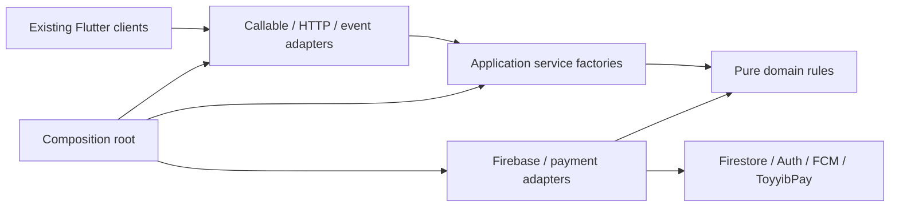

# Backend architecture refactor

Implemented: behavior-preserving modularization of the Functions backend. The
Flutter application already has feature folders and is unchanged in this pass.
No database migration, new endpoint, dependency change or deployment is required
to review the refactor. Existing deployment procedures still apply when releasing.

## Folder structure

```text
functions/
  index.js                         initialize Firebase and export the backend
  src/
    create-backend.js              composition root: configuration and dependency wiring
    domain/
      domain.js                    validation, pricing/material planning, OrderError
      commerce.js                  cart/card/date normalization
      store-policy.js              policy factory, calendar, delivery quotes
      authorization.js             existing role entitlement predicate
      delivery.js                  delivery eligibility predicate
      delivery-preview.js          address/dispatch preview rules
      rider-contact.js             phone validation and approved contact rules
      payments.js                  payment identifiers, mode and hold policy
    application/
      checkout.js                  quote and transactional checkout
      fulfillment.js               rider queue, transitions, repair, scheduled release
      catalog.js                   bouquet and saved-recipe commands
      commerce.js                  add-on/card catalog, cart revisions, availability
      addresses.js                 saved addresses and default coordination
      support.js                   feedback, issues and manual payment confirmation
      riders.js                    rider identities and application review
      rider-contact.js             authorized contact lookup
      admin.js                     directory, reports, staff and store operations
      accounts.js                  guarded, resumable account deletion
      payments.js                  bill lifecycle, verification and expiry
      notifications.js             preferences, devices and push delivery
      admin-events.js              alert and audit event handlers
    infrastructure/
      firebase/
        checkout-reader.js         transactional catalog/policy/card reads
        delivery-jobs.js           delivery queue projection writes
      payments/
        toyyibpay.js               provider HTTP, callback and transaction adapter
    presentation/
      callable.js                  existing authentication/suspension/error boundary
      register-functions.js        public names, triggers, schedules and runtime options
  test/
    architecture.test.js           dependency-direction and compatibility guards
    callable_boundary.test.js      authentication and error behavior
    function_contract.test.js      pre-refactor deployment contract comparison
    fixtures/function-contract.json
    ...                            existing domain/emulator/rules tests
  domain.js, commerce.js, ...       compatibility facades for existing imports
  store-policy.json                existing deployment policy defaults
```

The small root facades retain the previous module paths used by tests, tooling
and integrations. Root `store-policy.js` retains the import-time environment
override and supplies the configured policy to the pure domain factory.

## Architecture and dependency direction



`index.js` performs Firebase initialization once. `create-backend.js` supplies
database access, timestamp/field operations, Auth/Messaging getters, policy and
payment adapters. It passes the assembled services to the presentation registry.
The registry preserves existing public function names and registration options.

Domain modules import only domain modules and Node built-ins. They do not import
Firebase, read deployment environment variables, register endpoints or perform
network I/O. `createStorePolicy` accepts configuration explicitly, allowing
independent policy instances without shared deployment state.

Application factories expose plain asynchronous handlers and receive external
dependencies explicitly. They do not initialize or import Firebase or register
Functions. Handlers retain the existing plain `{auth, data}` command envelope to
preserve client authorization and input semantics. Event handlers accept the
existing event shape. Instantiating these factories performs no network I/O;
calling their handlers executes the supplied persistence/provider operations.

The callable adapter owns transport authentication and error conversion. It
retains the existing suspension check, domain-to-HTTPS error mapping and generic
internal-error response. Domain-specific authorization stays inside the relevant
application transaction, including ownership and role checks.

## Deliberate persistence boundary

This is an incremental clean architecture refactor. The injected `db`, transaction,
field-value and timestamp interfaces still have Firestore-shaped operations.
Application services continue to express some collection paths and query shapes.
They are **not** claimed to be completely database-agnostic repositories.

That preserves transaction scope, query ordering and retry behavior while
removing SDK imports/global initialization from business services. Checkout
catalog/policy reads and delivery queue writes now have explicit adapters.
Further repository extraction should follow domain-by-domain, retaining a single
unit of work across stock, capacity, orders, receipts and replay records. Splitting
that transaction into independent repository commits would change correctness.

## Key improvements

- The entry point shrinks from roughly 700 lines to seven lines; business changes
  now have a focused service owner rather than sharing one initialization scope.
- Endpoint configuration is centralized and separate from business operations.
- Application dependencies are explicit and substitutable for focused tests;
  production initialization stays in the composition layer.
- Shared authorization, delivery eligibility, contact and payment predicates
  have one implementation. Domain error identity survives legacy imports.
- Policy configuration is separated from policy calculation. Pure policy
  instances can be evaluated independently.
- New code is consistently formatted. Automated architecture tests prevent
  direct Firebase imports and outward dependencies from creeping into inner layers.
- Existing import facades allow gradual migration of tools/callers without a
  coordinated flag day.

These changes improve the ability to evolve and scale separate workloads. They
do not increase deployed capacity, alter instance caps, or establish throughput.
The current shared stock/capacity contention points, repair scans and deletion
workloads retain their existing semantics and operational limits.

## Preserved contracts

All 49 existing Function names and captured deployment definitions are retained:
trigger kinds/document paths, regions, schedules, retry policies, instance caps
and payment secret bindings. Callable options still retain the same invoker and
environment-controlled App Check setting. No rate limits, new validation rules,
new queues or new error messages were introduced.

Order/cart/receipt schemas, checkout fingerprints and replay keys, material/stock
updates, rider acceptance locks, payment holds, support semantics, date handling
and account deletion remain unchanged. Existing pure helper exports and legacy
factory APIs remain available through compatibility facades.

## Verification

The existing strict emulator suite covers transactions, oversell/rider races,
retries, ownership, roles, payments, rules and delivery confirmation. New tests
cover dependency direction, configuration isolation, facade identity,
authentication short-circuiting and public error compatibility.

The deployment fixture was captured from the original entry point before
extracting handlers. Review intentional public-contract changes separately; do
not regenerate the fixture merely to make a failing comparison pass.

Final local verification: **134 tests passed, zero failures and zero skips** in
the strict Auth/Firestore/Storage emulator run. All 49 captured deployment
definitions matched. The emulator run completed and shut down its services.

Run the full backend check from the repository root:

```powershell
firebase emulators:exec --project demo-bloom --only auth,firestore,storage "npm --prefix functions run test:emulators"
```

This is a backend-only refactor. Backend tests do not replace real-device
acceptance, browser journeys or capacity testing for a future public release.
