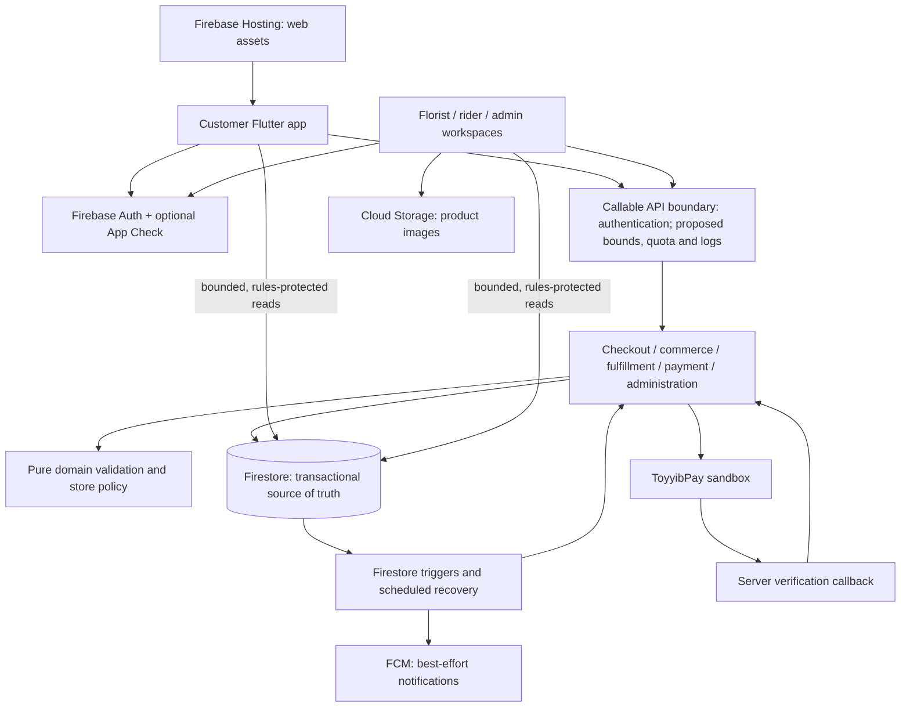
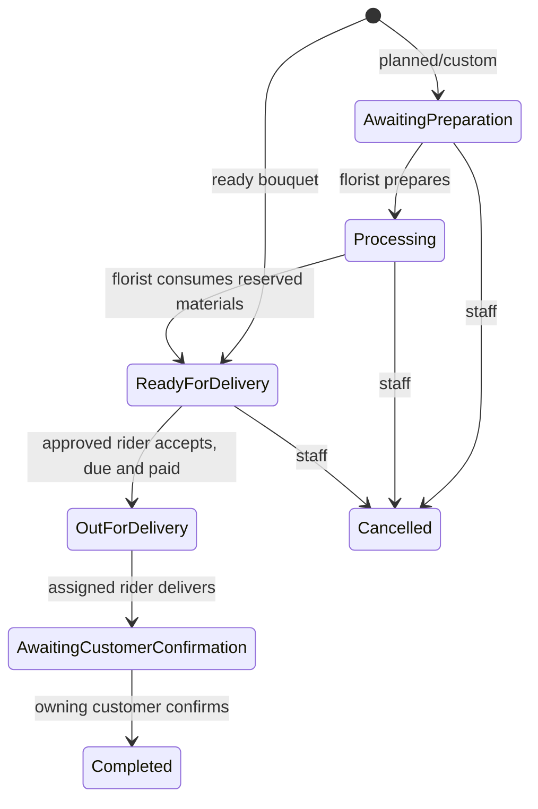

# Bloom & Bunch MVP architecture

Status: initial MVP design proposal. The subsequent behavior-preserving backend
layering refactor is documented in [backend-refactor.md](backend-refactor.md).
Quota/request-boundary enhancements below remain proposals, not implemented features.
Capacity is unmeasured; this document defines an incremental path to scale,
not a claim that the current single-store system serves a million concurrent users.

## Product boundary

The MVP sells bouquets from one Kuala Lumpur store. A customer signs in, selects
a ready/pre-order/custom bouquet, optionally adds gifts and a message card, chooses
a saved delivery address/date, reviews a server quote, and submits one checkout.
Florists prepare the order, an approved rider collects/delivers it, and the customer
confirms receipt. Staff handle stock, payment confirmation, and delivery issues.

The checked-in mode remains **demo**. Manual payment is supported; ToyyibPay is
sandbox-only. Live online payments, refunds, multi-store tenancy, marketplace
payouts, route optimization, and global search are outside this MVP.

## System architecture



Use one deployable backend with domain modules, one database, and one Flutter
application with role workspaces. Services are stateless; Firestore owns durable
state. Functions currently run in `asia-southeast1`; verify the database location
before deployment. Co-location reduces transaction latency. Separate staging and
production Firebase projects, credentials, storage, and monitoring.

Authoritative writes use authenticated callable functions. Security Rules govern
direct reads and the few existing client writes (profile, favorites, inventory
fields, rider applications). Admin SDK writes bypass rules, so every handler must
enforce role, ownership, suspension, deletion state, and valid transitions itself.
The active UI role is navigation state, not permission to grant a new role.

## File structure

```text
lib/
  main.dart                         startup, environment, provider composition
  core/
    config/                         demo / staging / production configuration
    providers/cart_provider.dart    cart and checkout recovery state
    services/                       Firebase adapters and application actions
    widgets/                        routing, auth sessions, paging, retry UI
    theme/                          shared colors, typography, components
    utils/                          money, Malaysia dates, phone normalization
  models/                           typed document and snapshot models
  features/
    auth/                           authentication and role gate
    customer/                       browse, cart, checkout, orders, profile
    florist/                        stock, products, preparation
    rider/                          available jobs, delivery, history
    admin/                          operations, people, reports
    support/                        issues and contact actions
functions/
  index.js                          endpoint registration and legacy orchestration
  callable-boundary.js              PROPOSED: request policy and safe telemetry
  rate-limit.js                     PROPOSED: distributed request quota
  domain.js                         order validation and material calculations
  commerce.js                       products, cards, dates and snapshots
  commerce-handlers.js              cart/catalog commands
  store-policy.js                   pricing, calendar, capacity and coverage
  store-policy.json                 safe demo defaults
  admin-operations.js               staff-only operations and auditing
  payments.js                       payment state and reservation recovery
  toyyibpay.js                       external gateway adapter
  rider-contact.js                  authorized rider contact access
  delivery-preview.js               rider queue projection
  test/                             unit, emulator and authorization tests
firestore.rules                     direct-client authorization
firestore.indexes.json               query indexes; proposed quota exemptions
storage.rules                       image authorization and validation
tool/                               demo seed, build and release validation
test/                               Flutter behavior and layout tests
integration_test/                   actual role journeys
.github/workflows/checks.yml         analysis, tests, demo build, browser journey
docs/database-schema.md              persistence contract
docs/api-contract.md                 callable transport and endpoint catalog
docs/production-operations.md        release, observability and scale plan
```

Avoid a rewrite solely to match a folder template. Existing orchestration in
`index.js` can move behind service factories when that domain changes; retain
function names and payload compatibility throughout extraction.

## Critical flows and invariants

1. **Quote:** normalize at most 20 cart lines, read current product/flower/card
   records and store policy, calculate prices in integer sen, return quote ID and
   delivery groups. A quote does not reserve stock.
2. **Checkout:** authenticate (proposed: also apply request quota), then transactionally read
   the customer, checkout replay record, saved address, synchronized cart,
   products/materials, policy, and relevant capacity documents. Recompute the
   quote and reject stale price/address/date/cart state before writing anything.
3. **Commit:** reserve materials, decrement available products/add-ons, reserve
   delivery capacity, create orders/events/receipt and replay record together.
   The same checkout ID and fingerprint return the original order IDs; a changed
   payload with the same ID fails. A lost response must never duplicate an order.
4. **Payment:** create a single sandbox bill per checkout. The server verifies
   settlement with the provider; a browser return or callback payload alone
   cannot mark an order paid. Unpaid orders remain on hold. Scheduled recovery
   checks expired reservations. No automatic refund is promised.
5. **Fulfillment:** state changes and inventory effects are transactionally
   guarded. Rider acceptance has one winner. Only the assigned rider delivers;
   only the owning customer confirms receipt. An open issue pauses those actions.
6. **Notifications:** triggers process changes after commit and use delivery
   markers/leases. Push is an advisory hint; the order document is authoritative.
   Notifications may be duplicated after a crash around provider delivery.



Legacy `Pending`/`Delivered` records remain compatible but are not evidence of
customer confirmation. Payment status is a separate state machine. Cancellation
of a paid order needs staff payment review rather than an implied refund.

## UI architecture

`main.dart` initializes environment and monitoring, then composes `AppRouter`,
`AuthGate`, the cart provider, cart synchronization, and notification/payment
sessions. Workspace navigation is selected from server-approved entitlements.

Screens render models and invoke `core/services`; pure totals, dates, and status
formatting live outside widgets. Firebase reads use bounded queries and cursors;
detail listeners attach to the displayed order. Shared pagination widgets expose
loading, empty, failed, retry and next/previous states. Dispose subscriptions on
screen/account change and initialize workspace tabs lazily.

Cart mutations use revisions and mutation IDs. Checkout recovery retains the
original request until its outcome is known; never mint a new checkout ID solely
because a request timed out. Proposed quota errors should display a retry delay. Do not silently
retry business writes with a changed payload. Prices displayed locally are
estimates until the server quote succeeds.

Customer information stays in owner/staff/assigned-rider records. The rider queue
currently exposes delivery street addresses to approved riders, but excludes
recipient phone, exact coordinates, customer identity, and totals. This is a
deliberate existing product decision; a broader marketplace should reduce the
unassigned queue to an area preview before launch.

## Scale strategy

A million registered accounts is different from a million active sessions or
concurrent checkouts. Start with a measured single-store workload. Managed
hosting/auth/functions remove server maintenance, but do not remove contention,
quotas, cost, or the store's physical fulfillment limit.

At growth milestones, measure before adding infrastructure:

| Trigger | Next change | Required proof |
| --- | --- | --- |
| Cold starts violate checkout latency budget | Tune min instances/concurrency per function | Staging p95/p99 and cost |
| Catalog/search reads dominate cost or page-local search fails UX | Cached read projection and dedicated search index | Index freshness and access tests |
| Popular stock or daily capacity documents contend | Store/date partitions and explicit inventory allocation | Oversell and failure-recovery tests |
| Notification fan-out or recovery approaches timeout | Durable task queue and bounded workers with retry/dead-letter handling | Duplicate/outage recovery |
| Admin aggregates become expensive | Incremental reporting projections/analytics export | Reconciliation with source orders |
| Request quota transactions contend for heavy accounts | Edge/global abuse controls and dedicated quota store | Equivalent distributed admission semantics |
| Multiple stores are required | Add tenant/store ownership to every document, API, rule and query | Cross-tenant isolation tests and migration |
| Regional availability is required | Measured disaster recovery plan, region-aware data design | Restore/failover drill |

Never shard exact stock with independent approximate counters: that loses the
no-oversell guarantee. A user-count milestone alone does not justify microservices.

Reference constraints: [Firestore best practices](https://firebase.google.com/docs/firestore/best-practices),
[transaction contention](https://firebase.google.com/docs/firestore/transaction-data-contention),
[Functions runtime/scaling](https://firebase.google.com/docs/functions/manage-functions),
and [idempotent functions](https://firebase.google.com/docs/functions/tips).
